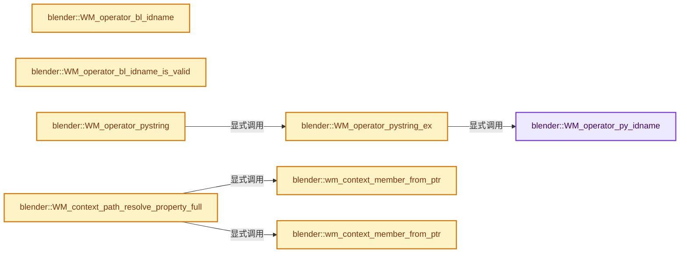
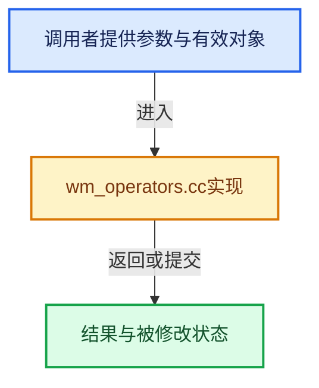

# 实现依赖专题：source/blender/windowmanager/intern/wm_operators.cc

[方向导航](README.md) · [符号索引](../%E7%AC%A6%E5%8F%B7%E4%BE%9D%E8%B5%96%E4%B8%8E%E5%AE%9E%E7%8E%B0%E7%B4%A2%E5%BC%95.md)

本专题从正文实际调用进入，集中保存共享实现。函数有稳定锚点，可从调用处直接跳到对应完整函数；递归与互相调用通过回链组织。

## 本文件的实现关系






## 完整成员与函数实现

<a id="f-dd214e862fbf1301"></a>

### `blender::WM_operator_py_idname`

实现位置：[source/blender/windowmanager/intern/wm_operators.cc](../../../../../source/blender/windowmanager/intern/wm_operators.cc) · L140—L159。

接口参数：

- `char *dst`
- `const char *src`

**教学注释版**

<!-- annotated:e20f15246da9e4 -->

```cpp
size_t WM_operator_py_idname(char *dst, const char *src)
{
  const char *sep = strstr(src, OP_BL_SEP_STRING);
  if (sep) {
    const size_t sep_offset = size_t(sep - src);

    /* NOTE: we use ASCII `tolower` instead of system `tolower`, because the
     * latter depends on the locale, and can lead to `idname` mismatch. */
    // [讲解] memcpy：复制字节，源与目标不应重叠。类型生命周期、对齐和可复制表示须由调用者证明，不是任意对象的复制构造。
    memcpy(dst, src, sep_offset);
    BLI_str_tolower_ascii(dst, sep_offset);

    dst[sep_offset] = OP_PY_SEP_CHAR;
    return BLI_strncpy_rlen(dst + (sep_offset + OP_PY_SEP_LEN),
                            sep + OP_BL_SEP_LEN,
                            OP_MAX_TYPENAME - sep_offset - OP_PY_SEP_LEN) +
           (sep_offset + OP_PY_SEP_LEN);
  }
  /* Should not happen but support just in case. */
  return BLI_strncpy_rlen(dst, src, OP_MAX_TYPENAME);
}
```

<details>
<summary>核对原始源码：source/blender/windowmanager/intern/wm_operators.cc · L140—L159</summary>

<!-- original:e20f15246da9e4:source/blender/windowmanager/intern/wm_operators.cc:140:159 -->

```cpp
size_t WM_operator_py_idname(char *dst, const char *src)
{
  const char *sep = strstr(src, OP_BL_SEP_STRING);
  if (sep) {
    const size_t sep_offset = size_t(sep - src);

    /* NOTE: we use ASCII `tolower` instead of system `tolower`, because the
     * latter depends on the locale, and can lead to `idname` mismatch. */
    memcpy(dst, src, sep_offset);
    BLI_str_tolower_ascii(dst, sep_offset);

    dst[sep_offset] = OP_PY_SEP_CHAR;
    return BLI_strncpy_rlen(dst + (sep_offset + OP_PY_SEP_LEN),
                            sep + OP_BL_SEP_LEN,
                            OP_MAX_TYPENAME - sep_offset - OP_PY_SEP_LEN) +
           (sep_offset + OP_PY_SEP_LEN);
  }
  /* Should not happen but support just in case. */
  return BLI_strncpy_rlen(dst, src, OP_MAX_TYPENAME);
}
```

</details>

**沿实际写入检查状态**

- `dst[sep_offset] = OP_PY_SEP_CHAR;`

**结果出口**

- `return BLI_strncpy_rlen(dst + (sep_offset + OP_PY_SEP_LEN),`
- `return BLI_strncpy_rlen(dst, src, OP_MAX_TYPENAME);`

**继续追踪实现**

- `strstr` → [调用协议](../%E6%A8%A1%E6%9D%BF%E5%AE%8F%E4%B8%8E%E5%8A%A8%E6%80%81%E5%88%86%E6%B4%BE%E5%8D%8F%E8%AE%AE.md)：函数指针、局部可调用对象或未展开的宏；必须结合调用者环境。调用位置L142。
- `memcpy` → [外部契约](https://eel.is/c++draft/cstring.syn)：复制字节，源与目标不应重叠。类型生命周期、对齐和可复制表示须由调用者证明，不是任意对象的复制构造。
- `BLI_str_tolower_ascii` → [blender::BLI_str_tolower_ascii · L962](../01-%E5%9F%BA%E7%A1%80%E5%AE%B9%E5%99%A8%E4%B8%8E%E7%8E%B0%E4%BB%A3CPP/%E4%BE%9D%E8%B5%96-string-1d986f.md#f-a2721b5a991b6953)。
- `BLI_strncpy_rlen` → [blender::BLI_strncpy_rlen · L121](../01-%E5%9F%BA%E7%A1%80%E5%AE%B9%E5%99%A8%E4%B8%8E%E7%8E%B0%E4%BB%A3CPP/%E4%BE%9D%E8%B5%96-string-1d986f.md#f-41d02d7e241b0968)。

<a id="f-745c1ebc1a2015ee"></a>

### `blender::WM_operator_bl_idname`

实现位置：[source/blender/windowmanager/intern/wm_operators.cc](../../../../../source/blender/windowmanager/intern/wm_operators.cc) · L161—L179。

接口参数：

- `char *dst`
- `const char *src`

**教学注释版**

<!-- annotated:02e1c218221f06 -->

```cpp
size_t WM_operator_bl_idname(char *dst, const char *src)
{
  const size_t from_len = strlen(src);

  const char *sep = strchr(src, OP_PY_SEP_CHAR);
  if (sep && (from_len <= OP_MAX_PY_IDNAME)) {
    const size_t sep_offset = size_t(sep - src);
    // [讲解] memcpy：复制字节，源与目标不应重叠。类型生命周期、对齐和可复制表示须由调用者证明，不是任意对象的复制构造。
    memcpy(dst, src, sep_offset);
    BLI_str_toupper_ascii(dst, sep_offset);

    memcpy(dst + sep_offset, OP_BL_SEP_STRING, OP_BL_SEP_LEN);
    BLI_strncpy(dst + sep_offset + OP_BL_SEP_LEN,
                sep + OP_PY_SEP_LEN,
                from_len - sep_offset - OP_PY_SEP_LEN + 1);
    return from_len + OP_BL_SEP_LEN - OP_PY_SEP_LEN;
  }
  /* Should not happen but support just in case. */
  return BLI_strncpy_rlen(dst, src, OP_MAX_TYPENAME);
}
```

<details>
<summary>核对原始源码：source/blender/windowmanager/intern/wm_operators.cc · L161—L179</summary>

<!-- original:02e1c218221f06:source/blender/windowmanager/intern/wm_operators.cc:161:179 -->

```cpp
size_t WM_operator_bl_idname(char *dst, const char *src)
{
  const size_t from_len = strlen(src);

  const char *sep = strchr(src, OP_PY_SEP_CHAR);
  if (sep && (from_len <= OP_MAX_PY_IDNAME)) {
    const size_t sep_offset = size_t(sep - src);
    memcpy(dst, src, sep_offset);
    BLI_str_toupper_ascii(dst, sep_offset);

    memcpy(dst + sep_offset, OP_BL_SEP_STRING, OP_BL_SEP_LEN);
    BLI_strncpy(dst + sep_offset + OP_BL_SEP_LEN,
                sep + OP_PY_SEP_LEN,
                from_len - sep_offset - OP_PY_SEP_LEN + 1);
    return from_len + OP_BL_SEP_LEN - OP_PY_SEP_LEN;
  }
  /* Should not happen but support just in case. */
  return BLI_strncpy_rlen(dst, src, OP_MAX_TYPENAME);
}
```

</details>

**结果出口**

- `return from_len + OP_BL_SEP_LEN - OP_PY_SEP_LEN;`
- `return BLI_strncpy_rlen(dst, src, OP_MAX_TYPENAME);`

**继续追踪实现**

- `strlen` → [外部契约](https://eel.is/c++draft/)：这个边界按实际表达式及所属类型核对参数、返回值、寿命与失败行为。这里提供接口入口，不声称已解释该第三方版本的内部实现。
- `strchr` → [调用协议](../%E6%A8%A1%E6%9D%BF%E5%AE%8F%E4%B8%8E%E5%8A%A8%E6%80%81%E5%88%86%E6%B4%BE%E5%8D%8F%E8%AE%AE.md)：函数指针、局部可调用对象或未展开的宏；必须结合调用者环境。调用位置L165。
- `memcpy` → [外部契约](https://eel.is/c++draft/cstring.syn)：复制字节，源与目标不应重叠。类型生命周期、对齐和可复制表示须由调用者证明，不是任意对象的复制构造。
- `BLI_str_toupper_ascii` → [blender::BLI_str_toupper_ascii · L971](../01-%E5%9F%BA%E7%A1%80%E5%AE%B9%E5%99%A8%E4%B8%8E%E7%8E%B0%E4%BB%A3CPP/%E4%BE%9D%E8%B5%96-string-1d986f.md#f-530c9e8677e0ea3a)。
- `BLI_strncpy` → [blender::BLI_strncpy · L70](../01-%E5%9F%BA%E7%A1%80%E5%AE%B9%E5%99%A8%E4%B8%8E%E7%8E%B0%E4%BB%A3CPP/%E4%BE%9D%E8%B5%96-string-1d986f.md#f-6324147b0d116da1)。
- `BLI_strncpy_rlen` → [blender::BLI_strncpy_rlen · L121](../01-%E5%9F%BA%E7%A1%80%E5%AE%B9%E5%99%A8%E4%B8%8E%E7%8E%B0%E4%BB%A3CPP/%E4%BE%9D%E8%B5%96-string-1d986f.md#f-41d02d7e241b0968)。

<a id="f-3bd2ac8a72489f8a"></a>

### `blender::WM_operator_bl_idname_is_valid`

实现位置：[source/blender/windowmanager/intern/wm_operators.cc](../../../../../source/blender/windowmanager/intern/wm_operators.cc) · L181—L203。

接口参数：

- `const char *idname`

**教学注释版**

<!-- annotated:75aaf8a0dd3aa2 -->

```cpp
bool WM_operator_bl_idname_is_valid(const char *idname)
{
  const char *sep = strstr(idname, OP_BL_SEP_STRING);
  /* Separator missing or at string beginning/end. */
  if ((sep == nullptr) || (sep == idname) || (sep[OP_BL_SEP_LEN] == '\0')) {
    return false;
  }

  for (const char *ch = idname; ch < sep; ch++) {
    if ((*ch >= 'A' && *ch <= 'Z') || (*ch >= '0' && *ch <= '9') || *ch == '_') {
      continue;
    }
    return false;
  }

  for (const char *ch = sep + OP_BL_SEP_LEN; *ch; ch++) {
    if ((*ch >= 'a' && *ch <= 'z') || (*ch >= '0' && *ch <= '9') || *ch == '_') {
      continue;
    }
    return false;
  }
  return true;
}
```

<details>
<summary>核对原始源码：source/blender/windowmanager/intern/wm_operators.cc · L181—L203</summary>

<!-- original:75aaf8a0dd3aa2:source/blender/windowmanager/intern/wm_operators.cc:181:203 -->

```cpp
bool WM_operator_bl_idname_is_valid(const char *idname)
{
  const char *sep = strstr(idname, OP_BL_SEP_STRING);
  /* Separator missing or at string beginning/end. */
  if ((sep == nullptr) || (sep == idname) || (sep[OP_BL_SEP_LEN] == '\0')) {
    return false;
  }

  for (const char *ch = idname; ch < sep; ch++) {
    if ((*ch >= 'A' && *ch <= 'Z') || (*ch >= '0' && *ch <= '9') || *ch == '_') {
      continue;
    }
    return false;
  }

  for (const char *ch = sep + OP_BL_SEP_LEN; *ch; ch++) {
    if ((*ch >= 'a' && *ch <= 'z') || (*ch >= '0' && *ch <= '9') || *ch == '_') {
      continue;
    }
    return false;
  }
  return true;
}
```

</details>

**结果出口**

- `return false;`
- `return true;`

**继续追踪实现**

- `strstr` → [调用协议](../%E6%A8%A1%E6%9D%BF%E5%AE%8F%E4%B8%8E%E5%8A%A8%E6%80%81%E5%88%86%E6%B4%BE%E5%8D%8F%E8%AE%AE.md)：函数指针、局部可调用对象或未展开的宏；必须结合调用者环境。调用位置L183。

<a id="f-c57fe69901486d91"></a>

### `blender::WM_operator_pystring_ex`

实现位置：[source/blender/windowmanager/intern/wm_operators.cc](../../../../../source/blender/windowmanager/intern/wm_operators.cc) · L266—L334。

接口参数：

- `bContext *C`
- `wmOperator *op`
- `const bool all_args`
- `const bool macro_args`
- `wmOperatorType *ot`
- `PointerRNA *opptr`

**教学注释版**

<!-- annotated:b8c92ce08fea5e -->

```cpp
std::string WM_operator_pystring_ex(bContext *C,
                                    wmOperator *op,
                                    const bool all_args,
                                    const bool macro_args,
                                    wmOperatorType *ot,
                                    PointerRNA *opptr)
{
  char idname_py[OP_MAX_TYPENAME];

  /* For building the string. */
  std::stringstream ss;

  /* Arbitrary, but can get huge string with stroke painting otherwise. */
  int max_prop_length = 10;

  WM_operator_py_idname(idname_py, ot->idname);
  ss << "bpy.ops." << idname_py << "(";

  if (op && op->macro.first()) {
    /* Special handling for macros, else we only get default values in this case... */
    wmOperator *opm;
    bool first_op = true;

    opm = macro_args ? op->macro.first() : nullptr;

    for (; opm; opm = opm->next) {
      PointerRNA *opmptr = opm->ptr;
      PointerRNA opmptr_default;
      if (opmptr == nullptr) {
        opmptr_default = WM_operator_properties_create_ptr(opm->type);
        opmptr = &opmptr_default;
      }

      std::string string_args = RNA_pointer_as_string_id(C, opmptr);
      if (first_op) {
        ss << opm->type->idname << '=' << string_args;
        first_op = false;
      }
      else {
        ss << ", " << opm->type->idname << '=' << string_args;
      }

      if (opmptr == &opmptr_default) {
        WM_operator_properties_free(&opmptr_default);
      }
    }
  }
  else {
    /* Only to get the original props for comparisons. */
    PointerRNA opptr_default;
    const bool macro_args_test = ot->macro.first() ? macro_args : true;

    if (opptr == nullptr) {
      opptr_default = WM_operator_properties_create_ptr(ot);
      opptr = &opptr_default;
    }

    ss << RNA_pointer_as_string_keywords(
        C, opptr, false, all_args, macro_args_test, max_prop_length);

    if (opptr == &opptr_default) {
      WM_operator_properties_free(&opptr_default);
    }
  }

  ss << ')';

  return ss.str();
}
```

<details>
<summary>核对原始源码：source/blender/windowmanager/intern/wm_operators.cc · L266—L334</summary>

<!-- original:b8c92ce08fea5e:source/blender/windowmanager/intern/wm_operators.cc:266:334 -->

```cpp
std::string WM_operator_pystring_ex(bContext *C,
                                    wmOperator *op,
                                    const bool all_args,
                                    const bool macro_args,
                                    wmOperatorType *ot,
                                    PointerRNA *opptr)
{
  char idname_py[OP_MAX_TYPENAME];

  /* For building the string. */
  std::stringstream ss;

  /* Arbitrary, but can get huge string with stroke painting otherwise. */
  int max_prop_length = 10;

  WM_operator_py_idname(idname_py, ot->idname);
  ss << "bpy.ops." << idname_py << "(";

  if (op && op->macro.first()) {
    /* Special handling for macros, else we only get default values in this case... */
    wmOperator *opm;
    bool first_op = true;

    opm = macro_args ? op->macro.first() : nullptr;

    for (; opm; opm = opm->next) {
      PointerRNA *opmptr = opm->ptr;
      PointerRNA opmptr_default;
      if (opmptr == nullptr) {
        opmptr_default = WM_operator_properties_create_ptr(opm->type);
        opmptr = &opmptr_default;
      }

      std::string string_args = RNA_pointer_as_string_id(C, opmptr);
      if (first_op) {
        ss << opm->type->idname << '=' << string_args;
        first_op = false;
      }
      else {
        ss << ", " << opm->type->idname << '=' << string_args;
      }

      if (opmptr == &opmptr_default) {
        WM_operator_properties_free(&opmptr_default);
      }
    }
  }
  else {
    /* Only to get the original props for comparisons. */
    PointerRNA opptr_default;
    const bool macro_args_test = ot->macro.first() ? macro_args : true;

    if (opptr == nullptr) {
      opptr_default = WM_operator_properties_create_ptr(ot);
      opptr = &opptr_default;
    }

    ss << RNA_pointer_as_string_keywords(
        C, opptr, false, all_args, macro_args_test, max_prop_length);

    if (opptr == &opptr_default) {
      WM_operator_properties_free(&opptr_default);
    }
  }

  ss << ')';

  return ss.str();
}
```

</details>

**沿实际写入检查状态**

- `opm = macro_args ? op->macro.first() : nullptr;`
- `opmptr_default = WM_operator_properties_create_ptr(opm->type);`
- `opmptr = &opmptr_default;`
- `first_op = false;`
- `opptr_default = WM_operator_properties_create_ptr(ot);`
- `opptr = &opptr_default;`

**结果出口**

- `return ss.str();`

**继续追踪实现**

- `WM_operator_py_idname` → [blender::WM_operator_py_idname · L140](%E4%BE%9D%E8%B5%96-wm_operators-6f9715.md#f-dd214e862fbf1301)。
- `op->macro.first` → [调用协议](../%E6%A8%A1%E6%9D%BF%E5%AE%8F%E4%B8%8E%E5%8A%A8%E6%80%81%E5%88%86%E6%B4%BE%E5%8D%8F%E8%AE%AE.md)：接收对象类型依赖auto、返回值或模板实例；不按同名猜测目标。调用位置L284。
- `WM_operator_properties_create_ptr` → [blender::WM_operator_properties_create_ptr · L748](%E4%BE%9D%E8%B5%96-wm_operators-6f9715.md#f-6314bcba0ea304a8)。
- `RNA_pointer_as_string_id` → [blender::RNA_pointer_as_string_id · L7209](%E4%BE%9D%E8%B5%96-rna_access-706bea.md#f-e133bda0d1417f41)。
- `WM_operator_properties_free` → [blender::WM_operator_properties_free · L868](%E4%BE%9D%E8%B5%96-wm_operators-6f9715.md#f-b0519201115d9aa0)。
- `ot->macro.first` → [调用协议](../%E6%A8%A1%E6%9D%BF%E5%AE%8F%E4%B8%8E%E5%8A%A8%E6%80%81%E5%88%86%E6%B4%BE%E5%8D%8F%E8%AE%AE.md)：接收对象类型依赖auto、返回值或模板实例；不按同名猜测目标。调用位置L316。
- `RNA_pointer_as_string_keywords` → [blender::RNA_pointer_as_string_keywords · L7344](%E4%BE%9D%E8%B5%96-rna_access-706bea.md#f-731dadfada4bc832)。
- `ss.str` → [外部契约](https://eel.is/c++draft/)：这个边界按实际表达式及所属类型核对参数、返回值、寿命与失败行为。这里提供接口入口，不声称已解释该第三方版本的内部实现。

<a id="f-ee0c249543a22bfb"></a>

### `blender::WM_operator_pystring`

实现位置：[source/blender/windowmanager/intern/wm_operators.cc](../../../../../source/blender/windowmanager/intern/wm_operators.cc) · L336—L342。

接口参数：

- `bContext *C`
- `wmOperator *op`
- `const bool all_args`
- `const bool macro_args`

**教学注释版**

<!-- annotated:35ceb351f43dfa -->

```cpp
std::string WM_operator_pystring(bContext *C,
                                 wmOperator *op,
                                 const bool all_args,
                                 const bool macro_args)
{
  return WM_operator_pystring_ex(C, op, all_args, macro_args, op->type, op->ptr);
}
```

<details>
<summary>核对原始源码：source/blender/windowmanager/intern/wm_operators.cc · L336—L342</summary>

<!-- original:35ceb351f43dfa:source/blender/windowmanager/intern/wm_operators.cc:336:342 -->

```cpp
std::string WM_operator_pystring(bContext *C,
                                 wmOperator *op,
                                 const bool all_args,
                                 const bool macro_args)
{
  return WM_operator_pystring_ex(C, op, all_args, macro_args, op->type, op->ptr);
}
```

</details>

**结果出口**

- `return WM_operator_pystring_ex(C, op, all_args, macro_args, op->type, op->ptr);`

**继续追踪实现**

- `WM_operator_pystring_ex` → [blender::WM_operator_pystring_ex · L266](%E4%BE%9D%E8%B5%96-wm_operators-6f9715.md#f-c57fe69901486d91)。

<a id="f-1e891ee5cff2d8d6"></a>

### `blender::wm_context_member_from_ptr`

实现位置：[source/blender/windowmanager/intern/wm_operators.cc](../../../../../source/blender/windowmanager/intern/wm_operators.cc) · L382—L435。

接口参数：

- `bContext *C`
- `const PointerRNA *ptr`
- `bool *r_is_id`

**教学注释版**

<!-- annotated:74db21bd09afec -->

```cpp
static const char *wm_context_member_from_ptr(bContext *C, const PointerRNA *ptr, bool *r_is_id)
{
  /* Loop over all context items and do 2 checks
   *
   * - See if the pointer is in the context.
   * - See if the pointers ID is in the context.
   */

  /* Don't get from the context store since this is normally
   * set only for the UI and not usable elsewhere. */
  ListBaseT<LinkData> lb = CTX_data_dir_get_ex(C, false, true, true);
  LinkData *link;

  const char *member_found = nullptr;
  const char *member_id = nullptr;
  bool member_found_is_id = false;

  for (link = lb.first; link; link = link->next) {
    const char *identifier = link->data;
    PointerRNA ctx_item_ptr = {};
    // CTX_data_pointer_get(C, identifier);  /* XXX, this isn't working. */

    if (!ctx_item_ptr.has_type()) {
      continue;
    }

    if (ptr->owner_id == ctx_item_ptr.owner_id) {
      const bool is_id = RNA_struct_is_ID(ctx_item_ptr.type);
      if ((ptr->data == ctx_item_ptr.data) && (ptr->type == ctx_item_ptr.type)) {
        /* Found! */
        member_found = identifier;
        member_found_is_id = is_id;
        break;
      }
      if (is_id) {
        /* Found a reference to this ID, so fall back to it if there is no direct reference. */
        member_id = identifier;
      }
    }
  }
  lb.free_no_destruct();

  if (member_found) {
    *r_is_id = member_found_is_id;
    return member_found;
  }
  else if (member_id) {
    *r_is_id = true;
    return member_id;
  }
  else {
    return nullptr;
  }
}
```

<details>
<summary>核对原始源码：source/blender/windowmanager/intern/wm_operators.cc · L382—L435</summary>

<!-- original:74db21bd09afec:source/blender/windowmanager/intern/wm_operators.cc:382:435 -->

```cpp
static const char *wm_context_member_from_ptr(bContext *C, const PointerRNA *ptr, bool *r_is_id)
{
  /* Loop over all context items and do 2 checks
   *
   * - See if the pointer is in the context.
   * - See if the pointers ID is in the context.
   */

  /* Don't get from the context store since this is normally
   * set only for the UI and not usable elsewhere. */
  ListBaseT<LinkData> lb = CTX_data_dir_get_ex(C, false, true, true);
  LinkData *link;

  const char *member_found = nullptr;
  const char *member_id = nullptr;
  bool member_found_is_id = false;

  for (link = lb.first; link; link = link->next) {
    const char *identifier = link->data;
    PointerRNA ctx_item_ptr = {};
    // CTX_data_pointer_get(C, identifier);  /* XXX, this isn't working. */

    if (!ctx_item_ptr.has_type()) {
      continue;
    }

    if (ptr->owner_id == ctx_item_ptr.owner_id) {
      const bool is_id = RNA_struct_is_ID(ctx_item_ptr.type);
      if ((ptr->data == ctx_item_ptr.data) && (ptr->type == ctx_item_ptr.type)) {
        /* Found! */
        member_found = identifier;
        member_found_is_id = is_id;
        break;
      }
      if (is_id) {
        /* Found a reference to this ID, so fall back to it if there is no direct reference. */
        member_id = identifier;
      }
    }
  }
  lb.free_no_destruct();

  if (member_found) {
    *r_is_id = member_found_is_id;
    return member_found;
  }
  else if (member_id) {
    *r_is_id = true;
    return member_id;
  }
  else {
    return nullptr;
  }
}
```

</details>

**沿实际写入检查状态**

- `member_found = identifier;`
- `member_found_is_id = is_id;`
- `member_id = identifier;`

**结果出口**

- `return member_found;`
- `return member_id;`
- `return nullptr;`

**继续追踪实现**

- `CTX_data_dir_get_ex` → [blender::CTX_data_dir_get_ex · L781](%E4%BE%9D%E8%B5%96-context-a929d9.md#f-aae0522887fa5707)。
- `ctx_item_ptr.has_type` → [blender::PointerRNA::has_type · L180](%E4%BE%9D%E8%B5%96-RNA_types-240f9f.md#f-6af0d77c8dc96e2d)。
- `RNA_struct_is_ID` → [blender::RNA_struct_is_ID · L793](%E4%BE%9D%E8%B5%96-rna_access-706bea.md#f-d146fa9a7698b857)。
- `lb.free_no_destruct` → [blender::ListBaseT::free_no_destruct · L78](%E4%BE%9D%E8%B5%96-DNA_listBase-48dbc9.md#f-8656670edd0f6b7e)。

<a id="f-983b039b481e3e0a"></a>

### `blender::wm_context_member_from_ptr`

实现位置：[source/blender/windowmanager/intern/wm_operators.cc](../../../../../source/blender/windowmanager/intern/wm_operators.cc) · L455—L657。

接口参数：

- `const bContext *C`
- `const PointerRNA *ptr`
- `bool *r_is_id`

**教学注释版**

<!-- annotated:e16503258749c9 -->

```cpp
static const char *wm_context_member_from_ptr(const bContext *C,
                                              const PointerRNA *ptr,
                                              bool *r_is_id)
{
  const char *member_id = nullptr;
  bool is_id = false;

#  define CTX_TEST_PTR_ID(C, member, idptr) \
    { \
      const char *ctx_member = member; \
      PointerRNA ctx_item_ptr = CTX_data_pointer_get(C, ctx_member); \
      if (ctx_item_ptr.owner_id == idptr) { \
        member_id = ctx_member; \
        is_id = true; \
        break; \
      } \
    } \
    (void)0

#  define CTX_TEST_PTR_ID_CAST(C, member, member_full, cast, idptr) \
    { \
      const char *ctx_member = member; \
      const char *ctx_member_full = member_full; \
      PointerRNA ctx_item_ptr = CTX_data_pointer_get(C, ctx_member); \
      if (ctx_item_ptr.owner_id && (ID *)cast(ctx_item_ptr.owner_id) == idptr) { \
        member_id = ctx_member_full; \
        is_id = true; \
        break; \
      } \
    } \
    (void)0

#  define TEST_PTR_DATA_TYPE(member, rna_type, rna_ptr, dataptr_cmp) \
    { \
      const char *ctx_member = member; \
      if (RNA_struct_is_a((rna_ptr)->type, (rna_type)) && (rna_ptr)->data == (dataptr_cmp)) { \
        member_id = ctx_member; \
        break; \
      } \
    } \
    (void)0

/* A version of #TEST_PTR_DATA_TYPE that calls `CTX_data_pointer_get_type(C, member)`. */
#  define TEST_PTR_DATA_TYPE_FROM_CONTEXT(member, rna_type, rna_ptr) \
    { \
      const char *ctx_member = member; \
      if (RNA_struct_is_a((rna_ptr)->type, (rna_type)) && \
          (rna_ptr)->data == (CTX_data_pointer_get_type(C, ctx_member, (rna_type)).data)) \
      { \
        member_id = ctx_member; \
        break; \
      } \
    } \
    (void)0

  /* General checks (multiple ID types). */
  if (ptr->owner_id) {
    const ID_Type ptr_id_type = GS(ptr->owner_id->name);

    /* Support break in the macros for an early exit. */
    do {
      /* Animation Data. */
      if (id_type_can_have_animdata(ptr_id_type)) {
        TEST_PTR_DATA_TYPE_FROM_CONTEXT("active_nla_track", RNA_NlaTrack, ptr);
        TEST_PTR_DATA_TYPE_FROM_CONTEXT("active_nla_strip", RNA_NlaStrip, ptr);
      }
    } while (false);
  }

  /* Specific ID type checks. */
  if (ptr->owner_id && (member_id == nullptr)) {

    const ID_Type ptr_id_type = GS(ptr->owner_id->name);
    switch (ptr_id_type) {
      case ID_SCE: {
        TEST_PTR_DATA_TYPE_FROM_CONTEXT("active_strip", RNA_Strip, ptr);

        CTX_TEST_PTR_ID(C, "scene", ptr->owner_id);
        break;
      }
      case ID_OB: {
        TEST_PTR_DATA_TYPE_FROM_CONTEXT("active_pose_bone", RNA_PoseBone, ptr);

        CTX_TEST_PTR_ID(C, "object", ptr->owner_id);
        break;
      }
      /* From #rna_Main_objects_new. */
      case OB_DATA_SUPPORT_ID_CASE: {

        if (ptr_id_type == ID_AR) {
          const bArmature *arm = id_cast<bArmature *>(ptr->owner_id);
          if (arm->edbo != nullptr) {
            TEST_PTR_DATA_TYPE("active_bone", RNA_EditBone, ptr, arm->act_edbone);
          }
          else {
            TEST_PTR_DATA_TYPE("active_bone", RNA_Bone, ptr, arm->act_bone);
          }
        }

#  define ID_CAST_OBDATA(id_pt) (((Object *)(id_pt))->data)
        CTX_TEST_PTR_ID_CAST(C, "object", "object.data", ID_CAST_OBDATA, ptr->owner_id);
        break;
#  undef ID_CAST_OBDATA
      }
      case ID_MA: {
#  define ID_CAST_OBMATACT(id_pt) \
    BKE_object_material_get(((Object *)id_pt), ((Object *)id_pt)->actcol)
        CTX_TEST_PTR_ID_CAST(
            C, "object", "object.active_material", ID_CAST_OBMATACT, ptr->owner_id);
        break;
#  undef ID_CAST_OBMATACT
      }
      case ID_WO: {
#  define ID_CAST_SCENEWORLD(id_pt) (((Scene *)(id_pt))->world)
        CTX_TEST_PTR_ID_CAST(C, "scene", "scene.world", ID_CAST_SCENEWORLD, ptr->owner_id);
        break;
#  undef ID_CAST_SCENEWORLD
      }
      case ID_SCR: {
        CTX_TEST_PTR_ID(C, "screen", ptr->owner_id);

        TEST_PTR_DATA_TYPE("area", RNA_Area, ptr, CTX_wm_area(C));
        TEST_PTR_DATA_TYPE("region", RNA_Region, ptr, CTX_wm_region(C));

        SpaceLink *space_data = CTX_wm_space_data(C);
        if (space_data != nullptr) {
          TEST_PTR_DATA_TYPE("space_data", RNA_Space, ptr, space_data);

          switch (space_data->spacetype) {
            case SPACE_VIEW3D: {
              const View3D *v3d = reinterpret_cast<View3D *>(space_data);
              const View3DShading *shading = &v3d->shading;

              TEST_PTR_DATA_TYPE("space_data.overlay", RNA_View3DOverlay, ptr, v3d);
              TEST_PTR_DATA_TYPE("space_data.shading", RNA_View3DShading, ptr, shading);
              break;
            }
            case SPACE_GRAPH: {
              const SpaceGraph *sipo = reinterpret_cast<SpaceGraph *>(space_data);
              const bDopeSheet *ads = sipo->ads;
              TEST_PTR_DATA_TYPE("space_data.dopesheet", RNA_DopeSheet, ptr, ads);
              break;
            }
            case SPACE_FILE: {
              const SpaceFile *sfile = reinterpret_cast<SpaceFile *>(space_data);
              const FileSelectParams *params = ED_fileselect_get_active_params(sfile);
              TEST_PTR_DATA_TYPE("space_data.params", RNA_FileSelectParams, ptr, params);
              break;
            }
            case SPACE_IMAGE: {
              const SpaceImage *sima = reinterpret_cast<SpaceImage *>(space_data);
              TEST_PTR_DATA_TYPE("space_data.overlay", RNA_SpaceImageOverlay, ptr, sima);
              TEST_PTR_DATA_TYPE("space_data.uv_editor", RNA_SpaceUVEditor, ptr, sima);
              break;
            }
            case SPACE_NLA: {
              const SpaceNla *snla = reinterpret_cast<SpaceNla *>(space_data);
              const bDopeSheet *ads = snla->ads;
              TEST_PTR_DATA_TYPE("space_data.dopesheet", RNA_DopeSheet, ptr, ads);
              break;
            }
            case SPACE_ACTION: {
              const SpaceAction *sact = reinterpret_cast<SpaceAction *>(space_data);
              const bDopeSheet *ads = &sact->ads;
              TEST_PTR_DATA_TYPE("space_data.dopesheet", RNA_DopeSheet, ptr, ads);
              break;
            }
            case SPACE_NODE: {
              const SpaceNode *snode = reinterpret_cast<SpaceNode *>(space_data);
              TEST_PTR_DATA_TYPE("space_data.overlay", RNA_SpaceNodeOverlay, ptr, snode);
              break;
            }
            case SPACE_CLIP: {
              const SpaceClip *sclip = reinterpret_cast<SpaceClip *>(space_data);
              TEST_PTR_DATA_TYPE("space_data.overlay", RNA_SpaceClipOverlay, ptr, sclip);
              break;
            }
            case SPACE_SEQ: {
              const SpaceSeq *sseq = reinterpret_cast<SpaceSeq *>(space_data);
              TEST_PTR_DATA_TYPE(
                  "space_data.preview_overlay", RNA_SequencerPreviewOverlay, ptr, sseq);
              TEST_PTR_DATA_TYPE(
                  "space_data.timeline_overlay", RNA_SequencerTimelineOverlay, ptr, sseq);
              TEST_PTR_DATA_TYPE("space_data.cache_overlay", RNA_SequencerCacheOverlay, ptr, sseq);
              break;
            }
          }
        }

        break;
      }
      default:
        break;
    }
#  undef CTX_TEST_PTR_ID
#  undef CTX_TEST_PTR_ID_CAST
#  undef TEST_PTR_DATA_TYPE
  }

  *r_is_id = is_id;

  return member_id;
}
```

<details>
<summary>核对原始源码：source/blender/windowmanager/intern/wm_operators.cc · L455—L657</summary>

<!-- original:e16503258749c9:source/blender/windowmanager/intern/wm_operators.cc:455:657 -->

```cpp
static const char *wm_context_member_from_ptr(const bContext *C,
                                              const PointerRNA *ptr,
                                              bool *r_is_id)
{
  const char *member_id = nullptr;
  bool is_id = false;

#  define CTX_TEST_PTR_ID(C, member, idptr) \
    { \
      const char *ctx_member = member; \
      PointerRNA ctx_item_ptr = CTX_data_pointer_get(C, ctx_member); \
      if (ctx_item_ptr.owner_id == idptr) { \
        member_id = ctx_member; \
        is_id = true; \
        break; \
      } \
    } \
    (void)0

#  define CTX_TEST_PTR_ID_CAST(C, member, member_full, cast, idptr) \
    { \
      const char *ctx_member = member; \
      const char *ctx_member_full = member_full; \
      PointerRNA ctx_item_ptr = CTX_data_pointer_get(C, ctx_member); \
      if (ctx_item_ptr.owner_id && (ID *)cast(ctx_item_ptr.owner_id) == idptr) { \
        member_id = ctx_member_full; \
        is_id = true; \
        break; \
      } \
    } \
    (void)0

#  define TEST_PTR_DATA_TYPE(member, rna_type, rna_ptr, dataptr_cmp) \
    { \
      const char *ctx_member = member; \
      if (RNA_struct_is_a((rna_ptr)->type, (rna_type)) && (rna_ptr)->data == (dataptr_cmp)) { \
        member_id = ctx_member; \
        break; \
      } \
    } \
    (void)0

/* A version of #TEST_PTR_DATA_TYPE that calls `CTX_data_pointer_get_type(C, member)`. */
#  define TEST_PTR_DATA_TYPE_FROM_CONTEXT(member, rna_type, rna_ptr) \
    { \
      const char *ctx_member = member; \
      if (RNA_struct_is_a((rna_ptr)->type, (rna_type)) && \
          (rna_ptr)->data == (CTX_data_pointer_get_type(C, ctx_member, (rna_type)).data)) \
      { \
        member_id = ctx_member; \
        break; \
      } \
    } \
    (void)0

  /* General checks (multiple ID types). */
  if (ptr->owner_id) {
    const ID_Type ptr_id_type = GS(ptr->owner_id->name);

    /* Support break in the macros for an early exit. */
    do {
      /* Animation Data. */
      if (id_type_can_have_animdata(ptr_id_type)) {
        TEST_PTR_DATA_TYPE_FROM_CONTEXT("active_nla_track", RNA_NlaTrack, ptr);
        TEST_PTR_DATA_TYPE_FROM_CONTEXT("active_nla_strip", RNA_NlaStrip, ptr);
      }
    } while (false);
  }

  /* Specific ID type checks. */
  if (ptr->owner_id && (member_id == nullptr)) {

    const ID_Type ptr_id_type = GS(ptr->owner_id->name);
    switch (ptr_id_type) {
      case ID_SCE: {
        TEST_PTR_DATA_TYPE_FROM_CONTEXT("active_strip", RNA_Strip, ptr);

        CTX_TEST_PTR_ID(C, "scene", ptr->owner_id);
        break;
      }
      case ID_OB: {
        TEST_PTR_DATA_TYPE_FROM_CONTEXT("active_pose_bone", RNA_PoseBone, ptr);

        CTX_TEST_PTR_ID(C, "object", ptr->owner_id);
        break;
      }
      /* From #rna_Main_objects_new. */
      case OB_DATA_SUPPORT_ID_CASE: {

        if (ptr_id_type == ID_AR) {
          const bArmature *arm = id_cast<bArmature *>(ptr->owner_id);
          if (arm->edbo != nullptr) {
            TEST_PTR_DATA_TYPE("active_bone", RNA_EditBone, ptr, arm->act_edbone);
          }
          else {
            TEST_PTR_DATA_TYPE("active_bone", RNA_Bone, ptr, arm->act_bone);
          }
        }

#  define ID_CAST_OBDATA(id_pt) (((Object *)(id_pt))->data)
        CTX_TEST_PTR_ID_CAST(C, "object", "object.data", ID_CAST_OBDATA, ptr->owner_id);
        break;
#  undef ID_CAST_OBDATA
      }
      case ID_MA: {
#  define ID_CAST_OBMATACT(id_pt) \
    BKE_object_material_get(((Object *)id_pt), ((Object *)id_pt)->actcol)
        CTX_TEST_PTR_ID_CAST(
            C, "object", "object.active_material", ID_CAST_OBMATACT, ptr->owner_id);
        break;
#  undef ID_CAST_OBMATACT
      }
      case ID_WO: {
#  define ID_CAST_SCENEWORLD(id_pt) (((Scene *)(id_pt))->world)
        CTX_TEST_PTR_ID_CAST(C, "scene", "scene.world", ID_CAST_SCENEWORLD, ptr->owner_id);
        break;
#  undef ID_CAST_SCENEWORLD
      }
      case ID_SCR: {
        CTX_TEST_PTR_ID(C, "screen", ptr->owner_id);

        TEST_PTR_DATA_TYPE("area", RNA_Area, ptr, CTX_wm_area(C));
        TEST_PTR_DATA_TYPE("region", RNA_Region, ptr, CTX_wm_region(C));

        SpaceLink *space_data = CTX_wm_space_data(C);
        if (space_data != nullptr) {
          TEST_PTR_DATA_TYPE("space_data", RNA_Space, ptr, space_data);

          switch (space_data->spacetype) {
            case SPACE_VIEW3D: {
              const View3D *v3d = reinterpret_cast<View3D *>(space_data);
              const View3DShading *shading = &v3d->shading;

              TEST_PTR_DATA_TYPE("space_data.overlay", RNA_View3DOverlay, ptr, v3d);
              TEST_PTR_DATA_TYPE("space_data.shading", RNA_View3DShading, ptr, shading);
              break;
            }
            case SPACE_GRAPH: {
              const SpaceGraph *sipo = reinterpret_cast<SpaceGraph *>(space_data);
              const bDopeSheet *ads = sipo->ads;
              TEST_PTR_DATA_TYPE("space_data.dopesheet", RNA_DopeSheet, ptr, ads);
              break;
            }
            case SPACE_FILE: {
              const SpaceFile *sfile = reinterpret_cast<SpaceFile *>(space_data);
              const FileSelectParams *params = ED_fileselect_get_active_params(sfile);
              TEST_PTR_DATA_TYPE("space_data.params", RNA_FileSelectParams, ptr, params);
              break;
            }
            case SPACE_IMAGE: {
              const SpaceImage *sima = reinterpret_cast<SpaceImage *>(space_data);
              TEST_PTR_DATA_TYPE("space_data.overlay", RNA_SpaceImageOverlay, ptr, sima);
              TEST_PTR_DATA_TYPE("space_data.uv_editor", RNA_SpaceUVEditor, ptr, sima);
              break;
            }
            case SPACE_NLA: {
              const SpaceNla *snla = reinterpret_cast<SpaceNla *>(space_data);
              const bDopeSheet *ads = snla->ads;
              TEST_PTR_DATA_TYPE("space_data.dopesheet", RNA_DopeSheet, ptr, ads);
              break;
            }
            case SPACE_ACTION: {
              const SpaceAction *sact = reinterpret_cast<SpaceAction *>(space_data);
              const bDopeSheet *ads = &sact->ads;
              TEST_PTR_DATA_TYPE("space_data.dopesheet", RNA_DopeSheet, ptr, ads);
              break;
            }
            case SPACE_NODE: {
              const SpaceNode *snode = reinterpret_cast<SpaceNode *>(space_data);
              TEST_PTR_DATA_TYPE("space_data.overlay", RNA_SpaceNodeOverlay, ptr, snode);
              break;
            }
            case SPACE_CLIP: {
              const SpaceClip *sclip = reinterpret_cast<SpaceClip *>(space_data);
              TEST_PTR_DATA_TYPE("space_data.overlay", RNA_SpaceClipOverlay, ptr, sclip);
              break;
            }
            case SPACE_SEQ: {
              const SpaceSeq *sseq = reinterpret_cast<SpaceSeq *>(space_data);
              TEST_PTR_DATA_TYPE(
                  "space_data.preview_overlay", RNA_SequencerPreviewOverlay, ptr, sseq);
              TEST_PTR_DATA_TYPE(
                  "space_data.timeline_overlay", RNA_SequencerTimelineOverlay, ptr, sseq);
              TEST_PTR_DATA_TYPE("space_data.cache_overlay", RNA_SequencerCacheOverlay, ptr, sseq);
              break;
            }
          }
        }

        break;
      }
      default:
        break;
    }
#  undef CTX_TEST_PTR_ID
#  undef CTX_TEST_PTR_ID_CAST
#  undef TEST_PTR_DATA_TYPE
  }

  *r_is_id = is_id;

  return member_id;
}
```

</details>

**沿实际写入检查状态**

- `member_id = ctx_member; \`
- `is_id = true; \`
- `member_id = ctx_member_full; \`

**结果出口**

- `return member_id;`

**继续追踪实现**

- `GS` → [blender::GS · L410](%E4%BE%9D%E8%B5%96-DNA_ID-3eb091.md#f-c3ff509f79f21b05)。
- `id_type_can_have_animdata` → [blender::id_type_can_have_animdata · L69](%E4%BE%9D%E8%B5%96-anim_data-56c81c.md#f-817565962e9ceb86)。
- `TEST_PTR_DATA_TYPE_FROM_CONTEXT` → [调用协议](../%E6%A8%A1%E6%9D%BF%E5%AE%8F%E4%B8%8E%E5%8A%A8%E6%80%81%E5%88%86%E6%B4%BE%E5%8D%8F%E8%AE%AE.md)：函数指针、局部可调用对象或未展开的宏；必须结合调用者环境。调用位置L518。
- `CTX_TEST_PTR_ID` → [调用协议](../%E6%A8%A1%E6%9D%BF%E5%AE%8F%E4%B8%8E%E5%8A%A8%E6%80%81%E5%88%86%E6%B4%BE%E5%8D%8F%E8%AE%AE.md)：函数指针、局部可调用对象或未展开的宏；必须结合调用者环境。调用位置L532。
- `id_cast<bArmature *>` → [blender::id_cast · L1417](%E4%BE%9D%E8%B5%96-DNA_ID-3eb091.md#f-6c8ac6412850ac5a)。
- `TEST_PTR_DATA_TYPE` → [调用协议](../%E6%A8%A1%E6%9D%BF%E5%AE%8F%E4%B8%8E%E5%8A%A8%E6%80%81%E5%88%86%E6%B4%BE%E5%8D%8F%E8%AE%AE.md)：函数指针、局部可调用对象或未展开的宏；必须结合调用者环境。调用位置L547。
- `CTX_TEST_PTR_ID_CAST` → [调用协议](../%E6%A8%A1%E6%9D%BF%E5%AE%8F%E4%B8%8E%E5%8A%A8%E6%80%81%E5%88%86%E6%B4%BE%E5%8D%8F%E8%AE%AE.md)：函数指针、局部可调用对象或未展开的宏；必须结合调用者环境。调用位置L555。
- `CTX_wm_area` → [blender::CTX_wm_area · L954](%E4%BE%9D%E8%B5%96-context-a929d9.md#f-f8ad7c2c364d711c)。
- `CTX_wm_region` → [blender::CTX_wm_region · L965](%E4%BE%9D%E8%B5%96-context-a929d9.md#f-6cc0a26bc4539ae0)。
- `CTX_wm_space_data` → [blender::CTX_wm_space_data · L959](%E4%BE%9D%E8%B5%96-context-a929d9.md#f-ddd6af522f1f553c)。
- `ED_fileselect_get_active_params` → [blender::ED_fileselect_get_active_params · L392](%E4%BE%9D%E8%B5%96-filesel-4d2f39.md#f-9217c2f34d65ea86)。

<a id="f-4b003e8cf3e85a40"></a>

### `blender::WM_context_path_resolve_property_full`

实现位置：[source/blender/windowmanager/intern/wm_operators.cc](../../../../../source/blender/windowmanager/intern/wm_operators.cc) · L660—L704。

接口参数：

- `const bContext *C`
- `const PointerRNA *ptr`
- `PropertyRNA *prop`
- `int index`

**教学注释版**

<!-- annotated:05b840a95dbce8 -->

```cpp
std::optional<std::string> WM_context_path_resolve_property_full(const bContext *C,
                                                                 const PointerRNA *ptr,
                                                                 PropertyRNA *prop,
                                                                 int index)
{
  bool is_id;
  const char *member_id = wm_context_member_from_ptr(C, ptr, &is_id);
  if (!member_id) {
    return std::nullopt;
  }
  std::string member_id_data_path;
  if (is_id && !RNA_struct_is_ID(ptr->type)) {
    std::optional<std::string> data_path = RNA_path_from_ID_to_struct(ptr);
    if (data_path) {
      if (prop != nullptr) {
        std::string prop_str = RNA_path_property_py(ptr, prop, index);
        if (prop_str[0] == '[') {
          member_id_data_path = fmt::format("{}.{}{}", member_id, *data_path, prop_str);
        }
        else {
          member_id_data_path = fmt::format("{}.{}.{}", member_id, *data_path, prop_str);
        }
      }
      else {
        member_id_data_path = fmt::format("{}.{}", member_id, *data_path);
      }
    }
  }
  else {
    if (prop != nullptr) {
      std::string prop_str = RNA_path_property_py(ptr, prop, index);
      if (prop_str[0] == '[') {
        member_id_data_path = fmt::format("{}{}", member_id, prop_str);
      }
      else {
        member_id_data_path = fmt::format("{}.{}", member_id, prop_str);
      }
    }
    else {
      member_id_data_path = member_id;
    }
  }

  return member_id_data_path;
}
```

<details>
<summary>核对原始源码：source/blender/windowmanager/intern/wm_operators.cc · L660—L704</summary>

<!-- original:05b840a95dbce8:source/blender/windowmanager/intern/wm_operators.cc:660:704 -->

```cpp
std::optional<std::string> WM_context_path_resolve_property_full(const bContext *C,
                                                                 const PointerRNA *ptr,
                                                                 PropertyRNA *prop,
                                                                 int index)
{
  bool is_id;
  const char *member_id = wm_context_member_from_ptr(C, ptr, &is_id);
  if (!member_id) {
    return std::nullopt;
  }
  std::string member_id_data_path;
  if (is_id && !RNA_struct_is_ID(ptr->type)) {
    std::optional<std::string> data_path = RNA_path_from_ID_to_struct(ptr);
    if (data_path) {
      if (prop != nullptr) {
        std::string prop_str = RNA_path_property_py(ptr, prop, index);
        if (prop_str[0] == '[') {
          member_id_data_path = fmt::format("{}.{}{}", member_id, *data_path, prop_str);
        }
        else {
          member_id_data_path = fmt::format("{}.{}.{}", member_id, *data_path, prop_str);
        }
      }
      else {
        member_id_data_path = fmt::format("{}.{}", member_id, *data_path);
      }
    }
  }
  else {
    if (prop != nullptr) {
      std::string prop_str = RNA_path_property_py(ptr, prop, index);
      if (prop_str[0] == '[') {
        member_id_data_path = fmt::format("{}{}", member_id, prop_str);
      }
      else {
        member_id_data_path = fmt::format("{}.{}", member_id, prop_str);
      }
    }
    else {
      member_id_data_path = member_id;
    }
  }

  return member_id_data_path;
}
```

</details>

**沿实际写入检查状态**

- `member_id_data_path = fmt::format("{}.{}{}", member_id, *data_path, prop_str);`
- `member_id_data_path = fmt::format("{}.{}.{}", member_id, *data_path, prop_str);`
- `member_id_data_path = fmt::format("{}.{}", member_id, *data_path);`
- `member_id_data_path = fmt::format("{}{}", member_id, prop_str);`
- `member_id_data_path = fmt::format("{}.{}", member_id, prop_str);`
- `member_id_data_path = member_id;`

**结果出口**

- `return std::nullopt;`
- `return member_id_data_path;`

**继续追踪实现**

- `wm_context_member_from_ptr` → [blender::wm_context_member_from_ptr · L382](%E4%BE%9D%E8%B5%96-wm_operators-6f9715.md#f-1e891ee5cff2d8d6)；[blender::wm_context_member_from_ptr · L455](%E4%BE%9D%E8%B5%96-wm_operators-6f9715.md#f-983b039b481e3e0a)。同名重载需按实参类型选择。
- `RNA_struct_is_ID` → [blender::RNA_struct_is_ID · L793](%E4%BE%9D%E8%B5%96-rna_access-706bea.md#f-d146fa9a7698b857)。
- `RNA_path_from_ID_to_struct` → [blender::RNA_path_from_ID_to_struct · L1075](%E4%BE%9D%E8%B5%96-rna_path-495878.md#f-fa3d75dda405d96f)。
- `RNA_path_property_py` → [blender::RNA_path_property_py · L1407](%E4%BE%9D%E8%B5%96-rna_path-495878.md#f-611e2d8b0f4d92a8)。
- `fmt::format` → [外部契约](https://fmt.dev/latest/api/)：按fmt接口的格式字符串与参数类型契约使用，格式化不改变被格式化对象的拥有关系。

<a id="f-4dd4e4cbccbef514"></a>

### `blender::WM_context_path_resolve_full`

实现位置：[source/blender/windowmanager/intern/wm_operators.cc](../../../../../source/blender/windowmanager/intern/wm_operators.cc) · L706—L709。

接口参数：

- `bContext *C`
- `const PointerRNA *ptr`

**教学注释版**

<!-- annotated:155d41017aa20c -->

```cpp
std::optional<std::string> WM_context_path_resolve_full(bContext *C, const PointerRNA *ptr)
{
  return WM_context_path_resolve_property_full(C, ptr, nullptr, -1);
}
```

<details>
<summary>核对原始源码：source/blender/windowmanager/intern/wm_operators.cc · L706—L709</summary>

<!-- original:155d41017aa20c:source/blender/windowmanager/intern/wm_operators.cc:706:709 -->

```cpp
std::optional<std::string> WM_context_path_resolve_full(bContext *C, const PointerRNA *ptr)
{
  return WM_context_path_resolve_property_full(C, ptr, nullptr, -1);
}
```

</details>

**结果出口**

- `return WM_context_path_resolve_property_full(C, ptr, nullptr, -1);`

**继续追踪实现**

- `WM_context_path_resolve_property_full` → [blender::WM_context_path_resolve_property_full · L660](%E4%BE%9D%E8%B5%96-wm_operators-6f9715.md#f-4b003e8cf3e85a40)。

<a id="f-0d0a5158c5db10ed"></a>

### `blender::wm_prop_pystring_from_context`

实现位置：[source/blender/windowmanager/intern/wm_operators.cc](../../../../../source/blender/windowmanager/intern/wm_operators.cc) · L711—L722。

接口参数：

- `bContext *C`
- `PointerRNA *ptr`
- `PropertyRNA *prop`
- `int index`

**教学注释版**

<!-- annotated:8456c2020dd142 -->

```cpp
static std::optional<std::string> wm_prop_pystring_from_context(bContext *C,
                                                                PointerRNA *ptr,
                                                                PropertyRNA *prop,
                                                                int index)
{
  std::optional<std::string> member_id_data_path = WM_context_path_resolve_property_full(
      C, ptr, prop, index);
  if (!member_id_data_path.has_value()) {
    return std::nullopt;
  }
  return "bpy.context." + member_id_data_path.value();
}
```

<details>
<summary>核对原始源码：source/blender/windowmanager/intern/wm_operators.cc · L711—L722</summary>

<!-- original:8456c2020dd142:source/blender/windowmanager/intern/wm_operators.cc:711:722 -->

```cpp
static std::optional<std::string> wm_prop_pystring_from_context(bContext *C,
                                                                PointerRNA *ptr,
                                                                PropertyRNA *prop,
                                                                int index)
{
  std::optional<std::string> member_id_data_path = WM_context_path_resolve_property_full(
      C, ptr, prop, index);
  if (!member_id_data_path.has_value()) {
    return std::nullopt;
  }
  return "bpy.context." + member_id_data_path.value();
}
```

</details>

**结果出口**

- `return std::nullopt;`
- `return "bpy.context." + member_id_data_path.value();`

**继续追踪实现**

- `WM_context_path_resolve_property_full` → [blender::WM_context_path_resolve_property_full · L660](%E4%BE%9D%E8%B5%96-wm_operators-6f9715.md#f-4b003e8cf3e85a40)。
- `member_id_data_path.has_value` → [外部契约](https://eel.is/c++draft/)：这个边界按实际表达式及所属类型核对参数、返回值、寿命与失败行为。这里提供接口入口，不声称已解释该第三方版本的内部实现。
- `member_id_data_path.value` → [外部契约](https://eel.is/c++draft/)：这个边界按实际表达式及所属类型核对参数、返回值、寿命与失败行为。这里提供接口入口，不声称已解释该第三方版本的内部实现。

<a id="f-746f1c62298547d9"></a>

### `blender::WM_prop_pystring_assign`

实现位置：[source/blender/windowmanager/intern/wm_operators.cc](../../../../../source/blender/windowmanager/intern/wm_operators.cc) · L724—L746。

接口参数：

- `bContext *C`
- `PointerRNA *ptr`
- `PropertyRNA *prop`
- `int index`

**教学注释版**

<!-- annotated:7ea9ff244f3358 -->

```cpp
std::optional<std::string> WM_prop_pystring_assign(bContext *C,
                                                   PointerRNA *ptr,
                                                   PropertyRNA *prop,
                                                   int index)
{
  std::optional<std::string> lhs = C ? wm_prop_pystring_from_context(C, ptr, prop, index) :
                                       std::nullopt;

  if (!lhs.has_value()) {
    /* Fall back to `bpy.data.foo[id]` if we don't find in the context. */
    if (std::optional<std::string> lhs_str = RNA_path_full_property_py(ptr, prop, index)) {
      lhs = lhs_str;
    }
    else {
      return std::nullopt;
    }
  }

  std::string rhs = RNA_property_as_string(C, ptr, prop, index, INT_MAX);

  std::string ret = fmt::format("{} = {}", lhs.value(), rhs);
  return ret;
}
```

<details>
<summary>核对原始源码：source/blender/windowmanager/intern/wm_operators.cc · L724—L746</summary>

<!-- original:7ea9ff244f3358:source/blender/windowmanager/intern/wm_operators.cc:724:746 -->

```cpp
std::optional<std::string> WM_prop_pystring_assign(bContext *C,
                                                   PointerRNA *ptr,
                                                   PropertyRNA *prop,
                                                   int index)
{
  std::optional<std::string> lhs = C ? wm_prop_pystring_from_context(C, ptr, prop, index) :
                                       std::nullopt;

  if (!lhs.has_value()) {
    /* Fall back to `bpy.data.foo[id]` if we don't find in the context. */
    if (std::optional<std::string> lhs_str = RNA_path_full_property_py(ptr, prop, index)) {
      lhs = lhs_str;
    }
    else {
      return std::nullopt;
    }
  }

  std::string rhs = RNA_property_as_string(C, ptr, prop, index, INT_MAX);

  std::string ret = fmt::format("{} = {}", lhs.value(), rhs);
  return ret;
}
```

</details>

**沿实际写入检查状态**

- `lhs = lhs_str;`

**结果出口**

- `return std::nullopt;`
- `return ret;`

**继续追踪实现**

- `wm_prop_pystring_from_context` → [blender::wm_prop_pystring_from_context · L711](%E4%BE%9D%E8%B5%96-wm_operators-6f9715.md#f-0d0a5158c5db10ed)。
- `lhs.has_value` → [外部契约](https://eel.is/c++draft/)：这个边界按实际表达式及所属类型核对参数、返回值、寿命与失败行为。这里提供接口入口，不声称已解释该第三方版本的内部实现。
- `RNA_path_full_property_py` → [blender::RNA_path_full_property_py · L1373](%E4%BE%9D%E8%B5%96-rna_path-495878.md#f-7cd7a28e195ffbac)。
- `RNA_property_as_string` → [blender::RNA_property_as_string · L7479](%E4%BE%9D%E8%B5%96-rna_access-706bea.md#f-db90faea540ac30c)。
- `fmt::format` → [外部契约](https://fmt.dev/latest/api/)：按fmt接口的格式字符串与参数类型契约使用，格式化不改变被格式化对象的拥有关系。
- `lhs.value` → [外部契约](https://eel.is/c++draft/)：这个边界按实际表达式及所属类型核对参数、返回值、寿命与失败行为。这里提供接口入口，不声称已解释该第三方版本的内部实现。

<a id="f-6314bcba0ea304a8"></a>

### `blender::WM_operator_properties_create_ptr`

实现位置：[source/blender/windowmanager/intern/wm_operators.cc](../../../../../source/blender/windowmanager/intern/wm_operators.cc) · L748—L753。

接口参数：

- `wmOperatorType *ot`

**教学注释版**

<!-- annotated:98451c399e7c62 -->

```cpp
PointerRNA WM_operator_properties_create_ptr(wmOperatorType *ot)
{
  wmWindowManager *wm = G_MAIN->wm.first();
  /* Set the ID so the context can be accessed: see #STRUCT_NO_CONTEXT_WITHOUT_OWNER_ID. */
  return RNA_pointer_create_discrete(wm ? &wm->id : nullptr, ot->srna, nullptr);
}
```

<details>
<summary>核对原始源码：source/blender/windowmanager/intern/wm_operators.cc · L748—L753</summary>

<!-- original:98451c399e7c62:source/blender/windowmanager/intern/wm_operators.cc:748:753 -->

```cpp
PointerRNA WM_operator_properties_create_ptr(wmOperatorType *ot)
{
  wmWindowManager *wm = G_MAIN->wm.first();
  /* Set the ID so the context can be accessed: see #STRUCT_NO_CONTEXT_WITHOUT_OWNER_ID. */
  return RNA_pointer_create_discrete(wm ? &wm->id : nullptr, ot->srna, nullptr);
}
```

</details>

**结果出口**

- `return RNA_pointer_create_discrete(wm ? &wm->id : nullptr, ot->srna, nullptr);`

**继续追踪实现**

- `G_MAIN->wm.first` → [调用协议](../%E6%A8%A1%E6%9D%BF%E5%AE%8F%E4%B8%8E%E5%8A%A8%E6%80%81%E5%88%86%E6%B4%BE%E5%8D%8F%E8%AE%AE.md)：接收对象类型依赖auto、返回值或模板实例；不按同名猜测目标。调用位置L750。
- `RNA_pointer_create_discrete` → [blender::RNA_pointer_create_discrete · L181](%E4%BE%9D%E8%B5%96-rna_access-706bea.md#f-592a276e869c6d94)。

<a id="f-a5b6f5305d2d374c"></a>

### `blender::WM_operator_properties_create`

实现位置：[source/blender/windowmanager/intern/wm_operators.cc](../../../../../source/blender/windowmanager/intern/wm_operators.cc) · L755—L765。

接口参数：

- `const char *opstring`

**教学注释版**

<!-- annotated:3b5f2f2cd4d250 -->

```cpp
PointerRNA WM_operator_properties_create(const char *opstring)
{
  wmOperatorType *ot = WM_operatortype_find(opstring, false);

  if (ot) {
    return WM_operator_properties_create_ptr(ot);
  }
  wmWindowManager *wm = G_MAIN->wm.first();
  /* Set the ID so the context can be accessed: see #STRUCT_NO_CONTEXT_WITHOUT_OWNER_ID. */
  return RNA_pointer_create_discrete(wm ? &wm->id : nullptr, RNA_OperatorProperties, nullptr);
}
```

<details>
<summary>核对原始源码：source/blender/windowmanager/intern/wm_operators.cc · L755—L765</summary>

<!-- original:3b5f2f2cd4d250:source/blender/windowmanager/intern/wm_operators.cc:755:765 -->

```cpp
PointerRNA WM_operator_properties_create(const char *opstring)
{
  wmOperatorType *ot = WM_operatortype_find(opstring, false);

  if (ot) {
    return WM_operator_properties_create_ptr(ot);
  }
  wmWindowManager *wm = G_MAIN->wm.first();
  /* Set the ID so the context can be accessed: see #STRUCT_NO_CONTEXT_WITHOUT_OWNER_ID. */
  return RNA_pointer_create_discrete(wm ? &wm->id : nullptr, RNA_OperatorProperties, nullptr);
}
```

</details>

**结果出口**

- `return WM_operator_properties_create_ptr(ot);`
- `return RNA_pointer_create_discrete(wm ? &wm->id : nullptr, RNA_OperatorProperties, nullptr);`

**继续追踪实现**

- `WM_operatortype_find` → [blender::WM_operatortype_find · L78](%E4%BE%9D%E8%B5%96-wm_operator_type-1e8a89.md#f-9fc2574dfd3703ee)。
- `WM_operator_properties_create_ptr` → [blender::WM_operator_properties_create_ptr · L748](%E4%BE%9D%E8%B5%96-wm_operators-6f9715.md#f-6314bcba0ea304a8)。
- `G_MAIN->wm.first` → [调用协议](../%E6%A8%A1%E6%9D%BF%E5%AE%8F%E4%B8%8E%E5%8A%A8%E6%80%81%E5%88%86%E6%B4%BE%E5%8D%8F%E8%AE%AE.md)：接收对象类型依赖auto、返回值或模板实例；不按同名猜测目标。调用位置L762。
- `RNA_pointer_create_discrete` → [blender::RNA_pointer_create_discrete · L181](%E4%BE%9D%E8%B5%96-rna_access-706bea.md#f-592a276e869c6d94)。

<a id="f-c8eab9fbde094b50"></a>

### `blender::WM_operator_properties_alloc`

实现位置：[source/blender/windowmanager/intern/wm_operators.cc](../../../../../source/blender/windowmanager/intern/wm_operators.cc) · L767—L784。

接口参数：

- `PointerRNA **ptr`
- `IDProperty **properties`
- `const char *opstring`

**教学注释版**

<!-- annotated:f1aa26459a8515 -->

```cpp
void WM_operator_properties_alloc(PointerRNA **ptr, IDProperty **properties, const char *opstring)
{
  IDProperty *tmp_properties = nullptr;
  /* Allow passing nullptr for properties, just create the properties here then. */
  if (properties == nullptr) {
    properties = &tmp_properties;
  }

  if (*properties == nullptr) {
    *properties = bke::idprop::create_group("wmOpItemProp").release();
  }

  if (*ptr == nullptr) {
    *ptr = MEM_new<PointerRNA>("wmOpItemPtr", WM_operator_properties_create(opstring));
  }

  (*ptr)->data = *properties;
}
```

<details>
<summary>核对原始源码：source/blender/windowmanager/intern/wm_operators.cc · L767—L784</summary>

<!-- original:f1aa26459a8515:source/blender/windowmanager/intern/wm_operators.cc:767:784 -->

```cpp
void WM_operator_properties_alloc(PointerRNA **ptr, IDProperty **properties, const char *opstring)
{
  IDProperty *tmp_properties = nullptr;
  /* Allow passing nullptr for properties, just create the properties here then. */
  if (properties == nullptr) {
    properties = &tmp_properties;
  }

  if (*properties == nullptr) {
    *properties = bke::idprop::create_group("wmOpItemProp").release();
  }

  if (*ptr == nullptr) {
    *ptr = MEM_new<PointerRNA>("wmOpItemPtr", WM_operator_properties_create(opstring));
  }

  (*ptr)->data = *properties;
}
```

</details>

**沿实际写入检查状态**

- `properties = &tmp_properties;`

**继续追踪实现**

- `bke::idprop::create_group("wmOpItemProp").release` → [调用协议](../%E6%A8%A1%E6%9D%BF%E5%AE%8F%E4%B8%8E%E5%8A%A8%E6%80%81%E5%88%86%E6%B4%BE%E5%8D%8F%E8%AE%AE.md)：接收对象类型依赖auto、返回值或模板实例；不按同名猜测目标。调用位置L776。
- `bke::idprop::create_group` → [blender::bke::idprop::create_group · L155](%E4%BE%9D%E8%B5%96-idprop_create-f89f51.md#f-b1e2d8bfd5654bc2)。
- `MEM_new<PointerRNA>` → [MEM_new · L351](../03-%E5%86%85%E5%AD%98%E5%88%86%E9%85%8D%E4%B8%8E%E8%BF%90%E8%A1%8C%E6%97%B6%E7%B1%BB%E5%9E%8B/%E4%BE%9D%E8%B5%96-MEM_guardedalloc-b54eca.md#f-115f9b6784f89912)。
- `WM_operator_properties_create` → [blender::WM_operator_properties_create · L755](%E4%BE%9D%E8%B5%96-wm_operators-6f9715.md#f-a5b6f5305d2d374c)。

<a id="f-089e465a535d934f"></a>

### `blender::WM_operator_properties_sanitize`

实现位置：[source/blender/windowmanager/intern/wm_operators.cc](../../../../../source/blender/windowmanager/intern/wm_operators.cc) · L786—L813。

接口参数：

- `PointerRNA *ptr`
- `const bool no_context`

**教学注释版**

<!-- annotated:afa7fccf8e3a72 -->

```cpp
void WM_operator_properties_sanitize(PointerRNA *ptr, const bool no_context)
{
  RNA_STRUCT_BEGIN (ptr, prop) {
    switch (RNA_property_type(prop)) {
      case PROP_ENUM:
        if (no_context) {
          RNA_def_property_flag(prop, PROP_ENUM_NO_CONTEXT);
        }
        else {
          RNA_def_property_clear_flag(prop, PROP_ENUM_NO_CONTEXT);
        }
        break;
      case PROP_POINTER: {
        StructRNA *ptype = RNA_property_pointer_type(ptr, prop);

        /* Recurse into operator properties. */
        if (RNA_struct_is_a(ptype, RNA_OperatorProperties)) {
          PointerRNA opptr = RNA_property_pointer_get(ptr, prop);
          WM_operator_properties_sanitize(&opptr, no_context);
        }
        break;
      }
      default:
        break;
    }
  }
  RNA_STRUCT_END;
}
```

<details>
<summary>核对原始源码：source/blender/windowmanager/intern/wm_operators.cc · L786—L813</summary>

<!-- original:afa7fccf8e3a72:source/blender/windowmanager/intern/wm_operators.cc:786:813 -->

```cpp
void WM_operator_properties_sanitize(PointerRNA *ptr, const bool no_context)
{
  RNA_STRUCT_BEGIN (ptr, prop) {
    switch (RNA_property_type(prop)) {
      case PROP_ENUM:
        if (no_context) {
          RNA_def_property_flag(prop, PROP_ENUM_NO_CONTEXT);
        }
        else {
          RNA_def_property_clear_flag(prop, PROP_ENUM_NO_CONTEXT);
        }
        break;
      case PROP_POINTER: {
        StructRNA *ptype = RNA_property_pointer_type(ptr, prop);

        /* Recurse into operator properties. */
        if (RNA_struct_is_a(ptype, RNA_OperatorProperties)) {
          PointerRNA opptr = RNA_property_pointer_get(ptr, prop);
          WM_operator_properties_sanitize(&opptr, no_context);
        }
        break;
      }
      default:
        break;
    }
  }
  RNA_STRUCT_END;
}
```

</details>

**继续追踪实现**

- `RNA_property_type` → [blender::RNA_property_type · L1293](%E4%BE%9D%E8%B5%96-rna_access-706bea.md#f-4465a90d55f022df)。
- `RNA_def_property_flag` → [blender::RNA_def_property_flag · L1407](%E4%BE%9D%E8%B5%96-rna_define-0e9991.md#f-5cf166a170a67318)。
- `RNA_def_property_clear_flag` → [blender::RNA_def_property_clear_flag · L1441](%E4%BE%9D%E8%B5%96-rna_define-0e9991.md#f-e8d5b4f5e5ff2472)。
- `RNA_property_pointer_type` → [blender::RNA_property_pointer_type · L1711](%E4%BE%9D%E8%B5%96-rna_access-706bea.md#f-f3071b5e5c0730f5)。
- `RNA_struct_is_a` → [blender::RNA_struct_is_a · L833](%E4%BE%9D%E8%B5%96-rna_access-706bea.md#f-9eaabe3c6e731ea5)。
- `RNA_property_pointer_get` → [blender::RNA_property_pointer_get · L4660](%E4%BE%9D%E8%B5%96-rna_access-706bea.md#f-bca774eb7a868daa)。
- `WM_operator_properties_sanitize` → [blender::WM_operator_properties_sanitize · L786](%E4%BE%9D%E8%B5%96-wm_operators-6f9715.md#f-089e465a535d934f)。

<a id="f-7243bb0c43cadf69"></a>

### `blender::WM_operator_properties_default`

实现位置：[source/blender/windowmanager/intern/wm_operators.cc](../../../../../source/blender/windowmanager/intern/wm_operators.cc) · L815—L840。

接口参数：

- `PointerRNA *ptr`
- `const bool do_update`

**教学注释版**

<!-- annotated:24403f8b20b054 -->

```cpp
bool WM_operator_properties_default(PointerRNA *ptr, const bool do_update)
{
  bool changed = false;
  RNA_STRUCT_BEGIN (ptr, prop) {
    switch (RNA_property_type(prop)) {
      case PROP_POINTER: {
        StructRNA *ptype = RNA_property_pointer_type(ptr, prop);
        if (ptype != RNA_Struct) {
          PointerRNA opptr = RNA_property_pointer_get(ptr, prop);
          changed |= WM_operator_properties_default(&opptr, do_update);
        }
        break;
      }
      default:
        if ((do_update == false) || (RNA_property_is_set(ptr, prop) == false)) {
          if (RNA_property_reset(nullptr, ptr, prop, -1)) {
            changed = true;
          }
        }
        break;
    }
  }
  RNA_STRUCT_END;

  return changed;
}
```

<details>
<summary>核对原始源码：source/blender/windowmanager/intern/wm_operators.cc · L815—L840</summary>

<!-- original:24403f8b20b054:source/blender/windowmanager/intern/wm_operators.cc:815:840 -->

```cpp
bool WM_operator_properties_default(PointerRNA *ptr, const bool do_update)
{
  bool changed = false;
  RNA_STRUCT_BEGIN (ptr, prop) {
    switch (RNA_property_type(prop)) {
      case PROP_POINTER: {
        StructRNA *ptype = RNA_property_pointer_type(ptr, prop);
        if (ptype != RNA_Struct) {
          PointerRNA opptr = RNA_property_pointer_get(ptr, prop);
          changed |= WM_operator_properties_default(&opptr, do_update);
        }
        break;
      }
      default:
        if ((do_update == false) || (RNA_property_is_set(ptr, prop) == false)) {
          if (RNA_property_reset(nullptr, ptr, prop, -1)) {
            changed = true;
          }
        }
        break;
    }
  }
  RNA_STRUCT_END;

  return changed;
}
```

</details>

**沿实际写入检查状态**

- `changed |= WM_operator_properties_default(&opptr, do_update);`
- `changed = true;`

**结果出口**

- `return changed;`

**继续追踪实现**

- `RNA_property_type` → [blender::RNA_property_type · L1293](%E4%BE%9D%E8%B5%96-rna_access-706bea.md#f-4465a90d55f022df)。
- `RNA_property_pointer_type` → [blender::RNA_property_pointer_type · L1711](%E4%BE%9D%E8%B5%96-rna_access-706bea.md#f-f3071b5e5c0730f5)。
- `RNA_property_pointer_get` → [blender::RNA_property_pointer_get · L4660](%E4%BE%9D%E8%B5%96-rna_access-706bea.md#f-bca774eb7a868daa)。
- `WM_operator_properties_default` → [blender::WM_operator_properties_default · L815](%E4%BE%9D%E8%B5%96-wm_operators-6f9715.md#f-7243bb0c43cadf69)。
- `RNA_property_is_set` → [blender::RNA_property_is_set · L7144](%E4%BE%9D%E8%B5%96-rna_access-706bea.md#f-1d96c7fb8252ed45)。
- `RNA_property_reset` → [blender::RNA_property_reset · L8050](%E4%BE%9D%E8%B5%96-rna_access-706bea.md#f-920695796340fb5a)。

<a id="f-b0519201115d9aa0"></a>

### `blender::WM_operator_properties_free`

实现位置：[source/blender/windowmanager/intern/wm_operators.cc](../../../../../source/blender/windowmanager/intern/wm_operators.cc) · L868—L876。

接口参数：

- `PointerRNA *ptr`

**教学注释版**

<!-- annotated:e098748fcc58fa -->

```cpp
void WM_operator_properties_free(PointerRNA *ptr)
{
  IDProperty *properties = static_cast<IDProperty *>(ptr->data);

  if (properties) {
    IDP_FreeProperty(properties);
    ptr->data = nullptr; /* Just in case. */
  }
}
```

<details>
<summary>核对原始源码：source/blender/windowmanager/intern/wm_operators.cc · L868—L876</summary>

<!-- original:e098748fcc58fa:source/blender/windowmanager/intern/wm_operators.cc:868:876 -->

```cpp
void WM_operator_properties_free(PointerRNA *ptr)
{
  IDProperty *properties = static_cast<IDProperty *>(ptr->data);

  if (properties) {
    IDP_FreeProperty(properties);
    ptr->data = nullptr; /* Just in case. */
  }
}
```

</details>

**沿实际写入检查状态**

- `ptr->data = nullptr; /* Just in case. */`

**继续追踪实现**

- `IDP_FreeProperty` → [blender::IDP_FreeProperty · L1403](%E4%BE%9D%E8%B5%96-idprop-006c65.md#f-389134a630df1bed)。

<a id="f-9d26d86584b16437"></a>

### `blender::operator_last_properties_init_impl`

实现位置：[source/blender/windowmanager/intern/wm_operators.cc](../../../../../source/blender/windowmanager/intern/wm_operators.cc) · L886—L922。

接口参数：

- `wmOperator *op`
- `IDProperty *last_properties`

**教学注释版**

<!-- annotated:51544d1e1fb1f4 -->

```cpp
static bool operator_last_properties_init_impl(wmOperator *op, IDProperty *last_properties)
{
  bool changed = false;
  IDProperty *replaceprops = bke::idprop::create_group("wmOperatorProperties").release();

  PropertyRNA *iterprop = RNA_struct_iterator_property(op->type->srna);

  RNA_PROP_BEGIN (op->ptr, itemptr, iterprop) {
    PropertyRNA *prop = static_cast<PropertyRNA *>(itemptr.data);
    if ((RNA_property_flag(prop) & PROP_SKIP_SAVE) == 0) {
      if (!RNA_property_is_set(op->ptr, prop)) { /* Don't override a setting already set. */
        const char *identifier = RNA_property_identifier(prop);
        IDProperty *idp_src = IDP_GetPropertyFromGroup(last_properties, identifier);
        if (idp_src) {
          IDProperty *idp_dst = IDP_CopyProperty(idp_src);

          /* NOTE: in the future this may need to be done recursively,
           * but for now RNA doesn't access nested operators. */
          idp_dst->flag |= IDP_FLAG_GHOST;

          /* Add to temporary group instead of immediate replace,
           * because we are iterating over this group. */
          IDP_AddToGroup(replaceprops, idp_dst);
          changed = true;
        }
      }
    }
  }
  RNA_PROP_END;

  if (changed) {
    CLOG_DEBUG(WM_LOG_OPERATORS, "Loading previous properties for '%s'", op->type->idname);
  }
  IDP_MergeGroup(op->properties, replaceprops, true);
  IDP_FreeProperty(replaceprops);
  return changed;
}
```

<details>
<summary>核对原始源码：source/blender/windowmanager/intern/wm_operators.cc · L886—L922</summary>

<!-- original:51544d1e1fb1f4:source/blender/windowmanager/intern/wm_operators.cc:886:922 -->

```cpp
static bool operator_last_properties_init_impl(wmOperator *op, IDProperty *last_properties)
{
  bool changed = false;
  IDProperty *replaceprops = bke::idprop::create_group("wmOperatorProperties").release();

  PropertyRNA *iterprop = RNA_struct_iterator_property(op->type->srna);

  RNA_PROP_BEGIN (op->ptr, itemptr, iterprop) {
    PropertyRNA *prop = static_cast<PropertyRNA *>(itemptr.data);
    if ((RNA_property_flag(prop) & PROP_SKIP_SAVE) == 0) {
      if (!RNA_property_is_set(op->ptr, prop)) { /* Don't override a setting already set. */
        const char *identifier = RNA_property_identifier(prop);
        IDProperty *idp_src = IDP_GetPropertyFromGroup(last_properties, identifier);
        if (idp_src) {
          IDProperty *idp_dst = IDP_CopyProperty(idp_src);

          /* NOTE: in the future this may need to be done recursively,
           * but for now RNA doesn't access nested operators. */
          idp_dst->flag |= IDP_FLAG_GHOST;

          /* Add to temporary group instead of immediate replace,
           * because we are iterating over this group. */
          IDP_AddToGroup(replaceprops, idp_dst);
          changed = true;
        }
      }
    }
  }
  RNA_PROP_END;

  if (changed) {
    CLOG_DEBUG(WM_LOG_OPERATORS, "Loading previous properties for '%s'", op->type->idname);
  }
  IDP_MergeGroup(op->properties, replaceprops, true);
  IDP_FreeProperty(replaceprops);
  return changed;
}
```

</details>

**沿实际写入检查状态**

- `idp_dst->flag |= IDP_FLAG_GHOST;`
- `changed = true;`

**结果出口**

- `return changed;`

**继续追踪实现**

- `bke::idprop::create_group("wmOperatorProperties").release` → [调用协议](../%E6%A8%A1%E6%9D%BF%E5%AE%8F%E4%B8%8E%E5%8A%A8%E6%80%81%E5%88%86%E6%B4%BE%E5%8D%8F%E8%AE%AE.md)：接收对象类型依赖auto、返回值或模板实例；不按同名猜测目标。调用位置L889。
- `bke::idprop::create_group` → [blender::bke::idprop::create_group · L155](%E4%BE%9D%E8%B5%96-idprop_create-f89f51.md#f-b1e2d8bfd5654bc2)。
- `RNA_struct_iterator_property` → [blender::RNA_struct_iterator_property · L759](%E4%BE%9D%E8%B5%96-rna_access-706bea.md#f-444835144749cd82)。
- `RNA_PROP_BEGIN` → [RNA_PROP_BEGIN · L822](%E4%BE%9D%E8%B5%96-RNA_access-80976f.md#m-f66bb84fb7b4)。宏定义由构建条件选择。
- `RNA_property_flag` → [blender::RNA_property_flag · L1342](%E4%BE%9D%E8%B5%96-rna_access-706bea.md#f-c36ad8058f3a533e)。
- `RNA_property_is_set` → [blender::RNA_property_is_set · L7144](%E4%BE%9D%E8%B5%96-rna_access-706bea.md#f-1d96c7fb8252ed45)。
- `RNA_property_identifier` → [blender::RNA_property_identifier · L1275](%E4%BE%9D%E8%B5%96-rna_access-706bea.md#f-67de6dc6c76092df)。
- `IDP_GetPropertyFromGroup` → [blender::IDP_GetPropertyFromGroup · L818](%E4%BE%9D%E8%B5%96-idprop-006c65.md#f-a8d678499d89359e)。
- `IDP_CopyProperty` → [blender::IDP_CopyProperty · L986](%E4%BE%9D%E8%B5%96-idprop-006c65.md#f-e78bbf56cd2a07bd)。
- `IDP_AddToGroup` → [blender::IDP_AddToGroup · L788](%E4%BE%9D%E8%B5%96-idprop-006c65.md#f-35f2075430483def)。
- `CLOG_DEBUG` → [CLOG_DEBUG · L191](%E4%BE%9D%E8%B5%96-CLG_log-e9051b.md#m-e062f5f17675)。宏定义由构建条件选择。
- `IDP_MergeGroup` → [blender::IDP_MergeGroup · L783](%E4%BE%9D%E8%B5%96-idprop-006c65.md#f-460c60c63bd3d127)。
- `IDP_FreeProperty` → [blender::IDP_FreeProperty · L1403](%E4%BE%9D%E8%B5%96-idprop-006c65.md#f-389134a630df1bed)。

<a id="f-12a201c4b86671ca"></a>

### `blender::WM_operator_last_properties_init`

实现位置：[source/blender/windowmanager/intern/wm_operators.cc](../../../../../source/blender/windowmanager/intern/wm_operators.cc) · L924—L937。

接口参数：

- `wmOperator *op`

**教学注释版**

<!-- annotated:79929299e7a037 -->

```cpp
bool WM_operator_last_properties_init(wmOperator *op)
{
  bool changed = false;
  if (op->type->last_properties) {
    changed |= operator_last_properties_init_impl(op, op->type->last_properties);
    for (wmOperator &opm : op->macro) {
      IDProperty *idp_src = IDP_GetPropertyFromGroup(op->type->last_properties, opm.idname);
      if (idp_src) {
        changed |= operator_last_properties_init_impl(&opm, idp_src);
      }
    }
  }
  return changed;
}
```

<details>
<summary>核对原始源码：source/blender/windowmanager/intern/wm_operators.cc · L924—L937</summary>

<!-- original:79929299e7a037:source/blender/windowmanager/intern/wm_operators.cc:924:937 -->

```cpp
bool WM_operator_last_properties_init(wmOperator *op)
{
  bool changed = false;
  if (op->type->last_properties) {
    changed |= operator_last_properties_init_impl(op, op->type->last_properties);
    for (wmOperator &opm : op->macro) {
      IDProperty *idp_src = IDP_GetPropertyFromGroup(op->type->last_properties, opm.idname);
      if (idp_src) {
        changed |= operator_last_properties_init_impl(&opm, idp_src);
      }
    }
  }
  return changed;
}
```

</details>

**沿实际写入检查状态**

- `changed |= operator_last_properties_init_impl(op, op->type->last_properties);`
- `changed |= operator_last_properties_init_impl(&opm, idp_src);`

**结果出口**

- `return changed;`

**继续追踪实现**

- `operator_last_properties_init_impl` → [blender::operator_last_properties_init_impl · L886](%E4%BE%9D%E8%B5%96-wm_operators-6f9715.md#f-9d26d86584b16437)。
- `IDP_GetPropertyFromGroup` → [blender::IDP_GetPropertyFromGroup · L818](%E4%BE%9D%E8%B5%96-idprop-006c65.md#f-a8d678499d89359e)。

<a id="f-87303b6c4102202a"></a>

### `blender::WM_operator_last_properties_store`

实现位置：[source/blender/windowmanager/intern/wm_operators.cc](../../../../../source/blender/windowmanager/intern/wm_operators.cc) · L939—L967。

接口参数：

- `wmOperator *op`

**教学注释版**

<!-- annotated:1ca592a0fcb797 -->

```cpp
bool WM_operator_last_properties_store(wmOperator *op)
{
  if (op->type->last_properties) {
    IDP_FreeProperty(op->type->last_properties);
    op->type->last_properties = nullptr;
  }

  if (op->properties) {
    if (!op->properties->data.group.is_empty()) {
      CLOG_DEBUG(WM_LOG_OPERATORS, "Storing properties for '%s'", op->type->idname);
    }
    op->type->last_properties = IDP_CopyProperty(op->properties);
  }

  if (op->macro.first() != nullptr) {
    for (wmOperator &opm : op->macro) {
      if (opm.properties) {
        if (op->type->last_properties == nullptr) {
          op->type->last_properties = bke::idprop::create_group("wmOperatorProperties").release();
        }
        IDProperty *idp_macro = IDP_CopyProperty(opm.properties);
        STRNCPY(idp_macro->name, opm.type->idname);
        IDP_ReplaceInGroup(op->type->last_properties, idp_macro);
      }
    }
  }

  return (op->type->last_properties != nullptr);
}
```

<details>
<summary>核对原始源码：source/blender/windowmanager/intern/wm_operators.cc · L939—L967</summary>

<!-- original:1ca592a0fcb797:source/blender/windowmanager/intern/wm_operators.cc:939:967 -->

```cpp
bool WM_operator_last_properties_store(wmOperator *op)
{
  if (op->type->last_properties) {
    IDP_FreeProperty(op->type->last_properties);
    op->type->last_properties = nullptr;
  }

  if (op->properties) {
    if (!op->properties->data.group.is_empty()) {
      CLOG_DEBUG(WM_LOG_OPERATORS, "Storing properties for '%s'", op->type->idname);
    }
    op->type->last_properties = IDP_CopyProperty(op->properties);
  }

  if (op->macro.first() != nullptr) {
    for (wmOperator &opm : op->macro) {
      if (opm.properties) {
        if (op->type->last_properties == nullptr) {
          op->type->last_properties = bke::idprop::create_group("wmOperatorProperties").release();
        }
        IDProperty *idp_macro = IDP_CopyProperty(opm.properties);
        STRNCPY(idp_macro->name, opm.type->idname);
        IDP_ReplaceInGroup(op->type->last_properties, idp_macro);
      }
    }
  }

  return (op->type->last_properties != nullptr);
}
```

</details>

**沿实际写入检查状态**

- `op->type->last_properties = nullptr;`
- `op->type->last_properties = IDP_CopyProperty(op->properties);`
- `op->type->last_properties = bke::idprop::create_group("wmOperatorProperties").release();`

**结果出口**

- `return (op->type->last_properties != nullptr);`

**继续追踪实现**

- `IDP_FreeProperty` → [blender::IDP_FreeProperty · L1403](%E4%BE%9D%E8%B5%96-idprop-006c65.md#f-389134a630df1bed)。
- `op->properties->data.group.is_empty` → [调用协议](../%E6%A8%A1%E6%9D%BF%E5%AE%8F%E4%B8%8E%E5%8A%A8%E6%80%81%E5%88%86%E6%B4%BE%E5%8D%8F%E8%AE%AE.md)：接收对象类型依赖auto、返回值或模板实例；不按同名猜测目标。调用位置L947。
- `CLOG_DEBUG` → [CLOG_DEBUG · L191](%E4%BE%9D%E8%B5%96-CLG_log-e9051b.md#m-e062f5f17675)。宏定义由构建条件选择。
- `IDP_CopyProperty` → [blender::IDP_CopyProperty · L986](%E4%BE%9D%E8%B5%96-idprop-006c65.md#f-e78bbf56cd2a07bd)。
- `op->macro.first` → [调用协议](../%E6%A8%A1%E6%9D%BF%E5%AE%8F%E4%B8%8E%E5%8A%A8%E6%80%81%E5%88%86%E6%B4%BE%E5%8D%8F%E8%AE%AE.md)：接收对象类型依赖auto、返回值或模板实例；不按同名猜测目标。调用位置L953。
- `bke::idprop::create_group("wmOperatorProperties").release` → [调用协议](../%E6%A8%A1%E6%9D%BF%E5%AE%8F%E4%B8%8E%E5%8A%A8%E6%80%81%E5%88%86%E6%B4%BE%E5%8D%8F%E8%AE%AE.md)：接收对象类型依赖auto、返回值或模板实例；不按同名猜测目标。调用位置L957。
- `bke::idprop::create_group` → [blender::bke::idprop::create_group · L155](%E4%BE%9D%E8%B5%96-idprop_create-f89f51.md#f-b1e2d8bfd5654bc2)。
- `STRNCPY` → [blender::STRNCPY · L690](../01-%E5%9F%BA%E7%A1%80%E5%AE%B9%E5%99%A8%E4%B8%8E%E7%8E%B0%E4%BB%A3CPP/%E4%BE%9D%E8%B5%96-BLI_string-b43058.md#f-6b2d861724026be6)。
- `IDP_ReplaceInGroup` → [blender::IDP_ReplaceInGroup · L737](%E4%BE%9D%E8%B5%96-idprop-006c65.md#f-0dc3c0fc939608e0)。

<a id="f-8e79283fe4e02d28"></a>

### `blender::WM_operator_last_properties_init`

实现位置：[source/blender/windowmanager/intern/wm_operators.cc](../../../../../source/blender/windowmanager/intern/wm_operators.cc) · L971—L974。

接口参数：

- `wmOperator *`

**教学注释版**

<!-- annotated:438c25ec8288b3 -->

```cpp
bool WM_operator_last_properties_init(wmOperator * /*op*/)
{
  return false;
}
```

<details>
<summary>核对原始源码：source/blender/windowmanager/intern/wm_operators.cc · L971—L974</summary>

<!-- original:438c25ec8288b3:source/blender/windowmanager/intern/wm_operators.cc:971:974 -->

```cpp
bool WM_operator_last_properties_init(wmOperator * /*op*/)
{
  return false;
}
```

</details>

**结果出口**

- `return false;`

**继续追踪实现**

本实现没有需要继续展开的显式调用；检查返回表达式、对象转换和调用者前置条件。

<a id="f-d32aecf62289c4c4"></a>

### `blender::WM_operator_last_properties_store`

实现位置：[source/blender/windowmanager/intern/wm_operators.cc](../../../../../source/blender/windowmanager/intern/wm_operators.cc) · L976—L979。

接口参数：

- `wmOperator *`

**教学注释版**

<!-- annotated:ce662cc60e8a3d -->

```cpp
bool WM_operator_last_properties_store(wmOperator * /*op*/)
{
  return false;
}
```

<details>
<summary>核对原始源码：source/blender/windowmanager/intern/wm_operators.cc · L976—L979</summary>

<!-- original:ce662cc60e8a3d:source/blender/windowmanager/intern/wm_operators.cc:976:979 -->

```cpp
bool WM_operator_last_properties_store(wmOperator * /*op*/)
{
  return false;
}
```

</details>

**结果出口**

- `return false;`

**继续追踪实现**

本实现没有需要继续展开的显式调用；检查返回表达式、对象转换和调用者前置条件。

<a id="f-2f8e679023662c57"></a>

### `blender::WM_operator_last_redo`

实现位置：[source/blender/windowmanager/intern/wm_operators.cc](../../../../../source/blender/windowmanager/intern/wm_operators.cc) · L1296—L1308。

接口参数：

- `const bContext *C`

**教学注释版**

<!-- annotated:5a94253d5d0492 -->

```cpp
wmOperator *WM_operator_last_redo(const bContext *C)
{
  wmWindowManager *wm = CTX_wm_manager(C);

  /* Only for operators that are registered and did an undo push. */
  for (wmOperator &op : wm->runtime->operators.items_reversed()) {
    if ((op.type->flag & OPTYPE_REGISTER) && (op.type->flag & OPTYPE_UNDO)) {
      return &op;
    }
  }

  return nullptr;
}
```

<details>
<summary>核对原始源码：source/blender/windowmanager/intern/wm_operators.cc · L1296—L1308</summary>

<!-- original:5a94253d5d0492:source/blender/windowmanager/intern/wm_operators.cc:1296:1308 -->

```cpp
wmOperator *WM_operator_last_redo(const bContext *C)
{
  wmWindowManager *wm = CTX_wm_manager(C);

  /* Only for operators that are registered and did an undo push. */
  for (wmOperator &op : wm->runtime->operators.items_reversed()) {
    if ((op.type->flag & OPTYPE_REGISTER) && (op.type->flag & OPTYPE_UNDO)) {
      return &op;
    }
  }

  return nullptr;
}
```

</details>

**结果出口**

- `return &op;`
- `return nullptr;`

**继续追踪实现**

- `CTX_wm_manager` → [blender::CTX_wm_manager · L928](%E4%BE%9D%E8%B5%96-context-a929d9.md#f-158f36db7379fbe8)。
- `wm->runtime->operators.items_reversed` → [调用协议](../%E6%A8%A1%E6%9D%BF%E5%AE%8F%E4%B8%8E%E5%8A%A8%E6%80%81%E5%88%86%E6%B4%BE%E5%8D%8F%E8%AE%AE.md)：接收对象类型依赖auto、返回值或模板实例；不按同名猜测目标。调用位置L1301。

<a id="f-101cd6593be75463"></a>

### `blender::wm_block_redo_cb`

实现位置：[source/blender/windowmanager/intern/wm_operators.cc](../../../../../source/blender/windowmanager/intern/wm_operators.cc) · L1397—L1412。

接口参数：

- `bContext *C`
- `void *arg_op`
- `int`

**教学注释版**

<!-- annotated:0a096bfa8bb8e1 -->

```cpp
static void wm_block_redo_cb(bContext *C, void *arg_op, int /*arg_event*/)
{
  wmOperator *op = static_cast<wmOperator *>(arg_op);

  if (op == WM_operator_last_redo(C)) {
    /* Operator was already executed once? undo & repeat. */
    ED_undo_operator_repeat(C, op);
  }
  else {
    /* Operator not executed yet, call it. */
    ED_undo_push_op(C, op);
    wm_operator_register(C, op);

    WM_operator_repeat(C, op);
  }
}
```

<details>
<summary>核对原始源码：source/blender/windowmanager/intern/wm_operators.cc · L1397—L1412</summary>

<!-- original:0a096bfa8bb8e1:source/blender/windowmanager/intern/wm_operators.cc:1397:1412 -->

```cpp
static void wm_block_redo_cb(bContext *C, void *arg_op, int /*arg_event*/)
{
  wmOperator *op = static_cast<wmOperator *>(arg_op);

  if (op == WM_operator_last_redo(C)) {
    /* Operator was already executed once? undo & repeat. */
    ED_undo_operator_repeat(C, op);
  }
  else {
    /* Operator not executed yet, call it. */
    ED_undo_push_op(C, op);
    wm_operator_register(C, op);

    WM_operator_repeat(C, op);
  }
}
```

</details>

**继续追踪实现**

- `WM_operator_last_redo` → [blender::WM_operator_last_redo · L1296](%E4%BE%9D%E8%B5%96-wm_operators-6f9715.md#f-2f8e679023662c57)。
- `ED_undo_operator_repeat` → [blender::ED_undo_operator_repeat · L879](%E4%BE%9D%E8%B5%96-ed_undo-0195cf.md#f-aca4a8715b23ec5e)。
- `ED_undo_push_op` → [blender::ED_undo_push_op · L553](%E4%BE%9D%E8%B5%96-ed_undo-0195cf.md#f-1eb420d4ce7cd126)。
- `wm_operator_register` → [blender::wm_operator_register · L348](%E4%BE%9D%E8%B5%96-wm-ef447a.md#f-76e8a84c267fa6ae)。
- `WM_operator_repeat` → [blender::WM_operator_repeat · L1461](%E4%BE%9D%E8%B5%96-wm_event_system-a0fa4f.md#f-bc917a724f7377ce)。

<a id="f-9753a95767d50a55"></a>

### `blender::wm_operator_props_popup_ex`

实现位置：[source/blender/windowmanager/intern/wm_operators.cc](../../../../../source/blender/windowmanager/intern/wm_operators.cc) · L1805—L1847。

接口参数：

- `bContext *C`
- `wmOperator *op`
- `const bool do_call`
- `const bool do_redo`
- `std::optional<std::string> title = std::nullopt`
- `std::optional<std::string> confirm_text = std::nullopt`
- `const bool cancel_default = false`
- `std::optional<std::string> message = std::nullopt`

**教学注释版**

<!-- annotated:035bf776d0612e -->

```cpp
static wmOperatorStatus wm_operator_props_popup_ex(
    bContext *C,
    wmOperator *op,
    const bool do_call,
    const bool do_redo,
    std::optional<std::string> title = std::nullopt,
    std::optional<std::string> confirm_text = std::nullopt,
    const bool cancel_default = false,
    std::optional<std::string> message = std::nullopt)
{
  if ((op->type->flag & OPTYPE_REGISTER) == 0) {
    BKE_reportf(op->reports,
                RPT_ERROR,
                "Operator '%s' does not have register enabled, incorrect invoke function",
                op->type->idname);
    return OPERATOR_CANCELLED;
  }

  if (do_redo) {
    if ((op->type->flag & OPTYPE_UNDO) == 0) {
      BKE_reportf(op->reports,
                  RPT_ERROR,
                  "Operator '%s' does not have undo enabled, incorrect invoke function",
                  op->type->idname);
      return OPERATOR_CANCELLED;
    }
  }

  /* If we don't have global undo, we can't do undo push for automatic redo,
   * so we require manual OK clicking in this popup. */
  if (!do_redo || !(U.uiflag & USER_GLOBALUNDO)) {
    return WM_operator_props_dialog_popup(
        C, op, 300, title, confirm_text, cancel_default, message);
  }

  popup_block_ex(C, wm_block_create_redo, nullptr, wm_block_redo_cancel_cb, op, op);

  if (do_call) {
    wm_block_redo_cb(C, op, 0);
  }

  return OPERATOR_RUNNING_MODAL;
}
```

<details>
<summary>核对原始源码：source/blender/windowmanager/intern/wm_operators.cc · L1805—L1847</summary>

<!-- original:035bf776d0612e:source/blender/windowmanager/intern/wm_operators.cc:1805:1847 -->

```cpp
static wmOperatorStatus wm_operator_props_popup_ex(
    bContext *C,
    wmOperator *op,
    const bool do_call,
    const bool do_redo,
    std::optional<std::string> title = std::nullopt,
    std::optional<std::string> confirm_text = std::nullopt,
    const bool cancel_default = false,
    std::optional<std::string> message = std::nullopt)
{
  if ((op->type->flag & OPTYPE_REGISTER) == 0) {
    BKE_reportf(op->reports,
                RPT_ERROR,
                "Operator '%s' does not have register enabled, incorrect invoke function",
                op->type->idname);
    return OPERATOR_CANCELLED;
  }

  if (do_redo) {
    if ((op->type->flag & OPTYPE_UNDO) == 0) {
      BKE_reportf(op->reports,
                  RPT_ERROR,
                  "Operator '%s' does not have undo enabled, incorrect invoke function",
                  op->type->idname);
      return OPERATOR_CANCELLED;
    }
  }

  /* If we don't have global undo, we can't do undo push for automatic redo,
   * so we require manual OK clicking in this popup. */
  if (!do_redo || !(U.uiflag & USER_GLOBALUNDO)) {
    return WM_operator_props_dialog_popup(
        C, op, 300, title, confirm_text, cancel_default, message);
  }

  popup_block_ex(C, wm_block_create_redo, nullptr, wm_block_redo_cancel_cb, op, op);

  if (do_call) {
    wm_block_redo_cb(C, op, 0);
  }

  return OPERATOR_RUNNING_MODAL;
}
```

</details>

**结果出口**

- `return OPERATOR_CANCELLED;`
- `return WM_operator_props_dialog_popup(`
- `return OPERATOR_RUNNING_MODAL;`

**继续追踪实现**

- `BKE_reportf` → [blender::BKE_reportf · L191](%E4%BE%9D%E8%B5%96-report-f916fd.md#f-e776fc632ffb42b3)。
- `WM_operator_props_dialog_popup` → [blender::WM_operator_props_dialog_popup · L1880](%E4%BE%9D%E8%B5%96-wm_operators-6f9715.md#f-6d66ee42d743307c)。
- `popup_block_ex` → [blender::ui::popup_block_ex · L703](%E4%BE%9D%E8%B5%96-interface_region_menu_popup-cde996.md#f-a891e5376503c1f8)。
- `wm_block_redo_cb` → [blender::wm_block_redo_cb · L1397](%E4%BE%9D%E8%B5%96-wm_operators-6f9715.md#f-101cd6593be75463)。

<a id="f-018465d5e61aa137"></a>

### `blender::WM_operator_props_popup_confirm_ex`

实现位置：[source/blender/windowmanager/intern/wm_operators.cc](../../../../../source/blender/windowmanager/intern/wm_operators.cc) · L1849—L1859。

接口参数：

- `bContext *C`
- `wmOperator *op`
- `const wmEvent *`
- `std::optional<std::string> title`
- `std::optional<std::string> confirm_text`
- `const bool cancel_default`
- `std::optional<std::string> message`

**教学注释版**

<!-- annotated:0d3519d7c94118 -->

```cpp
wmOperatorStatus WM_operator_props_popup_confirm_ex(bContext *C,
                                                    wmOperator *op,
                                                    const wmEvent * /*event*/,
                                                    std::optional<std::string> title,
                                                    std::optional<std::string> confirm_text,
                                                    const bool cancel_default,
                                                    std::optional<std::string> message)
{
  return wm_operator_props_popup_ex(
      C, op, false, false, title, confirm_text, cancel_default, message);
}
```

<details>
<summary>核对原始源码：source/blender/windowmanager/intern/wm_operators.cc · L1849—L1859</summary>

<!-- original:0d3519d7c94118:source/blender/windowmanager/intern/wm_operators.cc:1849:1859 -->

```cpp
wmOperatorStatus WM_operator_props_popup_confirm_ex(bContext *C,
                                                    wmOperator *op,
                                                    const wmEvent * /*event*/,
                                                    std::optional<std::string> title,
                                                    std::optional<std::string> confirm_text,
                                                    const bool cancel_default,
                                                    std::optional<std::string> message)
{
  return wm_operator_props_popup_ex(
      C, op, false, false, title, confirm_text, cancel_default, message);
}
```

</details>

**结果出口**

- `return wm_operator_props_popup_ex(`

**继续追踪实现**

- `wm_operator_props_popup_ex` → [blender::wm_operator_props_popup_ex · L1805](%E4%BE%9D%E8%B5%96-wm_operators-6f9715.md#f-9753a95767d50a55)。

<a id="f-6d66ee42d743307c"></a>

### `blender::WM_operator_props_dialog_popup`

实现位置：[source/blender/windowmanager/intern/wm_operators.cc](../../../../../source/blender/windowmanager/intern/wm_operators.cc) · L1880—L1909。

接口参数：

- `bContext *C`
- `wmOperator *op`
- `int width`
- `std::optional<std::string> title`
- `std::optional<std::string> confirm_text`
- `const bool cancel_default`
- `std::optional<std::string> message`
- `const bool show_icon`

**教学注释版**

<!-- annotated:426afd08b4af7f -->

```cpp
wmOperatorStatus WM_operator_props_dialog_popup(bContext *C,
                                                wmOperator *op,
                                                int width,
                                                std::optional<std::string> title,
                                                std::optional<std::string> confirm_text,
                                                const bool cancel_default,
                                                std::optional<std::string> message,
                                                const bool show_icon)
{
  wmOpPopUp *data = MEM_new<wmOpPopUp>(__func__);
  data->op = op;
  data->width = int(float(width) * UI_SCALE_FAC * ui::style_get()->widget.points /
                    UI_DEFAULT_TEXT_POINTS);
  data->free_op = true; /* If this runs and gets registered we may want not to free it. */
  // [讲解] std::move：把表达式转换成可供移动重载选择的值类别；不保证真的移动，不结束源对象寿命，对const值可能选择复制。
  data->title = title ? std::move(*title) : WM_operatortype_name(op->type, op->ptr);
  data->confirm_text = confirm_text ? std::move(*confirm_text) : IFACE_("OK");
  data->message = message ? std::move(*message) : std::string();
  data->icon = show_icon ? ui::AlertIcon::Info : ui::AlertIcon::None;
  data->size = show_icon ? WM_POPUP_SIZE_LARGE : WM_POPUP_SIZE_SMALL;
  data->position = (message) ? WM_POPUP_POSITION_CENTER : WM_POPUP_POSITION_MOUSE;
  data->cancel_default = cancel_default;
  data->mouse_move_quit = false;
  data->include_properties = true;

  /* The operator is not executed until popup OK button is clicked. */
  popup_block_ex(
      C, wm_block_dialog_create, wm_operator_ui_popup_ok, wm_operator_ui_popup_cancel, data, op);

  return OPERATOR_RUNNING_MODAL;
}
```

<details>
<summary>核对原始源码：source/blender/windowmanager/intern/wm_operators.cc · L1880—L1909</summary>

<!-- original:426afd08b4af7f:source/blender/windowmanager/intern/wm_operators.cc:1880:1909 -->

```cpp
wmOperatorStatus WM_operator_props_dialog_popup(bContext *C,
                                                wmOperator *op,
                                                int width,
                                                std::optional<std::string> title,
                                                std::optional<std::string> confirm_text,
                                                const bool cancel_default,
                                                std::optional<std::string> message,
                                                const bool show_icon)
{
  wmOpPopUp *data = MEM_new<wmOpPopUp>(__func__);
  data->op = op;
  data->width = int(float(width) * UI_SCALE_FAC * ui::style_get()->widget.points /
                    UI_DEFAULT_TEXT_POINTS);
  data->free_op = true; /* If this runs and gets registered we may want not to free it. */
  data->title = title ? std::move(*title) : WM_operatortype_name(op->type, op->ptr);
  data->confirm_text = confirm_text ? std::move(*confirm_text) : IFACE_("OK");
  data->message = message ? std::move(*message) : std::string();
  data->icon = show_icon ? ui::AlertIcon::Info : ui::AlertIcon::None;
  data->size = show_icon ? WM_POPUP_SIZE_LARGE : WM_POPUP_SIZE_SMALL;
  data->position = (message) ? WM_POPUP_POSITION_CENTER : WM_POPUP_POSITION_MOUSE;
  data->cancel_default = cancel_default;
  data->mouse_move_quit = false;
  data->include_properties = true;

  /* The operator is not executed until popup OK button is clicked. */
  popup_block_ex(
      C, wm_block_dialog_create, wm_operator_ui_popup_ok, wm_operator_ui_popup_cancel, data, op);

  return OPERATOR_RUNNING_MODAL;
}
```

</details>

**沿实际写入检查状态**

- `data->op = op;`
- `data->width = int(float(width) * UI_SCALE_FAC * ui::style_get()->widget.points /`
- `data->free_op = true; /* If this runs and gets registered we may want not to free it. */`
- `data->title = title ? std::move(*title) : WM_operatortype_name(op->type, op->ptr);`
- `data->confirm_text = confirm_text ? std::move(*confirm_text) : IFACE_("OK");`
- `data->message = message ? std::move(*message) : std::string();`
- `data->icon = show_icon ? ui::AlertIcon::Info : ui::AlertIcon::None;`
- `data->size = show_icon ? WM_POPUP_SIZE_LARGE : WM_POPUP_SIZE_SMALL;`
- `data->position = (message) ? WM_POPUP_POSITION_CENTER : WM_POPUP_POSITION_MOUSE;`
- `data->cancel_default = cancel_default;`
- `data->mouse_move_quit = false;`
- `data->include_properties = true;`

**结果出口**

- `return OPERATOR_RUNNING_MODAL;`

**继续追踪实现**

- `MEM_new<wmOpPopUp>` → [MEM_new · L351](../03-%E5%86%85%E5%AD%98%E5%88%86%E9%85%8D%E4%B8%8E%E8%BF%90%E8%A1%8C%E6%97%B6%E7%B1%BB%E5%9E%8B/%E4%BE%9D%E8%B5%96-MEM_guardedalloc-b54eca.md#f-115f9b6784f89912)。
- `ui::style_get` → [blender::ui::style_get · L412](%E4%BE%9D%E8%B5%96-interface_style-ef9218.md#f-aa005d800e55d1e4)。
- `std::move` → [外部契约](https://eel.is/c++draft/utility.forward)：把表达式转换成可供移动重载选择的值类别；不保证真的移动，不结束源对象寿命，对const值可能选择复制。
- `WM_operatortype_name` → [blender::WM_operatortype_name · L598](%E4%BE%9D%E8%B5%96-wm_operator_type-1e8a89.md#f-19c9f19400462ee9)。
- `IFACE_` → [IFACE_ · L49](%E4%BE%9D%E8%B5%96-BLT_translation-c89e58.md#m-378ed115fdc8)。宏定义由构建条件选择。
- `std::string` → [外部契约](https://eel.is/c++draft/)：这个边界按实际表达式及所属类型核对参数、返回值、寿命与失败行为。这里提供接口入口，不声称已解释该第三方版本的内部实现。
- `popup_block_ex` → [blender::ui::popup_block_ex · L703](%E4%BE%9D%E8%B5%96-interface_region_menu_popup-cde996.md#f-a891e5376503c1f8)。
