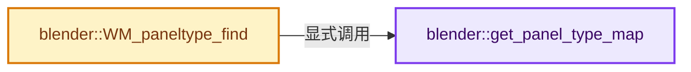

# 实现依赖专题：source/blender/windowmanager/intern/wm_panel_type.cc

[方向导航](README.md) · [符号索引](../%E7%AC%A6%E5%8F%B7%E4%BE%9D%E8%B5%96%E4%B8%8E%E5%AE%9E%E7%8E%B0%E7%B4%A2%E5%BC%95.md)

本专题从正文实际调用进入，集中保存共享实现。函数有稳定锚点，可从调用处直接跳到对应完整函数；递归与互相调用通过回链组织。

## 本文件的实现关系




## 完整成员与函数实现

<a id="f-64e12f781b2bab72"></a>

### `blender::get_panel_type_map`

实现位置：[source/blender/windowmanager/intern/wm_panel_type.cc](../../../../../source/blender/windowmanager/intern/wm_panel_type.cc) · L28—L38。

**教学注释版**

<!-- annotated:fc04eb44a29c78 -->

```cpp
static auto &get_panel_type_map()
{
  struct IDNameGetter {
    StringRef operator()(const PanelType *value) const
    {
      return StringRef(value->idname);
    }
  };
  static CustomIDVectorSet<PanelType *, IDNameGetter> map;
  return map;
}
```

<details>
<summary>核对原始源码：source/blender/windowmanager/intern/wm_panel_type.cc · L28—L38</summary>

<!-- original:fc04eb44a29c78:source/blender/windowmanager/intern/wm_panel_type.cc:28:38 -->

```cpp
static auto &get_panel_type_map()
{
  struct IDNameGetter {
    StringRef operator()(const PanelType *value) const
    {
      return StringRef(value->idname);
    }
  };
  static CustomIDVectorSet<PanelType *, IDNameGetter> map;
  return map;
}
```

</details>

**结果出口**

- `return StringRef(value->idname);`
- `return map;`

**继续追踪实现**

- `StringRef` → [blender::StringRef::StringRef · L555](../01-%E5%9F%BA%E7%A1%80%E5%AE%B9%E5%99%A8%E4%B8%8E%E7%8E%B0%E4%BB%A3CPP/15-StringRef%E5%AD%97%E7%AC%A6%E4%B8%B2%E8%A7%86%E5%9B%BE.md#f-f6aca324a36faa7e)；[blender::StringRef::StringRef · L560](../01-%E5%9F%BA%E7%A1%80%E5%AE%B9%E5%99%A8%E4%B8%8E%E7%8E%B0%E4%BB%A3CPP/15-StringRef%E5%AD%97%E7%AC%A6%E4%B8%B2%E8%A7%86%E5%9B%BE.md#f-ab9714781ca51bac)；[blender::StringRef::StringRef · L565](../01-%E5%9F%BA%E7%A1%80%E5%AE%B9%E5%99%A8%E4%B8%8E%E7%8E%B0%E4%BB%A3CPP/15-StringRef%E5%AD%97%E7%AC%A6%E4%B8%B2%E8%A7%86%E5%9B%BE.md#f-95f0b483bbdd7739)；[blender::StringRef::StringRef · L570](../01-%E5%9F%BA%E7%A1%80%E5%AE%B9%E5%99%A8%E4%B8%8E%E7%8E%B0%E4%BB%A3CPP/15-StringRef%E5%AD%97%E7%AC%A6%E4%B8%B2%E8%A7%86%E5%9B%BE.md#f-808d05699cb33334)；[blender::StringRef::StringRef · L631](../01-%E5%9F%BA%E7%A1%80%E5%AE%B9%E5%99%A8%E4%B8%8E%E7%8E%B0%E4%BB%A3CPP/15-StringRef%E5%AD%97%E7%AC%A6%E4%B8%B2%E8%A7%86%E5%9B%BE.md#f-37788e5f3fa3b736)；[blender::StringRef::StringRef · L641](../01-%E5%9F%BA%E7%A1%80%E5%AE%B9%E5%99%A8%E4%B8%8E%E7%8E%B0%E4%BB%A3CPP/15-StringRef%E5%AD%97%E7%AC%A6%E4%B8%B2%E8%A7%86%E5%9B%BE.md#f-11abd0510fb6b926)；[blender::StringRef::StringRef · L646](../01-%E5%9F%BA%E7%A1%80%E5%AE%B9%E5%99%A8%E4%B8%8E%E7%8E%B0%E4%BB%A3CPP/15-StringRef%E5%AD%97%E7%AC%A6%E4%B8%B2%E8%A7%86%E5%9B%BE.md#f-8437dbd8a582eefd)；[blender::StringRef::StringRef · L651](../01-%E5%9F%BA%E7%A1%80%E5%AE%B9%E5%99%A8%E4%B8%8E%E7%8E%B0%E4%BB%A3CPP/15-StringRef%E5%AD%97%E7%AC%A6%E4%B8%B2%E8%A7%86%E5%9B%BE.md#f-70bcb338de0db978)。同名重载需按实参类型选择。

<a id="f-59e91ce8bd7dd519"></a>

### `blender::WM_paneltype_find`

实现位置：[source/blender/windowmanager/intern/wm_panel_type.cc](../../../../../source/blender/windowmanager/intern/wm_panel_type.cc) · L40—L53。

接口参数：

- `const StringRef idname`
- `bool quiet`

**教学注释版**

<!-- annotated:7280eaab8638c0 -->

```cpp
PanelType *WM_paneltype_find(const StringRef idname, bool quiet)
{
  if (!idname.is_empty()) {
    if (PanelType *const *pt = get_panel_type_map().lookup_key_ptr_as(idname)) {
      return *pt;
    }
  }

  if (!quiet) {
    printf("search for unknown paneltype %s\n", std::string(idname).c_str());
  }

  return nullptr;
}
```

<details>
<summary>核对原始源码：source/blender/windowmanager/intern/wm_panel_type.cc · L40—L53</summary>

<!-- original:7280eaab8638c0:source/blender/windowmanager/intern/wm_panel_type.cc:40:53 -->

```cpp
PanelType *WM_paneltype_find(const StringRef idname, bool quiet)
{
  if (!idname.is_empty()) {
    if (PanelType *const *pt = get_panel_type_map().lookup_key_ptr_as(idname)) {
      return *pt;
    }
  }

  if (!quiet) {
    printf("search for unknown paneltype %s\n", std::string(idname).c_str());
  }

  return nullptr;
}
```

</details>

**结果出口**

- `return *pt;`
- `return nullptr;`

**继续追踪实现**

- `idname.is_empty` → [blender::Bounds<T>::is_empty · L533](../12-%E7%A9%BA%E9%97%B4%E6%95%B0%E6%8D%AE%E7%BB%93%E6%9E%84%E4%B8%8E%E5%87%A0%E4%BD%95%E7%AE%97%E6%B3%95/07-Bounds%E4%B8%8EBVH%E5%AF%B9%E6%AF%94.md#f-55ac376b3d0a0944)；[blender::GVArrayCommon::is_empty · L767](../04-%E8%99%9A%E6%8B%9F%E6%95%B0%E7%BB%84%E4%B8%8E%E7%B4%A2%E5%BC%95%E9%80%89%E6%8B%A9/05-GVArray%E8%BF%90%E8%A1%8C%E6%97%B6%E7%B1%BB%E5%9E%8B.md#f-c1da602ffc5555f9)；[blender::StringRefBase::is_empty · L201](../01-%E5%9F%BA%E7%A1%80%E5%AE%B9%E5%99%A8%E4%B8%8E%E7%8E%B0%E4%BB%A3CPP/15-StringRef%E5%AD%97%E7%AC%A6%E4%B8%B2%E8%A7%86%E5%9B%BE.md#f-9f6c3d2da1cb1796)；[blender::KDTreeNew<T>::is_empty · L498](../12-%E7%A9%BA%E9%97%B4%E6%95%B0%E6%8D%AE%E7%BB%93%E6%9E%84%E4%B8%8E%E5%87%A0%E4%BD%95%E7%AE%97%E6%B3%95/05-K%E8%BF%91%E9%82%BB%E4%B8%8E%E8%8C%83%E5%9B%B4%E6%9F%A5%E8%AF%A2.md#f-67f0ff91cf00b00b)。同名重载需按实参类型选择。
- `get_panel_type_map().lookup_key_ptr_as` → [调用协议](../%E6%A8%A1%E6%9D%BF%E5%AE%8F%E4%B8%8E%E5%8A%A8%E6%80%81%E5%88%86%E6%B4%BE%E5%8D%8F%E8%AE%AE.md)：接收对象类型依赖auto、返回值或模板实例；不按同名猜测目标。调用位置L43。
- `get_panel_type_map` → [blender::get_panel_type_map · L28](%E4%BE%9D%E8%B5%96-wm_panel_type-1b2644.md#f-64e12f781b2bab72)。
- `printf` → [外部契约](https://eel.is/c++draft/)：这个边界按实际表达式及所属类型核对参数、返回值、寿命与失败行为。这里提供接口入口，不声称已解释该第三方版本的内部实现。
- `std::string(idname).c_str` → [外部契约](https://eel.is/c++draft/)：这个边界按实际表达式及所属类型核对参数、返回值、寿命与失败行为。这里提供接口入口，不声称已解释该第三方版本的内部实现。
- `std::string` → [外部契约](https://eel.is/c++draft/)：这个边界按实际表达式及所属类型核对参数、返回值、寿命与失败行为。这里提供接口入口，不声称已解释该第三方版本的内部实现。
