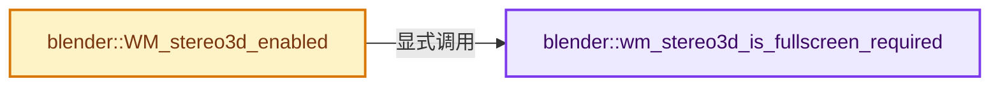
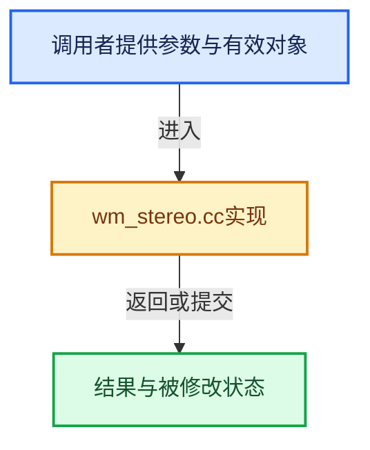

# 实现依赖专题：source/blender/windowmanager/intern/wm_stereo.cc

[方向导航](README.md) · [符号索引](../%E7%AC%A6%E5%8F%B7%E4%BE%9D%E8%B5%96%E4%B8%8E%E5%AE%9E%E7%8E%B0%E7%B4%A2%E5%BC%95.md)

本专题从正文实际调用进入，集中保存共享实现。函数有稳定锚点，可从调用处直接跳到对应完整函数；递归与互相调用通过回链组织。

## 本文件的实现关系






## 完整成员与函数实现

<a id="f-34c85414e336d642"></a>

### `blender::wm_stereo3d_is_fullscreen_required`

实现位置：[source/blender/windowmanager/intern/wm_stereo.cc](../../../../../source/blender/windowmanager/intern/wm_stereo.cc) · L136—L139。

接口参数：

- `eStereoDisplayMode stereo_display`

**教学注释版**

<!-- annotated:7ccef4f7bfbb41 -->

```cpp
static bool wm_stereo3d_is_fullscreen_required(eStereoDisplayMode stereo_display)
{
  return ELEM(stereo_display, S3D_DISPLAY_SIDEBYSIDE, S3D_DISPLAY_TOPBOTTOM);
}
```

<details>
<summary>核对原始源码：source/blender/windowmanager/intern/wm_stereo.cc · L136—L139</summary>

<!-- original:7ccef4f7bfbb41:source/blender/windowmanager/intern/wm_stereo.cc:136:139 -->

```cpp
static bool wm_stereo3d_is_fullscreen_required(eStereoDisplayMode stereo_display)
{
  return ELEM(stereo_display, S3D_DISPLAY_SIDEBYSIDE, S3D_DISPLAY_TOPBOTTOM);
}
```

</details>

**结果出口**

- `return ELEM(stereo_display, S3D_DISPLAY_SIDEBYSIDE, S3D_DISPLAY_TOPBOTTOM);`

**继续追踪实现**

- `ELEM` → [ELEM · L88](%E4%BE%9D%E8%B5%96-GHOST_utildefines-34b996.md#m-d28724a15928)；[ELEM · L135](../01-%E5%9F%BA%E7%A1%80%E5%AE%B9%E5%99%A8%E4%B8%8E%E7%8E%B0%E4%BB%A3CPP/%E4%BE%9D%E8%B5%96-BLI_utildefines-293a0a.md#m-d6572de7cae0)。宏定义由构建条件选择。

<a id="f-aef6205229e3642e"></a>

### `blender::WM_stereo3d_enabled`

实现位置：[source/blender/windowmanager/intern/wm_stereo.cc](../../../../../source/blender/windowmanager/intern/wm_stereo.cc) · L141—L164。

接口参数：

- `wmWindow *win`
- `bool skip_stereo3d_check`

**教学注释版**

<!-- annotated:b4e0e3b350fbbd -->

```cpp
bool WM_stereo3d_enabled(wmWindow *win, bool skip_stereo3d_check)
{
  const bScreen *screen = WM_window_get_active_screen(win);
  const Scene *scene = WM_window_get_active_scene(win);
  const GHOST_IWindow *ghost_window = static_cast<GHOST_IWindow *>(win->runtime->ghostwin);

  /* Some 3d methods change the window arrangement, thus they shouldn't
   * toggle on/off just because there is no 3d elements being drawn. */
  if (wm_stereo3d_is_fullscreen_required(eStereoDisplayMode(win->stereo3d_format->display_mode))) {
    return ghost_window->getState() == GHOST_kWindowStateFullScreen;
  }

  if ((skip_stereo3d_check == false) && (ED_screen_stereo3d_required(screen, scene) == false)) {
    return false;
  }

  /* Some 3d methods change the window arrangement, thus they shouldn't
   * toggle on/off just because there is no 3d elements being drawn. */
  if (wm_stereo3d_is_fullscreen_required(eStereoDisplayMode(win->stereo3d_format->display_mode))) {
    return ghost_window->getState() == GHOST_kWindowStateFullScreen;
  }

  return true;
}
```

<details>
<summary>核对原始源码：source/blender/windowmanager/intern/wm_stereo.cc · L141—L164</summary>

<!-- original:b4e0e3b350fbbd:source/blender/windowmanager/intern/wm_stereo.cc:141:164 -->

```cpp
bool WM_stereo3d_enabled(wmWindow *win, bool skip_stereo3d_check)
{
  const bScreen *screen = WM_window_get_active_screen(win);
  const Scene *scene = WM_window_get_active_scene(win);
  const GHOST_IWindow *ghost_window = static_cast<GHOST_IWindow *>(win->runtime->ghostwin);

  /* Some 3d methods change the window arrangement, thus they shouldn't
   * toggle on/off just because there is no 3d elements being drawn. */
  if (wm_stereo3d_is_fullscreen_required(eStereoDisplayMode(win->stereo3d_format->display_mode))) {
    return ghost_window->getState() == GHOST_kWindowStateFullScreen;
  }

  if ((skip_stereo3d_check == false) && (ED_screen_stereo3d_required(screen, scene) == false)) {
    return false;
  }

  /* Some 3d methods change the window arrangement, thus they shouldn't
   * toggle on/off just because there is no 3d elements being drawn. */
  if (wm_stereo3d_is_fullscreen_required(eStereoDisplayMode(win->stereo3d_format->display_mode))) {
    return ghost_window->getState() == GHOST_kWindowStateFullScreen;
  }

  return true;
}
```

</details>

**结果出口**

- `return ghost_window->getState() == GHOST_kWindowStateFullScreen;`
- `return false;`
- `return true;`

**继续追踪实现**

- `WM_window_get_active_screen` → [blender::WM_window_get_active_screen · L3442](%E4%BE%9D%E8%B5%96-wm_window-b2a158.md#f-54952b6e38dc8344)。
- `WM_window_get_active_scene` → [blender::WM_window_get_active_scene · L3324](%E4%BE%9D%E8%B5%96-wm_window-b2a158.md#f-b60c8943a5c782b7)。
- `wm_stereo3d_is_fullscreen_required` → [blender::wm_stereo3d_is_fullscreen_required · L136](%E4%BE%9D%E8%B5%96-wm_stereo-dc38b6.md#f-34c85414e336d642)。
- `eStereoDisplayMode` → [blender::eStereoDisplayMode](%E4%BE%9D%E8%B5%96-DNA_scene_enums-9be265.md#t-d383d800204e)。
- `ghost_window->getState` → [调用协议](../%E6%A8%A1%E6%9D%BF%E5%AE%8F%E4%B8%8E%E5%8A%A8%E6%80%81%E5%88%86%E6%B4%BE%E5%8D%8F%E8%AE%AE.md)：由接收对象具体类型或运行时策略提供实现。调用位置L150。
- `ED_screen_stereo3d_required` → [blender::ED_screen_stereo3d_required · L2071](%E4%BE%9D%E8%B5%96-screen_edit-a5f8d0.md#f-1b641ecccdf80faf)。
