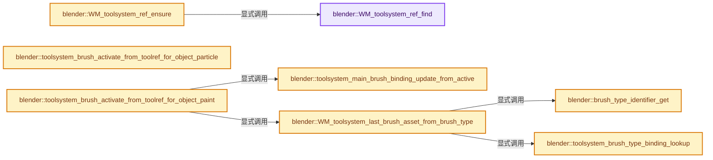

# 实现依赖专题：source/blender/windowmanager/intern/wm_toolsystem.cc

[方向导航](README.md) · [符号索引](../%E7%AC%A6%E5%8F%B7%E4%BE%9D%E8%B5%96%E4%B8%8E%E5%AE%9E%E7%8E%B0%E7%B4%A2%E5%BC%95.md)

本专题从正文实际调用进入，集中保存共享实现。函数有稳定锚点，可从调用处直接跳到对应完整函数；递归与互相调用通过回链组织。

## 本文件的实现关系




## 完整成员与函数实现

<a id="f-cd40a93eb068819e"></a>

### `blender::WM_toolsystem_ref_find`

实现位置：[source/blender/windowmanager/intern/wm_toolsystem.cc](../../../../../source/blender/windowmanager/intern/wm_toolsystem.cc) · L107—L116。

接口参数：

- `WorkSpace *workspace`
- `const bToolKey *tkey`

**教学注释版**

<!-- annotated:a5fb564f4d79f2 -->

```cpp
bToolRef *WM_toolsystem_ref_find(WorkSpace *workspace, const bToolKey *tkey)
{
  BLI_assert((1 << tkey->space_type) & WM_TOOLSYSTEM_SPACE_MASK);
  for (bToolRef &tref : workspace->tools) {
    if ((tref.space_type == tkey->space_type) && (tref.mode == tkey->mode)) {
      return &tref;
    }
  }
  return nullptr;
}
```

<details>
<summary>核对原始源码：source/blender/windowmanager/intern/wm_toolsystem.cc · L107—L116</summary>

<!-- original:a5fb564f4d79f2:source/blender/windowmanager/intern/wm_toolsystem.cc:107:116 -->

```cpp
bToolRef *WM_toolsystem_ref_find(WorkSpace *workspace, const bToolKey *tkey)
{
  BLI_assert((1 << tkey->space_type) & WM_TOOLSYSTEM_SPACE_MASK);
  for (bToolRef &tref : workspace->tools) {
    if ((tref.space_type == tkey->space_type) && (tref.mode == tkey->mode)) {
      return &tref;
    }
  }
  return nullptr;
}
```

</details>

**结果出口**

- `return &tref;`
- `return nullptr;`

**继续追踪实现**

- `BLI_assert` → [BLI_assert · L48](../01-%E5%9F%BA%E7%A1%80%E5%AE%B9%E5%99%A8%E4%B8%8E%E7%8E%B0%E4%BB%A3CPP/%E4%BE%9D%E8%B5%96-BLI_assert-cc98e8.md#m-57a88495704d)；[BLI_assert · L63](../01-%E5%9F%BA%E7%A1%80%E5%AE%B9%E5%99%A8%E4%B8%8E%E7%8E%B0%E4%BB%A3CPP/%E4%BE%9D%E8%B5%96-BLI_assert-cc98e8.md#m-d07050020cb5)。宏定义由构建条件选择。

<a id="f-14dd44a4f5260d72"></a>

### `blender::WM_toolsystem_ref_ensure`

实现位置：[source/blender/windowmanager/intern/wm_toolsystem.cc](../../../../../source/blender/windowmanager/intern/wm_toolsystem.cc) · L124—L137。

接口参数：

- `WorkSpace *workspace`
- `const bToolKey *tkey`
- `bToolRef **r_tref`

**教学注释版**

<!-- annotated:e0a6bcbc874678 -->

```cpp
bool WM_toolsystem_ref_ensure(WorkSpace *workspace, const bToolKey *tkey, bToolRef **r_tref)
{
  bToolRef *tref = WM_toolsystem_ref_find(workspace, tkey);
  if (tref) {
    *r_tref = tref;
    return false;
  }
  tref = MEM_new<bToolRef>(__func__);
  BLI_addhead(&workspace->tools, tref);
  tref->space_type = tkey->space_type;
  tref->mode = tkey->mode;
  *r_tref = tref;
  return true;
}
```

<details>
<summary>核对原始源码：source/blender/windowmanager/intern/wm_toolsystem.cc · L124—L137</summary>

<!-- original:e0a6bcbc874678:source/blender/windowmanager/intern/wm_toolsystem.cc:124:137 -->

```cpp
bool WM_toolsystem_ref_ensure(WorkSpace *workspace, const bToolKey *tkey, bToolRef **r_tref)
{
  bToolRef *tref = WM_toolsystem_ref_find(workspace, tkey);
  if (tref) {
    *r_tref = tref;
    return false;
  }
  tref = MEM_new<bToolRef>(__func__);
  BLI_addhead(&workspace->tools, tref);
  tref->space_type = tkey->space_type;
  tref->mode = tkey->mode;
  *r_tref = tref;
  return true;
}
```

</details>

**沿实际写入检查状态**

- `tref = MEM_new<bToolRef>(__func__);`
- `tref->space_type = tkey->space_type;`
- `tref->mode = tkey->mode;`

**结果出口**

- `return false;`
- `return true;`

**继续追踪实现**

- `WM_toolsystem_ref_find` → [blender::WM_toolsystem_ref_find · L107](%E4%BE%9D%E8%B5%96-wm_toolsystem-d1c73e.md#f-cd40a93eb068819e)。
- `MEM_new<bToolRef>` → [MEM_new · L351](../03-%E5%86%85%E5%AD%98%E5%88%86%E9%85%8D%E4%B8%8E%E8%BF%90%E8%A1%8C%E6%97%B6%E7%B1%BB%E5%9E%8B/%E4%BE%9D%E8%B5%96-MEM_guardedalloc-b54eca.md#f-115f9b6784f89912)。
- `BLI_addhead` → [blender::BLI_addhead · L98](../01-%E5%9F%BA%E7%A1%80%E5%AE%B9%E5%99%A8%E4%B8%8E%E7%8E%B0%E4%BB%A3CPP/%E4%BE%9D%E8%B5%96-listbase-2816d9.md#f-fed3ad483fcdfeb9)。

<a id="f-1759a51e16ea61bf"></a>

### `blender::brush_type_identifier_get`

实现位置：[source/blender/windowmanager/intern/wm_toolsystem.cc](../../../../../source/blender/windowmanager/intern/wm_toolsystem.cc) · L216—L224。

接口参数：

- `const int brush_type`
- `const PaintMode paint_mode`

**教学注释版**

<!-- annotated:593cc25b16b57b -->

```cpp
static const char *brush_type_identifier_get(const int brush_type, const PaintMode paint_mode)
{
  const EnumPropertyItem *type_enum = BKE_paint_get_tool_enum_from_paintmode(paint_mode);
  const int item_idx = RNA_enum_from_value(type_enum, brush_type);
  if (item_idx == -1) {
    return "";
  }
  return type_enum[item_idx].identifier;
}
```

<details>
<summary>核对原始源码：source/blender/windowmanager/intern/wm_toolsystem.cc · L216—L224</summary>

<!-- original:593cc25b16b57b:source/blender/windowmanager/intern/wm_toolsystem.cc:216:224 -->

```cpp
static const char *brush_type_identifier_get(const int brush_type, const PaintMode paint_mode)
{
  const EnumPropertyItem *type_enum = BKE_paint_get_tool_enum_from_paintmode(paint_mode);
  const int item_idx = RNA_enum_from_value(type_enum, brush_type);
  if (item_idx == -1) {
    return "";
  }
  return type_enum[item_idx].identifier;
}
```

</details>

**结果出口**

- `return "";`
- `return type_enum[item_idx].identifier;`

**继续追踪实现**

- `BKE_paint_get_tool_enum_from_paintmode` → [blender::BKE_paint_get_tool_enum_from_paintmode · L442](%E4%BE%9D%E8%B5%96-paint-dbafe0.md#f-a1e67550e30f3205)。
- `RNA_enum_from_value` → [blender::RNA_enum_from_value · L2141](%E4%BE%9D%E8%B5%96-rna_access-706bea.md#f-7a65b9442cd3b3e0)。

<a id="f-b46011707b6db718"></a>

### `blender::toolsystem_brush_type_binding_lookup`

实现位置：[source/blender/windowmanager/intern/wm_toolsystem.cc](../../../../../source/blender/windowmanager/intern/wm_toolsystem.cc) · L243—L250。

接口参数：

- `const Paint *paint`
- `const char *brush_type_name`

**教学注释版**

<!-- annotated:015fbd4278e2bf -->

```cpp
static NamedBrushAssetReference *toolsystem_brush_type_binding_lookup(const Paint *paint,
                                                                      const char *brush_type_name)
{
  return static_cast<NamedBrushAssetReference *>(
      BLI_findstring_ptr(&paint->tool_brush_bindings.active_brush_per_brush_type,
                         brush_type_name,
                         offsetof(NamedBrushAssetReference, name)));
}
```

<details>
<summary>核对原始源码：source/blender/windowmanager/intern/wm_toolsystem.cc · L243—L250</summary>

<!-- original:015fbd4278e2bf:source/blender/windowmanager/intern/wm_toolsystem.cc:243:250 -->

```cpp
static NamedBrushAssetReference *toolsystem_brush_type_binding_lookup(const Paint *paint,
                                                                      const char *brush_type_name)
{
  return static_cast<NamedBrushAssetReference *>(
      BLI_findstring_ptr(&paint->tool_brush_bindings.active_brush_per_brush_type,
                         brush_type_name,
                         offsetof(NamedBrushAssetReference, name)));
}
```

</details>

**结果出口**

- `return static_cast<NamedBrushAssetReference *>(`

**继续追踪实现**

- `BLI_findstring_ptr` → [blender::BLI_findstring_ptr · L658](../01-%E5%9F%BA%E7%A1%80%E5%AE%B9%E5%99%A8%E4%B8%8E%E7%8E%B0%E4%BB%A3CPP/%E4%BE%9D%E8%B5%96-listbase-2816d9.md#f-0d8dced905b325f3)。

<a id="f-e2032a3daccac77a"></a>

### `blender::toolsystem_main_brush_binding_update_from_active`

实现位置：[source/blender/windowmanager/intern/wm_toolsystem.cc](../../../../../source/blender/windowmanager/intern/wm_toolsystem.cc) · L255—L268。

接口参数：

- `Paint *paint`

**教学注释版**

<!-- annotated:c7992175985c60 -->

```cpp
static void toolsystem_main_brush_binding_update_from_active(Paint *paint)
{
  MEM_delete(paint->tool_brush_bindings.main_brush_asset_reference);
  paint->tool_brush_bindings.main_brush_asset_reference = nullptr;

  if (paint->brush != nullptr) {
    if (std::optional<AssetWeakReference> brush_asset_reference =
            bke::asset_edit_weak_reference_from_id(paint->brush->id))
    {
      paint->tool_brush_bindings.main_brush_asset_reference = MEM_new<AssetWeakReference>(
          __func__, *brush_asset_reference);
    }
  }
}
```

<details>
<summary>核对原始源码：source/blender/windowmanager/intern/wm_toolsystem.cc · L255—L268</summary>

<!-- original:c7992175985c60:source/blender/windowmanager/intern/wm_toolsystem.cc:255:268 -->

```cpp
static void toolsystem_main_brush_binding_update_from_active(Paint *paint)
{
  MEM_delete(paint->tool_brush_bindings.main_brush_asset_reference);
  paint->tool_brush_bindings.main_brush_asset_reference = nullptr;

  if (paint->brush != nullptr) {
    if (std::optional<AssetWeakReference> brush_asset_reference =
            bke::asset_edit_weak_reference_from_id(paint->brush->id))
    {
      paint->tool_brush_bindings.main_brush_asset_reference = MEM_new<AssetWeakReference>(
          __func__, *brush_asset_reference);
    }
  }
}
```

</details>

**沿实际写入检查状态**

- `paint->tool_brush_bindings.main_brush_asset_reference = nullptr;`
- `paint->tool_brush_bindings.main_brush_asset_reference = MEM_new<AssetWeakReference>(`

**继续追踪实现**

- `MEM_delete` → [MEM_delete · L400](../03-%E5%86%85%E5%AD%98%E5%88%86%E9%85%8D%E4%B8%8E%E8%BF%90%E8%A1%8C%E6%97%B6%E7%B1%BB%E5%9E%8B/%E4%BE%9D%E8%B5%96-MEM_guardedalloc-b54eca.md#f-9049ffdd1682887c)。
- `bke::asset_edit_weak_reference_from_id` → [blender::bke::asset_edit_weak_reference_from_id · L523](%E4%BE%9D%E8%B5%96-asset_edit-4fa3ad.md#f-4f7bcbac6d164056)。
- `MEM_new<AssetWeakReference>` → [MEM_new · L351](../03-%E5%86%85%E5%AD%98%E5%88%86%E9%85%8D%E4%B8%8E%E8%BF%90%E8%A1%8C%E6%97%B6%E7%B1%BB%E5%9E%8B/%E4%BE%9D%E8%B5%96-MEM_guardedalloc-b54eca.md#f-115f9b6784f89912)。

<a id="f-31e9d19c8fdb2184"></a>

### `blender::toolsystem_brush_activate_from_toolref_for_object_particle`

实现位置：[source/blender/windowmanager/intern/wm_toolsystem.cc](../../../../../source/blender/windowmanager/intern/wm_toolsystem.cc) · L347—L371。

接口参数：

- `const Main *bmain`
- `const WorkSpace *workspace`
- `const bToolRef *tref`

**教学注释版**

<!-- annotated:ab12a520420080 -->

```cpp
static void toolsystem_brush_activate_from_toolref_for_object_particle(const Main *bmain,
                                                                       const WorkSpace *workspace,
                                                                       const bToolRef *tref)
{
  const bToolRef_Runtime *tref_rt = tref->runtime;

  if (!tref_rt->data_block[0]) {
    return;
  }

  const EnumPropertyItem *items = rna_enum_particle_edit_hair_brush_items;
  const int i = RNA_enum_from_identifier(items, tref_rt->data_block);
  if (i == -1) {
    return;
  }

  const wmWindowManager *wm = bmain->wm.first();
  for (wmWindow &win : wm->windows) {
    if (workspace == WM_window_get_active_workspace(&win)) {
      Scene *scene = WM_window_get_active_scene(&win);
      ToolSettings *ts = scene->toolsettings;
      ts->particle.brushtype = items[i].value;
    }
  }
}
```

<details>
<summary>核对原始源码：source/blender/windowmanager/intern/wm_toolsystem.cc · L347—L371</summary>

<!-- original:ab12a520420080:source/blender/windowmanager/intern/wm_toolsystem.cc:347:371 -->

```cpp
static void toolsystem_brush_activate_from_toolref_for_object_particle(const Main *bmain,
                                                                       const WorkSpace *workspace,
                                                                       const bToolRef *tref)
{
  const bToolRef_Runtime *tref_rt = tref->runtime;

  if (!tref_rt->data_block[0]) {
    return;
  }

  const EnumPropertyItem *items = rna_enum_particle_edit_hair_brush_items;
  const int i = RNA_enum_from_identifier(items, tref_rt->data_block);
  if (i == -1) {
    return;
  }

  const wmWindowManager *wm = bmain->wm.first();
  for (wmWindow &win : wm->windows) {
    if (workspace == WM_window_get_active_workspace(&win)) {
      Scene *scene = WM_window_get_active_scene(&win);
      ToolSettings *ts = scene->toolsettings;
      ts->particle.brushtype = items[i].value;
    }
  }
}
```

</details>

**沿实际写入检查状态**

- `ts->particle.brushtype = items[i].value;`

**继续追踪实现**

- `RNA_enum_from_identifier` → [blender::RNA_enum_from_identifier · L2107](%E4%BE%9D%E8%B5%96-rna_access-706bea.md#f-255f4b18f3e2c91b)。
- `bmain->wm.first` → [调用协议](../%E6%A8%A1%E6%9D%BF%E5%AE%8F%E4%B8%8E%E5%8A%A8%E6%80%81%E5%88%86%E6%B4%BE%E5%8D%8F%E8%AE%AE.md)：接收对象类型依赖auto、返回值或模板实例；不按同名猜测目标。调用位置L363。
- `WM_window_get_active_workspace` → [blender::WM_window_get_active_workspace · L3407](%E4%BE%9D%E8%B5%96-wm_window-b2a158.md#f-31f068348776fc20)。
- `WM_window_get_active_scene` → [blender::WM_window_get_active_scene · L3324](%E4%BE%9D%E8%B5%96-wm_window-b2a158.md#f-b60c8943a5c782b7)。

<a id="f-2cdb9d012f6e21d8"></a>

### `blender::WM_toolsystem_last_brush_asset_from_brush_type`

实现位置：[source/blender/windowmanager/intern/wm_toolsystem.cc](../../../../../source/blender/windowmanager/intern/wm_toolsystem.cc) · L373—L395。

接口参数：

- `Scene *scene`
- `const int brush_type`
- `const PaintMode paint_mode`

**教学注释版**

<!-- annotated:8220830392b041 -->

```cpp
std::optional<AssetWeakReference> WM_toolsystem_last_brush_asset_from_brush_type(
    Scene *scene, const int brush_type, const PaintMode paint_mode)
{
  Paint *paint = BKE_paint_get_active_from_paintmode(scene, paint_mode);
  if (!paint) {
    return {};
  }
  if (brush_type != -1) {
    const char *brush_type_name = brush_type_identifier_get(brush_type, paint_mode);
    const NamedBrushAssetReference *brush_ref = toolsystem_brush_type_binding_lookup(
        paint, brush_type_name);

    if (brush_ref && brush_ref->brush_asset_reference) {
      return *brush_ref->brush_asset_reference;
    }
    return BKE_paint_brush_type_default_reference(paint->runtime->asset_category, brush_type);
  }

  if (paint->tool_brush_bindings.main_brush_asset_reference) {
    return *paint->tool_brush_bindings.main_brush_asset_reference;
  }
  return BKE_paint_brush_type_default_reference(paint->runtime->asset_category, std::nullopt);
}
```

<details>
<summary>核对原始源码：source/blender/windowmanager/intern/wm_toolsystem.cc · L373—L395</summary>

<!-- original:8220830392b041:source/blender/windowmanager/intern/wm_toolsystem.cc:373:395 -->

```cpp
std::optional<AssetWeakReference> WM_toolsystem_last_brush_asset_from_brush_type(
    Scene *scene, const int brush_type, const PaintMode paint_mode)
{
  Paint *paint = BKE_paint_get_active_from_paintmode(scene, paint_mode);
  if (!paint) {
    return {};
  }
  if (brush_type != -1) {
    const char *brush_type_name = brush_type_identifier_get(brush_type, paint_mode);
    const NamedBrushAssetReference *brush_ref = toolsystem_brush_type_binding_lookup(
        paint, brush_type_name);

    if (brush_ref && brush_ref->brush_asset_reference) {
      return *brush_ref->brush_asset_reference;
    }
    return BKE_paint_brush_type_default_reference(paint->runtime->asset_category, brush_type);
  }

  if (paint->tool_brush_bindings.main_brush_asset_reference) {
    return *paint->tool_brush_bindings.main_brush_asset_reference;
  }
  return BKE_paint_brush_type_default_reference(paint->runtime->asset_category, std::nullopt);
}
```

</details>

**结果出口**

- `return {};`
- `return *brush_ref->brush_asset_reference;`
- `return BKE_paint_brush_type_default_reference(paint->runtime->asset_category, brush_type);`
- `return *paint->tool_brush_bindings.main_brush_asset_reference;`
- `return BKE_paint_brush_type_default_reference(paint->runtime->asset_category, std::nullopt);`

**继续追踪实现**

- `BKE_paint_get_active_from_paintmode` → [blender::BKE_paint_get_active_from_paintmode · L407](%E4%BE%9D%E8%B5%96-paint-dbafe0.md#f-b3ec1acb5886ccd3)。
- `brush_type_identifier_get` → [blender::brush_type_identifier_get · L216](%E4%BE%9D%E8%B5%96-wm_toolsystem-d1c73e.md#f-1759a51e16ea61bf)。
- `toolsystem_brush_type_binding_lookup` → [blender::toolsystem_brush_type_binding_lookup · L243](%E4%BE%9D%E8%B5%96-wm_toolsystem-d1c73e.md#f-b46011707b6db718)。
- `BKE_paint_brush_type_default_reference` → [blender::BKE_paint_brush_type_default_reference · L1039](%E4%BE%9D%E8%B5%96-paint-dbafe0.md#f-5d53ee992f449c92)。

<a id="f-59f385dcc00869a3"></a>

### `blender::toolsystem_brush_activate_from_toolref_for_object_paint`

实现位置：[source/blender/windowmanager/intern/wm_toolsystem.cc](../../../../../source/blender/windowmanager/intern/wm_toolsystem.cc) · L397—L427。

接口参数：

- `Main *bmain`
- `const WorkSpace *workspace`
- `const bToolRef *tref`

**教学注释版**

<!-- annotated:541a92678c971b -->

```cpp
static void toolsystem_brush_activate_from_toolref_for_object_paint(Main *bmain,
                                                                    const WorkSpace *workspace,
                                                                    const bToolRef *tref)
{
  bToolRef_Runtime *tref_rt = tref->runtime;

  const PaintMode paint_mode = BKE_paintmode_get_from_tool(tref);
  BLI_assert(paint_mode != PaintMode::Invalid);

  wmWindowManager *wm = bmain->wm.first();
  for (wmWindow &win : wm->windows) {
    if (workspace != WM_window_get_active_workspace(&win)) {
      continue;
    }
    Scene *scene = WM_window_get_active_scene(&win);
    BKE_paint_ensure_from_paintmode(scene, paint_mode);
    Paint *paint = BKE_paint_get_active_from_paintmode(scene, paint_mode);

    /* Attempt to re-activate a brush remembered for this brush type, as stored in a brush
     * binding. */
    if (std::optional<AssetWeakReference> brush_asset_reference =
            WM_toolsystem_last_brush_asset_from_brush_type(scene, tref_rt->brush_type, paint_mode))
    {
      BKE_paint_brush_set(bmain, paint, *brush_asset_reference);
      if (tref_rt->brush_type == -1) {
        /* Update the bindings so the main brush reference matches the currently active brush. */
        toolsystem_main_brush_binding_update_from_active(paint);
      }
    }
  }
}
```

<details>
<summary>核对原始源码：source/blender/windowmanager/intern/wm_toolsystem.cc · L397—L427</summary>

<!-- original:541a92678c971b:source/blender/windowmanager/intern/wm_toolsystem.cc:397:427 -->

```cpp
static void toolsystem_brush_activate_from_toolref_for_object_paint(Main *bmain,
                                                                    const WorkSpace *workspace,
                                                                    const bToolRef *tref)
{
  bToolRef_Runtime *tref_rt = tref->runtime;

  const PaintMode paint_mode = BKE_paintmode_get_from_tool(tref);
  BLI_assert(paint_mode != PaintMode::Invalid);

  wmWindowManager *wm = bmain->wm.first();
  for (wmWindow &win : wm->windows) {
    if (workspace != WM_window_get_active_workspace(&win)) {
      continue;
    }
    Scene *scene = WM_window_get_active_scene(&win);
    BKE_paint_ensure_from_paintmode(scene, paint_mode);
    Paint *paint = BKE_paint_get_active_from_paintmode(scene, paint_mode);

    /* Attempt to re-activate a brush remembered for this brush type, as stored in a brush
     * binding. */
    if (std::optional<AssetWeakReference> brush_asset_reference =
            WM_toolsystem_last_brush_asset_from_brush_type(scene, tref_rt->brush_type, paint_mode))
    {
      BKE_paint_brush_set(bmain, paint, *brush_asset_reference);
      if (tref_rt->brush_type == -1) {
        /* Update the bindings so the main brush reference matches the currently active brush. */
        toolsystem_main_brush_binding_update_from_active(paint);
      }
    }
  }
}
```

</details>

**继续追踪实现**

- `BKE_paintmode_get_from_tool` → [blender::BKE_paintmode_get_from_tool · L596](%E4%BE%9D%E8%B5%96-paint-dbafe0.md#f-0bd9d6b02b928487)。
- `BLI_assert` → [BLI_assert · L48](../01-%E5%9F%BA%E7%A1%80%E5%AE%B9%E5%99%A8%E4%B8%8E%E7%8E%B0%E4%BB%A3CPP/%E4%BE%9D%E8%B5%96-BLI_assert-cc98e8.md#m-57a88495704d)；[BLI_assert · L63](../01-%E5%9F%BA%E7%A1%80%E5%AE%B9%E5%99%A8%E4%B8%8E%E7%8E%B0%E4%BB%A3CPP/%E4%BE%9D%E8%B5%96-BLI_assert-cc98e8.md#m-d07050020cb5)。宏定义由构建条件选择。
- `bmain->wm.first` → [调用协议](../%E6%A8%A1%E6%9D%BF%E5%AE%8F%E4%B8%8E%E5%8A%A8%E6%80%81%E5%88%86%E6%B4%BE%E5%8D%8F%E8%AE%AE.md)：接收对象类型依赖auto、返回值或模板实例；不按同名猜测目标。调用位置L406。
- `WM_window_get_active_workspace` → [blender::WM_window_get_active_workspace · L3407](%E4%BE%9D%E8%B5%96-wm_window-b2a158.md#f-31f068348776fc20)。
- `WM_window_get_active_scene` → [blender::WM_window_get_active_scene · L3324](%E4%BE%9D%E8%B5%96-wm_window-b2a158.md#f-b60c8943a5c782b7)。
- `BKE_paint_ensure_from_paintmode` → [blender::BKE_paint_ensure_from_paintmode · L359](%E4%BE%9D%E8%B5%96-paint-dbafe0.md#f-fb8b2888278a57a4)。
- `BKE_paint_get_active_from_paintmode` → [blender::BKE_paint_get_active_from_paintmode · L407](%E4%BE%9D%E8%B5%96-paint-dbafe0.md#f-b3ec1acb5886ccd3)。
- `WM_toolsystem_last_brush_asset_from_brush_type` → [blender::WM_toolsystem_last_brush_asset_from_brush_type · L373](%E4%BE%9D%E8%B5%96-wm_toolsystem-d1c73e.md#f-2cdb9d012f6e21d8)。
- `BKE_paint_brush_set` → [blender::BKE_paint_brush_set · L699](%E4%BE%9D%E8%B5%96-paint-dbafe0.md#f-8354d15882d47a62)；[blender::BKE_paint_brush_set · L734](%E4%BE%9D%E8%B5%96-paint-dbafe0.md#f-f181244e90ff4d30)。同名重载需按实参类型选择。
- `toolsystem_main_brush_binding_update_from_active` → [blender::toolsystem_main_brush_binding_update_from_active · L255](%E4%BE%9D%E8%B5%96-wm_toolsystem-d1c73e.md#f-e2032a3daccac77a)。

<a id="f-dacdc7ade24147c7"></a>

### `blender::toolsystem_brush_activate_from_toolref`

实现位置：[source/blender/windowmanager/intern/wm_toolsystem.cc](../../../../../source/blender/windowmanager/intern/wm_toolsystem.cc) · L432—L451。

接口参数：

- `Main *bmain`
- `const WorkSpace *workspace`
- `const bToolRef *tref`

**教学注释版**

<!-- annotated:eaf1097fae6d2c -->

```cpp
static void toolsystem_brush_activate_from_toolref(Main *bmain,
                                                   const WorkSpace *workspace,
                                                   const bToolRef *tref)
{
  BLI_assert(tref->runtime->flag & TOOLREF_FLAG_USE_BRUSHES);

  if (tref->space_type == SPACE_VIEW3D) {
    if (tref->mode == CTX_MODE_PARTICLE) {
      toolsystem_brush_activate_from_toolref_for_object_particle(bmain, workspace, tref);
    }
    else {
      toolsystem_brush_activate_from_toolref_for_object_paint(bmain, workspace, tref);
    }
  }
  else if (tref->space_type == SPACE_IMAGE) {
    if (tref->mode == SI_MODE_PAINT) {
      toolsystem_brush_activate_from_toolref_for_object_paint(bmain, workspace, tref);
    }
  }
}
```

<details>
<summary>核对原始源码：source/blender/windowmanager/intern/wm_toolsystem.cc · L432—L451</summary>

<!-- original:eaf1097fae6d2c:source/blender/windowmanager/intern/wm_toolsystem.cc:432:451 -->

```cpp
static void toolsystem_brush_activate_from_toolref(Main *bmain,
                                                   const WorkSpace *workspace,
                                                   const bToolRef *tref)
{
  BLI_assert(tref->runtime->flag & TOOLREF_FLAG_USE_BRUSHES);

  if (tref->space_type == SPACE_VIEW3D) {
    if (tref->mode == CTX_MODE_PARTICLE) {
      toolsystem_brush_activate_from_toolref_for_object_particle(bmain, workspace, tref);
    }
    else {
      toolsystem_brush_activate_from_toolref_for_object_paint(bmain, workspace, tref);
    }
  }
  else if (tref->space_type == SPACE_IMAGE) {
    if (tref->mode == SI_MODE_PAINT) {
      toolsystem_brush_activate_from_toolref_for_object_paint(bmain, workspace, tref);
    }
  }
}
```

</details>

**继续追踪实现**

- `BLI_assert` → [BLI_assert · L48](../01-%E5%9F%BA%E7%A1%80%E5%AE%B9%E5%99%A8%E4%B8%8E%E7%8E%B0%E4%BB%A3CPP/%E4%BE%9D%E8%B5%96-BLI_assert-cc98e8.md#m-57a88495704d)；[BLI_assert · L63](../01-%E5%9F%BA%E7%A1%80%E5%AE%B9%E5%99%A8%E4%B8%8E%E7%8E%B0%E4%BB%A3CPP/%E4%BE%9D%E8%B5%96-BLI_assert-cc98e8.md#m-d07050020cb5)。宏定义由构建条件选择。
- `toolsystem_brush_activate_from_toolref_for_object_particle` → [blender::toolsystem_brush_activate_from_toolref_for_object_particle · L347](%E4%BE%9D%E8%B5%96-wm_toolsystem-d1c73e.md#f-31e9d19c8fdb2184)。
- `toolsystem_brush_activate_from_toolref_for_object_paint` → [blender::toolsystem_brush_activate_from_toolref_for_object_paint · L397](%E4%BE%9D%E8%B5%96-wm_toolsystem-d1c73e.md#f-59f385dcc00869a3)。

<a id="f-7b3d402e73671538"></a>

### `blender::toolsystem_brush_sync_for_texture_paint`

实现位置：[source/blender/windowmanager/intern/wm_toolsystem.cc](../../../../../source/blender/windowmanager/intern/wm_toolsystem.cc) · L458—L484。

接口参数：

- `Main *bmain`
- `WorkSpace *workspace`
- `bToolRef *tref`

**教学注释版**

<!-- annotated:948342ac5af89a -->

```cpp
static void toolsystem_brush_sync_for_texture_paint(Main *bmain,
                                                    WorkSpace *workspace,
                                                    bToolRef *tref)
{
  if (tref->space_type == SPACE_VIEW3D) {
    if (tref->mode == CTX_MODE_PAINT_TEXTURE) {
      bToolKey tkey{};
      tkey.space_type = SPACE_IMAGE;
      tkey.mode = SI_MODE_PAINT;
      bToolRef *tref_other = WM_toolsystem_ref_find(workspace, &tkey);
      if (tref_other) {
        toolsystem_ref_set_by_id_pending(bmain, tref_other, tref->idname);
      }
    }
  }
  else if (tref->space_type == SPACE_IMAGE) {
    if (tref->mode == SI_MODE_PAINT) {
      bToolKey tkey{};
      tkey.space_type = SPACE_VIEW3D;
      tkey.mode = CTX_MODE_PAINT_TEXTURE;
      bToolRef *tref_other = WM_toolsystem_ref_find(workspace, &tkey);
      if (tref_other) {
        toolsystem_ref_set_by_id_pending(bmain, tref_other, tref->idname);
      }
    }
  }
}
```

<details>
<summary>核对原始源码：source/blender/windowmanager/intern/wm_toolsystem.cc · L458—L484</summary>

<!-- original:948342ac5af89a:source/blender/windowmanager/intern/wm_toolsystem.cc:458:484 -->

```cpp
static void toolsystem_brush_sync_for_texture_paint(Main *bmain,
                                                    WorkSpace *workspace,
                                                    bToolRef *tref)
{
  if (tref->space_type == SPACE_VIEW3D) {
    if (tref->mode == CTX_MODE_PAINT_TEXTURE) {
      bToolKey tkey{};
      tkey.space_type = SPACE_IMAGE;
      tkey.mode = SI_MODE_PAINT;
      bToolRef *tref_other = WM_toolsystem_ref_find(workspace, &tkey);
      if (tref_other) {
        toolsystem_ref_set_by_id_pending(bmain, tref_other, tref->idname);
      }
    }
  }
  else if (tref->space_type == SPACE_IMAGE) {
    if (tref->mode == SI_MODE_PAINT) {
      bToolKey tkey{};
      tkey.space_type = SPACE_VIEW3D;
      tkey.mode = CTX_MODE_PAINT_TEXTURE;
      bToolRef *tref_other = WM_toolsystem_ref_find(workspace, &tkey);
      if (tref_other) {
        toolsystem_ref_set_by_id_pending(bmain, tref_other, tref->idname);
      }
    }
  }
}
```

</details>

**沿实际写入检查状态**

- `tkey.space_type = SPACE_IMAGE;`
- `tkey.mode = SI_MODE_PAINT;`
- `tkey.space_type = SPACE_VIEW3D;`
- `tkey.mode = CTX_MODE_PAINT_TEXTURE;`

**继续追踪实现**

- `WM_toolsystem_ref_find` → [blender::WM_toolsystem_ref_find · L107](%E4%BE%9D%E8%B5%96-wm_toolsystem-d1c73e.md#f-cd40a93eb068819e)。
- `toolsystem_ref_set_by_id_pending` → [blender::toolsystem_ref_set_by_id_pending · L1063](%E4%BE%9D%E8%B5%96-wm_toolsystem-d1c73e.md#f-f52f66e802960c73)。

<a id="f-166de1a2666ca671"></a>

### `blender::toolsystem_brush_clear_paint_reference`

实现位置：[source/blender/windowmanager/intern/wm_toolsystem.cc](../../../../../source/blender/windowmanager/intern/wm_toolsystem.cc) · L485—L501。

接口参数：

- `Main *bmain`
- `WorkSpace *workspace`
- `bToolRef *tref`

**教学注释版**

<!-- annotated:1791d59507841d -->

```cpp
static void toolsystem_brush_clear_paint_reference(Main *bmain,
                                                   WorkSpace *workspace,
                                                   bToolRef *tref)
{
  const PaintMode paint_mode = BKE_paintmode_get_from_tool(tref);

  wmWindowManager *wm = bmain->wm.first();
  for (wmWindow &win : wm->windows) {
    if (workspace != WM_window_get_active_workspace(&win)) {
      continue;
    }
    Scene *scene = WM_window_get_active_scene(&win);
    if (Paint *paint = BKE_paint_get_active_from_paintmode(scene, paint_mode)) {
      BKE_paint_previous_asset_reference_clear(paint);
    }
  }
}
```

<details>
<summary>核对原始源码：source/blender/windowmanager/intern/wm_toolsystem.cc · L485—L501</summary>

<!-- original:1791d59507841d:source/blender/windowmanager/intern/wm_toolsystem.cc:485:501 -->

```cpp
static void toolsystem_brush_clear_paint_reference(Main *bmain,
                                                   WorkSpace *workspace,
                                                   bToolRef *tref)
{
  const PaintMode paint_mode = BKE_paintmode_get_from_tool(tref);

  wmWindowManager *wm = bmain->wm.first();
  for (wmWindow &win : wm->windows) {
    if (workspace != WM_window_get_active_workspace(&win)) {
      continue;
    }
    Scene *scene = WM_window_get_active_scene(&win);
    if (Paint *paint = BKE_paint_get_active_from_paintmode(scene, paint_mode)) {
      BKE_paint_previous_asset_reference_clear(paint);
    }
  }
}
```

</details>

**继续追踪实现**

- `BKE_paintmode_get_from_tool` → [blender::BKE_paintmode_get_from_tool · L596](%E4%BE%9D%E8%B5%96-paint-dbafe0.md#f-0bd9d6b02b928487)。
- `bmain->wm.first` → [调用协议](../%E6%A8%A1%E6%9D%BF%E5%AE%8F%E4%B8%8E%E5%8A%A8%E6%80%81%E5%88%86%E6%B4%BE%E5%8D%8F%E8%AE%AE.md)：接收对象类型依赖auto、返回值或模板实例；不按同名猜测目标。调用位置L491。
- `WM_window_get_active_workspace` → [blender::WM_window_get_active_workspace · L3407](%E4%BE%9D%E8%B5%96-wm_window-b2a158.md#f-31f068348776fc20)。
- `WM_window_get_active_scene` → [blender::WM_window_get_active_scene · L3324](%E4%BE%9D%E8%B5%96-wm_window-b2a158.md#f-b60c8943a5c782b7)。
- `BKE_paint_get_active_from_paintmode` → [blender::BKE_paint_get_active_from_paintmode · L407](%E4%BE%9D%E8%B5%96-paint-dbafe0.md#f-b3ec1acb5886ccd3)。
- `BKE_paint_previous_asset_reference_clear` → [blender::BKE_paint_previous_asset_reference_clear · L1119](%E4%BE%9D%E8%B5%96-paint-dbafe0.md#f-bfde7b968cfefdd0)。

<a id="f-475e41c37813f3c9"></a>

### `blender::toolsystem_ref_link`

实现位置：[source/blender/windowmanager/intern/wm_toolsystem.cc](../../../../../source/blender/windowmanager/intern/wm_toolsystem.cc) · L505—L533。

接口参数：

- `Main *bmain`
- `WorkSpace *workspace`
- `bToolRef *tref`

**教学注释版**

<!-- annotated:640c43df071579 -->

```cpp
static void toolsystem_ref_link(Main *bmain, WorkSpace *workspace, bToolRef *tref)
{
  bToolRef_Runtime *tref_rt = tref->runtime;
  if (tref_rt->gizmo_group[0]) {
    const char *idname = tref_rt->gizmo_group;
    wmGizmoGroupType *gzgt = WM_gizmogrouptype_find(idname, false);
    if (gzgt != nullptr) {
      if ((gzgt->flag & WM_GIZMOGROUPTYPE_TOOL_INIT) == 0) {
        if (!WM_gizmo_group_type_ensure_ptr(gzgt)) {
          /* Even if the group-type has been linked, it's possible the space types
           * were not previously using it. (happens with multiple windows). */
          wmGizmoMapType *gzmap_type = WM_gizmomaptype_ensure(&gzgt->gzmap_params);
          WM_gizmoconfig_update_tag_group_type_init(gzmap_type, gzgt);
        }
      }
    }
    else {
      CLOG_WARN(WM_LOG_TOOL_GIZMO, "'%s' widget not found", idname);
    }
  }

  if (tref_rt->flag & TOOLREF_FLAG_USE_BRUSHES) {
    toolsystem_brush_activate_from_toolref(bmain, workspace, tref);
    toolsystem_brush_sync_for_texture_paint(bmain, workspace, tref);
  }
  else {
    toolsystem_brush_clear_paint_reference(bmain, workspace, tref);
  }
}
```

<details>
<summary>核对原始源码：source/blender/windowmanager/intern/wm_toolsystem.cc · L505—L533</summary>

<!-- original:640c43df071579:source/blender/windowmanager/intern/wm_toolsystem.cc:505:533 -->

```cpp
static void toolsystem_ref_link(Main *bmain, WorkSpace *workspace, bToolRef *tref)
{
  bToolRef_Runtime *tref_rt = tref->runtime;
  if (tref_rt->gizmo_group[0]) {
    const char *idname = tref_rt->gizmo_group;
    wmGizmoGroupType *gzgt = WM_gizmogrouptype_find(idname, false);
    if (gzgt != nullptr) {
      if ((gzgt->flag & WM_GIZMOGROUPTYPE_TOOL_INIT) == 0) {
        if (!WM_gizmo_group_type_ensure_ptr(gzgt)) {
          /* Even if the group-type has been linked, it's possible the space types
           * were not previously using it. (happens with multiple windows). */
          wmGizmoMapType *gzmap_type = WM_gizmomaptype_ensure(&gzgt->gzmap_params);
          WM_gizmoconfig_update_tag_group_type_init(gzmap_type, gzgt);
        }
      }
    }
    else {
      CLOG_WARN(WM_LOG_TOOL_GIZMO, "'%s' widget not found", idname);
    }
  }

  if (tref_rt->flag & TOOLREF_FLAG_USE_BRUSHES) {
    toolsystem_brush_activate_from_toolref(bmain, workspace, tref);
    toolsystem_brush_sync_for_texture_paint(bmain, workspace, tref);
  }
  else {
    toolsystem_brush_clear_paint_reference(bmain, workspace, tref);
  }
}
```

</details>

**继续追踪实现**

- `WM_gizmogrouptype_find` → [blender::WM_gizmogrouptype_find · L45](%E4%BE%9D%E8%B5%96-wm_gizmo_group_type-40618a.md#f-a499ce89aa1f5066)。
- `WM_gizmo_group_type_ensure_ptr` → [blender::WM_gizmo_group_type_ensure_ptr · L1161](%E4%BE%9D%E8%B5%96-wm_gizmo_group-79dae7.md#f-5f7d6e8dd1fff568)。
- `WM_gizmomaptype_ensure` → [blender::WM_gizmomaptype_ensure · L1288](%E4%BE%9D%E8%B5%96-wm_gizmo_map-649dcc.md#f-5d9e0cef44c4f537)。
- `WM_gizmoconfig_update_tag_group_type_init` → [blender::WM_gizmoconfig_update_tag_group_type_init · L1337](%E4%BE%9D%E8%B5%96-wm_gizmo_map-649dcc.md#f-f8447d255f8b8471)。
- `CLOG_WARN` → [CLOG_WARN · L189](%E4%BE%9D%E8%B5%96-CLG_log-e9051b.md#m-9da21a06cdbe)。宏定义由构建条件选择。
- `toolsystem_brush_activate_from_toolref` → [blender::toolsystem_brush_activate_from_toolref · L432](%E4%BE%9D%E8%B5%96-wm_toolsystem-d1c73e.md#f-dacdc7ade24147c7)。
- `toolsystem_brush_sync_for_texture_paint` → [blender::toolsystem_brush_sync_for_texture_paint · L458](%E4%BE%9D%E8%B5%96-wm_toolsystem-d1c73e.md#f-7b3d402e73671538)。
- `toolsystem_brush_clear_paint_reference` → [blender::toolsystem_brush_clear_paint_reference · L485](%E4%BE%9D%E8%B5%96-wm_toolsystem-d1c73e.md#f-166de1a2666ca671)。

<a id="f-2274faf2487c5742"></a>

### `blender::toolsystem_refresh_ref`

实现位置：[source/blender/windowmanager/intern/wm_toolsystem.cc](../../../../../source/blender/windowmanager/intern/wm_toolsystem.cc) · L535—L542。

接口参数：

- `const bContext *C`
- `WorkSpace *workspace`
- `bToolRef *tref`

**教学注释版**

<!-- annotated:4f789daffb2476 -->

```cpp
static void toolsystem_refresh_ref(const bContext *C, WorkSpace *workspace, bToolRef *tref)
{
  if (tref->runtime == nullptr) {
    return;
  }
  /* Currently same operation. */
  toolsystem_ref_link(CTX_data_main(C), workspace, tref);
}
```

<details>
<summary>核对原始源码：source/blender/windowmanager/intern/wm_toolsystem.cc · L535—L542</summary>

<!-- original:4f789daffb2476:source/blender/windowmanager/intern/wm_toolsystem.cc:535:542 -->

```cpp
static void toolsystem_refresh_ref(const bContext *C, WorkSpace *workspace, bToolRef *tref)
{
  if (tref->runtime == nullptr) {
    return;
  }
  /* Currently same operation. */
  toolsystem_ref_link(CTX_data_main(C), workspace, tref);
}
```

</details>

**继续追踪实现**

- `toolsystem_ref_link` → [blender::toolsystem_ref_link · L505](%E4%BE%9D%E8%B5%96-wm_toolsystem-d1c73e.md#f-475e41c37813f3c9)。
- `CTX_data_main` → [blender::CTX_data_main · L1313](%E4%BE%9D%E8%B5%96-context-a929d9.md#f-6d4ba24a62a80b94)。

<a id="f-34f032f90546c62c"></a>

### `blender::WM_toolsystem_mode_from_spacetype`

实现位置：[source/blender/windowmanager/intern/wm_toolsystem.cc](../../../../../source/blender/windowmanager/intern/wm_toolsystem.cc) · L749—L783。

接口参数：

- `const Main &bmain`
- `const Scene *scene`
- `ViewLayer *view_layer`
- `ScrArea *area`
- `int space_type`

**教学注释版**

<!-- annotated:c549519ae164c6 -->

```cpp
int WM_toolsystem_mode_from_spacetype(
    const Main &bmain, const Scene *scene, ViewLayer *view_layer, ScrArea *area, int space_type)
{
  int mode = -1;
  switch (space_type) {
    case SPACE_VIEW3D: {
      /* 'area' may be nullptr in this case. */
      BKE_view_layer_synced_ensure(bmain, scene, view_layer);
      Object *obact = BKE_view_layer_active_object_get(view_layer);
      if (obact != nullptr) {
        Object *obedit = OBEDIT_FROM_OBACT(obact);
        mode = CTX_data_mode_enum_ex(obedit, obact, obact->mode);
      }
      else {
        mode = CTX_MODE_OBJECT;
      }
      break;
    }
    case SPACE_IMAGE: {
      SpaceImage *sima = area->spacedata.first_as<SpaceImage>();
      mode = sima->mode;
      break;
    }
    case SPACE_NODE: {
      mode = 0;
      break;
    }
    case SPACE_SEQ: {
      SpaceSeq *sseq = area->spacedata.first_as<SpaceSeq>();
      mode = sseq->view;
      break;
    }
  }
  return mode;
}
```

<details>
<summary>核对原始源码：source/blender/windowmanager/intern/wm_toolsystem.cc · L749—L783</summary>

<!-- original:c549519ae164c6:source/blender/windowmanager/intern/wm_toolsystem.cc:749:783 -->

```cpp
int WM_toolsystem_mode_from_spacetype(
    const Main &bmain, const Scene *scene, ViewLayer *view_layer, ScrArea *area, int space_type)
{
  int mode = -1;
  switch (space_type) {
    case SPACE_VIEW3D: {
      /* 'area' may be nullptr in this case. */
      BKE_view_layer_synced_ensure(bmain, scene, view_layer);
      Object *obact = BKE_view_layer_active_object_get(view_layer);
      if (obact != nullptr) {
        Object *obedit = OBEDIT_FROM_OBACT(obact);
        mode = CTX_data_mode_enum_ex(obedit, obact, obact->mode);
      }
      else {
        mode = CTX_MODE_OBJECT;
      }
      break;
    }
    case SPACE_IMAGE: {
      SpaceImage *sima = area->spacedata.first_as<SpaceImage>();
      mode = sima->mode;
      break;
    }
    case SPACE_NODE: {
      mode = 0;
      break;
    }
    case SPACE_SEQ: {
      SpaceSeq *sseq = area->spacedata.first_as<SpaceSeq>();
      mode = sseq->view;
      break;
    }
  }
  return mode;
}
```

</details>

**沿实际写入检查状态**

- `mode = CTX_data_mode_enum_ex(obedit, obact, obact->mode);`
- `mode = CTX_MODE_OBJECT;`
- `mode = sima->mode;`
- `mode = 0;`
- `mode = sseq->view;`

**结果出口**

- `return mode;`

**继续追踪实现**

- `BKE_view_layer_synced_ensure` → [blender::BKE_view_layer_synced_ensure · L1035](%E4%BE%9D%E8%B5%96-layer-0bc136.md#f-602c088654ebcb63)。
- `BKE_view_layer_active_object_get` → [blender::BKE_view_layer_active_object_get · L286](%E4%BE%9D%E8%B5%96-layer_utils-31ba6d.md#f-aa39df7416329726)。
- `OBEDIT_FROM_OBACT` → [OBEDIT_FROM_OBACT · L3066](%E4%BE%9D%E8%B5%96-DNA_scene_types-6355de.md#m-4fa4561fd92d)。宏定义由构建条件选择。
- `CTX_data_mode_enum_ex` → [blender::CTX_data_mode_enum_ex · L1411](%E4%BE%9D%E8%B5%96-context-a929d9.md#f-8634567d285b0df9)。
- `area->spacedata.first_as<SpaceImage>` → [调用协议](../%E6%A8%A1%E6%9D%BF%E5%AE%8F%E4%B8%8E%E5%8A%A8%E6%80%81%E5%88%86%E6%B4%BE%E5%8D%8F%E8%AE%AE.md)：接收对象类型依赖auto、返回值或模板实例；不按同名猜测目标。调用位置L768。
- `area->spacedata.first_as<SpaceSeq>` → [调用协议](../%E6%A8%A1%E6%9D%BF%E5%AE%8F%E4%B8%8E%E5%8A%A8%E6%80%81%E5%88%86%E6%B4%BE%E5%8D%8F%E8%AE%AE.md)：接收对象类型依赖auto、返回值或模板实例；不按同名猜测目标。调用位置L777。

<a id="f-e39ec4ad92357a5b"></a>

### `blender::WM_toolsystem_refresh_active`

实现位置：[source/blender/windowmanager/intern/wm_toolsystem.cc](../../../../../source/blender/windowmanager/intern/wm_toolsystem.cc) · L804—L874。

接口参数：

- `bContext *C`

**教学注释版**

<!-- annotated:50c37b9a6fde6a -->

```cpp
void WM_toolsystem_refresh_active(bContext *C)
{
  Main *bmain = CTX_data_main(C);

  struct {
    wmWindow *win;
    ScrArea *area;
    ARegion *region;
    bool is_set;
  } context_prev = {nullptr};

  for (wmWindowManager *wm = bmain->wm.first(); wm;
       wm = static_cast<wmWindowManager *>(wm->id.next))
  {
    for (wmWindow &win : wm->windows) {
      WorkSpace *workspace = WM_window_get_active_workspace(&win);
      bScreen *screen = WM_window_get_active_screen(&win);
      const Scene *scene = WM_window_get_active_scene(&win);
      ViewLayer *view_layer = WM_window_get_active_view_layer(&win);
      /* Could skip loop for modes that don't depend on space type. */
      int space_type_mask_handled = 0;
      for (ScrArea &area : screen->areabase) {
        /* Don't change the space type of the active tool, only update its mode. */
        const int space_type_mask = (1 << area.spacetype);
        if ((space_type_mask & WM_TOOLSYSTEM_SPACE_MASK) &&
            ((space_type_mask_handled & space_type_mask) == 0))
        {
          space_type_mask_handled |= space_type_mask;
          bToolKey tkey{};
          tkey.space_type = area.spacetype;
          tkey.mode = WM_toolsystem_mode_from_spacetype(
              *bmain, scene, view_layer, &area, area.spacetype);
          bToolRef *tref = WM_toolsystem_ref_find(workspace, &tkey);
          if (tref != area.runtime.tool) {
            if (context_prev.is_set == false) {
              context_prev.win = CTX_wm_window(C);
              context_prev.area = CTX_wm_area(C);
              context_prev.region = CTX_wm_region(C);
              context_prev.is_set = true;
            }

            CTX_wm_window_set(C, &win);
            CTX_wm_area_set(C, &area);

            toolsystem_reinit_ensure_toolref(C, workspace, &tkey, nullptr);
          }
        }
      }
    }
  }

  if (context_prev.is_set) {
    CTX_wm_window_set(C, context_prev.win);
    CTX_wm_area_set(C, context_prev.area);
    CTX_wm_region_set(C, context_prev.region);
  }

  BKE_workspace_id_tag_all_visible(bmain, ID_TAG_DOIT);

  for (WorkSpace &workspace : bmain->workspaces) {
    if (workspace.id.tag & ID_TAG_DOIT) {
      workspace.id.tag &= ~ID_TAG_DOIT;
      /* Refresh to ensure data is initialized.
       * This is needed because undo can load a state which no longer has the underlying DNA data
       * needed for the tool (un-initialized paint-slots for eg), see: #64339. */
      for (bToolRef &tref : workspace.tools) {
        toolsystem_refresh_ref(C, &workspace, &tref);
      }
    }
  }
}
```

<details>
<summary>核对原始源码：source/blender/windowmanager/intern/wm_toolsystem.cc · L804—L874</summary>

<!-- original:50c37b9a6fde6a:source/blender/windowmanager/intern/wm_toolsystem.cc:804:874 -->

```cpp
void WM_toolsystem_refresh_active(bContext *C)
{
  Main *bmain = CTX_data_main(C);

  struct {
    wmWindow *win;
    ScrArea *area;
    ARegion *region;
    bool is_set;
  } context_prev = {nullptr};

  for (wmWindowManager *wm = bmain->wm.first(); wm;
       wm = static_cast<wmWindowManager *>(wm->id.next))
  {
    for (wmWindow &win : wm->windows) {
      WorkSpace *workspace = WM_window_get_active_workspace(&win);
      bScreen *screen = WM_window_get_active_screen(&win);
      const Scene *scene = WM_window_get_active_scene(&win);
      ViewLayer *view_layer = WM_window_get_active_view_layer(&win);
      /* Could skip loop for modes that don't depend on space type. */
      int space_type_mask_handled = 0;
      for (ScrArea &area : screen->areabase) {
        /* Don't change the space type of the active tool, only update its mode. */
        const int space_type_mask = (1 << area.spacetype);
        if ((space_type_mask & WM_TOOLSYSTEM_SPACE_MASK) &&
            ((space_type_mask_handled & space_type_mask) == 0))
        {
          space_type_mask_handled |= space_type_mask;
          bToolKey tkey{};
          tkey.space_type = area.spacetype;
          tkey.mode = WM_toolsystem_mode_from_spacetype(
              *bmain, scene, view_layer, &area, area.spacetype);
          bToolRef *tref = WM_toolsystem_ref_find(workspace, &tkey);
          if (tref != area.runtime.tool) {
            if (context_prev.is_set == false) {
              context_prev.win = CTX_wm_window(C);
              context_prev.area = CTX_wm_area(C);
              context_prev.region = CTX_wm_region(C);
              context_prev.is_set = true;
            }

            CTX_wm_window_set(C, &win);
            CTX_wm_area_set(C, &area);

            toolsystem_reinit_ensure_toolref(C, workspace, &tkey, nullptr);
          }
        }
      }
    }
  }

  if (context_prev.is_set) {
    CTX_wm_window_set(C, context_prev.win);
    CTX_wm_area_set(C, context_prev.area);
    CTX_wm_region_set(C, context_prev.region);
  }

  BKE_workspace_id_tag_all_visible(bmain, ID_TAG_DOIT);

  for (WorkSpace &workspace : bmain->workspaces) {
    if (workspace.id.tag & ID_TAG_DOIT) {
      workspace.id.tag &= ~ID_TAG_DOIT;
      /* Refresh to ensure data is initialized.
       * This is needed because undo can load a state which no longer has the underlying DNA data
       * needed for the tool (un-initialized paint-slots for eg), see: #64339. */
      for (bToolRef &tref : workspace.tools) {
        toolsystem_refresh_ref(C, &workspace, &tref);
      }
    }
  }
}
```

</details>

**沿实际写入检查状态**

- `wm = static_cast<wmWindowManager *>(wm->id.next))`
- `space_type_mask_handled |= space_type_mask;`
- `tkey.space_type = area.spacetype;`
- `tkey.mode = WM_toolsystem_mode_from_spacetype(`
- `context_prev.win = CTX_wm_window(C);`
- `context_prev.area = CTX_wm_area(C);`
- `context_prev.region = CTX_wm_region(C);`
- `context_prev.is_set = true;`
- `workspace.id.tag &= ~ID_TAG_DOIT;`

**继续追踪实现**

- `CTX_data_main` → [blender::CTX_data_main · L1313](%E4%BE%9D%E8%B5%96-context-a929d9.md#f-6d4ba24a62a80b94)。
- `bmain->wm.first` → [调用协议](../%E6%A8%A1%E6%9D%BF%E5%AE%8F%E4%B8%8E%E5%8A%A8%E6%80%81%E5%88%86%E6%B4%BE%E5%8D%8F%E8%AE%AE.md)：接收对象类型依赖auto、返回值或模板实例；不按同名猜测目标。调用位置L815。
- `WM_window_get_active_workspace` → [blender::WM_window_get_active_workspace · L3407](%E4%BE%9D%E8%B5%96-wm_window-b2a158.md#f-31f068348776fc20)。
- `WM_window_get_active_screen` → [blender::WM_window_get_active_screen · L3442](%E4%BE%9D%E8%B5%96-wm_window-b2a158.md#f-54952b6e38dc8344)。
- `WM_window_get_active_scene` → [blender::WM_window_get_active_scene · L3324](%E4%BE%9D%E8%B5%96-wm_window-b2a158.md#f-b60c8943a5c782b7)。
- `WM_window_get_active_view_layer` → [blender::WM_window_get_active_view_layer · L3358](%E4%BE%9D%E8%B5%96-wm_window-b2a158.md#f-4508ed61dd74e6a2)。
- `WM_toolsystem_mode_from_spacetype` → [blender::WM_toolsystem_mode_from_spacetype · L749](%E4%BE%9D%E8%B5%96-wm_toolsystem-d1c73e.md#f-34f032f90546c62c)。
- `WM_toolsystem_ref_find` → [blender::WM_toolsystem_ref_find · L107](%E4%BE%9D%E8%B5%96-wm_toolsystem-d1c73e.md#f-cd40a93eb068819e)。
- `CTX_wm_window` → [blender::CTX_wm_window · L938](%E4%BE%9D%E8%B5%96-context-a929d9.md#f-a1996003b2409854)。
- `CTX_wm_area` → [blender::CTX_wm_area · L954](%E4%BE%9D%E8%B5%96-context-a929d9.md#f-f8ad7c2c364d711c)。
- `CTX_wm_region` → [blender::CTX_wm_region · L965](%E4%BE%9D%E8%B5%96-context-a929d9.md#f-6cc0a26bc4539ae0)。
- `CTX_wm_window_set` → [blender::CTX_wm_window_set · L1191](%E4%BE%9D%E8%B5%96-context-a929d9.md#f-9ecc830b11e46300)。
- `CTX_wm_area_set` → [blender::CTX_wm_area_set · L1226](%E4%BE%9D%E8%B5%96-context-a929d9.md#f-d1a016e39c2c0baa)。
- `toolsystem_reinit_ensure_toolref` → [blender::toolsystem_reinit_ensure_toolref · L1167](%E4%BE%9D%E8%B5%96-wm_toolsystem-d1c73e.md#f-c7a3a329c081e7e4)。
- `CTX_wm_region_set` → [blender::CTX_wm_region_set · L1240](%E4%BE%9D%E8%B5%96-context-a929d9.md#f-7c17937537b1c2fc)。
- `BKE_workspace_id_tag_all_visible` → [blender::BKE_workspace_id_tag_all_visible · L617](%E4%BE%9D%E8%B5%96-workspace-c772d1.md#f-f6a071aeb96f2e78)。
- `toolsystem_refresh_ref` → [blender::toolsystem_refresh_ref · L535](%E4%BE%9D%E8%B5%96-wm_toolsystem-d1c73e.md#f-2274faf2487c5742)。

<a id="f-d743d2d7f68940a5"></a>

### `blender::WM_toolsystem_refresh_screen_area`

实现位置：[source/blender/windowmanager/intern/wm_toolsystem.cc](../../../../../source/blender/windowmanager/intern/wm_toolsystem.cc) · L876—L898。

接口参数：

- `const Main &bmain`
- `WorkSpace *workspace`
- `const Scene *scene`
- `ViewLayer *view_layer`
- `ScrArea *area`

**教学注释版**

<!-- annotated:7577463e54f0ae -->

```cpp
bool WM_toolsystem_refresh_screen_area(const Main &bmain,
                                       WorkSpace *workspace,
                                       const Scene *scene,
                                       ViewLayer *view_layer,
                                       ScrArea *area)
{
  const bool is_tool_set_prev = area->runtime.is_tool_set;
  const bToolRef *tref_prev = area->runtime.tool;

  area->runtime.tool = nullptr;
  area->runtime.is_tool_set = true;
  const int mode = WM_toolsystem_mode_from_spacetype(
      bmain, scene, view_layer, area, area->spacetype);
  for (bToolRef &tref : workspace->tools) {
    if (tref.space_type == area->spacetype) {
      if (tref.mode == mode) {
        area->runtime.tool = &tref;
        break;
      }
    }
  }
  return !(is_tool_set_prev && (tref_prev == area->runtime.tool));
}
```

<details>
<summary>核对原始源码：source/blender/windowmanager/intern/wm_toolsystem.cc · L876—L898</summary>

<!-- original:7577463e54f0ae:source/blender/windowmanager/intern/wm_toolsystem.cc:876:898 -->

```cpp
bool WM_toolsystem_refresh_screen_area(const Main &bmain,
                                       WorkSpace *workspace,
                                       const Scene *scene,
                                       ViewLayer *view_layer,
                                       ScrArea *area)
{
  const bool is_tool_set_prev = area->runtime.is_tool_set;
  const bToolRef *tref_prev = area->runtime.tool;

  area->runtime.tool = nullptr;
  area->runtime.is_tool_set = true;
  const int mode = WM_toolsystem_mode_from_spacetype(
      bmain, scene, view_layer, area, area->spacetype);
  for (bToolRef &tref : workspace->tools) {
    if (tref.space_type == area->spacetype) {
      if (tref.mode == mode) {
        area->runtime.tool = &tref;
        break;
      }
    }
  }
  return !(is_tool_set_prev && (tref_prev == area->runtime.tool));
}
```

</details>

**沿实际写入检查状态**

- `area->runtime.tool = nullptr;`
- `area->runtime.is_tool_set = true;`
- `area->runtime.tool = &tref;`

**结果出口**

- `return !(is_tool_set_prev && (tref_prev == area->runtime.tool));`

**继续追踪实现**

- `WM_toolsystem_mode_from_spacetype` → [blender::WM_toolsystem_mode_from_spacetype · L749](%E4%BE%9D%E8%B5%96-wm_toolsystem-d1c73e.md#f-34f032f90546c62c)。

<a id="f-431fadd4059f4872"></a>

### `blender::WM_toolsystem_refresh_screen_window`

实现位置：[source/blender/windowmanager/intern/wm_toolsystem.cc](../../../../../source/blender/windowmanager/intern/wm_toolsystem.cc) · L900—L917。

接口参数：

- `const Main &bmain`
- `wmWindow *win`

**教学注释版**

<!-- annotated:8a35c18cae0ea5 -->

```cpp
void WM_toolsystem_refresh_screen_window(const Main &bmain, wmWindow *win)
{
  WorkSpace *workspace = WM_window_get_active_workspace(win);
  bool space_type_has_tools[SPACE_TYPE_NUM] = {false};
  for (bToolRef &tref : workspace->tools) {
    space_type_has_tools[tref.space_type] = true;
  }
  bScreen *screen = WM_window_get_active_screen(win);
  const Scene *scene = WM_window_get_active_scene(win);
  ViewLayer *view_layer = WM_window_get_active_view_layer(win);
  for (ScrArea &area : screen->areabase) {
    area.runtime.tool = nullptr;
    area.runtime.is_tool_set = true;
    if (space_type_has_tools[area.spacetype]) {
      WM_toolsystem_refresh_screen_area(bmain, workspace, scene, view_layer, &area);
    }
  }
}
```

<details>
<summary>核对原始源码：source/blender/windowmanager/intern/wm_toolsystem.cc · L900—L917</summary>

<!-- original:8a35c18cae0ea5:source/blender/windowmanager/intern/wm_toolsystem.cc:900:917 -->

```cpp
void WM_toolsystem_refresh_screen_window(const Main &bmain, wmWindow *win)
{
  WorkSpace *workspace = WM_window_get_active_workspace(win);
  bool space_type_has_tools[SPACE_TYPE_NUM] = {false};
  for (bToolRef &tref : workspace->tools) {
    space_type_has_tools[tref.space_type] = true;
  }
  bScreen *screen = WM_window_get_active_screen(win);
  const Scene *scene = WM_window_get_active_scene(win);
  ViewLayer *view_layer = WM_window_get_active_view_layer(win);
  for (ScrArea &area : screen->areabase) {
    area.runtime.tool = nullptr;
    area.runtime.is_tool_set = true;
    if (space_type_has_tools[area.spacetype]) {
      WM_toolsystem_refresh_screen_area(bmain, workspace, scene, view_layer, &area);
    }
  }
}
```

</details>

**沿实际写入检查状态**

- `space_type_has_tools[tref.space_type] = true;`
- `area.runtime.tool = nullptr;`
- `area.runtime.is_tool_set = true;`

**继续追踪实现**

- `WM_window_get_active_workspace` → [blender::WM_window_get_active_workspace · L3407](%E4%BE%9D%E8%B5%96-wm_window-b2a158.md#f-31f068348776fc20)。
- `WM_window_get_active_screen` → [blender::WM_window_get_active_screen · L3442](%E4%BE%9D%E8%B5%96-wm_window-b2a158.md#f-54952b6e38dc8344)。
- `WM_window_get_active_scene` → [blender::WM_window_get_active_scene · L3324](%E4%BE%9D%E8%B5%96-wm_window-b2a158.md#f-b60c8943a5c782b7)。
- `WM_window_get_active_view_layer` → [blender::WM_window_get_active_view_layer · L3358](%E4%BE%9D%E8%B5%96-wm_window-b2a158.md#f-4508ed61dd74e6a2)。
- `WM_toolsystem_refresh_screen_area` → [blender::WM_toolsystem_refresh_screen_area · L876](%E4%BE%9D%E8%B5%96-wm_toolsystem-d1c73e.md#f-d743d2d7f68940a5)。

<a id="f-cf14161205f044d1"></a>

### `blender::WM_toolsystem_refresh_screen_all`

实现位置：[source/blender/windowmanager/intern/wm_toolsystem.cc](../../../../../source/blender/windowmanager/intern/wm_toolsystem.cc) · L919—L929。

接口参数：

- `Main *bmain`

**教学注释版**

<!-- annotated:67142f3fe584bb -->

```cpp
void WM_toolsystem_refresh_screen_all(Main *bmain)
{
  /* Update all ScrArea's tools. */
  for (wmWindowManager *wm = bmain->wm.first(); wm;
       wm = static_cast<wmWindowManager *>(wm->id.next))
  {
    for (wmWindow &win : wm->windows) {
      WM_toolsystem_refresh_screen_window(*bmain, &win);
    }
  }
}
```

<details>
<summary>核对原始源码：source/blender/windowmanager/intern/wm_toolsystem.cc · L919—L929</summary>

<!-- original:67142f3fe584bb:source/blender/windowmanager/intern/wm_toolsystem.cc:919:929 -->

```cpp
void WM_toolsystem_refresh_screen_all(Main *bmain)
{
  /* Update all ScrArea's tools. */
  for (wmWindowManager *wm = bmain->wm.first(); wm;
       wm = static_cast<wmWindowManager *>(wm->id.next))
  {
    for (wmWindow &win : wm->windows) {
      WM_toolsystem_refresh_screen_window(*bmain, &win);
    }
  }
}
```

</details>

**沿实际写入检查状态**

- `wm = static_cast<wmWindowManager *>(wm->id.next))`

**继续追踪实现**

- `bmain->wm.first` → [调用协议](../%E6%A8%A1%E6%9D%BF%E5%AE%8F%E4%B8%8E%E5%8A%A8%E6%80%81%E5%88%86%E6%B4%BE%E5%8D%8F%E8%AE%AE.md)：接收对象类型依赖auto、返回值或模板实例；不按同名猜测目标。调用位置L922。
- `WM_toolsystem_refresh_screen_window` → [blender::WM_toolsystem_refresh_screen_window · L900](%E4%BE%9D%E8%B5%96-wm_toolsystem-d1c73e.md#f-431fadd4059f4872)。

<a id="f-e6bc68643874a2a3"></a>

### `blender::toolsystem_refresh_screen_from_active_tool`

实现位置：[source/blender/windowmanager/intern/wm_toolsystem.cc](../../../../../source/blender/windowmanager/intern/wm_toolsystem.cc) · L931—L957。

接口参数：

- `Main *bmain`
- `WorkSpace *workspace`
- `bToolRef *tref`

**教学注释版**

<!-- annotated:d8fad3ecfc8ec0 -->

```cpp
static void toolsystem_refresh_screen_from_active_tool(Main *bmain,
                                                       WorkSpace *workspace,
                                                       bToolRef *tref)
{
  /* Update all ScrArea's tools. */
  for (wmWindowManager *wm = bmain->wm.first(); wm;
       wm = static_cast<wmWindowManager *>(wm->id.next))
  {
    for (wmWindow &win : wm->windows) {
      if (workspace == WM_window_get_active_workspace(&win)) {
        bScreen *screen = WM_window_get_active_screen(&win);
        const Scene *scene = WM_window_get_active_scene(&win);
        ViewLayer *view_layer = WM_window_get_active_view_layer(&win);
        for (ScrArea &area : screen->areabase) {
          if (area.spacetype == tref->space_type) {
            int mode = WM_toolsystem_mode_from_spacetype(
                *bmain, scene, view_layer, &area, area.spacetype);
            if (mode == tref->mode) {
              area.runtime.tool = tref;
              area.runtime.is_tool_set = true;
            }
          }
        }
      }
    }
  }
}
```

<details>
<summary>核对原始源码：source/blender/windowmanager/intern/wm_toolsystem.cc · L931—L957</summary>

<!-- original:d8fad3ecfc8ec0:source/blender/windowmanager/intern/wm_toolsystem.cc:931:957 -->

```cpp
static void toolsystem_refresh_screen_from_active_tool(Main *bmain,
                                                       WorkSpace *workspace,
                                                       bToolRef *tref)
{
  /* Update all ScrArea's tools. */
  for (wmWindowManager *wm = bmain->wm.first(); wm;
       wm = static_cast<wmWindowManager *>(wm->id.next))
  {
    for (wmWindow &win : wm->windows) {
      if (workspace == WM_window_get_active_workspace(&win)) {
        bScreen *screen = WM_window_get_active_screen(&win);
        const Scene *scene = WM_window_get_active_scene(&win);
        ViewLayer *view_layer = WM_window_get_active_view_layer(&win);
        for (ScrArea &area : screen->areabase) {
          if (area.spacetype == tref->space_type) {
            int mode = WM_toolsystem_mode_from_spacetype(
                *bmain, scene, view_layer, &area, area.spacetype);
            if (mode == tref->mode) {
              area.runtime.tool = tref;
              area.runtime.is_tool_set = true;
            }
          }
        }
      }
    }
  }
}
```

</details>

**沿实际写入检查状态**

- `wm = static_cast<wmWindowManager *>(wm->id.next))`
- `area.runtime.tool = tref;`
- `area.runtime.is_tool_set = true;`

**继续追踪实现**

- `bmain->wm.first` → [调用协议](../%E6%A8%A1%E6%9D%BF%E5%AE%8F%E4%B8%8E%E5%8A%A8%E6%80%81%E5%88%86%E6%B4%BE%E5%8D%8F%E8%AE%AE.md)：接收对象类型依赖auto、返回值或模板实例；不按同名猜测目标。调用位置L936。
- `WM_window_get_active_workspace` → [blender::WM_window_get_active_workspace · L3407](%E4%BE%9D%E8%B5%96-wm_window-b2a158.md#f-31f068348776fc20)。
- `WM_window_get_active_screen` → [blender::WM_window_get_active_screen · L3442](%E4%BE%9D%E8%B5%96-wm_window-b2a158.md#f-54952b6e38dc8344)。
- `WM_window_get_active_scene` → [blender::WM_window_get_active_scene · L3324](%E4%BE%9D%E8%B5%96-wm_window-b2a158.md#f-b60c8943a5c782b7)。
- `WM_window_get_active_view_layer` → [blender::WM_window_get_active_view_layer · L3358](%E4%BE%9D%E8%B5%96-wm_window-b2a158.md#f-4508ed61dd74e6a2)。
- `WM_toolsystem_mode_from_spacetype` → [blender::WM_toolsystem_mode_from_spacetype · L749](%E4%BE%9D%E8%B5%96-wm_toolsystem-d1c73e.md#f-34f032f90546c62c)。

<a id="f-6bd058bb8c8cdfbe"></a>

### `blender::WM_toolsystem_ref_set_by_id_ex`

实现位置：[source/blender/windowmanager/intern/wm_toolsystem.cc](../../../../../source/blender/windowmanager/intern/wm_toolsystem.cc) · L959—L997。

接口参数：

- `bContext *C`
- `WorkSpace *workspace`
- `const bToolKey *tkey`
- `const char *name`
- `bool cycle`

**教学注释版**

<!-- annotated:b35d6fc63e40ae -->

```cpp
bToolRef *WM_toolsystem_ref_set_by_id_ex(
    bContext *C, WorkSpace *workspace, const bToolKey *tkey, const char *name, bool cycle)
{
  wmOperatorType *ot = WM_operatortype_find("WM_OT_tool_set_by_id", false);
  /* On startup, Python operators are not yet loaded. */
  if (ot == nullptr) {
    return nullptr;
  }

/* Some contexts use the current space type (e.g. image editor),
 * ensure this is set correctly or there is no area. */
#ifndef NDEBUG
  /* Exclude this check for some space types where the space type isn't used. */
  if ((1 << tkey->space_type) & WM_TOOLSYSTEM_SPACE_MASK_MODE_FROM_SPACE) {
    ScrArea *area = CTX_wm_area(C);
    BLI_assert(area == nullptr || area->spacetype == tkey->space_type);
  }
#endif

  PointerRNA op_props = WM_operator_properties_create_ptr(ot);
  RNA_string_set(&op_props, "name", name);

  BLI_assert((1 << tkey->space_type) & WM_TOOLSYSTEM_SPACE_MASK);

  RNA_enum_set(&op_props, "space_type", tkey->space_type);
  RNA_boolean_set(&op_props, "cycle", cycle);

  WM_operator_name_call_ptr(C, ot, wm::OpCallContext::ExecDefault, &op_props, nullptr);
  WM_operator_properties_free(&op_props);

  bToolRef *tref = WM_toolsystem_ref_find(workspace, tkey);

  if (tref) {
    Main *bmain = CTX_data_main(C);
    toolsystem_refresh_screen_from_active_tool(bmain, workspace, tref);
  }

  return (tref && STREQ(tref->idname, name)) ? tref : nullptr;
}
```

<details>
<summary>核对原始源码：source/blender/windowmanager/intern/wm_toolsystem.cc · L959—L997</summary>

<!-- original:b35d6fc63e40ae:source/blender/windowmanager/intern/wm_toolsystem.cc:959:997 -->

```cpp
bToolRef *WM_toolsystem_ref_set_by_id_ex(
    bContext *C, WorkSpace *workspace, const bToolKey *tkey, const char *name, bool cycle)
{
  wmOperatorType *ot = WM_operatortype_find("WM_OT_tool_set_by_id", false);
  /* On startup, Python operators are not yet loaded. */
  if (ot == nullptr) {
    return nullptr;
  }

/* Some contexts use the current space type (e.g. image editor),
 * ensure this is set correctly or there is no area. */
#ifndef NDEBUG
  /* Exclude this check for some space types where the space type isn't used. */
  if ((1 << tkey->space_type) & WM_TOOLSYSTEM_SPACE_MASK_MODE_FROM_SPACE) {
    ScrArea *area = CTX_wm_area(C);
    BLI_assert(area == nullptr || area->spacetype == tkey->space_type);
  }
#endif

  PointerRNA op_props = WM_operator_properties_create_ptr(ot);
  RNA_string_set(&op_props, "name", name);

  BLI_assert((1 << tkey->space_type) & WM_TOOLSYSTEM_SPACE_MASK);

  RNA_enum_set(&op_props, "space_type", tkey->space_type);
  RNA_boolean_set(&op_props, "cycle", cycle);

  WM_operator_name_call_ptr(C, ot, wm::OpCallContext::ExecDefault, &op_props, nullptr);
  WM_operator_properties_free(&op_props);

  bToolRef *tref = WM_toolsystem_ref_find(workspace, tkey);

  if (tref) {
    Main *bmain = CTX_data_main(C);
    toolsystem_refresh_screen_from_active_tool(bmain, workspace, tref);
  }

  return (tref && STREQ(tref->idname, name)) ? tref : nullptr;
}
```

</details>

**结果出口**

- `return nullptr;`
- `return (tref && STREQ(tref->idname, name)) ? tref : nullptr;`

**继续追踪实现**

- `WM_operatortype_find` → [blender::WM_operatortype_find · L78](%E4%BE%9D%E8%B5%96-wm_operator_type-1e8a89.md#f-9fc2574dfd3703ee)。
- `CTX_wm_area` → [blender::CTX_wm_area · L954](%E4%BE%9D%E8%B5%96-context-a929d9.md#f-f8ad7c2c364d711c)。
- `BLI_assert` → [BLI_assert · L48](../01-%E5%9F%BA%E7%A1%80%E5%AE%B9%E5%99%A8%E4%B8%8E%E7%8E%B0%E4%BB%A3CPP/%E4%BE%9D%E8%B5%96-BLI_assert-cc98e8.md#m-57a88495704d)；[BLI_assert · L63](../01-%E5%9F%BA%E7%A1%80%E5%AE%B9%E5%99%A8%E4%B8%8E%E7%8E%B0%E4%BB%A3CPP/%E4%BE%9D%E8%B5%96-BLI_assert-cc98e8.md#m-d07050020cb5)。宏定义由构建条件选择。
- `WM_operator_properties_create_ptr` → [blender::WM_operator_properties_create_ptr · L748](%E4%BE%9D%E8%B5%96-wm_operators-6f9715.md#f-6314bcba0ea304a8)。
- `RNA_string_set` → [blender::RNA_string_set · L7028](%E4%BE%9D%E8%B5%96-rna_access-706bea.md#f-86d0d0011891306e)。
- `RNA_enum_set` → [blender::RNA_enum_set · L6876](%E4%BE%9D%E8%B5%96-rna_access-706bea.md#f-7fcc63c9f557ff0b)。
- `RNA_boolean_set` → [blender::RNA_boolean_set · L6735](%E4%BE%9D%E8%B5%96-rna_access-706bea.md#f-e639630273970e77)。
- `WM_operator_name_call_ptr` → [blender::WM_operator_name_call_ptr · L1956](%E4%BE%9D%E8%B5%96-wm_event_system-a0fa4f.md#f-41c9a9d0217a7d8c)。
- `WM_operator_properties_free` → [blender::WM_operator_properties_free · L868](%E4%BE%9D%E8%B5%96-wm_operators-6f9715.md#f-b0519201115d9aa0)。
- `WM_toolsystem_ref_find` → [blender::WM_toolsystem_ref_find · L107](%E4%BE%9D%E8%B5%96-wm_toolsystem-d1c73e.md#f-cd40a93eb068819e)。
- `CTX_data_main` → [blender::CTX_data_main · L1313](%E4%BE%9D%E8%B5%96-context-a929d9.md#f-6d4ba24a62a80b94)。
- `toolsystem_refresh_screen_from_active_tool` → [blender::toolsystem_refresh_screen_from_active_tool · L931](%E4%BE%9D%E8%B5%96-wm_toolsystem-d1c73e.md#f-e6bc68643874a2a3)。
- `STREQ` → [STREQ · L112](%E4%BE%9D%E8%B5%96-GHOST_utildefines-34b996.md#m-9549fb6aafd2)；[STREQ · L451](../01-%E5%9F%BA%E7%A1%80%E5%AE%B9%E5%99%A8%E4%B8%8E%E7%8E%B0%E4%BB%A3CPP/%E4%BE%9D%E8%B5%96-BLI_utildefines-293a0a.md#m-c7b745bcfad2)；[STREQ · L55](%E4%BE%9D%E8%B5%96-clog-a0bec8.md#m-96e78f386894)。宏定义由构建条件选择。

<a id="f-f52f66e802960c73"></a>

### `blender::toolsystem_ref_set_by_id_pending`

实现位置：[source/blender/windowmanager/intern/wm_toolsystem.cc](../../../../../source/blender/windowmanager/intern/wm_toolsystem.cc) · L1063—L1102。

接口参数：

- `Main *bmain`
- `bToolRef *tref`
- `const char *idname_pending`

**教学注释版**

<!-- annotated:a397619796f7a6 -->

```cpp
static void toolsystem_ref_set_by_id_pending(Main *bmain,
                                             bToolRef *tref,
                                             const char *idname_pending)
{
  BLI_assert(idname_pending[0]);

  /* Check if the pending or current tool is already set to the requested value. */
  const bool this_match = STREQ(idname_pending, tref->idname);
  if (tref->idname_pending[0]) {
    const bool next_match = STREQ(idname_pending, tref->idname_pending);
    if (next_match) {
      return;
    }
    /* Highly unlikely but possible the current active tool matches the name.
     * In this case clear pending as there is nothing to do. */
    if (this_match) {
      tref->idname_pending[0] = '\0';
      return;
    }
  }
  else {
    if (this_match) {
      return;
    }
  }

  STRNCPY_UTF8(tref->idname_pending, idname_pending);

  /* If there would be a convenient way to know which screens used which work-spaces,
   * that could be used here. */
  for (bScreen &screen : bmain->screens) {
    for (ScrArea &area : screen.areabase) {
      if (area.runtime.tool == tref) {
        area.runtime.tool = nullptr;
        area.runtime.is_tool_set = false;
        area.flag |= AREA_FLAG_ACTIVE_TOOL_UPDATE;
      }
    }
  }
}
```

<details>
<summary>核对原始源码：source/blender/windowmanager/intern/wm_toolsystem.cc · L1063—L1102</summary>

<!-- original:a397619796f7a6:source/blender/windowmanager/intern/wm_toolsystem.cc:1063:1102 -->

```cpp
static void toolsystem_ref_set_by_id_pending(Main *bmain,
                                             bToolRef *tref,
                                             const char *idname_pending)
{
  BLI_assert(idname_pending[0]);

  /* Check if the pending or current tool is already set to the requested value. */
  const bool this_match = STREQ(idname_pending, tref->idname);
  if (tref->idname_pending[0]) {
    const bool next_match = STREQ(idname_pending, tref->idname_pending);
    if (next_match) {
      return;
    }
    /* Highly unlikely but possible the current active tool matches the name.
     * In this case clear pending as there is nothing to do. */
    if (this_match) {
      tref->idname_pending[0] = '\0';
      return;
    }
  }
  else {
    if (this_match) {
      return;
    }
  }

  STRNCPY_UTF8(tref->idname_pending, idname_pending);

  /* If there would be a convenient way to know which screens used which work-spaces,
   * that could be used here. */
  for (bScreen &screen : bmain->screens) {
    for (ScrArea &area : screen.areabase) {
      if (area.runtime.tool == tref) {
        area.runtime.tool = nullptr;
        area.runtime.is_tool_set = false;
        area.flag |= AREA_FLAG_ACTIVE_TOOL_UPDATE;
      }
    }
  }
}
```

</details>

**沿实际写入检查状态**

- `tref->idname_pending[0] = '\0';`
- `area.runtime.tool = nullptr;`
- `area.runtime.is_tool_set = false;`
- `area.flag |= AREA_FLAG_ACTIVE_TOOL_UPDATE;`

**继续追踪实现**

- `BLI_assert` → [BLI_assert · L48](../01-%E5%9F%BA%E7%A1%80%E5%AE%B9%E5%99%A8%E4%B8%8E%E7%8E%B0%E4%BB%A3CPP/%E4%BE%9D%E8%B5%96-BLI_assert-cc98e8.md#m-57a88495704d)；[BLI_assert · L63](../01-%E5%9F%BA%E7%A1%80%E5%AE%B9%E5%99%A8%E4%B8%8E%E7%8E%B0%E4%BB%A3CPP/%E4%BE%9D%E8%B5%96-BLI_assert-cc98e8.md#m-d07050020cb5)。宏定义由构建条件选择。
- `STREQ` → [STREQ · L112](%E4%BE%9D%E8%B5%96-GHOST_utildefines-34b996.md#m-9549fb6aafd2)；[STREQ · L451](../01-%E5%9F%BA%E7%A1%80%E5%AE%B9%E5%99%A8%E4%B8%8E%E7%8E%B0%E4%BB%A3CPP/%E4%BE%9D%E8%B5%96-BLI_utildefines-293a0a.md#m-c7b745bcfad2)；[STREQ · L55](%E4%BE%9D%E8%B5%96-clog-a0bec8.md#m-96e78f386894)。宏定义由构建条件选择。
- `STRNCPY_UTF8` → [STRNCPY_UTF8 · L335](../01-%E5%9F%BA%E7%A1%80%E5%AE%B9%E5%99%A8%E4%B8%8E%E7%8E%B0%E4%BB%A3CPP/%E4%BE%9D%E8%B5%96-BLI_string_utf8-bcc961.md#m-222967f0ab6a)。宏定义由构建条件选择。

<a id="f-ee4d0875ac994422"></a>

### `blender::toolsystem_reinit_with_toolref`

实现位置：[source/blender/windowmanager/intern/wm_toolsystem.cc](../../../../../source/blender/windowmanager/intern/wm_toolsystem.cc) · L1104—L1116。

接口参数：

- `bContext *C`
- `WorkSpace *workspace`
- `bToolRef *tref`

**教学注释版**

<!-- annotated:fad8863216714c -->

```cpp
static void toolsystem_reinit_with_toolref(bContext *C, WorkSpace *workspace, bToolRef *tref)
{
  bToolKey tkey{};
  tkey.space_type = tref->space_type;
  tkey.mode = tref->mode;

  const char *idname = tref->idname_pending[0] ? tref->idname_pending : tref->idname;

  WM_toolsystem_ref_set_by_id_ex(C, workspace, &tkey, idname, false);

  /* Never attempt the pending name again, if it's not found, no need to keep trying. */
  tref->idname_pending[0] = '\0';
}
```

<details>
<summary>核对原始源码：source/blender/windowmanager/intern/wm_toolsystem.cc · L1104—L1116</summary>

<!-- original:fad8863216714c:source/blender/windowmanager/intern/wm_toolsystem.cc:1104:1116 -->

```cpp
static void toolsystem_reinit_with_toolref(bContext *C, WorkSpace *workspace, bToolRef *tref)
{
  bToolKey tkey{};
  tkey.space_type = tref->space_type;
  tkey.mode = tref->mode;

  const char *idname = tref->idname_pending[0] ? tref->idname_pending : tref->idname;

  WM_toolsystem_ref_set_by_id_ex(C, workspace, &tkey, idname, false);

  /* Never attempt the pending name again, if it's not found, no need to keep trying. */
  tref->idname_pending[0] = '\0';
}
```

</details>

**沿实际写入检查状态**

- `tkey.space_type = tref->space_type;`
- `tkey.mode = tref->mode;`
- `tref->idname_pending[0] = '\0';`

**继续追踪实现**

- `WM_toolsystem_ref_set_by_id_ex` → [blender::WM_toolsystem_ref_set_by_id_ex · L959](%E4%BE%9D%E8%B5%96-wm_toolsystem-d1c73e.md#f-6bd058bb8c8cdfbe)。

<a id="f-f2a19222637bf7a5"></a>

### `blender::toolsystem_default_tool`

实现位置：[source/blender/windowmanager/intern/wm_toolsystem.cc](../../../../../source/blender/windowmanager/intern/wm_toolsystem.cc) · L1118—L1162。

接口参数：

- `const bToolKey *tkey`

**教学注释版**

<!-- annotated:8597cde032a857 -->

```cpp
static const char *toolsystem_default_tool(const bToolKey *tkey)
{
  switch (tkey->space_type) {
    case SPACE_VIEW3D:
      switch (tkey->mode) {
        case CTX_MODE_SCULPT:
        case CTX_MODE_PAINT_VERTEX:
        case CTX_MODE_PAINT_WEIGHT:
        case CTX_MODE_PAINT_TEXTURE:
        case CTX_MODE_PAINT_GPENCIL_LEGACY:
        case CTX_MODE_PAINT_GREASE_PENCIL:
        case CTX_MODE_SCULPT_GPENCIL_LEGACY:
        case CTX_MODE_SCULPT_GREASE_PENCIL:
        case CTX_MODE_WEIGHT_GPENCIL_LEGACY:
        case CTX_MODE_WEIGHT_GREASE_PENCIL:
        case CTX_MODE_VERTEX_GPENCIL_LEGACY:
        case CTX_MODE_VERTEX_GREASE_PENCIL:
        case CTX_MODE_SCULPT_CURVES:
          return "builtin.brush";
        case CTX_MODE_PARTICLE:
          return "builtin_brush.Comb";
        case CTX_MODE_EDIT_TEXT:
          return "builtin.select_text";
      }
      break;
    case SPACE_IMAGE:
      switch (tkey->mode) {
        case SI_MODE_PAINT:
          return "builtin.brush";
        case SI_MODE_VIEW:
          return "builtin.sample";
        case SI_MODE_MASK:
          return "builtin.select_box";
      }
      break;
    case SPACE_NODE: {
      return "builtin.select_box";
    }
    case SPACE_SEQ: {
      return "builtin.select_box";
    }
  }

  return "builtin.select_box";
}
```

<details>
<summary>核对原始源码：source/blender/windowmanager/intern/wm_toolsystem.cc · L1118—L1162</summary>

<!-- original:8597cde032a857:source/blender/windowmanager/intern/wm_toolsystem.cc:1118:1162 -->

```cpp
static const char *toolsystem_default_tool(const bToolKey *tkey)
{
  switch (tkey->space_type) {
    case SPACE_VIEW3D:
      switch (tkey->mode) {
        case CTX_MODE_SCULPT:
        case CTX_MODE_PAINT_VERTEX:
        case CTX_MODE_PAINT_WEIGHT:
        case CTX_MODE_PAINT_TEXTURE:
        case CTX_MODE_PAINT_GPENCIL_LEGACY:
        case CTX_MODE_PAINT_GREASE_PENCIL:
        case CTX_MODE_SCULPT_GPENCIL_LEGACY:
        case CTX_MODE_SCULPT_GREASE_PENCIL:
        case CTX_MODE_WEIGHT_GPENCIL_LEGACY:
        case CTX_MODE_WEIGHT_GREASE_PENCIL:
        case CTX_MODE_VERTEX_GPENCIL_LEGACY:
        case CTX_MODE_VERTEX_GREASE_PENCIL:
        case CTX_MODE_SCULPT_CURVES:
          return "builtin.brush";
        case CTX_MODE_PARTICLE:
          return "builtin_brush.Comb";
        case CTX_MODE_EDIT_TEXT:
          return "builtin.select_text";
      }
      break;
    case SPACE_IMAGE:
      switch (tkey->mode) {
        case SI_MODE_PAINT:
          return "builtin.brush";
        case SI_MODE_VIEW:
          return "builtin.sample";
        case SI_MODE_MASK:
          return "builtin.select_box";
      }
      break;
    case SPACE_NODE: {
      return "builtin.select_box";
    }
    case SPACE_SEQ: {
      return "builtin.select_box";
    }
  }

  return "builtin.select_box";
}
```

</details>

**结果出口**

- `return "builtin.brush";`
- `return "builtin_brush.Comb";`
- `return "builtin.select_text";`
- `return "builtin.sample";`
- `return "builtin.select_box";`

**继续追踪实现**

本实现没有需要继续展开的显式调用；检查返回表达式、对象转换和调用者前置条件。

<a id="f-c7a3a329c081e7e4"></a>

### `blender::toolsystem_reinit_ensure_toolref`

实现位置：[source/blender/windowmanager/intern/wm_toolsystem.cc](../../../../../source/blender/windowmanager/intern/wm_toolsystem.cc) · L1167—L1181。

接口参数：

- `bContext *C`
- `WorkSpace *workspace`
- `const bToolKey *tkey`
- `const char *default_tool`

**教学注释版**

<!-- annotated:8f7aaee236d7a7 -->

```cpp
static bToolRef *toolsystem_reinit_ensure_toolref(bContext *C,
                                                  WorkSpace *workspace,
                                                  const bToolKey *tkey,
                                                  const char *default_tool)
{
  bToolRef *tref;
  if (WM_toolsystem_ref_ensure(workspace, tkey, &tref)) {
    if (default_tool == nullptr) {
      default_tool = toolsystem_default_tool(tkey);
    }
    STRNCPY_UTF8(tref->idname, default_tool);
  }
  toolsystem_reinit_with_toolref(C, workspace, tref);
  return tref;
}
```

<details>
<summary>核对原始源码：source/blender/windowmanager/intern/wm_toolsystem.cc · L1167—L1181</summary>

<!-- original:8f7aaee236d7a7:source/blender/windowmanager/intern/wm_toolsystem.cc:1167:1181 -->

```cpp
static bToolRef *toolsystem_reinit_ensure_toolref(bContext *C,
                                                  WorkSpace *workspace,
                                                  const bToolKey *tkey,
                                                  const char *default_tool)
{
  bToolRef *tref;
  if (WM_toolsystem_ref_ensure(workspace, tkey, &tref)) {
    if (default_tool == nullptr) {
      default_tool = toolsystem_default_tool(tkey);
    }
    STRNCPY_UTF8(tref->idname, default_tool);
  }
  toolsystem_reinit_with_toolref(C, workspace, tref);
  return tref;
}
```

</details>

**沿实际写入检查状态**

- `default_tool = toolsystem_default_tool(tkey);`

**结果出口**

- `return tref;`

**继续追踪实现**

- `WM_toolsystem_ref_ensure` → [blender::WM_toolsystem_ref_ensure · L124](%E4%BE%9D%E8%B5%96-wm_toolsystem-d1c73e.md#f-14dd44a4f5260d72)。
- `toolsystem_default_tool` → [blender::toolsystem_default_tool · L1118](%E4%BE%9D%E8%B5%96-wm_toolsystem-d1c73e.md#f-f2a19222637bf7a5)。
- `STRNCPY_UTF8` → [STRNCPY_UTF8 · L335](../01-%E5%9F%BA%E7%A1%80%E5%AE%B9%E5%99%A8%E4%B8%8E%E7%8E%B0%E4%BB%A3CPP/%E4%BE%9D%E8%B5%96-BLI_string_utf8-bcc961.md#m-222967f0ab6a)。宏定义由构建条件选择。
- `toolsystem_reinit_with_toolref` → [blender::toolsystem_reinit_with_toolref · L1104](%E4%BE%9D%E8%B5%96-wm_toolsystem-d1c73e.md#f-ee4d0875ac994422)。
