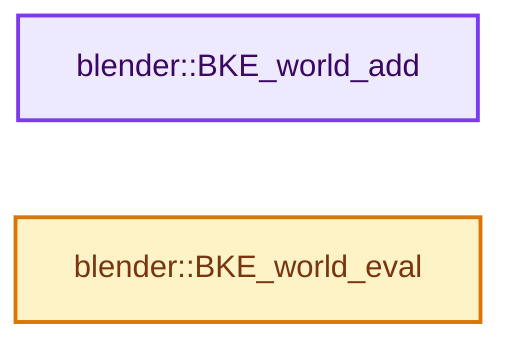
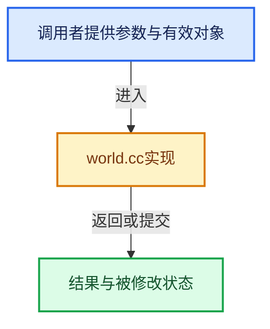

# 实现依赖专题：source/blender/blenkernel/intern/world.cc

[方向导航](README.md) · [符号索引](../%E7%AC%A6%E5%8F%B7%E4%BE%9D%E8%B5%96%E4%B8%8E%E5%AE%9E%E7%8E%B0%E7%B4%A2%E5%BC%95.md)

本专题从正文实际调用进入，集中保存共享实现。函数有稳定锚点，可从调用处直接跳到对应完整函数；递归与互相调用通过回链组织。

## 本文件的实现关系






## 完整成员与函数实现

<a id="f-29625dd717e7fab7"></a>

### `blender::BKE_world_add`

实现位置：[source/blender/blenkernel/intern/world.cc](../../../../../source/blender/blenkernel/intern/world.cc) · L221—L228。

接口参数：

- `Main *bmain`
- `const char *name`

**教学注释版**

<!-- annotated:2894e17d55ea3c -->

```cpp
World *BKE_world_add(Main *bmain, const char *name)
{
  World *wrld;

  wrld = BKE_id_new<World>(bmain, name);

  return wrld;
}
```

<details>
<summary>核对原始源码：source/blender/blenkernel/intern/world.cc · L221—L228</summary>

<!-- original:2894e17d55ea3c:source/blender/blenkernel/intern/world.cc:221:228 -->

```cpp
World *BKE_world_add(Main *bmain, const char *name)
{
  World *wrld;

  wrld = BKE_id_new<World>(bmain, name);

  return wrld;
}
```

</details>

**沿实际写入检查状态**

- `wrld = BKE_id_new<World>(bmain, name);`

**结果出口**

- `return wrld;`

**继续追踪实现**

- `BKE_id_new<World>` → [blender::BKE_id_new · L1612](%E4%BE%9D%E8%B5%96-lib_id-d4e6bd.md#f-5335c97ce0a8fbc8)。

<a id="f-397a79e0c52436a0"></a>

### `blender::BKE_world_eval`

实现位置：[source/blender/blenkernel/intern/world.cc](../../../../../source/blender/blenkernel/intern/world.cc) · L230—L235。

接口参数：

- `Depsgraph *depsgraph`
- `World *world`

**教学注释版**

<!-- annotated:19b57269142d3a -->

```cpp
void BKE_world_eval(Depsgraph *depsgraph, World *world)
{
  DEG_debug_print_eval(depsgraph, __func__, world->id.name, world);
  GPU_material_free(&world->gpumaterial);
  world->last_update = DEG_get_update_count(depsgraph);
}
```

<details>
<summary>核对原始源码：source/blender/blenkernel/intern/world.cc · L230—L235</summary>

<!-- original:19b57269142d3a:source/blender/blenkernel/intern/world.cc:230:235 -->

```cpp
void BKE_world_eval(Depsgraph *depsgraph, World *world)
{
  DEG_debug_print_eval(depsgraph, __func__, world->id.name, world);
  GPU_material_free(&world->gpumaterial);
  world->last_update = DEG_get_update_count(depsgraph);
}
```

</details>

**沿实际写入检查状态**

- `world->last_update = DEG_get_update_count(depsgraph);`

**继续追踪实现**

- `DEG_debug_print_eval` → [blender::DEG_debug_print_eval · L240](../11-Depsgraph%E4%B8%8E%E5%B9%B6%E8%A1%8C%E4%BB%BB%E5%8A%A1%E7%B3%BB%E7%BB%9F/%E4%BE%9D%E8%B5%96-depsgraph_debug-f95ade.md#f-f2c4ea506dd14a2f)。
- `GPU_material_free` → [blender::GPU_material_free · L288](%E4%BE%9D%E8%B5%96-gpu_material-e8dc22.md#f-dabf0b556ae042cd)。
- `DEG_get_update_count` → [blender::DEG_get_update_count · L356](../11-Depsgraph%E4%B8%8E%E5%B9%B6%E8%A1%8C%E4%BB%BB%E5%8A%A1%E7%B3%BB%E7%BB%9F/%E4%BE%9D%E8%B5%96-depsgraph-177fcb.md#f-53f32a84c1bed638)。
