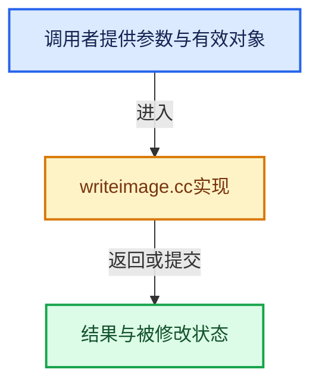

# 实现依赖专题：source/blender/imbuf/intern/writeimage.cc

[方向导航](README.md) · [符号索引](../%E7%AC%A6%E5%8F%B7%E4%BE%9D%E8%B5%96%E4%B8%8E%E5%AE%9E%E7%8E%B0%E7%B4%A2%E5%BC%95.md)

本专题从正文实际调用进入，集中保存共享实现。函数有稳定锚点，可从调用处直接跳到对应完整函数；递归与互相调用通过回链组织。

## 本文件的实现关系





## 完整成员与函数实现

<a id="f-ef12431d4878a2f2"></a>

### `blender::ensure_byte_buffer`

实现位置：[source/blender/imbuf/intern/writeimage.cc](../../../../../source/blender/imbuf/intern/writeimage.cc) · L25—L38。

接口参数：

- `ImBuf *ibuf`
- `const ImFileType *type`

**教学注释版**

<!-- annotated:1d69e3c0b34b7f -->

```cpp
static void ensure_byte_buffer(ImBuf *ibuf, const ImFileType *type)
{
  /* If writing byte image from float buffer, create a byte buffer for writing.
   *
   * For color managed image writing, IMB_colormanagement_imbuf_for_write should
   * have already created this byte buffer. This is a basic fallback for other
   * cases where we do not have a specific desired output colorspace. */
  if (!(type->flag & IM_FTYPE_FLOAT)) {
    if (ibuf->byte_data() == nullptr && ibuf->float_data()) {
      ibuf->byte_buffer.colorspace = colormanage_colorspace_get_roled(COLOR_ROLE_DEFAULT_BYTE);
      IMB_byte_from_float(ibuf);
    }
  }
}
```

<details>
<summary>核对原始源码：source/blender/imbuf/intern/writeimage.cc · L25—L38</summary>

<!-- original:1d69e3c0b34b7f:source/blender/imbuf/intern/writeimage.cc:25:38 -->

```cpp
static void ensure_byte_buffer(ImBuf *ibuf, const ImFileType *type)
{
  /* If writing byte image from float buffer, create a byte buffer for writing.
   *
   * For color managed image writing, IMB_colormanagement_imbuf_for_write should
   * have already created this byte buffer. This is a basic fallback for other
   * cases where we do not have a specific desired output colorspace. */
  if (!(type->flag & IM_FTYPE_FLOAT)) {
    if (ibuf->byte_data() == nullptr && ibuf->float_data()) {
      ibuf->byte_buffer.colorspace = colormanage_colorspace_get_roled(COLOR_ROLE_DEFAULT_BYTE);
      IMB_byte_from_float(ibuf);
    }
  }
}
```

</details>

**沿实际写入检查状态**

- `ibuf->byte_buffer.colorspace = colormanage_colorspace_get_roled(COLOR_ROLE_DEFAULT_BYTE);`

**继续追踪实现**

- `ibuf->byte_data` → [blender::ImBuf::byte_data · L353](%E4%BE%9D%E8%B5%96-IMB_imbuf_types-f69e60.md#f-2cdfc552156643fa)。
- `ibuf->float_data` → [blender::ImBuf::float_data · L358](%E4%BE%9D%E8%B5%96-IMB_imbuf_types-f69e60.md#f-2e52aa77544ffaee)。
- `colormanage_colorspace_get_roled` → [blender::colormanage_colorspace_get_roled · L3116](%E4%BE%9D%E8%B5%96-colormanagement-d4733d.md#f-d4e235d5ff4f937f)。
- `IMB_byte_from_float` → [blender::IMB_byte_from_float · L264](%E4%BE%9D%E8%B5%96-conversion-b82337.md#f-04cbc854f1a01b97)。

<a id="f-899a107657b49d38"></a>

### `blender::IMB_save_image`

实现位置：[source/blender/imbuf/intern/writeimage.cc](../../../../../source/blender/imbuf/intern/writeimage.cc) · L40—L62。

接口参数：

- `ImBuf *ibuf`
- `const char *filepath`
- `ImBufFlags flags`

**教学注释版**

<!-- annotated:8d96eaf5591548 -->

```cpp
bool IMB_save_image(ImBuf *ibuf, const char *filepath, ImBufFlags flags)
{
  errno = 0;

  BLI_assert(!BLI_path_is_rel(filepath));

  if (ibuf == nullptr) {
    return false;
  }
  ibuf->flags = flags;

  const ImFileType *type = IMB_file_type_from_ibuf(ibuf);
  if (type == nullptr || type->save == nullptr) {
    CLOG_ERROR(&LOG, "Couldn't save image to \"%s\"", filepath);
    return false;
  }

  BLI_assert((type->capability_write & eImFileTypeCapability::File) !=
             eImFileTypeCapability::Zero);

  ensure_byte_buffer(ibuf, type);
  return type->save(ibuf, filepath, flags);
}
```

<details>
<summary>核对原始源码：source/blender/imbuf/intern/writeimage.cc · L40—L62</summary>

<!-- original:8d96eaf5591548:source/blender/imbuf/intern/writeimage.cc:40:62 -->

```cpp
bool IMB_save_image(ImBuf *ibuf, const char *filepath, ImBufFlags flags)
{
  errno = 0;

  BLI_assert(!BLI_path_is_rel(filepath));

  if (ibuf == nullptr) {
    return false;
  }
  ibuf->flags = flags;

  const ImFileType *type = IMB_file_type_from_ibuf(ibuf);
  if (type == nullptr || type->save == nullptr) {
    CLOG_ERROR(&LOG, "Couldn't save image to \"%s\"", filepath);
    return false;
  }

  BLI_assert((type->capability_write & eImFileTypeCapability::File) !=
             eImFileTypeCapability::Zero);

  ensure_byte_buffer(ibuf, type);
  return type->save(ibuf, filepath, flags);
}
```

</details>

**沿实际写入检查状态**

- `errno = 0;`
- `ibuf->flags = flags;`

**结果出口**

- `return false;`
- `return type->save(ibuf, filepath, flags);`

**继续追踪实现**

- `BLI_assert` → [BLI_assert · L48](../01-%E5%9F%BA%E7%A1%80%E5%AE%B9%E5%99%A8%E4%B8%8E%E7%8E%B0%E4%BB%A3CPP/%E4%BE%9D%E8%B5%96-BLI_assert-cc98e8.md#m-57a88495704d)；[BLI_assert · L63](../01-%E5%9F%BA%E7%A1%80%E5%AE%B9%E5%99%A8%E4%B8%8E%E7%8E%B0%E4%BB%A3CPP/%E4%BE%9D%E8%B5%96-BLI_assert-cc98e8.md#m-d07050020cb5)。宏定义由构建条件选择。
- `BLI_path_is_rel` → [BLI_path_is_rel · L536](../01-%E5%9F%BA%E7%A1%80%E5%AE%B9%E5%99%A8%E4%B8%8E%E7%8E%B0%E4%BB%A3CPP/%E4%BE%9D%E8%B5%96-path_utils-b4d26a.md#f-d938443d331ba72c)。
- `IMB_file_type_from_ibuf` → [blender::IMB_file_type_from_ibuf · L338](%E4%BE%9D%E8%B5%96-filetype-3df4ff.md#f-c9e03c01df50037f)。
- `CLOG_ERROR` → [CLOG_ERROR · L188](%E4%BE%9D%E8%B5%96-CLG_log-e9051b.md#m-081575cdc8d0)。宏定义由构建条件选择。
- `ensure_byte_buffer` → [blender::ensure_byte_buffer · L25](%E4%BE%9D%E8%B5%96-writeimage-a7a72a.md#f-ef12431d4878a2f2)。
- `type->save` → [blender::GMutableVArraySpan::save · L453](../04-%E8%99%9A%E6%8B%9F%E6%95%B0%E7%BB%84%E4%B8%8E%E7%B4%A2%E5%BC%95%E9%80%89%E6%8B%A9/05-GVArray%E8%BF%90%E8%A1%8C%E6%97%B6%E7%B1%BB%E5%9E%8B.md#f-5f2d8d70d31ba596)。
