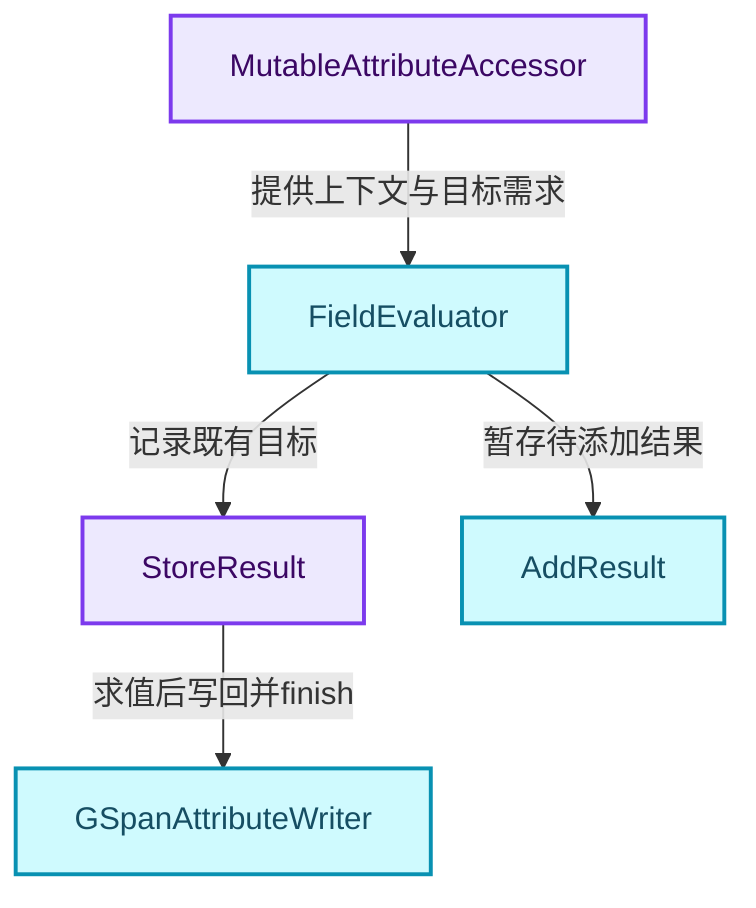
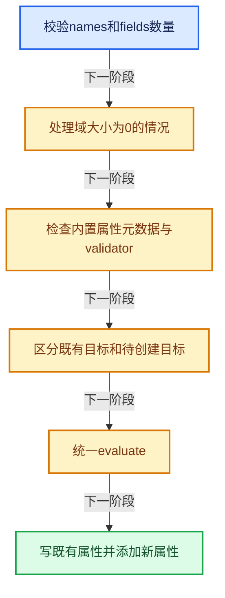
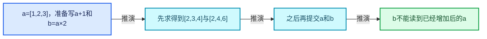
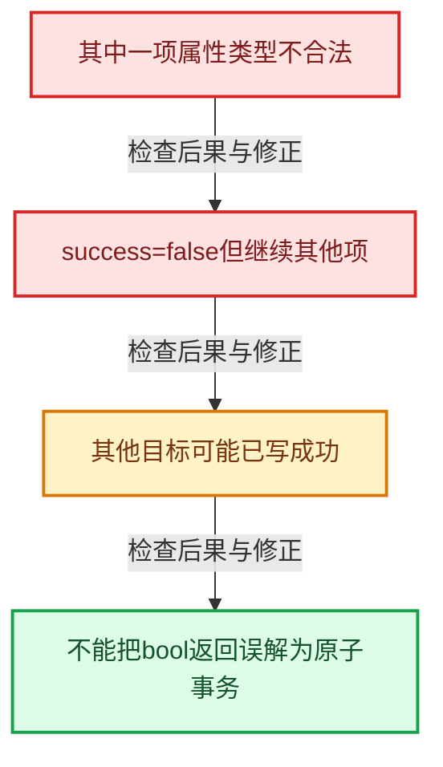

# GN-12 属性捕获求值暂存与提交协议

[几何节点学习地图](../%E5%87%A0%E4%BD%95%E8%8A%82%E7%82%B9%E6%89%A9%E5%B1%95%E5%AD%A6%E4%B9%A0%E5%9C%B0%E5%9B%BE.md) · [方向导航](README.md) · [全局实现索引](../%E7%AC%A6%E5%8F%B7%E4%BE%9D%E8%B5%96%E4%B8%8E%E5%AE%9E%E7%8E%B0%E7%B4%A2%E5%BC%95.md)

基准：`cbda6b96c26c0dee3c3b5cbb93960c4ac06a6b30`；文件哈希及连续摘录区间记录在[新增专题证据](../_evidence/geometry-extension.json)。本篇围绕所选函数解释核心机制，辅助依赖明确列出已定位实现与尚需类型确认的边界，不宣称相关整个文件已全文复核。

## 先回答一个具体问题

把Field写进属性，怎样避免一边读旧属性一边覆盖它？为什么同时有store和add两组结果？

## 相关类与数据的职责

- **`MutableAttributeAccessor`**：访问既有属性与创建目标属性。 定义入口：[source/blender/blenkernel/BKE_attribute.hh · L707](../../../../../source/blender/blenkernel/BKE_attribute.hh)。
- **`FieldEvaluator`**：统一求所有选中Field。
- **`StoreResult`**：记录可写回既有正确域类型属性的结果。
- **`AddResult`**：持有待创建属性的常量值或共享数组。
- **`GSpanAttributeWriter`**：提供可写Span与finish提交边界。 定义入口：[source/blender/blenkernel/BKE_attribute.hh · L353](../../../../../source/blender/blenkernel/BKE_attribute.hh)。



上图箭头文字区分拥有、借用、调用和数据依赖。连线不表示这些类型存在同名继承关系；只有源码明确声明的继承才按继承理解。

## 设计推导与扩展知识

### 推导1

try_capture_fields_on_geometry先规划结果如何落地，再统一evaluate，最后提交。StoreResult只保存input_index和evaluator_index，不立刻写；AddResult保存足够长寿命的常量或数组。

### 推导2

域为空时仍可能添加属性元数据，因此空数据不总是直接return true。它遍历名称并尝试创建，聚合成功状态；读取这些空属性时还要尊重组件接口。

### 推导3

selection_is_full只在selection不依赖输入且求值为true时成立。一个暂时在当前几何上全真的复杂Field不一定走同一静态快捷路径。

### 推导4

没有validator且全选时，直接共享Field对应属性可能省掉数组物化。这个优化需要精确语义等价与拥有关系，不能仅因名字相同就共享任意指针。

### 推导5

新增的非全选结果先initialize_new_data，再把选中范围求进去，确保未选部分有合法值。统一evaluate之后才remove旧属性并add新数据，避免表达式尚未读取完就删除输入。

### 推导6

函数返回的是聚合success，不是全局回滚事务。一项失败时其他项可能已成功写入；API调用者若需要全有或全无，必须另行设计暂存和提交机制。

## 实际处理阶段



这张图概括本篇所讨论的主路径；等待输入、构建失败与不同策略的分支以下方完整代码为准，不能把概括图当作每次都会执行的无条件顺序。

## 教学注释代码与分段机制

<a id="f-53d2a58a397bf570"></a>

### `blender::bke::try_capture_fields_on_geometry` · L998—L1142

选取MutableAttributeAccessor重载，按规划、evaluate和提交三阶段逐段阅读。局部StoreResult和AddResult就是阶段间的数据协议。

实现位置：[source/blender/blenkernel/intern/geometry_fields.cc](../../../../../source/blender/blenkernel/intern/geometry_fields.cc)。

**教学注释版**

<!-- annotated:c1e66a26abb2eb -->

```cpp
bool try_capture_fields_on_geometry(MutableAttributeAccessor attributes,
                                    const fn::FieldContext &field_context,
                                    const Span<StringRef> names,
                                    const AttrDomain domain,
                                    const fn::Field<bool> &selection,
                                    const Span<fn::GField> fields)
{
  // [讲解] 名称和Field必须一一对应，后续索引依赖这个前置条件。
  BLI_assert(names.size() == fields.size());
  // [讲解] 当前组件与域决定元素数，不由Field自己携带固定长度。
  const int domain_size = attributes.domain_size(domain);
  if (domain_size == 0) {
    bool all_added = true;
    for (const int i : names.index_range()) {
      const bke::AttrType data_type = bke::cpp_type_to_attribute_type(fields[i].cpp_type());
      all_added &= attributes.add(names[i], domain, data_type, AttributeInitConstruct{});
    }
    return all_added;
  }

  fn::FieldEvaluator evaluator{field_context, domain_size};
  evaluator.set_selection(selection);

  const bool selection_is_full = !selection.depends_on_input() &&
                                 fn::evaluate_constant_field(selection);

  struct StoreResult {
    int input_index;
    int evaluator_index;
  };
  Vector<StoreResult> results_to_store;

  ResourceScope scope;

  struct AddResult {
    int input_index;
    struct Single {
      void *value;
    };
    struct Array {
      ImplicitSharingPtr<ImplicitSharedValue<GArray<>>> data;
    };
    std::variant<Single, Array> new_data;
  };
  Vector<AddResult> results_to_add;

  bool success = true;

  for (const int input_index : names.index_range()) {
    const StringRef name = names[input_index];
    const CPPType &type = fields[input_index].cpp_type();
    const bke::AttrType data_type = bke::cpp_type_to_attribute_type(type);

    /* Avoid adding or writing to builtin attributes with an incorrect type or domain. */
    if (const std::optional<AttributeDomainAndType> meta_data =
            attributes.get_builtin_domain_and_type(name))
    {
      if (*meta_data != AttributeDomainAndType{domain, data_type}) {
        success = false;
        continue;
      }
    }

    const AttributeValidator validator = attributes.lookup_validator(name);
    const fn::GField field = validator.validate_field_if_necessary(fields[input_index]);

    if (!validator && selection_is_full) {
      if (try_add_shared_field_attribute(attributes, name, domain, field)) {
        continue;
      }
    }

    /* We are writing to an attribute that exists already with the correct domain and type. */
    if (const GAttributeReader dst = attributes.lookup(name)) {
      if (dst.domain == domain && dst.varray.type() == field.cpp_type()) {
        const int evaluator_index = evaluator.add(field);
        // [讲解] 暂存既有属性写回计划，尚未改写目标属性。
        results_to_store.append({input_index, evaluator_index});
        continue;
      }
    }

    if (field.depends_on_input() || !selection_is_full) {
      /* Could avoid allocating a new buffer if:
       * - The field does not depend on that attribute (we can't easily check for that yet). */
      auto *data = new ImplicitSharedValue<GArray<>>(type, domain_size, NoInitialization());
      void *buffer = data->data.data();
      if (!selection_is_full) {
        initialize_new_data(attributes, domain, domain_size, name, type, data_type, buffer);
      }

      GMutableSpan dst(type, buffer, domain_size);
      evaluator.add_with_destination(field, dst);
      results_to_add.append({input_index, AddResult::Array{ImplicitSharingPtr(data)}});
    }
    else {
      void *value = scope.allocate_owned(field.cpp_type());
      fn::evaluate_constant_field(field, value);
      results_to_add.append({input_index, AddResult::Single{value}});
    }
  }

  // [讲解] 完成本批登记Field与Selection求值，再进入后续结果读取或提交阶段。
  evaluator.evaluate();
  const IndexMask &mask = evaluator.get_evaluated_selection_as_mask();

  for (const StoreResult &result : results_to_store) {
    const StringRef name = names[result.input_index];
    const GVArray &result_data = evaluator.get_evaluated(result.evaluator_index);
    const CommonVArrayInfo info = result_data.common_info();
    if (selection_is_full) {
      if (info.type == CommonVArrayInfo::Type::Single) {
        if (try_assign_single_value(attributes, name, GPointer(result_data.type(), info.data))) {
          continue;
        }
      }
    }
    const GAttributeReader dst = attributes.lookup(name);
    if (!attribute_data_matches_varray(dst, info)) {
      GSpanAttributeWriter dst_mut = attributes.lookup_for_write_span(name);
      array_utils::copy(result_data, mask, dst_mut.span);
      // [讲解] 结束可写Span协议，完成接口要求的提交或更新通知。
      dst_mut.finish();
    }
  }

  for (AddResult &result : results_to_add) {
    const StringRef name = names[result.input_index];
    // [讲解] 统一求值结束后才移除待替换属性，避免删除尚在读取的输入。
    attributes.remove(name);
    const CPPType &type = fields[result.input_index].cpp_type();
    const bke::AttrType data_type = bke::cpp_type_to_attribute_type(type);
    if (auto *array = std::get_if<AddResult::Array>(&result.new_data)) {
      const ImplicitSharedValue<GArray<>> &data = *array->data;
      if (!attributes.add(name, domain, data_type, AttributeInitShared(data.data.data(), data))) {
        /* If the name corresponds to a builtin attribute, removing the attribute might fail if
         * it's required, adding the attribute might fail if the domain or type is incorrect. */
        success = false;
      }
    }
    else {
      const auto value = std::get<AddResult::Single>(result.new_data);
      const AttributeInitValue init(GPointer(type, value.value));
      if (!attributes.add(name, domain, data_type, init)) {
        success = false;
      }
    }
  }

  return success;
}
```

<details>
<summary>核对原始源码：source/blender/blenkernel/intern/geometry_fields.cc · L998—L1142</summary>

<!-- original:c1e66a26abb2eb:source/blender/blenkernel/intern/geometry_fields.cc:998:1142 -->

```cpp
bool try_capture_fields_on_geometry(MutableAttributeAccessor attributes,
                                    const fn::FieldContext &field_context,
                                    const Span<StringRef> names,
                                    const AttrDomain domain,
                                    const fn::Field<bool> &selection,
                                    const Span<fn::GField> fields)
{
  BLI_assert(names.size() == fields.size());
  const int domain_size = attributes.domain_size(domain);
  if (domain_size == 0) {
    bool all_added = true;
    for (const int i : names.index_range()) {
      const bke::AttrType data_type = bke::cpp_type_to_attribute_type(fields[i].cpp_type());
      all_added &= attributes.add(names[i], domain, data_type, AttributeInitConstruct{});
    }
    return all_added;
  }

  fn::FieldEvaluator evaluator{field_context, domain_size};
  evaluator.set_selection(selection);

  const bool selection_is_full = !selection.depends_on_input() &&
                                 fn::evaluate_constant_field(selection);

  struct StoreResult {
    int input_index;
    int evaluator_index;
  };
  Vector<StoreResult> results_to_store;

  ResourceScope scope;

  struct AddResult {
    int input_index;
    struct Single {
      void *value;
    };
    struct Array {
      ImplicitSharingPtr<ImplicitSharedValue<GArray<>>> data;
    };
    std::variant<Single, Array> new_data;
  };
  Vector<AddResult> results_to_add;

  bool success = true;

  for (const int input_index : names.index_range()) {
    const StringRef name = names[input_index];
    const CPPType &type = fields[input_index].cpp_type();
    const bke::AttrType data_type = bke::cpp_type_to_attribute_type(type);

    /* Avoid adding or writing to builtin attributes with an incorrect type or domain. */
    if (const std::optional<AttributeDomainAndType> meta_data =
            attributes.get_builtin_domain_and_type(name))
    {
      if (*meta_data != AttributeDomainAndType{domain, data_type}) {
        success = false;
        continue;
      }
    }

    const AttributeValidator validator = attributes.lookup_validator(name);
    const fn::GField field = validator.validate_field_if_necessary(fields[input_index]);

    if (!validator && selection_is_full) {
      if (try_add_shared_field_attribute(attributes, name, domain, field)) {
        continue;
      }
    }

    /* We are writing to an attribute that exists already with the correct domain and type. */
    if (const GAttributeReader dst = attributes.lookup(name)) {
      if (dst.domain == domain && dst.varray.type() == field.cpp_type()) {
        const int evaluator_index = evaluator.add(field);
        results_to_store.append({input_index, evaluator_index});
        continue;
      }
    }

    if (field.depends_on_input() || !selection_is_full) {
      /* Could avoid allocating a new buffer if:
       * - The field does not depend on that attribute (we can't easily check for that yet). */
      auto *data = new ImplicitSharedValue<GArray<>>(type, domain_size, NoInitialization());
      void *buffer = data->data.data();
      if (!selection_is_full) {
        initialize_new_data(attributes, domain, domain_size, name, type, data_type, buffer);
      }

      GMutableSpan dst(type, buffer, domain_size);
      evaluator.add_with_destination(field, dst);
      results_to_add.append({input_index, AddResult::Array{ImplicitSharingPtr(data)}});
    }
    else {
      void *value = scope.allocate_owned(field.cpp_type());
      fn::evaluate_constant_field(field, value);
      results_to_add.append({input_index, AddResult::Single{value}});
    }
  }

  evaluator.evaluate();
  const IndexMask &mask = evaluator.get_evaluated_selection_as_mask();

  for (const StoreResult &result : results_to_store) {
    const StringRef name = names[result.input_index];
    const GVArray &result_data = evaluator.get_evaluated(result.evaluator_index);
    const CommonVArrayInfo info = result_data.common_info();
    if (selection_is_full) {
      if (info.type == CommonVArrayInfo::Type::Single) {
        if (try_assign_single_value(attributes, name, GPointer(result_data.type(), info.data))) {
          continue;
        }
      }
    }
    const GAttributeReader dst = attributes.lookup(name);
    if (!attribute_data_matches_varray(dst, info)) {
      GSpanAttributeWriter dst_mut = attributes.lookup_for_write_span(name);
      array_utils::copy(result_data, mask, dst_mut.span);
      dst_mut.finish();
    }
  }

  for (AddResult &result : results_to_add) {
    const StringRef name = names[result.input_index];
    attributes.remove(name);
    const CPPType &type = fields[result.input_index].cpp_type();
    const bke::AttrType data_type = bke::cpp_type_to_attribute_type(type);
    if (auto *array = std::get_if<AddResult::Array>(&result.new_data)) {
      const ImplicitSharedValue<GArray<>> &data = *array->data;
      if (!attributes.add(name, domain, data_type, AttributeInitShared(data.data.data(), data))) {
        /* If the name corresponds to a builtin attribute, removing the attribute might fail if
         * it's required, adding the attribute might fail if the domain or type is incorrect. */
        success = false;
      }
    }
    else {
      const auto value = std::get<AddResult::Single>(result.new_data);
      const AttributeInitValue init(GPointer(type, value.value));
      if (!attributes.add(name, domain, data_type, init)) {
        success = false;
      }
    }
  }

  return success;
}
```

</details>

<details>
<summary>实现依赖入口与尚需类型确认的调用</summary>

- `BLI_assert`：宏定义见[source/blender/blenlib/BLI_assert.hh](../../../../../source/blender/blenlib/BLI_assert.hh), L48；按当前编译条件选择。
- `BLI_assert`：宏定义见[source/blender/blenlib/BLI_assert.hh](../../../../../source/blender/blenlib/BLI_assert.hh), L63；按当前编译条件选择。
- `names.size` → [blender::Span::size · L256](../01-%E5%9F%BA%E7%A1%80%E5%AE%B9%E5%99%A8%E4%B8%8E%E7%8E%B0%E4%BB%A3CPP/05-Span%E5%8F%AA%E8%AF%BB%E8%BF%9E%E7%BB%AD%E8%A7%86%E5%9B%BE.md#f-5f80fa006089c998)。
- `fields.size` → [blender::Span::size · L256](../01-%E5%9F%BA%E7%A1%80%E5%AE%B9%E5%99%A8%E4%B8%8E%E7%8E%B0%E4%BB%A3CPP/05-Span%E5%8F%AA%E8%AF%BB%E8%BF%9E%E7%BB%AD%E8%A7%86%E5%9B%BE.md#f-5f80fa006089c998)。
- `attributes.domain_size`：L1006的类型或分派协议；由接收对象具体类型或运行时策略提供实现。
- `names.index_range` → [blender::Span::index_range · L405](../01-%E5%9F%BA%E7%A1%80%E5%AE%B9%E5%99%A8%E4%B8%8E%E7%8E%B0%E4%BB%A3CPP/05-Span%E5%8F%AA%E8%AF%BB%E8%BF%9E%E7%BB%AD%E8%A7%86%E5%9B%BE.md#f-caaa9b06e13e53e0)。
- `bke::cpp_type_to_attribute_type` → [blender::bke::cpp_type_to_attribute_type · L80](%E4%BE%9D%E8%B5%96-attribute_access-bceef3.md#f-6ce44c9d2f385cb5)。
- `fields[i].cpp_type`：L1010的类型或分派协议；接收对象类型依赖auto、返回值或模板实例；不按同名猜测目标。
- `attributes.add` → [blender::bke::MutableAttributeAccessor::add · L769](08-AttributeAccessor%E6%8E%A5%E5%8F%A3.md#f-5fa7f06d7e22891a)；[blender::bke::MutableAttributeAccessor::add · L785](08-AttributeAccessor%E6%8E%A5%E5%8F%A3.md#f-42998ceb23ada8cc)。多候选需按实参和重载规则确认。
- `evaluator.set_selection` → [blender::fn::FieldEvaluator::set_selection · L68](../08-Field%E8%A1%A8%E8%BE%BE%E5%BC%8F%E4%B8%8E%E6%B1%82%E5%80%BC/07-FieldEvaluator%E6%8E%A5%E5%8F%A3%E4%B8%8E%E4%BD%BF%E7%94%A8.md#f-1d38e812a1e29e63)。
- `selection.depends_on_input` → [blender::fn::depends_on_input · L513](../08-Field%E8%A1%A8%E8%BE%BE%E5%BC%8F%E4%B8%8E%E6%B1%82%E5%80%BC/05-FieldOperation%E8%BF%90%E7%AE%97%E8%8A%82%E7%82%B9.md#f-c0874f9733e45938)。
- `fn::evaluate_constant_field` → [blender::fn::evaluate_constant_field · L507](../08-Field%E8%A1%A8%E8%BE%BE%E5%BC%8F%E4%B8%8E%E6%B1%82%E5%80%BC/09-%E7%94%9F%E6%88%90Procedure%E4%B8%8E%E6%89%A7%E8%A1%8C.md#f-6d8b2700cb0e9775)；[blender::fn::evaluate_constant_field · L200](../08-Field%E8%A1%A8%E8%BE%BE%E5%BC%8F%E4%B8%8E%E6%B1%82%E5%80%BC/07-FieldEvaluator%E6%8E%A5%E5%8F%A3%E4%B8%8E%E4%BD%BF%E7%94%A8.md#f-643b2a9dabb93260)。多候选需按实参和重载规则确认。
- `fields[input_index].cpp_type`：L1046的类型或分派协议；接收对象类型依赖auto、返回值或模板实例；不按同名猜测目标。
- `attributes.get_builtin_domain_and_type` → [blender::bke::AttributeAccessor::get_builtin_domain_and_type · L566](08-AttributeAccessor%E6%8E%A5%E5%8F%A3.md#f-a96d2a8736a8e586)。
- `attributes.lookup_validator` → [blender::bke::AttributeAccessor::lookup_validator · L657](08-AttributeAccessor%E6%8E%A5%E5%8F%A3.md#f-157191d13b91c8be)。
- `validator.validate_field_if_necessary` → [blender::bke::validate_field_if_necessary · L647](%E4%BE%9D%E8%B5%96-attribute_access-bceef3.md#f-58eec9c30257f381)。
- `try_add_shared_field_attribute` → [blender::bke::try_add_shared_field_attribute · L926](%E6%89%A9%E5%B1%9502-%E5%B1%9E%E6%80%A7%E6%8D%95%E8%8E%B7%E6%B1%82%E5%80%BC%E6%9A%82%E5%AD%98%E4%B8%8E%E6%8F%90%E4%BA%A4%E5%8D%8F%E8%AE%AE.md#f-36db4dfadb67c31e)。
- `attributes.lookup` → [blender::bke::lookup · L218](%E4%BE%9D%E8%B5%96-attribute_storage-1cb73b.md#f-7fdc83fb77004833)；[blender::bke::lookup · L228](%E4%BE%9D%E8%B5%96-attribute_storage-1cb73b.md#f-4c9ec35a31afcd06)；[blender::bke::lookup · L401](%E4%BE%9D%E8%B5%96-attribute_access-bceef3.md#f-4673351b7bb3b651)。多候选需按实参和重载规则确认。
- `dst.varray.type`：L1070的类型或分派协议；接收对象类型依赖auto、返回值或模板实例；不按同名猜测目标。
- `field.cpp_type` → [blender::fn::cpp_type · L518](../08-Field%E8%A1%A8%E8%BE%BE%E5%BC%8F%E4%B8%8E%E6%B1%82%E5%80%BC/05-FieldOperation%E8%BF%90%E7%AE%97%E8%8A%82%E7%82%B9.md#f-284e6a7a85c0110e)。
- `evaluator.add` → [blender::fn::add · L561](../08-Field%E8%A1%A8%E8%BE%BE%E5%BC%8F%E4%B8%8E%E6%B1%82%E5%80%BC/09-%E7%94%9F%E6%88%90Procedure%E4%B8%8E%E6%89%A7%E8%A1%8C.md#f-0095e095e744d86b)；[blender::fn::add · L572](../08-Field%E8%A1%A8%E8%BE%BE%E5%BC%8F%E4%B8%8E%E6%B1%82%E5%80%BC/09-%E7%94%9F%E6%88%90Procedure%E4%B8%8E%E6%89%A7%E8%A1%8C.md#f-fa52050946072c2f)；[blender::fn::FieldEvaluator::add · L112](../08-Field%E8%A1%A8%E8%BE%BE%E5%BC%8F%E4%B8%8E%E6%B1%82%E5%80%BC/07-FieldEvaluator%E6%8E%A5%E5%8F%A3%E4%B8%8E%E4%BD%BF%E7%94%A8.md#f-ab31e309cff56785)；[blender::fn::FieldEvaluator::add · L123](../08-Field%E8%A1%A8%E8%BE%BE%E5%BC%8F%E4%B8%8E%E6%B1%82%E5%80%BC/07-FieldEvaluator%E6%8E%A5%E5%8F%A3%E4%B8%8E%E4%BD%BF%E7%94%A8.md#f-d1fd1566630f59d2)。多候选需按实参和重载规则确认。
- `results_to_store.append` → [blender::Vector::append · L498](../01-%E5%9F%BA%E7%A1%80%E5%AE%B9%E5%99%A8%E4%B8%8E%E7%8E%B0%E4%BB%A3CPP/11-Vector%E6%8F%92%E5%85%A5%E5%88%A0%E9%99%A4%E4%B8%8E%E9%87%8D%E6%8E%92.md#f-5bde268a69e443ec)；[blender::Vector::append · L502](../01-%E5%9F%BA%E7%A1%80%E5%AE%B9%E5%99%A8%E4%B8%8E%E7%8E%B0%E4%BB%A3CPP/11-Vector%E6%8F%92%E5%85%A5%E5%88%A0%E9%99%A4%E4%B8%8E%E9%87%8D%E6%8E%92.md#f-591e0b15e6308532)。多候选需按实参和重载规则确认。
- `field.depends_on_input` → [blender::fn::depends_on_input · L614](../08-Field%E8%A1%A8%E8%BE%BE%E5%BC%8F%E4%B8%8E%E6%B1%82%E5%80%BC/05-FieldOperation%E8%BF%90%E7%AE%97%E8%8A%82%E7%82%B9.md#f-f9ec31f757d56a15)。
- `NoInitialization`：L1080的类型或分派协议；构造或类型转换入口。
- `data->data.data`：L1081的类型或分派协议；接收对象类型依赖auto、返回值或模板实例；不按同名猜测目标。
- `initialize_new_data` → [blender::bke::initialize_new_data · L973](09-%E5%B1%9E%E6%80%A7%E5%9F%9F%E4%B8%8E%E8%BD%AC%E6%8D%A2.md#f-fdea885a10607c64)。
- `evaluator.add_with_destination` → [blender::fn::add_with_destination · L548](../08-Field%E8%A1%A8%E8%BE%BE%E5%BC%8F%E4%B8%8E%E6%B1%82%E5%80%BC/09-%E7%94%9F%E6%88%90Procedure%E4%B8%8E%E6%89%A7%E8%A1%8C.md#f-165e23b00ea43ee4)；[blender::fn::add_with_destination · L556](../08-Field%E8%A1%A8%E8%BE%BE%E5%BC%8F%E4%B8%8E%E6%B1%82%E5%80%BC/09-%E7%94%9F%E6%88%90Procedure%E4%B8%8E%E6%89%A7%E8%A1%8C.md#f-79ade07d74d08d73)；[blender::fn::FieldEvaluator::add_with_destination · L80](../08-Field%E8%A1%A8%E8%BE%BE%E5%BC%8F%E4%B8%8E%E6%B1%82%E5%80%BC/07-FieldEvaluator%E6%8E%A5%E5%8F%A3%E4%B8%8E%E4%BD%BF%E7%94%A8.md#f-3edfceb249cb5cad)；[blender::fn::FieldEvaluator::add_with_destination · L99](../08-Field%E8%A1%A8%E8%BE%BE%E5%BC%8F%E4%B8%8E%E6%B1%82%E5%80%BC/07-FieldEvaluator%E6%8E%A5%E5%8F%A3%E4%B8%8E%E4%BD%BF%E7%94%A8.md#f-03289f589afbd469)。多候选需按实参和重载规则确认。
- `results_to_add.append` → [blender::Vector::append · L498](../01-%E5%9F%BA%E7%A1%80%E5%AE%B9%E5%99%A8%E4%B8%8E%E7%8E%B0%E4%BB%A3CPP/11-Vector%E6%8F%92%E5%85%A5%E5%88%A0%E9%99%A4%E4%B8%8E%E9%87%8D%E6%8E%92.md#f-5bde268a69e443ec)；[blender::Vector::append · L502](../01-%E5%9F%BA%E7%A1%80%E5%AE%B9%E5%99%A8%E4%B8%8E%E7%8E%B0%E4%BB%A3CPP/11-Vector%E6%8F%92%E5%85%A5%E5%88%A0%E9%99%A4%E4%B8%8E%E9%87%8D%E6%8E%92.md#f-591e0b15e6308532)。多候选需按实参和重载规则确认。
- `ImplicitSharingPtr` → [blender::ImplicitSharingPtr::ImplicitSharingPtr · L32](../06-%E9%9A%90%E5%BC%8F%E5%85%B1%E4%BA%AB%E4%B8%8E%E7%BC%93%E5%AD%98%E7%B3%BB%E7%BB%9F/03-Mixin%E4%B8%8E%E5%85%B1%E4%BA%AB%E6%8C%87%E9%92%88%E5%B0%81%E8%A3%85.md#f-d28a43dbb5ed8c05)；[blender::ImplicitSharingPtr::ImplicitSharingPtr · L34](../06-%E9%9A%90%E5%BC%8F%E5%85%B1%E4%BA%AB%E4%B8%8E%E7%BC%93%E5%AD%98%E7%B3%BB%E7%BB%9F/03-Mixin%E4%B8%8E%E5%85%B1%E4%BA%AB%E6%8C%87%E9%92%88%E5%B0%81%E8%A3%85.md#f-d27d5ebf676e244a)；[blender::ImplicitSharingPtr::ImplicitSharingPtr · L37](../06-%E9%9A%90%E5%BC%8F%E5%85%B1%E4%BA%AB%E4%B8%8E%E7%BC%93%E5%AD%98%E7%B3%BB%E7%BB%9F/03-Mixin%E4%B8%8E%E5%85%B1%E4%BA%AB%E6%8C%87%E9%92%88%E5%B0%81%E8%A3%85.md#f-17d0c5fe2b03a664)；[blender::ImplicitSharingPtr::ImplicitSharingPtr · L39](../06-%E9%9A%90%E5%BC%8F%E5%85%B1%E4%BA%AB%E4%B8%8E%E7%BC%93%E5%AD%98%E7%B3%BB%E7%BB%9F/03-Mixin%E4%B8%8E%E5%85%B1%E4%BA%AB%E6%8C%87%E9%92%88%E5%B0%81%E8%A3%85.md#f-1c8729ae57532370)；[blender::ImplicitSharingPtr::ImplicitSharingPtr · L44](../06-%E9%9A%90%E5%BC%8F%E5%85%B1%E4%BA%AB%E4%B8%8E%E7%BC%93%E5%AD%98%E7%B3%BB%E7%BB%9F/03-Mixin%E4%B8%8E%E5%85%B1%E4%BA%AB%E6%8C%87%E9%92%88%E5%B0%81%E8%A3%85.md#f-0b6be0142b98009e)；[blender::ImplicitSharingPtr::ImplicitSharingPtr · L49](../06-%E9%9A%90%E5%BC%8F%E5%85%B1%E4%BA%AB%E4%B8%8E%E7%BC%93%E5%AD%98%E7%B3%BB%E7%BB%9F/03-Mixin%E4%B8%8E%E5%85%B1%E4%BA%AB%E6%8C%87%E9%92%88%E5%B0%81%E8%A3%85.md#f-90c601ed9ed99045)；[blender::ImplicitSharingPtr::ImplicitSharingPtr · L57](../06-%E9%9A%90%E5%BC%8F%E5%85%B1%E4%BA%AB%E4%B8%8E%E7%BC%93%E5%AD%98%E7%B3%BB%E7%BB%9F/03-Mixin%E4%B8%8E%E5%85%B1%E4%BA%AB%E6%8C%87%E9%92%88%E5%B0%81%E8%A3%85.md#f-1625179ceae7a66d)。多候选需按实参和重载规则确认。
- `scope.allocate_owned` → [blender::allocate_owned · L227](../03-%E5%86%85%E5%AD%98%E5%88%86%E9%85%8D%E4%B8%8E%E8%BF%90%E8%A1%8C%E6%97%B6%E7%B1%BB%E5%9E%8B/05-ResourceScope%E9%94%80%E6%AF%81%E8%B4%A3%E4%BB%BB.md#f-09d5097dca8b32ae)。
- `evaluator.evaluate` → [blender::fn::evaluate · L590](../08-Field%E8%A1%A8%E8%BE%BE%E5%BC%8F%E4%B8%8E%E6%B1%82%E5%80%BC/09-%E7%94%9F%E6%88%90Procedure%E4%B8%8E%E6%89%A7%E8%A1%8C.md#f-d2c4933d17ec204c)。
- `evaluator.get_evaluated_selection_as_mask` → [blender::fn::get_evaluated_selection_as_mask · L635](../08-Field%E8%A1%A8%E8%BE%BE%E5%BC%8F%E4%B8%8E%E6%B1%82%E5%80%BC/09-%E7%94%9F%E6%88%90Procedure%E4%B8%8E%E6%89%A7%E8%A1%8C.md#f-fcf42f8a6ea87efa)。
- `evaluator.get_evaluated` → [blender::fn::FieldEvaluator::get_evaluated · L144](../08-Field%E8%A1%A8%E8%BE%BE%E5%BC%8F%E4%B8%8E%E6%B1%82%E5%80%BC/07-FieldEvaluator%E6%8E%A5%E5%8F%A3%E4%B8%8E%E4%BD%BF%E7%94%A8.md#f-57a3012b0391bad8)；[blender::fn::FieldEvaluator::get_evaluated · L150](../08-Field%E8%A1%A8%E8%BE%BE%E5%BC%8F%E4%B8%8E%E6%B1%82%E5%80%BC/07-FieldEvaluator%E6%8E%A5%E5%8F%A3%E4%B8%8E%E4%BD%BF%E7%94%A8.md#f-65bbf8d4b675d2cc)。多候选需按实参和重载规则确认。
- `result_data.common_info`：L1103的类型或分派协议；由接收对象具体类型或运行时策略提供实现。
- `try_assign_single_value` → [blender::bke::try_assign_single_value · L966](09-%E5%B1%9E%E6%80%A7%E5%9F%9F%E4%B8%8E%E8%BD%AC%E6%8D%A2.md#f-41b97c46f256081e)。
- `GPointer` → [blender::GPointer::GPointer · L93](../03-%E5%86%85%E5%AD%98%E5%88%86%E9%85%8D%E4%B8%8E%E8%BF%90%E8%A1%8C%E6%97%B6%E7%B1%BB%E5%9E%8B/12-%E5%BC%82%E6%9E%84%E5%80%BC%E5%AD%98%E5%82%A8%E5%AE%9E%E6%88%98.md#f-40f7a024c1e541df)；[blender::GPointer::GPointer · L95](../03-%E5%86%85%E5%AD%98%E5%88%86%E9%85%8D%E4%B8%8E%E8%BF%90%E8%A1%8C%E6%97%B6%E7%B1%BB%E5%9E%8B/12-%E5%BC%82%E6%9E%84%E5%80%BC%E5%AD%98%E5%82%A8%E5%AE%9E%E6%88%98.md#f-e981128b9c36f9ef)；[blender::GPointer::GPointer · L97](../03-%E5%86%85%E5%AD%98%E5%88%86%E9%85%8D%E4%B8%8E%E8%BF%90%E8%A1%8C%E6%97%B6%E7%B1%BB%E5%9E%8B/12-%E5%BC%82%E6%9E%84%E5%80%BC%E5%AD%98%E5%82%A8%E5%AE%9E%E6%88%98.md#f-5d3066175455aed0)；[blender::GPointer::GPointer · L103](../03-%E5%86%85%E5%AD%98%E5%88%86%E9%85%8D%E4%B8%8E%E8%BF%90%E8%A1%8C%E6%97%B6%E7%B1%BB%E5%9E%8B/12-%E5%BC%82%E6%9E%84%E5%80%BC%E5%AD%98%E5%82%A8%E5%AE%9E%E6%88%98.md#f-9194d11793ea4a06)；[blender::GPointer::GPointer · L105](../03-%E5%86%85%E5%AD%98%E5%88%86%E9%85%8D%E4%B8%8E%E8%BF%90%E8%A1%8C%E6%97%B6%E7%B1%BB%E5%9E%8B/12-%E5%BC%82%E6%9E%84%E5%80%BC%E5%AD%98%E5%82%A8%E5%AE%9E%E6%88%98.md#f-1a9887b65d37a9ca)。多候选需按实参和重载规则确认。
- `result_data.type` → [blender::bke::type · L86](../06-%E9%9A%90%E5%BC%8F%E5%85%B1%E4%BA%AB%E4%B8%8E%E7%BC%93%E5%AD%98%E7%B3%BB%E7%BB%9F/05-GeometrySet%E8%AF%BB%E5%86%99%E4%B8%8E%E5%A4%8D%E5%88%B6.md#f-f73336c224943890)。
- `attribute_data_matches_varray` → [blender::bke::attribute_data_matches_varray · L953](09-%E5%B1%9E%E6%80%A7%E5%9F%9F%E4%B8%8E%E8%BD%AC%E6%8D%A2.md#f-1fbff09988e255de)。
- `attributes.lookup_for_write_span` → [blender::bke::lookup_for_write_span · L505](%E4%BE%9D%E8%B5%96-attribute_access-bceef3.md#f-eac5b5d8814ff900)。
- `array_utils::copy` → [blender::array_utils::copy · L54](../01-%E5%9F%BA%E7%A1%80%E5%AE%B9%E5%99%A8%E4%B8%8E%E7%8E%B0%E4%BB%A3CPP/20-%E5%AE%B9%E5%99%A8%E9%80%89%E6%8B%A9%E4%B8%8E%E7%8B%AC%E7%AB%8B%E5%AE%9E%E7%8E%B0.md#f-82e21acdac93f91c)；[blender::array_utils::copy · L72](../01-%E5%9F%BA%E7%A1%80%E5%AE%B9%E5%99%A8%E4%B8%8E%E7%8E%B0%E4%BB%A3CPP/20-%E5%AE%B9%E5%99%A8%E9%80%89%E6%8B%A9%E4%B8%8E%E7%8B%AC%E7%AB%8B%E5%AE%9E%E7%8E%B0.md#f-ee9c17de026a6c9a)；[blender::array_utils::copy · L98](../01-%E5%9F%BA%E7%A1%80%E5%AE%B9%E5%99%A8%E4%B8%8E%E7%8E%B0%E4%BB%A3CPP/20-%E5%AE%B9%E5%99%A8%E9%80%89%E6%8B%A9%E4%B8%8E%E7%8B%AC%E7%AB%8B%E5%AE%9E%E7%8E%B0.md#f-ec9fd099c7280717)；[blender::array_utils::copy · L27](../01-%E5%9F%BA%E7%A1%80%E5%AE%B9%E5%99%A8%E4%B8%8E%E7%8E%B0%E4%BB%A3CPP/%E4%BE%9D%E8%B5%96-array_utils-cbb70f.md#f-245f7c23437cf35f)；[blender::array_utils::copy · L43](../01-%E5%9F%BA%E7%A1%80%E5%AE%B9%E5%99%A8%E4%B8%8E%E7%8E%B0%E4%BB%A3CPP/%E4%BE%9D%E8%B5%96-array_utils-cbb70f.md#f-6170524934215b36)。多候选需按实参和重载规则确认。
- `dst_mut.finish` → [blender::bke::GSpanAttributeWriter::finish · L372](08-AttributeAccessor%E6%8E%A5%E5%8F%A3.md#f-6e58c9c72c82f592)。
- `attributes.remove` → [blender::bke::MutableAttributeAccessor::remove · L1007](08-AttributeAccessor%E6%8E%A5%E5%8F%A3.md#f-70cc562b046f24be)。
- `fields[result.input_index].cpp_type`：L1122的类型或分派协议；接收对象类型依赖auto、返回值或模板实例；不按同名猜测目标。
- `std::get_if<AddResult::Array>`：这个边界按实际表达式及所属类型核对参数、返回值、寿命与失败行为。这里提供接口入口，不声称已解释该第三方版本的内部实现。 [接口资料](https://eel.is/c++draft/)。
- `AttributeInitShared` → [blender::bke::AttributeInitShared::AttributeInitShared · L132](08-AttributeAccessor%E6%8E%A5%E5%8F%A3.md#f-d833f311804f775e)。
- `data.data.data`：L1126的类型或分派协议；接收对象类型依赖auto、返回值或模板实例；不按同名猜测目标。
- `std::get<AddResult::Single>`：这个边界按实际表达式及所属类型核对参数、返回值、寿命与失败行为。这里提供接口入口，不声称已解释该第三方版本的内部实现。 [接口资料](https://eel.is/c++draft/)。

</details>

<a id="f-36db4dfadb67c31e"></a>

### `blender::bke::try_add_shared_field_attribute` · L926—L951

关注能否直接定位属性、域类型是否匹配和共享元信息；这不是对任意Field都可用的优化。

实现位置：[source/blender/blenkernel/intern/geometry_fields.cc](../../../../../source/blender/blenkernel/intern/geometry_fields.cc)。

**教学注释版**

<!-- annotated:371fc167f7c3a9 -->

```cpp
static bool try_add_shared_field_attribute(MutableAttributeAccessor attributes,
                                           const StringRef id_to_create,
                                           const AttrDomain domain,
                                           const fn::GField &field)
{
  const std::optional<StringRef> field_id = try_get_field_direct_attribute_id(field);
  if (!field_id) {
    return false;
  }
  const std::optional<AttributeMetaData> meta_data = attributes.lookup_meta_data(*field_id);
  if (!meta_data) {
    return false;
  }
  const bke::AttrType data_type = bke::cpp_type_to_attribute_type(field.cpp_type());
  if (!attribute_kind_matches(*meta_data, domain, data_type)) {
    /* Avoid costly domain and type interpolation, which would make sharing impossible. */
    return false;
  }
  const GAttributeReader attribute = attributes.lookup(*field_id, domain, data_type);
  if (!attribute.sharing_info || !attribute.varray.is_span()) {
    return false;
  }
  const AttributeInitShared init(attribute.varray.get_internal_span().data(),
                                 *attribute.sharing_info);
  return attributes.add_override(id_to_create, domain, data_type, init);
}
```

<details>
<summary>核对原始源码：source/blender/blenkernel/intern/geometry_fields.cc · L926—L951</summary>

<!-- original:371fc167f7c3a9:source/blender/blenkernel/intern/geometry_fields.cc:926:951 -->

```cpp
static bool try_add_shared_field_attribute(MutableAttributeAccessor attributes,
                                           const StringRef id_to_create,
                                           const AttrDomain domain,
                                           const fn::GField &field)
{
  const std::optional<StringRef> field_id = try_get_field_direct_attribute_id(field);
  if (!field_id) {
    return false;
  }
  const std::optional<AttributeMetaData> meta_data = attributes.lookup_meta_data(*field_id);
  if (!meta_data) {
    return false;
  }
  const bke::AttrType data_type = bke::cpp_type_to_attribute_type(field.cpp_type());
  if (!attribute_kind_matches(*meta_data, domain, data_type)) {
    /* Avoid costly domain and type interpolation, which would make sharing impossible. */
    return false;
  }
  const GAttributeReader attribute = attributes.lookup(*field_id, domain, data_type);
  if (!attribute.sharing_info || !attribute.varray.is_span()) {
    return false;
  }
  const AttributeInitShared init(attribute.varray.get_internal_span().data(),
                                 *attribute.sharing_info);
  return attributes.add_override(id_to_create, domain, data_type, init);
}
```

</details>

<details>
<summary>实现依赖入口与尚需类型确认的调用</summary>

- `try_get_field_direct_attribute_id` → [blender::bke::try_get_field_direct_attribute_id · L907](09-%E5%B1%9E%E6%80%A7%E5%9F%9F%E4%B8%8E%E8%BD%AC%E6%8D%A2.md#f-d8b9840abebde91e)。
- `attributes.lookup_meta_data`：L935的类型或分派协议；由接收对象具体类型或运行时策略提供实现。
- `bke::cpp_type_to_attribute_type` → [blender::bke::cpp_type_to_attribute_type · L80](%E4%BE%9D%E8%B5%96-attribute_access-bceef3.md#f-6ce44c9d2f385cb5)。
- `field.cpp_type` → [blender::fn::cpp_type · L518](../08-Field%E8%A1%A8%E8%BE%BE%E5%BC%8F%E4%B8%8E%E6%B1%82%E5%80%BC/05-FieldOperation%E8%BF%90%E7%AE%97%E8%8A%82%E7%82%B9.md#f-284e6a7a85c0110e)。
- `attribute_kind_matches` → [blender::bke::attribute_kind_matches · L915](09-%E5%B1%9E%E6%80%A7%E5%9F%9F%E4%B8%8E%E8%BD%AC%E6%8D%A2.md#f-38e5d7392d7ba97e)。
- `attributes.lookup` → [blender::bke::lookup · L218](%E4%BE%9D%E8%B5%96-attribute_storage-1cb73b.md#f-7fdc83fb77004833)；[blender::bke::lookup · L228](%E4%BE%9D%E8%B5%96-attribute_storage-1cb73b.md#f-4c9ec35a31afcd06)；[blender::bke::lookup · L401](%E4%BE%9D%E8%B5%96-attribute_access-bceef3.md#f-4673351b7bb3b651)。多候选需按实参和重载规则确认。
- `attribute.varray.is_span`：L945的类型或分派协议；接收对象类型依赖auto、返回值或模板实例；不按同名猜测目标。
- `attribute.varray.get_internal_span().data`：L948的类型或分派协议；接收对象类型依赖auto、返回值或模板实例；不按同名猜测目标。
- `attribute.varray.get_internal_span`：L948的类型或分派协议；接收对象类型依赖auto、返回值或模板实例；不按同名猜测目标。
- `attributes.add_override` → [blender::bke::MutableAttributeAccessor::add_override · L793](08-AttributeAccessor%E6%8E%A5%E5%8F%A3.md#f-534f5c942f0c96e5)。

</details>

## 用小数据走一遍

1. a=[1,2,3]，准备写a+1和b=a×2。
2. 先求得到[2,3,4]与[2,4,6]。
3. 之后再提交a和b。
4. b不能读到已经增加后的a。



这是明确输入条件下的教学推演，不是本地性能实测。对源码的验证应同时检查数值、对象寿命、输出需求和数据是否存在。

## 反例与边界

- 其中一项属性类型不合法。
- success=false但继续其他项。
- 其他目标可能已写成功。
- 不能把bool返回误解为原子事务。



## 历史提交阅读

本地历史阅读样本：**Hans Goudey**，2026-09-30T14:52:03+02:00。

`662905e45c1030f9244b880aa4f6ff60d5ac2486`

提交标题：Refactor: Attributes: Remove AttributeInitMoveArray

[所选文件的真实diff](../_evidence/geometry-history/GN-12.patch)。这是本地历史中匹配作者的近期样本，不冒称该系统的最初引入提交。阅读时先找变更前后的不变量，再检查新增分支与测试；本篇当前源码说明不混用历史签名。

## 独立实现与验收

模拟a写回、b新增、c非法三项捕获，列出结果和返回值。

<details>
<summary>参考思路</summary>

a与b基于求值前输入；c失败使success为false，但源码未承诺撤销a和b。实现测试应检查部分成功。

</details>

验收时保留一个能击穿错误设计的反例，再对照实际符号重走调用链。教学练习未在完整Blender中运行；本轮独立运行的模型验证另见新增专题验收报告。

## 继续阅读

- [GN-08 GeometrySet组件组合与写时分离](%E6%89%A9%E5%B1%9501-GeometrySet%E7%BB%84%E4%BB%B6%E7%BB%84%E5%90%88%E4%B8%8E%E5%86%99%E6%97%B6%E5%88%86%E7%A6%BB.md)
- [GN-11 StoreNamedAttribute类型域与部分写入](../08-Field%E8%A1%A8%E8%BE%BE%E5%BC%8F%E4%B8%8E%E6%B1%82%E5%80%BC/%E6%89%A9%E5%B1%9503-StoreNamedAttribute%E7%B1%BB%E5%9E%8B%E5%9F%9F%E4%B8%8E%E9%83%A8%E5%88%86%E5%86%99%E5%85%A5.md)
- [GN-13 CaptureAttribute匿名属性引用与清理](../10-%E5%BC%95%E7%94%A8%E7%94%9F%E5%91%BD%E5%91%A8%E6%9C%9F%E4%B8%8EClosure/%E6%89%A9%E5%B1%9501-CaptureAttribute%E5%8C%BF%E5%90%8D%E5%B1%9E%E6%80%A7%E5%BC%95%E7%94%A8%E4%B8%8E%E6%B8%85%E7%90%86.md)
- [GN-14 Instances引用表句柄与变换数组](%E6%89%A9%E5%B1%9503-Instances%E5%BC%95%E7%94%A8%E8%A1%A8%E5%8F%A5%E6%9F%84%E4%B8%8E%E5%8F%98%E6%8D%A2%E6%95%B0%E7%BB%84.md)
- [GN-15 InstanceOnPoints选择压缩与引用重映射](%E6%89%A9%E5%B1%9504-InstanceOnPoints%E9%80%89%E6%8B%A9%E5%8E%8B%E7%BC%A9%E4%B8%8E%E5%BC%95%E7%94%A8%E9%87%8D%E6%98%A0%E5%B0%84.md)
- [GN-16 JoinGeometry组件分派与Realize复用](%E6%89%A9%E5%B1%9505-JoinGeometry%E7%BB%84%E4%BB%B6%E5%88%86%E6%B4%BE%E4%B8%8ERealize%E5%A4%8D%E7%94%A8.md)
- [GN-17 RealizeInstances深度Field与任务流水线](%E6%89%A9%E5%B1%9506-RealizeInstances%E6%B7%B1%E5%BA%A6Field%E4%B8%8E%E4%BB%BB%E5%8A%A1%E6%B5%81%E6%B0%B4%E7%BA%BF.md)
