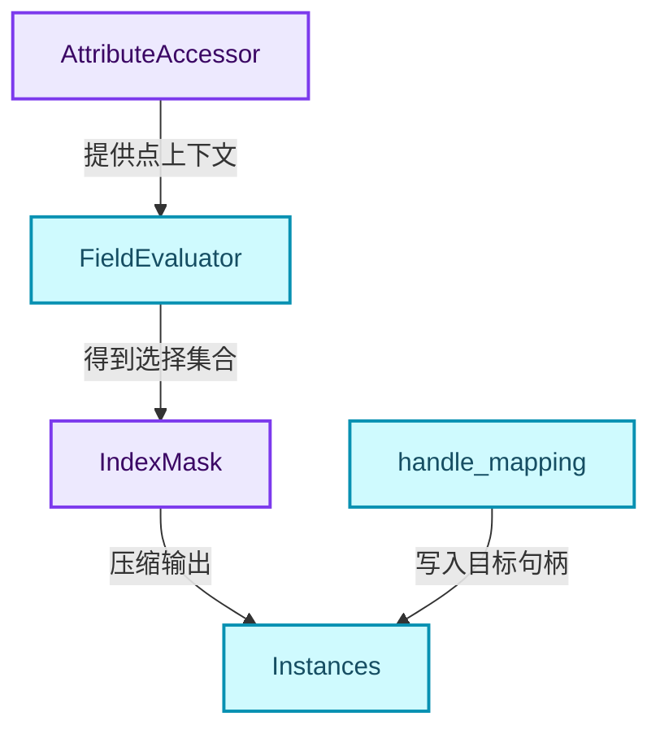
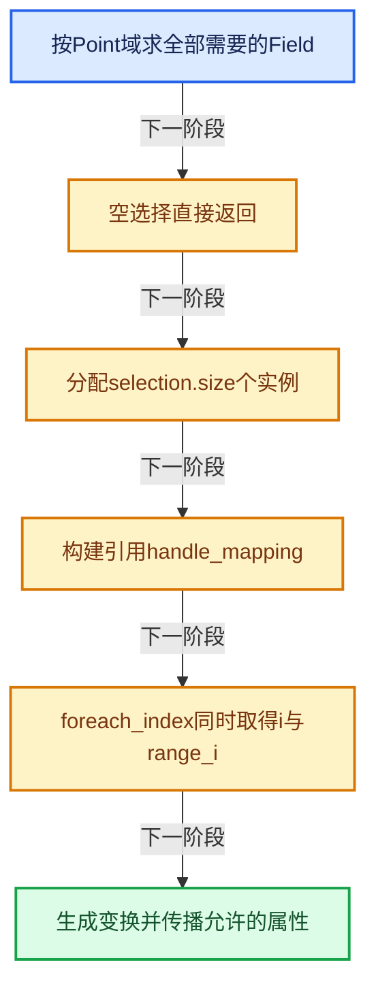
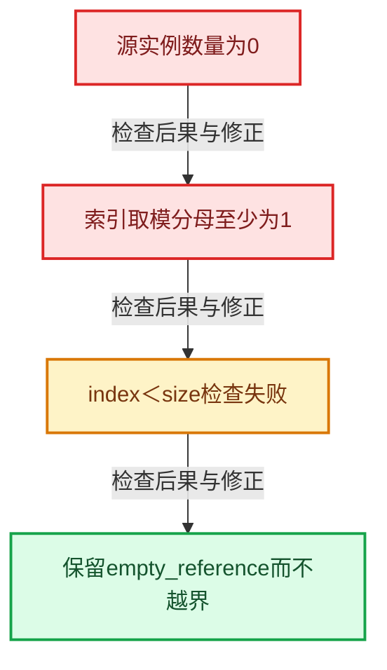

# GN-15 InstanceOnPoints选择压缩与引用重映射

[几何节点学习地图](../%E5%87%A0%E4%BD%95%E8%8A%82%E7%82%B9%E6%89%A9%E5%B1%95%E5%AD%A6%E4%B9%A0%E5%9C%B0%E5%9B%BE.md) · [方向导航](README.md) · [全局实现索引](../%E7%AC%A6%E5%8F%B7%E4%BE%9D%E8%B5%96%E4%B8%8E%E5%AE%9E%E7%8E%B0%E7%B4%A2%E5%BC%95.md)

基准：`cbda6b96c26c0dee3c3b5cbb93960c4ac06a6b30`；文件哈希及连续摘录区间记录在[新增专题证据](../_evidence/geometry-extension.json)。本篇围绕所选函数解释核心机制，辅助依赖明确列出已定位实现与尚需类型确认的边界，不宣称相关整个文件已全文复核。

## 先回答一个具体问题

选中点索引稀疏时，怎样生成紧凑的实例数组，同时保留正确来源与属性？

## 相关类与数据的职责

- **`AttributeAccessor`**：读取点position和待传播属性。 定义入口：[source/blender/blenkernel/BKE_attribute.hh · L493](../../../../../source/blender/blenkernel/BKE_attribute.hh)。
- **`FieldEvaluator`**：统一求Pick、Index、Rotation、Scale与Selection。
- **`IndexMask`**：保持原点索引与紧凑输出位置的对应。 定义入口：[source/blender/blenlib/BLI_index_mask.hh · L218](../../../../../source/blender/blenlib/BLI_index_mask.hh)。
- **`Instances`**：生成selection.size个实例。 定义入口：[source/blender/blenkernel/BKE_instances.hh · L115](../../../../../source/blender/blenkernel/BKE_instances.hh)。
- **`handle_mapping`**：把输入实例引用表映射到目标引用表。



上图箭头文字区分拥有、借用、调用和数据依赖。连线不表示这些类型存在同名继承关系；只有源码明确声明的继承才按继承理解。

## 设计推导与扩展知识

### 推导1

选择[1,4,8]对应输出位置[0,1,2]。源Field和position用i读取，目标变换和句柄用range_i写入；两个变量恰好都从0开始的全选案例会掩盖索引混淆。

### 推导2

pick_instance可能是单值或普通虚拟数组。源码只在可能选取源实例时准备handle_mapping，避免为永远不用的路径建立映射。

### 推导3

选中某个源实例时，源实例索引与源引用句柄还要再分两步：indices[i]先决定源实例序号，reference_handles()[index]再决定引用来源。

### 推导4

mod_i而不是直接%用于负索引绕回。std::max(src_instances_num,1)避免零除，后面的index<src_instances_num阻止空源实例访问；两个保护共同构成边界处理。

### 推导5

目标基变换来自点位置、旋转与缩放，选取源实例时还组合源实例已有变换。矩阵乘法顺序属于空间语义，不能交换两个乘数只因结果都是4×4矩阵。

### 推导6

属性传播会跳过position和.reference_index等已有特殊用途属性，并尊重filter与内置属性约束。常量虚拟数组可以按常量初始化，避免所有传播都物化成数组。

## 实际处理阶段



这张图概括本篇所讨论的主路径；等待输入、构建失败与不同策略的分支以下方完整代码为准，不能把概括图当作每次都会执行的无条件顺序。

## 教学注释代码与分段机制

<a id="f-8a5ee61be4981438"></a>

### `blender::nodes::node_geo_instance_on_points_cc::add_instances_from_component` · L53—L196

整函数按Field求值、引用准备、逐点变换、属性传播阅读。特别标记i和range_i，不能切成丢失上下文的小段。

实现位置：[source/blender/nodes/geometry/nodes/node_geo_instance_on_points.cc](../../../../../source/blender/nodes/geometry/nodes/node_geo_instance_on_points.cc)。

**教学注释版**

<!-- annotated:a32db6eecc07b2 -->

```cpp
static std::unique_ptr<bke::Instances> add_instances_from_component(
    const AttributeAccessor &src_attributes,
    const GeometrySet &instance,
    const fn::FieldContext &field_context,
    const GeoNodeExecParams &params,
    const bke::AttributeFilter &attribute_filter)
{
  const AttrDomain domain = AttrDomain::Point;
  const int domain_num = src_attributes.domain_size(domain);

  VArray<bool> pick_instance;
  VArray<int> indices;
  VArray<math::Quaternion> rotations;
  VArray<float3> scales;

  const Field<bool> selection_field = params.get_input<Field<bool>>("Selection"_ustr);
  fn::FieldEvaluator evaluator{field_context, domain_num};
  evaluator.set_selection(selection_field);
  /* The evaluator could use the component's stable IDs as a destination directly, but only the
   * selected indices should be copied. */
  evaluator.add(params.get_input<Field<bool>>("Pick Instance"_ustr), &pick_instance);
  evaluator.add(params.get_input<Field<int>>("Instance Index"_ustr), &indices);
  evaluator.add(params.get_input<Field<math::Quaternion>>("Rotation"_ustr), &rotations);
  evaluator.add(params.get_input<Field<float3>>("Scale"_ustr), &scales);
  // [讲解] 完成本批登记Field与Selection求值，再进入后续结果读取或提交阶段。
  evaluator.evaluate();

  // [讲解] 稀疏选择保留原点索引，输出压缩位置要另行取得。
  const IndexMask selection = evaluator.get_evaluated_selection_as_mask();
  // [讲解] 空选择无需创建实例或继续准备来源映射。
  if (selection.is_empty()) {
    return {};
  }

  // [讲解] 目标长度是选中点数，不是原点域总数。
  auto dst_component = std::make_unique<bke::Instances>(selection.size());

  MutableSpan<int> dst_handles = dst_component->reference_handles_for_write();
  MutableSpan<float4x4> dst_transforms = dst_component->transforms_for_write();

  const VArraySpan positions = *src_attributes.lookup<float3>("position");

  const bke::Instances *src_instances = instance.get_instances();

  /* Maps handles from the source instances to handles on the new instance. */
  Array<int> handle_mapping;
  /* Only fill #handle_mapping when it may be used below. */
  if (src_instances != nullptr &&
      (!pick_instance.is_single() || pick_instance.get_internal_single()))
  {
    Span<bke::InstanceReference> src_references = src_instances->references();
    handle_mapping.reinitialize(src_references.size());
    for (const int src_instance_handle : src_references.index_range()) {
      const bke::InstanceReference &reference = src_references[src_instance_handle];
      const int dst_instance_handle = dst_component->add_reference(reference);
      handle_mapping[src_instance_handle] = dst_instance_handle;
    }
  }

  const int full_instance_handle = dst_component->add_reference(instance);
  /* Add this reference last, because it is the most likely one to be removed later on. */
  const int empty_reference_handle = dst_component->add_reference(bke::InstanceReference());

  selection.foreach_index(
      [&](const int64_t i, const int64_t range_i) {
        /* Compute base transform for every instances. */
        float4x4 &dst_transform = dst_transforms[range_i];
        dst_transform = math::from_loc_rot_scale<float4x4>(positions[i], rotations[i], scales[i]);

        /* Reference that will be used by this new instance. */
        int dst_handle = empty_reference_handle;

        const bool use_individual_instance = pick_instance[i];
        if (use_individual_instance) {
          if (src_instances != nullptr) {
            const int src_instances_num = src_instances->instances_num();
            const int original_index = indices[i];
            /* Use #mod_i instead of `%` to get the desirable wrap around behavior where -1
             * refers to the last element. */
            const int index = mod_i(original_index, std::max(src_instances_num, 1));
            if (index < src_instances_num) {
              /* Get the reference to the source instance. */
              const int src_handle = src_instances->reference_handles()[index];
              dst_handle = handle_mapping[src_handle];

              /* Take transforms of the source instance into account. */
              mul_m4_m4_post(dst_transform.ptr(), src_instances->transforms()[index].ptr());
            }
          }
        }
        else {
          /* Use entire source geometry as instance. */
          dst_handle = full_instance_handle;
        }
        /* Set properties of new instance. */
        // [讲解] range_i是紧凑目标位置；i仍是原点索引。
        dst_handles[range_i] = dst_handle;
      },
      exec_mode::grain_size(1024));

  if (pick_instance.is_single()) {
    if (pick_instance.get_internal_single()) {
      if (instance.has_realized_data()) {
        params.error_message_add(
            NodeWarningType::Info,
            TIP_("Realized geometry is not used when pick instances is true"));
      }
    }
  }

  bke::MutableAttributeAccessor dst_attributes = dst_component->attributes_for_write();
  src_attributes.foreach_attribute([&](const bke::AttributeIter &iter) {
    if (ELEM(iter.name, "position", ".reference_index")) {
      return;
    }
    if (attribute_filter.allow_skip(iter.name)) {
      return;
    }
    if (iter.is_builtin) {
      if (!dst_attributes.is_builtin(iter.name)) {
        return;
      }
    }
    const bke::GAttributeReader src = iter.get(bke::AttrDomain::Point);
    if (!src) {
      /* Domain interpolation can fail if the source domain is empty. */
      return;
    }
    const CommonVArrayInfo info = src.varray.common_info();
    if (info.type == CommonVArrayInfo::Type::Single) {
      const bke::AttributeInitValue init(GPointer(src.varray.type(), info.data));
      dst_attributes.add(iter.name, bke::AttrDomain::Instance, iter.data_type, init);
      return;
    }
    if (info.type == CommonVArrayInfo::Type::Span) {
      if (src.sharing_info && selection.size() == domain_num) {
        const bke::AttributeInitShared init(info.data, *src.sharing_info);
        dst_attributes.add(iter.name, AttrDomain::Instance, iter.data_type, init);
        return;
      }
    }
    GSpanAttributeWriter dst = dst_attributes.lookup_or_add_for_write_only_span(
        iter.name, bke::AttrDomain::Instance, iter.data_type);
    array_utils::gather(src.varray, selection, dst.span);
    dst.finish();
  });

  return dst_component;
}
```

<details>
<summary>核对原始源码：source/blender/nodes/geometry/nodes/node_geo_instance_on_points.cc · L53—L196</summary>

<!-- original:a32db6eecc07b2:source/blender/nodes/geometry/nodes/node_geo_instance_on_points.cc:53:196 -->

```cpp
static std::unique_ptr<bke::Instances> add_instances_from_component(
    const AttributeAccessor &src_attributes,
    const GeometrySet &instance,
    const fn::FieldContext &field_context,
    const GeoNodeExecParams &params,
    const bke::AttributeFilter &attribute_filter)
{
  const AttrDomain domain = AttrDomain::Point;
  const int domain_num = src_attributes.domain_size(domain);

  VArray<bool> pick_instance;
  VArray<int> indices;
  VArray<math::Quaternion> rotations;
  VArray<float3> scales;

  const Field<bool> selection_field = params.get_input<Field<bool>>("Selection"_ustr);
  fn::FieldEvaluator evaluator{field_context, domain_num};
  evaluator.set_selection(selection_field);
  /* The evaluator could use the component's stable IDs as a destination directly, but only the
   * selected indices should be copied. */
  evaluator.add(params.get_input<Field<bool>>("Pick Instance"_ustr), &pick_instance);
  evaluator.add(params.get_input<Field<int>>("Instance Index"_ustr), &indices);
  evaluator.add(params.get_input<Field<math::Quaternion>>("Rotation"_ustr), &rotations);
  evaluator.add(params.get_input<Field<float3>>("Scale"_ustr), &scales);
  evaluator.evaluate();

  const IndexMask selection = evaluator.get_evaluated_selection_as_mask();
  if (selection.is_empty()) {
    return {};
  }

  auto dst_component = std::make_unique<bke::Instances>(selection.size());

  MutableSpan<int> dst_handles = dst_component->reference_handles_for_write();
  MutableSpan<float4x4> dst_transforms = dst_component->transforms_for_write();

  const VArraySpan positions = *src_attributes.lookup<float3>("position");

  const bke::Instances *src_instances = instance.get_instances();

  /* Maps handles from the source instances to handles on the new instance. */
  Array<int> handle_mapping;
  /* Only fill #handle_mapping when it may be used below. */
  if (src_instances != nullptr &&
      (!pick_instance.is_single() || pick_instance.get_internal_single()))
  {
    Span<bke::InstanceReference> src_references = src_instances->references();
    handle_mapping.reinitialize(src_references.size());
    for (const int src_instance_handle : src_references.index_range()) {
      const bke::InstanceReference &reference = src_references[src_instance_handle];
      const int dst_instance_handle = dst_component->add_reference(reference);
      handle_mapping[src_instance_handle] = dst_instance_handle;
    }
  }

  const int full_instance_handle = dst_component->add_reference(instance);
  /* Add this reference last, because it is the most likely one to be removed later on. */
  const int empty_reference_handle = dst_component->add_reference(bke::InstanceReference());

  selection.foreach_index(
      [&](const int64_t i, const int64_t range_i) {
        /* Compute base transform for every instances. */
        float4x4 &dst_transform = dst_transforms[range_i];
        dst_transform = math::from_loc_rot_scale<float4x4>(positions[i], rotations[i], scales[i]);

        /* Reference that will be used by this new instance. */
        int dst_handle = empty_reference_handle;

        const bool use_individual_instance = pick_instance[i];
        if (use_individual_instance) {
          if (src_instances != nullptr) {
            const int src_instances_num = src_instances->instances_num();
            const int original_index = indices[i];
            /* Use #mod_i instead of `%` to get the desirable wrap around behavior where -1
             * refers to the last element. */
            const int index = mod_i(original_index, std::max(src_instances_num, 1));
            if (index < src_instances_num) {
              /* Get the reference to the source instance. */
              const int src_handle = src_instances->reference_handles()[index];
              dst_handle = handle_mapping[src_handle];

              /* Take transforms of the source instance into account. */
              mul_m4_m4_post(dst_transform.ptr(), src_instances->transforms()[index].ptr());
            }
          }
        }
        else {
          /* Use entire source geometry as instance. */
          dst_handle = full_instance_handle;
        }
        /* Set properties of new instance. */
        dst_handles[range_i] = dst_handle;
      },
      exec_mode::grain_size(1024));

  if (pick_instance.is_single()) {
    if (pick_instance.get_internal_single()) {
      if (instance.has_realized_data()) {
        params.error_message_add(
            NodeWarningType::Info,
            TIP_("Realized geometry is not used when pick instances is true"));
      }
    }
  }

  bke::MutableAttributeAccessor dst_attributes = dst_component->attributes_for_write();
  src_attributes.foreach_attribute([&](const bke::AttributeIter &iter) {
    if (ELEM(iter.name, "position", ".reference_index")) {
      return;
    }
    if (attribute_filter.allow_skip(iter.name)) {
      return;
    }
    if (iter.is_builtin) {
      if (!dst_attributes.is_builtin(iter.name)) {
        return;
      }
    }
    const bke::GAttributeReader src = iter.get(bke::AttrDomain::Point);
    if (!src) {
      /* Domain interpolation can fail if the source domain is empty. */
      return;
    }
    const CommonVArrayInfo info = src.varray.common_info();
    if (info.type == CommonVArrayInfo::Type::Single) {
      const bke::AttributeInitValue init(GPointer(src.varray.type(), info.data));
      dst_attributes.add(iter.name, bke::AttrDomain::Instance, iter.data_type, init);
      return;
    }
    if (info.type == CommonVArrayInfo::Type::Span) {
      if (src.sharing_info && selection.size() == domain_num) {
        const bke::AttributeInitShared init(info.data, *src.sharing_info);
        dst_attributes.add(iter.name, AttrDomain::Instance, iter.data_type, init);
        return;
      }
    }
    GSpanAttributeWriter dst = dst_attributes.lookup_or_add_for_write_only_span(
        iter.name, bke::AttrDomain::Instance, iter.data_type);
    array_utils::gather(src.varray, selection, dst.span);
    dst.finish();
  });

  return dst_component;
}
```

</details>

<details>
<summary>实现依赖入口与尚需类型确认的调用</summary>

本函数未纳入旧结构调用闭包；以上源码保留实际调用表达式，相关成员须按接收者类型继续定位。下方类关系入口提供对应定义。

</details>

## 用小数据走一遍

1. 原点Selection=[1,4,8]。
2. 目标数组长度3。
3. 读取position[4]及Scale[4]。
4. 写入目标transform[1]。


这是明确输入条件下的教学推演，不是本地性能实测。对源码的验证应同时检查数值、对象寿命、输出需求和数据是否存在。

## 反例与边界

- 源实例数量为0。
- 索引取模分母至少为1。
- index<size检查失败。
- 保留empty_reference而不越界。



## 历史提交阅读

本地历史阅读样本：**Jacques Lucke**，2026-05-22T23:42:11+02:00。

`3871d9d9f351c025e3a8cef99d1bc5139be0ac6f`

提交标题：Refactor: Geometry Nodes: improve naming for reference lifetimes in declaration

[所选文件的真实diff](../_evidence/geometry-history/GN-15.patch)。这是本地历史中匹配作者的近期样本，不冒称该系统的最初引入提交。阅读时先找变更前后的不变量，再检查新增分支与测试；本篇当前源码说明不混用历史签名。

## 独立实现与验收

用稀疏选择和负Instance Index设计测试，记录源点、源实例、源句柄和目标位置四个索引。

<details>
<summary>参考思路</summary>

每个索引列独立命名；使用至少两个来源且句柄与实例序号不同，防止错误实现碰巧通过。

</details>

验收时保留一个能击穿错误设计的反例，再对照实际符号重走调用链。教学练习未在完整Blender中运行；本轮独立运行的模型验证另见新增专题验收报告。

## 继续阅读

- [GN-08 GeometrySet组件组合与写时分离](%E6%89%A9%E5%B1%9501-GeometrySet%E7%BB%84%E4%BB%B6%E7%BB%84%E5%90%88%E4%B8%8E%E5%86%99%E6%97%B6%E5%88%86%E7%A6%BB.md)
- [GN-12 属性捕获求值暂存与提交协议](%E6%89%A9%E5%B1%9502-%E5%B1%9E%E6%80%A7%E6%8D%95%E8%8E%B7%E6%B1%82%E5%80%BC%E6%9A%82%E5%AD%98%E4%B8%8E%E6%8F%90%E4%BA%A4%E5%8D%8F%E8%AE%AE.md)
- [GN-14 Instances引用表句柄与变换数组](%E6%89%A9%E5%B1%9503-Instances%E5%BC%95%E7%94%A8%E8%A1%A8%E5%8F%A5%E6%9F%84%E4%B8%8E%E5%8F%98%E6%8D%A2%E6%95%B0%E7%BB%84.md)
- [GN-16 JoinGeometry组件分派与Realize复用](%E6%89%A9%E5%B1%9505-JoinGeometry%E7%BB%84%E4%BB%B6%E5%88%86%E6%B4%BE%E4%B8%8ERealize%E5%A4%8D%E7%94%A8.md)
- [GN-17 RealizeInstances深度Field与任务流水线](%E6%89%A9%E5%B1%9506-RealizeInstances%E6%B7%B1%E5%BA%A6Field%E4%B8%8E%E4%BB%BB%E5%8A%A1%E6%B5%81%E6%B0%B4%E7%BA%BF.md)
