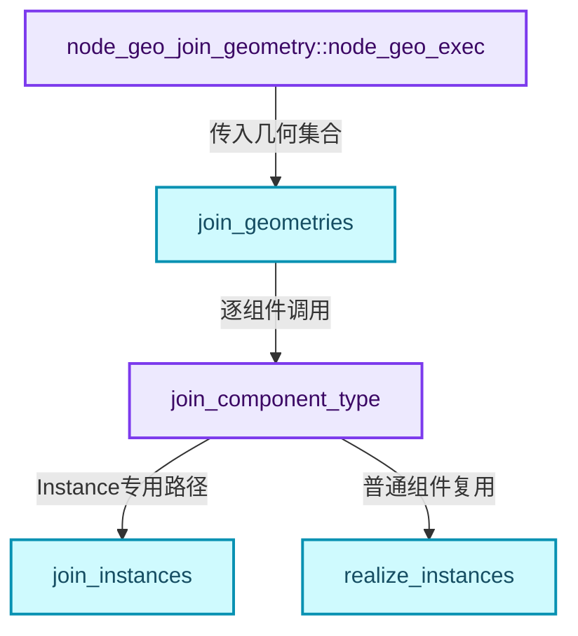
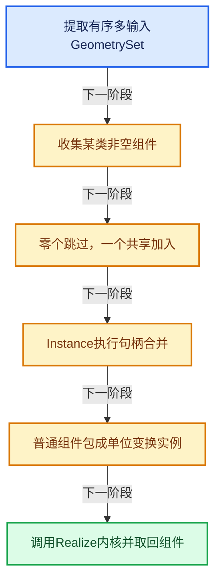
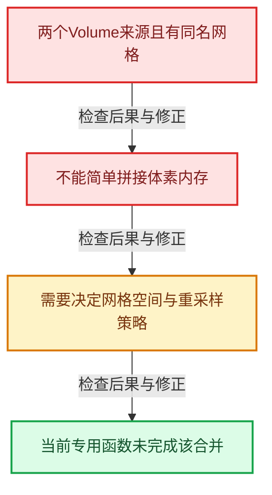

# GN-16 JoinGeometry组件分派与Realize复用

[几何节点学习地图](../%E5%87%A0%E4%BD%95%E8%8A%82%E7%82%B9%E6%89%A9%E5%B1%95%E5%AD%A6%E4%B9%A0%E5%9C%B0%E5%9B%BE.md) · [方向导航](README.md) · [全局实现索引](../%E7%AC%A6%E5%8F%B7%E4%BE%9D%E8%B5%96%E4%B8%8E%E5%AE%9E%E7%8E%B0%E7%B4%A2%E5%BC%95.md)

基准：`cbda6b96c26c0dee3c3b5cbb93960c4ac06a6b30`；文件哈希及连续摘录区间记录在[新增专题证据](../_evidence/geometry-extension.json)。本篇围绕所选函数解释核心机制，辅助依赖明确列出已定位实现与尚需类型确认的边界，不宣称相关整个文件已全文复核。

## 先回答一个具体问题

Join Geometry为什么不是把所有数组直接append？单组件和多组件怎样走不同路径？

## 相关类与数据的职责

- **`node_geo_join_geometry::node_geo_exec`**：适配多输入插槽与属性过滤。
- **`join_geometries`**：按组件Type组织合并并处理Bundle。
- **`join_component_type`**：按来源数和组件类型选择策略。
- **`join_instances`**：建立引用句柄重映射并合并属性。
- **`realize_instances`**：复用实体化内核合并普通几何组件。



上图箭头文字区分拥有、借用、调用和数据依赖。连线不表示这些类型存在同名继承关系；只有源码明确声明的继承才按继承理解。

## 设计推导与扩展知识

### 推导1

节点层只做输入提取、编辑辅助数据记录与内核调用。geometry::join_geometries是可复用的几何算法入口，可以被其他节点或操作复用，避免UI参数混入拓扑算法。

### 推导2

某个组件只有一个来源时result.add直接复用组件。多输入节点未必总产生大拷贝；要按每种组件的有效来源数量分析成本。

### 推导3

多个普通组件被包装成单位变换实例，再调用realize_instances。复用统一内核减少属性传播、材料映射和拓扑偏移的重复实现，但也引入包装与预处理成本。

### 推导4

join_instances先把数量转成OffsetIndices，再为每个源引用建立handle_map，gather到对应目标区间。普通属性通过join_attributes处理，.reference_index由专用句柄逻辑负责。

### 推导5

当前join_volumes多来源实现尚未支持同名网格的重采样合并。单一Volume来源仍可以通过单组件快捷路径加入，因此不能笼统说Volume在Join中永远无效。

### 推导6

allow_merging_instance_references控制是否合并相同引用。引用去重和实例去重是两件事；多个具有不同变换的实例不应因为来源相同就被删掉。

## 实际处理阶段



这张图概括本篇所讨论的主路径；等待输入、构建失败与不同策略的分支以下方完整代码为准，不能把概括图当作每次都会执行的无条件顺序。

## 教学注释代码与分段机制

<a id="f-13ad33c5be20122a"></a>

### `blender::nodes::node_geo_join_geometry_cc::node_geo_exec` · L21—L35

多输入值与NodeAttributeFilter从节点边界进入geometry算法。

实现位置：[source/blender/nodes/geometry/nodes/node_geo_join_geometry.cc](../../../../../source/blender/nodes/geometry/nodes/node_geo_join_geometry.cc)。

**教学注释版**

<!-- annotated:cd9204ad27353a -->

```cpp
static void node_geo_exec(GeoNodeExecParams params)
{
  GeoNodesMultiInput<GeometrySet> geometries =
      params.extract_input<GeoNodesMultiInput<GeometrySet>>("Geometry"_ustr);

  const NodeAttributeFilter &attribute_filter = params.get_attribute_filter("Geometry"_ustr);

  for (GeometrySet &geometry : geometries.values) {
    GeometryComponentEditData::remember_deformed_positions_if_necessary(geometry);
  }

  GeometrySet geometry_set_result = geometry::join_geometries(geometries.values, attribute_filter);

  params.set_output("Geometry"_ustr, std::move(geometry_set_result));
}
```

<details>
<summary>核对原始源码：source/blender/nodes/geometry/nodes/node_geo_join_geometry.cc · L21—L35</summary>

<!-- original:cd9204ad27353a:source/blender/nodes/geometry/nodes/node_geo_join_geometry.cc:21:35 -->

```cpp
static void node_geo_exec(GeoNodeExecParams params)
{
  GeoNodesMultiInput<GeometrySet> geometries =
      params.extract_input<GeoNodesMultiInput<GeometrySet>>("Geometry"_ustr);

  const NodeAttributeFilter &attribute_filter = params.get_attribute_filter("Geometry"_ustr);

  for (GeometrySet &geometry : geometries.values) {
    GeometryComponentEditData::remember_deformed_positions_if_necessary(geometry);
  }

  GeometrySet geometry_set_result = geometry::join_geometries(geometries.values, attribute_filter);

  params.set_output("Geometry"_ustr, std::move(geometry_set_result));
}
```

</details>

<details>
<summary>实现依赖入口与尚需类型确认的调用</summary>

本函数未纳入旧结构调用闭包；以上源码保留实际调用表达式，相关成员须按接收者类型继续定位。下方类关系入口提供对应定义。

</details>

<a id="f-f596d09e783de47b"></a>

### `blender::geometry::join_component_type` · L194—L247

来源数快捷路径、Instance与Volume特例、普通Realize复用三个层次。

实现位置：[source/blender/geometry/intern/join_geometries.cc](../../../../../source/blender/geometry/intern/join_geometries.cc)。

**教学注释版**

<!-- annotated:bdd2641a21cc9a -->

```cpp
static void join_component_type(const bke::GeometryComponent::Type component_type,
                                const Span<GeometrySet> src_geometry_sets,
                                const bke::AttributeFilter &attribute_filter,
                                const bool allow_merging_instance_references,
                                GeometrySet &result)
{
  Vector<const GeometryComponent *> components;
  for (const GeometrySet &geometry_set : src_geometry_sets) {
    const GeometryComponent *component = geometry_set.get_component(component_type);
    if (component != nullptr && !component->is_empty()) {
      components.append(component);
    }
  }

  if (components.is_empty()) {
    return;
  }
  if (components.size() == 1) {
    // [讲解] 单一有效来源共享加入，避免无意义的全量合并。
    result.add(*components.first());
    return;
  }

  switch (component_type) {
    case bke::GeometryComponent::Type::Instance:
      join_instances(components, allow_merging_instance_references, result);
      return;
    case bke::GeometryComponent::Type::Volume:
      join_volumes(components, result);
      return;
    default:
      break;
  }

  auto instances = std::make_unique<bke::Instances>(components.size());
  instances->transforms_for_write().fill(float4x4::identity());
  MutableSpan<int> handles = instances->reference_handles_for_write();
  Map<const GeometryComponent *, int> handle_by_component;
  for (const int i : components.index_range()) {
    const GeometryComponent *component = components[i];
    handles[i] = handle_by_component.lookup_or_add_cb(component, [&]() {
      GeometrySet tmp_geo;
      tmp_geo.add(*components[i]);
      return instances->add_new_reference(bke::InstanceReference{tmp_geo});
    });
  }

  RealizeInstancesOptions options;
  // [讲解] Join复用Realize时保持原几何ID，这与普通Realize节点策略不同。
  options.keep_original_ids = true;
  options.realize_instance_attributes = false;
  options.attribute_filter = attribute_filter;
  GeometrySet joined_components =
      realize_instances(GeometrySet::from_instances(std::move(instances)), options).geometry;
  result.add(joined_components.get_component_for_write(component_type));
}
```

<details>
<summary>核对原始源码：source/blender/geometry/intern/join_geometries.cc · L194—L247</summary>

<!-- original:bdd2641a21cc9a:source/blender/geometry/intern/join_geometries.cc:194:247 -->

```cpp
static void join_component_type(const bke::GeometryComponent::Type component_type,
                                const Span<GeometrySet> src_geometry_sets,
                                const bke::AttributeFilter &attribute_filter,
                                const bool allow_merging_instance_references,
                                GeometrySet &result)
{
  Vector<const GeometryComponent *> components;
  for (const GeometrySet &geometry_set : src_geometry_sets) {
    const GeometryComponent *component = geometry_set.get_component(component_type);
    if (component != nullptr && !component->is_empty()) {
      components.append(component);
    }
  }

  if (components.is_empty()) {
    return;
  }
  if (components.size() == 1) {
    result.add(*components.first());
    return;
  }

  switch (component_type) {
    case bke::GeometryComponent::Type::Instance:
      join_instances(components, allow_merging_instance_references, result);
      return;
    case bke::GeometryComponent::Type::Volume:
      join_volumes(components, result);
      return;
    default:
      break;
  }

  auto instances = std::make_unique<bke::Instances>(components.size());
  instances->transforms_for_write().fill(float4x4::identity());
  MutableSpan<int> handles = instances->reference_handles_for_write();
  Map<const GeometryComponent *, int> handle_by_component;
  for (const int i : components.index_range()) {
    const GeometryComponent *component = components[i];
    handles[i] = handle_by_component.lookup_or_add_cb(component, [&]() {
      GeometrySet tmp_geo;
      tmp_geo.add(*components[i]);
      return instances->add_new_reference(bke::InstanceReference{tmp_geo});
    });
  }

  RealizeInstancesOptions options;
  options.keep_original_ids = true;
  options.realize_instance_attributes = false;
  options.attribute_filter = attribute_filter;
  GeometrySet joined_components =
      realize_instances(GeometrySet::from_instances(std::move(instances)), options).geometry;
  result.add(joined_components.get_component_for_write(component_type));
}
```

</details>

<details>
<summary>实现依赖入口与尚需类型确认的调用</summary>

- `geometry_set.get_component`：L202的类型或分派协议；接收对象类型依赖auto、返回值或模板实例；不按同名猜测目标。
- `component->is_empty` → [blender::bke::is_empty · L91](../06-%E9%9A%90%E5%BC%8F%E5%85%B1%E4%BA%AB%E4%B8%8E%E7%BC%93%E5%AD%98%E7%B3%BB%E7%BB%9F/05-GeometrySet%E8%AF%BB%E5%86%99%E4%B8%8E%E5%A4%8D%E5%88%B6.md#f-b4b017a3f04968a2)。
- `components.append` → [blender::Vector::append · L498](../01-%E5%9F%BA%E7%A1%80%E5%AE%B9%E5%99%A8%E4%B8%8E%E7%8E%B0%E4%BB%A3CPP/11-Vector%E6%8F%92%E5%85%A5%E5%88%A0%E9%99%A4%E4%B8%8E%E9%87%8D%E6%8E%92.md#f-5bde268a69e443ec)；[blender::Vector::append · L502](../01-%E5%9F%BA%E7%A1%80%E5%AE%B9%E5%99%A8%E4%B8%8E%E7%8E%B0%E4%BB%A3CPP/11-Vector%E6%8F%92%E5%85%A5%E5%88%A0%E9%99%A4%E4%B8%8E%E9%87%8D%E6%8E%92.md#f-591e0b15e6308532)。多候选需按实参和重载规则确认。
- `components.is_empty` → [blender::Vector::is_empty · L792](../01-%E5%9F%BA%E7%A1%80%E5%AE%B9%E5%99%A8%E4%B8%8E%E7%8E%B0%E4%BB%A3CPP/11-Vector%E6%8F%92%E5%85%A5%E5%88%A0%E9%99%A4%E4%B8%8E%E9%87%8D%E6%8E%92.md#f-937bbd9cb80bdcc8)。
- `components.size` → [blender::Vector::size · L780](../01-%E5%9F%BA%E7%A1%80%E5%AE%B9%E5%99%A8%E4%B8%8E%E7%8E%B0%E4%BB%A3CPP/11-Vector%E6%8F%92%E5%85%A5%E5%88%A0%E9%99%A4%E4%B8%8E%E9%87%8D%E6%8E%92.md#f-714773731767349c)。
- `result.add` → [blender::bke::add · L164](../06-%E9%9A%90%E5%BC%8F%E5%85%B1%E4%BA%AB%E4%B8%8E%E7%BC%93%E5%AD%98%E7%B3%BB%E7%BB%9F/05-GeometrySet%E8%AF%BB%E5%86%99%E4%B8%8E%E5%A4%8D%E5%88%B6.md#f-818cd8e6e071a477)。
- `components.first` → [blender::Vector::first · L766](../01-%E5%9F%BA%E7%A1%80%E5%AE%B9%E5%99%A8%E4%B8%8E%E7%8E%B0%E4%BB%A3CPP/11-Vector%E6%8F%92%E5%85%A5%E5%88%A0%E9%99%A4%E4%B8%8E%E9%87%8D%E6%8E%92.md#f-2dacb3f08535697d)；[blender::Vector::first · L771](../01-%E5%9F%BA%E7%A1%80%E5%AE%B9%E5%99%A8%E4%B8%8E%E7%8E%B0%E4%BB%A3CPP/11-Vector%E6%8F%92%E5%85%A5%E5%88%A0%E9%99%A4%E4%B8%8E%E9%87%8D%E6%8E%92.md#f-1d394fd9ab82bf04)。多候选需按实参和重载规则确认。
- `join_instances` → [blender::geometry::join_instances · L142](%E6%89%A9%E5%B1%9505-JoinGeometry%E7%BB%84%E4%BB%B6%E5%88%86%E6%B4%BE%E4%B8%8ERealize%E5%A4%8D%E7%94%A8.md#f-d5dc6ce1fde0a4f4)。
- `join_volumes` → [blender::geometry::join_volumes · L187](%E4%BE%9D%E8%B5%96-join_geometries-e5d196.md#f-5120dc6fe22e84c4)。
- `std::make_unique<bke::Instances>`：创建独占拥有的对象，拥有关系可移动，get返回的借用指针不自动延长寿命。 [接口资料](https://eel.is/c++draft/unique.ptr.create)。
- `instances->transforms_for_write().fill`：L228的类型或分派协议；接收对象类型依赖auto、返回值或模板实例；不按同名猜测目标。
- `instances->transforms_for_write`：L228的类型或分派协议；接收对象类型依赖auto、返回值或模板实例；不按同名猜测目标。
- `float4x4::identity`：L228的类型或分派协议；函数指针、局部可调用对象或未展开的宏；必须结合调用者环境。
- `instances->reference_handles_for_write`：L229的类型或分派协议；接收对象类型依赖auto、返回值或模板实例；不按同名猜测目标。
- `components.index_range` → [blender::Vector::index_range · L1026](../01-%E5%9F%BA%E7%A1%80%E5%AE%B9%E5%99%A8%E4%B8%8E%E7%8E%B0%E4%BB%A3CPP/12-Vector%E5%BC%82%E5%B8%B8%E5%AE%89%E5%85%A8%E4%B8%8E%E8%BE%B9%E7%95%8C.md#f-ac29cf36ef185ab9)。
- `handle_by_component.lookup_or_add_cb` → [blender::Map::lookup_or_add_cb · L619](../02-%E5%93%88%E5%B8%8C%E8%A1%A8%E4%B8%8E%E5%85%B3%E8%81%94%E6%95%B0%E6%8D%AE%E7%BB%93%E6%9E%84/05-Map%E6%8F%92%E5%85%A5%E4%B8%8E%E5%9B%9E%E8%B0%83.md#f-6e15bb75721c1170)；[blender::Map::lookup_or_add_cb · L624](../02-%E5%93%88%E5%B8%8C%E8%A1%A8%E4%B8%8E%E5%85%B3%E8%81%94%E6%95%B0%E6%8D%AE%E7%BB%93%E6%9E%84/05-Map%E6%8F%92%E5%85%A5%E4%B8%8E%E5%9B%9E%E8%B0%83.md#f-9685875870107c12)。多候选需按实参和重载规则确认。
- `tmp_geo.add` → [blender::bke::add · L164](../06-%E9%9A%90%E5%BC%8F%E5%85%B1%E4%BA%AB%E4%B8%8E%E7%BC%93%E5%AD%98%E7%B3%BB%E7%BB%9F/05-GeometrySet%E8%AF%BB%E5%86%99%E4%B8%8E%E5%A4%8D%E5%88%B6.md#f-818cd8e6e071a477)。
- `instances->add_new_reference`：L236的类型或分派协议；接收对象类型依赖auto、返回值或模板实例；不按同名猜测目标。
- `realize_instances` → [blender::geometry::realize_instances · L2925](%E4%BE%9D%E8%B5%96-realize_instances-35ae92.md#f-1bab21a4d5d19aba)；[blender::geometry::realize_instances · L2939](%E6%89%A9%E5%B1%9506-RealizeInstances%E6%B7%B1%E5%BA%A6Field%E4%B8%8E%E4%BB%BB%E5%8A%A1%E6%B5%81%E6%B0%B4%E7%BA%BF.md#f-7004abf3ef784a6a)。多候选需按实参和重载规则确认。
- `GeometrySet::from_instances` → [blender::bke::from_instances · L455](../06-%E9%9A%90%E5%BC%8F%E5%85%B1%E4%BA%AB%E4%B8%8E%E7%BC%93%E5%AD%98%E7%B3%BB%E7%BB%9F/05-GeometrySet%E8%AF%BB%E5%86%99%E4%B8%8E%E5%A4%8D%E5%88%B6.md#f-0c23a168248fb2cb)；[blender::bke::from_instances · L462](../06-%E9%9A%90%E5%BC%8F%E5%85%B1%E4%BA%AB%E4%B8%8E%E7%BC%93%E5%AD%98%E7%B3%BB%E7%BB%9F/05-GeometrySet%E8%AF%BB%E5%86%99%E4%B8%8E%E5%A4%8D%E5%88%B6.md#f-447a100ea7cfda47)。多候选需按实参和重载规则确认。
- `std::move`：把表达式转换成可供移动重载选择的值类别；不保证真的移动，不结束源对象寿命，对const值可能选择复制。 [接口资料](https://eel.is/c++draft/utility.forward)。
- `joined_components.get_component_for_write` → [blender::bke::get_component_for_write · L119](../06-%E9%9A%90%E5%BC%8F%E5%85%B1%E4%BA%AB%E4%B8%8E%E7%BC%93%E5%AD%98%E7%B3%BB%E7%BB%9F/%E6%89%A9%E5%B1%9501-%E5%87%A0%E4%BD%95%E8%8A%82%E7%82%B9%E6%80%A7%E8%83%BD%E8%AF%8A%E6%96%AD%E4%B8%8E%E6%9E%B6%E6%9E%84%E8%AE%AD%E7%BB%83.md#f-21eccb196f5b9a78)；[blender::bke::GeometrySet::get_component_for_write · L180](../06-%E9%9A%90%E5%BC%8F%E5%85%B1%E4%BA%AB%E4%B8%8E%E7%BC%93%E5%AD%98%E7%B3%BB%E7%BB%9F/04-GeometryComponent%E5%85%B1%E4%BA%AB.md#f-496855aef114a782)。多候选需按实参和重载规则确认。

</details>

<a id="f-d5dc6ce1fde0a4f4"></a>

### `blender::geometry::join_instances` · L142—L185

offsets与handle_map分别解决输出区间和引用空间，不是同一张映射表。

实现位置：[source/blender/geometry/intern/join_geometries.cc](../../../../../source/blender/geometry/intern/join_geometries.cc)。

**教学注释版**

<!-- annotated:e839a653bbd48a -->

```cpp
static void join_instances(const Span<const GeometryComponent *> src_components,
                           const bool allow_merging_instance_references,
                           GeometrySet &result)
{
  Array<int> offsets_data(src_components.size() + 1);
  for (const int i : src_components.index_range()) {
    const auto &src_component = static_cast<const bke::InstancesComponent &>(*src_components[i]);
    offsets_data[i] = src_component.get()->instances_num();
  }
  const OffsetIndices offsets = offset_indices::accumulate_counts_to_offsets(offsets_data);

  auto dst_instances = std::make_unique<bke::Instances>(offsets.total_size());

  MutableSpan<int> all_handles = dst_instances->reference_handles_for_write();

  Map<std::reference_wrapper<const bke::InstanceReference>, int> new_handle_by_src_reference_cache;

  for (const int i : src_components.index_range()) {
    const auto &src_component = static_cast<const bke::InstancesComponent &>(*src_components[i]);
    const bke::Instances &src_instances = *src_component.get();

    const Span<bke::InstanceReference> src_references = src_instances.references();
    Array<int> handle_map(src_references.size());
    for (const int src_handle : src_references.index_range()) {
      const bke::InstanceReference &src_reference = src_references[src_handle];
      if (allow_merging_instance_references) {
        handle_map[src_handle] = new_handle_by_src_reference_cache.lookup_or_add_cb(
            src_reference, [&]() { return dst_instances->add_new_reference(src_reference); });
      }
      else {
        handle_map[src_handle] = dst_instances->add_new_reference(src_reference);
      }
    }

    const IndexRange dst_range = offsets[i];

    const Span<int> src_handles = src_instances.reference_handles();
    // [讲解] 按源实例句柄查重映射表，再写入该来源的目标区间。
    array_utils::gather(handle_map.as_span(), src_handles, all_handles.slice(dst_range));
  }

  result.replace_instances(dst_instances.release());
  auto &dst_component = result.get_component_for_write<bke::InstancesComponent>();
  join_attributes(src_components, dst_component, {".reference_index"});
}
```

<details>
<summary>核对原始源码：source/blender/geometry/intern/join_geometries.cc · L142—L185</summary>

<!-- original:e839a653bbd48a:source/blender/geometry/intern/join_geometries.cc:142:185 -->

```cpp
static void join_instances(const Span<const GeometryComponent *> src_components,
                           const bool allow_merging_instance_references,
                           GeometrySet &result)
{
  Array<int> offsets_data(src_components.size() + 1);
  for (const int i : src_components.index_range()) {
    const auto &src_component = static_cast<const bke::InstancesComponent &>(*src_components[i]);
    offsets_data[i] = src_component.get()->instances_num();
  }
  const OffsetIndices offsets = offset_indices::accumulate_counts_to_offsets(offsets_data);

  auto dst_instances = std::make_unique<bke::Instances>(offsets.total_size());

  MutableSpan<int> all_handles = dst_instances->reference_handles_for_write();

  Map<std::reference_wrapper<const bke::InstanceReference>, int> new_handle_by_src_reference_cache;

  for (const int i : src_components.index_range()) {
    const auto &src_component = static_cast<const bke::InstancesComponent &>(*src_components[i]);
    const bke::Instances &src_instances = *src_component.get();

    const Span<bke::InstanceReference> src_references = src_instances.references();
    Array<int> handle_map(src_references.size());
    for (const int src_handle : src_references.index_range()) {
      const bke::InstanceReference &src_reference = src_references[src_handle];
      if (allow_merging_instance_references) {
        handle_map[src_handle] = new_handle_by_src_reference_cache.lookup_or_add_cb(
            src_reference, [&]() { return dst_instances->add_new_reference(src_reference); });
      }
      else {
        handle_map[src_handle] = dst_instances->add_new_reference(src_reference);
      }
    }

    const IndexRange dst_range = offsets[i];

    const Span<int> src_handles = src_instances.reference_handles();
    array_utils::gather(handle_map.as_span(), src_handles, all_handles.slice(dst_range));
  }

  result.replace_instances(dst_instances.release());
  auto &dst_component = result.get_component_for_write<bke::InstancesComponent>();
  join_attributes(src_components, dst_component, {".reference_index"});
}
```

</details>

<details>
<summary>实现依赖入口与尚需类型确认的调用</summary>

- `src_components.size` → [blender::Span::size · L256](../01-%E5%9F%BA%E7%A1%80%E5%AE%B9%E5%99%A8%E4%B8%8E%E7%8E%B0%E4%BB%A3CPP/05-Span%E5%8F%AA%E8%AF%BB%E8%BF%9E%E7%BB%AD%E8%A7%86%E5%9B%BE.md#f-5f80fa006089c998)。
- `src_components.index_range` → [blender::Span::index_range · L405](../01-%E5%9F%BA%E7%A1%80%E5%AE%B9%E5%99%A8%E4%B8%8E%E7%8E%B0%E4%BB%A3CPP/05-Span%E5%8F%AA%E8%AF%BB%E8%BF%9E%E7%BB%AD%E8%A7%86%E5%9B%BE.md#f-caaa9b06e13e53e0)。
- `src_component.get()->instances_num`：L149的类型或分派协议；接收对象类型依赖auto、返回值或模板实例；不按同名猜测目标。
- `src_component.get`：L149的类型或分派协议；接收对象类型依赖auto、返回值或模板实例；不按同名猜测目标。
- `offset_indices::accumulate_counts_to_offsets` → [blender::offset_indices::accumulate_counts_to_offsets · L24](05-%E9%82%BB%E6%8E%A5%E5%85%B3%E7%B3%BB%E4%B8%8E%E5%89%8D%E7%BC%80%E5%92%8C.md#f-cfa9fbd186afcdd5)。
- `std::make_unique<bke::Instances>`：创建独占拥有的对象，拥有关系可移动，get返回的借用指针不自动延长寿命。 [接口资料](https://eel.is/c++draft/unique.ptr.create)。
- `offsets.total_size` → [blender::offset_indices::OffsetIndices::total_size · L58](02-OffsetIndices%E5%AE%8C%E6%95%B4%E6%8E%A5%E5%8F%A3.md#f-c111ffdac7a19248)。
- `dst_instances->reference_handles_for_write`：L155的类型或分派协议；接收对象类型依赖auto、返回值或模板实例；不按同名猜测目标。
- `src_instances.references` → [blender::bke::references · L290](%E4%BE%9D%E8%B5%96-instances-5b2776.md#f-d0561cd365f4ff3b)。
- `src_references.size` → [blender::Span::size · L256](../01-%E5%9F%BA%E7%A1%80%E5%AE%B9%E5%99%A8%E4%B8%8E%E7%8E%B0%E4%BB%A3CPP/05-Span%E5%8F%AA%E8%AF%BB%E8%BF%9E%E7%BB%AD%E8%A7%86%E5%9B%BE.md#f-5f80fa006089c998)。
- `src_references.index_range` → [blender::Span::index_range · L405](../01-%E5%9F%BA%E7%A1%80%E5%AE%B9%E5%99%A8%E4%B8%8E%E7%8E%B0%E4%BB%A3CPP/05-Span%E5%8F%AA%E8%AF%BB%E8%BF%9E%E7%BB%AD%E8%A7%86%E5%9B%BE.md#f-caaa9b06e13e53e0)。
- `new_handle_by_src_reference_cache.lookup_or_add_cb` → [blender::Map::lookup_or_add_cb · L619](../02-%E5%93%88%E5%B8%8C%E8%A1%A8%E4%B8%8E%E5%85%B3%E8%81%94%E6%95%B0%E6%8D%AE%E7%BB%93%E6%9E%84/05-Map%E6%8F%92%E5%85%A5%E4%B8%8E%E5%9B%9E%E8%B0%83.md#f-6e15bb75721c1170)；[blender::Map::lookup_or_add_cb · L624](../02-%E5%93%88%E5%B8%8C%E8%A1%A8%E4%B8%8E%E5%85%B3%E8%81%94%E6%95%B0%E6%8D%AE%E7%BB%93%E6%9E%84/05-Map%E6%8F%92%E5%85%A5%E4%B8%8E%E5%9B%9E%E8%B0%83.md#f-9685875870107c12)。多候选需按实参和重载规则确认。
- `dst_instances->add_new_reference`：L169的类型或分派协议；接收对象类型依赖auto、返回值或模板实例；不按同名猜测目标。
- `src_instances.reference_handles` → [blender::bke::reference_handles · L222](%E4%BE%9D%E8%B5%96-instances-5b2776.md#f-191adc84775057a7)。
- `array_utils::gather` → [blender::array_utils::gather · L187](../01-%E5%9F%BA%E7%A1%80%E5%AE%B9%E5%99%A8%E4%B8%8E%E7%8E%B0%E4%BB%A3CPP/20-%E5%AE%B9%E5%99%A8%E9%80%89%E6%8B%A9%E4%B8%8E%E7%8B%AC%E7%AB%8B%E5%AE%9E%E7%8E%B0.md#f-1760adec5858a42f)；[blender::array_utils::gather · L209](../01-%E5%9F%BA%E7%A1%80%E5%AE%B9%E5%99%A8%E4%B8%8E%E7%8E%B0%E4%BB%A3CPP/20-%E5%AE%B9%E5%99%A8%E9%80%89%E6%8B%A9%E4%B8%8E%E7%8B%AC%E7%AB%8B%E5%AE%9E%E7%8E%B0.md#f-a9f65820788454bf)；[blender::array_utils::gather · L225](../01-%E5%9F%BA%E7%A1%80%E5%AE%B9%E5%99%A8%E4%B8%8E%E7%8E%B0%E4%BB%A3CPP/20-%E5%AE%B9%E5%99%A8%E9%80%89%E6%8B%A9%E4%B8%8E%E7%8B%AC%E7%AB%8B%E5%AE%9E%E7%8E%B0.md#f-279764b4196f0b63)；[blender::array_utils::gather · L237](../01-%E5%9F%BA%E7%A1%80%E5%AE%B9%E5%99%A8%E4%B8%8E%E7%8E%B0%E4%BB%A3CPP/20-%E5%AE%B9%E5%99%A8%E9%80%89%E6%8B%A9%E4%B8%8E%E7%8B%AC%E7%AB%8B%E5%AE%9E%E7%8E%B0.md#f-e310fd489b49341b)；[blender::array_utils::gather · L268](../01-%E5%9F%BA%E7%A1%80%E5%AE%B9%E5%99%A8%E4%B8%8E%E7%8E%B0%E4%BB%A3CPP/20-%E5%AE%B9%E5%99%A8%E9%80%89%E6%8B%A9%E4%B8%8E%E7%8B%AC%E7%AB%8B%E5%AE%9E%E7%8E%B0.md#f-7b21c29791903615)；[blender::array_utils::gather · L63](../01-%E5%9F%BA%E7%A1%80%E5%AE%B9%E5%99%A8%E4%B8%8E%E7%8E%B0%E4%BB%A3CPP/%E4%BE%9D%E8%B5%96-array_utils-cbb70f.md#f-5c2b501b03ddbb1f)；[blender::array_utils::gather · L82](../01-%E5%9F%BA%E7%A1%80%E5%AE%B9%E5%99%A8%E4%B8%8E%E7%8E%B0%E4%BB%A3CPP/%E4%BE%9D%E8%B5%96-array_utils-cbb70f.md#f-ea4dd9e673fe81e4)。多候选需按实参和重载规则确认。
- `handle_map.as_span` → [blender::Array::as_span · L254](../01-%E5%9F%BA%E7%A1%80%E5%AE%B9%E5%99%A8%E4%B8%8E%E7%8E%B0%E4%BB%A3CPP/08-Array%E5%A4%8D%E5%88%B6%E7%A7%BB%E5%8A%A8%E4%B8%8E%E9%94%80%E6%AF%81.md#f-05fc77056a242032)。
- `all_handles.slice` → [blender::MutableSpan::slice · L579](../01-%E5%9F%BA%E7%A1%80%E5%AE%B9%E5%99%A8%E4%B8%8E%E7%8E%B0%E4%BB%A3CPP/06-MutableSpan%E5%8F%AF%E5%86%99%E8%A7%86%E5%9B%BE.md#f-6808b4aefbf58808)；[blender::MutableSpan::slice · L587](../01-%E5%9F%BA%E7%A1%80%E5%AE%B9%E5%99%A8%E4%B8%8E%E7%8E%B0%E4%BB%A3CPP/06-MutableSpan%E5%8F%AF%E5%86%99%E8%A7%86%E5%9B%BE.md#f-c05b010821861e4f)。多候选需按实参和重载规则确认。
- `result.replace_instances` → [blender::bke::replace_instances · L505](../06-%E9%9A%90%E5%BC%8F%E5%85%B1%E4%BA%AB%E4%B8%8E%E7%BC%93%E5%AD%98%E7%B3%BB%E7%BB%9F/05-GeometrySet%E8%AF%BB%E5%86%99%E4%B8%8E%E5%A4%8D%E5%88%B6.md#f-b26122377a17a66c)。
- `dst_instances.release`：L182的类型或分派协议；接收对象类型依赖auto、返回值或模板实例；不按同名猜测目标。
- `result.get_component_for_write<bke::InstancesComponent>` → [blender::bke::get_component_for_write · L119](../06-%E9%9A%90%E5%BC%8F%E5%85%B1%E4%BA%AB%E4%B8%8E%E7%BC%93%E5%AD%98%E7%B3%BB%E7%BB%9F/%E6%89%A9%E5%B1%9501-%E5%87%A0%E4%BD%95%E8%8A%82%E7%82%B9%E6%80%A7%E8%83%BD%E8%AF%8A%E6%96%AD%E4%B8%8E%E6%9E%B6%E6%9E%84%E8%AE%AD%E7%BB%83.md#f-21eccb196f5b9a78)；[blender::bke::GeometrySet::get_component_for_write · L180](../06-%E9%9A%90%E5%BC%8F%E5%85%B1%E4%BA%AB%E4%B8%8E%E7%BC%93%E5%AD%98%E7%B3%BB%E7%BB%9F/04-GeometryComponent%E5%85%B1%E4%BA%AB.md#f-496855aef114a782)。多候选需按实参和重载规则确认。
- `join_attributes` → [blender::geometry::join_attributes · L113](%E4%BE%9D%E8%B5%96-join_geometries-e5d196.md#f-c3141fe79f548c6d)。

</details>

## 用小数据走一遍

1. 输入A有2个实例，B有3个实例。
2. counts=[2,3]变offsets=[0,2,5]。
3. 各源句柄经handle_map重映射。
4. 目标有5个实例。


这是明确输入条件下的教学推演，不是本地性能实测。对源码的验证应同时检查数值、对象寿命、输出需求和数据是否存在。

## 反例与边界

- 两个Volume来源且有同名网格。
- 不能简单拼接体素内存。
- 需要决定网格空间与重采样策略。
- 当前专用函数未完成该合并。



## 历史提交阅读

本地历史阅读样本：**Hans Goudey**，2026-04-09T17:21:51+02:00。

`64640aa853cc2970a2d2cfa3dd0a9de1c50efb7c`

提交标题：Refactor: Nodes: Use UString for idnames in some API functions

[所选文件的真实diff](../_evidence/geometry-history/GN-16.patch)。这是本地历史中匹配作者的近期样本，不冒称该系统的最初引入提交。阅读时先找变更前后的不变量，再检查新增分支与测试；本篇当前源码说明不混用历史签名。

## 独立实现与验收

分析零来源、单来源、多个Instances与多个Mesh四种成本路径。

<details>
<summary>参考思路</summary>

分别对应跳过、共享组件、句柄及属性合并、包装实例后Realize。不要统一标成O(顶点总数)忽略快捷路径。

</details>

验收时保留一个能击穿错误设计的反例，再对照实际符号重走调用链。教学练习未在完整Blender中运行；本轮独立运行的模型验证另见新增专题验收报告。

## 继续阅读

- [GN-08 GeometrySet组件组合与写时分离](%E6%89%A9%E5%B1%9501-GeometrySet%E7%BB%84%E4%BB%B6%E7%BB%84%E5%90%88%E4%B8%8E%E5%86%99%E6%97%B6%E5%88%86%E7%A6%BB.md)
- [GN-12 属性捕获求值暂存与提交协议](%E6%89%A9%E5%B1%9502-%E5%B1%9E%E6%80%A7%E6%8D%95%E8%8E%B7%E6%B1%82%E5%80%BC%E6%9A%82%E5%AD%98%E4%B8%8E%E6%8F%90%E4%BA%A4%E5%8D%8F%E8%AE%AE.md)
- [GN-14 Instances引用表句柄与变换数组](%E6%89%A9%E5%B1%9503-Instances%E5%BC%95%E7%94%A8%E8%A1%A8%E5%8F%A5%E6%9F%84%E4%B8%8E%E5%8F%98%E6%8D%A2%E6%95%B0%E7%BB%84.md)
- [GN-15 InstanceOnPoints选择压缩与引用重映射](%E6%89%A9%E5%B1%9504-InstanceOnPoints%E9%80%89%E6%8B%A9%E5%8E%8B%E7%BC%A9%E4%B8%8E%E5%BC%95%E7%94%A8%E9%87%8D%E6%98%A0%E5%B0%84.md)
- [GN-17 RealizeInstances深度Field与任务流水线](%E6%89%A9%E5%B1%9506-RealizeInstances%E6%B7%B1%E5%BA%A6Field%E4%B8%8E%E4%BB%BB%E5%8A%A1%E6%B5%81%E6%B0%B4%E7%BA%BF.md)
