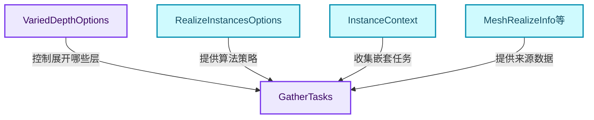
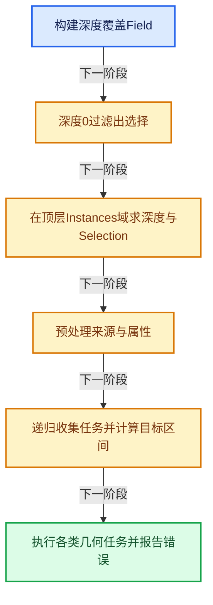
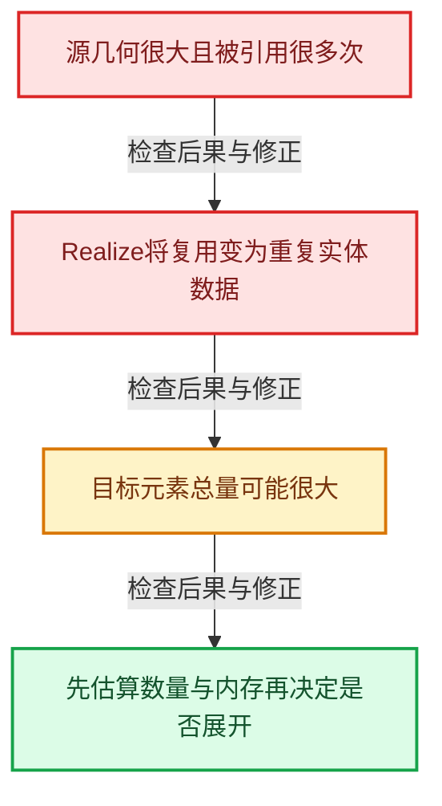

# GN-17 RealizeInstances深度Field与任务流水线

[几何节点学习地图](../%E5%87%A0%E4%BD%95%E8%8A%82%E7%82%B9%E6%89%A9%E5%B1%95%E5%AD%A6%E4%B9%A0%E5%9C%B0%E5%9B%BE.md) · [方向导航](README.md) · [全局实现索引](../%E7%AC%A6%E5%8F%B7%E4%BE%9D%E8%B5%96%E4%B8%8E%E5%AE%9E%E7%8E%B0%E7%B4%A2%E5%BC%95.md)

基准：`cbda6b96c26c0dee3c3b5cbb93960c4ac06a6b30`；文件哈希及连续摘录区间记录在[新增专题证据](../_evidence/geometry-extension.json)。本篇围绕所选函数解释核心机制，辅助依赖明确列出已定位实现与尚需类型确认的边界，不宣称相关整个文件已全文复核。

## 先回答一个具体问题

展开实例为什么需要预处理、任务收集和属性回退？Realize All与Depth怎样组合？

## 相关类与数据的职责

- **`VariedDepthOptions`**：逐顶层实例的深度与选择。 定义入口：[source/blender/geometry/GEO_realize_instances.hh · L43](../../../../../source/blender/geometry/GEO_realize_instances.hh)。
- **`RealizeInstancesOptions`**：控制ID、属性、域兼容与法线处理。 定义入口：[source/blender/geometry/GEO_realize_instances.hh · L18](../../../../../source/blender/geometry/GEO_realize_instances.hh)。
- **`GatherTasks`**：保存需写入目标几何的任务集合。 定义入口：[source/blender/geometry/intern/realize_instances.cc · L294](../../../../../source/blender/geometry/intern/realize_instances.cc)。
- **`InstanceContext`**：沿嵌套引用传递变换与属性回退环境。 定义入口：[source/blender/geometry/intern/realize_instances.cc · L360](../../../../../source/blender/geometry/intern/realize_instances.cc)。
- **`MeshRealizeInfo等`**：预处理可复用来源数据，减少重复分析。



上图箭头文字区分拥有、借用、调用和数据依赖。连线不表示这些类型存在同名继承关系；只有源码明确声明的继承才按继承理解。

## 设计推导与扩展知识

### 推导1

Realize All为true时深度变为MAX_DEPTH；否则depth至少为0。随后selection_override将depth==0的实例排除，这两个FieldOperation把策略组合保持在Field层。

### 推导2

用户Selection和Depth在顶层InstancesFieldContext求值，不是对源Mesh顶点求值。同一个顶层实例可带自己的展开深度，递归过程中需要把该限制传到对应引用分支。

### 推导3

预处理来源数据与收集每次引用任务分开，能避免一份来源被引用很多次就重复分析其材料、属性布局和拓扑结构。

### 推导4

每个任务包含目标区间与累积变换；分配目标数组后，不同任务可以写不相交区间。这种先确定布局再并行填充的设计比多个线程随意append更容易证明地址稳定和无冲突。

### 推导5

实例属性与源几何属性可能共同决定输出，缺失时还有回退。keep_original_ids、realize_instance_attributes和realize_to_point_domain等选项会改变语义，不能把所有Realize调用视为一个固定“复制顶点”动作。

### 推导6

Preserve Normals与镜像实例相关；节点将用户bool传入算法选项，具体拓扑及法线处理需继续读Mesh任务。这里不以节点包装代码代替内核所有数学细节。

## 实际处理阶段



这张图概括本篇所讨论的主路径；等待输入、构建失败与不同策略的分支以下方完整代码为准，不能把概括图当作每次都会执行的无条件顺序。

## 教学注释代码与分段机制

<a id="f-89787c2996087794"></a>

### `blender::nodes::node_geo_realize_instances_cc::node_geo_exec` · L53—L111

Field策略、顶层求值、算法Options和错误回传都在这个适配函数中。

实现位置：[source/blender/nodes/geometry/nodes/node_geo_realize_instances.cc](../../../../../source/blender/nodes/geometry/nodes/node_geo_realize_instances.cc)。

**教学注释版**

<!-- annotated:8d09f4c49bf274 -->

```cpp
static void node_geo_exec(GeoNodeExecParams params)
{
  GeometrySet geometry_set = params.extract_input<GeometrySet>("Geometry"_ustr);
  if (!geometry_set.has_instances()) {
    params.set_output("Geometry"_ustr, std::move(geometry_set));
    return;
  }

  GeometryComponentEditData::remember_deformed_positions_if_necessary(geometry_set);

  Field<bool> realize_all_field = params.extract_input<Field<bool>>("Realize All"_ustr);
  Field<int> depth_field = params.extract_input<Field<int>>("Depth"_ustr);
  const bNode &node = params.node();
  const bool realize_to_point_domain = node.custom1 & GEO_NODE_REALIZE_TO_POINT_DOMAIN;

  static auto depth_override = mf::build::SI2_SO<int, bool, int>(
      "depth_override", [](int depth, bool realize_all_field) {
        return realize_all_field ? geometry::VariedDepthOptions::MAX_DEPTH : std::max(depth, 0);
      });

  Field<int> depth_field_overridden(FieldOperation::from(
      depth_override, {std::move(depth_field), std::move(realize_all_field)}));

  Field<bool> selection_field = params.extract_input<Field<bool>>("Selection"_ustr);

  static auto selection_override = mf::build::SI2_SO<int, bool, bool>(
      "selection_override",
      [](int depth_override, bool selection) { return depth_override == 0 ? false : selection; });

  Field<bool> selection_field_overrided(FieldOperation::from(
      selection_override, {depth_field_overridden, std::move(selection_field)}));

  const bke::Instances &instances = *geometry_set.get_instances();
  const bke::InstancesFieldContext field_context(instances);
  fn::FieldEvaluator evaluator(field_context, instances.instances_num());

  const int evaluated_depth_index = evaluator.add(depth_field_overridden);
  evaluator.set_selection(selection_field_overrided);
  // [讲解] 完成本批登记Field与Selection求值，再进入后续结果读取或提交阶段。
  evaluator.evaluate();

  geometry::VariedDepthOptions varied_depth_option;
  varied_depth_option.depths = evaluator.get_evaluated<int>(evaluated_depth_index);
  varied_depth_option.selection = evaluator.get_evaluated_selection_as_mask();

  geometry::RealizeInstancesOptions options;
  options.keep_original_ids = false;
  options.realize_instance_attributes = true;
  options.realize_to_point_domain = realize_to_point_domain;
  options.preserve_normals = params.extract_input<bool>("Preserve Normals"_ustr);
  const NodeAttributeFilter attribute_filter = params.get_attribute_filter("Geometry"_ustr);
  options.attribute_filter = attribute_filter;
  geometry::RealizeInstancesResult realize_result = geometry::realize_instances(
      geometry_set, options, varied_depth_option);
  for (const StringRef error : realize_result.errors) {
    params.error_message_add(NodeWarningType::Error, error);
  }
  realize_result.geometry.set_name(geometry_set.name());
  params.set_output("Geometry"_ustr, std::move(realize_result.geometry));
}
```

<details>
<summary>核对原始源码：source/blender/nodes/geometry/nodes/node_geo_realize_instances.cc · L53—L111</summary>

<!-- original:8d09f4c49bf274:source/blender/nodes/geometry/nodes/node_geo_realize_instances.cc:53:111 -->

```cpp
static void node_geo_exec(GeoNodeExecParams params)
{
  GeometrySet geometry_set = params.extract_input<GeometrySet>("Geometry"_ustr);
  if (!geometry_set.has_instances()) {
    params.set_output("Geometry"_ustr, std::move(geometry_set));
    return;
  }

  GeometryComponentEditData::remember_deformed_positions_if_necessary(geometry_set);

  Field<bool> realize_all_field = params.extract_input<Field<bool>>("Realize All"_ustr);
  Field<int> depth_field = params.extract_input<Field<int>>("Depth"_ustr);
  const bNode &node = params.node();
  const bool realize_to_point_domain = node.custom1 & GEO_NODE_REALIZE_TO_POINT_DOMAIN;

  static auto depth_override = mf::build::SI2_SO<int, bool, int>(
      "depth_override", [](int depth, bool realize_all_field) {
        return realize_all_field ? geometry::VariedDepthOptions::MAX_DEPTH : std::max(depth, 0);
      });

  Field<int> depth_field_overridden(FieldOperation::from(
      depth_override, {std::move(depth_field), std::move(realize_all_field)}));

  Field<bool> selection_field = params.extract_input<Field<bool>>("Selection"_ustr);

  static auto selection_override = mf::build::SI2_SO<int, bool, bool>(
      "selection_override",
      [](int depth_override, bool selection) { return depth_override == 0 ? false : selection; });

  Field<bool> selection_field_overrided(FieldOperation::from(
      selection_override, {depth_field_overridden, std::move(selection_field)}));

  const bke::Instances &instances = *geometry_set.get_instances();
  const bke::InstancesFieldContext field_context(instances);
  fn::FieldEvaluator evaluator(field_context, instances.instances_num());

  const int evaluated_depth_index = evaluator.add(depth_field_overridden);
  evaluator.set_selection(selection_field_overrided);
  evaluator.evaluate();

  geometry::VariedDepthOptions varied_depth_option;
  varied_depth_option.depths = evaluator.get_evaluated<int>(evaluated_depth_index);
  varied_depth_option.selection = evaluator.get_evaluated_selection_as_mask();

  geometry::RealizeInstancesOptions options;
  options.keep_original_ids = false;
  options.realize_instance_attributes = true;
  options.realize_to_point_domain = realize_to_point_domain;
  options.preserve_normals = params.extract_input<bool>("Preserve Normals"_ustr);
  const NodeAttributeFilter attribute_filter = params.get_attribute_filter("Geometry"_ustr);
  options.attribute_filter = attribute_filter;
  geometry::RealizeInstancesResult realize_result = geometry::realize_instances(
      geometry_set, options, varied_depth_option);
  for (const StringRef error : realize_result.errors) {
    params.error_message_add(NodeWarningType::Error, error);
  }
  realize_result.geometry.set_name(geometry_set.name());
  params.set_output("Geometry"_ustr, std::move(realize_result.geometry));
}
```

</details>

<details>
<summary>实现依赖入口与尚需类型确认的调用</summary>

本函数未纳入旧结构调用闭包；以上源码保留实际调用表达式，相关成员须按接收者类型继续定位。下方类关系入口提供对应定义。

</details>

<a id="f-671eb1d864ff83e7"></a>

### `blender::geometry::get_final_points_num` · L390—L406

从已排序任务最后一项的start加来源数量得到各类点总量；此函数本身没有调用valid_int_num，不能把范围检查挪到它的名下。

实现位置：[source/blender/geometry/intern/realize_instances.cc](../../../../../source/blender/geometry/intern/realize_instances.cc)。

**教学注释版**

<!-- annotated:b23ae95879e3c2 -->

```cpp
static int64_t get_final_points_num(const GatherTasks &tasks)
{
  int64_t points_num = 0;
  if (!tasks.pointcloud_tasks.is_empty()) {
    const RealizePointCloudTask &task = tasks.pointcloud_tasks.last();
    points_num += task.start_index + task.pointcloud_info->pointcloud->totpoint;
  }
  if (!tasks.mesh_tasks.is_empty()) {
    const RealizeMeshTask &task = tasks.mesh_tasks.last();
    points_num += task.start_indices.vert + task.mesh_info->mesh->verts_num;
  }
  if (!tasks.curve_tasks.is_empty()) {
    const RealizeCurveTask &task = tasks.curve_tasks.last();
    points_num += task.start_indices.point + task.curve_info->curves->geometry.point_num;
  }
  return points_num;
}
```

<details>
<summary>核对原始源码：source/blender/geometry/intern/realize_instances.cc · L390—L406</summary>

<!-- original:b23ae95879e3c2:source/blender/geometry/intern/realize_instances.cc:390:406 -->

```cpp
static int64_t get_final_points_num(const GatherTasks &tasks)
{
  int64_t points_num = 0;
  if (!tasks.pointcloud_tasks.is_empty()) {
    const RealizePointCloudTask &task = tasks.pointcloud_tasks.last();
    points_num += task.start_index + task.pointcloud_info->pointcloud->totpoint;
  }
  if (!tasks.mesh_tasks.is_empty()) {
    const RealizeMeshTask &task = tasks.mesh_tasks.last();
    points_num += task.start_indices.vert + task.mesh_info->mesh->verts_num;
  }
  if (!tasks.curve_tasks.is_empty()) {
    const RealizeCurveTask &task = tasks.curve_tasks.last();
    points_num += task.start_indices.point + task.curve_info->curves->geometry.point_num;
  }
  return points_num;
}
```

</details>

<details>
<summary>实现依赖入口与尚需类型确认的调用</summary>

- `tasks.pointcloud_tasks.is_empty`：L393的类型或分派协议；接收对象类型依赖auto、返回值或模板实例；不按同名猜测目标。
- `tasks.pointcloud_tasks.last`：L394的类型或分派协议；接收对象类型依赖auto、返回值或模板实例；不按同名猜测目标。
- `tasks.mesh_tasks.is_empty`：L397的类型或分派协议；接收对象类型依赖auto、返回值或模板实例；不按同名猜测目标。
- `tasks.mesh_tasks.last`：L398的类型或分派协议；接收对象类型依赖auto、返回值或模板实例；不按同名猜测目标。
- `tasks.curve_tasks.is_empty`：L401的类型或分派协议；接收对象类型依赖auto、返回值或模板实例；不按同名猜测目标。
- `tasks.curve_tasks.last`：L402的类型或分派协议；接收对象类型依赖auto、返回值或模板实例；不按同名猜测目标。

</details>

<a id="f-7004abf3ef784a6a"></a>

### `blender::geometry::realize_instances` · L2939—L3054

带VariedDepthOptions的重载显示预处理、任务收集和执行流水线。total_points_num乘32只是决定并行开销的粗估，不是精确内存统计。

实现位置：[source/blender/geometry/intern/realize_instances.cc](../../../../../source/blender/geometry/intern/realize_instances.cc)。

**教学注释版**

<!-- annotated:002e50320f70df -->

```cpp
RealizeInstancesResult realize_instances(bke::GeometrySet geometry_set,
                                         const RealizeInstancesOptions &options,
                                         const VariedDepthOptions &varied_depth_option)
{
  PRF_scope(ProfileCategory::Default);
  /* The algorithm works in three steps:
   * 1. Preprocess each unique geometry that is instanced (e.g. each `Mesh`).
   * 2. Gather "tasks" that need to be executed to realize the instances. Each task corresponds
   * to instances of the previously preprocessed geometry.
   * 3. Execute all tasks in parallel.
   */

  if (!geometry_set.has_instances()) {
    return {geometry_set};
  }

  bke::GeometrySet not_to_realize_set;
  propagate_instances_to_keep(
      geometry_set, varied_depth_option.selection, not_to_realize_set, options.attribute_filter);

  if (options.keep_original_ids) {
    remove_id_attribute_from_instances(geometry_set);
  }

  AllPointCloudsInfo all_pointclouds_info = preprocess_pointclouds(
      geometry_set, options, varied_depth_option);
  AllMeshesInfo all_meshes_info = preprocess_meshes(geometry_set, options, varied_depth_option);
  AllCurvesInfo all_curves_info = preprocess_curves(geometry_set, options, varied_depth_option);
  AllGreasePencilsInfo all_grease_pencils_info = preprocess_grease_pencils(
      geometry_set, options, varied_depth_option);
  OrderedAttributes all_instance_attributes = gather_generic_instance_attributes_to_propagate(
      geometry_set, options, varied_depth_option);

  const bool create_id_attribute = all_pointclouds_info.create_id_attribute ||
                                   all_meshes_info.create_id_attribute ||
                                   all_curves_info.create_id_attribute;
  ResourceScope temporary_arrays;
  GatherTasksInfo gather_info = {all_pointclouds_info,
                                 all_meshes_info,
                                 all_curves_info,
                                 all_grease_pencils_info,
                                 all_instance_attributes,
                                 create_id_attribute,
                                 varied_depth_option.selection,
                                 varied_depth_option.depths,
                                 temporary_arrays};

  if (not_to_realize_set.has_instances()) {
    gather_info.instances.instances_components_to_merge.append(
        not_to_realize_set.get_component_for_write<bke::InstancesComponent>().copy());
    gather_info.instances.instances_components_transforms.append(float4x4::identity());
    gather_info.instances.attribute_fallback.append(gather_info.instances_attriubutes.size());
  }

  const float4x4 transform = float4x4::identity();
  InstanceContext attribute_fallbacks(gather_info);

  initialize_curves_builtin_attribute_defaults(all_curves_info, attribute_fallbacks);

  {
    PRF_scope_with_name("gather_realize_tasks_recursive", ProfileCategory::Default);
    gather_realize_tasks_recursive(gather_info,
                                   0,
                                   VariedDepthOptions::MAX_DEPTH,
                                   geometry_set,
                                   transform,
                                   attribute_fallbacks);
  }

  RealizeInstancesResult result;
  execute_instances_tasks(gather_info.instances.instances_components_to_merge,
                          gather_info.instances.instances_components_transforms,
                          all_instance_attributes,
                          gather_info.instances.attribute_fallback,
                          result.geometry);

  const int64_t total_points_num = get_final_points_num(gather_info.r_tasks);
  /* This doesn't have to be exact at all, it's just a rough estimate to make decisions about
   * multi-threading (overhead). */
  // [讲解] 32字节是并行开销启发式估计，不是精确峰值内存实测。
  const int64_t approximate_used_bytes_num = total_points_num * 32;
  threading::memory_bandwidth_bound_task(approximate_used_bytes_num, [&]() {
    execute_realize_pointcloud_tasks(options,
                                     gather_info.r_offsets,
                                     all_pointclouds_info,
                                     gather_info.r_tasks.pointcloud_tasks,
                                     all_pointclouds_info.attributes,
                                     result);
    execute_realize_mesh_tasks(options,
                               gather_info.r_offsets,
                               all_meshes_info,
                               gather_info.r_tasks.mesh_tasks,
                               all_meshes_info.attributes,
                               all_meshes_info.materials,
                               result);
    execute_realize_curve_tasks(options,
                                gather_info.r_offsets,
                                all_curves_info,
                                gather_info.r_tasks.curve_tasks,
                                all_curves_info.attributes,
                                result);
    execute_realize_grease_pencil_tasks(all_grease_pencils_info,
                                        gather_info.r_offsets,
                                        gather_info.r_tasks.grease_pencil_tasks,
                                        all_grease_pencils_info.attributes,
                                        result);
    execute_realize_edit_data_tasks(gather_info.r_tasks.edit_data_tasks, result.geometry);
  });
  if (gather_info.r_tasks.first_volume) {
    result.geometry.add(*gather_info.r_tasks.first_volume);
  }
  for (const nodes::Bundle *bundle : gather_info.r_tasks.bundles) {
    result.geometry.bundle_for_write().merge(*bundle);
  }

  return result;
}
```

<details>
<summary>核对原始源码：source/blender/geometry/intern/realize_instances.cc · L2939—L3054</summary>

<!-- original:002e50320f70df:source/blender/geometry/intern/realize_instances.cc:2939:3054 -->

```cpp
RealizeInstancesResult realize_instances(bke::GeometrySet geometry_set,
                                         const RealizeInstancesOptions &options,
                                         const VariedDepthOptions &varied_depth_option)
{
  PRF_scope(ProfileCategory::Default);
  /* The algorithm works in three steps:
   * 1. Preprocess each unique geometry that is instanced (e.g. each `Mesh`).
   * 2. Gather "tasks" that need to be executed to realize the instances. Each task corresponds
   * to instances of the previously preprocessed geometry.
   * 3. Execute all tasks in parallel.
   */

  if (!geometry_set.has_instances()) {
    return {geometry_set};
  }

  bke::GeometrySet not_to_realize_set;
  propagate_instances_to_keep(
      geometry_set, varied_depth_option.selection, not_to_realize_set, options.attribute_filter);

  if (options.keep_original_ids) {
    remove_id_attribute_from_instances(geometry_set);
  }

  AllPointCloudsInfo all_pointclouds_info = preprocess_pointclouds(
      geometry_set, options, varied_depth_option);
  AllMeshesInfo all_meshes_info = preprocess_meshes(geometry_set, options, varied_depth_option);
  AllCurvesInfo all_curves_info = preprocess_curves(geometry_set, options, varied_depth_option);
  AllGreasePencilsInfo all_grease_pencils_info = preprocess_grease_pencils(
      geometry_set, options, varied_depth_option);
  OrderedAttributes all_instance_attributes = gather_generic_instance_attributes_to_propagate(
      geometry_set, options, varied_depth_option);

  const bool create_id_attribute = all_pointclouds_info.create_id_attribute ||
                                   all_meshes_info.create_id_attribute ||
                                   all_curves_info.create_id_attribute;
  ResourceScope temporary_arrays;
  GatherTasksInfo gather_info = {all_pointclouds_info,
                                 all_meshes_info,
                                 all_curves_info,
                                 all_grease_pencils_info,
                                 all_instance_attributes,
                                 create_id_attribute,
                                 varied_depth_option.selection,
                                 varied_depth_option.depths,
                                 temporary_arrays};

  if (not_to_realize_set.has_instances()) {
    gather_info.instances.instances_components_to_merge.append(
        not_to_realize_set.get_component_for_write<bke::InstancesComponent>().copy());
    gather_info.instances.instances_components_transforms.append(float4x4::identity());
    gather_info.instances.attribute_fallback.append(gather_info.instances_attriubutes.size());
  }

  const float4x4 transform = float4x4::identity();
  InstanceContext attribute_fallbacks(gather_info);

  initialize_curves_builtin_attribute_defaults(all_curves_info, attribute_fallbacks);

  {
    PRF_scope_with_name("gather_realize_tasks_recursive", ProfileCategory::Default);
    gather_realize_tasks_recursive(gather_info,
                                   0,
                                   VariedDepthOptions::MAX_DEPTH,
                                   geometry_set,
                                   transform,
                                   attribute_fallbacks);
  }

  RealizeInstancesResult result;
  execute_instances_tasks(gather_info.instances.instances_components_to_merge,
                          gather_info.instances.instances_components_transforms,
                          all_instance_attributes,
                          gather_info.instances.attribute_fallback,
                          result.geometry);

  const int64_t total_points_num = get_final_points_num(gather_info.r_tasks);
  /* This doesn't have to be exact at all, it's just a rough estimate to make decisions about
   * multi-threading (overhead). */
  const int64_t approximate_used_bytes_num = total_points_num * 32;
  threading::memory_bandwidth_bound_task(approximate_used_bytes_num, [&]() {
    execute_realize_pointcloud_tasks(options,
                                     gather_info.r_offsets,
                                     all_pointclouds_info,
                                     gather_info.r_tasks.pointcloud_tasks,
                                     all_pointclouds_info.attributes,
                                     result);
    execute_realize_mesh_tasks(options,
                               gather_info.r_offsets,
                               all_meshes_info,
                               gather_info.r_tasks.mesh_tasks,
                               all_meshes_info.attributes,
                               all_meshes_info.materials,
                               result);
    execute_realize_curve_tasks(options,
                                gather_info.r_offsets,
                                all_curves_info,
                                gather_info.r_tasks.curve_tasks,
                                all_curves_info.attributes,
                                result);
    execute_realize_grease_pencil_tasks(all_grease_pencils_info,
                                        gather_info.r_offsets,
                                        gather_info.r_tasks.grease_pencil_tasks,
                                        all_grease_pencils_info.attributes,
                                        result);
    execute_realize_edit_data_tasks(gather_info.r_tasks.edit_data_tasks, result.geometry);
  });
  if (gather_info.r_tasks.first_volume) {
    result.geometry.add(*gather_info.r_tasks.first_volume);
  }
  for (const nodes::Bundle *bundle : gather_info.r_tasks.bundles) {
    result.geometry.bundle_for_write().merge(*bundle);
  }

  return result;
}
```

</details>

<details>
<summary>实现依赖入口与尚需类型确认的调用</summary>

- `PRF_scope`：宏定义见[intern/profile/PRF_profile.hh](../../../../../intern/profile/PRF_profile.hh), L51；按当前编译条件选择。
- `PRF_scope`：宏定义见[intern/profile/PRF_profile.hh](../../../../../intern/profile/PRF_profile.hh), L90；按当前编译条件选择。
- `geometry_set.has_instances` → [blender::bke::has_instances · L381](../06-%E9%9A%90%E5%BC%8F%E5%85%B1%E4%BA%AB%E4%B8%8E%E7%BC%93%E5%AD%98%E7%B3%BB%E7%BB%9F/05-GeometrySet%E8%AF%BB%E5%86%99%E4%B8%8E%E5%A4%8D%E5%88%B6.md#f-96f474fc46f602f1)。
- `propagate_instances_to_keep` → [blender::geometry::propagate_instances_to_keep · L2903](%E4%BE%9D%E8%B5%96-realize_instances-35ae92.md#f-9022e4383f1de714)。
- `remove_id_attribute_from_instances` → [blender::geometry::remove_id_attribute_from_instances · L2884](%E4%BE%9D%E8%B5%96-realize_instances-35ae92.md#f-a4a9bf86e24f9efd)。
- `preprocess_pointclouds` → [blender::geometry::preprocess_pointclouds · L1274](%E4%BE%9D%E8%B5%96-realize_instances-35ae92.md#f-c09310e51ea7a61c)。
- `preprocess_meshes` → [blender::geometry::preprocess_meshes · L1537](%E4%BE%9D%E8%B5%96-realize_instances-35ae92.md#f-d2fd76876ff1a4ae)。
- `preprocess_curves` → [blender::geometry::preprocess_curves · L2238](%E4%BE%9D%E8%B5%96-realize_instances-35ae92.md#f-440f6ab73041244b)。
- `preprocess_grease_pencils` → [blender::geometry::preprocess_grease_pencils · L2655](%E4%BE%9D%E8%B5%96-realize_instances-35ae92.md#f-c51c2a562bfbdc93)。
- `gather_generic_instance_attributes_to_propagate` → [blender::geometry::gather_generic_instance_attributes_to_propagate · L1096](%E4%BE%9D%E8%B5%96-realize_instances-35ae92.md#f-96c3b2d655f3c52f)。
- `not_to_realize_set.has_instances` → [blender::bke::has_instances · L381](../06-%E9%9A%90%E5%BC%8F%E5%85%B1%E4%BA%AB%E4%B8%8E%E7%BC%93%E5%AD%98%E7%B3%BB%E7%BB%9F/05-GeometrySet%E8%AF%BB%E5%86%99%E4%B8%8E%E5%A4%8D%E5%88%B6.md#f-96f474fc46f602f1)。
- `gather_info.instances.instances_components_to_merge.append`：L2987的类型或分派协议；接收对象类型依赖auto、返回值或模板实例；不按同名猜测目标。
- `not_to_realize_set.get_component_for_write<bke::InstancesComponent>().copy`：L2988的类型或分派协议；接收对象类型依赖auto、返回值或模板实例；不按同名猜测目标。
- `not_to_realize_set.get_component_for_write<bke::InstancesComponent>` → [blender::bke::get_component_for_write · L119](../06-%E9%9A%90%E5%BC%8F%E5%85%B1%E4%BA%AB%E4%B8%8E%E7%BC%93%E5%AD%98%E7%B3%BB%E7%BB%9F/%E6%89%A9%E5%B1%9501-%E5%87%A0%E4%BD%95%E8%8A%82%E7%82%B9%E6%80%A7%E8%83%BD%E8%AF%8A%E6%96%AD%E4%B8%8E%E6%9E%B6%E6%9E%84%E8%AE%AD%E7%BB%83.md#f-21eccb196f5b9a78)；[blender::bke::GeometrySet::get_component_for_write · L180](../06-%E9%9A%90%E5%BC%8F%E5%85%B1%E4%BA%AB%E4%B8%8E%E7%BC%93%E5%AD%98%E7%B3%BB%E7%BB%9F/04-GeometryComponent%E5%85%B1%E4%BA%AB.md#f-496855aef114a782)。多候选需按实参和重载规则确认。
- `gather_info.instances.instances_components_transforms.append`：L2989的类型或分派协议；接收对象类型依赖auto、返回值或模板实例；不按同名猜测目标。
- `float4x4::identity`：L2989的类型或分派协议；函数指针、局部可调用对象或未展开的宏；必须结合调用者环境。
- `gather_info.instances.attribute_fallback.append`：L2990的类型或分派协议；接收对象类型依赖auto、返回值或模板实例；不按同名猜测目标。
- `gather_info.instances_attriubutes.size`：L2990的类型或分派协议；接收对象类型依赖auto、返回值或模板实例；不按同名猜测目标。
- `initialize_curves_builtin_attribute_defaults` → [blender::geometry::initialize_curves_builtin_attribute_defaults · L2308](%E4%BE%9D%E8%B5%96-realize_instances-35ae92.md#f-88a38e31cdeb906b)。
- `PRF_scope_with_name`：宏定义见[intern/profile/PRF_profile.hh](../../../../../intern/profile/PRF_profile.hh), L52；按当前编译条件选择。
- `PRF_scope_with_name`：宏定义见[intern/profile/PRF_profile.hh](../../../../../intern/profile/PRF_profile.hh), L91；按当前编译条件选择。
- `gather_realize_tasks_recursive` → [blender::geometry::gather_realize_tasks_recursive · L775](%E4%BE%9D%E8%B5%96-realize_instances-35ae92.md#f-6a95ceaf8bb4404a)。
- `execute_instances_tasks` → [blender::geometry::execute_instances_tasks · L1115](%E4%BE%9D%E8%B5%96-realize_instances-35ae92.md#f-477168452dd3357e)。
- `get_final_points_num` → [blender::geometry::get_final_points_num · L390](%E6%89%A9%E5%B1%9506-RealizeInstances%E6%B7%B1%E5%BA%A6Field%E4%B8%8E%E4%BB%BB%E5%8A%A1%E6%B5%81%E6%B0%B4%E7%BA%BF.md#f-671eb1d864ff83e7)。
- `threading::memory_bandwidth_bound_task` → [blender::threading::memory_bandwidth_bound_task · L250](../11-Depsgraph%E4%B8%8E%E5%B9%B6%E8%A1%8C%E4%BB%BB%E5%8A%A1%E7%B3%BB%E7%BB%9F/07-%E4%BB%BB%E5%8A%A1%E6%B1%A0%E4%B8%8ETBB%E6%8E%A5%E5%85%A5.md#f-aa412ccec656928d)。
- `execute_realize_pointcloud_tasks` → [blender::geometry::execute_realize_pointcloud_tasks · L1381](%E4%BE%9D%E8%B5%96-realize_instances-35ae92.md#f-2ff789042779fbc9)。
- `execute_realize_mesh_tasks` → [blender::geometry::execute_realize_mesh_tasks · L1986](%E4%BE%9D%E8%B5%96-realize_instances-35ae92.md#f-21c6e7e191a3abef)。
- `execute_realize_curve_tasks` → [blender::geometry::execute_realize_curve_tasks · L2469](%E4%BE%9D%E8%B5%96-realize_instances-35ae92.md#f-d0145796238d618c)。
- `execute_realize_grease_pencil_tasks` → [blender::geometry::execute_realize_grease_pencil_tasks · L2756](%E4%BE%9D%E8%B5%96-realize_instances-35ae92.md#f-59fb605f4c1607de)。
- `execute_realize_edit_data_tasks` → [blender::geometry::execute_realize_edit_data_tasks · L2850](%E4%BE%9D%E8%B5%96-realize_instances-35ae92.md#f-bfd79d067be3b76f)。
- `result.geometry.add`：L3047的类型或分派协议；接收对象类型依赖auto、返回值或模板实例；不按同名猜测目标。
- `result.geometry.bundle_for_write().merge`：L3050的类型或分派协议；接收对象类型依赖auto、返回值或模板实例；不按同名猜测目标。
- `result.geometry.bundle_for_write`：L3050的类型或分派协议；接收对象类型依赖auto、返回值或模板实例；不按同名猜测目标。

</details>

## 支撑类型的完整声明

### `RealizeInstancesOptions`

对照上方职责阅读成员：哪些成员拥有资源，哪些只是索引、引用或指针。成员声明体现布局；其中函数仍应按实际调用进入相应实现。

<!-- annotated:828b7a1a201a7a -->

```cpp
struct RealizeInstancesOptions {
  /**
   * The default is to generate new ids for every element (when there was any id attribute in the
   * input). This avoids having a geometry that contains the same id many times.
   * When this is `true` the ids on the original geometries are kept unchanged and ids on instances
   * are ignored. Ids are zero initialized when the original geometry did not have an id.
   */
  bool keep_original_ids = false;
  /**
   * When `true` the output geometry will contain all the generic attributes that existed on
   * instances. Otherwise, instance attributes are ignored.
   */
  bool realize_instance_attributes = true;
  /** Propagate instance attributes to the point domain rather than the curve domain. */
  bool realize_to_point_domain = true;
  /** Reverse face winding for mesh instances with negative-determinant transforms. */
  bool preserve_normals = false;

  std::reference_wrapper<const bke::AttributeFilter> attribute_filter =
      bke::AttributeFilter::default_filter();
};
```

<details>
<summary>核对原始源码：source/blender/geometry/GEO_realize_instances.hh · L18—L38</summary>

<!-- original:828b7a1a201a7a:source/blender/geometry/GEO_realize_instances.hh:18:38 -->

```cpp
struct RealizeInstancesOptions {
  /**
   * The default is to generate new ids for every element (when there was any id attribute in the
   * input). This avoids having a geometry that contains the same id many times.
   * When this is `true` the ids on the original geometries are kept unchanged and ids on instances
   * are ignored. Ids are zero initialized when the original geometry did not have an id.
   */
  bool keep_original_ids = false;
  /**
   * When `true` the output geometry will contain all the generic attributes that existed on
   * instances. Otherwise, instance attributes are ignored.
   */
  bool realize_instance_attributes = true;
  /** Propagate instance attributes to the point domain rather than the curve domain. */
  bool realize_to_point_domain = true;
  /** Reverse face winding for mesh instances with negative-determinant transforms. */
  bool preserve_normals = false;

  std::reference_wrapper<const bke::AttributeFilter> attribute_filter =
      bke::AttributeFilter::default_filter();
};
```

</details>

### `VariedDepthOptions`

对照上方职责阅读成员：哪些成员拥有资源，哪些只是索引、引用或指针。成员声明体现布局；其中函数仍应按实际调用进入相应实现。

<!-- annotated:4528cbf0afaf4f -->

```cpp
struct VariedDepthOptions {
  /**
   * Selection of top-level instances to realize.
   */
  IndexMask selection;

  /**
   * Depth of realize instances for each selected top-level instance.
   */
  VArray<int> depths;

  /**
   * Use this value to realize the instance completely
   */
  static constexpr int MAX_DEPTH = -1;
};
```

<details>
<summary>核对原始源码：source/blender/geometry/GEO_realize_instances.hh · L43—L58</summary>

<!-- original:4528cbf0afaf4f:source/blender/geometry/GEO_realize_instances.hh:43:58 -->

```cpp
struct VariedDepthOptions {
  /**
   * Selection of top-level instances to realize.
   */
  IndexMask selection;

  /**
   * Depth of realize instances for each selected top-level instance.
   */
  VArray<int> depths;

  /**
   * Use this value to realize the instance completely
   */
  static constexpr int MAX_DEPTH = -1;
};
```

</details>

## 用小数据走一遍

1. 顶层实例0：depth=0。
2. 顶层实例1：depth=2。
3. 实例0保留引用。
4. 实例1最多展开两层并写入实际几何。


这是明确输入条件下的教学推演，不是本地性能实测。对源码的验证应同时检查数值、对象寿命、输出需求和数据是否存在。

## 反例与边界

- 源几何很大且被引用很多次。
- Realize将复用变为重复实体数据。
- 目标元素总量可能很大。
- 先估算数量与内存再决定是否展开。



## 历史提交阅读

本地历史阅读样本：**Jacques Lucke**，2026-05-22T23:42:11+02:00。

`3871d9d9f351c025e3a8cef99d1bc5139be0ac6f`

提交标题：Refactor: Geometry Nodes: improve naming for reference lifetimes in declaration

[所选文件的真实diff](../_evidence/geometry-history/GN-17.patch)。这是本地历史中匹配作者的近期样本，不冒称该系统的最初引入提交。阅读时先找变更前后的不变量，再检查新增分支与测试；本篇当前源码说明不混用历史签名。

## 独立实现与验收

给一棵两层实例树计算depth为0、1、MAX_DEPTH时哪些节点保留引用。

<details>
<summary>参考思路</summary>

按每个顶层实例独立传播剩余深度；区分来源去重与输出实体数量，重复引用仍可能产生重复实体元素。

</details>

验收时保留一个能击穿错误设计的反例，再对照实际符号重走调用链。教学练习未在完整Blender中运行；本轮独立运行的模型验证另见新增专题验收报告。

## 继续阅读

- [GN-08 GeometrySet组件组合与写时分离](%E6%89%A9%E5%B1%9501-GeometrySet%E7%BB%84%E4%BB%B6%E7%BB%84%E5%90%88%E4%B8%8E%E5%86%99%E6%97%B6%E5%88%86%E7%A6%BB.md)
- [GN-12 属性捕获求值暂存与提交协议](%E6%89%A9%E5%B1%9502-%E5%B1%9E%E6%80%A7%E6%8D%95%E8%8E%B7%E6%B1%82%E5%80%BC%E6%9A%82%E5%AD%98%E4%B8%8E%E6%8F%90%E4%BA%A4%E5%8D%8F%E8%AE%AE.md)
- [GN-14 Instances引用表句柄与变换数组](%E6%89%A9%E5%B1%9503-Instances%E5%BC%95%E7%94%A8%E8%A1%A8%E5%8F%A5%E6%9F%84%E4%B8%8E%E5%8F%98%E6%8D%A2%E6%95%B0%E7%BB%84.md)
- [GN-15 InstanceOnPoints选择压缩与引用重映射](%E6%89%A9%E5%B1%9504-InstanceOnPoints%E9%80%89%E6%8B%A9%E5%8E%8B%E7%BC%A9%E4%B8%8E%E5%BC%95%E7%94%A8%E9%87%8D%E6%98%A0%E5%B0%84.md)
- [GN-16 JoinGeometry组件分派与Realize复用](%E6%89%A9%E5%B1%9505-JoinGeometry%E7%BB%84%E4%BB%B6%E5%88%86%E6%B4%BE%E4%B8%8ERealize%E5%A4%8D%E7%94%A8.md)
- [GN-18 Simulation状态协议缓存与时间步](../10-%E5%BC%95%E7%94%A8%E7%94%9F%E5%91%BD%E5%91%A8%E6%9C%9F%E4%B8%8EClosure/%E6%89%A9%E5%B1%9502-Simulation%E7%8A%B6%E6%80%81%E5%8D%8F%E8%AE%AE%E7%BC%93%E5%AD%98%E4%B8%8E%E6%97%B6%E9%97%B4%E6%AD%A5.md)
