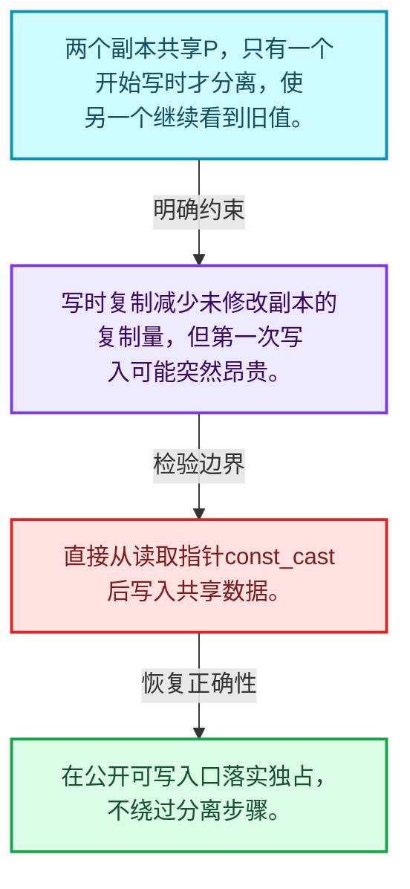
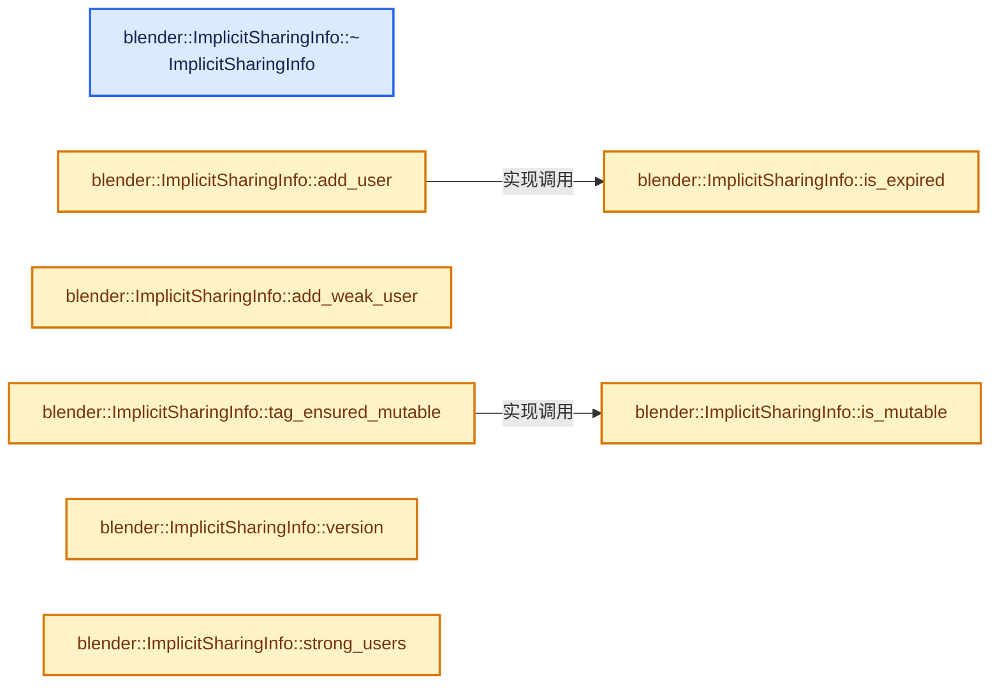
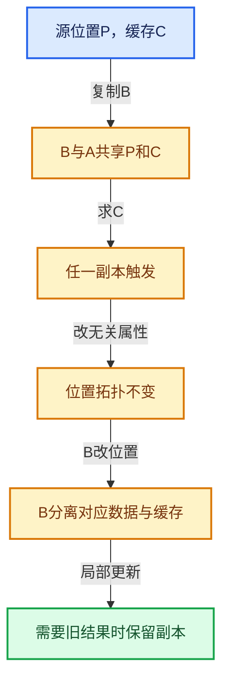

# 06-01 所有权与写时复制

[方向导航](README.md) · [总目录](../README.md) · [实现索引](../%E7%AC%A6%E5%8F%B7%E4%BE%9D%E8%B5%96%E4%B8%8E%E5%AE%9E%E7%8E%B0%E7%B4%A2%E5%BC%95.md)

## 从问题到实现

多个对象怎样安全共享不可变数据？

共享只延后复制，写入必须先保证独占；引用计数处理寿命而不是数据修改的逻辑同步。

**数据模型**

两个副本共享P，只有一个开始写时才分离，使另一个继续看到旧值。

**设计取舍**

写时复制减少未修改副本的复制量，但第一次写入可能突然昂贵。

**最小反例**

直接从读取指针const_cast后写入共享数据。

**推导**

在公开可写入口落实独占，不绕过分离步骤。

## 阅读地图与执行推演








图中的数值推演是本方向的教学模型；实际函数之间的调用边与概念分析边分别标注，不能把概念关系当作运行时调度顺序。

## 完整源码单元与就地讲解

中文讲解直接放在相关代码旁，复杂机制在代码下展开。原文折叠区保留基准行号；不需要在行号表和函数之间来回查找。类布局可分段展示，函数实现不按固定行数切开。

### 类型布局、声明与编译条件 · BLI_implicit_sharing.hh L1—L68

<a id="t-d8d7e7011078"></a>

`ImplicitSharingInfo`在这里声明的数据成员：

- `std::atomic<int> strong_users_`
- `std::atomic<int> weak_users_`
- `std::atomic<int64_t> version_`

<a id="t-dc87bad08784"></a>

`ImplicitSharingInfo`在这里声明的数据成员：

- `std::atomic<int> strong_users_`
- `std::atomic<int> weak_users_`
- `std::atomic<int64_t> version_`

<!-- annotated:9ee93275969d9d -->

```cpp
/* SPDX-FileCopyrightText: 2023 Blender Authors
 *
 * SPDX-License-Identifier: GPL-2.0-or-later */

#pragma once

/** \file
 * \ingroup bli
 */

#include <atomic>

#include "BLI_assert.hh"
#include "BLI_utility_mixins.hh"

#include "MEM_guardedalloc.h"

namespace blender {

class ImplicitSharingInfo;
using ImplicitSharingInfoHandle = ImplicitSharingInfo;

/**
 * #ImplicitSharingInfo is the core data structure for implicit sharing in Blender. Implicit
 * sharing is a technique that avoids copying data when it is not necessary. This results in better
 * memory usage and performance. Only read-only data can be shared, because otherwise multiple
 * owners might want to change the data in conflicting ways.
 *
 * To determine whether data is shared, #ImplicitSharingInfo keeps a user count. If the count is 1,
 * the data only has a single owner and is therefore mutable. If some code wants to modify data
 * that is currently shared, it has to make a copy first.
 * This behavior is also called "copy on write".
 *
 * In addition to containing the reference count, #ImplicitSharingInfo also knows how to destruct
 * the referenced data. This is important because the code freeing the data in the end might not
 * know how it was allocated (for example, it doesn't know whether an array was allocated using the
 * system or guarded allocator).
 *
 * #ImplicitSharingInfo can be used in two ways:
 * - It can be allocated separately from the referenced data. This is used when the shared data is
 *   e.g. a plain data array.
 * - It can be embedded into another struct. For that it's best to use #ImplicitSharingMixin.
 */
class ImplicitSharingInfo : NonCopyable, NonMovable {
 private:
  /**
   * Number of users that want to own the shared data. This can be in multiple states:
   * - 0: The data is expired and likely freed. It must not be accessed anymore. The
   *      #ImplicitSharingInfo may still be alive when there are weak users.
   * - 1: The data is mutable by the single owner.
   * - >1: The data is shared and therefore immutable.
   */
  mutable std::atomic<int> strong_users_ = 1;
  /**
   * Number of users that only keep a reference to the `ImplicitSharingInfo` but don't need to own
   * the shared data. One additional weak user is added as long as there is at least one strong
   * user. Together with the `version_` below this adds an efficient way to detect if data has been
   * changed.
   */
  mutable std::atomic<int> weak_users_ = 1;
  /**
   * The data referenced by an #ImplicitSharingInfo can change over time. This version is
   * incremented whenever the referenced data is about to be changed. This allows checking if the
   * data has been changed between points in time.
   */
  mutable std::atomic<int64_t> version_ = 0;

 public:
```

<details>
<summary>核对原始源码：source/blender/blenlib/BLI_implicit_sharing.hh · L1—L68</summary>

<!-- original:9ee93275969d9d:source/blender/blenlib/BLI_implicit_sharing.hh:1:68 -->

```cpp
/* SPDX-FileCopyrightText: 2023 Blender Authors
 *
 * SPDX-License-Identifier: GPL-2.0-or-later */

#pragma once

/** \file
 * \ingroup bli
 */

#include <atomic>

#include "BLI_assert.hh"
#include "BLI_utility_mixins.hh"

#include "MEM_guardedalloc.h"

namespace blender {

class ImplicitSharingInfo;
using ImplicitSharingInfoHandle = ImplicitSharingInfo;

/**
 * #ImplicitSharingInfo is the core data structure for implicit sharing in Blender. Implicit
 * sharing is a technique that avoids copying data when it is not necessary. This results in better
 * memory usage and performance. Only read-only data can be shared, because otherwise multiple
 * owners might want to change the data in conflicting ways.
 *
 * To determine whether data is shared, #ImplicitSharingInfo keeps a user count. If the count is 1,
 * the data only has a single owner and is therefore mutable. If some code wants to modify data
 * that is currently shared, it has to make a copy first.
 * This behavior is also called "copy on write".
 *
 * In addition to containing the reference count, #ImplicitSharingInfo also knows how to destruct
 * the referenced data. This is important because the code freeing the data in the end might not
 * know how it was allocated (for example, it doesn't know whether an array was allocated using the
 * system or guarded allocator).
 *
 * #ImplicitSharingInfo can be used in two ways:
 * - It can be allocated separately from the referenced data. This is used when the shared data is
 *   e.g. a plain data array.
 * - It can be embedded into another struct. For that it's best to use #ImplicitSharingMixin.
 */
class ImplicitSharingInfo : NonCopyable, NonMovable {
 private:
  /**
   * Number of users that want to own the shared data. This can be in multiple states:
   * - 0: The data is expired and likely freed. It must not be accessed anymore. The
   *      #ImplicitSharingInfo may still be alive when there are weak users.
   * - 1: The data is mutable by the single owner.
   * - >1: The data is shared and therefore immutable.
   */
  mutable std::atomic<int> strong_users_ = 1;
  /**
   * Number of users that only keep a reference to the `ImplicitSharingInfo` but don't need to own
   * the shared data. One additional weak user is added as long as there is at least one strong
   * user. Together with the `version_` below this adds an efficient way to detect if data has been
   * changed.
   */
  mutable std::atomic<int> weak_users_ = 1;
  /**
   * The data referenced by an #ImplicitSharingInfo can change over time. This version is
   * incremented whenever the referenced data is about to be changed. This allows checking if the
   * data has been changed between points in time.
   */
  mutable std::atomic<int64_t> version_ = 0;

 public:
```

</details>

<a id="f-197a1d33ed587b85"></a>

### `blender::ImplicitSharingInfo::~ImplicitSharingInfo`

实现位置：[source/blender/blenlib/BLI_implicit_sharing.hh](../../../../../source/blender/blenlib/BLI_implicit_sharing.hh) · L69—L73。

**教学注释版**

<!-- annotated:911897187936f2 -->

```cpp
  virtual ~ImplicitSharingInfo()
  {
    BLI_assert(strong_users_ == 0);
    BLI_assert(weak_users_ == 0);
  }
```

<details>
<summary>核对原始源码：source/blender/blenlib/BLI_implicit_sharing.hh · L69—L73</summary>

<!-- original:911897187936f2:source/blender/blenlib/BLI_implicit_sharing.hh:69:73 -->

```cpp
  virtual ~ImplicitSharingInfo()
  {
    BLI_assert(strong_users_ == 0);
    BLI_assert(weak_users_ == 0);
  }
```

</details>

**继续追踪实现**

- `BLI_assert` → [BLI_assert · L48](../01-%E5%9F%BA%E7%A1%80%E5%AE%B9%E5%99%A8%E4%B8%8E%E7%8E%B0%E4%BB%A3CPP/%E4%BE%9D%E8%B5%96-BLI_assert-cc98e8.md#m-57a88495704d)；[BLI_assert · L63](../01-%E5%9F%BA%E7%A1%80%E5%AE%B9%E5%99%A8%E4%B8%8E%E7%8E%B0%E4%BB%A3CPP/%E4%BE%9D%E8%B5%96-BLI_assert-cc98e8.md#m-d07050020cb5)。宏定义由构建条件选择。

### 类型布局、声明与编译条件 · BLI_implicit_sharing.hh L74—L75

<!-- annotated:2d96d0c240d6f0 -->

```cpp

  /** Whether the resource can be modified in place because there is only one owner. */
```

<details>
<summary>核对原始源码：source/blender/blenlib/BLI_implicit_sharing.hh · L74—L75</summary>

<!-- original:2d96d0c240d6f0:source/blender/blenlib/BLI_implicit_sharing.hh:74:75 -->

```cpp

  /** Whether the resource can be modified in place because there is only one owner. */
```

</details>

<a id="f-b4d31aba499caecb"></a>

### `blender::ImplicitSharingInfo::is_mutable`

检查相应共享状态是否允许独占修改。

实现位置：[source/blender/blenlib/BLI_implicit_sharing.hh](../../../../../source/blender/blenlib/BLI_implicit_sharing.hh) · L76—L79。

**教学注释版**

<!-- annotated:1dcc63fd47e7cd -->

```cpp
  bool is_mutable() const
  {
    return strong_users_.load(std::memory_order_relaxed) == 1;
  }
```

<details>
<summary>核对原始源码：source/blender/blenlib/BLI_implicit_sharing.hh · L76—L79</summary>

<!-- original:1dcc63fd47e7cd:source/blender/blenlib/BLI_implicit_sharing.hh:76:79 -->

```cpp
  bool is_mutable() const
  {
    return strong_users_.load(std::memory_order_relaxed) == 1;
  }
```

</details>

**接口与不变量**

独占拥有判断不自动使任意多线程写入安全。

**结果出口**

- `return strong_users_.load(std::memory_order_relaxed) == 1;`

**继续追踪实现**

- `strong_users_.load` → [外部契约](https://eel.is/c++draft/)：这个边界按实际表达式及所属类型核对参数、返回值、寿命与失败行为。这里提供接口入口，不声称已解释该第三方版本的内部实现。

### 类型布局、声明与编译条件 · BLI_implicit_sharing.hh L80—L84

<!-- annotated:05c75e242b97af -->

```cpp

  /**
   * Weak users don't protect the referenced data from being freed. If the data is freed while
   * there is still a weak referenced, this returns true.
   */
```

<details>
<summary>核对原始源码：source/blender/blenlib/BLI_implicit_sharing.hh · L80—L84</summary>

<!-- original:05c75e242b97af:source/blender/blenlib/BLI_implicit_sharing.hh:80:84 -->

```cpp

  /**
   * Weak users don't protect the referenced data from being freed. If the data is freed while
   * there is still a weak referenced, this returns true.
   */
```

</details>

<a id="f-2dc355bd9568b068"></a>

### `blender::ImplicitSharingInfo::is_expired`

实现位置：[source/blender/blenlib/BLI_implicit_sharing.hh](../../../../../source/blender/blenlib/BLI_implicit_sharing.hh) · L85—L88。

**教学注释版**

<!-- annotated:aab7600372daac -->

```cpp
  bool is_expired() const
  {
    return strong_users_.load(std::memory_order_acquire) == 0;
  }
```

<details>
<summary>核对原始源码：source/blender/blenlib/BLI_implicit_sharing.hh · L85—L88</summary>

<!-- original:aab7600372daac:source/blender/blenlib/BLI_implicit_sharing.hh:85:88 -->

```cpp
  bool is_expired() const
  {
    return strong_users_.load(std::memory_order_acquire) == 0;
  }
```

</details>

**结果出口**

- `return strong_users_.load(std::memory_order_acquire) == 0;`

**继续追踪实现**

- `strong_users_.load` → [外部契约](https://eel.is/c++draft/)：这个边界按实际表达式及所属类型核对参数、返回值、寿命与失败行为。这里提供接口入口，不声称已解释该第三方版本的内部实现。

### 类型布局、声明与编译条件 · BLI_implicit_sharing.hh L89—L90

<!-- annotated:33d0c30b77605b -->

```cpp

  /** Call when the data has a new additional owner. */
```

<details>
<summary>核对原始源码：source/blender/blenlib/BLI_implicit_sharing.hh · L89—L90</summary>

<!-- original:33d0c30b77605b:source/blender/blenlib/BLI_implicit_sharing.hh:89:90 -->

```cpp

  /** Call when the data has a new additional owner. */
```

</details>

<a id="f-741a32230373564f"></a>

### `blender::ImplicitSharingInfo::add_user`

维护强拥有者数量。

实现位置：[source/blender/blenlib/BLI_implicit_sharing.hh](../../../../../source/blender/blenlib/BLI_implicit_sharing.hh) · L91—L95。

**教学注释版**

<!-- annotated:22306728977fe7 -->

```cpp
  void add_user() const
  {
    BLI_assert(!this->is_expired());
    strong_users_.fetch_add(1, std::memory_order_relaxed);
  }
```

<details>
<summary>核对原始源码：source/blender/blenlib/BLI_implicit_sharing.hh · L91—L95</summary>

<!-- original:22306728977fe7:source/blender/blenlib/BLI_implicit_sharing.hh:91:95 -->

```cpp
  void add_user() const
  {
    BLI_assert(!this->is_expired());
    strong_users_.fetch_add(1, std::memory_order_relaxed);
  }
```

</details>

**接口与不变量**

最后一个强用户释放可能触发数据销毁；每份拥有责任需要严格配对。

**继续追踪实现**

- `BLI_assert` → [BLI_assert · L48](../01-%E5%9F%BA%E7%A1%80%E5%AE%B9%E5%99%A8%E4%B8%8E%E7%8E%B0%E4%BB%A3CPP/%E4%BE%9D%E8%B5%96-BLI_assert-cc98e8.md#m-57a88495704d)；[BLI_assert · L63](../01-%E5%9F%BA%E7%A1%80%E5%AE%B9%E5%99%A8%E4%B8%8E%E7%8E%B0%E4%BB%A3CPP/%E4%BE%9D%E8%B5%96-BLI_assert-cc98e8.md#m-d07050020cb5)。宏定义由构建条件选择。
- `this->is_expired` → [blender::ImplicitSharingInfo::is_expired · L85](01-%E6%89%80%E6%9C%89%E6%9D%83%E4%B8%8E%E5%86%99%E6%97%B6%E5%A4%8D%E5%88%B6.md#f-2dc355bd9568b068)。
- `strong_users_.fetch_add` → [外部契约](https://eel.is/c++draft/)：这个边界按实际表达式及所属类型核对参数、返回值、寿命与失败行为。这里提供接口入口，不声称已解释该第三方版本的内部实现。

### 类型布局、声明与编译条件 · BLI_implicit_sharing.hh L96—L104

<!-- annotated:970eb6d1b62896 -->

```cpp

  /**
   * Adding a weak owner prevents the #ImplicitSharingInfo from being freed but not the referenced
   * data.
   *
   * \note Unlike std::shared_ptr a weak user cannot be turned into a strong user. This is
   * because some code might change the referenced data assuming that there is only one strong user
   * while a new strong user is added by another thread.
   */
```

<details>
<summary>核对原始源码：source/blender/blenlib/BLI_implicit_sharing.hh · L96—L104</summary>

<!-- original:970eb6d1b62896:source/blender/blenlib/BLI_implicit_sharing.hh:96:104 -->

```cpp

  /**
   * Adding a weak owner prevents the #ImplicitSharingInfo from being freed but not the referenced
   * data.
   *
   * \note Unlike std::shared_ptr a weak user cannot be turned into a strong user. This is
   * because some code might change the referenced data assuming that there is only one strong user
   * while a new strong user is added by another thread.
   */
```

</details>

<a id="f-b7fa994ae87eec42"></a>

### `blender::ImplicitSharingInfo::add_weak_user`

维护对控制信息的弱使用关系。

实现位置：[source/blender/blenlib/BLI_implicit_sharing.hh](../../../../../source/blender/blenlib/BLI_implicit_sharing.hh) · L105—L108。

**教学注释版**

<!-- annotated:b3e4713caec885 -->

```cpp
  void add_weak_user() const
  {
    weak_users_.fetch_add(1, std::memory_order_relaxed);
  }
```

<details>
<summary>核对原始源码：source/blender/blenlib/BLI_implicit_sharing.hh · L105—L108</summary>

<!-- original:b3e4713caec885:source/blender/blenlib/BLI_implicit_sharing.hh:105:108 -->

```cpp
  void add_weak_user() const
  {
    weak_users_.fetch_add(1, std::memory_order_relaxed);
  }
```

</details>

**接口与不变量**

控制信息仍存在不代表数据本身仍存在，不能通过弱信息直接读取已释放对象。

**继续追踪实现**

- `weak_users_.fetch_add` → [外部契约](https://eel.is/c++draft/)：这个边界按实际表达式及所属类型核对参数、返回值、寿命与失败行为。这里提供接口入口，不声称已解释该第三方版本的内部实现。

### 类型布局、声明与编译条件 · BLI_implicit_sharing.hh L109—L114

<!-- annotated:3fe58c67a1327c -->

```cpp

  /**
   * Call this when making sure that the referenced data is mutable, which also implies that it is
   * about to be modified. This allows other code to detect whether data has not been changed very
   * efficiently.
   */
```

<details>
<summary>核对原始源码：source/blender/blenlib/BLI_implicit_sharing.hh · L109—L114</summary>

<!-- original:3fe58c67a1327c:source/blender/blenlib/BLI_implicit_sharing.hh:109:114 -->

```cpp

  /**
   * Call this when making sure that the referenced data is mutable, which also implies that it is
   * about to be modified. This allows other code to detect whether data has not been changed very
   * efficiently.
   */
```

</details>

<a id="f-b7d71fa0b9bc809d"></a>

### `blender::ImplicitSharingInfo::tag_ensured_mutable`

实现位置：[source/blender/blenlib/BLI_implicit_sharing.hh](../../../../../source/blender/blenlib/BLI_implicit_sharing.hh) · L115—L122。

**教学注释版**

<!-- annotated:d1622f755f8784 -->

```cpp
  void tag_ensured_mutable() const
  {
    // [讲解] this->is_mutable：检查相应共享状态是否允许独占修改。
    BLI_assert(this->is_mutable());
    /* This might not need an atomic increment when the #version method below is only called when
     * the code calling it is a strong user of this sharing info. Better be safe and use an atomic
     * for now. */
    version_.fetch_add(1, std::memory_order_acq_rel);
  }
```

<details>
<summary>核对原始源码：source/blender/blenlib/BLI_implicit_sharing.hh · L115—L122</summary>

<!-- original:d1622f755f8784:source/blender/blenlib/BLI_implicit_sharing.hh:115:122 -->

```cpp
  void tag_ensured_mutable() const
  {
    BLI_assert(this->is_mutable());
    /* This might not need an atomic increment when the #version method below is only called when
     * the code calling it is a strong user of this sharing info. Better be safe and use an atomic
     * for now. */
    version_.fetch_add(1, std::memory_order_acq_rel);
  }
```

</details>

**继续追踪实现**

- `BLI_assert` → [BLI_assert · L48](../01-%E5%9F%BA%E7%A1%80%E5%AE%B9%E5%99%A8%E4%B8%8E%E7%8E%B0%E4%BB%A3CPP/%E4%BE%9D%E8%B5%96-BLI_assert-cc98e8.md#m-57a88495704d)；[BLI_assert · L63](../01-%E5%9F%BA%E7%A1%80%E5%AE%B9%E5%99%A8%E4%B8%8E%E7%8E%B0%E4%BB%A3CPP/%E4%BE%9D%E8%B5%96-BLI_assert-cc98e8.md#m-d07050020cb5)。宏定义由构建条件选择。
- `this->is_mutable` → [blender::ImplicitSharingInfo::is_mutable · L76](01-%E6%89%80%E6%9C%89%E6%9D%83%E4%B8%8E%E5%86%99%E6%97%B6%E5%A4%8D%E5%88%B6.md#f-b4d31aba499caecb)。
- `version_.fetch_add` → [外部契约](https://eel.is/c++draft/)：这个边界按实际表达式及所属类型核对参数、返回值、寿命与失败行为。这里提供接口入口，不声称已解释该第三方版本的内部实现。

### 类型布局、声明与编译条件 · BLI_implicit_sharing.hh L123—L127

<!-- annotated:c9358da80244d0 -->

```cpp

  /**
   * Get a version number that is increased when the data is modified. It can be used to detect if
   * data has been changed.
   */
```

<details>
<summary>核对原始源码：source/blender/blenlib/BLI_implicit_sharing.hh · L123—L127</summary>

<!-- original:c9358da80244d0:source/blender/blenlib/BLI_implicit_sharing.hh:123:127 -->

```cpp

  /**
   * Get a version number that is increased when the data is modified. It can be used to detect if
   * data has been changed.
   */
```

</details>

<a id="f-6e3cd6856b154cd9"></a>

### `blender::ImplicitSharingInfo::version`

实现位置：[source/blender/blenlib/BLI_implicit_sharing.hh](../../../../../source/blender/blenlib/BLI_implicit_sharing.hh) · L128—L131。

**教学注释版**

<!-- annotated:16172d26e6585e -->

```cpp
  int64_t version() const
  {
    return version_.load(std::memory_order_acquire);
  }
```

<details>
<summary>核对原始源码：source/blender/blenlib/BLI_implicit_sharing.hh · L128—L131</summary>

<!-- original:16172d26e6585e:source/blender/blenlib/BLI_implicit_sharing.hh:128:131 -->

```cpp
  int64_t version() const
  {
    return version_.load(std::memory_order_acquire);
  }
```

</details>

**结果出口**

- `return version_.load(std::memory_order_acquire);`

**继续追踪实现**

- `version_.load` → [外部契约](https://eel.is/c++draft/)：这个边界按实际表达式及所属类型核对参数、返回值、寿命与失败行为。这里提供接口入口，不声称已解释该第三方版本的内部实现。

<!-- annotated:e7f9c852c94cb3 -->

```cpp

```

<details>
<summary>核对原始源码：source/blender/blenlib/BLI_implicit_sharing.hh · L132—L132</summary>

<!-- original:e7f9c852c94cb3:source/blender/blenlib/BLI_implicit_sharing.hh:132:132 -->

```cpp

```

</details>

<a id="f-6d7b726e895320e3"></a>

### `blender::ImplicitSharingInfo::strong_users`

实现位置：[source/blender/blenlib/BLI_implicit_sharing.hh](../../../../../source/blender/blenlib/BLI_implicit_sharing.hh) · L133—L136。

**教学注释版**

<!-- annotated:f7898b5bcaeb27 -->

```cpp
  int strong_users() const
  {
    return strong_users_.load(std::memory_order_acquire);
  }
```

<details>
<summary>核对原始源码：source/blender/blenlib/BLI_implicit_sharing.hh · L133—L136</summary>

<!-- original:f7898b5bcaeb27:source/blender/blenlib/BLI_implicit_sharing.hh:133:136 -->

```cpp
  int strong_users() const
  {
    return strong_users_.load(std::memory_order_acquire);
  }
```

</details>

**结果出口**

- `return strong_users_.load(std::memory_order_acquire);`

**继续追踪实现**

- `strong_users_.load` → [外部契约](https://eel.is/c++draft/)：这个边界按实际表达式及所属类型核对参数、返回值、寿命与失败行为。这里提供接口入口，不声称已解释该第三方版本的内部实现。

### 类型布局、声明与编译条件 · BLI_implicit_sharing.hh L137—L141

<!-- annotated:1852f0685ca360 -->

```cpp

  /**
   * Call when the data is no longer needed. This might just decrement the user count, or it might
   * also delete the data if this was the last user.
   */
```

<details>
<summary>核对原始源码：source/blender/blenlib/BLI_implicit_sharing.hh · L137—L141</summary>

<!-- original:1852f0685ca360:source/blender/blenlib/BLI_implicit_sharing.hh:137:141 -->

```cpp

  /**
   * Call when the data is no longer needed. This might just decrement the user count, or it might
   * also delete the data if this was the last user.
   */
```

</details>

<a id="f-b3e7edf61d0e96f5"></a>

### `blender::ImplicitSharingInfo::remove_user_and_delete_if_last`

实现位置：[source/blender/blenlib/BLI_implicit_sharing.hh](../../../../../source/blender/blenlib/BLI_implicit_sharing.hh) · L142—L165。

**教学注释版**

<!-- annotated:d41eb48b45e464 -->

```cpp
  void remove_user_and_delete_if_last() const
  {
    const int old_user_count = strong_users_.fetch_sub(1, std::memory_order_acq_rel);
    BLI_assert(old_user_count >= 1);
    const bool was_last_user = old_user_count == 1;
    if (was_last_user) {
      const int old_weak_user_count = weak_users_.load(std::memory_order_acquire);
      BLI_assert(old_weak_user_count >= 1);
      if (old_weak_user_count == 1) {
        /* If the weak user count is 1 it means that there is no actual weak user. The 1 just
         * indicates that there was still at least one strong user. */
        weak_users_ = 0;
        const_cast<ImplicitSharingInfo *>(this)->delete_self_with_data();
      }
      else {
        /* There is still at least one actual weak user, so don't free the sharing info yet. The
         * data can be freed though. */
        const_cast<ImplicitSharingInfo *>(this)->delete_data_only();
        /* Also remove the "fake" weak user that indicated that there was at least one strong
         * user. */
        this->remove_weak_user_and_delete_if_last();
      }
    }
  }
```

<details>
<summary>核对原始源码：source/blender/blenlib/BLI_implicit_sharing.hh · L142—L165</summary>

<!-- original:d41eb48b45e464:source/blender/blenlib/BLI_implicit_sharing.hh:142:165 -->

```cpp
  void remove_user_and_delete_if_last() const
  {
    const int old_user_count = strong_users_.fetch_sub(1, std::memory_order_acq_rel);
    BLI_assert(old_user_count >= 1);
    const bool was_last_user = old_user_count == 1;
    if (was_last_user) {
      const int old_weak_user_count = weak_users_.load(std::memory_order_acquire);
      BLI_assert(old_weak_user_count >= 1);
      if (old_weak_user_count == 1) {
        /* If the weak user count is 1 it means that there is no actual weak user. The 1 just
         * indicates that there was still at least one strong user. */
        weak_users_ = 0;
        const_cast<ImplicitSharingInfo *>(this)->delete_self_with_data();
      }
      else {
        /* There is still at least one actual weak user, so don't free the sharing info yet. The
         * data can be freed though. */
        const_cast<ImplicitSharingInfo *>(this)->delete_data_only();
        /* Also remove the "fake" weak user that indicated that there was at least one strong
         * user. */
        this->remove_weak_user_and_delete_if_last();
      }
    }
  }
```

</details>

**沿实际写入检查状态**

- `weak_users_ = 0;`

**继续追踪实现**

- `strong_users_.fetch_sub` → [外部契约](https://eel.is/c++draft/)：这个边界按实际表达式及所属类型核对参数、返回值、寿命与失败行为。这里提供接口入口，不声称已解释该第三方版本的内部实现。
- `BLI_assert` → [BLI_assert · L48](../01-%E5%9F%BA%E7%A1%80%E5%AE%B9%E5%99%A8%E4%B8%8E%E7%8E%B0%E4%BB%A3CPP/%E4%BE%9D%E8%B5%96-BLI_assert-cc98e8.md#m-57a88495704d)；[BLI_assert · L63](../01-%E5%9F%BA%E7%A1%80%E5%AE%B9%E5%99%A8%E4%B8%8E%E7%8E%B0%E4%BB%A3CPP/%E4%BE%9D%E8%B5%96-BLI_assert-cc98e8.md#m-d07050020cb5)。宏定义由构建条件选择。
- `weak_users_.load` → [外部契约](https://eel.is/c++draft/)：这个边界按实际表达式及所属类型核对参数、返回值、寿命与失败行为。这里提供接口入口，不声称已解释该第三方版本的内部实现。
- `const_cast<ImplicitSharingInfo *>(this)->delete_self_with_data` → [调用协议](../%E6%A8%A1%E6%9D%BF%E5%AE%8F%E4%B8%8E%E5%8A%A8%E6%80%81%E5%88%86%E6%B4%BE%E5%8D%8F%E8%AE%AE.md)：接收对象类型依赖auto、返回值或模板实例；不按同名猜测目标。调用位置L154。
- `const_cast<ImplicitSharingInfo *>(this)->delete_data_only` → [调用协议](../%E6%A8%A1%E6%9D%BF%E5%AE%8F%E4%B8%8E%E5%8A%A8%E6%80%81%E5%88%86%E6%B4%BE%E5%8D%8F%E8%AE%AE.md)：接收对象类型依赖auto、返回值或模板实例；不按同名猜测目标。调用位置L159。
- `this->remove_weak_user_and_delete_if_last` → [blender::ImplicitSharingInfo::remove_weak_user_and_delete_if_last · L171](02-ImplicitSharingInfo%E8%AE%A1%E6%95%B0.md#f-33f42460e9493840)。

## 语法与相关类型

### 只读限定 const

const约束当前访问路径可做的修改。const指针、指向const的指针、const视图对象、const元素是不同位置的限定；其他别名可能仍可修改原对象。

分别写T* const、const T*与const T* const，并画出不可修改的层次。

### 限定转换 const_cast

const_cast可以改变访问路径的限定，但不能让本来就是const的对象合法可写。常用于复用只读实现时，仍需检查底层对象是否实际可变。

对非const对象的const引用与真正const对象分别分析修改是否合法。

### 运行时多态 virtual

虚调用根据实际动态类型选择实现；经基类指针销毁对象时通常需要相应虚析构契约。每元素虚调用和循环外一次分派有不同开销。

找出虚接口的实现类和调用频率，再讨论是否值得去虚拟化。

### 原子操作 atomic

原子性保护相应原子对象的访问；发布其他普通数据还要分析内存序。多个原子字段分别安全不等于复合不变量整体原子。

画出写数据、发布ready与读ready、读数据的顺序关系。

### 构造与new表达式

普通new可能分配并构造；placement new在给定地址构造，存储由其他机制提供。失败回滚应区分两类责任。

追踪地址来自哪里、构造何时成功、由谁析构、由谁释放。

### 内部断言 assert

断言表达开发者预期成立的内部契约，发布构建可能关闭。它不能替代对不可信输入的完整错误处理，也不保证后续操作被运行时保护。

对每条断言构造违反条件的输入，区分调用者错误与应向用户报告的错误。

### 共享拥有 shared_ptr

shared_ptr让控制块跟踪共享寿命，不自动使被指向对象的读写线程安全；循环拥有可能阻止销毁。

画出强引用环并考虑是否应改变所有权方向或引入弱引用。

### 类型别名 using

类型别名为已有类型建立名字，不创建运行期对象。它常把模板内部使用的类型统一暴露给泛型调用者。

展开别名直到基础类型，区分类型别名和变量声明。

## 实现练习与验证

复制两份数组，只修改一份，验证另一份值保持原样。

参考推理：在公开可写入口落实独占，不绕过分离步骤。

改变副本不改变原对象结果；修改任一真实依赖后旧结果不可继续被当成有效缓存。

## 历史、跨库比较与证据

与shared_ptr比较寿命管理，与写时复制容器比较写边界，与普通memoization比较键的等价性；SharedCache把等价对象的派生结果放在共同控制对象中。

[历史提交索引](../%E5%8E%86%E5%8F%B2%E6%8F%90%E4%BA%A4%E4%B8%8E%E8%AE%BE%E8%AE%A1%E6%BC%94%E5%8C%96%E7%B4%A2%E5%BC%95.md) · [源码基准](../%E6%BA%90%E7%A0%81%E7%89%88%E6%9C%AC%E4%B8%8E%E8%A6%86%E7%9B%96%E7%B4%A2%E5%BC%95.md) · [验收报告](../%E9%AA%8C%E6%94%B6%E6%8A%A5%E5%91%8A.md)
