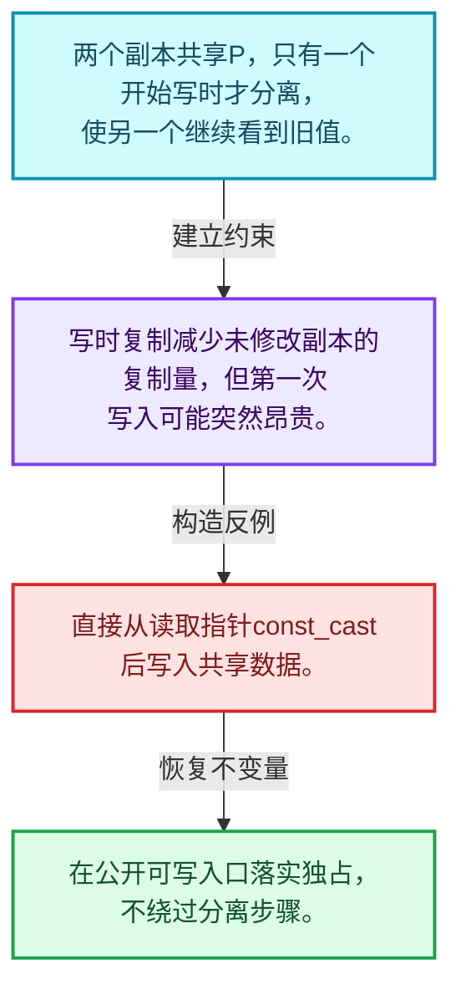
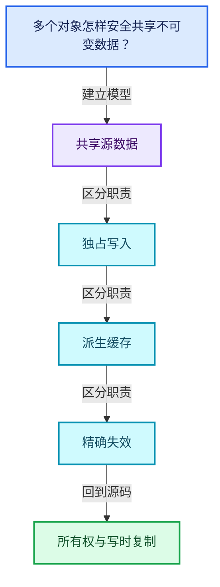
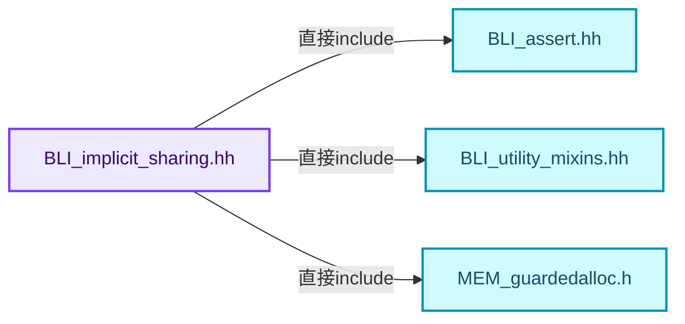
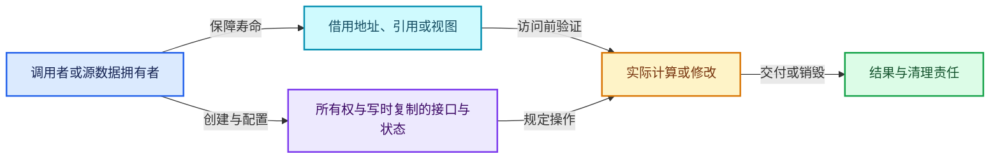
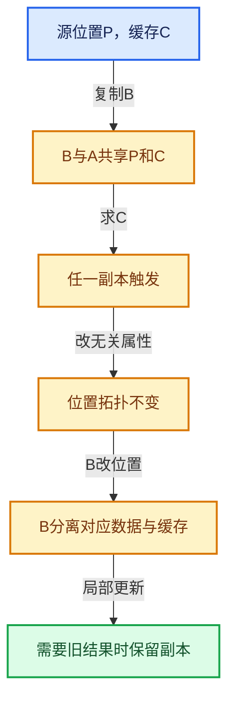

# 06-01 所有权与写时复制

[方向导航](README.md) · [总目录](../README.md) · [覆盖索引](../%E6%BA%90%E7%A0%81%E7%89%88%E6%9C%AC%E4%B8%8E%E8%A6%86%E7%9B%96%E7%B4%A2%E5%BC%95.md)

> 阅读顺序：问题与数据模型 → 语法与类型 → 源码逐行 → 调用线索 → 历史与取舍 → 推演和练习。

- 基准 HEAD：`cbda6b96c26c0dee3c3b5cbb93960c4ac06a6b30`。
- 记录日期：2026-10-14。
- 教学示例状态：正文中的推演不是本机性能实测；已运行练习见验收报告。

## 一、从问题到设计

多个对象怎样安全共享不可变数据？

共享只延后复制，写入必须先保证独占；引用计数处理寿命而不是数据修改的逻辑同步。

本篇把语法、数据语义和系统取舍连接起来。共享计数回答谁还活着，缓存依赖回答结果是否仍正确，两者不能互相替代。

### 本篇独立模型与设计推理

两个副本共享P，只有一个开始写时才分离，使另一个继续看到旧值。

设计取舍：写时复制减少未修改副本的复制量，但第一次写入可能突然昂贵。

最小反例：直接从读取指针const_cast后写入共享数据。

推导与处理：在公开可写入口落实独占，不绕过分离步骤。



### 源码范围与相邻篇章

| 文件 | 本篇逐行范围 | 基准SHA-256 |
|---|---|---|
| [source/blender/blenlib/BLI_implicit_sharing.hh](../../../../../source/blender/blenlib/BLI_implicit_sharing.hh) | L1—L165 | `ca734bf707495866db9b73fd8b9a8f4b59db22c419e1e3082023512106c61792` |

同一主讲文件可能分多篇覆盖；超出本篇范围的符号通过覆盖索引定位。空行与纯注释保留在源码摘录中，逐行表解释有效语句与语法边界；许可证头统一保留。

后篇：[ImplicitSharingInfo计数](02-ImplicitSharingInfo%E8%AE%A1%E6%95%B0.md).

## 二、类型、数据与阅读地图



这是概念依赖图，边表示阅读关系，不声称是运行时调用顺序。

### 直接编译依赖



箭头只表示头文件包含关系；完整调用线索见后面的符号定位表。

## 三、关键词、语法与类型角色

### 只读限定 const

const约束当前访问路径可做的修改。const指针、指向const的指针、const视图对象、const元素是不同位置的限定；其他别名可能仍可修改原对象。

具体检查：分别写T* const、const T*与const T* const，并画出不可修改的层次。

### 限定转换 const_cast

const_cast可以改变访问路径的限定，但不能让本来就是const的对象合法可写。常用于复用只读实现时，仍需检查底层对象是否实际可变。

具体检查：对非const对象的const引用与真正const对象分别分析修改是否合法。

### 运行时多态 virtual

虚调用根据实际动态类型选择实现；经基类指针销毁对象时通常需要相应虚析构契约。每元素虚调用和循环外一次分派有不同开销。

具体检查：找出虚接口的实现类和调用频率，再讨论是否值得去虚拟化。

### 原子操作 atomic

原子性保护相应原子对象的访问；发布其他普通数据还要分析内存序。多个原子字段分别安全不等于复合不变量整体原子。

具体检查：画出写数据、发布ready与读ready、读数据的顺序关系。

### 构造与new表达式

普通new可能分配并构造；placement new在给定地址构造，存储由其他机制提供。失败回滚应区分两类责任。

具体检查：追踪地址来自哪里、构造何时成功、由谁析构、由谁释放。

### 内部断言 assert

断言表达开发者预期成立的内部契约，发布构建可能关闭。它不能替代对不可信输入的完整错误处理，也不保证后续操作被运行时保护。

具体检查：对每条断言构造违反条件的输入，区分调用者错误与应向用户报告的错误。

### 共享拥有 shared_ptr

shared_ptr让控制块跟踪共享寿命，不自动使被指向对象的读写线程安全；循环拥有可能阻止销毁。

具体检查：画出强引用环并考虑是否应改变所有权方向或引入弱引用。

### 类型别名 using

类型别名为已有类型建立名字，不创建运行期对象。它常把模板内部使用的类型统一暴露给泛型调用者。

具体检查：展开别名直到基础类型，区分类型别名和变量声明。

## 四、真实源码与逐行讲解

源码块保持原行内容，原始行号由小节标题及逐行表给出。表中的调用定位是静态阅读辅助；重载、模板实例化、宏展开和虚调用需结合完整声明，不能仅凭词法出现证明动态调用。

### BLI_implicit_sharing.hh：L1—L45

<!-- source:source/blender/blenlib/BLI_implicit_sharing.hh:1:45 -->

```cpp
/* SPDX-FileCopyrightText: 2023 Blender Authors
 *
 * SPDX-License-Identifier: GPL-2.0-or-later */

#pragma once

/** \file
 * \ingroup bli
 */

#include <atomic>

#include "BLI_assert.hh"
#include "BLI_utility_mixins.hh"

#include "MEM_guardedalloc.h"

namespace blender {

class ImplicitSharingInfo;
using ImplicitSharingInfoHandle = ImplicitSharingInfo;

/**
 * #ImplicitSharingInfo is the core data structure for implicit sharing in Blender. Implicit
 * sharing is a technique that avoids copying data when it is not necessary. This results in better
 * memory usage and performance. Only read-only data can be shared, because otherwise multiple
 * owners might want to change the data in conflicting ways.
 *
 * To determine whether data is shared, #ImplicitSharingInfo keeps a user count. If the count is 1,
 * the data only has a single owner and is therefore mutable. If some code wants to modify data
 * that is currently shared, it has to make a copy first.
 * This behavior is also called "copy on write".
 *
 * In addition to containing the reference count, #ImplicitSharingInfo also knows how to destruct
 * the referenced data. This is important because the code freeing the data in the end might not
 * know how it was allocated (for example, it doesn't know whether an array was allocated using the
 * system or guarded allocator).
 *
 * #ImplicitSharingInfo can be used in two ways:
 * - It can be allocated separately from the referenced data. This is used when the shared data is
 *   e.g. a plain data array.
 * - It can be embedded into another struct. For that it's best to use #ImplicitSharingMixin.
 */
class ImplicitSharingInfo : NonCopyable, NonMovable {
 private:
```

| 原始行 | 语义、约束与检查 |
|---|---|
| L5 | 防止同一头文件在一个翻译单元中重复展开；不控制多个源文件之间的链接或对象寿命。 |
| L11 | 引入编译依赖 <atomic>；这是声明可见性关系，不表示运行时一定调用该文件的所有接口。 |
| L13 | 引入编译依赖 "BLI_assert.hh"；这是声明可见性关系，不表示运行时一定调用该文件的所有接口。 |
| L14 | 引入编译依赖 "BLI_utility_mixins.hh"；这是声明可见性关系，不表示运行时一定调用该文件的所有接口。 |
| L16 | 引入编译依赖 "MEM_guardedalloc.h"；这是声明可见性关系，不表示运行时一定调用该文件的所有接口。 |
| L18 | 把后续声明放入 blender 命名空间，影响名称查找和符号归属，不创建运行时对象。 |
| L20 | 声明或定义类型 `class ImplicitSharingInfo`。结合继承、访问权限和成员布局确认接口与拥有关系；前向声明本身没有完整对象布局。 |
| L21 | 定义类型别名 `using ImplicitSharingInfoHandle = ImplicitSharingInfo`，为模板接口或内部实现统一命名；本行不分配该类型对象。 |
| L44 | 声明或定义类型 `class ImplicitSharingInfo : NonCopyable, NonMovable`。结合继承、访问权限和成员布局确认接口与拥有关系；前向声明本身没有完整对象布局。 |
| L45 | 切换成员访问权限为 private；它是编译期接口边界，不是线程同步或内存保护。 |

### BLI_implicit_sharing.hh：L46—L95

<!-- source:source/blender/blenlib/BLI_implicit_sharing.hh:46:95 -->

```cpp
  /**
   * Number of users that want to own the shared data. This can be in multiple states:
   * - 0: The data is expired and likely freed. It must not be accessed anymore. The
   *      #ImplicitSharingInfo may still be alive when there are weak users.
   * - 1: The data is mutable by the single owner.
   * - >1: The data is shared and therefore immutable.
   */
  mutable std::atomic<int> strong_users_ = 1;
  /**
   * Number of users that only keep a reference to the `ImplicitSharingInfo` but don't need to own
   * the shared data. One additional weak user is added as long as there is at least one strong
   * user. Together with the `version_` below this adds an efficient way to detect if data has been
   * changed.
   */
  mutable std::atomic<int> weak_users_ = 1;
  /**
   * The data referenced by an #ImplicitSharingInfo can change over time. This version is
   * incremented whenever the referenced data is about to be changed. This allows checking if the
   * data has been changed between points in time.
   */
  mutable std::atomic<int64_t> version_ = 0;

 public:
  virtual ~ImplicitSharingInfo()
  {
    BLI_assert(strong_users_ == 0);
    BLI_assert(weak_users_ == 0);
  }

  /** Whether the resource can be modified in place because there is only one owner. */
  bool is_mutable() const
  {
    return strong_users_.load(std::memory_order_relaxed) == 1;
  }

  /**
   * Weak users don't protect the referenced data from being freed. If the data is freed while
   * there is still a weak referenced, this returns true.
   */
  bool is_expired() const
  {
    return strong_users_.load(std::memory_order_acquire) == 0;
  }

  /** Call when the data has a new additional owner. */
  void add_user() const
  {
    BLI_assert(!this->is_expired());
    strong_users_.fetch_add(1, std::memory_order_relaxed);
  }
```

本段语义重点：

- `add_user`：增加共享使用计数，必须与未来相应释放配对。
- `is_mutable`：检查可变访问所需的独占状态，不等价于任意线程可同时修改。

| 原始行 | 语义、约束与检查 |
|---|---|
| L53 | 把右侧 `1` 用于初始化或更新左侧 `mutable std::atomic<int> strong_users_`。声明初始化与已有对象赋值应按上下文区分；有资源的类型会调用相应特殊成员。 |
| L60 | 把右侧 `1` 用于初始化或更新左侧 `mutable std::atomic<int> weak_users_`。声明初始化与已有对象赋值应按上下文区分；有资源的类型会调用相应特殊成员。 |
| L66 | 把右侧 `0` 用于初始化或更新左侧 `mutable std::atomic<int64_t> version_`。声明初始化与已有对象赋值应按上下文区分；有资源的类型会调用相应特殊成员。 |
| L68 | 切换成员访问权限为 public；它是编译期接口边界，不是线程同步或内存保护。 |
| L69 | 涉及析构接口或显式析构：`virtual ~ImplicitSharingInfo()`。检查目标对象已成功构造，且资源不会在另一条清理路径再次销毁。 |
| L70 | 连接上一行的声明或控制结构与其语句块；后续行在这个作用域中执行或声明。 |
| L71 | 断言约束 `BLI_assert(strong_users_ == 0);`。条件是后续访问的内部前置条件；发布构建可能不执行，不能把断言当作输入修复。 |
| L72 | 断言约束 `BLI_assert(weak_users_ == 0);`。条件是后续访问的内部前置条件；发布构建可能不执行，不能把断言当作输入修复。 |
| L73 | 结束当前语法单元。局部自动对象在离开其作用域时按规则销毁；这不等于所有被引用的外部数据也被释放。 |
| L76 | 出现调用或函数声明 `is_mutable`，对应表达式为 `bool is_mutable() const`。参数求值、返回类型与重载需结合前后完整语句；静态文本引用不能证明动态目标。 |
| L77 | 连接上一行的声明或控制结构与其语句块；后续行在这个作用域中执行或声明。 |
| L78 | 返回表达式 `strong_users_.load(std::memory_order_relaxed) == 1`。 |
| L79 | 结束当前语法单元。局部自动对象在离开其作用域时按规则销毁；这不等于所有被引用的外部数据也被释放。 |
| L85 | 出现调用或函数声明 `is_expired`，对应表达式为 `bool is_expired() const`。参数求值、返回类型与重载需结合前后完整语句；静态文本引用不能证明动态目标。 |
| L86 | 连接上一行的声明或控制结构与其语句块；后续行在这个作用域中执行或声明。 |
| L87 | 纯虚接口声明：`return strong_users_.load(std::memory_order_acquire) == 0;`。等号零标记抽象接口，需要按继承约定提供覆写；不表示执行函数并把结果设为零。 |
| L88 | 结束当前语法单元。局部自动对象在离开其作用域时按规则销毁；这不等于所有被引用的外部数据也被释放。 |
| L91 | 出现调用或函数声明 `add_user`，对应表达式为 `void add_user() const`。参数求值、返回类型与重载需结合前后完整语句；静态文本引用不能证明动态目标。 |
| L92 | 连接上一行的声明或控制结构与其语句块；后续行在这个作用域中执行或声明。 |
| L93 | 断言约束 `BLI_assert(!this->is_expired());`。条件是后续访问的内部前置条件；发布构建可能不执行，不能把断言当作输入修复。 |
| L94 | 出现调用或函数声明 `fetch_add`，对应表达式为 `strong_users_.fetch_add(1, std::memory_order_relaxed);`。参数求值、返回类型与重载需结合前后完整语句；静态文本引用不能证明动态目标。 |
| L95 | 结束当前语法单元。局部自动对象在离开其作用域时按规则销毁；这不等于所有被引用的外部数据也被释放。 |

### BLI_implicit_sharing.hh：L96—L136

<!-- source:source/blender/blenlib/BLI_implicit_sharing.hh:96:136 -->

```cpp

  /**
   * Adding a weak owner prevents the #ImplicitSharingInfo from being freed but not the referenced
   * data.
   *
   * \note Unlike std::shared_ptr a weak user cannot be turned into a strong user. This is
   * because some code might change the referenced data assuming that there is only one strong user
   * while a new strong user is added by another thread.
   */
  void add_weak_user() const
  {
    weak_users_.fetch_add(1, std::memory_order_relaxed);
  }

  /**
   * Call this when making sure that the referenced data is mutable, which also implies that it is
   * about to be modified. This allows other code to detect whether data has not been changed very
   * efficiently.
   */
  void tag_ensured_mutable() const
  {
    BLI_assert(this->is_mutable());
    /* This might not need an atomic increment when the #version method below is only called when
     * the code calling it is a strong user of this sharing info. Better be safe and use an atomic
     * for now. */
    version_.fetch_add(1, std::memory_order_acq_rel);
  }

  /**
   * Get a version number that is increased when the data is modified. It can be used to detect if
   * data has been changed.
   */
  int64_t version() const
  {
    return version_.load(std::memory_order_acquire);
  }

  int strong_users() const
  {
    return strong_users_.load(std::memory_order_acquire);
  }
```

本段语义重点：

- `is_mutable`：检查可变访问所需的独占状态，不等价于任意线程可同时修改。

| 原始行 | 语义、约束与检查 |
|---|---|
| L105 | 出现调用或函数声明 `add_weak_user`，对应表达式为 `void add_weak_user() const`。参数求值、返回类型与重载需结合前后完整语句；静态文本引用不能证明动态目标。 |
| L106 | 连接上一行的声明或控制结构与其语句块；后续行在这个作用域中执行或声明。 |
| L107 | 出现调用或函数声明 `fetch_add`，对应表达式为 `weak_users_.fetch_add(1, std::memory_order_relaxed);`。参数求值、返回类型与重载需结合前后完整语句；静态文本引用不能证明动态目标。 |
| L108 | 结束当前语法单元。局部自动对象在离开其作用域时按规则销毁；这不等于所有被引用的外部数据也被释放。 |
| L115 | 出现调用或函数声明 `tag_ensured_mutable`，对应表达式为 `void tag_ensured_mutable() const`。参数求值、返回类型与重载需结合前后完整语句；静态文本引用不能证明动态目标。 |
| L116 | 连接上一行的声明或控制结构与其语句块；后续行在这个作用域中执行或声明。 |
| L117 | 本行使用 `is_mutable`：检查可变访问所需的独占状态，不等价于任意线程可同时修改。 |
| L121 | 出现调用或函数声明 `fetch_add`，对应表达式为 `version_.fetch_add(1, std::memory_order_acq_rel);`。参数求值、返回类型与重载需结合前后完整语句；静态文本引用不能证明动态目标。 |
| L122 | 结束当前语法单元。局部自动对象在离开其作用域时按规则销毁；这不等于所有被引用的外部数据也被释放。 |
| L128 | 出现调用或函数声明 `version`，对应表达式为 `int64_t version() const`。参数求值、返回类型与重载需结合前后完整语句；静态文本引用不能证明动态目标。 |
| L129 | 连接上一行的声明或控制结构与其语句块；后续行在这个作用域中执行或声明。 |
| L130 | 返回表达式 `version_.load(std::memory_order_acquire)`。 |
| L131 | 结束当前语法单元。局部自动对象在离开其作用域时按规则销毁；这不等于所有被引用的外部数据也被释放。 |
| L133 | 出现调用或函数声明 `strong_users`，对应表达式为 `int strong_users() const`。参数求值、返回类型与重载需结合前后完整语句；静态文本引用不能证明动态目标。 |
| L134 | 连接上一行的声明或控制结构与其语句块；后续行在这个作用域中执行或声明。 |
| L135 | 返回表达式 `strong_users_.load(std::memory_order_acquire)`。 |
| L136 | 结束当前语法单元。局部自动对象在离开其作用域时按规则销毁；这不等于所有被引用的外部数据也被释放。 |

### BLI_implicit_sharing.hh：L137—L165

<!-- source:source/blender/blenlib/BLI_implicit_sharing.hh:137:165 -->

```cpp

  /**
   * Call when the data is no longer needed. This might just decrement the user count, or it might
   * also delete the data if this was the last user.
   */
  void remove_user_and_delete_if_last() const
  {
    const int old_user_count = strong_users_.fetch_sub(1, std::memory_order_acq_rel);
    BLI_assert(old_user_count >= 1);
    const bool was_last_user = old_user_count == 1;
    if (was_last_user) {
      const int old_weak_user_count = weak_users_.load(std::memory_order_acquire);
      BLI_assert(old_weak_user_count >= 1);
      if (old_weak_user_count == 1) {
        /* If the weak user count is 1 it means that there is no actual weak user. The 1 just
         * indicates that there was still at least one strong user. */
        weak_users_ = 0;
        const_cast<ImplicitSharingInfo *>(this)->delete_self_with_data();
      }
      else {
        /* There is still at least one actual weak user, so don't free the sharing info yet. The
         * data can be freed though. */
        const_cast<ImplicitSharingInfo *>(this)->delete_data_only();
        /* Also remove the "fake" weak user that indicated that there was at least one strong
         * user. */
        this->remove_weak_user_and_delete_if_last();
      }
    }
  }
```

本段语义重点：

- `remove_user`：减少共享使用计数，最后强用户可能触发数据销毁。

| 原始行 | 语义、约束与检查 |
|---|---|
| L142 | 出现调用或函数声明 `remove_user_and_delete_if_last`，对应表达式为 `void remove_user_and_delete_if_last() const`。参数求值、返回类型与重载需结合前后完整语句；静态文本引用不能证明动态目标。 |
| L143 | 连接上一行的声明或控制结构与其语句块；后续行在这个作用域中执行或声明。 |
| L144 | 把右侧 `strong_users_.fetch_sub(1, std::memory_order_acq_rel)` 用于初始化或更新左侧 `const int old_user_count`。声明初始化与已有对象赋值应按上下文区分；有资源的类型会调用相应特殊成员。 |
| L145 | 断言约束 `BLI_assert(old_user_count >= 1);`。条件是后续访问的内部前置条件；发布构建可能不执行，不能把断言当作输入修复。 |
| L146 | 把右侧 `old_user_count == 1` 用于初始化或更新左侧 `const bool was_last_user`。声明初始化与已有对象赋值应按上下文区分；有资源的类型会调用相应特殊成员。 |
| L147 | 判断 `was_last_user`，成立时进入本分支，否则继续后续路径。 |
| L148 | 把右侧 `weak_users_.load(std::memory_order_acquire)` 用于初始化或更新左侧 `const int old_weak_user_count`。声明初始化与已有对象赋值应按上下文区分；有资源的类型会调用相应特殊成员。 |
| L149 | 断言约束 `BLI_assert(old_weak_user_count >= 1);`。条件是后续访问的内部前置条件；发布构建可能不执行，不能把断言当作输入修复。 |
| L150 | 判断 `old_weak_user_count == 1`，成立时进入本分支，否则继续后续路径。 |
| L153 | 把右侧 `0` 用于初始化或更新左侧 `weak_users_`。声明初始化与已有对象赋值应按上下文区分；有资源的类型会调用相应特殊成员。 |
| L154 | 出现调用或函数声明 `const_cast`，对应表达式为 `const_cast<ImplicitSharingInfo *>(this)->delete_self_with_data();`。参数求值、返回类型与重载需结合前后完整语句；静态文本引用不能证明动态目标。 |
| L155 | 结束当前语法单元。局部自动对象在离开其作用域时按规则销毁；这不等于所有被引用的外部数据也被释放。 |
| L156 | 处理前一条件不成立的互补路径。比较两条路径最后是否恢复同一不变量，以及是否产生不同的资源责任。 |
| L159 | 出现调用或函数声明 `const_cast`，对应表达式为 `const_cast<ImplicitSharingInfo *>(this)->delete_data_only();`。参数求值、返回类型与重载需结合前后完整语句；静态文本引用不能证明动态目标。 |
| L162 | 出现调用或函数声明 `remove_weak_user_and_delete_if_last`，对应表达式为 `this->remove_weak_user_and_delete_if_last();`。参数求值、返回类型与重载需结合前后完整语句；静态文本引用不能证明动态目标。 |
| L163 | 结束当前语法单元。局部自动对象在离开其作用域时按规则销毁；这不等于所有被引用的外部数据也被释放。 |
| L164 | 结束当前语法单元。局部自动对象在离开其作用域时按规则销毁；这不等于所有被引用的外部数据也被释放。 |
| L165 | 结束当前语法单元。局部自动对象在离开其作用域时按规则销毁；这不等于所有被引用的外部数据也被释放。 |

## 五、接口定位、调用线索与生命周期

### 本篇声明与实现入口

| 源码位置 | 实际声明片段 |
|---|---|
| [BLI_implicit_sharing.hh:L20](../../../../../source/blender/blenlib/BLI_implicit_sharing.hh#L20) | `class ImplicitSharingInfo;` |
| [BLI_implicit_sharing.hh:L44](../../../../../source/blender/blenlib/BLI_implicit_sharing.hh#L44) | `class ImplicitSharingInfo : NonCopyable, NonMovable` |
| [BLI_implicit_sharing.hh:L69](../../../../../source/blender/blenlib/BLI_implicit_sharing.hh#L69) | `virtual ~ImplicitSharingInfo()` |
| [BLI_implicit_sharing.hh:L76](../../../../../source/blender/blenlib/BLI_implicit_sharing.hh#L76) | `bool is_mutable() const` |
| [BLI_implicit_sharing.hh:L85](../../../../../source/blender/blenlib/BLI_implicit_sharing.hh#L85) | `bool is_expired() const` |
| [BLI_implicit_sharing.hh:L91](../../../../../source/blender/blenlib/BLI_implicit_sharing.hh#L91) | `void add_user() const` |
| [BLI_implicit_sharing.hh:L105](../../../../../source/blender/blenlib/BLI_implicit_sharing.hh#L105) | `void add_weak_user() const` |
| [BLI_implicit_sharing.hh:L115](../../../../../source/blender/blenlib/BLI_implicit_sharing.hh#L115) | `void tag_ensured_mutable() const` |
| [BLI_implicit_sharing.hh:L128](../../../../../source/blender/blenlib/BLI_implicit_sharing.hh#L128) | `int64_t version() const` |
| [BLI_implicit_sharing.hh:L133](../../../../../source/blender/blenlib/BLI_implicit_sharing.hh#L133) | `int strong_users() const` |
| [BLI_implicit_sharing.hh:L142](../../../../../source/blender/blenlib/BLI_implicit_sharing.hh#L142) | `void remove_user_and_delete_if_last() const` |

### 同名符号出现位置

以下表提供跨文件阅读入口，包含声明、调用或测试使用；没有经过完整C++名称解析，不把它命名为已证明的运行时调用图。

| 符号 | 位置 | 文本证据 |
|---|---|---|
| `is_mutable` | [BLI_implicit_sharing_ptr.hh:L147](../../../../../source/blender/blenlib/BLI_implicit_sharing_ptr.hh#L147) | `if (!data_->is_mutable()) {` |
| `is_mutable` | [BLI_implicit_sharing_ptr.hh:L151](../../../../../source/blender/blenlib/BLI_implicit_sharing_ptr.hh#L151) | `BLI_assert(data_->is_mutable());` |
| `is_mutable` | [field.cc:L235](../../../../../source/blender/functions/intern/field.cc#L235) | `if (!op->is_mutable()) {` |
| `is_expired` | [field.cc:L224](../../../../../source/blender/functions/intern/field.cc#L224) | `BLI_assert(this->is_expired());` |
| `add_user` | [geometry_set.cc:L167](../../../../../source/blender/blenkernel/intern/geometry_set.cc#L167) | `component.add_user();` |
| `add_user` | [BLI_implicit_sharing_ptr.hh:L41](../../../../../source/blender/blenlib/BLI_implicit_sharing_ptr.hh#L41) | `this->add_user(data_);` |
| `add_user` | [BLI_implicit_sharing_ptr.hh:L54](../../../../../source/blender/blenlib/BLI_implicit_sharing_ptr.hh#L54) | `this->add_user(data_);` |
| `add_weak_user` | [BLI_implicit_sharing_ptr.hh:L181](../../../../../source/blender/blenlib/BLI_implicit_sharing_ptr.hh#L181) | `data->add_weak_user();` |
| `tag_ensured_mutable` | [BLI_implicit_sharing_ptr.hh:L152](../../../../../source/blender/blenlib/BLI_implicit_sharing_ptr.hh#L152) | `data_->tag_ensured_mutable();` |
| `remove_user_and_delete_if_last` | [BLI_implicit_sharing_ptr.hh:L67](../../../../../source/blender/blenlib/BLI_implicit_sharing_ptr.hh#L67) | `this->remove_user_and_delete_if_last(data_);` |
| `remove_user_and_delete_if_last` | [BLI_implicit_sharing_ptr.hh:L76](../../../../../source/blender/blenlib/BLI_implicit_sharing_ptr.hh#L76) | `this->remove_user_and_delete_if_last(data_);` |
| `remove_user_and_delete_if_last` | [BLI_implicit_sharing_ptr.hh:L88](../../../../../source/blender/blenlib/BLI_implicit_sharing_ptr.hh#L88) | `this->remove_user_and_delete_if_last(data_);` |

### 生命周期推理图



这是审查生命周期的通用模型。具体类是否拥有数据由本篇成员、构造、析构和调用者一起证明；任何箭头都不自动代表shared_ptr。

## 六、把代码放进具体数据中推演

本方向的共同数值模型如下。本篇的专门检查是：复制两份数组，只修改一份，验证另一份值保持原样。

| 步骤 | 数据或状态 | 为什么需要这一步 |
|---|---|---|
| 创建A | 源位置P，缓存C | C可以尚未计算 |
| 复制B | B与A共享P和C | 源数据等价才允许共享结果 |
| 求C | 任一副本触发 | 另一个副本也可见相同结果 |
| 改无关属性 | 位置拓扑不变 | 相关缓存可继续有效 |
| B改位置 | B分离对应数据与缓存 | A结果仍保持原语义 |
| 局部更新 | 需要旧结果时保留副本 | 与直接放弃旧缓存不同 |



图是教学推演模型；精确分支与状态更新以本篇摘录及调用契约为准。

### 本篇独立练习与参考思路

复制两份数组，只修改一份，验证另一份值保持原样。

参考思路：共享只延后复制，写入必须先保证独占；引用计数处理寿命而不是数据修改的逻辑同步。

将输入、预期结果和资源责任分成三张清单。先用最直接的实现给出可核对的答案，再替换成对应源码使用的表示；比较结果不变的条件，而不是只比较接口名字。

验收依据：改变副本不改变原对象结果；修改任一真实依赖后旧结果不可继续被当成有效缓存。

## 七、复杂度、设计取舍与其他基础库

与shared_ptr比较寿命管理，与写时复制容器比较写边界，与普通memoization比较键的等价性；SharedCache把等价对象的派生结果放在共同控制对象中。

本篇的具体取舍：共享只延后复制，写入必须先保证独占；引用计数处理寿命而不是数据修改的逻辑同步。

| 观察维度 | 从源码取得证据的方法 | 本篇要避免的误判 |
|---|---|---|
| 时间 | 对循环次数、分派次数和重建频率分别计数 | 看到单次常数操作就断定整个操作序列是常数成本 |
| 内存 | 区分对象本体、容量存储、间接资源和共享控制块 | 用sizeof代替总内存 |
| 安全 | 沿构造、失败回滚、销毁与失效逐路径检查 | 把断言或非空指针当作完整安全证明 |
| 并发 | 逐字段确认锁、发布顺序和借用寿命 | 把引用计数线程安全等同数据读写线程安全 |

相关一手资料：

- [C++公开工作草案](https://eel.is/c++draft/)：持续更新的工作草案；语言与标准库语义以相应章节为准。
- [Blender依赖图设计](https://developer.blender.org/docs/features/core/depsgraph/)：包含历史设计背景，当前行为以本地源码为准。

资料用于核对契约和进一步阅读；这里没有声称外部库与Blender实现相同，也没有把上游性能数字当作本机实测。

## 八、历史提交与设计演化

### 2023-03-28 · Jacques Lucke

[BLI: add core types for supporting implicit-sharing](https://projects.blender.org/blender/blender/commit/fbcddfcd68adc72f4dde6c1b769659ba8e9f086b)

完整哈希：`fbcddfcd68adc72f4dde6c1b769659ba8e9f086b`。提交标题与作者日期来自本地Git对象。

提交说明原文（历史证据，不能直接作为当前API说明）：

```text
BLI: add core types for supporting implicit-sharing

The overall goal is to use implicit-sharing in many places in Blender
that currently do unnecessary copies. See #95845 for more details.

This commit only adds the base data structures in blenlib and uses those
in `GeometrySet` and `AnonymousAttributeID`, which used a more ad-hoc
version of implicit sharing already. #105994 lists some more places where
support for implicit sharing can be added (most notably: custom data layers).

Pull Request: https://projects.blender.org/blender/blender/pulls/105994
```

阅读任务：先根据说明复述旧问题，提出一个自己的修复方案，再对照diff。结合本篇重点“多个对象怎样安全共享不可变数据？”判断方案改变的是表示、接口、生命周期还是调度。

## 九、反例、测试入口与掌握标准

仓库测试入口：

- [BLI_implicit_sharing_test.cc](../../../../../source/blender/blenlib/tests/BLI_implicit_sharing_test.cc)：阅读输入、断言与覆盖边界；本篇不把“存在测试”写成“本轮已运行”。

需要实际构造的反例：

- 空输入或没有结果需求：确认接口允许的空状态与不允许访问的操作。
- 边界位置和退化结构：把长度为1、末尾位置、重复值或深链代入真实分支。
- 生命周期结束或修改之后：检查保存的指针、引用、结果视图是否仍有效。
- 与本篇核心不变量相冲突的输入：复制两份数组，只修改一份，验证另一份值保持原样。

### 可运行的教学参考程序

[reference_exercises.cc](../_tools/reference_exercises.cc)包含独立于Blender的C++20参考检查：视图、简化SmallVector、异常回滚、哈希碰撞与删除、偏移数组、拓扑映射、共享缓存、表达式、惰性分支、闭包和暴力最近邻。

参考程序有意省略生产实现的完整能力。例如SmallVector禁止复制移动容器，不支持只能移动的元素，并禁止append参数别名到自身元素；TinyMap固定8槽，不提供增长。程序通过不能替代Blender实现测试。实际运行结果、编译器与命令见验收报告。

掌握标准：离开源码解释“多个对象怎样安全共享不可变数据？”；独立完成上述练习；能指出一个会破坏共享源数据相关约束的最小反例，并用具体代码行说明检查或修复应放在哪里。
