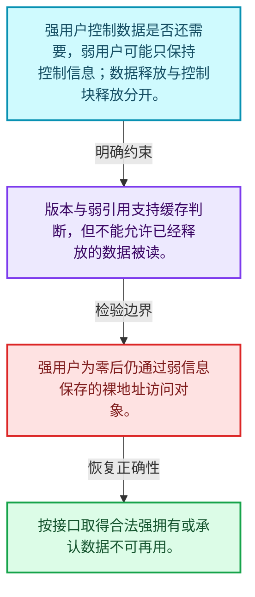
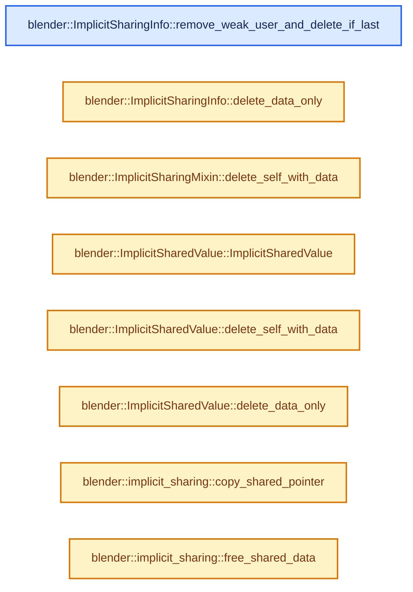
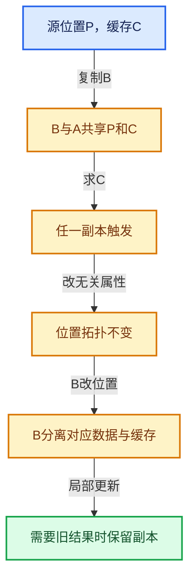

# 06-02 ImplicitSharingInfo计数

[方向导航](README.md) · [总目录](../README.md) · [实现索引](../00-课程指南/02-源码与提交索引/符号依赖与实现索引.md)

## 从问题到实现

强用户、弱用户和版本各自表达什么？

数据寿命与控制信息寿命可能不同，版本可用于识别变化；不能把弱引用当作数据访问许可。

**数据模型**

强用户控制数据是否还需要，弱用户可能只保持控制信息；数据释放与控制块释放分开。

**设计取舍**

版本与弱引用支持缓存判断，但不能允许已经释放的数据被读。

**最小反例**

强用户为零后仍通过弱信息保存的裸地址访问对象。

**推导**

按接口取得合法强拥有或承认数据不可再用。

## 阅读地图与执行推演








图中的数值推演是本方向的教学模型；实际函数之间的调用边与概念分析边分别标注，不能把概念关系当作运行时调度顺序。

## 完整源码单元与就地讲解

中文讲解直接放在相关代码旁，复杂机制在代码下展开。原文折叠区保留基准行号；不需要在行号表和函数之间来回查找。类布局可分段展示，函数实现不按固定行数切开。

### 类型布局、声明与编译条件 · BLI_implicit_sharing.hh L166—L170

<!-- annotated:b22bf15746a01b -->

```cpp

  /**
   * This might just decrement the weak user count or might delete the data. Should be used in
   * conjunction with #add_weak_user.
   */
```

<details>
<summary>核对原始源码：source/blender/blenlib/BLI_implicit_sharing.hh · L166—L170</summary>

<!-- original:b22bf15746a01b:source/blender/blenlib/BLI_implicit_sharing.hh:166:170 -->

```cpp

  /**
   * This might just decrement the weak user count or might delete the data. Should be used in
   * conjunction with #add_weak_user.
   */
```

</details>

<a id="f-33f42460e9493840"></a>

### `blender::ImplicitSharingInfo::remove_weak_user_and_delete_if_last`

实现位置：[source/blender/blenlib/BLI_implicit_sharing.hh](../../../../../source/blender/blenlib/BLI_implicit_sharing.hh) · L171—L181。

**教学注释版**

<!-- annotated:480424c312d007 -->

```cpp
  void remove_weak_user_and_delete_if_last() const
  {
    const int old_weak_user_count = weak_users_.fetch_sub(1, std::memory_order_acq_rel);
    BLI_assert(old_weak_user_count >= 1);
    const bool was_last_weak_user = old_weak_user_count == 1;
    if (was_last_weak_user) {
      /* It's possible that the data has been freed before already, but now it is definitely freed
       * together with the sharing info. */
      const_cast<ImplicitSharingInfo *>(this)->delete_self_with_data();
    }
  }
```

<details>
<summary>核对原始源码：source/blender/blenlib/BLI_implicit_sharing.hh · L171—L181</summary>

<!-- original:480424c312d007:source/blender/blenlib/BLI_implicit_sharing.hh:171:181 -->

```cpp
  void remove_weak_user_and_delete_if_last() const
  {
    const int old_weak_user_count = weak_users_.fetch_sub(1, std::memory_order_acq_rel);
    BLI_assert(old_weak_user_count >= 1);
    const bool was_last_weak_user = old_weak_user_count == 1;
    if (was_last_weak_user) {
      /* It's possible that the data has been freed before already, but now it is definitely freed
       * together with the sharing info. */
      const_cast<ImplicitSharingInfo *>(this)->delete_self_with_data();
    }
  }
```

</details>

**继续追踪实现**

- `weak_users_.fetch_sub` → [外部契约](https://eel.is/c++draft/)：这个边界按实际表达式及所属类型核对参数、返回值、寿命与失败行为。这里提供接口入口，不声称已解释该第三方版本的内部实现。
- `BLI_assert` → [BLI_assert · L48](../90-实现依赖专题/01-BLI基础库/BLI_assert.hh.md#m-57a88495704d)；[BLI_assert · L63](../90-实现依赖专题/01-BLI基础库/BLI_assert.hh.md#m-d07050020cb5)。宏定义由构建条件选择。
- `const_cast<ImplicitSharingInfo *>(this)->delete_self_with_data` → [调用协议](../00-课程指南/01-路线与规范/模板宏与动态分派协议.md)：接收对象类型依赖auto、返回值或模板实例；不按同名猜测目标。调用位置L179。

### 类型布局、声明与编译条件 · BLI_implicit_sharing.hh L182—L189

<!-- annotated:913ac1f49bb9ba -->

```cpp

 private:
  /**
   * Has to free the #ImplicitSharingInfo and the referenced data. The data might have been freed
   * before by #delete_data_only already. This case should be handled here.
   */
  virtual void delete_self_with_data() = 0;
  /** Can free the referenced data but the #ImplicitSharingInfo still has to be kept alive. */
```

<details>
<summary>核对原始源码：source/blender/blenlib/BLI_implicit_sharing.hh · L182—L189</summary>

<!-- original:913ac1f49bb9ba:source/blender/blenlib/BLI_implicit_sharing.hh:182:189 -->

```cpp

 private:
  /**
   * Has to free the #ImplicitSharingInfo and the referenced data. The data might have been freed
   * before by #delete_data_only already. This case should be handled here.
   */
  virtual void delete_self_with_data() = 0;
  /** Can free the referenced data but the #ImplicitSharingInfo still has to be kept alive. */
```

</details>

<a id="f-63e74771c57e7705"></a>

### `blender::ImplicitSharingInfo::delete_data_only`

实现位置：[source/blender/blenlib/BLI_implicit_sharing.hh](../../../../../source/blender/blenlib/BLI_implicit_sharing.hh) · L190—L190。

**教学注释版**

<!-- annotated:78f6d2ecf7a27c -->

```cpp
  virtual void delete_data_only() {}
```

<details>
<summary>核对原始源码：source/blender/blenlib/BLI_implicit_sharing.hh · L190—L190</summary>

<!-- original:78f6d2ecf7a27c:source/blender/blenlib/BLI_implicit_sharing.hh:190:190 -->

```cpp
  virtual void delete_data_only() {}
```

</details>

**继续追踪实现**

本实现没有需要继续展开的显式调用；检查返回表达式、对象转换和调用者前置条件。

### 类型布局、声明与编译条件 · BLI_implicit_sharing.hh L191—L199

<a id="t-58a559d8f6b9"></a>

<!-- annotated:3904fb786d81e5 -->

```cpp
};

/**
 * Makes it easy to embed implicit-sharing behavior into a struct. Structs that derive from this
 * class can be used with #ImplicitSharingPtr.
 */
class ImplicitSharingMixin : public ImplicitSharingInfo {

 private:
```

<details>
<summary>核对原始源码：source/blender/blenlib/BLI_implicit_sharing.hh · L191—L199</summary>

<!-- original:3904fb786d81e5:source/blender/blenlib/BLI_implicit_sharing.hh:191:199 -->

```cpp
};

/**
 * Makes it easy to embed implicit-sharing behavior into a struct. Structs that derive from this
 * class can be used with #ImplicitSharingPtr.
 */
class ImplicitSharingMixin : public ImplicitSharingInfo {

 private:
```

</details>

<a id="f-5865dc97c0b87f41"></a>

### `blender::ImplicitSharingMixin::delete_self_with_data`

实现位置：[source/blender/blenlib/BLI_implicit_sharing.hh](../../../../../source/blender/blenlib/BLI_implicit_sharing.hh) · L200—L204。

**教学注释版**

<!-- annotated:0b69868f506a19 -->

```cpp
  void delete_self_with_data() override
  {
    /* Can't use `delete this` here, because we don't know what allocator was used. */
    this->delete_self();
  }
```

<details>
<summary>核对原始源码：source/blender/blenlib/BLI_implicit_sharing.hh · L200—L204</summary>

<!-- original:0b69868f506a19:source/blender/blenlib/BLI_implicit_sharing.hh:200:204 -->

```cpp
  void delete_self_with_data() override
  {
    /* Can't use `delete this` here, because we don't know what allocator was used. */
    this->delete_self();
  }
```

</details>

**继续追踪实现**

- `this->delete_self` → [调用协议](../00-课程指南/01-路线与规范/模板宏与动态分派协议.md)：由接收对象具体类型或运行时策略提供实现。调用位置L203。

### 类型布局、声明与编译条件 · BLI_implicit_sharing.hh L205—L216

<a id="t-52b331bc0400"></a>

`ImplicitSharedValue`在这里声明的数据成员：

- `T data`

<!-- annotated:d57bcdf535faad -->

```cpp

  virtual void delete_self() = 0;
};

/**
 * Utility for creating an allocated shared resource, to be used like:
 * `new ImplicitSharedValue<T>(args);`
 */
template<typename T> class ImplicitSharedValue : public ImplicitSharingInfo {
 public:
  T data;

```

<details>
<summary>核对原始源码：source/blender/blenlib/BLI_implicit_sharing.hh · L205—L216</summary>

<!-- original:d57bcdf535faad:source/blender/blenlib/BLI_implicit_sharing.hh:205:216 -->

```cpp

  virtual void delete_self() = 0;
};

/**
 * Utility for creating an allocated shared resource, to be used like:
 * `new ImplicitSharedValue<T>(args);`
 */
template<typename T> class ImplicitSharedValue : public ImplicitSharingInfo {
 public:
  T data;

```

</details>

<a id="f-c04d8b71818b91c6"></a>

### `blender::ImplicitSharedValue::ImplicitSharedValue`

实现位置：[source/blender/blenlib/BLI_implicit_sharing.hh](../../../../../source/blender/blenlib/BLI_implicit_sharing.hh) · L217—L220。

**教学注释版**

<!-- annotated:8503f0f45ee8a3 -->

```cpp
  template<typename... Args>
  ImplicitSharedValue(Args &&...args) : data(std::forward<Args>(args)...)
  {
  }
```

<details>
<summary>核对原始源码：source/blender/blenlib/BLI_implicit_sharing.hh · L217—L220</summary>

<!-- original:8503f0f45ee8a3:source/blender/blenlib/BLI_implicit_sharing.hh:217:220 -->

```cpp
  template<typename... Args>
  ImplicitSharedValue(Args &&...args) : data(std::forward<Args>(args)...)
  {
  }
```

</details>

**继续追踪实现**

本实现没有需要继续展开的显式调用；检查返回表达式、对象转换和调用者前置条件。

### 类型布局、声明与编译条件 · BLI_implicit_sharing.hh L221—L224

<!-- annotated:8b4ec133038e1a -->

```cpp

  MEM_CXX_CLASS_ALLOC_FUNCS("ImplicitSharedValue");

 private:
```

<details>
<summary>核对原始源码：source/blender/blenlib/BLI_implicit_sharing.hh · L221—L224</summary>

<!-- original:8b4ec133038e1a:source/blender/blenlib/BLI_implicit_sharing.hh:221:224 -->

```cpp

  MEM_CXX_CLASS_ALLOC_FUNCS("ImplicitSharedValue");

 private:
```

</details>

<a id="f-842a3c42ede7fed9"></a>

### `blender::ImplicitSharedValue::delete_self_with_data`

实现位置：[source/blender/blenlib/BLI_implicit_sharing.hh](../../../../../source/blender/blenlib/BLI_implicit_sharing.hh) · L225—L228。

**教学注释版**

<!-- annotated:a17ff9ce27bf5b -->

```cpp
  void delete_self_with_data() override
  {
    delete this;
  }
```

<details>
<summary>核对原始源码：source/blender/blenlib/BLI_implicit_sharing.hh · L225—L228</summary>

<!-- original:a17ff9ce27bf5b:source/blender/blenlib/BLI_implicit_sharing.hh:225:228 -->

```cpp
  void delete_self_with_data() override
  {
    delete this;
  }
```

</details>

**继续追踪实现**

本实现没有需要继续展开的显式调用；检查返回表达式、对象转换和调用者前置条件。

<!-- annotated:74b51516d1562c -->

```cpp

```

<details>
<summary>核对原始源码：source/blender/blenlib/BLI_implicit_sharing.hh · L229—L229</summary>

<!-- original:74b51516d1562c:source/blender/blenlib/BLI_implicit_sharing.hh:229:229 -->

```cpp

```

</details>

<a id="f-3fb62c32fb6d365c"></a>

### `blender::ImplicitSharedValue::delete_data_only`

实现位置：[source/blender/blenlib/BLI_implicit_sharing.hh](../../../../../source/blender/blenlib/BLI_implicit_sharing.hh) · L230—L237。

**教学注释版**

<!-- annotated:c6b4507fa9f4af -->

```cpp
  void delete_data_only() override
  {
    /* Free the data when there are only weak users left, since they may keep the sharing info
     * alive much longer. Types that can't be reset are freed together with the sharing info. */
    if constexpr (requires { this->data = T(); }) {
      this->data = T();
    }
  }
```

<details>
<summary>核对原始源码：source/blender/blenlib/BLI_implicit_sharing.hh · L230—L237</summary>

<!-- original:c6b4507fa9f4af:source/blender/blenlib/BLI_implicit_sharing.hh:230:237 -->

```cpp
  void delete_data_only() override
  {
    /* Free the data when there are only weak users left, since they may keep the sharing info
     * alive much longer. Types that can't be reset are freed together with the sharing info. */
    if constexpr (requires { this->data = T(); }) {
      this->data = T();
    }
  }
```

</details>

**沿实际写入检查状态**

- `this->data = T();`

**继续追踪实现**

- `T` → [DiagSplit::T · L96](../90-实现依赖专题/07-Intern运行时与平台/cycles/subd/split.cpp.md#f-d5d0885c790cc4e4)。

### 类型布局、声明与编译条件 · BLI_implicit_sharing.hh L238—L269

<a id="t-32889ec746e8"></a>

`ImplicitSharingInfoAndData`在这里声明的数据成员：

- `ImplicitSharingInfo sharing_info`
- `void data`

<!-- annotated:7353025a4bc904 -->

```cpp
};

/**
 * Utility that contains sharing information and the data that is shared.
 */
struct ImplicitSharingInfoAndData {
  const ImplicitSharingInfo *sharing_info = nullptr;
  const void *data = nullptr;
};

namespace implicit_sharing {

namespace detail {

void *resize_trivial_array_impl(void *old_data,
                                int64_t old_size,
                                int64_t new_size,
                                int64_t alignment,
                                const ImplicitSharingInfo **sharing_info);
void *make_trivial_data_mutable_impl(void *old_data,
                                     int64_t size,
                                     int64_t alignment,
                                     const ImplicitSharingInfo **sharing_info);

const ImplicitSharingInfo *info_for_mem_free_impl(void *data);

}  // namespace detail

/**
 * Copy shared data from the source to the destination, adding a user count.
 * \note Does not free any existing data in the destination.
 */
```

<details>
<summary>核对原始源码：source/blender/blenlib/BLI_implicit_sharing.hh · L238—L269</summary>

<!-- original:7353025a4bc904:source/blender/blenlib/BLI_implicit_sharing.hh:238:269 -->

```cpp
};

/**
 * Utility that contains sharing information and the data that is shared.
 */
struct ImplicitSharingInfoAndData {
  const ImplicitSharingInfo *sharing_info = nullptr;
  const void *data = nullptr;
};

namespace implicit_sharing {

namespace detail {

void *resize_trivial_array_impl(void *old_data,
                                int64_t old_size,
                                int64_t new_size,
                                int64_t alignment,
                                const ImplicitSharingInfo **sharing_info);
void *make_trivial_data_mutable_impl(void *old_data,
                                     int64_t size,
                                     int64_t alignment,
                                     const ImplicitSharingInfo **sharing_info);

const ImplicitSharingInfo *info_for_mem_free_impl(void *data);

}  // namespace detail

/**
 * Copy shared data from the source to the destination, adding a user count.
 * \note Does not free any existing data in the destination.
 */
```

</details>

<a id="f-6888195eb0e306f7"></a>

### `blender::implicit_sharing::copy_shared_pointer`

实现位置：[source/blender/blenlib/BLI_implicit_sharing.hh](../../../../../source/blender/blenlib/BLI_implicit_sharing.hh) · L270—L282。

接口参数：

- `T *src_ptr`
- `const ImplicitSharingInfo *src_sharing_info`
- `T **r_dst_ptr`
- `const ImplicitSharingInfo **r_dst_sharing_info`

**教学注释版**

<!-- annotated:cf827a4157a292 -->

```cpp
template<typename T>
void copy_shared_pointer(T *src_ptr,
                         const ImplicitSharingInfo *src_sharing_info,
                         T **r_dst_ptr,
                         const ImplicitSharingInfo **r_dst_sharing_info)
{
  *r_dst_ptr = src_ptr;
  *r_dst_sharing_info = src_sharing_info;
  if (*r_dst_ptr) {
    BLI_assert(*r_dst_sharing_info != nullptr);
    (*r_dst_sharing_info)->add_user();
  }
}
```

<details>
<summary>核对原始源码：source/blender/blenlib/BLI_implicit_sharing.hh · L270—L282</summary>

<!-- original:cf827a4157a292:source/blender/blenlib/BLI_implicit_sharing.hh:270:282 -->

```cpp
template<typename T>
void copy_shared_pointer(T *src_ptr,
                         const ImplicitSharingInfo *src_sharing_info,
                         T **r_dst_ptr,
                         const ImplicitSharingInfo **r_dst_sharing_info)
{
  *r_dst_ptr = src_ptr;
  *r_dst_sharing_info = src_sharing_info;
  if (*r_dst_ptr) {
    BLI_assert(*r_dst_sharing_info != nullptr);
    (*r_dst_sharing_info)->add_user();
  }
}
```

</details>

**继续追踪实现**

- `BLI_assert` → [BLI_assert · L48](../90-实现依赖专题/01-BLI基础库/BLI_assert.hh.md#m-57a88495704d)；[BLI_assert · L63](../90-实现依赖专题/01-BLI基础库/BLI_assert.hh.md#m-d07050020cb5)。宏定义由构建条件选择。
- `(*r_dst_sharing_info)->add_user` → [调用协议](../00-课程指南/01-路线与规范/模板宏与动态分派协议.md)：接收对象类型依赖auto、返回值或模板实例；不按同名猜测目标。调用位置L280。

### 类型布局、声明与编译条件 · BLI_implicit_sharing.hh L283—L286

<!-- annotated:3ce7a53d9fe6eb -->

```cpp

/**
 * Remove this reference to the shared data and remove dangling pointers.
 */
```

<details>
<summary>核对原始源码：source/blender/blenlib/BLI_implicit_sharing.hh · L283—L286</summary>

<!-- original:3ce7a53d9fe6eb:source/blender/blenlib/BLI_implicit_sharing.hh:283:286 -->

```cpp

/**
 * Remove this reference to the shared data and remove dangling pointers.
 */
```

</details>

<a id="f-8e443cc043206969"></a>

### `blender::implicit_sharing::free_shared_data`

实现位置：[source/blender/blenlib/BLI_implicit_sharing.hh](../../../../../source/blender/blenlib/BLI_implicit_sharing.hh) · L287—L295。

接口参数：

- `T **data`
- `const ImplicitSharingInfo **sharing_info`

**教学注释版**

<!-- annotated:e659d40e775a55 -->

```cpp
template<typename T> void free_shared_data(T **data, const ImplicitSharingInfo **sharing_info)
{
  if (*sharing_info) {
    BLI_assert(*data != nullptr);
    (*sharing_info)->remove_user_and_delete_if_last();
  }
  *data = nullptr;
  *sharing_info = nullptr;
}
```

<details>
<summary>核对原始源码：source/blender/blenlib/BLI_implicit_sharing.hh · L287—L295</summary>

<!-- original:e659d40e775a55:source/blender/blenlib/BLI_implicit_sharing.hh:287:295 -->

```cpp
template<typename T> void free_shared_data(T **data, const ImplicitSharingInfo **sharing_info)
{
  if (*sharing_info) {
    BLI_assert(*data != nullptr);
    (*sharing_info)->remove_user_and_delete_if_last();
  }
  *data = nullptr;
  *sharing_info = nullptr;
}
```

</details>

**继续追踪实现**

- `BLI_assert` → [BLI_assert · L48](../90-实现依赖专题/01-BLI基础库/BLI_assert.hh.md#m-57a88495704d)；[BLI_assert · L63](../90-实现依赖专题/01-BLI基础库/BLI_assert.hh.md#m-d07050020cb5)。宏定义由构建条件选择。
- `(*sharing_info)->remove_user_and_delete_if_last` → [调用协议](../00-课程指南/01-路线与规范/模板宏与动态分派协议.md)：接收对象类型依赖auto、返回值或模板实例；不按同名猜测目标。调用位置L291。

### 类型布局、声明与编译条件 · BLI_implicit_sharing.hh L296—L300

<!-- annotated:9dbfceee134fb8 -->

```cpp

/**
 * Create an implicit sharing object that takes ownership of the data, allowing it to be shared.
 * When it is no longer used, the data is freed with #MEM_delete, so it must be a trivial type.
 */
```

<details>
<summary>核对原始源码：source/blender/blenlib/BLI_implicit_sharing.hh · L296—L300</summary>

<!-- original:9dbfceee134fb8:source/blender/blenlib/BLI_implicit_sharing.hh:296:300 -->

```cpp

/**
 * Create an implicit sharing object that takes ownership of the data, allowing it to be shared.
 * When it is no longer used, the data is freed with #MEM_delete, so it must be a trivial type.
 */
```

</details>

<a id="f-7ad95caa930eb54d"></a>

### `blender::implicit_sharing::info_for_mem_free`

实现位置：[source/blender/blenlib/BLI_implicit_sharing.hh](../../../../../source/blender/blenlib/BLI_implicit_sharing.hh) · L301—L307。

接口参数：

- `T *data`

**教学注释版**

<!-- annotated:7cbc30c61c2e60 -->

```cpp
template<typename T> const ImplicitSharingInfo *info_for_mem_free(T *data)
{
  static_assert(!std::is_void_v<T>);
  static_assert(std::is_trivially_destructible_v<T>,
                "Non-trivial types should use e.g. ImplicitSharedValue<Array<T>> instead");
  return detail::info_for_mem_free_impl(const_cast<void *>(static_cast<const void *>(data)));
}
```

<details>
<summary>核对原始源码：source/blender/blenlib/BLI_implicit_sharing.hh · L301—L307</summary>

<!-- original:7cbc30c61c2e60:source/blender/blenlib/BLI_implicit_sharing.hh:301:307 -->

```cpp
template<typename T> const ImplicitSharingInfo *info_for_mem_free(T *data)
{
  static_assert(!std::is_void_v<T>);
  static_assert(std::is_trivially_destructible_v<T>,
                "Non-trivial types should use e.g. ImplicitSharedValue<Array<T>> instead");
  return detail::info_for_mem_free_impl(const_cast<void *>(static_cast<const void *>(data)));
}
```

</details>

**结果出口**

- `return detail::info_for_mem_free_impl(const_cast<void *>(static_cast<const void *>(data)));`

**继续追踪实现**

- `detail::info_for_mem_free_impl` → [blender::implicit_sharing::detail::info_for_mem_free_impl · L37](../90-实现依赖专题/01-BLI基础库/intern/implicit_sharing.cc.md#f-2522ab5f1adfc701)。

### 类型布局、声明与编译条件 · BLI_implicit_sharing.hh L308—L311

<!-- annotated:8f41814b876041 -->

```cpp

/**
 * Make data mutable (single-user) if it is shared. For trivially-copyable data only.
 */
```

<details>
<summary>核对原始源码：source/blender/blenlib/BLI_implicit_sharing.hh · L308—L311</summary>

<!-- original:8f41814b876041:source/blender/blenlib/BLI_implicit_sharing.hh:308:311 -->

```cpp

/**
 * Make data mutable (single-user) if it is shared. For trivially-copyable data only.
 */
```

</details>

<a id="f-b499c16ddcf078f7"></a>

### `blender::implicit_sharing::make_trivial_data_mutable`

实现位置：[source/blender/blenlib/BLI_implicit_sharing.hh](../../../../../source/blender/blenlib/BLI_implicit_sharing.hh) · L312—L319。

接口参数：

- `T **data`
- `const ImplicitSharingInfo **sharing_info`
- `const int64_t size`

**教学注释版**

<!-- annotated:cf489f6947cddd -->

```cpp
template<typename T>
void make_trivial_data_mutable(T **data,
                               const ImplicitSharingInfo **sharing_info,
                               const int64_t size)
{
  *data = static_cast<T *>(
      detail::make_trivial_data_mutable_impl(*data, sizeof(T) * size, alignof(T), sharing_info));
}
```

<details>
<summary>核对原始源码：source/blender/blenlib/BLI_implicit_sharing.hh · L312—L319</summary>

<!-- original:cf489f6947cddd:source/blender/blenlib/BLI_implicit_sharing.hh:312:319 -->

```cpp
template<typename T>
void make_trivial_data_mutable(T **data,
                               const ImplicitSharingInfo **sharing_info,
                               const int64_t size)
{
  *data = static_cast<T *>(
      detail::make_trivial_data_mutable_impl(*data, sizeof(T) * size, alignof(T), sharing_info));
}
```

</details>

**继续追踪实现**

- `detail::make_trivial_data_mutable_impl` → [blender::implicit_sharing::detail::make_trivial_data_mutable_impl · L42](../90-实现依赖专题/01-BLI基础库/intern/implicit_sharing.cc.md#f-14280f49abfad7a3)。

### 类型布局、声明与编译条件 · BLI_implicit_sharing.hh L320—L324

<!-- annotated:eb00a812616774 -->

```cpp

/**
 * Resize an array of shared data. For trivially-copyable data only. Any new values are not
 * initialized.
 */
```

<details>
<summary>核对原始源码：source/blender/blenlib/BLI_implicit_sharing.hh · L320—L324</summary>

<!-- original:eb00a812616774:source/blender/blenlib/BLI_implicit_sharing.hh:320:324 -->

```cpp

/**
 * Resize an array of shared data. For trivially-copyable data only. Any new values are not
 * initialized.
 */
```

</details>

<a id="f-e7d20aa4c26cbc5a"></a>

### `blender::implicit_sharing::resize_trivial_array`

实现位置：[source/blender/blenlib/BLI_implicit_sharing.hh](../../../../../source/blender/blenlib/BLI_implicit_sharing.hh) · L325—L333。

接口参数：

- `T **data`
- `const ImplicitSharingInfo **sharing_info`
- `int64_t old_size`
- `int64_t new_size`

**教学注释版**

<!-- annotated:0b984f7e154261 -->

```cpp
template<typename T>
void resize_trivial_array(T **data,
                          const ImplicitSharingInfo **sharing_info,
                          int64_t old_size,
                          int64_t new_size)
{
  *data = static_cast<T *>(detail::resize_trivial_array_impl(
      *data, sizeof(T) * old_size, sizeof(T) * new_size, alignof(T), sharing_info));
}
```

<details>
<summary>核对原始源码：source/blender/blenlib/BLI_implicit_sharing.hh · L325—L333</summary>

<!-- original:0b984f7e154261:source/blender/blenlib/BLI_implicit_sharing.hh:325:333 -->

```cpp
template<typename T>
void resize_trivial_array(T **data,
                          const ImplicitSharingInfo **sharing_info,
                          int64_t old_size,
                          int64_t new_size)
{
  *data = static_cast<T *>(detail::resize_trivial_array_impl(
      *data, sizeof(T) * old_size, sizeof(T) * new_size, alignof(T), sharing_info));
}
```

</details>

**继续追踪实现**

- `detail::resize_trivial_array_impl` → [blender::implicit_sharing::detail::resize_trivial_array_impl · L67](../90-实现依赖专题/01-BLI基础库/intern/implicit_sharing.cc.md#f-534bbbd5b932748a)。

### 类型布局、声明与编译条件 · BLI_implicit_sharing.hh L334—L337

<!-- annotated:1073df81d98879 -->

```cpp

}  // namespace implicit_sharing

}  // namespace blender
```

<details>
<summary>核对原始源码：source/blender/blenlib/BLI_implicit_sharing.hh · L334—L337</summary>

<!-- original:1073df81d98879:source/blender/blenlib/BLI_implicit_sharing.hh:334:337 -->

```cpp

}  // namespace implicit_sharing

}  // namespace blender
```

</details>

## 语法与相关类型

### 模板 template

模板把类型或常量作为生成实现的参数。读声明时先列出类型参数、非类型参数和默认值，再看使用者实际实例化了什么。模板声明本身不意味着每种T都支持其全部成员。

把T替换为int、string、只能移动的类型，分别检查每个被调用操作是否成立。

### 依赖名称 typename

typename既可引入类型模板参数，也可告诉编译器某个依赖名称是类型。它不创建运行时对象；解析期确认语法类别与实例化期检查具体类型是不同阶段。

区分typename T::value_type和T::size()，前者标记类型，后者是表达式。

### 约束 requires

requires表达式或requires子句限制模板参与重载的条件。它提供编译期可用性检查，不是运行时if，不能指望输入到达程序后再被这一机制验证。

构造满足和不满足约束的两个类型，观察候选被排除而不是在函数内返回错误。

### 常量求值 constexpr

constexpr声明允许相应实体参与常量求值，但constexpr函数仍可以在运行时执行。是否常量求值由调用场景和表达式合法性共同决定。

比较constexpr变量初始化和从运行时输入调用同一函数。

### 只读限定 const

const约束当前访问路径可做的修改。const指针、指向const的指针、const视图对象、const元素是不同位置的限定；其他别名可能仍可修改原对象。

分别写T* const、const T*与const T* const，并画出不可修改的层次。

### 完美转发 std::forward

std::forward在转发引用模板中恢复调用者原来的值类别。它依赖推导出的模板实参；无条件move会改变左值调用者的语义。

对同一接口分别传入左值、临时对象和const左值，记录实际重载。

### 显式静态转换 static_cast

static_cast表达编译期允许的转换，不会自动验证运行时真实类型、指针寿命或索引边界。由void指针恢复T指针时，调用者仍须保证实际存储中确有合法T对象。

标出转换前后的类型以及正确性依据来自哪里。

### 限定转换 const_cast

const_cast可以改变访问路径的限定，但不能让本来就是const的对象合法可写。常用于复用只读实现时，仍需检查底层对象是否实际可变。

对非const对象的const引用与真正const对象分别分析修改是否合法。

### 运行时多态 virtual

虚调用根据实际动态类型选择实现；经基类指针销毁对象时通常需要相应虚析构契约。每元素虚调用和循环外一次分派有不同开销。

找出虚接口的实现类和调用频率，再讨论是否值得去虚拟化。

### 覆写检查 override

override要求函数确实覆盖基类虚函数，可捕获参数类型和const限定不匹配。它不改变基类规定的生命周期或线程约束。

故意改变一个参数或const，观察编译器如何拒绝误写的新函数。

### 对齐 alignof

alignof得到类型要求的地址对齐。分配足够字节后仍需把地址对齐到相应边界，内嵌缓冲也一样。

对齐a为2的幂时可推导向上取整，但仍要考虑溢出与边界。

### 对象表示 sizeof

sizeof给出对象表示大小，不是其引用的所有堆内存总量。sizeof视图很小并不说明底层数组很小。

分别统计容器对象、容量字节和元素拥有的间接资源。

### 构造与new表达式

普通new可能分配并构造；placement new在给定地址构造，存储由其他机制提供。失败回滚应区分两类责任。

追踪地址来自哪里、构造何时成功、由谁析构、由谁释放。

### 内部断言 assert

断言表达开发者预期成立的内部契约，发布构建可能关闭。它不能替代对不可信输入的完整错误处理，也不保证后续操作被运行时保护。

对每条断言构造违反条件的输入，区分调用者错误与应向用户报告的错误。

### 编译期分支 if constexpr

条件在实例化时决定被保留的分支，这常用于不同类型的合法操作选择。它与运行时if有不同的实例化检查规则。

找出每个分支依赖哪些类型特征，再使用满足与不满足条件的类型。

## 实现练习与验证

推演强用户降为零但弱用户仍存在时的销毁过程。

参考推理：按接口取得合法强拥有或承认数据不可再用。

改变副本不改变原对象结果；修改任一真实依赖后旧结果不可继续被当成有效缓存。

## 历史、跨库比较与证据

与shared_ptr比较寿命管理，与写时复制容器比较写边界，与普通memoization比较键的等价性；SharedCache把等价对象的派生结果放在共同控制对象中。

[历史提交索引](../00-课程指南/02-源码与提交索引/历史提交与设计演化索引.md) · [源码基准](../00-课程指南/02-源码与提交索引/源码版本与覆盖索引.md) · [验收报告](../00-课程指南/03-验收报告/验收报告.md)
