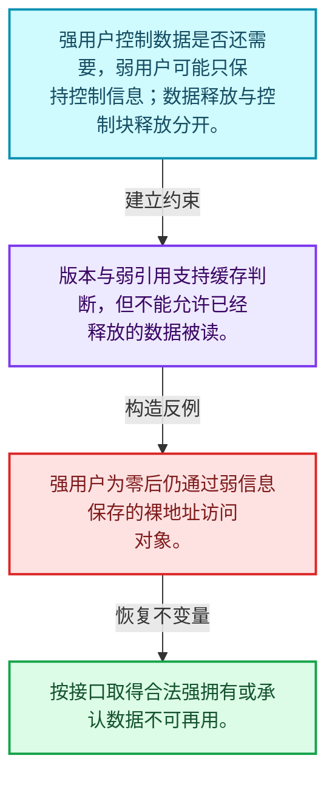
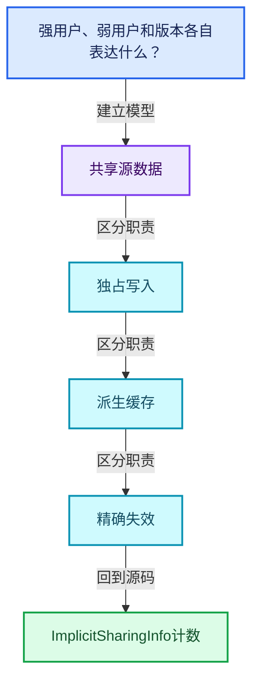
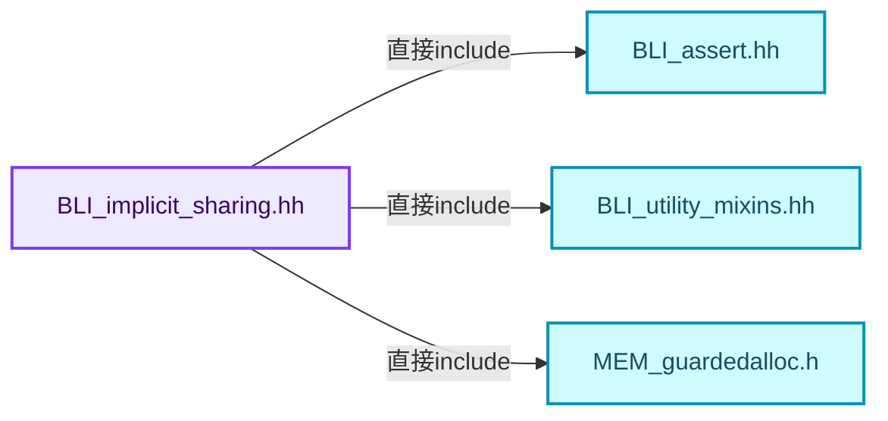
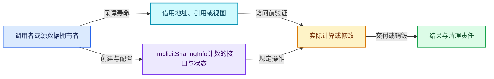
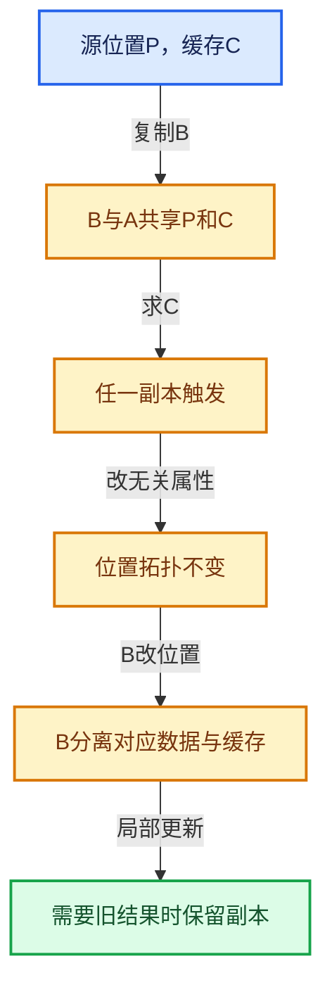

# 06-02 ImplicitSharingInfo计数

[方向导航](README.md) · [总目录](../README.md) · [覆盖索引](../%E6%BA%90%E7%A0%81%E7%89%88%E6%9C%AC%E4%B8%8E%E8%A6%86%E7%9B%96%E7%B4%A2%E5%BC%95.md)

> 阅读顺序：问题与数据模型 → 语法与类型 → 源码逐行 → 调用线索 → 历史与取舍 → 推演和练习。

- 基准 HEAD：`cbda6b96c26c0dee3c3b5cbb93960c4ac06a6b30`。
- 记录日期：2026-10-14。
- 教学示例状态：正文中的推演不是本机性能实测；已运行练习见验收报告。

## 一、从问题到设计

强用户、弱用户和版本各自表达什么？

数据寿命与控制信息寿命可能不同，版本可用于识别变化；不能把弱引用当作数据访问许可。

本篇把语法、数据语义和系统取舍连接起来。共享计数回答谁还活着，缓存依赖回答结果是否仍正确，两者不能互相替代。

### 本篇独立模型与设计推理

强用户控制数据是否还需要，弱用户可能只保持控制信息；数据释放与控制块释放分开。

设计取舍：版本与弱引用支持缓存判断，但不能允许已经释放的数据被读。

最小反例：强用户为零后仍通过弱信息保存的裸地址访问对象。

推导与处理：按接口取得合法强拥有或承认数据不可再用。



### 源码范围与相邻篇章

| 文件 | 本篇逐行范围 | 基准SHA-256 |
|---|---|---|
| [source/blender/blenlib/BLI_implicit_sharing.hh](../../../../../source/blender/blenlib/BLI_implicit_sharing.hh) | L166—L337 | `ca734bf707495866db9b73fd8b9a8f4b59db22c419e1e3082023512106c61792` |

同一主讲文件可能分多篇覆盖；超出本篇范围的符号通过覆盖索引定位。空行与纯注释保留在源码摘录中，逐行表解释有效语句与语法边界；许可证头统一保留。

前篇：[所有权与写时复制](01-%E6%89%80%E6%9C%89%E6%9D%83%E4%B8%8E%E5%86%99%E6%97%B6%E5%A4%8D%E5%88%B6.md).

后篇：[Mixin与共享指针封装](03-Mixin%E4%B8%8E%E5%85%B1%E4%BA%AB%E6%8C%87%E9%92%88%E5%B0%81%E8%A3%85.md).

## 二、类型、数据与阅读地图



这是概念依赖图，边表示阅读关系，不声称是运行时调用顺序。

### 直接编译依赖



箭头只表示头文件包含关系；完整调用线索见后面的符号定位表。

## 三、关键词、语法与类型角色

### 模板 template

模板把类型或常量作为生成实现的参数。读声明时先列出类型参数、非类型参数和默认值，再看使用者实际实例化了什么。模板声明本身不意味着每种T都支持其全部成员。

具体检查：把T替换为int、string、只能移动的类型，分别检查每个被调用操作是否成立。

### 依赖名称 typename

typename既可引入类型模板参数，也可告诉编译器某个依赖名称是类型。它不创建运行时对象；解析期确认语法类别与实例化期检查具体类型是不同阶段。

具体检查：区分typename T::value_type和T::size()，前者标记类型，后者是表达式。

### 约束 requires

requires表达式或requires子句限制模板参与重载的条件。它提供编译期可用性检查，不是运行时if，不能指望输入到达程序后再被这一机制验证。

具体检查：构造满足和不满足约束的两个类型，观察候选被排除而不是在函数内返回错误。

### 常量求值 constexpr

constexpr声明允许相应实体参与常量求值，但constexpr函数仍可以在运行时执行。是否常量求值由调用场景和表达式合法性共同决定。

具体检查：比较constexpr变量初始化和从运行时输入调用同一函数。

### 只读限定 const

const约束当前访问路径可做的修改。const指针、指向const的指针、const视图对象、const元素是不同位置的限定；其他别名可能仍可修改原对象。

具体检查：分别写T* const、const T*与const T* const，并画出不可修改的层次。

### 完美转发 std::forward

std::forward在转发引用模板中恢复调用者原来的值类别。它依赖推导出的模板实参；无条件move会改变左值调用者的语义。

具体检查：对同一接口分别传入左值、临时对象和const左值，记录实际重载。

### 显式静态转换 static_cast

static_cast表达编译期允许的转换，不会自动验证运行时真实类型、指针寿命或索引边界。由void指针恢复T指针时，调用者仍须保证实际存储中确有合法T对象。

具体检查：标出转换前后的类型以及正确性依据来自哪里。

### 限定转换 const_cast

const_cast可以改变访问路径的限定，但不能让本来就是const的对象合法可写。常用于复用只读实现时，仍需检查底层对象是否实际可变。

具体检查：对非const对象的const引用与真正const对象分别分析修改是否合法。

### 运行时多态 virtual

虚调用根据实际动态类型选择实现；经基类指针销毁对象时通常需要相应虚析构契约。每元素虚调用和循环外一次分派有不同开销。

具体检查：找出虚接口的实现类和调用频率，再讨论是否值得去虚拟化。

### 覆写检查 override

override要求函数确实覆盖基类虚函数，可捕获参数类型和const限定不匹配。它不改变基类规定的生命周期或线程约束。

具体检查：故意改变一个参数或const，观察编译器如何拒绝误写的新函数。

### 对齐 alignof

alignof得到类型要求的地址对齐。分配足够字节后仍需把地址对齐到相应边界，内嵌缓冲也一样。

具体检查：对齐a为2的幂时可推导向上取整，但仍要考虑溢出与边界。

### 对象表示 sizeof

sizeof给出对象表示大小，不是其引用的所有堆内存总量。sizeof视图很小并不说明底层数组很小。

具体检查：分别统计容器对象、容量字节和元素拥有的间接资源。

### 构造与new表达式

普通new可能分配并构造；placement new在给定地址构造，存储由其他机制提供。失败回滚应区分两类责任。

具体检查：追踪地址来自哪里、构造何时成功、由谁析构、由谁释放。

### 内部断言 assert

断言表达开发者预期成立的内部契约，发布构建可能关闭。它不能替代对不可信输入的完整错误处理，也不保证后续操作被运行时保护。

具体检查：对每条断言构造违反条件的输入，区分调用者错误与应向用户报告的错误。

### 编译期分支 if constexpr

条件在实例化时决定被保留的分支，这常用于不同类型的合法操作选择。它与运行时if有不同的实例化检查规则。

具体检查：找出每个分支依赖哪些类型特征，再使用满足与不满足条件的类型。

## 四、真实源码与逐行讲解

源码块保持原行内容，原始行号由小节标题及逐行表给出。表中的调用定位是静态阅读辅助；重载、模板实例化、宏展开和虚调用需结合完整声明，不能仅凭词法出现证明动态调用。

### BLI_implicit_sharing.hh：L166—L214

<!-- source:source/blender/blenlib/BLI_implicit_sharing.hh:166:214 -->

```cpp

  /**
   * This might just decrement the weak user count or might delete the data. Should be used in
   * conjunction with #add_weak_user.
   */
  void remove_weak_user_and_delete_if_last() const
  {
    const int old_weak_user_count = weak_users_.fetch_sub(1, std::memory_order_acq_rel);
    BLI_assert(old_weak_user_count >= 1);
    const bool was_last_weak_user = old_weak_user_count == 1;
    if (was_last_weak_user) {
      /* It's possible that the data has been freed before already, but now it is definitely freed
       * together with the sharing info. */
      const_cast<ImplicitSharingInfo *>(this)->delete_self_with_data();
    }
  }

 private:
  /**
   * Has to free the #ImplicitSharingInfo and the referenced data. The data might have been freed
   * before by #delete_data_only already. This case should be handled here.
   */
  virtual void delete_self_with_data() = 0;
  /** Can free the referenced data but the #ImplicitSharingInfo still has to be kept alive. */
  virtual void delete_data_only() {}
};

/**
 * Makes it easy to embed implicit-sharing behavior into a struct. Structs that derive from this
 * class can be used with #ImplicitSharingPtr.
 */
class ImplicitSharingMixin : public ImplicitSharingInfo {

 private:
  void delete_self_with_data() override
  {
    /* Can't use `delete this` here, because we don't know what allocator was used. */
    this->delete_self();
  }

  virtual void delete_self() = 0;
};

/**
 * Utility for creating an allocated shared resource, to be used like:
 * `new ImplicitSharedValue<T>(args);`
 */
template<typename T> class ImplicitSharedValue : public ImplicitSharingInfo {
 public:
```

本段语义重点：

- 分支证据 `was_last_weak_user)`：分别推演条件成立与不成立，核对相同出口处的状态。

| 原始行 | 语义、约束与检查 |
|---|---|
| L171 | 出现调用或函数声明 `remove_weak_user_and_delete_if_last`，对应表达式为 `void remove_weak_user_and_delete_if_last() const`。参数求值、返回类型与重载需结合前后完整语句；静态文本引用不能证明动态目标。 |
| L172 | 连接上一行的声明或控制结构与其语句块；后续行在这个作用域中执行或声明。 |
| L173 | 把右侧 `weak_users_.fetch_sub(1, std::memory_order_acq_rel)` 用于初始化或更新左侧 `const int old_weak_user_count`。声明初始化与已有对象赋值应按上下文区分；有资源的类型会调用相应特殊成员。 |
| L174 | 断言约束 `BLI_assert(old_weak_user_count >= 1);`。条件是后续访问的内部前置条件；发布构建可能不执行，不能把断言当作输入修复。 |
| L175 | 把右侧 `old_weak_user_count == 1` 用于初始化或更新左侧 `const bool was_last_weak_user`。声明初始化与已有对象赋值应按上下文区分；有资源的类型会调用相应特殊成员。 |
| L176 | 判断 `was_last_weak_user`，成立时进入本分支，否则继续后续路径。 |
| L179 | 出现调用或函数声明 `const_cast`，对应表达式为 `const_cast<ImplicitSharingInfo *>(this)->delete_self_with_data();`。参数求值、返回类型与重载需结合前后完整语句；静态文本引用不能证明动态目标。 |
| L180 | 结束当前语法单元。局部自动对象在离开其作用域时按规则销毁；这不等于所有被引用的外部数据也被释放。 |
| L181 | 结束当前语法单元。局部自动对象在离开其作用域时按规则销毁；这不等于所有被引用的外部数据也被释放。 |
| L183 | 切换成员访问权限为 private；它是编译期接口边界，不是线程同步或内存保护。 |
| L188 | 纯虚接口声明：`virtual void delete_self_with_data() = 0;`。等号零标记抽象接口，需要按继承约定提供覆写；不表示执行函数并把结果设为零。 |
| L190 | 出现调用或函数声明 `delete_data_only`，对应表达式为 `virtual void delete_data_only() {}`。参数求值、返回类型与重载需结合前后完整语句；静态文本引用不能证明动态目标。 |
| L191 | 结束当前语法单元。局部自动对象在离开其作用域时按规则销毁；这不等于所有被引用的外部数据也被释放。 |
| L197 | 声明或定义类型 `class ImplicitSharingMixin : public ImplicitSharingInfo`。结合继承、访问权限和成员布局确认接口与拥有关系；前向声明本身没有完整对象布局。 |
| L199 | 切换成员访问权限为 private；它是编译期接口边界，不是线程同步或内存保护。 |
| L200 | 出现调用或函数声明 `delete_self_with_data`，对应表达式为 `void delete_self_with_data() override`。参数求值、返回类型与重载需结合前后完整语句；静态文本引用不能证明动态目标。 |
| L201 | 连接上一行的声明或控制结构与其语句块；后续行在这个作用域中执行或声明。 |
| L203 | 出现调用或函数声明 `delete_self`，对应表达式为 `this->delete_self();`。参数求值、返回类型与重载需结合前后完整语句；静态文本引用不能证明动态目标。 |
| L204 | 结束当前语法单元。局部自动对象在离开其作用域时按规则销毁；这不等于所有被引用的外部数据也被释放。 |
| L206 | 纯虚接口声明：`virtual void delete_self() = 0;`。等号零标记抽象接口，需要按继承约定提供覆写；不表示执行函数并把结果设为零。 |
| L207 | 结束当前语法单元。局部自动对象在离开其作用域时按规则销毁；这不等于所有被引用的外部数据也被释放。 |
| L213 | 声明模板参数 `template<typename T> class ImplicitSharedValue : public ImplicitSharingInfo {`。类型参数决定生成操作的类型，非类型参数可决定内嵌容量或编译期分支。 |
| L214 | 切换成员访问权限为 public；它是编译期接口边界，不是线程同步或内存保护。 |

### BLI_implicit_sharing.hh：L215—L262

<!-- source:source/blender/blenlib/BLI_implicit_sharing.hh:215:262 -->

```cpp
  T data;

  template<typename... Args>
  ImplicitSharedValue(Args &&...args) : data(std::forward<Args>(args)...)
  {
  }

  MEM_CXX_CLASS_ALLOC_FUNCS("ImplicitSharedValue");

 private:
  void delete_self_with_data() override
  {
    delete this;
  }

  void delete_data_only() override
  {
    /* Free the data when there are only weak users left, since they may keep the sharing info
     * alive much longer. Types that can't be reset are freed together with the sharing info. */
    if constexpr (requires { this->data = T(); }) {
      this->data = T();
    }
  }
};

/**
 * Utility that contains sharing information and the data that is shared.
 */
struct ImplicitSharingInfoAndData {
  const ImplicitSharingInfo *sharing_info = nullptr;
  const void *data = nullptr;
};

namespace implicit_sharing {

namespace detail {

void *resize_trivial_array_impl(void *old_data,
                                int64_t old_size,
                                int64_t new_size,
                                int64_t alignment,
                                const ImplicitSharingInfo **sharing_info);
void *make_trivial_data_mutable_impl(void *old_data,
                                     int64_t size,
                                     int64_t alignment,
                                     const ImplicitSharingInfo **sharing_info);

const ImplicitSharingInfo *info_for_mem_free_impl(void *data);
```

| 原始行 | 语义、约束与检查 |
|---|---|
| L215 | 声明成员、局部对象或完成语句 `T data`。若为指针或引用，它本身不说明拥有；若为值对象，其构造析构由所在作用域或外层对象管理。 |
| L217 | 声明模板参数 `template<typename... Args>`。类型参数决定生成操作的类型，非类型参数可决定内嵌容量或编译期分支。 |
| L218 | 出现调用或函数声明 `ImplicitSharedValue`，对应表达式为 `ImplicitSharedValue(Args &&...args) : data(std::forward<Args>(args)...)`。参数求值、返回类型与重载需结合前后完整语句；静态文本引用不能证明动态目标。 |
| L219 | 连接上一行的声明或控制结构与其语句块；后续行在这个作用域中执行或声明。 |
| L220 | 结束当前语法单元。局部自动对象在离开其作用域时按规则销毁；这不等于所有被引用的外部数据也被释放。 |
| L222 | 出现调用或函数声明 `MEM_CXX_CLASS_ALLOC_FUNCS`，对应表达式为 `MEM_CXX_CLASS_ALLOC_FUNCS("ImplicitSharedValue");`。参数求值、返回类型与重载需结合前后完整语句；静态文本引用不能证明动态目标。 |
| L224 | 切换成员访问权限为 private；它是编译期接口边界，不是线程同步或内存保护。 |
| L225 | 出现调用或函数声明 `delete_self_with_data`，对应表达式为 `void delete_self_with_data() override`。参数求值、返回类型与重载需结合前后完整语句；静态文本引用不能证明动态目标。 |
| L226 | 连接上一行的声明或控制结构与其语句块；后续行在这个作用域中执行或声明。 |
| L227 | 声明成员、局部对象或完成语句 `delete this`。若为指针或引用，它本身不说明拥有；若为值对象，其构造析构由所在作用域或外层对象管理。 |
| L228 | 结束当前语法单元。局部自动对象在离开其作用域时按规则销毁；这不等于所有被引用的外部数据也被释放。 |
| L230 | 出现调用或函数声明 `delete_data_only`，对应表达式为 `void delete_data_only() override`。参数求值、返回类型与重载需结合前后完整语句；静态文本引用不能证明动态目标。 |
| L231 | 连接上一行的声明或控制结构与其语句块；后续行在这个作用域中执行或声明。 |
| L234 | 编译期条件分支 `if constexpr (requires { this->data = T(); })`。按实例化类型选择相应实现；被舍弃分支和运行期if具有不同检查规则，不能当作运行时输入验证。 |
| L235 | 把右侧 `T()` 用于初始化或更新左侧 `this->data`。声明初始化与已有对象赋值应按上下文区分；有资源的类型会调用相应特殊成员。 |
| L236 | 结束当前语法单元。局部自动对象在离开其作用域时按规则销毁；这不等于所有被引用的外部数据也被释放。 |
| L237 | 结束当前语法单元。局部自动对象在离开其作用域时按规则销毁；这不等于所有被引用的外部数据也被释放。 |
| L238 | 结束当前语法单元。局部自动对象在离开其作用域时按规则销毁；这不等于所有被引用的外部数据也被释放。 |
| L243 | 声明或定义类型 `struct ImplicitSharingInfoAndData`。结合继承、访问权限和成员布局确认接口与拥有关系；前向声明本身没有完整对象布局。 |
| L244 | 把右侧 `nullptr` 用于初始化或更新左侧 `const ImplicitSharingInfo *sharing_info`。声明初始化与已有对象赋值应按上下文区分；有资源的类型会调用相应特殊成员。 |
| L245 | 把右侧 `nullptr` 用于初始化或更新左侧 `const void *data`。声明初始化与已有对象赋值应按上下文区分；有资源的类型会调用相应特殊成员。 |
| L246 | 结束当前语法单元。局部自动对象在离开其作用域时按规则销毁；这不等于所有被引用的外部数据也被释放。 |
| L248 | 把后续声明放入 implicit_sharing 命名空间，影响名称查找和符号归属，不创建运行时对象。 |
| L250 | 把后续声明放入 detail 命名空间，影响名称查找和符号归属，不创建运行时对象。 |
| L252 | 出现调用或函数声明 `resize_trivial_array_impl`，对应表达式为 `void *resize_trivial_array_impl(void *old_data,`。参数求值、返回类型与重载需结合前后完整语句；静态文本引用不能证明动态目标。 |
| L253 | 本行是连续声明或表达式的一部分：`int64_t old_size,`。与本段前后行合读；逗号、括号和限定符决定它属于参数、初始化列表还是实际计算。 |
| L254 | 本行是连续声明或表达式的一部分：`int64_t new_size,`。与本段前后行合读；逗号、括号和限定符决定它属于参数、初始化列表还是实际计算。 |
| L255 | 本行是连续声明或表达式的一部分：`int64_t alignment,`。与本段前后行合读；逗号、括号和限定符决定它属于参数、初始化列表还是实际计算。 |
| L256 | 声明成员、局部对象或完成语句 `const ImplicitSharingInfo **sharing_info)`。若为指针或引用，它本身不说明拥有；若为值对象，其构造析构由所在作用域或外层对象管理。 |
| L257 | 出现调用或函数声明 `make_trivial_data_mutable_impl`，对应表达式为 `void *make_trivial_data_mutable_impl(void *old_data,`。参数求值、返回类型与重载需结合前后完整语句；静态文本引用不能证明动态目标。 |
| L258 | 本行是连续声明或表达式的一部分：`int64_t size,`。与本段前后行合读；逗号、括号和限定符决定它属于参数、初始化列表还是实际计算。 |
| L259 | 本行是连续声明或表达式的一部分：`int64_t alignment,`。与本段前后行合读；逗号、括号和限定符决定它属于参数、初始化列表还是实际计算。 |
| L260 | 声明成员、局部对象或完成语句 `const ImplicitSharingInfo **sharing_info)`。若为指针或引用，它本身不说明拥有；若为值对象，其构造析构由所在作用域或外层对象管理。 |
| L262 | 声明接口 `const ImplicitSharingInfo *info_for_mem_free_impl(void *data)`，本行没有对应函数体；返回类型、参数限定和const/noexcept共同组成调用契约，实际行为需继续定位实现。 |

### BLI_implicit_sharing.hh：L263—L307

<!-- source:source/blender/blenlib/BLI_implicit_sharing.hh:263:307 -->

```cpp

}  // namespace detail

/**
 * Copy shared data from the source to the destination, adding a user count.
 * \note Does not free any existing data in the destination.
 */
template<typename T>
void copy_shared_pointer(T *src_ptr,
                         const ImplicitSharingInfo *src_sharing_info,
                         T **r_dst_ptr,
                         const ImplicitSharingInfo **r_dst_sharing_info)
{
  *r_dst_ptr = src_ptr;
  *r_dst_sharing_info = src_sharing_info;
  if (*r_dst_ptr) {
    BLI_assert(*r_dst_sharing_info != nullptr);
    (*r_dst_sharing_info)->add_user();
  }
}

/**
 * Remove this reference to the shared data and remove dangling pointers.
 */
template<typename T> void free_shared_data(T **data, const ImplicitSharingInfo **sharing_info)
{
  if (*sharing_info) {
    BLI_assert(*data != nullptr);
    (*sharing_info)->remove_user_and_delete_if_last();
  }
  *data = nullptr;
  *sharing_info = nullptr;
}

/**
 * Create an implicit sharing object that takes ownership of the data, allowing it to be shared.
 * When it is no longer used, the data is freed with #MEM_delete, so it must be a trivial type.
 */
template<typename T> const ImplicitSharingInfo *info_for_mem_free(T *data)
{
  static_assert(!std::is_void_v<T>);
  static_assert(std::is_trivially_destructible_v<T>,
                "Non-trivial types should use e.g. ImplicitSharedValue<Array<T>> instead");
  return detail::info_for_mem_free_impl(const_cast<void *>(static_cast<const void *>(data)));
}
```

本段语义重点：

- `add_user`：增加共享使用计数，必须与未来相应释放配对。
- `remove_user`：减少共享使用计数，最后强用户可能触发数据销毁。

| 原始行 | 语义、约束与检查 |
|---|---|
| L264 | 结束当前语法单元。局部自动对象在离开其作用域时按规则销毁；这不等于所有被引用的外部数据也被释放。 |
| L270 | 声明模板参数 `template<typename T>`。类型参数决定生成操作的类型，非类型参数可决定内嵌容量或编译期分支。 |
| L271 | 出现调用或函数声明 `copy_shared_pointer`，对应表达式为 `void copy_shared_pointer(T *src_ptr,`。参数求值、返回类型与重载需结合前后完整语句；静态文本引用不能证明动态目标。 |
| L272 | 本行是连续声明或表达式的一部分：`const ImplicitSharingInfo *src_sharing_info,`。与本段前后行合读；逗号、括号和限定符决定它属于参数、初始化列表还是实际计算。 |
| L273 | 本行是连续声明或表达式的一部分：`T **r_dst_ptr,`。与本段前后行合读；逗号、括号和限定符决定它属于参数、初始化列表还是实际计算。 |
| L274 | 本行是连续声明或表达式的一部分：`const ImplicitSharingInfo **r_dst_sharing_info)`。与本段前后行合读；逗号、括号和限定符决定它属于参数、初始化列表还是实际计算。 |
| L275 | 连接上一行的声明或控制结构与其语句块；后续行在这个作用域中执行或声明。 |
| L276 | 把右侧 `src_ptr` 用于初始化或更新左侧 `*r_dst_ptr`。声明初始化与已有对象赋值应按上下文区分；有资源的类型会调用相应特殊成员。 |
| L277 | 把右侧 `src_sharing_info` 用于初始化或更新左侧 `*r_dst_sharing_info`。声明初始化与已有对象赋值应按上下文区分；有资源的类型会调用相应特殊成员。 |
| L278 | 判断 `*r_dst_ptr`，成立时进入本分支，否则继续后续路径。 |
| L279 | 断言约束 `BLI_assert(*r_dst_sharing_info != nullptr);`。条件是后续访问的内部前置条件；发布构建可能不执行，不能把断言当作输入修复。 |
| L280 | 本行使用 `add_user`：增加共享使用计数，必须与未来相应释放配对。 |
| L281 | 结束当前语法单元。局部自动对象在离开其作用域时按规则销毁；这不等于所有被引用的外部数据也被释放。 |
| L282 | 结束当前语法单元。局部自动对象在离开其作用域时按规则销毁；这不等于所有被引用的外部数据也被释放。 |
| L287 | 声明模板参数 `template<typename T> void free_shared_data(T **data, const ImplicitSharingInfo **sharing_info)`。类型参数决定生成操作的类型，非类型参数可决定内嵌容量或编译期分支。 |
| L288 | 连接上一行的声明或控制结构与其语句块；后续行在这个作用域中执行或声明。 |
| L289 | 判断 `*sharing_info`，成立时进入本分支，否则继续后续路径。 |
| L290 | 断言约束 `BLI_assert(*data != nullptr);`。条件是后续访问的内部前置条件；发布构建可能不执行，不能把断言当作输入修复。 |
| L291 | 出现调用或函数声明 `remove_user_and_delete_if_last`，对应表达式为 `(*sharing_info)->remove_user_and_delete_if_last();`。参数求值、返回类型与重载需结合前后完整语句；静态文本引用不能证明动态目标。 |
| L292 | 结束当前语法单元。局部自动对象在离开其作用域时按规则销毁；这不等于所有被引用的外部数据也被释放。 |
| L293 | 把右侧 `nullptr` 用于初始化或更新左侧 `*data`。声明初始化与已有对象赋值应按上下文区分；有资源的类型会调用相应特殊成员。 |
| L294 | 把右侧 `nullptr` 用于初始化或更新左侧 `*sharing_info`。声明初始化与已有对象赋值应按上下文区分；有资源的类型会调用相应特殊成员。 |
| L295 | 结束当前语法单元。局部自动对象在离开其作用域时按规则销毁；这不等于所有被引用的外部数据也被释放。 |
| L301 | 声明模板参数 `template<typename T> const ImplicitSharingInfo *info_for_mem_free(T *data)`。类型参数决定生成操作的类型，非类型参数可决定内嵌容量或编译期分支。 |
| L302 | 连接上一行的声明或控制结构与其语句块；后续行在这个作用域中执行或声明。 |
| L303 | 在编译期检查 `static_assert(!std::is_void_v<T>);`；条件失败导致编译错误，不存在运行时错误恢复路径。 |
| L304 | 在编译期检查 `static_assert(std::is_trivially_destructible_v<T>,`；条件失败导致编译错误，不存在运行时错误恢复路径。 |
| L305 | 声明成员、局部对象或完成语句 `"Non-trivial types should use e.g. ImplicitSharedValue<Array<T>> instead")`。若为指针或引用，它本身不说明拥有；若为值对象，其构造析构由所在作用域或外层对象管理。 |
| L306 | 返回表达式 `detail::info_for_mem_free_impl(const_cast<void *>(static_cast<const void *>(data)))`。 |
| L307 | 结束当前语法单元。局部自动对象在离开其作用域时按规则销毁；这不等于所有被引用的外部数据也被释放。 |

### BLI_implicit_sharing.hh：L308—L337

<!-- source:source/blender/blenlib/BLI_implicit_sharing.hh:308:337 -->

```cpp

/**
 * Make data mutable (single-user) if it is shared. For trivially-copyable data only.
 */
template<typename T>
void make_trivial_data_mutable(T **data,
                               const ImplicitSharingInfo **sharing_info,
                               const int64_t size)
{
  *data = static_cast<T *>(
      detail::make_trivial_data_mutable_impl(*data, sizeof(T) * size, alignof(T), sharing_info));
}

/**
 * Resize an array of shared data. For trivially-copyable data only. Any new values are not
 * initialized.
 */
template<typename T>
void resize_trivial_array(T **data,
                          const ImplicitSharingInfo **sharing_info,
                          int64_t old_size,
                          int64_t new_size)
{
  *data = static_cast<T *>(detail::resize_trivial_array_impl(
      *data, sizeof(T) * old_size, sizeof(T) * new_size, alignof(T), sharing_info));
}

}  // namespace implicit_sharing

}  // namespace blender
```

| 原始行 | 语义、约束与检查 |
|---|---|
| L312 | 声明模板参数 `template<typename T>`。类型参数决定生成操作的类型，非类型参数可决定内嵌容量或编译期分支。 |
| L313 | 出现调用或函数声明 `make_trivial_data_mutable`，对应表达式为 `void make_trivial_data_mutable(T **data,`。参数求值、返回类型与重载需结合前后完整语句；静态文本引用不能证明动态目标。 |
| L314 | 本行是连续声明或表达式的一部分：`const ImplicitSharingInfo **sharing_info,`。与本段前后行合读；逗号、括号和限定符决定它属于参数、初始化列表还是实际计算。 |
| L315 | 本行是连续声明或表达式的一部分：`const int64_t size)`。与本段前后行合读；逗号、括号和限定符决定它属于参数、初始化列表还是实际计算。 |
| L316 | 连接上一行的声明或控制结构与其语句块；后续行在这个作用域中执行或声明。 |
| L317 | 把右侧 `static_cast<T *>(` 用于初始化或更新左侧 `*data`。声明初始化与已有对象赋值应按上下文区分；有资源的类型会调用相应特殊成员。 |
| L318 | 出现调用或函数声明 `detail::make_trivial_data_mutable_impl`，对应表达式为 `detail::make_trivial_data_mutable_impl(*data, sizeof(T) * size, alignof(T), sharing_info));`。参数求值、返回类型与重载需结合前后完整语句；静态文本引用不能证明动态目标。 |
| L319 | 结束当前语法单元。局部自动对象在离开其作用域时按规则销毁；这不等于所有被引用的外部数据也被释放。 |
| L325 | 声明模板参数 `template<typename T>`。类型参数决定生成操作的类型，非类型参数可决定内嵌容量或编译期分支。 |
| L326 | 出现调用或函数声明 `resize_trivial_array`，对应表达式为 `void resize_trivial_array(T **data,`。参数求值、返回类型与重载需结合前后完整语句；静态文本引用不能证明动态目标。 |
| L327 | 本行是连续声明或表达式的一部分：`const ImplicitSharingInfo **sharing_info,`。与本段前后行合读；逗号、括号和限定符决定它属于参数、初始化列表还是实际计算。 |
| L328 | 本行是连续声明或表达式的一部分：`int64_t old_size,`。与本段前后行合读；逗号、括号和限定符决定它属于参数、初始化列表还是实际计算。 |
| L329 | 本行是连续声明或表达式的一部分：`int64_t new_size)`。与本段前后行合读；逗号、括号和限定符决定它属于参数、初始化列表还是实际计算。 |
| L330 | 连接上一行的声明或控制结构与其语句块；后续行在这个作用域中执行或声明。 |
| L331 | 把右侧 `static_cast<T *>(detail::resize_trivial_array_impl(` 用于初始化或更新左侧 `*data`。声明初始化与已有对象赋值应按上下文区分；有资源的类型会调用相应特殊成员。 |
| L332 | 出现调用或函数声明 `sizeof`，对应表达式为 `*data, sizeof(T) * old_size, sizeof(T) * new_size, alignof(T), sharing_info));`。参数求值、返回类型与重载需结合前后完整语句；静态文本引用不能证明动态目标。 |
| L333 | 结束当前语法单元。局部自动对象在离开其作用域时按规则销毁；这不等于所有被引用的外部数据也被释放。 |
| L335 | 结束当前语法单元。局部自动对象在离开其作用域时按规则销毁；这不等于所有被引用的外部数据也被释放。 |
| L337 | 结束当前语法单元。局部自动对象在离开其作用域时按规则销毁；这不等于所有被引用的外部数据也被释放。 |

## 五、接口定位、调用线索与生命周期

### 本篇声明与实现入口

| 源码位置 | 实际声明片段 |
|---|---|
| [BLI_implicit_sharing.hh:L171](../../../../../source/blender/blenlib/BLI_implicit_sharing.hh#L171) | `void remove_weak_user_and_delete_if_last() const` |
| [BLI_implicit_sharing.hh:L188](../../../../../source/blender/blenlib/BLI_implicit_sharing.hh#L188) | `virtual void delete_self_with_data() = 0;` |
| [BLI_implicit_sharing.hh:L190](../../../../../source/blender/blenlib/BLI_implicit_sharing.hh#L190) | `virtual void delete_data_only() {}` |
| [BLI_implicit_sharing.hh:L197](../../../../../source/blender/blenlib/BLI_implicit_sharing.hh#L197) | `class ImplicitSharingMixin : public ImplicitSharingInfo` |
| [BLI_implicit_sharing.hh:L200](../../../../../source/blender/blenlib/BLI_implicit_sharing.hh#L200) | `void delete_self_with_data() override` |
| [BLI_implicit_sharing.hh:L206](../../../../../source/blender/blenlib/BLI_implicit_sharing.hh#L206) | `virtual void delete_self() = 0;` |
| [BLI_implicit_sharing.hh:L213](../../../../../source/blender/blenlib/BLI_implicit_sharing.hh#L213) | `template<typename T> class ImplicitSharedValue : public ImplicitSharingInfo` |
| [BLI_implicit_sharing.hh:L218](../../../../../source/blender/blenlib/BLI_implicit_sharing.hh#L218) | `ImplicitSharedValue(Args &&...args) : data(std::forward<Args>(args)...)` |
| [BLI_implicit_sharing.hh:L222](../../../../../source/blender/blenlib/BLI_implicit_sharing.hh#L222) | `MEM_CXX_CLASS_ALLOC_FUNCS("ImplicitSharedValue");` |
| [BLI_implicit_sharing.hh:L225](../../../../../source/blender/blenlib/BLI_implicit_sharing.hh#L225) | `void delete_self_with_data() override` |
| [BLI_implicit_sharing.hh:L230](../../../../../source/blender/blenlib/BLI_implicit_sharing.hh#L230) | `void delete_data_only() override` |
| [BLI_implicit_sharing.hh:L243](../../../../../source/blender/blenlib/BLI_implicit_sharing.hh#L243) | `struct ImplicitSharingInfoAndData` |
| [BLI_implicit_sharing.hh:L252](../../../../../source/blender/blenlib/BLI_implicit_sharing.hh#L252) | `void *resize_trivial_array_impl(void *old_data,` |
| [BLI_implicit_sharing.hh:L257](../../../../../source/blender/blenlib/BLI_implicit_sharing.hh#L257) | `void *make_trivial_data_mutable_impl(void *old_data,` |
| [BLI_implicit_sharing.hh:L262](../../../../../source/blender/blenlib/BLI_implicit_sharing.hh#L262) | `const ImplicitSharingInfo *info_for_mem_free_impl(void *data);` |
| [BLI_implicit_sharing.hh:L271](../../../../../source/blender/blenlib/BLI_implicit_sharing.hh#L271) | `void copy_shared_pointer(T *src_ptr,` |
| [BLI_implicit_sharing.hh:L287](../../../../../source/blender/blenlib/BLI_implicit_sharing.hh#L287) | `template<typename T> void free_shared_data(T **data, const ImplicitSharingInfo **sharing_info)` |
| [BLI_implicit_sharing.hh:L301](../../../../../source/blender/blenlib/BLI_implicit_sharing.hh#L301) | `template<typename T> const ImplicitSharingInfo *info_for_mem_free(T *data)` |
| [BLI_implicit_sharing.hh:L313](../../../../../source/blender/blenlib/BLI_implicit_sharing.hh#L313) | `void make_trivial_data_mutable(T **data,` |
| [BLI_implicit_sharing.hh:L326](../../../../../source/blender/blenlib/BLI_implicit_sharing.hh#L326) | `void resize_trivial_array(T **data,` |

### 同名符号出现位置

以下表提供跨文件阅读入口，包含声明、调用或测试使用；没有经过完整C++名称解析，不把它命名为已证明的运行时调用图。

| 符号 | 位置 | 文本证据 |
|---|---|---|
| `remove_weak_user_and_delete_if_last` | [BLI_implicit_sharing_ptr.hh:L193](../../../../../source/blender/blenlib/BLI_implicit_sharing_ptr.hh#L193) | `data->remove_weak_user_and_delete_if_last();` |
| `delete_data_only` | [BKE_geometry_set.hh:L126](../../../../../source/blender/blenkernel/BKE_geometry_set.hh#L126) | `void delete_data_only() override;` |
| `delete_data_only` | [geometry_set.cc:L101](../../../../../source/blender/blenkernel/intern/geometry_set.cc#L101) | `void GeometryComponent::delete_data_only()` |
| `delete_self` | [BKE_geometry_set.hh:L125](../../../../../source/blender/blenkernel/BKE_geometry_set.hh#L125) | `void delete_self() override;` |
| `delete_self` | [geometry_set.cc:L96](../../../../../source/blender/blenkernel/intern/geometry_set.cc#L96) | `void GeometryComponent::delete_self()` |
| `delete_self` | [FN_field.hh:L329](../../../../../source/blender/functions/FN_field.hh#L329) | `void delete_self() override;` |
| `MEM_CXX_CLASS_ALLOC_FUNCS` | [task_graph.cc:L31](../../../../../source/blender/blenlib/intern/task_graph.cc#L31) | `MEM_CXX_CLASS_ALLOC_FUNCS("task_graph:TaskGraph")` |
| `MEM_CXX_CLASS_ALLOC_FUNCS` | [task_graph.cc:L95](../../../../../source/blender/blenlib/intern/task_graph.cc#L95) | `MEM_CXX_CLASS_ALLOC_FUNCS("task_graph:TaskNode")` |
| `MEM_CXX_CLASS_ALLOC_FUNCS` | [depsgraph.hh:L202](../../../../../source/blender/depsgraph/intern/depsgraph.hh#L202) | `MEM_CXX_CLASS_ALLOC_FUNCS("Depsgraph");` |
| `copy_shared_pointer` | [mesh.cc:L227](../../../../../source/blender/blenkernel/intern/mesh.cc#L227) | `implicit_sharing::copy_shared_pointer(mesh_src->face_offset_indices,` |
| `free_shared_data` | [mesh.cc:L274](../../../../../source/blender/blenkernel/intern/mesh.cc#L274) | `implicit_sharing::free_shared_data(&mesh->face_offset_indices,` |
| `free_shared_data` | [mesh.cc:L1117](../../../../../source/blender/blenkernel/intern/mesh.cc#L1117) | `implicit_sharing::free_shared_data(&mesh.face_offset_indices,` |
| `info_for_mem_free` | [mesh.cc:L494](../../../../../source/blender/blenkernel/intern/mesh.cc#L494) | `implicit_sharing::info_for_mem_free(mesh->face_offset_indices) :` |
| `info_for_mem_free` | [mesh.cc:L1181](../../../../../source/blender/blenkernel/intern/mesh.cc#L1181) | `mesh->runtime->face_offsets_sharing_info = implicit_sharing::info_for_mem_free(` |
| `make_trivial_data_mutable` | [mesh.cc:L1233](../../../../../source/blender/blenkernel/intern/mesh.cc#L1233) | `implicit_sharing::make_trivial_data_mutable(` |

### 生命周期推理图



这是审查生命周期的通用模型。具体类是否拥有数据由本篇成员、构造、析构和调用者一起证明；任何箭头都不自动代表shared_ptr。

## 六、把代码放进具体数据中推演

本方向的共同数值模型如下。本篇的专门检查是：推演强用户降为零但弱用户仍存在时的销毁过程。

| 步骤 | 数据或状态 | 为什么需要这一步 |
|---|---|---|
| 创建A | 源位置P，缓存C | C可以尚未计算 |
| 复制B | B与A共享P和C | 源数据等价才允许共享结果 |
| 求C | 任一副本触发 | 另一个副本也可见相同结果 |
| 改无关属性 | 位置拓扑不变 | 相关缓存可继续有效 |
| B改位置 | B分离对应数据与缓存 | A结果仍保持原语义 |
| 局部更新 | 需要旧结果时保留副本 | 与直接放弃旧缓存不同 |



图是教学推演模型；精确分支与状态更新以本篇摘录及调用契约为准。

### 本篇独立练习与参考思路

推演强用户降为零但弱用户仍存在时的销毁过程。

参考思路：数据寿命与控制信息寿命可能不同，版本可用于识别变化；不能把弱引用当作数据访问许可。

将输入、预期结果和资源责任分成三张清单。先用最直接的实现给出可核对的答案，再替换成对应源码使用的表示；比较结果不变的条件，而不是只比较接口名字。

验收依据：改变副本不改变原对象结果；修改任一真实依赖后旧结果不可继续被当成有效缓存。

## 七、复杂度、设计取舍与其他基础库

与shared_ptr比较寿命管理，与写时复制容器比较写边界，与普通memoization比较键的等价性；SharedCache把等价对象的派生结果放在共同控制对象中。

本篇的具体取舍：数据寿命与控制信息寿命可能不同，版本可用于识别变化；不能把弱引用当作数据访问许可。

| 观察维度 | 从源码取得证据的方法 | 本篇要避免的误判 |
|---|---|---|
| 时间 | 对循环次数、分派次数和重建频率分别计数 | 看到单次常数操作就断定整个操作序列是常数成本 |
| 内存 | 区分对象本体、容量存储、间接资源和共享控制块 | 用sizeof代替总内存 |
| 安全 | 沿构造、失败回滚、销毁与失效逐路径检查 | 把断言或非空指针当作完整安全证明 |
| 并发 | 逐字段确认锁、发布顺序和借用寿命 | 把引用计数线程安全等同数据读写线程安全 |

相关一手资料：

- [C++公开工作草案](https://eel.is/c++draft/)：持续更新的工作草案；语言与标准库语义以相应章节为准。
- [Blender依赖图设计](https://developer.blender.org/docs/features/core/depsgraph/)：包含历史设计背景，当前行为以本地源码为准。

资料用于核对契约和进一步阅读；这里没有声称外部库与Blender实现相同，也没有把上游性能数字当作本机实测。

## 八、历史提交与设计演化

### 2023-03-28 · Jacques Lucke

[BLI: add core types for supporting implicit-sharing](https://projects.blender.org/blender/blender/commit/fbcddfcd68adc72f4dde6c1b769659ba8e9f086b)

完整哈希：`fbcddfcd68adc72f4dde6c1b769659ba8e9f086b`。提交标题与作者日期来自本地Git对象。

提交说明原文（历史证据，不能直接作为当前API说明）：

```text
BLI: add core types for supporting implicit-sharing

The overall goal is to use implicit-sharing in many places in Blender
that currently do unnecessary copies. See #95845 for more details.

This commit only adds the base data structures in blenlib and uses those
in `GeometrySet` and `AnonymousAttributeID`, which used a more ad-hoc
version of implicit sharing already. #105994 lists some more places where
support for implicit sharing can be added (most notably: custom data layers).

Pull Request: https://projects.blender.org/blender/blender/pulls/105994
```

阅读任务：先根据说明复述旧问题，提出一个自己的修复方案，再对照diff。结合本篇重点“强用户、弱用户和版本各自表达什么？”判断方案改变的是表示、接口、生命周期还是调度。

## 九、反例、测试入口与掌握标准

仓库测试入口：

- [BLI_implicit_sharing_test.cc](../../../../../source/blender/blenlib/tests/BLI_implicit_sharing_test.cc)：阅读输入、断言与覆盖边界；本篇不把“存在测试”写成“本轮已运行”。

需要实际构造的反例：

- 空输入或没有结果需求：确认接口允许的空状态与不允许访问的操作。
- 边界位置和退化结构：把长度为1、末尾位置、重复值或深链代入真实分支。
- 生命周期结束或修改之后：检查保存的指针、引用、结果视图是否仍有效。
- 与本篇核心不变量相冲突的输入：推演强用户降为零但弱用户仍存在时的销毁过程。

### 可运行的教学参考程序

[reference_exercises.cc](../_tools/reference_exercises.cc)包含独立于Blender的C++20参考检查：视图、简化SmallVector、异常回滚、哈希碰撞与删除、偏移数组、拓扑映射、共享缓存、表达式、惰性分支、闭包和暴力最近邻。

参考程序有意省略生产实现的完整能力。例如SmallVector禁止复制移动容器，不支持只能移动的元素，并禁止append参数别名到自身元素；TinyMap固定8槽，不提供增长。程序通过不能替代Blender实现测试。实际运行结果、编译器与命令见验收报告。

掌握标准：离开源码解释“强用户、弱用户和版本各自表达什么？”；独立完成上述练习；能指出一个会破坏共享源数据相关约束的最小反例，并用具体代码行说明检查或修复应放在哪里。
