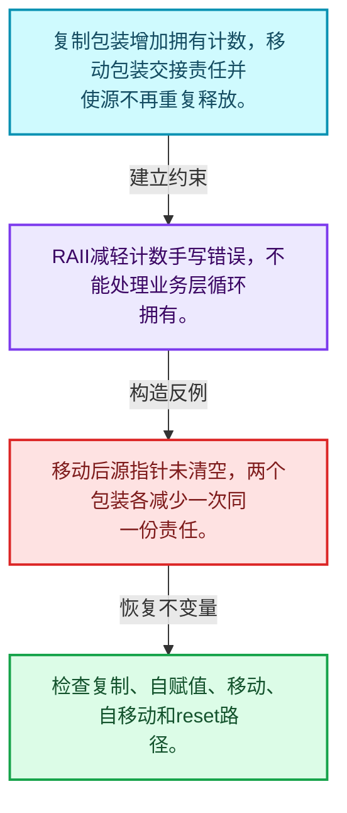
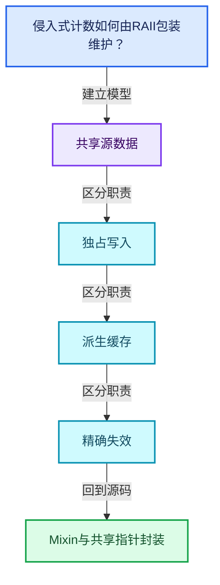
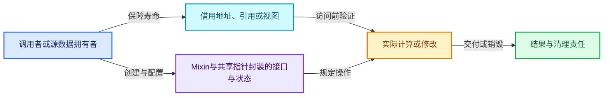
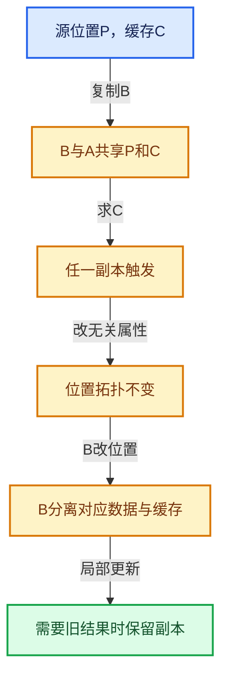

# 06-03 Mixin与共享指针封装

[方向导航](README.md) · [总目录](../README.md) · [覆盖索引](../%E6%BA%90%E7%A0%81%E7%89%88%E6%9C%AC%E4%B8%8E%E8%A6%86%E7%9B%96%E7%B4%A2%E5%BC%95.md)

> 阅读顺序：问题与数据模型 → 语法与类型 → 源码逐行 → 调用线索 → 历史与取舍 → 推演和练习。

- 基准 HEAD：`cbda6b96c26c0dee3c3b5cbb93960c4ac06a6b30`。
- 记录日期：2026-10-14。
- 教学示例状态：正文中的推演不是本机性能实测；已运行练习见验收报告。

## 一、从问题到设计

侵入式计数如何由RAII包装维护？

复制、移动、释放都必须严格配对增减；指针包装能减少遗漏，但不会自动验证业务可变性。

本篇把语法、数据语义和系统取舍连接起来。共享计数回答谁还活着，缓存依赖回答结果是否仍正确，两者不能互相替代。

### 本篇独立模型与设计推理

复制包装增加拥有计数，移动包装交接责任并使源不再重复释放。

设计取舍：RAII减轻计数手写错误，不能处理业务层循环拥有。

最小反例：移动后源指针未清空，两个包装各减少一次同一份责任。

推导与处理：检查复制、自赋值、移动、自移动和reset路径。



### 源码范围与相邻篇章

| 文件 | 本篇逐行范围 | 基准SHA-256 |
|---|---|---|
| [source/blender/blenlib/BLI_implicit_sharing_ptr.hh](../../../../../source/blender/blenlib/BLI_implicit_sharing_ptr.hh) | L1—L262 | `2c33a4133f0e040c238ce81ae116e953c518875564054caf47df3f590f393395` |

同一主讲文件可能分多篇覆盖；超出本篇范围的符号通过覆盖索引定位。空行与纯注释保留在源码摘录中，逐行表解释有效语句与语法边界；许可证头统一保留。

前篇：[ImplicitSharingInfo计数](02-ImplicitSharingInfo%E8%AE%A1%E6%95%B0.md).

后篇：[GeometryComponent共享](04-GeometryComponent%E5%85%B1%E4%BA%AB.md).

## 二、类型、数据与阅读地图



这是概念依赖图，边表示阅读关系，不声称是运行时调用顺序。

### 直接编译依赖


箭头只表示头文件包含关系；完整调用线索见后面的符号定位表。

## 三、关键词、语法与类型角色

### 模板 template

模板把类型或常量作为生成实现的参数。读声明时先列出类型参数、非类型参数和默认值，再看使用者实际实例化了什么。模板声明本身不意味着每种T都支持其全部成员。

具体检查：把T替换为int、string、只能移动的类型，分别检查每个被调用操作是否成立。

### 依赖名称 typename

typename既可引入类型模板参数，也可告诉编译器某个依赖名称是类型。它不创建运行时对象；解析期确认语法类别与实例化期检查具体类型是不同阶段。

具体检查：区分typename T::value_type和T::size()，前者标记类型，后者是表达式。

### 约束 requires

requires表达式或requires子句限制模板参与重载的条件。它提供编译期可用性检查，不是运行时if，不能指望输入到达程序后再被这一机制验证。

具体检查：构造满足和不满足约束的两个类型，观察候选被排除而不是在函数内返回错误。

### 常量求值 constexpr

constexpr声明允许相应实体参与常量求值，但constexpr函数仍可以在运行时执行。是否常量求值由调用场景和表达式合法性共同决定。

具体检查：比较constexpr变量初始化和从运行时输入调用同一函数。

### 只读限定 const

const约束当前访问路径可做的修改。const指针、指向const的指针、const视图对象、const元素是不同位置的限定；其他别名可能仍可修改原对象。

具体检查：分别写T* const、const T*与const T* const，并画出不可修改的层次。

### 移动转换 std::move

std::move把表达式转换为可供移动重载选择的值类别，实际资源转移发生在被选中的构造或赋值中。对const对象move可能仍调用复制，对视图move也不会获得底层数据所有权。

具体检查：记录移动构造调用次数，不用变量名或std::move的出现次数替代测量。

### 显式静态转换 static_cast

static_cast表达编译期允许的转换，不会自动验证运行时真实类型、指针寿命或索引边界。由void指针恢复T指针时，调用者仍须保证实际存储中确有合法T对象。

具体检查：标出转换前后的类型以及正确性依据来自哪里。

### 限定转换 const_cast

const_cast可以改变访问路径的限定，但不能让本来就是const的对象合法可写。常用于复用只读实现时，仍需检查底层对象是否实际可变。

具体检查：对非const对象的const引用与真正const对象分别分析修改是否合法。

### 构造与new表达式

普通new可能分配并构造；placement new在给定地址构造，存储由其他机制提供。失败回滚应区分两类责任。

具体检查：追踪地址来自哪里、构造何时成功、由谁析构、由谁释放。

### 内部断言 assert

断言表达开发者预期成立的内部契约，发布构建可能关闭。它不能替代对不可信输入的完整错误处理，也不保证后续操作被运行时保护。

具体检查：对每条断言构造违反条件的输入，区分调用者错误与应向用户报告的错误。

### 编译期分支 if constexpr

条件在实例化时决定被保留的分支，这常用于不同类型的合法操作选择。它与运行时if有不同的实例化检查规则。

具体检查：找出每个分支依赖哪些类型特征，再使用满足与不满足条件的类型。

### 受控访问 friend

friend授予指定函数或类访问非公开成员的权限，并不意味着继承，也不自动扩展到友元的派生类。

具体检查：解释执行器为何需要访问包装器的内部映射，同时检查边界是否仍清楚。

### 共享拥有 shared_ptr

shared_ptr让控制块跟踪共享寿命，不自动使被指向对象的读写线程安全；循环拥有可能阻止销毁。

具体检查：画出强引用环并考虑是否应改变所有权方向或引入弱引用。

### 类型别名 using

类型别名为已有类型建立名字，不创建运行期对象。它常把模板内部使用的类型统一暴露给泛型调用者。

具体检查：展开别名直到基础类型，区分类型别名和变量声明。

## 四、真实源码与逐行讲解

源码块保持原行内容，原始行号由小节标题及逐行表给出。表中的调用定位是静态阅读辅助；重载、模板实例化、宏展开和虚调用需结合完整声明，不能仅凭词法出现证明动态调用。

### BLI_implicit_sharing_ptr.hh：L1—L47

<!-- source:source/blender/blenlib/BLI_implicit_sharing_ptr.hh:1:47 -->

```cpp
/* SPDX-FileCopyrightText: 2023 Blender Authors
 *
 * SPDX-License-Identifier: GPL-2.0-or-later */

#pragma once

/** \file
 * \ingroup bli
 */

#include <memory>
#include <utility>

#include "BLI_implicit_sharing.hh"

namespace blender {

/**
 * #ImplicitSharingPtr is a smart pointer that manages implicit sharing. It's designed to work with
 * types that derive from #ImplicitSharingMixin. It is fairly similar to #std::shared_ptr but
 * requires the reference count to be embedded in the data.
 */
template<typename T = ImplicitSharingInfo, bool IsStrong = true> class ImplicitSharingPtr {
 private:
  const T *data_ = nullptr;

  template<typename U, bool OtherIsStrong> friend class ImplicitSharingPtr;

 public:
  using element_type = T;

  ImplicitSharingPtr() = default;

  explicit ImplicitSharingPtr(const T *data) : data_(data) {}

  /* Implicit conversion from nullptr. */
  ImplicitSharingPtr(std::nullptr_t) : data_(nullptr) {}

  ImplicitSharingPtr(const ImplicitSharingPtr &other) : data_(other.data_)
  {
    this->add_user(data_);
  }

  ImplicitSharingPtr(ImplicitSharingPtr &&other) : data_(other.data_)
  {
    other.data_ = nullptr;
  }
```

本段语义重点：

- `add_user`：增加共享使用计数，必须与未来相应释放配对。
- `data_`：数据或实现的存储入口；是否拥有应按该类声明和析构判定。

| 原始行 | 语义、约束与检查 |
|---|---|
| L5 | 防止同一头文件在一个翻译单元中重复展开；不控制多个源文件之间的链接或对象寿命。 |
| L11 | 引入编译依赖 <memory>；这是声明可见性关系，不表示运行时一定调用该文件的所有接口。 |
| L12 | 引入编译依赖 <utility>；这是声明可见性关系，不表示运行时一定调用该文件的所有接口。 |
| L14 | 引入编译依赖 "BLI_implicit_sharing.hh"；这是声明可见性关系，不表示运行时一定调用该文件的所有接口。 |
| L16 | 把后续声明放入 blender 命名空间，影响名称查找和符号归属，不创建运行时对象。 |
| L23 | 声明模板参数 `template<typename T = ImplicitSharingInfo, bool IsStrong = true> class ImplicitSharingPtr {`。类型参数决定生成操作的类型，非类型参数可决定内嵌容量或编译期分支。 |
| L24 | 切换成员访问权限为 private；它是编译期接口边界，不是线程同步或内存保护。 |
| L25 | 建立或更新 `data_`：数据或实现的存储入口；是否拥有应按该类声明和析构判定。本行的具体值关系为 `const T *data_ = nullptr`；对照更新前后相应范围或状态是否一致。 |
| L27 | 声明模板参数 `template<typename U, bool OtherIsStrong> friend class ImplicitSharingPtr;`。类型参数决定生成操作的类型，非类型参数可决定内嵌容量或编译期分支。 |
| L29 | 切换成员访问权限为 public；它是编译期接口边界，不是线程同步或内存保护。 |
| L30 | 定义类型别名 `using element_type = T`，为模板接口或内部实现统一命名；本行不分配该类型对象。 |
| L32 | 显式采用编译器生成的特殊成员行为：`ImplicitSharingPtr() = default;`。成员和基类的性质决定该操作是否可用、是否被删除及异常约定，不表示运行时给对象赋值为default。 |
| L34 | 本行涉及 `data_`：数据或实现的存储入口；是否拥有应按该类声明和析构判定。按此语义解读 `explicit ImplicitSharingPtr(const T *data) : data_(data) {}`，不要把地址、数量或状态混用。 |
| L37 | 本行涉及 `data_`：数据或实现的存储入口；是否拥有应按该类声明和析构判定。按此语义解读 `ImplicitSharingPtr(std::nullptr_t) : data_(nullptr) {}`，不要把地址、数量或状态混用。 |
| L39 | 本行涉及 `data_`：数据或实现的存储入口；是否拥有应按该类声明和析构判定。按此语义解读 `ImplicitSharingPtr(const ImplicitSharingPtr &other) : data_(other.data_)`，不要把地址、数量或状态混用。 |
| L40 | 连接上一行的声明或控制结构与其语句块；后续行在这个作用域中执行或声明。 |
| L41 | 本行使用 `add_user`：增加共享使用计数，必须与未来相应释放配对。 |
| L42 | 结束当前语法单元。局部自动对象在离开其作用域时按规则销毁；这不等于所有被引用的外部数据也被释放。 |
| L44 | 本行涉及 `data_`：数据或实现的存储入口；是否拥有应按该类声明和析构判定。按此语义解读 `ImplicitSharingPtr(ImplicitSharingPtr &&other) : data_(other.data_)`，不要把地址、数量或状态混用。 |
| L45 | 连接上一行的声明或控制结构与其语句块；后续行在这个作用域中执行或声明。 |
| L46 | 建立或更新 `data_`：数据或实现的存储入口；是否拥有应按该类声明和析构判定。本行的具体值关系为 `other.data_ = nullptr`；对照更新前后相应范围或状态是否一致。 |
| L47 | 结束当前语法单元。局部自动对象在离开其作用域时按规则销毁；这不等于所有被引用的外部数据也被释放。 |

### BLI_implicit_sharing_ptr.hh：L48—L92

<!-- source:source/blender/blenlib/BLI_implicit_sharing_ptr.hh:48:92 -->

```cpp

  template<typename U>
  ImplicitSharingPtr(const ImplicitSharingPtr<U, IsStrong> &other)
    requires std::is_base_of_v<T, U>
      : data_(static_cast<const U *>(other.data_))
  {
    this->add_user(data_);
  }

  template<typename U>
  ImplicitSharingPtr(ImplicitSharingPtr<U, IsStrong> &&other)
    requires std::is_base_of_v<T, U>
      : data_(static_cast<U *>(other.data_))
  {
    other.data_ = nullptr;
  }

  ~ImplicitSharingPtr()
  {
    this->remove_user_and_delete_if_last(data_);
  }

  ImplicitSharingPtr &operator=(const ImplicitSharingPtr &other)
  {
    if (this == &other) {
      return *this;
    }

    this->remove_user_and_delete_if_last(data_);
    data_ = other.data_;
    this->add_user(data_);
    return *this;
  }

  ImplicitSharingPtr &operator=(ImplicitSharingPtr &&other)
  {
    if (this == &other) {
      return *this;
    }

    this->remove_user_and_delete_if_last(data_);
    data_ = other.data_;
    other.data_ = nullptr;
    return *this;
  }
```

本段语义重点：

- `add_user`：增加共享使用计数，必须与未来相应释放配对。
- `remove_user`：减少共享使用计数，最后强用户可能触发数据销毁。
- `data_`：数据或实现的存储入口；是否拥有应按该类声明和析构判定。

| 原始行 | 语义、约束与检查 |
|---|---|
| L49 | 声明模板参数 `template<typename U>`。类型参数决定生成操作的类型，非类型参数可决定内嵌容量或编译期分支。 |
| L50 | 出现调用或函数声明 `ImplicitSharingPtr`，对应表达式为 `ImplicitSharingPtr(const ImplicitSharingPtr<U, IsStrong> &other)`。参数求值、返回类型与重载需结合前后完整语句；静态文本引用不能证明动态目标。 |
| L51 | 约束模板可用性：`requires std::is_base_of_v<T, U>`。条件在编译期检查，不替代运行期的地址、长度和类型一致性验证。 |
| L52 | 本行涉及 `data_`：数据或实现的存储入口；是否拥有应按该类声明和析构判定。按此语义解读 `: data_(static_cast<const U *>(other.data_))`，不要把地址、数量或状态混用。 |
| L53 | 连接上一行的声明或控制结构与其语句块；后续行在这个作用域中执行或声明。 |
| L54 | 本行使用 `add_user`：增加共享使用计数，必须与未来相应释放配对。 |
| L55 | 结束当前语法单元。局部自动对象在离开其作用域时按规则销毁；这不等于所有被引用的外部数据也被释放。 |
| L57 | 声明模板参数 `template<typename U>`。类型参数决定生成操作的类型，非类型参数可决定内嵌容量或编译期分支。 |
| L58 | 出现调用或函数声明 `ImplicitSharingPtr`，对应表达式为 `ImplicitSharingPtr(ImplicitSharingPtr<U, IsStrong> &&other)`。参数求值、返回类型与重载需结合前后完整语句；静态文本引用不能证明动态目标。 |
| L59 | 约束模板可用性：`requires std::is_base_of_v<T, U>`。条件在编译期检查，不替代运行期的地址、长度和类型一致性验证。 |
| L60 | 本行涉及 `data_`：数据或实现的存储入口；是否拥有应按该类声明和析构判定。按此语义解读 `: data_(static_cast<U *>(other.data_))`，不要把地址、数量或状态混用。 |
| L61 | 连接上一行的声明或控制结构与其语句块；后续行在这个作用域中执行或声明。 |
| L62 | 建立或更新 `data_`：数据或实现的存储入口；是否拥有应按该类声明和析构判定。本行的具体值关系为 `other.data_ = nullptr`；对照更新前后相应范围或状态是否一致。 |
| L63 | 结束当前语法单元。局部自动对象在离开其作用域时按规则销毁；这不等于所有被引用的外部数据也被释放。 |
| L65 | 涉及析构接口或显式析构：`~ImplicitSharingPtr()`。检查目标对象已成功构造，且资源不会在另一条清理路径再次销毁。 |
| L66 | 连接上一行的声明或控制结构与其语句块；后续行在这个作用域中执行或声明。 |
| L67 | 本行涉及 `data_`：数据或实现的存储入口；是否拥有应按该类声明和析构判定。按此语义解读 `this->remove_user_and_delete_if_last(data_)`，不要把地址、数量或状态混用。 |
| L68 | 结束当前语法单元。局部自动对象在离开其作用域时按规则销毁；这不等于所有被引用的外部数据也被释放。 |
| L70 | 运算符重载声明、定义或显式调用：`ImplicitSharingPtr &operator=(const ImplicitSharingPtr &other)`。结合参数和返回类型判断是赋值、索引、比较还是转换；operator=声明中的等号不是在给名为operator的变量赋值。 |
| L71 | 连接上一行的声明或控制结构与其语句块；后续行在这个作用域中执行或声明。 |
| L72 | 判断 `this == &other`，成立时进入本分支，否则继续后续路径。 |
| L73 | 返回表达式 `*this`。返回当前对象；返回类型决定它是引用还是值，不能仅凭表达式假定复制。 |
| L74 | 结束当前语法单元。局部自动对象在离开其作用域时按规则销毁；这不等于所有被引用的外部数据也被释放。 |
| L76 | 本行涉及 `data_`：数据或实现的存储入口；是否拥有应按该类声明和析构判定。按此语义解读 `this->remove_user_and_delete_if_last(data_)`，不要把地址、数量或状态混用。 |
| L77 | 建立或更新 `data_`：数据或实现的存储入口；是否拥有应按该类声明和析构判定。本行的具体值关系为 `data_ = other.data_`；对照更新前后相应范围或状态是否一致。 |
| L78 | 本行使用 `add_user`：增加共享使用计数，必须与未来相应释放配对。 |
| L79 | 返回表达式 `*this`。返回当前对象；返回类型决定它是引用还是值，不能仅凭表达式假定复制。 |
| L80 | 结束当前语法单元。局部自动对象在离开其作用域时按规则销毁；这不等于所有被引用的外部数据也被释放。 |
| L82 | 运算符重载声明、定义或显式调用：`ImplicitSharingPtr &operator=(ImplicitSharingPtr &&other)`。结合参数和返回类型判断是赋值、索引、比较还是转换；operator=声明中的等号不是在给名为operator的变量赋值。 |
| L83 | 连接上一行的声明或控制结构与其语句块；后续行在这个作用域中执行或声明。 |
| L84 | 判断 `this == &other`，成立时进入本分支，否则继续后续路径。 |
| L85 | 返回表达式 `*this`。返回当前对象；返回类型决定它是引用还是值，不能仅凭表达式假定复制。 |
| L86 | 结束当前语法单元。局部自动对象在离开其作用域时按规则销毁；这不等于所有被引用的外部数据也被释放。 |
| L88 | 本行涉及 `data_`：数据或实现的存储入口；是否拥有应按该类声明和析构判定。按此语义解读 `this->remove_user_and_delete_if_last(data_)`，不要把地址、数量或状态混用。 |
| L89 | 建立或更新 `data_`：数据或实现的存储入口；是否拥有应按该类声明和析构判定。本行的具体值关系为 `data_ = other.data_`；对照更新前后相应范围或状态是否一致。 |
| L90 | 建立或更新 `data_`：数据或实现的存储入口；是否拥有应按该类声明和析构判定。本行的具体值关系为 `other.data_ = nullptr`；对照更新前后相应范围或状态是否一致。 |
| L91 | 返回表达式 `*this`。返回当前对象；返回类型决定它是引用还是值，不能仅凭表达式假定复制。 |
| L92 | 结束当前语法单元。局部自动对象在离开其作用域时按规则销毁；这不等于所有被引用的外部数据也被释放。 |

### BLI_implicit_sharing_ptr.hh：L93—L137

<!-- source:source/blender/blenlib/BLI_implicit_sharing_ptr.hh:93:137 -->

```cpp

  const T *operator->() const
  {
    BLI_assert(data_ != nullptr);
    return data_;
  }

  const T &operator*() const
  {
    BLI_assert(data_ != nullptr);
    return *data_;
  }

  operator bool() const
  {
    return data_ != nullptr;
  }

  const T *get() const
  {
    return data_;
  }

  const T *release()
  {
    const T *data = data_;
    data_ = nullptr;
    return data;
  }

  void reset()
  {
    this->remove_user_and_delete_if_last(data_);
    data_ = nullptr;
  }

  bool has_value() const
  {
    return data_ != nullptr;
  }

  uint64_t hash() const
  {
    return get_default_hash(data_);
  }
```

本段语义重点：

- `remove_user`：减少共享使用计数，最后强用户可能触发数据销毁。
- `data_`：数据或实现的存储入口；是否拥有应按该类声明和析构判定。

| 原始行 | 语义、约束与检查 |
|---|---|
| L94 | 运算符重载声明、定义或显式调用：`const T *operator->() const`。结合参数和返回类型判断是赋值、索引、比较还是转换；operator=声明中的等号不是在给名为operator的变量赋值。 |
| L95 | 连接上一行的声明或控制结构与其语句块；后续行在这个作用域中执行或声明。 |
| L96 | 断言约束 `BLI_assert(data_ != nullptr);`。条件是后续访问的内部前置条件；发布构建可能不执行，不能把断言当作输入修复。 |
| L97 | 返回表达式 `data_`。 |
| L98 | 结束当前语法单元。局部自动对象在离开其作用域时按规则销毁；这不等于所有被引用的外部数据也被释放。 |
| L100 | 运算符重载声明、定义或显式调用：`const T &operator*() const`。结合参数和返回类型判断是赋值、索引、比较还是转换；operator=声明中的等号不是在给名为operator的变量赋值。 |
| L101 | 连接上一行的声明或控制结构与其语句块；后续行在这个作用域中执行或声明。 |
| L102 | 断言约束 `BLI_assert(data_ != nullptr);`。条件是后续访问的内部前置条件；发布构建可能不执行，不能把断言当作输入修复。 |
| L103 | 返回表达式 `*data_`。 |
| L104 | 结束当前语法单元。局部自动对象在离开其作用域时按规则销毁；这不等于所有被引用的外部数据也被释放。 |
| L106 | 运算符重载声明、定义或显式调用：`operator bool() const`。结合参数和返回类型判断是赋值、索引、比较还是转换；operator=声明中的等号不是在给名为operator的变量赋值。 |
| L107 | 连接上一行的声明或控制结构与其语句块；后续行在这个作用域中执行或声明。 |
| L108 | 返回表达式 `data_ != nullptr`。 |
| L109 | 结束当前语法单元。局部自动对象在离开其作用域时按规则销毁；这不等于所有被引用的外部数据也被释放。 |
| L111 | 出现调用或函数声明 `get`，对应表达式为 `const T *get() const`。参数求值、返回类型与重载需结合前后完整语句；静态文本引用不能证明动态目标。 |
| L112 | 连接上一行的声明或控制结构与其语句块；后续行在这个作用域中执行或声明。 |
| L113 | 返回表达式 `data_`。 |
| L114 | 结束当前语法单元。局部自动对象在离开其作用域时按规则销毁；这不等于所有被引用的外部数据也被释放。 |
| L116 | 出现调用或函数声明 `release`，对应表达式为 `const T *release()`。参数求值、返回类型与重载需结合前后完整语句；静态文本引用不能证明动态目标。 |
| L117 | 连接上一行的声明或控制结构与其语句块；后续行在这个作用域中执行或声明。 |
| L118 | 建立或更新 `data_`：数据或实现的存储入口；是否拥有应按该类声明和析构判定。本行的具体值关系为 `const T *data = data_`；对照更新前后相应范围或状态是否一致。 |
| L119 | 建立或更新 `data_`：数据或实现的存储入口；是否拥有应按该类声明和析构判定。本行的具体值关系为 `data_ = nullptr`；对照更新前后相应范围或状态是否一致。 |
| L120 | 返回表达式 `data`。 |
| L121 | 结束当前语法单元。局部自动对象在离开其作用域时按规则销毁；这不等于所有被引用的外部数据也被释放。 |
| L123 | 出现调用或函数声明 `reset`，对应表达式为 `void reset()`。参数求值、返回类型与重载需结合前后完整语句；静态文本引用不能证明动态目标。 |
| L124 | 连接上一行的声明或控制结构与其语句块；后续行在这个作用域中执行或声明。 |
| L125 | 本行涉及 `data_`：数据或实现的存储入口；是否拥有应按该类声明和析构判定。按此语义解读 `this->remove_user_and_delete_if_last(data_)`，不要把地址、数量或状态混用。 |
| L126 | 建立或更新 `data_`：数据或实现的存储入口；是否拥有应按该类声明和析构判定。本行的具体值关系为 `data_ = nullptr`；对照更新前后相应范围或状态是否一致。 |
| L127 | 结束当前语法单元。局部自动对象在离开其作用域时按规则销毁；这不等于所有被引用的外部数据也被释放。 |
| L129 | 出现调用或函数声明 `has_value`，对应表达式为 `bool has_value() const`。参数求值、返回类型与重载需结合前后完整语句；静态文本引用不能证明动态目标。 |
| L130 | 连接上一行的声明或控制结构与其语句块；后续行在这个作用域中执行或声明。 |
| L131 | 返回表达式 `data_ != nullptr`。 |
| L132 | 结束当前语法单元。局部自动对象在离开其作用域时按规则销毁；这不等于所有被引用的外部数据也被释放。 |
| L134 | 出现调用或函数声明 `hash`，对应表达式为 `uint64_t hash() const`。参数求值、返回类型与重载需结合前后完整语句；静态文本引用不能证明动态目标。 |
| L135 | 连接上一行的声明或控制结构与其语句块；后续行在这个作用域中执行或声明。 |
| L136 | 返回表达式 `get_default_hash(data_)`。 |
| L137 | 结束当前语法单元。局部自动对象在离开其作用域时按规则销毁；这不等于所有被引用的外部数据也被释放。 |

### BLI_implicit_sharing_ptr.hh：L138—L184

<!-- source:source/blender/blenlib/BLI_implicit_sharing_ptr.hh:138:184 -->

```cpp

  /**
   * If there is only a single user of the data, return a mutable reference to it directly.
   * Otherwise call #copy which is expected to return a new implicitly shared pointer that always
   * has a single user.
   */
  T &ensure_mutable_inplace()
  {
    BLI_assert(data_);
    if (!data_->is_mutable()) {
      /* The data is shared and therefore immutable. Make a mutable copy. */
      *this = data_->copy();
    }
    BLI_assert(data_->is_mutable());
    data_->tag_ensured_mutable();
    return const_cast<T &>(*data_);
  }

  static uint64_t hash_as(const T *data)
  {
    return get_default_hash(data);
  }

  friend bool operator==(const ImplicitSharingPtr &a, const ImplicitSharingPtr &b) = default;

  friend bool operator==(const T *a, const ImplicitSharingPtr &b)
  {
    return a == b.data_;
  }

  friend bool operator==(const ImplicitSharingPtr &a, const T *b)
  {
    return a.data_ == b;
  }

 private:
  static void add_user(const T *data)
  {
    if (data != nullptr) {
      if constexpr (IsStrong) {
        data->add_user();
      }
      else {
        data->add_weak_user();
      }
    }
  }
```

本段语义重点：

- `add_user`：增加共享使用计数，必须与未来相应释放配对。
- `is_mutable`：检查可变访问所需的独占状态，不等价于任意线程可同时修改。
- `data_`：数据或实现的存储入口；是否拥有应按该类声明和析构判定。

| 原始行 | 语义、约束与检查 |
|---|---|
| L144 | 出现调用或函数声明 `ensure_mutable_inplace`，对应表达式为 `T &ensure_mutable_inplace()`。参数求值、返回类型与重载需结合前后完整语句；静态文本引用不能证明动态目标。 |
| L145 | 连接上一行的声明或控制结构与其语句块；后续行在这个作用域中执行或声明。 |
| L146 | 断言约束 `BLI_assert(data_);`。条件是后续访问的内部前置条件；发布构建可能不执行，不能把断言当作输入修复。 |
| L147 | 本行使用 `is_mutable`：检查可变访问所需的独占状态，不等价于任意线程可同时修改。 |
| L149 | 建立或更新 `data_`：数据或实现的存储入口；是否拥有应按该类声明和析构判定。本行的具体值关系为 `*this = data_->copy()`；对照更新前后相应范围或状态是否一致。 |
| L150 | 结束当前语法单元。局部自动对象在离开其作用域时按规则销毁；这不等于所有被引用的外部数据也被释放。 |
| L151 | 本行使用 `is_mutable`：检查可变访问所需的独占状态，不等价于任意线程可同时修改。 |
| L152 | 本行涉及 `data_`：数据或实现的存储入口；是否拥有应按该类声明和析构判定。按此语义解读 `data_->tag_ensured_mutable()`，不要把地址、数量或状态混用。 |
| L153 | 返回表达式 `const_cast<T &>(*data_)`。 |
| L154 | 结束当前语法单元。局部自动对象在离开其作用域时按规则销毁；这不等于所有被引用的外部数据也被释放。 |
| L156 | 出现调用或函数声明 `hash_as`，对应表达式为 `static uint64_t hash_as(const T *data)`。参数求值、返回类型与重载需结合前后完整语句；静态文本引用不能证明动态目标。 |
| L157 | 连接上一行的声明或控制结构与其语句块；后续行在这个作用域中执行或声明。 |
| L158 | 返回表达式 `get_default_hash(data)`。 |
| L159 | 结束当前语法单元。局部自动对象在离开其作用域时按规则销毁；这不等于所有被引用的外部数据也被释放。 |
| L161 | 显式采用编译器生成的特殊成员行为：`friend bool operator==(const ImplicitSharingPtr &a, const ImplicitSharingPtr &b) = default;`。成员和基类的性质决定该操作是否可用、是否被删除及异常约定，不表示运行时给对象赋值为default。 |
| L163 | 运算符重载声明、定义或显式调用：`friend bool operator==(const T *a, const ImplicitSharingPtr &b)`。结合参数和返回类型判断是赋值、索引、比较还是转换；operator=声明中的等号不是在给名为operator的变量赋值。 |
| L164 | 连接上一行的声明或控制结构与其语句块；后续行在这个作用域中执行或声明。 |
| L165 | 返回表达式 `a == b.data_`。 |
| L166 | 结束当前语法单元。局部自动对象在离开其作用域时按规则销毁；这不等于所有被引用的外部数据也被释放。 |
| L168 | 运算符重载声明、定义或显式调用：`friend bool operator==(const ImplicitSharingPtr &a, const T *b)`。结合参数和返回类型判断是赋值、索引、比较还是转换；operator=声明中的等号不是在给名为operator的变量赋值。 |
| L169 | 连接上一行的声明或控制结构与其语句块；后续行在这个作用域中执行或声明。 |
| L170 | 返回表达式 `a.data_ == b`。 |
| L171 | 结束当前语法单元。局部自动对象在离开其作用域时按规则销毁；这不等于所有被引用的外部数据也被释放。 |
| L173 | 切换成员访问权限为 private；它是编译期接口边界，不是线程同步或内存保护。 |
| L174 | 出现调用或函数声明 `add_user`，对应表达式为 `static void add_user(const T *data)`。参数求值、返回类型与重载需结合前后完整语句；静态文本引用不能证明动态目标。 |
| L175 | 连接上一行的声明或控制结构与其语句块；后续行在这个作用域中执行或声明。 |
| L176 | 判断 `data != nullptr`，成立时进入本分支，否则继续后续路径。这里区分空地址与可用地址，但非空本身仍不能证明对象存活。 |
| L177 | 编译期条件分支 `if constexpr (IsStrong)`。按实例化类型选择相应实现；被舍弃分支和运行期if具有不同检查规则，不能当作运行时输入验证。 |
| L178 | 本行使用 `add_user`：增加共享使用计数，必须与未来相应释放配对。 |
| L179 | 结束当前语法单元。局部自动对象在离开其作用域时按规则销毁；这不等于所有被引用的外部数据也被释放。 |
| L180 | 处理前一条件不成立的互补路径。比较两条路径最后是否恢复同一不变量，以及是否产生不同的资源责任。 |
| L181 | 出现调用或函数声明 `add_weak_user`，对应表达式为 `data->add_weak_user();`。参数求值、返回类型与重载需结合前后完整语句；静态文本引用不能证明动态目标。 |
| L182 | 结束当前语法单元。局部自动对象在离开其作用域时按规则销毁；这不等于所有被引用的外部数据也被释放。 |
| L183 | 结束当前语法单元。局部自动对象在离开其作用域时按规则销毁；这不等于所有被引用的外部数据也被释放。 |
| L184 | 结束当前语法单元。局部自动对象在离开其作用域时按规则销毁；这不等于所有被引用的外部数据也被释放。 |

### BLI_implicit_sharing_ptr.hh：L185—L235

<!-- source:source/blender/blenlib/BLI_implicit_sharing_ptr.hh:185:235 -->

```cpp

  static void remove_user_and_delete_if_last(const T *data)
  {
    if (data != nullptr) {
      if constexpr (IsStrong) {
        data->remove_user_and_delete_if_last();
      }
      else {
        data->remove_weak_user_and_delete_if_last();
      }
    }
  }
};

using WeakImplicitSharingPtr = ImplicitSharingPtr<ImplicitSharingInfo, false>;

/**
 * Utility struct to allow used #ImplicitSharingPtr when it's necessary to type-erase the backing
 * storage for user-exposed data. For example, #Vector, or #std::vector might be used to
 * store an implicitly shared array that is only accessed with #Span or #MutableSpan.
 *
 * This class handles RAII for the sharing info and the exposed data pointer.
 * Retrieving the data with write access and type safety must be handled elsewhere.
 */
class ImplicitSharingPtrAndData {
 public:
  ImplicitSharingPtr<> sharing_info;
  const void *data = nullptr;

  ImplicitSharingPtrAndData() = default;
  ImplicitSharingPtrAndData(ImplicitSharingPtr<> sharing_info, const void *data)
      : sharing_info(std::move(sharing_info)), data(data)
  {
  }

  ImplicitSharingPtrAndData(const ImplicitSharingPtrAndData &other) = default;

  ImplicitSharingPtrAndData(ImplicitSharingPtrAndData &&other)
      : sharing_info(std::move(other.sharing_info)), data(std::exchange(other.data, nullptr))
  {
  }

  ImplicitSharingPtrAndData &operator=(const ImplicitSharingPtrAndData &other)
  {
    if (this == &other) {
      return *this;
    }
    std::destroy_at(this);
    new (this) ImplicitSharingPtrAndData(other);
    return *this;
  }
```

本段语义重点：

- `remove_user`：减少共享使用计数，最后强用户可能触发数据销毁。
- `std::exchange`：替换对象并返回原值，常用于移动时取走资源并给源留下可析构状态。

| 原始行 | 语义、约束与检查 |
|---|---|
| L186 | 出现调用或函数声明 `remove_user_and_delete_if_last`，对应表达式为 `static void remove_user_and_delete_if_last(const T *data)`。参数求值、返回类型与重载需结合前后完整语句；静态文本引用不能证明动态目标。 |
| L187 | 连接上一行的声明或控制结构与其语句块；后续行在这个作用域中执行或声明。 |
| L188 | 判断 `data != nullptr`，成立时进入本分支，否则继续后续路径。这里区分空地址与可用地址，但非空本身仍不能证明对象存活。 |
| L189 | 编译期条件分支 `if constexpr (IsStrong)`。按实例化类型选择相应实现；被舍弃分支和运行期if具有不同检查规则，不能当作运行时输入验证。 |
| L190 | 出现调用或函数声明 `remove_user_and_delete_if_last`，对应表达式为 `data->remove_user_and_delete_if_last();`。参数求值、返回类型与重载需结合前后完整语句；静态文本引用不能证明动态目标。 |
| L191 | 结束当前语法单元。局部自动对象在离开其作用域时按规则销毁；这不等于所有被引用的外部数据也被释放。 |
| L192 | 处理前一条件不成立的互补路径。比较两条路径最后是否恢复同一不变量，以及是否产生不同的资源责任。 |
| L193 | 出现调用或函数声明 `remove_weak_user_and_delete_if_last`，对应表达式为 `data->remove_weak_user_and_delete_if_last();`。参数求值、返回类型与重载需结合前后完整语句；静态文本引用不能证明动态目标。 |
| L194 | 结束当前语法单元。局部自动对象在离开其作用域时按规则销毁；这不等于所有被引用的外部数据也被释放。 |
| L195 | 结束当前语法单元。局部自动对象在离开其作用域时按规则销毁；这不等于所有被引用的外部数据也被释放。 |
| L196 | 结束当前语法单元。局部自动对象在离开其作用域时按规则销毁；这不等于所有被引用的外部数据也被释放。 |
| L197 | 结束当前语法单元。局部自动对象在离开其作用域时按规则销毁；这不等于所有被引用的外部数据也被释放。 |
| L199 | 定义类型别名 `using WeakImplicitSharingPtr = ImplicitSharingPtr<ImplicitSharingInfo, false>`，为模板接口或内部实现统一命名；本行不分配该类型对象。 |
| L209 | 声明或定义类型 `class ImplicitSharingPtrAndData`。结合继承、访问权限和成员布局确认接口与拥有关系；前向声明本身没有完整对象布局。 |
| L210 | 切换成员访问权限为 public；它是编译期接口边界，不是线程同步或内存保护。 |
| L211 | 声明成员、局部对象或完成语句 `ImplicitSharingPtr<> sharing_info`。若为指针或引用，它本身不说明拥有；若为值对象，其构造析构由所在作用域或外层对象管理。 |
| L212 | 把右侧 `nullptr` 用于初始化或更新左侧 `const void *data`。声明初始化与已有对象赋值应按上下文区分；有资源的类型会调用相应特殊成员。 |
| L214 | 显式采用编译器生成的特殊成员行为：`ImplicitSharingPtrAndData() = default;`。成员和基类的性质决定该操作是否可用、是否被删除及异常约定，不表示运行时给对象赋值为default。 |
| L215 | 出现调用或函数声明 `ImplicitSharingPtrAndData`，对应表达式为 `ImplicitSharingPtrAndData(ImplicitSharingPtr<> sharing_info, const void *data)`。参数求值、返回类型与重载需结合前后完整语句；静态文本引用不能证明动态目标。 |
| L216 | 出现调用或函数声明 `sharing_info`，对应表达式为 `: sharing_info(std::move(sharing_info)), data(data)`。参数求值、返回类型与重载需结合前后完整语句；静态文本引用不能证明动态目标。 |
| L217 | 连接上一行的声明或控制结构与其语句块；后续行在这个作用域中执行或声明。 |
| L218 | 结束当前语法单元。局部自动对象在离开其作用域时按规则销毁；这不等于所有被引用的外部数据也被释放。 |
| L220 | 显式采用编译器生成的特殊成员行为：`ImplicitSharingPtrAndData(const ImplicitSharingPtrAndData &other) = default;`。成员和基类的性质决定该操作是否可用、是否被删除及异常约定，不表示运行时给对象赋值为default。 |
| L222 | 出现调用或函数声明 `ImplicitSharingPtrAndData`，对应表达式为 `ImplicitSharingPtrAndData(ImplicitSharingPtrAndData &&other)`。参数求值、返回类型与重载需结合前后完整语句；静态文本引用不能证明动态目标。 |
| L223 | 本行使用 `std::exchange`：替换对象并返回原值，常用于移动时取走资源并给源留下可析构状态。 |
| L224 | 连接上一行的声明或控制结构与其语句块；后续行在这个作用域中执行或声明。 |
| L225 | 结束当前语法单元。局部自动对象在离开其作用域时按规则销毁；这不等于所有被引用的外部数据也被释放。 |
| L227 | 运算符重载声明、定义或显式调用：`ImplicitSharingPtrAndData &operator=(const ImplicitSharingPtrAndData &other)`。结合参数和返回类型判断是赋值、索引、比较还是转换；operator=声明中的等号不是在给名为operator的变量赋值。 |
| L228 | 连接上一行的声明或控制结构与其语句块；后续行在这个作用域中执行或声明。 |
| L229 | 判断 `this == &other`，成立时进入本分支，否则继续后续路径。 |
| L230 | 返回表达式 `*this`。返回当前对象；返回类型决定它是引用还是值，不能仅凭表达式假定复制。 |
| L231 | 结束当前语法单元。局部自动对象在离开其作用域时按规则销毁；这不等于所有被引用的外部数据也被释放。 |
| L232 | 出现调用或函数声明 `std::destroy_at`，对应表达式为 `std::destroy_at(this);`。参数求值、返回类型与重载需结合前后完整语句；静态文本引用不能证明动态目标。 |
| L233 | 出现调用或函数声明 `new`，对应表达式为 `new (this) ImplicitSharingPtrAndData(other);`。参数求值、返回类型与重载需结合前后完整语句；静态文本引用不能证明动态目标。 |
| L234 | 返回表达式 `*this`。返回当前对象；返回类型决定它是引用还是值，不能仅凭表达式假定复制。 |
| L235 | 结束当前语法单元。局部自动对象在离开其作用域时按规则销毁；这不等于所有被引用的外部数据也被释放。 |

### BLI_implicit_sharing_ptr.hh：L236—L262

<!-- source:source/blender/blenlib/BLI_implicit_sharing_ptr.hh:236:262 -->

```cpp

  ImplicitSharingPtrAndData &operator=(ImplicitSharingPtrAndData &&other)
  {
    if (this == &other) {
      return *this;
    }
    std::destroy_at(this);
    new (this) ImplicitSharingPtrAndData(std::move(other));
    return *this;
  }

  ~ImplicitSharingPtrAndData()
  {
    this->data = nullptr;
  }

  bool has_value() const
  {
    return this->sharing_info.has_value();
  }
};

template<typename T> static constexpr bool is_ImplicitSharingPtr_strong_v = false;
template<typename T>
static constexpr bool is_ImplicitSharingPtr_strong_v<ImplicitSharingPtr<T, true>> = true;

}  // namespace blender
```

本段语义重点：

- 分支证据 `this == &other)`：分别推演条件成立与不成立，核对相同出口处的状态。

| 原始行 | 语义、约束与检查 |
|---|---|
| L237 | 运算符重载声明、定义或显式调用：`ImplicitSharingPtrAndData &operator=(ImplicitSharingPtrAndData &&other)`。结合参数和返回类型判断是赋值、索引、比较还是转换；operator=声明中的等号不是在给名为operator的变量赋值。 |
| L238 | 连接上一行的声明或控制结构与其语句块；后续行在这个作用域中执行或声明。 |
| L239 | 判断 `this == &other`，成立时进入本分支，否则继续后续路径。 |
| L240 | 返回表达式 `*this`。返回当前对象；返回类型决定它是引用还是值，不能仅凭表达式假定复制。 |
| L241 | 结束当前语法单元。局部自动对象在离开其作用域时按规则销毁；这不等于所有被引用的外部数据也被释放。 |
| L242 | 出现调用或函数声明 `std::destroy_at`，对应表达式为 `std::destroy_at(this);`。参数求值、返回类型与重载需结合前后完整语句；静态文本引用不能证明动态目标。 |
| L243 | 出现调用或函数声明 `new`，对应表达式为 `new (this) ImplicitSharingPtrAndData(std::move(other));`。参数求值、返回类型与重载需结合前后完整语句；静态文本引用不能证明动态目标。 |
| L244 | 返回表达式 `*this`。返回当前对象；返回类型决定它是引用还是值，不能仅凭表达式假定复制。 |
| L245 | 结束当前语法单元。局部自动对象在离开其作用域时按规则销毁；这不等于所有被引用的外部数据也被释放。 |
| L247 | 涉及析构接口或显式析构：`~ImplicitSharingPtrAndData()`。检查目标对象已成功构造，且资源不会在另一条清理路径再次销毁。 |
| L248 | 连接上一行的声明或控制结构与其语句块；后续行在这个作用域中执行或声明。 |
| L249 | 把右侧 `nullptr` 用于初始化或更新左侧 `this->data`。声明初始化与已有对象赋值应按上下文区分；有资源的类型会调用相应特殊成员。 |
| L250 | 结束当前语法单元。局部自动对象在离开其作用域时按规则销毁；这不等于所有被引用的外部数据也被释放。 |
| L252 | 出现调用或函数声明 `has_value`，对应表达式为 `bool has_value() const`。参数求值、返回类型与重载需结合前后完整语句；静态文本引用不能证明动态目标。 |
| L253 | 连接上一行的声明或控制结构与其语句块；后续行在这个作用域中执行或声明。 |
| L254 | 返回表达式 `this->sharing_info.has_value()`。 |
| L255 | 结束当前语法单元。局部自动对象在离开其作用域时按规则销毁；这不等于所有被引用的外部数据也被释放。 |
| L256 | 结束当前语法单元。局部自动对象在离开其作用域时按规则销毁；这不等于所有被引用的外部数据也被释放。 |
| L258 | 声明模板参数 `template<typename T> static constexpr bool is_ImplicitSharingPtr_strong_v = false;`。类型参数决定生成操作的类型，非类型参数可决定内嵌容量或编译期分支。 |
| L259 | 声明模板参数 `template<typename T>`。类型参数决定生成操作的类型，非类型参数可决定内嵌容量或编译期分支。 |
| L260 | 把右侧 `true` 用于初始化或更新左侧 `static constexpr bool is_ImplicitSharingPtr_strong_v<ImplicitSharingPtr<T, true>>`。声明初始化与已有对象赋值应按上下文区分；有资源的类型会调用相应特殊成员。 |
| L262 | 结束当前语法单元。局部自动对象在离开其作用域时按规则销毁；这不等于所有被引用的外部数据也被释放。 |

## 五、接口定位、调用线索与生命周期

### 本篇声明与实现入口

| 源码位置 | 实际声明片段 |
|---|---|
| [BLI_implicit_sharing_ptr.hh:L23](../../../../../source/blender/blenlib/BLI_implicit_sharing_ptr.hh#L23) | `template<typename T = ImplicitSharingInfo, bool IsStrong = true> class ImplicitSharingPtr` |
| [BLI_implicit_sharing_ptr.hh:L32](../../../../../source/blender/blenlib/BLI_implicit_sharing_ptr.hh#L32) | `ImplicitSharingPtr() = default;` |
| [BLI_implicit_sharing_ptr.hh:L34](../../../../../source/blender/blenlib/BLI_implicit_sharing_ptr.hh#L34) | `explicit ImplicitSharingPtr(const T *data) : data_(data) {}` |
| [BLI_implicit_sharing_ptr.hh:L37](../../../../../source/blender/blenlib/BLI_implicit_sharing_ptr.hh#L37) | `ImplicitSharingPtr(std::nullptr_t) : data_(nullptr) {}` |
| [BLI_implicit_sharing_ptr.hh:L39](../../../../../source/blender/blenlib/BLI_implicit_sharing_ptr.hh#L39) | `ImplicitSharingPtr(const ImplicitSharingPtr &other) : data_(other.data_)` |
| [BLI_implicit_sharing_ptr.hh:L44](../../../../../source/blender/blenlib/BLI_implicit_sharing_ptr.hh#L44) | `ImplicitSharingPtr(ImplicitSharingPtr &&other) : data_(other.data_)` |
| [BLI_implicit_sharing_ptr.hh:L50](../../../../../source/blender/blenlib/BLI_implicit_sharing_ptr.hh#L50) | `ImplicitSharingPtr(const ImplicitSharingPtr<U, IsStrong> &other)` |
| [BLI_implicit_sharing_ptr.hh:L52](../../../../../source/blender/blenlib/BLI_implicit_sharing_ptr.hh#L52) | `: data_(static_cast<const U *>(other.data_))` |
| [BLI_implicit_sharing_ptr.hh:L58](../../../../../source/blender/blenlib/BLI_implicit_sharing_ptr.hh#L58) | `ImplicitSharingPtr(ImplicitSharingPtr<U, IsStrong> &&other)` |
| [BLI_implicit_sharing_ptr.hh:L60](../../../../../source/blender/blenlib/BLI_implicit_sharing_ptr.hh#L60) | `: data_(static_cast<U *>(other.data_))` |
| [BLI_implicit_sharing_ptr.hh:L106](../../../../../source/blender/blenlib/BLI_implicit_sharing_ptr.hh#L106) | `operator bool() const` |
| [BLI_implicit_sharing_ptr.hh:L111](../../../../../source/blender/blenlib/BLI_implicit_sharing_ptr.hh#L111) | `const T *get() const` |
| [BLI_implicit_sharing_ptr.hh:L116](../../../../../source/blender/blenlib/BLI_implicit_sharing_ptr.hh#L116) | `const T *release()` |
| [BLI_implicit_sharing_ptr.hh:L123](../../../../../source/blender/blenlib/BLI_implicit_sharing_ptr.hh#L123) | `void reset()` |
| [BLI_implicit_sharing_ptr.hh:L129](../../../../../source/blender/blenlib/BLI_implicit_sharing_ptr.hh#L129) | `bool has_value() const` |
| [BLI_implicit_sharing_ptr.hh:L134](../../../../../source/blender/blenlib/BLI_implicit_sharing_ptr.hh#L134) | `uint64_t hash() const` |
| [BLI_implicit_sharing_ptr.hh:L144](../../../../../source/blender/blenlib/BLI_implicit_sharing_ptr.hh#L144) | `T &ensure_mutable_inplace()` |
| [BLI_implicit_sharing_ptr.hh:L156](../../../../../source/blender/blenlib/BLI_implicit_sharing_ptr.hh#L156) | `static uint64_t hash_as(const T *data)` |
| [BLI_implicit_sharing_ptr.hh:L174](../../../../../source/blender/blenlib/BLI_implicit_sharing_ptr.hh#L174) | `static void add_user(const T *data)` |
| [BLI_implicit_sharing_ptr.hh:L186](../../../../../source/blender/blenlib/BLI_implicit_sharing_ptr.hh#L186) | `static void remove_user_and_delete_if_last(const T *data)` |
| [BLI_implicit_sharing_ptr.hh:L209](../../../../../source/blender/blenlib/BLI_implicit_sharing_ptr.hh#L209) | `class ImplicitSharingPtrAndData` |
| [BLI_implicit_sharing_ptr.hh:L214](../../../../../source/blender/blenlib/BLI_implicit_sharing_ptr.hh#L214) | `ImplicitSharingPtrAndData() = default;` |
| [BLI_implicit_sharing_ptr.hh:L215](../../../../../source/blender/blenlib/BLI_implicit_sharing_ptr.hh#L215) | `ImplicitSharingPtrAndData(ImplicitSharingPtr<> sharing_info, const void *data)` |
| [BLI_implicit_sharing_ptr.hh:L216](../../../../../source/blender/blenlib/BLI_implicit_sharing_ptr.hh#L216) | `: sharing_info(std::move(sharing_info)), data(data)` |
| [BLI_implicit_sharing_ptr.hh:L220](../../../../../source/blender/blenlib/BLI_implicit_sharing_ptr.hh#L220) | `ImplicitSharingPtrAndData(const ImplicitSharingPtrAndData &other) = default;` |
| [BLI_implicit_sharing_ptr.hh:L222](../../../../../source/blender/blenlib/BLI_implicit_sharing_ptr.hh#L222) | `ImplicitSharingPtrAndData(ImplicitSharingPtrAndData &&other)` |
| [BLI_implicit_sharing_ptr.hh:L223](../../../../../source/blender/blenlib/BLI_implicit_sharing_ptr.hh#L223) | `: sharing_info(std::move(other.sharing_info)), data(std::exchange(other.data, nullptr))` |
| [BLI_implicit_sharing_ptr.hh:L252](../../../../../source/blender/blenlib/BLI_implicit_sharing_ptr.hh#L252) | `bool has_value() const` |

### 同名符号出现位置

以下表提供跨文件阅读入口，包含声明、调用或测试使用；没有经过完整C++名称解析，不把它命名为已证明的运行时调用图。

| 符号 | 位置 | 文本证据 |
|---|---|---|
| `ImplicitSharingPtr` | [geometry_fields.cc:L1088](../../../../../source/blender/blenkernel/intern/geometry_fields.cc#L1088) | `results_to_add.append({input_index, AddResult::Array{ImplicitSharingPtr(data)}});` |
| `data_` | [BLI_bit_span.hh:L29](../../../../../source/blender/blenlib/BLI_bit_span.hh#L29) | `BitIteratorBase(const BitInt *data, const int64_t bit_index) : data_(data), bit_index_(bit_index)` |
| `data_` | [BLI_bit_span.hh:L74](../../../../../source/blender/blenlib/BLI_bit_span.hh#L74) | `explicit OneBitIterator(BitInt data) : data_(data)` |
| `data_` | [BLI_bit_span.hh:L106](../../../../../source/blender/blenlib/BLI_bit_span.hh#L106) | `OneBitIteratorRange(BitInt data) : data_(data) {}` |
| `bool` | [BKE_attribute.hh:L140](../../../../../source/blender/blenkernel/BKE_attribute.hh#L140) | `FunctionRef<bool(StringRefNull name, const AttributeMetaData &meta_data)>;` |
| `bool` | [BKE_attribute.hh:L177](../../../../../source/blender/blenkernel/BKE_attribute.hh#L177) | `operator bool() const` |
| `bool` | [BKE_attribute.hh:L194](../../../../../source/blender/blenkernel/BKE_attribute.hh#L194) | `operator bool() const` |
| `get` | [BKE_attribute.hh:L425](../../../../../source/blender/blenkernel/BKE_attribute.hh#L425) | `GAttributeReader get() const` |
| `get` | [BKE_attribute.hh:L431](../../../../../source/blender/blenkernel/BKE_attribute.hh#L431) | `GAttributeReader get(std::optional<AttrDomain> domain, std::optional<AttrType> data_type) const;` |
| `get` | [BKE_attribute.hh:L433](../../../../../source/blender/blenkernel/BKE_attribute.hh#L433) | `GAttributeReader get(const AttrDomain domain) const` |
| `release` | [BKE_geometry_set.hh:L516](../../../../../source/blender/blenkernel/BKE_geometry_set.hh#L516) | `Mesh *release();` |
| `release` | [BKE_geometry_set.hh:L575](../../../../../source/blender/blenkernel/BKE_geometry_set.hh#L575) | `PointCloud *release();` |
| `release` | [BKE_geometry_set.hh:L633](../../../../../source/blender/blenkernel/BKE_geometry_set.hh#L633) | `Curves *release();` |
| `reset` | [bvhutils.cc:L595](../../../../../source/blender/blenkernel/intern/bvhutils.cc#L595) | `verts_mask[vert].reset();` |
| `reset` | [bvhutils.cc:L604](../../../../../source/blender/blenkernel/intern/bvhutils.cc#L604) | `verts_mask[vert].reset();` |
| `reset` | [bvhutils.cc:L631](../../../../../source/blender/blenkernel/intern/bvhutils.cc#L631) | `edge_mask[edge].reset();` |
| `has_value` | [BKE_attribute.hh:L527](../../../../../source/blender/blenkernel/BKE_attribute.hh#L527) | `return this->lookup_meta_data(name).has_value();` |
| `has_value` | [BKE_attribute.hh:L560](../../../../../source/blender/blenkernel/BKE_attribute.hh#L560) | `return fn_->builtin_domain_and_type(owner_, name).has_value();` |
| `has_value` | [BKE_attribute.hh:L805](../../../../../source/blender/blenkernel/BKE_attribute.hh#L805) | `if (old_meta.has_value()) {` |
| `hash` | [BKE_geometry_set.hh:L470](../../../../../source/blender/blenkernel/BKE_geometry_set.hh#L470) | `uint64_t hash() const` |
| `hash` | [BLI_array.hh:L376](../../../../../source/blender/blenlib/BLI_array.hh#L376) | `uint64_t hash() const` |
| `hash` | [BLI_array.hh:L378](../../../../../source/blender/blenlib/BLI_array.hh#L378) | `return this->as_span().hash();` |
| `ensure_mutable_inplace` | [geometry_set.cc:L126](../../../../../source/blender/blenkernel/intern/geometry_set.cc#L126) | `return component_ptr.ensure_mutable_inplace();` |
| `ensure_mutable_inplace` | [geometry_set.cc:L784](../../../../../source/blender/blenkernel/intern/geometry_set.cc#L784) | `return bundle_.ensure_mutable_inplace();` |
| `ensure_mutable_inplace` | [geometry_nodes_bundle.cc:L147](../../../../../source/blender/nodes/intern/geometry_nodes_bundle.cc#L147) | `current = &child_bundle_ptr->ensure_mutable_inplace();` |
| `hash_as` | [BLI_array.hh:L381](../../../../../source/blender/blenlib/BLI_array.hh#L381) | `static uint64_t hash_as(const Span<T> values)` |
| `hash_as` | [BLI_hash.hh:L121](../../../../../source/blender/blenlib/BLI_hash.hh#L121) | `return T::hash_as(value);` |
| `hash_as` | [BLI_vector.hh:L1036](../../../../../source/blender/blenlib/BLI_vector.hh#L1036) | `static uint64_t hash_as(const Span<T> values)` |
| `add_user` | [geometry_set.cc:L167](../../../../../source/blender/blenkernel/intern/geometry_set.cc#L167) | `component.add_user();` |
| `add_user` | [BLI_implicit_sharing.hh:L91](../../../../../source/blender/blenlib/BLI_implicit_sharing.hh#L91) | `void add_user() const` |
| `add_user` | [BLI_implicit_sharing.hh:L280](../../../../../source/blender/blenlib/BLI_implicit_sharing.hh#L280) | `(*r_dst_sharing_info)->add_user();` |

### 生命周期推理图



这是审查生命周期的通用模型。具体类是否拥有数据由本篇成员、构造、析构和调用者一起证明；任何箭头都不自动代表shared_ptr。

## 六、把代码放进具体数据中推演

本方向的共同数值模型如下。本篇的专门检查是：检查复制赋值、自赋值和移动后源对象状态。

| 步骤 | 数据或状态 | 为什么需要这一步 |
|---|---|---|
| 创建A | 源位置P，缓存C | C可以尚未计算 |
| 复制B | B与A共享P和C | 源数据等价才允许共享结果 |
| 求C | 任一副本触发 | 另一个副本也可见相同结果 |
| 改无关属性 | 位置拓扑不变 | 相关缓存可继续有效 |
| B改位置 | B分离对应数据与缓存 | A结果仍保持原语义 |
| 局部更新 | 需要旧结果时保留副本 | 与直接放弃旧缓存不同 |



图是教学推演模型；精确分支与状态更新以本篇摘录及调用契约为准。

### 本篇独立练习与参考思路

检查复制赋值、自赋值和移动后源对象状态。

参考思路：复制、移动、释放都必须严格配对增减；指针包装能减少遗漏，但不会自动验证业务可变性。

将输入、预期结果和资源责任分成三张清单。先用最直接的实现给出可核对的答案，再替换成对应源码使用的表示；比较结果不变的条件，而不是只比较接口名字。

验收依据：改变副本不改变原对象结果；修改任一真实依赖后旧结果不可继续被当成有效缓存。

## 七、复杂度、设计取舍与其他基础库

与shared_ptr比较寿命管理，与写时复制容器比较写边界，与普通memoization比较键的等价性；SharedCache把等价对象的派生结果放在共同控制对象中。

本篇的具体取舍：复制、移动、释放都必须严格配对增减；指针包装能减少遗漏，但不会自动验证业务可变性。

| 观察维度 | 从源码取得证据的方法 | 本篇要避免的误判 |
|---|---|---|
| 时间 | 对循环次数、分派次数和重建频率分别计数 | 看到单次常数操作就断定整个操作序列是常数成本 |
| 内存 | 区分对象本体、容量存储、间接资源和共享控制块 | 用sizeof代替总内存 |
| 安全 | 沿构造、失败回滚、销毁与失效逐路径检查 | 把断言或非空指针当作完整安全证明 |
| 并发 | 逐字段确认锁、发布顺序和借用寿命 | 把引用计数线程安全等同数据读写线程安全 |

相关一手资料：

- [C++公开工作草案](https://eel.is/c++draft/)：持续更新的工作草案；语言与标准库语义以相应章节为准。
- [Blender依赖图设计](https://developer.blender.org/docs/features/core/depsgraph/)：包含历史设计背景，当前行为以本地源码为准。

资料用于核对契约和进一步阅读；这里没有声称外部库与Blender实现相同，也没有把上游性能数字当作本机实测。

## 八、历史提交与设计演化

### 2023-03-28 · Jacques Lucke

[BLI: add core types for supporting implicit-sharing](https://projects.blender.org/blender/blender/commit/fbcddfcd68adc72f4dde6c1b769659ba8e9f086b)

完整哈希：`fbcddfcd68adc72f4dde6c1b769659ba8e9f086b`。提交标题与作者日期来自本地Git对象。

提交说明原文（历史证据，不能直接作为当前API说明）：

```text
BLI: add core types for supporting implicit-sharing

The overall goal is to use implicit-sharing in many places in Blender
that currently do unnecessary copies. See #95845 for more details.

This commit only adds the base data structures in blenlib and uses those
in `GeometrySet` and `AnonymousAttributeID`, which used a more ad-hoc
version of implicit sharing already. #105994 lists some more places where
support for implicit sharing can be added (most notably: custom data layers).

Pull Request: https://projects.blender.org/blender/blender/pulls/105994
```

阅读任务：先根据说明复述旧问题，提出一个自己的修复方案，再对照diff。结合本篇重点“侵入式计数如何由RAII包装维护？”判断方案改变的是表示、接口、生命周期还是调度。

## 九、反例、测试入口与掌握标准

需要实际构造的反例：

- 空输入或没有结果需求：确认接口允许的空状态与不允许访问的操作。
- 边界位置和退化结构：把长度为1、末尾位置、重复值或深链代入真实分支。
- 生命周期结束或修改之后：检查保存的指针、引用、结果视图是否仍有效。
- 与本篇核心不变量相冲突的输入：检查复制赋值、自赋值和移动后源对象状态。

### 可运行的教学参考程序

[reference_exercises.cc](../_tools/reference_exercises.cc)包含独立于Blender的C++20参考检查：视图、简化SmallVector、异常回滚、哈希碰撞与删除、偏移数组、拓扑映射、共享缓存、表达式、惰性分支、闭包和暴力最近邻。

参考程序有意省略生产实现的完整能力。例如SmallVector禁止复制移动容器，不支持只能移动的元素，并禁止append参数别名到自身元素；TinyMap固定8槽，不提供增长。程序通过不能替代Blender实现测试。实际运行结果、编译器与命令见验收报告。

掌握标准：离开源码解释“侵入式计数如何由RAII包装维护？”；独立完成上述练习；能指出一个会破坏共享源数据相关约束的最小反例，并用具体代码行说明检查或修复应放在哪里。
