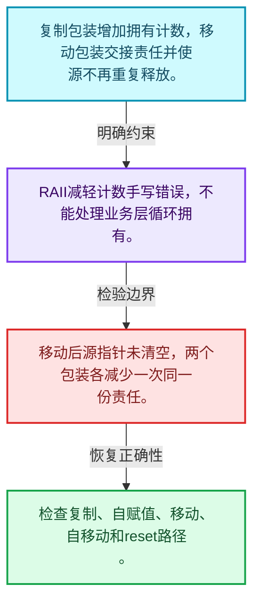
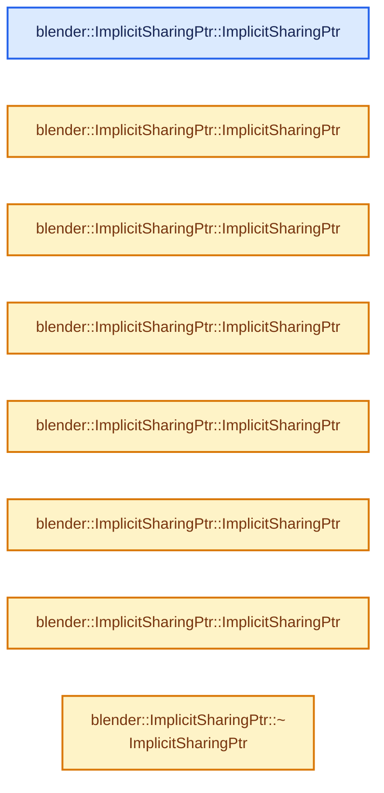
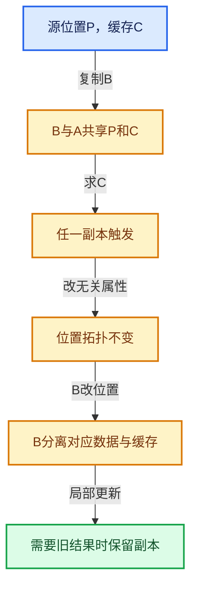

# 06-03 Mixin与共享指针封装

[方向导航](README.md) · [总目录](../README.md) · [实现索引](../00-课程指南/02-源码与提交索引/符号依赖与实现索引.md)

## 从问题到实现

侵入式计数如何由RAII包装维护？

复制、移动、释放都必须严格配对增减；指针包装能减少遗漏，但不会自动验证业务可变性。

**数据模型**

复制包装增加拥有计数，移动包装交接责任并使源不再重复释放。

**设计取舍**

RAII减轻计数手写错误，不能处理业务层循环拥有。

**最小反例**

移动后源指针未清空，两个包装各减少一次同一份责任。

**推导**

检查复制、自赋值、移动、自移动和reset路径。

## 阅读地图与执行推演








图中的数值推演是本方向的教学模型；实际函数之间的调用边与概念分析边分别标注，不能把概念关系当作运行时调度顺序。

## 完整源码单元与就地讲解

中文讲解直接放在相关代码旁，复杂机制在代码下展开。原文折叠区保留基准行号；不需要在行号表和函数之间来回查找。类布局可分段展示，函数实现不按固定行数切开。

### 类型布局、声明与编译条件 · BLI_implicit_sharing_ptr.hh L1—L31

<a id="t-7857e3cc0626"></a>

`ImplicitSharingPtr`在这里声明的数据成员：

- `T data_`

<!-- annotated:bf3b144d3fb74a -->

```cpp
/* SPDX-FileCopyrightText: 2023 Blender Authors
 *
 * SPDX-License-Identifier: GPL-2.0-or-later */

#pragma once

/** \file
 * \ingroup bli
 */

#include <memory>
#include <utility>

#include "BLI_implicit_sharing.hh"

namespace blender {

/**
 * #ImplicitSharingPtr is a smart pointer that manages implicit sharing. It's designed to work with
 * types that derive from #ImplicitSharingMixin. It is fairly similar to #std::shared_ptr but
 * requires the reference count to be embedded in the data.
 */
template<typename T = ImplicitSharingInfo, bool IsStrong = true> class ImplicitSharingPtr {
 private:
  const T *data_ = nullptr;

  template<typename U, bool OtherIsStrong> friend class ImplicitSharingPtr;

 public:
  using element_type = T;

```

<details>
<summary>核对原始源码：source/blender/blenlib/BLI_implicit_sharing_ptr.hh · L1—L31</summary>

<!-- original:bf3b144d3fb74a:source/blender/blenlib/BLI_implicit_sharing_ptr.hh:1:31 -->

```cpp
/* SPDX-FileCopyrightText: 2023 Blender Authors
 *
 * SPDX-License-Identifier: GPL-2.0-or-later */

#pragma once

/** \file
 * \ingroup bli
 */

#include <memory>
#include <utility>

#include "BLI_implicit_sharing.hh"

namespace blender {

/**
 * #ImplicitSharingPtr is a smart pointer that manages implicit sharing. It's designed to work with
 * types that derive from #ImplicitSharingMixin. It is fairly similar to #std::shared_ptr but
 * requires the reference count to be embedded in the data.
 */
template<typename T = ImplicitSharingInfo, bool IsStrong = true> class ImplicitSharingPtr {
 private:
  const T *data_ = nullptr;

  template<typename U, bool OtherIsStrong> friend class ImplicitSharingPtr;

 public:
  using element_type = T;

```

</details>

<a id="f-d28a43dbb5ed8c05"></a>

### `blender::ImplicitSharingPtr::ImplicitSharingPtr`

实现位置：[source/blender/blenlib/BLI_implicit_sharing_ptr.hh](../../../../../source/blender/blenlib/BLI_implicit_sharing_ptr.hh) · L32—L32。

**教学注释版**

<!-- annotated:1fd787f1d77ba1 -->

```cpp
  ImplicitSharingPtr() = default;
```

<details>
<summary>核对原始源码：source/blender/blenlib/BLI_implicit_sharing_ptr.hh · L32—L32</summary>

<!-- original:1fd787f1d77ba1:source/blender/blenlib/BLI_implicit_sharing_ptr.hh:32:32 -->

```cpp
  ImplicitSharingPtr() = default;
```

</details>

**继续追踪实现**

本实现没有需要继续展开的显式调用；检查返回表达式、对象转换和调用者前置条件。

<!-- annotated:3a18f929400f19 -->

```cpp

```

<details>
<summary>核对原始源码：source/blender/blenlib/BLI_implicit_sharing_ptr.hh · L33—L33</summary>

<!-- original:3a18f929400f19:source/blender/blenlib/BLI_implicit_sharing_ptr.hh:33:33 -->

```cpp

```

</details>

<a id="f-d27d5ebf676e244a"></a>

### `blender::ImplicitSharingPtr::ImplicitSharingPtr`

实现位置：[source/blender/blenlib/BLI_implicit_sharing_ptr.hh](../../../../../source/blender/blenlib/BLI_implicit_sharing_ptr.hh) · L34—L34。

接口参数：

- `const T *data`

**教学注释版**

<!-- annotated:c3d480ba371a6a -->

```cpp
  explicit ImplicitSharingPtr(const T *data) : data_(data) {}
```

<details>
<summary>核对原始源码：source/blender/blenlib/BLI_implicit_sharing_ptr.hh · L34—L34</summary>

<!-- original:c3d480ba371a6a:source/blender/blenlib/BLI_implicit_sharing_ptr.hh:34:34 -->

```cpp
  explicit ImplicitSharingPtr(const T *data) : data_(data) {}
```

</details>

**继续追踪实现**

本实现没有需要继续展开的显式调用；检查返回表达式、对象转换和调用者前置条件。

### 类型布局、声明与编译条件 · BLI_implicit_sharing_ptr.hh L35—L36

<!-- annotated:4b1dc44e94b37e -->

```cpp

  /* Implicit conversion from nullptr. */
```

<details>
<summary>核对原始源码：source/blender/blenlib/BLI_implicit_sharing_ptr.hh · L35—L36</summary>

<!-- original:4b1dc44e94b37e:source/blender/blenlib/BLI_implicit_sharing_ptr.hh:35:36 -->

```cpp

  /* Implicit conversion from nullptr. */
```

</details>

<a id="f-17d0c5fe2b03a664"></a>

### `blender::ImplicitSharingPtr::ImplicitSharingPtr`

实现位置：[source/blender/blenlib/BLI_implicit_sharing_ptr.hh](../../../../../source/blender/blenlib/BLI_implicit_sharing_ptr.hh) · L37—L37。

接口参数：

- `std::nullptr_t`

**教学注释版**

<!-- annotated:183eace348c09e -->

```cpp
  ImplicitSharingPtr(std::nullptr_t) : data_(nullptr) {}
```

<details>
<summary>核对原始源码：source/blender/blenlib/BLI_implicit_sharing_ptr.hh · L37—L37</summary>

<!-- original:183eace348c09e:source/blender/blenlib/BLI_implicit_sharing_ptr.hh:37:37 -->

```cpp
  ImplicitSharingPtr(std::nullptr_t) : data_(nullptr) {}
```

</details>

**继续追踪实现**

本实现没有需要继续展开的显式调用；检查返回表达式、对象转换和调用者前置条件。

<!-- annotated:2e18a756fc70f5 -->

```cpp

```

<details>
<summary>核对原始源码：source/blender/blenlib/BLI_implicit_sharing_ptr.hh · L38—L38</summary>

<!-- original:2e18a756fc70f5:source/blender/blenlib/BLI_implicit_sharing_ptr.hh:38:38 -->

```cpp

```

</details>

<a id="f-1c8729ae57532370"></a>

### `blender::ImplicitSharingPtr::ImplicitSharingPtr`

实现位置：[source/blender/blenlib/BLI_implicit_sharing_ptr.hh](../../../../../source/blender/blenlib/BLI_implicit_sharing_ptr.hh) · L39—L42。

接口参数：

- `const ImplicitSharingPtr &other`

**教学注释版**

<!-- annotated:cb5e39ef89d112 -->

```cpp
  ImplicitSharingPtr(const ImplicitSharingPtr &other) : data_(other.data_)
  {
    this->add_user(data_);
  }
```

<details>
<summary>核对原始源码：source/blender/blenlib/BLI_implicit_sharing_ptr.hh · L39—L42</summary>

<!-- original:cb5e39ef89d112:source/blender/blenlib/BLI_implicit_sharing_ptr.hh:39:42 -->

```cpp
  ImplicitSharingPtr(const ImplicitSharingPtr &other) : data_(other.data_)
  {
    this->add_user(data_);
  }
```

</details>

**继续追踪实现**

- `this->add_user` → [blender::ImplicitSharingPtr::add_user · L174](03-Mixin与共享指针封装.md#f-6894ff5a333e0ce0)。

<!-- annotated:e75546cd8852be -->

```cpp

```

<details>
<summary>核对原始源码：source/blender/blenlib/BLI_implicit_sharing_ptr.hh · L43—L43</summary>

<!-- original:e75546cd8852be:source/blender/blenlib/BLI_implicit_sharing_ptr.hh:43:43 -->

```cpp

```

</details>

<a id="f-0b6be0142b98009e"></a>

### `blender::ImplicitSharingPtr::ImplicitSharingPtr`

实现位置：[source/blender/blenlib/BLI_implicit_sharing_ptr.hh](../../../../../source/blender/blenlib/BLI_implicit_sharing_ptr.hh) · L44—L47。

接口参数：

- `ImplicitSharingPtr &&other`

**教学注释版**

<!-- annotated:82ccaa4b1bcbea -->

```cpp
  ImplicitSharingPtr(ImplicitSharingPtr &&other) : data_(other.data_)
  {
    other.data_ = nullptr;
  }
```

<details>
<summary>核对原始源码：source/blender/blenlib/BLI_implicit_sharing_ptr.hh · L44—L47</summary>

<!-- original:82ccaa4b1bcbea:source/blender/blenlib/BLI_implicit_sharing_ptr.hh:44:47 -->

```cpp
  ImplicitSharingPtr(ImplicitSharingPtr &&other) : data_(other.data_)
  {
    other.data_ = nullptr;
  }
```

</details>

**沿实际写入检查状态**

- `other.data_ = nullptr;`

**继续追踪实现**

本实现没有需要继续展开的显式调用；检查返回表达式、对象转换和调用者前置条件。

<!-- annotated:6c04f917ad7dd5 -->

```cpp

```

<details>
<summary>核对原始源码：source/blender/blenlib/BLI_implicit_sharing_ptr.hh · L48—L48</summary>

<!-- original:6c04f917ad7dd5:source/blender/blenlib/BLI_implicit_sharing_ptr.hh:48:48 -->

```cpp

```

</details>

<a id="f-90c601ed9ed99045"></a>

### `blender::ImplicitSharingPtr::ImplicitSharingPtr`

实现位置：[source/blender/blenlib/BLI_implicit_sharing_ptr.hh](../../../../../source/blender/blenlib/BLI_implicit_sharing_ptr.hh) · L49—L55。

接口参数：

- `const ImplicitSharingPtr<U, IsStrong> &other`

**教学注释版**

<!-- annotated:9907c91b352d4d -->

```cpp
  template<typename U>
  ImplicitSharingPtr(const ImplicitSharingPtr<U, IsStrong> &other)
    requires std::is_base_of_v<T, U>
      : data_(static_cast<const U *>(other.data_))
  {
    this->add_user(data_);
  }
```

<details>
<summary>核对原始源码：source/blender/blenlib/BLI_implicit_sharing_ptr.hh · L49—L55</summary>

<!-- original:9907c91b352d4d:source/blender/blenlib/BLI_implicit_sharing_ptr.hh:49:55 -->

```cpp
  template<typename U>
  ImplicitSharingPtr(const ImplicitSharingPtr<U, IsStrong> &other)
    requires std::is_base_of_v<T, U>
      : data_(static_cast<const U *>(other.data_))
  {
    this->add_user(data_);
  }
```

</details>

**继续追踪实现**

- `this->add_user` → [blender::ImplicitSharingPtr::add_user · L174](03-Mixin与共享指针封装.md#f-6894ff5a333e0ce0)。

<!-- annotated:099ab3b368ef18 -->

```cpp

```

<details>
<summary>核对原始源码：source/blender/blenlib/BLI_implicit_sharing_ptr.hh · L56—L56</summary>

<!-- original:099ab3b368ef18:source/blender/blenlib/BLI_implicit_sharing_ptr.hh:56:56 -->

```cpp

```

</details>

<a id="f-1625179ceae7a66d"></a>

### `blender::ImplicitSharingPtr::ImplicitSharingPtr`

实现位置：[source/blender/blenlib/BLI_implicit_sharing_ptr.hh](../../../../../source/blender/blenlib/BLI_implicit_sharing_ptr.hh) · L57—L63。

接口参数：

- `ImplicitSharingPtr<U, IsStrong> &&other`

**教学注释版**

<!-- annotated:445eb9b0d36b8f -->

```cpp
  template<typename U>
  ImplicitSharingPtr(ImplicitSharingPtr<U, IsStrong> &&other)
    requires std::is_base_of_v<T, U>
      : data_(static_cast<U *>(other.data_))
  {
    other.data_ = nullptr;
  }
```

<details>
<summary>核对原始源码：source/blender/blenlib/BLI_implicit_sharing_ptr.hh · L57—L63</summary>

<!-- original:445eb9b0d36b8f:source/blender/blenlib/BLI_implicit_sharing_ptr.hh:57:63 -->

```cpp
  template<typename U>
  ImplicitSharingPtr(ImplicitSharingPtr<U, IsStrong> &&other)
    requires std::is_base_of_v<T, U>
      : data_(static_cast<U *>(other.data_))
  {
    other.data_ = nullptr;
  }
```

</details>

**沿实际写入检查状态**

- `other.data_ = nullptr;`

**继续追踪实现**

本实现没有需要继续展开的显式调用；检查返回表达式、对象转换和调用者前置条件。

<!-- annotated:cfcb1f16e6c967 -->

```cpp

```

<details>
<summary>核对原始源码：source/blender/blenlib/BLI_implicit_sharing_ptr.hh · L64—L64</summary>

<!-- original:cfcb1f16e6c967:source/blender/blenlib/BLI_implicit_sharing_ptr.hh:64:64 -->

```cpp

```

</details>

<a id="f-7ecb8a51a2b7a250"></a>

### `blender::ImplicitSharingPtr::~ImplicitSharingPtr`

实现位置：[source/blender/blenlib/BLI_implicit_sharing_ptr.hh](../../../../../source/blender/blenlib/BLI_implicit_sharing_ptr.hh) · L65—L68。

**教学注释版**

<!-- annotated:372bcb9f8dd178 -->

```cpp
  ~ImplicitSharingPtr()
  {
    this->remove_user_and_delete_if_last(data_);
  }
```

<details>
<summary>核对原始源码：source/blender/blenlib/BLI_implicit_sharing_ptr.hh · L65—L68</summary>

<!-- original:372bcb9f8dd178:source/blender/blenlib/BLI_implicit_sharing_ptr.hh:65:68 -->

```cpp
  ~ImplicitSharingPtr()
  {
    this->remove_user_and_delete_if_last(data_);
  }
```

</details>

**继续追踪实现**

- `this->remove_user_and_delete_if_last` → [blender::ImplicitSharingPtr::remove_user_and_delete_if_last · L186](03-Mixin与共享指针封装.md#f-8cd6c11e50fef966)。

<!-- annotated:95e5d26bf542bf -->

```cpp

```

<details>
<summary>核对原始源码：source/blender/blenlib/BLI_implicit_sharing_ptr.hh · L69—L69</summary>

<!-- original:95e5d26bf542bf:source/blender/blenlib/BLI_implicit_sharing_ptr.hh:69:69 -->

```cpp

```

</details>

<a id="f-b1a2be564e828480"></a>

### `blender::ImplicitSharingPtr::operator=`

实现位置：[source/blender/blenlib/BLI_implicit_sharing_ptr.hh](../../../../../source/blender/blenlib/BLI_implicit_sharing_ptr.hh) · L70—L80。

接口参数：

- `const ImplicitSharingPtr &other`

**教学注释版**

<!-- annotated:b97f50bacee52f -->

```cpp
  ImplicitSharingPtr &operator=(const ImplicitSharingPtr &other)
  {
    if (this == &other) {
      return *this;
    }

    this->remove_user_and_delete_if_last(data_);
    data_ = other.data_;
    this->add_user(data_);
    return *this;
  }
```

<details>
<summary>核对原始源码：source/blender/blenlib/BLI_implicit_sharing_ptr.hh · L70—L80</summary>

<!-- original:b97f50bacee52f:source/blender/blenlib/BLI_implicit_sharing_ptr.hh:70:80 -->

```cpp
  ImplicitSharingPtr &operator=(const ImplicitSharingPtr &other)
  {
    if (this == &other) {
      return *this;
    }

    this->remove_user_and_delete_if_last(data_);
    data_ = other.data_;
    this->add_user(data_);
    return *this;
  }
```

</details>

**沿实际写入检查状态**

- `data_ = other.data_;`

**结果出口**

- `return *this;`

**继续追踪实现**

- `this->remove_user_and_delete_if_last` → [blender::ImplicitSharingPtr::remove_user_and_delete_if_last · L186](03-Mixin与共享指针封装.md#f-8cd6c11e50fef966)。
- `this->add_user` → [blender::ImplicitSharingPtr::add_user · L174](03-Mixin与共享指针封装.md#f-6894ff5a333e0ce0)。

<!-- annotated:731aa25a8a44c6 -->

```cpp

```

<details>
<summary>核对原始源码：source/blender/blenlib/BLI_implicit_sharing_ptr.hh · L81—L81</summary>

<!-- original:731aa25a8a44c6:source/blender/blenlib/BLI_implicit_sharing_ptr.hh:81:81 -->

```cpp

```

</details>

<a id="f-0284efd2a1d10d97"></a>

### `blender::ImplicitSharingPtr::operator=`

实现位置：[source/blender/blenlib/BLI_implicit_sharing_ptr.hh](../../../../../source/blender/blenlib/BLI_implicit_sharing_ptr.hh) · L82—L92。

接口参数：

- `ImplicitSharingPtr &&other`

**教学注释版**

<!-- annotated:b80dde80fdae2f -->

```cpp
  ImplicitSharingPtr &operator=(ImplicitSharingPtr &&other)
  {
    if (this == &other) {
      return *this;
    }

    this->remove_user_and_delete_if_last(data_);
    data_ = other.data_;
    other.data_ = nullptr;
    return *this;
  }
```

<details>
<summary>核对原始源码：source/blender/blenlib/BLI_implicit_sharing_ptr.hh · L82—L92</summary>

<!-- original:b80dde80fdae2f:source/blender/blenlib/BLI_implicit_sharing_ptr.hh:82:92 -->

```cpp
  ImplicitSharingPtr &operator=(ImplicitSharingPtr &&other)
  {
    if (this == &other) {
      return *this;
    }

    this->remove_user_and_delete_if_last(data_);
    data_ = other.data_;
    other.data_ = nullptr;
    return *this;
  }
```

</details>

**沿实际写入检查状态**

- `data_ = other.data_;`
- `other.data_ = nullptr;`

**结果出口**

- `return *this;`

**继续追踪实现**

- `this->remove_user_and_delete_if_last` → [blender::ImplicitSharingPtr::remove_user_and_delete_if_last · L186](03-Mixin与共享指针封装.md#f-8cd6c11e50fef966)。

<!-- annotated:805482af9412b6 -->

```cpp

```

<details>
<summary>核对原始源码：source/blender/blenlib/BLI_implicit_sharing_ptr.hh · L93—L93</summary>

<!-- original:805482af9412b6:source/blender/blenlib/BLI_implicit_sharing_ptr.hh:93:93 -->

```cpp

```

</details>

<a id="f-5ed70b05d19381f3"></a>

### `blender::ImplicitSharingPtr::operator->`

实现位置：[source/blender/blenlib/BLI_implicit_sharing_ptr.hh](../../../../../source/blender/blenlib/BLI_implicit_sharing_ptr.hh) · L94—L98。

**教学注释版**

<!-- annotated:20a54a8366754d -->

```cpp
  const T *operator->() const
  {
    BLI_assert(data_ != nullptr);
    return data_;
  }
```

<details>
<summary>核对原始源码：source/blender/blenlib/BLI_implicit_sharing_ptr.hh · L94—L98</summary>

<!-- original:20a54a8366754d:source/blender/blenlib/BLI_implicit_sharing_ptr.hh:94:98 -->

```cpp
  const T *operator->() const
  {
    BLI_assert(data_ != nullptr);
    return data_;
  }
```

</details>

**结果出口**

- `return data_;`

**继续追踪实现**

- `BLI_assert` → [BLI_assert · L48](../90-实现依赖专题/01-BLI基础库/BLI_assert.hh.md#m-57a88495704d)；[BLI_assert · L63](../90-实现依赖专题/01-BLI基础库/BLI_assert.hh.md#m-d07050020cb5)。宏定义由构建条件选择。

<!-- annotated:872658e044cc63 -->

```cpp

```

<details>
<summary>核对原始源码：source/blender/blenlib/BLI_implicit_sharing_ptr.hh · L99—L99</summary>

<!-- original:872658e044cc63:source/blender/blenlib/BLI_implicit_sharing_ptr.hh:99:99 -->

```cpp

```

</details>

<a id="f-bf59de53a4f27ff3"></a>

### `blender::ImplicitSharingPtr::operator*`

实现位置：[source/blender/blenlib/BLI_implicit_sharing_ptr.hh](../../../../../source/blender/blenlib/BLI_implicit_sharing_ptr.hh) · L100—L104。

**教学注释版**

<!-- annotated:66928b0676b985 -->

```cpp
  const T &operator*() const
  {
    BLI_assert(data_ != nullptr);
    return *data_;
  }
```

<details>
<summary>核对原始源码：source/blender/blenlib/BLI_implicit_sharing_ptr.hh · L100—L104</summary>

<!-- original:66928b0676b985:source/blender/blenlib/BLI_implicit_sharing_ptr.hh:100:104 -->

```cpp
  const T &operator*() const
  {
    BLI_assert(data_ != nullptr);
    return *data_;
  }
```

</details>

**结果出口**

- `return *data_;`

**继续追踪实现**

- `BLI_assert` → [BLI_assert · L48](../90-实现依赖专题/01-BLI基础库/BLI_assert.hh.md#m-57a88495704d)；[BLI_assert · L63](../90-实现依赖专题/01-BLI基础库/BLI_assert.hh.md#m-d07050020cb5)。宏定义由构建条件选择。

<!-- annotated:a2aa3ab5502c79 -->

```cpp

```

<details>
<summary>核对原始源码：source/blender/blenlib/BLI_implicit_sharing_ptr.hh · L105—L105</summary>

<!-- original:a2aa3ab5502c79:source/blender/blenlib/BLI_implicit_sharing_ptr.hh:105:105 -->

```cpp

```

</details>

<a id="f-1fa528d5699e6af3"></a>

### `blender::ImplicitSharingPtr::() const`

实现位置：[source/blender/blenlib/BLI_implicit_sharing_ptr.hh](../../../../../source/blender/blenlib/BLI_implicit_sharing_ptr.hh) · L106—L109。

**教学注释版**

<!-- annotated:671783fc50af9c -->

```cpp
  operator bool() const
  {
    return data_ != nullptr;
  }
```

<details>
<summary>核对原始源码：source/blender/blenlib/BLI_implicit_sharing_ptr.hh · L106—L109</summary>

<!-- original:671783fc50af9c:source/blender/blenlib/BLI_implicit_sharing_ptr.hh:106:109 -->

```cpp
  operator bool() const
  {
    return data_ != nullptr;
  }
```

</details>

**结果出口**

- `return data_ != nullptr;`

**继续追踪实现**

本实现没有需要继续展开的显式调用；检查返回表达式、对象转换和调用者前置条件。

<!-- annotated:dca8f8866d5f55 -->

```cpp

```

<details>
<summary>核对原始源码：source/blender/blenlib/BLI_implicit_sharing_ptr.hh · L110—L110</summary>

<!-- original:dca8f8866d5f55:source/blender/blenlib/BLI_implicit_sharing_ptr.hh:110:110 -->

```cpp

```

</details>

<a id="f-71f0b315cfcf8f62"></a>

### `blender::ImplicitSharingPtr::get`

实现位置：[source/blender/blenlib/BLI_implicit_sharing_ptr.hh](../../../../../source/blender/blenlib/BLI_implicit_sharing_ptr.hh) · L111—L114。

**教学注释版**

<!-- annotated:4130ca140199e7 -->

```cpp
  const T *get() const
  {
    return data_;
  }
```

<details>
<summary>核对原始源码：source/blender/blenlib/BLI_implicit_sharing_ptr.hh · L111—L114</summary>

<!-- original:4130ca140199e7:source/blender/blenlib/BLI_implicit_sharing_ptr.hh:111:114 -->

```cpp
  const T *get() const
  {
    return data_;
  }
```

</details>

**结果出口**

- `return data_;`

**继续追踪实现**

本实现没有需要继续展开的显式调用；检查返回表达式、对象转换和调用者前置条件。

<!-- annotated:8467f06beb7ac9 -->

```cpp

```

<details>
<summary>核对原始源码：source/blender/blenlib/BLI_implicit_sharing_ptr.hh · L115—L115</summary>

<!-- original:8467f06beb7ac9:source/blender/blenlib/BLI_implicit_sharing_ptr.hh:115:115 -->

```cpp

```

</details>

<a id="f-8061ad4a45fa7012"></a>

### `blender::ImplicitSharingPtr::release`

实现位置：[source/blender/blenlib/BLI_implicit_sharing_ptr.hh](../../../../../source/blender/blenlib/BLI_implicit_sharing_ptr.hh) · L116—L121。

**教学注释版**

<!-- annotated:3f18cda8b23685 -->

```cpp
  const T *release()
  {
    const T *data = data_;
    data_ = nullptr;
    return data;
  }
```

<details>
<summary>核对原始源码：source/blender/blenlib/BLI_implicit_sharing_ptr.hh · L116—L121</summary>

<!-- original:3f18cda8b23685:source/blender/blenlib/BLI_implicit_sharing_ptr.hh:116:121 -->

```cpp
  const T *release()
  {
    const T *data = data_;
    data_ = nullptr;
    return data;
  }
```

</details>

**沿实际写入检查状态**

- `data_ = nullptr;`

**结果出口**

- `return data;`

**继续追踪实现**

本实现没有需要继续展开的显式调用；检查返回表达式、对象转换和调用者前置条件。

<!-- annotated:4a77fa50e24115 -->

```cpp

```

<details>
<summary>核对原始源码：source/blender/blenlib/BLI_implicit_sharing_ptr.hh · L122—L122</summary>

<!-- original:4a77fa50e24115:source/blender/blenlib/BLI_implicit_sharing_ptr.hh:122:122 -->

```cpp

```

</details>

<a id="f-2cf5b0f0f6653eb0"></a>

### `blender::ImplicitSharingPtr::reset`

实现位置：[source/blender/blenlib/BLI_implicit_sharing_ptr.hh](../../../../../source/blender/blenlib/BLI_implicit_sharing_ptr.hh) · L123—L127。

**教学注释版**

<!-- annotated:a9807bcf7b4b1f -->

```cpp
  void reset()
  {
    this->remove_user_and_delete_if_last(data_);
    data_ = nullptr;
  }
```

<details>
<summary>核对原始源码：source/blender/blenlib/BLI_implicit_sharing_ptr.hh · L123—L127</summary>

<!-- original:a9807bcf7b4b1f:source/blender/blenlib/BLI_implicit_sharing_ptr.hh:123:127 -->

```cpp
  void reset()
  {
    this->remove_user_and_delete_if_last(data_);
    data_ = nullptr;
  }
```

</details>

**沿实际写入检查状态**

- `data_ = nullptr;`

**继续追踪实现**

- `this->remove_user_and_delete_if_last` → [blender::ImplicitSharingPtr::remove_user_and_delete_if_last · L186](03-Mixin与共享指针封装.md#f-8cd6c11e50fef966)。

<!-- annotated:18babe7952dbe5 -->

```cpp

```

<details>
<summary>核对原始源码：source/blender/blenlib/BLI_implicit_sharing_ptr.hh · L128—L128</summary>

<!-- original:18babe7952dbe5:source/blender/blenlib/BLI_implicit_sharing_ptr.hh:128:128 -->

```cpp

```

</details>

<a id="f-a314b1da9fbbfecb"></a>

### `blender::ImplicitSharingPtr::has_value`

实现位置：[source/blender/blenlib/BLI_implicit_sharing_ptr.hh](../../../../../source/blender/blenlib/BLI_implicit_sharing_ptr.hh) · L129—L132。

**教学注释版**

<!-- annotated:bb66ab8d22e3ce -->

```cpp
  bool has_value() const
  {
    return data_ != nullptr;
  }
```

<details>
<summary>核对原始源码：source/blender/blenlib/BLI_implicit_sharing_ptr.hh · L129—L132</summary>

<!-- original:bb66ab8d22e3ce:source/blender/blenlib/BLI_implicit_sharing_ptr.hh:129:132 -->

```cpp
  bool has_value() const
  {
    return data_ != nullptr;
  }
```

</details>

**结果出口**

- `return data_ != nullptr;`

**继续追踪实现**

本实现没有需要继续展开的显式调用；检查返回表达式、对象转换和调用者前置条件。

<!-- annotated:e5d32a0d95b58b -->

```cpp

```

<details>
<summary>核对原始源码：source/blender/blenlib/BLI_implicit_sharing_ptr.hh · L133—L133</summary>

<!-- original:e5d32a0d95b58b:source/blender/blenlib/BLI_implicit_sharing_ptr.hh:133:133 -->

```cpp

```

</details>

<a id="f-6cbdf7dd2c434573"></a>

### `blender::ImplicitSharingPtr::hash`

实现位置：[source/blender/blenlib/BLI_implicit_sharing_ptr.hh](../../../../../source/blender/blenlib/BLI_implicit_sharing_ptr.hh) · L134—L137。

**教学注释版**

<!-- annotated:0df4909b03d72b -->

```cpp
  uint64_t hash() const
  {
    return get_default_hash(data_);
  }
```

<details>
<summary>核对原始源码：source/blender/blenlib/BLI_implicit_sharing_ptr.hh · L134—L137</summary>

<!-- original:0df4909b03d72b:source/blender/blenlib/BLI_implicit_sharing_ptr.hh:134:137 -->

```cpp
  uint64_t hash() const
  {
    return get_default_hash(data_);
  }
```

</details>

**结果出口**

- `return get_default_hash(data_);`

**继续追踪实现**

- `get_default_hash` → [blender::get_default_hash · L251](../02-哈希表与关联数据结构/01-哈希与相等契约.md#f-5f2c246aedf3dc0a)。

### 类型布局、声明与编译条件 · BLI_implicit_sharing_ptr.hh L138—L143

<!-- annotated:016ef5ee5d6dfd -->

```cpp

  /**
   * If there is only a single user of the data, return a mutable reference to it directly.
   * Otherwise call #copy which is expected to return a new implicitly shared pointer that always
   * has a single user.
   */
```

<details>
<summary>核对原始源码：source/blender/blenlib/BLI_implicit_sharing_ptr.hh · L138—L143</summary>

<!-- original:016ef5ee5d6dfd:source/blender/blenlib/BLI_implicit_sharing_ptr.hh:138:143 -->

```cpp

  /**
   * If there is only a single user of the data, return a mutable reference to it directly.
   * Otherwise call #copy which is expected to return a new implicitly shared pointer that always
   * has a single user.
   */
```

</details>

<a id="f-d9e9b25281edf91a"></a>

### `blender::ImplicitSharingPtr::ensure_mutable_inplace`

实现位置：[source/blender/blenlib/BLI_implicit_sharing_ptr.hh](../../../../../source/blender/blenlib/BLI_implicit_sharing_ptr.hh) · L144—L154。

**教学注释版**

<!-- annotated:82c355d2aff0c7 -->

```cpp
  T &ensure_mutable_inplace()
  {
    BLI_assert(data_);
    if (!data_->is_mutable()) {
      /* The data is shared and therefore immutable. Make a mutable copy. */
      *this = data_->copy();
    }
    BLI_assert(data_->is_mutable());
    data_->tag_ensured_mutable();
    return const_cast<T &>(*data_);
  }
```

<details>
<summary>核对原始源码：source/blender/blenlib/BLI_implicit_sharing_ptr.hh · L144—L154</summary>

<!-- original:82c355d2aff0c7:source/blender/blenlib/BLI_implicit_sharing_ptr.hh:144:154 -->

```cpp
  T &ensure_mutable_inplace()
  {
    BLI_assert(data_);
    if (!data_->is_mutable()) {
      /* The data is shared and therefore immutable. Make a mutable copy. */
      *this = data_->copy();
    }
    BLI_assert(data_->is_mutable());
    data_->tag_ensured_mutable();
    return const_cast<T &>(*data_);
  }
```

</details>

**结果出口**

- `return const_cast<T &>(*data_);`

**继续追踪实现**

- `BLI_assert` → [BLI_assert · L48](../90-实现依赖专题/01-BLI基础库/BLI_assert.hh.md#m-57a88495704d)；[BLI_assert · L63](../90-实现依赖专题/01-BLI基础库/BLI_assert.hh.md#m-d07050020cb5)。宏定义由构建条件选择。
- `data_->is_mutable` → [调用协议](../00-课程指南/01-路线与规范/模板宏与动态分派协议.md)：T模板参数提供的操作协议。调用位置L147。
- `data_->copy` → [调用协议](../00-课程指南/01-路线与规范/模板宏与动态分派协议.md)：T模板参数提供的操作协议。调用位置L149。
- `data_->tag_ensured_mutable` → [调用协议](../00-课程指南/01-路线与规范/模板宏与动态分派协议.md)：T模板参数提供的操作协议。调用位置L152。

<!-- annotated:ecb9f29a4f21d6 -->

```cpp

```

<details>
<summary>核对原始源码：source/blender/blenlib/BLI_implicit_sharing_ptr.hh · L155—L155</summary>

<!-- original:ecb9f29a4f21d6:source/blender/blenlib/BLI_implicit_sharing_ptr.hh:155:155 -->

```cpp

```

</details>

<a id="f-7d7373d45d758f74"></a>

### `blender::ImplicitSharingPtr::hash_as`

实现位置：[source/blender/blenlib/BLI_implicit_sharing_ptr.hh](../../../../../source/blender/blenlib/BLI_implicit_sharing_ptr.hh) · L156—L159。

接口参数：

- `const T *data`

**教学注释版**

<!-- annotated:a9c27cf50a98fe -->

```cpp
  static uint64_t hash_as(const T *data)
  {
    return get_default_hash(data);
  }
```

<details>
<summary>核对原始源码：source/blender/blenlib/BLI_implicit_sharing_ptr.hh · L156—L159</summary>

<!-- original:a9c27cf50a98fe:source/blender/blenlib/BLI_implicit_sharing_ptr.hh:156:159 -->

```cpp
  static uint64_t hash_as(const T *data)
  {
    return get_default_hash(data);
  }
```

</details>

**结果出口**

- `return get_default_hash(data);`

**继续追踪实现**

- `get_default_hash` → [blender::get_default_hash · L251](../02-哈希表与关联数据结构/01-哈希与相等契约.md#f-5f2c246aedf3dc0a)。

### 类型布局、声明与编译条件 · BLI_implicit_sharing_ptr.hh L160—L162

<!-- annotated:a7d1d40ae3b228 -->

```cpp

  friend bool operator==(const ImplicitSharingPtr &a, const ImplicitSharingPtr &b) = default;

```

<details>
<summary>核对原始源码：source/blender/blenlib/BLI_implicit_sharing_ptr.hh · L160—L162</summary>

<!-- original:a7d1d40ae3b228:source/blender/blenlib/BLI_implicit_sharing_ptr.hh:160:162 -->

```cpp

  friend bool operator==(const ImplicitSharingPtr &a, const ImplicitSharingPtr &b) = default;

```

</details>

<a id="f-426229e5e054b462"></a>

### `blender::ImplicitSharingPtr::operator==`

实现位置：[source/blender/blenlib/BLI_implicit_sharing_ptr.hh](../../../../../source/blender/blenlib/BLI_implicit_sharing_ptr.hh) · L163—L166。

接口参数：

- `const T *a`
- `const ImplicitSharingPtr &b`

**教学注释版**

<!-- annotated:965a82b0d7eb8a -->

```cpp
  friend bool operator==(const T *a, const ImplicitSharingPtr &b)
  {
    return a == b.data_;
  }
```

<details>
<summary>核对原始源码：source/blender/blenlib/BLI_implicit_sharing_ptr.hh · L163—L166</summary>

<!-- original:965a82b0d7eb8a:source/blender/blenlib/BLI_implicit_sharing_ptr.hh:163:166 -->

```cpp
  friend bool operator==(const T *a, const ImplicitSharingPtr &b)
  {
    return a == b.data_;
  }
```

</details>

**结果出口**

- `return a == b.data_;`

**继续追踪实现**

本实现没有需要继续展开的显式调用；检查返回表达式、对象转换和调用者前置条件。

<!-- annotated:9810f4986e1338 -->

```cpp

```

<details>
<summary>核对原始源码：source/blender/blenlib/BLI_implicit_sharing_ptr.hh · L167—L167</summary>

<!-- original:9810f4986e1338:source/blender/blenlib/BLI_implicit_sharing_ptr.hh:167:167 -->

```cpp

```

</details>

<a id="f-301cc6e034874ab6"></a>

### `blender::ImplicitSharingPtr::operator==`

实现位置：[source/blender/blenlib/BLI_implicit_sharing_ptr.hh](../../../../../source/blender/blenlib/BLI_implicit_sharing_ptr.hh) · L168—L171。

接口参数：

- `const ImplicitSharingPtr &a`
- `const T *b`

**教学注释版**

<!-- annotated:0bf66b7fc4726d -->

```cpp
  friend bool operator==(const ImplicitSharingPtr &a, const T *b)
  {
    return a.data_ == b;
  }
```

<details>
<summary>核对原始源码：source/blender/blenlib/BLI_implicit_sharing_ptr.hh · L168—L171</summary>

<!-- original:0bf66b7fc4726d:source/blender/blenlib/BLI_implicit_sharing_ptr.hh:168:171 -->

```cpp
  friend bool operator==(const ImplicitSharingPtr &a, const T *b)
  {
    return a.data_ == b;
  }
```

</details>

**结果出口**

- `return a.data_ == b;`

**继续追踪实现**

本实现没有需要继续展开的显式调用；检查返回表达式、对象转换和调用者前置条件。

### 类型布局、声明与编译条件 · BLI_implicit_sharing_ptr.hh L172—L173

<!-- annotated:5fc1b02f34c592 -->

```cpp

 private:
```

<details>
<summary>核对原始源码：source/blender/blenlib/BLI_implicit_sharing_ptr.hh · L172—L173</summary>

<!-- original:5fc1b02f34c592:source/blender/blenlib/BLI_implicit_sharing_ptr.hh:172:173 -->

```cpp

 private:
```

</details>

<a id="f-6894ff5a333e0ce0"></a>

### `blender::ImplicitSharingPtr::add_user`

实现位置：[source/blender/blenlib/BLI_implicit_sharing_ptr.hh](../../../../../source/blender/blenlib/BLI_implicit_sharing_ptr.hh) · L174—L184。

接口参数：

- `const T *data`

**教学注释版**

<!-- annotated:f86c313561944f -->

```cpp
  static void add_user(const T *data)
  {
    if (data != nullptr) {
      if constexpr (IsStrong) {
        data->add_user();
      }
      else {
        data->add_weak_user();
      }
    }
  }
```

<details>
<summary>核对原始源码：source/blender/blenlib/BLI_implicit_sharing_ptr.hh · L174—L184</summary>

<!-- original:f86c313561944f:source/blender/blenlib/BLI_implicit_sharing_ptr.hh:174:184 -->

```cpp
  static void add_user(const T *data)
  {
    if (data != nullptr) {
      if constexpr (IsStrong) {
        data->add_user();
      }
      else {
        data->add_weak_user();
      }
    }
  }
```

</details>

**继续追踪实现**

- `data->add_user` → [调用协议](../00-课程指南/01-路线与规范/模板宏与动态分派协议.md)：T模板参数提供的操作协议。调用位置L178。
- `data->add_weak_user` → [调用协议](../00-课程指南/01-路线与规范/模板宏与动态分派协议.md)：T模板参数提供的操作协议。调用位置L181。

<!-- annotated:8ac32e80284770 -->

```cpp

```

<details>
<summary>核对原始源码：source/blender/blenlib/BLI_implicit_sharing_ptr.hh · L185—L185</summary>

<!-- original:8ac32e80284770:source/blender/blenlib/BLI_implicit_sharing_ptr.hh:185:185 -->

```cpp

```

</details>

<a id="f-8cd6c11e50fef966"></a>

### `blender::ImplicitSharingPtr::remove_user_and_delete_if_last`

实现位置：[source/blender/blenlib/BLI_implicit_sharing_ptr.hh](../../../../../source/blender/blenlib/BLI_implicit_sharing_ptr.hh) · L186—L196。

接口参数：

- `const T *data`

**教学注释版**

<!-- annotated:a15dd699bffa92 -->

```cpp
  static void remove_user_and_delete_if_last(const T *data)
  {
    if (data != nullptr) {
      if constexpr (IsStrong) {
        data->remove_user_and_delete_if_last();
      }
      else {
        data->remove_weak_user_and_delete_if_last();
      }
    }
  }
```

<details>
<summary>核对原始源码：source/blender/blenlib/BLI_implicit_sharing_ptr.hh · L186—L196</summary>

<!-- original:a15dd699bffa92:source/blender/blenlib/BLI_implicit_sharing_ptr.hh:186:196 -->

```cpp
  static void remove_user_and_delete_if_last(const T *data)
  {
    if (data != nullptr) {
      if constexpr (IsStrong) {
        data->remove_user_and_delete_if_last();
      }
      else {
        data->remove_weak_user_and_delete_if_last();
      }
    }
  }
```

</details>

**继续追踪实现**

- `data->remove_user_and_delete_if_last` → [调用协议](../00-课程指南/01-路线与规范/模板宏与动态分派协议.md)：T模板参数提供的操作协议。调用位置L190。
- `data->remove_weak_user_and_delete_if_last` → [调用协议](../00-课程指南/01-路线与规范/模板宏与动态分派协议.md)：T模板参数提供的操作协议。调用位置L193。

### 类型布局、声明与编译条件 · BLI_implicit_sharing_ptr.hh L197—L213

<a id="t-a2d42e344949"></a>

`ImplicitSharingPtrAndData`在这里声明的数据成员：

- `ImplicitSharingPtr<> sharing_info`
- `void data`

<!-- annotated:3e486bcf08a621 -->

```cpp
};

using WeakImplicitSharingPtr = ImplicitSharingPtr<ImplicitSharingInfo, false>;

/**
 * Utility struct to allow used #ImplicitSharingPtr when it's necessary to type-erase the backing
 * storage for user-exposed data. For example, #Vector, or #std::vector might be used to
 * store an implicitly shared array that is only accessed with #Span or #MutableSpan.
 *
 * This class handles RAII for the sharing info and the exposed data pointer.
 * Retrieving the data with write access and type safety must be handled elsewhere.
 */
class ImplicitSharingPtrAndData {
 public:
  ImplicitSharingPtr<> sharing_info;
  const void *data = nullptr;

```

<details>
<summary>核对原始源码：source/blender/blenlib/BLI_implicit_sharing_ptr.hh · L197—L213</summary>

<!-- original:3e486bcf08a621:source/blender/blenlib/BLI_implicit_sharing_ptr.hh:197:213 -->

```cpp
};

using WeakImplicitSharingPtr = ImplicitSharingPtr<ImplicitSharingInfo, false>;

/**
 * Utility struct to allow used #ImplicitSharingPtr when it's necessary to type-erase the backing
 * storage for user-exposed data. For example, #Vector, or #std::vector might be used to
 * store an implicitly shared array that is only accessed with #Span or #MutableSpan.
 *
 * This class handles RAII for the sharing info and the exposed data pointer.
 * Retrieving the data with write access and type safety must be handled elsewhere.
 */
class ImplicitSharingPtrAndData {
 public:
  ImplicitSharingPtr<> sharing_info;
  const void *data = nullptr;

```

</details>

<a id="f-b638ba229f127da3"></a>

### `blender::ImplicitSharingPtrAndData::ImplicitSharingPtrAndData`

实现位置：[source/blender/blenlib/BLI_implicit_sharing_ptr.hh](../../../../../source/blender/blenlib/BLI_implicit_sharing_ptr.hh) · L214—L214。

**教学注释版**

<!-- annotated:f2fce1d8c6f951 -->

```cpp
  ImplicitSharingPtrAndData() = default;
```

<details>
<summary>核对原始源码：source/blender/blenlib/BLI_implicit_sharing_ptr.hh · L214—L214</summary>

<!-- original:f2fce1d8c6f951:source/blender/blenlib/BLI_implicit_sharing_ptr.hh:214:214 -->

```cpp
  ImplicitSharingPtrAndData() = default;
```

</details>

**继续追踪实现**

本实现没有需要继续展开的显式调用；检查返回表达式、对象转换和调用者前置条件。

<a id="f-280d680b539131a1"></a>

### `blender::ImplicitSharingPtrAndData::ImplicitSharingPtrAndData`

实现位置：[source/blender/blenlib/BLI_implicit_sharing_ptr.hh](../../../../../source/blender/blenlib/BLI_implicit_sharing_ptr.hh) · L215—L218。

接口参数：

- `ImplicitSharingPtr<> sharing_info`
- `const void *data`

**教学注释版**

<!-- annotated:2376854cf291dd -->

```cpp
  ImplicitSharingPtrAndData(ImplicitSharingPtr<> sharing_info, const void *data)
      : sharing_info(std::move(sharing_info)), data(data)
  {
  }
```

<details>
<summary>核对原始源码：source/blender/blenlib/BLI_implicit_sharing_ptr.hh · L215—L218</summary>

<!-- original:2376854cf291dd:source/blender/blenlib/BLI_implicit_sharing_ptr.hh:215:218 -->

```cpp
  ImplicitSharingPtrAndData(ImplicitSharingPtr<> sharing_info, const void *data)
      : sharing_info(std::move(sharing_info)), data(data)
  {
  }
```

</details>

**继续追踪实现**

本实现没有需要继续展开的显式调用；检查返回表达式、对象转换和调用者前置条件。

<!-- annotated:eed7aaa1ffedde -->

```cpp

```

<details>
<summary>核对原始源码：source/blender/blenlib/BLI_implicit_sharing_ptr.hh · L219—L219</summary>

<!-- original:eed7aaa1ffedde:source/blender/blenlib/BLI_implicit_sharing_ptr.hh:219:219 -->

```cpp

```

</details>

<a id="f-8fb560e9c557e887"></a>

### `blender::ImplicitSharingPtrAndData::ImplicitSharingPtrAndData`

实现位置：[source/blender/blenlib/BLI_implicit_sharing_ptr.hh](../../../../../source/blender/blenlib/BLI_implicit_sharing_ptr.hh) · L220—L220。

接口参数：

- `const ImplicitSharingPtrAndData &other`

**教学注释版**

<!-- annotated:dd08afce8aca54 -->

```cpp
  ImplicitSharingPtrAndData(const ImplicitSharingPtrAndData &other) = default;
```

<details>
<summary>核对原始源码：source/blender/blenlib/BLI_implicit_sharing_ptr.hh · L220—L220</summary>

<!-- original:dd08afce8aca54:source/blender/blenlib/BLI_implicit_sharing_ptr.hh:220:220 -->

```cpp
  ImplicitSharingPtrAndData(const ImplicitSharingPtrAndData &other) = default;
```

</details>

**继续追踪实现**

本实现没有需要继续展开的显式调用；检查返回表达式、对象转换和调用者前置条件。

<!-- annotated:0644099fb52538 -->

```cpp

```

<details>
<summary>核对原始源码：source/blender/blenlib/BLI_implicit_sharing_ptr.hh · L221—L221</summary>

<!-- original:0644099fb52538:source/blender/blenlib/BLI_implicit_sharing_ptr.hh:221:221 -->

```cpp

```

</details>

<a id="f-abc15598ca9aa9bf"></a>

### `blender::ImplicitSharingPtrAndData::ImplicitSharingPtrAndData`

实现位置：[source/blender/blenlib/BLI_implicit_sharing_ptr.hh](../../../../../source/blender/blenlib/BLI_implicit_sharing_ptr.hh) · L222—L225。

接口参数：

- `ImplicitSharingPtrAndData &&other`

**教学注释版**

<!-- annotated:f8b6c610ac18fe -->

```cpp
  ImplicitSharingPtrAndData(ImplicitSharingPtrAndData &&other)
      : sharing_info(std::move(other.sharing_info)), data(std::exchange(other.data, nullptr))
  {
  }
```

<details>
<summary>核对原始源码：source/blender/blenlib/BLI_implicit_sharing_ptr.hh · L222—L225</summary>

<!-- original:f8b6c610ac18fe:source/blender/blenlib/BLI_implicit_sharing_ptr.hh:222:225 -->

```cpp
  ImplicitSharingPtrAndData(ImplicitSharingPtrAndData &&other)
      : sharing_info(std::move(other.sharing_info)), data(std::exchange(other.data, nullptr))
  {
  }
```

</details>

**继续追踪实现**

本实现没有需要继续展开的显式调用；检查返回表达式、对象转换和调用者前置条件。

<!-- annotated:27cd40fb394b81 -->

```cpp

```

<details>
<summary>核对原始源码：source/blender/blenlib/BLI_implicit_sharing_ptr.hh · L226—L226</summary>

<!-- original:27cd40fb394b81:source/blender/blenlib/BLI_implicit_sharing_ptr.hh:226:226 -->

```cpp

```

</details>

<a id="f-ea25e929f0542407"></a>

### `blender::ImplicitSharingPtrAndData::operator=`

实现位置：[source/blender/blenlib/BLI_implicit_sharing_ptr.hh](../../../../../source/blender/blenlib/BLI_implicit_sharing_ptr.hh) · L227—L235。

接口参数：

- `const ImplicitSharingPtrAndData &other`

**教学注释版**

<!-- annotated:0d02cd32e1f37f -->

```cpp
  ImplicitSharingPtrAndData &operator=(const ImplicitSharingPtrAndData &other)
  {
    if (this == &other) {
      return *this;
    }
    std::destroy_at(this);
    new (this) ImplicitSharingPtrAndData(other);
    return *this;
  }
```

<details>
<summary>核对原始源码：source/blender/blenlib/BLI_implicit_sharing_ptr.hh · L227—L235</summary>

<!-- original:0d02cd32e1f37f:source/blender/blenlib/BLI_implicit_sharing_ptr.hh:227:235 -->

```cpp
  ImplicitSharingPtrAndData &operator=(const ImplicitSharingPtrAndData &other)
  {
    if (this == &other) {
      return *this;
    }
    std::destroy_at(this);
    new (this) ImplicitSharingPtrAndData(other);
    return *this;
  }
```

</details>

**结果出口**

- `return *this;`

**继续追踪实现**

- `std::destroy_at` → [外部契约](https://eel.is/c++draft/)：这个边界按实际表达式及所属类型核对参数、返回值、寿命与失败行为。这里提供接口入口，不声称已解释该第三方版本的内部实现。

<!-- annotated:e81804dbdf54ad -->

```cpp

```

<details>
<summary>核对原始源码：source/blender/blenlib/BLI_implicit_sharing_ptr.hh · L236—L236</summary>

<!-- original:e81804dbdf54ad:source/blender/blenlib/BLI_implicit_sharing_ptr.hh:236:236 -->

```cpp

```

</details>

<a id="f-f6d1bebc5010fb47"></a>

### `blender::ImplicitSharingPtrAndData::operator=`

实现位置：[source/blender/blenlib/BLI_implicit_sharing_ptr.hh](../../../../../source/blender/blenlib/BLI_implicit_sharing_ptr.hh) · L237—L245。

接口参数：

- `ImplicitSharingPtrAndData &&other`

**教学注释版**

<!-- annotated:efd811c1ede7b2 -->

```cpp
  ImplicitSharingPtrAndData &operator=(ImplicitSharingPtrAndData &&other)
  {
    if (this == &other) {
      return *this;
    }
    std::destroy_at(this);
    // [讲解] std::move：把表达式转换成可供移动重载选择的值类别；不保证真的移动，不结束源对象寿命，对const值可能选择复制。
    new (this) ImplicitSharingPtrAndData(std::move(other));
    return *this;
  }
```

<details>
<summary>核对原始源码：source/blender/blenlib/BLI_implicit_sharing_ptr.hh · L237—L245</summary>

<!-- original:efd811c1ede7b2:source/blender/blenlib/BLI_implicit_sharing_ptr.hh:237:245 -->

```cpp
  ImplicitSharingPtrAndData &operator=(ImplicitSharingPtrAndData &&other)
  {
    if (this == &other) {
      return *this;
    }
    std::destroy_at(this);
    new (this) ImplicitSharingPtrAndData(std::move(other));
    return *this;
  }
```

</details>

**结果出口**

- `return *this;`

**继续追踪实现**

- `std::destroy_at` → [外部契约](https://eel.is/c++draft/)：这个边界按实际表达式及所属类型核对参数、返回值、寿命与失败行为。这里提供接口入口，不声称已解释该第三方版本的内部实现。
- `std::move` → [外部契约](https://eel.is/c++draft/utility.forward)：把表达式转换成可供移动重载选择的值类别；不保证真的移动，不结束源对象寿命，对const值可能选择复制。

<!-- annotated:48091021aa10e1 -->

```cpp

```

<details>
<summary>核对原始源码：source/blender/blenlib/BLI_implicit_sharing_ptr.hh · L246—L246</summary>

<!-- original:48091021aa10e1:source/blender/blenlib/BLI_implicit_sharing_ptr.hh:246:246 -->

```cpp

```

</details>

<a id="f-11b6c6e08f5b0a26"></a>

### `blender::ImplicitSharingPtrAndData::~ImplicitSharingPtrAndData`

实现位置：[source/blender/blenlib/BLI_implicit_sharing_ptr.hh](../../../../../source/blender/blenlib/BLI_implicit_sharing_ptr.hh) · L247—L250。

**教学注释版**

<!-- annotated:05ba9cad677fe8 -->

```cpp
  ~ImplicitSharingPtrAndData()
  {
    this->data = nullptr;
  }
```

<details>
<summary>核对原始源码：source/blender/blenlib/BLI_implicit_sharing_ptr.hh · L247—L250</summary>

<!-- original:05ba9cad677fe8:source/blender/blenlib/BLI_implicit_sharing_ptr.hh:247:250 -->

```cpp
  ~ImplicitSharingPtrAndData()
  {
    this->data = nullptr;
  }
```

</details>

**沿实际写入检查状态**

- `this->data = nullptr;`

**继续追踪实现**

本实现没有需要继续展开的显式调用；检查返回表达式、对象转换和调用者前置条件。

<!-- annotated:bf6eb4b9f1d658 -->

```cpp

```

<details>
<summary>核对原始源码：source/blender/blenlib/BLI_implicit_sharing_ptr.hh · L251—L251</summary>

<!-- original:bf6eb4b9f1d658:source/blender/blenlib/BLI_implicit_sharing_ptr.hh:251:251 -->

```cpp

```

</details>

<a id="f-fa282934ffc7248a"></a>

### `blender::ImplicitSharingPtrAndData::has_value`

实现位置：[source/blender/blenlib/BLI_implicit_sharing_ptr.hh](../../../../../source/blender/blenlib/BLI_implicit_sharing_ptr.hh) · L252—L255。

**教学注释版**

<!-- annotated:926ca0fba91502 -->

```cpp
  bool has_value() const
  {
    return this->sharing_info.has_value();
  }
```

<details>
<summary>核对原始源码：source/blender/blenlib/BLI_implicit_sharing_ptr.hh · L252—L255</summary>

<!-- original:926ca0fba91502:source/blender/blenlib/BLI_implicit_sharing_ptr.hh:252:255 -->

```cpp
  bool has_value() const
  {
    return this->sharing_info.has_value();
  }
```

</details>

**结果出口**

- `return this->sharing_info.has_value();`

**继续追踪实现**

- `this->sharing_info.has_value` → [调用协议](../00-课程指南/01-路线与规范/模板宏与动态分派协议.md)：接收对象类型依赖auto、返回值或模板实例；不按同名猜测目标。调用位置L254。

### 类型布局、声明与编译条件 · BLI_implicit_sharing_ptr.hh L256—L262

<!-- annotated:aae25277a6c49e -->

```cpp
};

template<typename T> static constexpr bool is_ImplicitSharingPtr_strong_v = false;
template<typename T>
static constexpr bool is_ImplicitSharingPtr_strong_v<ImplicitSharingPtr<T, true>> = true;

}  // namespace blender
```

<details>
<summary>核对原始源码：source/blender/blenlib/BLI_implicit_sharing_ptr.hh · L256—L262</summary>

<!-- original:aae25277a6c49e:source/blender/blenlib/BLI_implicit_sharing_ptr.hh:256:262 -->

```cpp
};

template<typename T> static constexpr bool is_ImplicitSharingPtr_strong_v = false;
template<typename T>
static constexpr bool is_ImplicitSharingPtr_strong_v<ImplicitSharingPtr<T, true>> = true;

}  // namespace blender
```

</details>

## 语法与相关类型

### 模板 template

模板把类型或常量作为生成实现的参数。读声明时先列出类型参数、非类型参数和默认值，再看使用者实际实例化了什么。模板声明本身不意味着每种T都支持其全部成员。

把T替换为int、string、只能移动的类型，分别检查每个被调用操作是否成立。

### 依赖名称 typename

typename既可引入类型模板参数，也可告诉编译器某个依赖名称是类型。它不创建运行时对象；解析期确认语法类别与实例化期检查具体类型是不同阶段。

区分typename T::value_type和T::size()，前者标记类型，后者是表达式。

### 约束 requires

requires表达式或requires子句限制模板参与重载的条件。它提供编译期可用性检查，不是运行时if，不能指望输入到达程序后再被这一机制验证。

构造满足和不满足约束的两个类型，观察候选被排除而不是在函数内返回错误。

### 常量求值 constexpr

constexpr声明允许相应实体参与常量求值，但constexpr函数仍可以在运行时执行。是否常量求值由调用场景和表达式合法性共同决定。

比较constexpr变量初始化和从运行时输入调用同一函数。

### 只读限定 const

const约束当前访问路径可做的修改。const指针、指向const的指针、const视图对象、const元素是不同位置的限定；其他别名可能仍可修改原对象。

分别写T* const、const T*与const T* const，并画出不可修改的层次。

### 移动转换 std::move

std::move把表达式转换为可供移动重载选择的值类别，实际资源转移发生在被选中的构造或赋值中。对const对象move可能仍调用复制，对视图move也不会获得底层数据所有权。

记录移动构造调用次数，不用变量名或std::move的出现次数替代测量。

### 显式静态转换 static_cast

static_cast表达编译期允许的转换，不会自动验证运行时真实类型、指针寿命或索引边界。由void指针恢复T指针时，调用者仍须保证实际存储中确有合法T对象。

标出转换前后的类型以及正确性依据来自哪里。

### 限定转换 const_cast

const_cast可以改变访问路径的限定，但不能让本来就是const的对象合法可写。常用于复用只读实现时，仍需检查底层对象是否实际可变。

对非const对象的const引用与真正const对象分别分析修改是否合法。

### 构造与new表达式

普通new可能分配并构造；placement new在给定地址构造，存储由其他机制提供。失败回滚应区分两类责任。

追踪地址来自哪里、构造何时成功、由谁析构、由谁释放。

### 内部断言 assert

断言表达开发者预期成立的内部契约，发布构建可能关闭。它不能替代对不可信输入的完整错误处理，也不保证后续操作被运行时保护。

对每条断言构造违反条件的输入，区分调用者错误与应向用户报告的错误。

### 编译期分支 if constexpr

条件在实例化时决定被保留的分支，这常用于不同类型的合法操作选择。它与运行时if有不同的实例化检查规则。

找出每个分支依赖哪些类型特征，再使用满足与不满足条件的类型。

### 受控访问 friend

friend授予指定函数或类访问非公开成员的权限，并不意味着继承，也不自动扩展到友元的派生类。

解释执行器为何需要访问包装器的内部映射，同时检查边界是否仍清楚。

### 共享拥有 shared_ptr

shared_ptr让控制块跟踪共享寿命，不自动使被指向对象的读写线程安全；循环拥有可能阻止销毁。

画出强引用环并考虑是否应改变所有权方向或引入弱引用。

### 类型别名 using

类型别名为已有类型建立名字，不创建运行期对象。它常把模板内部使用的类型统一暴露给泛型调用者。

展开别名直到基础类型，区分类型别名和变量声明。

## 实现练习与验证

检查复制赋值、自赋值和移动后源对象状态。

参考推理：检查复制、自赋值、移动、自移动和reset路径。

改变副本不改变原对象结果；修改任一真实依赖后旧结果不可继续被当成有效缓存。

## 历史、跨库比较与证据

与shared_ptr比较寿命管理，与写时复制容器比较写边界，与普通memoization比较键的等价性；SharedCache把等价对象的派生结果放在共同控制对象中。

[历史提交索引](../00-课程指南/02-源码与提交索引/历史提交与设计演化索引.md) · [源码基准](../00-课程指南/02-源码与提交索引/源码版本与覆盖索引.md) · [验收报告](../00-课程指南/03-验收报告/验收报告.md)
