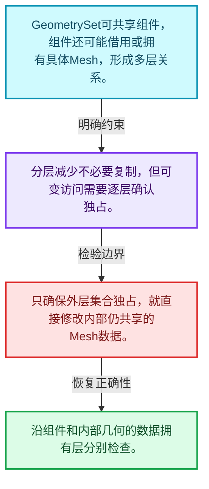
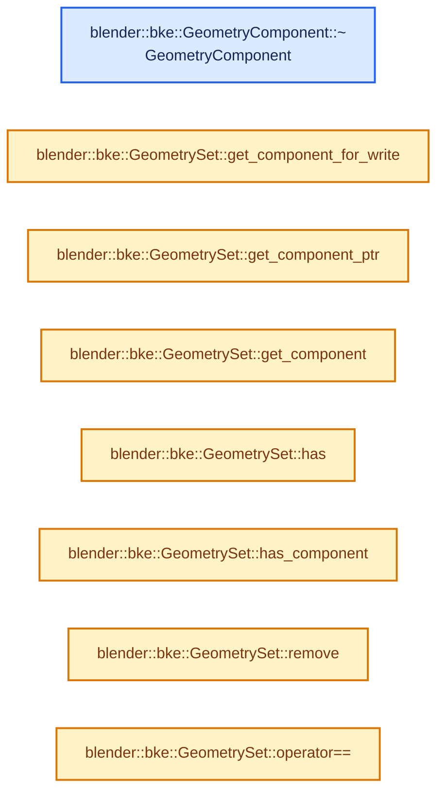
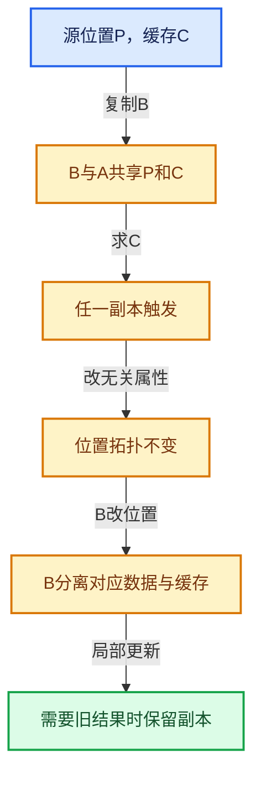

# 06-04 GeometryComponent共享

[方向导航](README.md) · [总目录](../README.md) · [实现索引](../00-课程指南/02-源码与提交索引/符号依赖与实现索引.md)

## 从问题到实现

为什么几何组件和组件内部数据有不同共享层？

组件身份、底层几何所有权和写时复制可能分层处理；读取接口不能随意绕过写入准备。

**数据模型**

GeometrySet可共享组件，组件还可能借用或拥有具体Mesh，形成多层关系。

**设计取舍**

分层减少不必要复制，但可变访问需要逐层确认独占。

**最小反例**

只确保外层集合独占，就直接修改内部仍共享的Mesh数据。

**推导**

沿组件和内部几何的数据拥有层分别检查。

## 阅读地图与执行推演








图中的数值推演是本方向的教学模型；实际函数之间的调用边与概念分析边分别标注，不能把概念关系当作运行时调度顺序。

## 完整源码单元与就地讲解

中文讲解直接放在相关代码旁，复杂机制在代码下展开。原文折叠区保留基准行号；不需要在行号表和函数之间来回查找。类布局可分段展示，函数实现不按固定行数切开。

### 类型布局、声明与编译条件 · BKE_geometry_set.hh L1—L91

<a id="t-cec3b40d3d53"></a>

<a id="t-fb5e10b896fb"></a>

<a id="t-39c9f62cd56a"></a>

<a id="t-230e1ff1b3ab"></a>

<a id="t-bc9df7e8ef7e"></a>

<a id="t-dbe6299ab0dc"></a>

<a id="t-3762410c5e09"></a>

<a id="t-35113fda56d8"></a>

<a id="t-8406fb1e8bd7"></a>

<a id="t-bbaf87e114c7"></a>

<a id="t-e2d7907c294d"></a>

<a id="t-2cf23359ab28"></a>

`GeometryComponent`在这里声明的数据成员：

- `Type type_`

<a id="t-5ee0e9f78c82"></a>

<a id="t-650fed9e8074"></a>

<a id="t-d8c3d48d64fd"></a>

<a id="t-2487da5a1ecc"></a>

<a id="t-389671360c8b"></a>

<a id="t-ff60d530b3d2"></a>

<a id="t-2f75dfa20569"></a>

`GeometryComponent`在这里声明的数据成员：

- `Type type_`

<a id="t-f8bb9559f14a"></a>

<!-- annotated:ab3f198a36844f -->

```cpp
/* SPDX-FileCopyrightText: 2023 Blender Authors
 *
 * SPDX-License-Identifier: GPL-2.0-or-later */

#pragma once

/** \file
 * \ingroup bke
 */

#include <iosfwd>
#include <optional>

#include "BLI_bounds_types.hh"
#include "BLI_function_ref.hh"
#include "BLI_implicit_sharing_ptr.hh"
#include "BLI_math_vector_types.hh"
#include "BLI_memory_counter_fwd.hh"
#include "BLI_mutex.hh"
#include "BLI_vector_set.hh"

#include "BKE_attribute.hh"

namespace blender {

struct Curves;
struct Curve;
struct Mesh;
struct PointCloud;
struct Volume;
struct GreasePencil;
namespace bke {
struct AttributeDomainAndType;
class AttributeAccessor;
struct AttributeMetaData;
class CurvesEditHints;
class Instances;
class GeometryComponent;
class GreasePencilEditHints;
class MutableAttributeAccessor;
enum class AttrDomain : int8_t;
struct GizmoEditHints;
}  // namespace bke
namespace nodes {
class Bundle;
using BundlePtr = ImplicitSharingPtr<Bundle>;
}  // namespace nodes

namespace bke {

#define GEO_COMPONENT_TYPE_ENUM_SIZE 7

enum class GeometryOwnershipType {
  /* The geometry is owned. This implies that it can be changed. */
  Owned = 0,
  /* The geometry can be changed, but someone else is responsible for freeing it. */
  Editable = 1,
  /* The geometry cannot be changed and someone else is responsible for freeing it. */
  ReadOnly = 2,
};

using GeometryComponentPtr = ImplicitSharingPtr<GeometryComponent>;

/**
 * This is the base class for specialized geometry component types. A geometry component uses
 * implicit sharing to avoid read-only copies. It also integrates with attribute API, which
 * generalizes storing and modifying generic information on a geometry.
 */
class GeometryComponent : public ImplicitSharingMixin {
 public:
  /**
   * Each geometry component has a specific type. The type determines what kind of data the
   * component stores. Functions modifying a geometry will usually just modify a subset of the
   * component types.
   * \note These values are stored in files, so they should not be reordered.
   */
  enum class Type {
    Mesh = 0,
    PointCloud = 1,
    Instance = 2,
    Volume = 3,
    Curve = 4,
    Edit = 5,
    GreasePencil = 6,
  };

 private:
  Type type_;

 public:
  GeometryComponent(Type type);
```

<details>
<summary>核对原始源码：source/blender/blenkernel/BKE_geometry_set.hh · L1—L91</summary>

<!-- original:ab3f198a36844f:source/blender/blenkernel/BKE_geometry_set.hh:1:91 -->

```cpp
/* SPDX-FileCopyrightText: 2023 Blender Authors
 *
 * SPDX-License-Identifier: GPL-2.0-or-later */

#pragma once

/** \file
 * \ingroup bke
 */

#include <iosfwd>
#include <optional>

#include "BLI_bounds_types.hh"
#include "BLI_function_ref.hh"
#include "BLI_implicit_sharing_ptr.hh"
#include "BLI_math_vector_types.hh"
#include "BLI_memory_counter_fwd.hh"
#include "BLI_mutex.hh"
#include "BLI_vector_set.hh"

#include "BKE_attribute.hh"

namespace blender {

struct Curves;
struct Curve;
struct Mesh;
struct PointCloud;
struct Volume;
struct GreasePencil;
namespace bke {
struct AttributeDomainAndType;
class AttributeAccessor;
struct AttributeMetaData;
class CurvesEditHints;
class Instances;
class GeometryComponent;
class GreasePencilEditHints;
class MutableAttributeAccessor;
enum class AttrDomain : int8_t;
struct GizmoEditHints;
}  // namespace bke
namespace nodes {
class Bundle;
using BundlePtr = ImplicitSharingPtr<Bundle>;
}  // namespace nodes

namespace bke {

#define GEO_COMPONENT_TYPE_ENUM_SIZE 7

enum class GeometryOwnershipType {
  /* The geometry is owned. This implies that it can be changed. */
  Owned = 0,
  /* The geometry can be changed, but someone else is responsible for freeing it. */
  Editable = 1,
  /* The geometry cannot be changed and someone else is responsible for freeing it. */
  ReadOnly = 2,
};

using GeometryComponentPtr = ImplicitSharingPtr<GeometryComponent>;

/**
 * This is the base class for specialized geometry component types. A geometry component uses
 * implicit sharing to avoid read-only copies. It also integrates with attribute API, which
 * generalizes storing and modifying generic information on a geometry.
 */
class GeometryComponent : public ImplicitSharingMixin {
 public:
  /**
   * Each geometry component has a specific type. The type determines what kind of data the
   * component stores. Functions modifying a geometry will usually just modify a subset of the
   * component types.
   * \note These values are stored in files, so they should not be reordered.
   */
  enum class Type {
    Mesh = 0,
    PointCloud = 1,
    Instance = 2,
    Volume = 3,
    Curve = 4,
    Edit = 5,
    GreasePencil = 6,
  };

 private:
  Type type_;

 public:
  GeometryComponent(Type type);
```

</details>

<a id="f-a691e2c55e863829"></a>

### `blender::bke::GeometryComponent::~GeometryComponent`

实现位置：[source/blender/blenkernel/BKE_geometry_set.hh](../../../../../source/blender/blenkernel/BKE_geometry_set.hh) · L92—L92。

**教学注释版**

<!-- annotated:64b1125ad8cd80 -->

```cpp
  ~GeometryComponent() override = default;
```

<details>
<summary>核对原始源码：source/blender/blenkernel/BKE_geometry_set.hh · L92—L92</summary>

<!-- original:64b1125ad8cd80:source/blender/blenkernel/BKE_geometry_set.hh:92:92 -->

```cpp
  ~GeometryComponent() override = default;
```

</details>

**继续追踪实现**

本实现没有需要继续展开的显式调用；检查返回表达式、对象转换和调用者前置条件。

### 类型布局、声明与编译条件 · BKE_geometry_set.hh L93—L179

<a id="t-4e6400cab9a2"></a>

`GeometrySet`在这里声明的数据成员：

- `std::array<GeometryComponentPtr, GEO_COMPONENT_TYPE_ENUM_SIZE> components_`
- `nodes::BundlePtr bundle_`
- `std::string name_`
- `GeometrySet operator=`
- `GeometrySet operator=`
- `GeometryComponent get_component_for_write`

<!-- annotated:76428763f79c60 -->

```cpp
  static GeometryComponentPtr create(Type component_type);

  int attribute_domain_size(AttrDomain domain) const;

  /**
   * Get access to the attributes in this geometry component. May return none if the geometry does
   * not support the attribute system.
   */
  virtual std::optional<AttributeAccessor> attributes() const;
  virtual std::optional<MutableAttributeAccessor> attributes_for_write();

  virtual void count_memory(MemoryCounter &memory) const;

  /**
   * Copies the component. The returned component only has a single user and is therefor mutable.
   */
  virtual GeometryComponentPtr copy() const = 0;

  /** Remove referenced data from the geometry component. */
  virtual void clear() = 0;

  /* Direct data is everything except for instances of objects/collections.
   * If this returns true, the geometry set can be cached and is still valid after e.g. modifier
   * evaluation ends. Instances can only be valid as long as the data they instance is valid. */
  virtual bool owns_direct_data() const = 0;
  virtual void ensure_owns_direct_data() = 0;

  Type type() const;

  virtual bool is_empty() const;

 private:
  void delete_self() override;
  void delete_data_only() override;
};

template<typename T>
inline constexpr bool is_geometry_component_v = std::is_base_of_v<GeometryComponent, T>;

/**
 * A geometry set is a container for multiple kinds of geometry. It does not own geometry directly
 * itself, instead geometry is owned by multiple #GeometryComponents, and the geometry set
 * increases the user count of each component, so they avoid losing the data. This means
 * individual components might be shared between multiple geometries and other code. Shared
 * components are copied automatically when write access is requested.
 *
 * The components usually do not store data directly, but keep a reference to a data
 * structure defined elsewhere. There is at most one component of each type:
 *  - #MeshComponent
 *  - #CurveComponent
 *  - #PointCloudComponent
 *  - #InstancesComponent
 *  - #VolumeComponent
 *  - #GreasePencilComponent
 *
 * Copying a geometry set is a relatively cheap operation, because it does not copy the referenced
 * geometry components, so #GeometrySet can often be passed or moved by value.
 */
struct GeometrySet {
 private:
  /* Indexed by #GeometryComponent::Type. */
  std::array<GeometryComponentPtr, GEO_COMPONENT_TYPE_ENUM_SIZE> components_;
  nodes::BundlePtr bundle_;

  /**
   * A user defined name for this geometry. It is not expected to be unique. Its main
   * purpose is help debugging instance trees. It may eventually also be used when exporting
   * instance trees or when creating separate objects from them.
   */
  std::string name_;

 public:
  /**
   * The methods are defaulted here so that they are not instantiated in every translation unit.
   */
  GeometrySet();
  GeometrySet(const GeometrySet &other);
  GeometrySet(GeometrySet &&other);
  ~GeometrySet();
  GeometrySet &operator=(const GeometrySet &other);
  GeometrySet &operator=(GeometrySet &&other);

  /**
   * This method can only be used when the geometry set is mutable. It returns a mutable geometry
   * component of the given type.
   */
  GeometryComponent &get_component_for_write(GeometryComponent::Type component_type);
```

<details>
<summary>核对原始源码：source/blender/blenkernel/BKE_geometry_set.hh · L93—L179</summary>

<!-- original:76428763f79c60:source/blender/blenkernel/BKE_geometry_set.hh:93:179 -->

```cpp
  static GeometryComponentPtr create(Type component_type);

  int attribute_domain_size(AttrDomain domain) const;

  /**
   * Get access to the attributes in this geometry component. May return none if the geometry does
   * not support the attribute system.
   */
  virtual std::optional<AttributeAccessor> attributes() const;
  virtual std::optional<MutableAttributeAccessor> attributes_for_write();

  virtual void count_memory(MemoryCounter &memory) const;

  /**
   * Copies the component. The returned component only has a single user and is therefor mutable.
   */
  virtual GeometryComponentPtr copy() const = 0;

  /** Remove referenced data from the geometry component. */
  virtual void clear() = 0;

  /* Direct data is everything except for instances of objects/collections.
   * If this returns true, the geometry set can be cached and is still valid after e.g. modifier
   * evaluation ends. Instances can only be valid as long as the data they instance is valid. */
  virtual bool owns_direct_data() const = 0;
  virtual void ensure_owns_direct_data() = 0;

  Type type() const;

  virtual bool is_empty() const;

 private:
  void delete_self() override;
  void delete_data_only() override;
};

template<typename T>
inline constexpr bool is_geometry_component_v = std::is_base_of_v<GeometryComponent, T>;

/**
 * A geometry set is a container for multiple kinds of geometry. It does not own geometry directly
 * itself, instead geometry is owned by multiple #GeometryComponents, and the geometry set
 * increases the user count of each component, so they avoid losing the data. This means
 * individual components might be shared between multiple geometries and other code. Shared
 * components are copied automatically when write access is requested.
 *
 * The components usually do not store data directly, but keep a reference to a data
 * structure defined elsewhere. There is at most one component of each type:
 *  - #MeshComponent
 *  - #CurveComponent
 *  - #PointCloudComponent
 *  - #InstancesComponent
 *  - #VolumeComponent
 *  - #GreasePencilComponent
 *
 * Copying a geometry set is a relatively cheap operation, because it does not copy the referenced
 * geometry components, so #GeometrySet can often be passed or moved by value.
 */
struct GeometrySet {
 private:
  /* Indexed by #GeometryComponent::Type. */
  std::array<GeometryComponentPtr, GEO_COMPONENT_TYPE_ENUM_SIZE> components_;
  nodes::BundlePtr bundle_;

  /**
   * A user defined name for this geometry. It is not expected to be unique. Its main
   * purpose is help debugging instance trees. It may eventually also be used when exporting
   * instance trees or when creating separate objects from them.
   */
  std::string name_;

 public:
  /**
   * The methods are defaulted here so that they are not instantiated in every translation unit.
   */
  GeometrySet();
  GeometrySet(const GeometrySet &other);
  GeometrySet(GeometrySet &&other);
  ~GeometrySet();
  GeometrySet &operator=(const GeometrySet &other);
  GeometrySet &operator=(GeometrySet &&other);

  /**
   * This method can only be used when the geometry set is mutable. It returns a mutable geometry
   * component of the given type.
   */
  GeometryComponent &get_component_for_write(GeometryComponent::Type component_type);
```

</details>

<a id="f-496855aef114a782"></a>

### `blender::bke::GeometrySet::get_component_for_write`

实现位置：[source/blender/blenkernel/BKE_geometry_set.hh](../../../../../source/blender/blenkernel/BKE_geometry_set.hh) · L180—L184。

**教学注释版**

<!-- annotated:5e1e174c0e6b79 -->

```cpp
  template<typename Component> Component &get_component_for_write()
  {
    BLI_STATIC_ASSERT(is_geometry_component_v<Component>, "");
    return static_cast<Component &>(this->get_component_for_write(Component::static_type));
  }
```

<details>
<summary>核对原始源码：source/blender/blenkernel/BKE_geometry_set.hh · L180—L184</summary>

<!-- original:5e1e174c0e6b79:source/blender/blenkernel/BKE_geometry_set.hh:180:184 -->

```cpp
  template<typename Component> Component &get_component_for_write()
  {
    BLI_STATIC_ASSERT(is_geometry_component_v<Component>, "");
    return static_cast<Component &>(this->get_component_for_write(Component::static_type));
  }
```

</details>

**结果出口**

- `return static_cast<Component &>(this->get_component_for_write(Component::static_type));`

**继续追踪实现**

- `BLI_STATIC_ASSERT` → [BLI_STATIC_ASSERT · L68](../90-实现依赖专题/01-BLI基础库/BLI_assert.hh.md#m-2847bd43464c)；[BLI_STATIC_ASSERT · L37](../90-实现依赖专题/08-其他Blender模块/gpu/GPU_shader_shared_utils.hh.md#m-84775b53af8c)；[BLI_STATIC_ASSERT · L58](../90-实现依赖专题/08-其他Blender模块/gpu/GPU_shader_shared_utils.hh.md#m-4227322768f0)。宏定义由构建条件选择。
- `this->get_component_for_write` → [blender::bke::GeometrySet::get_component_for_write · L180](04-GeometryComponent共享.md#f-496855aef114a782)。

<!-- annotated:be9aa04fe0608b -->

```cpp

```

<details>
<summary>核对原始源码：source/blender/blenkernel/BKE_geometry_set.hh · L185—L185</summary>

<!-- original:be9aa04fe0608b:source/blender/blenkernel/BKE_geometry_set.hh:185:185 -->

```cpp

```

</details>

<a id="f-75ac80931008c42c"></a>

### `blender::bke::GeometrySet::get_component_ptr`

实现位置：[source/blender/blenkernel/BKE_geometry_set.hh](../../../../../source/blender/blenkernel/BKE_geometry_set.hh) · L186—L189。

接口参数：

- `GeometryComponent::Type component_type`

**教学注释版**

<!-- annotated:c28f0827110737 -->

```cpp
  GeometryComponentPtr get_component_ptr(GeometryComponent::Type component_type) const
  {
    return components_[int(component_type)];
  }
```

<details>
<summary>核对原始源码：source/blender/blenkernel/BKE_geometry_set.hh · L186—L189</summary>

<!-- original:c28f0827110737:source/blender/blenkernel/BKE_geometry_set.hh:186:189 -->

```cpp
  GeometryComponentPtr get_component_ptr(GeometryComponent::Type component_type) const
  {
    return components_[int(component_type)];
  }
```

</details>

**结果出口**

- `return components_[int(component_type)];`

**继续追踪实现**

本实现没有需要继续展开的显式调用；检查返回表达式、对象转换和调用者前置条件。

### 类型布局、声明与编译条件 · BKE_geometry_set.hh L190—L194

<!-- annotated:8d67a7cf4dd1e9 -->

```cpp

  /**
   * Get the component of the given type. Might return null if the component does not exist yet.
   */
  const GeometryComponent *get_component(GeometryComponent::Type component_type) const;
```

<details>
<summary>核对原始源码：source/blender/blenkernel/BKE_geometry_set.hh · L190—L194</summary>

<!-- original:8d67a7cf4dd1e9:source/blender/blenkernel/BKE_geometry_set.hh:190:194 -->

```cpp

  /**
   * Get the component of the given type. Might return null if the component does not exist yet.
   */
  const GeometryComponent *get_component(GeometryComponent::Type component_type) const;
```

</details>

<a id="f-e0aa32e968527b27"></a>

### `blender::bke::GeometrySet::get_component`

实现位置：[source/blender/blenkernel/BKE_geometry_set.hh](../../../../../source/blender/blenkernel/BKE_geometry_set.hh) · L195—L199。

**教学注释版**

<!-- annotated:7f97bcb02d29d5 -->

```cpp
  template<typename Component> const Component *get_component() const
  {
    BLI_STATIC_ASSERT(is_geometry_component_v<Component>, "");
    return static_cast<const Component *>(get_component(Component::static_type));
  }
```

<details>
<summary>核对原始源码：source/blender/blenkernel/BKE_geometry_set.hh · L195—L199</summary>

<!-- original:7f97bcb02d29d5:source/blender/blenkernel/BKE_geometry_set.hh:195:199 -->

```cpp
  template<typename Component> const Component *get_component() const
  {
    BLI_STATIC_ASSERT(is_geometry_component_v<Component>, "");
    return static_cast<const Component *>(get_component(Component::static_type));
  }
```

</details>

**结果出口**

- `return static_cast<const Component *>(get_component(Component::static_type));`

**继续追踪实现**

- `BLI_STATIC_ASSERT` → [BLI_STATIC_ASSERT · L68](../90-实现依赖专题/01-BLI基础库/BLI_assert.hh.md#m-2847bd43464c)；[BLI_STATIC_ASSERT · L37](../90-实现依赖专题/08-其他Blender模块/gpu/GPU_shader_shared_utils.hh.md#m-84775b53af8c)；[BLI_STATIC_ASSERT · L58](../90-实现依赖专题/08-其他Blender模块/gpu/GPU_shader_shared_utils.hh.md#m-4227322768f0)。宏定义由构建条件选择。
- `get_component` → [blender::bke::GeometrySet::get_component · L195](04-GeometryComponent共享.md#f-e0aa32e968527b27)。

### 类型布局、声明与编译条件 · BKE_geometry_set.hh L200—L201

<!-- annotated:52d199d5be233c -->

```cpp

  bool has(const GeometryComponent::Type component_type) const;
```

<details>
<summary>核对原始源码：source/blender/blenkernel/BKE_geometry_set.hh · L200—L201</summary>

<!-- original:52d199d5be233c:source/blender/blenkernel/BKE_geometry_set.hh:200:201 -->

```cpp

  bool has(const GeometryComponent::Type component_type) const;
```

</details>

<a id="f-5bb2e44dacf92a36"></a>

### `blender::bke::GeometrySet::has`

实现位置：[source/blender/blenkernel/BKE_geometry_set.hh](../../../../../source/blender/blenkernel/BKE_geometry_set.hh) · L202—L206。

**教学注释版**

<!-- annotated:f87c3318eebe55 -->

```cpp
  template<typename Component> bool has() const
  {
    BLI_STATIC_ASSERT(is_geometry_component_v<Component>, "");
    return this->has(Component::static_type);
  }
```

<details>
<summary>核对原始源码：source/blender/blenkernel/BKE_geometry_set.hh · L202—L206</summary>

<!-- original:f87c3318eebe55:source/blender/blenkernel/BKE_geometry_set.hh:202:206 -->

```cpp
  template<typename Component> bool has() const
  {
    BLI_STATIC_ASSERT(is_geometry_component_v<Component>, "");
    return this->has(Component::static_type);
  }
```

</details>

**结果出口**

- `return this->has(Component::static_type);`

**继续追踪实现**

- `BLI_STATIC_ASSERT` → [BLI_STATIC_ASSERT · L68](../90-实现依赖专题/01-BLI基础库/BLI_assert.hh.md#m-2847bd43464c)；[BLI_STATIC_ASSERT · L37](../90-实现依赖专题/08-其他Blender模块/gpu/GPU_shader_shared_utils.hh.md#m-84775b53af8c)；[BLI_STATIC_ASSERT · L58](../90-实现依赖专题/08-其他Blender模块/gpu/GPU_shader_shared_utils.hh.md#m-4227322768f0)。宏定义由构建条件选择。
- `this->has` → [blender::bke::GeometrySet::has · L202](04-GeometryComponent共享.md#f-5bb2e44dacf92a36)。

<!-- annotated:677efee58c4135 -->

```cpp

```

<details>
<summary>核对原始源码：source/blender/blenkernel/BKE_geometry_set.hh · L207—L207</summary>

<!-- original:677efee58c4135:source/blender/blenkernel/BKE_geometry_set.hh:207:207 -->

```cpp

```

</details>

<a id="f-b8d4ee0c445a53ad"></a>

### `blender::bke::GeometrySet::has_component`

实现位置：[source/blender/blenkernel/BKE_geometry_set.hh](../../../../../source/blender/blenkernel/BKE_geometry_set.hh) · L208—L212。

**教学注释版**

<!-- annotated:68679eb7d9645d -->

```cpp
  template<typename Component> bool has_component() const
  {
    BLI_STATIC_ASSERT(is_geometry_component_v<Component>, "");
    return components_[int(Component::static_type)];
  }
```

<details>
<summary>核对原始源码：source/blender/blenkernel/BKE_geometry_set.hh · L208—L212</summary>

<!-- original:68679eb7d9645d:source/blender/blenkernel/BKE_geometry_set.hh:208:212 -->

```cpp
  template<typename Component> bool has_component() const
  {
    BLI_STATIC_ASSERT(is_geometry_component_v<Component>, "");
    return components_[int(Component::static_type)];
  }
```

</details>

**结果出口**

- `return components_[int(Component::static_type)];`

**继续追踪实现**

- `BLI_STATIC_ASSERT` → [BLI_STATIC_ASSERT · L68](../90-实现依赖专题/01-BLI基础库/BLI_assert.hh.md#m-2847bd43464c)；[BLI_STATIC_ASSERT · L37](../90-实现依赖专题/08-其他Blender模块/gpu/GPU_shader_shared_utils.hh.md#m-84775b53af8c)；[BLI_STATIC_ASSERT · L58](../90-实现依赖专题/08-其他Blender模块/gpu/GPU_shader_shared_utils.hh.md#m-4227322768f0)。宏定义由构建条件选择。

### 类型布局、声明与编译条件 · BKE_geometry_set.hh L213—L214

<!-- annotated:a84af3c8658bfe -->

```cpp

  void remove(const GeometryComponent::Type component_type);
```

<details>
<summary>核对原始源码：source/blender/blenkernel/BKE_geometry_set.hh · L213—L214</summary>

<!-- original:a84af3c8658bfe:source/blender/blenkernel/BKE_geometry_set.hh:213:214 -->

```cpp

  void remove(const GeometryComponent::Type component_type);
```

</details>

<a id="f-b4ab5f7e230fc44c"></a>

### `blender::bke::GeometrySet::remove`

实现位置：[source/blender/blenkernel/BKE_geometry_set.hh](../../../../../source/blender/blenkernel/BKE_geometry_set.hh) · L215—L219。

**教学注释版**

<!-- annotated:285d34697437f1 -->

```cpp
  template<typename Component> void remove()
  {
    BLI_STATIC_ASSERT(is_geometry_component_v<Component>, "");
    return this->remove(Component::static_type);
  }
```

<details>
<summary>核对原始源码：source/blender/blenkernel/BKE_geometry_set.hh · L215—L219</summary>

<!-- original:285d34697437f1:source/blender/blenkernel/BKE_geometry_set.hh:215:219 -->

```cpp
  template<typename Component> void remove()
  {
    BLI_STATIC_ASSERT(is_geometry_component_v<Component>, "");
    return this->remove(Component::static_type);
  }
```

</details>

**结果出口**

- `return this->remove(Component::static_type);`

**继续追踪实现**

- `BLI_STATIC_ASSERT` → [BLI_STATIC_ASSERT · L68](../90-实现依赖专题/01-BLI基础库/BLI_assert.hh.md#m-2847bd43464c)；[BLI_STATIC_ASSERT · L37](../90-实现依赖专题/08-其他Blender模块/gpu/GPU_shader_shared_utils.hh.md#m-84775b53af8c)；[BLI_STATIC_ASSERT · L58](../90-实现依赖专题/08-其他Blender模块/gpu/GPU_shader_shared_utils.hh.md#m-4227322768f0)。宏定义由构建条件选择。
- `this->remove` → [blender::bke::GeometrySet::remove · L215](04-GeometryComponent共享.md#f-b4ab5f7e230fc44c)。

### 类型布局、声明与编译条件 · BKE_geometry_set.hh L220—L462

<a id="t-a57a9ec84ca7"></a>

`GatheredAttributes`在这里声明的数据成员：

- `VectorSet<StringRef, 16> names`
- `Vector<AttributeDomainAndType, 16> kinds`
- `void add`

<!-- annotated:427f6c5f64ffef -->

```cpp

  /**
   * Remove all geometry components with types that are not in the provided list.
   */
  void keep_only(Span<GeometryComponent::Type> component_types);

  void add(const GeometryComponent &component);

  /**
   * Get all geometry components in this geometry set for read-only access.
   */
  Vector<const GeometryComponent *> get_components() const;

  std::optional<Bounds<float3>> compute_boundbox_without_instances(bool use_radius = true,
                                                                   bool use_subdiv = false) const;

  friend std::ostream &operator<<(std::ostream &stream, const GeometrySet &geometry_set);

  /**
   * Remove all geometry components from the geometry set.
   */
  void clear();

  bool owns_direct_data() const;
  /**
   * Make sure that the geometry can be cached. This does not ensure ownership of object/collection
   * instances. This is necessary because sometimes components only have read-only or editing
   * access to their data, which might be freed later if this geometry set outlasts the data.
   */
  void ensure_owns_direct_data();
  /**
   * Same as #ensure_owns_direct_data but also turns object/collection instances into geometry
   * instances so that they can be owned.
   */
  void ensure_owns_all_data();
  /**
   * Typically, multiple #GeometrySet may share the same #GeometryComponent. This is fine as long
   * as we can guarantee that the data is read-only. However, if some geometry is available in
   * Python, that guarantee is not possible currently. For that case it can make sense that the
   * #GeometrySet is the unique owner of the geometries it contains.
   */
  void ensure_no_shared_components();

  using AttributeForeachCallback = FunctionRef<void(
      StringRef name, const AttributeMetaData &meta_data, const GeometryComponent &component)>;

  void attribute_foreach(Span<GeometryComponent::Type> component_types,
                         bool include_instances,
                         AttributeForeachCallback callback) const;

  struct GatheredAttributes {
    VectorSet<StringRef, 16> names;
    Vector<AttributeDomainAndType, 16> kinds;
    void add(const StringRef name, const AttributeDomainAndType &kind);
  };

  Vector<GeometryComponent::Type> gather_component_types(bool include_instances,
                                                         bool ignore_empty) const;

  /* Utility methods for creation. */
  /**
   * Create a new geometry set that only contains the given mesh.
   */
  static GeometrySet from_mesh(Mesh *mesh,
                               GeometryOwnershipType ownership = GeometryOwnershipType::Owned);
  /**
   * Create a new geometry set that only contains the given volume.
   */
  static GeometrySet from_volume(Volume *volume,
                                 GeometryOwnershipType ownership = GeometryOwnershipType::Owned);
  /**
   * Create a new geometry set that only contains the given point cloud.
   */
  static GeometrySet from_pointcloud(
      PointCloud *pointcloud, GeometryOwnershipType ownership = GeometryOwnershipType::Owned);
  /**
   * Create a new geometry set that only contains the given curves.
   */
  static GeometrySet from_curves(Curves *curves,
                                 GeometryOwnershipType ownership = GeometryOwnershipType::Owned);
  /**
   * Create a new geometry set that only contains the given instances.
   */
  static GeometrySet from_instances(std::unique_ptr<Instances> instances);
  static GeometrySet from_instances(
      Instances *instances, GeometryOwnershipType ownership = GeometryOwnershipType::Owned);
  /**
   * Create a new geometry set that only contains the given Grease Pencil data.
   */
  static GeometrySet from_grease_pencil(
      GreasePencil *grease_pencil, GeometryOwnershipType ownership = GeometryOwnershipType::Owned);

  /* Utility methods for access. */
  /**
   * Returns true when the geometry set has a mesh component that has a mesh.
   */
  bool has_mesh() const;
  /**
   * Returns true when the geometry set has a point cloud component that has a point cloud.
   */
  bool has_pointcloud() const;
  /**
   * Returns true when the geometry set has an instances component that has at least one instance.
   */
  bool has_instances() const;
  /**
   * Returns true when the geometry set has a volume component that has a volume.
   */
  bool has_volume() const;
  /**
   * Returns true when the geometry set has a curves component that has a curves data-block.
   */
  bool has_curves() const;
  /**
   * Returns true when the geometry set has any data that is not an instance.
   */
  bool has_realized_data() const;
  /**
   * Returns true when the geometry set has a Grease Pencil component that has grease pencil data.
   */
  bool has_grease_pencil() const;
  /**
   * Return true if the geometry set has any component that isn't empty.
   */
  bool is_empty() const;

  /**
   * Returns a read-only mesh or null.
   */
  const Mesh *get_mesh() const;
  /**
   * Returns a read-only point cloud of null.
   */
  const PointCloud *get_pointcloud() const;
  /**
   * Returns a read-only volume or null.
   */
  const Volume *get_volume() const;
  /**
   * Returns a read-only curves data-block or null.
   */
  const Curves *get_curves() const;
  /**
   * Returns read-only instances or null.
   */
  const Instances *get_instances() const;
  /**
   * Returns read-only curve edit hints or null.
   */
  const CurvesEditHints *get_curve_edit_hints() const;
  /**
   * Returns read-only Grease Pencil edit hints or null.
   */
  const GreasePencilEditHints *get_grease_pencil_edit_hints() const;
  /**
   * Returns read-only gizmo edit hints or null.
   */
  const GizmoEditHints *get_gizmo_edit_hints() const;
  /**
   * Returns a read-only Grease Pencil data-block or null.
   */
  const GreasePencil *get_grease_pencil() const;

  /**
   * Returns a mutable mesh or null. No ownership is transferred.
   */
  Mesh *get_mesh_for_write();
  /**
   * Returns a mutable point cloud or null. No ownership is transferred.
   */
  PointCloud *get_pointcloud_for_write();
  /**
   * Returns a mutable volume or null. No ownership is transferred.
   */
  Volume *get_volume_for_write();
  /**
   * Returns a mutable curves data-block or null. No ownership is transferred.
   */
  Curves *get_curves_for_write();
  /**
   * Returns mutable instances or null. No ownership is transferred.
   */
  Instances *get_instances_for_write();
  /**
   * Returns mutable curve edit hints or null.
   */
  CurvesEditHints *get_curve_edit_hints_for_write();
  /**
   * Returns mutable Grease Pencil edit hints or null.
   */
  GreasePencilEditHints *get_grease_pencil_edit_hints_for_write();
  /**
   * Returns mutable gizmo edit hints or null.
   */
  GizmoEditHints *get_gizmo_edit_hints_for_write();
  /**
   * Returns a mutable Grease Pencil data-block or null. No ownership is transferred.
   */
  GreasePencil *get_grease_pencil_for_write();

  /* Utility methods for replacement. */
  /**
   * Clear the existing mesh and replace it with the given one.
   */
  void replace_mesh(Mesh *mesh, GeometryOwnershipType ownership = GeometryOwnershipType::Owned);
  /**
   * Clear the existing point cloud and replace with the given one.
   */
  void replace_pointcloud(PointCloud *pointcloud,
                          GeometryOwnershipType ownership = GeometryOwnershipType::Owned);
  /**
   * Clear the existing volume and replace with the given one.
   */
  void replace_volume(Volume *volume,
                      GeometryOwnershipType ownership = GeometryOwnershipType::Owned);
  /**
   * Clear the existing curves data-block and replace it with the given one.
   */
  void replace_curves(Curves *curves,
                      GeometryOwnershipType ownership = GeometryOwnershipType::Owned);
  /**
   * Clear the existing instances and replace them with the given one.
   */
  void replace_instances(Instances *instances,
                         GeometryOwnershipType ownership = GeometryOwnershipType::Owned);
  /**
   * Clear the existing Grease Pencil data-block and replace it with the given one.
   */
  void replace_grease_pencil(GreasePencil *grease_pencil,
                             GeometryOwnershipType ownership = GeometryOwnershipType::Owned);

  bool has_bundle() const;
  const nodes::Bundle *bundle() const;
  const nodes::BundlePtr &bundle_ptr() const;
  nodes::BundlePtr &bundle_ptr();
  nodes::Bundle &bundle_for_write();

  void copy_bundle_from(const GeometrySet &other);
  void merge_bundle_from(const GeometrySet &other);

  void set_name(std::string name);
  StringRefNull name() const;

```

<details>
<summary>核对原始源码：source/blender/blenkernel/BKE_geometry_set.hh · L220—L462</summary>

<!-- original:427f6c5f64ffef:source/blender/blenkernel/BKE_geometry_set.hh:220:462 -->

```cpp

  /**
   * Remove all geometry components with types that are not in the provided list.
   */
  void keep_only(Span<GeometryComponent::Type> component_types);

  void add(const GeometryComponent &component);

  /**
   * Get all geometry components in this geometry set for read-only access.
   */
  Vector<const GeometryComponent *> get_components() const;

  std::optional<Bounds<float3>> compute_boundbox_without_instances(bool use_radius = true,
                                                                   bool use_subdiv = false) const;

  friend std::ostream &operator<<(std::ostream &stream, const GeometrySet &geometry_set);

  /**
   * Remove all geometry components from the geometry set.
   */
  void clear();

  bool owns_direct_data() const;
  /**
   * Make sure that the geometry can be cached. This does not ensure ownership of object/collection
   * instances. This is necessary because sometimes components only have read-only or editing
   * access to their data, which might be freed later if this geometry set outlasts the data.
   */
  void ensure_owns_direct_data();
  /**
   * Same as #ensure_owns_direct_data but also turns object/collection instances into geometry
   * instances so that they can be owned.
   */
  void ensure_owns_all_data();
  /**
   * Typically, multiple #GeometrySet may share the same #GeometryComponent. This is fine as long
   * as we can guarantee that the data is read-only. However, if some geometry is available in
   * Python, that guarantee is not possible currently. For that case it can make sense that the
   * #GeometrySet is the unique owner of the geometries it contains.
   */
  void ensure_no_shared_components();

  using AttributeForeachCallback = FunctionRef<void(
      StringRef name, const AttributeMetaData &meta_data, const GeometryComponent &component)>;

  void attribute_foreach(Span<GeometryComponent::Type> component_types,
                         bool include_instances,
                         AttributeForeachCallback callback) const;

  struct GatheredAttributes {
    VectorSet<StringRef, 16> names;
    Vector<AttributeDomainAndType, 16> kinds;
    void add(const StringRef name, const AttributeDomainAndType &kind);
  };

  Vector<GeometryComponent::Type> gather_component_types(bool include_instances,
                                                         bool ignore_empty) const;

  /* Utility methods for creation. */
  /**
   * Create a new geometry set that only contains the given mesh.
   */
  static GeometrySet from_mesh(Mesh *mesh,
                               GeometryOwnershipType ownership = GeometryOwnershipType::Owned);
  /**
   * Create a new geometry set that only contains the given volume.
   */
  static GeometrySet from_volume(Volume *volume,
                                 GeometryOwnershipType ownership = GeometryOwnershipType::Owned);
  /**
   * Create a new geometry set that only contains the given point cloud.
   */
  static GeometrySet from_pointcloud(
      PointCloud *pointcloud, GeometryOwnershipType ownership = GeometryOwnershipType::Owned);
  /**
   * Create a new geometry set that only contains the given curves.
   */
  static GeometrySet from_curves(Curves *curves,
                                 GeometryOwnershipType ownership = GeometryOwnershipType::Owned);
  /**
   * Create a new geometry set that only contains the given instances.
   */
  static GeometrySet from_instances(std::unique_ptr<Instances> instances);
  static GeometrySet from_instances(
      Instances *instances, GeometryOwnershipType ownership = GeometryOwnershipType::Owned);
  /**
   * Create a new geometry set that only contains the given Grease Pencil data.
   */
  static GeometrySet from_grease_pencil(
      GreasePencil *grease_pencil, GeometryOwnershipType ownership = GeometryOwnershipType::Owned);

  /* Utility methods for access. */
  /**
   * Returns true when the geometry set has a mesh component that has a mesh.
   */
  bool has_mesh() const;
  /**
   * Returns true when the geometry set has a point cloud component that has a point cloud.
   */
  bool has_pointcloud() const;
  /**
   * Returns true when the geometry set has an instances component that has at least one instance.
   */
  bool has_instances() const;
  /**
   * Returns true when the geometry set has a volume component that has a volume.
   */
  bool has_volume() const;
  /**
   * Returns true when the geometry set has a curves component that has a curves data-block.
   */
  bool has_curves() const;
  /**
   * Returns true when the geometry set has any data that is not an instance.
   */
  bool has_realized_data() const;
  /**
   * Returns true when the geometry set has a Grease Pencil component that has grease pencil data.
   */
  bool has_grease_pencil() const;
  /**
   * Return true if the geometry set has any component that isn't empty.
   */
  bool is_empty() const;

  /**
   * Returns a read-only mesh or null.
   */
  const Mesh *get_mesh() const;
  /**
   * Returns a read-only point cloud of null.
   */
  const PointCloud *get_pointcloud() const;
  /**
   * Returns a read-only volume or null.
   */
  const Volume *get_volume() const;
  /**
   * Returns a read-only curves data-block or null.
   */
  const Curves *get_curves() const;
  /**
   * Returns read-only instances or null.
   */
  const Instances *get_instances() const;
  /**
   * Returns read-only curve edit hints or null.
   */
  const CurvesEditHints *get_curve_edit_hints() const;
  /**
   * Returns read-only Grease Pencil edit hints or null.
   */
  const GreasePencilEditHints *get_grease_pencil_edit_hints() const;
  /**
   * Returns read-only gizmo edit hints or null.
   */
  const GizmoEditHints *get_gizmo_edit_hints() const;
  /**
   * Returns a read-only Grease Pencil data-block or null.
   */
  const GreasePencil *get_grease_pencil() const;

  /**
   * Returns a mutable mesh or null. No ownership is transferred.
   */
  Mesh *get_mesh_for_write();
  /**
   * Returns a mutable point cloud or null. No ownership is transferred.
   */
  PointCloud *get_pointcloud_for_write();
  /**
   * Returns a mutable volume or null. No ownership is transferred.
   */
  Volume *get_volume_for_write();
  /**
   * Returns a mutable curves data-block or null. No ownership is transferred.
   */
  Curves *get_curves_for_write();
  /**
   * Returns mutable instances or null. No ownership is transferred.
   */
  Instances *get_instances_for_write();
  /**
   * Returns mutable curve edit hints or null.
   */
  CurvesEditHints *get_curve_edit_hints_for_write();
  /**
   * Returns mutable Grease Pencil edit hints or null.
   */
  GreasePencilEditHints *get_grease_pencil_edit_hints_for_write();
  /**
   * Returns mutable gizmo edit hints or null.
   */
  GizmoEditHints *get_gizmo_edit_hints_for_write();
  /**
   * Returns a mutable Grease Pencil data-block or null. No ownership is transferred.
   */
  GreasePencil *get_grease_pencil_for_write();

  /* Utility methods for replacement. */
  /**
   * Clear the existing mesh and replace it with the given one.
   */
  void replace_mesh(Mesh *mesh, GeometryOwnershipType ownership = GeometryOwnershipType::Owned);
  /**
   * Clear the existing point cloud and replace with the given one.
   */
  void replace_pointcloud(PointCloud *pointcloud,
                          GeometryOwnershipType ownership = GeometryOwnershipType::Owned);
  /**
   * Clear the existing volume and replace with the given one.
   */
  void replace_volume(Volume *volume,
                      GeometryOwnershipType ownership = GeometryOwnershipType::Owned);
  /**
   * Clear the existing curves data-block and replace it with the given one.
   */
  void replace_curves(Curves *curves,
                      GeometryOwnershipType ownership = GeometryOwnershipType::Owned);
  /**
   * Clear the existing instances and replace them with the given one.
   */
  void replace_instances(Instances *instances,
                         GeometryOwnershipType ownership = GeometryOwnershipType::Owned);
  /**
   * Clear the existing Grease Pencil data-block and replace it with the given one.
   */
  void replace_grease_pencil(GreasePencil *grease_pencil,
                             GeometryOwnershipType ownership = GeometryOwnershipType::Owned);

  bool has_bundle() const;
  const nodes::Bundle *bundle() const;
  const nodes::BundlePtr &bundle_ptr() const;
  nodes::BundlePtr &bundle_ptr();
  nodes::Bundle &bundle_for_write();

  void copy_bundle_from(const GeometrySet &other);
  void merge_bundle_from(const GeometrySet &other);

  void set_name(std::string name);
  StringRefNull name() const;

```

</details>

<a id="f-38dcc66d12156c28"></a>

### `blender::bke::GeometrySet::operator==`

实现位置：[source/blender/blenkernel/BKE_geometry_set.hh](../../../../../source/blender/blenkernel/BKE_geometry_set.hh) · L463—L468。

接口参数：

- `const GeometrySet &a`
- `const GeometrySet &b`

**教学注释版**

<!-- annotated:3c208c94b7a189 -->

```cpp
  friend bool operator==(const GeometrySet &a, const GeometrySet &b)
  {
    /* This compares only the component pointers, not the actual geometry data. */
    return Span(a.components_) == Span(b.components_) && a.name_ == b.name_ &&
           a.bundle_ == b.bundle_;
  }
```

<details>
<summary>核对原始源码：source/blender/blenkernel/BKE_geometry_set.hh · L463—L468</summary>

<!-- original:3c208c94b7a189:source/blender/blenkernel/BKE_geometry_set.hh:463:468 -->

```cpp
  friend bool operator==(const GeometrySet &a, const GeometrySet &b)
  {
    /* This compares only the component pointers, not the actual geometry data. */
    return Span(a.components_) == Span(b.components_) && a.name_ == b.name_ &&
           a.bundle_ == b.bundle_;
  }
```

</details>

**结果出口**

- `return Span(a.components_) == Span(b.components_) && a.name_ == b.name_ &&`

**继续追踪实现**

- `Span` → [blender::Span](../90-实现依赖专题/01-BLI基础库/BLI_span.hh.md#t-8765a8e0c1d5)；[blender::Span](../90-实现依赖专题/01-BLI基础库/BLI_index_range.hh.md#t-86091874a1c0)；[blender::Span](../90-实现依赖专题/08-其他Blender模块/makesdna/DNA_pointcloud_types.h.md#t-112aa6ed842c)；[blender::Span](../90-实现依赖专题/08-其他Blender模块/makesdna/DNA_node_types.h.md#t-49ec6fbb9b69)；[blender::Span](../90-实现依赖专题/08-其他Blender模块/makesdna/DNA_mesh_types.h.md#t-184fd48fb638)；[blender::Span](../90-实现依赖专题/08-其他Blender模块/makesdna/DNA_anim_types.h.md#t-d841071994c2)；[blender::Span](../90-实现依赖专题/08-其他Blender模块/makesrna/RNA_path_fwd.hh.md#t-4dbb08969e41)。

<!-- annotated:88596fa676ee39 -->

```cpp

```

<details>
<summary>核对原始源码：source/blender/blenkernel/BKE_geometry_set.hh · L469—L469</summary>

<!-- original:88596fa676ee39:source/blender/blenkernel/BKE_geometry_set.hh:469:469 -->

```cpp

```

</details>

<a id="f-a04185935eaecd14"></a>

### `blender::bke::GeometrySet::hash`

实现位置：[source/blender/blenkernel/BKE_geometry_set.hh](../../../../../source/blender/blenkernel/BKE_geometry_set.hh) · L470—L474。

**教学注释版**

<!-- annotated:bfdc6b6ea083da -->

```cpp
  uint64_t hash() const
  {
    /* This should have the same data that's also taken into account in #operator==. */
    return get_default_hash(Span(components_), name_, bundle_.get());
  }
```

<details>
<summary>核对原始源码：source/blender/blenkernel/BKE_geometry_set.hh · L470—L474</summary>

<!-- original:bfdc6b6ea083da:source/blender/blenkernel/BKE_geometry_set.hh:470:474 -->

```cpp
  uint64_t hash() const
  {
    /* This should have the same data that's also taken into account in #operator==. */
    return get_default_hash(Span(components_), name_, bundle_.get());
  }
```

</details>

**结果出口**

- `return get_default_hash(Span(components_), name_, bundle_.get());`

**继续追踪实现**

- `get_default_hash` → [blender::get_default_hash · L251](../02-哈希表与关联数据结构/01-哈希与相等契约.md#f-5f2c246aedf3dc0a)。
- `Span` → [blender::Span](../90-实现依赖专题/01-BLI基础库/BLI_span.hh.md#t-8765a8e0c1d5)；[blender::Span](../90-实现依赖专题/01-BLI基础库/BLI_index_range.hh.md#t-86091874a1c0)；[blender::Span](../90-实现依赖专题/08-其他Blender模块/makesdna/DNA_pointcloud_types.h.md#t-112aa6ed842c)；[blender::Span](../90-实现依赖专题/08-其他Blender模块/makesdna/DNA_node_types.h.md#t-49ec6fbb9b69)；[blender::Span](../90-实现依赖专题/08-其他Blender模块/makesdna/DNA_mesh_types.h.md#t-184fd48fb638)；[blender::Span](../90-实现依赖专题/08-其他Blender模块/makesdna/DNA_anim_types.h.md#t-d841071994c2)；[blender::Span](../90-实现依赖专题/08-其他Blender模块/makesrna/RNA_path_fwd.hh.md#t-4dbb08969e41)。
- `bundle_.get` → [调用协议](../00-课程指南/01-路线与规范/模板宏与动态分派协议.md)：由接收对象具体类型或运行时策略提供实现。调用位置L473。

### 类型布局、声明与编译条件 · BKE_geometry_set.hh L475—L483

<!-- annotated:d9f5ab36bde1e7 -->

```cpp

  void count_memory(MemoryCounter &memory) const;

 private:
  /**
   * Retrieve the pointer to a component without creating it if it does not exist,
   * unlike #get_component_for_write.
   */
  GeometryComponent *get_component_for_write_ptr(GeometryComponent::Type type);
```

<details>
<summary>核对原始源码：source/blender/blenkernel/BKE_geometry_set.hh · L475—L483</summary>

<!-- original:d9f5ab36bde1e7:source/blender/blenkernel/BKE_geometry_set.hh:475:483 -->

```cpp

  void count_memory(MemoryCounter &memory) const;

 private:
  /**
   * Retrieve the pointer to a component without creating it if it does not exist,
   * unlike #get_component_for_write.
   */
  GeometryComponent *get_component_for_write_ptr(GeometryComponent::Type type);
```

</details>

<a id="f-8ee8ef0103c7ee2a"></a>

### `blender::bke::GeometrySet::get_component_for_write_ptr`

实现位置：[source/blender/blenkernel/BKE_geometry_set.hh](../../../../../source/blender/blenkernel/BKE_geometry_set.hh) · L484—L488。

**教学注释版**

<!-- annotated:4f7074c93fbd2b -->

```cpp
  template<typename Component> Component *get_component_for_write_ptr()
  {
    BLI_STATIC_ASSERT(is_geometry_component_v<Component>, "");
    return static_cast<Component *>(get_component_for_write_ptr(Component::static_type));
  }
```

<details>
<summary>核对原始源码：source/blender/blenkernel/BKE_geometry_set.hh · L484—L488</summary>

<!-- original:4f7074c93fbd2b:source/blender/blenkernel/BKE_geometry_set.hh:484:488 -->

```cpp
  template<typename Component> Component *get_component_for_write_ptr()
  {
    BLI_STATIC_ASSERT(is_geometry_component_v<Component>, "");
    return static_cast<Component *>(get_component_for_write_ptr(Component::static_type));
  }
```

</details>

**结果出口**

- `return static_cast<Component *>(get_component_for_write_ptr(Component::static_type));`

**继续追踪实现**

- `BLI_STATIC_ASSERT` → [BLI_STATIC_ASSERT · L68](../90-实现依赖专题/01-BLI基础库/BLI_assert.hh.md#m-2847bd43464c)；[BLI_STATIC_ASSERT · L37](../90-实现依赖专题/08-其他Blender模块/gpu/GPU_shader_shared_utils.hh.md#m-84775b53af8c)；[BLI_STATIC_ASSERT · L58](../90-实现依赖专题/08-其他Blender模块/gpu/GPU_shader_shared_utils.hh.md#m-4227322768f0)。宏定义由构建条件选择。
- `get_component_for_write_ptr` → [blender::bke::GeometrySet::get_component_for_write_ptr · L484](04-GeometryComponent共享.md#f-8ee8ef0103c7ee2a)。

### 类型布局、声明与编译条件 · BKE_geometry_set.hh L489—L852

<a id="t-d10e37213f2b"></a>

`MeshComponent`在这里声明的数据成员：

- `Mesh mesh_`
- `GeometryOwnershipType ownership_`
- `GeometryComponentPtr copy`
- `void clear`
- `bool has_mesh`
- `void replace`
- `Mesh release`
- `Mesh get`
- `Mesh get_for_write`
- `bool is_empty`
- `bool owns_direct_data`
- `void ensure_owns_direct_data`
- `void count_memory`
- `GeometryComponent::Type static_type`
- `std::optional<AttributeAccessor> attributes`
- `std::optional<MutableAttributeAccessor> attributes_for_write`

<a id="t-b794f5102726"></a>

`PointCloudComponent`在这里声明的数据成员：

- `PointCloud pointcloud_`
- `GeometryOwnershipType ownership_`
- `GeometryComponentPtr copy`
- `void clear`
- `bool has_pointcloud`
- `void replace`
- `PointCloud release`
- `PointCloud get`
- `PointCloud get_for_write`
- `bool is_empty`
- `bool owns_direct_data`
- `void ensure_owns_direct_data`
- `void count_memory`
- `std::optional<AttributeAccessor> attributes`
- `std::optional<MutableAttributeAccessor> attributes_for_write`
- `GeometryComponent::Type static_type`

<a id="t-041b64205b04"></a>

`CurveComponent`在这里声明的数据成员：

- `Curves curves_`
- `GeometryOwnershipType ownership_`
- `Curve curve_for_render_`
- `Mutex curve_for_render_mutex_`
- `GeometryComponentPtr copy`
- `void clear`
- `bool has_curves`
- `void replace`
- `Curves release`
- `Curves get`
- `Curves get_for_write`
- `bool is_empty`
- `bool owns_direct_data`
- `void ensure_owns_direct_data`
- `void count_memory`
- `Curve get_curve_for_render`
- `std::optional<AttributeAccessor> attributes`
- `std::optional<MutableAttributeAccessor> attributes_for_write`
- `GeometryComponent::Type static_type`

<a id="t-47220fa3f05c"></a>

`InstancesComponent`在这里声明的数据成员：

- `Instances instances_`
- `GeometryOwnershipType ownership_`
- `GeometryComponentPtr copy`
- `void clear`
- `Instances get`
- `Instances get_for_write`
- `void replace`
- `bool is_empty`
- `Instances release`
- `bool owns_direct_data`
- `void ensure_owns_direct_data`
- `void count_memory`
- `std::optional<AttributeAccessor> attributes`
- `std::optional<MutableAttributeAccessor> attributes_for_write`
- `GeometryComponent::Type static_type`

<a id="t-af0be50c2b12"></a>

`VolumeComponent`在这里声明的数据成员：

- `Volume volume_`
- `GeometryOwnershipType ownership_`
- `GeometryComponentPtr copy`
- `void clear`
- `bool has_volume`
- `void replace`
- `Volume release`
- `Volume get`
- `Volume get_for_write`
- `bool owns_direct_data`
- `void ensure_owns_direct_data`
- `void count_memory`
- `GeometryComponent::Type static_type`

<a id="t-dc26d880b1df"></a>

`MeshEditHints`在这里声明的数据成员：

- `GeometryComponentPtr mesh_deform`
- `GeometryComponentPtr mesh_cage`

<a id="t-690289b2216e"></a>

`GeometryComponentEditData`在这里声明的数据成员：

- `std::unique_ptr<CurvesEditHints> curves_edit_hints_`
- `std::unique_ptr<GreasePencilEditHints> grease_pencil_edit_hints_`
- `std::unique_ptr<GizmoEditHints> gizmo_edit_hints_`
- `std::unique_ptr<MeshEditHints> mesh_edit_hints_`
- `GeometryComponentPtr copy`
- `bool owns_direct_data`
- `void ensure_owns_direct_data`
- `void clear`
- `void remember_deformed_positions_if_necessary`
- `GeometryComponent::Type static_type`

<a id="t-a7bcd3a92c55"></a>

`GreasePencilComponent`在这里声明的数据成员：

- `GreasePencil grease_pencil_`
- `GeometryOwnershipType ownership_`
- `GeometryComponentPtr copy`
- `void clear`
- `bool has_grease_pencil`
- `void replace`
- `GreasePencil release`
- `GreasePencil get`
- `GreasePencil get_for_write`
- `bool is_empty`
- `bool owns_direct_data`
- `void ensure_owns_direct_data`
- `GeometryComponent::Type static_type`
- `std::optional<AttributeAccessor> attributes`
- `std::optional<MutableAttributeAccessor> attributes_for_write`

<!-- annotated:ddbe109338cf1a -->

```cpp
};

/**
 * A geometry component that can store a mesh, using the #Mesh data-block.
 * Attributes are stored on any of the four attribute domains.
 */
class MeshComponent : public GeometryComponent {
 private:
  Mesh *mesh_ = nullptr;
  GeometryOwnershipType ownership_ = GeometryOwnershipType::Owned;

 public:
  MeshComponent();
  MeshComponent(Mesh *mesh, GeometryOwnershipType ownership = GeometryOwnershipType::Owned);
  ~MeshComponent() override;
  GeometryComponentPtr copy() const override;

  void clear() override;
  bool has_mesh() const;
  /**
   * Clear the component and replace it with the new mesh.
   */
  void replace(Mesh *mesh, GeometryOwnershipType ownership = GeometryOwnershipType::Owned);
  /**
   * Return the mesh and clear the component. The caller takes over responsibility for freeing the
   * mesh (if the component was responsible before).
   */
  Mesh *release();

  /**
   * Get the mesh from this component. This method can be used by multiple threads at the same
   * time. Therefore, the returned mesh should not be modified. No ownership is transferred.
   */
  const Mesh *get() const;
  /**
   * Get the mesh from this component. This method can only be used when the component is mutable,
   * i.e. it is not shared. The returned mesh can be modified. No ownership is transferred.
   */
  Mesh *get_for_write();

  bool is_empty() const final;

  bool owns_direct_data() const override;
  void ensure_owns_direct_data() override;

  void count_memory(MemoryCounter &memory) const override;

  static constexpr GeometryComponent::Type static_type = Type::Mesh;

  std::optional<AttributeAccessor> attributes() const final;
  std::optional<MutableAttributeAccessor> attributes_for_write() final;
};

/**
 * A geometry component that stores a point cloud, corresponding to the #PointCloud data structure.
 * While a point cloud is technically a subset of a mesh in some respects, it is useful because of
 * its simplicity, partly on a conceptual level for the user, but also in the code, though partly
 * for historical reasons. Point clouds can also be rendered in special ways, based on the built-in
 * `radius` attribute.
 *
 * Attributes on point clouds are all stored in contiguous arrays in its #CustomData,
 * which makes them efficient to process, relative to some legacy built-in mesh attributes.
 */
class PointCloudComponent : public GeometryComponent {
 private:
  PointCloud *pointcloud_ = nullptr;
  GeometryOwnershipType ownership_ = GeometryOwnershipType::Owned;

 public:
  PointCloudComponent();
  PointCloudComponent(PointCloud *pointcloud,
                      GeometryOwnershipType ownership = GeometryOwnershipType::Owned);
  ~PointCloudComponent() override;
  GeometryComponentPtr copy() const override;

  void clear() override;
  bool has_pointcloud() const;
  /**
   * Clear the component and replace it with the new point cloud.
   */
  void replace(PointCloud *pointcloud,
               GeometryOwnershipType ownership = GeometryOwnershipType::Owned);
  /**
   * Return the point cloud and clear the component. The caller takes over responsibility for
   * freeing the point cloud (if the component was responsible before).
   */
  PointCloud *release();

  /**
   * Get the point cloud from this component. This method can be used by multiple threads at the
   * same time. Therefore, the returned point cloud should not be modified. No ownership is
   * transferred.
   */
  const PointCloud *get() const;
  /**
   * Get the point cloud from this component. This method can only be used when the component is
   * mutable, i.e. it is not shared. The returned point cloud can be modified. No ownership is
   * transferred.
   */
  PointCloud *get_for_write();

  bool is_empty() const final;

  bool owns_direct_data() const override;
  void ensure_owns_direct_data() override;

  void count_memory(MemoryCounter &memory) const override;

  std::optional<AttributeAccessor> attributes() const final;
  std::optional<MutableAttributeAccessor> attributes_for_write() final;

  static constexpr GeometryComponent::Type static_type = Type::PointCloud;
};

/**
 * A geometry component that stores a group of curves, corresponding the #Curves data-block
 * and the #CurvesGeometry type. Attributes are stored on the control point domain and the
 * curve domain.
 */
class CurveComponent : public GeometryComponent {
 private:
  Curves *curves_ = nullptr;
  GeometryOwnershipType ownership_ = GeometryOwnershipType::Owned;

  /**
   * Because rendering #Curves isn't fully working yet, we must provide a #Curve for the render
   * engine and depsgraph object iterator in some cases. This allows using the old curve rendering
   * even when the new curve data structure is used.
   */
  mutable Curve *curve_for_render_ = nullptr;
  mutable Mutex curve_for_render_mutex_;

 public:
  CurveComponent();
  CurveComponent(Curves *curve, GeometryOwnershipType ownership = GeometryOwnershipType::Owned);
  ~CurveComponent() override;
  GeometryComponentPtr copy() const override;

  void clear() override;
  bool has_curves() const;
  /**
   * Clear the component and replace it with the new curve.
   */
  void replace(Curves *curve, GeometryOwnershipType ownership = GeometryOwnershipType::Owned);
  Curves *release();

  const Curves *get() const;
  Curves *get_for_write();

  bool is_empty() const final;

  bool owns_direct_data() const override;
  void ensure_owns_direct_data() override;

  void count_memory(MemoryCounter &memory) const override;

  /**
   * Create empty curve data used for rendering the spline's wire edges.
   * \note See comment on #curve_for_render_ for further explanation.
   */
  const Curve *get_curve_for_render() const;

  std::optional<AttributeAccessor> attributes() const final;
  std::optional<MutableAttributeAccessor> attributes_for_write() final;

  static constexpr GeometryComponent::Type static_type = Type::Curve;
};

/**
 * A geometry component that stores #Instances.
 */
class InstancesComponent : public GeometryComponent {
 private:
  Instances *instances_ = nullptr;
  GeometryOwnershipType ownership_ = GeometryOwnershipType::Owned;

 public:
  InstancesComponent();
  InstancesComponent(Instances *instances,
                     GeometryOwnershipType ownership = GeometryOwnershipType::Owned);
  ~InstancesComponent() override;
  GeometryComponentPtr copy() const override;

  void clear() override;

  const Instances *get() const;
  Instances *get_for_write();

  void replace(Instances *instances,
               GeometryOwnershipType ownership = GeometryOwnershipType::Owned);

  bool is_empty() const final;

  Instances *release();

  bool owns_direct_data() const override;
  void ensure_owns_direct_data() override;

  void count_memory(MemoryCounter &memory) const override;

  std::optional<AttributeAccessor> attributes() const final;
  std::optional<MutableAttributeAccessor> attributes_for_write() final;

  static constexpr GeometryComponent::Type static_type = Type::Instance;
};

/**
 * A geometry component that stores volume grids, corresponding to the #Volume data structure.
 * This component does not implement an attribute API, partly because storage of sparse volume
 * information in grids is much more complicated than it is for other types
 */
class VolumeComponent : public GeometryComponent {
 private:
  Volume *volume_ = nullptr;
  GeometryOwnershipType ownership_ = GeometryOwnershipType::Owned;

 public:
  VolumeComponent();
  ~VolumeComponent() override;
  GeometryComponentPtr copy() const override;

  void clear() override;
  bool has_volume() const;
  /**
   * Clear the component and replace it with the new volume.
   */
  void replace(Volume *volume, GeometryOwnershipType ownership = GeometryOwnershipType::Owned);
  /**
   * Return the volume and clear the component. The caller takes over responsibility for freeing
   * the volume (if the component was responsible before).
   */
  Volume *release();

  /**
   * Get the volume from this component. This method can be used by multiple threads at the same
   * time. Therefore, the returned volume should not be modified. No ownership is transferred.
   */
  const Volume *get() const;
  /**
   * Get the volume from this component. This method can only be used when the component is
   * mutable, i.e. it is not shared. The returned volume can be modified. No ownership is
   * transferred.
   */
  Volume *get_for_write();

  bool owns_direct_data() const override;
  void ensure_owns_direct_data() override;

  void count_memory(MemoryCounter &memory) const override;

  static constexpr GeometryComponent::Type static_type = Type::Volume;
};

struct MeshEditHints {
  /**
   * Mesh created by object evaluation. It only has leading deformation modifiers applied.
   *
   * \todo This should use a similar system to #CurvesEditHints storing just an array for the
   * deformed positions, but for historical reasons we copy the whole mesh.
   */
  GeometryComponentPtr mesh_deform;
  /**
   * Evaluated mesh cage in edit mode.
   *
   * \note When the mesh's `runtime->deformed_only` is true, its vertex positions and other
   * geometry arrays will be aligned the edit-mesh. Otherwise the #CD_ORIGINDEX custom-data should
   * be used to map the cage geometry back to the original indices, see
   * #eModifierTypeFlag_SupportsMapping.
   */
  GeometryComponentPtr mesh_cage;
};

/**
 * When the original data is in some edit mode, we want to propagate some additional information
 * through object evaluation. This information can be used by edit modes to support working on
 * evaluated data.
 *
 * This component is added at the beginning of modifier evaluation.
 */
class GeometryComponentEditData final : public GeometryComponent {
 public:
  /**
   * Information about how original curves are manipulated during evaluation. This data is used so
   * that curve sculpt tools can work on evaluated data. It is not stored in #CurveComponent
   * because the data remains valid even when there is no actual curves geometry anymore, for
   * example, when the curves have been converted to a mesh.
   */
  std::unique_ptr<CurvesEditHints> curves_edit_hints_;
  /**
   * Information about how drawings on the grease pencil layers are manipulated during evaluation.
   */
  std::unique_ptr<GreasePencilEditHints> grease_pencil_edit_hints_;
  /**
   * Propagated information for how gizmos should be transformed along with the geometry.
   */
  std::unique_ptr<GizmoEditHints> gizmo_edit_hints_;

  std::unique_ptr<MeshEditHints> mesh_edit_hints_;

  GeometryComponentEditData();

  GeometryComponentPtr copy() const final;
  bool owns_direct_data() const final;
  void ensure_owns_direct_data() final;

  void clear() override;

  /**
   * The first node that does topology changing operations on curves should store the curve point
   * positions it retrieved as input. Without this, information about the deformed positions is
   * lost, which would make curves sculpt mode fall back to using original curve positions instead
   * of deformed ones.
   */
  static void remember_deformed_positions_if_necessary(GeometrySet &geometry);

  static constexpr GeometryComponent::Type static_type = GeometryComponent::Type::Edit;
};

/**
 * A geometry component that stores #GreasePencil data.
 * The attributes on this component are only on the layer domain. Each individual layer represents
 * a #CurvesGeometry with its own curve and point domain. See #CurveComponent.
 */
class GreasePencilComponent : public GeometryComponent {
 private:
  GreasePencil *grease_pencil_ = nullptr;
  GeometryOwnershipType ownership_ = GeometryOwnershipType::Owned;

 public:
  GreasePencilComponent();
  ~GreasePencilComponent() override;
  GeometryComponentPtr copy() const override;

  void clear() override;
  bool has_grease_pencil() const;
  /**
   * Clear the component and replace it with the new \a grease_pencil data.
   */
  void replace(GreasePencil *grease_pencil,
               GeometryOwnershipType ownership = GeometryOwnershipType::Owned);
  /**
   * Return the Grease Pencil data and clear the component. The caller takes over responsibility
   * for freeing the Grease Pencil data (if the component was responsible before).
   */
  GreasePencil *release();

  const GreasePencil *get() const;
  GreasePencil *get_for_write();

  bool is_empty() const final;

  bool owns_direct_data() const override;
  void ensure_owns_direct_data() override;

  static constexpr GeometryComponent::Type static_type = Type::GreasePencil;

  std::optional<AttributeAccessor> attributes() const final;
  std::optional<MutableAttributeAccessor> attributes_for_write() final;
};

bool attribute_is_builtin_on_component_type(const GeometryComponent::Type type, StringRef name);

}  // namespace bke
}  // namespace blender
```

<details>
<summary>核对原始源码：source/blender/blenkernel/BKE_geometry_set.hh · L489—L852</summary>

<!-- original:ddbe109338cf1a:source/blender/blenkernel/BKE_geometry_set.hh:489:852 -->

```cpp
};

/**
 * A geometry component that can store a mesh, using the #Mesh data-block.
 * Attributes are stored on any of the four attribute domains.
 */
class MeshComponent : public GeometryComponent {
 private:
  Mesh *mesh_ = nullptr;
  GeometryOwnershipType ownership_ = GeometryOwnershipType::Owned;

 public:
  MeshComponent();
  MeshComponent(Mesh *mesh, GeometryOwnershipType ownership = GeometryOwnershipType::Owned);
  ~MeshComponent() override;
  GeometryComponentPtr copy() const override;

  void clear() override;
  bool has_mesh() const;
  /**
   * Clear the component and replace it with the new mesh.
   */
  void replace(Mesh *mesh, GeometryOwnershipType ownership = GeometryOwnershipType::Owned);
  /**
   * Return the mesh and clear the component. The caller takes over responsibility for freeing the
   * mesh (if the component was responsible before).
   */
  Mesh *release();

  /**
   * Get the mesh from this component. This method can be used by multiple threads at the same
   * time. Therefore, the returned mesh should not be modified. No ownership is transferred.
   */
  const Mesh *get() const;
  /**
   * Get the mesh from this component. This method can only be used when the component is mutable,
   * i.e. it is not shared. The returned mesh can be modified. No ownership is transferred.
   */
  Mesh *get_for_write();

  bool is_empty() const final;

  bool owns_direct_data() const override;
  void ensure_owns_direct_data() override;

  void count_memory(MemoryCounter &memory) const override;

  static constexpr GeometryComponent::Type static_type = Type::Mesh;

  std::optional<AttributeAccessor> attributes() const final;
  std::optional<MutableAttributeAccessor> attributes_for_write() final;
};

/**
 * A geometry component that stores a point cloud, corresponding to the #PointCloud data structure.
 * While a point cloud is technically a subset of a mesh in some respects, it is useful because of
 * its simplicity, partly on a conceptual level for the user, but also in the code, though partly
 * for historical reasons. Point clouds can also be rendered in special ways, based on the built-in
 * `radius` attribute.
 *
 * Attributes on point clouds are all stored in contiguous arrays in its #CustomData,
 * which makes them efficient to process, relative to some legacy built-in mesh attributes.
 */
class PointCloudComponent : public GeometryComponent {
 private:
  PointCloud *pointcloud_ = nullptr;
  GeometryOwnershipType ownership_ = GeometryOwnershipType::Owned;

 public:
  PointCloudComponent();
  PointCloudComponent(PointCloud *pointcloud,
                      GeometryOwnershipType ownership = GeometryOwnershipType::Owned);
  ~PointCloudComponent() override;
  GeometryComponentPtr copy() const override;

  void clear() override;
  bool has_pointcloud() const;
  /**
   * Clear the component and replace it with the new point cloud.
   */
  void replace(PointCloud *pointcloud,
               GeometryOwnershipType ownership = GeometryOwnershipType::Owned);
  /**
   * Return the point cloud and clear the component. The caller takes over responsibility for
   * freeing the point cloud (if the component was responsible before).
   */
  PointCloud *release();

  /**
   * Get the point cloud from this component. This method can be used by multiple threads at the
   * same time. Therefore, the returned point cloud should not be modified. No ownership is
   * transferred.
   */
  const PointCloud *get() const;
  /**
   * Get the point cloud from this component. This method can only be used when the component is
   * mutable, i.e. it is not shared. The returned point cloud can be modified. No ownership is
   * transferred.
   */
  PointCloud *get_for_write();

  bool is_empty() const final;

  bool owns_direct_data() const override;
  void ensure_owns_direct_data() override;

  void count_memory(MemoryCounter &memory) const override;

  std::optional<AttributeAccessor> attributes() const final;
  std::optional<MutableAttributeAccessor> attributes_for_write() final;

  static constexpr GeometryComponent::Type static_type = Type::PointCloud;
};

/**
 * A geometry component that stores a group of curves, corresponding the #Curves data-block
 * and the #CurvesGeometry type. Attributes are stored on the control point domain and the
 * curve domain.
 */
class CurveComponent : public GeometryComponent {
 private:
  Curves *curves_ = nullptr;
  GeometryOwnershipType ownership_ = GeometryOwnershipType::Owned;

  /**
   * Because rendering #Curves isn't fully working yet, we must provide a #Curve for the render
   * engine and depsgraph object iterator in some cases. This allows using the old curve rendering
   * even when the new curve data structure is used.
   */
  mutable Curve *curve_for_render_ = nullptr;
  mutable Mutex curve_for_render_mutex_;

 public:
  CurveComponent();
  CurveComponent(Curves *curve, GeometryOwnershipType ownership = GeometryOwnershipType::Owned);
  ~CurveComponent() override;
  GeometryComponentPtr copy() const override;

  void clear() override;
  bool has_curves() const;
  /**
   * Clear the component and replace it with the new curve.
   */
  void replace(Curves *curve, GeometryOwnershipType ownership = GeometryOwnershipType::Owned);
  Curves *release();

  const Curves *get() const;
  Curves *get_for_write();

  bool is_empty() const final;

  bool owns_direct_data() const override;
  void ensure_owns_direct_data() override;

  void count_memory(MemoryCounter &memory) const override;

  /**
   * Create empty curve data used for rendering the spline's wire edges.
   * \note See comment on #curve_for_render_ for further explanation.
   */
  const Curve *get_curve_for_render() const;

  std::optional<AttributeAccessor> attributes() const final;
  std::optional<MutableAttributeAccessor> attributes_for_write() final;

  static constexpr GeometryComponent::Type static_type = Type::Curve;
};

/**
 * A geometry component that stores #Instances.
 */
class InstancesComponent : public GeometryComponent {
 private:
  Instances *instances_ = nullptr;
  GeometryOwnershipType ownership_ = GeometryOwnershipType::Owned;

 public:
  InstancesComponent();
  InstancesComponent(Instances *instances,
                     GeometryOwnershipType ownership = GeometryOwnershipType::Owned);
  ~InstancesComponent() override;
  GeometryComponentPtr copy() const override;

  void clear() override;

  const Instances *get() const;
  Instances *get_for_write();

  void replace(Instances *instances,
               GeometryOwnershipType ownership = GeometryOwnershipType::Owned);

  bool is_empty() const final;

  Instances *release();

  bool owns_direct_data() const override;
  void ensure_owns_direct_data() override;

  void count_memory(MemoryCounter &memory) const override;

  std::optional<AttributeAccessor> attributes() const final;
  std::optional<MutableAttributeAccessor> attributes_for_write() final;

  static constexpr GeometryComponent::Type static_type = Type::Instance;
};

/**
 * A geometry component that stores volume grids, corresponding to the #Volume data structure.
 * This component does not implement an attribute API, partly because storage of sparse volume
 * information in grids is much more complicated than it is for other types
 */
class VolumeComponent : public GeometryComponent {
 private:
  Volume *volume_ = nullptr;
  GeometryOwnershipType ownership_ = GeometryOwnershipType::Owned;

 public:
  VolumeComponent();
  ~VolumeComponent() override;
  GeometryComponentPtr copy() const override;

  void clear() override;
  bool has_volume() const;
  /**
   * Clear the component and replace it with the new volume.
   */
  void replace(Volume *volume, GeometryOwnershipType ownership = GeometryOwnershipType::Owned);
  /**
   * Return the volume and clear the component. The caller takes over responsibility for freeing
   * the volume (if the component was responsible before).
   */
  Volume *release();

  /**
   * Get the volume from this component. This method can be used by multiple threads at the same
   * time. Therefore, the returned volume should not be modified. No ownership is transferred.
   */
  const Volume *get() const;
  /**
   * Get the volume from this component. This method can only be used when the component is
   * mutable, i.e. it is not shared. The returned volume can be modified. No ownership is
   * transferred.
   */
  Volume *get_for_write();

  bool owns_direct_data() const override;
  void ensure_owns_direct_data() override;

  void count_memory(MemoryCounter &memory) const override;

  static constexpr GeometryComponent::Type static_type = Type::Volume;
};

struct MeshEditHints {
  /**
   * Mesh created by object evaluation. It only has leading deformation modifiers applied.
   *
   * \todo This should use a similar system to #CurvesEditHints storing just an array for the
   * deformed positions, but for historical reasons we copy the whole mesh.
   */
  GeometryComponentPtr mesh_deform;
  /**
   * Evaluated mesh cage in edit mode.
   *
   * \note When the mesh's `runtime->deformed_only` is true, its vertex positions and other
   * geometry arrays will be aligned the edit-mesh. Otherwise the #CD_ORIGINDEX custom-data should
   * be used to map the cage geometry back to the original indices, see
   * #eModifierTypeFlag_SupportsMapping.
   */
  GeometryComponentPtr mesh_cage;
};

/**
 * When the original data is in some edit mode, we want to propagate some additional information
 * through object evaluation. This information can be used by edit modes to support working on
 * evaluated data.
 *
 * This component is added at the beginning of modifier evaluation.
 */
class GeometryComponentEditData final : public GeometryComponent {
 public:
  /**
   * Information about how original curves are manipulated during evaluation. This data is used so
   * that curve sculpt tools can work on evaluated data. It is not stored in #CurveComponent
   * because the data remains valid even when there is no actual curves geometry anymore, for
   * example, when the curves have been converted to a mesh.
   */
  std::unique_ptr<CurvesEditHints> curves_edit_hints_;
  /**
   * Information about how drawings on the grease pencil layers are manipulated during evaluation.
   */
  std::unique_ptr<GreasePencilEditHints> grease_pencil_edit_hints_;
  /**
   * Propagated information for how gizmos should be transformed along with the geometry.
   */
  std::unique_ptr<GizmoEditHints> gizmo_edit_hints_;

  std::unique_ptr<MeshEditHints> mesh_edit_hints_;

  GeometryComponentEditData();

  GeometryComponentPtr copy() const final;
  bool owns_direct_data() const final;
  void ensure_owns_direct_data() final;

  void clear() override;

  /**
   * The first node that does topology changing operations on curves should store the curve point
   * positions it retrieved as input. Without this, information about the deformed positions is
   * lost, which would make curves sculpt mode fall back to using original curve positions instead
   * of deformed ones.
   */
  static void remember_deformed_positions_if_necessary(GeometrySet &geometry);

  static constexpr GeometryComponent::Type static_type = GeometryComponent::Type::Edit;
};

/**
 * A geometry component that stores #GreasePencil data.
 * The attributes on this component are only on the layer domain. Each individual layer represents
 * a #CurvesGeometry with its own curve and point domain. See #CurveComponent.
 */
class GreasePencilComponent : public GeometryComponent {
 private:
  GreasePencil *grease_pencil_ = nullptr;
  GeometryOwnershipType ownership_ = GeometryOwnershipType::Owned;

 public:
  GreasePencilComponent();
  ~GreasePencilComponent() override;
  GeometryComponentPtr copy() const override;

  void clear() override;
  bool has_grease_pencil() const;
  /**
   * Clear the component and replace it with the new \a grease_pencil data.
   */
  void replace(GreasePencil *grease_pencil,
               GeometryOwnershipType ownership = GeometryOwnershipType::Owned);
  /**
   * Return the Grease Pencil data and clear the component. The caller takes over responsibility
   * for freeing the Grease Pencil data (if the component was responsible before).
   */
  GreasePencil *release();

  const GreasePencil *get() const;
  GreasePencil *get_for_write();

  bool is_empty() const final;

  bool owns_direct_data() const override;
  void ensure_owns_direct_data() override;

  static constexpr GeometryComponent::Type static_type = Type::GreasePencil;

  std::optional<AttributeAccessor> attributes() const final;
  std::optional<MutableAttributeAccessor> attributes_for_write() final;
};

bool attribute_is_builtin_on_component_type(const GeometryComponent::Type type, StringRef name);

}  // namespace bke
}  // namespace blender
```

</details>

## 语法与相关类型

### 模板 template

模板把类型或常量作为生成实现的参数。读声明时先列出类型参数、非类型参数和默认值，再看使用者实际实例化了什么。模板声明本身不意味着每种T都支持其全部成员。

把T替换为int、string、只能移动的类型，分别检查每个被调用操作是否成立。

### 依赖名称 typename

typename既可引入类型模板参数，也可告诉编译器某个依赖名称是类型。它不创建运行时对象；解析期确认语法类别与实例化期检查具体类型是不同阶段。

区分typename T::value_type和T::size()，前者标记类型，后者是表达式。

### 常量求值 constexpr

constexpr声明允许相应实体参与常量求值，但constexpr函数仍可以在运行时执行。是否常量求值由调用场景和表达式合法性共同决定。

比较constexpr变量初始化和从运行时输入调用同一函数。

### 只读限定 const

const约束当前访问路径可做的修改。const指针、指向const的指针、const视图对象、const元素是不同位置的限定；其他别名可能仍可修改原对象。

分别写T* const、const T*与const T* const，并画出不可修改的层次。

### 异常边界 try与catch

try定义异常传播的局部边界。失败路径需要销毁已经成功构造的部分并释放相应存储；未构造的对象不能被析构。

在第k次构造失败，列出已经存在的对象集合与待释放缓冲。

### 显式静态转换 static_cast

static_cast表达编译期允许的转换，不会自动验证运行时真实类型、指针寿命或索引边界。由void指针恢复T指针时，调用者仍须保证实际存储中确有合法T对象。

标出转换前后的类型以及正确性依据来自哪里。

### 运行时多态 virtual

虚调用根据实际动态类型选择实现；经基类指针销毁对象时通常需要相应虚析构契约。每元素虚调用和循环外一次分派有不同开销。

找出虚接口的实现类和调用频率，再讨论是否值得去虚拟化。

### 覆写检查 override

override要求函数确实覆盖基类虚函数，可捕获参数类型和const限定不匹配。它不改变基类规定的生命周期或线程约束。

故意改变一个参数或const，观察编译器如何拒绝误写的新函数。

### 可选值 optional

optional把不存在与存在的T区分开，T的构造和析构跟随engaged状态变化。访问前应由has_value或条件分支证明存在。

把空Field状态与合法常量零区分，不能用某个普通值代替不存在。

### 构造与new表达式

普通new可能分配并构造；placement new在给定地址构造，存储由其他机制提供。失败回滚应区分两类责任。

追踪地址来自哪里、构造何时成功、由谁析构、由谁释放。

### 受控访问 friend

friend授予指定函数或类访问非公开成员的权限，并不意味着继承，也不自动扩展到友元的派生类。

解释执行器为何需要访问包装器的内部映射，同时检查边界是否仍清楚。

### 独占拥有 unique_ptr

unique_ptr通过移动转移拥有关系，默认删除策略必须与资源来源匹配。get返回借用指针，release交出责任而不销毁。

区分move、get、release和reset后谁负责销毁。

### 类型别名 using

类型别名为已有类型建立名字，不创建运行期对象。它常把模板内部使用的类型统一暴露给泛型调用者。

展开别名直到基础类型，区分类型别名和变量声明。

### 枚举与状态模型 enum

枚举把有限状态命名；enum class避免许多隐式整数转换。状态机正确性还依赖允许的转移，不能只看有哪些枚举项。

列出每个状态的进入条件和离开条件，检查终止状态是否仍可能被调度。

## 实现练习与验证

画出两个GeometrySet共享组件但读取不同类型组件的对象图。

参考推理：沿组件和内部几何的数据拥有层分别检查。

改变副本不改变原对象结果；修改任一真实依赖后旧结果不可继续被当成有效缓存。

## 历史、跨库比较与证据

与shared_ptr比较寿命管理，与写时复制容器比较写边界，与普通memoization比较键的等价性；SharedCache把等价对象的派生结果放在共同控制对象中。

[历史提交索引](../00-课程指南/02-源码与提交索引/历史提交与设计演化索引.md) · [源码基准](../00-课程指南/02-源码与提交索引/源码版本与覆盖索引.md) · [验收报告](../00-课程指南/03-验收报告/验收报告.md)
