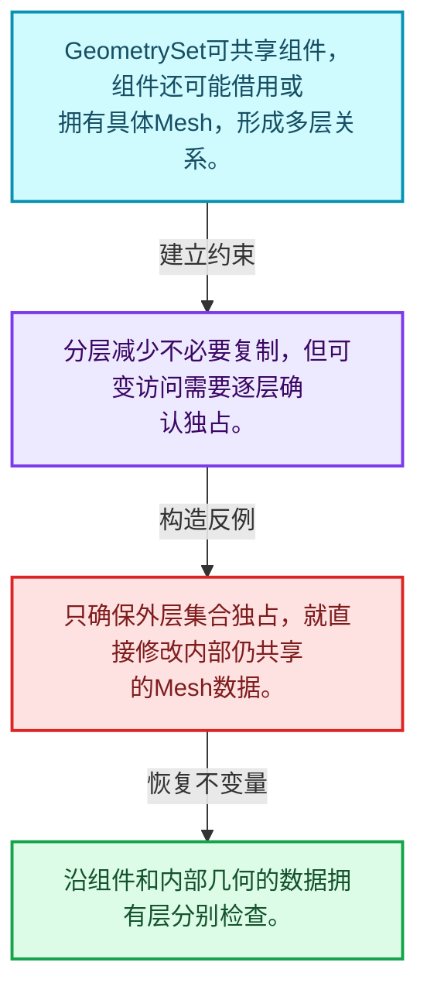
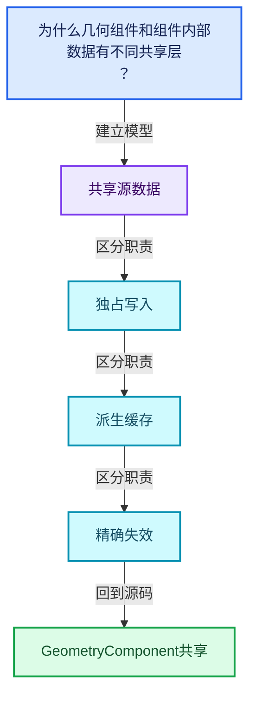
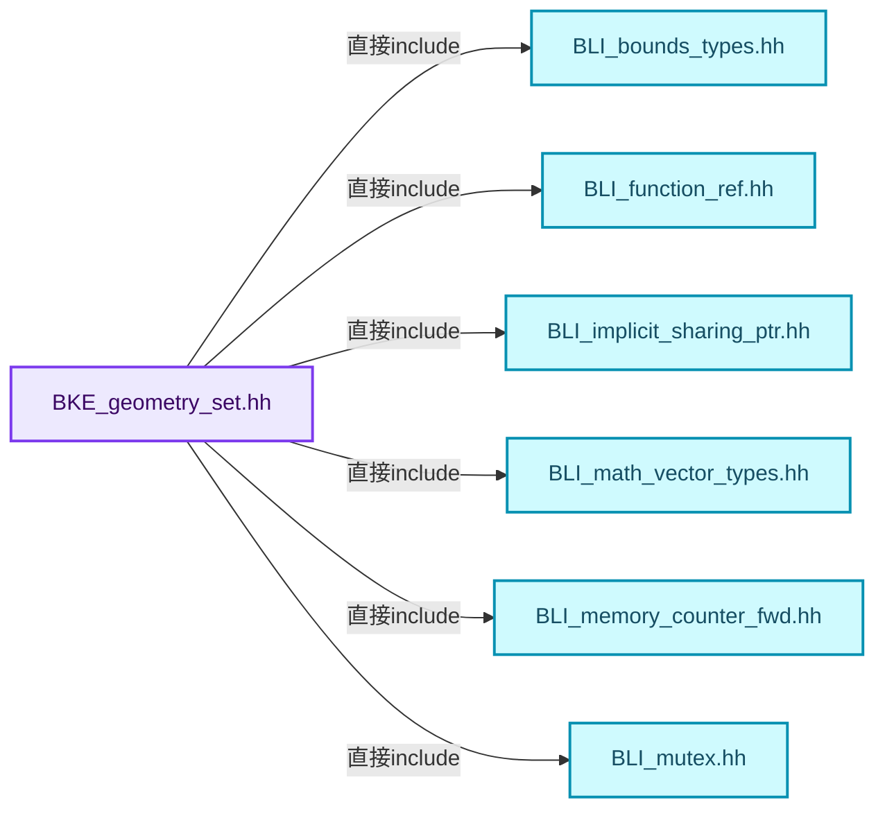
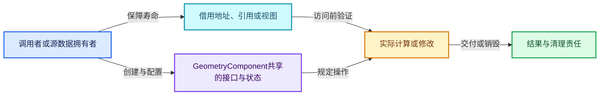
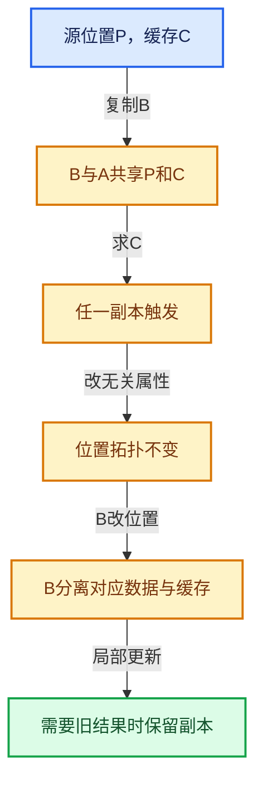

# 06-04 GeometryComponent共享

[方向导航](README.md) · [总目录](../README.md) · [覆盖索引](../%E6%BA%90%E7%A0%81%E7%89%88%E6%9C%AC%E4%B8%8E%E8%A6%86%E7%9B%96%E7%B4%A2%E5%BC%95.md)

> 阅读顺序：问题与数据模型 → 语法与类型 → 源码逐行 → 调用线索 → 历史与取舍 → 推演和练习。

- 基准 HEAD：`cbda6b96c26c0dee3c3b5cbb93960c4ac06a6b30`。
- 记录日期：2026-10-14。
- 教学示例状态：正文中的推演不是本机性能实测；已运行练习见验收报告。

## 一、从问题到设计

为什么几何组件和组件内部数据有不同共享层？

组件身份、底层几何所有权和写时复制可能分层处理；读取接口不能随意绕过写入准备。

本篇把语法、数据语义和系统取舍连接起来。共享计数回答谁还活着，缓存依赖回答结果是否仍正确，两者不能互相替代。

### 本篇独立模型与设计推理

GeometrySet可共享组件，组件还可能借用或拥有具体Mesh，形成多层关系。

设计取舍：分层减少不必要复制，但可变访问需要逐层确认独占。

最小反例：只确保外层集合独占，就直接修改内部仍共享的Mesh数据。

推导与处理：沿组件和内部几何的数据拥有层分别检查。



### 源码范围与相邻篇章

| 文件 | 本篇逐行范围 | 基准SHA-256 |
|---|---|---|
| [source/blender/blenkernel/BKE_geometry_set.hh](../../../../../source/blender/blenkernel/BKE_geometry_set.hh) | L1—L852 | `fefa21b34aecb5c286a34e6229728077d2590eda2641ec2957c0824994a4aa34` |

同一主讲文件可能分多篇覆盖；超出本篇范围的符号通过覆盖索引定位。空行与纯注释保留在源码摘录中，逐行表解释有效语句与语法边界；许可证头统一保留。

前篇：[Mixin与共享指针封装](03-Mixin%E4%B8%8E%E5%85%B1%E4%BA%AB%E6%8C%87%E9%92%88%E5%B0%81%E8%A3%85.md).

后篇：[GeometrySet读写与复制](05-GeometrySet%E8%AF%BB%E5%86%99%E4%B8%8E%E5%A4%8D%E5%88%B6.md).

## 二、类型、数据与阅读地图



这是概念依赖图，边表示阅读关系，不声称是运行时调用顺序。

### 直接编译依赖



箭头只表示头文件包含关系；完整调用线索见后面的符号定位表。

## 三、关键词、语法与类型角色

### 模板 template

模板把类型或常量作为生成实现的参数。读声明时先列出类型参数、非类型参数和默认值，再看使用者实际实例化了什么。模板声明本身不意味着每种T都支持其全部成员。

具体检查：把T替换为int、string、只能移动的类型，分别检查每个被调用操作是否成立。

### 依赖名称 typename

typename既可引入类型模板参数，也可告诉编译器某个依赖名称是类型。它不创建运行时对象；解析期确认语法类别与实例化期检查具体类型是不同阶段。

具体检查：区分typename T::value_type和T::size()，前者标记类型，后者是表达式。

### 常量求值 constexpr

constexpr声明允许相应实体参与常量求值，但constexpr函数仍可以在运行时执行。是否常量求值由调用场景和表达式合法性共同决定。

具体检查：比较constexpr变量初始化和从运行时输入调用同一函数。

### 只读限定 const

const约束当前访问路径可做的修改。const指针、指向const的指针、const视图对象、const元素是不同位置的限定；其他别名可能仍可修改原对象。

具体检查：分别写T* const、const T*与const T* const，并画出不可修改的层次。

### 异常边界 try与catch

try定义异常传播的局部边界。失败路径需要销毁已经成功构造的部分并释放相应存储；未构造的对象不能被析构。

具体检查：在第k次构造失败，列出已经存在的对象集合与待释放缓冲。

### 显式静态转换 static_cast

static_cast表达编译期允许的转换，不会自动验证运行时真实类型、指针寿命或索引边界。由void指针恢复T指针时，调用者仍须保证实际存储中确有合法T对象。

具体检查：标出转换前后的类型以及正确性依据来自哪里。

### 运行时多态 virtual

虚调用根据实际动态类型选择实现；经基类指针销毁对象时通常需要相应虚析构契约。每元素虚调用和循环外一次分派有不同开销。

具体检查：找出虚接口的实现类和调用频率，再讨论是否值得去虚拟化。

### 覆写检查 override

override要求函数确实覆盖基类虚函数，可捕获参数类型和const限定不匹配。它不改变基类规定的生命周期或线程约束。

具体检查：故意改变一个参数或const，观察编译器如何拒绝误写的新函数。

### 可选值 optional

optional把不存在与存在的T区分开，T的构造和析构跟随engaged状态变化。访问前应由has_value或条件分支证明存在。

具体检查：把空Field状态与合法常量零区分，不能用某个普通值代替不存在。

### 构造与new表达式

普通new可能分配并构造；placement new在给定地址构造，存储由其他机制提供。失败回滚应区分两类责任。

具体检查：追踪地址来自哪里、构造何时成功、由谁析构、由谁释放。

### 受控访问 friend

friend授予指定函数或类访问非公开成员的权限，并不意味着继承，也不自动扩展到友元的派生类。

具体检查：解释执行器为何需要访问包装器的内部映射，同时检查边界是否仍清楚。

### 独占拥有 unique_ptr

unique_ptr通过移动转移拥有关系，默认删除策略必须与资源来源匹配。get返回借用指针，release交出责任而不销毁。

具体检查：区分move、get、release和reset后谁负责销毁。

### 类型别名 using

类型别名为已有类型建立名字，不创建运行期对象。它常把模板内部使用的类型统一暴露给泛型调用者。

具体检查：展开别名直到基础类型，区分类型别名和变量声明。

### 枚举与状态模型 enum

枚举把有限状态命名；enum class避免许多隐式整数转换。状态机正确性还依赖允许的转移，不能只看有哪些枚举项。

具体检查：列出每个状态的进入条件和离开条件，检查终止状态是否仍可能被调度。

## 四、真实源码与逐行讲解

源码块保持原行内容，原始行号由小节标题及逐行表给出。表中的调用定位是静态阅读辅助；重载、模板实例化、宏展开和虚调用需结合完整声明，不能仅凭词法出现证明动态调用。

### BKE_geometry_set.hh：L1—L47

<!-- source:source/blender/blenkernel/BKE_geometry_set.hh:1:47 -->

```cpp
/* SPDX-FileCopyrightText: 2023 Blender Authors
 *
 * SPDX-License-Identifier: GPL-2.0-or-later */

#pragma once

/** \file
 * \ingroup bke
 */

#include <iosfwd>
#include <optional>

#include "BLI_bounds_types.hh"
#include "BLI_function_ref.hh"
#include "BLI_implicit_sharing_ptr.hh"
#include "BLI_math_vector_types.hh"
#include "BLI_memory_counter_fwd.hh"
#include "BLI_mutex.hh"
#include "BLI_vector_set.hh"

#include "BKE_attribute.hh"

namespace blender {

struct Curves;
struct Curve;
struct Mesh;
struct PointCloud;
struct Volume;
struct GreasePencil;
namespace bke {
struct AttributeDomainAndType;
class AttributeAccessor;
struct AttributeMetaData;
class CurvesEditHints;
class Instances;
class GeometryComponent;
class GreasePencilEditHints;
class MutableAttributeAccessor;
enum class AttrDomain : int8_t;
struct GizmoEditHints;
}  // namespace bke
namespace nodes {
class Bundle;
using BundlePtr = ImplicitSharingPtr<Bundle>;
}  // namespace nodes
```

| 原始行 | 语义、约束与检查 |
|---|---|
| L5 | 防止同一头文件在一个翻译单元中重复展开；不控制多个源文件之间的链接或对象寿命。 |
| L11 | 引入编译依赖 <iosfwd>；这是声明可见性关系，不表示运行时一定调用该文件的所有接口。 |
| L12 | 引入编译依赖 <optional>；这是声明可见性关系，不表示运行时一定调用该文件的所有接口。 |
| L14 | 引入编译依赖 "BLI_bounds_types.hh"；这是声明可见性关系，不表示运行时一定调用该文件的所有接口。 |
| L15 | 引入编译依赖 "BLI_function_ref.hh"；这是声明可见性关系，不表示运行时一定调用该文件的所有接口。 |
| L16 | 引入编译依赖 "BLI_implicit_sharing_ptr.hh"；这是声明可见性关系，不表示运行时一定调用该文件的所有接口。 |
| L17 | 引入编译依赖 "BLI_math_vector_types.hh"；这是声明可见性关系，不表示运行时一定调用该文件的所有接口。 |
| L18 | 引入编译依赖 "BLI_memory_counter_fwd.hh"；这是声明可见性关系，不表示运行时一定调用该文件的所有接口。 |
| L19 | 引入编译依赖 "BLI_mutex.hh"；这是声明可见性关系，不表示运行时一定调用该文件的所有接口。 |
| L20 | 引入编译依赖 "BLI_vector_set.hh"；这是声明可见性关系，不表示运行时一定调用该文件的所有接口。 |
| L22 | 引入编译依赖 "BKE_attribute.hh"；这是声明可见性关系，不表示运行时一定调用该文件的所有接口。 |
| L24 | 把后续声明放入 blender 命名空间，影响名称查找和符号归属，不创建运行时对象。 |
| L26 | 声明或定义类型 `struct Curves`。结合继承、访问权限和成员布局确认接口与拥有关系；前向声明本身没有完整对象布局。 |
| L27 | 声明或定义类型 `struct Curve`。结合继承、访问权限和成员布局确认接口与拥有关系；前向声明本身没有完整对象布局。 |
| L28 | 声明或定义类型 `struct Mesh`。结合继承、访问权限和成员布局确认接口与拥有关系；前向声明本身没有完整对象布局。 |
| L29 | 声明或定义类型 `struct PointCloud`。结合继承、访问权限和成员布局确认接口与拥有关系；前向声明本身没有完整对象布局。 |
| L30 | 声明或定义类型 `struct Volume`。结合继承、访问权限和成员布局确认接口与拥有关系；前向声明本身没有完整对象布局。 |
| L31 | 声明或定义类型 `struct GreasePencil`。结合继承、访问权限和成员布局确认接口与拥有关系；前向声明本身没有完整对象布局。 |
| L32 | 把后续声明放入 bke 命名空间，影响名称查找和符号归属，不创建运行时对象。 |
| L33 | 声明或定义类型 `struct AttributeDomainAndType`。结合继承、访问权限和成员布局确认接口与拥有关系；前向声明本身没有完整对象布局。 |
| L34 | 声明或定义类型 `class AttributeAccessor`。结合继承、访问权限和成员布局确认接口与拥有关系；前向声明本身没有完整对象布局。 |
| L35 | 声明或定义类型 `struct AttributeMetaData`。结合继承、访问权限和成员布局确认接口与拥有关系；前向声明本身没有完整对象布局。 |
| L36 | 声明或定义类型 `class CurvesEditHints`。结合继承、访问权限和成员布局确认接口与拥有关系；前向声明本身没有完整对象布局。 |
| L37 | 声明或定义类型 `class Instances`。结合继承、访问权限和成员布局确认接口与拥有关系；前向声明本身没有完整对象布局。 |
| L38 | 声明或定义类型 `class GeometryComponent`。结合继承、访问权限和成员布局确认接口与拥有关系；前向声明本身没有完整对象布局。 |
| L39 | 声明或定义类型 `class GreasePencilEditHints`。结合继承、访问权限和成员布局确认接口与拥有关系；前向声明本身没有完整对象布局。 |
| L40 | 声明或定义类型 `class MutableAttributeAccessor`。结合继承、访问权限和成员布局确认接口与拥有关系；前向声明本身没有完整对象布局。 |
| L41 | 声明或定义类型 `enum class AttrDomain : int8_t`。结合继承、访问权限和成员布局确认接口与拥有关系；前向声明本身没有完整对象布局。 |
| L42 | 声明或定义类型 `struct GizmoEditHints`。结合继承、访问权限和成员布局确认接口与拥有关系；前向声明本身没有完整对象布局。 |
| L43 | 结束当前语法单元。局部自动对象在离开其作用域时按规则销毁；这不等于所有被引用的外部数据也被释放。 |
| L44 | 把后续声明放入 nodes 命名空间，影响名称查找和符号归属，不创建运行时对象。 |
| L45 | 声明或定义类型 `class Bundle`。结合继承、访问权限和成员布局确认接口与拥有关系；前向声明本身没有完整对象布局。 |
| L46 | 定义类型别名 `using BundlePtr = ImplicitSharingPtr<Bundle>`，为模板接口或内部实现统一命名；本行不分配该类型对象。 |
| L47 | 结束当前语法单元。局部自动对象在离开其作用域时按规则销毁；这不等于所有被引用的外部数据也被释放。 |

### BKE_geometry_set.hh：L48—L95

<!-- source:source/blender/blenkernel/BKE_geometry_set.hh:48:95 -->

```cpp

namespace bke {

#define GEO_COMPONENT_TYPE_ENUM_SIZE 7

enum class GeometryOwnershipType {
  /* The geometry is owned. This implies that it can be changed. */
  Owned = 0,
  /* The geometry can be changed, but someone else is responsible for freeing it. */
  Editable = 1,
  /* The geometry cannot be changed and someone else is responsible for freeing it. */
  ReadOnly = 2,
};

using GeometryComponentPtr = ImplicitSharingPtr<GeometryComponent>;

/**
 * This is the base class for specialized geometry component types. A geometry component uses
 * implicit sharing to avoid read-only copies. It also integrates with attribute API, which
 * generalizes storing and modifying generic information on a geometry.
 */
class GeometryComponent : public ImplicitSharingMixin {
 public:
  /**
   * Each geometry component has a specific type. The type determines what kind of data the
   * component stores. Functions modifying a geometry will usually just modify a subset of the
   * component types.
   * \note These values are stored in files, so they should not be reordered.
   */
  enum class Type {
    Mesh = 0,
    PointCloud = 1,
    Instance = 2,
    Volume = 3,
    Curve = 4,
    Edit = 5,
    GreasePencil = 6,
  };

 private:
  Type type_;

 public:
  GeometryComponent(Type type);
  ~GeometryComponent() override = default;
  static GeometryComponentPtr create(Type component_type);

  int attribute_domain_size(AttrDomain domain) const;
```

| 原始行 | 语义、约束与检查 |
|---|---|
| L49 | 把后续声明放入 bke 命名空间，影响名称查找和符号归属，不创建运行时对象。 |
| L51 | 预处理阶段处理 #define GEO_COMPONENT_TYPE_ENUM_SIZE 7。它决定哪些代码进入编译，不是运行时分支；阅读行为时必须结合实际构建宏。 |
| L53 | 声明或定义类型 `enum class GeometryOwnershipType`。结合继承、访问权限和成员布局确认接口与拥有关系；前向声明本身没有完整对象布局。 |
| L55 | 把右侧 `0,` 用于初始化或更新左侧 `Owned`。声明初始化与已有对象赋值应按上下文区分；有资源的类型会调用相应特殊成员。 |
| L57 | 把右侧 `1,` 用于初始化或更新左侧 `Editable`。声明初始化与已有对象赋值应按上下文区分；有资源的类型会调用相应特殊成员。 |
| L59 | 把右侧 `2,` 用于初始化或更新左侧 `ReadOnly`。声明初始化与已有对象赋值应按上下文区分；有资源的类型会调用相应特殊成员。 |
| L60 | 结束当前语法单元。局部自动对象在离开其作用域时按规则销毁；这不等于所有被引用的外部数据也被释放。 |
| L62 | 定义类型别名 `using GeometryComponentPtr = ImplicitSharingPtr<GeometryComponent>`，为模板接口或内部实现统一命名；本行不分配该类型对象。 |
| L69 | 声明或定义类型 `class GeometryComponent : public ImplicitSharingMixin`。结合继承、访问权限和成员布局确认接口与拥有关系；前向声明本身没有完整对象布局。 |
| L70 | 切换成员访问权限为 public；它是编译期接口边界，不是线程同步或内存保护。 |
| L77 | 声明或定义类型 `enum class Type`。结合继承、访问权限和成员布局确认接口与拥有关系；前向声明本身没有完整对象布局。 |
| L78 | 把右侧 `0,` 用于初始化或更新左侧 `Mesh`。声明初始化与已有对象赋值应按上下文区分；有资源的类型会调用相应特殊成员。 |
| L79 | 把右侧 `1,` 用于初始化或更新左侧 `PointCloud`。声明初始化与已有对象赋值应按上下文区分；有资源的类型会调用相应特殊成员。 |
| L80 | 把右侧 `2,` 用于初始化或更新左侧 `Instance`。声明初始化与已有对象赋值应按上下文区分；有资源的类型会调用相应特殊成员。 |
| L81 | 把右侧 `3,` 用于初始化或更新左侧 `Volume`。声明初始化与已有对象赋值应按上下文区分；有资源的类型会调用相应特殊成员。 |
| L82 | 把右侧 `4,` 用于初始化或更新左侧 `Curve`。声明初始化与已有对象赋值应按上下文区分；有资源的类型会调用相应特殊成员。 |
| L83 | 把右侧 `5,` 用于初始化或更新左侧 `Edit`。声明初始化与已有对象赋值应按上下文区分；有资源的类型会调用相应特殊成员。 |
| L84 | 把右侧 `6,` 用于初始化或更新左侧 `GreasePencil`。声明初始化与已有对象赋值应按上下文区分；有资源的类型会调用相应特殊成员。 |
| L85 | 结束当前语法单元。局部自动对象在离开其作用域时按规则销毁；这不等于所有被引用的外部数据也被释放。 |
| L87 | 切换成员访问权限为 private；它是编译期接口边界，不是线程同步或内存保护。 |
| L88 | 声明成员、局部对象或完成语句 `Type type_`。若为指针或引用，它本身不说明拥有；若为值对象，其构造析构由所在作用域或外层对象管理。 |
| L90 | 切换成员访问权限为 public；它是编译期接口边界，不是线程同步或内存保护。 |
| L91 | 出现调用或函数声明 `GeometryComponent`，对应表达式为 `GeometryComponent(Type type);`。参数求值、返回类型与重载需结合前后完整语句；静态文本引用不能证明动态目标。 |
| L92 | 显式采用编译器生成的特殊成员行为：`~GeometryComponent() override = default;`。成员和基类的性质决定该操作是否可用、是否被删除及异常约定，不表示运行时给对象赋值为default。 |
| L93 | 声明接口 `static GeometryComponentPtr create(Type component_type)`，本行没有对应函数体；返回类型、参数限定和const/noexcept共同组成调用契约，实际行为需继续定位实现。 |
| L95 | 声明接口 `int attribute_domain_size(AttrDomain domain) const`，本行没有对应函数体；返回类型、参数限定和const/noexcept共同组成调用契约，实际行为需继续定位实现。 |

### BKE_geometry_set.hh：L96—L152

<!-- source:source/blender/blenkernel/BKE_geometry_set.hh:96:152 -->

```cpp

  /**
   * Get access to the attributes in this geometry component. May return none if the geometry does
   * not support the attribute system.
   */
  virtual std::optional<AttributeAccessor> attributes() const;
  virtual std::optional<MutableAttributeAccessor> attributes_for_write();

  virtual void count_memory(MemoryCounter &memory) const;

  /**
   * Copies the component. The returned component only has a single user and is therefor mutable.
   */
  virtual GeometryComponentPtr copy() const = 0;

  /** Remove referenced data from the geometry component. */
  virtual void clear() = 0;

  /* Direct data is everything except for instances of objects/collections.
   * If this returns true, the geometry set can be cached and is still valid after e.g. modifier
   * evaluation ends. Instances can only be valid as long as the data they instance is valid. */
  virtual bool owns_direct_data() const = 0;
  virtual void ensure_owns_direct_data() = 0;

  Type type() const;

  virtual bool is_empty() const;

 private:
  void delete_self() override;
  void delete_data_only() override;
};

template<typename T>
inline constexpr bool is_geometry_component_v = std::is_base_of_v<GeometryComponent, T>;

/**
 * A geometry set is a container for multiple kinds of geometry. It does not own geometry directly
 * itself, instead geometry is owned by multiple #GeometryComponents, and the geometry set
 * increases the user count of each component, so they avoid losing the data. This means
 * individual components might be shared between multiple geometries and other code. Shared
 * components are copied automatically when write access is requested.
 *
 * The components usually do not store data directly, but keep a reference to a data
 * structure defined elsewhere. There is at most one component of each type:
 *  - #MeshComponent
 *  - #CurveComponent
 *  - #PointCloudComponent
 *  - #InstancesComponent
 *  - #VolumeComponent
 *  - #GreasePencilComponent
 *
 * Copying a geometry set is a relatively cheap operation, because it does not copy the referenced
 * geometry components, so #GeometrySet can often be passed or moved by value.
 */
struct GeometrySet {
 private:
```

| 原始行 | 语义、约束与检查 |
|---|---|
| L101 | 声明接口 `virtual std::optional<AttributeAccessor> attributes() const`，本行没有对应函数体；返回类型、参数限定和const/noexcept共同组成调用契约，实际行为需继续定位实现。 |
| L102 | 声明接口 `virtual std::optional<MutableAttributeAccessor> attributes_for_write()`，本行没有对应函数体；返回类型、参数限定和const/noexcept共同组成调用契约，实际行为需继续定位实现。 |
| L104 | 声明接口 `virtual void count_memory(MemoryCounter &memory) const`，本行没有对应函数体；返回类型、参数限定和const/noexcept共同组成调用契约，实际行为需继续定位实现。 |
| L109 | 纯虚接口声明：`virtual GeometryComponentPtr copy() const = 0;`。等号零标记抽象接口，需要按继承约定提供覆写；不表示执行函数并把结果设为零。 |
| L112 | 纯虚接口声明：`virtual void clear() = 0;`。等号零标记抽象接口，需要按继承约定提供覆写；不表示执行函数并把结果设为零。 |
| L117 | 纯虚接口声明：`virtual bool owns_direct_data() const = 0;`。等号零标记抽象接口，需要按继承约定提供覆写；不表示执行函数并把结果设为零。 |
| L118 | 纯虚接口声明：`virtual void ensure_owns_direct_data() = 0;`。等号零标记抽象接口，需要按继承约定提供覆写；不表示执行函数并把结果设为零。 |
| L120 | 声明接口 `Type type() const`，本行没有对应函数体；返回类型、参数限定和const/noexcept共同组成调用契约，实际行为需继续定位实现。 |
| L122 | 声明接口 `virtual bool is_empty() const`，本行没有对应函数体；返回类型、参数限定和const/noexcept共同组成调用契约，实际行为需继续定位实现。 |
| L124 | 切换成员访问权限为 private；它是编译期接口边界，不是线程同步或内存保护。 |
| L125 | 声明接口 `void delete_self() override`，本行没有对应函数体；返回类型、参数限定和const/noexcept共同组成调用契约，实际行为需继续定位实现。 |
| L126 | 声明接口 `void delete_data_only() override`，本行没有对应函数体；返回类型、参数限定和const/noexcept共同组成调用契约，实际行为需继续定位实现。 |
| L127 | 结束当前语法单元。局部自动对象在离开其作用域时按规则销毁；这不等于所有被引用的外部数据也被释放。 |
| L129 | 声明模板参数 `template<typename T>`。类型参数决定生成操作的类型，非类型参数可决定内嵌容量或编译期分支。 |
| L130 | 把右侧 `std::is_base_of_v<GeometryComponent, T>` 用于初始化或更新左侧 `inline constexpr bool is_geometry_component_v`。声明初始化与已有对象赋值应按上下文区分；有资源的类型会调用相应特殊成员。 |
| L151 | 声明或定义类型 `struct GeometrySet`。结合继承、访问权限和成员布局确认接口与拥有关系；前向声明本身没有完整对象布局。 |
| L152 | 切换成员访问权限为 private；它是编译期接口边界，不是线程同步或内存保护。 |

### BKE_geometry_set.hh：L153—L199

<!-- source:source/blender/blenkernel/BKE_geometry_set.hh:153:199 -->

```cpp
  /* Indexed by #GeometryComponent::Type. */
  std::array<GeometryComponentPtr, GEO_COMPONENT_TYPE_ENUM_SIZE> components_;
  nodes::BundlePtr bundle_;

  /**
   * A user defined name for this geometry. It is not expected to be unique. Its main
   * purpose is help debugging instance trees. It may eventually also be used when exporting
   * instance trees or when creating separate objects from them.
   */
  std::string name_;

 public:
  /**
   * The methods are defaulted here so that they are not instantiated in every translation unit.
   */
  GeometrySet();
  GeometrySet(const GeometrySet &other);
  GeometrySet(GeometrySet &&other);
  ~GeometrySet();
  GeometrySet &operator=(const GeometrySet &other);
  GeometrySet &operator=(GeometrySet &&other);

  /**
   * This method can only be used when the geometry set is mutable. It returns a mutable geometry
   * component of the given type.
   */
  GeometryComponent &get_component_for_write(GeometryComponent::Type component_type);
  template<typename Component> Component &get_component_for_write()
  {
    BLI_STATIC_ASSERT(is_geometry_component_v<Component>, "");
    return static_cast<Component &>(this->get_component_for_write(Component::static_type));
  }

  GeometryComponentPtr get_component_ptr(GeometryComponent::Type component_type) const
  {
    return components_[int(component_type)];
  }

  /**
   * Get the component of the given type. Might return null if the component does not exist yet.
   */
  const GeometryComponent *get_component(GeometryComponent::Type component_type) const;
  template<typename Component> const Component *get_component() const
  {
    BLI_STATIC_ASSERT(is_geometry_component_v<Component>, "");
    return static_cast<const Component *>(get_component(Component::static_type));
  }
```

| 原始行 | 语义、约束与检查 |
|---|---|
| L154 | 声明成员、局部对象或完成语句 `std::array<GeometryComponentPtr, GEO_COMPONENT_TYPE_ENUM_SIZE> components_`。若为指针或引用，它本身不说明拥有；若为值对象，其构造析构由所在作用域或外层对象管理。 |
| L155 | 声明成员、局部对象或完成语句 `nodes::BundlePtr bundle_`。若为指针或引用，它本身不说明拥有；若为值对象，其构造析构由所在作用域或外层对象管理。 |
| L162 | 声明成员、局部对象或完成语句 `std::string name_`。若为指针或引用，它本身不说明拥有；若为值对象，其构造析构由所在作用域或外层对象管理。 |
| L164 | 切换成员访问权限为 public；它是编译期接口边界，不是线程同步或内存保护。 |
| L168 | 出现调用或函数声明 `GeometrySet`，对应表达式为 `GeometrySet();`。参数求值、返回类型与重载需结合前后完整语句；静态文本引用不能证明动态目标。 |
| L169 | 出现调用或函数声明 `GeometrySet`，对应表达式为 `GeometrySet(const GeometrySet &other);`。参数求值、返回类型与重载需结合前后完整语句；静态文本引用不能证明动态目标。 |
| L170 | 出现调用或函数声明 `GeometrySet`，对应表达式为 `GeometrySet(GeometrySet &&other);`。参数求值、返回类型与重载需结合前后完整语句；静态文本引用不能证明动态目标。 |
| L171 | 涉及析构接口或显式析构：`~GeometrySet();`。检查目标对象已成功构造，且资源不会在另一条清理路径再次销毁。 |
| L172 | 运算符重载声明、定义或显式调用：`GeometrySet &operator=(const GeometrySet &other);`。结合参数和返回类型判断是赋值、索引、比较还是转换；operator=声明中的等号不是在给名为operator的变量赋值。 |
| L173 | 运算符重载声明、定义或显式调用：`GeometrySet &operator=(GeometrySet &&other);`。结合参数和返回类型判断是赋值、索引、比较还是转换；operator=声明中的等号不是在给名为operator的变量赋值。 |
| L179 | 出现调用或函数声明 `get_component_for_write`，对应表达式为 `GeometryComponent &get_component_for_write(GeometryComponent::Type component_type);`。参数求值、返回类型与重载需结合前后完整语句；静态文本引用不能证明动态目标。 |
| L180 | 声明模板参数 `template<typename Component> Component &get_component_for_write()`。类型参数决定生成操作的类型，非类型参数可决定内嵌容量或编译期分支。 |
| L181 | 连接上一行的声明或控制结构与其语句块；后续行在这个作用域中执行或声明。 |
| L182 | 出现调用或函数声明 `BLI_STATIC_ASSERT`，对应表达式为 `BLI_STATIC_ASSERT(is_geometry_component_v<Component>, "");`。参数求值、返回类型与重载需结合前后完整语句；静态文本引用不能证明动态目标。 |
| L183 | 返回表达式 `static_cast<Component &>(this->get_component_for_write(Component::static_type))`。 |
| L184 | 结束当前语法单元。局部自动对象在离开其作用域时按规则销毁；这不等于所有被引用的外部数据也被释放。 |
| L186 | 出现调用或函数声明 `get_component_ptr`，对应表达式为 `GeometryComponentPtr get_component_ptr(GeometryComponent::Type component_type) const`。参数求值、返回类型与重载需结合前后完整语句；静态文本引用不能证明动态目标。 |
| L187 | 连接上一行的声明或控制结构与其语句块；后续行在这个作用域中执行或声明。 |
| L188 | 返回表达式 `components_[int(component_type)]`。 |
| L189 | 结束当前语法单元。局部自动对象在离开其作用域时按规则销毁；这不等于所有被引用的外部数据也被释放。 |
| L194 | 声明接口 `const GeometryComponent *get_component(GeometryComponent::Type component_type) const`，本行没有对应函数体；返回类型、参数限定和const/noexcept共同组成调用契约，实际行为需继续定位实现。 |
| L195 | 声明模板参数 `template<typename Component> const Component *get_component() const`。类型参数决定生成操作的类型，非类型参数可决定内嵌容量或编译期分支。 |
| L196 | 连接上一行的声明或控制结构与其语句块；后续行在这个作用域中执行或声明。 |
| L197 | 出现调用或函数声明 `BLI_STATIC_ASSERT`，对应表达式为 `BLI_STATIC_ASSERT(is_geometry_component_v<Component>, "");`。参数求值、返回类型与重载需结合前后完整语句；静态文本引用不能证明动态目标。 |
| L198 | 返回表达式 `static_cast<const Component *>(get_component(Component::static_type))`。 |
| L199 | 结束当前语法单元。局部自动对象在离开其作用域时按规则销毁；这不等于所有被引用的外部数据也被释放。 |

### BKE_geometry_set.hh：L200—L249

<!-- source:source/blender/blenkernel/BKE_geometry_set.hh:200:249 -->

```cpp

  bool has(const GeometryComponent::Type component_type) const;
  template<typename Component> bool has() const
  {
    BLI_STATIC_ASSERT(is_geometry_component_v<Component>, "");
    return this->has(Component::static_type);
  }

  template<typename Component> bool has_component() const
  {
    BLI_STATIC_ASSERT(is_geometry_component_v<Component>, "");
    return components_[int(Component::static_type)];
  }

  void remove(const GeometryComponent::Type component_type);
  template<typename Component> void remove()
  {
    BLI_STATIC_ASSERT(is_geometry_component_v<Component>, "");
    return this->remove(Component::static_type);
  }

  /**
   * Remove all geometry components with types that are not in the provided list.
   */
  void keep_only(Span<GeometryComponent::Type> component_types);

  void add(const GeometryComponent &component);

  /**
   * Get all geometry components in this geometry set for read-only access.
   */
  Vector<const GeometryComponent *> get_components() const;

  std::optional<Bounds<float3>> compute_boundbox_without_instances(bool use_radius = true,
                                                                   bool use_subdiv = false) const;

  friend std::ostream &operator<<(std::ostream &stream, const GeometrySet &geometry_set);

  /**
   * Remove all geometry components from the geometry set.
   */
  void clear();

  bool owns_direct_data() const;
  /**
   * Make sure that the geometry can be cached. This does not ensure ownership of object/collection
   * instances. This is necessary because sometimes components only have read-only or editing
   * access to their data, which might be freed later if this geometry set outlasts the data.
   */
  void ensure_owns_direct_data();
```

| 原始行 | 语义、约束与检查 |
|---|---|
| L201 | 声明接口 `bool has(const GeometryComponent::Type component_type) const`，本行没有对应函数体；返回类型、参数限定和const/noexcept共同组成调用契约，实际行为需继续定位实现。 |
| L202 | 声明模板参数 `template<typename Component> bool has() const`。类型参数决定生成操作的类型，非类型参数可决定内嵌容量或编译期分支。 |
| L203 | 连接上一行的声明或控制结构与其语句块；后续行在这个作用域中执行或声明。 |
| L204 | 出现调用或函数声明 `BLI_STATIC_ASSERT`，对应表达式为 `BLI_STATIC_ASSERT(is_geometry_component_v<Component>, "");`。参数求值、返回类型与重载需结合前后完整语句；静态文本引用不能证明动态目标。 |
| L205 | 返回表达式 `this->has(Component::static_type)`。 |
| L206 | 结束当前语法单元。局部自动对象在离开其作用域时按规则销毁；这不等于所有被引用的外部数据也被释放。 |
| L208 | 声明模板参数 `template<typename Component> bool has_component() const`。类型参数决定生成操作的类型，非类型参数可决定内嵌容量或编译期分支。 |
| L209 | 连接上一行的声明或控制结构与其语句块；后续行在这个作用域中执行或声明。 |
| L210 | 出现调用或函数声明 `BLI_STATIC_ASSERT`，对应表达式为 `BLI_STATIC_ASSERT(is_geometry_component_v<Component>, "");`。参数求值、返回类型与重载需结合前后完整语句；静态文本引用不能证明动态目标。 |
| L211 | 返回表达式 `components_[int(Component::static_type)]`。 |
| L212 | 结束当前语法单元。局部自动对象在离开其作用域时按规则销毁；这不等于所有被引用的外部数据也被释放。 |
| L214 | 声明接口 `void remove(const GeometryComponent::Type component_type)`，本行没有对应函数体；返回类型、参数限定和const/noexcept共同组成调用契约，实际行为需继续定位实现。 |
| L215 | 声明模板参数 `template<typename Component> void remove()`。类型参数决定生成操作的类型，非类型参数可决定内嵌容量或编译期分支。 |
| L216 | 连接上一行的声明或控制结构与其语句块；后续行在这个作用域中执行或声明。 |
| L217 | 出现调用或函数声明 `BLI_STATIC_ASSERT`，对应表达式为 `BLI_STATIC_ASSERT(is_geometry_component_v<Component>, "");`。参数求值、返回类型与重载需结合前后完整语句；静态文本引用不能证明动态目标。 |
| L218 | 返回表达式 `this->remove(Component::static_type)`。 |
| L219 | 结束当前语法单元。局部自动对象在离开其作用域时按规则销毁；这不等于所有被引用的外部数据也被释放。 |
| L224 | 声明接口 `void keep_only(Span<GeometryComponent::Type> component_types)`，本行没有对应函数体；返回类型、参数限定和const/noexcept共同组成调用契约，实际行为需继续定位实现。 |
| L226 | 声明接口 `void add(const GeometryComponent &component)`，本行没有对应函数体；返回类型、参数限定和const/noexcept共同组成调用契约，实际行为需继续定位实现。 |
| L231 | 声明接口 `Vector<const GeometryComponent *> get_components() const`，本行没有对应函数体；返回类型、参数限定和const/noexcept共同组成调用契约，实际行为需继续定位实现。 |
| L233 | 把右侧 `true,` 用于初始化或更新左侧 `std::optional<Bounds<float3>> compute_boundbox_without_instances(bool use_radius`。声明初始化与已有对象赋值应按上下文区分；有资源的类型会调用相应特殊成员。 |
| L234 | 把右侧 `false) const` 用于初始化或更新左侧 `bool use_subdiv`。声明初始化与已有对象赋值应按上下文区分；有资源的类型会调用相应特殊成员。 |
| L236 | 运算符重载声明、定义或显式调用：`friend std::ostream &operator<<(std::ostream &stream, const GeometrySet &geometry_set);`。结合参数和返回类型判断是赋值、索引、比较还是转换；operator=声明中的等号不是在给名为operator的变量赋值。 |
| L241 | 声明接口 `void clear()`，本行没有对应函数体；返回类型、参数限定和const/noexcept共同组成调用契约，实际行为需继续定位实现。 |
| L243 | 声明接口 `bool owns_direct_data() const`，本行没有对应函数体；返回类型、参数限定和const/noexcept共同组成调用契约，实际行为需继续定位实现。 |
| L249 | 声明接口 `void ensure_owns_direct_data()`，本行没有对应函数体；返回类型、参数限定和const/noexcept共同组成调用契约，实际行为需继续定位实现。 |

### BKE_geometry_set.hh：L250—L299

<!-- source:source/blender/blenkernel/BKE_geometry_set.hh:250:299 -->

```cpp
  /**
   * Same as #ensure_owns_direct_data but also turns object/collection instances into geometry
   * instances so that they can be owned.
   */
  void ensure_owns_all_data();
  /**
   * Typically, multiple #GeometrySet may share the same #GeometryComponent. This is fine as long
   * as we can guarantee that the data is read-only. However, if some geometry is available in
   * Python, that guarantee is not possible currently. For that case it can make sense that the
   * #GeometrySet is the unique owner of the geometries it contains.
   */
  void ensure_no_shared_components();

  using AttributeForeachCallback = FunctionRef<void(
      StringRef name, const AttributeMetaData &meta_data, const GeometryComponent &component)>;

  void attribute_foreach(Span<GeometryComponent::Type> component_types,
                         bool include_instances,
                         AttributeForeachCallback callback) const;

  struct GatheredAttributes {
    VectorSet<StringRef, 16> names;
    Vector<AttributeDomainAndType, 16> kinds;
    void add(const StringRef name, const AttributeDomainAndType &kind);
  };

  Vector<GeometryComponent::Type> gather_component_types(bool include_instances,
                                                         bool ignore_empty) const;

  /* Utility methods for creation. */
  /**
   * Create a new geometry set that only contains the given mesh.
   */
  static GeometrySet from_mesh(Mesh *mesh,
                               GeometryOwnershipType ownership = GeometryOwnershipType::Owned);
  /**
   * Create a new geometry set that only contains the given volume.
   */
  static GeometrySet from_volume(Volume *volume,
                                 GeometryOwnershipType ownership = GeometryOwnershipType::Owned);
  /**
   * Create a new geometry set that only contains the given point cloud.
   */
  static GeometrySet from_pointcloud(
      PointCloud *pointcloud, GeometryOwnershipType ownership = GeometryOwnershipType::Owned);
  /**
   * Create a new geometry set that only contains the given curves.
   */
  static GeometrySet from_curves(Curves *curves,
                                 GeometryOwnershipType ownership = GeometryOwnershipType::Owned);
```

| 原始行 | 语义、约束与检查 |
|---|---|
| L254 | 声明接口 `void ensure_owns_all_data()`，本行没有对应函数体；返回类型、参数限定和const/noexcept共同组成调用契约，实际行为需继续定位实现。 |
| L261 | 声明接口 `void ensure_no_shared_components()`，本行没有对应函数体；返回类型、参数限定和const/noexcept共同组成调用契约，实际行为需继续定位实现。 |
| L263 | 定义类型别名 `using AttributeForeachCallback = FunctionRef<void(`，为模板接口或内部实现统一命名；本行不分配该类型对象。 |
| L264 | 声明成员、局部对象或完成语句 `StringRef name, const AttributeMetaData &meta_data, const GeometryComponent &component)>`。若为指针或引用，它本身不说明拥有；若为值对象，其构造析构由所在作用域或外层对象管理。 |
| L266 | 出现调用或函数声明 `attribute_foreach`，对应表达式为 `void attribute_foreach(Span<GeometryComponent::Type> component_types,`。参数求值、返回类型与重载需结合前后完整语句；静态文本引用不能证明动态目标。 |
| L267 | 本行是连续声明或表达式的一部分：`bool include_instances,`。与本段前后行合读；逗号、括号和限定符决定它属于参数、初始化列表还是实际计算。 |
| L268 | 声明成员、局部对象或完成语句 `AttributeForeachCallback callback) const`。若为指针或引用，它本身不说明拥有；若为值对象，其构造析构由所在作用域或外层对象管理。 |
| L270 | 声明或定义类型 `struct GatheredAttributes`。结合继承、访问权限和成员布局确认接口与拥有关系；前向声明本身没有完整对象布局。 |
| L271 | 声明成员、局部对象或完成语句 `VectorSet<StringRef, 16> names`。若为指针或引用，它本身不说明拥有；若为值对象，其构造析构由所在作用域或外层对象管理。 |
| L272 | 声明成员、局部对象或完成语句 `Vector<AttributeDomainAndType, 16> kinds`。若为指针或引用，它本身不说明拥有；若为值对象，其构造析构由所在作用域或外层对象管理。 |
| L273 | 声明接口 `void add(const StringRef name, const AttributeDomainAndType &kind)`，本行没有对应函数体；返回类型、参数限定和const/noexcept共同组成调用契约，实际行为需继续定位实现。 |
| L274 | 结束当前语法单元。局部自动对象在离开其作用域时按规则销毁；这不等于所有被引用的外部数据也被释放。 |
| L276 | 出现调用或函数声明 `gather_component_types`，对应表达式为 `Vector<GeometryComponent::Type> gather_component_types(bool include_instances,`。参数求值、返回类型与重载需结合前后完整语句；静态文本引用不能证明动态目标。 |
| L277 | 声明成员、局部对象或完成语句 `bool ignore_empty) const`。若为指针或引用，它本身不说明拥有；若为值对象，其构造析构由所在作用域或外层对象管理。 |
| L283 | 出现调用或函数声明 `from_mesh`，对应表达式为 `static GeometrySet from_mesh(Mesh *mesh,`。参数求值、返回类型与重载需结合前后完整语句；静态文本引用不能证明动态目标。 |
| L284 | 把右侧 `GeometryOwnershipType::Owned)` 用于初始化或更新左侧 `GeometryOwnershipType ownership`。声明初始化与已有对象赋值应按上下文区分；有资源的类型会调用相应特殊成员。 |
| L288 | 出现调用或函数声明 `from_volume`，对应表达式为 `static GeometrySet from_volume(Volume *volume,`。参数求值、返回类型与重载需结合前后完整语句；静态文本引用不能证明动态目标。 |
| L289 | 把右侧 `GeometryOwnershipType::Owned)` 用于初始化或更新左侧 `GeometryOwnershipType ownership`。声明初始化与已有对象赋值应按上下文区分；有资源的类型会调用相应特殊成员。 |
| L293 | 出现调用或函数声明 `from_pointcloud`，对应表达式为 `static GeometrySet from_pointcloud(`。参数求值、返回类型与重载需结合前后完整语句；静态文本引用不能证明动态目标。 |
| L294 | 把右侧 `GeometryOwnershipType::Owned)` 用于初始化或更新左侧 `PointCloud *pointcloud, GeometryOwnershipType ownership`。声明初始化与已有对象赋值应按上下文区分；有资源的类型会调用相应特殊成员。 |
| L298 | 出现调用或函数声明 `from_curves`，对应表达式为 `static GeometrySet from_curves(Curves *curves,`。参数求值、返回类型与重载需结合前后完整语句；静态文本引用不能证明动态目标。 |
| L299 | 把右侧 `GeometryOwnershipType::Owned)` 用于初始化或更新左侧 `GeometryOwnershipType ownership`。声明初始化与已有对象赋值应按上下文区分；有资源的类型会调用相应特殊成员。 |

### BKE_geometry_set.hh：L300—L349

<!-- source:source/blender/blenkernel/BKE_geometry_set.hh:300:349 -->

```cpp
  /**
   * Create a new geometry set that only contains the given instances.
   */
  static GeometrySet from_instances(std::unique_ptr<Instances> instances);
  static GeometrySet from_instances(
      Instances *instances, GeometryOwnershipType ownership = GeometryOwnershipType::Owned);
  /**
   * Create a new geometry set that only contains the given Grease Pencil data.
   */
  static GeometrySet from_grease_pencil(
      GreasePencil *grease_pencil, GeometryOwnershipType ownership = GeometryOwnershipType::Owned);

  /* Utility methods for access. */
  /**
   * Returns true when the geometry set has a mesh component that has a mesh.
   */
  bool has_mesh() const;
  /**
   * Returns true when the geometry set has a point cloud component that has a point cloud.
   */
  bool has_pointcloud() const;
  /**
   * Returns true when the geometry set has an instances component that has at least one instance.
   */
  bool has_instances() const;
  /**
   * Returns true when the geometry set has a volume component that has a volume.
   */
  bool has_volume() const;
  /**
   * Returns true when the geometry set has a curves component that has a curves data-block.
   */
  bool has_curves() const;
  /**
   * Returns true when the geometry set has any data that is not an instance.
   */
  bool has_realized_data() const;
  /**
   * Returns true when the geometry set has a Grease Pencil component that has grease pencil data.
   */
  bool has_grease_pencil() const;
  /**
   * Return true if the geometry set has any component that isn't empty.
   */
  bool is_empty() const;

  /**
   * Returns a read-only mesh or null.
   */
  const Mesh *get_mesh() const;
```

| 原始行 | 语义、约束与检查 |
|---|---|
| L303 | 声明接口 `static GeometrySet from_instances(std::unique_ptr<Instances> instances)`，本行没有对应函数体；返回类型、参数限定和const/noexcept共同组成调用契约，实际行为需继续定位实现。 |
| L304 | 出现调用或函数声明 `from_instances`，对应表达式为 `static GeometrySet from_instances(`。参数求值、返回类型与重载需结合前后完整语句；静态文本引用不能证明动态目标。 |
| L305 | 把右侧 `GeometryOwnershipType::Owned)` 用于初始化或更新左侧 `Instances *instances, GeometryOwnershipType ownership`。声明初始化与已有对象赋值应按上下文区分；有资源的类型会调用相应特殊成员。 |
| L309 | 出现调用或函数声明 `from_grease_pencil`，对应表达式为 `static GeometrySet from_grease_pencil(`。参数求值、返回类型与重载需结合前后完整语句；静态文本引用不能证明动态目标。 |
| L310 | 把右侧 `GeometryOwnershipType::Owned)` 用于初始化或更新左侧 `GreasePencil *grease_pencil, GeometryOwnershipType ownership`。声明初始化与已有对象赋值应按上下文区分；有资源的类型会调用相应特殊成员。 |
| L316 | 声明接口 `bool has_mesh() const`，本行没有对应函数体；返回类型、参数限定和const/noexcept共同组成调用契约，实际行为需继续定位实现。 |
| L320 | 声明接口 `bool has_pointcloud() const`，本行没有对应函数体；返回类型、参数限定和const/noexcept共同组成调用契约，实际行为需继续定位实现。 |
| L324 | 声明接口 `bool has_instances() const`，本行没有对应函数体；返回类型、参数限定和const/noexcept共同组成调用契约，实际行为需继续定位实现。 |
| L328 | 声明接口 `bool has_volume() const`，本行没有对应函数体；返回类型、参数限定和const/noexcept共同组成调用契约，实际行为需继续定位实现。 |
| L332 | 声明接口 `bool has_curves() const`，本行没有对应函数体；返回类型、参数限定和const/noexcept共同组成调用契约，实际行为需继续定位实现。 |
| L336 | 声明接口 `bool has_realized_data() const`，本行没有对应函数体；返回类型、参数限定和const/noexcept共同组成调用契约，实际行为需继续定位实现。 |
| L340 | 声明接口 `bool has_grease_pencil() const`，本行没有对应函数体；返回类型、参数限定和const/noexcept共同组成调用契约，实际行为需继续定位实现。 |
| L344 | 声明接口 `bool is_empty() const`，本行没有对应函数体；返回类型、参数限定和const/noexcept共同组成调用契约，实际行为需继续定位实现。 |
| L349 | 声明接口 `const Mesh *get_mesh() const`，本行没有对应函数体；返回类型、参数限定和const/noexcept共同组成调用契约，实际行为需继续定位实现。 |

### BKE_geometry_set.hh：L350—L398

<!-- source:source/blender/blenkernel/BKE_geometry_set.hh:350:398 -->

```cpp
  /**
   * Returns a read-only point cloud of null.
   */
  const PointCloud *get_pointcloud() const;
  /**
   * Returns a read-only volume or null.
   */
  const Volume *get_volume() const;
  /**
   * Returns a read-only curves data-block or null.
   */
  const Curves *get_curves() const;
  /**
   * Returns read-only instances or null.
   */
  const Instances *get_instances() const;
  /**
   * Returns read-only curve edit hints or null.
   */
  const CurvesEditHints *get_curve_edit_hints() const;
  /**
   * Returns read-only Grease Pencil edit hints or null.
   */
  const GreasePencilEditHints *get_grease_pencil_edit_hints() const;
  /**
   * Returns read-only gizmo edit hints or null.
   */
  const GizmoEditHints *get_gizmo_edit_hints() const;
  /**
   * Returns a read-only Grease Pencil data-block or null.
   */
  const GreasePencil *get_grease_pencil() const;

  /**
   * Returns a mutable mesh or null. No ownership is transferred.
   */
  Mesh *get_mesh_for_write();
  /**
   * Returns a mutable point cloud or null. No ownership is transferred.
   */
  PointCloud *get_pointcloud_for_write();
  /**
   * Returns a mutable volume or null. No ownership is transferred.
   */
  Volume *get_volume_for_write();
  /**
   * Returns a mutable curves data-block or null. No ownership is transferred.
   */
  Curves *get_curves_for_write();
```

| 原始行 | 语义、约束与检查 |
|---|---|
| L353 | 声明接口 `const PointCloud *get_pointcloud() const`，本行没有对应函数体；返回类型、参数限定和const/noexcept共同组成调用契约，实际行为需继续定位实现。 |
| L357 | 声明接口 `const Volume *get_volume() const`，本行没有对应函数体；返回类型、参数限定和const/noexcept共同组成调用契约，实际行为需继续定位实现。 |
| L361 | 声明接口 `const Curves *get_curves() const`，本行没有对应函数体；返回类型、参数限定和const/noexcept共同组成调用契约，实际行为需继续定位实现。 |
| L365 | 声明接口 `const Instances *get_instances() const`，本行没有对应函数体；返回类型、参数限定和const/noexcept共同组成调用契约，实际行为需继续定位实现。 |
| L369 | 声明接口 `const CurvesEditHints *get_curve_edit_hints() const`，本行没有对应函数体；返回类型、参数限定和const/noexcept共同组成调用契约，实际行为需继续定位实现。 |
| L373 | 声明接口 `const GreasePencilEditHints *get_grease_pencil_edit_hints() const`，本行没有对应函数体；返回类型、参数限定和const/noexcept共同组成调用契约，实际行为需继续定位实现。 |
| L377 | 声明接口 `const GizmoEditHints *get_gizmo_edit_hints() const`，本行没有对应函数体；返回类型、参数限定和const/noexcept共同组成调用契约，实际行为需继续定位实现。 |
| L381 | 声明接口 `const GreasePencil *get_grease_pencil() const`，本行没有对应函数体；返回类型、参数限定和const/noexcept共同组成调用契约，实际行为需继续定位实现。 |
| L386 | 出现调用或函数声明 `get_mesh_for_write`，对应表达式为 `Mesh *get_mesh_for_write();`。参数求值、返回类型与重载需结合前后完整语句；静态文本引用不能证明动态目标。 |
| L390 | 出现调用或函数声明 `get_pointcloud_for_write`，对应表达式为 `PointCloud *get_pointcloud_for_write();`。参数求值、返回类型与重载需结合前后完整语句；静态文本引用不能证明动态目标。 |
| L394 | 出现调用或函数声明 `get_volume_for_write`，对应表达式为 `Volume *get_volume_for_write();`。参数求值、返回类型与重载需结合前后完整语句；静态文本引用不能证明动态目标。 |
| L398 | 出现调用或函数声明 `get_curves_for_write`，对应表达式为 `Curves *get_curves_for_write();`。参数求值、返回类型与重载需结合前后完整语句；静态文本引用不能证明动态目标。 |

### BKE_geometry_set.hh：L399—L444

<!-- source:source/blender/blenkernel/BKE_geometry_set.hh:399:444 -->

```cpp
  /**
   * Returns mutable instances or null. No ownership is transferred.
   */
  Instances *get_instances_for_write();
  /**
   * Returns mutable curve edit hints or null.
   */
  CurvesEditHints *get_curve_edit_hints_for_write();
  /**
   * Returns mutable Grease Pencil edit hints or null.
   */
  GreasePencilEditHints *get_grease_pencil_edit_hints_for_write();
  /**
   * Returns mutable gizmo edit hints or null.
   */
  GizmoEditHints *get_gizmo_edit_hints_for_write();
  /**
   * Returns a mutable Grease Pencil data-block or null. No ownership is transferred.
   */
  GreasePencil *get_grease_pencil_for_write();

  /* Utility methods for replacement. */
  /**
   * Clear the existing mesh and replace it with the given one.
   */
  void replace_mesh(Mesh *mesh, GeometryOwnershipType ownership = GeometryOwnershipType::Owned);
  /**
   * Clear the existing point cloud and replace with the given one.
   */
  void replace_pointcloud(PointCloud *pointcloud,
                          GeometryOwnershipType ownership = GeometryOwnershipType::Owned);
  /**
   * Clear the existing volume and replace with the given one.
   */
  void replace_volume(Volume *volume,
                      GeometryOwnershipType ownership = GeometryOwnershipType::Owned);
  /**
   * Clear the existing curves data-block and replace it with the given one.
   */
  void replace_curves(Curves *curves,
                      GeometryOwnershipType ownership = GeometryOwnershipType::Owned);
  /**
   * Clear the existing instances and replace them with the given one.
   */
  void replace_instances(Instances *instances,
                         GeometryOwnershipType ownership = GeometryOwnershipType::Owned);
```

| 原始行 | 语义、约束与检查 |
|---|---|
| L402 | 出现调用或函数声明 `get_instances_for_write`，对应表达式为 `Instances *get_instances_for_write();`。参数求值、返回类型与重载需结合前后完整语句；静态文本引用不能证明动态目标。 |
| L406 | 出现调用或函数声明 `get_curve_edit_hints_for_write`，对应表达式为 `CurvesEditHints *get_curve_edit_hints_for_write();`。参数求值、返回类型与重载需结合前后完整语句；静态文本引用不能证明动态目标。 |
| L410 | 出现调用或函数声明 `get_grease_pencil_edit_hints_for_write`，对应表达式为 `GreasePencilEditHints *get_grease_pencil_edit_hints_for_write();`。参数求值、返回类型与重载需结合前后完整语句；静态文本引用不能证明动态目标。 |
| L414 | 出现调用或函数声明 `get_gizmo_edit_hints_for_write`，对应表达式为 `GizmoEditHints *get_gizmo_edit_hints_for_write();`。参数求值、返回类型与重载需结合前后完整语句；静态文本引用不能证明动态目标。 |
| L418 | 出现调用或函数声明 `get_grease_pencil_for_write`，对应表达式为 `GreasePencil *get_grease_pencil_for_write();`。参数求值、返回类型与重载需结合前后完整语句；静态文本引用不能证明动态目标。 |
| L424 | 把右侧 `GeometryOwnershipType::Owned)` 用于初始化或更新左侧 `void replace_mesh(Mesh *mesh, GeometryOwnershipType ownership`。声明初始化与已有对象赋值应按上下文区分；有资源的类型会调用相应特殊成员。 |
| L428 | 出现调用或函数声明 `replace_pointcloud`，对应表达式为 `void replace_pointcloud(PointCloud *pointcloud,`。参数求值、返回类型与重载需结合前后完整语句；静态文本引用不能证明动态目标。 |
| L429 | 把右侧 `GeometryOwnershipType::Owned)` 用于初始化或更新左侧 `GeometryOwnershipType ownership`。声明初始化与已有对象赋值应按上下文区分；有资源的类型会调用相应特殊成员。 |
| L433 | 出现调用或函数声明 `replace_volume`，对应表达式为 `void replace_volume(Volume *volume,`。参数求值、返回类型与重载需结合前后完整语句；静态文本引用不能证明动态目标。 |
| L434 | 把右侧 `GeometryOwnershipType::Owned)` 用于初始化或更新左侧 `GeometryOwnershipType ownership`。声明初始化与已有对象赋值应按上下文区分；有资源的类型会调用相应特殊成员。 |
| L438 | 出现调用或函数声明 `replace_curves`，对应表达式为 `void replace_curves(Curves *curves,`。参数求值、返回类型与重载需结合前后完整语句；静态文本引用不能证明动态目标。 |
| L439 | 把右侧 `GeometryOwnershipType::Owned)` 用于初始化或更新左侧 `GeometryOwnershipType ownership`。声明初始化与已有对象赋值应按上下文区分；有资源的类型会调用相应特殊成员。 |
| L443 | 出现调用或函数声明 `replace_instances`，对应表达式为 `void replace_instances(Instances *instances,`。参数求值、返回类型与重载需结合前后完整语句；静态文本引用不能证明动态目标。 |
| L444 | 把右侧 `GeometryOwnershipType::Owned)` 用于初始化或更新左侧 `GeometryOwnershipType ownership`。声明初始化与已有对象赋值应按上下文区分；有资源的类型会调用相应特殊成员。 |

### BKE_geometry_set.hh：L445—L489

<!-- source:source/blender/blenkernel/BKE_geometry_set.hh:445:489 -->

```cpp
  /**
   * Clear the existing Grease Pencil data-block and replace it with the given one.
   */
  void replace_grease_pencil(GreasePencil *grease_pencil,
                             GeometryOwnershipType ownership = GeometryOwnershipType::Owned);

  bool has_bundle() const;
  const nodes::Bundle *bundle() const;
  const nodes::BundlePtr &bundle_ptr() const;
  nodes::BundlePtr &bundle_ptr();
  nodes::Bundle &bundle_for_write();

  void copy_bundle_from(const GeometrySet &other);
  void merge_bundle_from(const GeometrySet &other);

  void set_name(std::string name);
  StringRefNull name() const;

  friend bool operator==(const GeometrySet &a, const GeometrySet &b)
  {
    /* This compares only the component pointers, not the actual geometry data. */
    return Span(a.components_) == Span(b.components_) && a.name_ == b.name_ &&
           a.bundle_ == b.bundle_;
  }

  uint64_t hash() const
  {
    /* This should have the same data that's also taken into account in #operator==. */
    return get_default_hash(Span(components_), name_, bundle_.get());
  }

  void count_memory(MemoryCounter &memory) const;

 private:
  /**
   * Retrieve the pointer to a component without creating it if it does not exist,
   * unlike #get_component_for_write.
   */
  GeometryComponent *get_component_for_write_ptr(GeometryComponent::Type type);
  template<typename Component> Component *get_component_for_write_ptr()
  {
    BLI_STATIC_ASSERT(is_geometry_component_v<Component>, "");
    return static_cast<Component *>(get_component_for_write_ptr(Component::static_type));
  }
};
```

| 原始行 | 语义、约束与检查 |
|---|---|
| L448 | 出现调用或函数声明 `replace_grease_pencil`，对应表达式为 `void replace_grease_pencil(GreasePencil *grease_pencil,`。参数求值、返回类型与重载需结合前后完整语句；静态文本引用不能证明动态目标。 |
| L449 | 把右侧 `GeometryOwnershipType::Owned)` 用于初始化或更新左侧 `GeometryOwnershipType ownership`。声明初始化与已有对象赋值应按上下文区分；有资源的类型会调用相应特殊成员。 |
| L451 | 声明接口 `bool has_bundle() const`，本行没有对应函数体；返回类型、参数限定和const/noexcept共同组成调用契约，实际行为需继续定位实现。 |
| L452 | 声明接口 `const nodes::Bundle *bundle() const`，本行没有对应函数体；返回类型、参数限定和const/noexcept共同组成调用契约，实际行为需继续定位实现。 |
| L453 | 声明接口 `const nodes::BundlePtr &bundle_ptr() const`，本行没有对应函数体；返回类型、参数限定和const/noexcept共同组成调用契约，实际行为需继续定位实现。 |
| L454 | 出现调用或函数声明 `bundle_ptr`，对应表达式为 `nodes::BundlePtr &bundle_ptr();`。参数求值、返回类型与重载需结合前后完整语句；静态文本引用不能证明动态目标。 |
| L455 | 出现调用或函数声明 `bundle_for_write`，对应表达式为 `nodes::Bundle &bundle_for_write();`。参数求值、返回类型与重载需结合前后完整语句；静态文本引用不能证明动态目标。 |
| L457 | 声明接口 `void copy_bundle_from(const GeometrySet &other)`，本行没有对应函数体；返回类型、参数限定和const/noexcept共同组成调用契约，实际行为需继续定位实现。 |
| L458 | 声明接口 `void merge_bundle_from(const GeometrySet &other)`，本行没有对应函数体；返回类型、参数限定和const/noexcept共同组成调用契约，实际行为需继续定位实现。 |
| L460 | 声明接口 `void set_name(std::string name)`，本行没有对应函数体；返回类型、参数限定和const/noexcept共同组成调用契约，实际行为需继续定位实现。 |
| L461 | 声明接口 `StringRefNull name() const`，本行没有对应函数体；返回类型、参数限定和const/noexcept共同组成调用契约，实际行为需继续定位实现。 |
| L463 | 运算符重载声明、定义或显式调用：`friend bool operator==(const GeometrySet &a, const GeometrySet &b)`。结合参数和返回类型判断是赋值、索引、比较还是转换；operator=声明中的等号不是在给名为operator的变量赋值。 |
| L464 | 连接上一行的声明或控制结构与其语句块；后续行在这个作用域中执行或声明。 |
| L466 | 返回表达式 `Span(a.components_) == Span(b.components_) && a.name_ == b.name_ &&`。 |
| L467 | 声明成员、局部对象或完成语句 `a.bundle_ == b.bundle_`。若为指针或引用，它本身不说明拥有；若为值对象，其构造析构由所在作用域或外层对象管理。 |
| L468 | 结束当前语法单元。局部自动对象在离开其作用域时按规则销毁；这不等于所有被引用的外部数据也被释放。 |
| L470 | 出现调用或函数声明 `hash`，对应表达式为 `uint64_t hash() const`。参数求值、返回类型与重载需结合前后完整语句；静态文本引用不能证明动态目标。 |
| L471 | 连接上一行的声明或控制结构与其语句块；后续行在这个作用域中执行或声明。 |
| L473 | 返回表达式 `get_default_hash(Span(components_), name_, bundle_.get())`。 |
| L474 | 结束当前语法单元。局部自动对象在离开其作用域时按规则销毁；这不等于所有被引用的外部数据也被释放。 |
| L476 | 声明接口 `void count_memory(MemoryCounter &memory) const`，本行没有对应函数体；返回类型、参数限定和const/noexcept共同组成调用契约，实际行为需继续定位实现。 |
| L478 | 切换成员访问权限为 private；它是编译期接口边界，不是线程同步或内存保护。 |
| L483 | 出现调用或函数声明 `get_component_for_write_ptr`，对应表达式为 `GeometryComponent *get_component_for_write_ptr(GeometryComponent::Type type);`。参数求值、返回类型与重载需结合前后完整语句；静态文本引用不能证明动态目标。 |
| L484 | 声明模板参数 `template<typename Component> Component *get_component_for_write_ptr()`。类型参数决定生成操作的类型，非类型参数可决定内嵌容量或编译期分支。 |
| L485 | 连接上一行的声明或控制结构与其语句块；后续行在这个作用域中执行或声明。 |
| L486 | 出现调用或函数声明 `BLI_STATIC_ASSERT`，对应表达式为 `BLI_STATIC_ASSERT(is_geometry_component_v<Component>, "");`。参数求值、返回类型与重载需结合前后完整语句；静态文本引用不能证明动态目标。 |
| L487 | 返回表达式 `static_cast<Component *>(get_component_for_write_ptr(Component::static_type))`。 |
| L488 | 结束当前语法单元。局部自动对象在离开其作用域时按规则销毁；这不等于所有被引用的外部数据也被释放。 |
| L489 | 结束当前语法单元。局部自动对象在离开其作用域时按规则销毁；这不等于所有被引用的外部数据也被释放。 |

### BKE_geometry_set.hh：L490—L536

<!-- source:source/blender/blenkernel/BKE_geometry_set.hh:490:536 -->

```cpp

/**
 * A geometry component that can store a mesh, using the #Mesh data-block.
 * Attributes are stored on any of the four attribute domains.
 */
class MeshComponent : public GeometryComponent {
 private:
  Mesh *mesh_ = nullptr;
  GeometryOwnershipType ownership_ = GeometryOwnershipType::Owned;

 public:
  MeshComponent();
  MeshComponent(Mesh *mesh, GeometryOwnershipType ownership = GeometryOwnershipType::Owned);
  ~MeshComponent() override;
  GeometryComponentPtr copy() const override;

  void clear() override;
  bool has_mesh() const;
  /**
   * Clear the component and replace it with the new mesh.
   */
  void replace(Mesh *mesh, GeometryOwnershipType ownership = GeometryOwnershipType::Owned);
  /**
   * Return the mesh and clear the component. The caller takes over responsibility for freeing the
   * mesh (if the component was responsible before).
   */
  Mesh *release();

  /**
   * Get the mesh from this component. This method can be used by multiple threads at the same
   * time. Therefore, the returned mesh should not be modified. No ownership is transferred.
   */
  const Mesh *get() const;
  /**
   * Get the mesh from this component. This method can only be used when the component is mutable,
   * i.e. it is not shared. The returned mesh can be modified. No ownership is transferred.
   */
  Mesh *get_for_write();

  bool is_empty() const final;

  bool owns_direct_data() const override;
  void ensure_owns_direct_data() override;

  void count_memory(MemoryCounter &memory) const override;

  static constexpr GeometryComponent::Type static_type = Type::Mesh;
```

本段语义重点：

- `get_for_write`：进入可变访问边界，需落实共享数据分离；不要通过读取接口强转绕过。

| 原始行 | 语义、约束与检查 |
|---|---|
| L495 | 声明或定义类型 `class MeshComponent : public GeometryComponent`。结合继承、访问权限和成员布局确认接口与拥有关系；前向声明本身没有完整对象布局。 |
| L496 | 切换成员访问权限为 private；它是编译期接口边界，不是线程同步或内存保护。 |
| L497 | 把右侧 `nullptr` 用于初始化或更新左侧 `Mesh *mesh_`。声明初始化与已有对象赋值应按上下文区分；有资源的类型会调用相应特殊成员。 |
| L498 | 把右侧 `GeometryOwnershipType::Owned` 用于初始化或更新左侧 `GeometryOwnershipType ownership_`。声明初始化与已有对象赋值应按上下文区分；有资源的类型会调用相应特殊成员。 |
| L500 | 切换成员访问权限为 public；它是编译期接口边界，不是线程同步或内存保护。 |
| L501 | 出现调用或函数声明 `MeshComponent`，对应表达式为 `MeshComponent();`。参数求值、返回类型与重载需结合前后完整语句；静态文本引用不能证明动态目标。 |
| L502 | 把右侧 `GeometryOwnershipType::Owned)` 用于初始化或更新左侧 `MeshComponent(Mesh *mesh, GeometryOwnershipType ownership`。声明初始化与已有对象赋值应按上下文区分；有资源的类型会调用相应特殊成员。 |
| L503 | 涉及析构接口或显式析构：`~MeshComponent() override;`。检查目标对象已成功构造，且资源不会在另一条清理路径再次销毁。 |
| L504 | 声明接口 `GeometryComponentPtr copy() const override`，本行没有对应函数体；返回类型、参数限定和const/noexcept共同组成调用契约，实际行为需继续定位实现。 |
| L506 | 声明接口 `void clear() override`，本行没有对应函数体；返回类型、参数限定和const/noexcept共同组成调用契约，实际行为需继续定位实现。 |
| L507 | 声明接口 `bool has_mesh() const`，本行没有对应函数体；返回类型、参数限定和const/noexcept共同组成调用契约，实际行为需继续定位实现。 |
| L511 | 把右侧 `GeometryOwnershipType::Owned)` 用于初始化或更新左侧 `void replace(Mesh *mesh, GeometryOwnershipType ownership`。声明初始化与已有对象赋值应按上下文区分；有资源的类型会调用相应特殊成员。 |
| L516 | 出现调用或函数声明 `release`，对应表达式为 `Mesh *release();`。参数求值、返回类型与重载需结合前后完整语句；静态文本引用不能证明动态目标。 |
| L522 | 声明接口 `const Mesh *get() const`，本行没有对应函数体；返回类型、参数限定和const/noexcept共同组成调用契约，实际行为需继续定位实现。 |
| L527 | 出现调用或函数声明 `get_for_write`，对应表达式为 `Mesh *get_for_write();`。参数求值、返回类型与重载需结合前后完整语句；静态文本引用不能证明动态目标。 |
| L529 | 声明接口 `bool is_empty() const final`，本行没有对应函数体；返回类型、参数限定和const/noexcept共同组成调用契约，实际行为需继续定位实现。 |
| L531 | 声明接口 `bool owns_direct_data() const override`，本行没有对应函数体；返回类型、参数限定和const/noexcept共同组成调用契约，实际行为需继续定位实现。 |
| L532 | 声明接口 `void ensure_owns_direct_data() override`，本行没有对应函数体；返回类型、参数限定和const/noexcept共同组成调用契约，实际行为需继续定位实现。 |
| L534 | 声明接口 `void count_memory(MemoryCounter &memory) const override`，本行没有对应函数体；返回类型、参数限定和const/noexcept共同组成调用契约，实际行为需继续定位实现。 |
| L536 | 把右侧 `Type::Mesh` 用于初始化或更新左侧 `static constexpr GeometryComponent::Type static_type`。声明初始化与已有对象赋值应按上下文区分；有资源的类型会调用相应特殊成员。 |

### BKE_geometry_set.hh：L537—L582

<!-- source:source/blender/blenkernel/BKE_geometry_set.hh:537:582 -->

```cpp

  std::optional<AttributeAccessor> attributes() const final;
  std::optional<MutableAttributeAccessor> attributes_for_write() final;
};

/**
 * A geometry component that stores a point cloud, corresponding to the #PointCloud data structure.
 * While a point cloud is technically a subset of a mesh in some respects, it is useful because of
 * its simplicity, partly on a conceptual level for the user, but also in the code, though partly
 * for historical reasons. Point clouds can also be rendered in special ways, based on the built-in
 * `radius` attribute.
 *
 * Attributes on point clouds are all stored in contiguous arrays in its #CustomData,
 * which makes them efficient to process, relative to some legacy built-in mesh attributes.
 */
class PointCloudComponent : public GeometryComponent {
 private:
  PointCloud *pointcloud_ = nullptr;
  GeometryOwnershipType ownership_ = GeometryOwnershipType::Owned;

 public:
  PointCloudComponent();
  PointCloudComponent(PointCloud *pointcloud,
                      GeometryOwnershipType ownership = GeometryOwnershipType::Owned);
  ~PointCloudComponent() override;
  GeometryComponentPtr copy() const override;

  void clear() override;
  bool has_pointcloud() const;
  /**
   * Clear the component and replace it with the new point cloud.
   */
  void replace(PointCloud *pointcloud,
               GeometryOwnershipType ownership = GeometryOwnershipType::Owned);
  /**
   * Return the point cloud and clear the component. The caller takes over responsibility for
   * freeing the point cloud (if the component was responsible before).
   */
  PointCloud *release();

  /**
   * Get the point cloud from this component. This method can be used by multiple threads at the
   * same time. Therefore, the returned point cloud should not be modified. No ownership is
   * transferred.
   */
  const PointCloud *get() const;
```

| 原始行 | 语义、约束与检查 |
|---|---|
| L538 | 声明接口 `std::optional<AttributeAccessor> attributes() const final`，本行没有对应函数体；返回类型、参数限定和const/noexcept共同组成调用契约，实际行为需继续定位实现。 |
| L539 | 出现调用或函数声明 `attributes_for_write`，对应表达式为 `std::optional<MutableAttributeAccessor> attributes_for_write() final;`。参数求值、返回类型与重载需结合前后完整语句；静态文本引用不能证明动态目标。 |
| L540 | 结束当前语法单元。局部自动对象在离开其作用域时按规则销毁；这不等于所有被引用的外部数据也被释放。 |
| L552 | 声明或定义类型 `class PointCloudComponent : public GeometryComponent`。结合继承、访问权限和成员布局确认接口与拥有关系；前向声明本身没有完整对象布局。 |
| L553 | 切换成员访问权限为 private；它是编译期接口边界，不是线程同步或内存保护。 |
| L554 | 把右侧 `nullptr` 用于初始化或更新左侧 `PointCloud *pointcloud_`。声明初始化与已有对象赋值应按上下文区分；有资源的类型会调用相应特殊成员。 |
| L555 | 把右侧 `GeometryOwnershipType::Owned` 用于初始化或更新左侧 `GeometryOwnershipType ownership_`。声明初始化与已有对象赋值应按上下文区分；有资源的类型会调用相应特殊成员。 |
| L557 | 切换成员访问权限为 public；它是编译期接口边界，不是线程同步或内存保护。 |
| L558 | 出现调用或函数声明 `PointCloudComponent`，对应表达式为 `PointCloudComponent();`。参数求值、返回类型与重载需结合前后完整语句；静态文本引用不能证明动态目标。 |
| L559 | 出现调用或函数声明 `PointCloudComponent`，对应表达式为 `PointCloudComponent(PointCloud *pointcloud,`。参数求值、返回类型与重载需结合前后完整语句；静态文本引用不能证明动态目标。 |
| L560 | 把右侧 `GeometryOwnershipType::Owned)` 用于初始化或更新左侧 `GeometryOwnershipType ownership`。声明初始化与已有对象赋值应按上下文区分；有资源的类型会调用相应特殊成员。 |
| L561 | 涉及析构接口或显式析构：`~PointCloudComponent() override;`。检查目标对象已成功构造，且资源不会在另一条清理路径再次销毁。 |
| L562 | 声明接口 `GeometryComponentPtr copy() const override`，本行没有对应函数体；返回类型、参数限定和const/noexcept共同组成调用契约，实际行为需继续定位实现。 |
| L564 | 声明接口 `void clear() override`，本行没有对应函数体；返回类型、参数限定和const/noexcept共同组成调用契约，实际行为需继续定位实现。 |
| L565 | 声明接口 `bool has_pointcloud() const`，本行没有对应函数体；返回类型、参数限定和const/noexcept共同组成调用契约，实际行为需继续定位实现。 |
| L569 | 出现调用或函数声明 `replace`，对应表达式为 `void replace(PointCloud *pointcloud,`。参数求值、返回类型与重载需结合前后完整语句；静态文本引用不能证明动态目标。 |
| L570 | 把右侧 `GeometryOwnershipType::Owned)` 用于初始化或更新左侧 `GeometryOwnershipType ownership`。声明初始化与已有对象赋值应按上下文区分；有资源的类型会调用相应特殊成员。 |
| L575 | 出现调用或函数声明 `release`，对应表达式为 `PointCloud *release();`。参数求值、返回类型与重载需结合前后完整语句；静态文本引用不能证明动态目标。 |
| L582 | 声明接口 `const PointCloud *get() const`，本行没有对应函数体；返回类型、参数限定和const/noexcept共同组成调用契约，实际行为需继续定位实现。 |

### BKE_geometry_set.hh：L583—L628

<!-- source:source/blender/blenkernel/BKE_geometry_set.hh:583:628 -->

```cpp
  /**
   * Get the point cloud from this component. This method can only be used when the component is
   * mutable, i.e. it is not shared. The returned point cloud can be modified. No ownership is
   * transferred.
   */
  PointCloud *get_for_write();

  bool is_empty() const final;

  bool owns_direct_data() const override;
  void ensure_owns_direct_data() override;

  void count_memory(MemoryCounter &memory) const override;

  std::optional<AttributeAccessor> attributes() const final;
  std::optional<MutableAttributeAccessor> attributes_for_write() final;

  static constexpr GeometryComponent::Type static_type = Type::PointCloud;
};

/**
 * A geometry component that stores a group of curves, corresponding the #Curves data-block
 * and the #CurvesGeometry type. Attributes are stored on the control point domain and the
 * curve domain.
 */
class CurveComponent : public GeometryComponent {
 private:
  Curves *curves_ = nullptr;
  GeometryOwnershipType ownership_ = GeometryOwnershipType::Owned;

  /**
   * Because rendering #Curves isn't fully working yet, we must provide a #Curve for the render
   * engine and depsgraph object iterator in some cases. This allows using the old curve rendering
   * even when the new curve data structure is used.
   */
  mutable Curve *curve_for_render_ = nullptr;
  mutable Mutex curve_for_render_mutex_;

 public:
  CurveComponent();
  CurveComponent(Curves *curve, GeometryOwnershipType ownership = GeometryOwnershipType::Owned);
  ~CurveComponent() override;
  GeometryComponentPtr copy() const override;

  void clear() override;
  bool has_curves() const;
```

本段语义重点：

- `get_for_write`：进入可变访问边界，需落实共享数据分离；不要通过读取接口强转绕过。

| 原始行 | 语义、约束与检查 |
|---|---|
| L588 | 出现调用或函数声明 `get_for_write`，对应表达式为 `PointCloud *get_for_write();`。参数求值、返回类型与重载需结合前后完整语句；静态文本引用不能证明动态目标。 |
| L590 | 声明接口 `bool is_empty() const final`，本行没有对应函数体；返回类型、参数限定和const/noexcept共同组成调用契约，实际行为需继续定位实现。 |
| L592 | 声明接口 `bool owns_direct_data() const override`，本行没有对应函数体；返回类型、参数限定和const/noexcept共同组成调用契约，实际行为需继续定位实现。 |
| L593 | 声明接口 `void ensure_owns_direct_data() override`，本行没有对应函数体；返回类型、参数限定和const/noexcept共同组成调用契约，实际行为需继续定位实现。 |
| L595 | 声明接口 `void count_memory(MemoryCounter &memory) const override`，本行没有对应函数体；返回类型、参数限定和const/noexcept共同组成调用契约，实际行为需继续定位实现。 |
| L597 | 声明接口 `std::optional<AttributeAccessor> attributes() const final`，本行没有对应函数体；返回类型、参数限定和const/noexcept共同组成调用契约，实际行为需继续定位实现。 |
| L598 | 出现调用或函数声明 `attributes_for_write`，对应表达式为 `std::optional<MutableAttributeAccessor> attributes_for_write() final;`。参数求值、返回类型与重载需结合前后完整语句；静态文本引用不能证明动态目标。 |
| L600 | 把右侧 `Type::PointCloud` 用于初始化或更新左侧 `static constexpr GeometryComponent::Type static_type`。声明初始化与已有对象赋值应按上下文区分；有资源的类型会调用相应特殊成员。 |
| L601 | 结束当前语法单元。局部自动对象在离开其作用域时按规则销毁；这不等于所有被引用的外部数据也被释放。 |
| L608 | 声明或定义类型 `class CurveComponent : public GeometryComponent`。结合继承、访问权限和成员布局确认接口与拥有关系；前向声明本身没有完整对象布局。 |
| L609 | 切换成员访问权限为 private；它是编译期接口边界，不是线程同步或内存保护。 |
| L610 | 把右侧 `nullptr` 用于初始化或更新左侧 `Curves *curves_`。声明初始化与已有对象赋值应按上下文区分；有资源的类型会调用相应特殊成员。 |
| L611 | 把右侧 `GeometryOwnershipType::Owned` 用于初始化或更新左侧 `GeometryOwnershipType ownership_`。声明初始化与已有对象赋值应按上下文区分；有资源的类型会调用相应特殊成员。 |
| L618 | 把右侧 `nullptr` 用于初始化或更新左侧 `mutable Curve *curve_for_render_`。声明初始化与已有对象赋值应按上下文区分；有资源的类型会调用相应特殊成员。 |
| L619 | 声明成员、局部对象或完成语句 `mutable Mutex curve_for_render_mutex_`。若为指针或引用，它本身不说明拥有；若为值对象，其构造析构由所在作用域或外层对象管理。 |
| L621 | 切换成员访问权限为 public；它是编译期接口边界，不是线程同步或内存保护。 |
| L622 | 出现调用或函数声明 `CurveComponent`，对应表达式为 `CurveComponent();`。参数求值、返回类型与重载需结合前后完整语句；静态文本引用不能证明动态目标。 |
| L623 | 把右侧 `GeometryOwnershipType::Owned)` 用于初始化或更新左侧 `CurveComponent(Curves *curve, GeometryOwnershipType ownership`。声明初始化与已有对象赋值应按上下文区分；有资源的类型会调用相应特殊成员。 |
| L624 | 涉及析构接口或显式析构：`~CurveComponent() override;`。检查目标对象已成功构造，且资源不会在另一条清理路径再次销毁。 |
| L625 | 声明接口 `GeometryComponentPtr copy() const override`，本行没有对应函数体；返回类型、参数限定和const/noexcept共同组成调用契约，实际行为需继续定位实现。 |
| L627 | 声明接口 `void clear() override`，本行没有对应函数体；返回类型、参数限定和const/noexcept共同组成调用契约，实际行为需继续定位实现。 |
| L628 | 声明接口 `bool has_curves() const`，本行没有对应函数体；返回类型、参数限定和const/noexcept共同组成调用契约，实际行为需继续定位实现。 |

### BKE_geometry_set.hh：L629—L675

<!-- source:source/blender/blenkernel/BKE_geometry_set.hh:629:675 -->

```cpp
  /**
   * Clear the component and replace it with the new curve.
   */
  void replace(Curves *curve, GeometryOwnershipType ownership = GeometryOwnershipType::Owned);
  Curves *release();

  const Curves *get() const;
  Curves *get_for_write();

  bool is_empty() const final;

  bool owns_direct_data() const override;
  void ensure_owns_direct_data() override;

  void count_memory(MemoryCounter &memory) const override;

  /**
   * Create empty curve data used for rendering the spline's wire edges.
   * \note See comment on #curve_for_render_ for further explanation.
   */
  const Curve *get_curve_for_render() const;

  std::optional<AttributeAccessor> attributes() const final;
  std::optional<MutableAttributeAccessor> attributes_for_write() final;

  static constexpr GeometryComponent::Type static_type = Type::Curve;
};

/**
 * A geometry component that stores #Instances.
 */
class InstancesComponent : public GeometryComponent {
 private:
  Instances *instances_ = nullptr;
  GeometryOwnershipType ownership_ = GeometryOwnershipType::Owned;

 public:
  InstancesComponent();
  InstancesComponent(Instances *instances,
                     GeometryOwnershipType ownership = GeometryOwnershipType::Owned);
  ~InstancesComponent() override;
  GeometryComponentPtr copy() const override;

  void clear() override;

  const Instances *get() const;
  Instances *get_for_write();
```

本段语义重点：

- `get_for_write`：进入可变访问边界，需落实共享数据分离；不要通过读取接口强转绕过。

| 原始行 | 语义、约束与检查 |
|---|---|
| L632 | 把右侧 `GeometryOwnershipType::Owned)` 用于初始化或更新左侧 `void replace(Curves *curve, GeometryOwnershipType ownership`。声明初始化与已有对象赋值应按上下文区分；有资源的类型会调用相应特殊成员。 |
| L633 | 出现调用或函数声明 `release`，对应表达式为 `Curves *release();`。参数求值、返回类型与重载需结合前后完整语句；静态文本引用不能证明动态目标。 |
| L635 | 声明接口 `const Curves *get() const`，本行没有对应函数体；返回类型、参数限定和const/noexcept共同组成调用契约，实际行为需继续定位实现。 |
| L636 | 出现调用或函数声明 `get_for_write`，对应表达式为 `Curves *get_for_write();`。参数求值、返回类型与重载需结合前后完整语句；静态文本引用不能证明动态目标。 |
| L638 | 声明接口 `bool is_empty() const final`，本行没有对应函数体；返回类型、参数限定和const/noexcept共同组成调用契约，实际行为需继续定位实现。 |
| L640 | 声明接口 `bool owns_direct_data() const override`，本行没有对应函数体；返回类型、参数限定和const/noexcept共同组成调用契约，实际行为需继续定位实现。 |
| L641 | 声明接口 `void ensure_owns_direct_data() override`，本行没有对应函数体；返回类型、参数限定和const/noexcept共同组成调用契约，实际行为需继续定位实现。 |
| L643 | 声明接口 `void count_memory(MemoryCounter &memory) const override`，本行没有对应函数体；返回类型、参数限定和const/noexcept共同组成调用契约，实际行为需继续定位实现。 |
| L649 | 声明接口 `const Curve *get_curve_for_render() const`，本行没有对应函数体；返回类型、参数限定和const/noexcept共同组成调用契约，实际行为需继续定位实现。 |
| L651 | 声明接口 `std::optional<AttributeAccessor> attributes() const final`，本行没有对应函数体；返回类型、参数限定和const/noexcept共同组成调用契约，实际行为需继续定位实现。 |
| L652 | 出现调用或函数声明 `attributes_for_write`，对应表达式为 `std::optional<MutableAttributeAccessor> attributes_for_write() final;`。参数求值、返回类型与重载需结合前后完整语句；静态文本引用不能证明动态目标。 |
| L654 | 把右侧 `Type::Curve` 用于初始化或更新左侧 `static constexpr GeometryComponent::Type static_type`。声明初始化与已有对象赋值应按上下文区分；有资源的类型会调用相应特殊成员。 |
| L655 | 结束当前语法单元。局部自动对象在离开其作用域时按规则销毁；这不等于所有被引用的外部数据也被释放。 |
| L660 | 声明或定义类型 `class InstancesComponent : public GeometryComponent`。结合继承、访问权限和成员布局确认接口与拥有关系；前向声明本身没有完整对象布局。 |
| L661 | 切换成员访问权限为 private；它是编译期接口边界，不是线程同步或内存保护。 |
| L662 | 把右侧 `nullptr` 用于初始化或更新左侧 `Instances *instances_`。声明初始化与已有对象赋值应按上下文区分；有资源的类型会调用相应特殊成员。 |
| L663 | 把右侧 `GeometryOwnershipType::Owned` 用于初始化或更新左侧 `GeometryOwnershipType ownership_`。声明初始化与已有对象赋值应按上下文区分；有资源的类型会调用相应特殊成员。 |
| L665 | 切换成员访问权限为 public；它是编译期接口边界，不是线程同步或内存保护。 |
| L666 | 出现调用或函数声明 `InstancesComponent`，对应表达式为 `InstancesComponent();`。参数求值、返回类型与重载需结合前后完整语句；静态文本引用不能证明动态目标。 |
| L667 | 出现调用或函数声明 `InstancesComponent`，对应表达式为 `InstancesComponent(Instances *instances,`。参数求值、返回类型与重载需结合前后完整语句；静态文本引用不能证明动态目标。 |
| L668 | 把右侧 `GeometryOwnershipType::Owned)` 用于初始化或更新左侧 `GeometryOwnershipType ownership`。声明初始化与已有对象赋值应按上下文区分；有资源的类型会调用相应特殊成员。 |
| L669 | 涉及析构接口或显式析构：`~InstancesComponent() override;`。检查目标对象已成功构造，且资源不会在另一条清理路径再次销毁。 |
| L670 | 声明接口 `GeometryComponentPtr copy() const override`，本行没有对应函数体；返回类型、参数限定和const/noexcept共同组成调用契约，实际行为需继续定位实现。 |
| L672 | 声明接口 `void clear() override`，本行没有对应函数体；返回类型、参数限定和const/noexcept共同组成调用契约，实际行为需继续定位实现。 |
| L674 | 声明接口 `const Instances *get() const`，本行没有对应函数体；返回类型、参数限定和const/noexcept共同组成调用契约，实际行为需继续定位实现。 |
| L675 | 出现调用或函数声明 `get_for_write`，对应表达式为 `Instances *get_for_write();`。参数求值、返回类型与重载需结合前后完整语句；静态文本引用不能证明动态目标。 |

### BKE_geometry_set.hh：L676—L720

<!-- source:source/blender/blenkernel/BKE_geometry_set.hh:676:720 -->

```cpp

  void replace(Instances *instances,
               GeometryOwnershipType ownership = GeometryOwnershipType::Owned);

  bool is_empty() const final;

  Instances *release();

  bool owns_direct_data() const override;
  void ensure_owns_direct_data() override;

  void count_memory(MemoryCounter &memory) const override;

  std::optional<AttributeAccessor> attributes() const final;
  std::optional<MutableAttributeAccessor> attributes_for_write() final;

  static constexpr GeometryComponent::Type static_type = Type::Instance;
};

/**
 * A geometry component that stores volume grids, corresponding to the #Volume data structure.
 * This component does not implement an attribute API, partly because storage of sparse volume
 * information in grids is much more complicated than it is for other types
 */
class VolumeComponent : public GeometryComponent {
 private:
  Volume *volume_ = nullptr;
  GeometryOwnershipType ownership_ = GeometryOwnershipType::Owned;

 public:
  VolumeComponent();
  ~VolumeComponent() override;
  GeometryComponentPtr copy() const override;

  void clear() override;
  bool has_volume() const;
  /**
   * Clear the component and replace it with the new volume.
   */
  void replace(Volume *volume, GeometryOwnershipType ownership = GeometryOwnershipType::Owned);
  /**
   * Return the volume and clear the component. The caller takes over responsibility for freeing
   * the volume (if the component was responsible before).
   */
  Volume *release();
```

| 原始行 | 语义、约束与检查 |
|---|---|
| L677 | 出现调用或函数声明 `replace`，对应表达式为 `void replace(Instances *instances,`。参数求值、返回类型与重载需结合前后完整语句；静态文本引用不能证明动态目标。 |
| L678 | 把右侧 `GeometryOwnershipType::Owned)` 用于初始化或更新左侧 `GeometryOwnershipType ownership`。声明初始化与已有对象赋值应按上下文区分；有资源的类型会调用相应特殊成员。 |
| L680 | 声明接口 `bool is_empty() const final`，本行没有对应函数体；返回类型、参数限定和const/noexcept共同组成调用契约，实际行为需继续定位实现。 |
| L682 | 出现调用或函数声明 `release`，对应表达式为 `Instances *release();`。参数求值、返回类型与重载需结合前后完整语句；静态文本引用不能证明动态目标。 |
| L684 | 声明接口 `bool owns_direct_data() const override`，本行没有对应函数体；返回类型、参数限定和const/noexcept共同组成调用契约，实际行为需继续定位实现。 |
| L685 | 声明接口 `void ensure_owns_direct_data() override`，本行没有对应函数体；返回类型、参数限定和const/noexcept共同组成调用契约，实际行为需继续定位实现。 |
| L687 | 声明接口 `void count_memory(MemoryCounter &memory) const override`，本行没有对应函数体；返回类型、参数限定和const/noexcept共同组成调用契约，实际行为需继续定位实现。 |
| L689 | 声明接口 `std::optional<AttributeAccessor> attributes() const final`，本行没有对应函数体；返回类型、参数限定和const/noexcept共同组成调用契约，实际行为需继续定位实现。 |
| L690 | 出现调用或函数声明 `attributes_for_write`，对应表达式为 `std::optional<MutableAttributeAccessor> attributes_for_write() final;`。参数求值、返回类型与重载需结合前后完整语句；静态文本引用不能证明动态目标。 |
| L692 | 把右侧 `Type::Instance` 用于初始化或更新左侧 `static constexpr GeometryComponent::Type static_type`。声明初始化与已有对象赋值应按上下文区分；有资源的类型会调用相应特殊成员。 |
| L693 | 结束当前语法单元。局部自动对象在离开其作用域时按规则销毁；这不等于所有被引用的外部数据也被释放。 |
| L700 | 声明或定义类型 `class VolumeComponent : public GeometryComponent`。结合继承、访问权限和成员布局确认接口与拥有关系；前向声明本身没有完整对象布局。 |
| L701 | 切换成员访问权限为 private；它是编译期接口边界，不是线程同步或内存保护。 |
| L702 | 把右侧 `nullptr` 用于初始化或更新左侧 `Volume *volume_`。声明初始化与已有对象赋值应按上下文区分；有资源的类型会调用相应特殊成员。 |
| L703 | 把右侧 `GeometryOwnershipType::Owned` 用于初始化或更新左侧 `GeometryOwnershipType ownership_`。声明初始化与已有对象赋值应按上下文区分；有资源的类型会调用相应特殊成员。 |
| L705 | 切换成员访问权限为 public；它是编译期接口边界，不是线程同步或内存保护。 |
| L706 | 出现调用或函数声明 `VolumeComponent`，对应表达式为 `VolumeComponent();`。参数求值、返回类型与重载需结合前后完整语句；静态文本引用不能证明动态目标。 |
| L707 | 涉及析构接口或显式析构：`~VolumeComponent() override;`。检查目标对象已成功构造，且资源不会在另一条清理路径再次销毁。 |
| L708 | 声明接口 `GeometryComponentPtr copy() const override`，本行没有对应函数体；返回类型、参数限定和const/noexcept共同组成调用契约，实际行为需继续定位实现。 |
| L710 | 声明接口 `void clear() override`，本行没有对应函数体；返回类型、参数限定和const/noexcept共同组成调用契约，实际行为需继续定位实现。 |
| L711 | 声明接口 `bool has_volume() const`，本行没有对应函数体；返回类型、参数限定和const/noexcept共同组成调用契约，实际行为需继续定位实现。 |
| L715 | 把右侧 `GeometryOwnershipType::Owned)` 用于初始化或更新左侧 `void replace(Volume *volume, GeometryOwnershipType ownership`。声明初始化与已有对象赋值应按上下文区分；有资源的类型会调用相应特殊成员。 |
| L720 | 出现调用或函数声明 `release`，对应表达式为 `Volume *release();`。参数求值、返回类型与重载需结合前后完整语句；静态文本引用不能证明动态目标。 |

### BKE_geometry_set.hh：L721—L769

<!-- source:source/blender/blenkernel/BKE_geometry_set.hh:721:769 -->

```cpp

  /**
   * Get the volume from this component. This method can be used by multiple threads at the same
   * time. Therefore, the returned volume should not be modified. No ownership is transferred.
   */
  const Volume *get() const;
  /**
   * Get the volume from this component. This method can only be used when the component is
   * mutable, i.e. it is not shared. The returned volume can be modified. No ownership is
   * transferred.
   */
  Volume *get_for_write();

  bool owns_direct_data() const override;
  void ensure_owns_direct_data() override;

  void count_memory(MemoryCounter &memory) const override;

  static constexpr GeometryComponent::Type static_type = Type::Volume;
};

struct MeshEditHints {
  /**
   * Mesh created by object evaluation. It only has leading deformation modifiers applied.
   *
   * \todo This should use a similar system to #CurvesEditHints storing just an array for the
   * deformed positions, but for historical reasons we copy the whole mesh.
   */
  GeometryComponentPtr mesh_deform;
  /**
   * Evaluated mesh cage in edit mode.
   *
   * \note When the mesh's `runtime->deformed_only` is true, its vertex positions and other
   * geometry arrays will be aligned the edit-mesh. Otherwise the #CD_ORIGINDEX custom-data should
   * be used to map the cage geometry back to the original indices, see
   * #eModifierTypeFlag_SupportsMapping.
   */
  GeometryComponentPtr mesh_cage;
};

/**
 * When the original data is in some edit mode, we want to propagate some additional information
 * through object evaluation. This information can be used by edit modes to support working on
 * evaluated data.
 *
 * This component is added at the beginning of modifier evaluation.
 */
class GeometryComponentEditData final : public GeometryComponent {
 public:
```

本段语义重点：

- `get_for_write`：进入可变访问边界，需落实共享数据分离；不要通过读取接口强转绕过。

| 原始行 | 语义、约束与检查 |
|---|---|
| L726 | 声明接口 `const Volume *get() const`，本行没有对应函数体；返回类型、参数限定和const/noexcept共同组成调用契约，实际行为需继续定位实现。 |
| L732 | 出现调用或函数声明 `get_for_write`，对应表达式为 `Volume *get_for_write();`。参数求值、返回类型与重载需结合前后完整语句；静态文本引用不能证明动态目标。 |
| L734 | 声明接口 `bool owns_direct_data() const override`，本行没有对应函数体；返回类型、参数限定和const/noexcept共同组成调用契约，实际行为需继续定位实现。 |
| L735 | 声明接口 `void ensure_owns_direct_data() override`，本行没有对应函数体；返回类型、参数限定和const/noexcept共同组成调用契约，实际行为需继续定位实现。 |
| L737 | 声明接口 `void count_memory(MemoryCounter &memory) const override`，本行没有对应函数体；返回类型、参数限定和const/noexcept共同组成调用契约，实际行为需继续定位实现。 |
| L739 | 把右侧 `Type::Volume` 用于初始化或更新左侧 `static constexpr GeometryComponent::Type static_type`。声明初始化与已有对象赋值应按上下文区分；有资源的类型会调用相应特殊成员。 |
| L740 | 结束当前语法单元。局部自动对象在离开其作用域时按规则销毁；这不等于所有被引用的外部数据也被释放。 |
| L742 | 声明或定义类型 `struct MeshEditHints`。结合继承、访问权限和成员布局确认接口与拥有关系；前向声明本身没有完整对象布局。 |
| L749 | 声明成员、局部对象或完成语句 `GeometryComponentPtr mesh_deform`。若为指针或引用，它本身不说明拥有；若为值对象，其构造析构由所在作用域或外层对象管理。 |
| L758 | 声明成员、局部对象或完成语句 `GeometryComponentPtr mesh_cage`。若为指针或引用，它本身不说明拥有；若为值对象，其构造析构由所在作用域或外层对象管理。 |
| L759 | 结束当前语法单元。局部自动对象在离开其作用域时按规则销毁；这不等于所有被引用的外部数据也被释放。 |
| L768 | 声明或定义类型 `class GeometryComponentEditData final : public GeometryComponent`。结合继承、访问权限和成员布局确认接口与拥有关系；前向声明本身没有完整对象布局。 |
| L769 | 切换成员访问权限为 public；它是编译期接口边界，不是线程同步或内存保护。 |

### BKE_geometry_set.hh：L770—L817

<!-- source:source/blender/blenkernel/BKE_geometry_set.hh:770:817 -->

```cpp
  /**
   * Information about how original curves are manipulated during evaluation. This data is used so
   * that curve sculpt tools can work on evaluated data. It is not stored in #CurveComponent
   * because the data remains valid even when there is no actual curves geometry anymore, for
   * example, when the curves have been converted to a mesh.
   */
  std::unique_ptr<CurvesEditHints> curves_edit_hints_;
  /**
   * Information about how drawings on the grease pencil layers are manipulated during evaluation.
   */
  std::unique_ptr<GreasePencilEditHints> grease_pencil_edit_hints_;
  /**
   * Propagated information for how gizmos should be transformed along with the geometry.
   */
  std::unique_ptr<GizmoEditHints> gizmo_edit_hints_;

  std::unique_ptr<MeshEditHints> mesh_edit_hints_;

  GeometryComponentEditData();

  GeometryComponentPtr copy() const final;
  bool owns_direct_data() const final;
  void ensure_owns_direct_data() final;

  void clear() override;

  /**
   * The first node that does topology changing operations on curves should store the curve point
   * positions it retrieved as input. Without this, information about the deformed positions is
   * lost, which would make curves sculpt mode fall back to using original curve positions instead
   * of deformed ones.
   */
  static void remember_deformed_positions_if_necessary(GeometrySet &geometry);

  static constexpr GeometryComponent::Type static_type = GeometryComponent::Type::Edit;
};

/**
 * A geometry component that stores #GreasePencil data.
 * The attributes on this component are only on the layer domain. Each individual layer represents
 * a #CurvesGeometry with its own curve and point domain. See #CurveComponent.
 */
class GreasePencilComponent : public GeometryComponent {
 private:
  GreasePencil *grease_pencil_ = nullptr;
  GeometryOwnershipType ownership_ = GeometryOwnershipType::Owned;

 public:
```

| 原始行 | 语义、约束与检查 |
|---|---|
| L776 | 声明成员、局部对象或完成语句 `std::unique_ptr<CurvesEditHints> curves_edit_hints_`。若为指针或引用，它本身不说明拥有；若为值对象，其构造析构由所在作用域或外层对象管理。 |
| L780 | 声明成员、局部对象或完成语句 `std::unique_ptr<GreasePencilEditHints> grease_pencil_edit_hints_`。若为指针或引用，它本身不说明拥有；若为值对象，其构造析构由所在作用域或外层对象管理。 |
| L784 | 声明成员、局部对象或完成语句 `std::unique_ptr<GizmoEditHints> gizmo_edit_hints_`。若为指针或引用，它本身不说明拥有；若为值对象，其构造析构由所在作用域或外层对象管理。 |
| L786 | 声明成员、局部对象或完成语句 `std::unique_ptr<MeshEditHints> mesh_edit_hints_`。若为指针或引用，它本身不说明拥有；若为值对象，其构造析构由所在作用域或外层对象管理。 |
| L788 | 出现调用或函数声明 `GeometryComponentEditData`，对应表达式为 `GeometryComponentEditData();`。参数求值、返回类型与重载需结合前后完整语句；静态文本引用不能证明动态目标。 |
| L790 | 声明接口 `GeometryComponentPtr copy() const final`，本行没有对应函数体；返回类型、参数限定和const/noexcept共同组成调用契约，实际行为需继续定位实现。 |
| L791 | 声明接口 `bool owns_direct_data() const final`，本行没有对应函数体；返回类型、参数限定和const/noexcept共同组成调用契约，实际行为需继续定位实现。 |
| L792 | 声明接口 `void ensure_owns_direct_data() final`，本行没有对应函数体；返回类型、参数限定和const/noexcept共同组成调用契约，实际行为需继续定位实现。 |
| L794 | 声明接口 `void clear() override`，本行没有对应函数体；返回类型、参数限定和const/noexcept共同组成调用契约，实际行为需继续定位实现。 |
| L802 | 声明接口 `static void remember_deformed_positions_if_necessary(GeometrySet &geometry)`，本行没有对应函数体；返回类型、参数限定和const/noexcept共同组成调用契约，实际行为需继续定位实现。 |
| L804 | 把右侧 `GeometryComponent::Type::Edit` 用于初始化或更新左侧 `static constexpr GeometryComponent::Type static_type`。声明初始化与已有对象赋值应按上下文区分；有资源的类型会调用相应特殊成员。 |
| L805 | 结束当前语法单元。局部自动对象在离开其作用域时按规则销毁；这不等于所有被引用的外部数据也被释放。 |
| L812 | 声明或定义类型 `class GreasePencilComponent : public GeometryComponent`。结合继承、访问权限和成员布局确认接口与拥有关系；前向声明本身没有完整对象布局。 |
| L813 | 切换成员访问权限为 private；它是编译期接口边界，不是线程同步或内存保护。 |
| L814 | 把右侧 `nullptr` 用于初始化或更新左侧 `GreasePencil *grease_pencil_`。声明初始化与已有对象赋值应按上下文区分；有资源的类型会调用相应特殊成员。 |
| L815 | 把右侧 `GeometryOwnershipType::Owned` 用于初始化或更新左侧 `GeometryOwnershipType ownership_`。声明初始化与已有对象赋值应按上下文区分；有资源的类型会调用相应特殊成员。 |
| L817 | 切换成员访问权限为 public；它是编译期接口边界，不是线程同步或内存保护。 |

### BKE_geometry_set.hh：L818—L852

<!-- source:source/blender/blenkernel/BKE_geometry_set.hh:818:852 -->

```cpp
  GreasePencilComponent();
  ~GreasePencilComponent() override;
  GeometryComponentPtr copy() const override;

  void clear() override;
  bool has_grease_pencil() const;
  /**
   * Clear the component and replace it with the new \a grease_pencil data.
   */
  void replace(GreasePencil *grease_pencil,
               GeometryOwnershipType ownership = GeometryOwnershipType::Owned);
  /**
   * Return the Grease Pencil data and clear the component. The caller takes over responsibility
   * for freeing the Grease Pencil data (if the component was responsible before).
   */
  GreasePencil *release();

  const GreasePencil *get() const;
  GreasePencil *get_for_write();

  bool is_empty() const final;

  bool owns_direct_data() const override;
  void ensure_owns_direct_data() override;

  static constexpr GeometryComponent::Type static_type = Type::GreasePencil;

  std::optional<AttributeAccessor> attributes() const final;
  std::optional<MutableAttributeAccessor> attributes_for_write() final;
};

bool attribute_is_builtin_on_component_type(const GeometryComponent::Type type, StringRef name);

}  // namespace bke
}  // namespace blender
```

本段语义重点：

- `get_for_write`：进入可变访问边界，需落实共享数据分离；不要通过读取接口强转绕过。

| 原始行 | 语义、约束与检查 |
|---|---|
| L818 | 出现调用或函数声明 `GreasePencilComponent`，对应表达式为 `GreasePencilComponent();`。参数求值、返回类型与重载需结合前后完整语句；静态文本引用不能证明动态目标。 |
| L819 | 涉及析构接口或显式析构：`~GreasePencilComponent() override;`。检查目标对象已成功构造，且资源不会在另一条清理路径再次销毁。 |
| L820 | 声明接口 `GeometryComponentPtr copy() const override`，本行没有对应函数体；返回类型、参数限定和const/noexcept共同组成调用契约，实际行为需继续定位实现。 |
| L822 | 声明接口 `void clear() override`，本行没有对应函数体；返回类型、参数限定和const/noexcept共同组成调用契约，实际行为需继续定位实现。 |
| L823 | 声明接口 `bool has_grease_pencil() const`，本行没有对应函数体；返回类型、参数限定和const/noexcept共同组成调用契约，实际行为需继续定位实现。 |
| L827 | 出现调用或函数声明 `replace`，对应表达式为 `void replace(GreasePencil *grease_pencil,`。参数求值、返回类型与重载需结合前后完整语句；静态文本引用不能证明动态目标。 |
| L828 | 把右侧 `GeometryOwnershipType::Owned)` 用于初始化或更新左侧 `GeometryOwnershipType ownership`。声明初始化与已有对象赋值应按上下文区分；有资源的类型会调用相应特殊成员。 |
| L833 | 出现调用或函数声明 `release`，对应表达式为 `GreasePencil *release();`。参数求值、返回类型与重载需结合前后完整语句；静态文本引用不能证明动态目标。 |
| L835 | 声明接口 `const GreasePencil *get() const`，本行没有对应函数体；返回类型、参数限定和const/noexcept共同组成调用契约，实际行为需继续定位实现。 |
| L836 | 出现调用或函数声明 `get_for_write`，对应表达式为 `GreasePencil *get_for_write();`。参数求值、返回类型与重载需结合前后完整语句；静态文本引用不能证明动态目标。 |
| L838 | 声明接口 `bool is_empty() const final`，本行没有对应函数体；返回类型、参数限定和const/noexcept共同组成调用契约，实际行为需继续定位实现。 |
| L840 | 声明接口 `bool owns_direct_data() const override`，本行没有对应函数体；返回类型、参数限定和const/noexcept共同组成调用契约，实际行为需继续定位实现。 |
| L841 | 声明接口 `void ensure_owns_direct_data() override`，本行没有对应函数体；返回类型、参数限定和const/noexcept共同组成调用契约，实际行为需继续定位实现。 |
| L843 | 把右侧 `Type::GreasePencil` 用于初始化或更新左侧 `static constexpr GeometryComponent::Type static_type`。声明初始化与已有对象赋值应按上下文区分；有资源的类型会调用相应特殊成员。 |
| L845 | 声明接口 `std::optional<AttributeAccessor> attributes() const final`，本行没有对应函数体；返回类型、参数限定和const/noexcept共同组成调用契约，实际行为需继续定位实现。 |
| L846 | 出现调用或函数声明 `attributes_for_write`，对应表达式为 `std::optional<MutableAttributeAccessor> attributes_for_write() final;`。参数求值、返回类型与重载需结合前后完整语句；静态文本引用不能证明动态目标。 |
| L847 | 结束当前语法单元。局部自动对象在离开其作用域时按规则销毁；这不等于所有被引用的外部数据也被释放。 |
| L849 | 声明接口 `bool attribute_is_builtin_on_component_type(const GeometryComponent::Type type, StringRef name)`，本行没有对应函数体；返回类型、参数限定和const/noexcept共同组成调用契约，实际行为需继续定位实现。 |
| L851 | 结束当前语法单元。局部自动对象在离开其作用域时按规则销毁；这不等于所有被引用的外部数据也被释放。 |
| L852 | 结束当前语法单元。局部自动对象在离开其作用域时按规则销毁；这不等于所有被引用的外部数据也被释放。 |

## 五、接口定位、调用线索与生命周期

### 本篇声明与实现入口

| 源码位置 | 实际声明片段 |
|---|---|
| [BKE_geometry_set.hh:L26](../../../../../source/blender/blenkernel/BKE_geometry_set.hh#L26) | `struct Curves;` |
| [BKE_geometry_set.hh:L27](../../../../../source/blender/blenkernel/BKE_geometry_set.hh#L27) | `struct Curve;` |
| [BKE_geometry_set.hh:L28](../../../../../source/blender/blenkernel/BKE_geometry_set.hh#L28) | `struct Mesh;` |
| [BKE_geometry_set.hh:L29](../../../../../source/blender/blenkernel/BKE_geometry_set.hh#L29) | `struct PointCloud;` |
| [BKE_geometry_set.hh:L30](../../../../../source/blender/blenkernel/BKE_geometry_set.hh#L30) | `struct Volume;` |
| [BKE_geometry_set.hh:L31](../../../../../source/blender/blenkernel/BKE_geometry_set.hh#L31) | `struct GreasePencil;` |
| [BKE_geometry_set.hh:L33](../../../../../source/blender/blenkernel/BKE_geometry_set.hh#L33) | `struct AttributeDomainAndType;` |
| [BKE_geometry_set.hh:L34](../../../../../source/blender/blenkernel/BKE_geometry_set.hh#L34) | `class AttributeAccessor;` |
| [BKE_geometry_set.hh:L35](../../../../../source/blender/blenkernel/BKE_geometry_set.hh#L35) | `struct AttributeMetaData;` |
| [BKE_geometry_set.hh:L36](../../../../../source/blender/blenkernel/BKE_geometry_set.hh#L36) | `class CurvesEditHints;` |
| [BKE_geometry_set.hh:L37](../../../../../source/blender/blenkernel/BKE_geometry_set.hh#L37) | `class Instances;` |
| [BKE_geometry_set.hh:L38](../../../../../source/blender/blenkernel/BKE_geometry_set.hh#L38) | `class GeometryComponent;` |
| [BKE_geometry_set.hh:L39](../../../../../source/blender/blenkernel/BKE_geometry_set.hh#L39) | `class GreasePencilEditHints;` |
| [BKE_geometry_set.hh:L40](../../../../../source/blender/blenkernel/BKE_geometry_set.hh#L40) | `class MutableAttributeAccessor;` |
| [BKE_geometry_set.hh:L41](../../../../../source/blender/blenkernel/BKE_geometry_set.hh#L41) | `enum class AttrDomain : int8_t;` |
| [BKE_geometry_set.hh:L42](../../../../../source/blender/blenkernel/BKE_geometry_set.hh#L42) | `struct GizmoEditHints;` |
| [BKE_geometry_set.hh:L45](../../../../../source/blender/blenkernel/BKE_geometry_set.hh#L45) | `class Bundle;` |
| [BKE_geometry_set.hh:L53](../../../../../source/blender/blenkernel/BKE_geometry_set.hh#L53) | `enum class GeometryOwnershipType` |
| [BKE_geometry_set.hh:L69](../../../../../source/blender/blenkernel/BKE_geometry_set.hh#L69) | `class GeometryComponent : public ImplicitSharingMixin` |
| [BKE_geometry_set.hh:L77](../../../../../source/blender/blenkernel/BKE_geometry_set.hh#L77) | `enum class Type` |
| [BKE_geometry_set.hh:L91](../../../../../source/blender/blenkernel/BKE_geometry_set.hh#L91) | `GeometryComponent(Type type);` |
| [BKE_geometry_set.hh:L93](../../../../../source/blender/blenkernel/BKE_geometry_set.hh#L93) | `static GeometryComponentPtr create(Type component_type);` |
| [BKE_geometry_set.hh:L95](../../../../../source/blender/blenkernel/BKE_geometry_set.hh#L95) | `int attribute_domain_size(AttrDomain domain) const;` |
| [BKE_geometry_set.hh:L101](../../../../../source/blender/blenkernel/BKE_geometry_set.hh#L101) | `virtual std::optional<AttributeAccessor> attributes() const;` |
| [BKE_geometry_set.hh:L102](../../../../../source/blender/blenkernel/BKE_geometry_set.hh#L102) | `virtual std::optional<MutableAttributeAccessor> attributes_for_write();` |
| [BKE_geometry_set.hh:L104](../../../../../source/blender/blenkernel/BKE_geometry_set.hh#L104) | `virtual void count_memory(MemoryCounter &memory) const;` |
| [BKE_geometry_set.hh:L109](../../../../../source/blender/blenkernel/BKE_geometry_set.hh#L109) | `virtual GeometryComponentPtr copy() const = 0;` |
| [BKE_geometry_set.hh:L112](../../../../../source/blender/blenkernel/BKE_geometry_set.hh#L112) | `virtual void clear() = 0;` |
| [BKE_geometry_set.hh:L117](../../../../../source/blender/blenkernel/BKE_geometry_set.hh#L117) | `virtual bool owns_direct_data() const = 0;` |
| [BKE_geometry_set.hh:L118](../../../../../source/blender/blenkernel/BKE_geometry_set.hh#L118) | `virtual void ensure_owns_direct_data() = 0;` |
| [BKE_geometry_set.hh:L120](../../../../../source/blender/blenkernel/BKE_geometry_set.hh#L120) | `Type type() const;` |
| [BKE_geometry_set.hh:L122](../../../../../source/blender/blenkernel/BKE_geometry_set.hh#L122) | `virtual bool is_empty() const;` |
| [BKE_geometry_set.hh:L125](../../../../../source/blender/blenkernel/BKE_geometry_set.hh#L125) | `void delete_self() override;` |
| [BKE_geometry_set.hh:L126](../../../../../source/blender/blenkernel/BKE_geometry_set.hh#L126) | `void delete_data_only() override;` |
| [BKE_geometry_set.hh:L151](../../../../../source/blender/blenkernel/BKE_geometry_set.hh#L151) | `struct GeometrySet` |
| [BKE_geometry_set.hh:L168](../../../../../source/blender/blenkernel/BKE_geometry_set.hh#L168) | `GeometrySet();` |
| [BKE_geometry_set.hh:L169](../../../../../source/blender/blenkernel/BKE_geometry_set.hh#L169) | `GeometrySet(const GeometrySet &other);` |
| [BKE_geometry_set.hh:L170](../../../../../source/blender/blenkernel/BKE_geometry_set.hh#L170) | `GeometrySet(GeometrySet &&other);` |
| [BKE_geometry_set.hh:L179](../../../../../source/blender/blenkernel/BKE_geometry_set.hh#L179) | `GeometryComponent &get_component_for_write(GeometryComponent::Type component_type);` |
| [BKE_geometry_set.hh:L180](../../../../../source/blender/blenkernel/BKE_geometry_set.hh#L180) | `template<typename Component> Component &get_component_for_write()` |
| [BKE_geometry_set.hh:L182](../../../../../source/blender/blenkernel/BKE_geometry_set.hh#L182) | `BLI_STATIC_ASSERT(is_geometry_component_v<Component>, "");` |
| [BKE_geometry_set.hh:L186](../../../../../source/blender/blenkernel/BKE_geometry_set.hh#L186) | `GeometryComponentPtr get_component_ptr(GeometryComponent::Type component_type) const` |
| [BKE_geometry_set.hh:L194](../../../../../source/blender/blenkernel/BKE_geometry_set.hh#L194) | `const GeometryComponent *get_component(GeometryComponent::Type component_type) const;` |
| [BKE_geometry_set.hh:L195](../../../../../source/blender/blenkernel/BKE_geometry_set.hh#L195) | `template<typename Component> const Component *get_component() const` |
| [BKE_geometry_set.hh:L197](../../../../../source/blender/blenkernel/BKE_geometry_set.hh#L197) | `BLI_STATIC_ASSERT(is_geometry_component_v<Component>, "");` |
| [BKE_geometry_set.hh:L201](../../../../../source/blender/blenkernel/BKE_geometry_set.hh#L201) | `bool has(const GeometryComponent::Type component_type) const;` |
| [BKE_geometry_set.hh:L202](../../../../../source/blender/blenkernel/BKE_geometry_set.hh#L202) | `template<typename Component> bool has() const` |
| [BKE_geometry_set.hh:L204](../../../../../source/blender/blenkernel/BKE_geometry_set.hh#L204) | `BLI_STATIC_ASSERT(is_geometry_component_v<Component>, "");` |
| [BKE_geometry_set.hh:L208](../../../../../source/blender/blenkernel/BKE_geometry_set.hh#L208) | `template<typename Component> bool has_component() const` |
| [BKE_geometry_set.hh:L210](../../../../../source/blender/blenkernel/BKE_geometry_set.hh#L210) | `BLI_STATIC_ASSERT(is_geometry_component_v<Component>, "");` |
| [BKE_geometry_set.hh:L214](../../../../../source/blender/blenkernel/BKE_geometry_set.hh#L214) | `void remove(const GeometryComponent::Type component_type);` |
| [BKE_geometry_set.hh:L215](../../../../../source/blender/blenkernel/BKE_geometry_set.hh#L215) | `template<typename Component> void remove()` |
| [BKE_geometry_set.hh:L217](../../../../../source/blender/blenkernel/BKE_geometry_set.hh#L217) | `BLI_STATIC_ASSERT(is_geometry_component_v<Component>, "");` |
| [BKE_geometry_set.hh:L224](../../../../../source/blender/blenkernel/BKE_geometry_set.hh#L224) | `void keep_only(Span<GeometryComponent::Type> component_types);` |
| [BKE_geometry_set.hh:L226](../../../../../source/blender/blenkernel/BKE_geometry_set.hh#L226) | `void add(const GeometryComponent &component);` |
| [BKE_geometry_set.hh:L231](../../../../../source/blender/blenkernel/BKE_geometry_set.hh#L231) | `Vector<const GeometryComponent *> get_components() const;` |
| [BKE_geometry_set.hh:L233](../../../../../source/blender/blenkernel/BKE_geometry_set.hh#L233) | `std::optional<Bounds<float3>> compute_boundbox_without_instances(bool use_radius = true,` |
| [BKE_geometry_set.hh:L241](../../../../../source/blender/blenkernel/BKE_geometry_set.hh#L241) | `void clear();` |
| [BKE_geometry_set.hh:L243](../../../../../source/blender/blenkernel/BKE_geometry_set.hh#L243) | `bool owns_direct_data() const;` |
| [BKE_geometry_set.hh:L249](../../../../../source/blender/blenkernel/BKE_geometry_set.hh#L249) | `void ensure_owns_direct_data();` |
| [BKE_geometry_set.hh:L254](../../../../../source/blender/blenkernel/BKE_geometry_set.hh#L254) | `void ensure_owns_all_data();` |
| [BKE_geometry_set.hh:L261](../../../../../source/blender/blenkernel/BKE_geometry_set.hh#L261) | `void ensure_no_shared_components();` |
| [BKE_geometry_set.hh:L266](../../../../../source/blender/blenkernel/BKE_geometry_set.hh#L266) | `void attribute_foreach(Span<GeometryComponent::Type> component_types,` |
| [BKE_geometry_set.hh:L270](../../../../../source/blender/blenkernel/BKE_geometry_set.hh#L270) | `struct GatheredAttributes` |
| [BKE_geometry_set.hh:L273](../../../../../source/blender/blenkernel/BKE_geometry_set.hh#L273) | `void add(const StringRef name, const AttributeDomainAndType &kind);` |
| [BKE_geometry_set.hh:L276](../../../../../source/blender/blenkernel/BKE_geometry_set.hh#L276) | `Vector<GeometryComponent::Type> gather_component_types(bool include_instances,` |
| [BKE_geometry_set.hh:L283](../../../../../source/blender/blenkernel/BKE_geometry_set.hh#L283) | `static GeometrySet from_mesh(Mesh *mesh,` |
| [BKE_geometry_set.hh:L288](../../../../../source/blender/blenkernel/BKE_geometry_set.hh#L288) | `static GeometrySet from_volume(Volume *volume,` |
| [BKE_geometry_set.hh:L293](../../../../../source/blender/blenkernel/BKE_geometry_set.hh#L293) | `static GeometrySet from_pointcloud(` |
| [BKE_geometry_set.hh:L298](../../../../../source/blender/blenkernel/BKE_geometry_set.hh#L298) | `static GeometrySet from_curves(Curves *curves,` |
| [BKE_geometry_set.hh:L303](../../../../../source/blender/blenkernel/BKE_geometry_set.hh#L303) | `static GeometrySet from_instances(std::unique_ptr<Instances> instances);` |
| [BKE_geometry_set.hh:L304](../../../../../source/blender/blenkernel/BKE_geometry_set.hh#L304) | `static GeometrySet from_instances(` |
| [BKE_geometry_set.hh:L309](../../../../../source/blender/blenkernel/BKE_geometry_set.hh#L309) | `static GeometrySet from_grease_pencil(` |
| [BKE_geometry_set.hh:L316](../../../../../source/blender/blenkernel/BKE_geometry_set.hh#L316) | `bool has_mesh() const;` |
| [BKE_geometry_set.hh:L320](../../../../../source/blender/blenkernel/BKE_geometry_set.hh#L320) | `bool has_pointcloud() const;` |
| [BKE_geometry_set.hh:L324](../../../../../source/blender/blenkernel/BKE_geometry_set.hh#L324) | `bool has_instances() const;` |
| [BKE_geometry_set.hh:L328](../../../../../source/blender/blenkernel/BKE_geometry_set.hh#L328) | `bool has_volume() const;` |
| [BKE_geometry_set.hh:L332](../../../../../source/blender/blenkernel/BKE_geometry_set.hh#L332) | `bool has_curves() const;` |
| [BKE_geometry_set.hh:L336](../../../../../source/blender/blenkernel/BKE_geometry_set.hh#L336) | `bool has_realized_data() const;` |
| [BKE_geometry_set.hh:L340](../../../../../source/blender/blenkernel/BKE_geometry_set.hh#L340) | `bool has_grease_pencil() const;` |
| [BKE_geometry_set.hh:L344](../../../../../source/blender/blenkernel/BKE_geometry_set.hh#L344) | `bool is_empty() const;` |
| [BKE_geometry_set.hh:L349](../../../../../source/blender/blenkernel/BKE_geometry_set.hh#L349) | `const Mesh *get_mesh() const;` |
| [BKE_geometry_set.hh:L353](../../../../../source/blender/blenkernel/BKE_geometry_set.hh#L353) | `const PointCloud *get_pointcloud() const;` |
| [BKE_geometry_set.hh:L357](../../../../../source/blender/blenkernel/BKE_geometry_set.hh#L357) | `const Volume *get_volume() const;` |
| [BKE_geometry_set.hh:L361](../../../../../source/blender/blenkernel/BKE_geometry_set.hh#L361) | `const Curves *get_curves() const;` |
| [BKE_geometry_set.hh:L365](../../../../../source/blender/blenkernel/BKE_geometry_set.hh#L365) | `const Instances *get_instances() const;` |
| [BKE_geometry_set.hh:L369](../../../../../source/blender/blenkernel/BKE_geometry_set.hh#L369) | `const CurvesEditHints *get_curve_edit_hints() const;` |
| [BKE_geometry_set.hh:L373](../../../../../source/blender/blenkernel/BKE_geometry_set.hh#L373) | `const GreasePencilEditHints *get_grease_pencil_edit_hints() const;` |
| [BKE_geometry_set.hh:L377](../../../../../source/blender/blenkernel/BKE_geometry_set.hh#L377) | `const GizmoEditHints *get_gizmo_edit_hints() const;` |
| [BKE_geometry_set.hh:L381](../../../../../source/blender/blenkernel/BKE_geometry_set.hh#L381) | `const GreasePencil *get_grease_pencil() const;` |
| [BKE_geometry_set.hh:L386](../../../../../source/blender/blenkernel/BKE_geometry_set.hh#L386) | `Mesh *get_mesh_for_write();` |
| [BKE_geometry_set.hh:L390](../../../../../source/blender/blenkernel/BKE_geometry_set.hh#L390) | `PointCloud *get_pointcloud_for_write();` |
| [BKE_geometry_set.hh:L394](../../../../../source/blender/blenkernel/BKE_geometry_set.hh#L394) | `Volume *get_volume_for_write();` |
| [BKE_geometry_set.hh:L398](../../../../../source/blender/blenkernel/BKE_geometry_set.hh#L398) | `Curves *get_curves_for_write();` |
| [BKE_geometry_set.hh:L402](../../../../../source/blender/blenkernel/BKE_geometry_set.hh#L402) | `Instances *get_instances_for_write();` |
| [BKE_geometry_set.hh:L406](../../../../../source/blender/blenkernel/BKE_geometry_set.hh#L406) | `CurvesEditHints *get_curve_edit_hints_for_write();` |
| [BKE_geometry_set.hh:L410](../../../../../source/blender/blenkernel/BKE_geometry_set.hh#L410) | `GreasePencilEditHints *get_grease_pencil_edit_hints_for_write();` |
| [BKE_geometry_set.hh:L414](../../../../../source/blender/blenkernel/BKE_geometry_set.hh#L414) | `GizmoEditHints *get_gizmo_edit_hints_for_write();` |
| [BKE_geometry_set.hh:L418](../../../../../source/blender/blenkernel/BKE_geometry_set.hh#L418) | `GreasePencil *get_grease_pencil_for_write();` |
| [BKE_geometry_set.hh:L424](../../../../../source/blender/blenkernel/BKE_geometry_set.hh#L424) | `void replace_mesh(Mesh *mesh, GeometryOwnershipType ownership = GeometryOwnershipType::Owned);` |
| [BKE_geometry_set.hh:L428](../../../../../source/blender/blenkernel/BKE_geometry_set.hh#L428) | `void replace_pointcloud(PointCloud *pointcloud,` |
| [BKE_geometry_set.hh:L433](../../../../../source/blender/blenkernel/BKE_geometry_set.hh#L433) | `void replace_volume(Volume *volume,` |
| [BKE_geometry_set.hh:L438](../../../../../source/blender/blenkernel/BKE_geometry_set.hh#L438) | `void replace_curves(Curves *curves,` |
| [BKE_geometry_set.hh:L443](../../../../../source/blender/blenkernel/BKE_geometry_set.hh#L443) | `void replace_instances(Instances *instances,` |
| [BKE_geometry_set.hh:L448](../../../../../source/blender/blenkernel/BKE_geometry_set.hh#L448) | `void replace_grease_pencil(GreasePencil *grease_pencil,` |
| [BKE_geometry_set.hh:L451](../../../../../source/blender/blenkernel/BKE_geometry_set.hh#L451) | `bool has_bundle() const;` |
| [BKE_geometry_set.hh:L452](../../../../../source/blender/blenkernel/BKE_geometry_set.hh#L452) | `const nodes::Bundle *bundle() const;` |
| [BKE_geometry_set.hh:L453](../../../../../source/blender/blenkernel/BKE_geometry_set.hh#L453) | `const nodes::BundlePtr &bundle_ptr() const;` |
| [BKE_geometry_set.hh:L454](../../../../../source/blender/blenkernel/BKE_geometry_set.hh#L454) | `nodes::BundlePtr &bundle_ptr();` |
| [BKE_geometry_set.hh:L455](../../../../../source/blender/blenkernel/BKE_geometry_set.hh#L455) | `nodes::Bundle &bundle_for_write();` |
| [BKE_geometry_set.hh:L457](../../../../../source/blender/blenkernel/BKE_geometry_set.hh#L457) | `void copy_bundle_from(const GeometrySet &other);` |
| [BKE_geometry_set.hh:L458](../../../../../source/blender/blenkernel/BKE_geometry_set.hh#L458) | `void merge_bundle_from(const GeometrySet &other);` |
| [BKE_geometry_set.hh:L460](../../../../../source/blender/blenkernel/BKE_geometry_set.hh#L460) | `void set_name(std::string name);` |
| [BKE_geometry_set.hh:L461](../../../../../source/blender/blenkernel/BKE_geometry_set.hh#L461) | `StringRefNull name() const;` |
| [BKE_geometry_set.hh:L470](../../../../../source/blender/blenkernel/BKE_geometry_set.hh#L470) | `uint64_t hash() const` |
| [BKE_geometry_set.hh:L476](../../../../../source/blender/blenkernel/BKE_geometry_set.hh#L476) | `void count_memory(MemoryCounter &memory) const;` |
| [BKE_geometry_set.hh:L483](../../../../../source/blender/blenkernel/BKE_geometry_set.hh#L483) | `GeometryComponent *get_component_for_write_ptr(GeometryComponent::Type type);` |
| [BKE_geometry_set.hh:L484](../../../../../source/blender/blenkernel/BKE_geometry_set.hh#L484) | `template<typename Component> Component *get_component_for_write_ptr()` |
| [BKE_geometry_set.hh:L486](../../../../../source/blender/blenkernel/BKE_geometry_set.hh#L486) | `BLI_STATIC_ASSERT(is_geometry_component_v<Component>, "");` |
| [BKE_geometry_set.hh:L495](../../../../../source/blender/blenkernel/BKE_geometry_set.hh#L495) | `class MeshComponent : public GeometryComponent` |
| [BKE_geometry_set.hh:L501](../../../../../source/blender/blenkernel/BKE_geometry_set.hh#L501) | `MeshComponent();` |
| [BKE_geometry_set.hh:L502](../../../../../source/blender/blenkernel/BKE_geometry_set.hh#L502) | `MeshComponent(Mesh *mesh, GeometryOwnershipType ownership = GeometryOwnershipType::Owned);` |
| [BKE_geometry_set.hh:L504](../../../../../source/blender/blenkernel/BKE_geometry_set.hh#L504) | `GeometryComponentPtr copy() const override;` |
| [BKE_geometry_set.hh:L506](../../../../../source/blender/blenkernel/BKE_geometry_set.hh#L506) | `void clear() override;` |
| [BKE_geometry_set.hh:L507](../../../../../source/blender/blenkernel/BKE_geometry_set.hh#L507) | `bool has_mesh() const;` |
| [BKE_geometry_set.hh:L511](../../../../../source/blender/blenkernel/BKE_geometry_set.hh#L511) | `void replace(Mesh *mesh, GeometryOwnershipType ownership = GeometryOwnershipType::Owned);` |
| [BKE_geometry_set.hh:L516](../../../../../source/blender/blenkernel/BKE_geometry_set.hh#L516) | `Mesh *release();` |
| [BKE_geometry_set.hh:L522](../../../../../source/blender/blenkernel/BKE_geometry_set.hh#L522) | `const Mesh *get() const;` |
| [BKE_geometry_set.hh:L527](../../../../../source/blender/blenkernel/BKE_geometry_set.hh#L527) | `Mesh *get_for_write();` |
| [BKE_geometry_set.hh:L529](../../../../../source/blender/blenkernel/BKE_geometry_set.hh#L529) | `bool is_empty() const final;` |
| [BKE_geometry_set.hh:L531](../../../../../source/blender/blenkernel/BKE_geometry_set.hh#L531) | `bool owns_direct_data() const override;` |
| [BKE_geometry_set.hh:L532](../../../../../source/blender/blenkernel/BKE_geometry_set.hh#L532) | `void ensure_owns_direct_data() override;` |
| [BKE_geometry_set.hh:L534](../../../../../source/blender/blenkernel/BKE_geometry_set.hh#L534) | `void count_memory(MemoryCounter &memory) const override;` |
| [BKE_geometry_set.hh:L538](../../../../../source/blender/blenkernel/BKE_geometry_set.hh#L538) | `std::optional<AttributeAccessor> attributes() const final;` |
| [BKE_geometry_set.hh:L539](../../../../../source/blender/blenkernel/BKE_geometry_set.hh#L539) | `std::optional<MutableAttributeAccessor> attributes_for_write() final;` |
| [BKE_geometry_set.hh:L552](../../../../../source/blender/blenkernel/BKE_geometry_set.hh#L552) | `class PointCloudComponent : public GeometryComponent` |
| [BKE_geometry_set.hh:L558](../../../../../source/blender/blenkernel/BKE_geometry_set.hh#L558) | `PointCloudComponent();` |
| [BKE_geometry_set.hh:L559](../../../../../source/blender/blenkernel/BKE_geometry_set.hh#L559) | `PointCloudComponent(PointCloud *pointcloud,` |
| [BKE_geometry_set.hh:L562](../../../../../source/blender/blenkernel/BKE_geometry_set.hh#L562) | `GeometryComponentPtr copy() const override;` |
| [BKE_geometry_set.hh:L564](../../../../../source/blender/blenkernel/BKE_geometry_set.hh#L564) | `void clear() override;` |
| [BKE_geometry_set.hh:L565](../../../../../source/blender/blenkernel/BKE_geometry_set.hh#L565) | `bool has_pointcloud() const;` |
| [BKE_geometry_set.hh:L569](../../../../../source/blender/blenkernel/BKE_geometry_set.hh#L569) | `void replace(PointCloud *pointcloud,` |
| [BKE_geometry_set.hh:L575](../../../../../source/blender/blenkernel/BKE_geometry_set.hh#L575) | `PointCloud *release();` |
| [BKE_geometry_set.hh:L582](../../../../../source/blender/blenkernel/BKE_geometry_set.hh#L582) | `const PointCloud *get() const;` |
| [BKE_geometry_set.hh:L588](../../../../../source/blender/blenkernel/BKE_geometry_set.hh#L588) | `PointCloud *get_for_write();` |
| [BKE_geometry_set.hh:L590](../../../../../source/blender/blenkernel/BKE_geometry_set.hh#L590) | `bool is_empty() const final;` |
| [BKE_geometry_set.hh:L592](../../../../../source/blender/blenkernel/BKE_geometry_set.hh#L592) | `bool owns_direct_data() const override;` |
| [BKE_geometry_set.hh:L593](../../../../../source/blender/blenkernel/BKE_geometry_set.hh#L593) | `void ensure_owns_direct_data() override;` |
| [BKE_geometry_set.hh:L595](../../../../../source/blender/blenkernel/BKE_geometry_set.hh#L595) | `void count_memory(MemoryCounter &memory) const override;` |
| [BKE_geometry_set.hh:L597](../../../../../source/blender/blenkernel/BKE_geometry_set.hh#L597) | `std::optional<AttributeAccessor> attributes() const final;` |
| [BKE_geometry_set.hh:L598](../../../../../source/blender/blenkernel/BKE_geometry_set.hh#L598) | `std::optional<MutableAttributeAccessor> attributes_for_write() final;` |
| [BKE_geometry_set.hh:L608](../../../../../source/blender/blenkernel/BKE_geometry_set.hh#L608) | `class CurveComponent : public GeometryComponent` |
| [BKE_geometry_set.hh:L622](../../../../../source/blender/blenkernel/BKE_geometry_set.hh#L622) | `CurveComponent();` |
| [BKE_geometry_set.hh:L623](../../../../../source/blender/blenkernel/BKE_geometry_set.hh#L623) | `CurveComponent(Curves *curve, GeometryOwnershipType ownership = GeometryOwnershipType::Owned);` |
| [BKE_geometry_set.hh:L625](../../../../../source/blender/blenkernel/BKE_geometry_set.hh#L625) | `GeometryComponentPtr copy() const override;` |
| [BKE_geometry_set.hh:L627](../../../../../source/blender/blenkernel/BKE_geometry_set.hh#L627) | `void clear() override;` |
| [BKE_geometry_set.hh:L628](../../../../../source/blender/blenkernel/BKE_geometry_set.hh#L628) | `bool has_curves() const;` |
| [BKE_geometry_set.hh:L632](../../../../../source/blender/blenkernel/BKE_geometry_set.hh#L632) | `void replace(Curves *curve, GeometryOwnershipType ownership = GeometryOwnershipType::Owned);` |
| [BKE_geometry_set.hh:L633](../../../../../source/blender/blenkernel/BKE_geometry_set.hh#L633) | `Curves *release();` |
| [BKE_geometry_set.hh:L635](../../../../../source/blender/blenkernel/BKE_geometry_set.hh#L635) | `const Curves *get() const;` |
| [BKE_geometry_set.hh:L636](../../../../../source/blender/blenkernel/BKE_geometry_set.hh#L636) | `Curves *get_for_write();` |
| [BKE_geometry_set.hh:L638](../../../../../source/blender/blenkernel/BKE_geometry_set.hh#L638) | `bool is_empty() const final;` |
| [BKE_geometry_set.hh:L640](../../../../../source/blender/blenkernel/BKE_geometry_set.hh#L640) | `bool owns_direct_data() const override;` |
| [BKE_geometry_set.hh:L641](../../../../../source/blender/blenkernel/BKE_geometry_set.hh#L641) | `void ensure_owns_direct_data() override;` |
| [BKE_geometry_set.hh:L643](../../../../../source/blender/blenkernel/BKE_geometry_set.hh#L643) | `void count_memory(MemoryCounter &memory) const override;` |
| [BKE_geometry_set.hh:L649](../../../../../source/blender/blenkernel/BKE_geometry_set.hh#L649) | `const Curve *get_curve_for_render() const;` |
| [BKE_geometry_set.hh:L651](../../../../../source/blender/blenkernel/BKE_geometry_set.hh#L651) | `std::optional<AttributeAccessor> attributes() const final;` |
| [BKE_geometry_set.hh:L652](../../../../../source/blender/blenkernel/BKE_geometry_set.hh#L652) | `std::optional<MutableAttributeAccessor> attributes_for_write() final;` |
| [BKE_geometry_set.hh:L660](../../../../../source/blender/blenkernel/BKE_geometry_set.hh#L660) | `class InstancesComponent : public GeometryComponent` |
| [BKE_geometry_set.hh:L666](../../../../../source/blender/blenkernel/BKE_geometry_set.hh#L666) | `InstancesComponent();` |
| [BKE_geometry_set.hh:L667](../../../../../source/blender/blenkernel/BKE_geometry_set.hh#L667) | `InstancesComponent(Instances *instances,` |
| [BKE_geometry_set.hh:L670](../../../../../source/blender/blenkernel/BKE_geometry_set.hh#L670) | `GeometryComponentPtr copy() const override;` |
| [BKE_geometry_set.hh:L672](../../../../../source/blender/blenkernel/BKE_geometry_set.hh#L672) | `void clear() override;` |
| [BKE_geometry_set.hh:L674](../../../../../source/blender/blenkernel/BKE_geometry_set.hh#L674) | `const Instances *get() const;` |
| [BKE_geometry_set.hh:L675](../../../../../source/blender/blenkernel/BKE_geometry_set.hh#L675) | `Instances *get_for_write();` |
| [BKE_geometry_set.hh:L677](../../../../../source/blender/blenkernel/BKE_geometry_set.hh#L677) | `void replace(Instances *instances,` |
| [BKE_geometry_set.hh:L680](../../../../../source/blender/blenkernel/BKE_geometry_set.hh#L680) | `bool is_empty() const final;` |
| [BKE_geometry_set.hh:L682](../../../../../source/blender/blenkernel/BKE_geometry_set.hh#L682) | `Instances *release();` |
| [BKE_geometry_set.hh:L684](../../../../../source/blender/blenkernel/BKE_geometry_set.hh#L684) | `bool owns_direct_data() const override;` |
| [BKE_geometry_set.hh:L685](../../../../../source/blender/blenkernel/BKE_geometry_set.hh#L685) | `void ensure_owns_direct_data() override;` |
| [BKE_geometry_set.hh:L687](../../../../../source/blender/blenkernel/BKE_geometry_set.hh#L687) | `void count_memory(MemoryCounter &memory) const override;` |
| [BKE_geometry_set.hh:L689](../../../../../source/blender/blenkernel/BKE_geometry_set.hh#L689) | `std::optional<AttributeAccessor> attributes() const final;` |
| [BKE_geometry_set.hh:L690](../../../../../source/blender/blenkernel/BKE_geometry_set.hh#L690) | `std::optional<MutableAttributeAccessor> attributes_for_write() final;` |
| [BKE_geometry_set.hh:L700](../../../../../source/blender/blenkernel/BKE_geometry_set.hh#L700) | `class VolumeComponent : public GeometryComponent` |
| [BKE_geometry_set.hh:L706](../../../../../source/blender/blenkernel/BKE_geometry_set.hh#L706) | `VolumeComponent();` |
| [BKE_geometry_set.hh:L708](../../../../../source/blender/blenkernel/BKE_geometry_set.hh#L708) | `GeometryComponentPtr copy() const override;` |
| [BKE_geometry_set.hh:L710](../../../../../source/blender/blenkernel/BKE_geometry_set.hh#L710) | `void clear() override;` |
| [BKE_geometry_set.hh:L711](../../../../../source/blender/blenkernel/BKE_geometry_set.hh#L711) | `bool has_volume() const;` |
| [BKE_geometry_set.hh:L715](../../../../../source/blender/blenkernel/BKE_geometry_set.hh#L715) | `void replace(Volume *volume, GeometryOwnershipType ownership = GeometryOwnershipType::Owned);` |
| [BKE_geometry_set.hh:L720](../../../../../source/blender/blenkernel/BKE_geometry_set.hh#L720) | `Volume *release();` |
| [BKE_geometry_set.hh:L726](../../../../../source/blender/blenkernel/BKE_geometry_set.hh#L726) | `const Volume *get() const;` |
| [BKE_geometry_set.hh:L732](../../../../../source/blender/blenkernel/BKE_geometry_set.hh#L732) | `Volume *get_for_write();` |
| [BKE_geometry_set.hh:L734](../../../../../source/blender/blenkernel/BKE_geometry_set.hh#L734) | `bool owns_direct_data() const override;` |
| [BKE_geometry_set.hh:L735](../../../../../source/blender/blenkernel/BKE_geometry_set.hh#L735) | `void ensure_owns_direct_data() override;` |
| [BKE_geometry_set.hh:L737](../../../../../source/blender/blenkernel/BKE_geometry_set.hh#L737) | `void count_memory(MemoryCounter &memory) const override;` |
| [BKE_geometry_set.hh:L742](../../../../../source/blender/blenkernel/BKE_geometry_set.hh#L742) | `struct MeshEditHints` |
| [BKE_geometry_set.hh:L768](../../../../../source/blender/blenkernel/BKE_geometry_set.hh#L768) | `class GeometryComponentEditData final : public GeometryComponent` |
| [BKE_geometry_set.hh:L788](../../../../../source/blender/blenkernel/BKE_geometry_set.hh#L788) | `GeometryComponentEditData();` |
| [BKE_geometry_set.hh:L790](../../../../../source/blender/blenkernel/BKE_geometry_set.hh#L790) | `GeometryComponentPtr copy() const final;` |
| [BKE_geometry_set.hh:L791](../../../../../source/blender/blenkernel/BKE_geometry_set.hh#L791) | `bool owns_direct_data() const final;` |
| [BKE_geometry_set.hh:L792](../../../../../source/blender/blenkernel/BKE_geometry_set.hh#L792) | `void ensure_owns_direct_data() final;` |
| [BKE_geometry_set.hh:L794](../../../../../source/blender/blenkernel/BKE_geometry_set.hh#L794) | `void clear() override;` |
| [BKE_geometry_set.hh:L802](../../../../../source/blender/blenkernel/BKE_geometry_set.hh#L802) | `static void remember_deformed_positions_if_necessary(GeometrySet &geometry);` |
| [BKE_geometry_set.hh:L812](../../../../../source/blender/blenkernel/BKE_geometry_set.hh#L812) | `class GreasePencilComponent : public GeometryComponent` |
| [BKE_geometry_set.hh:L818](../../../../../source/blender/blenkernel/BKE_geometry_set.hh#L818) | `GreasePencilComponent();` |
| [BKE_geometry_set.hh:L820](../../../../../source/blender/blenkernel/BKE_geometry_set.hh#L820) | `GeometryComponentPtr copy() const override;` |
| [BKE_geometry_set.hh:L822](../../../../../source/blender/blenkernel/BKE_geometry_set.hh#L822) | `void clear() override;` |
| [BKE_geometry_set.hh:L823](../../../../../source/blender/blenkernel/BKE_geometry_set.hh#L823) | `bool has_grease_pencil() const;` |
| [BKE_geometry_set.hh:L827](../../../../../source/blender/blenkernel/BKE_geometry_set.hh#L827) | `void replace(GreasePencil *grease_pencil,` |
| [BKE_geometry_set.hh:L833](../../../../../source/blender/blenkernel/BKE_geometry_set.hh#L833) | `GreasePencil *release();` |
| [BKE_geometry_set.hh:L835](../../../../../source/blender/blenkernel/BKE_geometry_set.hh#L835) | `const GreasePencil *get() const;` |
| [BKE_geometry_set.hh:L836](../../../../../source/blender/blenkernel/BKE_geometry_set.hh#L836) | `GreasePencil *get_for_write();` |
| [BKE_geometry_set.hh:L838](../../../../../source/blender/blenkernel/BKE_geometry_set.hh#L838) | `bool is_empty() const final;` |
| [BKE_geometry_set.hh:L840](../../../../../source/blender/blenkernel/BKE_geometry_set.hh#L840) | `bool owns_direct_data() const override;` |
| [BKE_geometry_set.hh:L841](../../../../../source/blender/blenkernel/BKE_geometry_set.hh#L841) | `void ensure_owns_direct_data() override;` |
| [BKE_geometry_set.hh:L845](../../../../../source/blender/blenkernel/BKE_geometry_set.hh#L845) | `std::optional<AttributeAccessor> attributes() const final;` |
| [BKE_geometry_set.hh:L846](../../../../../source/blender/blenkernel/BKE_geometry_set.hh#L846) | `std::optional<MutableAttributeAccessor> attributes_for_write() final;` |
| [BKE_geometry_set.hh:L849](../../../../../source/blender/blenkernel/BKE_geometry_set.hh#L849) | `bool attribute_is_builtin_on_component_type(const GeometryComponent::Type type, StringRef name);` |

### 同名符号出现位置

以下表提供跨文件阅读入口，包含声明、调用或测试使用；没有经过完整C++名称解析，不把它命名为已证明的运行时调用图。

| 符号 | 位置 | 文本证据 |
|---|---|---|
| `GeometryComponent` | [geometry_set.cc:L39](../../../../../source/blender/blenkernel/intern/geometry_set.cc#L39) | `GeometryComponent::GeometryComponent(Type type) : type_(type) {}` |
| `create` | [geometry_set.cc:L41](../../../../../source/blender/blenkernel/intern/geometry_set.cc#L41) | `GeometryComponentPtr GeometryComponent::create(Type component_type)` |
| `create` | [geometry_set.cc:L124](../../../../../source/blender/blenkernel/intern/geometry_set.cc#L124) | `component_ptr = GeometryComponent::create(component_type);` |
| `create` | [geometry_set.cc:L680](../../../../../source/blender/blenkernel/intern/geometry_set.cc#L680) | `static auto component = GeometryComponent::create(type);` |
| `attribute_domain_size` | [geometry_fields.cc:L684](../../../../../source/blender/blenkernel/intern/geometry_fields.cc#L684) | `return component.attribute_domain_size(domain) != 0;` |
| `attribute_domain_size` | [geometry_fields.cc:L727](../../../../../source/blender/blenkernel/intern/geometry_fields.cc#L727) | `const int domain_num = component->attribute_domain_size(domain_);` |
| `attribute_domain_size` | [geometry_set.cc:L63](../../../../../source/blender/blenkernel/intern/geometry_set.cc#L63) | `int GeometryComponent::attribute_domain_size(const AttrDomain domain) const` |
| `attributes` | [BKE_curves.hh:L491](../../../../../source/blender/blenkernel/BKE_curves.hh#L491) | `AttributeAccessor attributes() const;` |
| `attributes` | [BKE_geometry_fields.hh:L210](../../../../../source/blender/blenkernel/BKE_geometry_fields.hh#L210) | `std::optional<AttributeAccessor> attributes() const;` |
| `attributes` | [bvhutils.cc:L582](../../../../../source/blender/blenkernel/intern/bvhutils.cc#L582) | `const AttributeAccessor attributes = mesh.attributes();` |
| `attributes_for_write` | [BKE_curves.hh:L492](../../../../../source/blender/blenkernel/BKE_curves.hh#L492) | `MutableAttributeAccessor attributes_for_write();` |
| `attributes_for_write` | [geometry_fields.cc:L1168](../../../../../source/blender/blenkernel/intern/geometry_fields.cc#L1168) | `drawing->strokes_for_write().attributes_for_write(),` |
| `attributes_for_write` | [geometry_fields.cc:L1187](../../../../../source/blender/blenkernel/intern/geometry_fields.cc#L1187) | `MutableAttributeAccessor attributes = *component.attributes_for_write();` |
| `count_memory` | [BKE_attribute_storage.hh:L223](../../../../../source/blender/blenkernel/BKE_attribute_storage.hh#L223) | `void count_memory(MemoryCounter &memory) const;` |
| `count_memory` | [BKE_curves.hh:L356](../../../../../source/blender/blenkernel/BKE_curves.hh#L356) | `void count_memory(MemoryCounter &memory) const;` |
| `count_memory` | [geometry_set.cc:L84](../../../../../source/blender/blenkernel/intern/geometry_set.cc#L84) | `void GeometryComponent::count_memory(MemoryCounter & ) const {}` |
| `copy` | [geometry_fields.cc:L1114](../../../../../source/blender/blenkernel/intern/geometry_fields.cc#L1114) | `array_utils::copy(result_data, mask, dst_mut.span);` |
| `copy` | [mesh.cc:L741](../../../../../source/blender/blenkernel/intern/mesh.cc#L741) | `std::copy(face_indices.begin(), face_indices.end(), groups[node_index].faces.begin());` |
| `copy` | [mesh.cc:L828](../../../../../source/blender/blenkernel/intern/mesh.cc#L828) | `std::copy(verts.begin(), verts.end(), verts_per_leaf[i].begin());` |
| `clear` | [geometry_set.cc:L103](../../../../../source/blender/blenkernel/intern/geometry_set.cc#L103) | `this->clear();` |
| `clear` | [geometry_set.cc:L265](../../../../../source/blender/blenkernel/intern/geometry_set.cc#L265) | `void GeometrySet::clear()` |
| `clear` | [mesh.cc:L818](../../../../../source/blender/blenkernel/intern/mesh.cc#L818) | `verts.clear();` |
| `owns_direct_data` | [geometry_set.cc:L278](../../../../../source/blender/blenkernel/intern/geometry_set.cc#L278) | `if (component_ptr->owns_direct_data()) {` |
| `owns_direct_data` | [geometry_set.cc:L294](../../../../../source/blender/blenkernel/intern/geometry_set.cc#L294) | `bool GeometrySet::owns_direct_data() const` |
| `owns_direct_data` | [geometry_set.cc:L298](../../../../../source/blender/blenkernel/intern/geometry_set.cc#L298) | `if (!component_ptr->owns_direct_data()) {` |
| `ensure_owns_direct_data` | [geometry_fields.cc:L712](../../../../../source/blender/blenkernel/intern/geometry_fields.cc#L712) | `src_geometry_.ensure_owns_direct_data();` |
| `ensure_owns_direct_data` | [geometry_set.cc:L272](../../../../../source/blender/blenkernel/intern/geometry_set.cc#L272) | `void GeometrySet::ensure_owns_direct_data()` |
| `ensure_owns_direct_data` | [geometry_set.cc:L282](../../../../../source/blender/blenkernel/intern/geometry_set.cc#L282) | `component_for_write.ensure_owns_direct_data();` |
| `type` | [BKE_attribute.hh:L82](../../../../../source/blender/blenkernel/BKE_attribute.hh#L82) | `AttributeInit(const Type type) : type(type) {}` |
| `type` | [BKE_attribute.hh:L735](../../../../../source/blender/blenkernel/BKE_attribute.hh#L735) | `if (!attribute.varray.type().is<T>()) {` |
| `type` | [BKE_geometry_fields.hh:L193](../../../../../source/blender/blenkernel/BKE_geometry_fields.hh#L193) | `GeometryComponent::Type type() const` |

### 生命周期推理图



这是审查生命周期的通用模型。具体类是否拥有数据由本篇成员、构造、析构和调用者一起证明；任何箭头都不自动代表shared_ptr。

## 六、把代码放进具体数据中推演

本方向的共同数值模型如下。本篇的专门检查是：画出两个GeometrySet共享组件但读取不同类型组件的对象图。

| 步骤 | 数据或状态 | 为什么需要这一步 |
|---|---|---|
| 创建A | 源位置P，缓存C | C可以尚未计算 |
| 复制B | B与A共享P和C | 源数据等价才允许共享结果 |
| 求C | 任一副本触发 | 另一个副本也可见相同结果 |
| 改无关属性 | 位置拓扑不变 | 相关缓存可继续有效 |
| B改位置 | B分离对应数据与缓存 | A结果仍保持原语义 |
| 局部更新 | 需要旧结果时保留副本 | 与直接放弃旧缓存不同 |



图是教学推演模型；精确分支与状态更新以本篇摘录及调用契约为准。

### 本篇独立练习与参考思路

画出两个GeometrySet共享组件但读取不同类型组件的对象图。

参考思路：组件身份、底层几何所有权和写时复制可能分层处理；读取接口不能随意绕过写入准备。

将输入、预期结果和资源责任分成三张清单。先用最直接的实现给出可核对的答案，再替换成对应源码使用的表示；比较结果不变的条件，而不是只比较接口名字。

验收依据：改变副本不改变原对象结果；修改任一真实依赖后旧结果不可继续被当成有效缓存。

## 七、复杂度、设计取舍与其他基础库

与shared_ptr比较寿命管理，与写时复制容器比较写边界，与普通memoization比较键的等价性；SharedCache把等价对象的派生结果放在共同控制对象中。

本篇的具体取舍：组件身份、底层几何所有权和写时复制可能分层处理；读取接口不能随意绕过写入准备。

| 观察维度 | 从源码取得证据的方法 | 本篇要避免的误判 |
|---|---|---|
| 时间 | 对循环次数、分派次数和重建频率分别计数 | 看到单次常数操作就断定整个操作序列是常数成本 |
| 内存 | 区分对象本体、容量存储、间接资源和共享控制块 | 用sizeof代替总内存 |
| 安全 | 沿构造、失败回滚、销毁与失效逐路径检查 | 把断言或非空指针当作完整安全证明 |
| 并发 | 逐字段确认锁、发布顺序和借用寿命 | 把引用计数线程安全等同数据读写线程安全 |

相关一手资料：

- [C++公开工作草案](https://eel.is/c++draft/)：持续更新的工作草案；语言与标准库语义以相应章节为准。
- [Blender依赖图设计](https://developer.blender.org/docs/features/core/depsgraph/)：包含历史设计背景，当前行为以本地源码为准。

资料用于核对契约和进一步阅读；这里没有声称外部库与Blender实现相同，也没有把上游性能数字当作本机实测。

## 八、历史提交与设计演化

### 2023-03-28 · Jacques Lucke

[BLI: add core types for supporting implicit-sharing](https://projects.blender.org/blender/blender/commit/fbcddfcd68adc72f4dde6c1b769659ba8e9f086b)

完整哈希：`fbcddfcd68adc72f4dde6c1b769659ba8e9f086b`。提交标题与作者日期来自本地Git对象。

提交说明原文（历史证据，不能直接作为当前API说明）：

```text
BLI: add core types for supporting implicit-sharing

The overall goal is to use implicit-sharing in many places in Blender
that currently do unnecessary copies. See #95845 for more details.

This commit only adds the base data structures in blenlib and uses those
in `GeometrySet` and `AnonymousAttributeID`, which used a more ad-hoc
version of implicit sharing already. #105994 lists some more places where
support for implicit sharing can be added (most notably: custom data layers).

Pull Request: https://projects.blender.org/blender/blender/pulls/105994
```

阅读任务：先根据说明复述旧问题，提出一个自己的修复方案，再对照diff。结合本篇重点“为什么几何组件和组件内部数据有不同共享层？”判断方案改变的是表示、接口、生命周期还是调度。

## 九、反例、测试入口与掌握标准

需要实际构造的反例：

- 空输入或没有结果需求：确认接口允许的空状态与不允许访问的操作。
- 边界位置和退化结构：把长度为1、末尾位置、重复值或深链代入真实分支。
- 生命周期结束或修改之后：检查保存的指针、引用、结果视图是否仍有效。
- 与本篇核心不变量相冲突的输入：画出两个GeometrySet共享组件但读取不同类型组件的对象图。

### 可运行的教学参考程序

[reference_exercises.cc](../_tools/reference_exercises.cc)包含独立于Blender的C++20参考检查：视图、简化SmallVector、异常回滚、哈希碰撞与删除、偏移数组、拓扑映射、共享缓存、表达式、惰性分支、闭包和暴力最近邻。

参考程序有意省略生产实现的完整能力。例如SmallVector禁止复制移动容器，不支持只能移动的元素，并禁止append参数别名到自身元素；TinyMap固定8槽，不提供增长。程序通过不能替代Blender实现测试。实际运行结果、编译器与命令见验收报告。

掌握标准：离开源码解释“为什么几何组件和组件内部数据有不同共享层？”；独立完成上述练习；能指出一个会破坏共享源数据相关约束的最小反例，并用具体代码行说明检查或修复应放在哪里。
