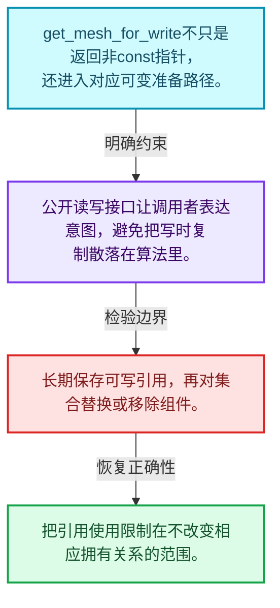
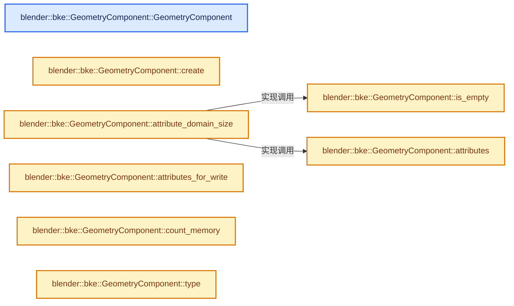
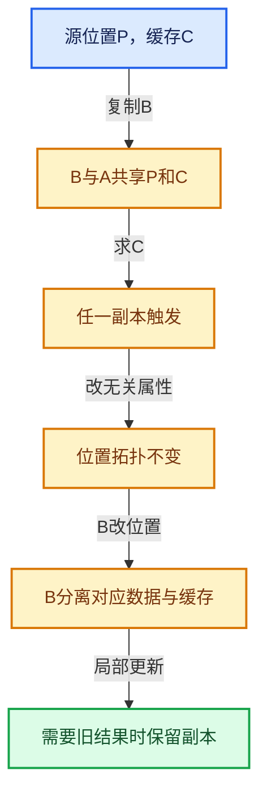

# 06-05 GeometrySet读写与复制

[方向导航](README.md) · [总目录](../README.md) · [实现索引](../00-课程指南/02-源码与提交索引/符号依赖与实现索引.md)

## 从问题到实现

get_for_write怎样连接共享与可变访问？

写接口需要确保返回的可变数据符合独占条件；可写引用的有效期仍受后续修改影响。

**数据模型**

get_mesh_for_write不只是返回非const指针，还进入对应可变准备路径。

**设计取舍**

公开读写接口让调用者表达意图，避免把写时复制散落在算法里。

**最小反例**

长期保存可写引用，再对集合替换或移除组件。

**推导**

把引用使用限制在不改变相应拥有关系的范围。

## 阅读地图与执行推演








图中的数值推演是本方向的教学模型；实际函数之间的调用边与概念分析边分别标注，不能把概念关系当作运行时调度顺序。

## 完整源码单元与就地讲解

中文讲解直接放在相关代码旁，复杂机制在代码下展开。原文折叠区保留基准行号；不需要在行号表和函数之间来回查找。类布局可分段展示，函数实现不按固定行数切开。

### 类型布局、声明与编译条件 · geometry_set.cc L1—L38

<!-- annotated:200b3626941da7 -->

```cpp
/* SPDX-FileCopyrightText: 2023 Blender Authors
 *
 * SPDX-License-Identifier: GPL-2.0-or-later */

/** \file
 * \ingroup bke
 */

#include <fmt/format.h>

#include "BLI_bounds.hh"
#include "BLI_map.hh"
#include "BLI_memory_counter.hh"
#include "BLI_task.hh"

#include "BKE_attribute.hh"
#include "BKE_curves.hh"
#include "BKE_geometry_set.hh"
#include "BKE_geometry_set_instances.hh"
#include "BKE_grease_pencil.hh"
#include "BKE_instances.hh"
#include "BKE_mesh.hh"
#include "BKE_modifier.hh"
#include "BKE_object_types.hh"
#include "BKE_subdiv_modifier.hh"
#include "BKE_volume.hh"

#include "NOD_geometry_nodes_bundle.hh"

#include "DNA_object_types.h"
#include "DNA_pointcloud_types.h"

namespace blender::bke {

/* -------------------------------------------------------------------- */
/** \name Geometry Component
 * \{ */

```

<details>
<summary>核对原始源码：source/blender/blenkernel/intern/geometry_set.cc · L1—L38</summary>

<!-- original:200b3626941da7:source/blender/blenkernel/intern/geometry_set.cc:1:38 -->

```cpp
/* SPDX-FileCopyrightText: 2023 Blender Authors
 *
 * SPDX-License-Identifier: GPL-2.0-or-later */

/** \file
 * \ingroup bke
 */

#include <fmt/format.h>

#include "BLI_bounds.hh"
#include "BLI_map.hh"
#include "BLI_memory_counter.hh"
#include "BLI_task.hh"

#include "BKE_attribute.hh"
#include "BKE_curves.hh"
#include "BKE_geometry_set.hh"
#include "BKE_geometry_set_instances.hh"
#include "BKE_grease_pencil.hh"
#include "BKE_instances.hh"
#include "BKE_mesh.hh"
#include "BKE_modifier.hh"
#include "BKE_object_types.hh"
#include "BKE_subdiv_modifier.hh"
#include "BKE_volume.hh"

#include "NOD_geometry_nodes_bundle.hh"

#include "DNA_object_types.h"
#include "DNA_pointcloud_types.h"

namespace blender::bke {

/* -------------------------------------------------------------------- */
/** \name Geometry Component
 * \{ */

```

</details>

<a id="f-c8e333a95aef5a99"></a>

### `blender::bke::GeometryComponent::GeometryComponent`

实现位置：[source/blender/blenkernel/intern/geometry_set.cc](../../../../../source/blender/blenkernel/intern/geometry_set.cc) · L39—L39。

接口参数：

- `Type type`

**教学注释版**

<!-- annotated:da4708e02749ce -->

```cpp
GeometryComponent::GeometryComponent(Type type) : type_(type) {}
```

<details>
<summary>核对原始源码：source/blender/blenkernel/intern/geometry_set.cc · L39—L39</summary>

<!-- original:da4708e02749ce:source/blender/blenkernel/intern/geometry_set.cc:39:39 -->

```cpp
GeometryComponent::GeometryComponent(Type type) : type_(type) {}
```

</details>

**继续追踪实现**

本实现没有需要继续展开的显式调用；检查返回表达式、对象转换和调用者前置条件。

<!-- annotated:288d49f06f19b1 -->

```cpp

```

<details>
<summary>核对原始源码：source/blender/blenkernel/intern/geometry_set.cc · L40—L40</summary>

<!-- original:288d49f06f19b1:source/blender/blenkernel/intern/geometry_set.cc:40:40 -->

```cpp

```

</details>

<a id="f-057aed72adfa658c"></a>

### `blender::bke::GeometryComponent::create`

实现位置：[source/blender/blenkernel/intern/geometry_set.cc](../../../../../source/blender/blenkernel/intern/geometry_set.cc) · L41—L61。

接口参数：

- `Type component_type`

**教学注释版**

<!-- annotated:0cb219b60c7672 -->

```cpp
GeometryComponentPtr GeometryComponent::create(Type component_type)
{
  switch (component_type) {
    case Type::Mesh:
      return GeometryComponentPtr(new MeshComponent());
    case Type::PointCloud:
      return GeometryComponentPtr(new PointCloudComponent());
    case Type::Instance:
      return GeometryComponentPtr(new InstancesComponent());
    case Type::Volume:
      return GeometryComponentPtr(new VolumeComponent());
    case Type::Curve:
      return GeometryComponentPtr(new CurveComponent());
    case Type::Edit:
      return GeometryComponentPtr(new GeometryComponentEditData());
    case Type::GreasePencil:
      return GeometryComponentPtr(new GreasePencilComponent());
  }
  BLI_assert_unreachable();
  return {};
}
```

<details>
<summary>核对原始源码：source/blender/blenkernel/intern/geometry_set.cc · L41—L61</summary>

<!-- original:0cb219b60c7672:source/blender/blenkernel/intern/geometry_set.cc:41:61 -->

```cpp
GeometryComponentPtr GeometryComponent::create(Type component_type)
{
  switch (component_type) {
    case Type::Mesh:
      return GeometryComponentPtr(new MeshComponent());
    case Type::PointCloud:
      return GeometryComponentPtr(new PointCloudComponent());
    case Type::Instance:
      return GeometryComponentPtr(new InstancesComponent());
    case Type::Volume:
      return GeometryComponentPtr(new VolumeComponent());
    case Type::Curve:
      return GeometryComponentPtr(new CurveComponent());
    case Type::Edit:
      return GeometryComponentPtr(new GeometryComponentEditData());
    case Type::GreasePencil:
      return GeometryComponentPtr(new GreasePencilComponent());
  }
  BLI_assert_unreachable();
  return {};
}
```

</details>

**结果出口**

- `return GeometryComponentPtr(new MeshComponent());`
- `return GeometryComponentPtr(new PointCloudComponent());`
- `return GeometryComponentPtr(new InstancesComponent());`
- `return GeometryComponentPtr(new VolumeComponent());`
- `return GeometryComponentPtr(new CurveComponent());`
- `return GeometryComponentPtr(new GeometryComponentEditData());`
- `return GeometryComponentPtr(new GreasePencilComponent());`
- `return {};`

**继续追踪实现**

- `GeometryComponentPtr` → [调用协议](../00-课程指南/01-路线与规范/模板宏与动态分派协议.md)：函数指针、局部可调用对象或未展开的宏；必须结合调用者环境。调用位置L45。
- `BLI_assert_unreachable` → [BLI_assert_unreachable · L77](../90-实现依赖专题/01-BLI基础库/BLI_assert.hh.md#m-7a2d91a67d8e)。宏定义由构建条件选择。

<!-- annotated:6df6b52290fe71 -->

```cpp

```

<details>
<summary>核对原始源码：source/blender/blenkernel/intern/geometry_set.cc · L62—L62</summary>

<!-- original:6df6b52290fe71:source/blender/blenkernel/intern/geometry_set.cc:62:62 -->

```cpp

```

</details>

<a id="f-3cb3765f59e14900"></a>

### `blender::bke::GeometryComponent::attribute_domain_size`

实现位置：[source/blender/blenkernel/intern/geometry_set.cc](../../../../../source/blender/blenkernel/intern/geometry_set.cc) · L63—L73。

接口参数：

- `const AttrDomain domain`

**教学注释版**

<!-- annotated:4a858b159e71e9 -->

```cpp
int GeometryComponent::attribute_domain_size(const AttrDomain domain) const
{
  if (this->is_empty()) {
    return 0;
  }
  const std::optional<AttributeAccessor> attributes = this->attributes();
  if (attributes.has_value()) {
    return attributes->domain_size(domain);
  }
  return 0;
}
```

<details>
<summary>核对原始源码：source/blender/blenkernel/intern/geometry_set.cc · L63—L73</summary>

<!-- original:4a858b159e71e9:source/blender/blenkernel/intern/geometry_set.cc:63:73 -->

```cpp
int GeometryComponent::attribute_domain_size(const AttrDomain domain) const
{
  if (this->is_empty()) {
    return 0;
  }
  const std::optional<AttributeAccessor> attributes = this->attributes();
  if (attributes.has_value()) {
    return attributes->domain_size(domain);
  }
  return 0;
}
```

</details>

**结果出口**

- `return 0;`
- `return attributes->domain_size(domain);`

**继续追踪实现**

- `this->is_empty` → [blender::bke::GeometryComponent::is_empty · L91](05-GeometrySet读写与复制.md#f-b4b017a3f04968a2)。
- `this->attributes` → [blender::bke::GeometryComponent::attributes · L75](05-GeometrySet读写与复制.md#f-d58a41ede5a46f2c)。
- `attributes.has_value` → [外部契约](https://eel.is/c++draft/)：这个边界按实际表达式及所属类型核对参数、返回值、寿命与失败行为。这里提供接口入口，不声称已解释该第三方版本的内部实现。
- `attributes->domain_size` → [外部契约](https://eel.is/c++draft/)：这个边界按实际表达式及所属类型核对参数、返回值、寿命与失败行为。这里提供接口入口，不声称已解释该第三方版本的内部实现。

<!-- annotated:fe492ac0324deb -->

```cpp

```

<details>
<summary>核对原始源码：source/blender/blenkernel/intern/geometry_set.cc · L74—L74</summary>

<!-- original:fe492ac0324deb:source/blender/blenkernel/intern/geometry_set.cc:74:74 -->

```cpp

```

</details>

<a id="f-d58a41ede5a46f2c"></a>

### `blender::bke::GeometryComponent::attributes`

实现位置：[source/blender/blenkernel/intern/geometry_set.cc](../../../../../source/blender/blenkernel/intern/geometry_set.cc) · L75—L78。

**教学注释版**

<!-- annotated:11d481d93be804 -->

```cpp
std::optional<AttributeAccessor> GeometryComponent::attributes() const
{
  return std::nullopt;
};
```

<details>
<summary>核对原始源码：source/blender/blenkernel/intern/geometry_set.cc · L75—L78</summary>

<!-- original:11d481d93be804:source/blender/blenkernel/intern/geometry_set.cc:75:78 -->

```cpp
std::optional<AttributeAccessor> GeometryComponent::attributes() const
{
  return std::nullopt;
};
```

</details>

**结果出口**

- `return std::nullopt;`

**继续追踪实现**

本实现没有需要继续展开的显式调用；检查返回表达式、对象转换和调用者前置条件。

<a id="f-c68ee72f71fc3179"></a>

### `blender::bke::GeometryComponent::attributes_for_write`

实现位置：[source/blender/blenkernel/intern/geometry_set.cc](../../../../../source/blender/blenkernel/intern/geometry_set.cc) · L79—L82。

**教学注释版**

<!-- annotated:a1ed60068660fa -->

```cpp
std::optional<MutableAttributeAccessor> GeometryComponent::attributes_for_write()
{
  return std::nullopt;
}
```

<details>
<summary>核对原始源码：source/blender/blenkernel/intern/geometry_set.cc · L79—L82</summary>

<!-- original:a1ed60068660fa:source/blender/blenkernel/intern/geometry_set.cc:79:82 -->

```cpp
std::optional<MutableAttributeAccessor> GeometryComponent::attributes_for_write()
{
  return std::nullopt;
}
```

</details>

**结果出口**

- `return std::nullopt;`

**继续追踪实现**

本实现没有需要继续展开的显式调用；检查返回表达式、对象转换和调用者前置条件。

<!-- annotated:74cc339c18f67e -->

```cpp

```

<details>
<summary>核对原始源码：source/blender/blenkernel/intern/geometry_set.cc · L83—L83</summary>

<!-- original:74cc339c18f67e:source/blender/blenkernel/intern/geometry_set.cc:83:83 -->

```cpp

```

</details>

<a id="f-169cceaa62075506"></a>

### `blender::bke::GeometryComponent::count_memory`

实现位置：[source/blender/blenkernel/intern/geometry_set.cc](../../../../../source/blender/blenkernel/intern/geometry_set.cc) · L84—L84。

接口参数：

- `MemoryCounter &`

**教学注释版**

<!-- annotated:cf5d89064f8661 -->

```cpp
void GeometryComponent::count_memory(MemoryCounter & /*memory*/) const {}
```

<details>
<summary>核对原始源码：source/blender/blenkernel/intern/geometry_set.cc · L84—L84</summary>

<!-- original:cf5d89064f8661:source/blender/blenkernel/intern/geometry_set.cc:84:84 -->

```cpp
void GeometryComponent::count_memory(MemoryCounter & /*memory*/) const {}
```

</details>

**继续追踪实现**

本实现没有需要继续展开的显式调用；检查返回表达式、对象转换和调用者前置条件。

<!-- annotated:6ade5559ed9b5f -->

```cpp

```

<details>
<summary>核对原始源码：source/blender/blenkernel/intern/geometry_set.cc · L85—L85</summary>

<!-- original:6ade5559ed9b5f:source/blender/blenkernel/intern/geometry_set.cc:85:85 -->

```cpp

```

</details>

<a id="f-f73336c224943890"></a>

### `blender::bke::GeometryComponent::type`

实现位置：[source/blender/blenkernel/intern/geometry_set.cc](../../../../../source/blender/blenkernel/intern/geometry_set.cc) · L86—L89。

**教学注释版**

<!-- annotated:a46f085b1efa13 -->

```cpp
GeometryComponent::Type GeometryComponent::type() const
{
  return type_;
}
```

<details>
<summary>核对原始源码：source/blender/blenkernel/intern/geometry_set.cc · L86—L89</summary>

<!-- original:a46f085b1efa13:source/blender/blenkernel/intern/geometry_set.cc:86:89 -->

```cpp
GeometryComponent::Type GeometryComponent::type() const
{
  return type_;
}
```

</details>

**结果出口**

- `return type_;`

**继续追踪实现**

本实现没有需要继续展开的显式调用；检查返回表达式、对象转换和调用者前置条件。

<!-- annotated:43e1c5c6d07eed -->

```cpp

```

<details>
<summary>核对原始源码：source/blender/blenkernel/intern/geometry_set.cc · L90—L90</summary>

<!-- original:43e1c5c6d07eed:source/blender/blenkernel/intern/geometry_set.cc:90:90 -->

```cpp

```

</details>

<a id="f-b4b017a3f04968a2"></a>

### `blender::bke::GeometryComponent::is_empty`

实现位置：[source/blender/blenkernel/intern/geometry_set.cc](../../../../../source/blender/blenkernel/intern/geometry_set.cc) · L91—L94。

**教学注释版**

<!-- annotated:eb12e1d4df4892 -->

```cpp
bool GeometryComponent::is_empty() const
{
  return false;
}
```

<details>
<summary>核对原始源码：source/blender/blenkernel/intern/geometry_set.cc · L91—L94</summary>

<!-- original:eb12e1d4df4892:source/blender/blenkernel/intern/geometry_set.cc:91:94 -->

```cpp
bool GeometryComponent::is_empty() const
{
  return false;
}
```

</details>

**结果出口**

- `return false;`

**继续追踪实现**

本实现没有需要继续展开的显式调用；检查返回表达式、对象转换和调用者前置条件。

<!-- annotated:ae899785b7c402 -->

```cpp

```

<details>
<summary>核对原始源码：source/blender/blenkernel/intern/geometry_set.cc · L95—L95</summary>

<!-- original:ae899785b7c402:source/blender/blenkernel/intern/geometry_set.cc:95:95 -->

```cpp

```

</details>

<a id="f-083a51a6b1b055eb"></a>

### `blender::bke::GeometryComponent::delete_self`

实现位置：[source/blender/blenkernel/intern/geometry_set.cc](../../../../../source/blender/blenkernel/intern/geometry_set.cc) · L96—L99。

**教学注释版**

<!-- annotated:660438fc2cef1a -->

```cpp
void GeometryComponent::delete_self()
{
  delete this;
}
```

<details>
<summary>核对原始源码：source/blender/blenkernel/intern/geometry_set.cc · L96—L99</summary>

<!-- original:660438fc2cef1a:source/blender/blenkernel/intern/geometry_set.cc:96:99 -->

```cpp
void GeometryComponent::delete_self()
{
  delete this;
}
```

</details>

**继续追踪实现**

本实现没有需要继续展开的显式调用；检查返回表达式、对象转换和调用者前置条件。

<!-- annotated:2a716f42619cd4 -->

```cpp

```

<details>
<summary>核对原始源码：source/blender/blenkernel/intern/geometry_set.cc · L100—L100</summary>

<!-- original:2a716f42619cd4:source/blender/blenkernel/intern/geometry_set.cc:100:100 -->

```cpp

```

</details>

<a id="f-d85e807e1acf3676"></a>

### `blender::bke::GeometryComponent::delete_data_only`

实现位置：[source/blender/blenkernel/intern/geometry_set.cc](../../../../../source/blender/blenkernel/intern/geometry_set.cc) · L101—L104。

**教学注释版**

<!-- annotated:056b1ad3f17db5 -->

```cpp
void GeometryComponent::delete_data_only()
{
  this->clear();
}
```

<details>
<summary>核对原始源码：source/blender/blenkernel/intern/geometry_set.cc · L101—L104</summary>

<!-- original:056b1ad3f17db5:source/blender/blenkernel/intern/geometry_set.cc:101:104 -->

```cpp
void GeometryComponent::delete_data_only()
{
  this->clear();
}
```

</details>

**继续追踪实现**

- `this->clear` → [blender::bke::GeometrySet::clear · L265](05-GeometrySet读写与复制.md#f-8c0f2e9da85aab58)。

### 类型布局、声明与编译条件 · geometry_set.cc L105—L111

<!-- annotated:3bdf22d7436b3c -->

```cpp

/** \} */

/* -------------------------------------------------------------------- */
/** \name Geometry Set
 * \{ */

```

<details>
<summary>核对原始源码：source/blender/blenkernel/intern/geometry_set.cc · L105—L111</summary>

<!-- original:3bdf22d7436b3c:source/blender/blenkernel/intern/geometry_set.cc:105:111 -->

```cpp

/** \} */

/* -------------------------------------------------------------------- */
/** \name Geometry Set
 * \{ */

```

</details>

<a id="f-5c04c744356a3105"></a>

### `blender::bke::GeometrySet`

实现位置：[source/blender/blenkernel/intern/geometry_set.cc](../../../../../source/blender/blenkernel/intern/geometry_set.cc) · L112—L112。

**教学注释版**

<!-- annotated:acc74c8cdd9c98 -->

```cpp
GeometrySet::GeometrySet() = default;
```

<details>
<summary>核对原始源码：source/blender/blenkernel/intern/geometry_set.cc · L112—L112</summary>

<!-- original:acc74c8cdd9c98:source/blender/blenkernel/intern/geometry_set.cc:112:112 -->

```cpp
GeometrySet::GeometrySet() = default;
```

</details>

**继续追踪实现**

本实现没有需要继续展开的显式调用；检查返回表达式、对象转换和调用者前置条件。

<a id="f-2cad26a0ad85d09a"></a>

### `blender::bke::GeometrySet`

实现位置：[source/blender/blenkernel/intern/geometry_set.cc](../../../../../source/blender/blenkernel/intern/geometry_set.cc) · L113—L113。

接口参数：

- `const GeometrySet &other`

**教学注释版**

<!-- annotated:d8e4ab1da76775 -->

```cpp
GeometrySet::GeometrySet(const GeometrySet &other) = default;
```

<details>
<summary>核对原始源码：source/blender/blenkernel/intern/geometry_set.cc · L113—L113</summary>

<!-- original:d8e4ab1da76775:source/blender/blenkernel/intern/geometry_set.cc:113:113 -->

```cpp
GeometrySet::GeometrySet(const GeometrySet &other) = default;
```

</details>

**继续追踪实现**

本实现没有需要继续展开的显式调用；检查返回表达式、对象转换和调用者前置条件。

<a id="f-3f67f0b978a84929"></a>

### `blender::bke::GeometrySet`

实现位置：[source/blender/blenkernel/intern/geometry_set.cc](../../../../../source/blender/blenkernel/intern/geometry_set.cc) · L114—L114。

接口参数：

- `GeometrySet &&other`

**教学注释版**

<!-- annotated:6d6ea27a40e303 -->

```cpp
GeometrySet::GeometrySet(GeometrySet &&other) = default;
```

<details>
<summary>核对原始源码：source/blender/blenkernel/intern/geometry_set.cc · L114—L114</summary>

<!-- original:6d6ea27a40e303:source/blender/blenkernel/intern/geometry_set.cc:114:114 -->

```cpp
GeometrySet::GeometrySet(GeometrySet &&other) = default;
```

</details>

**继续追踪实现**

本实现没有需要继续展开的显式调用；检查返回表达式、对象转换和调用者前置条件。

<a id="f-0d3215503e9b73fe"></a>

### `blender::bke::~GeometrySet`

实现位置：[source/blender/blenkernel/intern/geometry_set.cc](../../../../../source/blender/blenkernel/intern/geometry_set.cc) · L115—L115。

**教学注释版**

<!-- annotated:5bd1df7908d5d0 -->

```cpp
GeometrySet::~GeometrySet() = default;
```

<details>
<summary>核对原始源码：source/blender/blenkernel/intern/geometry_set.cc · L115—L115</summary>

<!-- original:5bd1df7908d5d0:source/blender/blenkernel/intern/geometry_set.cc:115:115 -->

```cpp
GeometrySet::~GeometrySet() = default;
```

</details>

**继续追踪实现**

本实现没有需要继续展开的显式调用；检查返回表达式、对象转换和调用者前置条件。

### 类型布局、声明与编译条件 · geometry_set.cc L116—L118

<!-- annotated:ec6baca8007b8d -->

```cpp
GeometrySet &GeometrySet::operator=(const GeometrySet &other) = default;
GeometrySet &GeometrySet::operator=(GeometrySet &&other) = default;

```

<details>
<summary>核对原始源码：source/blender/blenkernel/intern/geometry_set.cc · L116—L118</summary>

<!-- original:ec6baca8007b8d:source/blender/blenkernel/intern/geometry_set.cc:116:118 -->

```cpp
GeometrySet &GeometrySet::operator=(const GeometrySet &other) = default;
GeometrySet &GeometrySet::operator=(GeometrySet &&other) = default;

```

</details>

<a id="f-21eccb196f5b9a78"></a>

### `blender::bke::GeometrySet::get_component_for_write`

实现位置：[source/blender/blenkernel/intern/geometry_set.cc](../../../../../source/blender/blenkernel/intern/geometry_set.cc) · L119—L127。

接口参数：

- `GeometryComponent::Type component_type`

**教学注释版**

<!-- annotated:5bbd80cc7c1de4 -->

```cpp
GeometryComponent &GeometrySet::get_component_for_write(GeometryComponent::Type component_type)
{
  GeometryComponentPtr &component_ptr = components_[size_t(component_type)];
  if (!component_ptr) {
    /* If the component did not exist before, create a new one. */
    component_ptr = GeometryComponent::create(component_type);
  }
  return component_ptr.ensure_mutable_inplace();
}
```

<details>
<summary>核对原始源码：source/blender/blenkernel/intern/geometry_set.cc · L119—L127</summary>

<!-- original:5bbd80cc7c1de4:source/blender/blenkernel/intern/geometry_set.cc:119:127 -->

```cpp
GeometryComponent &GeometrySet::get_component_for_write(GeometryComponent::Type component_type)
{
  GeometryComponentPtr &component_ptr = components_[size_t(component_type)];
  if (!component_ptr) {
    /* If the component did not exist before, create a new one. */
    component_ptr = GeometryComponent::create(component_type);
  }
  return component_ptr.ensure_mutable_inplace();
}
```

</details>

**沿实际写入检查状态**

- `component_ptr = GeometryComponent::create(component_type);`

**结果出口**

- `return component_ptr.ensure_mutable_inplace();`

**继续追踪实现**

- `GeometryComponent::create` → [blender::bke::GeometryComponent::create · L41](05-GeometrySet读写与复制.md#f-057aed72adfa658c)。
- `component_ptr.ensure_mutable_inplace` → [blender::ImplicitSharingPtr::ensure_mutable_inplace · L144](03-Mixin与共享指针封装.md#f-d9e9b25281edf91a)。

<!-- annotated:8bcfef2d4226cb -->

```cpp

```

<details>
<summary>核对原始源码：source/blender/blenkernel/intern/geometry_set.cc · L128—L128</summary>

<!-- original:8bcfef2d4226cb:source/blender/blenkernel/intern/geometry_set.cc:128:128 -->

```cpp

```

</details>

<a id="f-b077f987c95b3425"></a>

### `blender::bke::GeometrySet::get_component_for_write_ptr`

实现位置：[source/blender/blenkernel/intern/geometry_set.cc](../../../../../source/blender/blenkernel/intern/geometry_set.cc) · L129—L135。

接口参数：

- `GeometryComponent::Type type`

**教学注释版**

<!-- annotated:f6b4e888ef3fcc -->

```cpp
GeometryComponent *GeometrySet::get_component_for_write_ptr(GeometryComponent::Type type)
{
  if (this->has(type)) {
    return &this->get_component_for_write(type);
  }
  return nullptr;
}
```

<details>
<summary>核对原始源码：source/blender/blenkernel/intern/geometry_set.cc · L129—L135</summary>

<!-- original:f6b4e888ef3fcc:source/blender/blenkernel/intern/geometry_set.cc:129:135 -->

```cpp
GeometryComponent *GeometrySet::get_component_for_write_ptr(GeometryComponent::Type type)
{
  if (this->has(type)) {
    return &this->get_component_for_write(type);
  }
  return nullptr;
}
```

</details>

**结果出口**

- `return &this->get_component_for_write(type);`
- `return nullptr;`

**继续追踪实现**

- `this->has` → [blender::bke::GeometrySet::has · L142](05-GeometrySet读写与复制.md#f-5777be605a5451b6)。
- `this->get_component_for_write` → [blender::bke::GeometrySet::get_component_for_write · L119](05-GeometrySet读写与复制.md#f-21eccb196f5b9a78)。

<!-- annotated:8ac5bddf9c7fba -->

```cpp

```

<details>
<summary>核对原始源码：source/blender/blenkernel/intern/geometry_set.cc · L136—L136</summary>

<!-- original:8ac5bddf9c7fba:source/blender/blenkernel/intern/geometry_set.cc:136:136 -->

```cpp

```

</details>

<a id="f-26f915a73bb3d7e8"></a>

### `blender::bke::GeometrySet::get_component`

实现位置：[source/blender/blenkernel/intern/geometry_set.cc](../../../../../source/blender/blenkernel/intern/geometry_set.cc) · L137—L140。

接口参数：

- `GeometryComponent::Type component_type`

**教学注释版**

<!-- annotated:6a194926297ff9 -->

```cpp
const GeometryComponent *GeometrySet::get_component(GeometryComponent::Type component_type) const
{
  return components_[size_t(component_type)].get();
}
```

<details>
<summary>核对原始源码：source/blender/blenkernel/intern/geometry_set.cc · L137—L140</summary>

<!-- original:6a194926297ff9:source/blender/blenkernel/intern/geometry_set.cc:137:140 -->

```cpp
const GeometryComponent *GeometrySet::get_component(GeometryComponent::Type component_type) const
{
  return components_[size_t(component_type)].get();
}
```

</details>

**结果出口**

- `return components_[size_t(component_type)].get();`

**继续追踪实现**

- `components_[size_t(component_type)].get` → [调用协议](../00-课程指南/01-路线与规范/模板宏与动态分派协议.md)：接收对象类型依赖auto、返回值或模板实例；不按同名猜测目标。调用位置L139。

<!-- annotated:d0e69d0d860c74 -->

```cpp

```

<details>
<summary>核对原始源码：source/blender/blenkernel/intern/geometry_set.cc · L141—L141</summary>

<!-- original:d0e69d0d860c74:source/blender/blenkernel/intern/geometry_set.cc:141:141 -->

```cpp

```

</details>

<a id="f-5777be605a5451b6"></a>

### `blender::bke::GeometrySet::has`

实现位置：[source/blender/blenkernel/intern/geometry_set.cc](../../../../../source/blender/blenkernel/intern/geometry_set.cc) · L142—L146。

接口参数：

- `const GeometryComponent::Type component_type`

**教学注释版**

<!-- annotated:69f369e56be215 -->

```cpp
bool GeometrySet::has(const GeometryComponent::Type component_type) const
{
  const GeometryComponentPtr &component = components_[size_t(component_type)];
  return component.has_value() && !component->is_empty();
}
```

<details>
<summary>核对原始源码：source/blender/blenkernel/intern/geometry_set.cc · L142—L146</summary>

<!-- original:69f369e56be215:source/blender/blenkernel/intern/geometry_set.cc:142:146 -->

```cpp
bool GeometrySet::has(const GeometryComponent::Type component_type) const
{
  const GeometryComponentPtr &component = components_[size_t(component_type)];
  return component.has_value() && !component->is_empty();
}
```

</details>

**结果出口**

- `return component.has_value() && !component->is_empty();`

**继续追踪实现**

- `component.has_value` → [调用协议](../00-课程指南/01-路线与规范/模板宏与动态分派协议.md)：由接收对象具体类型或运行时策略提供实现。调用位置L145。
- `component->is_empty` → [blender::bke::GeometryComponent::is_empty · L91](05-GeometrySet读写与复制.md#f-b4b017a3f04968a2)；[blender::bke::GeometrySet::is_empty · L421](05-GeometrySet读写与复制.md#f-20c815c1f8a499ee)。同名重载需按实参类型选择。

<!-- annotated:719603edb98545 -->

```cpp

```

<details>
<summary>核对原始源码：source/blender/blenkernel/intern/geometry_set.cc · L147—L147</summary>

<!-- original:719603edb98545:source/blender/blenkernel/intern/geometry_set.cc:147:147 -->

```cpp

```

</details>

<a id="f-32c960ae92da98ca"></a>

### `blender::bke::GeometrySet::remove`

实现位置：[source/blender/blenkernel/intern/geometry_set.cc](../../../../../source/blender/blenkernel/intern/geometry_set.cc) · L148—L151。

接口参数：

- `const GeometryComponent::Type component_type`

**教学注释版**

<!-- annotated:4cfe7068ebd9f7 -->

```cpp
void GeometrySet::remove(const GeometryComponent::Type component_type)
{
  components_[size_t(component_type)].reset();
}
```

<details>
<summary>核对原始源码：source/blender/blenkernel/intern/geometry_set.cc · L148—L151</summary>

<!-- original:4cfe7068ebd9f7:source/blender/blenkernel/intern/geometry_set.cc:148:151 -->

```cpp
void GeometrySet::remove(const GeometryComponent::Type component_type)
{
  components_[size_t(component_type)].reset();
}
```

</details>

**继续追踪实现**

- `components_[size_t(component_type)].reset` → [调用协议](../00-课程指南/01-路线与规范/模板宏与动态分派协议.md)：接收对象类型依赖auto、返回值或模板实例；不按同名猜测目标。调用位置L150。

<!-- annotated:9ad552234ee4d9 -->

```cpp

```

<details>
<summary>核对原始源码：source/blender/blenkernel/intern/geometry_set.cc · L152—L152</summary>

<!-- original:9ad552234ee4d9:source/blender/blenkernel/intern/geometry_set.cc:152:152 -->

```cpp

```

</details>

<a id="f-3342295c6e1df386"></a>

### `blender::bke::GeometrySet::keep_only`

实现位置：[source/blender/blenkernel/intern/geometry_set.cc](../../../../../source/blender/blenkernel/intern/geometry_set.cc) · L153—L162。

接口参数：

- `const Span<GeometryComponent::Type> component_types`

**教学注释版**

<!-- annotated:69e90b44486b5a -->

```cpp
void GeometrySet::keep_only(const Span<GeometryComponent::Type> component_types)
{
  for (GeometryComponentPtr &component_ptr : components_) {
    if (component_ptr) {
      if (!component_types.contains(component_ptr->type())) {
        component_ptr.reset();
      }
    }
  }
}
```

<details>
<summary>核对原始源码：source/blender/blenkernel/intern/geometry_set.cc · L153—L162</summary>

<!-- original:69e90b44486b5a:source/blender/blenkernel/intern/geometry_set.cc:153:162 -->

```cpp
void GeometrySet::keep_only(const Span<GeometryComponent::Type> component_types)
{
  for (GeometryComponentPtr &component_ptr : components_) {
    if (component_ptr) {
      if (!component_types.contains(component_ptr->type())) {
        component_ptr.reset();
      }
    }
  }
}
```

</details>

**继续追踪实现**

- `component_types.contains` → [blender::Span::contains · L281](../01-基础容器与现代CPP/05-Span只读连续视图.md#f-7caee498c984f2c0)。
- `component_ptr->type` → [调用协议](../00-课程指南/01-路线与规范/模板宏与动态分派协议.md)：接收对象类型依赖auto、返回值或模板实例；不按同名猜测目标。调用位置L157。
- `component_ptr.reset` → [调用协议](../00-课程指南/01-路线与规范/模板宏与动态分派协议.md)：接收对象类型依赖auto、返回值或模板实例；不按同名猜测目标。调用位置L158。

<!-- annotated:25f0be3384ac5a -->

```cpp

```

<details>
<summary>核对原始源码：source/blender/blenkernel/intern/geometry_set.cc · L163—L163</summary>

<!-- original:25f0be3384ac5a:source/blender/blenkernel/intern/geometry_set.cc:163:163 -->

```cpp

```

</details>

<a id="f-818cd8e6e071a477"></a>

### `blender::bke::GeometrySet::add`

实现位置：[source/blender/blenkernel/intern/geometry_set.cc](../../../../../source/blender/blenkernel/intern/geometry_set.cc) · L164—L170。

接口参数：

- `const GeometryComponent &component`

**教学注释版**

<!-- annotated:62cb586b646347 -->

```cpp
void GeometrySet::add(const GeometryComponent &component)
{
  BLI_assert(!components_[size_t(component.type())]);
  component.add_user();
  components_[size_t(component.type())] = GeometryComponentPtr(
      const_cast<GeometryComponent *>(&component));
}
```

<details>
<summary>核对原始源码：source/blender/blenkernel/intern/geometry_set.cc · L164—L170</summary>

<!-- original:62cb586b646347:source/blender/blenkernel/intern/geometry_set.cc:164:170 -->

```cpp
void GeometrySet::add(const GeometryComponent &component)
{
  BLI_assert(!components_[size_t(component.type())]);
  component.add_user();
  components_[size_t(component.type())] = GeometryComponentPtr(
      const_cast<GeometryComponent *>(&component));
}
```

</details>

**继续追踪实现**

- `BLI_assert` → [BLI_assert · L48](../90-实现依赖专题/01-BLI基础库/BLI_assert.hh.md#m-57a88495704d)；[BLI_assert · L63](../90-实现依赖专题/01-BLI基础库/BLI_assert.hh.md#m-d07050020cb5)。宏定义由构建条件选择。
- `component.type` → [blender::bke::GeometryComponent::type · L86](05-GeometrySet读写与复制.md#f-f73336c224943890)。
- `component.add_user` → [调用协议](../00-课程指南/01-路线与规范/模板宏与动态分派协议.md)：由接收对象具体类型或运行时策略提供实现。调用位置L167。
- `GeometryComponentPtr` → [调用协议](../00-课程指南/01-路线与规范/模板宏与动态分派协议.md)：函数指针、局部可调用对象或未展开的宏；必须结合调用者环境。调用位置L168。

<!-- annotated:b671843943b9b6 -->

```cpp

```

<details>
<summary>核对原始源码：source/blender/blenkernel/intern/geometry_set.cc · L171—L171</summary>

<!-- original:b671843943b9b6:source/blender/blenkernel/intern/geometry_set.cc:171:171 -->

```cpp

```

</details>

<a id="f-cc37b529b336a65e"></a>

### `blender::bke::GeometrySet::get_components`

实现位置：[source/blender/blenkernel/intern/geometry_set.cc](../../../../../source/blender/blenkernel/intern/geometry_set.cc) · L172—L181。

**教学注释版**

<!-- annotated:273014184775ea -->

```cpp
Vector<const GeometryComponent *> GeometrySet::get_components() const
{
  Vector<const GeometryComponent *> components;
  for (const GeometryComponentPtr &component_ptr : components_) {
    if (component_ptr) {
      // [讲解] components.append：在尾部建立新元素，必要时先扩大存储。
      components.append(component_ptr.get());
    }
  }
  return components;
}
```

<details>
<summary>核对原始源码：source/blender/blenkernel/intern/geometry_set.cc · L172—L181</summary>

<!-- original:273014184775ea:source/blender/blenkernel/intern/geometry_set.cc:172:181 -->

```cpp
Vector<const GeometryComponent *> GeometrySet::get_components() const
{
  Vector<const GeometryComponent *> components;
  for (const GeometryComponentPtr &component_ptr : components_) {
    if (component_ptr) {
      components.append(component_ptr.get());
    }
  }
  return components;
}
```

</details>

**结果出口**

- `return components;`

**继续追踪实现**

- `components.append` → [blender::Vector::append · L498](../01-基础容器与现代CPP/11-Vector插入删除与重排.md#f-5bde268a69e443ec)；[blender::Vector::append · L502](../01-基础容器与现代CPP/11-Vector插入删除与重排.md#f-591e0b15e6308532)。同名重载需按实参类型选择。
- `component_ptr.get` → [调用协议](../00-课程指南/01-路线与规范/模板宏与动态分派协议.md)：接收对象类型依赖auto、返回值或模板实例；不按同名猜测目标。调用位置L177。

<!-- annotated:60a1d9ee16872a -->

```cpp

```

<details>
<summary>核对原始源码：source/blender/blenkernel/intern/geometry_set.cc · L182—L182</summary>

<!-- original:60a1d9ee16872a:source/blender/blenkernel/intern/geometry_set.cc:182:182 -->

```cpp

```

</details>

<a id="f-9006a5875efaaa6b"></a>

### `blender::bke::GeometrySet::compute_boundbox_without_instances`

实现位置：[source/blender/blenkernel/intern/geometry_set.cc](../../../../../source/blender/blenkernel/intern/geometry_set.cc) · L183—L209。

接口参数：

- `const bool use_radius`
- `const bool use_subdiv`

**教学注释版**

<!-- annotated:b92c49b2fbdeb0 -->

```cpp
std::optional<Bounds<float3>> GeometrySet::compute_boundbox_without_instances(
    const bool use_radius, const bool use_subdiv) const
{
  std::optional<Bounds<float3>> bounds;
  if (const PointCloud *pointcloud = this->get_pointcloud()) {
    bounds = bounds::merge(bounds, pointcloud->bounds_min_max(use_radius));
  }
  if (const Mesh *mesh = this->get_mesh()) {
    /* Use tessellated subdivision mesh if it exists. */
    if (use_subdiv && mesh->runtime->mesh_eval) {
      bounds = bounds::merge(bounds, mesh->runtime->mesh_eval->bounds_min_max());
    }
    else {
      bounds = bounds::merge(bounds, mesh->bounds_min_max());
    }
  }
  if (const Volume *volume = this->get_volume()) {
    bounds = bounds::merge(bounds, BKE_volume_min_max(volume));
  }
  if (const Curves *curves_id = this->get_curves()) {
    bounds = bounds::merge(bounds, curves_id->geometry.wrap().bounds_min_max(use_radius));
  }
  if (const GreasePencil *grease_pencil = this->get_grease_pencil()) {
    bounds = bounds::merge(bounds, grease_pencil->bounds_min_max_eval(use_radius));
  }
  return bounds;
}
```

<details>
<summary>核对原始源码：source/blender/blenkernel/intern/geometry_set.cc · L183—L209</summary>

<!-- original:b92c49b2fbdeb0:source/blender/blenkernel/intern/geometry_set.cc:183:209 -->

```cpp
std::optional<Bounds<float3>> GeometrySet::compute_boundbox_without_instances(
    const bool use_radius, const bool use_subdiv) const
{
  std::optional<Bounds<float3>> bounds;
  if (const PointCloud *pointcloud = this->get_pointcloud()) {
    bounds = bounds::merge(bounds, pointcloud->bounds_min_max(use_radius));
  }
  if (const Mesh *mesh = this->get_mesh()) {
    /* Use tessellated subdivision mesh if it exists. */
    if (use_subdiv && mesh->runtime->mesh_eval) {
      bounds = bounds::merge(bounds, mesh->runtime->mesh_eval->bounds_min_max());
    }
    else {
      bounds = bounds::merge(bounds, mesh->bounds_min_max());
    }
  }
  if (const Volume *volume = this->get_volume()) {
    bounds = bounds::merge(bounds, BKE_volume_min_max(volume));
  }
  if (const Curves *curves_id = this->get_curves()) {
    bounds = bounds::merge(bounds, curves_id->geometry.wrap().bounds_min_max(use_radius));
  }
  if (const GreasePencil *grease_pencil = this->get_grease_pencil()) {
    bounds = bounds::merge(bounds, grease_pencil->bounds_min_max_eval(use_radius));
  }
  return bounds;
}
```

</details>

**沿实际写入检查状态**

- `bounds = bounds::merge(bounds, pointcloud->bounds_min_max(use_radius));`
- `bounds = bounds::merge(bounds, mesh->runtime->mesh_eval->bounds_min_max());`
- `bounds = bounds::merge(bounds, mesh->bounds_min_max());`
- `bounds = bounds::merge(bounds, BKE_volume_min_max(volume));`
- `bounds = bounds::merge(bounds, curves_id->geometry.wrap().bounds_min_max(use_radius));`
- `bounds = bounds::merge(bounds, grease_pencil->bounds_min_max_eval(use_radius));`

**结果出口**

- `return bounds;`

**继续追踪实现**

- `this->get_pointcloud` → [blender::bke::GeometrySet::get_pointcloud · L327](05-GeometrySet读写与复制.md#f-e9c60234d315f635)。
- `bounds::merge` → [blender::bounds::merge · L27](../12-空间数据结构与几何算法/07-Bounds与BVH对比.md#f-26dade32771df176)；[blender::bounds::merge · L32](../12-空间数据结构与几何算法/07-Bounds与BVH对比.md#f-f539fea5d229191a)；[blender::bounds::merge · L48](../12-空间数据结构与几何算法/07-Bounds与BVH对比.md#f-34b53687690dd2a5)。同名重载需按实参类型选择。
- `pointcloud->bounds_min_max` → [blender::PointCloud::bounds_min_max · L261](../90-实现依赖专题/02-BKE几何与数据/intern/pointcloud.cc.md#f-608e12c4a3f505af)。
- `this->get_mesh` → [blender::bke::GeometrySet::get_mesh · L315](05-GeometrySet读写与复制.md#f-25151145065d998b)。
- `mesh->runtime->mesh_eval->bounds_min_max` → [调用协议](../00-课程指南/01-路线与规范/模板宏与动态分派协议.md)：接收对象类型依赖auto、返回值或模板实例；不按同名猜测目标。调用位置L193。
- `mesh->bounds_min_max` → [Mesh::bounds_min_max · L1942](../05-几何存储与拓扑映射/03-MPoly迁移与兼容.md#f-1a7c466d855d52a6)。
- `this->get_volume` → [blender::bke::GeometrySet::get_volume · L333](05-GeometrySet读写与复制.md#f-e4dddefabca41664)。
- `BKE_volume_min_max` → [blender::BKE_volume_min_max · L627](../90-实现依赖专题/02-BKE几何与数据/intern/volume.cc.md#f-0fcf2afc72eedde9)。
- `this->get_curves` → [blender::bke::GeometrySet::get_curves · L339](05-GeometrySet读写与复制.md#f-1d7b3a3ddbc6c57b)。
- `curves_id->geometry.wrap().bounds_min_max` → [调用协议](../00-课程指南/01-路线与规范/模板宏与动态分派协议.md)：接收对象类型依赖auto、返回值或模板实例；不按同名猜测目标。调用位置L203。
- `curves_id->geometry.wrap` → [调用协议](../00-课程指南/01-路线与规范/模板宏与动态分派协议.md)：接收对象类型依赖auto、返回值或模板实例；不按同名猜测目标。调用位置L203。
- `this->get_grease_pencil` → [blender::bke::GeometrySet::get_grease_pencil · L369](05-GeometrySet读写与复制.md#f-4c73d7995c66f8bf)。
- `grease_pencil->bounds_min_max_eval` → [blender::GreasePencil::bounds_min_max_eval · L3942](../90-实现依赖专题/02-BKE几何与数据/intern/grease_pencil.cc.md#f-f2b961f319385dd6)。

<!-- annotated:0a7018eed8f187 -->

```cpp

```

<details>
<summary>核对原始源码：source/blender/blenkernel/intern/geometry_set.cc · L210—L210</summary>

<!-- original:0a7018eed8f187:source/blender/blenkernel/intern/geometry_set.cc:210:210 -->

```cpp

```

</details>

<a id="f-8e9d66f8103c7871"></a>

### `blender::bke::operator<<`

实现位置：[source/blender/blenkernel/intern/geometry_set.cc](../../../../../source/blender/blenkernel/intern/geometry_set.cc) · L211—L263。

接口参数：

- `std::ostream &stream`
- `const GeometrySet &geometry_set`

**教学注释版**

<!-- annotated:cadac3741ea1f2 -->

```cpp
std::ostream &operator<<(std::ostream &stream, const GeometrySet &geometry_set)
{
  Vector<std::string> parts;
  if (!geometry_set.name().is_empty()) {
    // [讲解] parts.append：在尾部建立新元素，必要时先扩大存储。
    parts.append(fmt::format("\"{}\"", geometry_set.name()));
  }
  if (const Mesh *mesh = geometry_set.get_mesh()) {
    parts.append(std::to_string(mesh->verts_num) + " verts");
    parts.append(std::to_string(mesh->edges_num) + " edges");
    parts.append(std::to_string(mesh->faces_num) + " faces");
    parts.append(std::to_string(mesh->corners_num) + " corners");
    if (mesh->runtime->subsurf_runtime_data) {
      const int resolution = mesh->runtime->subsurf_runtime_data->resolution;
      if (is_power_of_2_i(resolution - 1)) {
        /* Display the resolution as subdiv levels if possible because that's more common. */
        const int level = log2_floor(resolution - 1);
        parts.append(std::to_string(level) + " subdiv levels");
      }
      else {
        parts.append(std::to_string(resolution) + " subdiv resolution");
      }
    }
  }
  if (const Curves *curves = geometry_set.get_curves()) {
    parts.append(std::to_string(curves->geometry.point_num) + " control points");
    parts.append(std::to_string(curves->geometry.curve_num) + " curves");
  }
  if (const GreasePencil *grease_pencil = geometry_set.get_grease_pencil()) {
    parts.append(std::to_string(grease_pencil->layers().size()) + " Grease Pencil layers");
  }
  if (const PointCloud *pointcloud = geometry_set.get_pointcloud()) {
    parts.append(std::to_string(pointcloud->totpoint) + " points");
  }
  if (const Volume *volume = geometry_set.get_volume()) {
    parts.append(std::to_string(BKE_volume_num_grids(volume)) + " volume grids");
  }
  if (geometry_set.has_instances()) {
    parts.append(std::to_string(geometry_set.get_instances()->instances_num()) + " instances");
  }
  if (geometry_set.get_curve_edit_hints()) {
    parts.append("curve edit hints");
  }

  stream << "<GeometrySet: ";
  for (const int i : parts.index_range()) {
    stream << parts[i];
    // [讲解] parts.size：用end_减begin_得到活元素数量。
    if (i < parts.size() - 1) {
      stream << ", ";
    }
  }
  stream << ">";
  return stream;
}
```

<details>
<summary>核对原始源码：source/blender/blenkernel/intern/geometry_set.cc · L211—L263</summary>

<!-- original:cadac3741ea1f2:source/blender/blenkernel/intern/geometry_set.cc:211:263 -->

```cpp
std::ostream &operator<<(std::ostream &stream, const GeometrySet &geometry_set)
{
  Vector<std::string> parts;
  if (!geometry_set.name().is_empty()) {
    parts.append(fmt::format("\"{}\"", geometry_set.name()));
  }
  if (const Mesh *mesh = geometry_set.get_mesh()) {
    parts.append(std::to_string(mesh->verts_num) + " verts");
    parts.append(std::to_string(mesh->edges_num) + " edges");
    parts.append(std::to_string(mesh->faces_num) + " faces");
    parts.append(std::to_string(mesh->corners_num) + " corners");
    if (mesh->runtime->subsurf_runtime_data) {
      const int resolution = mesh->runtime->subsurf_runtime_data->resolution;
      if (is_power_of_2_i(resolution - 1)) {
        /* Display the resolution as subdiv levels if possible because that's more common. */
        const int level = log2_floor(resolution - 1);
        parts.append(std::to_string(level) + " subdiv levels");
      }
      else {
        parts.append(std::to_string(resolution) + " subdiv resolution");
      }
    }
  }
  if (const Curves *curves = geometry_set.get_curves()) {
    parts.append(std::to_string(curves->geometry.point_num) + " control points");
    parts.append(std::to_string(curves->geometry.curve_num) + " curves");
  }
  if (const GreasePencil *grease_pencil = geometry_set.get_grease_pencil()) {
    parts.append(std::to_string(grease_pencil->layers().size()) + " Grease Pencil layers");
  }
  if (const PointCloud *pointcloud = geometry_set.get_pointcloud()) {
    parts.append(std::to_string(pointcloud->totpoint) + " points");
  }
  if (const Volume *volume = geometry_set.get_volume()) {
    parts.append(std::to_string(BKE_volume_num_grids(volume)) + " volume grids");
  }
  if (geometry_set.has_instances()) {
    parts.append(std::to_string(geometry_set.get_instances()->instances_num()) + " instances");
  }
  if (geometry_set.get_curve_edit_hints()) {
    parts.append("curve edit hints");
  }

  stream << "<GeometrySet: ";
  for (const int i : parts.index_range()) {
    stream << parts[i];
    if (i < parts.size() - 1) {
      stream << ", ";
    }
  }
  stream << ">";
  return stream;
}
```

</details>

**结果出口**

- `return stream;`

**继续追踪实现**

- `geometry_set.name().is_empty` → [调用协议](../00-课程指南/01-路线与规范/模板宏与动态分派协议.md)：接收对象类型依赖auto、返回值或模板实例；不按同名猜测目标。调用位置L214。
- `geometry_set.name` → [blender::bke::GeometrySet::name · L810](05-GeometrySet读写与复制.md#f-8cf6870c2e71a4aa)。
- `parts.append` → [blender::Vector::append · L498](../01-基础容器与现代CPP/11-Vector插入删除与重排.md#f-5bde268a69e443ec)；[blender::Vector::append · L502](../01-基础容器与现代CPP/11-Vector插入删除与重排.md#f-591e0b15e6308532)。同名重载需按实参类型选择。
- `fmt::format` → [外部契约](https://fmt.dev/latest/api/)：按fmt接口的格式字符串与参数类型契约使用，格式化不改变被格式化对象的拥有关系。
- `geometry_set.get_mesh` → [blender::bke::GeometrySet::get_mesh · L315](05-GeometrySet读写与复制.md#f-25151145065d998b)。
- `std::to_string` → [外部契约](https://eel.is/c++draft/)：这个边界按实际表达式及所属类型核对参数、返回值、寿命与失败行为。这里提供接口入口，不声称已解释该第三方版本的内部实现。
- `is_power_of_2_i` → [blender::is_power_of_2_i · L105](../90-实现依赖专题/01-BLI基础库/intern/math_base_inline.cc.md#f-122f291f1e7250f2)。
- `log2_floor` → [blender::log2_floor · L176](../90-实现依赖专题/01-BLI基础库/BLI_utildefines.hh.md#f-6156427b768ba020)。
- `geometry_set.get_curves` → [blender::bke::GeometrySet::get_curves · L339](05-GeometrySet读写与复制.md#f-1d7b3a3ddbc6c57b)。
- `geometry_set.get_grease_pencil` → [blender::bke::GeometrySet::get_grease_pencil · L369](05-GeometrySet读写与复制.md#f-4c73d7995c66f8bf)。
- `grease_pencil->layers().size` → [调用协议](../00-课程指南/01-路线与规范/模板宏与动态分派协议.md)：接收对象类型依赖auto、返回值或模板实例；不按同名猜测目标。调用位置L239。
- `grease_pencil->layers` → [blender::GreasePencil::layers · L3983](../90-实现依赖专题/02-BKE几何与数据/intern/grease_pencil.cc.md#f-15d64ed11a2babc0)。
- `geometry_set.get_pointcloud` → [blender::bke::GeometrySet::get_pointcloud · L327](05-GeometrySet读写与复制.md#f-e9c60234d315f635)。
- `geometry_set.get_volume` → [blender::bke::GeometrySet::get_volume · L333](05-GeometrySet读写与复制.md#f-e4dddefabca41664)。
- `BKE_volume_num_grids` → [blender::BKE_volume_num_grids · L856](../90-实现依赖专题/02-BKE几何与数据/intern/volume.cc.md#f-bba3632a80fe4c9d)。
- `geometry_set.has_instances` → [blender::bke::GeometrySet::has_instances · L381](05-GeometrySet读写与复制.md#f-96f474fc46f602f1)。
- `geometry_set.get_instances()->instances_num` → [调用协议](../00-课程指南/01-路线与规范/模板宏与动态分派协议.md)：接收对象类型依赖auto、返回值或模板实例；不按同名猜测目标。调用位置L248。
- `geometry_set.get_instances` → [blender::bke::GeometrySet::get_instances · L345](05-GeometrySet读写与复制.md#f-75fcc67a0b3c0fa1)。
- `geometry_set.get_curve_edit_hints` → [blender::bke::GeometrySet::get_curve_edit_hints · L351](05-GeometrySet读写与复制.md#f-0f0a70818546603c)。
- `parts.index_range` → [blender::Vector::index_range · L1026](../01-基础容器与现代CPP/12-Vector异常安全与边界.md#f-ac29cf36ef185ab9)。
- `parts.size` → [blender::Vector::size · L780](../01-基础容器与现代CPP/11-Vector插入删除与重排.md#f-714773731767349c)。

<!-- annotated:07be0a0ba45a25 -->

```cpp

```

<details>
<summary>核对原始源码：source/blender/blenkernel/intern/geometry_set.cc · L264—L264</summary>

<!-- original:07be0a0ba45a25:source/blender/blenkernel/intern/geometry_set.cc:264:264 -->

```cpp

```

</details>

<a id="f-8c0f2e9da85aab58"></a>

### `blender::bke::GeometrySet::clear`

实现位置：[source/blender/blenkernel/intern/geometry_set.cc](../../../../../source/blender/blenkernel/intern/geometry_set.cc) · L265—L270。

**教学注释版**

<!-- annotated:ea2838d5a11343 -->

```cpp
void GeometrySet::clear()
{
  for (GeometryComponentPtr &component_ptr : components_) {
    component_ptr.reset();
  }
}
```

<details>
<summary>核对原始源码：source/blender/blenkernel/intern/geometry_set.cc · L265—L270</summary>

<!-- original:ea2838d5a11343:source/blender/blenkernel/intern/geometry_set.cc:265:270 -->

```cpp
void GeometrySet::clear()
{
  for (GeometryComponentPtr &component_ptr : components_) {
    component_ptr.reset();
  }
}
```

</details>

**继续追踪实现**

- `component_ptr.reset` → [调用协议](../00-课程指南/01-路线与规范/模板宏与动态分派协议.md)：接收对象类型依赖auto、返回值或模板实例；不按同名猜测目标。调用位置L268。

<!-- annotated:43eee5726440a5 -->

```cpp

```

<details>
<summary>核对原始源码：source/blender/blenkernel/intern/geometry_set.cc · L271—L271</summary>

<!-- original:43eee5726440a5:source/blender/blenkernel/intern/geometry_set.cc:271:271 -->

```cpp

```

</details>

<a id="f-9626a230081195a6"></a>

### `blender::bke::GeometrySet::ensure_owns_direct_data`

实现位置：[source/blender/blenkernel/intern/geometry_set.cc](../../../../../source/blender/blenkernel/intern/geometry_set.cc) · L272—L284。

**教学注释版**

<!-- annotated:f6081c7362213c -->

```cpp
void GeometrySet::ensure_owns_direct_data()
{
  for (GeometryComponentPtr &component_ptr : components_) {
    if (!component_ptr) {
      continue;
    }
    if (component_ptr->owns_direct_data()) {
      continue;
    }
    GeometryComponent &component_for_write = this->get_component_for_write(component_ptr->type());
    component_for_write.ensure_owns_direct_data();
  }
}
```

<details>
<summary>核对原始源码：source/blender/blenkernel/intern/geometry_set.cc · L272—L284</summary>

<!-- original:f6081c7362213c:source/blender/blenkernel/intern/geometry_set.cc:272:284 -->

```cpp
void GeometrySet::ensure_owns_direct_data()
{
  for (GeometryComponentPtr &component_ptr : components_) {
    if (!component_ptr) {
      continue;
    }
    if (component_ptr->owns_direct_data()) {
      continue;
    }
    GeometryComponent &component_for_write = this->get_component_for_write(component_ptr->type());
    component_for_write.ensure_owns_direct_data();
  }
}
```

</details>

**继续追踪实现**

- `component_ptr->owns_direct_data` → [调用协议](../00-课程指南/01-路线与规范/模板宏与动态分派协议.md)：接收对象类型依赖auto、返回值或模板实例；不按同名猜测目标。调用位置L278。
- `this->get_component_for_write` → [blender::bke::GeometrySet::get_component_for_write · L119](05-GeometrySet读写与复制.md#f-21eccb196f5b9a78)。
- `component_ptr->type` → [调用协议](../00-课程指南/01-路线与规范/模板宏与动态分派协议.md)：接收对象类型依赖auto、返回值或模板实例；不按同名猜测目标。调用位置L281。
- `component_for_write.ensure_owns_direct_data` → [blender::bke::GeometrySet::ensure_owns_direct_data · L272](05-GeometrySet读写与复制.md#f-9626a230081195a6)。

<!-- annotated:494b8077cd7b2e -->

```cpp

```

<details>
<summary>核对原始源码：source/blender/blenkernel/intern/geometry_set.cc · L285—L285</summary>

<!-- original:494b8077cd7b2e:source/blender/blenkernel/intern/geometry_set.cc:285:285 -->

```cpp

```

</details>

<a id="f-80fb9cda8ab985dc"></a>

### `blender::bke::GeometrySet::ensure_owns_all_data`

实现位置：[source/blender/blenkernel/intern/geometry_set.cc](../../../../../source/blender/blenkernel/intern/geometry_set.cc) · L286—L292。

**教学注释版**

<!-- annotated:118dd8830e8372 -->

```cpp
void GeometrySet::ensure_owns_all_data()
{
  if (Instances *instances = this->get_instances_for_write()) {
    instances->ensure_geometry_instances();
  }
  this->ensure_owns_direct_data();
}
```

<details>
<summary>核对原始源码：source/blender/blenkernel/intern/geometry_set.cc · L286—L292</summary>

<!-- original:118dd8830e8372:source/blender/blenkernel/intern/geometry_set.cc:286:292 -->

```cpp
void GeometrySet::ensure_owns_all_data()
{
  if (Instances *instances = this->get_instances_for_write()) {
    instances->ensure_geometry_instances();
  }
  this->ensure_owns_direct_data();
}
```

</details>

**继续追踪实现**

- `this->get_instances_for_write` → [blender::bke::GeometrySet::get_instances_for_write · L586](05-GeometrySet读写与复制.md#f-e2fefbfed77f753f)。
- `instances->ensure_geometry_instances` → [blender::bke::Instances::ensure_geometry_instances · L111](../90-实现依赖专题/02-BKE几何与数据/intern/geometry_set_instances.cc.md#f-c6c307192970c4f3)。
- `this->ensure_owns_direct_data` → [blender::bke::GeometrySet::ensure_owns_direct_data · L272](05-GeometrySet读写与复制.md#f-9626a230081195a6)。

<!-- annotated:244f4c7a1bf031 -->

```cpp

```

<details>
<summary>核对原始源码：source/blender/blenkernel/intern/geometry_set.cc · L293—L293</summary>

<!-- original:244f4c7a1bf031:source/blender/blenkernel/intern/geometry_set.cc:293:293 -->

```cpp

```

</details>

<a id="f-fa1220837e627b58"></a>

### `blender::bke::GeometrySet::owns_direct_data`

实现位置：[source/blender/blenkernel/intern/geometry_set.cc](../../../../../source/blender/blenkernel/intern/geometry_set.cc) · L294—L304。

**教学注释版**

<!-- annotated:ba597737961460 -->

```cpp
bool GeometrySet::owns_direct_data() const
{
  for (const GeometryComponentPtr &component_ptr : components_) {
    if (component_ptr) {
      if (!component_ptr->owns_direct_data()) {
        return false;
      }
    }
  }
  return true;
}
```

<details>
<summary>核对原始源码：source/blender/blenkernel/intern/geometry_set.cc · L294—L304</summary>

<!-- original:ba597737961460:source/blender/blenkernel/intern/geometry_set.cc:294:304 -->

```cpp
bool GeometrySet::owns_direct_data() const
{
  for (const GeometryComponentPtr &component_ptr : components_) {
    if (component_ptr) {
      if (!component_ptr->owns_direct_data()) {
        return false;
      }
    }
  }
  return true;
}
```

</details>

**结果出口**

- `return false;`
- `return true;`

**继续追踪实现**

- `component_ptr->owns_direct_data` → [调用协议](../00-课程指南/01-路线与规范/模板宏与动态分派协议.md)：接收对象类型依赖auto、返回值或模板实例；不按同名猜测目标。调用位置L298。

<!-- annotated:535b18906eea6b -->

```cpp

```

<details>
<summary>核对原始源码：source/blender/blenkernel/intern/geometry_set.cc · L305—L305</summary>

<!-- original:535b18906eea6b:source/blender/blenkernel/intern/geometry_set.cc:305:305 -->

```cpp

```

</details>

<a id="f-9731dcbe6940b104"></a>

### `blender::bke::GeometrySet::ensure_no_shared_components`

实现位置：[source/blender/blenkernel/intern/geometry_set.cc](../../../../../source/blender/blenkernel/intern/geometry_set.cc) · L306—L313。

**教学注释版**

<!-- annotated:49dd1e1dcfe5ba -->

```cpp
void GeometrySet::ensure_no_shared_components()
{
  for (const int i : IndexRange(this->components_.size())) {
    if (components_[i]) {
      this->get_component_for_write(GeometryComponent::Type(i));
    }
  }
}
```

<details>
<summary>核对原始源码：source/blender/blenkernel/intern/geometry_set.cc · L306—L313</summary>

<!-- original:49dd1e1dcfe5ba:source/blender/blenkernel/intern/geometry_set.cc:306:313 -->

```cpp
void GeometrySet::ensure_no_shared_components()
{
  for (const int i : IndexRange(this->components_.size())) {
    if (components_[i]) {
      this->get_component_for_write(GeometryComponent::Type(i));
    }
  }
}
```

</details>

**继续追踪实现**

- `IndexRange` → [blender::IndexRange](../90-实现依赖专题/01-BLI基础库/BLI_index_range.hh.md#t-caa3466d6776)；[blender::gpu::shader::parser::IndexRange](../90-实现依赖专题/08-其他Blender模块/gpu/shader_tool/utils.hh.md#t-82d2bd4ea71c)；[blender::IndexRange](../90-实现依赖专题/08-其他Blender模块/makesdna/DNA_node_types.h.md#t-0448cc889d39)。
- `this->components_.size` → [调用协议](../00-课程指南/01-路线与规范/模板宏与动态分派协议.md)：接收对象类型依赖auto、返回值或模板实例；不按同名猜测目标。调用位置L308。
- `this->get_component_for_write` → [blender::bke::GeometrySet::get_component_for_write · L119](05-GeometrySet读写与复制.md#f-21eccb196f5b9a78)。
- `GeometryComponent::Type` → [blender::animrig::Strip::Type](../90-实现依赖专题/08-其他Blender模块/animrig/ANIM_action.hh.md#t-29906b03c516)；[TextureMapping::Type](../90-实现依赖专题/07-Intern运行时与平台/cycles/scene/shader_nodes.h.md#t-9c57c6f722bf)；[blender::ed::asset::index::ReadingResult::Type](../90-实现依赖专题/08-其他Blender模块/editors/asset/intern/asset_index.hh.md#t-c221900abec9)；[blender::index_mask::CoarseSegment::Type](../90-实现依赖专题/01-BLI基础库/intern/index_mask_expression.cc.md#t-428fd56d68ee)；[blender::index_mask::EvaluatedSegment::Type](../90-实现依赖专题/01-BLI基础库/intern/index_mask_expression.cc.md#t-054feedeb190)；[blender::CommonVArrayInfo::Type](../90-实现依赖专题/01-BLI基础库/BLI_virtual_array.hh.md#t-04df5f3c724c)；[blender::threading::TaskSizeHints::Type](../90-实现依赖专题/01-BLI基础库/BLI_task_size_hints.hh.md#t-91f12014c9c0)；[blender::index_mask::Expr::Type](../90-实现依赖专题/01-BLI基础库/BLI_index_mask_expression.hh.md#t-e9daffc6d81d)；[blender::bke::pbvh::Type](../90-实现依赖专题/02-BKE几何与数据/BKE_paint_bvh.hh.md#t-577732ca584f)；[blender::bke::InstanceReference::Type](../90-实现依赖专题/02-BKE几何与数据/BKE_instances.hh.md#t-017105a1b260)；[blender::bke::GeometryComponent::Type](../90-实现依赖专题/02-BKE几何与数据/BKE_geometry_set.hh.md#t-f8bb9559f14a)；[blender::bke::AttributeInit::Type](../90-实现依赖专题/02-BKE几何与数据/BKE_attribute.hh.md#t-a7c00c9714bd)；[blender::nodes::materialx::NodeItem::Type](../90-实现依赖专题/04-Nodes节点系统/shader/materialx/node_item.h.md#t-ae3b6f3dd627)；[blender::ed::AnimTransformable::Type](../90-实现依赖专题/08-其他Blender模块/editors/include/ED_anim_transformable.hh.md#t-fd930519ca3c)；[blender::ed::space_node::flat_item::Type](../90-实现依赖专题/08-其他Blender模块/editors/space_node/node_draw.cc.md#t-004436df6e09)；[blender::draw::command::Type](../90-实现依赖专题/08-其他Blender模块/draw/intern/draw_command.hh.md#t-55fee021105a)；[blender::draw::command::ResourceBind::Type](../90-实现依赖专题/08-其他Blender模块/draw/intern/draw_command.hh.md#t-d5622322174c)；[blender::draw::command::PushConstant::Type](../90-实现依赖专题/08-其他Blender模块/draw/intern/draw_command.hh.md#t-bbbd52482021)；[blender::draw::command::SpecializeConstant::Type](../90-实现依赖专题/08-其他Blender模块/draw/intern/draw_command.hh.md#t-ea902994ca69)；[blender::gpu::BindSpaceStorageBuffers::Type](../90-实现依赖专题/08-其他Blender模块/gpu/vulkan/vk_state_manager.hh.md#t-e8e5b0e224e8)；[blender::gpu::BindSpaceTextures::Type](../90-实现依赖专题/08-其他Blender模块/gpu/vulkan/vk_state_manager.hh.md#t-ddfccdb4e21c)；[blender::gpu::shader::Type](../90-实现依赖专题/08-其他Blender模块/gpu/GPU_common_types.hh.md#t-5085282c1968)；[blender::gpu::shader::metadata::Type](../90-实现依赖专题/08-其他Blender模块/gpu/shader_tool/metadata.hh.md#t-06393d8b3356)；[bsl::SymbolScope::Type](../90-实现依赖专题/08-其他Blender模块/gpu/shader_tool/bsl/symbol_scope.hh.md#t-90c7c3cd8bbf)；[bsl::SymbolFunction::Type](../90-实现依赖专题/08-其他Blender模块/gpu/shader_tool/bsl/symbol_function.hh.md#t-a24e73036996)；[bsl::ConstexprValue::Type](../90-实现依赖专题/08-其他Blender模块/gpu/shader_tool/bsl/constexpr.hh.md#t-dad1ce3a0df3)；[blender::ed::sculpt_paint::undo::Type](../90-实现依赖专题/08-其他Blender模块/editors/sculpt_paint/mesh/sculpt_undo.hh.md#t-1ae7ec966b3f)；[blender::ed::sculpt_paint::undo::Type](../90-实现依赖专题/08-其他Blender模块/editors/sculpt_paint/mesh/sculpt_intern.hh.md#t-6c19b049a733)；[blender::ed::sculpt_paint::undo::Type](../90-实现依赖专题/08-其他Blender模块/editors/sculpt_paint/mesh/sculpt_filter.hh.md#t-63b907e5dbc2)；[SocketType::Type](../90-实现依赖专题/07-Intern运行时与平台/cycles/graph/node_type.h.md#t-27ad60951e7a)；[NodeType::Type](../90-实现依赖专题/07-Intern运行时与平台/cycles/graph/node_type.h.md#t-8d45d96bad39)；[blender::fn::multi_function::InstructionCursor::Type](../90-实现依赖专题/03-FN函数与求值/FN_multi_function_procedure.hh.md#t-22831e82eae2)；[GPUVertAttr::Type](../90-实现依赖专题/08-其他Blender模块/gpu/GPU_vertex_format.hh.md#t-462926d0d19f)；[DeviceKernelArguments::Type](../90-实现依赖专题/07-Intern运行时与平台/cycles/device/queue.h.md#t-b7b205962403)；[blender::gpu::ShaderSourceHeader::Type](../90-实现依赖专题/08-其他Blender模块/gpu/opengl/gl_compilation_subprocess.hh.md#t-ca988b710609)。

<!-- annotated:f692687a6af895 -->

```cpp

```

<details>
<summary>核对原始源码：source/blender/blenkernel/intern/geometry_set.cc · L314—L314</summary>

<!-- original:f692687a6af895:source/blender/blenkernel/intern/geometry_set.cc:314:314 -->

```cpp

```

</details>

<a id="f-25151145065d998b"></a>

### `blender::bke::GeometrySet::get_mesh`

实现位置：[source/blender/blenkernel/intern/geometry_set.cc](../../../../../source/blender/blenkernel/intern/geometry_set.cc) · L315—L319。

**教学注释版**

<!-- annotated:738d75ca55f97d -->

```cpp
const Mesh *GeometrySet::get_mesh() const
{
  const MeshComponent *component = this->get_component<MeshComponent>();
  return (component == nullptr) ? nullptr : component->get();
}
```

<details>
<summary>核对原始源码：source/blender/blenkernel/intern/geometry_set.cc · L315—L319</summary>

<!-- original:738d75ca55f97d:source/blender/blenkernel/intern/geometry_set.cc:315:319 -->

```cpp
const Mesh *GeometrySet::get_mesh() const
{
  const MeshComponent *component = this->get_component<MeshComponent>();
  return (component == nullptr) ? nullptr : component->get();
}
```

</details>

**结果出口**

- `return (component == nullptr) ? nullptr : component->get();`

**继续追踪实现**

- `this->get_component<MeshComponent>` → [blender::bke::GeometrySet::get_component · L137](05-GeometrySet读写与复制.md#f-26f915a73bb3d7e8)。
- `component->get` → [blender::bke::MeshComponent::get · L78](../90-实现依赖专题/02-BKE几何与数据/intern/geometry_component_mesh.cc.md#f-10a41ea54073cd9c)。

<!-- annotated:ad64479406d30c -->

```cpp

```

<details>
<summary>核对原始源码：source/blender/blenkernel/intern/geometry_set.cc · L320—L320</summary>

<!-- original:ad64479406d30c:source/blender/blenkernel/intern/geometry_set.cc:320:320 -->

```cpp

```

</details>

<a id="f-8d9a6e8a3a3c9006"></a>

### `blender::bke::GeometrySet::has_mesh`

实现位置：[source/blender/blenkernel/intern/geometry_set.cc](../../../../../source/blender/blenkernel/intern/geometry_set.cc) · L321—L325。

**教学注释版**

<!-- annotated:cc01ffe2ba4d85 -->

```cpp
bool GeometrySet::has_mesh() const
{
  const MeshComponent *component = this->get_component<MeshComponent>();
  return component != nullptr && component->has_mesh();
}
```

<details>
<summary>核对原始源码：source/blender/blenkernel/intern/geometry_set.cc · L321—L325</summary>

<!-- original:cc01ffe2ba4d85:source/blender/blenkernel/intern/geometry_set.cc:321:325 -->

```cpp
bool GeometrySet::has_mesh() const
{
  const MeshComponent *component = this->get_component<MeshComponent>();
  return component != nullptr && component->has_mesh();
}
```

</details>

**结果出口**

- `return component != nullptr && component->has_mesh();`

**继续追踪实现**

- `this->get_component<MeshComponent>` → [blender::bke::GeometrySet::get_component · L137](05-GeometrySet读写与复制.md#f-26f915a73bb3d7e8)。
- `component->has_mesh` → [blender::bke::MeshComponent::has_mesh · L57](../90-实现依赖专题/02-BKE几何与数据/intern/geometry_component_mesh.cc.md#f-21df30703362b529)。

<!-- annotated:5670b856aceee6 -->

```cpp

```

<details>
<summary>核对原始源码：source/blender/blenkernel/intern/geometry_set.cc · L326—L326</summary>

<!-- original:5670b856aceee6:source/blender/blenkernel/intern/geometry_set.cc:326:326 -->

```cpp

```

</details>

<a id="f-e9c60234d315f635"></a>

### `blender::bke::GeometrySet::get_pointcloud`

实现位置：[source/blender/blenkernel/intern/geometry_set.cc](../../../../../source/blender/blenkernel/intern/geometry_set.cc) · L327—L331。

**教学注释版**

<!-- annotated:4059077f80b4fb -->

```cpp
const PointCloud *GeometrySet::get_pointcloud() const
{
  const PointCloudComponent *component = this->get_component<PointCloudComponent>();
  return (component == nullptr) ? nullptr : component->get();
}
```

<details>
<summary>核对原始源码：source/blender/blenkernel/intern/geometry_set.cc · L327—L331</summary>

<!-- original:4059077f80b4fb:source/blender/blenkernel/intern/geometry_set.cc:327:331 -->

```cpp
const PointCloud *GeometrySet::get_pointcloud() const
{
  const PointCloudComponent *component = this->get_component<PointCloudComponent>();
  return (component == nullptr) ? nullptr : component->get();
}
```

</details>

**结果出口**

- `return (component == nullptr) ? nullptr : component->get();`

**继续追踪实现**

- `this->get_component<PointCloudComponent>` → [blender::bke::GeometrySet::get_component · L137](05-GeometrySet读写与复制.md#f-26f915a73bb3d7e8)。
- `component->get` → [blender::bke::PointCloudComponent::get · L77](../90-实现依赖专题/02-BKE几何与数据/intern/geometry_component_pointcloud.cc.md#f-fe39c478efa2050c)。

<!-- annotated:a8c19c65f1cd04 -->

```cpp

```

<details>
<summary>核对原始源码：source/blender/blenkernel/intern/geometry_set.cc · L332—L332</summary>

<!-- original:a8c19c65f1cd04:source/blender/blenkernel/intern/geometry_set.cc:332:332 -->

```cpp

```

</details>

<a id="f-e4dddefabca41664"></a>

### `blender::bke::GeometrySet::get_volume`

实现位置：[source/blender/blenkernel/intern/geometry_set.cc](../../../../../source/blender/blenkernel/intern/geometry_set.cc) · L333—L337。

**教学注释版**

<!-- annotated:9aff34a7fe5b66 -->

```cpp
const Volume *GeometrySet::get_volume() const
{
  const VolumeComponent *component = this->get_component<VolumeComponent>();
  return (component == nullptr) ? nullptr : component->get();
}
```

<details>
<summary>核对原始源码：source/blender/blenkernel/intern/geometry_set.cc · L333—L337</summary>

<!-- original:9aff34a7fe5b66:source/blender/blenkernel/intern/geometry_set.cc:333:337 -->

```cpp
const Volume *GeometrySet::get_volume() const
{
  const VolumeComponent *component = this->get_component<VolumeComponent>();
  return (component == nullptr) ? nullptr : component->get();
}
```

</details>

**结果出口**

- `return (component == nullptr) ? nullptr : component->get();`

**继续追踪实现**

- `this->get_component<VolumeComponent>` → [blender::bke::GeometrySet::get_component · L137](05-GeometrySet读写与复制.md#f-26f915a73bb3d7e8)。
- `component->get` → [blender::bke::VolumeComponent::get · L68](../90-实现依赖专题/02-BKE几何与数据/intern/geometry_component_volume.cc.md#f-f542e2b53c8bf289)。

<!-- annotated:c8956876b816b1 -->

```cpp

```

<details>
<summary>核对原始源码：source/blender/blenkernel/intern/geometry_set.cc · L338—L338</summary>

<!-- original:c8956876b816b1:source/blender/blenkernel/intern/geometry_set.cc:338:338 -->

```cpp

```

</details>

<a id="f-1d7b3a3ddbc6c57b"></a>

### `blender::bke::GeometrySet::get_curves`

实现位置：[source/blender/blenkernel/intern/geometry_set.cc](../../../../../source/blender/blenkernel/intern/geometry_set.cc) · L339—L343。

**教学注释版**

<!-- annotated:4acbcb662e2d2d -->

```cpp
const Curves *GeometrySet::get_curves() const
{
  const CurveComponent *component = this->get_component<CurveComponent>();
  return (component == nullptr) ? nullptr : component->get();
}
```

<details>
<summary>核对原始源码：source/blender/blenkernel/intern/geometry_set.cc · L339—L343</summary>

<!-- original:4acbcb662e2d2d:source/blender/blenkernel/intern/geometry_set.cc:339:343 -->

```cpp
const Curves *GeometrySet::get_curves() const
{
  const CurveComponent *component = this->get_component<CurveComponent>();
  return (component == nullptr) ? nullptr : component->get();
}
```

</details>

**结果出口**

- `return (component == nullptr) ? nullptr : component->get();`

**继续追踪实现**

- `this->get_component<CurveComponent>` → [blender::bke::GeometrySet::get_component · L137](05-GeometrySet读写与复制.md#f-26f915a73bb3d7e8)。
- `component->get` → [blender::bke::CurveComponent::get · L85](../90-实现依赖专题/02-BKE几何与数据/intern/geometry_component_curves.cc.md#f-dcafa3852e73eb1e)。

<!-- annotated:66ddeb0477d5d7 -->

```cpp

```

<details>
<summary>核对原始源码：source/blender/blenkernel/intern/geometry_set.cc · L344—L344</summary>

<!-- original:66ddeb0477d5d7:source/blender/blenkernel/intern/geometry_set.cc:344:344 -->

```cpp

```

</details>

<a id="f-75fcc67a0b3c0fa1"></a>

### `blender::bke::GeometrySet::get_instances`

实现位置：[source/blender/blenkernel/intern/geometry_set.cc](../../../../../source/blender/blenkernel/intern/geometry_set.cc) · L345—L349。

**教学注释版**

<!-- annotated:70be7d2422ae85 -->

```cpp
const Instances *GeometrySet::get_instances() const
{
  const InstancesComponent *component = this->get_component<InstancesComponent>();
  return (component == nullptr) ? nullptr : component->get();
}
```

<details>
<summary>核对原始源码：source/blender/blenkernel/intern/geometry_set.cc · L345—L349</summary>

<!-- original:70be7d2422ae85:source/blender/blenkernel/intern/geometry_set.cc:345:349 -->

```cpp
const Instances *GeometrySet::get_instances() const
{
  const InstancesComponent *component = this->get_component<InstancesComponent>();
  return (component == nullptr) ? nullptr : component->get();
}
```

</details>

**结果出口**

- `return (component == nullptr) ? nullptr : component->get();`

**继续追踪实现**

- `this->get_component<InstancesComponent>` → [blender::bke::GeometrySet::get_component · L137](05-GeometrySet读写与复制.md#f-26f915a73bb3d7e8)。
- `component->get` → [blender::bke::InstancesComponent::get · L74](../90-实现依赖专题/02-BKE几何与数据/intern/geometry_component_instances.cc.md#f-4c08d16e1f4a620c)。

<!-- annotated:2527fe6aa9e4e4 -->

```cpp

```

<details>
<summary>核对原始源码：source/blender/blenkernel/intern/geometry_set.cc · L350—L350</summary>

<!-- original:2527fe6aa9e4e4:source/blender/blenkernel/intern/geometry_set.cc:350:350 -->

```cpp

```

</details>

<a id="f-0f0a70818546603c"></a>

### `blender::bke::GeometrySet::get_curve_edit_hints`

实现位置：[source/blender/blenkernel/intern/geometry_set.cc](../../../../../source/blender/blenkernel/intern/geometry_set.cc) · L351—L355。

**教学注释版**

<!-- annotated:448aff062b30b4 -->

```cpp
const CurvesEditHints *GeometrySet::get_curve_edit_hints() const
{
  const GeometryComponentEditData *component = this->get_component<GeometryComponentEditData>();
  return (component == nullptr) ? nullptr : component->curves_edit_hints_.get();
}
```

<details>
<summary>核对原始源码：source/blender/blenkernel/intern/geometry_set.cc · L351—L355</summary>

<!-- original:448aff062b30b4:source/blender/blenkernel/intern/geometry_set.cc:351:355 -->

```cpp
const CurvesEditHints *GeometrySet::get_curve_edit_hints() const
{
  const GeometryComponentEditData *component = this->get_component<GeometryComponentEditData>();
  return (component == nullptr) ? nullptr : component->curves_edit_hints_.get();
}
```

</details>

**结果出口**

- `return (component == nullptr) ? nullptr : component->curves_edit_hints_.get();`

**继续追踪实现**

- `this->get_component<GeometryComponentEditData>` → [blender::bke::GeometrySet::get_component · L137](05-GeometrySet读写与复制.md#f-26f915a73bb3d7e8)。
- `component->curves_edit_hints_.get` → [调用协议](../00-课程指南/01-路线与规范/模板宏与动态分派协议.md)：接收对象类型依赖auto、返回值或模板实例；不按同名猜测目标。调用位置L354。

<!-- annotated:dc695bfad04f2d -->

```cpp

```

<details>
<summary>核对原始源码：source/blender/blenkernel/intern/geometry_set.cc · L356—L356</summary>

<!-- original:dc695bfad04f2d:source/blender/blenkernel/intern/geometry_set.cc:356:356 -->

```cpp

```

</details>

<a id="f-a0bc0fbf238aff4c"></a>

### `blender::bke::GeometrySet::get_grease_pencil_edit_hints`

实现位置：[source/blender/blenkernel/intern/geometry_set.cc](../../../../../source/blender/blenkernel/intern/geometry_set.cc) · L357—L361。

**教学注释版**

<!-- annotated:fa34582d19845d -->

```cpp
const GreasePencilEditHints *GeometrySet::get_grease_pencil_edit_hints() const
{
  const GeometryComponentEditData *component = this->get_component<GeometryComponentEditData>();
  return (component == nullptr) ? nullptr : component->grease_pencil_edit_hints_.get();
}
```

<details>
<summary>核对原始源码：source/blender/blenkernel/intern/geometry_set.cc · L357—L361</summary>

<!-- original:fa34582d19845d:source/blender/blenkernel/intern/geometry_set.cc:357:361 -->

```cpp
const GreasePencilEditHints *GeometrySet::get_grease_pencil_edit_hints() const
{
  const GeometryComponentEditData *component = this->get_component<GeometryComponentEditData>();
  return (component == nullptr) ? nullptr : component->grease_pencil_edit_hints_.get();
}
```

</details>

**结果出口**

- `return (component == nullptr) ? nullptr : component->grease_pencil_edit_hints_.get();`

**继续追踪实现**

- `this->get_component<GeometryComponentEditData>` → [blender::bke::GeometrySet::get_component · L137](05-GeometrySet读写与复制.md#f-26f915a73bb3d7e8)。
- `component->grease_pencil_edit_hints_.get` → [调用协议](../00-课程指南/01-路线与规范/模板宏与动态分派协议.md)：接收对象类型依赖auto、返回值或模板实例；不按同名猜测目标。调用位置L360。

<!-- annotated:e9ee0435b7a53c -->

```cpp

```

<details>
<summary>核对原始源码：source/blender/blenkernel/intern/geometry_set.cc · L362—L362</summary>

<!-- original:e9ee0435b7a53c:source/blender/blenkernel/intern/geometry_set.cc:362:362 -->

```cpp

```

</details>

<a id="f-702d54afe2f330b8"></a>

### `blender::bke::GeometrySet::get_gizmo_edit_hints`

实现位置：[source/blender/blenkernel/intern/geometry_set.cc](../../../../../source/blender/blenkernel/intern/geometry_set.cc) · L363—L367。

**教学注释版**

<!-- annotated:de9fbdf4a8f2a1 -->

```cpp
const GizmoEditHints *GeometrySet::get_gizmo_edit_hints() const
{
  const GeometryComponentEditData *component = this->get_component<GeometryComponentEditData>();
  return (component == nullptr) ? nullptr : component->gizmo_edit_hints_.get();
}
```

<details>
<summary>核对原始源码：source/blender/blenkernel/intern/geometry_set.cc · L363—L367</summary>

<!-- original:de9fbdf4a8f2a1:source/blender/blenkernel/intern/geometry_set.cc:363:367 -->

```cpp
const GizmoEditHints *GeometrySet::get_gizmo_edit_hints() const
{
  const GeometryComponentEditData *component = this->get_component<GeometryComponentEditData>();
  return (component == nullptr) ? nullptr : component->gizmo_edit_hints_.get();
}
```

</details>

**结果出口**

- `return (component == nullptr) ? nullptr : component->gizmo_edit_hints_.get();`

**继续追踪实现**

- `this->get_component<GeometryComponentEditData>` → [blender::bke::GeometrySet::get_component · L137](05-GeometrySet读写与复制.md#f-26f915a73bb3d7e8)。
- `component->gizmo_edit_hints_.get` → [调用协议](../00-课程指南/01-路线与规范/模板宏与动态分派协议.md)：接收对象类型依赖auto、返回值或模板实例；不按同名猜测目标。调用位置L366。

<!-- annotated:bb71e425388b5d -->

```cpp

```

<details>
<summary>核对原始源码：source/blender/blenkernel/intern/geometry_set.cc · L368—L368</summary>

<!-- original:bb71e425388b5d:source/blender/blenkernel/intern/geometry_set.cc:368:368 -->

```cpp

```

</details>

<a id="f-4c73d7995c66f8bf"></a>

### `blender::bke::GeometrySet::get_grease_pencil`

实现位置：[source/blender/blenkernel/intern/geometry_set.cc](../../../../../source/blender/blenkernel/intern/geometry_set.cc) · L369—L373。

**教学注释版**

<!-- annotated:ce5574563a1d73 -->

```cpp
const GreasePencil *GeometrySet::get_grease_pencil() const
{
  const GreasePencilComponent *component = this->get_component<GreasePencilComponent>();
  return (component == nullptr) ? nullptr : component->get();
}
```

<details>
<summary>核对原始源码：source/blender/blenkernel/intern/geometry_set.cc · L369—L373</summary>

<!-- original:ce5574563a1d73:source/blender/blenkernel/intern/geometry_set.cc:369:373 -->

```cpp
const GreasePencil *GeometrySet::get_grease_pencil() const
{
  const GreasePencilComponent *component = this->get_component<GreasePencilComponent>();
  return (component == nullptr) ? nullptr : component->get();
}
```

</details>

**结果出口**

- `return (component == nullptr) ? nullptr : component->get();`

**继续追踪实现**

- `this->get_component<GreasePencilComponent>` → [blender::bke::GeometrySet::get_component · L137](05-GeometrySet读写与复制.md#f-26f915a73bb3d7e8)。
- `component->get` → [blender::bke::GreasePencilComponent::get · L72](../90-实现依赖专题/02-BKE几何与数据/intern/geometry_component_grease_pencil.cc.md#f-5a16e7ffc6574319)。

<!-- annotated:3474118f0d1079 -->

```cpp

```

<details>
<summary>核对原始源码：source/blender/blenkernel/intern/geometry_set.cc · L374—L374</summary>

<!-- original:3474118f0d1079:source/blender/blenkernel/intern/geometry_set.cc:374:374 -->

```cpp

```

</details>

<a id="f-9760ce952821b1a7"></a>

### `blender::bke::GeometrySet::has_pointcloud`

实现位置：[source/blender/blenkernel/intern/geometry_set.cc](../../../../../source/blender/blenkernel/intern/geometry_set.cc) · L375—L379。

**教学注释版**

<!-- annotated:e145bdd7e84426 -->

```cpp
bool GeometrySet::has_pointcloud() const
{
  const PointCloudComponent *component = this->get_component<PointCloudComponent>();
  return component != nullptr && component->has_pointcloud();
}
```

<details>
<summary>核对原始源码：source/blender/blenkernel/intern/geometry_set.cc · L375—L379</summary>

<!-- original:e145bdd7e84426:source/blender/blenkernel/intern/geometry_set.cc:375:379 -->

```cpp
bool GeometrySet::has_pointcloud() const
{
  const PointCloudComponent *component = this->get_component<PointCloudComponent>();
  return component != nullptr && component->has_pointcloud();
}
```

</details>

**结果出口**

- `return component != nullptr && component->has_pointcloud();`

**继续追踪实现**

- `this->get_component<PointCloudComponent>` → [blender::bke::GeometrySet::get_component · L137](05-GeometrySet读写与复制.md#f-26f915a73bb3d7e8)。
- `component->has_pointcloud` → [blender::bke::PointCloudComponent::has_pointcloud · L56](../90-实现依赖专题/02-BKE几何与数据/intern/geometry_component_pointcloud.cc.md#f-0421dfc034083b44)。

<!-- annotated:3eb27817edf0fc -->

```cpp

```

<details>
<summary>核对原始源码：source/blender/blenkernel/intern/geometry_set.cc · L380—L380</summary>

<!-- original:3eb27817edf0fc:source/blender/blenkernel/intern/geometry_set.cc:380:380 -->

```cpp

```

</details>

<a id="f-96f474fc46f602f1"></a>

### `blender::bke::GeometrySet::has_instances`

实现位置：[source/blender/blenkernel/intern/geometry_set.cc](../../../../../source/blender/blenkernel/intern/geometry_set.cc) · L381—L386。

**教学注释版**

<!-- annotated:70a7fa9efad677 -->

```cpp
bool GeometrySet::has_instances() const
{
  const InstancesComponent *component = this->get_component<InstancesComponent>();
  return component != nullptr && component->get() != nullptr &&
         component->get()->instances_num() >= 1;
}
```

<details>
<summary>核对原始源码：source/blender/blenkernel/intern/geometry_set.cc · L381—L386</summary>

<!-- original:70a7fa9efad677:source/blender/blenkernel/intern/geometry_set.cc:381:386 -->

```cpp
bool GeometrySet::has_instances() const
{
  const InstancesComponent *component = this->get_component<InstancesComponent>();
  return component != nullptr && component->get() != nullptr &&
         component->get()->instances_num() >= 1;
}
```

</details>

**结果出口**

- `return component != nullptr && component->get() != nullptr &&`

**继续追踪实现**

- `this->get_component<InstancesComponent>` → [blender::bke::GeometrySet::get_component · L137](05-GeometrySet读写与复制.md#f-26f915a73bb3d7e8)。
- `component->get` → [blender::bke::InstancesComponent::get · L74](../90-实现依赖专题/02-BKE几何与数据/intern/geometry_component_instances.cc.md#f-4c08d16e1f4a620c)。
- `component->get()->instances_num` → [调用协议](../00-课程指南/01-路线与规范/模板宏与动态分派协议.md)：接收对象类型依赖auto、返回值或模板实例；不按同名猜测目标。调用位置L385。

<!-- annotated:8c3c00f7f54df8 -->

```cpp

```

<details>
<summary>核对原始源码：source/blender/blenkernel/intern/geometry_set.cc · L387—L387</summary>

<!-- original:8c3c00f7f54df8:source/blender/blenkernel/intern/geometry_set.cc:387:387 -->

```cpp

```

</details>

<a id="f-b4653e73439de63b"></a>

### `blender::bke::GeometrySet::has_volume`

实现位置：[source/blender/blenkernel/intern/geometry_set.cc](../../../../../source/blender/blenkernel/intern/geometry_set.cc) · L388—L392。

**教学注释版**

<!-- annotated:001ebe2e76f3fa -->

```cpp
bool GeometrySet::has_volume() const
{
  const VolumeComponent *component = this->get_component<VolumeComponent>();
  return component != nullptr && component->has_volume();
}
```

<details>
<summary>核对原始源码：source/blender/blenkernel/intern/geometry_set.cc · L388—L392</summary>

<!-- original:001ebe2e76f3fa:source/blender/blenkernel/intern/geometry_set.cc:388:392 -->

```cpp
bool GeometrySet::has_volume() const
{
  const VolumeComponent *component = this->get_component<VolumeComponent>();
  return component != nullptr && component->has_volume();
}
```

</details>

**结果出口**

- `return component != nullptr && component->has_volume();`

**继续追踪实现**

- `this->get_component<VolumeComponent>` → [blender::bke::GeometrySet::get_component · L137](05-GeometrySet读写与复制.md#f-26f915a73bb3d7e8)。
- `component->has_volume` → [blender::bke::VolumeComponent::has_volume · L47](../90-实现依赖专题/02-BKE几何与数据/intern/geometry_component_volume.cc.md#f-8c678e4bb96e6d5f)。

<!-- annotated:a4f9fd9423e930 -->

```cpp

```

<details>
<summary>核对原始源码：source/blender/blenkernel/intern/geometry_set.cc · L393—L393</summary>

<!-- original:a4f9fd9423e930:source/blender/blenkernel/intern/geometry_set.cc:393:393 -->

```cpp

```

</details>

<a id="f-56204772a0e108bd"></a>

### `blender::bke::GeometrySet::has_curves`

实现位置：[source/blender/blenkernel/intern/geometry_set.cc](../../../../../source/blender/blenkernel/intern/geometry_set.cc) · L394—L398。

**教学注释版**

<!-- annotated:60aada8c97427d -->

```cpp
bool GeometrySet::has_curves() const
{
  const CurveComponent *component = this->get_component<CurveComponent>();
  return component != nullptr && component->has_curves();
}
```

<details>
<summary>核对原始源码：source/blender/blenkernel/intern/geometry_set.cc · L394—L398</summary>

<!-- original:60aada8c97427d:source/blender/blenkernel/intern/geometry_set.cc:394:398 -->

```cpp
bool GeometrySet::has_curves() const
{
  const CurveComponent *component = this->get_component<CurveComponent>();
  return component != nullptr && component->has_curves();
}
```

</details>

**结果出口**

- `return component != nullptr && component->has_curves();`

**继续追踪实现**

- `this->get_component<CurveComponent>` → [blender::bke::GeometrySet::get_component · L137](05-GeometrySet读写与复制.md#f-26f915a73bb3d7e8)。
- `component->has_curves` → [blender::bke::CurveComponent::has_curves · L64](../90-实现依赖专题/02-BKE几何与数据/intern/geometry_component_curves.cc.md#f-129378f4a9769c06)。

<!-- annotated:0ac5c6a8ce0016 -->

```cpp

```

<details>
<summary>核对原始源码：source/blender/blenkernel/intern/geometry_set.cc · L399—L399</summary>

<!-- original:0ac5c6a8ce0016:source/blender/blenkernel/intern/geometry_set.cc:399:399 -->

```cpp

```

</details>

<a id="f-3fef05062f1b2a03"></a>

### `blender::bke::GeometrySet::has_realized_data`

实现位置：[source/blender/blenkernel/intern/geometry_set.cc](../../../../../source/blender/blenkernel/intern/geometry_set.cc) · L400—L413。

**教学注释版**

<!-- annotated:b3ff352f585cfb -->

```cpp
bool GeometrySet::has_realized_data() const
{
  for (const GeometryComponentPtr &component_ptr : components_) {
    if (component_ptr) {
      if (!ELEM(component_ptr->type(),
                GeometryComponent::Type::Instance,
                GeometryComponent::Type::Edit))
      {
        return true;
      }
    }
  }
  return false;
}
```

<details>
<summary>核对原始源码：source/blender/blenkernel/intern/geometry_set.cc · L400—L413</summary>

<!-- original:b3ff352f585cfb:source/blender/blenkernel/intern/geometry_set.cc:400:413 -->

```cpp
bool GeometrySet::has_realized_data() const
{
  for (const GeometryComponentPtr &component_ptr : components_) {
    if (component_ptr) {
      if (!ELEM(component_ptr->type(),
                GeometryComponent::Type::Instance,
                GeometryComponent::Type::Edit))
      {
        return true;
      }
    }
  }
  return false;
}
```

</details>

**结果出口**

- `return true;`
- `return false;`

**继续追踪实现**

- `ELEM` → [ELEM · L88](../90-实现依赖专题/07-Intern运行时与平台/ghost/intern/GHOST_utildefines.hh.md#m-d28724a15928)；[ELEM · L135](../90-实现依赖专题/01-BLI基础库/BLI_utildefines.hh.md#m-d6572de7cae0)。宏定义由构建条件选择。
- `component_ptr->type` → [调用协议](../00-课程指南/01-路线与规范/模板宏与动态分派协议.md)：接收对象类型依赖auto、返回值或模板实例；不按同名猜测目标。调用位置L404。

<!-- annotated:dcf5bea57e3744 -->

```cpp

```

<details>
<summary>核对原始源码：source/blender/blenkernel/intern/geometry_set.cc · L414—L414</summary>

<!-- original:dcf5bea57e3744:source/blender/blenkernel/intern/geometry_set.cc:414:414 -->

```cpp

```

</details>

<a id="f-357bcb62da7a8afd"></a>

### `blender::bke::GeometrySet::has_grease_pencil`

实现位置：[source/blender/blenkernel/intern/geometry_set.cc](../../../../../source/blender/blenkernel/intern/geometry_set.cc) · L415—L419。

**教学注释版**

<!-- annotated:d39838a051a70c -->

```cpp
bool GeometrySet::has_grease_pencil() const
{
  const GreasePencilComponent *component = this->get_component<GreasePencilComponent>();
  return component != nullptr && component->has_grease_pencil();
}
```

<details>
<summary>核对原始源码：source/blender/blenkernel/intern/geometry_set.cc · L415—L419</summary>

<!-- original:d39838a051a70c:source/blender/blenkernel/intern/geometry_set.cc:415:419 -->

```cpp
bool GeometrySet::has_grease_pencil() const
{
  const GreasePencilComponent *component = this->get_component<GreasePencilComponent>();
  return component != nullptr && component->has_grease_pencil();
}
```

</details>

**结果出口**

- `return component != nullptr && component->has_grease_pencil();`

**继续追踪实现**

- `this->get_component<GreasePencilComponent>` → [blender::bke::GeometrySet::get_component · L137](05-GeometrySet读写与复制.md#f-26f915a73bb3d7e8)。
- `component->has_grease_pencil` → [blender::bke::GreasePencilComponent::has_grease_pencil · L51](../90-实现依赖专题/02-BKE几何与数据/intern/geometry_component_grease_pencil.cc.md#f-1f40b37cc4921df2)。

<!-- annotated:9167ceaba6923b -->

```cpp

```

<details>
<summary>核对原始源码：source/blender/blenkernel/intern/geometry_set.cc · L420—L420</summary>

<!-- original:9167ceaba6923b:source/blender/blenkernel/intern/geometry_set.cc:420:420 -->

```cpp

```

</details>

<a id="f-20c815c1f8a499ee"></a>

### `blender::bke::GeometrySet::is_empty`

实现位置：[source/blender/blenkernel/intern/geometry_set.cc](../../../../../source/blender/blenkernel/intern/geometry_set.cc) · L421—L425。

**教学注释版**

<!-- annotated:90589c7b2393ef -->

```cpp
bool GeometrySet::is_empty() const
{
  return !(this->has_mesh() || this->has_curves() || this->has_pointcloud() ||
           this->has_volume() || this->has_instances() || this->has_grease_pencil());
}
```

<details>
<summary>核对原始源码：source/blender/blenkernel/intern/geometry_set.cc · L421—L425</summary>

<!-- original:90589c7b2393ef:source/blender/blenkernel/intern/geometry_set.cc:421:425 -->

```cpp
bool GeometrySet::is_empty() const
{
  return !(this->has_mesh() || this->has_curves() || this->has_pointcloud() ||
           this->has_volume() || this->has_instances() || this->has_grease_pencil());
}
```

</details>

**结果出口**

- `return !(this->has_mesh() || this->has_curves() || this->has_pointcloud() ||`

**继续追踪实现**

- `this->has_mesh` → [blender::bke::GeometrySet::has_mesh · L321](05-GeometrySet读写与复制.md#f-8d9a6e8a3a3c9006)。
- `this->has_curves` → [blender::bke::GeometrySet::has_curves · L394](05-GeometrySet读写与复制.md#f-56204772a0e108bd)。
- `this->has_pointcloud` → [blender::bke::GeometrySet::has_pointcloud · L375](05-GeometrySet读写与复制.md#f-9760ce952821b1a7)。
- `this->has_volume` → [blender::bke::GeometrySet::has_volume · L388](05-GeometrySet读写与复制.md#f-b4653e73439de63b)。
- `this->has_instances` → [blender::bke::GeometrySet::has_instances · L381](05-GeometrySet读写与复制.md#f-96f474fc46f602f1)。
- `this->has_grease_pencil` → [blender::bke::GeometrySet::has_grease_pencil · L415](05-GeometrySet读写与复制.md#f-357bcb62da7a8afd)。

<!-- annotated:4c7d2ad0280792 -->

```cpp

```

<details>
<summary>核对原始源码：source/blender/blenkernel/intern/geometry_set.cc · L426—L426</summary>

<!-- original:4c7d2ad0280792:source/blender/blenkernel/intern/geometry_set.cc:426:426 -->

```cpp

```

</details>

<a id="f-2a5e9b771a337510"></a>

### `blender::bke::GeometrySet::from_mesh`

实现位置：[source/blender/blenkernel/intern/geometry_set.cc](../../../../../source/blender/blenkernel/intern/geometry_set.cc) · L427—L432。

接口参数：

- `Mesh *mesh`
- `GeometryOwnershipType ownership`

**教学注释版**

<!-- annotated:e0333710f363fb -->

```cpp
GeometrySet GeometrySet::from_mesh(Mesh *mesh, GeometryOwnershipType ownership)
{
  GeometrySet geometry_set;
  geometry_set.replace_mesh(mesh, ownership);
  return geometry_set;
}
```

<details>
<summary>核对原始源码：source/blender/blenkernel/intern/geometry_set.cc · L427—L432</summary>

<!-- original:e0333710f363fb:source/blender/blenkernel/intern/geometry_set.cc:427:432 -->

```cpp
GeometrySet GeometrySet::from_mesh(Mesh *mesh, GeometryOwnershipType ownership)
{
  GeometrySet geometry_set;
  geometry_set.replace_mesh(mesh, ownership);
  return geometry_set;
}
```

</details>

**结果出口**

- `return geometry_set;`

**继续追踪实现**

- `geometry_set.replace_mesh` → [blender::bke::GeometrySet::replace_mesh · L477](05-GeometrySet读写与复制.md#f-bf82c30bb38f2007)。

<!-- annotated:d0ed1d319e0950 -->

```cpp

```

<details>
<summary>核对原始源码：source/blender/blenkernel/intern/geometry_set.cc · L433—L433</summary>

<!-- original:d0ed1d319e0950:source/blender/blenkernel/intern/geometry_set.cc:433:433 -->

```cpp

```

</details>

<a id="f-415a45cfe9cafe5a"></a>

### `blender::bke::GeometrySet::from_volume`

实现位置：[source/blender/blenkernel/intern/geometry_set.cc](../../../../../source/blender/blenkernel/intern/geometry_set.cc) · L434—L439。

接口参数：

- `Volume *volume`
- `GeometryOwnershipType ownership`

**教学注释版**

<!-- annotated:e758915c7ebb00 -->

```cpp
GeometrySet GeometrySet::from_volume(Volume *volume, GeometryOwnershipType ownership)
{
  GeometrySet geometry_set;
  geometry_set.replace_volume(volume, ownership);
  return geometry_set;
}
```

<details>
<summary>核对原始源码：source/blender/blenkernel/intern/geometry_set.cc · L434—L439</summary>

<!-- original:e758915c7ebb00:source/blender/blenkernel/intern/geometry_set.cc:434:439 -->

```cpp
GeometrySet GeometrySet::from_volume(Volume *volume, GeometryOwnershipType ownership)
{
  GeometrySet geometry_set;
  geometry_set.replace_volume(volume, ownership);
  return geometry_set;
}
```

</details>

**结果出口**

- `return geometry_set;`

**继续追踪实现**

- `geometry_set.replace_volume` → [blender::bke::GeometrySet::replace_volume · L533](05-GeometrySet读写与复制.md#f-9abc34c3f65e4d7c)。

<!-- annotated:c8f2351f30c74d -->

```cpp

```

<details>
<summary>核对原始源码：source/blender/blenkernel/intern/geometry_set.cc · L440—L440</summary>

<!-- original:c8f2351f30c74d:source/blender/blenkernel/intern/geometry_set.cc:440:440 -->

```cpp

```

</details>

<a id="f-2552789cec99aad0"></a>

### `blender::bke::GeometrySet::from_pointcloud`

实现位置：[source/blender/blenkernel/intern/geometry_set.cc](../../../../../source/blender/blenkernel/intern/geometry_set.cc) · L441—L446。

接口参数：

- `PointCloud *pointcloud`
- `GeometryOwnershipType ownership`

**教学注释版**

<!-- annotated:ba5815fc1b9b04 -->

```cpp
GeometrySet GeometrySet::from_pointcloud(PointCloud *pointcloud, GeometryOwnershipType ownership)
{
  GeometrySet geometry_set;
  geometry_set.replace_pointcloud(pointcloud, ownership);
  return geometry_set;
}
```

<details>
<summary>核对原始源码：source/blender/blenkernel/intern/geometry_set.cc · L441—L446</summary>

<!-- original:ba5815fc1b9b04:source/blender/blenkernel/intern/geometry_set.cc:441:446 -->

```cpp
GeometrySet GeometrySet::from_pointcloud(PointCloud *pointcloud, GeometryOwnershipType ownership)
{
  GeometrySet geometry_set;
  geometry_set.replace_pointcloud(pointcloud, ownership);
  return geometry_set;
}
```

</details>

**结果出口**

- `return geometry_set;`

**继续追踪实现**

- `geometry_set.replace_pointcloud` → [blender::bke::GeometrySet::replace_pointcloud · L519](05-GeometrySet读写与复制.md#f-02414356dff40c94)。

<!-- annotated:0299c900e728f7 -->

```cpp

```

<details>
<summary>核对原始源码：source/blender/blenkernel/intern/geometry_set.cc · L447—L447</summary>

<!-- original:0299c900e728f7:source/blender/blenkernel/intern/geometry_set.cc:447:447 -->

```cpp

```

</details>

<a id="f-4a638adc47cc3b9f"></a>

### `blender::bke::GeometrySet::from_curves`

实现位置：[source/blender/blenkernel/intern/geometry_set.cc](../../../../../source/blender/blenkernel/intern/geometry_set.cc) · L448—L453。

接口参数：

- `Curves *curves`
- `GeometryOwnershipType ownership`

**教学注释版**

<!-- annotated:9d3d80595178d9 -->

```cpp
GeometrySet GeometrySet::from_curves(Curves *curves, GeometryOwnershipType ownership)
{
  GeometrySet geometry_set;
  geometry_set.replace_curves(curves, ownership);
  return geometry_set;
}
```

<details>
<summary>核对原始源码：source/blender/blenkernel/intern/geometry_set.cc · L448—L453</summary>

<!-- original:9d3d80595178d9:source/blender/blenkernel/intern/geometry_set.cc:448:453 -->

```cpp
GeometrySet GeometrySet::from_curves(Curves *curves, GeometryOwnershipType ownership)
{
  GeometrySet geometry_set;
  geometry_set.replace_curves(curves, ownership);
  return geometry_set;
}
```

</details>

**结果出口**

- `return geometry_set;`

**继续追踪实现**

- `geometry_set.replace_curves` → [blender::bke::GeometrySet::replace_curves · L491](05-GeometrySet读写与复制.md#f-2ca8a73c1f6ef2f1)。

<!-- annotated:4321c8e25d1cbb -->

```cpp

```

<details>
<summary>核对原始源码：source/blender/blenkernel/intern/geometry_set.cc · L454—L454</summary>

<!-- original:4321c8e25d1cbb:source/blender/blenkernel/intern/geometry_set.cc:454:454 -->

```cpp

```

</details>

<a id="f-0c23a168248fb2cb"></a>

### `blender::bke::GeometrySet::from_instances`

实现位置：[source/blender/blenkernel/intern/geometry_set.cc](../../../../../source/blender/blenkernel/intern/geometry_set.cc) · L455—L460。

接口参数：

- `Instances *instances`
- `GeometryOwnershipType ownership`

**教学注释版**

<!-- annotated:4a2755decf0fde -->

```cpp
GeometrySet GeometrySet::from_instances(Instances *instances, GeometryOwnershipType ownership)
{
  GeometrySet geometry_set;
  geometry_set.replace_instances(instances, ownership);
  return geometry_set;
}
```

<details>
<summary>核对原始源码：source/blender/blenkernel/intern/geometry_set.cc · L455—L460</summary>

<!-- original:4a2755decf0fde:source/blender/blenkernel/intern/geometry_set.cc:455:460 -->

```cpp
GeometrySet GeometrySet::from_instances(Instances *instances, GeometryOwnershipType ownership)
{
  GeometrySet geometry_set;
  geometry_set.replace_instances(instances, ownership);
  return geometry_set;
}
```

</details>

**结果出口**

- `return geometry_set;`

**继续追踪实现**

- `geometry_set.replace_instances` → [blender::bke::GeometrySet::replace_instances · L505](05-GeometrySet读写与复制.md#f-b26122377a17a66c)。

<!-- annotated:6a356106b45cba -->

```cpp

```

<details>
<summary>核对原始源码：source/blender/blenkernel/intern/geometry_set.cc · L461—L461</summary>

<!-- original:6a356106b45cba:source/blender/blenkernel/intern/geometry_set.cc:461:461 -->

```cpp

```

</details>

<a id="f-447a100ea7cfda47"></a>

### `blender::bke::GeometrySet::from_instances`

实现位置：[source/blender/blenkernel/intern/geometry_set.cc](../../../../../source/blender/blenkernel/intern/geometry_set.cc) · L462—L467。

接口参数：

- `std::unique_ptr<Instances> instances`

**教学注释版**

<!-- annotated:6b0b3ce5f10ba3 -->

```cpp
GeometrySet GeometrySet::from_instances(std::unique_ptr<Instances> instances)
{
  GeometrySet geometry_set;
  geometry_set.replace_instances(instances.release(), GeometryOwnershipType::Owned);
  return geometry_set;
}
```

<details>
<summary>核对原始源码：source/blender/blenkernel/intern/geometry_set.cc · L462—L467</summary>

<!-- original:6b0b3ce5f10ba3:source/blender/blenkernel/intern/geometry_set.cc:462:467 -->

```cpp
GeometrySet GeometrySet::from_instances(std::unique_ptr<Instances> instances)
{
  GeometrySet geometry_set;
  geometry_set.replace_instances(instances.release(), GeometryOwnershipType::Owned);
  return geometry_set;
}
```

</details>

**结果出口**

- `return geometry_set;`

**继续追踪实现**

- `geometry_set.replace_instances` → [blender::bke::GeometrySet::replace_instances · L505](05-GeometrySet读写与复制.md#f-b26122377a17a66c)。
- `instances.release` → [外部契约](https://eel.is/c++draft/)：这个边界按实际表达式及所属类型核对参数、返回值、寿命与失败行为。这里提供接口入口，不声称已解释该第三方版本的内部实现。

<!-- annotated:b3a6931075082a -->

```cpp

```

<details>
<summary>核对原始源码：source/blender/blenkernel/intern/geometry_set.cc · L468—L468</summary>

<!-- original:b3a6931075082a:source/blender/blenkernel/intern/geometry_set.cc:468:468 -->

```cpp

```

</details>

<a id="f-748482c32524fe31"></a>

### `blender::bke::GeometrySet::from_grease_pencil`

实现位置：[source/blender/blenkernel/intern/geometry_set.cc](../../../../../source/blender/blenkernel/intern/geometry_set.cc) · L469—L475。

接口参数：

- `GreasePencil *grease_pencil`
- `GeometryOwnershipType ownership`

**教学注释版**

<!-- annotated:d52ef563d774c1 -->

```cpp
GeometrySet GeometrySet::from_grease_pencil(GreasePencil *grease_pencil,
                                            GeometryOwnershipType ownership)
{
  GeometrySet geometry_set;
  geometry_set.replace_grease_pencil(grease_pencil, ownership);
  return geometry_set;
}
```

<details>
<summary>核对原始源码：source/blender/blenkernel/intern/geometry_set.cc · L469—L475</summary>

<!-- original:d52ef563d774c1:source/blender/blenkernel/intern/geometry_set.cc:469:475 -->

```cpp
GeometrySet GeometrySet::from_grease_pencil(GreasePencil *grease_pencil,
                                            GeometryOwnershipType ownership)
{
  GeometrySet geometry_set;
  geometry_set.replace_grease_pencil(grease_pencil, ownership);
  return geometry_set;
}
```

</details>

**结果出口**

- `return geometry_set;`

**继续追踪实现**

- `geometry_set.replace_grease_pencil` → [blender::bke::GeometrySet::replace_grease_pencil · L547](05-GeometrySet读写与复制.md#f-4e75c59c90c26e32)。

<!-- annotated:76c54d111eb362 -->

```cpp

```

<details>
<summary>核对原始源码：source/blender/blenkernel/intern/geometry_set.cc · L476—L476</summary>

<!-- original:76c54d111eb362:source/blender/blenkernel/intern/geometry_set.cc:476:476 -->

```cpp

```

</details>

<a id="f-bf82c30bb38f2007"></a>

### `blender::bke::GeometrySet::replace_mesh`

实现位置：[source/blender/blenkernel/intern/geometry_set.cc](../../../../../source/blender/blenkernel/intern/geometry_set.cc) · L477—L489。

接口参数：

- `Mesh *mesh`
- `GeometryOwnershipType ownership`

**教学注释版**

<!-- annotated:b333c6b02608d0 -->

```cpp
void GeometrySet::replace_mesh(Mesh *mesh, GeometryOwnershipType ownership)
{
  if (mesh == nullptr) {
    this->remove<MeshComponent>();
    return;
  }
  if (mesh == this->get_mesh()) {
    return;
  }
  this->remove<MeshComponent>();
  MeshComponent &component = this->get_component_for_write<MeshComponent>();
  component.replace(mesh, ownership);
}
```

<details>
<summary>核对原始源码：source/blender/blenkernel/intern/geometry_set.cc · L477—L489</summary>

<!-- original:b333c6b02608d0:source/blender/blenkernel/intern/geometry_set.cc:477:489 -->

```cpp
void GeometrySet::replace_mesh(Mesh *mesh, GeometryOwnershipType ownership)
{
  if (mesh == nullptr) {
    this->remove<MeshComponent>();
    return;
  }
  if (mesh == this->get_mesh()) {
    return;
  }
  this->remove<MeshComponent>();
  MeshComponent &component = this->get_component_for_write<MeshComponent>();
  component.replace(mesh, ownership);
}
```

</details>

**继续追踪实现**

- `this->remove<MeshComponent>` → [blender::bke::GeometrySet::remove · L148](05-GeometrySet读写与复制.md#f-32c960ae92da98ca)。
- `this->get_mesh` → [blender::bke::GeometrySet::get_mesh · L315](05-GeometrySet读写与复制.md#f-25151145065d998b)。
- `this->get_component_for_write<MeshComponent>` → [blender::bke::GeometrySet::get_component_for_write · L119](05-GeometrySet读写与复制.md#f-21eccb196f5b9a78)。
- `component.replace` → [blender::bke::MeshComponent::replace · L62](../90-实现依赖专题/02-BKE几何与数据/intern/geometry_component_mesh.cc.md#f-625ad7d7cc6f2308)。

<!-- annotated:d5d30312aa7bf8 -->

```cpp

```

<details>
<summary>核对原始源码：source/blender/blenkernel/intern/geometry_set.cc · L490—L490</summary>

<!-- original:d5d30312aa7bf8:source/blender/blenkernel/intern/geometry_set.cc:490:490 -->

```cpp

```

</details>

<a id="f-2ca8a73c1f6ef2f1"></a>

### `blender::bke::GeometrySet::replace_curves`

实现位置：[source/blender/blenkernel/intern/geometry_set.cc](../../../../../source/blender/blenkernel/intern/geometry_set.cc) · L491—L503。

接口参数：

- `Curves *curves`
- `GeometryOwnershipType ownership`

**教学注释版**

<!-- annotated:d147bfbbd4224d -->

```cpp
void GeometrySet::replace_curves(Curves *curves, GeometryOwnershipType ownership)
{
  if (curves == nullptr) {
    this->remove<CurveComponent>();
    return;
  }
  if (curves == this->get_curves()) {
    return;
  }
  this->remove<CurveComponent>();
  CurveComponent &component = this->get_component_for_write<CurveComponent>();
  component.replace(curves, ownership);
}
```

<details>
<summary>核对原始源码：source/blender/blenkernel/intern/geometry_set.cc · L491—L503</summary>

<!-- original:d147bfbbd4224d:source/blender/blenkernel/intern/geometry_set.cc:491:503 -->

```cpp
void GeometrySet::replace_curves(Curves *curves, GeometryOwnershipType ownership)
{
  if (curves == nullptr) {
    this->remove<CurveComponent>();
    return;
  }
  if (curves == this->get_curves()) {
    return;
  }
  this->remove<CurveComponent>();
  CurveComponent &component = this->get_component_for_write<CurveComponent>();
  component.replace(curves, ownership);
}
```

</details>

**继续追踪实现**

- `this->remove<CurveComponent>` → [blender::bke::GeometrySet::remove · L148](05-GeometrySet读写与复制.md#f-32c960ae92da98ca)。
- `this->get_curves` → [blender::bke::GeometrySet::get_curves · L339](05-GeometrySet读写与复制.md#f-1d7b3a3ddbc6c57b)。
- `this->get_component_for_write<CurveComponent>` → [blender::bke::GeometrySet::get_component_for_write · L119](05-GeometrySet读写与复制.md#f-21eccb196f5b9a78)。
- `component.replace` → [blender::bke::CurveComponent::replace · L69](../90-实现依赖专题/02-BKE几何与数据/intern/geometry_component_curves.cc.md#f-b53b6e068bec94b6)。

<!-- annotated:f41671d09b5531 -->

```cpp

```

<details>
<summary>核对原始源码：source/blender/blenkernel/intern/geometry_set.cc · L504—L504</summary>

<!-- original:f41671d09b5531:source/blender/blenkernel/intern/geometry_set.cc:504:504 -->

```cpp

```

</details>

<a id="f-b26122377a17a66c"></a>

### `blender::bke::GeometrySet::replace_instances`

实现位置：[source/blender/blenkernel/intern/geometry_set.cc](../../../../../source/blender/blenkernel/intern/geometry_set.cc) · L505—L517。

接口参数：

- `Instances *instances`
- `GeometryOwnershipType ownership`

**教学注释版**

<!-- annotated:af0ed16ab3e9ca -->

```cpp
void GeometrySet::replace_instances(Instances *instances, GeometryOwnershipType ownership)
{
  if (instances == nullptr) {
    this->remove<InstancesComponent>();
    return;
  }
  if (instances == this->get_instances()) {
    return;
  }
  this->remove<InstancesComponent>();
  InstancesComponent &component = this->get_component_for_write<InstancesComponent>();
  component.replace(instances, ownership);
}
```

<details>
<summary>核对原始源码：source/blender/blenkernel/intern/geometry_set.cc · L505—L517</summary>

<!-- original:af0ed16ab3e9ca:source/blender/blenkernel/intern/geometry_set.cc:505:517 -->

```cpp
void GeometrySet::replace_instances(Instances *instances, GeometryOwnershipType ownership)
{
  if (instances == nullptr) {
    this->remove<InstancesComponent>();
    return;
  }
  if (instances == this->get_instances()) {
    return;
  }
  this->remove<InstancesComponent>();
  InstancesComponent &component = this->get_component_for_write<InstancesComponent>();
  component.replace(instances, ownership);
}
```

</details>

**继续追踪实现**

- `this->remove<InstancesComponent>` → [blender::bke::GeometrySet::remove · L148](05-GeometrySet读写与复制.md#f-32c960ae92da98ca)。
- `this->get_instances` → [blender::bke::GeometrySet::get_instances · L345](05-GeometrySet读写与复制.md#f-75fcc67a0b3c0fa1)。
- `this->get_component_for_write<InstancesComponent>` → [blender::bke::GeometrySet::get_component_for_write · L119](05-GeometrySet读写与复制.md#f-21eccb196f5b9a78)。
- `component.replace` → [blender::bke::InstancesComponent::replace · L89](../90-实现依赖专题/02-BKE几何与数据/intern/geometry_component_instances.cc.md#f-8cc31b6fbb24a242)。

<!-- annotated:b690c84e5a9754 -->

```cpp

```

<details>
<summary>核对原始源码：source/blender/blenkernel/intern/geometry_set.cc · L518—L518</summary>

<!-- original:b690c84e5a9754:source/blender/blenkernel/intern/geometry_set.cc:518:518 -->

```cpp

```

</details>

<a id="f-02414356dff40c94"></a>

### `blender::bke::GeometrySet::replace_pointcloud`

实现位置：[source/blender/blenkernel/intern/geometry_set.cc](../../../../../source/blender/blenkernel/intern/geometry_set.cc) · L519—L531。

接口参数：

- `PointCloud *pointcloud`
- `GeometryOwnershipType ownership`

**教学注释版**

<!-- annotated:e1d61c1e396e70 -->

```cpp
void GeometrySet::replace_pointcloud(PointCloud *pointcloud, GeometryOwnershipType ownership)
{
  if (pointcloud == nullptr) {
    this->remove<PointCloudComponent>();
    return;
  }
  if (pointcloud == this->get_pointcloud()) {
    return;
  }
  this->remove<PointCloudComponent>();
  PointCloudComponent &component = this->get_component_for_write<PointCloudComponent>();
  component.replace(pointcloud, ownership);
}
```

<details>
<summary>核对原始源码：source/blender/blenkernel/intern/geometry_set.cc · L519—L531</summary>

<!-- original:e1d61c1e396e70:source/blender/blenkernel/intern/geometry_set.cc:519:531 -->

```cpp
void GeometrySet::replace_pointcloud(PointCloud *pointcloud, GeometryOwnershipType ownership)
{
  if (pointcloud == nullptr) {
    this->remove<PointCloudComponent>();
    return;
  }
  if (pointcloud == this->get_pointcloud()) {
    return;
  }
  this->remove<PointCloudComponent>();
  PointCloudComponent &component = this->get_component_for_write<PointCloudComponent>();
  component.replace(pointcloud, ownership);
}
```

</details>

**继续追踪实现**

- `this->remove<PointCloudComponent>` → [blender::bke::GeometrySet::remove · L148](05-GeometrySet读写与复制.md#f-32c960ae92da98ca)。
- `this->get_pointcloud` → [blender::bke::GeometrySet::get_pointcloud · L327](05-GeometrySet读写与复制.md#f-e9c60234d315f635)。
- `this->get_component_for_write<PointCloudComponent>` → [blender::bke::GeometrySet::get_component_for_write · L119](05-GeometrySet读写与复制.md#f-21eccb196f5b9a78)。
- `component.replace` → [blender::bke::PointCloudComponent::replace · L61](../90-实现依赖专题/02-BKE几何与数据/intern/geometry_component_pointcloud.cc.md#f-3ec2070a3f242dfc)。

<!-- annotated:fbdf2051098d9c -->

```cpp

```

<details>
<summary>核对原始源码：source/blender/blenkernel/intern/geometry_set.cc · L532—L532</summary>

<!-- original:fbdf2051098d9c:source/blender/blenkernel/intern/geometry_set.cc:532:532 -->

```cpp

```

</details>

<a id="f-9abc34c3f65e4d7c"></a>

### `blender::bke::GeometrySet::replace_volume`

实现位置：[source/blender/blenkernel/intern/geometry_set.cc](../../../../../source/blender/blenkernel/intern/geometry_set.cc) · L533—L545。

接口参数：

- `Volume *volume`
- `GeometryOwnershipType ownership`

**教学注释版**

<!-- annotated:d2016324522009 -->

```cpp
void GeometrySet::replace_volume(Volume *volume, GeometryOwnershipType ownership)
{
  if (volume == nullptr) {
    this->remove<VolumeComponent>();
    return;
  }
  if (volume == this->get_volume()) {
    return;
  }
  this->remove<VolumeComponent>();
  VolumeComponent &component = this->get_component_for_write<VolumeComponent>();
  component.replace(volume, ownership);
}
```

<details>
<summary>核对原始源码：source/blender/blenkernel/intern/geometry_set.cc · L533—L545</summary>

<!-- original:d2016324522009:source/blender/blenkernel/intern/geometry_set.cc:533:545 -->

```cpp
void GeometrySet::replace_volume(Volume *volume, GeometryOwnershipType ownership)
{
  if (volume == nullptr) {
    this->remove<VolumeComponent>();
    return;
  }
  if (volume == this->get_volume()) {
    return;
  }
  this->remove<VolumeComponent>();
  VolumeComponent &component = this->get_component_for_write<VolumeComponent>();
  component.replace(volume, ownership);
}
```

</details>

**继续追踪实现**

- `this->remove<VolumeComponent>` → [blender::bke::GeometrySet::remove · L148](05-GeometrySet读写与复制.md#f-32c960ae92da98ca)。
- `this->get_volume` → [blender::bke::GeometrySet::get_volume · L333](05-GeometrySet读写与复制.md#f-e4dddefabca41664)。
- `this->get_component_for_write<VolumeComponent>` → [blender::bke::GeometrySet::get_component_for_write · L119](05-GeometrySet读写与复制.md#f-21eccb196f5b9a78)。
- `component.replace` → [blender::bke::VolumeComponent::replace · L52](../90-实现依赖专题/02-BKE几何与数据/intern/geometry_component_volume.cc.md#f-88828f1924564921)。

<!-- annotated:49df01388545b7 -->

```cpp

```

<details>
<summary>核对原始源码：source/blender/blenkernel/intern/geometry_set.cc · L546—L546</summary>

<!-- original:49df01388545b7:source/blender/blenkernel/intern/geometry_set.cc:546:546 -->

```cpp

```

</details>

<a id="f-4e75c59c90c26e32"></a>

### `blender::bke::GeometrySet::replace_grease_pencil`

实现位置：[source/blender/blenkernel/intern/geometry_set.cc](../../../../../source/blender/blenkernel/intern/geometry_set.cc) · L547—L560。

接口参数：

- `GreasePencil *grease_pencil`
- `GeometryOwnershipType ownership`

**教学注释版**

<!-- annotated:7279fc764a67ff -->

```cpp
void GeometrySet::replace_grease_pencil(GreasePencil *grease_pencil,
                                        GeometryOwnershipType ownership)
{
  if (grease_pencil == nullptr) {
    this->remove<GreasePencilComponent>();
    return;
  }
  if (grease_pencil == this->get_grease_pencil()) {
    return;
  }
  this->remove<GreasePencilComponent>();
  GreasePencilComponent &component = this->get_component_for_write<GreasePencilComponent>();
  component.replace(grease_pencil, ownership);
}
```

<details>
<summary>核对原始源码：source/blender/blenkernel/intern/geometry_set.cc · L547—L560</summary>

<!-- original:7279fc764a67ff:source/blender/blenkernel/intern/geometry_set.cc:547:560 -->

```cpp
void GeometrySet::replace_grease_pencil(GreasePencil *grease_pencil,
                                        GeometryOwnershipType ownership)
{
  if (grease_pencil == nullptr) {
    this->remove<GreasePencilComponent>();
    return;
  }
  if (grease_pencil == this->get_grease_pencil()) {
    return;
  }
  this->remove<GreasePencilComponent>();
  GreasePencilComponent &component = this->get_component_for_write<GreasePencilComponent>();
  component.replace(grease_pencil, ownership);
}
```

</details>

**继续追踪实现**

- `this->remove<GreasePencilComponent>` → [blender::bke::GeometrySet::remove · L148](05-GeometrySet读写与复制.md#f-32c960ae92da98ca)。
- `this->get_grease_pencil` → [blender::bke::GeometrySet::get_grease_pencil · L369](05-GeometrySet读写与复制.md#f-4c73d7995c66f8bf)。
- `this->get_component_for_write<GreasePencilComponent>` → [blender::bke::GeometrySet::get_component_for_write · L119](05-GeometrySet读写与复制.md#f-21eccb196f5b9a78)。
- `component.replace` → [blender::bke::GreasePencilComponent::replace · L56](../90-实现依赖专题/02-BKE几何与数据/intern/geometry_component_grease_pencil.cc.md#f-7a8bec90d2a1aa61)。

<!-- annotated:7a7a7aa6fdad1b -->

```cpp

```

<details>
<summary>核对原始源码：source/blender/blenkernel/intern/geometry_set.cc · L561—L561</summary>

<!-- original:7a7a7aa6fdad1b:source/blender/blenkernel/intern/geometry_set.cc:561:561 -->

```cpp

```

</details>

<a id="f-0988a6845ad4e207"></a>

### `blender::bke::GeometrySet::get_mesh_for_write`

实现位置：[source/blender/blenkernel/intern/geometry_set.cc](../../../../../source/blender/blenkernel/intern/geometry_set.cc) · L562—L566。

**教学注释版**

<!-- annotated:257a6651f6bafc -->

```cpp
Mesh *GeometrySet::get_mesh_for_write()
{
  MeshComponent *component = this->get_component_for_write_ptr<MeshComponent>();
  return component == nullptr ? nullptr : component->get_for_write();
}
```

<details>
<summary>核对原始源码：source/blender/blenkernel/intern/geometry_set.cc · L562—L566</summary>

<!-- original:257a6651f6bafc:source/blender/blenkernel/intern/geometry_set.cc:562:566 -->

```cpp
Mesh *GeometrySet::get_mesh_for_write()
{
  MeshComponent *component = this->get_component_for_write_ptr<MeshComponent>();
  return component == nullptr ? nullptr : component->get_for_write();
}
```

</details>

**结果出口**

- `return component == nullptr ? nullptr : component->get_for_write();`

**继续追踪实现**

- `this->get_component_for_write_ptr<MeshComponent>` → [blender::bke::GeometrySet::get_component_for_write_ptr · L129](05-GeometrySet读写与复制.md#f-b077f987c95b3425)。
- `component->get_for_write` → [blender::bke::MeshComponent::get_for_write · L83](../90-实现依赖专题/02-BKE几何与数据/intern/geometry_component_mesh.cc.md#f-ef827f2b2d08d953)。

<!-- annotated:b4474c2fe10b1e -->

```cpp

```

<details>
<summary>核对原始源码：source/blender/blenkernel/intern/geometry_set.cc · L567—L567</summary>

<!-- original:b4474c2fe10b1e:source/blender/blenkernel/intern/geometry_set.cc:567:567 -->

```cpp

```

</details>

<a id="f-eae41fb2ed3be0d5"></a>

### `blender::bke::GeometrySet::get_pointcloud_for_write`

实现位置：[source/blender/blenkernel/intern/geometry_set.cc](../../../../../source/blender/blenkernel/intern/geometry_set.cc) · L568—L572。

**教学注释版**

<!-- annotated:f346750345f3e5 -->

```cpp
PointCloud *GeometrySet::get_pointcloud_for_write()
{
  PointCloudComponent *component = this->get_component_for_write_ptr<PointCloudComponent>();
  return component == nullptr ? nullptr : component->get_for_write();
}
```

<details>
<summary>核对原始源码：source/blender/blenkernel/intern/geometry_set.cc · L568—L572</summary>

<!-- original:f346750345f3e5:source/blender/blenkernel/intern/geometry_set.cc:568:572 -->

```cpp
PointCloud *GeometrySet::get_pointcloud_for_write()
{
  PointCloudComponent *component = this->get_component_for_write_ptr<PointCloudComponent>();
  return component == nullptr ? nullptr : component->get_for_write();
}
```

</details>

**结果出口**

- `return component == nullptr ? nullptr : component->get_for_write();`

**继续追踪实现**

- `this->get_component_for_write_ptr<PointCloudComponent>` → [blender::bke::GeometrySet::get_component_for_write_ptr · L129](05-GeometrySet读写与复制.md#f-b077f987c95b3425)。
- `component->get_for_write` → [blender::bke::PointCloudComponent::get_for_write · L82](../90-实现依赖专题/02-BKE几何与数据/intern/geometry_component_pointcloud.cc.md#f-e5ce259db1290094)。

<!-- annotated:7409d9de8c3227 -->

```cpp

```

<details>
<summary>核对原始源码：source/blender/blenkernel/intern/geometry_set.cc · L573—L573</summary>

<!-- original:7409d9de8c3227:source/blender/blenkernel/intern/geometry_set.cc:573:573 -->

```cpp

```

</details>

<a id="f-9a13760c4934e3d8"></a>

### `blender::bke::GeometrySet::get_volume_for_write`

实现位置：[source/blender/blenkernel/intern/geometry_set.cc](../../../../../source/blender/blenkernel/intern/geometry_set.cc) · L574—L578。

**教学注释版**

<!-- annotated:e773c0174d410e -->

```cpp
Volume *GeometrySet::get_volume_for_write()
{
  VolumeComponent *component = this->get_component_for_write_ptr<VolumeComponent>();
  return component == nullptr ? nullptr : component->get_for_write();
}
```

<details>
<summary>核对原始源码：source/blender/blenkernel/intern/geometry_set.cc · L574—L578</summary>

<!-- original:e773c0174d410e:source/blender/blenkernel/intern/geometry_set.cc:574:578 -->

```cpp
Volume *GeometrySet::get_volume_for_write()
{
  VolumeComponent *component = this->get_component_for_write_ptr<VolumeComponent>();
  return component == nullptr ? nullptr : component->get_for_write();
}
```

</details>

**结果出口**

- `return component == nullptr ? nullptr : component->get_for_write();`

**继续追踪实现**

- `this->get_component_for_write_ptr<VolumeComponent>` → [blender::bke::GeometrySet::get_component_for_write_ptr · L129](05-GeometrySet读写与复制.md#f-b077f987c95b3425)。
- `component->get_for_write` → [blender::bke::VolumeComponent::get_for_write · L73](../90-实现依赖专题/02-BKE几何与数据/intern/geometry_component_volume.cc.md#f-7ea19c03e5ff914b)。

<!-- annotated:bb265894fd6e94 -->

```cpp

```

<details>
<summary>核对原始源码：source/blender/blenkernel/intern/geometry_set.cc · L579—L579</summary>

<!-- original:bb265894fd6e94:source/blender/blenkernel/intern/geometry_set.cc:579:579 -->

```cpp

```

</details>

<a id="f-95199063db32b8f7"></a>

### `blender::bke::GeometrySet::get_curves_for_write`

实现位置：[source/blender/blenkernel/intern/geometry_set.cc](../../../../../source/blender/blenkernel/intern/geometry_set.cc) · L580—L584。

**教学注释版**

<!-- annotated:a8bdd88742ce34 -->

```cpp
Curves *GeometrySet::get_curves_for_write()
{
  CurveComponent *component = this->get_component_for_write_ptr<CurveComponent>();
  return component == nullptr ? nullptr : component->get_for_write();
}
```

<details>
<summary>核对原始源码：source/blender/blenkernel/intern/geometry_set.cc · L580—L584</summary>

<!-- original:a8bdd88742ce34:source/blender/blenkernel/intern/geometry_set.cc:580:584 -->

```cpp
Curves *GeometrySet::get_curves_for_write()
{
  CurveComponent *component = this->get_component_for_write_ptr<CurveComponent>();
  return component == nullptr ? nullptr : component->get_for_write();
}
```

</details>

**结果出口**

- `return component == nullptr ? nullptr : component->get_for_write();`

**继续追踪实现**

- `this->get_component_for_write_ptr<CurveComponent>` → [blender::bke::GeometrySet::get_component_for_write_ptr · L129](05-GeometrySet读写与复制.md#f-b077f987c95b3425)。
- `component->get_for_write` → [blender::bke::CurveComponent::get_for_write · L90](../90-实现依赖专题/02-BKE几何与数据/intern/geometry_component_curves.cc.md#f-b977e455f03f4551)。

<!-- annotated:1108f4e2bec377 -->

```cpp

```

<details>
<summary>核对原始源码：source/blender/blenkernel/intern/geometry_set.cc · L585—L585</summary>

<!-- original:1108f4e2bec377:source/blender/blenkernel/intern/geometry_set.cc:585:585 -->

```cpp

```

</details>

<a id="f-e2fefbfed77f753f"></a>

### `blender::bke::GeometrySet::get_instances_for_write`

实现位置：[source/blender/blenkernel/intern/geometry_set.cc](../../../../../source/blender/blenkernel/intern/geometry_set.cc) · L586—L590。

**教学注释版**

<!-- annotated:5fec0a7183e3b2 -->

```cpp
Instances *GeometrySet::get_instances_for_write()
{
  InstancesComponent *component = this->get_component_for_write_ptr<InstancesComponent>();
  return component == nullptr ? nullptr : component->get_for_write();
}
```

<details>
<summary>核对原始源码：source/blender/blenkernel/intern/geometry_set.cc · L586—L590</summary>

<!-- original:5fec0a7183e3b2:source/blender/blenkernel/intern/geometry_set.cc:586:590 -->

```cpp
Instances *GeometrySet::get_instances_for_write()
{
  InstancesComponent *component = this->get_component_for_write_ptr<InstancesComponent>();
  return component == nullptr ? nullptr : component->get_for_write();
}
```

</details>

**结果出口**

- `return component == nullptr ? nullptr : component->get_for_write();`

**继续追踪实现**

- `this->get_component_for_write_ptr<InstancesComponent>` → [blender::bke::GeometrySet::get_component_for_write_ptr · L129](05-GeometrySet读写与复制.md#f-b077f987c95b3425)。
- `component->get_for_write` → [blender::bke::InstancesComponent::get_for_write · L79](../90-实现依赖专题/02-BKE几何与数据/intern/geometry_component_instances.cc.md#f-4489915c6bc73234)。

<!-- annotated:3e1a707a540d0f -->

```cpp

```

<details>
<summary>核对原始源码：source/blender/blenkernel/intern/geometry_set.cc · L591—L591</summary>

<!-- original:3e1a707a540d0f:source/blender/blenkernel/intern/geometry_set.cc:591:591 -->

```cpp

```

</details>

<a id="f-dad8cce84be02774"></a>

### `blender::bke::GeometrySet::get_curve_edit_hints_for_write`

实现位置：[source/blender/blenkernel/intern/geometry_set.cc](../../../../../source/blender/blenkernel/intern/geometry_set.cc) · L592—L600。

**教学注释版**

<!-- annotated:7552fbcfabf303 -->

```cpp
CurvesEditHints *GeometrySet::get_curve_edit_hints_for_write()
{
  if (!this->has<GeometryComponentEditData>()) {
    return nullptr;
  }
  GeometryComponentEditData &component =
      this->get_component_for_write<GeometryComponentEditData>();
  return component.curves_edit_hints_.get();
}
```

<details>
<summary>核对原始源码：source/blender/blenkernel/intern/geometry_set.cc · L592—L600</summary>

<!-- original:7552fbcfabf303:source/blender/blenkernel/intern/geometry_set.cc:592:600 -->

```cpp
CurvesEditHints *GeometrySet::get_curve_edit_hints_for_write()
{
  if (!this->has<GeometryComponentEditData>()) {
    return nullptr;
  }
  GeometryComponentEditData &component =
      this->get_component_for_write<GeometryComponentEditData>();
  return component.curves_edit_hints_.get();
}
```

</details>

**结果出口**

- `return nullptr;`
- `return component.curves_edit_hints_.get();`

**继续追踪实现**

- `this->has<GeometryComponentEditData>` → [blender::bke::GeometrySet::has · L142](05-GeometrySet读写与复制.md#f-5777be605a5451b6)。
- `this->get_component_for_write<GeometryComponentEditData>` → [blender::bke::GeometrySet::get_component_for_write · L119](05-GeometrySet读写与复制.md#f-21eccb196f5b9a78)。
- `component.curves_edit_hints_.get` → [调用协议](../00-课程指南/01-路线与规范/模板宏与动态分派协议.md)：接收对象类型依赖auto、返回值或模板实例；不按同名猜测目标。调用位置L599。

<!-- annotated:ef02c655b5576d -->

```cpp

```

<details>
<summary>核对原始源码：source/blender/blenkernel/intern/geometry_set.cc · L601—L601</summary>

<!-- original:ef02c655b5576d:source/blender/blenkernel/intern/geometry_set.cc:601:601 -->

```cpp

```

</details>

<a id="f-5c60e7ee2e177a47"></a>

### `blender::bke::GeometrySet::get_grease_pencil_edit_hints_for_write`

实现位置：[source/blender/blenkernel/intern/geometry_set.cc](../../../../../source/blender/blenkernel/intern/geometry_set.cc) · L602—L610。

**教学注释版**

<!-- annotated:ca1dd540a60ae2 -->

```cpp
GreasePencilEditHints *GeometrySet::get_grease_pencil_edit_hints_for_write()
{
  if (!this->has<GeometryComponentEditData>()) {
    return nullptr;
  }
  GeometryComponentEditData &component =
      this->get_component_for_write<GeometryComponentEditData>();
  return component.grease_pencil_edit_hints_.get();
}
```

<details>
<summary>核对原始源码：source/blender/blenkernel/intern/geometry_set.cc · L602—L610</summary>

<!-- original:ca1dd540a60ae2:source/blender/blenkernel/intern/geometry_set.cc:602:610 -->

```cpp
GreasePencilEditHints *GeometrySet::get_grease_pencil_edit_hints_for_write()
{
  if (!this->has<GeometryComponentEditData>()) {
    return nullptr;
  }
  GeometryComponentEditData &component =
      this->get_component_for_write<GeometryComponentEditData>();
  return component.grease_pencil_edit_hints_.get();
}
```

</details>

**结果出口**

- `return nullptr;`
- `return component.grease_pencil_edit_hints_.get();`

**继续追踪实现**

- `this->has<GeometryComponentEditData>` → [blender::bke::GeometrySet::has · L142](05-GeometrySet读写与复制.md#f-5777be605a5451b6)。
- `this->get_component_for_write<GeometryComponentEditData>` → [blender::bke::GeometrySet::get_component_for_write · L119](05-GeometrySet读写与复制.md#f-21eccb196f5b9a78)。
- `component.grease_pencil_edit_hints_.get` → [调用协议](../00-课程指南/01-路线与规范/模板宏与动态分派协议.md)：接收对象类型依赖auto、返回值或模板实例；不按同名猜测目标。调用位置L609。

<!-- annotated:6ea5d8f7099013 -->

```cpp

```

<details>
<summary>核对原始源码：source/blender/blenkernel/intern/geometry_set.cc · L611—L611</summary>

<!-- original:6ea5d8f7099013:source/blender/blenkernel/intern/geometry_set.cc:611:611 -->

```cpp

```

</details>

<a id="f-407a3c1a97ae8f2e"></a>

### `blender::bke::GeometrySet::get_gizmo_edit_hints_for_write`

实现位置：[source/blender/blenkernel/intern/geometry_set.cc](../../../../../source/blender/blenkernel/intern/geometry_set.cc) · L612—L620。

**教学注释版**

<!-- annotated:8664d5436d88fa -->

```cpp
GizmoEditHints *GeometrySet::get_gizmo_edit_hints_for_write()
{
  if (!this->has<GeometryComponentEditData>()) {
    return nullptr;
  }
  GeometryComponentEditData &component =
      this->get_component_for_write<GeometryComponentEditData>();
  return component.gizmo_edit_hints_.get();
}
```

<details>
<summary>核对原始源码：source/blender/blenkernel/intern/geometry_set.cc · L612—L620</summary>

<!-- original:8664d5436d88fa:source/blender/blenkernel/intern/geometry_set.cc:612:620 -->

```cpp
GizmoEditHints *GeometrySet::get_gizmo_edit_hints_for_write()
{
  if (!this->has<GeometryComponentEditData>()) {
    return nullptr;
  }
  GeometryComponentEditData &component =
      this->get_component_for_write<GeometryComponentEditData>();
  return component.gizmo_edit_hints_.get();
}
```

</details>

**结果出口**

- `return nullptr;`
- `return component.gizmo_edit_hints_.get();`

**继续追踪实现**

- `this->has<GeometryComponentEditData>` → [blender::bke::GeometrySet::has · L142](05-GeometrySet读写与复制.md#f-5777be605a5451b6)。
- `this->get_component_for_write<GeometryComponentEditData>` → [blender::bke::GeometrySet::get_component_for_write · L119](05-GeometrySet读写与复制.md#f-21eccb196f5b9a78)。
- `component.gizmo_edit_hints_.get` → [调用协议](../00-课程指南/01-路线与规范/模板宏与动态分派协议.md)：接收对象类型依赖auto、返回值或模板实例；不按同名猜测目标。调用位置L619。

<!-- annotated:4a8499d28d8bc0 -->

```cpp

```

<details>
<summary>核对原始源码：source/blender/blenkernel/intern/geometry_set.cc · L621—L621</summary>

<!-- original:4a8499d28d8bc0:source/blender/blenkernel/intern/geometry_set.cc:621:621 -->

```cpp

```

</details>

<a id="f-bfc5e891a352651b"></a>

### `blender::bke::GeometrySet::get_grease_pencil_for_write`

实现位置：[source/blender/blenkernel/intern/geometry_set.cc](../../../../../source/blender/blenkernel/intern/geometry_set.cc) · L622—L626。

**教学注释版**

<!-- annotated:04e38f80ece860 -->

```cpp
GreasePencil *GeometrySet::get_grease_pencil_for_write()
{
  GreasePencilComponent *component = this->get_component_for_write_ptr<GreasePencilComponent>();
  return component == nullptr ? nullptr : component->get_for_write();
}
```

<details>
<summary>核对原始源码：source/blender/blenkernel/intern/geometry_set.cc · L622—L626</summary>

<!-- original:04e38f80ece860:source/blender/blenkernel/intern/geometry_set.cc:622:626 -->

```cpp
GreasePencil *GeometrySet::get_grease_pencil_for_write()
{
  GreasePencilComponent *component = this->get_component_for_write_ptr<GreasePencilComponent>();
  return component == nullptr ? nullptr : component->get_for_write();
}
```

</details>

**结果出口**

- `return component == nullptr ? nullptr : component->get_for_write();`

**继续追踪实现**

- `this->get_component_for_write_ptr<GreasePencilComponent>` → [blender::bke::GeometrySet::get_component_for_write_ptr · L129](05-GeometrySet读写与复制.md#f-b077f987c95b3425)。
- `component->get_for_write` → [blender::bke::GreasePencilComponent::get_for_write · L77](../90-实现依赖专题/02-BKE几何与数据/intern/geometry_component_grease_pencil.cc.md#f-b399cde6e81f49c4)。

<!-- annotated:5e2159587a3e90 -->

```cpp

```

<details>
<summary>核对原始源码：source/blender/blenkernel/intern/geometry_set.cc · L627—L627</summary>

<!-- original:5e2159587a3e90:source/blender/blenkernel/intern/geometry_set.cc:627:627 -->

```cpp

```

</details>

<a id="f-e7e91962b52d3318"></a>

### `blender::bke::GeometrySet::count_memory`

实现位置：[source/blender/blenkernel/intern/geometry_set.cc](../../../../../source/blender/blenkernel/intern/geometry_set.cc) · L628—L637。

接口参数：

- `MemoryCounter &memory`

**教学注释版**

<!-- annotated:1c0cc85d524371 -->

```cpp
void GeometrySet::count_memory(MemoryCounter &memory) const
{
  for (const GeometryComponentPtr &component : components_) {
    if (component) {
      memory.add_shared(component.get(), [&](MemoryCounter &shared_memory) {
        component->count_memory(shared_memory);
      });
    }
  }
}
```

<details>
<summary>核对原始源码：source/blender/blenkernel/intern/geometry_set.cc · L628—L637</summary>

<!-- original:1c0cc85d524371:source/blender/blenkernel/intern/geometry_set.cc:628:637 -->

```cpp
void GeometrySet::count_memory(MemoryCounter &memory) const
{
  for (const GeometryComponentPtr &component : components_) {
    if (component) {
      memory.add_shared(component.get(), [&](MemoryCounter &shared_memory) {
        component->count_memory(shared_memory);
      });
    }
  }
}
```

</details>

**继续追踪实现**

- `memory.add_shared` → [blender::memory_counter::MemoryCounter::add_shared · L20](../90-实现依赖专题/01-BLI基础库/intern/memory_counter.cc.md#f-0a7db687f64344cf)；[blender::memory_counter::MemoryCounter::add_shared · L38](../90-实现依赖专题/01-BLI基础库/intern/memory_counter.cc.md#f-63a65a1c4c176990)。同名重载需按实参类型选择。
- `component.get` → [调用协议](../00-课程指南/01-路线与规范/模板宏与动态分派协议.md)：接收对象类型依赖auto、返回值或模板实例；不按同名猜测目标。调用位置L632。
- `component->count_memory` → [调用协议](../00-课程指南/01-路线与规范/模板宏与动态分派协议.md)：接收对象类型依赖auto、返回值或模板实例；不按同名猜测目标。调用位置L633。

<!-- annotated:ad035c7af47949 -->

```cpp

```

<details>
<summary>核对原始源码：source/blender/blenkernel/intern/geometry_set.cc · L638—L638</summary>

<!-- original:ad035c7af47949:source/blender/blenkernel/intern/geometry_set.cc:638:638 -->

```cpp

```

</details>

<a id="f-80d996c309d0e8b2"></a>

### `blender::bke::GeometrySet::attribute_foreach`

实现位置：[source/blender/blenkernel/intern/geometry_set.cc](../../../../../source/blender/blenkernel/intern/geometry_set.cc) · L639—L673。

接口参数：

- `const Span<GeometryComponent::Type> component_types`
- `const bool include_instances`
- `const AttributeForeachCallback callback`

**教学注释版**

<!-- annotated:81e555744a7266 -->

```cpp
void GeometrySet::attribute_foreach(const Span<GeometryComponent::Type> component_types,
                                    const bool include_instances,
                                    const AttributeForeachCallback callback) const
{
  for (const GeometryComponent::Type component_type : component_types) {
    if (!this->has(component_type)) {
      continue;
    }
    const GeometryComponent &component = *this->get_component(component_type);
    const std::optional<AttributeAccessor> attributes = component.attributes();
    if (attributes.has_value()) {
      attributes->foreach_attribute([&](const AttributeIter &iter) {
        callback(iter.name, {iter.domain, iter.data_type}, component);
      });
    }
    /* For Grease Pencil, we also need to iterate over the attributes of the evaluated drawings. */
    if (component_type == GeometryComponent::Type::GreasePencil) {
      const GreasePencil &grease_pencil = *this->get_grease_pencil();
      for (const bke::greasepencil::Layer *layer : grease_pencil.layers()) {
        if (const bke::greasepencil::Drawing *drawing = grease_pencil.get_eval_drawing(*layer)) {
          const AttributeAccessor attributes = drawing->strokes().attributes();
          attributes.foreach_attribute([&](const AttributeIter &iter) {
            callback(iter.name, {iter.domain, iter.data_type}, component);
          });
        }
      }
    }
  }
  if (include_instances && this->has_instances()) {
    const Instances &instances = *this->get_instances();
    instances.foreach_referenced_geometry([&](const GeometrySet &instance_geometry_set) {
      instance_geometry_set.attribute_foreach(component_types, include_instances, callback);
    });
  }
}
```

<details>
<summary>核对原始源码：source/blender/blenkernel/intern/geometry_set.cc · L639—L673</summary>

<!-- original:81e555744a7266:source/blender/blenkernel/intern/geometry_set.cc:639:673 -->

```cpp
void GeometrySet::attribute_foreach(const Span<GeometryComponent::Type> component_types,
                                    const bool include_instances,
                                    const AttributeForeachCallback callback) const
{
  for (const GeometryComponent::Type component_type : component_types) {
    if (!this->has(component_type)) {
      continue;
    }
    const GeometryComponent &component = *this->get_component(component_type);
    const std::optional<AttributeAccessor> attributes = component.attributes();
    if (attributes.has_value()) {
      attributes->foreach_attribute([&](const AttributeIter &iter) {
        callback(iter.name, {iter.domain, iter.data_type}, component);
      });
    }
    /* For Grease Pencil, we also need to iterate over the attributes of the evaluated drawings. */
    if (component_type == GeometryComponent::Type::GreasePencil) {
      const GreasePencil &grease_pencil = *this->get_grease_pencil();
      for (const bke::greasepencil::Layer *layer : grease_pencil.layers()) {
        if (const bke::greasepencil::Drawing *drawing = grease_pencil.get_eval_drawing(*layer)) {
          const AttributeAccessor attributes = drawing->strokes().attributes();
          attributes.foreach_attribute([&](const AttributeIter &iter) {
            callback(iter.name, {iter.domain, iter.data_type}, component);
          });
        }
      }
    }
  }
  if (include_instances && this->has_instances()) {
    const Instances &instances = *this->get_instances();
    instances.foreach_referenced_geometry([&](const GeometrySet &instance_geometry_set) {
      instance_geometry_set.attribute_foreach(component_types, include_instances, callback);
    });
  }
}
```

</details>

**继续追踪实现**

- `this->has` → [blender::bke::GeometrySet::has · L142](05-GeometrySet读写与复制.md#f-5777be605a5451b6)。
- `this->get_component` → [blender::bke::GeometrySet::get_component · L137](05-GeometrySet读写与复制.md#f-26f915a73bb3d7e8)。
- `component.attributes` → [blender::bke::GeometryComponent::attributes · L75](05-GeometrySet读写与复制.md#f-d58a41ede5a46f2c)。
- `attributes.has_value` → [调用协议](../00-课程指南/01-路线与规范/模板宏与动态分派协议.md)：由接收对象具体类型或运行时策略提供实现。调用位置L649。
- `attributes->foreach_attribute` → [blender::bke::AttributeAccessor::foreach_attribute · L687](../05-几何存储与拓扑映射/08-AttributeAccessor接口.md#f-44723ac57e0d1fa4)。
- `callback` → [调用协议](../00-课程指南/01-路线与规范/模板宏与动态分派协议.md)：局部可调用对象，须结合其初始化与捕获环境。调用位置L651。
- `this->get_grease_pencil` → [blender::bke::GeometrySet::get_grease_pencil · L369](05-GeometrySet读写与复制.md#f-4c73d7995c66f8bf)。
- `grease_pencil.layers` → [blender::GreasePencil::layers · L3983](../90-实现依赖专题/02-BKE几何与数据/intern/grease_pencil.cc.md#f-15d64ed11a2babc0)。
- `grease_pencil.get_eval_drawing` → [blender::GreasePencil::get_eval_drawing · L3877](../90-实现依赖专题/02-BKE几何与数据/intern/grease_pencil.cc.md#f-90fc4aad8697fbb6)；[blender::GreasePencil::get_eval_drawing · L3883](../90-实现依赖专题/02-BKE几何与数据/intern/grease_pencil.cc.md#f-c0c3d7e7fffac861)。同名重载需按实参类型选择。
- `drawing->strokes().attributes` → [调用协议](../00-课程指南/01-路线与规范/模板宏与动态分派协议.md)：接收对象类型依赖auto、返回值或模板实例；不按同名猜测目标。调用位置L659。
- `drawing->strokes` → [blender::bke::greasepencil::Drawing::strokes · L1007](../90-实现依赖专题/02-BKE几何与数据/intern/grease_pencil.cc.md#f-59e6522a8e8ac409)。
- `attributes.foreach_attribute` → [blender::bke::AttributeAccessor::foreach_attribute · L687](../05-几何存储与拓扑映射/08-AttributeAccessor接口.md#f-44723ac57e0d1fa4)。
- `this->has_instances` → [blender::bke::GeometrySet::has_instances · L381](05-GeometrySet读写与复制.md#f-96f474fc46f602f1)。
- `this->get_instances` → [blender::bke::GeometrySet::get_instances · L345](05-GeometrySet读写与复制.md#f-75fcc67a0b3c0fa1)。
- `instances.foreach_referenced_geometry` → [blender::bke::Instances::foreach_referenced_geometry · L79](../90-实现依赖专题/02-BKE几何与数据/intern/geometry_set_instances.cc.md#f-f22fd0d0114d3f20)。
- `instance_geometry_set.attribute_foreach` → [blender::bke::GeometrySet::attribute_foreach · L639](05-GeometrySet读写与复制.md#f-80d996c309d0e8b2)。

<!-- annotated:a8bf3b9814195c -->

```cpp

```

<details>
<summary>核对原始源码：source/blender/blenkernel/intern/geometry_set.cc · L674—L674</summary>

<!-- original:a8bf3b9814195c:source/blender/blenkernel/intern/geometry_set.cc:674:674 -->

```cpp

```

</details>

<a id="f-a5af9d8dd89a0797"></a>

### `blender::bke::attribute_is_builtin_on_component_type`

实现位置：[source/blender/blenkernel/intern/geometry_set.cc](../../../../../source/blender/blenkernel/intern/geometry_set.cc) · L675—L709。

接口参数：

- `const GeometryComponent::Type type`
- `const StringRef name`

**教学注释版**

<!-- annotated:a9abee9f491721 -->

```cpp
bool attribute_is_builtin_on_component_type(const GeometryComponent::Type type,
                                            const StringRef name)
{
  switch (type) {
    case GeometryComponent::Type::Mesh: {
      static auto component = GeometryComponent::create(type);
      return component->attributes()->is_builtin(name);
    }
    case GeometryComponent::Type::PointCloud: {
      static auto component = GeometryComponent::create(type);
      return component->attributes()->is_builtin(name);
    }
    case GeometryComponent::Type::Instance: {
      static auto component = GeometryComponent::create(type);
      return component->attributes()->is_builtin(name);
    }
    case GeometryComponent::Type::Curve: {
      static auto component = GeometryComponent::create(type);
      return component->attributes()->is_builtin(name);
    }
    case GeometryComponent::Type::GreasePencil: {
      static auto grease_pencil_component = GeometryComponent::create(
          GeometryComponent::Type::GreasePencil);
      static auto curves_component = GeometryComponent::create(GeometryComponent::Type::Curve);
      return grease_pencil_component->attributes()->is_builtin(name) ||
             curves_component->attributes()->is_builtin(name);
    }
    case GeometryComponent::Type::Volume:
    case GeometryComponent::Type::Edit: {
      return false;
    }
  }
  BLI_assert_unreachable();
  return false;
}
```

<details>
<summary>核对原始源码：source/blender/blenkernel/intern/geometry_set.cc · L675—L709</summary>

<!-- original:a9abee9f491721:source/blender/blenkernel/intern/geometry_set.cc:675:709 -->

```cpp
bool attribute_is_builtin_on_component_type(const GeometryComponent::Type type,
                                            const StringRef name)
{
  switch (type) {
    case GeometryComponent::Type::Mesh: {
      static auto component = GeometryComponent::create(type);
      return component->attributes()->is_builtin(name);
    }
    case GeometryComponent::Type::PointCloud: {
      static auto component = GeometryComponent::create(type);
      return component->attributes()->is_builtin(name);
    }
    case GeometryComponent::Type::Instance: {
      static auto component = GeometryComponent::create(type);
      return component->attributes()->is_builtin(name);
    }
    case GeometryComponent::Type::Curve: {
      static auto component = GeometryComponent::create(type);
      return component->attributes()->is_builtin(name);
    }
    case GeometryComponent::Type::GreasePencil: {
      static auto grease_pencil_component = GeometryComponent::create(
          GeometryComponent::Type::GreasePencil);
      static auto curves_component = GeometryComponent::create(GeometryComponent::Type::Curve);
      return grease_pencil_component->attributes()->is_builtin(name) ||
             curves_component->attributes()->is_builtin(name);
    }
    case GeometryComponent::Type::Volume:
    case GeometryComponent::Type::Edit: {
      return false;
    }
  }
  BLI_assert_unreachable();
  return false;
}
```

</details>

**结果出口**

- `return component->attributes()->is_builtin(name);`
- `return grease_pencil_component->attributes()->is_builtin(name) ||`
- `return false;`

**继续追踪实现**

- `GeometryComponent::create` → [blender::bke::GeometryComponent::create · L41](05-GeometrySet读写与复制.md#f-057aed72adfa658c)。
- `component->attributes()->is_builtin` → [调用协议](../00-课程指南/01-路线与规范/模板宏与动态分派协议.md)：接收对象类型依赖auto、返回值或模板实例；不按同名猜测目标。调用位置L681。
- `component->attributes` → [调用协议](../00-课程指南/01-路线与规范/模板宏与动态分派协议.md)：接收对象类型依赖auto、返回值或模板实例；不按同名猜测目标。调用位置L681。
- `grease_pencil_component->attributes()->is_builtin` → [调用协议](../00-课程指南/01-路线与规范/模板宏与动态分派协议.md)：接收对象类型依赖auto、返回值或模板实例；不按同名猜测目标。调用位置L699。
- `grease_pencil_component->attributes` → [调用协议](../00-课程指南/01-路线与规范/模板宏与动态分派协议.md)：接收对象类型依赖auto、返回值或模板实例；不按同名猜测目标。调用位置L699。
- `curves_component->attributes()->is_builtin` → [调用协议](../00-课程指南/01-路线与规范/模板宏与动态分派协议.md)：接收对象类型依赖auto、返回值或模板实例；不按同名猜测目标。调用位置L700。
- `curves_component->attributes` → [调用协议](../00-课程指南/01-路线与规范/模板宏与动态分派协议.md)：接收对象类型依赖auto、返回值或模板实例；不按同名猜测目标。调用位置L700。
- `BLI_assert_unreachable` → [BLI_assert_unreachable · L77](../90-实现依赖专题/01-BLI基础库/BLI_assert.hh.md#m-7a2d91a67d8e)。宏定义由构建条件选择。

<!-- annotated:7bb693659c166b -->

```cpp

```

<details>
<summary>核对原始源码：source/blender/blenkernel/intern/geometry_set.cc · L710—L710</summary>

<!-- original:7bb693659c166b:source/blender/blenkernel/intern/geometry_set.cc:710:710 -->

```cpp

```

</details>

<a id="f-df0701c2f420bf1b"></a>

### `blender::bke::GeometrySet::GatheredAttributes::add`

实现位置：[source/blender/blenkernel/intern/geometry_set.cc](../../../../../source/blender/blenkernel/intern/geometry_set.cc) · L711—L723。

接口参数：

- `const StringRef name`
- `const AttributeDomainAndType &kind`

**教学注释版**

<!-- annotated:2f20864cbf7cd3 -->

```cpp
void GeometrySet::GatheredAttributes::add(const StringRef name, const AttributeDomainAndType &kind)
{
  const int index = this->names.index_of_or_add(name);
  if (index >= this->kinds.size()) {
    this->kinds.append(AttributeDomainAndType{kind.domain, kind.data_type});
  }
  else {
    this->kinds[index].domain = bke::attribute_domain_highest_priority(
        {this->kinds[index].domain, kind.domain});
    this->kinds[index].data_type = bke::attribute_data_type_highest_complexity(
        {this->kinds[index].data_type, kind.data_type});
  }
}
```

<details>
<summary>核对原始源码：source/blender/blenkernel/intern/geometry_set.cc · L711—L723</summary>

<!-- original:2f20864cbf7cd3:source/blender/blenkernel/intern/geometry_set.cc:711:723 -->

```cpp
void GeometrySet::GatheredAttributes::add(const StringRef name, const AttributeDomainAndType &kind)
{
  const int index = this->names.index_of_or_add(name);
  if (index >= this->kinds.size()) {
    this->kinds.append(AttributeDomainAndType{kind.domain, kind.data_type});
  }
  else {
    this->kinds[index].domain = bke::attribute_domain_highest_priority(
        {this->kinds[index].domain, kind.domain});
    this->kinds[index].data_type = bke::attribute_data_type_highest_complexity(
        {this->kinds[index].data_type, kind.data_type});
  }
}
```

</details>

**沿实际写入检查状态**

- `this->kinds[index].domain = bke::attribute_domain_highest_priority(`
- `this->kinds[index].data_type = bke::attribute_data_type_highest_complexity(`

**继续追踪实现**

- `this->names.index_of_or_add` → [调用协议](../00-课程指南/01-路线与规范/模板宏与动态分派协议.md)：接收对象类型依赖auto、返回值或模板实例；不按同名猜测目标。调用位置L713。
- `this->kinds.size` → [调用协议](../00-课程指南/01-路线与规范/模板宏与动态分派协议.md)：接收对象类型依赖auto、返回值或模板实例；不按同名猜测目标。调用位置L714。
- `this->kinds.append` → [调用协议](../00-课程指南/01-路线与规范/模板宏与动态分派协议.md)：接收对象类型依赖auto、返回值或模板实例；不按同名猜测目标。调用位置L715。
- `bke::attribute_domain_highest_priority` → [blender::bke::attribute_domain_highest_priority · L327](../90-实现依赖专题/02-BKE几何与数据/intern/attribute_access.cc.md#f-4577347bd2fe8cf9)。
- `bke::attribute_data_type_highest_complexity` → [blender::bke::attribute_data_type_highest_complexity · L283](../90-实现依赖专题/02-BKE几何与数据/intern/attribute_access.cc.md#f-c82c512ea46b8658)。

<!-- annotated:98c5774915a65c -->

```cpp

```

<details>
<summary>核对原始源码：source/blender/blenkernel/intern/geometry_set.cc · L724—L724</summary>

<!-- original:98c5774915a65c:source/blender/blenkernel/intern/geometry_set.cc:724:724 -->

```cpp

```

</details>

<a id="f-1c207465a47ea46b"></a>

### `blender::bke::gather_component_types_recursive`

实现位置：[source/blender/blenkernel/intern/geometry_set.cc](../../../../../source/blender/blenkernel/intern/geometry_set.cc) · L725—L749。

接口参数：

- `const GeometrySet &geometry_set`
- `const bool include_instances`
- `const bool ignore_empty`
- `Vector<GeometryComponent::Type> &r_types`

**教学注释版**

<!-- annotated:c08ef58116e53b -->

```cpp
static void gather_component_types_recursive(const GeometrySet &geometry_set,
                                             const bool include_instances,
                                             const bool ignore_empty,
                                             Vector<GeometryComponent::Type> &r_types)
{
  for (const GeometryComponent *component : geometry_set.get_components()) {
    if (ignore_empty) {
      if (component->is_empty()) {
        continue;
      }
    }
    r_types.append_non_duplicates(component->type());
  }
  if (!include_instances) {
    return;
  }
  const Instances *instances = geometry_set.get_instances();
  if (instances == nullptr) {
    return;
  }
  instances->foreach_referenced_geometry([&](const GeometrySet &instance_geometry_set) {
    gather_component_types_recursive(
        instance_geometry_set, include_instances, ignore_empty, r_types);
  });
}
```

<details>
<summary>核对原始源码：source/blender/blenkernel/intern/geometry_set.cc · L725—L749</summary>

<!-- original:c08ef58116e53b:source/blender/blenkernel/intern/geometry_set.cc:725:749 -->

```cpp
static void gather_component_types_recursive(const GeometrySet &geometry_set,
                                             const bool include_instances,
                                             const bool ignore_empty,
                                             Vector<GeometryComponent::Type> &r_types)
{
  for (const GeometryComponent *component : geometry_set.get_components()) {
    if (ignore_empty) {
      if (component->is_empty()) {
        continue;
      }
    }
    r_types.append_non_duplicates(component->type());
  }
  if (!include_instances) {
    return;
  }
  const Instances *instances = geometry_set.get_instances();
  if (instances == nullptr) {
    return;
  }
  instances->foreach_referenced_geometry([&](const GeometrySet &instance_geometry_set) {
    gather_component_types_recursive(
        instance_geometry_set, include_instances, ignore_empty, r_types);
  });
}
```

</details>

**继续追踪实现**

- `geometry_set.get_components` → [blender::bke::GeometrySet::get_components · L172](05-GeometrySet读写与复制.md#f-cc37b529b336a65e)。
- `component->is_empty` → [调用协议](../00-课程指南/01-路线与规范/模板宏与动态分派协议.md)：接收对象类型依赖auto、返回值或模板实例；不按同名猜测目标。调用位置L732。
- `r_types.append_non_duplicates` → [blender::Vector::append_non_duplicates · L537](../01-基础容器与现代CPP/11-Vector插入删除与重排.md#f-7741238254851c96)。
- `component->type` → [调用协议](../00-课程指南/01-路线与规范/模板宏与动态分派协议.md)：接收对象类型依赖auto、返回值或模板实例；不按同名猜测目标。调用位置L736。
- `geometry_set.get_instances` → [blender::bke::GeometrySet::get_instances · L345](05-GeometrySet读写与复制.md#f-75fcc67a0b3c0fa1)。
- `instances->foreach_referenced_geometry` → [blender::bke::Instances::foreach_referenced_geometry · L79](../90-实现依赖专题/02-BKE几何与数据/intern/geometry_set_instances.cc.md#f-f22fd0d0114d3f20)。
- `gather_component_types_recursive` → [blender::bke::gather_component_types_recursive · L725](05-GeometrySet读写与复制.md#f-1c207465a47ea46b)。

<!-- annotated:b021494e604050 -->

```cpp

```

<details>
<summary>核对原始源码：source/blender/blenkernel/intern/geometry_set.cc · L750—L750</summary>

<!-- original:b021494e604050:source/blender/blenkernel/intern/geometry_set.cc:750:750 -->

```cpp

```

</details>

<a id="f-4e435cce666ede4e"></a>

### `blender::bke::GeometrySet::gather_component_types`

实现位置：[source/blender/blenkernel/intern/geometry_set.cc](../../../../../source/blender/blenkernel/intern/geometry_set.cc) · L751—L757。

接口参数：

- `const bool include_instances`
- `bool ignore_empty`

**教学注释版**

<!-- annotated:b9c8ad3f62508b -->

```cpp
Vector<GeometryComponent::Type> GeometrySet::gather_component_types(const bool include_instances,
                                                                    bool ignore_empty) const
{
  Vector<GeometryComponent::Type> types;
  gather_component_types_recursive(*this, include_instances, ignore_empty, types);
  return types;
}
```

<details>
<summary>核对原始源码：source/blender/blenkernel/intern/geometry_set.cc · L751—L757</summary>

<!-- original:b9c8ad3f62508b:source/blender/blenkernel/intern/geometry_set.cc:751:757 -->

```cpp
Vector<GeometryComponent::Type> GeometrySet::gather_component_types(const bool include_instances,
                                                                    bool ignore_empty) const
{
  Vector<GeometryComponent::Type> types;
  gather_component_types_recursive(*this, include_instances, ignore_empty, types);
  return types;
}
```

</details>

**结果出口**

- `return types;`

**继续追踪实现**

- `gather_component_types_recursive` → [blender::bke::gather_component_types_recursive · L725](05-GeometrySet读写与复制.md#f-1c207465a47ea46b)。

<!-- annotated:104ad634818701 -->

```cpp

```

<details>
<summary>核对原始源码：source/blender/blenkernel/intern/geometry_set.cc · L758—L758</summary>

<!-- original:104ad634818701:source/blender/blenkernel/intern/geometry_set.cc:758:758 -->

```cpp

```

</details>

<a id="f-607ccecfa5f4141f"></a>

### `blender::bke::GeometrySet::has_bundle`

实现位置：[source/blender/blenkernel/intern/geometry_set.cc](../../../../../source/blender/blenkernel/intern/geometry_set.cc) · L759—L762。

**教学注释版**

<!-- annotated:ab1b9fce04c7df -->

```cpp
bool GeometrySet::has_bundle() const
{
  return bundle_;
}
```

<details>
<summary>核对原始源码：source/blender/blenkernel/intern/geometry_set.cc · L759—L762</summary>

<!-- original:ab1b9fce04c7df:source/blender/blenkernel/intern/geometry_set.cc:759:762 -->

```cpp
bool GeometrySet::has_bundle() const
{
  return bundle_;
}
```

</details>

**结果出口**

- `return bundle_;`

**继续追踪实现**

本实现没有需要继续展开的显式调用；检查返回表达式、对象转换和调用者前置条件。

<!-- annotated:cb547d69bcad2f -->

```cpp

```

<details>
<summary>核对原始源码：source/blender/blenkernel/intern/geometry_set.cc · L763—L763</summary>

<!-- original:cb547d69bcad2f:source/blender/blenkernel/intern/geometry_set.cc:763:763 -->

```cpp

```

</details>

<a id="f-96d381ad16719cfb"></a>

### `blender::bke::GeometrySet::bundle`

实现位置：[source/blender/blenkernel/intern/geometry_set.cc](../../../../../source/blender/blenkernel/intern/geometry_set.cc) · L764—L767。

**教学注释版**

<!-- annotated:70be49fa1b8f66 -->

```cpp
const nodes::Bundle *GeometrySet::bundle() const
{
  return bundle_.get();
}
```

<details>
<summary>核对原始源码：source/blender/blenkernel/intern/geometry_set.cc · L764—L767</summary>

<!-- original:70be49fa1b8f66:source/blender/blenkernel/intern/geometry_set.cc:764:767 -->

```cpp
const nodes::Bundle *GeometrySet::bundle() const
{
  return bundle_.get();
}
```

</details>

**结果出口**

- `return bundle_.get();`

**继续追踪实现**

- `bundle_.get` → [调用协议](../00-课程指南/01-路线与规范/模板宏与动态分派协议.md)：接收对象类型依赖auto、返回值或模板实例；不按同名猜测目标。调用位置L766。

<!-- annotated:fac4935e3ff0c5 -->

```cpp

```

<details>
<summary>核对原始源码：source/blender/blenkernel/intern/geometry_set.cc · L768—L768</summary>

<!-- original:fac4935e3ff0c5:source/blender/blenkernel/intern/geometry_set.cc:768:768 -->

```cpp

```

</details>

<a id="f-235d74dc85ecf06b"></a>

### `blender::bke::GeometrySet::bundle_ptr`

实现位置：[source/blender/blenkernel/intern/geometry_set.cc](../../../../../source/blender/blenkernel/intern/geometry_set.cc) · L769—L772。

**教学注释版**

<!-- annotated:cec36108496ade -->

```cpp
const nodes::BundlePtr &GeometrySet::bundle_ptr() const
{
  return bundle_;
}
```

<details>
<summary>核对原始源码：source/blender/blenkernel/intern/geometry_set.cc · L769—L772</summary>

<!-- original:cec36108496ade:source/blender/blenkernel/intern/geometry_set.cc:769:772 -->

```cpp
const nodes::BundlePtr &GeometrySet::bundle_ptr() const
{
  return bundle_;
}
```

</details>

**结果出口**

- `return bundle_;`

**继续追踪实现**

本实现没有需要继续展开的显式调用；检查返回表达式、对象转换和调用者前置条件。

<!-- annotated:6fc500442587c2 -->

```cpp

```

<details>
<summary>核对原始源码：source/blender/blenkernel/intern/geometry_set.cc · L773—L773</summary>

<!-- original:6fc500442587c2:source/blender/blenkernel/intern/geometry_set.cc:773:773 -->

```cpp

```

</details>

<a id="f-034ec9e085dc2d32"></a>

### `blender::bke::GeometrySet::bundle_ptr`

实现位置：[source/blender/blenkernel/intern/geometry_set.cc](../../../../../source/blender/blenkernel/intern/geometry_set.cc) · L774—L777。

**教学注释版**

<!-- annotated:80242702780c19 -->

```cpp
nodes::BundlePtr &GeometrySet::bundle_ptr()
{
  return bundle_;
}
```

<details>
<summary>核对原始源码：source/blender/blenkernel/intern/geometry_set.cc · L774—L777</summary>

<!-- original:80242702780c19:source/blender/blenkernel/intern/geometry_set.cc:774:777 -->

```cpp
nodes::BundlePtr &GeometrySet::bundle_ptr()
{
  return bundle_;
}
```

</details>

**结果出口**

- `return bundle_;`

**继续追踪实现**

本实现没有需要继续展开的显式调用；检查返回表达式、对象转换和调用者前置条件。

<!-- annotated:101e4abe63f45b -->

```cpp

```

<details>
<summary>核对原始源码：source/blender/blenkernel/intern/geometry_set.cc · L778—L778</summary>

<!-- original:101e4abe63f45b:source/blender/blenkernel/intern/geometry_set.cc:778:778 -->

```cpp

```

</details>

<a id="f-9f3eaefe0279cab7"></a>

### `blender::bke::GeometrySet::bundle_for_write`

实现位置：[source/blender/blenkernel/intern/geometry_set.cc](../../../../../source/blender/blenkernel/intern/geometry_set.cc) · L779—L785。

**教学注释版**

<!-- annotated:2783af9bb80d00 -->

```cpp
nodes::Bundle &GeometrySet::bundle_for_write()
{
  if (!bundle_) {
    bundle_ = nodes::Bundle::create();
  }
  return bundle_.ensure_mutable_inplace();
}
```

<details>
<summary>核对原始源码：source/blender/blenkernel/intern/geometry_set.cc · L779—L785</summary>

<!-- original:2783af9bb80d00:source/blender/blenkernel/intern/geometry_set.cc:779:785 -->

```cpp
nodes::Bundle &GeometrySet::bundle_for_write()
{
  if (!bundle_) {
    bundle_ = nodes::Bundle::create();
  }
  return bundle_.ensure_mutable_inplace();
}
```

</details>

**沿实际写入检查状态**

- `bundle_ = nodes::Bundle::create();`

**结果出口**

- `return bundle_.ensure_mutable_inplace();`

**继续追踪实现**

- `nodes::Bundle::create` → [blender::bke::GeometryComponent::create · L41](05-GeometrySet读写与复制.md#f-057aed72adfa658c)。
- `bundle_.ensure_mutable_inplace` → [调用协议](../00-课程指南/01-路线与规范/模板宏与动态分派协议.md)：接收对象类型依赖auto、返回值或模板实例；不按同名猜测目标。调用位置L784。

<!-- annotated:fbf9c15c33aacb -->

```cpp

```

<details>
<summary>核对原始源码：source/blender/blenkernel/intern/geometry_set.cc · L786—L786</summary>

<!-- original:fbf9c15c33aacb:source/blender/blenkernel/intern/geometry_set.cc:786:786 -->

```cpp

```

</details>

<a id="f-32e6a8e8cd4cc25c"></a>

### `blender::bke::GeometrySet::copy_bundle_from`

实现位置：[source/blender/blenkernel/intern/geometry_set.cc](../../../../../source/blender/blenkernel/intern/geometry_set.cc) · L787—L790。

接口参数：

- `const GeometrySet &other`

**教学注释版**

<!-- annotated:fe51899465727d -->

```cpp
void GeometrySet::copy_bundle_from(const GeometrySet &other)
{
  bundle_ = other.bundle_;
}
```

<details>
<summary>核对原始源码：source/blender/blenkernel/intern/geometry_set.cc · L787—L790</summary>

<!-- original:fe51899465727d:source/blender/blenkernel/intern/geometry_set.cc:787:790 -->

```cpp
void GeometrySet::copy_bundle_from(const GeometrySet &other)
{
  bundle_ = other.bundle_;
}
```

</details>

**沿实际写入检查状态**

- `bundle_ = other.bundle_;`

**继续追踪实现**

本实现没有需要继续展开的显式调用；检查返回表达式、对象转换和调用者前置条件。

<!-- annotated:ff8868a01ac3dc -->

```cpp

```

<details>
<summary>核对原始源码：source/blender/blenkernel/intern/geometry_set.cc · L791—L791</summary>

<!-- original:ff8868a01ac3dc:source/blender/blenkernel/intern/geometry_set.cc:791:791 -->

```cpp

```

</details>

<a id="f-79a1a9ddd0a95801"></a>

### `blender::bke::GeometrySet::merge_bundle_from`

实现位置：[source/blender/blenkernel/intern/geometry_set.cc](../../../../../source/blender/blenkernel/intern/geometry_set.cc) · L792—L803。

接口参数：

- `const GeometrySet &other`

**教学注释版**

<!-- annotated:425c6371edbe2d -->

```cpp
void GeometrySet::merge_bundle_from(const GeometrySet &other)
{
  if (!other.has_bundle()) {
    return;
  }
  if (bundle_) {
    this->bundle_for_write().merge(*other.bundle());
  }
  else {
    this->copy_bundle_from(other);
  }
}
```

<details>
<summary>核对原始源码：source/blender/blenkernel/intern/geometry_set.cc · L792—L803</summary>

<!-- original:425c6371edbe2d:source/blender/blenkernel/intern/geometry_set.cc:792:803 -->

```cpp
void GeometrySet::merge_bundle_from(const GeometrySet &other)
{
  if (!other.has_bundle()) {
    return;
  }
  if (bundle_) {
    this->bundle_for_write().merge(*other.bundle());
  }
  else {
    this->copy_bundle_from(other);
  }
}
```

</details>

**继续追踪实现**

- `other.has_bundle` → [blender::bke::GeometrySet::has_bundle · L759](05-GeometrySet读写与复制.md#f-607ccecfa5f4141f)。
- `this->bundle_for_write().merge` → [调用协议](../00-课程指南/01-路线与规范/模板宏与动态分派协议.md)：接收对象类型依赖auto、返回值或模板实例；不按同名猜测目标。调用位置L798。
- `this->bundle_for_write` → [blender::bke::GeometrySet::bundle_for_write · L779](05-GeometrySet读写与复制.md#f-9f3eaefe0279cab7)。
- `other.bundle` → [blender::bke::GeometrySet::bundle · L764](05-GeometrySet读写与复制.md#f-96d381ad16719cfb)。
- `this->copy_bundle_from` → [blender::bke::GeometrySet::copy_bundle_from · L787](05-GeometrySet读写与复制.md#f-32e6a8e8cd4cc25c)。

<!-- annotated:1dbc2882c09f0a -->

```cpp

```

<details>
<summary>核对原始源码：source/blender/blenkernel/intern/geometry_set.cc · L804—L804</summary>

<!-- original:1dbc2882c09f0a:source/blender/blenkernel/intern/geometry_set.cc:804:804 -->

```cpp

```

</details>

<a id="f-8509f63d0760936e"></a>

### `blender::bke::GeometrySet::set_name`

实现位置：[source/blender/blenkernel/intern/geometry_set.cc](../../../../../source/blender/blenkernel/intern/geometry_set.cc) · L805—L808。

接口参数：

- `std::string name`

**教学注释版**

<!-- annotated:7c9879ed797db4 -->

```cpp
void GeometrySet::set_name(std::string name)
{
  // [讲解] std::move：把表达式转换成可供移动重载选择的值类别；不保证真的移动，不结束源对象寿命，对const值可能选择复制。
  name_ = std::move(name);
}
```

<details>
<summary>核对原始源码：source/blender/blenkernel/intern/geometry_set.cc · L805—L808</summary>

<!-- original:7c9879ed797db4:source/blender/blenkernel/intern/geometry_set.cc:805:808 -->

```cpp
void GeometrySet::set_name(std::string name)
{
  name_ = std::move(name);
}
```

</details>

**沿实际写入检查状态**

- `name_ = std::move(name);`

**继续追踪实现**

- `std::move` → [外部契约](https://eel.is/c++draft/utility.forward)：把表达式转换成可供移动重载选择的值类别；不保证真的移动，不结束源对象寿命，对const值可能选择复制。

<!-- annotated:409e844113a492 -->

```cpp

```

<details>
<summary>核对原始源码：source/blender/blenkernel/intern/geometry_set.cc · L809—L809</summary>

<!-- original:409e844113a492:source/blender/blenkernel/intern/geometry_set.cc:809:809 -->

```cpp

```

</details>

<a id="f-8cf6870c2e71a4aa"></a>

### `blender::bke::GeometrySet::name`

实现位置：[source/blender/blenkernel/intern/geometry_set.cc](../../../../../source/blender/blenkernel/intern/geometry_set.cc) · L810—L813。

**教学注释版**

<!-- annotated:4423fd95094bb1 -->

```cpp
StringRefNull GeometrySet::name() const
{
  return name_;
}
```

<details>
<summary>核对原始源码：source/blender/blenkernel/intern/geometry_set.cc · L810—L813</summary>

<!-- original:4423fd95094bb1:source/blender/blenkernel/intern/geometry_set.cc:810:813 -->

```cpp
StringRefNull GeometrySet::name() const
{
  return name_;
}
```

</details>

**结果出口**

- `return name_;`

**继续追踪实现**

本实现没有需要继续展开的显式调用；检查返回表达式、对象转换和调用者前置条件。

<!-- annotated:43336cf3de162b -->

```cpp

```

<details>
<summary>核对原始源码：source/blender/blenkernel/intern/geometry_set.cc · L814—L814</summary>

<!-- original:43336cf3de162b:source/blender/blenkernel/intern/geometry_set.cc:814:814 -->

```cpp

```

</details>

<a id="f-e48d507dbfd856ee"></a>

### `blender::bke::object_has_geometry_set_instances`

实现位置：[source/blender/blenkernel/intern/geometry_set.cc](../../../../../source/blender/blenkernel/intern/geometry_set.cc) · L815—L842。

接口参数：

- `const Object &object`

**教学注释版**

<!-- annotated:c01eddbb64014a -->

```cpp
bool object_has_geometry_set_instances(const Object &object)
{
  const GeometrySet *geometry_set = object.runtime->geometry_set_eval;
  if (geometry_set == nullptr) {
    return false;
  }
  if (geometry_set->has_component<InstancesComponent>()) {
    return true;
  }
  if (object.type != OB_MESH && geometry_set->has_component<MeshComponent>()) {
    return true;
  }
  if (object.type != OB_POINTCLOUD && geometry_set->has_component<PointCloudComponent>()) {
    return true;
  }
  if (object.type != OB_VOLUME && geometry_set->has_component<VolumeComponent>()) {
    return true;
  }
  if (!ELEM(object.type, OB_CURVES_LEGACY, OB_FONT) &&
      geometry_set->has_component<CurveComponent>())
  {
    return true;
  }
  if (object.type != OB_GREASE_PENCIL && geometry_set->has_component<GreasePencilComponent>()) {
    return true;
  }
  return false;
}
```

<details>
<summary>核对原始源码：source/blender/blenkernel/intern/geometry_set.cc · L815—L842</summary>

<!-- original:c01eddbb64014a:source/blender/blenkernel/intern/geometry_set.cc:815:842 -->

```cpp
bool object_has_geometry_set_instances(const Object &object)
{
  const GeometrySet *geometry_set = object.runtime->geometry_set_eval;
  if (geometry_set == nullptr) {
    return false;
  }
  if (geometry_set->has_component<InstancesComponent>()) {
    return true;
  }
  if (object.type != OB_MESH && geometry_set->has_component<MeshComponent>()) {
    return true;
  }
  if (object.type != OB_POINTCLOUD && geometry_set->has_component<PointCloudComponent>()) {
    return true;
  }
  if (object.type != OB_VOLUME && geometry_set->has_component<VolumeComponent>()) {
    return true;
  }
  if (!ELEM(object.type, OB_CURVES_LEGACY, OB_FONT) &&
      geometry_set->has_component<CurveComponent>())
  {
    return true;
  }
  if (object.type != OB_GREASE_PENCIL && geometry_set->has_component<GreasePencilComponent>()) {
    return true;
  }
  return false;
}
```

</details>

**结果出口**

- `return false;`
- `return true;`

**继续追踪实现**

- `geometry_set->has_component<InstancesComponent>` → [blender::bke::GeometrySet::has_component · L208](04-GeometryComponent共享.md#f-b8d4ee0c445a53ad)。
- `geometry_set->has_component<MeshComponent>` → [blender::bke::GeometrySet::has_component · L208](04-GeometryComponent共享.md#f-b8d4ee0c445a53ad)。
- `geometry_set->has_component<PointCloudComponent>` → [blender::bke::GeometrySet::has_component · L208](04-GeometryComponent共享.md#f-b8d4ee0c445a53ad)。
- `geometry_set->has_component<VolumeComponent>` → [blender::bke::GeometrySet::has_component · L208](04-GeometryComponent共享.md#f-b8d4ee0c445a53ad)。
- `ELEM` → [ELEM · L88](../90-实现依赖专题/07-Intern运行时与平台/ghost/intern/GHOST_utildefines.hh.md#m-d28724a15928)；[ELEM · L135](../90-实现依赖专题/01-BLI基础库/BLI_utildefines.hh.md#m-d6572de7cae0)。宏定义由构建条件选择。
- `geometry_set->has_component<CurveComponent>` → [blender::bke::GeometrySet::has_component · L208](04-GeometryComponent共享.md#f-b8d4ee0c445a53ad)。
- `geometry_set->has_component<GreasePencilComponent>` → [blender::bke::GeometrySet::has_component · L208](04-GeometryComponent共享.md#f-b8d4ee0c445a53ad)。

### 类型布局、声明与编译条件 · geometry_set.cc L843—L846

<!-- annotated:f9cf9d77715da6 -->

```cpp

/** \} */

}  // namespace blender::bke
```

<details>
<summary>核对原始源码：source/blender/blenkernel/intern/geometry_set.cc · L843—L846</summary>

<!-- original:f9cf9d77715da6:source/blender/blenkernel/intern/geometry_set.cc:843:846 -->

```cpp

/** \} */

}  // namespace blender::bke
```

</details>

## 语法与相关类型

### 只读限定 const

const约束当前访问路径可做的修改。const指针、指向const的指针、const视图对象、const元素是不同位置的限定；其他别名可能仍可修改原对象。

分别写T* const、const T*与const T* const，并画出不可修改的层次。

### 移动转换 std::move

std::move把表达式转换为可供移动重载选择的值类别，实际资源转移发生在被选中的构造或赋值中。对const对象move可能仍调用复制，对视图move也不会获得底层数据所有权。

记录移动构造调用次数，不用变量名或std::move的出现次数替代测量。

### 异常边界 try与catch

try定义异常传播的局部边界。失败路径需要销毁已经成功构造的部分并释放相应存储；未构造的对象不能被析构。

在第k次构造失败，列出已经存在的对象集合与待释放缓冲。

### 限定转换 const_cast

const_cast可以改变访问路径的限定，但不能让本来就是const的对象合法可写。常用于复用只读实现时，仍需检查底层对象是否实际可变。

对非const对象的const引用与真正const对象分别分析修改是否合法。

### 可选值 optional

optional把不存在与存在的T区分开，T的构造和析构跟随engaged状态变化。访问前应由has_value或条件分支证明存在。

把空Field状态与合法常量零区分，不能用某个普通值代替不存在。

### 构造与new表达式

普通new可能分配并构造；placement new在给定地址构造，存储由其他机制提供。失败回滚应区分两类责任。

追踪地址来自哪里、构造何时成功、由谁析构、由谁释放。

### 内部断言 assert

断言表达开发者预期成立的内部契约，发布构建可能关闭。它不能替代对不可信输入的完整错误处理，也不保证后续操作被运行时保护。

对每条断言构造违反条件的输入，区分调用者错误与应向用户报告的错误。

### 独占拥有 unique_ptr

unique_ptr通过移动转移拥有关系，默认删除策略必须与资源来源匹配。get返回借用指针，release交出责任而不销毁。

区分move、get、release和reset后谁负责销毁。

## 实现练习与验证

追踪复制集合后修改Mesh组件的分离过程。

参考推理：把引用使用限制在不改变相应拥有关系的范围。

改变副本不改变原对象结果；修改任一真实依赖后旧结果不可继续被当成有效缓存。

## 历史、跨库比较与证据

与shared_ptr比较寿命管理，与写时复制容器比较写边界，与普通memoization比较键的等价性；SharedCache把等价对象的派生结果放在共同控制对象中。

[历史提交索引](../00-课程指南/02-源码与提交索引/历史提交与设计演化索引.md) · [源码基准](../00-课程指南/02-源码与提交索引/源码版本与覆盖索引.md) · [验收报告](../00-课程指南/03-验收报告/验收报告.md)
