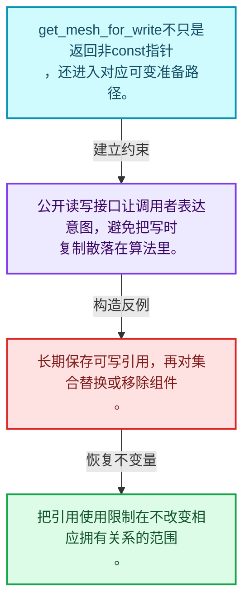
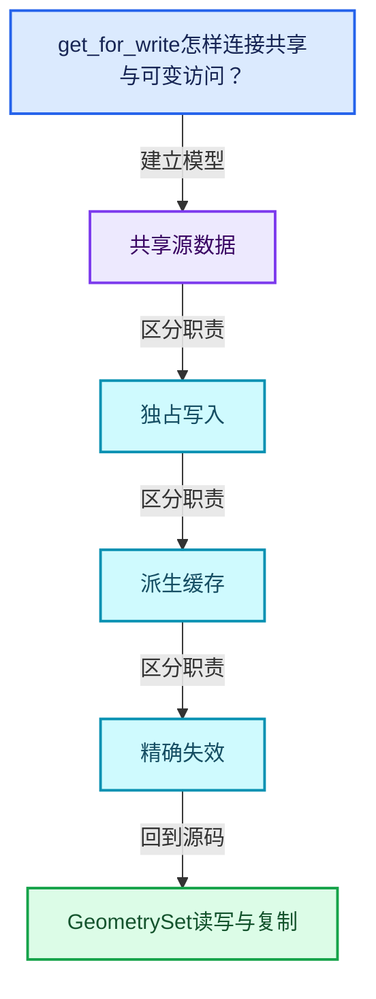
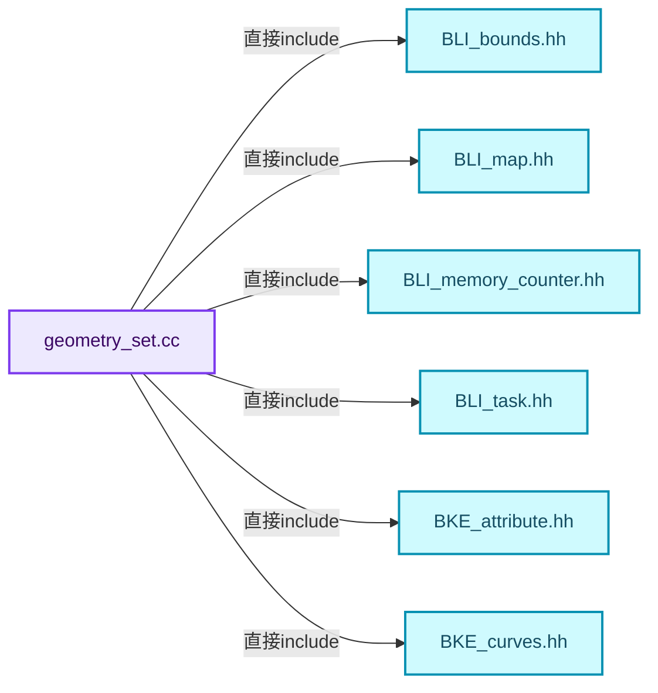
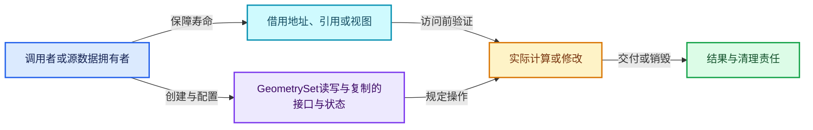
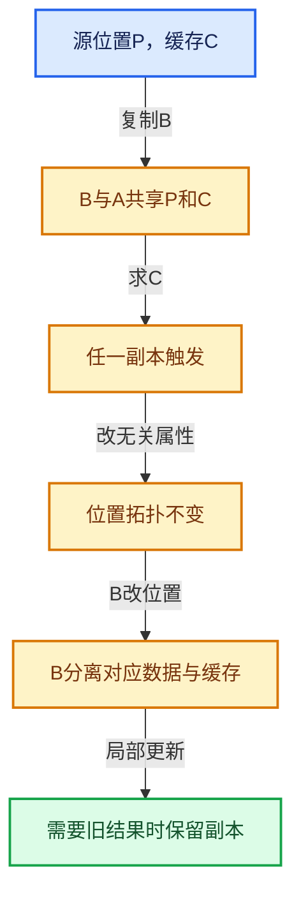

# 06-05 GeometrySet读写与复制

[方向导航](README.md) · [总目录](../README.md) · [覆盖索引](../%E6%BA%90%E7%A0%81%E7%89%88%E6%9C%AC%E4%B8%8E%E8%A6%86%E7%9B%96%E7%B4%A2%E5%BC%95.md)

> 阅读顺序：问题与数据模型 → 语法与类型 → 源码逐行 → 调用线索 → 历史与取舍 → 推演和练习。

- 基准 HEAD：`cbda6b96c26c0dee3c3b5cbb93960c4ac06a6b30`。
- 记录日期：2026-10-14。
- 教学示例状态：正文中的推演不是本机性能实测；已运行练习见验收报告。

## 一、从问题到设计

get_for_write怎样连接共享与可变访问？

写接口需要确保返回的可变数据符合独占条件；可写引用的有效期仍受后续修改影响。

本篇把语法、数据语义和系统取舍连接起来。共享计数回答谁还活着，缓存依赖回答结果是否仍正确，两者不能互相替代。

### 本篇独立模型与设计推理

get_mesh_for_write不只是返回非const指针，还进入对应可变准备路径。

设计取舍：公开读写接口让调用者表达意图，避免把写时复制散落在算法里。

最小反例：长期保存可写引用，再对集合替换或移除组件。

推导与处理：把引用使用限制在不改变相应拥有关系的范围。



### 源码范围与相邻篇章

| 文件 | 本篇逐行范围 | 基准SHA-256 |
|---|---|---|
| [source/blender/blenkernel/intern/geometry_set.cc](../../../../../source/blender/blenkernel/intern/geometry_set.cc) | L1—L846 | `6f68495e64575d625d7a84f32e4118d3fca1c6a223c57f2d5f7489b269e80c6d` |

同一主讲文件可能分多篇覆盖；超出本篇范围的符号通过覆盖索引定位。空行与纯注释保留在源码摘录中，逐行表解释有效语句与语法边界；许可证头统一保留。

前篇：[GeometryComponent共享](04-GeometryComponent%E5%85%B1%E4%BA%AB.md).

后篇：[CacheMutex惰性初始化](06-CacheMutex%E6%83%B0%E6%80%A7%E5%88%9D%E5%A7%8B%E5%8C%96.md).

## 二、类型、数据与阅读地图



这是概念依赖图，边表示阅读关系，不声称是运行时调用顺序。

### 直接编译依赖



箭头只表示头文件包含关系；完整调用线索见后面的符号定位表。

## 三、关键词、语法与类型角色

### 只读限定 const

const约束当前访问路径可做的修改。const指针、指向const的指针、const视图对象、const元素是不同位置的限定；其他别名可能仍可修改原对象。

具体检查：分别写T* const、const T*与const T* const，并画出不可修改的层次。

### 移动转换 std::move

std::move把表达式转换为可供移动重载选择的值类别，实际资源转移发生在被选中的构造或赋值中。对const对象move可能仍调用复制，对视图move也不会获得底层数据所有权。

具体检查：记录移动构造调用次数，不用变量名或std::move的出现次数替代测量。

### 异常边界 try与catch

try定义异常传播的局部边界。失败路径需要销毁已经成功构造的部分并释放相应存储；未构造的对象不能被析构。

具体检查：在第k次构造失败，列出已经存在的对象集合与待释放缓冲。

### 限定转换 const_cast

const_cast可以改变访问路径的限定，但不能让本来就是const的对象合法可写。常用于复用只读实现时，仍需检查底层对象是否实际可变。

具体检查：对非const对象的const引用与真正const对象分别分析修改是否合法。

### 可选值 optional

optional把不存在与存在的T区分开，T的构造和析构跟随engaged状态变化。访问前应由has_value或条件分支证明存在。

具体检查：把空Field状态与合法常量零区分，不能用某个普通值代替不存在。

### 构造与new表达式

普通new可能分配并构造；placement new在给定地址构造，存储由其他机制提供。失败回滚应区分两类责任。

具体检查：追踪地址来自哪里、构造何时成功、由谁析构、由谁释放。

### 内部断言 assert

断言表达开发者预期成立的内部契约，发布构建可能关闭。它不能替代对不可信输入的完整错误处理，也不保证后续操作被运行时保护。

具体检查：对每条断言构造违反条件的输入，区分调用者错误与应向用户报告的错误。

### 独占拥有 unique_ptr

unique_ptr通过移动转移拥有关系，默认删除策略必须与资源来源匹配。get返回借用指针，release交出责任而不销毁。

具体检查：区分move、get、release和reset后谁负责销毁。

## 四、真实源码与逐行讲解

源码块保持原行内容，原始行号由小节标题及逐行表给出。表中的调用定位是静态阅读辅助；重载、模板实例化、宏展开和虚调用需结合完整声明，不能仅凭词法出现证明动态调用。

### geometry_set.cc：L1—L39

<!-- source:source/blender/blenkernel/intern/geometry_set.cc:1:39 -->

```cpp
/* SPDX-FileCopyrightText: 2023 Blender Authors
 *
 * SPDX-License-Identifier: GPL-2.0-or-later */

/** \file
 * \ingroup bke
 */

#include <fmt/format.h>

#include "BLI_bounds.hh"
#include "BLI_map.hh"
#include "BLI_memory_counter.hh"
#include "BLI_task.hh"

#include "BKE_attribute.hh"
#include "BKE_curves.hh"
#include "BKE_geometry_set.hh"
#include "BKE_geometry_set_instances.hh"
#include "BKE_grease_pencil.hh"
#include "BKE_instances.hh"
#include "BKE_mesh.hh"
#include "BKE_modifier.hh"
#include "BKE_object_types.hh"
#include "BKE_subdiv_modifier.hh"
#include "BKE_volume.hh"

#include "NOD_geometry_nodes_bundle.hh"

#include "DNA_object_types.h"
#include "DNA_pointcloud_types.h"

namespace blender::bke {

/* -------------------------------------------------------------------- */
/** \name Geometry Component
 * \{ */

GeometryComponent::GeometryComponent(Type type) : type_(type) {}
```

| 原始行 | 语义、约束与检查 |
|---|---|
| L9 | 引入编译依赖 <fmt/format.h>；这是声明可见性关系，不表示运行时一定调用该文件的所有接口。 |
| L11 | 引入编译依赖 "BLI_bounds.hh"；这是声明可见性关系，不表示运行时一定调用该文件的所有接口。 |
| L12 | 引入编译依赖 "BLI_map.hh"；这是声明可见性关系，不表示运行时一定调用该文件的所有接口。 |
| L13 | 引入编译依赖 "BLI_memory_counter.hh"；这是声明可见性关系，不表示运行时一定调用该文件的所有接口。 |
| L14 | 引入编译依赖 "BLI_task.hh"；这是声明可见性关系，不表示运行时一定调用该文件的所有接口。 |
| L16 | 引入编译依赖 "BKE_attribute.hh"；这是声明可见性关系，不表示运行时一定调用该文件的所有接口。 |
| L17 | 引入编译依赖 "BKE_curves.hh"；这是声明可见性关系，不表示运行时一定调用该文件的所有接口。 |
| L18 | 引入编译依赖 "BKE_geometry_set.hh"；这是声明可见性关系，不表示运行时一定调用该文件的所有接口。 |
| L19 | 引入编译依赖 "BKE_geometry_set_instances.hh"；这是声明可见性关系，不表示运行时一定调用该文件的所有接口。 |
| L20 | 引入编译依赖 "BKE_grease_pencil.hh"；这是声明可见性关系，不表示运行时一定调用该文件的所有接口。 |
| L21 | 引入编译依赖 "BKE_instances.hh"；这是声明可见性关系，不表示运行时一定调用该文件的所有接口。 |
| L22 | 引入编译依赖 "BKE_mesh.hh"；这是声明可见性关系，不表示运行时一定调用该文件的所有接口。 |
| L23 | 引入编译依赖 "BKE_modifier.hh"；这是声明可见性关系，不表示运行时一定调用该文件的所有接口。 |
| L24 | 引入编译依赖 "BKE_object_types.hh"；这是声明可见性关系，不表示运行时一定调用该文件的所有接口。 |
| L25 | 引入编译依赖 "BKE_subdiv_modifier.hh"；这是声明可见性关系，不表示运行时一定调用该文件的所有接口。 |
| L26 | 引入编译依赖 "BKE_volume.hh"；这是声明可见性关系，不表示运行时一定调用该文件的所有接口。 |
| L28 | 引入编译依赖 "NOD_geometry_nodes_bundle.hh"；这是声明可见性关系，不表示运行时一定调用该文件的所有接口。 |
| L30 | 引入编译依赖 "DNA_object_types.h"；这是声明可见性关系，不表示运行时一定调用该文件的所有接口。 |
| L31 | 引入编译依赖 "DNA_pointcloud_types.h"；这是声明可见性关系，不表示运行时一定调用该文件的所有接口。 |
| L33 | 把后续声明放入 blender::bke 命名空间，影响名称查找和符号归属，不创建运行时对象。 |
| L39 | 出现调用或函数声明 `GeometryComponent::GeometryComponent`，对应表达式为 `GeometryComponent::GeometryComponent(Type type) : type_(type) {}`。参数求值、返回类型与重载需结合前后完整语句；静态文本引用不能证明动态目标。 |

### geometry_set.cc：L40—L89

<!-- source:source/blender/blenkernel/intern/geometry_set.cc:40:89 -->

```cpp

GeometryComponentPtr GeometryComponent::create(Type component_type)
{
  switch (component_type) {
    case Type::Mesh:
      return GeometryComponentPtr(new MeshComponent());
    case Type::PointCloud:
      return GeometryComponentPtr(new PointCloudComponent());
    case Type::Instance:
      return GeometryComponentPtr(new InstancesComponent());
    case Type::Volume:
      return GeometryComponentPtr(new VolumeComponent());
    case Type::Curve:
      return GeometryComponentPtr(new CurveComponent());
    case Type::Edit:
      return GeometryComponentPtr(new GeometryComponentEditData());
    case Type::GreasePencil:
      return GeometryComponentPtr(new GreasePencilComponent());
  }
  BLI_assert_unreachable();
  return {};
}

int GeometryComponent::attribute_domain_size(const AttrDomain domain) const
{
  if (this->is_empty()) {
    return 0;
  }
  const std::optional<AttributeAccessor> attributes = this->attributes();
  if (attributes.has_value()) {
    return attributes->domain_size(domain);
  }
  return 0;
}

std::optional<AttributeAccessor> GeometryComponent::attributes() const
{
  return std::nullopt;
};
std::optional<MutableAttributeAccessor> GeometryComponent::attributes_for_write()
{
  return std::nullopt;
}

void GeometryComponent::count_memory(MemoryCounter & /*memory*/) const {}

GeometryComponent::Type GeometryComponent::type() const
{
  return type_;
}
```

本段语义重点：

- 分支证据 `this->is_empty())`：分别推演条件成立与不成立，核对相同出口处的状态。
- 分支证据 `attributes.has_value())`：分别推演条件成立与不成立，核对相同出口处的状态。

| 原始行 | 语义、约束与检查 |
|---|---|
| L41 | 出现调用或函数声明 `GeometryComponent::create`，对应表达式为 `GeometryComponentPtr GeometryComponent::create(Type component_type)`。参数求值、返回类型与重载需结合前后完整语句；静态文本引用不能证明动态目标。 |
| L42 | 连接上一行的声明或控制结构与其语句块；后续行在这个作用域中执行或声明。 |
| L43 | 按 switch (component_type) 选择状态处理路径；每个case的break、return或贯穿行为决定下一步。 |
| L44 | 进入枚举或判别值对应分支 case Type::Mesh:；结合状态定义和后续更新判断允许的转移。 |
| L45 | 返回表达式 `GeometryComponentPtr(new MeshComponent())`。 |
| L46 | 进入枚举或判别值对应分支 case Type::PointCloud:；结合状态定义和后续更新判断允许的转移。 |
| L47 | 返回表达式 `GeometryComponentPtr(new PointCloudComponent())`。 |
| L48 | 进入枚举或判别值对应分支 case Type::Instance:；结合状态定义和后续更新判断允许的转移。 |
| L49 | 返回表达式 `GeometryComponentPtr(new InstancesComponent())`。 |
| L50 | 进入枚举或判别值对应分支 case Type::Volume:；结合状态定义和后续更新判断允许的转移。 |
| L51 | 返回表达式 `GeometryComponentPtr(new VolumeComponent())`。 |
| L52 | 进入枚举或判别值对应分支 case Type::Curve:；结合状态定义和后续更新判断允许的转移。 |
| L53 | 返回表达式 `GeometryComponentPtr(new CurveComponent())`。 |
| L54 | 进入枚举或判别值对应分支 case Type::Edit:；结合状态定义和后续更新判断允许的转移。 |
| L55 | 返回表达式 `GeometryComponentPtr(new GeometryComponentEditData())`。 |
| L56 | 进入枚举或判别值对应分支 case Type::GreasePencil:；结合状态定义和后续更新判断允许的转移。 |
| L57 | 返回表达式 `GeometryComponentPtr(new GreasePencilComponent())`。 |
| L58 | 结束当前语法单元。局部自动对象在离开其作用域时按规则销毁；这不等于所有被引用的外部数据也被释放。 |
| L59 | 断言约束 `BLI_assert_unreachable();`。条件是后续访问的内部前置条件；发布构建可能不执行，不能把断言当作输入修复。 |
| L60 | 返回表达式 `{}`。 |
| L61 | 结束当前语法单元。局部自动对象在离开其作用域时按规则销毁；这不等于所有被引用的外部数据也被释放。 |
| L63 | 出现调用或函数声明 `GeometryComponent::attribute_domain_size`，对应表达式为 `int GeometryComponent::attribute_domain_size(const AttrDomain domain) const`。参数求值、返回类型与重载需结合前后完整语句；静态文本引用不能证明动态目标。 |
| L64 | 连接上一行的声明或控制结构与其语句块；后续行在这个作用域中执行或声明。 |
| L65 | 判断 `this->is_empty()`，成立时进入本分支，否则继续后续路径。 |
| L66 | 返回表达式 `0`。 |
| L67 | 结束当前语法单元。局部自动对象在离开其作用域时按规则销毁；这不等于所有被引用的外部数据也被释放。 |
| L68 | 把右侧 `this->attributes()` 用于初始化或更新左侧 `const std::optional<AttributeAccessor> attributes`。声明初始化与已有对象赋值应按上下文区分；有资源的类型会调用相应特殊成员。 |
| L69 | 判断 `attributes.has_value()`，成立时进入本分支，否则继续后续路径。 |
| L70 | 返回表达式 `attributes->domain_size(domain)`。 |
| L71 | 结束当前语法单元。局部自动对象在离开其作用域时按规则销毁；这不等于所有被引用的外部数据也被释放。 |
| L72 | 返回表达式 `0`。 |
| L73 | 结束当前语法单元。局部自动对象在离开其作用域时按规则销毁；这不等于所有被引用的外部数据也被释放。 |
| L75 | 出现调用或函数声明 `GeometryComponent::attributes`，对应表达式为 `std::optional<AttributeAccessor> GeometryComponent::attributes() const`。参数求值、返回类型与重载需结合前后完整语句；静态文本引用不能证明动态目标。 |
| L76 | 连接上一行的声明或控制结构与其语句块；后续行在这个作用域中执行或声明。 |
| L77 | 返回表达式 `std::nullopt`。 |
| L78 | 结束当前语法单元。局部自动对象在离开其作用域时按规则销毁；这不等于所有被引用的外部数据也被释放。 |
| L79 | 出现调用或函数声明 `GeometryComponent::attributes_for_write`，对应表达式为 `std::optional<MutableAttributeAccessor> GeometryComponent::attributes_for_write()`。参数求值、返回类型与重载需结合前后完整语句；静态文本引用不能证明动态目标。 |
| L80 | 连接上一行的声明或控制结构与其语句块；后续行在这个作用域中执行或声明。 |
| L81 | 返回表达式 `std::nullopt`。 |
| L82 | 结束当前语法单元。局部自动对象在离开其作用域时按规则销毁；这不等于所有被引用的外部数据也被释放。 |
| L84 | 出现调用或函数声明 `GeometryComponent::count_memory`，对应表达式为 `void GeometryComponent::count_memory(MemoryCounter & ) const {}`。参数求值、返回类型与重载需结合前后完整语句；静态文本引用不能证明动态目标。 |
| L86 | 出现调用或函数声明 `GeometryComponent::type`，对应表达式为 `GeometryComponent::Type GeometryComponent::type() const`。参数求值、返回类型与重载需结合前后完整语句；静态文本引用不能证明动态目标。 |
| L87 | 连接上一行的声明或控制结构与其语句块；后续行在这个作用域中执行或声明。 |
| L88 | 返回表达式 `type_`。 |
| L89 | 结束当前语法单元。局部自动对象在离开其作用域时按规则销毁；这不等于所有被引用的外部数据也被释放。 |

### geometry_set.cc：L90—L135

<!-- source:source/blender/blenkernel/intern/geometry_set.cc:90:135 -->

```cpp

bool GeometryComponent::is_empty() const
{
  return false;
}

void GeometryComponent::delete_self()
{
  delete this;
}

void GeometryComponent::delete_data_only()
{
  this->clear();
}

/** \} */

/* -------------------------------------------------------------------- */
/** \name Geometry Set
 * \{ */

GeometrySet::GeometrySet() = default;
GeometrySet::GeometrySet(const GeometrySet &other) = default;
GeometrySet::GeometrySet(GeometrySet &&other) = default;
GeometrySet::~GeometrySet() = default;
GeometrySet &GeometrySet::operator=(const GeometrySet &other) = default;
GeometrySet &GeometrySet::operator=(GeometrySet &&other) = default;

GeometryComponent &GeometrySet::get_component_for_write(GeometryComponent::Type component_type)
{
  GeometryComponentPtr &component_ptr = components_[size_t(component_type)];
  if (!component_ptr) {
    /* If the component did not exist before, create a new one. */
    component_ptr = GeometryComponent::create(component_type);
  }
  return component_ptr.ensure_mutable_inplace();
}

GeometryComponent *GeometrySet::get_component_for_write_ptr(GeometryComponent::Type type)
{
  if (this->has(type)) {
    return &this->get_component_for_write(type);
  }
  return nullptr;
}
```

本段语义重点：

- 分支证据 `!component_ptr)`：分别推演条件成立与不成立，核对相同出口处的状态。
- 分支证据 `this->has(type))`：分别推演条件成立与不成立，核对相同出口处的状态。

| 原始行 | 语义、约束与检查 |
|---|---|
| L91 | 出现调用或函数声明 `GeometryComponent::is_empty`，对应表达式为 `bool GeometryComponent::is_empty() const`。参数求值、返回类型与重载需结合前后完整语句；静态文本引用不能证明动态目标。 |
| L92 | 连接上一行的声明或控制结构与其语句块；后续行在这个作用域中执行或声明。 |
| L93 | 返回表达式 `false`。这是本路径的布尔结果，具体成功、存在或状态含义由函数接口规定。 |
| L94 | 结束当前语法单元。局部自动对象在离开其作用域时按规则销毁；这不等于所有被引用的外部数据也被释放。 |
| L96 | 出现调用或函数声明 `GeometryComponent::delete_self`，对应表达式为 `void GeometryComponent::delete_self()`。参数求值、返回类型与重载需结合前后完整语句；静态文本引用不能证明动态目标。 |
| L97 | 连接上一行的声明或控制结构与其语句块；后续行在这个作用域中执行或声明。 |
| L98 | 声明成员、局部对象或完成语句 `delete this`。若为指针或引用，它本身不说明拥有；若为值对象，其构造析构由所在作用域或外层对象管理。 |
| L99 | 结束当前语法单元。局部自动对象在离开其作用域时按规则销毁；这不等于所有被引用的外部数据也被释放。 |
| L101 | 出现调用或函数声明 `GeometryComponent::delete_data_only`，对应表达式为 `void GeometryComponent::delete_data_only()`。参数求值、返回类型与重载需结合前后完整语句；静态文本引用不能证明动态目标。 |
| L102 | 连接上一行的声明或控制结构与其语句块；后续行在这个作用域中执行或声明。 |
| L103 | 出现调用或函数声明 `clear`，对应表达式为 `this->clear();`。参数求值、返回类型与重载需结合前后完整语句；静态文本引用不能证明动态目标。 |
| L104 | 结束当前语法单元。局部自动对象在离开其作用域时按规则销毁；这不等于所有被引用的外部数据也被释放。 |
| L112 | 显式采用编译器生成的特殊成员行为：`GeometrySet::GeometrySet() = default;`。成员和基类的性质决定该操作是否可用、是否被删除及异常约定，不表示运行时给对象赋值为default。 |
| L113 | 显式采用编译器生成的特殊成员行为：`GeometrySet::GeometrySet(const GeometrySet &other) = default;`。成员和基类的性质决定该操作是否可用、是否被删除及异常约定，不表示运行时给对象赋值为default。 |
| L114 | 显式采用编译器生成的特殊成员行为：`GeometrySet::GeometrySet(GeometrySet &&other) = default;`。成员和基类的性质决定该操作是否可用、是否被删除及异常约定，不表示运行时给对象赋值为default。 |
| L115 | 显式采用编译器生成的特殊成员行为：`GeometrySet::~GeometrySet() = default;`。成员和基类的性质决定该操作是否可用、是否被删除及异常约定，不表示运行时给对象赋值为default。 |
| L116 | 显式采用编译器生成的特殊成员行为：`GeometrySet &GeometrySet::operator=(const GeometrySet &other) = default;`。成员和基类的性质决定该操作是否可用、是否被删除及异常约定，不表示运行时给对象赋值为default。 |
| L117 | 显式采用编译器生成的特殊成员行为：`GeometrySet &GeometrySet::operator=(GeometrySet &&other) = default;`。成员和基类的性质决定该操作是否可用、是否被删除及异常约定，不表示运行时给对象赋值为default。 |
| L119 | 出现调用或函数声明 `GeometrySet::get_component_for_write`，对应表达式为 `GeometryComponent &GeometrySet::get_component_for_write(GeometryComponent::Type component_type)`。参数求值、返回类型与重载需结合前后完整语句；静态文本引用不能证明动态目标。 |
| L120 | 连接上一行的声明或控制结构与其语句块；后续行在这个作用域中执行或声明。 |
| L121 | 把右侧 `components_[size_t(component_type)]` 用于初始化或更新左侧 `GeometryComponentPtr &component_ptr`。声明初始化与已有对象赋值应按上下文区分；有资源的类型会调用相应特殊成员。 |
| L122 | 判断 `!component_ptr`，成立时进入本分支，否则继续后续路径。 |
| L124 | 把右侧 `GeometryComponent::create(component_type)` 用于初始化或更新左侧 `component_ptr`。声明初始化与已有对象赋值应按上下文区分；有资源的类型会调用相应特殊成员。 |
| L125 | 结束当前语法单元。局部自动对象在离开其作用域时按规则销毁；这不等于所有被引用的外部数据也被释放。 |
| L126 | 返回表达式 `component_ptr.ensure_mutable_inplace()`。 |
| L127 | 结束当前语法单元。局部自动对象在离开其作用域时按规则销毁；这不等于所有被引用的外部数据也被释放。 |
| L129 | 出现调用或函数声明 `GeometrySet::get_component_for_write_ptr`，对应表达式为 `GeometryComponent *GeometrySet::get_component_for_write_ptr(GeometryComponent::Type type)`。参数求值、返回类型与重载需结合前后完整语句；静态文本引用不能证明动态目标。 |
| L130 | 连接上一行的声明或控制结构与其语句块；后续行在这个作用域中执行或声明。 |
| L131 | 判断 `this->has(type)`，成立时进入本分支，否则继续后续路径。 |
| L132 | 返回表达式 `&this->get_component_for_write(type)`。 |
| L133 | 结束当前语法单元。局部自动对象在离开其作用域时按规则销毁；这不等于所有被引用的外部数据也被释放。 |
| L134 | 返回表达式 `nullptr`。 |
| L135 | 结束当前语法单元。局部自动对象在离开其作用域时按规则销毁；这不等于所有被引用的外部数据也被释放。 |

### geometry_set.cc：L136—L181

<!-- source:source/blender/blenkernel/intern/geometry_set.cc:136:181 -->

```cpp

const GeometryComponent *GeometrySet::get_component(GeometryComponent::Type component_type) const
{
  return components_[size_t(component_type)].get();
}

bool GeometrySet::has(const GeometryComponent::Type component_type) const
{
  const GeometryComponentPtr &component = components_[size_t(component_type)];
  return component.has_value() && !component->is_empty();
}

void GeometrySet::remove(const GeometryComponent::Type component_type)
{
  components_[size_t(component_type)].reset();
}

void GeometrySet::keep_only(const Span<GeometryComponent::Type> component_types)
{
  for (GeometryComponentPtr &component_ptr : components_) {
    if (component_ptr) {
      if (!component_types.contains(component_ptr->type())) {
        component_ptr.reset();
      }
    }
  }
}

void GeometrySet::add(const GeometryComponent &component)
{
  BLI_assert(!components_[size_t(component.type())]);
  component.add_user();
  components_[size_t(component.type())] = GeometryComponentPtr(
      const_cast<GeometryComponent *>(&component));
}

Vector<const GeometryComponent *> GeometrySet::get_components() const
{
  Vector<const GeometryComponent *> components;
  for (const GeometryComponentPtr &component_ptr : components_) {
    if (component_ptr) {
      components.append(component_ptr.get());
    }
  }
  return components;
}
```

本段语义重点：

- `add_user`：增加共享使用计数，必须与未来相应释放配对。

| 原始行 | 语义、约束与检查 |
|---|---|
| L137 | 出现调用或函数声明 `GeometrySet::get_component`，对应表达式为 `const GeometryComponent *GeometrySet::get_component(GeometryComponent::Type component_type) const`。参数求值、返回类型与重载需结合前后完整语句；静态文本引用不能证明动态目标。 |
| L138 | 连接上一行的声明或控制结构与其语句块；后续行在这个作用域中执行或声明。 |
| L139 | 返回表达式 `components_[size_t(component_type)].get()`。 |
| L140 | 结束当前语法单元。局部自动对象在离开其作用域时按规则销毁；这不等于所有被引用的外部数据也被释放。 |
| L142 | 出现调用或函数声明 `GeometrySet::has`，对应表达式为 `bool GeometrySet::has(const GeometryComponent::Type component_type) const`。参数求值、返回类型与重载需结合前后完整语句；静态文本引用不能证明动态目标。 |
| L143 | 连接上一行的声明或控制结构与其语句块；后续行在这个作用域中执行或声明。 |
| L144 | 把右侧 `components_[size_t(component_type)]` 用于初始化或更新左侧 `const GeometryComponentPtr &component`。声明初始化与已有对象赋值应按上下文区分；有资源的类型会调用相应特殊成员。 |
| L145 | 返回表达式 `component.has_value() && !component->is_empty()`。结合函数声明检查返回值是否借用原存储，借用值不会自动延长其寿命。 |
| L146 | 结束当前语法单元。局部自动对象在离开其作用域时按规则销毁；这不等于所有被引用的外部数据也被释放。 |
| L148 | 出现调用或函数声明 `GeometrySet::remove`，对应表达式为 `void GeometrySet::remove(const GeometryComponent::Type component_type)`。参数求值、返回类型与重载需结合前后完整语句；静态文本引用不能证明动态目标。 |
| L149 | 连接上一行的声明或控制结构与其语句块；后续行在这个作用域中执行或声明。 |
| L150 | 出现调用或函数声明 `size_t`，对应表达式为 `components_[size_t(component_type)].reset();`。参数求值、返回类型与重载需结合前后完整语句；静态文本引用不能证明动态目标。 |
| L151 | 结束当前语法单元。局部自动对象在离开其作用域时按规则销毁；这不等于所有被引用的外部数据也被释放。 |
| L153 | 出现调用或函数声明 `GeometrySet::keep_only`，对应表达式为 `void GeometrySet::keep_only(const Span<GeometryComponent::Type> component_types)`。参数求值、返回类型与重载需结合前后完整语句；静态文本引用不能证明动态目标。 |
| L154 | 连接上一行的声明或控制结构与其语句块；后续行在这个作用域中执行或声明。 |
| L155 | 按 `for (GeometryComponentPtr &component_ptr : components_)` 指定的范围或条件重复执行。对照循环变量与真实元素编号；循环内调用成本乘以实际迭代次数。 |
| L156 | 判断 `component_ptr`，成立时进入本分支，否则继续后续路径。 |
| L157 | 判断 `!component_types.contains(component_ptr->type())`，成立时进入本分支，否则继续后续路径。 |
| L158 | 出现调用或函数声明 `reset`，对应表达式为 `component_ptr.reset();`。参数求值、返回类型与重载需结合前后完整语句；静态文本引用不能证明动态目标。 |
| L159 | 结束当前语法单元。局部自动对象在离开其作用域时按规则销毁；这不等于所有被引用的外部数据也被释放。 |
| L160 | 结束当前语法单元。局部自动对象在离开其作用域时按规则销毁；这不等于所有被引用的外部数据也被释放。 |
| L161 | 结束当前语法单元。局部自动对象在离开其作用域时按规则销毁；这不等于所有被引用的外部数据也被释放。 |
| L162 | 结束当前语法单元。局部自动对象在离开其作用域时按规则销毁；这不等于所有被引用的外部数据也被释放。 |
| L164 | 出现调用或函数声明 `GeometrySet::add`，对应表达式为 `void GeometrySet::add(const GeometryComponent &component)`。参数求值、返回类型与重载需结合前后完整语句；静态文本引用不能证明动态目标。 |
| L165 | 连接上一行的声明或控制结构与其语句块；后续行在这个作用域中执行或声明。 |
| L166 | 断言约束 `BLI_assert(!components_[size_t(component.type())]);`。条件是后续访问的内部前置条件；发布构建可能不执行，不能把断言当作输入修复。 |
| L167 | 本行使用 `add_user`：增加共享使用计数，必须与未来相应释放配对。 |
| L168 | 把右侧 `GeometryComponentPtr(` 用于初始化或更新左侧 `components_[size_t(component.type())]`。声明初始化与已有对象赋值应按上下文区分；有资源的类型会调用相应特殊成员。 |
| L169 | 出现调用或函数声明 `const_cast`，对应表达式为 `const_cast<GeometryComponent *>(&component));`。参数求值、返回类型与重载需结合前后完整语句；静态文本引用不能证明动态目标。 |
| L170 | 结束当前语法单元。局部自动对象在离开其作用域时按规则销毁；这不等于所有被引用的外部数据也被释放。 |
| L172 | 出现调用或函数声明 `GeometrySet::get_components`，对应表达式为 `Vector<const GeometryComponent *> GeometrySet::get_components() const`。参数求值、返回类型与重载需结合前后完整语句；静态文本引用不能证明动态目标。 |
| L173 | 连接上一行的声明或控制结构与其语句块；后续行在这个作用域中执行或声明。 |
| L174 | 声明成员、局部对象或完成语句 `Vector<const GeometryComponent *> components`。若为指针或引用，它本身不说明拥有；若为值对象，其构造析构由所在作用域或外层对象管理。 |
| L175 | 按 `for (const GeometryComponentPtr &component_ptr : components_)` 指定的范围或条件重复执行。对照循环变量与真实元素编号；循环内调用成本乘以实际迭代次数。 |
| L176 | 判断 `component_ptr`，成立时进入本分支，否则继续后续路径。 |
| L177 | 出现调用或函数声明 `append`，对应表达式为 `components.append(component_ptr.get());`。参数求值、返回类型与重载需结合前后完整语句；静态文本引用不能证明动态目标。 |
| L178 | 结束当前语法单元。局部自动对象在离开其作用域时按规则销毁；这不等于所有被引用的外部数据也被释放。 |
| L179 | 结束当前语法单元。局部自动对象在离开其作用域时按规则销毁；这不等于所有被引用的外部数据也被释放。 |
| L180 | 返回表达式 `components`。 |
| L181 | 结束当前语法单元。局部自动对象在离开其作用域时按规则销毁；这不等于所有被引用的外部数据也被释放。 |

### geometry_set.cc：L182—L209

<!-- source:source/blender/blenkernel/intern/geometry_set.cc:182:209 -->

```cpp

std::optional<Bounds<float3>> GeometrySet::compute_boundbox_without_instances(
    const bool use_radius, const bool use_subdiv) const
{
  std::optional<Bounds<float3>> bounds;
  if (const PointCloud *pointcloud = this->get_pointcloud()) {
    bounds = bounds::merge(bounds, pointcloud->bounds_min_max(use_radius));
  }
  if (const Mesh *mesh = this->get_mesh()) {
    /* Use tessellated subdivision mesh if it exists. */
    if (use_subdiv && mesh->runtime->mesh_eval) {
      bounds = bounds::merge(bounds, mesh->runtime->mesh_eval->bounds_min_max());
    }
    else {
      bounds = bounds::merge(bounds, mesh->bounds_min_max());
    }
  }
  if (const Volume *volume = this->get_volume()) {
    bounds = bounds::merge(bounds, BKE_volume_min_max(volume));
  }
  if (const Curves *curves_id = this->get_curves()) {
    bounds = bounds::merge(bounds, curves_id->geometry.wrap().bounds_min_max(use_radius));
  }
  if (const GreasePencil *grease_pencil = this->get_grease_pencil()) {
    bounds = bounds::merge(bounds, grease_pencil->bounds_min_max_eval(use_radius));
  }
  return bounds;
}
```

本段语义重点：

- 分支证据 `const PointCloud *pointcloud = this->get_pointcloud())`：分别推演条件成立与不成立，核对相同出口处的状态。
- 分支证据 `const Mesh *mesh = this->get_mesh())`：分别推演条件成立与不成立，核对相同出口处的状态。

| 原始行 | 语义、约束与检查 |
|---|---|
| L183 | 出现调用或函数声明 `GeometrySet::compute_boundbox_without_instances`，对应表达式为 `std::optional<Bounds<float3>> GeometrySet::compute_boundbox_without_instances(`。参数求值、返回类型与重载需结合前后完整语句；静态文本引用不能证明动态目标。 |
| L184 | 本行是连续声明或表达式的一部分：`const bool use_radius, const bool use_subdiv) const`。与本段前后行合读；逗号、括号和限定符决定它属于参数、初始化列表还是实际计算。 |
| L185 | 连接上一行的声明或控制结构与其语句块；后续行在这个作用域中执行或声明。 |
| L186 | 声明成员、局部对象或完成语句 `std::optional<Bounds<float3>> bounds`。若为指针或引用，它本身不说明拥有；若为值对象，其构造析构由所在作用域或外层对象管理。 |
| L187 | 判断 `const PointCloud *pointcloud = this->get_pointcloud()`，成立时进入本分支，否则继续后续路径。 |
| L188 | 把右侧 `bounds::merge(bounds, pointcloud->bounds_min_max(use_radius))` 用于初始化或更新左侧 `bounds`。声明初始化与已有对象赋值应按上下文区分；有资源的类型会调用相应特殊成员。 |
| L189 | 结束当前语法单元。局部自动对象在离开其作用域时按规则销毁；这不等于所有被引用的外部数据也被释放。 |
| L190 | 判断 `const Mesh *mesh = this->get_mesh()`，成立时进入本分支，否则继续后续路径。 |
| L192 | 判断 `use_subdiv && mesh->runtime->mesh_eval`，成立时进入本分支，否则继续后续路径。 |
| L193 | 把右侧 `bounds::merge(bounds, mesh->runtime->mesh_eval->bounds_min_max())` 用于初始化或更新左侧 `bounds`。声明初始化与已有对象赋值应按上下文区分；有资源的类型会调用相应特殊成员。 |
| L194 | 结束当前语法单元。局部自动对象在离开其作用域时按规则销毁；这不等于所有被引用的外部数据也被释放。 |
| L195 | 处理前一条件不成立的互补路径。比较两条路径最后是否恢复同一不变量，以及是否产生不同的资源责任。 |
| L196 | 把右侧 `bounds::merge(bounds, mesh->bounds_min_max())` 用于初始化或更新左侧 `bounds`。声明初始化与已有对象赋值应按上下文区分；有资源的类型会调用相应特殊成员。 |
| L197 | 结束当前语法单元。局部自动对象在离开其作用域时按规则销毁；这不等于所有被引用的外部数据也被释放。 |
| L198 | 结束当前语法单元。局部自动对象在离开其作用域时按规则销毁；这不等于所有被引用的外部数据也被释放。 |
| L199 | 判断 `const Volume *volume = this->get_volume()`，成立时进入本分支，否则继续后续路径。 |
| L200 | 把右侧 `bounds::merge(bounds, BKE_volume_min_max(volume))` 用于初始化或更新左侧 `bounds`。声明初始化与已有对象赋值应按上下文区分；有资源的类型会调用相应特殊成员。 |
| L201 | 结束当前语法单元。局部自动对象在离开其作用域时按规则销毁；这不等于所有被引用的外部数据也被释放。 |
| L202 | 判断 `const Curves *curves_id = this->get_curves()`，成立时进入本分支，否则继续后续路径。 |
| L203 | 把右侧 `bounds::merge(bounds, curves_id->geometry.wrap().bounds_min_max(use_radius))` 用于初始化或更新左侧 `bounds`。声明初始化与已有对象赋值应按上下文区分；有资源的类型会调用相应特殊成员。 |
| L204 | 结束当前语法单元。局部自动对象在离开其作用域时按规则销毁；这不等于所有被引用的外部数据也被释放。 |
| L205 | 判断 `const GreasePencil *grease_pencil = this->get_grease_pencil()`，成立时进入本分支，否则继续后续路径。 |
| L206 | 把右侧 `bounds::merge(bounds, grease_pencil->bounds_min_max_eval(use_radius))` 用于初始化或更新左侧 `bounds`。声明初始化与已有对象赋值应按上下文区分；有资源的类型会调用相应特殊成员。 |
| L207 | 结束当前语法单元。局部自动对象在离开其作用域时按规则销毁；这不等于所有被引用的外部数据也被释放。 |
| L208 | 返回表达式 `bounds`。 |
| L209 | 结束当前语法单元。局部自动对象在离开其作用域时按规则销毁；这不等于所有被引用的外部数据也被释放。 |

### geometry_set.cc：L210—L263

<!-- source:source/blender/blenkernel/intern/geometry_set.cc:210:263 -->

```cpp

std::ostream &operator<<(std::ostream &stream, const GeometrySet &geometry_set)
{
  Vector<std::string> parts;
  if (!geometry_set.name().is_empty()) {
    parts.append(fmt::format("\"{}\"", geometry_set.name()));
  }
  if (const Mesh *mesh = geometry_set.get_mesh()) {
    parts.append(std::to_string(mesh->verts_num) + " verts");
    parts.append(std::to_string(mesh->edges_num) + " edges");
    parts.append(std::to_string(mesh->faces_num) + " faces");
    parts.append(std::to_string(mesh->corners_num) + " corners");
    if (mesh->runtime->subsurf_runtime_data) {
      const int resolution = mesh->runtime->subsurf_runtime_data->resolution;
      if (is_power_of_2_i(resolution - 1)) {
        /* Display the resolution as subdiv levels if possible because that's more common. */
        const int level = log2_floor(resolution - 1);
        parts.append(std::to_string(level) + " subdiv levels");
      }
      else {
        parts.append(std::to_string(resolution) + " subdiv resolution");
      }
    }
  }
  if (const Curves *curves = geometry_set.get_curves()) {
    parts.append(std::to_string(curves->geometry.point_num) + " control points");
    parts.append(std::to_string(curves->geometry.curve_num) + " curves");
  }
  if (const GreasePencil *grease_pencil = geometry_set.get_grease_pencil()) {
    parts.append(std::to_string(grease_pencil->layers().size()) + " Grease Pencil layers");
  }
  if (const PointCloud *pointcloud = geometry_set.get_pointcloud()) {
    parts.append(std::to_string(pointcloud->totpoint) + " points");
  }
  if (const Volume *volume = geometry_set.get_volume()) {
    parts.append(std::to_string(BKE_volume_num_grids(volume)) + " volume grids");
  }
  if (geometry_set.has_instances()) {
    parts.append(std::to_string(geometry_set.get_instances()->instances_num()) + " instances");
  }
  if (geometry_set.get_curve_edit_hints()) {
    parts.append("curve edit hints");
  }

  stream << "<GeometrySet: ";
  for (const int i : parts.index_range()) {
    stream << parts[i];
    if (i < parts.size() - 1) {
      stream << ", ";
    }
  }
  stream << ">";
  return stream;
}
```

本段语义重点：

- 分支证据 `!geometry_set.name().is_empty())`：分别推演条件成立与不成立，核对相同出口处的状态。
- 分支证据 `const Mesh *mesh = geometry_set.get_mesh())`：分别推演条件成立与不成立，核对相同出口处的状态。

| 原始行 | 语义、约束与检查 |
|---|---|
| L211 | 运算符重载声明、定义或显式调用：`std::ostream &operator<<(std::ostream &stream, const GeometrySet &geometry_set)`。结合参数和返回类型判断是赋值、索引、比较还是转换；operator=声明中的等号不是在给名为operator的变量赋值。 |
| L212 | 连接上一行的声明或控制结构与其语句块；后续行在这个作用域中执行或声明。 |
| L213 | 声明成员、局部对象或完成语句 `Vector<std::string> parts`。若为指针或引用，它本身不说明拥有；若为值对象，其构造析构由所在作用域或外层对象管理。 |
| L214 | 判断 `!geometry_set.name().is_empty()`，成立时进入本分支，否则继续后续路径。 |
| L215 | 出现调用或函数声明 `append`，对应表达式为 `parts.append(fmt::format("\"{}\"", geometry_set.name()));`。参数求值、返回类型与重载需结合前后完整语句；静态文本引用不能证明动态目标。 |
| L216 | 结束当前语法单元。局部自动对象在离开其作用域时按规则销毁；这不等于所有被引用的外部数据也被释放。 |
| L217 | 判断 `const Mesh *mesh = geometry_set.get_mesh()`，成立时进入本分支，否则继续后续路径。 |
| L218 | 出现调用或函数声明 `append`，对应表达式为 `parts.append(std::to_string(mesh->verts_num) + " verts");`。参数求值、返回类型与重载需结合前后完整语句；静态文本引用不能证明动态目标。 |
| L219 | 出现调用或函数声明 `append`，对应表达式为 `parts.append(std::to_string(mesh->edges_num) + " edges");`。参数求值、返回类型与重载需结合前后完整语句；静态文本引用不能证明动态目标。 |
| L220 | 出现调用或函数声明 `append`，对应表达式为 `parts.append(std::to_string(mesh->faces_num) + " faces");`。参数求值、返回类型与重载需结合前后完整语句；静态文本引用不能证明动态目标。 |
| L221 | 出现调用或函数声明 `append`，对应表达式为 `parts.append(std::to_string(mesh->corners_num) + " corners");`。参数求值、返回类型与重载需结合前后完整语句；静态文本引用不能证明动态目标。 |
| L222 | 判断 `mesh->runtime->subsurf_runtime_data`，成立时进入本分支，否则继续后续路径。 |
| L223 | 把右侧 `mesh->runtime->subsurf_runtime_data->resolution` 用于初始化或更新左侧 `const int resolution`。声明初始化与已有对象赋值应按上下文区分；有资源的类型会调用相应特殊成员。 |
| L224 | 判断 `is_power_of_2_i(resolution - 1)`，成立时进入本分支，否则继续后续路径。 |
| L226 | 把右侧 `log2_floor(resolution - 1)` 用于初始化或更新左侧 `const int level`。声明初始化与已有对象赋值应按上下文区分；有资源的类型会调用相应特殊成员。 |
| L227 | 出现调用或函数声明 `append`，对应表达式为 `parts.append(std::to_string(level) + " subdiv levels");`。参数求值、返回类型与重载需结合前后完整语句；静态文本引用不能证明动态目标。 |
| L228 | 结束当前语法单元。局部自动对象在离开其作用域时按规则销毁；这不等于所有被引用的外部数据也被释放。 |
| L229 | 处理前一条件不成立的互补路径。比较两条路径最后是否恢复同一不变量，以及是否产生不同的资源责任。 |
| L230 | 出现调用或函数声明 `append`，对应表达式为 `parts.append(std::to_string(resolution) + " subdiv resolution");`。参数求值、返回类型与重载需结合前后完整语句；静态文本引用不能证明动态目标。 |
| L231 | 结束当前语法单元。局部自动对象在离开其作用域时按规则销毁；这不等于所有被引用的外部数据也被释放。 |
| L232 | 结束当前语法单元。局部自动对象在离开其作用域时按规则销毁；这不等于所有被引用的外部数据也被释放。 |
| L233 | 结束当前语法单元。局部自动对象在离开其作用域时按规则销毁；这不等于所有被引用的外部数据也被释放。 |
| L234 | 判断 `const Curves *curves = geometry_set.get_curves()`，成立时进入本分支，否则继续后续路径。 |
| L235 | 出现调用或函数声明 `append`，对应表达式为 `parts.append(std::to_string(curves->geometry.point_num) + " control points");`。参数求值、返回类型与重载需结合前后完整语句；静态文本引用不能证明动态目标。 |
| L236 | 出现调用或函数声明 `append`，对应表达式为 `parts.append(std::to_string(curves->geometry.curve_num) + " curves");`。参数求值、返回类型与重载需结合前后完整语句；静态文本引用不能证明动态目标。 |
| L237 | 结束当前语法单元。局部自动对象在离开其作用域时按规则销毁；这不等于所有被引用的外部数据也被释放。 |
| L238 | 判断 `const GreasePencil *grease_pencil = geometry_set.get_grease_pencil()`，成立时进入本分支，否则继续后续路径。 |
| L239 | 出现调用或函数声明 `append`，对应表达式为 `parts.append(std::to_string(grease_pencil->layers().size()) + " Grease Pencil layers");`。参数求值、返回类型与重载需结合前后完整语句；静态文本引用不能证明动态目标。 |
| L240 | 结束当前语法单元。局部自动对象在离开其作用域时按规则销毁；这不等于所有被引用的外部数据也被释放。 |
| L241 | 判断 `const PointCloud *pointcloud = geometry_set.get_pointcloud()`，成立时进入本分支，否则继续后续路径。 |
| L242 | 出现调用或函数声明 `append`，对应表达式为 `parts.append(std::to_string(pointcloud->totpoint) + " points");`。参数求值、返回类型与重载需结合前后完整语句；静态文本引用不能证明动态目标。 |
| L243 | 结束当前语法单元。局部自动对象在离开其作用域时按规则销毁；这不等于所有被引用的外部数据也被释放。 |
| L244 | 判断 `const Volume *volume = geometry_set.get_volume()`，成立时进入本分支，否则继续后续路径。 |
| L245 | 出现调用或函数声明 `append`，对应表达式为 `parts.append(std::to_string(BKE_volume_num_grids(volume)) + " volume grids");`。参数求值、返回类型与重载需结合前后完整语句；静态文本引用不能证明动态目标。 |
| L246 | 结束当前语法单元。局部自动对象在离开其作用域时按规则销毁；这不等于所有被引用的外部数据也被释放。 |
| L247 | 判断 `geometry_set.has_instances()`，成立时进入本分支，否则继续后续路径。 |
| L248 | 出现调用或函数声明 `append`，对应表达式为 `parts.append(std::to_string(geometry_set.get_instances()->instances_num()) + " instances");`。参数求值、返回类型与重载需结合前后完整语句；静态文本引用不能证明动态目标。 |
| L249 | 结束当前语法单元。局部自动对象在离开其作用域时按规则销毁；这不等于所有被引用的外部数据也被释放。 |
| L250 | 判断 `geometry_set.get_curve_edit_hints()`，成立时进入本分支，否则继续后续路径。 |
| L251 | 出现调用或函数声明 `append`，对应表达式为 `parts.append("curve edit hints");`。参数求值、返回类型与重载需结合前后完整语句；静态文本引用不能证明动态目标。 |
| L252 | 结束当前语法单元。局部自动对象在离开其作用域时按规则销毁；这不等于所有被引用的外部数据也被释放。 |
| L254 | 声明成员、局部对象或完成语句 `stream << "<GeometrySet: "`。若为指针或引用，它本身不说明拥有；若为值对象，其构造析构由所在作用域或外层对象管理。 |
| L255 | 按 `for (const int i : parts.index_range())` 指定的范围或条件重复执行。对照循环变量与真实元素编号；循环内调用成本乘以实际迭代次数。 |
| L256 | 声明成员、局部对象或完成语句 `stream << parts[i]`。若为指针或引用，它本身不说明拥有；若为值对象，其构造析构由所在作用域或外层对象管理。 |
| L257 | 判断 `i < parts.size() - 1`，成立时进入本分支，否则继续后续路径。该边界影响可访问元素或可用容量，两者要按各变量的定义区分。 |
| L258 | 声明成员、局部对象或完成语句 `stream << ", "`。若为指针或引用，它本身不说明拥有；若为值对象，其构造析构由所在作用域或外层对象管理。 |
| L259 | 结束当前语法单元。局部自动对象在离开其作用域时按规则销毁；这不等于所有被引用的外部数据也被释放。 |
| L260 | 结束当前语法单元。局部自动对象在离开其作用域时按规则销毁；这不等于所有被引用的外部数据也被释放。 |
| L261 | 声明成员、局部对象或完成语句 `stream << ">"`。若为指针或引用，它本身不说明拥有；若为值对象，其构造析构由所在作用域或外层对象管理。 |
| L262 | 返回表达式 `stream`。 |
| L263 | 结束当前语法单元。局部自动对象在离开其作用域时按规则销毁；这不等于所有被引用的外部数据也被释放。 |

### geometry_set.cc：L264—L313

<!-- source:source/blender/blenkernel/intern/geometry_set.cc:264:313 -->

```cpp

void GeometrySet::clear()
{
  for (GeometryComponentPtr &component_ptr : components_) {
    component_ptr.reset();
  }
}

void GeometrySet::ensure_owns_direct_data()
{
  for (GeometryComponentPtr &component_ptr : components_) {
    if (!component_ptr) {
      continue;
    }
    if (component_ptr->owns_direct_data()) {
      continue;
    }
    GeometryComponent &component_for_write = this->get_component_for_write(component_ptr->type());
    component_for_write.ensure_owns_direct_data();
  }
}

void GeometrySet::ensure_owns_all_data()
{
  if (Instances *instances = this->get_instances_for_write()) {
    instances->ensure_geometry_instances();
  }
  this->ensure_owns_direct_data();
}

bool GeometrySet::owns_direct_data() const
{
  for (const GeometryComponentPtr &component_ptr : components_) {
    if (component_ptr) {
      if (!component_ptr->owns_direct_data()) {
        return false;
      }
    }
  }
  return true;
}

void GeometrySet::ensure_no_shared_components()
{
  for (const int i : IndexRange(this->components_.size())) {
    if (components_[i]) {
      this->get_component_for_write(GeometryComponent::Type(i));
    }
  }
}
```

本段语义重点：

- 分支证据 `!component_ptr)`：分别推演条件成立与不成立，核对相同出口处的状态。
- 分支证据 `component_ptr->owns_direct_data())`：分别推演条件成立与不成立，核对相同出口处的状态。

| 原始行 | 语义、约束与检查 |
|---|---|
| L265 | 出现调用或函数声明 `GeometrySet::clear`，对应表达式为 `void GeometrySet::clear()`。参数求值、返回类型与重载需结合前后完整语句；静态文本引用不能证明动态目标。 |
| L266 | 连接上一行的声明或控制结构与其语句块；后续行在这个作用域中执行或声明。 |
| L267 | 按 `for (GeometryComponentPtr &component_ptr : components_)` 指定的范围或条件重复执行。对照循环变量与真实元素编号；循环内调用成本乘以实际迭代次数。 |
| L268 | 出现调用或函数声明 `reset`，对应表达式为 `component_ptr.reset();`。参数求值、返回类型与重载需结合前后完整语句；静态文本引用不能证明动态目标。 |
| L269 | 结束当前语法单元。局部自动对象在离开其作用域时按规则销毁；这不等于所有被引用的外部数据也被释放。 |
| L270 | 结束当前语法单元。局部自动对象在离开其作用域时按规则销毁；这不等于所有被引用的外部数据也被释放。 |
| L272 | 出现调用或函数声明 `GeometrySet::ensure_owns_direct_data`，对应表达式为 `void GeometrySet::ensure_owns_direct_data()`。参数求值、返回类型与重载需结合前后完整语句；静态文本引用不能证明动态目标。 |
| L273 | 连接上一行的声明或控制结构与其语句块；后续行在这个作用域中执行或声明。 |
| L274 | 按 `for (GeometryComponentPtr &component_ptr : components_)` 指定的范围或条件重复执行。对照循环变量与真实元素编号；循环内调用成本乘以实际迭代次数。 |
| L275 | 判断 `!component_ptr`，成立时进入本分支，否则继续后续路径。 |
| L276 | 结束本轮循环并进入下一轮；核对本轮已经取得的资源是否由作用域或显式代码清理。 |
| L277 | 结束当前语法单元。局部自动对象在离开其作用域时按规则销毁；这不等于所有被引用的外部数据也被释放。 |
| L278 | 判断 `component_ptr->owns_direct_data()`，成立时进入本分支，否则继续后续路径。 |
| L279 | 结束本轮循环并进入下一轮；核对本轮已经取得的资源是否由作用域或显式代码清理。 |
| L280 | 结束当前语法单元。局部自动对象在离开其作用域时按规则销毁；这不等于所有被引用的外部数据也被释放。 |
| L281 | 把右侧 `this->get_component_for_write(component_ptr->type())` 用于初始化或更新左侧 `GeometryComponent &component_for_write`。声明初始化与已有对象赋值应按上下文区分；有资源的类型会调用相应特殊成员。 |
| L282 | 出现调用或函数声明 `ensure_owns_direct_data`，对应表达式为 `component_for_write.ensure_owns_direct_data();`。参数求值、返回类型与重载需结合前后完整语句；静态文本引用不能证明动态目标。 |
| L283 | 结束当前语法单元。局部自动对象在离开其作用域时按规则销毁；这不等于所有被引用的外部数据也被释放。 |
| L284 | 结束当前语法单元。局部自动对象在离开其作用域时按规则销毁；这不等于所有被引用的外部数据也被释放。 |
| L286 | 出现调用或函数声明 `GeometrySet::ensure_owns_all_data`，对应表达式为 `void GeometrySet::ensure_owns_all_data()`。参数求值、返回类型与重载需结合前后完整语句；静态文本引用不能证明动态目标。 |
| L287 | 连接上一行的声明或控制结构与其语句块；后续行在这个作用域中执行或声明。 |
| L288 | 判断 `Instances *instances = this->get_instances_for_write()`，成立时进入本分支，否则继续后续路径。 |
| L289 | 出现调用或函数声明 `ensure_geometry_instances`，对应表达式为 `instances->ensure_geometry_instances();`。参数求值、返回类型与重载需结合前后完整语句；静态文本引用不能证明动态目标。 |
| L290 | 结束当前语法单元。局部自动对象在离开其作用域时按规则销毁；这不等于所有被引用的外部数据也被释放。 |
| L291 | 出现调用或函数声明 `ensure_owns_direct_data`，对应表达式为 `this->ensure_owns_direct_data();`。参数求值、返回类型与重载需结合前后完整语句；静态文本引用不能证明动态目标。 |
| L292 | 结束当前语法单元。局部自动对象在离开其作用域时按规则销毁；这不等于所有被引用的外部数据也被释放。 |
| L294 | 出现调用或函数声明 `GeometrySet::owns_direct_data`，对应表达式为 `bool GeometrySet::owns_direct_data() const`。参数求值、返回类型与重载需结合前后完整语句；静态文本引用不能证明动态目标。 |
| L295 | 连接上一行的声明或控制结构与其语句块；后续行在这个作用域中执行或声明。 |
| L296 | 按 `for (const GeometryComponentPtr &component_ptr : components_)` 指定的范围或条件重复执行。对照循环变量与真实元素编号；循环内调用成本乘以实际迭代次数。 |
| L297 | 判断 `component_ptr`，成立时进入本分支，否则继续后续路径。 |
| L298 | 判断 `!component_ptr->owns_direct_data()`，成立时进入本分支，否则继续后续路径。 |
| L299 | 返回表达式 `false`。这是本路径的布尔结果，具体成功、存在或状态含义由函数接口规定。 |
| L300 | 结束当前语法单元。局部自动对象在离开其作用域时按规则销毁；这不等于所有被引用的外部数据也被释放。 |
| L301 | 结束当前语法单元。局部自动对象在离开其作用域时按规则销毁；这不等于所有被引用的外部数据也被释放。 |
| L302 | 结束当前语法单元。局部自动对象在离开其作用域时按规则销毁；这不等于所有被引用的外部数据也被释放。 |
| L303 | 返回表达式 `true`。这是本路径的布尔结果，具体成功、存在或状态含义由函数接口规定。 |
| L304 | 结束当前语法单元。局部自动对象在离开其作用域时按规则销毁；这不等于所有被引用的外部数据也被释放。 |
| L306 | 出现调用或函数声明 `GeometrySet::ensure_no_shared_components`，对应表达式为 `void GeometrySet::ensure_no_shared_components()`。参数求值、返回类型与重载需结合前后完整语句；静态文本引用不能证明动态目标。 |
| L307 | 连接上一行的声明或控制结构与其语句块；后续行在这个作用域中执行或声明。 |
| L308 | 按 `for (const int i : IndexRange(this->components_.size()))` 指定的范围或条件重复执行。对照循环变量与真实元素编号；循环内调用成本乘以实际迭代次数。 |
| L309 | 判断 `components_[i]`，成立时进入本分支，否则继续后续路径。 |
| L310 | 出现调用或函数声明 `get_component_for_write`，对应表达式为 `this->get_component_for_write(GeometryComponent::Type(i));`。参数求值、返回类型与重载需结合前后完整语句；静态文本引用不能证明动态目标。 |
| L311 | 结束当前语法单元。局部自动对象在离开其作用域时按规则销毁；这不等于所有被引用的外部数据也被释放。 |
| L312 | 结束当前语法单元。局部自动对象在离开其作用域时按规则销毁；这不等于所有被引用的外部数据也被释放。 |
| L313 | 结束当前语法单元。局部自动对象在离开其作用域时按规则销毁；这不等于所有被引用的外部数据也被释放。 |

### geometry_set.cc：L314—L361

<!-- source:source/blender/blenkernel/intern/geometry_set.cc:314:361 -->

```cpp

const Mesh *GeometrySet::get_mesh() const
{
  const MeshComponent *component = this->get_component<MeshComponent>();
  return (component == nullptr) ? nullptr : component->get();
}

bool GeometrySet::has_mesh() const
{
  const MeshComponent *component = this->get_component<MeshComponent>();
  return component != nullptr && component->has_mesh();
}

const PointCloud *GeometrySet::get_pointcloud() const
{
  const PointCloudComponent *component = this->get_component<PointCloudComponent>();
  return (component == nullptr) ? nullptr : component->get();
}

const Volume *GeometrySet::get_volume() const
{
  const VolumeComponent *component = this->get_component<VolumeComponent>();
  return (component == nullptr) ? nullptr : component->get();
}

const Curves *GeometrySet::get_curves() const
{
  const CurveComponent *component = this->get_component<CurveComponent>();
  return (component == nullptr) ? nullptr : component->get();
}

const Instances *GeometrySet::get_instances() const
{
  const InstancesComponent *component = this->get_component<InstancesComponent>();
  return (component == nullptr) ? nullptr : component->get();
}

const CurvesEditHints *GeometrySet::get_curve_edit_hints() const
{
  const GeometryComponentEditData *component = this->get_component<GeometryComponentEditData>();
  return (component == nullptr) ? nullptr : component->curves_edit_hints_.get();
}

const GreasePencilEditHints *GeometrySet::get_grease_pencil_edit_hints() const
{
  const GeometryComponentEditData *component = this->get_component<GeometryComponentEditData>();
  return (component == nullptr) ? nullptr : component->grease_pencil_edit_hints_.get();
}
```

| 原始行 | 语义、约束与检查 |
|---|---|
| L315 | 出现调用或函数声明 `GeometrySet::get_mesh`，对应表达式为 `const Mesh *GeometrySet::get_mesh() const`。参数求值、返回类型与重载需结合前后完整语句；静态文本引用不能证明动态目标。 |
| L316 | 连接上一行的声明或控制结构与其语句块；后续行在这个作用域中执行或声明。 |
| L317 | 把右侧 `this->get_component<MeshComponent>()` 用于初始化或更新左侧 `const MeshComponent *component`。声明初始化与已有对象赋值应按上下文区分；有资源的类型会调用相应特殊成员。 |
| L318 | 返回表达式 `(component == nullptr) ? nullptr : component->get()`。结合函数声明检查返回值是否借用原存储，借用值不会自动延长其寿命。 |
| L319 | 结束当前语法单元。局部自动对象在离开其作用域时按规则销毁；这不等于所有被引用的外部数据也被释放。 |
| L321 | 出现调用或函数声明 `GeometrySet::has_mesh`，对应表达式为 `bool GeometrySet::has_mesh() const`。参数求值、返回类型与重载需结合前后完整语句；静态文本引用不能证明动态目标。 |
| L322 | 连接上一行的声明或控制结构与其语句块；后续行在这个作用域中执行或声明。 |
| L323 | 把右侧 `this->get_component<MeshComponent>()` 用于初始化或更新左侧 `const MeshComponent *component`。声明初始化与已有对象赋值应按上下文区分；有资源的类型会调用相应特殊成员。 |
| L324 | 返回表达式 `component != nullptr && component->has_mesh()`。结合函数声明检查返回值是否借用原存储，借用值不会自动延长其寿命。 |
| L325 | 结束当前语法单元。局部自动对象在离开其作用域时按规则销毁；这不等于所有被引用的外部数据也被释放。 |
| L327 | 出现调用或函数声明 `GeometrySet::get_pointcloud`，对应表达式为 `const PointCloud *GeometrySet::get_pointcloud() const`。参数求值、返回类型与重载需结合前后完整语句；静态文本引用不能证明动态目标。 |
| L328 | 连接上一行的声明或控制结构与其语句块；后续行在这个作用域中执行或声明。 |
| L329 | 把右侧 `this->get_component<PointCloudComponent>()` 用于初始化或更新左侧 `const PointCloudComponent *component`。声明初始化与已有对象赋值应按上下文区分；有资源的类型会调用相应特殊成员。 |
| L330 | 返回表达式 `(component == nullptr) ? nullptr : component->get()`。结合函数声明检查返回值是否借用原存储，借用值不会自动延长其寿命。 |
| L331 | 结束当前语法单元。局部自动对象在离开其作用域时按规则销毁；这不等于所有被引用的外部数据也被释放。 |
| L333 | 出现调用或函数声明 `GeometrySet::get_volume`，对应表达式为 `const Volume *GeometrySet::get_volume() const`。参数求值、返回类型与重载需结合前后完整语句；静态文本引用不能证明动态目标。 |
| L334 | 连接上一行的声明或控制结构与其语句块；后续行在这个作用域中执行或声明。 |
| L335 | 把右侧 `this->get_component<VolumeComponent>()` 用于初始化或更新左侧 `const VolumeComponent *component`。声明初始化与已有对象赋值应按上下文区分；有资源的类型会调用相应特殊成员。 |
| L336 | 返回表达式 `(component == nullptr) ? nullptr : component->get()`。结合函数声明检查返回值是否借用原存储，借用值不会自动延长其寿命。 |
| L337 | 结束当前语法单元。局部自动对象在离开其作用域时按规则销毁；这不等于所有被引用的外部数据也被释放。 |
| L339 | 出现调用或函数声明 `GeometrySet::get_curves`，对应表达式为 `const Curves *GeometrySet::get_curves() const`。参数求值、返回类型与重载需结合前后完整语句；静态文本引用不能证明动态目标。 |
| L340 | 连接上一行的声明或控制结构与其语句块；后续行在这个作用域中执行或声明。 |
| L341 | 把右侧 `this->get_component<CurveComponent>()` 用于初始化或更新左侧 `const CurveComponent *component`。声明初始化与已有对象赋值应按上下文区分；有资源的类型会调用相应特殊成员。 |
| L342 | 返回表达式 `(component == nullptr) ? nullptr : component->get()`。结合函数声明检查返回值是否借用原存储，借用值不会自动延长其寿命。 |
| L343 | 结束当前语法单元。局部自动对象在离开其作用域时按规则销毁；这不等于所有被引用的外部数据也被释放。 |
| L345 | 出现调用或函数声明 `GeometrySet::get_instances`，对应表达式为 `const Instances *GeometrySet::get_instances() const`。参数求值、返回类型与重载需结合前后完整语句；静态文本引用不能证明动态目标。 |
| L346 | 连接上一行的声明或控制结构与其语句块；后续行在这个作用域中执行或声明。 |
| L347 | 把右侧 `this->get_component<InstancesComponent>()` 用于初始化或更新左侧 `const InstancesComponent *component`。声明初始化与已有对象赋值应按上下文区分；有资源的类型会调用相应特殊成员。 |
| L348 | 返回表达式 `(component == nullptr) ? nullptr : component->get()`。结合函数声明检查返回值是否借用原存储，借用值不会自动延长其寿命。 |
| L349 | 结束当前语法单元。局部自动对象在离开其作用域时按规则销毁；这不等于所有被引用的外部数据也被释放。 |
| L351 | 出现调用或函数声明 `GeometrySet::get_curve_edit_hints`，对应表达式为 `const CurvesEditHints *GeometrySet::get_curve_edit_hints() const`。参数求值、返回类型与重载需结合前后完整语句；静态文本引用不能证明动态目标。 |
| L352 | 连接上一行的声明或控制结构与其语句块；后续行在这个作用域中执行或声明。 |
| L353 | 把右侧 `this->get_component<GeometryComponentEditData>()` 用于初始化或更新左侧 `const GeometryComponentEditData *component`。声明初始化与已有对象赋值应按上下文区分；有资源的类型会调用相应特殊成员。 |
| L354 | 返回表达式 `(component == nullptr) ? nullptr : component->curves_edit_hints_.get()`。结合函数声明检查返回值是否借用原存储，借用值不会自动延长其寿命。 |
| L355 | 结束当前语法单元。局部自动对象在离开其作用域时按规则销毁；这不等于所有被引用的外部数据也被释放。 |
| L357 | 出现调用或函数声明 `GeometrySet::get_grease_pencil_edit_hints`，对应表达式为 `const GreasePencilEditHints *GeometrySet::get_grease_pencil_edit_hints() const`。参数求值、返回类型与重载需结合前后完整语句；静态文本引用不能证明动态目标。 |
| L358 | 连接上一行的声明或控制结构与其语句块；后续行在这个作用域中执行或声明。 |
| L359 | 把右侧 `this->get_component<GeometryComponentEditData>()` 用于初始化或更新左侧 `const GeometryComponentEditData *component`。声明初始化与已有对象赋值应按上下文区分；有资源的类型会调用相应特殊成员。 |
| L360 | 返回表达式 `(component == nullptr) ? nullptr : component->grease_pencil_edit_hints_.get()`。结合函数声明检查返回值是否借用原存储，借用值不会自动延长其寿命。 |
| L361 | 结束当前语法单元。局部自动对象在离开其作用域时按规则销毁；这不等于所有被引用的外部数据也被释放。 |

### geometry_set.cc：L362—L413

<!-- source:source/blender/blenkernel/intern/geometry_set.cc:362:413 -->

```cpp

const GizmoEditHints *GeometrySet::get_gizmo_edit_hints() const
{
  const GeometryComponentEditData *component = this->get_component<GeometryComponentEditData>();
  return (component == nullptr) ? nullptr : component->gizmo_edit_hints_.get();
}

const GreasePencil *GeometrySet::get_grease_pencil() const
{
  const GreasePencilComponent *component = this->get_component<GreasePencilComponent>();
  return (component == nullptr) ? nullptr : component->get();
}

bool GeometrySet::has_pointcloud() const
{
  const PointCloudComponent *component = this->get_component<PointCloudComponent>();
  return component != nullptr && component->has_pointcloud();
}

bool GeometrySet::has_instances() const
{
  const InstancesComponent *component = this->get_component<InstancesComponent>();
  return component != nullptr && component->get() != nullptr &&
         component->get()->instances_num() >= 1;
}

bool GeometrySet::has_volume() const
{
  const VolumeComponent *component = this->get_component<VolumeComponent>();
  return component != nullptr && component->has_volume();
}

bool GeometrySet::has_curves() const
{
  const CurveComponent *component = this->get_component<CurveComponent>();
  return component != nullptr && component->has_curves();
}

bool GeometrySet::has_realized_data() const
{
  for (const GeometryComponentPtr &component_ptr : components_) {
    if (component_ptr) {
      if (!ELEM(component_ptr->type(),
                GeometryComponent::Type::Instance,
                GeometryComponent::Type::Edit))
      {
        return true;
      }
    }
  }
  return false;
}
```

本段语义重点：

- 分支证据 `component_ptr)`：分别推演条件成立与不成立，核对相同出口处的状态。
- 分支证据 `!ELEM(component_ptr->type(),`：分别推演条件成立与不成立，核对相同出口处的状态。

| 原始行 | 语义、约束与检查 |
|---|---|
| L363 | 出现调用或函数声明 `GeometrySet::get_gizmo_edit_hints`，对应表达式为 `const GizmoEditHints *GeometrySet::get_gizmo_edit_hints() const`。参数求值、返回类型与重载需结合前后完整语句；静态文本引用不能证明动态目标。 |
| L364 | 连接上一行的声明或控制结构与其语句块；后续行在这个作用域中执行或声明。 |
| L365 | 把右侧 `this->get_component<GeometryComponentEditData>()` 用于初始化或更新左侧 `const GeometryComponentEditData *component`。声明初始化与已有对象赋值应按上下文区分；有资源的类型会调用相应特殊成员。 |
| L366 | 返回表达式 `(component == nullptr) ? nullptr : component->gizmo_edit_hints_.get()`。结合函数声明检查返回值是否借用原存储，借用值不会自动延长其寿命。 |
| L367 | 结束当前语法单元。局部自动对象在离开其作用域时按规则销毁；这不等于所有被引用的外部数据也被释放。 |
| L369 | 出现调用或函数声明 `GeometrySet::get_grease_pencil`，对应表达式为 `const GreasePencil *GeometrySet::get_grease_pencil() const`。参数求值、返回类型与重载需结合前后完整语句；静态文本引用不能证明动态目标。 |
| L370 | 连接上一行的声明或控制结构与其语句块；后续行在这个作用域中执行或声明。 |
| L371 | 把右侧 `this->get_component<GreasePencilComponent>()` 用于初始化或更新左侧 `const GreasePencilComponent *component`。声明初始化与已有对象赋值应按上下文区分；有资源的类型会调用相应特殊成员。 |
| L372 | 返回表达式 `(component == nullptr) ? nullptr : component->get()`。结合函数声明检查返回值是否借用原存储，借用值不会自动延长其寿命。 |
| L373 | 结束当前语法单元。局部自动对象在离开其作用域时按规则销毁；这不等于所有被引用的外部数据也被释放。 |
| L375 | 出现调用或函数声明 `GeometrySet::has_pointcloud`，对应表达式为 `bool GeometrySet::has_pointcloud() const`。参数求值、返回类型与重载需结合前后完整语句；静态文本引用不能证明动态目标。 |
| L376 | 连接上一行的声明或控制结构与其语句块；后续行在这个作用域中执行或声明。 |
| L377 | 把右侧 `this->get_component<PointCloudComponent>()` 用于初始化或更新左侧 `const PointCloudComponent *component`。声明初始化与已有对象赋值应按上下文区分；有资源的类型会调用相应特殊成员。 |
| L378 | 返回表达式 `component != nullptr && component->has_pointcloud()`。结合函数声明检查返回值是否借用原存储，借用值不会自动延长其寿命。 |
| L379 | 结束当前语法单元。局部自动对象在离开其作用域时按规则销毁；这不等于所有被引用的外部数据也被释放。 |
| L381 | 出现调用或函数声明 `GeometrySet::has_instances`，对应表达式为 `bool GeometrySet::has_instances() const`。参数求值、返回类型与重载需结合前后完整语句；静态文本引用不能证明动态目标。 |
| L382 | 连接上一行的声明或控制结构与其语句块；后续行在这个作用域中执行或声明。 |
| L383 | 把右侧 `this->get_component<InstancesComponent>()` 用于初始化或更新左侧 `const InstancesComponent *component`。声明初始化与已有对象赋值应按上下文区分；有资源的类型会调用相应特殊成员。 |
| L384 | 返回表达式 `component != nullptr && component->get() != nullptr &&`。结合函数声明检查返回值是否借用原存储，借用值不会自动延长其寿命。 |
| L385 | 出现调用或函数声明 `get`，对应表达式为 `component->get()->instances_num() >= 1;`。参数求值、返回类型与重载需结合前后完整语句；静态文本引用不能证明动态目标。 |
| L386 | 结束当前语法单元。局部自动对象在离开其作用域时按规则销毁；这不等于所有被引用的外部数据也被释放。 |
| L388 | 出现调用或函数声明 `GeometrySet::has_volume`，对应表达式为 `bool GeometrySet::has_volume() const`。参数求值、返回类型与重载需结合前后完整语句；静态文本引用不能证明动态目标。 |
| L389 | 连接上一行的声明或控制结构与其语句块；后续行在这个作用域中执行或声明。 |
| L390 | 把右侧 `this->get_component<VolumeComponent>()` 用于初始化或更新左侧 `const VolumeComponent *component`。声明初始化与已有对象赋值应按上下文区分；有资源的类型会调用相应特殊成员。 |
| L391 | 返回表达式 `component != nullptr && component->has_volume()`。结合函数声明检查返回值是否借用原存储，借用值不会自动延长其寿命。 |
| L392 | 结束当前语法单元。局部自动对象在离开其作用域时按规则销毁；这不等于所有被引用的外部数据也被释放。 |
| L394 | 出现调用或函数声明 `GeometrySet::has_curves`，对应表达式为 `bool GeometrySet::has_curves() const`。参数求值、返回类型与重载需结合前后完整语句；静态文本引用不能证明动态目标。 |
| L395 | 连接上一行的声明或控制结构与其语句块；后续行在这个作用域中执行或声明。 |
| L396 | 把右侧 `this->get_component<CurveComponent>()` 用于初始化或更新左侧 `const CurveComponent *component`。声明初始化与已有对象赋值应按上下文区分；有资源的类型会调用相应特殊成员。 |
| L397 | 返回表达式 `component != nullptr && component->has_curves()`。结合函数声明检查返回值是否借用原存储，借用值不会自动延长其寿命。 |
| L398 | 结束当前语法单元。局部自动对象在离开其作用域时按规则销毁；这不等于所有被引用的外部数据也被释放。 |
| L400 | 出现调用或函数声明 `GeometrySet::has_realized_data`，对应表达式为 `bool GeometrySet::has_realized_data() const`。参数求值、返回类型与重载需结合前后完整语句；静态文本引用不能证明动态目标。 |
| L401 | 连接上一行的声明或控制结构与其语句块；后续行在这个作用域中执行或声明。 |
| L402 | 按 `for (const GeometryComponentPtr &component_ptr : components_)` 指定的范围或条件重复执行。对照循环变量与真实元素编号；循环内调用成本乘以实际迭代次数。 |
| L403 | 判断 `component_ptr`，成立时进入本分支，否则继续后续路径。 |
| L404 | 判断 `!ELEM(component_ptr->type(`，成立时进入本分支，否则继续后续路径。 |
| L405 | 本行是连续声明或表达式的一部分：`GeometryComponent::Type::Instance,`。与本段前后行合读；逗号、括号和限定符决定它属于参数、初始化列表还是实际计算。 |
| L406 | 本行是连续声明或表达式的一部分：`GeometryComponent::Type::Edit))`。与本段前后行合读；逗号、括号和限定符决定它属于参数、初始化列表还是实际计算。 |
| L407 | 连接上一行的声明或控制结构与其语句块；后续行在这个作用域中执行或声明。 |
| L408 | 返回表达式 `true`。这是本路径的布尔结果，具体成功、存在或状态含义由函数接口规定。 |
| L409 | 结束当前语法单元。局部自动对象在离开其作用域时按规则销毁；这不等于所有被引用的外部数据也被释放。 |
| L410 | 结束当前语法单元。局部自动对象在离开其作用域时按规则销毁；这不等于所有被引用的外部数据也被释放。 |
| L411 | 结束当前语法单元。局部自动对象在离开其作用域时按规则销毁；这不等于所有被引用的外部数据也被释放。 |
| L412 | 返回表达式 `false`。这是本路径的布尔结果，具体成功、存在或状态含义由函数接口规定。 |
| L413 | 结束当前语法单元。局部自动对象在离开其作用域时按规则销毁；这不等于所有被引用的外部数据也被释放。 |

### geometry_set.cc：L414—L460

<!-- source:source/blender/blenkernel/intern/geometry_set.cc:414:460 -->

```cpp

bool GeometrySet::has_grease_pencil() const
{
  const GreasePencilComponent *component = this->get_component<GreasePencilComponent>();
  return component != nullptr && component->has_grease_pencil();
}

bool GeometrySet::is_empty() const
{
  return !(this->has_mesh() || this->has_curves() || this->has_pointcloud() ||
           this->has_volume() || this->has_instances() || this->has_grease_pencil());
}

GeometrySet GeometrySet::from_mesh(Mesh *mesh, GeometryOwnershipType ownership)
{
  GeometrySet geometry_set;
  geometry_set.replace_mesh(mesh, ownership);
  return geometry_set;
}

GeometrySet GeometrySet::from_volume(Volume *volume, GeometryOwnershipType ownership)
{
  GeometrySet geometry_set;
  geometry_set.replace_volume(volume, ownership);
  return geometry_set;
}

GeometrySet GeometrySet::from_pointcloud(PointCloud *pointcloud, GeometryOwnershipType ownership)
{
  GeometrySet geometry_set;
  geometry_set.replace_pointcloud(pointcloud, ownership);
  return geometry_set;
}

GeometrySet GeometrySet::from_curves(Curves *curves, GeometryOwnershipType ownership)
{
  GeometrySet geometry_set;
  geometry_set.replace_curves(curves, ownership);
  return geometry_set;
}

GeometrySet GeometrySet::from_instances(Instances *instances, GeometryOwnershipType ownership)
{
  GeometrySet geometry_set;
  geometry_set.replace_instances(instances, ownership);
  return geometry_set;
}
```

| 原始行 | 语义、约束与检查 |
|---|---|
| L415 | 出现调用或函数声明 `GeometrySet::has_grease_pencil`，对应表达式为 `bool GeometrySet::has_grease_pencil() const`。参数求值、返回类型与重载需结合前后完整语句；静态文本引用不能证明动态目标。 |
| L416 | 连接上一行的声明或控制结构与其语句块；后续行在这个作用域中执行或声明。 |
| L417 | 把右侧 `this->get_component<GreasePencilComponent>()` 用于初始化或更新左侧 `const GreasePencilComponent *component`。声明初始化与已有对象赋值应按上下文区分；有资源的类型会调用相应特殊成员。 |
| L418 | 返回表达式 `component != nullptr && component->has_grease_pencil()`。结合函数声明检查返回值是否借用原存储，借用值不会自动延长其寿命。 |
| L419 | 结束当前语法单元。局部自动对象在离开其作用域时按规则销毁；这不等于所有被引用的外部数据也被释放。 |
| L421 | 出现调用或函数声明 `GeometrySet::is_empty`，对应表达式为 `bool GeometrySet::is_empty() const`。参数求值、返回类型与重载需结合前后完整语句；静态文本引用不能证明动态目标。 |
| L422 | 连接上一行的声明或控制结构与其语句块；后续行在这个作用域中执行或声明。 |
| L423 | 返回表达式 `!(this->has_mesh() &#124;&#124; this->has_curves() &#124;&#124; this->has_pointcloud() &#124;&#124;`。 |
| L424 | 出现调用或函数声明 `has_volume`，对应表达式为 `this->has_volume() &#124;&#124; this->has_instances() &#124;&#124; this->has_grease_pencil());`。参数求值、返回类型与重载需结合前后完整语句；静态文本引用不能证明动态目标。 |
| L425 | 结束当前语法单元。局部自动对象在离开其作用域时按规则销毁；这不等于所有被引用的外部数据也被释放。 |
| L427 | 出现调用或函数声明 `GeometrySet::from_mesh`，对应表达式为 `GeometrySet GeometrySet::from_mesh(Mesh *mesh, GeometryOwnershipType ownership)`。参数求值、返回类型与重载需结合前后完整语句；静态文本引用不能证明动态目标。 |
| L428 | 连接上一行的声明或控制结构与其语句块；后续行在这个作用域中执行或声明。 |
| L429 | 声明成员、局部对象或完成语句 `GeometrySet geometry_set`。若为指针或引用，它本身不说明拥有；若为值对象，其构造析构由所在作用域或外层对象管理。 |
| L430 | 出现调用或函数声明 `replace_mesh`，对应表达式为 `geometry_set.replace_mesh(mesh, ownership);`。参数求值、返回类型与重载需结合前后完整语句；静态文本引用不能证明动态目标。 |
| L431 | 返回表达式 `geometry_set`。 |
| L432 | 结束当前语法单元。局部自动对象在离开其作用域时按规则销毁；这不等于所有被引用的外部数据也被释放。 |
| L434 | 出现调用或函数声明 `GeometrySet::from_volume`，对应表达式为 `GeometrySet GeometrySet::from_volume(Volume *volume, GeometryOwnershipType ownership)`。参数求值、返回类型与重载需结合前后完整语句；静态文本引用不能证明动态目标。 |
| L435 | 连接上一行的声明或控制结构与其语句块；后续行在这个作用域中执行或声明。 |
| L436 | 声明成员、局部对象或完成语句 `GeometrySet geometry_set`。若为指针或引用，它本身不说明拥有；若为值对象，其构造析构由所在作用域或外层对象管理。 |
| L437 | 出现调用或函数声明 `replace_volume`，对应表达式为 `geometry_set.replace_volume(volume, ownership);`。参数求值、返回类型与重载需结合前后完整语句；静态文本引用不能证明动态目标。 |
| L438 | 返回表达式 `geometry_set`。 |
| L439 | 结束当前语法单元。局部自动对象在离开其作用域时按规则销毁；这不等于所有被引用的外部数据也被释放。 |
| L441 | 出现调用或函数声明 `GeometrySet::from_pointcloud`，对应表达式为 `GeometrySet GeometrySet::from_pointcloud(PointCloud *pointcloud, GeometryOwnershipType ownership)`。参数求值、返回类型与重载需结合前后完整语句；静态文本引用不能证明动态目标。 |
| L442 | 连接上一行的声明或控制结构与其语句块；后续行在这个作用域中执行或声明。 |
| L443 | 声明成员、局部对象或完成语句 `GeometrySet geometry_set`。若为指针或引用，它本身不说明拥有；若为值对象，其构造析构由所在作用域或外层对象管理。 |
| L444 | 出现调用或函数声明 `replace_pointcloud`，对应表达式为 `geometry_set.replace_pointcloud(pointcloud, ownership);`。参数求值、返回类型与重载需结合前后完整语句；静态文本引用不能证明动态目标。 |
| L445 | 返回表达式 `geometry_set`。 |
| L446 | 结束当前语法单元。局部自动对象在离开其作用域时按规则销毁；这不等于所有被引用的外部数据也被释放。 |
| L448 | 出现调用或函数声明 `GeometrySet::from_curves`，对应表达式为 `GeometrySet GeometrySet::from_curves(Curves *curves, GeometryOwnershipType ownership)`。参数求值、返回类型与重载需结合前后完整语句；静态文本引用不能证明动态目标。 |
| L449 | 连接上一行的声明或控制结构与其语句块；后续行在这个作用域中执行或声明。 |
| L450 | 声明成员、局部对象或完成语句 `GeometrySet geometry_set`。若为指针或引用，它本身不说明拥有；若为值对象，其构造析构由所在作用域或外层对象管理。 |
| L451 | 出现调用或函数声明 `replace_curves`，对应表达式为 `geometry_set.replace_curves(curves, ownership);`。参数求值、返回类型与重载需结合前后完整语句；静态文本引用不能证明动态目标。 |
| L452 | 返回表达式 `geometry_set`。 |
| L453 | 结束当前语法单元。局部自动对象在离开其作用域时按规则销毁；这不等于所有被引用的外部数据也被释放。 |
| L455 | 出现调用或函数声明 `GeometrySet::from_instances`，对应表达式为 `GeometrySet GeometrySet::from_instances(Instances *instances, GeometryOwnershipType ownership)`。参数求值、返回类型与重载需结合前后完整语句；静态文本引用不能证明动态目标。 |
| L456 | 连接上一行的声明或控制结构与其语句块；后续行在这个作用域中执行或声明。 |
| L457 | 声明成员、局部对象或完成语句 `GeometrySet geometry_set`。若为指针或引用，它本身不说明拥有；若为值对象，其构造析构由所在作用域或外层对象管理。 |
| L458 | 出现调用或函数声明 `replace_instances`，对应表达式为 `geometry_set.replace_instances(instances, ownership);`。参数求值、返回类型与重载需结合前后完整语句；静态文本引用不能证明动态目标。 |
| L459 | 返回表达式 `geometry_set`。 |
| L460 | 结束当前语法单元。局部自动对象在离开其作用域时按规则销毁；这不等于所有被引用的外部数据也被释放。 |

### geometry_set.cc：L461—L503

<!-- source:source/blender/blenkernel/intern/geometry_set.cc:461:503 -->

```cpp

GeometrySet GeometrySet::from_instances(std::unique_ptr<Instances> instances)
{
  GeometrySet geometry_set;
  geometry_set.replace_instances(instances.release(), GeometryOwnershipType::Owned);
  return geometry_set;
}

GeometrySet GeometrySet::from_grease_pencil(GreasePencil *grease_pencil,
                                            GeometryOwnershipType ownership)
{
  GeometrySet geometry_set;
  geometry_set.replace_grease_pencil(grease_pencil, ownership);
  return geometry_set;
}

void GeometrySet::replace_mesh(Mesh *mesh, GeometryOwnershipType ownership)
{
  if (mesh == nullptr) {
    this->remove<MeshComponent>();
    return;
  }
  if (mesh == this->get_mesh()) {
    return;
  }
  this->remove<MeshComponent>();
  MeshComponent &component = this->get_component_for_write<MeshComponent>();
  component.replace(mesh, ownership);
}

void GeometrySet::replace_curves(Curves *curves, GeometryOwnershipType ownership)
{
  if (curves == nullptr) {
    this->remove<CurveComponent>();
    return;
  }
  if (curves == this->get_curves()) {
    return;
  }
  this->remove<CurveComponent>();
  CurveComponent &component = this->get_component_for_write<CurveComponent>();
  component.replace(curves, ownership);
}
```

本段语义重点：

- 分支证据 `mesh == nullptr)`：分别推演条件成立与不成立，核对相同出口处的状态。
- 分支证据 `mesh == this->get_mesh())`：分别推演条件成立与不成立，核对相同出口处的状态。

| 原始行 | 语义、约束与检查 |
|---|---|
| L462 | 出现调用或函数声明 `GeometrySet::from_instances`，对应表达式为 `GeometrySet GeometrySet::from_instances(std::unique_ptr<Instances> instances)`。参数求值、返回类型与重载需结合前后完整语句；静态文本引用不能证明动态目标。 |
| L463 | 连接上一行的声明或控制结构与其语句块；后续行在这个作用域中执行或声明。 |
| L464 | 声明成员、局部对象或完成语句 `GeometrySet geometry_set`。若为指针或引用，它本身不说明拥有；若为值对象，其构造析构由所在作用域或外层对象管理。 |
| L465 | 出现调用或函数声明 `replace_instances`，对应表达式为 `geometry_set.replace_instances(instances.release(), GeometryOwnershipType::Owned);`。参数求值、返回类型与重载需结合前后完整语句；静态文本引用不能证明动态目标。 |
| L466 | 返回表达式 `geometry_set`。 |
| L467 | 结束当前语法单元。局部自动对象在离开其作用域时按规则销毁；这不等于所有被引用的外部数据也被释放。 |
| L469 | 出现调用或函数声明 `GeometrySet::from_grease_pencil`，对应表达式为 `GeometrySet GeometrySet::from_grease_pencil(GreasePencil *grease_pencil,`。参数求值、返回类型与重载需结合前后完整语句；静态文本引用不能证明动态目标。 |
| L470 | 本行是连续声明或表达式的一部分：`GeometryOwnershipType ownership)`。与本段前后行合读；逗号、括号和限定符决定它属于参数、初始化列表还是实际计算。 |
| L471 | 连接上一行的声明或控制结构与其语句块；后续行在这个作用域中执行或声明。 |
| L472 | 声明成员、局部对象或完成语句 `GeometrySet geometry_set`。若为指针或引用，它本身不说明拥有；若为值对象，其构造析构由所在作用域或外层对象管理。 |
| L473 | 出现调用或函数声明 `replace_grease_pencil`，对应表达式为 `geometry_set.replace_grease_pencil(grease_pencil, ownership);`。参数求值、返回类型与重载需结合前后完整语句；静态文本引用不能证明动态目标。 |
| L474 | 返回表达式 `geometry_set`。 |
| L475 | 结束当前语法单元。局部自动对象在离开其作用域时按规则销毁；这不等于所有被引用的外部数据也被释放。 |
| L477 | 出现调用或函数声明 `GeometrySet::replace_mesh`，对应表达式为 `void GeometrySet::replace_mesh(Mesh *mesh, GeometryOwnershipType ownership)`。参数求值、返回类型与重载需结合前后完整语句；静态文本引用不能证明动态目标。 |
| L478 | 连接上一行的声明或控制结构与其语句块；后续行在这个作用域中执行或声明。 |
| L479 | 判断 `mesh == nullptr`，成立时进入本分支，否则继续后续路径。这里区分空地址与可用地址，但非空本身仍不能证明对象存活。 |
| L480 | 出现调用或函数声明 `remove`，对应表达式为 `this->remove<MeshComponent>();`。参数求值、返回类型与重载需结合前后完整语句；静态文本引用不能证明动态目标。 |
| L481 | 结束当前函数，本路径不再执行后续语句；局部对象按作用域规则清理。 |
| L482 | 结束当前语法单元。局部自动对象在离开其作用域时按规则销毁；这不等于所有被引用的外部数据也被释放。 |
| L483 | 判断 `mesh == this->get_mesh()`，成立时进入本分支，否则继续后续路径。 |
| L484 | 结束当前函数，本路径不再执行后续语句；局部对象按作用域规则清理。 |
| L485 | 结束当前语法单元。局部自动对象在离开其作用域时按规则销毁；这不等于所有被引用的外部数据也被释放。 |
| L486 | 出现调用或函数声明 `remove`，对应表达式为 `this->remove<MeshComponent>();`。参数求值、返回类型与重载需结合前后完整语句；静态文本引用不能证明动态目标。 |
| L487 | 把右侧 `this->get_component_for_write<MeshComponent>()` 用于初始化或更新左侧 `MeshComponent &component`。声明初始化与已有对象赋值应按上下文区分；有资源的类型会调用相应特殊成员。 |
| L488 | 出现调用或函数声明 `replace`，对应表达式为 `component.replace(mesh, ownership);`。参数求值、返回类型与重载需结合前后完整语句；静态文本引用不能证明动态目标。 |
| L489 | 结束当前语法单元。局部自动对象在离开其作用域时按规则销毁；这不等于所有被引用的外部数据也被释放。 |
| L491 | 出现调用或函数声明 `GeometrySet::replace_curves`，对应表达式为 `void GeometrySet::replace_curves(Curves *curves, GeometryOwnershipType ownership)`。参数求值、返回类型与重载需结合前后完整语句；静态文本引用不能证明动态目标。 |
| L492 | 连接上一行的声明或控制结构与其语句块；后续行在这个作用域中执行或声明。 |
| L493 | 判断 `curves == nullptr`，成立时进入本分支，否则继续后续路径。这里区分空地址与可用地址，但非空本身仍不能证明对象存活。 |
| L494 | 出现调用或函数声明 `remove`，对应表达式为 `this->remove<CurveComponent>();`。参数求值、返回类型与重载需结合前后完整语句；静态文本引用不能证明动态目标。 |
| L495 | 结束当前函数，本路径不再执行后续语句；局部对象按作用域规则清理。 |
| L496 | 结束当前语法单元。局部自动对象在离开其作用域时按规则销毁；这不等于所有被引用的外部数据也被释放。 |
| L497 | 判断 `curves == this->get_curves()`，成立时进入本分支，否则继续后续路径。 |
| L498 | 结束当前函数，本路径不再执行后续语句；局部对象按作用域规则清理。 |
| L499 | 结束当前语法单元。局部自动对象在离开其作用域时按规则销毁；这不等于所有被引用的外部数据也被释放。 |
| L500 | 出现调用或函数声明 `remove`，对应表达式为 `this->remove<CurveComponent>();`。参数求值、返回类型与重载需结合前后完整语句；静态文本引用不能证明动态目标。 |
| L501 | 把右侧 `this->get_component_for_write<CurveComponent>()` 用于初始化或更新左侧 `CurveComponent &component`。声明初始化与已有对象赋值应按上下文区分；有资源的类型会调用相应特殊成员。 |
| L502 | 出现调用或函数声明 `replace`，对应表达式为 `component.replace(curves, ownership);`。参数求值、返回类型与重载需结合前后完整语句；静态文本引用不能证明动态目标。 |
| L503 | 结束当前语法单元。局部自动对象在离开其作用域时按规则销毁；这不等于所有被引用的外部数据也被释放。 |

### geometry_set.cc：L504—L545

<!-- source:source/blender/blenkernel/intern/geometry_set.cc:504:545 -->

```cpp

void GeometrySet::replace_instances(Instances *instances, GeometryOwnershipType ownership)
{
  if (instances == nullptr) {
    this->remove<InstancesComponent>();
    return;
  }
  if (instances == this->get_instances()) {
    return;
  }
  this->remove<InstancesComponent>();
  InstancesComponent &component = this->get_component_for_write<InstancesComponent>();
  component.replace(instances, ownership);
}

void GeometrySet::replace_pointcloud(PointCloud *pointcloud, GeometryOwnershipType ownership)
{
  if (pointcloud == nullptr) {
    this->remove<PointCloudComponent>();
    return;
  }
  if (pointcloud == this->get_pointcloud()) {
    return;
  }
  this->remove<PointCloudComponent>();
  PointCloudComponent &component = this->get_component_for_write<PointCloudComponent>();
  component.replace(pointcloud, ownership);
}

void GeometrySet::replace_volume(Volume *volume, GeometryOwnershipType ownership)
{
  if (volume == nullptr) {
    this->remove<VolumeComponent>();
    return;
  }
  if (volume == this->get_volume()) {
    return;
  }
  this->remove<VolumeComponent>();
  VolumeComponent &component = this->get_component_for_write<VolumeComponent>();
  component.replace(volume, ownership);
}
```

本段语义重点：

- 分支证据 `instances == nullptr)`：分别推演条件成立与不成立，核对相同出口处的状态。
- 分支证据 `instances == this->get_instances())`：分别推演条件成立与不成立，核对相同出口处的状态。

| 原始行 | 语义、约束与检查 |
|---|---|
| L505 | 出现调用或函数声明 `GeometrySet::replace_instances`，对应表达式为 `void GeometrySet::replace_instances(Instances *instances, GeometryOwnershipType ownership)`。参数求值、返回类型与重载需结合前后完整语句；静态文本引用不能证明动态目标。 |
| L506 | 连接上一行的声明或控制结构与其语句块；后续行在这个作用域中执行或声明。 |
| L507 | 判断 `instances == nullptr`，成立时进入本分支，否则继续后续路径。这里区分空地址与可用地址，但非空本身仍不能证明对象存活。 |
| L508 | 出现调用或函数声明 `remove`，对应表达式为 `this->remove<InstancesComponent>();`。参数求值、返回类型与重载需结合前后完整语句；静态文本引用不能证明动态目标。 |
| L509 | 结束当前函数，本路径不再执行后续语句；局部对象按作用域规则清理。 |
| L510 | 结束当前语法单元。局部自动对象在离开其作用域时按规则销毁；这不等于所有被引用的外部数据也被释放。 |
| L511 | 判断 `instances == this->get_instances()`，成立时进入本分支，否则继续后续路径。 |
| L512 | 结束当前函数，本路径不再执行后续语句；局部对象按作用域规则清理。 |
| L513 | 结束当前语法单元。局部自动对象在离开其作用域时按规则销毁；这不等于所有被引用的外部数据也被释放。 |
| L514 | 出现调用或函数声明 `remove`，对应表达式为 `this->remove<InstancesComponent>();`。参数求值、返回类型与重载需结合前后完整语句；静态文本引用不能证明动态目标。 |
| L515 | 把右侧 `this->get_component_for_write<InstancesComponent>()` 用于初始化或更新左侧 `InstancesComponent &component`。声明初始化与已有对象赋值应按上下文区分；有资源的类型会调用相应特殊成员。 |
| L516 | 出现调用或函数声明 `replace`，对应表达式为 `component.replace(instances, ownership);`。参数求值、返回类型与重载需结合前后完整语句；静态文本引用不能证明动态目标。 |
| L517 | 结束当前语法单元。局部自动对象在离开其作用域时按规则销毁；这不等于所有被引用的外部数据也被释放。 |
| L519 | 出现调用或函数声明 `GeometrySet::replace_pointcloud`，对应表达式为 `void GeometrySet::replace_pointcloud(PointCloud *pointcloud, GeometryOwnershipType ownership)`。参数求值、返回类型与重载需结合前后完整语句；静态文本引用不能证明动态目标。 |
| L520 | 连接上一行的声明或控制结构与其语句块；后续行在这个作用域中执行或声明。 |
| L521 | 判断 `pointcloud == nullptr`，成立时进入本分支，否则继续后续路径。这里区分空地址与可用地址，但非空本身仍不能证明对象存活。 |
| L522 | 出现调用或函数声明 `remove`，对应表达式为 `this->remove<PointCloudComponent>();`。参数求值、返回类型与重载需结合前后完整语句；静态文本引用不能证明动态目标。 |
| L523 | 结束当前函数，本路径不再执行后续语句；局部对象按作用域规则清理。 |
| L524 | 结束当前语法单元。局部自动对象在离开其作用域时按规则销毁；这不等于所有被引用的外部数据也被释放。 |
| L525 | 判断 `pointcloud == this->get_pointcloud()`，成立时进入本分支，否则继续后续路径。 |
| L526 | 结束当前函数，本路径不再执行后续语句；局部对象按作用域规则清理。 |
| L527 | 结束当前语法单元。局部自动对象在离开其作用域时按规则销毁；这不等于所有被引用的外部数据也被释放。 |
| L528 | 出现调用或函数声明 `remove`，对应表达式为 `this->remove<PointCloudComponent>();`。参数求值、返回类型与重载需结合前后完整语句；静态文本引用不能证明动态目标。 |
| L529 | 把右侧 `this->get_component_for_write<PointCloudComponent>()` 用于初始化或更新左侧 `PointCloudComponent &component`。声明初始化与已有对象赋值应按上下文区分；有资源的类型会调用相应特殊成员。 |
| L530 | 出现调用或函数声明 `replace`，对应表达式为 `component.replace(pointcloud, ownership);`。参数求值、返回类型与重载需结合前后完整语句；静态文本引用不能证明动态目标。 |
| L531 | 结束当前语法单元。局部自动对象在离开其作用域时按规则销毁；这不等于所有被引用的外部数据也被释放。 |
| L533 | 出现调用或函数声明 `GeometrySet::replace_volume`，对应表达式为 `void GeometrySet::replace_volume(Volume *volume, GeometryOwnershipType ownership)`。参数求值、返回类型与重载需结合前后完整语句；静态文本引用不能证明动态目标。 |
| L534 | 连接上一行的声明或控制结构与其语句块；后续行在这个作用域中执行或声明。 |
| L535 | 判断 `volume == nullptr`，成立时进入本分支，否则继续后续路径。这里区分空地址与可用地址，但非空本身仍不能证明对象存活。 |
| L536 | 出现调用或函数声明 `remove`，对应表达式为 `this->remove<VolumeComponent>();`。参数求值、返回类型与重载需结合前后完整语句；静态文本引用不能证明动态目标。 |
| L537 | 结束当前函数，本路径不再执行后续语句；局部对象按作用域规则清理。 |
| L538 | 结束当前语法单元。局部自动对象在离开其作用域时按规则销毁；这不等于所有被引用的外部数据也被释放。 |
| L539 | 判断 `volume == this->get_volume()`，成立时进入本分支，否则继续后续路径。 |
| L540 | 结束当前函数，本路径不再执行后续语句；局部对象按作用域规则清理。 |
| L541 | 结束当前语法单元。局部自动对象在离开其作用域时按规则销毁；这不等于所有被引用的外部数据也被释放。 |
| L542 | 出现调用或函数声明 `remove`，对应表达式为 `this->remove<VolumeComponent>();`。参数求值、返回类型与重载需结合前后完整语句；静态文本引用不能证明动态目标。 |
| L543 | 把右侧 `this->get_component_for_write<VolumeComponent>()` 用于初始化或更新左侧 `VolumeComponent &component`。声明初始化与已有对象赋值应按上下文区分；有资源的类型会调用相应特殊成员。 |
| L544 | 出现调用或函数声明 `replace`，对应表达式为 `component.replace(volume, ownership);`。参数求值、返回类型与重载需结合前后完整语句；静态文本引用不能证明动态目标。 |
| L545 | 结束当前语法单元。局部自动对象在离开其作用域时按规则销毁；这不等于所有被引用的外部数据也被释放。 |

### geometry_set.cc：L546—L590

<!-- source:source/blender/blenkernel/intern/geometry_set.cc:546:590 -->

```cpp

void GeometrySet::replace_grease_pencil(GreasePencil *grease_pencil,
                                        GeometryOwnershipType ownership)
{
  if (grease_pencil == nullptr) {
    this->remove<GreasePencilComponent>();
    return;
  }
  if (grease_pencil == this->get_grease_pencil()) {
    return;
  }
  this->remove<GreasePencilComponent>();
  GreasePencilComponent &component = this->get_component_for_write<GreasePencilComponent>();
  component.replace(grease_pencil, ownership);
}

Mesh *GeometrySet::get_mesh_for_write()
{
  MeshComponent *component = this->get_component_for_write_ptr<MeshComponent>();
  return component == nullptr ? nullptr : component->get_for_write();
}

PointCloud *GeometrySet::get_pointcloud_for_write()
{
  PointCloudComponent *component = this->get_component_for_write_ptr<PointCloudComponent>();
  return component == nullptr ? nullptr : component->get_for_write();
}

Volume *GeometrySet::get_volume_for_write()
{
  VolumeComponent *component = this->get_component_for_write_ptr<VolumeComponent>();
  return component == nullptr ? nullptr : component->get_for_write();
}

Curves *GeometrySet::get_curves_for_write()
{
  CurveComponent *component = this->get_component_for_write_ptr<CurveComponent>();
  return component == nullptr ? nullptr : component->get_for_write();
}

Instances *GeometrySet::get_instances_for_write()
{
  InstancesComponent *component = this->get_component_for_write_ptr<InstancesComponent>();
  return component == nullptr ? nullptr : component->get_for_write();
}
```

本段语义重点：

- `get_for_write`：进入可变访问边界，需落实共享数据分离；不要通过读取接口强转绕过。

| 原始行 | 语义、约束与检查 |
|---|---|
| L547 | 出现调用或函数声明 `GeometrySet::replace_grease_pencil`，对应表达式为 `void GeometrySet::replace_grease_pencil(GreasePencil *grease_pencil,`。参数求值、返回类型与重载需结合前后完整语句；静态文本引用不能证明动态目标。 |
| L548 | 本行是连续声明或表达式的一部分：`GeometryOwnershipType ownership)`。与本段前后行合读；逗号、括号和限定符决定它属于参数、初始化列表还是实际计算。 |
| L549 | 连接上一行的声明或控制结构与其语句块；后续行在这个作用域中执行或声明。 |
| L550 | 判断 `grease_pencil == nullptr`，成立时进入本分支，否则继续后续路径。这里区分空地址与可用地址，但非空本身仍不能证明对象存活。 |
| L551 | 出现调用或函数声明 `remove`，对应表达式为 `this->remove<GreasePencilComponent>();`。参数求值、返回类型与重载需结合前后完整语句；静态文本引用不能证明动态目标。 |
| L552 | 结束当前函数，本路径不再执行后续语句；局部对象按作用域规则清理。 |
| L553 | 结束当前语法单元。局部自动对象在离开其作用域时按规则销毁；这不等于所有被引用的外部数据也被释放。 |
| L554 | 判断 `grease_pencil == this->get_grease_pencil()`，成立时进入本分支，否则继续后续路径。 |
| L555 | 结束当前函数，本路径不再执行后续语句；局部对象按作用域规则清理。 |
| L556 | 结束当前语法单元。局部自动对象在离开其作用域时按规则销毁；这不等于所有被引用的外部数据也被释放。 |
| L557 | 出现调用或函数声明 `remove`，对应表达式为 `this->remove<GreasePencilComponent>();`。参数求值、返回类型与重载需结合前后完整语句；静态文本引用不能证明动态目标。 |
| L558 | 把右侧 `this->get_component_for_write<GreasePencilComponent>()` 用于初始化或更新左侧 `GreasePencilComponent &component`。声明初始化与已有对象赋值应按上下文区分；有资源的类型会调用相应特殊成员。 |
| L559 | 出现调用或函数声明 `replace`，对应表达式为 `component.replace(grease_pencil, ownership);`。参数求值、返回类型与重载需结合前后完整语句；静态文本引用不能证明动态目标。 |
| L560 | 结束当前语法单元。局部自动对象在离开其作用域时按规则销毁；这不等于所有被引用的外部数据也被释放。 |
| L562 | 出现调用或函数声明 `GeometrySet::get_mesh_for_write`，对应表达式为 `Mesh *GeometrySet::get_mesh_for_write()`。参数求值、返回类型与重载需结合前后完整语句；静态文本引用不能证明动态目标。 |
| L563 | 连接上一行的声明或控制结构与其语句块；后续行在这个作用域中执行或声明。 |
| L564 | 把右侧 `this->get_component_for_write_ptr<MeshComponent>()` 用于初始化或更新左侧 `MeshComponent *component`。声明初始化与已有对象赋值应按上下文区分；有资源的类型会调用相应特殊成员。 |
| L565 | 本行使用 `get_for_write`：进入可变访问边界，需落实共享数据分离；不要通过读取接口强转绕过。 |
| L566 | 结束当前语法单元。局部自动对象在离开其作用域时按规则销毁；这不等于所有被引用的外部数据也被释放。 |
| L568 | 出现调用或函数声明 `GeometrySet::get_pointcloud_for_write`，对应表达式为 `PointCloud *GeometrySet::get_pointcloud_for_write()`。参数求值、返回类型与重载需结合前后完整语句；静态文本引用不能证明动态目标。 |
| L569 | 连接上一行的声明或控制结构与其语句块；后续行在这个作用域中执行或声明。 |
| L570 | 把右侧 `this->get_component_for_write_ptr<PointCloudComponent>()` 用于初始化或更新左侧 `PointCloudComponent *component`。声明初始化与已有对象赋值应按上下文区分；有资源的类型会调用相应特殊成员。 |
| L571 | 本行使用 `get_for_write`：进入可变访问边界，需落实共享数据分离；不要通过读取接口强转绕过。 |
| L572 | 结束当前语法单元。局部自动对象在离开其作用域时按规则销毁；这不等于所有被引用的外部数据也被释放。 |
| L574 | 出现调用或函数声明 `GeometrySet::get_volume_for_write`，对应表达式为 `Volume *GeometrySet::get_volume_for_write()`。参数求值、返回类型与重载需结合前后完整语句；静态文本引用不能证明动态目标。 |
| L575 | 连接上一行的声明或控制结构与其语句块；后续行在这个作用域中执行或声明。 |
| L576 | 把右侧 `this->get_component_for_write_ptr<VolumeComponent>()` 用于初始化或更新左侧 `VolumeComponent *component`。声明初始化与已有对象赋值应按上下文区分；有资源的类型会调用相应特殊成员。 |
| L577 | 本行使用 `get_for_write`：进入可变访问边界，需落实共享数据分离；不要通过读取接口强转绕过。 |
| L578 | 结束当前语法单元。局部自动对象在离开其作用域时按规则销毁；这不等于所有被引用的外部数据也被释放。 |
| L580 | 出现调用或函数声明 `GeometrySet::get_curves_for_write`，对应表达式为 `Curves *GeometrySet::get_curves_for_write()`。参数求值、返回类型与重载需结合前后完整语句；静态文本引用不能证明动态目标。 |
| L581 | 连接上一行的声明或控制结构与其语句块；后续行在这个作用域中执行或声明。 |
| L582 | 把右侧 `this->get_component_for_write_ptr<CurveComponent>()` 用于初始化或更新左侧 `CurveComponent *component`。声明初始化与已有对象赋值应按上下文区分；有资源的类型会调用相应特殊成员。 |
| L583 | 本行使用 `get_for_write`：进入可变访问边界，需落实共享数据分离；不要通过读取接口强转绕过。 |
| L584 | 结束当前语法单元。局部自动对象在离开其作用域时按规则销毁；这不等于所有被引用的外部数据也被释放。 |
| L586 | 出现调用或函数声明 `GeometrySet::get_instances_for_write`，对应表达式为 `Instances *GeometrySet::get_instances_for_write()`。参数求值、返回类型与重载需结合前后完整语句；静态文本引用不能证明动态目标。 |
| L587 | 连接上一行的声明或控制结构与其语句块；后续行在这个作用域中执行或声明。 |
| L588 | 把右侧 `this->get_component_for_write_ptr<InstancesComponent>()` 用于初始化或更新左侧 `InstancesComponent *component`。声明初始化与已有对象赋值应按上下文区分；有资源的类型会调用相应特殊成员。 |
| L589 | 本行使用 `get_for_write`：进入可变访问边界，需落实共享数据分离；不要通过读取接口强转绕过。 |
| L590 | 结束当前语法单元。局部自动对象在离开其作用域时按规则销毁；这不等于所有被引用的外部数据也被释放。 |

### geometry_set.cc：L591—L637

<!-- source:source/blender/blenkernel/intern/geometry_set.cc:591:637 -->

```cpp

CurvesEditHints *GeometrySet::get_curve_edit_hints_for_write()
{
  if (!this->has<GeometryComponentEditData>()) {
    return nullptr;
  }
  GeometryComponentEditData &component =
      this->get_component_for_write<GeometryComponentEditData>();
  return component.curves_edit_hints_.get();
}

GreasePencilEditHints *GeometrySet::get_grease_pencil_edit_hints_for_write()
{
  if (!this->has<GeometryComponentEditData>()) {
    return nullptr;
  }
  GeometryComponentEditData &component =
      this->get_component_for_write<GeometryComponentEditData>();
  return component.grease_pencil_edit_hints_.get();
}

GizmoEditHints *GeometrySet::get_gizmo_edit_hints_for_write()
{
  if (!this->has<GeometryComponentEditData>()) {
    return nullptr;
  }
  GeometryComponentEditData &component =
      this->get_component_for_write<GeometryComponentEditData>();
  return component.gizmo_edit_hints_.get();
}

GreasePencil *GeometrySet::get_grease_pencil_for_write()
{
  GreasePencilComponent *component = this->get_component_for_write_ptr<GreasePencilComponent>();
  return component == nullptr ? nullptr : component->get_for_write();
}

void GeometrySet::count_memory(MemoryCounter &memory) const
{
  for (const GeometryComponentPtr &component : components_) {
    if (component) {
      memory.add_shared(component.get(), [&](MemoryCounter &shared_memory) {
        component->count_memory(shared_memory);
      });
    }
  }
}
```

本段语义重点：

- `get_for_write`：进入可变访问边界，需落实共享数据分离；不要通过读取接口强转绕过。

| 原始行 | 语义、约束与检查 |
|---|---|
| L592 | 出现调用或函数声明 `GeometrySet::get_curve_edit_hints_for_write`，对应表达式为 `CurvesEditHints *GeometrySet::get_curve_edit_hints_for_write()`。参数求值、返回类型与重载需结合前后完整语句；静态文本引用不能证明动态目标。 |
| L593 | 连接上一行的声明或控制结构与其语句块；后续行在这个作用域中执行或声明。 |
| L594 | 判断 `!this->has<GeometryComponentEditData>()`，成立时进入本分支，否则继续后续路径。 |
| L595 | 返回表达式 `nullptr`。 |
| L596 | 结束当前语法单元。局部自动对象在离开其作用域时按规则销毁；这不等于所有被引用的外部数据也被释放。 |
| L597 | 把右侧 `` 用于初始化或更新左侧 `GeometryComponentEditData &component`。声明初始化与已有对象赋值应按上下文区分；有资源的类型会调用相应特殊成员。 |
| L598 | 出现调用或函数声明 `get_component_for_write`，对应表达式为 `this->get_component_for_write<GeometryComponentEditData>();`。参数求值、返回类型与重载需结合前后完整语句；静态文本引用不能证明动态目标。 |
| L599 | 返回表达式 `component.curves_edit_hints_.get()`。 |
| L600 | 结束当前语法单元。局部自动对象在离开其作用域时按规则销毁；这不等于所有被引用的外部数据也被释放。 |
| L602 | 出现调用或函数声明 `GeometrySet::get_grease_pencil_edit_hints_for_write`，对应表达式为 `GreasePencilEditHints *GeometrySet::get_grease_pencil_edit_hints_for_write()`。参数求值、返回类型与重载需结合前后完整语句；静态文本引用不能证明动态目标。 |
| L603 | 连接上一行的声明或控制结构与其语句块；后续行在这个作用域中执行或声明。 |
| L604 | 判断 `!this->has<GeometryComponentEditData>()`，成立时进入本分支，否则继续后续路径。 |
| L605 | 返回表达式 `nullptr`。 |
| L606 | 结束当前语法单元。局部自动对象在离开其作用域时按规则销毁；这不等于所有被引用的外部数据也被释放。 |
| L607 | 把右侧 `` 用于初始化或更新左侧 `GeometryComponentEditData &component`。声明初始化与已有对象赋值应按上下文区分；有资源的类型会调用相应特殊成员。 |
| L608 | 出现调用或函数声明 `get_component_for_write`，对应表达式为 `this->get_component_for_write<GeometryComponentEditData>();`。参数求值、返回类型与重载需结合前后完整语句；静态文本引用不能证明动态目标。 |
| L609 | 返回表达式 `component.grease_pencil_edit_hints_.get()`。 |
| L610 | 结束当前语法单元。局部自动对象在离开其作用域时按规则销毁；这不等于所有被引用的外部数据也被释放。 |
| L612 | 出现调用或函数声明 `GeometrySet::get_gizmo_edit_hints_for_write`，对应表达式为 `GizmoEditHints *GeometrySet::get_gizmo_edit_hints_for_write()`。参数求值、返回类型与重载需结合前后完整语句；静态文本引用不能证明动态目标。 |
| L613 | 连接上一行的声明或控制结构与其语句块；后续行在这个作用域中执行或声明。 |
| L614 | 判断 `!this->has<GeometryComponentEditData>()`，成立时进入本分支，否则继续后续路径。 |
| L615 | 返回表达式 `nullptr`。 |
| L616 | 结束当前语法单元。局部自动对象在离开其作用域时按规则销毁；这不等于所有被引用的外部数据也被释放。 |
| L617 | 把右侧 `` 用于初始化或更新左侧 `GeometryComponentEditData &component`。声明初始化与已有对象赋值应按上下文区分；有资源的类型会调用相应特殊成员。 |
| L618 | 出现调用或函数声明 `get_component_for_write`，对应表达式为 `this->get_component_for_write<GeometryComponentEditData>();`。参数求值、返回类型与重载需结合前后完整语句；静态文本引用不能证明动态目标。 |
| L619 | 返回表达式 `component.gizmo_edit_hints_.get()`。 |
| L620 | 结束当前语法单元。局部自动对象在离开其作用域时按规则销毁；这不等于所有被引用的外部数据也被释放。 |
| L622 | 出现调用或函数声明 `GeometrySet::get_grease_pencil_for_write`，对应表达式为 `GreasePencil *GeometrySet::get_grease_pencil_for_write()`。参数求值、返回类型与重载需结合前后完整语句；静态文本引用不能证明动态目标。 |
| L623 | 连接上一行的声明或控制结构与其语句块；后续行在这个作用域中执行或声明。 |
| L624 | 把右侧 `this->get_component_for_write_ptr<GreasePencilComponent>()` 用于初始化或更新左侧 `GreasePencilComponent *component`。声明初始化与已有对象赋值应按上下文区分；有资源的类型会调用相应特殊成员。 |
| L625 | 本行使用 `get_for_write`：进入可变访问边界，需落实共享数据分离；不要通过读取接口强转绕过。 |
| L626 | 结束当前语法单元。局部自动对象在离开其作用域时按规则销毁；这不等于所有被引用的外部数据也被释放。 |
| L628 | 出现调用或函数声明 `GeometrySet::count_memory`，对应表达式为 `void GeometrySet::count_memory(MemoryCounter &memory) const`。参数求值、返回类型与重载需结合前后完整语句；静态文本引用不能证明动态目标。 |
| L629 | 连接上一行的声明或控制结构与其语句块；后续行在这个作用域中执行或声明。 |
| L630 | 按 `for (const GeometryComponentPtr &component : components_)` 指定的范围或条件重复执行。对照循环变量与真实元素编号；循环内调用成本乘以实际迭代次数。 |
| L631 | 判断 `component`，成立时进入本分支，否则继续后续路径。 |
| L632 | 出现调用或函数声明 `add_shared`，对应表达式为 `memory.add_shared(component.get(), [&](MemoryCounter &shared_memory) {`。参数求值、返回类型与重载需结合前后完整语句；静态文本引用不能证明动态目标。 |
| L633 | 出现调用或函数声明 `count_memory`，对应表达式为 `component->count_memory(shared_memory);`。参数求值、返回类型与重载需结合前后完整语句；静态文本引用不能证明动态目标。 |
| L634 | 结束当前语法单元。局部自动对象在离开其作用域时按规则销毁；这不等于所有被引用的外部数据也被释放。 |
| L635 | 结束当前语法单元。局部自动对象在离开其作用域时按规则销毁；这不等于所有被引用的外部数据也被释放。 |
| L636 | 结束当前语法单元。局部自动对象在离开其作用域时按规则销毁；这不等于所有被引用的外部数据也被释放。 |
| L637 | 结束当前语法单元。局部自动对象在离开其作用域时按规则销毁；这不等于所有被引用的外部数据也被释放。 |

### geometry_set.cc：L638—L673

<!-- source:source/blender/blenkernel/intern/geometry_set.cc:638:673 -->

```cpp

void GeometrySet::attribute_foreach(const Span<GeometryComponent::Type> component_types,
                                    const bool include_instances,
                                    const AttributeForeachCallback callback) const
{
  for (const GeometryComponent::Type component_type : component_types) {
    if (!this->has(component_type)) {
      continue;
    }
    const GeometryComponent &component = *this->get_component(component_type);
    const std::optional<AttributeAccessor> attributes = component.attributes();
    if (attributes.has_value()) {
      attributes->foreach_attribute([&](const AttributeIter &iter) {
        callback(iter.name, {iter.domain, iter.data_type}, component);
      });
    }
    /* For Grease Pencil, we also need to iterate over the attributes of the evaluated drawings. */
    if (component_type == GeometryComponent::Type::GreasePencil) {
      const GreasePencil &grease_pencil = *this->get_grease_pencil();
      for (const bke::greasepencil::Layer *layer : grease_pencil.layers()) {
        if (const bke::greasepencil::Drawing *drawing = grease_pencil.get_eval_drawing(*layer)) {
          const AttributeAccessor attributes = drawing->strokes().attributes();
          attributes.foreach_attribute([&](const AttributeIter &iter) {
            callback(iter.name, {iter.domain, iter.data_type}, component);
          });
        }
      }
    }
  }
  if (include_instances && this->has_instances()) {
    const Instances &instances = *this->get_instances();
    instances.foreach_referenced_geometry([&](const GeometrySet &instance_geometry_set) {
      instance_geometry_set.attribute_foreach(component_types, include_instances, callback);
    });
  }
}
```

本段语义重点：

- 分支证据 `!this->has(component_type))`：分别推演条件成立与不成立，核对相同出口处的状态。
- 分支证据 `attributes.has_value())`：分别推演条件成立与不成立，核对相同出口处的状态。

| 原始行 | 语义、约束与检查 |
|---|---|
| L639 | 出现调用或函数声明 `GeometrySet::attribute_foreach`，对应表达式为 `void GeometrySet::attribute_foreach(const Span<GeometryComponent::Type> component_types,`。参数求值、返回类型与重载需结合前后完整语句；静态文本引用不能证明动态目标。 |
| L640 | 本行是连续声明或表达式的一部分：`const bool include_instances,`。与本段前后行合读；逗号、括号和限定符决定它属于参数、初始化列表还是实际计算。 |
| L641 | 本行是连续声明或表达式的一部分：`const AttributeForeachCallback callback) const`。与本段前后行合读；逗号、括号和限定符决定它属于参数、初始化列表还是实际计算。 |
| L642 | 连接上一行的声明或控制结构与其语句块；后续行在这个作用域中执行或声明。 |
| L643 | 按 `for (const GeometryComponent::Type component_type : component_types)` 指定的范围或条件重复执行。对照循环变量与真实元素编号；循环内调用成本乘以实际迭代次数。 |
| L644 | 判断 `!this->has(component_type)`，成立时进入本分支，否则继续后续路径。 |
| L645 | 结束本轮循环并进入下一轮；核对本轮已经取得的资源是否由作用域或显式代码清理。 |
| L646 | 结束当前语法单元。局部自动对象在离开其作用域时按规则销毁；这不等于所有被引用的外部数据也被释放。 |
| L647 | 把右侧 `*this->get_component(component_type)` 用于初始化或更新左侧 `const GeometryComponent &component`。声明初始化与已有对象赋值应按上下文区分；有资源的类型会调用相应特殊成员。 |
| L648 | 把右侧 `component.attributes()` 用于初始化或更新左侧 `const std::optional<AttributeAccessor> attributes`。声明初始化与已有对象赋值应按上下文区分；有资源的类型会调用相应特殊成员。 |
| L649 | 判断 `attributes.has_value()`，成立时进入本分支，否则继续后续路径。 |
| L650 | 出现调用或函数声明 `foreach_attribute`，对应表达式为 `attributes->foreach_attribute([&](const AttributeIter &iter) {`。参数求值、返回类型与重载需结合前后完整语句；静态文本引用不能证明动态目标。 |
| L651 | 出现调用或函数声明 `callback`，对应表达式为 `callback(iter.name, {iter.domain, iter.data_type}, component);`。参数求值、返回类型与重载需结合前后完整语句；静态文本引用不能证明动态目标。 |
| L652 | 结束当前语法单元。局部自动对象在离开其作用域时按规则销毁；这不等于所有被引用的外部数据也被释放。 |
| L653 | 结束当前语法单元。局部自动对象在离开其作用域时按规则销毁；这不等于所有被引用的外部数据也被释放。 |
| L655 | 判断 `component_type == GeometryComponent::Type::GreasePencil`，成立时进入本分支，否则继续后续路径。 |
| L656 | 把右侧 `*this->get_grease_pencil()` 用于初始化或更新左侧 `const GreasePencil &grease_pencil`。声明初始化与已有对象赋值应按上下文区分；有资源的类型会调用相应特殊成员。 |
| L657 | 按 `for (const bke::greasepencil::Layer *layer : grease_pencil.layers())` 指定的范围或条件重复执行。对照循环变量与真实元素编号；循环内调用成本乘以实际迭代次数。 |
| L658 | 判断 `const bke::greasepencil::Drawing *drawing = grease_pencil.get_eval_drawing(*layer)`，成立时进入本分支，否则继续后续路径。 |
| L659 | 把右侧 `drawing->strokes().attributes()` 用于初始化或更新左侧 `const AttributeAccessor attributes`。声明初始化与已有对象赋值应按上下文区分；有资源的类型会调用相应特殊成员。 |
| L660 | 出现调用或函数声明 `foreach_attribute`，对应表达式为 `attributes.foreach_attribute([&](const AttributeIter &iter) {`。参数求值、返回类型与重载需结合前后完整语句；静态文本引用不能证明动态目标。 |
| L661 | 出现调用或函数声明 `callback`，对应表达式为 `callback(iter.name, {iter.domain, iter.data_type}, component);`。参数求值、返回类型与重载需结合前后完整语句；静态文本引用不能证明动态目标。 |
| L662 | 结束当前语法单元。局部自动对象在离开其作用域时按规则销毁；这不等于所有被引用的外部数据也被释放。 |
| L663 | 结束当前语法单元。局部自动对象在离开其作用域时按规则销毁；这不等于所有被引用的外部数据也被释放。 |
| L664 | 结束当前语法单元。局部自动对象在离开其作用域时按规则销毁；这不等于所有被引用的外部数据也被释放。 |
| L665 | 结束当前语法单元。局部自动对象在离开其作用域时按规则销毁；这不等于所有被引用的外部数据也被释放。 |
| L666 | 结束当前语法单元。局部自动对象在离开其作用域时按规则销毁；这不等于所有被引用的外部数据也被释放。 |
| L667 | 判断 `include_instances && this->has_instances()`，成立时进入本分支，否则继续后续路径。 |
| L668 | 把右侧 `*this->get_instances()` 用于初始化或更新左侧 `const Instances &instances`。声明初始化与已有对象赋值应按上下文区分；有资源的类型会调用相应特殊成员。 |
| L669 | 出现调用或函数声明 `foreach_referenced_geometry`，对应表达式为 `instances.foreach_referenced_geometry([&](const GeometrySet &instance_geometry_set) {`。参数求值、返回类型与重载需结合前后完整语句；静态文本引用不能证明动态目标。 |
| L670 | 出现调用或函数声明 `attribute_foreach`，对应表达式为 `instance_geometry_set.attribute_foreach(component_types, include_instances, callback);`。参数求值、返回类型与重载需结合前后完整语句；静态文本引用不能证明动态目标。 |
| L671 | 结束当前语法单元。局部自动对象在离开其作用域时按规则销毁；这不等于所有被引用的外部数据也被释放。 |
| L672 | 结束当前语法单元。局部自动对象在离开其作用域时按规则销毁；这不等于所有被引用的外部数据也被释放。 |
| L673 | 结束当前语法单元。局部自动对象在离开其作用域时按规则销毁；这不等于所有被引用的外部数据也被释放。 |

### geometry_set.cc：L674—L723

<!-- source:source/blender/blenkernel/intern/geometry_set.cc:674:723 -->

```cpp

bool attribute_is_builtin_on_component_type(const GeometryComponent::Type type,
                                            const StringRef name)
{
  switch (type) {
    case GeometryComponent::Type::Mesh: {
      static auto component = GeometryComponent::create(type);
      return component->attributes()->is_builtin(name);
    }
    case GeometryComponent::Type::PointCloud: {
      static auto component = GeometryComponent::create(type);
      return component->attributes()->is_builtin(name);
    }
    case GeometryComponent::Type::Instance: {
      static auto component = GeometryComponent::create(type);
      return component->attributes()->is_builtin(name);
    }
    case GeometryComponent::Type::Curve: {
      static auto component = GeometryComponent::create(type);
      return component->attributes()->is_builtin(name);
    }
    case GeometryComponent::Type::GreasePencil: {
      static auto grease_pencil_component = GeometryComponent::create(
          GeometryComponent::Type::GreasePencil);
      static auto curves_component = GeometryComponent::create(GeometryComponent::Type::Curve);
      return grease_pencil_component->attributes()->is_builtin(name) ||
             curves_component->attributes()->is_builtin(name);
    }
    case GeometryComponent::Type::Volume:
    case GeometryComponent::Type::Edit: {
      return false;
    }
  }
  BLI_assert_unreachable();
  return false;
}

void GeometrySet::GatheredAttributes::add(const StringRef name, const AttributeDomainAndType &kind)
{
  const int index = this->names.index_of_or_add(name);
  if (index >= this->kinds.size()) {
    this->kinds.append(AttributeDomainAndType{kind.domain, kind.data_type});
  }
  else {
    this->kinds[index].domain = bke::attribute_domain_highest_priority(
        {this->kinds[index].domain, kind.domain});
    this->kinds[index].data_type = bke::attribute_data_type_highest_complexity(
        {this->kinds[index].data_type, kind.data_type});
  }
}
```

本段语义重点：

- 分支证据 `index >= this->kinds.size())`：分别推演条件成立与不成立，核对相同出口处的状态。

| 原始行 | 语义、约束与检查 |
|---|---|
| L675 | 出现调用或函数声明 `attribute_is_builtin_on_component_type`，对应表达式为 `bool attribute_is_builtin_on_component_type(const GeometryComponent::Type type,`。参数求值、返回类型与重载需结合前后完整语句；静态文本引用不能证明动态目标。 |
| L676 | 本行是连续声明或表达式的一部分：`const StringRef name)`。与本段前后行合读；逗号、括号和限定符决定它属于参数、初始化列表还是实际计算。 |
| L677 | 连接上一行的声明或控制结构与其语句块；后续行在这个作用域中执行或声明。 |
| L678 | 按 switch (type) 选择状态处理路径；每个case的break、return或贯穿行为决定下一步。 |
| L679 | 进入枚举或判别值对应分支 case GeometryComponent::Type::Mesh: {；结合状态定义和后续更新判断允许的转移。 |
| L680 | 把右侧 `GeometryComponent::create(type)` 用于初始化或更新左侧 `static auto component`。声明初始化与已有对象赋值应按上下文区分；有资源的类型会调用相应特殊成员。 |
| L681 | 返回表达式 `component->attributes()->is_builtin(name)`。 |
| L682 | 结束当前语法单元。局部自动对象在离开其作用域时按规则销毁；这不等于所有被引用的外部数据也被释放。 |
| L683 | 进入枚举或判别值对应分支 case GeometryComponent::Type::PointCloud: {；结合状态定义和后续更新判断允许的转移。 |
| L684 | 把右侧 `GeometryComponent::create(type)` 用于初始化或更新左侧 `static auto component`。声明初始化与已有对象赋值应按上下文区分；有资源的类型会调用相应特殊成员。 |
| L685 | 返回表达式 `component->attributes()->is_builtin(name)`。 |
| L686 | 结束当前语法单元。局部自动对象在离开其作用域时按规则销毁；这不等于所有被引用的外部数据也被释放。 |
| L687 | 进入枚举或判别值对应分支 case GeometryComponent::Type::Instance: {；结合状态定义和后续更新判断允许的转移。 |
| L688 | 把右侧 `GeometryComponent::create(type)` 用于初始化或更新左侧 `static auto component`。声明初始化与已有对象赋值应按上下文区分；有资源的类型会调用相应特殊成员。 |
| L689 | 返回表达式 `component->attributes()->is_builtin(name)`。 |
| L690 | 结束当前语法单元。局部自动对象在离开其作用域时按规则销毁；这不等于所有被引用的外部数据也被释放。 |
| L691 | 进入枚举或判别值对应分支 case GeometryComponent::Type::Curve: {；结合状态定义和后续更新判断允许的转移。 |
| L692 | 把右侧 `GeometryComponent::create(type)` 用于初始化或更新左侧 `static auto component`。声明初始化与已有对象赋值应按上下文区分；有资源的类型会调用相应特殊成员。 |
| L693 | 返回表达式 `component->attributes()->is_builtin(name)`。 |
| L694 | 结束当前语法单元。局部自动对象在离开其作用域时按规则销毁；这不等于所有被引用的外部数据也被释放。 |
| L695 | 进入枚举或判别值对应分支 case GeometryComponent::Type::GreasePencil: {；结合状态定义和后续更新判断允许的转移。 |
| L696 | 把右侧 `GeometryComponent::create(` 用于初始化或更新左侧 `static auto grease_pencil_component`。声明初始化与已有对象赋值应按上下文区分；有资源的类型会调用相应特殊成员。 |
| L697 | 声明成员、局部对象或完成语句 `GeometryComponent::Type::GreasePencil)`。若为指针或引用，它本身不说明拥有；若为值对象，其构造析构由所在作用域或外层对象管理。 |
| L698 | 把右侧 `GeometryComponent::create(GeometryComponent::Type::Curve)` 用于初始化或更新左侧 `static auto curves_component`。声明初始化与已有对象赋值应按上下文区分；有资源的类型会调用相应特殊成员。 |
| L699 | 返回表达式 `grease_pencil_component->attributes()->is_builtin(name) &#124;&#124;`。 |
| L700 | 出现调用或函数声明 `attributes`，对应表达式为 `curves_component->attributes()->is_builtin(name);`。参数求值、返回类型与重载需结合前后完整语句；静态文本引用不能证明动态目标。 |
| L701 | 结束当前语法单元。局部自动对象在离开其作用域时按规则销毁；这不等于所有被引用的外部数据也被释放。 |
| L702 | 进入枚举或判别值对应分支 case GeometryComponent::Type::Volume:；结合状态定义和后续更新判断允许的转移。 |
| L703 | 进入枚举或判别值对应分支 case GeometryComponent::Type::Edit: {；结合状态定义和后续更新判断允许的转移。 |
| L704 | 返回表达式 `false`。这是本路径的布尔结果，具体成功、存在或状态含义由函数接口规定。 |
| L705 | 结束当前语法单元。局部自动对象在离开其作用域时按规则销毁；这不等于所有被引用的外部数据也被释放。 |
| L706 | 结束当前语法单元。局部自动对象在离开其作用域时按规则销毁；这不等于所有被引用的外部数据也被释放。 |
| L707 | 断言约束 `BLI_assert_unreachable();`。条件是后续访问的内部前置条件；发布构建可能不执行，不能把断言当作输入修复。 |
| L708 | 返回表达式 `false`。这是本路径的布尔结果，具体成功、存在或状态含义由函数接口规定。 |
| L709 | 结束当前语法单元。局部自动对象在离开其作用域时按规则销毁；这不等于所有被引用的外部数据也被释放。 |
| L711 | 出现调用或函数声明 `GeometrySet::GatheredAttributes::add`，对应表达式为 `void GeometrySet::GatheredAttributes::add(const StringRef name, const AttributeDomainAndType &kind)`。参数求值、返回类型与重载需结合前后完整语句；静态文本引用不能证明动态目标。 |
| L712 | 连接上一行的声明或控制结构与其语句块；后续行在这个作用域中执行或声明。 |
| L713 | 把右侧 `this->names.index_of_or_add(name)` 用于初始化或更新左侧 `const int index`。声明初始化与已有对象赋值应按上下文区分；有资源的类型会调用相应特殊成员。 |
| L714 | 判断 `index >= this->kinds.size()`，成立时进入本分支，否则继续后续路径。该边界影响可访问元素或可用容量，两者要按各变量的定义区分。 |
| L715 | 出现调用或函数声明 `append`，对应表达式为 `this->kinds.append(AttributeDomainAndType{kind.domain, kind.data_type});`。参数求值、返回类型与重载需结合前后完整语句；静态文本引用不能证明动态目标。 |
| L716 | 结束当前语法单元。局部自动对象在离开其作用域时按规则销毁；这不等于所有被引用的外部数据也被释放。 |
| L717 | 处理前一条件不成立的互补路径。比较两条路径最后是否恢复同一不变量，以及是否产生不同的资源责任。 |
| L718 | 把右侧 `bke::attribute_domain_highest_priority(` 用于初始化或更新左侧 `this->kinds[index].domain`。声明初始化与已有对象赋值应按上下文区分；有资源的类型会调用相应特殊成员。 |
| L719 | 声明成员、局部对象或完成语句 `{this->kinds[index].domain, kind.domain})`。若为指针或引用，它本身不说明拥有；若为值对象，其构造析构由所在作用域或外层对象管理。 |
| L720 | 把右侧 `bke::attribute_data_type_highest_complexity(` 用于初始化或更新左侧 `this->kinds[index].data_type`。声明初始化与已有对象赋值应按上下文区分；有资源的类型会调用相应特殊成员。 |
| L721 | 声明成员、局部对象或完成语句 `{this->kinds[index].data_type, kind.data_type})`。若为指针或引用，它本身不说明拥有；若为值对象，其构造析构由所在作用域或外层对象管理。 |
| L722 | 结束当前语法单元。局部自动对象在离开其作用域时按规则销毁；这不等于所有被引用的外部数据也被释放。 |
| L723 | 结束当前语法单元。局部自动对象在离开其作用域时按规则销毁；这不等于所有被引用的外部数据也被释放。 |

### geometry_set.cc：L724—L772

<!-- source:source/blender/blenkernel/intern/geometry_set.cc:724:772 -->

```cpp

static void gather_component_types_recursive(const GeometrySet &geometry_set,
                                             const bool include_instances,
                                             const bool ignore_empty,
                                             Vector<GeometryComponent::Type> &r_types)
{
  for (const GeometryComponent *component : geometry_set.get_components()) {
    if (ignore_empty) {
      if (component->is_empty()) {
        continue;
      }
    }
    r_types.append_non_duplicates(component->type());
  }
  if (!include_instances) {
    return;
  }
  const Instances *instances = geometry_set.get_instances();
  if (instances == nullptr) {
    return;
  }
  instances->foreach_referenced_geometry([&](const GeometrySet &instance_geometry_set) {
    gather_component_types_recursive(
        instance_geometry_set, include_instances, ignore_empty, r_types);
  });
}

Vector<GeometryComponent::Type> GeometrySet::gather_component_types(const bool include_instances,
                                                                    bool ignore_empty) const
{
  Vector<GeometryComponent::Type> types;
  gather_component_types_recursive(*this, include_instances, ignore_empty, types);
  return types;
}

bool GeometrySet::has_bundle() const
{
  return bundle_;
}

const nodes::Bundle *GeometrySet::bundle() const
{
  return bundle_.get();
}

const nodes::BundlePtr &GeometrySet::bundle_ptr() const
{
  return bundle_;
}
```

本段语义重点：

- 分支证据 `ignore_empty)`：分别推演条件成立与不成立，核对相同出口处的状态。
- 分支证据 `component->is_empty())`：分别推演条件成立与不成立，核对相同出口处的状态。

| 原始行 | 语义、约束与检查 |
|---|---|
| L725 | 出现调用或函数声明 `gather_component_types_recursive`，对应表达式为 `static void gather_component_types_recursive(const GeometrySet &geometry_set,`。参数求值、返回类型与重载需结合前后完整语句；静态文本引用不能证明动态目标。 |
| L726 | 本行是连续声明或表达式的一部分：`const bool include_instances,`。与本段前后行合读；逗号、括号和限定符决定它属于参数、初始化列表还是实际计算。 |
| L727 | 本行是连续声明或表达式的一部分：`const bool ignore_empty,`。与本段前后行合读；逗号、括号和限定符决定它属于参数、初始化列表还是实际计算。 |
| L728 | 本行是连续声明或表达式的一部分：`Vector<GeometryComponent::Type> &r_types)`。与本段前后行合读；逗号、括号和限定符决定它属于参数、初始化列表还是实际计算。 |
| L729 | 连接上一行的声明或控制结构与其语句块；后续行在这个作用域中执行或声明。 |
| L730 | 按 `for (const GeometryComponent *component : geometry_set.get_components())` 指定的范围或条件重复执行。对照循环变量与真实元素编号；循环内调用成本乘以实际迭代次数。 |
| L731 | 判断 `ignore_empty`，成立时进入本分支，否则继续后续路径。 |
| L732 | 判断 `component->is_empty()`，成立时进入本分支，否则继续后续路径。 |
| L733 | 结束本轮循环并进入下一轮；核对本轮已经取得的资源是否由作用域或显式代码清理。 |
| L734 | 结束当前语法单元。局部自动对象在离开其作用域时按规则销毁；这不等于所有被引用的外部数据也被释放。 |
| L735 | 结束当前语法单元。局部自动对象在离开其作用域时按规则销毁；这不等于所有被引用的外部数据也被释放。 |
| L736 | 出现调用或函数声明 `append_non_duplicates`，对应表达式为 `r_types.append_non_duplicates(component->type());`。参数求值、返回类型与重载需结合前后完整语句；静态文本引用不能证明动态目标。 |
| L737 | 结束当前语法单元。局部自动对象在离开其作用域时按规则销毁；这不等于所有被引用的外部数据也被释放。 |
| L738 | 判断 `!include_instances`，成立时进入本分支，否则继续后续路径。 |
| L739 | 结束当前函数，本路径不再执行后续语句；局部对象按作用域规则清理。 |
| L740 | 结束当前语法单元。局部自动对象在离开其作用域时按规则销毁；这不等于所有被引用的外部数据也被释放。 |
| L741 | 把右侧 `geometry_set.get_instances()` 用于初始化或更新左侧 `const Instances *instances`。声明初始化与已有对象赋值应按上下文区分；有资源的类型会调用相应特殊成员。 |
| L742 | 判断 `instances == nullptr`，成立时进入本分支，否则继续后续路径。这里区分空地址与可用地址，但非空本身仍不能证明对象存活。 |
| L743 | 结束当前函数，本路径不再执行后续语句；局部对象按作用域规则清理。 |
| L744 | 结束当前语法单元。局部自动对象在离开其作用域时按规则销毁；这不等于所有被引用的外部数据也被释放。 |
| L745 | 出现调用或函数声明 `foreach_referenced_geometry`，对应表达式为 `instances->foreach_referenced_geometry([&](const GeometrySet &instance_geometry_set) {`。参数求值、返回类型与重载需结合前后完整语句；静态文本引用不能证明动态目标。 |
| L746 | 出现调用或函数声明 `gather_component_types_recursive`，对应表达式为 `gather_component_types_recursive(`。参数求值、返回类型与重载需结合前后完整语句；静态文本引用不能证明动态目标。 |
| L747 | 声明成员、局部对象或完成语句 `instance_geometry_set, include_instances, ignore_empty, r_types)`。若为指针或引用，它本身不说明拥有；若为值对象，其构造析构由所在作用域或外层对象管理。 |
| L748 | 结束当前语法单元。局部自动对象在离开其作用域时按规则销毁；这不等于所有被引用的外部数据也被释放。 |
| L749 | 结束当前语法单元。局部自动对象在离开其作用域时按规则销毁；这不等于所有被引用的外部数据也被释放。 |
| L751 | 出现调用或函数声明 `GeometrySet::gather_component_types`，对应表达式为 `Vector<GeometryComponent::Type> GeometrySet::gather_component_types(const bool include_instances,`。参数求值、返回类型与重载需结合前后完整语句；静态文本引用不能证明动态目标。 |
| L752 | 本行是连续声明或表达式的一部分：`bool ignore_empty) const`。与本段前后行合读；逗号、括号和限定符决定它属于参数、初始化列表还是实际计算。 |
| L753 | 连接上一行的声明或控制结构与其语句块；后续行在这个作用域中执行或声明。 |
| L754 | 声明成员、局部对象或完成语句 `Vector<GeometryComponent::Type> types`。若为指针或引用，它本身不说明拥有；若为值对象，其构造析构由所在作用域或外层对象管理。 |
| L755 | 出现调用或函数声明 `gather_component_types_recursive`，对应表达式为 `gather_component_types_recursive(*this, include_instances, ignore_empty, types);`。参数求值、返回类型与重载需结合前后完整语句；静态文本引用不能证明动态目标。 |
| L756 | 返回表达式 `types`。结合函数声明检查返回值是否借用原存储，借用值不会自动延长其寿命。 |
| L757 | 结束当前语法单元。局部自动对象在离开其作用域时按规则销毁；这不等于所有被引用的外部数据也被释放。 |
| L759 | 出现调用或函数声明 `GeometrySet::has_bundle`，对应表达式为 `bool GeometrySet::has_bundle() const`。参数求值、返回类型与重载需结合前后完整语句；静态文本引用不能证明动态目标。 |
| L760 | 连接上一行的声明或控制结构与其语句块；后续行在这个作用域中执行或声明。 |
| L761 | 返回表达式 `bundle_`。 |
| L762 | 结束当前语法单元。局部自动对象在离开其作用域时按规则销毁；这不等于所有被引用的外部数据也被释放。 |
| L764 | 出现调用或函数声明 `GeometrySet::bundle`，对应表达式为 `const nodes::Bundle *GeometrySet::bundle() const`。参数求值、返回类型与重载需结合前后完整语句；静态文本引用不能证明动态目标。 |
| L765 | 连接上一行的声明或控制结构与其语句块；后续行在这个作用域中执行或声明。 |
| L766 | 返回表达式 `bundle_.get()`。 |
| L767 | 结束当前语法单元。局部自动对象在离开其作用域时按规则销毁；这不等于所有被引用的外部数据也被释放。 |
| L769 | 出现调用或函数声明 `GeometrySet::bundle_ptr`，对应表达式为 `const nodes::BundlePtr &GeometrySet::bundle_ptr() const`。参数求值、返回类型与重载需结合前后完整语句；静态文本引用不能证明动态目标。 |
| L770 | 连接上一行的声明或控制结构与其语句块；后续行在这个作用域中执行或声明。 |
| L771 | 返回表达式 `bundle_`。 |
| L772 | 结束当前语法单元。局部自动对象在离开其作用域时按规则销毁；这不等于所有被引用的外部数据也被释放。 |

### geometry_set.cc：L773—L813

<!-- source:source/blender/blenkernel/intern/geometry_set.cc:773:813 -->

```cpp

nodes::BundlePtr &GeometrySet::bundle_ptr()
{
  return bundle_;
}

nodes::Bundle &GeometrySet::bundle_for_write()
{
  if (!bundle_) {
    bundle_ = nodes::Bundle::create();
  }
  return bundle_.ensure_mutable_inplace();
}

void GeometrySet::copy_bundle_from(const GeometrySet &other)
{
  bundle_ = other.bundle_;
}

void GeometrySet::merge_bundle_from(const GeometrySet &other)
{
  if (!other.has_bundle()) {
    return;
  }
  if (bundle_) {
    this->bundle_for_write().merge(*other.bundle());
  }
  else {
    this->copy_bundle_from(other);
  }
}

void GeometrySet::set_name(std::string name)
{
  name_ = std::move(name);
}

StringRefNull GeometrySet::name() const
{
  return name_;
}
```

本段语义重点：

- 分支证据 `!bundle_)`：分别推演条件成立与不成立，核对相同出口处的状态。
- 分支证据 `!other.has_bundle())`：分别推演条件成立与不成立，核对相同出口处的状态。

| 原始行 | 语义、约束与检查 |
|---|---|
| L774 | 出现调用或函数声明 `GeometrySet::bundle_ptr`，对应表达式为 `nodes::BundlePtr &GeometrySet::bundle_ptr()`。参数求值、返回类型与重载需结合前后完整语句；静态文本引用不能证明动态目标。 |
| L775 | 连接上一行的声明或控制结构与其语句块；后续行在这个作用域中执行或声明。 |
| L776 | 返回表达式 `bundle_`。 |
| L777 | 结束当前语法单元。局部自动对象在离开其作用域时按规则销毁；这不等于所有被引用的外部数据也被释放。 |
| L779 | 出现调用或函数声明 `GeometrySet::bundle_for_write`，对应表达式为 `nodes::Bundle &GeometrySet::bundle_for_write()`。参数求值、返回类型与重载需结合前后完整语句；静态文本引用不能证明动态目标。 |
| L780 | 连接上一行的声明或控制结构与其语句块；后续行在这个作用域中执行或声明。 |
| L781 | 判断 `!bundle_`，成立时进入本分支，否则继续后续路径。 |
| L782 | 把右侧 `nodes::Bundle::create()` 用于初始化或更新左侧 `bundle_`。声明初始化与已有对象赋值应按上下文区分；有资源的类型会调用相应特殊成员。 |
| L783 | 结束当前语法单元。局部自动对象在离开其作用域时按规则销毁；这不等于所有被引用的外部数据也被释放。 |
| L784 | 返回表达式 `bundle_.ensure_mutable_inplace()`。 |
| L785 | 结束当前语法单元。局部自动对象在离开其作用域时按规则销毁；这不等于所有被引用的外部数据也被释放。 |
| L787 | 出现调用或函数声明 `GeometrySet::copy_bundle_from`，对应表达式为 `void GeometrySet::copy_bundle_from(const GeometrySet &other)`。参数求值、返回类型与重载需结合前后完整语句；静态文本引用不能证明动态目标。 |
| L788 | 连接上一行的声明或控制结构与其语句块；后续行在这个作用域中执行或声明。 |
| L789 | 把右侧 `other.bundle_` 用于初始化或更新左侧 `bundle_`。声明初始化与已有对象赋值应按上下文区分；有资源的类型会调用相应特殊成员。 |
| L790 | 结束当前语法单元。局部自动对象在离开其作用域时按规则销毁；这不等于所有被引用的外部数据也被释放。 |
| L792 | 出现调用或函数声明 `GeometrySet::merge_bundle_from`，对应表达式为 `void GeometrySet::merge_bundle_from(const GeometrySet &other)`。参数求值、返回类型与重载需结合前后完整语句；静态文本引用不能证明动态目标。 |
| L793 | 连接上一行的声明或控制结构与其语句块；后续行在这个作用域中执行或声明。 |
| L794 | 判断 `!other.has_bundle()`，成立时进入本分支，否则继续后续路径。 |
| L795 | 结束当前函数，本路径不再执行后续语句；局部对象按作用域规则清理。 |
| L796 | 结束当前语法单元。局部自动对象在离开其作用域时按规则销毁；这不等于所有被引用的外部数据也被释放。 |
| L797 | 判断 `bundle_`，成立时进入本分支，否则继续后续路径。 |
| L798 | 出现调用或函数声明 `bundle_for_write`，对应表达式为 `this->bundle_for_write().merge(*other.bundle());`。参数求值、返回类型与重载需结合前后完整语句；静态文本引用不能证明动态目标。 |
| L799 | 结束当前语法单元。局部自动对象在离开其作用域时按规则销毁；这不等于所有被引用的外部数据也被释放。 |
| L800 | 处理前一条件不成立的互补路径。比较两条路径最后是否恢复同一不变量，以及是否产生不同的资源责任。 |
| L801 | 出现调用或函数声明 `copy_bundle_from`，对应表达式为 `this->copy_bundle_from(other);`。参数求值、返回类型与重载需结合前后完整语句；静态文本引用不能证明动态目标。 |
| L802 | 结束当前语法单元。局部自动对象在离开其作用域时按规则销毁；这不等于所有被引用的外部数据也被释放。 |
| L803 | 结束当前语法单元。局部自动对象在离开其作用域时按规则销毁；这不等于所有被引用的外部数据也被释放。 |
| L805 | 出现调用或函数声明 `GeometrySet::set_name`，对应表达式为 `void GeometrySet::set_name(std::string name)`。参数求值、返回类型与重载需结合前后完整语句；静态文本引用不能证明动态目标。 |
| L806 | 连接上一行的声明或控制结构与其语句块；后续行在这个作用域中执行或声明。 |
| L807 | 把右侧 `std::move(name)` 用于初始化或更新左侧 `name_`。声明初始化与已有对象赋值应按上下文区分；有资源的类型会调用相应特殊成员。 |
| L808 | 结束当前语法单元。局部自动对象在离开其作用域时按规则销毁；这不等于所有被引用的外部数据也被释放。 |
| L810 | 出现调用或函数声明 `GeometrySet::name`，对应表达式为 `StringRefNull GeometrySet::name() const`。参数求值、返回类型与重载需结合前后完整语句；静态文本引用不能证明动态目标。 |
| L811 | 连接上一行的声明或控制结构与其语句块；后续行在这个作用域中执行或声明。 |
| L812 | 返回表达式 `name_`。 |
| L813 | 结束当前语法单元。局部自动对象在离开其作用域时按规则销毁；这不等于所有被引用的外部数据也被释放。 |

### geometry_set.cc：L814—L846

<!-- source:source/blender/blenkernel/intern/geometry_set.cc:814:846 -->

```cpp

bool object_has_geometry_set_instances(const Object &object)
{
  const GeometrySet *geometry_set = object.runtime->geometry_set_eval;
  if (geometry_set == nullptr) {
    return false;
  }
  if (geometry_set->has_component<InstancesComponent>()) {
    return true;
  }
  if (object.type != OB_MESH && geometry_set->has_component<MeshComponent>()) {
    return true;
  }
  if (object.type != OB_POINTCLOUD && geometry_set->has_component<PointCloudComponent>()) {
    return true;
  }
  if (object.type != OB_VOLUME && geometry_set->has_component<VolumeComponent>()) {
    return true;
  }
  if (!ELEM(object.type, OB_CURVES_LEGACY, OB_FONT) &&
      geometry_set->has_component<CurveComponent>())
  {
    return true;
  }
  if (object.type != OB_GREASE_PENCIL && geometry_set->has_component<GreasePencilComponent>()) {
    return true;
  }
  return false;
}

/** \} */

}  // namespace blender::bke
```

本段语义重点：

- 分支证据 `geometry_set == nullptr)`：分别推演条件成立与不成立，核对相同出口处的状态。
- 分支证据 `geometry_set->has_component<InstancesComponent>())`：分别推演条件成立与不成立，核对相同出口处的状态。

| 原始行 | 语义、约束与检查 |
|---|---|
| L815 | 出现调用或函数声明 `object_has_geometry_set_instances`，对应表达式为 `bool object_has_geometry_set_instances(const Object &object)`。参数求值、返回类型与重载需结合前后完整语句；静态文本引用不能证明动态目标。 |
| L816 | 连接上一行的声明或控制结构与其语句块；后续行在这个作用域中执行或声明。 |
| L817 | 把右侧 `object.runtime->geometry_set_eval` 用于初始化或更新左侧 `const GeometrySet *geometry_set`。声明初始化与已有对象赋值应按上下文区分；有资源的类型会调用相应特殊成员。 |
| L818 | 判断 `geometry_set == nullptr`，成立时进入本分支，否则继续后续路径。这里区分空地址与可用地址，但非空本身仍不能证明对象存活。 |
| L819 | 返回表达式 `false`。这是本路径的布尔结果，具体成功、存在或状态含义由函数接口规定。 |
| L820 | 结束当前语法单元。局部自动对象在离开其作用域时按规则销毁；这不等于所有被引用的外部数据也被释放。 |
| L821 | 判断 `geometry_set->has_component<InstancesComponent>()`，成立时进入本分支，否则继续后续路径。 |
| L822 | 返回表达式 `true`。这是本路径的布尔结果，具体成功、存在或状态含义由函数接口规定。 |
| L823 | 结束当前语法单元。局部自动对象在离开其作用域时按规则销毁；这不等于所有被引用的外部数据也被释放。 |
| L824 | 判断 `object.type != OB_MESH && geometry_set->has_component<MeshComponent>()`，成立时进入本分支，否则继续后续路径。 |
| L825 | 返回表达式 `true`。这是本路径的布尔结果，具体成功、存在或状态含义由函数接口规定。 |
| L826 | 结束当前语法单元。局部自动对象在离开其作用域时按规则销毁；这不等于所有被引用的外部数据也被释放。 |
| L827 | 判断 `object.type != OB_POINTCLOUD && geometry_set->has_component<PointCloudComponent>()`，成立时进入本分支，否则继续后续路径。 |
| L828 | 返回表达式 `true`。这是本路径的布尔结果，具体成功、存在或状态含义由函数接口规定。 |
| L829 | 结束当前语法单元。局部自动对象在离开其作用域时按规则销毁；这不等于所有被引用的外部数据也被释放。 |
| L830 | 判断 `object.type != OB_VOLUME && geometry_set->has_component<VolumeComponent>()`，成立时进入本分支，否则继续后续路径。 |
| L831 | 返回表达式 `true`。这是本路径的布尔结果，具体成功、存在或状态含义由函数接口规定。 |
| L832 | 结束当前语法单元。局部自动对象在离开其作用域时按规则销毁；这不等于所有被引用的外部数据也被释放。 |
| L833 | 判断 `!ELEM(object.type, OB_CURVES_LEGACY, OB_FONT`，成立时进入本分支，否则继续后续路径。 |
| L834 | 出现调用或函数声明 `has_component`，对应表达式为 `geometry_set->has_component<CurveComponent>())`。参数求值、返回类型与重载需结合前后完整语句；静态文本引用不能证明动态目标。 |
| L835 | 连接上一行的声明或控制结构与其语句块；后续行在这个作用域中执行或声明。 |
| L836 | 返回表达式 `true`。这是本路径的布尔结果，具体成功、存在或状态含义由函数接口规定。 |
| L837 | 结束当前语法单元。局部自动对象在离开其作用域时按规则销毁；这不等于所有被引用的外部数据也被释放。 |
| L838 | 判断 `object.type != OB_GREASE_PENCIL && geometry_set->has_component<GreasePencilComponent>()`，成立时进入本分支，否则继续后续路径。 |
| L839 | 返回表达式 `true`。这是本路径的布尔结果，具体成功、存在或状态含义由函数接口规定。 |
| L840 | 结束当前语法单元。局部自动对象在离开其作用域时按规则销毁；这不等于所有被引用的外部数据也被释放。 |
| L841 | 返回表达式 `false`。这是本路径的布尔结果，具体成功、存在或状态含义由函数接口规定。 |
| L842 | 结束当前语法单元。局部自动对象在离开其作用域时按规则销毁；这不等于所有被引用的外部数据也被释放。 |
| L846 | 结束当前语法单元。局部自动对象在离开其作用域时按规则销毁；这不等于所有被引用的外部数据也被释放。 |

## 五、接口定位、调用线索与生命周期

### 本篇声明与实现入口

| 源码位置 | 实际声明片段 |
|---|---|
| [geometry_set.cc:L41](../../../../../source/blender/blenkernel/intern/geometry_set.cc#L41) | `GeometryComponentPtr GeometryComponent::create(Type component_type)` |
| [geometry_set.cc:L63](../../../../../source/blender/blenkernel/intern/geometry_set.cc#L63) | `int GeometryComponent::attribute_domain_size(const AttrDomain domain) const` |
| [geometry_set.cc:L75](../../../../../source/blender/blenkernel/intern/geometry_set.cc#L75) | `std::optional<AttributeAccessor> GeometryComponent::attributes() const` |
| [geometry_set.cc:L79](../../../../../source/blender/blenkernel/intern/geometry_set.cc#L79) | `std::optional<MutableAttributeAccessor> GeometryComponent::attributes_for_write()` |
| [geometry_set.cc:L84](../../../../../source/blender/blenkernel/intern/geometry_set.cc#L84) | `void GeometryComponent::count_memory(MemoryCounter & /*memory*/) const {}` |
| [geometry_set.cc:L86](../../../../../source/blender/blenkernel/intern/geometry_set.cc#L86) | `GeometryComponent::Type GeometryComponent::type() const` |
| [geometry_set.cc:L91](../../../../../source/blender/blenkernel/intern/geometry_set.cc#L91) | `bool GeometryComponent::is_empty() const` |
| [geometry_set.cc:L96](../../../../../source/blender/blenkernel/intern/geometry_set.cc#L96) | `void GeometryComponent::delete_self()` |
| [geometry_set.cc:L101](../../../../../source/blender/blenkernel/intern/geometry_set.cc#L101) | `void GeometryComponent::delete_data_only()` |
| [geometry_set.cc:L119](../../../../../source/blender/blenkernel/intern/geometry_set.cc#L119) | `GeometryComponent &GeometrySet::get_component_for_write(GeometryComponent::Type component_type)` |
| [geometry_set.cc:L129](../../../../../source/blender/blenkernel/intern/geometry_set.cc#L129) | `GeometryComponent *GeometrySet::get_component_for_write_ptr(GeometryComponent::Type type)` |
| [geometry_set.cc:L137](../../../../../source/blender/blenkernel/intern/geometry_set.cc#L137) | `const GeometryComponent *GeometrySet::get_component(GeometryComponent::Type component_type) const` |
| [geometry_set.cc:L142](../../../../../source/blender/blenkernel/intern/geometry_set.cc#L142) | `bool GeometrySet::has(const GeometryComponent::Type component_type) const` |
| [geometry_set.cc:L148](../../../../../source/blender/blenkernel/intern/geometry_set.cc#L148) | `void GeometrySet::remove(const GeometryComponent::Type component_type)` |
| [geometry_set.cc:L153](../../../../../source/blender/blenkernel/intern/geometry_set.cc#L153) | `void GeometrySet::keep_only(const Span<GeometryComponent::Type> component_types)` |
| [geometry_set.cc:L164](../../../../../source/blender/blenkernel/intern/geometry_set.cc#L164) | `void GeometrySet::add(const GeometryComponent &component)` |
| [geometry_set.cc:L172](../../../../../source/blender/blenkernel/intern/geometry_set.cc#L172) | `Vector<const GeometryComponent *> GeometrySet::get_components() const` |
| [geometry_set.cc:L183](../../../../../source/blender/blenkernel/intern/geometry_set.cc#L183) | `std::optional<Bounds<float3>> GeometrySet::compute_boundbox_without_instances(` |
| [geometry_set.cc:L265](../../../../../source/blender/blenkernel/intern/geometry_set.cc#L265) | `void GeometrySet::clear()` |
| [geometry_set.cc:L272](../../../../../source/blender/blenkernel/intern/geometry_set.cc#L272) | `void GeometrySet::ensure_owns_direct_data()` |
| [geometry_set.cc:L286](../../../../../source/blender/blenkernel/intern/geometry_set.cc#L286) | `void GeometrySet::ensure_owns_all_data()` |
| [geometry_set.cc:L294](../../../../../source/blender/blenkernel/intern/geometry_set.cc#L294) | `bool GeometrySet::owns_direct_data() const` |
| [geometry_set.cc:L306](../../../../../source/blender/blenkernel/intern/geometry_set.cc#L306) | `void GeometrySet::ensure_no_shared_components()` |
| [geometry_set.cc:L315](../../../../../source/blender/blenkernel/intern/geometry_set.cc#L315) | `const Mesh *GeometrySet::get_mesh() const` |
| [geometry_set.cc:L321](../../../../../source/blender/blenkernel/intern/geometry_set.cc#L321) | `bool GeometrySet::has_mesh() const` |
| [geometry_set.cc:L327](../../../../../source/blender/blenkernel/intern/geometry_set.cc#L327) | `const PointCloud *GeometrySet::get_pointcloud() const` |
| [geometry_set.cc:L333](../../../../../source/blender/blenkernel/intern/geometry_set.cc#L333) | `const Volume *GeometrySet::get_volume() const` |
| [geometry_set.cc:L339](../../../../../source/blender/blenkernel/intern/geometry_set.cc#L339) | `const Curves *GeometrySet::get_curves() const` |
| [geometry_set.cc:L345](../../../../../source/blender/blenkernel/intern/geometry_set.cc#L345) | `const Instances *GeometrySet::get_instances() const` |
| [geometry_set.cc:L351](../../../../../source/blender/blenkernel/intern/geometry_set.cc#L351) | `const CurvesEditHints *GeometrySet::get_curve_edit_hints() const` |
| [geometry_set.cc:L357](../../../../../source/blender/blenkernel/intern/geometry_set.cc#L357) | `const GreasePencilEditHints *GeometrySet::get_grease_pencil_edit_hints() const` |
| [geometry_set.cc:L363](../../../../../source/blender/blenkernel/intern/geometry_set.cc#L363) | `const GizmoEditHints *GeometrySet::get_gizmo_edit_hints() const` |
| [geometry_set.cc:L369](../../../../../source/blender/blenkernel/intern/geometry_set.cc#L369) | `const GreasePencil *GeometrySet::get_grease_pencil() const` |
| [geometry_set.cc:L375](../../../../../source/blender/blenkernel/intern/geometry_set.cc#L375) | `bool GeometrySet::has_pointcloud() const` |
| [geometry_set.cc:L381](../../../../../source/blender/blenkernel/intern/geometry_set.cc#L381) | `bool GeometrySet::has_instances() const` |
| [geometry_set.cc:L388](../../../../../source/blender/blenkernel/intern/geometry_set.cc#L388) | `bool GeometrySet::has_volume() const` |
| [geometry_set.cc:L394](../../../../../source/blender/blenkernel/intern/geometry_set.cc#L394) | `bool GeometrySet::has_curves() const` |
| [geometry_set.cc:L400](../../../../../source/blender/blenkernel/intern/geometry_set.cc#L400) | `bool GeometrySet::has_realized_data() const` |
| [geometry_set.cc:L415](../../../../../source/blender/blenkernel/intern/geometry_set.cc#L415) | `bool GeometrySet::has_grease_pencil() const` |
| [geometry_set.cc:L421](../../../../../source/blender/blenkernel/intern/geometry_set.cc#L421) | `bool GeometrySet::is_empty() const` |
| [geometry_set.cc:L427](../../../../../source/blender/blenkernel/intern/geometry_set.cc#L427) | `GeometrySet GeometrySet::from_mesh(Mesh *mesh, GeometryOwnershipType ownership)` |
| [geometry_set.cc:L434](../../../../../source/blender/blenkernel/intern/geometry_set.cc#L434) | `GeometrySet GeometrySet::from_volume(Volume *volume, GeometryOwnershipType ownership)` |
| [geometry_set.cc:L441](../../../../../source/blender/blenkernel/intern/geometry_set.cc#L441) | `GeometrySet GeometrySet::from_pointcloud(PointCloud *pointcloud, GeometryOwnershipType ownership)` |
| [geometry_set.cc:L448](../../../../../source/blender/blenkernel/intern/geometry_set.cc#L448) | `GeometrySet GeometrySet::from_curves(Curves *curves, GeometryOwnershipType ownership)` |
| [geometry_set.cc:L455](../../../../../source/blender/blenkernel/intern/geometry_set.cc#L455) | `GeometrySet GeometrySet::from_instances(Instances *instances, GeometryOwnershipType ownership)` |
| [geometry_set.cc:L462](../../../../../source/blender/blenkernel/intern/geometry_set.cc#L462) | `GeometrySet GeometrySet::from_instances(std::unique_ptr<Instances> instances)` |
| [geometry_set.cc:L469](../../../../../source/blender/blenkernel/intern/geometry_set.cc#L469) | `GeometrySet GeometrySet::from_grease_pencil(GreasePencil *grease_pencil,` |
| [geometry_set.cc:L477](../../../../../source/blender/blenkernel/intern/geometry_set.cc#L477) | `void GeometrySet::replace_mesh(Mesh *mesh, GeometryOwnershipType ownership)` |
| [geometry_set.cc:L491](../../../../../source/blender/blenkernel/intern/geometry_set.cc#L491) | `void GeometrySet::replace_curves(Curves *curves, GeometryOwnershipType ownership)` |
| [geometry_set.cc:L505](../../../../../source/blender/blenkernel/intern/geometry_set.cc#L505) | `void GeometrySet::replace_instances(Instances *instances, GeometryOwnershipType ownership)` |
| [geometry_set.cc:L519](../../../../../source/blender/blenkernel/intern/geometry_set.cc#L519) | `void GeometrySet::replace_pointcloud(PointCloud *pointcloud, GeometryOwnershipType ownership)` |
| [geometry_set.cc:L533](../../../../../source/blender/blenkernel/intern/geometry_set.cc#L533) | `void GeometrySet::replace_volume(Volume *volume, GeometryOwnershipType ownership)` |
| [geometry_set.cc:L547](../../../../../source/blender/blenkernel/intern/geometry_set.cc#L547) | `void GeometrySet::replace_grease_pencil(GreasePencil *grease_pencil,` |
| [geometry_set.cc:L562](../../../../../source/blender/blenkernel/intern/geometry_set.cc#L562) | `Mesh *GeometrySet::get_mesh_for_write()` |
| [geometry_set.cc:L568](../../../../../source/blender/blenkernel/intern/geometry_set.cc#L568) | `PointCloud *GeometrySet::get_pointcloud_for_write()` |
| [geometry_set.cc:L574](../../../../../source/blender/blenkernel/intern/geometry_set.cc#L574) | `Volume *GeometrySet::get_volume_for_write()` |
| [geometry_set.cc:L580](../../../../../source/blender/blenkernel/intern/geometry_set.cc#L580) | `Curves *GeometrySet::get_curves_for_write()` |
| [geometry_set.cc:L586](../../../../../source/blender/blenkernel/intern/geometry_set.cc#L586) | `Instances *GeometrySet::get_instances_for_write()` |
| [geometry_set.cc:L592](../../../../../source/blender/blenkernel/intern/geometry_set.cc#L592) | `CurvesEditHints *GeometrySet::get_curve_edit_hints_for_write()` |
| [geometry_set.cc:L602](../../../../../source/blender/blenkernel/intern/geometry_set.cc#L602) | `GreasePencilEditHints *GeometrySet::get_grease_pencil_edit_hints_for_write()` |
| [geometry_set.cc:L612](../../../../../source/blender/blenkernel/intern/geometry_set.cc#L612) | `GizmoEditHints *GeometrySet::get_gizmo_edit_hints_for_write()` |
| [geometry_set.cc:L622](../../../../../source/blender/blenkernel/intern/geometry_set.cc#L622) | `GreasePencil *GeometrySet::get_grease_pencil_for_write()` |
| [geometry_set.cc:L628](../../../../../source/blender/blenkernel/intern/geometry_set.cc#L628) | `void GeometrySet::count_memory(MemoryCounter &memory) const` |
| [geometry_set.cc:L639](../../../../../source/blender/blenkernel/intern/geometry_set.cc#L639) | `void GeometrySet::attribute_foreach(const Span<GeometryComponent::Type> component_types,` |
| [geometry_set.cc:L675](../../../../../source/blender/blenkernel/intern/geometry_set.cc#L675) | `bool attribute_is_builtin_on_component_type(const GeometryComponent::Type type,` |
| [geometry_set.cc:L711](../../../../../source/blender/blenkernel/intern/geometry_set.cc#L711) | `void GeometrySet::GatheredAttributes::add(const StringRef name, const AttributeDomainAndType &kind)` |
| [geometry_set.cc:L725](../../../../../source/blender/blenkernel/intern/geometry_set.cc#L725) | `static void gather_component_types_recursive(const GeometrySet &geometry_set,` |
| [geometry_set.cc:L751](../../../../../source/blender/blenkernel/intern/geometry_set.cc#L751) | `Vector<GeometryComponent::Type> GeometrySet::gather_component_types(const bool include_instances,` |
| [geometry_set.cc:L759](../../../../../source/blender/blenkernel/intern/geometry_set.cc#L759) | `bool GeometrySet::has_bundle() const` |
| [geometry_set.cc:L764](../../../../../source/blender/blenkernel/intern/geometry_set.cc#L764) | `const nodes::Bundle *GeometrySet::bundle() const` |
| [geometry_set.cc:L769](../../../../../source/blender/blenkernel/intern/geometry_set.cc#L769) | `const nodes::BundlePtr &GeometrySet::bundle_ptr() const` |
| [geometry_set.cc:L774](../../../../../source/blender/blenkernel/intern/geometry_set.cc#L774) | `nodes::BundlePtr &GeometrySet::bundle_ptr()` |
| [geometry_set.cc:L779](../../../../../source/blender/blenkernel/intern/geometry_set.cc#L779) | `nodes::Bundle &GeometrySet::bundle_for_write()` |
| [geometry_set.cc:L787](../../../../../source/blender/blenkernel/intern/geometry_set.cc#L787) | `void GeometrySet::copy_bundle_from(const GeometrySet &other)` |
| [geometry_set.cc:L792](../../../../../source/blender/blenkernel/intern/geometry_set.cc#L792) | `void GeometrySet::merge_bundle_from(const GeometrySet &other)` |
| [geometry_set.cc:L805](../../../../../source/blender/blenkernel/intern/geometry_set.cc#L805) | `void GeometrySet::set_name(std::string name)` |
| [geometry_set.cc:L810](../../../../../source/blender/blenkernel/intern/geometry_set.cc#L810) | `StringRefNull GeometrySet::name() const` |
| [geometry_set.cc:L815](../../../../../source/blender/blenkernel/intern/geometry_set.cc#L815) | `bool object_has_geometry_set_instances(const Object &object)` |

### 同名符号出现位置

以下表提供跨文件阅读入口，包含声明、调用或测试使用；没有经过完整C++名称解析，不把它命名为已证明的运行时调用图。

| 符号 | 位置 | 文本证据 |
|---|---|---|
| `create` | [BKE_geometry_set.hh:L93](../../../../../source/blender/blenkernel/BKE_geometry_set.hh#L93) | `static GeometryComponentPtr create(Type component_type);` |
| `create` | [geometry_nodes_bundle.cc:L88](../../../../../source/blender/nodes/intern/geometry_nodes_bundle.cc#L88) | `BundlePtr Bundle::create()` |
| `create` | [geometry_nodes_bundle.cc:L132](../../../../../source/blender/nodes/intern/geometry_nodes_bundle.cc#L132) | `BundleItemSocketValue{bundle_socket_type, bke::SocketValueVariant::from(Bundle::create())}};` |
| `attribute_domain_size` | [BKE_geometry_set.hh:L95](../../../../../source/blender/blenkernel/BKE_geometry_set.hh#L95) | `int attribute_domain_size(AttrDomain domain) const;` |
| `attribute_domain_size` | [geometry_fields.cc:L684](../../../../../source/blender/blenkernel/intern/geometry_fields.cc#L684) | `return component.attribute_domain_size(domain) != 0;` |
| `attribute_domain_size` | [geometry_fields.cc:L727](../../../../../source/blender/blenkernel/intern/geometry_fields.cc#L727) | `const int domain_num = component->attribute_domain_size(domain_);` |
| `attributes` | [BKE_curves.hh:L491](../../../../../source/blender/blenkernel/BKE_curves.hh#L491) | `AttributeAccessor attributes() const;` |
| `attributes` | [BKE_geometry_fields.hh:L210](../../../../../source/blender/blenkernel/BKE_geometry_fields.hh#L210) | `std::optional<AttributeAccessor> attributes() const;` |
| `attributes` | [BKE_geometry_set.hh:L101](../../../../../source/blender/blenkernel/BKE_geometry_set.hh#L101) | `virtual std::optional<AttributeAccessor> attributes() const;` |
| `attributes_for_write` | [BKE_curves.hh:L492](../../../../../source/blender/blenkernel/BKE_curves.hh#L492) | `MutableAttributeAccessor attributes_for_write();` |
| `attributes_for_write` | [BKE_geometry_set.hh:L102](../../../../../source/blender/blenkernel/BKE_geometry_set.hh#L102) | `virtual std::optional<MutableAttributeAccessor> attributes_for_write();` |
| `attributes_for_write` | [BKE_geometry_set.hh:L539](../../../../../source/blender/blenkernel/BKE_geometry_set.hh#L539) | `std::optional<MutableAttributeAccessor> attributes_for_write() final;` |
| `count_memory` | [BKE_attribute_storage.hh:L223](../../../../../source/blender/blenkernel/BKE_attribute_storage.hh#L223) | `void count_memory(MemoryCounter &memory) const;` |
| `count_memory` | [BKE_curves.hh:L356](../../../../../source/blender/blenkernel/BKE_curves.hh#L356) | `void count_memory(MemoryCounter &memory) const;` |
| `count_memory` | [BKE_geometry_set.hh:L104](../../../../../source/blender/blenkernel/BKE_geometry_set.hh#L104) | `virtual void count_memory(MemoryCounter &memory) const;` |
| `type` | [BKE_attribute.hh:L82](../../../../../source/blender/blenkernel/BKE_attribute.hh#L82) | `AttributeInit(const Type type) : type(type) {}` |
| `type` | [BKE_attribute.hh:L735](../../../../../source/blender/blenkernel/BKE_attribute.hh#L735) | `if (!attribute.varray.type().is<T>()) {` |
| `type` | [BKE_geometry_fields.hh:L193](../../../../../source/blender/blenkernel/BKE_geometry_fields.hh#L193) | `GeometryComponent::Type type() const` |
| `is_empty` | [BKE_attribute.hh:L780](../../../../../source/blender/blenkernel/BKE_attribute.hh#L780) | `if (name.is_empty()) {` |
| `is_empty` | [BKE_attribute.hh:L798](../../../../../source/blender/blenkernel/BKE_attribute.hh#L798) | `if (name.is_empty()) {` |
| `is_empty` | [BKE_curves.hh:L185](../../../../../source/blender/blenkernel/BKE_curves.hh#L185) | `bool is_empty() const;` |
| `delete_self` | [BKE_geometry_set.hh:L125](../../../../../source/blender/blenkernel/BKE_geometry_set.hh#L125) | `void delete_self() override;` |
| `delete_self` | [BLI_implicit_sharing.hh:L203](../../../../../source/blender/blenlib/BLI_implicit_sharing.hh#L203) | `this->delete_self();` |
| `delete_self` | [BLI_implicit_sharing.hh:L206](../../../../../source/blender/blenlib/BLI_implicit_sharing.hh#L206) | `virtual void delete_self() = 0;` |
| `delete_data_only` | [BKE_geometry_set.hh:L126](../../../../../source/blender/blenkernel/BKE_geometry_set.hh#L126) | `void delete_data_only() override;` |
| `delete_data_only` | [BLI_implicit_sharing.hh:L159](../../../../../source/blender/blenlib/BLI_implicit_sharing.hh#L159) | `const_cast<ImplicitSharingInfo *>(this)->delete_data_only();` |
| `delete_data_only` | [BLI_implicit_sharing.hh:L190](../../../../../source/blender/blenlib/BLI_implicit_sharing.hh#L190) | `virtual void delete_data_only() {}` |
| `get_component_for_write` | [BKE_geometry_set.hh:L179](../../../../../source/blender/blenkernel/BKE_geometry_set.hh#L179) | `GeometryComponent &get_component_for_write(GeometryComponent::Type component_type);` |
| `get_component_for_write` | [BKE_geometry_set.hh:L180](../../../../../source/blender/blenkernel/BKE_geometry_set.hh#L180) | `template<typename Component> Component &get_component_for_write()` |
| `get_component_for_write` | [BKE_geometry_set.hh:L183](../../../../../source/blender/blenkernel/BKE_geometry_set.hh#L183) | `return static_cast<Component &>(this->get_component_for_write(Component::static_type));` |

### 生命周期推理图



这是审查生命周期的通用模型。具体类是否拥有数据由本篇成员、构造、析构和调用者一起证明；任何箭头都不自动代表shared_ptr。

## 六、把代码放进具体数据中推演

本方向的共同数值模型如下。本篇的专门检查是：追踪复制集合后修改Mesh组件的分离过程。

| 步骤 | 数据或状态 | 为什么需要这一步 |
|---|---|---|
| 创建A | 源位置P，缓存C | C可以尚未计算 |
| 复制B | B与A共享P和C | 源数据等价才允许共享结果 |
| 求C | 任一副本触发 | 另一个副本也可见相同结果 |
| 改无关属性 | 位置拓扑不变 | 相关缓存可继续有效 |
| B改位置 | B分离对应数据与缓存 | A结果仍保持原语义 |
| 局部更新 | 需要旧结果时保留副本 | 与直接放弃旧缓存不同 |



图是教学推演模型；精确分支与状态更新以本篇摘录及调用契约为准。

### 本篇独立练习与参考思路

追踪复制集合后修改Mesh组件的分离过程。

参考思路：写接口需要确保返回的可变数据符合独占条件；可写引用的有效期仍受后续修改影响。

将输入、预期结果和资源责任分成三张清单。先用最直接的实现给出可核对的答案，再替换成对应源码使用的表示；比较结果不变的条件，而不是只比较接口名字。

验收依据：改变副本不改变原对象结果；修改任一真实依赖后旧结果不可继续被当成有效缓存。

## 七、复杂度、设计取舍与其他基础库

与shared_ptr比较寿命管理，与写时复制容器比较写边界，与普通memoization比较键的等价性；SharedCache把等价对象的派生结果放在共同控制对象中。

本篇的具体取舍：写接口需要确保返回的可变数据符合独占条件；可写引用的有效期仍受后续修改影响。

| 观察维度 | 从源码取得证据的方法 | 本篇要避免的误判 |
|---|---|---|
| 时间 | 对循环次数、分派次数和重建频率分别计数 | 看到单次常数操作就断定整个操作序列是常数成本 |
| 内存 | 区分对象本体、容量存储、间接资源和共享控制块 | 用sizeof代替总内存 |
| 安全 | 沿构造、失败回滚、销毁与失效逐路径检查 | 把断言或非空指针当作完整安全证明 |
| 并发 | 逐字段确认锁、发布顺序和借用寿命 | 把引用计数线程安全等同数据读写线程安全 |

相关一手资料：

- [C++公开工作草案](https://eel.is/c++draft/)：持续更新的工作草案；语言与标准库语义以相应章节为准。
- [Blender依赖图设计](https://developer.blender.org/docs/features/core/depsgraph/)：包含历史设计背景，当前行为以本地源码为准。

资料用于核对契约和进一步阅读；这里没有声称外部库与Blender实现相同，也没有把上游性能数字当作本机实测。

## 八、历史提交与设计演化

### 2023-03-28 · Jacques Lucke

[BLI: add core types for supporting implicit-sharing](https://projects.blender.org/blender/blender/commit/fbcddfcd68adc72f4dde6c1b769659ba8e9f086b)

完整哈希：`fbcddfcd68adc72f4dde6c1b769659ba8e9f086b`。提交标题与作者日期来自本地Git对象。

提交说明原文（历史证据，不能直接作为当前API说明）：

```text
BLI: add core types for supporting implicit-sharing

The overall goal is to use implicit-sharing in many places in Blender
that currently do unnecessary copies. See #95845 for more details.

This commit only adds the base data structures in blenlib and uses those
in `GeometrySet` and `AnonymousAttributeID`, which used a more ad-hoc
version of implicit sharing already. #105994 lists some more places where
support for implicit sharing can be added (most notably: custom data layers).

Pull Request: https://projects.blender.org/blender/blender/pulls/105994
```

阅读任务：先根据说明复述旧问题，提出一个自己的修复方案，再对照diff。结合本篇重点“get_for_write怎样连接共享与可变访问？”判断方案改变的是表示、接口、生命周期还是调度。

## 九、反例、测试入口与掌握标准

需要实际构造的反例：

- 空输入或没有结果需求：确认接口允许的空状态与不允许访问的操作。
- 边界位置和退化结构：把长度为1、末尾位置、重复值或深链代入真实分支。
- 生命周期结束或修改之后：检查保存的指针、引用、结果视图是否仍有效。
- 与本篇核心不变量相冲突的输入：追踪复制集合后修改Mesh组件的分离过程。

### 可运行的教学参考程序

[reference_exercises.cc](../_tools/reference_exercises.cc)包含独立于Blender的C++20参考检查：视图、简化SmallVector、异常回滚、哈希碰撞与删除、偏移数组、拓扑映射、共享缓存、表达式、惰性分支、闭包和暴力最近邻。

参考程序有意省略生产实现的完整能力。例如SmallVector禁止复制移动容器，不支持只能移动的元素，并禁止append参数别名到自身元素；TinyMap固定8槽，不提供增长。程序通过不能替代Blender实现测试。实际运行结果、编译器与命令见验收报告。

掌握标准：离开源码解释“get_for_write怎样连接共享与可变访问？”；独立完成上述练习；能指出一个会破坏共享源数据相关约束的最小反例，并用具体代码行说明检查或修复应放在哪里。
