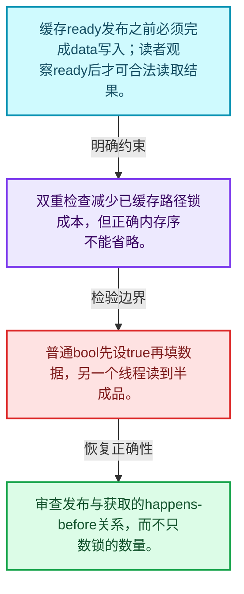
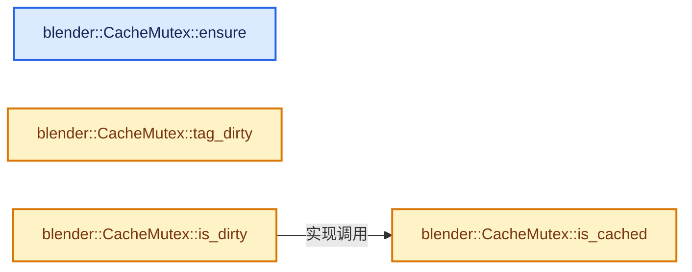
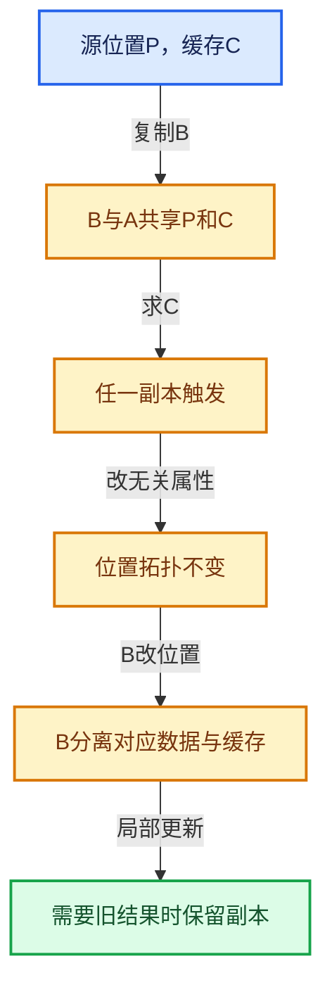

# 06-06 CacheMutex惰性初始化

[方向导航](README.md) · [总目录](../README.md) · [实现索引](../00-课程指南/02-源码与提交索引/符号依赖与实现索引.md)

## 从问题到实现

如何保证昂贵结果只在需要时计算？

缓存有效标记、锁和发布顺序共同保证读者观察已完成的数据；单独的bool不足以提供线程安全。

**数据模型**

缓存ready发布之前必须完成data写入；读者观察ready后才可合法读取结果。

**设计取舍**

双重检查减少已缓存路径锁成本，但正确内存序不能省略。

**最小反例**

普通bool先设true再填数据，另一个线程读到半成品。

**推导**

审查发布与获取的happens-before关系，而不只数锁的数量。

## 阅读地图与执行推演








图中的数值推演是本方向的教学模型；实际函数之间的调用边与概念分析边分别标注，不能把概念关系当作运行时调度顺序。

## 完整源码单元与就地讲解

中文讲解直接放在相关代码旁，复杂机制在代码下展开。原文折叠区保留基准行号；不需要在行号表和函数之间来回查找。类布局可分段展示，函数实现不按固定行数切开。

### 类型布局、声明与编译条件 · BLI_cache_mutex.hh L1—L84

<a id="t-da856b4f4ac0"></a>

`CacheMutex`在这里声明的数据成员：

- `Mutex mutex_`
- `std::atomic<bool> cache_valid_`

<!-- annotated:7e2b131fddbc63 -->

```cpp
/* SPDX-FileCopyrightText: 2023 Blender Authors
 *
 * SPDX-License-Identifier: GPL-2.0-or-later */

/** \file
 * \ingroup bli
 */

#pragma once

/**
 * A #CacheMutex is used to protect a lazily computed cache from being computed more than once.
 * Using #CacheMutex instead of a "raw mutex" to protect a cache has some benefits:
 * - Avoid common pitfalls like forgetting to use task isolation or a double checked lock.
 * - Cleaner and less redundant code because the same locking patterns don't have to be repeated
 *   everywhere.
 * - One can benefit from potential future improvements to #CacheMutex of which there are a few
 *   mentioned below.
 *
 * The data protected by #CacheMutex is not part of #CacheMutex. Instead, the #CacheMutex and its
 * protected data should generally be placed next to each other.
 *
 * Each #CacheMutex protects exactly one cache, so multiple cache mutexes have to be used when a
 * class has multiple caches. That is contrary to a "custom" solution using `Mutex` where one
 * mutex could protect multiple caches at the cost of higher lock contention.
 *
 * To make sure the cache is up to date, call `CacheMutex::ensure` and pass in the function that
 * computes the cache.
 *
 * To tell the #CacheMutex that the cache is invalidated and to be re-evaluated upon next access
 * use `CacheMutex::tag_dirty`.
 *
 * This example shows how one could implement a lazily computed average vertex position in an
 * imaginary `Mesh` data structure:
 *
 * \code{.cpp}
 * class Mesh {
 *  private:
 *   mutable CacheMutex average_position_cache_mutex_;
 *   mutable float3 average_position_cache_;
 *
 *  public:
 *   const float3 &average_position() const
 *   {
 *     average_position_cache_mutex_.ensure([&]() {
 *       average_position_cache_ = actually_compute_average_position();
 *     });
 *     return average_position_cache_;
 *   }
 *
 *   void tag_positions_changed()
 *   {
 *     average_position_cache_mutex_.tag_dirty();
 *   }
 * };
 * \endcode
 *
 * Possible future improvements:
 * - Avoid task isolation when we know that the cache computation does not use threading.
 * - Try to use a smaller mutex. The mutex does not have to be fair for this use case.
 * - Try to join the cache computation instead of blocking if another thread is computing the cache
 *   already.
 */

#include <atomic>

#include "BLI_function_ref.hh"
#include "BLI_mutex.hh"

namespace blender {

class CacheMutex {
 private:
  Mutex mutex_;
  std::atomic<bool> cache_valid_ = false;

 public:
  /**
   * Make sure the cache exists and is up to date. This calls `compute_cache` once to update the
   * cache (which is stored outside of this class) if it is dirty, otherwise it does nothing.
   *
   * This function is thread-safe under the assumption that the same parameters are passed from
   * every thread.
   */
```

<details>
<summary>核对原始源码：source/blender/blenlib/BLI_cache_mutex.hh · L1—L84</summary>

<!-- original:7e2b131fddbc63:source/blender/blenlib/BLI_cache_mutex.hh:1:84 -->

```cpp
/* SPDX-FileCopyrightText: 2023 Blender Authors
 *
 * SPDX-License-Identifier: GPL-2.0-or-later */

/** \file
 * \ingroup bli
 */

#pragma once

/**
 * A #CacheMutex is used to protect a lazily computed cache from being computed more than once.
 * Using #CacheMutex instead of a "raw mutex" to protect a cache has some benefits:
 * - Avoid common pitfalls like forgetting to use task isolation or a double checked lock.
 * - Cleaner and less redundant code because the same locking patterns don't have to be repeated
 *   everywhere.
 * - One can benefit from potential future improvements to #CacheMutex of which there are a few
 *   mentioned below.
 *
 * The data protected by #CacheMutex is not part of #CacheMutex. Instead, the #CacheMutex and its
 * protected data should generally be placed next to each other.
 *
 * Each #CacheMutex protects exactly one cache, so multiple cache mutexes have to be used when a
 * class has multiple caches. That is contrary to a "custom" solution using `Mutex` where one
 * mutex could protect multiple caches at the cost of higher lock contention.
 *
 * To make sure the cache is up to date, call `CacheMutex::ensure` and pass in the function that
 * computes the cache.
 *
 * To tell the #CacheMutex that the cache is invalidated and to be re-evaluated upon next access
 * use `CacheMutex::tag_dirty`.
 *
 * This example shows how one could implement a lazily computed average vertex position in an
 * imaginary `Mesh` data structure:
 *
 * \code{.cpp}
 * class Mesh {
 *  private:
 *   mutable CacheMutex average_position_cache_mutex_;
 *   mutable float3 average_position_cache_;
 *
 *  public:
 *   const float3 &average_position() const
 *   {
 *     average_position_cache_mutex_.ensure([&]() {
 *       average_position_cache_ = actually_compute_average_position();
 *     });
 *     return average_position_cache_;
 *   }
 *
 *   void tag_positions_changed()
 *   {
 *     average_position_cache_mutex_.tag_dirty();
 *   }
 * };
 * \endcode
 *
 * Possible future improvements:
 * - Avoid task isolation when we know that the cache computation does not use threading.
 * - Try to use a smaller mutex. The mutex does not have to be fair for this use case.
 * - Try to join the cache computation instead of blocking if another thread is computing the cache
 *   already.
 */

#include <atomic>

#include "BLI_function_ref.hh"
#include "BLI_mutex.hh"

namespace blender {

class CacheMutex {
 private:
  Mutex mutex_;
  std::atomic<bool> cache_valid_ = false;

 public:
  /**
   * Make sure the cache exists and is up to date. This calls `compute_cache` once to update the
   * cache (which is stored outside of this class) if it is dirty, otherwise it does nothing.
   *
   * This function is thread-safe under the assumption that the same parameters are passed from
   * every thread.
   */
```

</details>

<a id="f-97d7c841675a4237"></a>

### `blender::CacheMutex::ensure`

实现位置：[source/blender/blenlib/BLI_cache_mutex.hh](../../../../../source/blender/blenlib/BLI_cache_mutex.hh) · L85—L92。

接口参数：

- `const FunctionRef<void()> compute_cache`

**教学注释版**

<!-- annotated:50670954bc4b54 -->

```cpp
  void ensure(const FunctionRef<void()> compute_cache)
  {
    /* Handle fast case when the cache is up-to-date. */
    if (cache_valid_.load(std::memory_order_acquire)) {
      return;
    }
    this->ensure_impl(compute_cache);
  }
```

<details>
<summary>核对原始源码：source/blender/blenlib/BLI_cache_mutex.hh · L85—L92</summary>

<!-- original:50670954bc4b54:source/blender/blenlib/BLI_cache_mutex.hh:85:92 -->

```cpp
  void ensure(const FunctionRef<void()> compute_cache)
  {
    /* Handle fast case when the cache is up-to-date. */
    if (cache_valid_.load(std::memory_order_acquire)) {
      return;
    }
    this->ensure_impl(compute_cache);
  }
```

</details>

**继续追踪实现**

- `cache_valid_.load` → [外部契约](https://eel.is/c++draft/)：这个边界按实际表达式及所属类型核对参数、返回值、寿命与失败行为。这里提供接口入口，不声称已解释该第三方版本的内部实现。
- `this->ensure_impl` → [blender::CacheMutex::ensure_impl · L14](../90-实现依赖专题/01-BLI基础库/intern/cache_mutex.cc.md#f-7eab37292dbb3e30)。

### 类型布局、声明与编译条件 · BLI_cache_mutex.hh L93—L96

<!-- annotated:a79c3f185ec476 -->

```cpp

  /**
   * Reset the cache. The next time #ensure is called, it will recompute that code.
   */
```

<details>
<summary>核对原始源码：source/blender/blenlib/BLI_cache_mutex.hh · L93—L96</summary>

<!-- original:a79c3f185ec476:source/blender/blenlib/BLI_cache_mutex.hh:93:96 -->

```cpp

  /**
   * Reset the cache. The next time #ensure is called, it will recompute that code.
   */
```

</details>

<a id="f-571ddf8feebd876c"></a>

### `blender::CacheMutex::tag_dirty`

实现位置：[source/blender/blenlib/BLI_cache_mutex.hh](../../../../../source/blender/blenlib/BLI_cache_mutex.hh) · L97—L100。

**教学注释版**

<!-- annotated:8319445f529c20 -->

```cpp
  void tag_dirty()
  {
    cache_valid_.store(false);
  }
```

<details>
<summary>核对原始源码：source/blender/blenlib/BLI_cache_mutex.hh · L97—L100</summary>

<!-- original:8319445f529c20:source/blender/blenlib/BLI_cache_mutex.hh:97:100 -->

```cpp
  void tag_dirty()
  {
    cache_valid_.store(false);
  }
```

</details>

**继续追踪实现**

- `cache_valid_.store` → [外部契约](https://eel.is/c++draft/)：这个边界按实际表达式及所属类型核对参数、返回值、寿命与失败行为。这里提供接口入口，不声称已解释该第三方版本的内部实现。

### 类型布局、声明与编译条件 · BLI_cache_mutex.hh L101—L104

<!-- annotated:998a29c18273bd -->

```cpp

  /**
   * Return true if the cache currently does not exist or has been invalidated.
   */
```

<details>
<summary>核对原始源码：source/blender/blenlib/BLI_cache_mutex.hh · L101—L104</summary>

<!-- original:998a29c18273bd:source/blender/blenlib/BLI_cache_mutex.hh:101:104 -->

```cpp

  /**
   * Return true if the cache currently does not exist or has been invalidated.
   */
```

</details>

<a id="f-330f3a13228d209f"></a>

### `blender::CacheMutex::is_dirty`

实现位置：[source/blender/blenlib/BLI_cache_mutex.hh](../../../../../source/blender/blenlib/BLI_cache_mutex.hh) · L105—L108。

**教学注释版**

<!-- annotated:6e9f921bf7346d -->

```cpp
  bool is_dirty() const
  {
    return !this->is_cached();
  }
```

<details>
<summary>核对原始源码：source/blender/blenlib/BLI_cache_mutex.hh · L105—L108</summary>

<!-- original:6e9f921bf7346d:source/blender/blenlib/BLI_cache_mutex.hh:105:108 -->

```cpp
  bool is_dirty() const
  {
    return !this->is_cached();
  }
```

</details>

**结果出口**

- `return !this->is_cached();`

**继续追踪实现**

- `this->is_cached` → [blender::CacheMutex::is_cached · L113](06-CacheMutex惰性初始化.md#f-f7e9b4cd645b17b2)。

### 类型布局、声明与编译条件 · BLI_cache_mutex.hh L109—L112

<!-- annotated:193104e1103ffb -->

```cpp

  /**
   * Return true if the cache exists and is valid.
   */
```

<details>
<summary>核对原始源码：source/blender/blenlib/BLI_cache_mutex.hh · L109—L112</summary>

<!-- original:193104e1103ffb:source/blender/blenlib/BLI_cache_mutex.hh:109:112 -->

```cpp

  /**
   * Return true if the cache exists and is valid.
   */
```

</details>

<a id="f-f7e9b4cd645b17b2"></a>

### `blender::CacheMutex::is_cached`

实现位置：[source/blender/blenlib/BLI_cache_mutex.hh](../../../../../source/blender/blenlib/BLI_cache_mutex.hh) · L113—L116。

**教学注释版**

<!-- annotated:3f33980a0d4779 -->

```cpp
  bool is_cached() const
  {
    return cache_valid_.load(std::memory_order_relaxed);
  }
```

<details>
<summary>核对原始源码：source/blender/blenlib/BLI_cache_mutex.hh · L113—L116</summary>

<!-- original:3f33980a0d4779:source/blender/blenlib/BLI_cache_mutex.hh:113:116 -->

```cpp
  bool is_cached() const
  {
    return cache_valid_.load(std::memory_order_relaxed);
  }
```

</details>

**结果出口**

- `return cache_valid_.load(std::memory_order_relaxed);`

**继续追踪实现**

- `cache_valid_.load` → [外部契约](https://eel.is/c++draft/)：这个边界按实际表达式及所属类型核对参数、返回值、寿命与失败行为。这里提供接口入口，不声称已解释该第三方版本的内部实现。

### 类型布局、声明与编译条件 · BLI_cache_mutex.hh L117—L122

<!-- annotated:0be5d03f2d8cbb -->

```cpp

 private:
  void ensure_impl(FunctionRef<void()> compute_cache);
};

}  // namespace blender
```

<details>
<summary>核对原始源码：source/blender/blenlib/BLI_cache_mutex.hh · L117—L122</summary>

<!-- original:0be5d03f2d8cbb:source/blender/blenlib/BLI_cache_mutex.hh:117:122 -->

```cpp

 private:
  void ensure_impl(FunctionRef<void()> compute_cache);
};

}  // namespace blender
```

</details>

## 语法与相关类型

### 只读限定 const

const约束当前访问路径可做的修改。const指针、指向const的指针、const视图对象、const元素是不同位置的限定；其他别名可能仍可修改原对象。

分别写T* const、const T*与const T* const，并画出不可修改的层次。

### 原子操作 atomic

原子性保护相应原子对象的访问；发布其他普通数据还要分析内存序。多个原子字段分别安全不等于复合不变量整体原子。

画出写数据、发布ready与读ready、读数据的顺序关系。

### 类型别名 using

类型别名为已有类型建立名字，不创建运行期对象。它常把模板内部使用的类型统一暴露给泛型调用者。

展开别名直到基础类型，区分类型别名和变量声明。

## 实现练习与验证

两个线程请求同一计算，检查回调次数和结果发布。

参考推理：审查发布与获取的happens-before关系，而不只数锁的数量。

改变副本不改变原对象结果；修改任一真实依赖后旧结果不可继续被当成有效缓存。

## 历史、跨库比较与证据

与shared_ptr比较寿命管理，与写时复制容器比较写边界，与普通memoization比较键的等价性；SharedCache把等价对象的派生结果放在共同控制对象中。

[历史提交索引](../00-课程指南/02-源码与提交索引/历史提交与设计演化索引.md) · [源码基准](../00-课程指南/02-源码与提交索引/源码版本与覆盖索引.md) · [验收报告](../00-课程指南/03-验收报告/验收报告.md)
