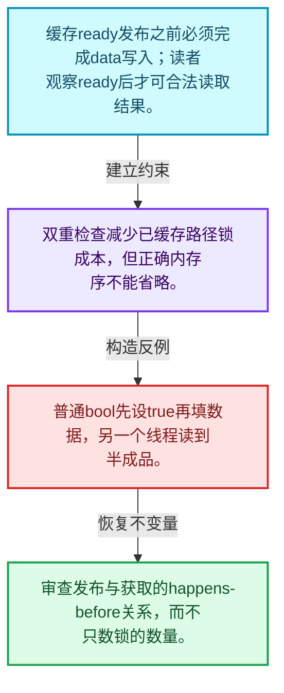
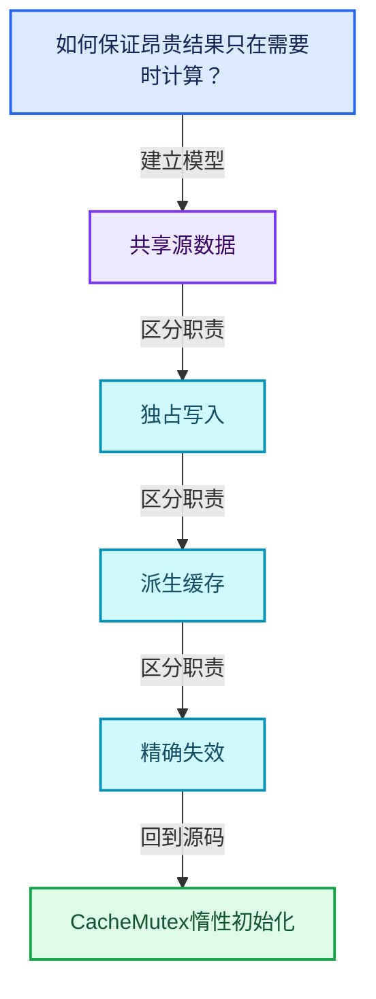
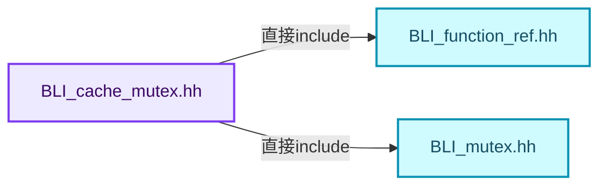
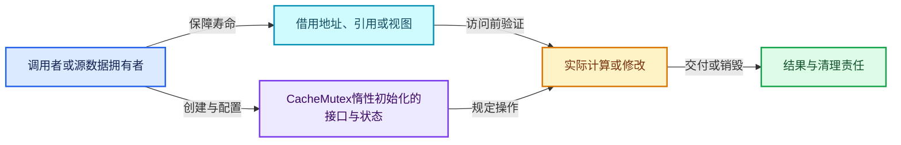
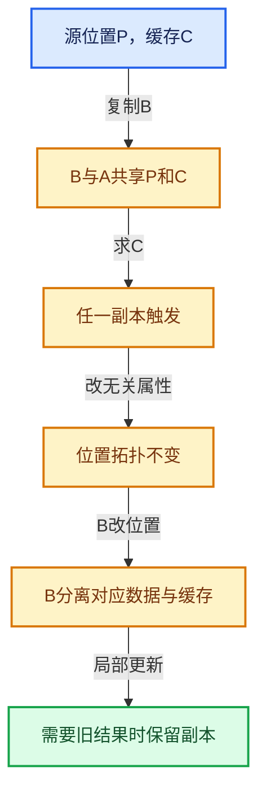

# 06-06 CacheMutex惰性初始化

[方向导航](README.md) · [总目录](../README.md) · [覆盖索引](../%E6%BA%90%E7%A0%81%E7%89%88%E6%9C%AC%E4%B8%8E%E8%A6%86%E7%9B%96%E7%B4%A2%E5%BC%95.md)

> 阅读顺序：问题与数据模型 → 语法与类型 → 源码逐行 → 调用线索 → 历史与取舍 → 推演和练习。

- 基准 HEAD：`cbda6b96c26c0dee3c3b5cbb93960c4ac06a6b30`。
- 记录日期：2026-10-14。
- 教学示例状态：正文中的推演不是本机性能实测；已运行练习见验收报告。

## 一、从问题到设计

如何保证昂贵结果只在需要时计算？

缓存有效标记、锁和发布顺序共同保证读者观察已完成的数据；单独的bool不足以提供线程安全。

本篇把语法、数据语义和系统取舍连接起来。共享计数回答谁还活着，缓存依赖回答结果是否仍正确，两者不能互相替代。

### 本篇独立模型与设计推理

缓存ready发布之前必须完成data写入；读者观察ready后才可合法读取结果。

设计取舍：双重检查减少已缓存路径锁成本，但正确内存序不能省略。

最小反例：普通bool先设true再填数据，另一个线程读到半成品。

推导与处理：审查发布与获取的happens-before关系，而不只数锁的数量。



### 源码范围与相邻篇章

| 文件 | 本篇逐行范围 | 基准SHA-256 |
|---|---|---|
| [source/blender/blenlib/BLI_cache_mutex.hh](../../../../../source/blender/blenlib/BLI_cache_mutex.hh) | L1—L122 | `27c6cc69c95bd7dd8cc59fb77f4f347fae0e14fb8aaf743bf03849a3664c4203` |

同一主讲文件可能分多篇覆盖；超出本篇范围的符号通过覆盖索引定位。空行与纯注释保留在源码摘录中，逐行表解释有效语句与语法边界；许可证头统一保留。

前篇：[GeometrySet读写与复制](05-GeometrySet%E8%AF%BB%E5%86%99%E4%B8%8E%E5%A4%8D%E5%88%B6.md).

后篇：[SharedCache跨对象复用](07-SharedCache%E8%B7%A8%E5%AF%B9%E8%B1%A1%E5%A4%8D%E7%94%A8.md).

## 二、类型、数据与阅读地图



这是概念依赖图，边表示阅读关系，不声称是运行时调用顺序。

### 直接编译依赖



箭头只表示头文件包含关系；完整调用线索见后面的符号定位表。

## 三、关键词、语法与类型角色

### 只读限定 const

const约束当前访问路径可做的修改。const指针、指向const的指针、const视图对象、const元素是不同位置的限定；其他别名可能仍可修改原对象。

具体检查：分别写T* const、const T*与const T* const，并画出不可修改的层次。

### 原子操作 atomic

原子性保护相应原子对象的访问；发布其他普通数据还要分析内存序。多个原子字段分别安全不等于复合不变量整体原子。

具体检查：画出写数据、发布ready与读ready、读数据的顺序关系。

### 类型别名 using

类型别名为已有类型建立名字，不创建运行期对象。它常把模板内部使用的类型统一暴露给泛型调用者。

具体检查：展开别名直到基础类型，区分类型别名和变量声明。

## 四、真实源码与逐行讲解

源码块保持原行内容，原始行号由小节标题及逐行表给出。表中的调用定位是静态阅读辅助；重载、模板实例化、宏展开和虚调用需结合完整声明，不能仅凭词法出现证明动态调用。

### BLI_cache_mutex.hh：L1—L65

<!-- source:source/blender/blenlib/BLI_cache_mutex.hh:1:65 -->

```cpp
/* SPDX-FileCopyrightText: 2023 Blender Authors
 *
 * SPDX-License-Identifier: GPL-2.0-or-later */

/** \file
 * \ingroup bli
 */

#pragma once

/**
 * A #CacheMutex is used to protect a lazily computed cache from being computed more than once.
 * Using #CacheMutex instead of a "raw mutex" to protect a cache has some benefits:
 * - Avoid common pitfalls like forgetting to use task isolation or a double checked lock.
 * - Cleaner and less redundant code because the same locking patterns don't have to be repeated
 *   everywhere.
 * - One can benefit from potential future improvements to #CacheMutex of which there are a few
 *   mentioned below.
 *
 * The data protected by #CacheMutex is not part of #CacheMutex. Instead, the #CacheMutex and its
 * protected data should generally be placed next to each other.
 *
 * Each #CacheMutex protects exactly one cache, so multiple cache mutexes have to be used when a
 * class has multiple caches. That is contrary to a "custom" solution using `Mutex` where one
 * mutex could protect multiple caches at the cost of higher lock contention.
 *
 * To make sure the cache is up to date, call `CacheMutex::ensure` and pass in the function that
 * computes the cache.
 *
 * To tell the #CacheMutex that the cache is invalidated and to be re-evaluated upon next access
 * use `CacheMutex::tag_dirty`.
 *
 * This example shows how one could implement a lazily computed average vertex position in an
 * imaginary `Mesh` data structure:
 *
 * \code{.cpp}
 * class Mesh {
 *  private:
 *   mutable CacheMutex average_position_cache_mutex_;
 *   mutable float3 average_position_cache_;
 *
 *  public:
 *   const float3 &average_position() const
 *   {
 *     average_position_cache_mutex_.ensure([&]() {
 *       average_position_cache_ = actually_compute_average_position();
 *     });
 *     return average_position_cache_;
 *   }
 *
 *   void tag_positions_changed()
 *   {
 *     average_position_cache_mutex_.tag_dirty();
 *   }
 * };
 * \endcode
 *
 * Possible future improvements:
 * - Avoid task isolation when we know that the cache computation does not use threading.
 * - Try to use a smaller mutex. The mutex does not have to be fair for this use case.
 * - Try to join the cache computation instead of blocking if another thread is computing the cache
 *   already.
 */

#include <atomic>
```

| 原始行 | 语义、约束与检查 |
|---|---|
| L9 | 防止同一头文件在一个翻译单元中重复展开；不控制多个源文件之间的链接或对象寿命。 |
| L65 | 引入编译依赖 <atomic>；这是声明可见性关系，不表示运行时一定调用该文件的所有接口。 |

### BLI_cache_mutex.hh：L66—L122

<!-- source:source/blender/blenlib/BLI_cache_mutex.hh:66:122 -->

```cpp

#include "BLI_function_ref.hh"
#include "BLI_mutex.hh"

namespace blender {

class CacheMutex {
 private:
  Mutex mutex_;
  std::atomic<bool> cache_valid_ = false;

 public:
  /**
   * Make sure the cache exists and is up to date. This calls `compute_cache` once to update the
   * cache (which is stored outside of this class) if it is dirty, otherwise it does nothing.
   *
   * This function is thread-safe under the assumption that the same parameters are passed from
   * every thread.
   */
  void ensure(const FunctionRef<void()> compute_cache)
  {
    /* Handle fast case when the cache is up-to-date. */
    if (cache_valid_.load(std::memory_order_acquire)) {
      return;
    }
    this->ensure_impl(compute_cache);
  }

  /**
   * Reset the cache. The next time #ensure is called, it will recompute that code.
   */
  void tag_dirty()
  {
    cache_valid_.store(false);
  }

  /**
   * Return true if the cache currently does not exist or has been invalidated.
   */
  bool is_dirty() const
  {
    return !this->is_cached();
  }

  /**
   * Return true if the cache exists and is valid.
   */
  bool is_cached() const
  {
    return cache_valid_.load(std::memory_order_relaxed);
  }

 private:
  void ensure_impl(FunctionRef<void()> compute_cache);
};

}  // namespace blender
```

本段语义重点：

- `tag_dirty`：标记派生结果失效；对于共享缓存还可能分离旧缓存。

| 原始行 | 语义、约束与检查 |
|---|---|
| L67 | 引入编译依赖 "BLI_function_ref.hh"；这是声明可见性关系，不表示运行时一定调用该文件的所有接口。 |
| L68 | 引入编译依赖 "BLI_mutex.hh"；这是声明可见性关系，不表示运行时一定调用该文件的所有接口。 |
| L70 | 把后续声明放入 blender 命名空间，影响名称查找和符号归属，不创建运行时对象。 |
| L72 | 声明或定义类型 `class CacheMutex`。结合继承、访问权限和成员布局确认接口与拥有关系；前向声明本身没有完整对象布局。 |
| L73 | 切换成员访问权限为 private；它是编译期接口边界，不是线程同步或内存保护。 |
| L74 | 声明成员、局部对象或完成语句 `Mutex mutex_`。若为指针或引用，它本身不说明拥有；若为值对象，其构造析构由所在作用域或外层对象管理。 |
| L75 | 把右侧 `false` 用于初始化或更新左侧 `std::atomic<bool> cache_valid_`。声明初始化与已有对象赋值应按上下文区分；有资源的类型会调用相应特殊成员。 |
| L77 | 切换成员访问权限为 public；它是编译期接口边界，不是线程同步或内存保护。 |
| L85 | 出现调用或函数声明 `ensure`，对应表达式为 `void ensure(const FunctionRef<void()> compute_cache)`。参数求值、返回类型与重载需结合前后完整语句；静态文本引用不能证明动态目标。 |
| L86 | 连接上一行的声明或控制结构与其语句块；后续行在这个作用域中执行或声明。 |
| L88 | 判断 `cache_valid_.load(std::memory_order_acquire)`，成立时进入本分支，否则继续后续路径。 |
| L89 | 结束当前函数，本路径不再执行后续语句；局部对象按作用域规则清理。 |
| L90 | 结束当前语法单元。局部自动对象在离开其作用域时按规则销毁；这不等于所有被引用的外部数据也被释放。 |
| L91 | 出现调用或函数声明 `ensure_impl`，对应表达式为 `this->ensure_impl(compute_cache);`。参数求值、返回类型与重载需结合前后完整语句；静态文本引用不能证明动态目标。 |
| L92 | 结束当前语法单元。局部自动对象在离开其作用域时按规则销毁；这不等于所有被引用的外部数据也被释放。 |
| L97 | 出现调用或函数声明 `tag_dirty`，对应表达式为 `void tag_dirty()`。参数求值、返回类型与重载需结合前后完整语句；静态文本引用不能证明动态目标。 |
| L98 | 连接上一行的声明或控制结构与其语句块；后续行在这个作用域中执行或声明。 |
| L99 | 出现调用或函数声明 `store`，对应表达式为 `cache_valid_.store(false);`。参数求值、返回类型与重载需结合前后完整语句；静态文本引用不能证明动态目标。 |
| L100 | 结束当前语法单元。局部自动对象在离开其作用域时按规则销毁；这不等于所有被引用的外部数据也被释放。 |
| L105 | 出现调用或函数声明 `is_dirty`，对应表达式为 `bool is_dirty() const`。参数求值、返回类型与重载需结合前后完整语句；静态文本引用不能证明动态目标。 |
| L106 | 连接上一行的声明或控制结构与其语句块；后续行在这个作用域中执行或声明。 |
| L107 | 返回表达式 `!this->is_cached()`。 |
| L108 | 结束当前语法单元。局部自动对象在离开其作用域时按规则销毁；这不等于所有被引用的外部数据也被释放。 |
| L113 | 出现调用或函数声明 `is_cached`，对应表达式为 `bool is_cached() const`。参数求值、返回类型与重载需结合前后完整语句；静态文本引用不能证明动态目标。 |
| L114 | 连接上一行的声明或控制结构与其语句块；后续行在这个作用域中执行或声明。 |
| L115 | 返回表达式 `cache_valid_.load(std::memory_order_relaxed)`。 |
| L116 | 结束当前语法单元。局部自动对象在离开其作用域时按规则销毁；这不等于所有被引用的外部数据也被释放。 |
| L118 | 切换成员访问权限为 private；它是编译期接口边界，不是线程同步或内存保护。 |
| L119 | 声明接口 `void ensure_impl(FunctionRef<void()> compute_cache)`，本行没有对应函数体；返回类型、参数限定和const/noexcept共同组成调用契约，实际行为需继续定位实现。 |
| L120 | 结束当前语法单元。局部自动对象在离开其作用域时按规则销毁；这不等于所有被引用的外部数据也被释放。 |
| L122 | 结束当前语法单元。局部自动对象在离开其作用域时按规则销毁；这不等于所有被引用的外部数据也被释放。 |

## 五、接口定位、调用线索与生命周期

### 本篇声明与实现入口

| 源码位置 | 实际声明片段 |
|---|---|
| [BLI_cache_mutex.hh:L72](../../../../../source/blender/blenlib/BLI_cache_mutex.hh#L72) | `class CacheMutex` |
| [BLI_cache_mutex.hh:L85](../../../../../source/blender/blenlib/BLI_cache_mutex.hh#L85) | `void ensure(const FunctionRef<void()> compute_cache)` |
| [BLI_cache_mutex.hh:L97](../../../../../source/blender/blenlib/BLI_cache_mutex.hh#L97) | `void tag_dirty()` |
| [BLI_cache_mutex.hh:L105](../../../../../source/blender/blenlib/BLI_cache_mutex.hh#L105) | `bool is_dirty() const` |
| [BLI_cache_mutex.hh:L113](../../../../../source/blender/blenlib/BLI_cache_mutex.hh#L113) | `bool is_cached() const` |
| [BLI_cache_mutex.hh:L119](../../../../../source/blender/blenlib/BLI_cache_mutex.hh#L119) | `void ensure_impl(FunctionRef<void()> compute_cache);` |

### 同名符号出现位置

以下表提供跨文件阅读入口，包含声明、调用或测试使用；没有经过完整C++名称解析，不把它命名为已证明的运行时调用图。

| 符号 | 位置 | 文本证据 |
|---|---|---|
| `ensure` | [bvhutils.cc:L654](../../../../../source/blender/blenkernel/intern/bvhutils.cc#L654) | `this->runtime->bvh_cache_loose_verts.ensure([&](std::unique_ptr<BVHTree, BVHTreeDeleter> &data) {` |
| `ensure` | [bvhutils.cc:L664](../../../../../source/blender/blenkernel/intern/bvhutils.cc#L664) | `this->runtime->bvh_cache_loose_verts_no_hidden.ensure(` |
| `ensure` | [bvhutils.cc:L677](../../../../../source/blender/blenkernel/intern/bvhutils.cc#L677) | `this->runtime->bvh_embree_verts_cache.ensure([&](bvh::Tree &data) {` |
| `tag_dirty` | [mesh_runtime.cc:L49](../../../../../source/blender/blenkernel/intern/mesh_runtime.cc#L49) | `mesh_runtime.bvh_cache_edges.tag_dirty();` |
| `tag_dirty` | [mesh_runtime.cc:L50](../../../../../source/blender/blenkernel/intern/mesh_runtime.cc#L50) | `mesh_runtime.bvh_cache_faces.tag_dirty();` |
| `tag_dirty` | [mesh_runtime.cc:L51](../../../../../source/blender/blenkernel/intern/mesh_runtime.cc#L51) | `mesh_runtime.bvh_cache_corner_tris.tag_dirty();` |
| `is_dirty` | [mesh_normals.cc:L100](../../../../../source/blender/blenkernel/intern/mesh_normals.cc#L100) | `return mesh->runtime->vert_normals_cache.is_dirty();` |
| `is_dirty` | [mesh_normals.cc:L105](../../../../../source/blender/blenkernel/intern/mesh_normals.cc#L105) | `return mesh->runtime->face_normals_cache.is_dirty();` |
| `is_dirty` | [BLI_shared_cache.hh:L98](../../../../../source/blender/blenlib/BLI_shared_cache.hh#L98) | `bool is_dirty() const` |
| `is_cached` | [mesh.cc:L2070](../../../../../source/blender/blenkernel/intern/mesh.cc#L2070) | `if (mesh.runtime->bounds_cache.is_cached()) {` |
| `is_cached` | [mesh_runtime.cc:L86](../../../../../source/blender/blenkernel/intern/mesh_runtime.cc#L86) | `if (!mesh.runtime->loose_edges_cache.is_cached() &#124;&#124; !mesh.loose_edges().is_empty()) {` |
| `is_cached` | [mesh_runtime.cc:L89](../../../../../source/blender/blenkernel/intern/mesh_runtime.cc#L89) | `if (!mesh.runtime->loose_verts_cache.is_cached() &#124;&#124; !mesh.loose_verts().is_empty()) {` |

### 生命周期推理图



这是审查生命周期的通用模型。具体类是否拥有数据由本篇成员、构造、析构和调用者一起证明；任何箭头都不自动代表shared_ptr。

## 六、把代码放进具体数据中推演

本方向的共同数值模型如下。本篇的专门检查是：两个线程请求同一计算，检查回调次数和结果发布。

| 步骤 | 数据或状态 | 为什么需要这一步 |
|---|---|---|
| 创建A | 源位置P，缓存C | C可以尚未计算 |
| 复制B | B与A共享P和C | 源数据等价才允许共享结果 |
| 求C | 任一副本触发 | 另一个副本也可见相同结果 |
| 改无关属性 | 位置拓扑不变 | 相关缓存可继续有效 |
| B改位置 | B分离对应数据与缓存 | A结果仍保持原语义 |
| 局部更新 | 需要旧结果时保留副本 | 与直接放弃旧缓存不同 |



图是教学推演模型；精确分支与状态更新以本篇摘录及调用契约为准。

### 本篇独立练习与参考思路

两个线程请求同一计算，检查回调次数和结果发布。

参考思路：缓存有效标记、锁和发布顺序共同保证读者观察已完成的数据；单独的bool不足以提供线程安全。

将输入、预期结果和资源责任分成三张清单。先用最直接的实现给出可核对的答案，再替换成对应源码使用的表示；比较结果不变的条件，而不是只比较接口名字。

验收依据：改变副本不改变原对象结果；修改任一真实依赖后旧结果不可继续被当成有效缓存。

## 七、复杂度、设计取舍与其他基础库

与shared_ptr比较寿命管理，与写时复制容器比较写边界，与普通memoization比较键的等价性；SharedCache把等价对象的派生结果放在共同控制对象中。

本篇的具体取舍：缓存有效标记、锁和发布顺序共同保证读者观察已完成的数据；单独的bool不足以提供线程安全。

| 观察维度 | 从源码取得证据的方法 | 本篇要避免的误判 |
|---|---|---|
| 时间 | 对循环次数、分派次数和重建频率分别计数 | 看到单次常数操作就断定整个操作序列是常数成本 |
| 内存 | 区分对象本体、容量存储、间接资源和共享控制块 | 用sizeof代替总内存 |
| 安全 | 沿构造、失败回滚、销毁与失效逐路径检查 | 把断言或非空指针当作完整安全证明 |
| 并发 | 逐字段确认锁、发布顺序和借用寿命 | 把引用计数线程安全等同数据读写线程安全 |

相关一手资料：

- [C++公开工作草案](https://eel.is/c++draft/)：持续更新的工作草案；语言与标准库语义以相应章节为准。
- [Blender依赖图设计](https://developer.blender.org/docs/features/core/depsgraph/)：包含历史设计背景，当前行为以本地源码为准。

资料用于核对契约和进一步阅读；这里没有声称外部库与Blender实现相同，也没有把上游性能数字当作本机实测。

## 八、历史提交与设计演化

本篇主要讲当前接口或辅助实现，方向导航给出相关架构演化提交；没有把不涉及本篇文件的提交硬写成该实现的引入证据。

## 九、反例、测试入口与掌握标准

需要实际构造的反例：

- 空输入或没有结果需求：确认接口允许的空状态与不允许访问的操作。
- 边界位置和退化结构：把长度为1、末尾位置、重复值或深链代入真实分支。
- 生命周期结束或修改之后：检查保存的指针、引用、结果视图是否仍有效。
- 与本篇核心不变量相冲突的输入：两个线程请求同一计算，检查回调次数和结果发布。

### 可运行的教学参考程序

[reference_exercises.cc](../_tools/reference_exercises.cc)包含独立于Blender的C++20参考检查：视图、简化SmallVector、异常回滚、哈希碰撞与删除、偏移数组、拓扑映射、共享缓存、表达式、惰性分支、闭包和暴力最近邻。

参考程序有意省略生产实现的完整能力。例如SmallVector禁止复制移动容器，不支持只能移动的元素，并禁止append参数别名到自身元素；TinyMap固定8槽，不提供增长。程序通过不能替代Blender实现测试。实际运行结果、编译器与命令见验收报告。

掌握标准：离开源码解释“如何保证昂贵结果只在需要时计算？”；独立完成上述练习；能指出一个会破坏共享源数据相关约束的最小反例，并用具体代码行说明检查或修复应放在哪里。
