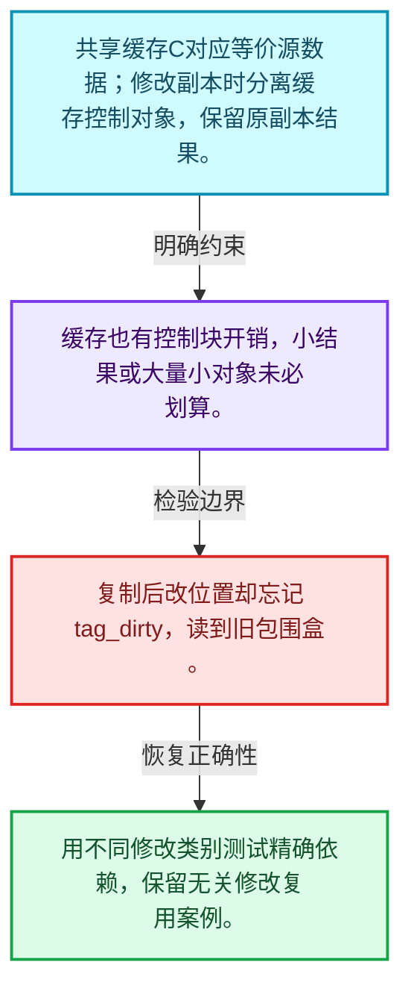
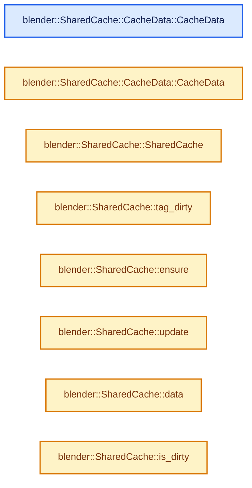
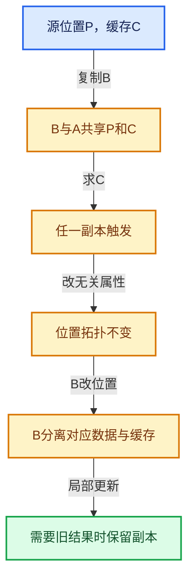

# 06-07 SharedCache跨对象复用

[方向导航](README.md) · [总目录](../README.md) · [实现索引](../%E7%AC%A6%E5%8F%B7%E4%BE%9D%E8%B5%96%E4%B8%8E%E5%AE%9E%E7%8E%B0%E7%B4%A2%E5%BC%95.md)

## 从问题到实现

对象复制后怎样继续复用派生结果？

共享缓存要求相应源数据等价；失效时分离缓存，避免一个副本的修改污染另一个。

**数据模型**

共享缓存C对应等价源数据；修改副本时分离缓存控制对象，保留原副本结果。

**设计取舍**

缓存也有控制块开销，小结果或大量小对象未必划算。

**最小反例**

复制后改位置却忘记tag_dirty，读到旧包围盒。

**推导**

用不同修改类别测试精确依赖，保留无关修改复用案例。

## 阅读地图与执行推演








图中的数值推演是本方向的教学模型；实际函数之间的调用边与概念分析边分别标注，不能把概念关系当作运行时调度顺序。

## 完整源码单元与就地讲解

中文讲解直接放在相关代码旁，复杂机制在代码下展开。原文折叠区保留基准行号；不需要在行号表和函数之间来回查找。类布局可分段展示，函数实现不按固定行数切开。

### 类型布局、声明与编译条件 · BLI_shared_cache.hh L1—L38

<a id="t-2b59586e03ac"></a>

<a id="t-a566d7f692d9"></a>

`CacheData`在这里声明的数据成员：

- `CacheMutex mutex`
- `T data`

<!-- annotated:c3c50abf8df958 -->

```cpp
/* SPDX-FileCopyrightText: 2023 Blender Authors
 *
 * SPDX-License-Identifier: GPL-2.0-or-later */

/** \file
 * \ingroup bli
 */

#pragma once

#include "BLI_cache_mutex.hh"

#include <memory>

namespace blender {

/**
 * A `SharedCache` is meant to share lazily computed data between equivalent objects. It allows
 * saving unnecessary computation by making a calculated value accessible from any object that
 * shares the cache. Unlike `CacheMutex`, the cached data is embedded inside of this object.
 *
 * When data is copied (copy-on-evaluation before changing a mesh, for example), the cache is
 * shared, allowing its calculation on either the source or original to make the result available
 * on both objects. As soon as either object is changed in a way that invalidates the cache, the
 * data is "un-shared", and they will no-longer influence each other.
 *
 * One important use case is a typical copy-on-evaluation update loop of a persistent geometry
 * data-block in `Main`. Even if bounds are only calculated on the evaluated *copied* geometry, if
 * nothing changes them, they only need to be calculated on the first evaluation, because the same
 * evaluated bounds are also accessible from the original geometry.
 *
 * The cache is implemented with a shared pointer, so it is relatively cheap, but to avoid
 * unnecessary overhead it should only be used for relatively expensive computations.
 */
template<typename T> class SharedCache {
  struct CacheData {
    CacheMutex mutex;
    T data;
```

<details>
<summary>核对原始源码：source/blender/blenlib/BLI_shared_cache.hh · L1—L38</summary>

<!-- original:c3c50abf8df958:source/blender/blenlib/BLI_shared_cache.hh:1:38 -->

```cpp
/* SPDX-FileCopyrightText: 2023 Blender Authors
 *
 * SPDX-License-Identifier: GPL-2.0-or-later */

/** \file
 * \ingroup bli
 */

#pragma once

#include "BLI_cache_mutex.hh"

#include <memory>

namespace blender {

/**
 * A `SharedCache` is meant to share lazily computed data between equivalent objects. It allows
 * saving unnecessary computation by making a calculated value accessible from any object that
 * shares the cache. Unlike `CacheMutex`, the cached data is embedded inside of this object.
 *
 * When data is copied (copy-on-evaluation before changing a mesh, for example), the cache is
 * shared, allowing its calculation on either the source or original to make the result available
 * on both objects. As soon as either object is changed in a way that invalidates the cache, the
 * data is "un-shared", and they will no-longer influence each other.
 *
 * One important use case is a typical copy-on-evaluation update loop of a persistent geometry
 * data-block in `Main`. Even if bounds are only calculated on the evaluated *copied* geometry, if
 * nothing changes them, they only need to be calculated on the first evaluation, because the same
 * evaluated bounds are also accessible from the original geometry.
 *
 * The cache is implemented with a shared pointer, so it is relatively cheap, but to avoid
 * unnecessary overhead it should only be used for relatively expensive computations.
 */
template<typename T> class SharedCache {
  struct CacheData {
    CacheMutex mutex;
    T data;
```

</details>

<a id="f-2ffd6dd324934c37"></a>

### `blender::SharedCache::CacheData::CacheData`

实现位置：[source/blender/blenlib/BLI_shared_cache.hh](../../../../../source/blender/blenlib/BLI_shared_cache.hh) · L39—L39。

**教学注释版**

<!-- annotated:0f2335be66021a -->

```cpp
    CacheData() = default;
```

<details>
<summary>核对原始源码：source/blender/blenlib/BLI_shared_cache.hh · L39—L39</summary>

<!-- original:0f2335be66021a:source/blender/blenlib/BLI_shared_cache.hh:39:39 -->

```cpp
    CacheData() = default;
```

</details>

**继续追踪实现**

本实现没有需要继续展开的显式调用；检查返回表达式、对象转换和调用者前置条件。

<a id="f-edf763f82e7a63fb"></a>

### `blender::SharedCache::CacheData::CacheData`

实现位置：[source/blender/blenlib/BLI_shared_cache.hh](../../../../../source/blender/blenlib/BLI_shared_cache.hh) · L40—L40。

接口参数：

- `const T &data`

**教学注释版**

<!-- annotated:0e68fd6927dad7 -->

```cpp
    CacheData(const T &data) : data(data) {}
```

<details>
<summary>核对原始源码：source/blender/blenlib/BLI_shared_cache.hh · L40—L40</summary>

<!-- original:0e68fd6927dad7:source/blender/blenlib/BLI_shared_cache.hh:40:40 -->

```cpp
    CacheData(const T &data) : data(data) {}
```

</details>

**继续追踪实现**

本实现没有需要继续展开的显式调用；检查返回表达式、对象转换和调用者前置条件。

### 类型布局、声明与编译条件 · BLI_shared_cache.hh L41—L44

<!-- annotated:a8f76fd804d0c6 -->

```cpp
  };
  std::shared_ptr<CacheData> cache_;

 public:
```

<details>
<summary>核对原始源码：source/blender/blenlib/BLI_shared_cache.hh · L41—L44</summary>

<!-- original:a8f76fd804d0c6:source/blender/blenlib/BLI_shared_cache.hh:41:44 -->

```cpp
  };
  std::shared_ptr<CacheData> cache_;

 public:
```

</details>

<a id="f-8a25b868e658520d"></a>

### `blender::SharedCache::SharedCache`

实现位置：[source/blender/blenlib/BLI_shared_cache.hh](../../../../../source/blender/blenlib/BLI_shared_cache.hh) · L45—L49。

**教学注释版**

<!-- annotated:7923182748ceb3 -->

```cpp
  SharedCache()
  {
    /* The cache should be allocated to trigger sharing of the cached data as early as possible. */
    // [讲解] std::make_shared<CacheData>：构造由共享控制块管理的对象；共享寿命不自动使被指对象读写线程安全，强引用环需单独处理。
    cache_ = std::make_shared<CacheData>();
  }
```

<details>
<summary>核对原始源码：source/blender/blenlib/BLI_shared_cache.hh · L45—L49</summary>

<!-- original:7923182748ceb3:source/blender/blenlib/BLI_shared_cache.hh:45:49 -->

```cpp
  SharedCache()
  {
    /* The cache should be allocated to trigger sharing of the cached data as early as possible. */
    cache_ = std::make_shared<CacheData>();
  }
```

</details>

**沿实际写入检查状态**

- `cache_ = std::make_shared<CacheData>();`

**继续追踪实现**

- `std::make_shared<CacheData>` → [外部契约](https://eel.is/c++draft/util.smartptr.shared.create)：构造由共享控制块管理的对象；共享寿命不自动使被指对象读写线程安全，强引用环需单独处理。

### 类型布局、声明与编译条件 · BLI_shared_cache.hh L50—L51

<!-- annotated:8d62041596da06 -->

```cpp

  /** Tag the data for recomputation and stop sharing the cache with other objects. */
```

<details>
<summary>核对原始源码：source/blender/blenlib/BLI_shared_cache.hh · L50—L51</summary>

<!-- original:8d62041596da06:source/blender/blenlib/BLI_shared_cache.hh:50:51 -->

```cpp

  /** Tag the data for recomputation and stop sharing the cache with other objects. */
```

</details>

<a id="f-d8ea6f9241ff1ef6"></a>

### `blender::SharedCache::tag_dirty`

让当前对象的派生缓存失效。

实现位置：[source/blender/blenlib/BLI_shared_cache.hh](../../../../../source/blender/blenlib/BLI_shared_cache.hh) · L52—L60。

**教学注释版**

<!-- annotated:4b18cadef9a133 -->

```cpp
  void tag_dirty()
  {
    if (cache_.use_count() == 1) {
      cache_->mutex.tag_dirty();
    }
    else {
      // [讲解] std::make_shared<CacheData>：构造由共享控制块管理的对象；共享寿命不自动使被指对象读写线程安全，强引用环需单独处理。
      cache_ = std::make_shared<CacheData>();
    }
  }
```

<details>
<summary>核对原始源码：source/blender/blenlib/BLI_shared_cache.hh · L52—L60</summary>

<!-- original:4b18cadef9a133:source/blender/blenlib/BLI_shared_cache.hh:52:60 -->

```cpp
  void tag_dirty()
  {
    if (cache_.use_count() == 1) {
      cache_->mutex.tag_dirty();
    }
    else {
      cache_ = std::make_shared<CacheData>();
    }
  }
```

</details>

**接口与不变量**

共享时会新建空缓存以免影响其他副本，不能用来替代需要旧结果的局部更新。

**沿实际写入检查状态**

- `cache_ = std::make_shared<CacheData>();`

**继续追踪实现**

- `cache_.use_count` → [外部契约](https://eel.is/c++draft/)：这个边界按实际表达式及所属类型核对参数、返回值、寿命与失败行为。这里提供接口入口，不声称已解释该第三方版本的内部实现。
- `cache_->mutex.tag_dirty` → [调用协议](../%E6%A8%A1%E6%9D%BF%E5%AE%8F%E4%B8%8E%E5%8A%A8%E6%80%81%E5%88%86%E6%B4%BE%E5%8D%8F%E8%AE%AE.md)：接收对象类型依赖auto、返回值或模板实例；不按同名猜测目标。调用位置L55。
- `std::make_shared<CacheData>` → [外部契约](https://eel.is/c++draft/util.smartptr.shared.create)：构造由共享控制块管理的对象；共享寿命不自动使被指对象读写线程安全，强引用环需单独处理。

### 类型布局、声明与编译条件 · BLI_shared_cache.hh L61—L65

<!-- annotated:15a40bf9c2453e -->

```cpp

  /**
   * If the cache is dirty, trigger its computation with the provided function which should set
   * the proper data.
   */
```

<details>
<summary>核对原始源码：source/blender/blenlib/BLI_shared_cache.hh · L61—L65</summary>

<!-- original:15a40bf9c2453e:source/blender/blenlib/BLI_shared_cache.hh:61:65 -->

```cpp

  /**
   * If the cache is dirty, trigger its computation with the provided function which should set
   * the proper data.
   */
```

</details>

<a id="f-09a50e4006926b3b"></a>

### `blender::SharedCache::ensure`

按缓存有效状态决定是否计算并发布结果。

实现位置：[source/blender/blenlib/BLI_shared_cache.hh](../../../../../source/blender/blenlib/BLI_shared_cache.hh) · L66—L69。

接口参数：

- `FunctionRef<void(T &data)> compute_cache`
- `T &data`

**教学注释版**

<!-- annotated:c23a0ea2404db9 -->

```cpp
  void ensure(FunctionRef<void(T &data)> compute_cache)
  {
    cache_->mutex.ensure([&]() { compute_cache(this->cache_->data); });
  }
```

<details>
<summary>核对原始源码：source/blender/blenlib/BLI_shared_cache.hh · L66—L69</summary>

<!-- original:c23a0ea2404db9:source/blender/blenlib/BLI_shared_cache.hh:66:69 -->

```cpp
  void ensure(FunctionRef<void(T &data)> compute_cache)
  {
    cache_->mutex.ensure([&]() { compute_cache(this->cache_->data); });
  }
```

</details>

**接口与不变量**

通过CacheMutex协调初始化，已有效时可复用；计算回调不是每次调用都执行。

**继续追踪实现**

- `cache_->mutex.ensure` → [调用协议](../%E6%A8%A1%E6%9D%BF%E5%AE%8F%E4%B8%8E%E5%8A%A8%E6%80%81%E5%88%86%E6%B4%BE%E5%8D%8F%E8%AE%AE.md)：接收对象类型依赖auto、返回值或模板实例；不按同名猜测目标。调用位置L68。
- `compute_cache` → [调用协议](../%E6%A8%A1%E6%9D%BF%E5%AE%8F%E4%B8%8E%E5%8A%A8%E6%80%81%E5%88%86%E6%B4%BE%E5%8D%8F%E8%AE%AE.md)：局部可调用对象，须结合其初始化与捕获环境。调用位置L68。

### 类型布局、声明与编译条件 · BLI_shared_cache.hh L70—L76

<!-- annotated:72073705039906 -->

```cpp

  /**
   * Represents a combination of "tag dirty" and "update cache for new data." Existing cached
   * values are kept available (copied from shared data if necessary). This can be helpful when
   * the recalculation is only expected to make a small change to the cached data, since using
   * #tag_dirty() and #ensure() separately may require rebuilding the cache from scratch.
   */
```

<details>
<summary>核对原始源码：source/blender/blenlib/BLI_shared_cache.hh · L70—L76</summary>

<!-- original:72073705039906:source/blender/blenlib/BLI_shared_cache.hh:70:76 -->

```cpp

  /**
   * Represents a combination of "tag dirty" and "update cache for new data." Existing cached
   * values are kept available (copied from shared data if necessary). This can be helpful when
   * the recalculation is only expected to make a small change to the cached data, since using
   * #tag_dirty() and #ensure() separately may require rebuilding the cache from scratch.
   */
```

</details>

<a id="f-54ddcb8d4790b9a0"></a>

### `blender::SharedCache::update`

保留旧数据并运行局部更新。

实现位置：[source/blender/blenlib/BLI_shared_cache.hh](../../../../../source/blender/blenlib/BLI_shared_cache.hh) · L77—L86。

接口参数：

- `FunctionRef<void(T &data)> compute_cache`
- `T &data`

**教学注释版**

<!-- annotated:5ab4595092d8c4 -->

```cpp
  void update(FunctionRef<void(T &data)> compute_cache)
  {
    if (cache_.use_count() == 1) {
      cache_->mutex.tag_dirty();
    }
    else {
      // [讲解] std::make_shared<CacheData>：构造由共享控制块管理的对象；共享寿命不自动使被指对象读写线程安全，强引用环需单独处理。
      cache_ = std::make_shared<CacheData>(cache_->data);
    }
    cache_->mutex.ensure([&]() { compute_cache(this->cache_->data); });
  }
```

<details>
<summary>核对原始源码：source/blender/blenlib/BLI_shared_cache.hh · L77—L86</summary>

<!-- original:5ab4595092d8c4:source/blender/blenlib/BLI_shared_cache.hh:77:86 -->

```cpp
  void update(FunctionRef<void(T &data)> compute_cache)
  {
    if (cache_.use_count() == 1) {
      cache_->mutex.tag_dirty();
    }
    else {
      cache_ = std::make_shared<CacheData>(cache_->data);
    }
    cache_->mutex.ensure([&]() { compute_cache(this->cache_->data); });
  }
```

</details>

**接口与不变量**

共享时先复制旧缓存数据；与直接丢弃旧缓存后重建具有不同成本和语义。

**沿实际写入检查状态**

- `cache_ = std::make_shared<CacheData>(cache_->data);`

**继续追踪实现**

- `cache_.use_count` → [外部契约](https://eel.is/c++draft/)：这个边界按实际表达式及所属类型核对参数、返回值、寿命与失败行为。这里提供接口入口，不声称已解释该第三方版本的内部实现。
- `cache_->mutex.tag_dirty` → [调用协议](../%E6%A8%A1%E6%9D%BF%E5%AE%8F%E4%B8%8E%E5%8A%A8%E6%80%81%E5%88%86%E6%B4%BE%E5%8D%8F%E8%AE%AE.md)：接收对象类型依赖auto、返回值或模板实例；不按同名猜测目标。调用位置L80。
- `std::make_shared<CacheData>` → [外部契约](https://eel.is/c++draft/util.smartptr.shared.create)：构造由共享控制块管理的对象；共享寿命不自动使被指对象读写线程安全，强引用环需单独处理。
- `cache_->mutex.ensure` → [调用协议](../%E6%A8%A1%E6%9D%BF%E5%AE%8F%E4%B8%8E%E5%8A%A8%E6%80%81%E5%88%86%E6%B4%BE%E5%8D%8F%E8%AE%AE.md)：接收对象类型依赖auto、返回值或模板实例；不按同名猜测目标。调用位置L85。
- `compute_cache` → [调用协议](../%E6%A8%A1%E6%9D%BF%E5%AE%8F%E4%B8%8E%E5%8A%A8%E6%80%81%E5%88%86%E6%B4%BE%E5%8D%8F%E8%AE%AE.md)：局部可调用对象，须结合其初始化与捕获环境。调用位置L85。

### 类型布局、声明与编译条件 · BLI_shared_cache.hh L87—L88

<!-- annotated:4522f207d70edc -->

```cpp

  /** Retrieve the cached data. */
```

<details>
<summary>核对原始源码：source/blender/blenlib/BLI_shared_cache.hh · L87—L88</summary>

<!-- original:4522f207d70edc:source/blender/blenlib/BLI_shared_cache.hh:87:88 -->

```cpp

  /** Retrieve the cached data. */
```

</details>

<a id="f-e889dc636bce7d8d"></a>

### `blender::SharedCache::data`

读取结果或查询有效状态。

实现位置：[source/blender/blenlib/BLI_shared_cache.hh](../../../../../source/blender/blenlib/BLI_shared_cache.hh) · L89—L93。

**教学注释版**

<!-- annotated:87385c4d14370e -->

```cpp
  const T &data() const
  {
    BLI_assert(cache_->mutex.is_cached());
    return cache_->data;
  }
```

<details>
<summary>核对原始源码：source/blender/blenlib/BLI_shared_cache.hh · L89—L93</summary>

<!-- original:87385c4d14370e:source/blender/blenlib/BLI_shared_cache.hh:89:93 -->

```cpp
  const T &data() const
  {
    BLI_assert(cache_->mutex.is_cached());
    return cache_->data;
  }
```

</details>

**接口与不变量**

data依赖已经完成计算的前置条件；引用计数不证明源数据仍然等价。

**结果出口**

- `return cache_->data;`

**继续追踪实现**

- `BLI_assert` → [BLI_assert · L48](../01-%E5%9F%BA%E7%A1%80%E5%AE%B9%E5%99%A8%E4%B8%8E%E7%8E%B0%E4%BB%A3CPP/%E4%BE%9D%E8%B5%96-BLI_assert-cc98e8.md#m-57a88495704d)；[BLI_assert · L63](../01-%E5%9F%BA%E7%A1%80%E5%AE%B9%E5%99%A8%E4%B8%8E%E7%8E%B0%E4%BB%A3CPP/%E4%BE%9D%E8%B5%96-BLI_assert-cc98e8.md#m-d07050020cb5)。宏定义由构建条件选择。
- `cache_->mutex.is_cached` → [调用协议](../%E6%A8%A1%E6%9D%BF%E5%AE%8F%E4%B8%8E%E5%8A%A8%E6%80%81%E5%88%86%E6%B4%BE%E5%8D%8F%E8%AE%AE.md)：接收对象类型依赖auto、返回值或模板实例；不按同名猜测目标。调用位置L91。

### 类型布局、声明与编译条件 · BLI_shared_cache.hh L94—L97

<!-- annotated:72172d11bbca78 -->

```cpp

  /**
   * Return true if the cache currently does not exist or has been invalidated.
   */
```

<details>
<summary>核对原始源码：source/blender/blenlib/BLI_shared_cache.hh · L94—L97</summary>

<!-- original:72172d11bbca78:source/blender/blenlib/BLI_shared_cache.hh:94:97 -->

```cpp

  /**
   * Return true if the cache currently does not exist or has been invalidated.
   */
```

</details>

<a id="f-38169051f5542da4"></a>

### `blender::SharedCache::is_dirty`

读取结果或查询有效状态。

实现位置：[source/blender/blenlib/BLI_shared_cache.hh](../../../../../source/blender/blenlib/BLI_shared_cache.hh) · L98—L101。

**教学注释版**

<!-- annotated:217406aa233f98 -->

```cpp
  bool is_dirty() const
  {
    return cache_->mutex.is_dirty();
  }
```

<details>
<summary>核对原始源码：source/blender/blenlib/BLI_shared_cache.hh · L98—L101</summary>

<!-- original:217406aa233f98:source/blender/blenlib/BLI_shared_cache.hh:98:101 -->

```cpp
  bool is_dirty() const
  {
    return cache_->mutex.is_dirty();
  }
```

</details>

**接口与不变量**

data依赖已经完成计算的前置条件；引用计数不证明源数据仍然等价。

**结果出口**

- `return cache_->mutex.is_dirty();`

**继续追踪实现**

- `cache_->mutex.is_dirty` → [调用协议](../%E6%A8%A1%E6%9D%BF%E5%AE%8F%E4%B8%8E%E5%8A%A8%E6%80%81%E5%88%86%E6%B4%BE%E5%8D%8F%E8%AE%AE.md)：接收对象类型依赖auto、返回值或模板实例；不按同名猜测目标。调用位置L100。

### 类型布局、声明与编译条件 · BLI_shared_cache.hh L102—L105

<!-- annotated:87ae070f3947be -->

```cpp

  /**
   * Return true if the cache exists and is valid.
   */
```

<details>
<summary>核对原始源码：source/blender/blenlib/BLI_shared_cache.hh · L102—L105</summary>

<!-- original:87ae070f3947be:source/blender/blenlib/BLI_shared_cache.hh:102:105 -->

```cpp

  /**
   * Return true if the cache exists and is valid.
   */
```

</details>

<a id="f-8edec85801ad0319"></a>

### `blender::SharedCache::is_cached`

读取结果或查询有效状态。

实现位置：[source/blender/blenlib/BLI_shared_cache.hh](../../../../../source/blender/blenlib/BLI_shared_cache.hh) · L106—L109。

**教学注释版**

<!-- annotated:2190306ef459e9 -->

```cpp
  bool is_cached() const
  {
    return cache_->mutex.is_cached();
  }
```

<details>
<summary>核对原始源码：source/blender/blenlib/BLI_shared_cache.hh · L106—L109</summary>

<!-- original:2190306ef459e9:source/blender/blenlib/BLI_shared_cache.hh:106:109 -->

```cpp
  bool is_cached() const
  {
    return cache_->mutex.is_cached();
  }
```

</details>

**接口与不变量**

data依赖已经完成计算的前置条件；引用计数不证明源数据仍然等价。

**结果出口**

- `return cache_->mutex.is_cached();`

**继续追踪实现**

- `cache_->mutex.is_cached` → [调用协议](../%E6%A8%A1%E6%9D%BF%E5%AE%8F%E4%B8%8E%E5%8A%A8%E6%80%81%E5%88%86%E6%B4%BE%E5%8D%8F%E8%AE%AE.md)：接收对象类型依赖auto、返回值或模板实例；不按同名猜测目标。调用位置L108。

### 类型布局、声明与编译条件 · BLI_shared_cache.hh L110—L112

<!-- annotated:0035f45df8c5af -->

```cpp
};

}  // namespace blender
```

<details>
<summary>核对原始源码：source/blender/blenlib/BLI_shared_cache.hh · L110—L112</summary>

<!-- original:0035f45df8c5af:source/blender/blenlib/BLI_shared_cache.hh:110:112 -->

```cpp
};

}  // namespace blender
```

</details>

## 语法与相关类型

### 模板 template

模板把类型或常量作为生成实现的参数。读声明时先列出类型参数、非类型参数和默认值，再看使用者实际实例化了什么。模板声明本身不意味着每种T都支持其全部成员。

把T替换为int、string、只能移动的类型，分别检查每个被调用操作是否成立。

### 依赖名称 typename

typename既可引入类型模板参数，也可告诉编译器某个依赖名称是类型。它不创建运行时对象；解析期确认语法类别与实例化期检查具体类型是不同阶段。

区分typename T::value_type和T::size()，前者标记类型，后者是表达式。

### 只读限定 const

const约束当前访问路径可做的修改。const指针、指向const的指针、const视图对象、const元素是不同位置的限定；其他别名可能仍可修改原对象。

分别写T* const、const T*与const T* const，并画出不可修改的层次。

### 异常边界 try与catch

try定义异常传播的局部边界。失败路径需要销毁已经成功构造的部分并释放相应存储；未构造的对象不能被析构。

在第k次构造失败，列出已经存在的对象集合与待释放缓冲。

### 构造与new表达式

普通new可能分配并构造；placement new在给定地址构造，存储由其他机制提供。失败回滚应区分两类责任。

追踪地址来自哪里、构造何时成功、由谁析构、由谁释放。

### 内部断言 assert

断言表达开发者预期成立的内部契约，发布构建可能关闭。它不能替代对不可信输入的完整错误处理，也不保证后续操作被运行时保护。

对每条断言构造违反条件的输入，区分调用者错误与应向用户报告的错误。

### 共享拥有 shared_ptr

shared_ptr让控制块跟踪共享寿命，不自动使被指向对象的读写线程安全；循环拥有可能阻止销毁。

画出强引用环并考虑是否应改变所有权方向或引入弱引用。

## 实现练习与验证

复制后只改无关属性，再改位置，分别记录缓存是否复用。

参考推理：用不同修改类别测试精确依赖，保留无关修改复用案例。

改变副本不改变原对象结果；修改任一真实依赖后旧结果不可继续被当成有效缓存。

## 历史、跨库比较与证据

与shared_ptr比较寿命管理，与写时复制容器比较写边界，与普通memoization比较键的等价性；SharedCache把等价对象的派生结果放在共同控制对象中。

[历史提交索引](../%E5%8E%86%E5%8F%B2%E6%8F%90%E4%BA%A4%E4%B8%8E%E8%AE%BE%E8%AE%A1%E6%BC%94%E5%8C%96%E7%B4%A2%E5%BC%95.md) · [源码基准](../%E6%BA%90%E7%A0%81%E7%89%88%E6%9C%AC%E4%B8%8E%E8%A6%86%E7%9B%96%E7%B4%A2%E5%BC%95.md) · [验收报告](../%E9%AA%8C%E6%94%B6%E6%8A%A5%E5%91%8A.md)
