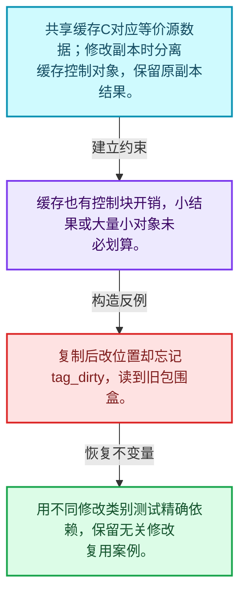
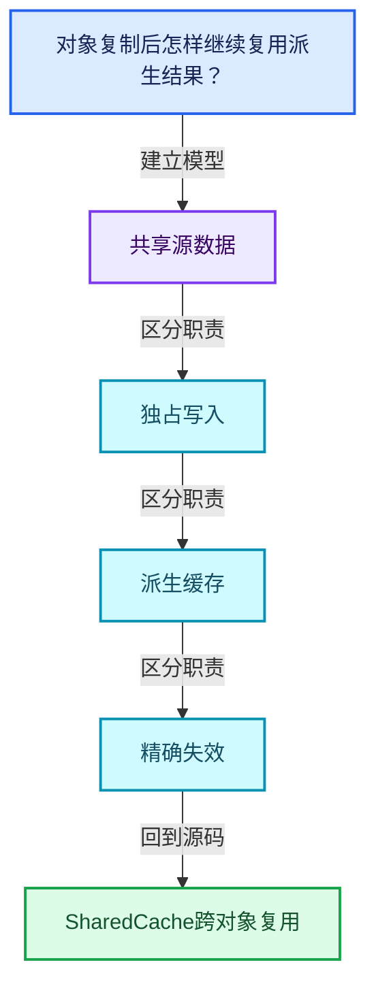
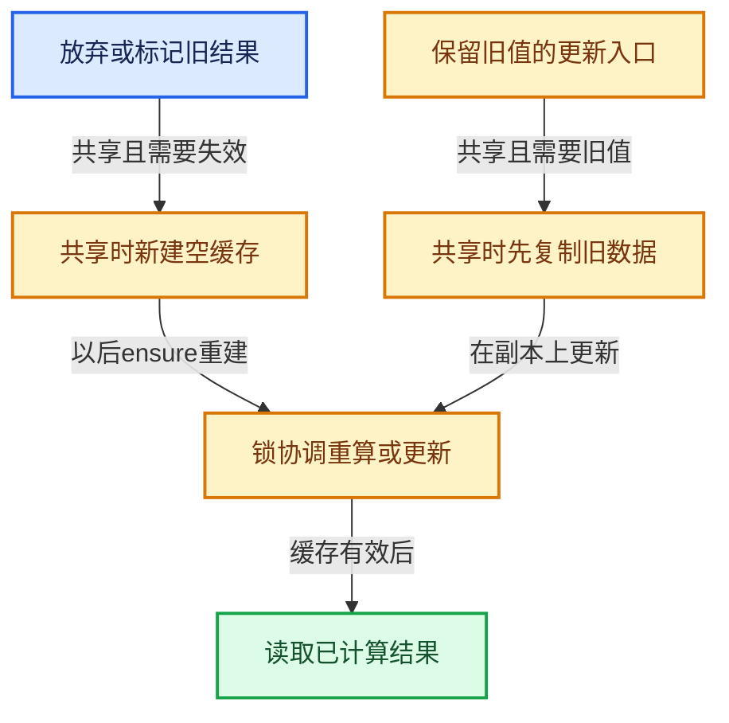
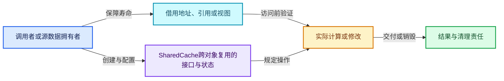
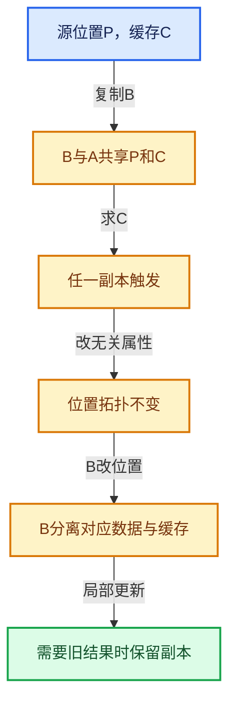

# 06-07 SharedCache跨对象复用

[方向导航](README.md) · [总目录](../README.md) · [覆盖索引](../%E6%BA%90%E7%A0%81%E7%89%88%E6%9C%AC%E4%B8%8E%E8%A6%86%E7%9B%96%E7%B4%A2%E5%BC%95.md)

> 阅读顺序：问题与数据模型 → 语法与类型 → 源码逐行 → 调用线索 → 历史与取舍 → 推演和练习。

- 基准 HEAD：`cbda6b96c26c0dee3c3b5cbb93960c4ac06a6b30`。
- 记录日期：2026-10-14。
- 教学示例状态：正文中的推演不是本机性能实测；已运行练习见验收报告。

## 一、从问题到设计

对象复制后怎样继续复用派生结果？

共享缓存要求相应源数据等价；失效时分离缓存，避免一个副本的修改污染另一个。

本篇把语法、数据语义和系统取舍连接起来。共享计数回答谁还活着，缓存依赖回答结果是否仍正确，两者不能互相替代。

### 本篇独立模型与设计推理

共享缓存C对应等价源数据；修改副本时分离缓存控制对象，保留原副本结果。

设计取舍：缓存也有控制块开销，小结果或大量小对象未必划算。

最小反例：复制后改位置却忘记tag_dirty，读到旧包围盒。

推导与处理：用不同修改类别测试精确依赖，保留无关修改复用案例。



### 源码范围与相邻篇章

| 文件 | 本篇逐行范围 | 基准SHA-256 |
|---|---|---|
| [source/blender/blenlib/BLI_shared_cache.hh](../../../../../source/blender/blenlib/BLI_shared_cache.hh) | L1—L112 | `e4ed38df2ea784bbf20af9f0b4ed9e5c99ba9fb8bfbbaf44a7a667ca56c83985` |

同一主讲文件可能分多篇覆盖；超出本篇范围的符号通过覆盖索引定位。空行与纯注释保留在源码摘录中，逐行表解释有效语句与语法边界；许可证头统一保留。

前篇：[CacheMutex惰性初始化](06-CacheMutex%E6%83%B0%E6%80%A7%E5%88%9D%E5%A7%8B%E5%8C%96.md).

后篇：[法线缓存的真实依赖](08-%E6%B3%95%E7%BA%BF%E7%BC%93%E5%AD%98%E7%9A%84%E7%9C%9F%E5%AE%9E%E4%BE%9D%E8%B5%96.md).

## 二、类型、数据与阅读地图



这是概念依赖图，边表示阅读关系，不声称是运行时调用顺序。

### 直接编译依赖


箭头只表示头文件包含关系；完整调用线索见后面的符号定位表。

## 三、关键词、语法与类型角色

### 模板 template

模板把类型或常量作为生成实现的参数。读声明时先列出类型参数、非类型参数和默认值，再看使用者实际实例化了什么。模板声明本身不意味着每种T都支持其全部成员。

具体检查：把T替换为int、string、只能移动的类型，分别检查每个被调用操作是否成立。

### 依赖名称 typename

typename既可引入类型模板参数，也可告诉编译器某个依赖名称是类型。它不创建运行时对象；解析期确认语法类别与实例化期检查具体类型是不同阶段。

具体检查：区分typename T::value_type和T::size()，前者标记类型，后者是表达式。

### 只读限定 const

const约束当前访问路径可做的修改。const指针、指向const的指针、const视图对象、const元素是不同位置的限定；其他别名可能仍可修改原对象。

具体检查：分别写T* const、const T*与const T* const，并画出不可修改的层次。

### 异常边界 try与catch

try定义异常传播的局部边界。失败路径需要销毁已经成功构造的部分并释放相应存储；未构造的对象不能被析构。

具体检查：在第k次构造失败，列出已经存在的对象集合与待释放缓冲。

### 构造与new表达式

普通new可能分配并构造；placement new在给定地址构造，存储由其他机制提供。失败回滚应区分两类责任。

具体检查：追踪地址来自哪里、构造何时成功、由谁析构、由谁释放。

### 内部断言 assert

断言表达开发者预期成立的内部契约，发布构建可能关闭。它不能替代对不可信输入的完整错误处理，也不保证后续操作被运行时保护。

具体检查：对每条断言构造违反条件的输入，区分调用者错误与应向用户报告的错误。

### 共享拥有 shared_ptr

shared_ptr让控制块跟踪共享寿命，不自动使被指向对象的读写线程安全；循环拥有可能阻止销毁。

具体检查：画出强引用环并考虑是否应改变所有权方向或引入弱引用。

### SharedCache的两个更新入口

tag_dirty在唯一持有时标记原缓存；共享时创建新的空缓存控制对象。
update在共享时复制旧缓存数据后再运行更新回调，以便保留局部修补所需状态。
ensure通过CacheMutex确保计算结果发布；data依赖缓存已完成的前置条件。
共享指针计数只说明缓存控制对象被谁拥有，不能证明调用者修改源位置后还能读旧法线。

## 四、真实源码与逐行讲解

源码块保持原行内容，原始行号由小节标题及逐行表给出。表中的调用定位是静态阅读辅助；重载、模板实例化、宏展开和虚调用需结合完整声明，不能仅凭词法出现证明动态调用。

### BLI_shared_cache.hh：L1—L49

<!-- source:source/blender/blenlib/BLI_shared_cache.hh:1:49 -->

```cpp
/* SPDX-FileCopyrightText: 2023 Blender Authors
 *
 * SPDX-License-Identifier: GPL-2.0-or-later */

/** \file
 * \ingroup bli
 */

#pragma once

#include "BLI_cache_mutex.hh"

#include <memory>

namespace blender {

/**
 * A `SharedCache` is meant to share lazily computed data between equivalent objects. It allows
 * saving unnecessary computation by making a calculated value accessible from any object that
 * shares the cache. Unlike `CacheMutex`, the cached data is embedded inside of this object.
 *
 * When data is copied (copy-on-evaluation before changing a mesh, for example), the cache is
 * shared, allowing its calculation on either the source or original to make the result available
 * on both objects. As soon as either object is changed in a way that invalidates the cache, the
 * data is "un-shared", and they will no-longer influence each other.
 *
 * One important use case is a typical copy-on-evaluation update loop of a persistent geometry
 * data-block in `Main`. Even if bounds are only calculated on the evaluated *copied* geometry, if
 * nothing changes them, they only need to be calculated on the first evaluation, because the same
 * evaluated bounds are also accessible from the original geometry.
 *
 * The cache is implemented with a shared pointer, so it is relatively cheap, but to avoid
 * unnecessary overhead it should only be used for relatively expensive computations.
 */
template<typename T> class SharedCache {
  struct CacheData {
    CacheMutex mutex;
    T data;
    CacheData() = default;
    CacheData(const T &data) : data(data) {}
  };
  std::shared_ptr<CacheData> cache_;

 public:
  SharedCache()
  {
    /* The cache should be allocated to trigger sharing of the cached data as early as possible. */
    cache_ = std::make_shared<CacheData>();
  }
```

本段语义重点：

- `cache_`：缓存入口；SharedCache通过共享控制对象组织结果，其他缓存类按自身拥有及失效规则处理。
- `mutex`：保护相关缓存或节点状态的同步对象，保护范围以调用点为准。

| 原始行 | 语义、约束与检查 |
|---|---|
| L9 | 防止同一头文件在一个翻译单元中重复展开；不控制多个源文件之间的链接或对象寿命。 |
| L11 | 引入编译依赖 "BLI_cache_mutex.hh"；这是声明可见性关系，不表示运行时一定调用该文件的所有接口。 |
| L13 | 引入编译依赖 <memory>；这是声明可见性关系，不表示运行时一定调用该文件的所有接口。 |
| L15 | 把后续声明放入 blender 命名空间，影响名称查找和符号归属，不创建运行时对象。 |
| L35 | 声明模板参数 `template<typename T> class SharedCache {`。类型参数决定生成操作的类型，非类型参数可决定内嵌容量或编译期分支。 |
| L36 | 声明或定义类型 `struct CacheData`。结合继承、访问权限和成员布局确认接口与拥有关系；前向声明本身没有完整对象布局。 |
| L37 | 本行涉及 `mutex`：保护相关缓存或节点状态的同步对象，保护范围以调用点为准。按此语义解读 `CacheMutex mutex`，不要把地址、数量或状态混用。 |
| L38 | 声明成员、局部对象或完成语句 `T data`。若为指针或引用，它本身不说明拥有；若为值对象，其构造析构由所在作用域或外层对象管理。 |
| L39 | 显式采用编译器生成的特殊成员行为：`CacheData() = default;`。成员和基类的性质决定该操作是否可用、是否被删除及异常约定，不表示运行时给对象赋值为default。 |
| L40 | 出现调用或函数声明 `CacheData`，对应表达式为 `CacheData(const T &data) : data(data) {}`。参数求值、返回类型与重载需结合前后完整语句；静态文本引用不能证明动态目标。 |
| L41 | 结束当前语法单元。局部自动对象在离开其作用域时按规则销毁；这不等于所有被引用的外部数据也被释放。 |
| L42 | 本行涉及 `cache_`：缓存入口；SharedCache通过共享控制对象组织结果，其他缓存类按自身拥有及失效规则处理。按此语义解读 `std::shared_ptr<CacheData> cache_`，不要把地址、数量或状态混用。 |
| L44 | 切换成员访问权限为 public；它是编译期接口边界，不是线程同步或内存保护。 |
| L45 | 出现调用或函数声明 `SharedCache`，对应表达式为 `SharedCache()`。参数求值、返回类型与重载需结合前后完整语句；静态文本引用不能证明动态目标。 |
| L46 | 连接上一行的声明或控制结构与其语句块；后续行在这个作用域中执行或声明。 |
| L48 | 建立或更新 `cache_`：缓存入口；SharedCache通过共享控制对象组织结果，其他缓存类按自身拥有及失效规则处理。本行的具体值关系为 `cache_ = std::make_shared<CacheData>()`；对照更新前后相应范围或状态是否一致。 |
| L49 | 结束当前语法单元。局部自动对象在离开其作用域时按规则销毁；这不等于所有被引用的外部数据也被释放。 |

### BLI_shared_cache.hh：L50—L112

<!-- source:source/blender/blenlib/BLI_shared_cache.hh:50:112 -->

```cpp

  /** Tag the data for recomputation and stop sharing the cache with other objects. */
  void tag_dirty()
  {
    if (cache_.use_count() == 1) {
      cache_->mutex.tag_dirty();
    }
    else {
      cache_ = std::make_shared<CacheData>();
    }
  }

  /**
   * If the cache is dirty, trigger its computation with the provided function which should set
   * the proper data.
   */
  void ensure(FunctionRef<void(T &data)> compute_cache)
  {
    cache_->mutex.ensure([&]() { compute_cache(this->cache_->data); });
  }

  /**
   * Represents a combination of "tag dirty" and "update cache for new data." Existing cached
   * values are kept available (copied from shared data if necessary). This can be helpful when
   * the recalculation is only expected to make a small change to the cached data, since using
   * #tag_dirty() and #ensure() separately may require rebuilding the cache from scratch.
   */
  void update(FunctionRef<void(T &data)> compute_cache)
  {
    if (cache_.use_count() == 1) {
      cache_->mutex.tag_dirty();
    }
    else {
      cache_ = std::make_shared<CacheData>(cache_->data);
    }
    cache_->mutex.ensure([&]() { compute_cache(this->cache_->data); });
  }

  /** Retrieve the cached data. */
  const T &data() const
  {
    BLI_assert(cache_->mutex.is_cached());
    return cache_->data;
  }

  /**
   * Return true if the cache currently does not exist or has been invalidated.
   */
  bool is_dirty() const
  {
    return cache_->mutex.is_dirty();
  }

  /**
   * Return true if the cache exists and is valid.
   */
  bool is_cached() const
  {
    return cache_->mutex.is_cached();
  }
};

}  // namespace blender
```

本段语义重点：

- `tag_dirty`：标记派生结果失效；对于共享缓存还可能分离旧缓存。
- `cache_`：缓存入口；SharedCache通过共享控制对象组织结果，其他缓存类按自身拥有及失效规则处理。
- `mutex`：保护相关缓存或节点状态的同步对象，保护范围以调用点为准。

| 原始行 | 语义、约束与检查 |
|---|---|
| L52 | 出现调用或函数声明 `tag_dirty`，对应表达式为 `void tag_dirty()`。参数求值、返回类型与重载需结合前后完整语句；静态文本引用不能证明动态目标。 |
| L53 | 连接上一行的声明或控制结构与其语句块；后续行在这个作用域中执行或声明。 |
| L54 | 判断 `cache_.use_count() == 1`，成立时进入本分支，否则继续后续路径。 |
| L55 | 本行使用 `tag_dirty`：标记派生结果失效；对于共享缓存还可能分离旧缓存。 |
| L56 | 结束当前语法单元。局部自动对象在离开其作用域时按规则销毁；这不等于所有被引用的外部数据也被释放。 |
| L57 | 处理前一条件不成立的互补路径。比较两条路径最后是否恢复同一不变量，以及是否产生不同的资源责任。 |
| L58 | 建立或更新 `cache_`：缓存入口；SharedCache通过共享控制对象组织结果，其他缓存类按自身拥有及失效规则处理。本行的具体值关系为 `cache_ = std::make_shared<CacheData>()`；对照更新前后相应范围或状态是否一致。 |
| L59 | 结束当前语法单元。局部自动对象在离开其作用域时按规则销毁；这不等于所有被引用的外部数据也被释放。 |
| L60 | 结束当前语法单元。局部自动对象在离开其作用域时按规则销毁；这不等于所有被引用的外部数据也被释放。 |
| L66 | 出现调用或函数声明 `ensure`，对应表达式为 `void ensure(FunctionRef<void(T &data)> compute_cache)`。参数求值、返回类型与重载需结合前后完整语句；静态文本引用不能证明动态目标。 |
| L67 | 连接上一行的声明或控制结构与其语句块；后续行在这个作用域中执行或声明。 |
| L68 | 本行涉及 `cache_`：缓存入口；SharedCache通过共享控制对象组织结果，其他缓存类按自身拥有及失效规则处理。按此语义解读 `cache_->mutex.ensure([&]() { compute_cache(this->cache_->data); })`，不要把地址、数量或状态混用。 |
| L69 | 结束当前语法单元。局部自动对象在离开其作用域时按规则销毁；这不等于所有被引用的外部数据也被释放。 |
| L77 | 出现调用或函数声明 `update`，对应表达式为 `void update(FunctionRef<void(T &data)> compute_cache)`。参数求值、返回类型与重载需结合前后完整语句；静态文本引用不能证明动态目标。 |
| L78 | 连接上一行的声明或控制结构与其语句块；后续行在这个作用域中执行或声明。 |
| L79 | 判断 `cache_.use_count() == 1`，成立时进入本分支，否则继续后续路径。 |
| L80 | 本行使用 `tag_dirty`：标记派生结果失效；对于共享缓存还可能分离旧缓存。 |
| L81 | 结束当前语法单元。局部自动对象在离开其作用域时按规则销毁；这不等于所有被引用的外部数据也被释放。 |
| L82 | 处理前一条件不成立的互补路径。比较两条路径最后是否恢复同一不变量，以及是否产生不同的资源责任。 |
| L83 | 建立或更新 `cache_`：缓存入口；SharedCache通过共享控制对象组织结果，其他缓存类按自身拥有及失效规则处理。本行的具体值关系为 `cache_ = std::make_shared<CacheData>(cache_->data)`；对照更新前后相应范围或状态是否一致。 |
| L84 | 结束当前语法单元。局部自动对象在离开其作用域时按规则销毁；这不等于所有被引用的外部数据也被释放。 |
| L85 | 本行涉及 `cache_`：缓存入口；SharedCache通过共享控制对象组织结果，其他缓存类按自身拥有及失效规则处理。按此语义解读 `cache_->mutex.ensure([&]() { compute_cache(this->cache_->data); })`，不要把地址、数量或状态混用。 |
| L86 | 结束当前语法单元。局部自动对象在离开其作用域时按规则销毁；这不等于所有被引用的外部数据也被释放。 |
| L89 | 出现调用或函数声明 `data`，对应表达式为 `const T &data() const`。参数求值、返回类型与重载需结合前后完整语句；静态文本引用不能证明动态目标。 |
| L90 | 连接上一行的声明或控制结构与其语句块；后续行在这个作用域中执行或声明。 |
| L91 | 断言约束 `BLI_assert(cache_->mutex.is_cached());`。条件是后续访问的内部前置条件；发布构建可能不执行，不能把断言当作输入修复。 |
| L92 | 返回表达式 `cache_->data`。 |
| L93 | 结束当前语法单元。局部自动对象在离开其作用域时按规则销毁；这不等于所有被引用的外部数据也被释放。 |
| L98 | 出现调用或函数声明 `is_dirty`，对应表达式为 `bool is_dirty() const`。参数求值、返回类型与重载需结合前后完整语句；静态文本引用不能证明动态目标。 |
| L99 | 连接上一行的声明或控制结构与其语句块；后续行在这个作用域中执行或声明。 |
| L100 | 返回表达式 `cache_->mutex.is_dirty()`。 |
| L101 | 结束当前语法单元。局部自动对象在离开其作用域时按规则销毁；这不等于所有被引用的外部数据也被释放。 |
| L106 | 出现调用或函数声明 `is_cached`，对应表达式为 `bool is_cached() const`。参数求值、返回类型与重载需结合前后完整语句；静态文本引用不能证明动态目标。 |
| L107 | 连接上一行的声明或控制结构与其语句块；后续行在这个作用域中执行或声明。 |
| L108 | 返回表达式 `cache_->mutex.is_cached()`。 |
| L109 | 结束当前语法单元。局部自动对象在离开其作用域时按规则销毁；这不等于所有被引用的外部数据也被释放。 |
| L110 | 结束当前语法单元。局部自动对象在离开其作用域时按规则销毁；这不等于所有被引用的外部数据也被释放。 |
| L112 | 结束当前语法单元。局部自动对象在离开其作用域时按规则销毁；这不等于所有被引用的外部数据也被释放。 |

## 五、接口定位、调用线索与生命周期

### SharedCache的两种分离路径



独占分支可以直接标脏而不新建控制对象。图强调共享分支的差异，避免把tag_dirty与update视为可随意互换。

| 阶段 | 源码证据位置 | 实际语句定位 |
|---|---|---|
| 放弃或标记旧结果 | BLI_shared_cache.hh [L52](../../../../../source/blender/blenlib/BLI_shared_cache.hh#L52) | `void tag_dirty()` |
| 共享时新建空缓存 | BLI_shared_cache.hh [L48](../../../../../source/blender/blenlib/BLI_shared_cache.hh#L48)、[L58](../../../../../source/blender/blenlib/BLI_shared_cache.hh#L58) | `cache_ = std::make_shared<CacheData>()` |
| 保留旧值的更新入口 | BLI_shared_cache.hh [L77](../../../../../source/blender/blenlib/BLI_shared_cache.hh#L77) | `void update(` |
| 共享时先复制旧数据 | BLI_shared_cache.hh [L83](../../../../../source/blender/blenlib/BLI_shared_cache.hh#L83) | `cache_ = std::make_shared<CacheData>(cache_->data)` |
| 锁协调重算或更新 | BLI_shared_cache.hh [L68](../../../../../source/blender/blenlib/BLI_shared_cache.hh#L68)、[L85](../../../../../source/blender/blenlib/BLI_shared_cache.hh#L85) | `cache_->mutex.ensure([&]()` |
| 读取已计算结果 | BLI_shared_cache.hh [L89](../../../../../source/blender/blenlib/BLI_shared_cache.hh#L89) | `const T &data() const` |

图中的条件边必须与对应if、异常路径和提前返回合读；不把未展示分支当作不存在。

### 本篇声明与实现入口

| 源码位置 | 实际声明片段 |
|---|---|
| [BLI_shared_cache.hh:L35](../../../../../source/blender/blenlib/BLI_shared_cache.hh#L35) | `template<typename T> class SharedCache` |
| [BLI_shared_cache.hh:L36](../../../../../source/blender/blenlib/BLI_shared_cache.hh#L36) | `struct CacheData` |
| [BLI_shared_cache.hh:L39](../../../../../source/blender/blenlib/BLI_shared_cache.hh#L39) | `CacheData() = default;` |
| [BLI_shared_cache.hh:L40](../../../../../source/blender/blenlib/BLI_shared_cache.hh#L40) | `CacheData(const T &data) : data(data) {}` |
| [BLI_shared_cache.hh:L45](../../../../../source/blender/blenlib/BLI_shared_cache.hh#L45) | `SharedCache()` |
| [BLI_shared_cache.hh:L52](../../../../../source/blender/blenlib/BLI_shared_cache.hh#L52) | `void tag_dirty()` |
| [BLI_shared_cache.hh:L66](../../../../../source/blender/blenlib/BLI_shared_cache.hh#L66) | `void ensure(FunctionRef<void(T &data)> compute_cache)` |
| [BLI_shared_cache.hh:L77](../../../../../source/blender/blenlib/BLI_shared_cache.hh#L77) | `void update(FunctionRef<void(T &data)> compute_cache)` |
| [BLI_shared_cache.hh:L89](../../../../../source/blender/blenlib/BLI_shared_cache.hh#L89) | `const T &data() const` |
| [BLI_shared_cache.hh:L98](../../../../../source/blender/blenlib/BLI_shared_cache.hh#L98) | `bool is_dirty() const` |
| [BLI_shared_cache.hh:L106](../../../../../source/blender/blenlib/BLI_shared_cache.hh#L106) | `bool is_cached() const` |

### 同名符号出现位置

以下表提供跨文件阅读入口，包含声明、调用或测试使用；没有经过完整C++名称解析，不把它命名为已证明的运行时调用图。

| 符号 | 位置 | 文本证据 |
|---|---|---|
| `tag_dirty` | [mesh_runtime.cc:L49](../../../../../source/blender/blenkernel/intern/mesh_runtime.cc#L49) | `mesh_runtime.bvh_cache_edges.tag_dirty();` |
| `tag_dirty` | [mesh_runtime.cc:L50](../../../../../source/blender/blenkernel/intern/mesh_runtime.cc#L50) | `mesh_runtime.bvh_cache_faces.tag_dirty();` |
| `tag_dirty` | [mesh_runtime.cc:L51](../../../../../source/blender/blenkernel/intern/mesh_runtime.cc#L51) | `mesh_runtime.bvh_cache_corner_tris.tag_dirty();` |
| `ensure` | [bvhutils.cc:L654](../../../../../source/blender/blenkernel/intern/bvhutils.cc#L654) | `this->runtime->bvh_cache_loose_verts.ensure([&](std::unique_ptr<BVHTree, BVHTreeDeleter> &data) {` |
| `ensure` | [bvhutils.cc:L664](../../../../../source/blender/blenkernel/intern/bvhutils.cc#L664) | `this->runtime->bvh_cache_loose_verts_no_hidden.ensure(` |
| `ensure` | [bvhutils.cc:L677](../../../../../source/blender/blenkernel/intern/bvhutils.cc#L677) | `this->runtime->bvh_embree_verts_cache.ensure([&](bvh::Tree &data) {` |
| `update` | [BLI_index_mask.hh:L559](../../../../../source/blender/blenlib/BLI_index_mask.hh#L559) | `const IndexMask &update(IndexMaskSegment segment);` |
| `update` | [BLI_index_mask.hh:L573](../../../../../source/blender/blenlib/BLI_index_mask.hh#L573) | `inline const IndexMask &IndexMaskFromSegment::update(const IndexMaskSegment segment)` |
| `update` | [FN_multi_function_builder.hh:L297](../../../../../source/blender/functions/FN_multi_function_builder.hh#L297) | `current_segment_mask = &index_mask_from_segment.update(` |
| `data` | [BKE_attribute.hh:L133](../../../../../source/blender/blenkernel/BKE_attribute.hh#L133) | `: AttributeInit(Type::Shared), data(data), sharing_info(&sharing_info)` |
| `data` | [BKE_attribute_storage.hh:L112](../../../../../source/blender/blenkernel/BKE_attribute_storage.hh#L112) | `const DataVariant &data() const;` |
| `data` | [BKE_attribute_storage.hh:L296](../../../../../source/blender/blenkernel/BKE_attribute_storage.hh#L296) | `inline const Attribute::DataVariant &Attribute::data() const` |
| `is_dirty` | [mesh_normals.cc:L100](../../../../../source/blender/blenkernel/intern/mesh_normals.cc#L100) | `return mesh->runtime->vert_normals_cache.is_dirty();` |
| `is_dirty` | [mesh_normals.cc:L105](../../../../../source/blender/blenkernel/intern/mesh_normals.cc#L105) | `return mesh->runtime->face_normals_cache.is_dirty();` |
| `is_dirty` | [BLI_cache_mutex.hh:L105](../../../../../source/blender/blenlib/BLI_cache_mutex.hh#L105) | `bool is_dirty() const` |
| `is_cached` | [mesh.cc:L2070](../../../../../source/blender/blenkernel/intern/mesh.cc#L2070) | `if (mesh.runtime->bounds_cache.is_cached()) {` |
| `is_cached` | [mesh_runtime.cc:L86](../../../../../source/blender/blenkernel/intern/mesh_runtime.cc#L86) | `if (!mesh.runtime->loose_edges_cache.is_cached() &#124;&#124; !mesh.loose_edges().is_empty()) {` |
| `is_cached` | [mesh_runtime.cc:L89](../../../../../source/blender/blenkernel/intern/mesh_runtime.cc#L89) | `if (!mesh.runtime->loose_verts_cache.is_cached() &#124;&#124; !mesh.loose_verts().is_empty()) {` |

### 生命周期推理图



这是审查生命周期的通用模型。具体类是否拥有数据由本篇成员、构造、析构和调用者一起证明；任何箭头都不自动代表shared_ptr。

## 六、把代码放进具体数据中推演

本方向的共同数值模型如下。本篇的专门检查是：复制后只改无关属性，再改位置，分别记录缓存是否复用。

| 步骤 | 数据或状态 | 为什么需要这一步 |
|---|---|---|
| 创建A | 源位置P，缓存C | C可以尚未计算 |
| 复制B | B与A共享P和C | 源数据等价才允许共享结果 |
| 求C | 任一副本触发 | 另一个副本也可见相同结果 |
| 改无关属性 | 位置拓扑不变 | 相关缓存可继续有效 |
| B改位置 | B分离对应数据与缓存 | A结果仍保持原语义 |
| 局部更新 | 需要旧结果时保留副本 | 与直接放弃旧缓存不同 |



图是教学推演模型；精确分支与状态更新以本篇摘录及调用契约为准。

### 本篇独立练习与参考思路

复制后只改无关属性，再改位置，分别记录缓存是否复用。

参考思路：共享缓存要求相应源数据等价；失效时分离缓存，避免一个副本的修改污染另一个。

将输入、预期结果和资源责任分成三张清单。先用最直接的实现给出可核对的答案，再替换成对应源码使用的表示；比较结果不变的条件，而不是只比较接口名字。

验收依据：改变副本不改变原对象结果；修改任一真实依赖后旧结果不可继续被当成有效缓存。

## 七、复杂度、设计取舍与其他基础库

与shared_ptr比较寿命管理，与写时复制容器比较写边界，与普通memoization比较键的等价性；SharedCache把等价对象的派生结果放在共同控制对象中。

本篇的具体取舍：共享缓存要求相应源数据等价；失效时分离缓存，避免一个副本的修改污染另一个。

| 观察维度 | 从源码取得证据的方法 | 本篇要避免的误判 |
|---|---|---|
| 时间 | 对循环次数、分派次数和重建频率分别计数 | 看到单次常数操作就断定整个操作序列是常数成本 |
| 内存 | 区分对象本体、容量存储、间接资源和共享控制块 | 用sizeof代替总内存 |
| 安全 | 沿构造、失败回滚、销毁与失效逐路径检查 | 把断言或非空指针当作完整安全证明 |
| 并发 | 逐字段确认锁、发布顺序和借用寿命 | 把引用计数线程安全等同数据读写线程安全 |

相关一手资料：

- [C++公开工作草案](https://eel.is/c++draft/)：持续更新的工作草案；语言与标准库语义以相应章节为准。
- [Blender依赖图设计](https://developer.blender.org/docs/features/core/depsgraph/)：包含历史设计背景，当前行为以本地源码为准。

资料用于核对契约和进一步阅读；这里没有声称外部库与Blender实现相同，也没有把上游性能数字当作本机实测。

## 八、历史提交与设计演化

### 2023-08-29 · Hans Goudey

[Fix: Crash in sculpt mode with shared normals caches](https://projects.blender.org/blender/blender/commit/b339e3937d8dc580b655efe599c3b0f97f412fb1)

完整哈希：`b339e3937d8dc580b655efe599c3b0f97f412fb1`。提交标题与作者日期来自本地Git对象。

提交说明原文（历史证据，不能直接作为当前API说明）：

```text
Fix: Crash in sculpt mode with shared normals caches

Since the normals are stored in a shared cache, tagging them dirty
recreated the cache from scratch when it was shared. Instead,
add a function that updates the cache in the same call as tagging
it dirty. This keeps the old state of the cache around even if it was
shared, and reflects the way that it's really the PBVH and sculpt
mode managing the dirty status of normals while sculpt mode
is active.

One consequence is that the BVH cache and the triangulation
cache need to be tagged dirty manually. I'd like to avoid abstracting
this more than necessary, because I'm hoping in the long term
different caching abstractions like a more global cache that takes
implicit sharing versions into account will make this complexity
unnecessary.

Fixes #111628, #111563

Pull Request: https://projects.blender.org/blender/blender/pulls/111641
```

阅读任务：先根据说明复述旧问题，提出一个自己的修复方案，再对照diff。结合本篇重点“对象复制后怎样继续复用派生结果？”判断方案改变的是表示、接口、生命周期还是调度。

## 九、反例、测试入口与掌握标准

需要实际构造的反例：

- 空输入或没有结果需求：确认接口允许的空状态与不允许访问的操作。
- 边界位置和退化结构：把长度为1、末尾位置、重复值或深链代入真实分支。
- 生命周期结束或修改之后：检查保存的指针、引用、结果视图是否仍有效。
- 与本篇核心不变量相冲突的输入：复制后只改无关属性，再改位置，分别记录缓存是否复用。

### 可运行的教学参考程序

[reference_exercises.cc](../_tools/reference_exercises.cc)包含独立于Blender的C++20参考检查：视图、简化SmallVector、异常回滚、哈希碰撞与删除、偏移数组、拓扑映射、共享缓存、表达式、惰性分支、闭包和暴力最近邻。

参考程序有意省略生产实现的完整能力。例如SmallVector禁止复制移动容器，不支持只能移动的元素，并禁止append参数别名到自身元素；TinyMap固定8槽，不提供增长。程序通过不能替代Blender实现测试。实际运行结果、编译器与命令见验收报告。

掌握标准：离开源码解释“对象复制后怎样继续复用派生结果？”；独立完成上述练习；能指出一个会破坏共享源数据相关约束的最小反例，并用具体代码行说明检查或修复应放在哪里。
