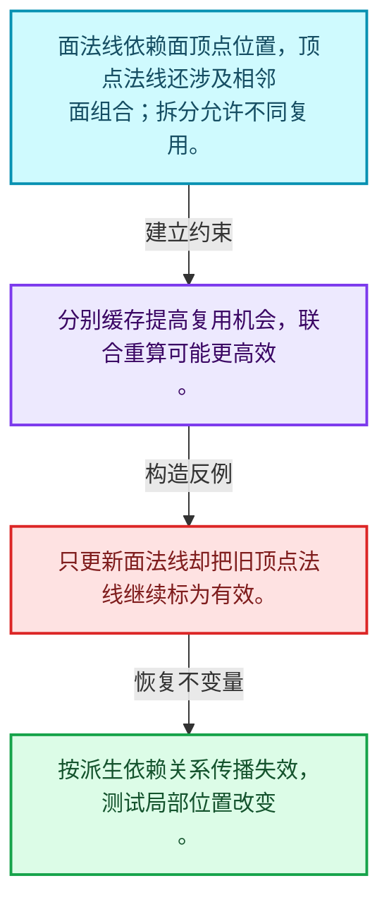
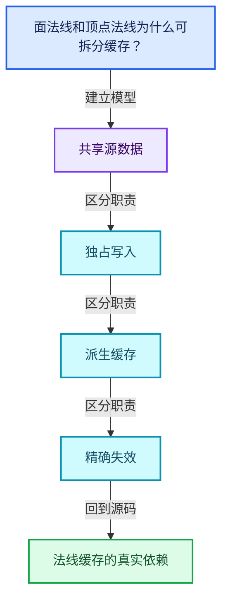
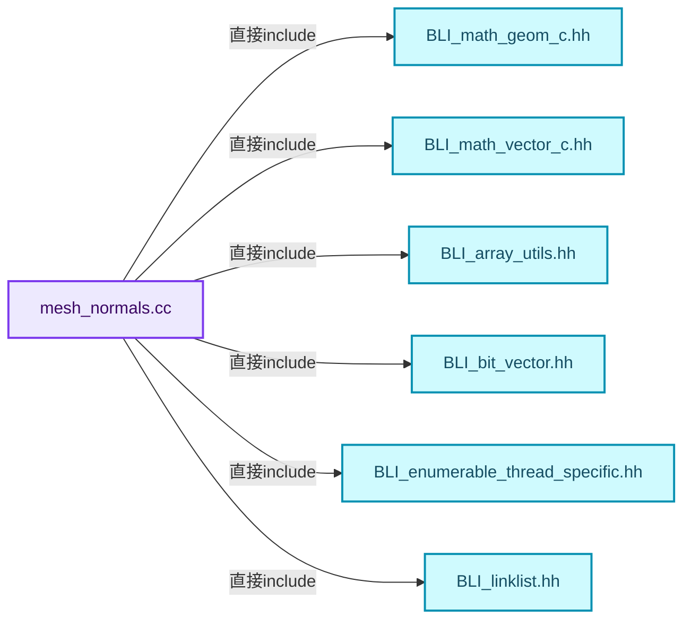
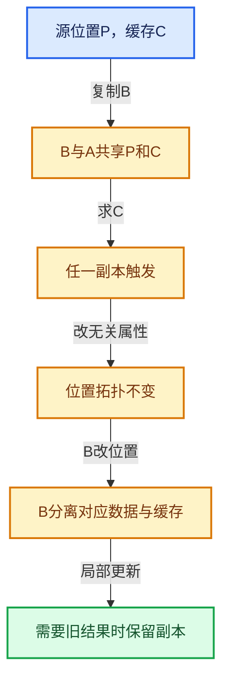

# 06-08 法线缓存的真实依赖

[方向导航](README.md) · [总目录](../README.md) · [覆盖索引](../%E6%BA%90%E7%A0%81%E7%89%88%E6%9C%AC%E4%B8%8E%E8%A6%86%E7%9B%96%E7%B4%A2%E5%BC%95.md)

> 阅读顺序：问题与数据模型 → 语法与类型 → 源码逐行 → 调用线索 → 历史与取舍 → 推演和练习。

- 基准 HEAD：`cbda6b96c26c0dee3c3b5cbb93960c4ac06a6b30`。
- 记录日期：2026-10-14。
- 教学示例状态：正文中的推演不是本机性能实测；已运行练习见验收报告。

## 一、从问题到设计

面法线和顶点法线为什么可拆分缓存？

两类结果的依赖和重算成本不同，拆分让部分复用成为可能，但联合计算也可能更高效。

本篇把语法、数据语义和系统取舍连接起来。共享计数回答谁还活着，缓存依赖回答结果是否仍正确，两者不能互相替代。

### 本篇独立模型与设计推理

面法线依赖面顶点位置，顶点法线还涉及相邻面组合；拆分允许不同复用。

设计取舍：分别缓存提高复用机会，联合重算可能更高效。

最小反例：只更新面法线却把旧顶点法线继续标为有效。

推导与处理：按派生依赖关系传播失效，测试局部位置改变。



### 源码范围与相邻篇章

| 文件 | 本篇逐行范围 | 基准SHA-256 |
|---|---|---|
| [source/blender/blenkernel/intern/mesh_normals.cc](../../../../../source/blender/blenkernel/intern/mesh_normals.cc) | L1—L1801 | `fd500a17b4b8895aa6949f42ef7449189b89bfff4f38e17cd0a3b7c6f6e53df3` |

同一主讲文件可能分多篇覆盖；超出本篇范围的符号通过覆盖索引定位。空行与纯注释保留在源码摘录中，逐行表解释有效语句与语法边界；许可证头统一保留。

前篇：[SharedCache跨对象复用](07-SharedCache%E8%B7%A8%E5%AF%B9%E8%B1%A1%E5%A4%8D%E7%94%A8.md).

后篇：[BVH共享与运行时数据](09-BVH%E5%85%B1%E4%BA%AB%E4%B8%8E%E8%BF%90%E8%A1%8C%E6%97%B6%E6%95%B0%E6%8D%AE.md).

## 二、类型、数据与阅读地图



这是概念依赖图，边表示阅读关系，不声称是运行时调用顺序。

### 直接编译依赖



箭头只表示头文件包含关系；完整调用线索见后面的符号定位表。

## 三、关键词、语法与类型角色

### 常量求值 constexpr

constexpr声明允许相应实体参与常量求值，但constexpr函数仍可以在运行时执行。是否常量求值由调用场景和表达式合法性共同决定。

具体检查：比较constexpr变量初始化和从运行时输入调用同一函数。

### 只读限定 const

const约束当前访问路径可做的修改。const指针、指向const的指针、const视图对象、const元素是不同位置的限定；其他别名可能仍可修改原对象。

具体检查：分别写T* const、const T*与const T* const，并画出不可修改的层次。

### 移动转换 std::move

std::move把表达式转换为可供移动重载选择的值类别，实际资源转移发生在被选中的构造或赋值中。对const对象move可能仍调用复制，对视图move也不会获得底层数据所有权。

具体检查：记录移动构造调用次数，不用变量名或std::move的出现次数替代测量。

### 异常边界 try与catch

try定义异常传播的局部边界。失败路径需要销毁已经成功构造的部分并释放相应存储；未构造的对象不能被析构。

具体检查：在第k次构造失败，列出已经存在的对象集合与待释放缓冲。

### 显式静态转换 static_cast

static_cast表达编译期允许的转换，不会自动验证运行时真实类型、指针寿命或索引边界。由void指针恢复T指针时，调用者仍须保证实际存储中确有合法T对象。

具体检查：标出转换前后的类型以及正确性依据来自哪里。

### 可选值 optional

optional把不存在与存在的T区分开，T的构造和析构跟随engaged状态变化。访问前应由has_value或条件分支证明存在。

具体检查：把空Field状态与合法常量零区分，不能用某个普通值代替不存在。

### 判别联合 variant

variant在若干候选类型中保存一个活动值，通过判别信息选择操作。它能把不同表示集中在值类型中，但各分支的复制移动成本不同。

具体检查：列出活动分支及每种分支实际拥有或借用的数据。

### 对象表示 sizeof

sizeof给出对象表示大小，不是其引用的所有堆内存总量。sizeof视图很小并不说明底层数组很小。

具体检查：分别统计容器对象、容量字节和元素拥有的间接资源。

### 构造与new表达式

普通new可能分配并构造；placement new在给定地址构造，存储由其他机制提供。失败回滚应区分两类责任。

具体检查：追踪地址来自哪里、构造何时成功、由谁析构、由谁释放。

### 内部断言 assert

断言表达开发者预期成立的内部契约，发布构建可能关闭。它不能替代对不可信输入的完整错误处理，也不保证后续操作被运行时保护。

具体检查：对每条断言构造违反条件的输入，区分调用者错误与应向用户报告的错误。

### 类型别名 using

类型别名为已有类型建立名字，不创建运行期对象。它常把模板内部使用的类型统一暴露给泛型调用者。

具体检查：展开别名直到基础类型，区分类型别名和变量声明。

## 四、真实源码与逐行讲解

源码块保持原行内容，原始行号由小节标题及逐行表给出。表中的调用定位是静态阅读辅助；重载、模板实例化、宏展开和虚调用需结合完整声明，不能仅凭词法出现证明动态调用。

### mesh_normals.cc：L1—L54

<!-- source:source/blender/blenkernel/intern/mesh_normals.cc:1:54 -->

```cpp
/* SPDX-FileCopyrightText: 2001-2002 NaN Holding BV. All rights reserved.
 *
 * SPDX-License-Identifier: GPL-2.0-or-later */

/** \file
 * \ingroup bke
 *
 * Mesh normal calculation functions.
 *
 * \see `bmesh_mesh_normals.cc` for the equivalent #BMesh functionality.
 */

#include <climits>

#include "BLI_math_geom_c.hh"
#include "BLI_math_vector_c.hh"

#include "BLI_array_utils.hh"
#include "BLI_bit_vector.hh"
#include "BLI_enumerable_thread_specific.hh"
#include "BLI_linklist.hh"
#include "BLI_math_base.hh"
#include "BLI_math_vector.hh"
#include "BLI_memarena.hh"
#include "BLI_span.hh"
#include "BLI_task.hh"
#include "BLI_utildefines.hh"

#include "BKE_attribute.hh"
#include "BKE_global.hh"
#include "BKE_mesh.hh"
#include "BKE_mesh_mapping.hh"

namespace blender {

// #define DEBUG_TIME

#ifdef DEBUG_TIME
#  include "BLI_timeit.hh"
#endif

/* -------------------------------------------------------------------- */
/** \name Public Utility Functions
 *
 * Related to managing normals but not directly related to calculating normals.
 * \{ */

namespace bke {

void mesh_vert_normals_assign(Mesh &mesh, Span<float3> vert_normals)
{
  mesh.runtime->vert_normals_true_cache.ensure(
      [&](Vector<float3> &r_data) { r_data = vert_normals; });
}
```

| 原始行 | 语义、约束与检查 |
|---|---|
| L13 | 引入编译依赖 <climits>；这是声明可见性关系，不表示运行时一定调用该文件的所有接口。 |
| L15 | 引入编译依赖 "BLI_math_geom_c.hh"；这是声明可见性关系，不表示运行时一定调用该文件的所有接口。 |
| L16 | 引入编译依赖 "BLI_math_vector_c.hh"；这是声明可见性关系，不表示运行时一定调用该文件的所有接口。 |
| L18 | 引入编译依赖 "BLI_array_utils.hh"；这是声明可见性关系，不表示运行时一定调用该文件的所有接口。 |
| L19 | 引入编译依赖 "BLI_bit_vector.hh"；这是声明可见性关系，不表示运行时一定调用该文件的所有接口。 |
| L20 | 引入编译依赖 "BLI_enumerable_thread_specific.hh"；这是声明可见性关系，不表示运行时一定调用该文件的所有接口。 |
| L21 | 引入编译依赖 "BLI_linklist.hh"；这是声明可见性关系，不表示运行时一定调用该文件的所有接口。 |
| L22 | 引入编译依赖 "BLI_math_base.hh"；这是声明可见性关系，不表示运行时一定调用该文件的所有接口。 |
| L23 | 引入编译依赖 "BLI_math_vector.hh"；这是声明可见性关系，不表示运行时一定调用该文件的所有接口。 |
| L24 | 引入编译依赖 "BLI_memarena.hh"；这是声明可见性关系，不表示运行时一定调用该文件的所有接口。 |
| L25 | 引入编译依赖 "BLI_span.hh"；这是声明可见性关系，不表示运行时一定调用该文件的所有接口。 |
| L26 | 引入编译依赖 "BLI_task.hh"；这是声明可见性关系，不表示运行时一定调用该文件的所有接口。 |
| L27 | 引入编译依赖 "BLI_utildefines.hh"；这是声明可见性关系，不表示运行时一定调用该文件的所有接口。 |
| L29 | 引入编译依赖 "BKE_attribute.hh"；这是声明可见性关系，不表示运行时一定调用该文件的所有接口。 |
| L30 | 引入编译依赖 "BKE_global.hh"；这是声明可见性关系，不表示运行时一定调用该文件的所有接口。 |
| L31 | 引入编译依赖 "BKE_mesh.hh"；这是声明可见性关系，不表示运行时一定调用该文件的所有接口。 |
| L32 | 引入编译依赖 "BKE_mesh_mapping.hh"；这是声明可见性关系，不表示运行时一定调用该文件的所有接口。 |
| L34 | 把后续声明放入 blender 命名空间，影响名称查找和符号归属，不创建运行时对象。 |
| L38 | 预处理阶段处理 #ifdef DEBUG_TIME。它决定哪些代码进入编译，不是运行时分支；阅读行为时必须结合实际构建宏。 |
| L39 | 本行是连续声明或表达式的一部分：`#  include "BLI_timeit.hh"`。与本段前后行合读；逗号、括号和限定符决定它属于参数、初始化列表还是实际计算。 |
| L40 | 预处理阶段处理 #endif。它决定哪些代码进入编译，不是运行时分支；阅读行为时必须结合实际构建宏。 |
| L48 | 把后续声明放入 bke 命名空间，影响名称查找和符号归属，不创建运行时对象。 |
| L50 | 出现调用或函数声明 `mesh_vert_normals_assign`，对应表达式为 `void mesh_vert_normals_assign(Mesh &mesh, Span<float3> vert_normals)`。参数求值、返回类型与重载需结合前后完整语句；静态文本引用不能证明动态目标。 |
| L51 | 连接上一行的声明或控制结构与其语句块；后续行在这个作用域中执行或声明。 |
| L52 | 出现调用或函数声明 `ensure`，对应表达式为 `mesh.runtime->vert_normals_true_cache.ensure(`。参数求值、返回类型与重载需结合前后完整语句；静态文本引用不能证明动态目标。 |
| L53 | 把右侧 `vert_normals; })` 用于初始化或更新左侧 `[&](Vector<float3> &r_data) { r_data`。声明初始化与已有对象赋值应按上下文区分；有资源的类型会调用相应特殊成员。 |
| L54 | 结束当前语法单元。局部自动对象在离开其作用域时按规则销毁；这不等于所有被引用的外部数据也被释放。 |

### mesh_normals.cc：L55—L101

<!-- source:source/blender/blenkernel/intern/mesh_normals.cc:55:101 -->

```cpp

void mesh_vert_normals_assign(Mesh &mesh, Vector<float3> vert_normals)
{
  mesh.runtime->vert_normals_true_cache.ensure(
      [&](Vector<float3> &r_data) { r_data = std::move(vert_normals); });
}

MutableSpan<float3> NormalsCache::ensure_vector_size(const int size)
{
  if (auto *vector = std::get_if<Vector<float3>>(&this->data)) {
    vector->resize(size);
  }
  else {
    this->data = Vector<float3>(size);
  }
  return std::get<Vector<float3>>(this->data).as_mutable_span();
}

Span<float3> NormalsCache::get_span() const
{
  if (const auto *vector = std::get_if<Vector<float3>>(&this->data)) {
    return vector->as_span();
  }
  return std::get<Span<float3>>(this->data);
}

void NormalsCache::store_varray(const VArray<float3> &data)
{
  if (data.is_span()) {
    this->data = data.get_internal_span();
  }
  else {
    data.materialize(this->ensure_vector_size(data.size()));
  }
}

void NormalsCache::store_vector(Vector<float3> &&data)
{
  this->data = std::move(data);
}

}  // namespace bke

bool BKE_mesh_vert_normals_are_dirty(const Mesh *mesh)
{
  return mesh->runtime->vert_normals_cache.is_dirty();
}
```

本段语义重点：

- 分支证据 `auto *vector = std::get_if<Vector<float3>>(&this->data))`：分别推演条件成立与不成立，核对相同出口处的状态。
- 分支证据 `const auto *vector = std::get_if<Vector<float3>>(&this->data))`：分别推演条件成立与不成立，核对相同出口处的状态。

| 原始行 | 语义、约束与检查 |
|---|---|
| L56 | 出现调用或函数声明 `mesh_vert_normals_assign`，对应表达式为 `void mesh_vert_normals_assign(Mesh &mesh, Vector<float3> vert_normals)`。参数求值、返回类型与重载需结合前后完整语句；静态文本引用不能证明动态目标。 |
| L57 | 连接上一行的声明或控制结构与其语句块；后续行在这个作用域中执行或声明。 |
| L58 | 出现调用或函数声明 `ensure`，对应表达式为 `mesh.runtime->vert_normals_true_cache.ensure(`。参数求值、返回类型与重载需结合前后完整语句；静态文本引用不能证明动态目标。 |
| L59 | 把右侧 `std::move(vert_normals); })` 用于初始化或更新左侧 `[&](Vector<float3> &r_data) { r_data`。声明初始化与已有对象赋值应按上下文区分；有资源的类型会调用相应特殊成员。 |
| L60 | 结束当前语法单元。局部自动对象在离开其作用域时按规则销毁；这不等于所有被引用的外部数据也被释放。 |
| L62 | 出现调用或函数声明 `NormalsCache::ensure_vector_size`，对应表达式为 `MutableSpan<float3> NormalsCache::ensure_vector_size(const int size)`。参数求值、返回类型与重载需结合前后完整语句；静态文本引用不能证明动态目标。 |
| L63 | 连接上一行的声明或控制结构与其语句块；后续行在这个作用域中执行或声明。 |
| L64 | 判断 `auto *vector = std::get_if<Vector<float3>>(&this->data)`，成立时进入本分支，否则继续后续路径。 |
| L65 | 出现调用或函数声明 `resize`，对应表达式为 `vector->resize(size);`。参数求值、返回类型与重载需结合前后完整语句；静态文本引用不能证明动态目标。 |
| L66 | 结束当前语法单元。局部自动对象在离开其作用域时按规则销毁；这不等于所有被引用的外部数据也被释放。 |
| L67 | 处理前一条件不成立的互补路径。比较两条路径最后是否恢复同一不变量，以及是否产生不同的资源责任。 |
| L68 | 把右侧 `Vector<float3>(size)` 用于初始化或更新左侧 `this->data`。声明初始化与已有对象赋值应按上下文区分；有资源的类型会调用相应特殊成员。 |
| L69 | 结束当前语法单元。局部自动对象在离开其作用域时按规则销毁；这不等于所有被引用的外部数据也被释放。 |
| L70 | 返回表达式 `std::get<Vector<float3>>(this->data).as_mutable_span()`。 |
| L71 | 结束当前语法单元。局部自动对象在离开其作用域时按规则销毁；这不等于所有被引用的外部数据也被释放。 |
| L73 | 出现调用或函数声明 `NormalsCache::get_span`，对应表达式为 `Span<float3> NormalsCache::get_span() const`。参数求值、返回类型与重载需结合前后完整语句；静态文本引用不能证明动态目标。 |
| L74 | 连接上一行的声明或控制结构与其语句块；后续行在这个作用域中执行或声明。 |
| L75 | 判断 `const auto *vector = std::get_if<Vector<float3>>(&this->data)`，成立时进入本分支，否则继续后续路径。 |
| L76 | 返回表达式 `vector->as_span()`。结合函数声明检查返回值是否借用原存储，借用值不会自动延长其寿命。 |
| L77 | 结束当前语法单元。局部自动对象在离开其作用域时按规则销毁；这不等于所有被引用的外部数据也被释放。 |
| L78 | 返回表达式 `std::get<Span<float3>>(this->data)`。 |
| L79 | 结束当前语法单元。局部自动对象在离开其作用域时按规则销毁；这不等于所有被引用的外部数据也被释放。 |
| L81 | 出现调用或函数声明 `NormalsCache::store_varray`，对应表达式为 `void NormalsCache::store_varray(const VArray<float3> &data)`。参数求值、返回类型与重载需结合前后完整语句；静态文本引用不能证明动态目标。 |
| L82 | 连接上一行的声明或控制结构与其语句块；后续行在这个作用域中执行或声明。 |
| L83 | 判断 `data.is_span()`，成立时进入本分支，否则继续后续路径。 |
| L84 | 把右侧 `data.get_internal_span()` 用于初始化或更新左侧 `this->data`。声明初始化与已有对象赋值应按上下文区分；有资源的类型会调用相应特殊成员。 |
| L85 | 结束当前语法单元。局部自动对象在离开其作用域时按规则销毁；这不等于所有被引用的外部数据也被释放。 |
| L86 | 处理前一条件不成立的互补路径。比较两条路径最后是否恢复同一不变量，以及是否产生不同的资源责任。 |
| L87 | 出现调用或函数声明 `materialize`，对应表达式为 `data.materialize(this->ensure_vector_size(data.size()));`。参数求值、返回类型与重载需结合前后完整语句；静态文本引用不能证明动态目标。 |
| L88 | 结束当前语法单元。局部自动对象在离开其作用域时按规则销毁；这不等于所有被引用的外部数据也被释放。 |
| L89 | 结束当前语法单元。局部自动对象在离开其作用域时按规则销毁；这不等于所有被引用的外部数据也被释放。 |
| L91 | 出现调用或函数声明 `NormalsCache::store_vector`，对应表达式为 `void NormalsCache::store_vector(Vector<float3> &&data)`。参数求值、返回类型与重载需结合前后完整语句；静态文本引用不能证明动态目标。 |
| L92 | 连接上一行的声明或控制结构与其语句块；后续行在这个作用域中执行或声明。 |
| L93 | 把右侧 `std::move(data)` 用于初始化或更新左侧 `this->data`。声明初始化与已有对象赋值应按上下文区分；有资源的类型会调用相应特殊成员。 |
| L94 | 结束当前语法单元。局部自动对象在离开其作用域时按规则销毁；这不等于所有被引用的外部数据也被释放。 |
| L96 | 结束当前语法单元。局部自动对象在离开其作用域时按规则销毁；这不等于所有被引用的外部数据也被释放。 |
| L98 | 出现调用或函数声明 `BKE_mesh_vert_normals_are_dirty`，对应表达式为 `bool BKE_mesh_vert_normals_are_dirty(const Mesh *mesh)`。参数求值、返回类型与重载需结合前后完整语句；静态文本引用不能证明动态目标。 |
| L99 | 连接上一行的声明或控制结构与其语句块；后续行在这个作用域中执行或声明。 |
| L100 | 返回表达式 `mesh->runtime->vert_normals_cache.is_dirty()`。 |
| L101 | 结束当前语法单元。局部自动对象在离开其作用域时按规则销毁；这不等于所有被引用的外部数据也被释放。 |

### mesh_normals.cc：L102—L141

<!-- source:source/blender/blenkernel/intern/mesh_normals.cc:102:141 -->

```cpp

bool BKE_mesh_face_normals_are_dirty(const Mesh *mesh)
{
  return mesh->runtime->face_normals_cache.is_dirty();
}

/** \} */

namespace bke::mesh {

/* -------------------------------------------------------------------- */
/** \name Mesh Normal Calculation (Polygons)
 * \{ */

/*
 * COMPUTE POLY NORMAL
 *
 * Computes the normal of a planar
 * face See Graphics Gems for
 * computing newell normal.
 */
static float3 normal_calc_ngon(const Span<float3> vert_positions, const Span<int> face_verts)
{
  float3 normal(0);

  /* Newell's Method */
  const float *v_prev = vert_positions[face_verts.last()];
  for (const int i : face_verts.index_range()) {
    const float *v_curr = vert_positions[face_verts[i]];
    add_newell_cross_v3_v3v3(normal, v_prev, v_curr);
    v_prev = v_curr;
  }

  if (normalize_v3(normal) == 0.0f) [[unlikely]] {
    /* Other axis are already set to zero. */
    normal[2] = 1.0f;
  }

  return normal;
}
```

本段语义重点：

- 分支证据 `normalize_v3(normal) == 0.0f) [[unlikely]]`：分别推演条件成立与不成立，核对相同出口处的状态。

| 原始行 | 语义、约束与检查 |
|---|---|
| L103 | 出现调用或函数声明 `BKE_mesh_face_normals_are_dirty`，对应表达式为 `bool BKE_mesh_face_normals_are_dirty(const Mesh *mesh)`。参数求值、返回类型与重载需结合前后完整语句；静态文本引用不能证明动态目标。 |
| L104 | 连接上一行的声明或控制结构与其语句块；后续行在这个作用域中执行或声明。 |
| L105 | 返回表达式 `mesh->runtime->face_normals_cache.is_dirty()`。 |
| L106 | 结束当前语法单元。局部自动对象在离开其作用域时按规则销毁；这不等于所有被引用的外部数据也被释放。 |
| L110 | 把后续声明放入 bke::mesh 命名空间，影响名称查找和符号归属，不创建运行时对象。 |
| L123 | 出现调用或函数声明 `normal_calc_ngon`，对应表达式为 `static float3 normal_calc_ngon(const Span<float3> vert_positions, const Span<int> face_verts)`。参数求值、返回类型与重载需结合前后完整语句；静态文本引用不能证明动态目标。 |
| L124 | 连接上一行的声明或控制结构与其语句块；后续行在这个作用域中执行或声明。 |
| L125 | 出现调用或函数声明 `normal`，对应表达式为 `float3 normal(0);`。参数求值、返回类型与重载需结合前后完整语句；静态文本引用不能证明动态目标。 |
| L128 | 把右侧 `vert_positions[face_verts.last()]` 用于初始化或更新左侧 `const float *v_prev`。声明初始化与已有对象赋值应按上下文区分；有资源的类型会调用相应特殊成员。 |
| L129 | 按 `for (const int i : face_verts.index_range())` 指定的范围或条件重复执行。对照循环变量与真实元素编号；循环内调用成本乘以实际迭代次数。 |
| L130 | 把右侧 `vert_positions[face_verts[i]]` 用于初始化或更新左侧 `const float *v_curr`。声明初始化与已有对象赋值应按上下文区分；有资源的类型会调用相应特殊成员。 |
| L131 | 出现调用或函数声明 `add_newell_cross_v3_v3v3`，对应表达式为 `add_newell_cross_v3_v3v3(normal, v_prev, v_curr);`。参数求值、返回类型与重载需结合前后完整语句；静态文本引用不能证明动态目标。 |
| L132 | 把右侧 `v_curr` 用于初始化或更新左侧 `v_prev`。声明初始化与已有对象赋值应按上下文区分；有资源的类型会调用相应特殊成员。 |
| L133 | 结束当前语法单元。局部自动对象在离开其作用域时按规则销毁；这不等于所有被引用的外部数据也被释放。 |
| L135 | 判断 `normalize_v3(normal) == 0.0f`，成立时进入本分支，否则继续后续路径。 |
| L137 | 把右侧 `1.0f` 用于初始化或更新左侧 `normal[2]`。声明初始化与已有对象赋值应按上下文区分；有资源的类型会调用相应特殊成员。 |
| L138 | 结束当前语法单元。局部自动对象在离开其作用域时按规则销毁；这不等于所有被引用的外部数据也被释放。 |
| L140 | 返回表达式 `normal`。 |
| L141 | 结束当前语法单元。局部自动对象在离开其作用域时按规则销毁；这不等于所有被引用的外部数据也被释放。 |

### mesh_normals.cc：L142—L192

<!-- source:source/blender/blenkernel/intern/mesh_normals.cc:142:192 -->

```cpp

float3 face_normal_calc(const Span<float3> vert_positions, const Span<int> face_verts)
{
  float3 normal;
  if (face_verts.size() == 4) {
    normal_quad_v3(normal,
                   vert_positions[face_verts[0]],
                   vert_positions[face_verts[1]],
                   vert_positions[face_verts[2]],
                   vert_positions[face_verts[3]]);
  }
  else if (face_verts.size() == 3) {
    normal = math::normal_tri(vert_positions[face_verts[0]],
                              vert_positions[face_verts[1]],
                              vert_positions[face_verts[2]]);
  }
  else {
    BLI_assert(face_verts.size() > 4);
    normal = normal_calc_ngon(vert_positions, face_verts);
  }

  if (math::is_zero(normal)) [[unlikely]] {
    normal.z = 1.0f;
  }

  BLI_ASSERT_UNIT_V3(normal);
  return normal;
}

/** \} */

/* -------------------------------------------------------------------- */
/** \name Mesh Normal Calculation (Polygons & Vertices)
 *
 * Take care making optimizations to this function as improvements to low-poly
 * meshes can slow down high-poly meshes. For details on performance, see D11993.
 * \{ */

void normals_calc_faces(const Span<float3> positions,
                        const OffsetIndices<int> faces,
                        const Span<int> corner_verts,
                        MutableSpan<float3> face_normals)
{
  PRF_scope(ProfileCategory::Default);
  BLI_assert(faces.size() == face_normals.size());
  threading::parallel_for(faces.index_range(), 1024, [&](const IndexRange range) {
    for (const int i : range) {
      face_normals[i] = normal_calc_ngon(positions, corner_verts.slice(faces[i]));
    }
  });
}
```

本段语义重点：

- 分支证据 `face_verts.size() == 4)`：分别推演条件成立与不成立，核对相同出口处的状态。
- 分支证据 `face_verts.size() == 3)`：分别推演条件成立与不成立，核对相同出口处的状态。

| 原始行 | 语义、约束与检查 |
|---|---|
| L143 | 出现调用或函数声明 `face_normal_calc`，对应表达式为 `float3 face_normal_calc(const Span<float3> vert_positions, const Span<int> face_verts)`。参数求值、返回类型与重载需结合前后完整语句；静态文本引用不能证明动态目标。 |
| L144 | 连接上一行的声明或控制结构与其语句块；后续行在这个作用域中执行或声明。 |
| L145 | 声明成员、局部对象或完成语句 `float3 normal`。若为指针或引用，它本身不说明拥有；若为值对象，其构造析构由所在作用域或外层对象管理。 |
| L146 | 判断 `face_verts.size() == 4`，成立时进入本分支，否则继续后续路径。该边界影响可访问元素或可用容量，两者要按各变量的定义区分。 |
| L147 | 出现调用或函数声明 `normal_quad_v3`，对应表达式为 `normal_quad_v3(normal,`。参数求值、返回类型与重载需结合前后完整语句；静态文本引用不能证明动态目标。 |
| L148 | 本行是连续声明或表达式的一部分：`vert_positions[face_verts[0]],`。与本段前后行合读；逗号、括号和限定符决定它属于参数、初始化列表还是实际计算。 |
| L149 | 本行是连续声明或表达式的一部分：`vert_positions[face_verts[1]],`。与本段前后行合读；逗号、括号和限定符决定它属于参数、初始化列表还是实际计算。 |
| L150 | 本行是连续声明或表达式的一部分：`vert_positions[face_verts[2]],`。与本段前后行合读；逗号、括号和限定符决定它属于参数、初始化列表还是实际计算。 |
| L151 | 声明成员、局部对象或完成语句 `vert_positions[face_verts[3]])`。若为指针或引用，它本身不说明拥有；若为值对象，其构造析构由所在作用域或外层对象管理。 |
| L152 | 结束当前语法单元。局部自动对象在离开其作用域时按规则销毁；这不等于所有被引用的外部数据也被释放。 |
| L153 | 判断 `face_verts.size() == 3`，成立时进入本分支，否则继续后续路径。该边界影响可访问元素或可用容量，两者要按各变量的定义区分。 |
| L154 | 把右侧 `math::normal_tri(vert_positions[face_verts[0]],` 用于初始化或更新左侧 `normal`。声明初始化与已有对象赋值应按上下文区分；有资源的类型会调用相应特殊成员。 |
| L155 | 本行是连续声明或表达式的一部分：`vert_positions[face_verts[1]],`。与本段前后行合读；逗号、括号和限定符决定它属于参数、初始化列表还是实际计算。 |
| L156 | 声明成员、局部对象或完成语句 `vert_positions[face_verts[2]])`。若为指针或引用，它本身不说明拥有；若为值对象，其构造析构由所在作用域或外层对象管理。 |
| L157 | 结束当前语法单元。局部自动对象在离开其作用域时按规则销毁；这不等于所有被引用的外部数据也被释放。 |
| L158 | 处理前一条件不成立的互补路径。比较两条路径最后是否恢复同一不变量，以及是否产生不同的资源责任。 |
| L159 | 断言约束 `BLI_assert(face_verts.size() > 4);`。条件是后续访问的内部前置条件；发布构建可能不执行，不能把断言当作输入修复。 |
| L160 | 把右侧 `normal_calc_ngon(vert_positions, face_verts)` 用于初始化或更新左侧 `normal`。声明初始化与已有对象赋值应按上下文区分；有资源的类型会调用相应特殊成员。 |
| L161 | 结束当前语法单元。局部自动对象在离开其作用域时按规则销毁；这不等于所有被引用的外部数据也被释放。 |
| L163 | 判断 `math::is_zero(normal)`，成立时进入本分支，否则继续后续路径。 |
| L164 | 把右侧 `1.0f` 用于初始化或更新左侧 `normal.z`。声明初始化与已有对象赋值应按上下文区分；有资源的类型会调用相应特殊成员。 |
| L165 | 结束当前语法单元。局部自动对象在离开其作用域时按规则销毁；这不等于所有被引用的外部数据也被释放。 |
| L167 | 出现调用或函数声明 `BLI_ASSERT_UNIT_V3`，对应表达式为 `BLI_ASSERT_UNIT_V3(normal);`。参数求值、返回类型与重载需结合前后完整语句；静态文本引用不能证明动态目标。 |
| L168 | 返回表达式 `normal`。 |
| L169 | 结束当前语法单元。局部自动对象在离开其作用域时按规则销毁；这不等于所有被引用的外部数据也被释放。 |
| L180 | 出现调用或函数声明 `normals_calc_faces`，对应表达式为 `void normals_calc_faces(const Span<float3> positions,`。参数求值、返回类型与重载需结合前后完整语句；静态文本引用不能证明动态目标。 |
| L181 | 本行是连续声明或表达式的一部分：`const OffsetIndices<int> faces,`。与本段前后行合读；逗号、括号和限定符决定它属于参数、初始化列表还是实际计算。 |
| L182 | 本行是连续声明或表达式的一部分：`const Span<int> corner_verts,`。与本段前后行合读；逗号、括号和限定符决定它属于参数、初始化列表还是实际计算。 |
| L183 | 本行是连续声明或表达式的一部分：`MutableSpan<float3> face_normals)`。与本段前后行合读；逗号、括号和限定符决定它属于参数、初始化列表还是实际计算。 |
| L184 | 连接上一行的声明或控制结构与其语句块；后续行在这个作用域中执行或声明。 |
| L185 | 出现调用或函数声明 `PRF_scope`，对应表达式为 `PRF_scope(ProfileCategory::Default);`。参数求值、返回类型与重载需结合前后完整语句；静态文本引用不能证明动态目标。 |
| L186 | 断言约束 `BLI_assert(faces.size() == face_normals.size());`。条件是后续访问的内部前置条件；发布构建可能不执行，不能把断言当作输入修复。 |
| L187 | 出现调用或函数声明 `threading::parallel_for`，对应表达式为 `threading::parallel_for(faces.index_range(), 1024, [&](const IndexRange range) {`。参数求值、返回类型与重载需结合前后完整语句；静态文本引用不能证明动态目标。 |
| L188 | 按 `for (const int i : range)` 指定的范围或条件重复执行。对照循环变量与真实元素编号；循环内调用成本乘以实际迭代次数。 |
| L189 | 把右侧 `normal_calc_ngon(positions, corner_verts.slice(faces[i]))` 用于初始化或更新左侧 `face_normals[i]`。声明初始化与已有对象赋值应按上下文区分；有资源的类型会调用相应特殊成员。 |
| L190 | 结束当前语法单元。局部自动对象在离开其作用域时按规则销毁；这不等于所有被引用的外部数据也被释放。 |
| L191 | 结束当前语法单元。局部自动对象在离开其作用域时按规则销毁；这不等于所有被引用的外部数据也被释放。 |
| L192 | 结束当前语法单元。局部自动对象在离开其作用域时按规则销毁；这不等于所有被引用的外部数据也被释放。 |

### mesh_normals.cc：L193—L224

<!-- source:source/blender/blenkernel/intern/mesh_normals.cc:193:224 -->

```cpp

void normals_calc_verts(const Span<float3> vert_positions,
                        const OffsetIndices<int> faces,
                        const Span<int> corner_verts,
                        const GroupedSpan<int> vert_to_face_map,
                        const Span<float3> face_normals,
                        MutableSpan<float3> vert_normals)
{
  PRF_scope(ProfileCategory::Default);
  const Span<float3> positions = vert_positions;
  threading::parallel_for(positions.index_range(), 1024, [&](const IndexRange range) {
    for (const int vert : range) {
      const Span<int> vert_faces = vert_to_face_map[vert];
      if (vert_faces.is_empty()) {
        vert_normals[vert] = math::normalize(positions[vert]);
        continue;
      }

      float3 vert_normal(0);
      for (const int face : vert_faces) {
        const int2 adjacent_verts = face_find_adjacent_verts(faces[face], corner_verts, vert);
        const float3 dir_prev = math::normalize(positions[adjacent_verts[0]] - positions[vert]);
        const float3 dir_next = math::normalize(positions[adjacent_verts[1]] - positions[vert]);
        const float factor = math::safe_acos_approx(math::dot(dir_prev, dir_next));

        vert_normal += face_normals[face] * factor;
      }

      vert_normals[vert] = math::normalize(vert_normal);
    }
  });
}
```

本段语义重点：

- 分支证据 `vert_faces.is_empty())`：分别推演条件成立与不成立，核对相同出口处的状态。

| 原始行 | 语义、约束与检查 |
|---|---|
| L194 | 出现调用或函数声明 `normals_calc_verts`，对应表达式为 `void normals_calc_verts(const Span<float3> vert_positions,`。参数求值、返回类型与重载需结合前后完整语句；静态文本引用不能证明动态目标。 |
| L195 | 本行是连续声明或表达式的一部分：`const OffsetIndices<int> faces,`。与本段前后行合读；逗号、括号和限定符决定它属于参数、初始化列表还是实际计算。 |
| L196 | 本行是连续声明或表达式的一部分：`const Span<int> corner_verts,`。与本段前后行合读；逗号、括号和限定符决定它属于参数、初始化列表还是实际计算。 |
| L197 | 本行是连续声明或表达式的一部分：`const GroupedSpan<int> vert_to_face_map,`。与本段前后行合读；逗号、括号和限定符决定它属于参数、初始化列表还是实际计算。 |
| L198 | 本行是连续声明或表达式的一部分：`const Span<float3> face_normals,`。与本段前后行合读；逗号、括号和限定符决定它属于参数、初始化列表还是实际计算。 |
| L199 | 本行是连续声明或表达式的一部分：`MutableSpan<float3> vert_normals)`。与本段前后行合读；逗号、括号和限定符决定它属于参数、初始化列表还是实际计算。 |
| L200 | 连接上一行的声明或控制结构与其语句块；后续行在这个作用域中执行或声明。 |
| L201 | 出现调用或函数声明 `PRF_scope`，对应表达式为 `PRF_scope(ProfileCategory::Default);`。参数求值、返回类型与重载需结合前后完整语句；静态文本引用不能证明动态目标。 |
| L202 | 把右侧 `vert_positions` 用于初始化或更新左侧 `const Span<float3> positions`。声明初始化与已有对象赋值应按上下文区分；有资源的类型会调用相应特殊成员。 |
| L203 | 出现调用或函数声明 `threading::parallel_for`，对应表达式为 `threading::parallel_for(positions.index_range(), 1024, [&](const IndexRange range) {`。参数求值、返回类型与重载需结合前后完整语句；静态文本引用不能证明动态目标。 |
| L204 | 按 `for (const int vert : range)` 指定的范围或条件重复执行。对照循环变量与真实元素编号；循环内调用成本乘以实际迭代次数。 |
| L205 | 把右侧 `vert_to_face_map[vert]` 用于初始化或更新左侧 `const Span<int> vert_faces`。声明初始化与已有对象赋值应按上下文区分；有资源的类型会调用相应特殊成员。 |
| L206 | 判断 `vert_faces.is_empty()`，成立时进入本分支，否则继续后续路径。 |
| L207 | 把右侧 `math::normalize(positions[vert])` 用于初始化或更新左侧 `vert_normals[vert]`。声明初始化与已有对象赋值应按上下文区分；有资源的类型会调用相应特殊成员。 |
| L208 | 结束本轮循环并进入下一轮；核对本轮已经取得的资源是否由作用域或显式代码清理。 |
| L209 | 结束当前语法单元。局部自动对象在离开其作用域时按规则销毁；这不等于所有被引用的外部数据也被释放。 |
| L211 | 出现调用或函数声明 `vert_normal`，对应表达式为 `float3 vert_normal(0);`。参数求值、返回类型与重载需结合前后完整语句；静态文本引用不能证明动态目标。 |
| L212 | 按 `for (const int face : vert_faces)` 指定的范围或条件重复执行。对照循环变量与真实元素编号；循环内调用成本乘以实际迭代次数。 |
| L213 | 把右侧 `face_find_adjacent_verts(faces[face], corner_verts, vert)` 用于初始化或更新左侧 `const int2 adjacent_verts`。声明初始化与已有对象赋值应按上下文区分；有资源的类型会调用相应特殊成员。 |
| L214 | 把右侧 `math::normalize(positions[adjacent_verts[0]] - positions[vert])` 用于初始化或更新左侧 `const float3 dir_prev`。声明初始化与已有对象赋值应按上下文区分；有资源的类型会调用相应特殊成员。 |
| L215 | 把右侧 `math::normalize(positions[adjacent_verts[1]] - positions[vert])` 用于初始化或更新左侧 `const float3 dir_next`。声明初始化与已有对象赋值应按上下文区分；有资源的类型会调用相应特殊成员。 |
| L216 | 把右侧 `math::safe_acos_approx(math::dot(dir_prev, dir_next))` 用于初始化或更新左侧 `const float factor`。声明初始化与已有对象赋值应按上下文区分；有资源的类型会调用相应特殊成员。 |
| L218 | 复合更新 `vert_normal += face_normals[face] * factor`：读取左侧现有值，与右侧按`+=`对应操作组合后写回。检查数值边界、位掩码或共享状态保护；它不是新对象的构造。 |
| L219 | 结束当前语法单元。局部自动对象在离开其作用域时按规则销毁；这不等于所有被引用的外部数据也被释放。 |
| L221 | 把右侧 `math::normalize(vert_normal)` 用于初始化或更新左侧 `vert_normals[vert]`。声明初始化与已有对象赋值应按上下文区分；有资源的类型会调用相应特殊成员。 |
| L222 | 结束当前语法单元。局部自动对象在离开其作用域时按规则销毁；这不等于所有被引用的外部数据也被释放。 |
| L223 | 结束当前语法单元。局部自动对象在离开其作用域时按规则销毁；这不等于所有被引用的外部数据也被释放。 |
| L224 | 结束当前语法单元。局部自动对象在离开其作用域时按规则销毁；这不等于所有被引用的外部数据也被释放。 |

### mesh_normals.cc：L225—L278

<!-- source:source/blender/blenkernel/intern/mesh_normals.cc:225:278 -->

```cpp

/** \} */

static void mix_normals_corner_to_vert(const Span<float3> vert_positions,
                                       const OffsetIndices<int> faces,
                                       const Span<int> corner_verts,
                                       const GroupedSpan<int> vert_to_face_map,
                                       const Span<float3> corner_normals,
                                       MutableSpan<float3> vert_normals)
{
  PRF_scope(ProfileCategory::Default);
  const Span<float3> positions = vert_positions;
  threading::parallel_for(positions.index_range(), 1024, [&](const IndexRange range) {
    for (const int vert : range) {
      const Span<int> vert_faces = vert_to_face_map[vert];
      if (vert_faces.is_empty()) {
        vert_normals[vert] = math::normalize(positions[vert]);
        continue;
      }

      float3 vert_normal(0);
      for (const int face : vert_faces) {
        const int corner = mesh::face_find_corner_from_vert(faces[face], corner_verts, vert);
        const int2 adjacent_verts{corner_verts[mesh::face_corner_prev(faces[face], corner)],
                                  corner_verts[mesh::face_corner_next(faces[face], corner)]};

        const float3 dir_prev = math::normalize(positions[adjacent_verts[0]] - positions[vert]);
        const float3 dir_next = math::normalize(positions[adjacent_verts[1]] - positions[vert]);
        const float factor = math::safe_acos_approx(math::dot(dir_prev, dir_next));

        vert_normal += corner_normals[corner] * factor;
      }

      vert_normals[vert] = math::normalize(vert_normal);
    }
  });
}

static void mix_normals_vert_to_face(const OffsetIndices<int> faces,
                                     const Span<int> corner_verts,
                                     const Span<float3> vert_normals,
                                     MutableSpan<float3> face_normals)
{
  PRF_scope(ProfileCategory::Default);
  threading::parallel_for(faces.index_range(), 1024, [&](const IndexRange range) {
    for (const int face : range) {
      float3 sum(0);
      for (const int vert : corner_verts.slice(faces[face])) {
        sum += vert_normals[vert];
      }
      face_normals[face] = math::normalize(sum);
    }
  });
}
```

本段语义重点：

- 分支证据 `vert_faces.is_empty())`：分别推演条件成立与不成立，核对相同出口处的状态。

| 原始行 | 语义、约束与检查 |
|---|---|
| L228 | 出现调用或函数声明 `mix_normals_corner_to_vert`，对应表达式为 `static void mix_normals_corner_to_vert(const Span<float3> vert_positions,`。参数求值、返回类型与重载需结合前后完整语句；静态文本引用不能证明动态目标。 |
| L229 | 本行是连续声明或表达式的一部分：`const OffsetIndices<int> faces,`。与本段前后行合读；逗号、括号和限定符决定它属于参数、初始化列表还是实际计算。 |
| L230 | 本行是连续声明或表达式的一部分：`const Span<int> corner_verts,`。与本段前后行合读；逗号、括号和限定符决定它属于参数、初始化列表还是实际计算。 |
| L231 | 本行是连续声明或表达式的一部分：`const GroupedSpan<int> vert_to_face_map,`。与本段前后行合读；逗号、括号和限定符决定它属于参数、初始化列表还是实际计算。 |
| L232 | 本行是连续声明或表达式的一部分：`const Span<float3> corner_normals,`。与本段前后行合读；逗号、括号和限定符决定它属于参数、初始化列表还是实际计算。 |
| L233 | 本行是连续声明或表达式的一部分：`MutableSpan<float3> vert_normals)`。与本段前后行合读；逗号、括号和限定符决定它属于参数、初始化列表还是实际计算。 |
| L234 | 连接上一行的声明或控制结构与其语句块；后续行在这个作用域中执行或声明。 |
| L235 | 出现调用或函数声明 `PRF_scope`，对应表达式为 `PRF_scope(ProfileCategory::Default);`。参数求值、返回类型与重载需结合前后完整语句；静态文本引用不能证明动态目标。 |
| L236 | 把右侧 `vert_positions` 用于初始化或更新左侧 `const Span<float3> positions`。声明初始化与已有对象赋值应按上下文区分；有资源的类型会调用相应特殊成员。 |
| L237 | 出现调用或函数声明 `threading::parallel_for`，对应表达式为 `threading::parallel_for(positions.index_range(), 1024, [&](const IndexRange range) {`。参数求值、返回类型与重载需结合前后完整语句；静态文本引用不能证明动态目标。 |
| L238 | 按 `for (const int vert : range)` 指定的范围或条件重复执行。对照循环变量与真实元素编号；循环内调用成本乘以实际迭代次数。 |
| L239 | 把右侧 `vert_to_face_map[vert]` 用于初始化或更新左侧 `const Span<int> vert_faces`。声明初始化与已有对象赋值应按上下文区分；有资源的类型会调用相应特殊成员。 |
| L240 | 判断 `vert_faces.is_empty()`，成立时进入本分支，否则继续后续路径。 |
| L241 | 把右侧 `math::normalize(positions[vert])` 用于初始化或更新左侧 `vert_normals[vert]`。声明初始化与已有对象赋值应按上下文区分；有资源的类型会调用相应特殊成员。 |
| L242 | 结束本轮循环并进入下一轮；核对本轮已经取得的资源是否由作用域或显式代码清理。 |
| L243 | 结束当前语法单元。局部自动对象在离开其作用域时按规则销毁；这不等于所有被引用的外部数据也被释放。 |
| L245 | 出现调用或函数声明 `vert_normal`，对应表达式为 `float3 vert_normal(0);`。参数求值、返回类型与重载需结合前后完整语句；静态文本引用不能证明动态目标。 |
| L246 | 按 `for (const int face : vert_faces)` 指定的范围或条件重复执行。对照循环变量与真实元素编号；循环内调用成本乘以实际迭代次数。 |
| L247 | 把右侧 `mesh::face_find_corner_from_vert(faces[face], corner_verts, vert)` 用于初始化或更新左侧 `const int corner`。声明初始化与已有对象赋值应按上下文区分；有资源的类型会调用相应特殊成员。 |
| L248 | 出现调用或函数声明 `mesh::face_corner_prev`，对应表达式为 `const int2 adjacent_verts{corner_verts[mesh::face_corner_prev(faces[face], corner)],`。参数求值、返回类型与重载需结合前后完整语句；静态文本引用不能证明动态目标。 |
| L249 | 出现调用或函数声明 `mesh::face_corner_next`，对应表达式为 `corner_verts[mesh::face_corner_next(faces[face], corner)]};`。参数求值、返回类型与重载需结合前后完整语句；静态文本引用不能证明动态目标。 |
| L251 | 把右侧 `math::normalize(positions[adjacent_verts[0]] - positions[vert])` 用于初始化或更新左侧 `const float3 dir_prev`。声明初始化与已有对象赋值应按上下文区分；有资源的类型会调用相应特殊成员。 |
| L252 | 把右侧 `math::normalize(positions[adjacent_verts[1]] - positions[vert])` 用于初始化或更新左侧 `const float3 dir_next`。声明初始化与已有对象赋值应按上下文区分；有资源的类型会调用相应特殊成员。 |
| L253 | 把右侧 `math::safe_acos_approx(math::dot(dir_prev, dir_next))` 用于初始化或更新左侧 `const float factor`。声明初始化与已有对象赋值应按上下文区分；有资源的类型会调用相应特殊成员。 |
| L255 | 复合更新 `vert_normal += corner_normals[corner] * factor`：读取左侧现有值，与右侧按`+=`对应操作组合后写回。检查数值边界、位掩码或共享状态保护；它不是新对象的构造。 |
| L256 | 结束当前语法单元。局部自动对象在离开其作用域时按规则销毁；这不等于所有被引用的外部数据也被释放。 |
| L258 | 把右侧 `math::normalize(vert_normal)` 用于初始化或更新左侧 `vert_normals[vert]`。声明初始化与已有对象赋值应按上下文区分；有资源的类型会调用相应特殊成员。 |
| L259 | 结束当前语法单元。局部自动对象在离开其作用域时按规则销毁；这不等于所有被引用的外部数据也被释放。 |
| L260 | 结束当前语法单元。局部自动对象在离开其作用域时按规则销毁；这不等于所有被引用的外部数据也被释放。 |
| L261 | 结束当前语法单元。局部自动对象在离开其作用域时按规则销毁；这不等于所有被引用的外部数据也被释放。 |
| L263 | 出现调用或函数声明 `mix_normals_vert_to_face`，对应表达式为 `static void mix_normals_vert_to_face(const OffsetIndices<int> faces,`。参数求值、返回类型与重载需结合前后完整语句；静态文本引用不能证明动态目标。 |
| L264 | 本行是连续声明或表达式的一部分：`const Span<int> corner_verts,`。与本段前后行合读；逗号、括号和限定符决定它属于参数、初始化列表还是实际计算。 |
| L265 | 本行是连续声明或表达式的一部分：`const Span<float3> vert_normals,`。与本段前后行合读；逗号、括号和限定符决定它属于参数、初始化列表还是实际计算。 |
| L266 | 本行是连续声明或表达式的一部分：`MutableSpan<float3> face_normals)`。与本段前后行合读；逗号、括号和限定符决定它属于参数、初始化列表还是实际计算。 |
| L267 | 连接上一行的声明或控制结构与其语句块；后续行在这个作用域中执行或声明。 |
| L268 | 出现调用或函数声明 `PRF_scope`，对应表达式为 `PRF_scope(ProfileCategory::Default);`。参数求值、返回类型与重载需结合前后完整语句；静态文本引用不能证明动态目标。 |
| L269 | 出现调用或函数声明 `threading::parallel_for`，对应表达式为 `threading::parallel_for(faces.index_range(), 1024, [&](const IndexRange range) {`。参数求值、返回类型与重载需结合前后完整语句；静态文本引用不能证明动态目标。 |
| L270 | 按 `for (const int face : range)` 指定的范围或条件重复执行。对照循环变量与真实元素编号；循环内调用成本乘以实际迭代次数。 |
| L271 | 出现调用或函数声明 `sum`，对应表达式为 `float3 sum(0);`。参数求值、返回类型与重载需结合前后完整语句；静态文本引用不能证明动态目标。 |
| L272 | 按 `for (const int vert : corner_verts.slice(faces[face]))` 指定的范围或条件重复执行。对照循环变量与真实元素编号；循环内调用成本乘以实际迭代次数。 |
| L273 | 复合更新 `sum += vert_normals[vert]`：读取左侧现有值，与右侧按`+=`对应操作组合后写回。检查数值边界、位掩码或共享状态保护；它不是新对象的构造。 |
| L274 | 结束当前语法单元。局部自动对象在离开其作用域时按规则销毁；这不等于所有被引用的外部数据也被释放。 |
| L275 | 把右侧 `math::normalize(sum)` 用于初始化或更新左侧 `face_normals[face]`。声明初始化与已有对象赋值应按上下文区分；有资源的类型会调用相应特殊成员。 |
| L276 | 结束当前语法单元。局部自动对象在离开其作用域时按规则销毁；这不等于所有被引用的外部数据也被释放。 |
| L277 | 结束当前语法单元。局部自动对象在离开其作用域时按规则销毁；这不等于所有被引用的外部数据也被释放。 |
| L278 | 结束当前语法单元。局部自动对象在离开其作用域时按规则销毁；这不等于所有被引用的外部数据也被释放。 |

### mesh_normals.cc：L279—L347

<!-- source:source/blender/blenkernel/intern/mesh_normals.cc:279:347 -->

```cpp

static void mix_normals_corner_to_face(const OffsetIndices<int> faces,
                                       const Span<float3> corner_normals,
                                       MutableSpan<float3> face_normals)
{
  PRF_scope(ProfileCategory::Default);
  threading::parallel_for(faces.index_range(), 1024, [&](const IndexRange range) {
    for (const int face : range) {
      const Span<float3> face_corner_normals = corner_normals.slice(faces[face]);
      const float3 sum = std::accumulate(
          face_corner_normals.begin(), face_corner_normals.end(), float3(0));
      face_normals[face] = math::normalize(sum);
    }
  });
}

}  // namespace bke::mesh

/* -------------------------------------------------------------------- */
/** \name Mesh Normal Calculation
 * \{ */

bke::MeshNormalDomain Mesh::normals_domain() const
{
  using namespace blender::bke;
  if (this->faces_num == 0) {
    return MeshNormalDomain::Point;
  }

  const bke::AttributeAccessor attributes = this->attributes();
  if (const std::optional<AttributeMetaData> custom = attributes.lookup_meta_data("custom_normal"))
  {
    switch (custom->domain) {
      case AttrDomain::Point:
        return MeshNormalDomain::Point;
      case AttrDomain::Edge:
        break;
      case AttrDomain::Face:
        return MeshNormalDomain::Face;
      case AttrDomain::Corner:
        return MeshNormalDomain::Corner;
      default:
        BLI_assert_unreachable();
    }
  }

  const VArray<bool> sharp_faces = *attributes.lookup_or_default<bool>(
      "sharp_face", AttrDomain::Face, false);

  const array_utils::BooleanMix face_mix = array_utils::booleans_mix_calc(sharp_faces);
  if (face_mix == array_utils::BooleanMix::AllTrue) {
    return MeshNormalDomain::Face;
  }

  const VArray<bool> sharp_edges = *attributes.lookup_or_default<bool>(
      "sharp_edge", AttrDomain::Edge, false);
  const array_utils::BooleanMix edge_mix = array_utils::booleans_mix_calc(sharp_edges);
  if (edge_mix == array_utils::BooleanMix::AllTrue) {
    return MeshNormalDomain::Face;
  }

  if (edge_mix == array_utils::BooleanMix::AllFalse &&
      face_mix == array_utils::BooleanMix::AllFalse)
  {
    return MeshNormalDomain::Point;
  }

  return MeshNormalDomain::Corner;
}
```

本段语义重点：

- 分支证据 `this->faces_num == 0)`：分别推演条件成立与不成立，核对相同出口处的状态。
- 分支证据 `const std::optional<AttributeMetaData> custom = attributes.lookup_meta_data("custom_normal"))`：分别推演条件成立与不成立，核对相同出口处的状态。

| 原始行 | 语义、约束与检查 |
|---|---|
| L280 | 出现调用或函数声明 `mix_normals_corner_to_face`，对应表达式为 `static void mix_normals_corner_to_face(const OffsetIndices<int> faces,`。参数求值、返回类型与重载需结合前后完整语句；静态文本引用不能证明动态目标。 |
| L281 | 本行是连续声明或表达式的一部分：`const Span<float3> corner_normals,`。与本段前后行合读；逗号、括号和限定符决定它属于参数、初始化列表还是实际计算。 |
| L282 | 本行是连续声明或表达式的一部分：`MutableSpan<float3> face_normals)`。与本段前后行合读；逗号、括号和限定符决定它属于参数、初始化列表还是实际计算。 |
| L283 | 连接上一行的声明或控制结构与其语句块；后续行在这个作用域中执行或声明。 |
| L284 | 出现调用或函数声明 `PRF_scope`，对应表达式为 `PRF_scope(ProfileCategory::Default);`。参数求值、返回类型与重载需结合前后完整语句；静态文本引用不能证明动态目标。 |
| L285 | 出现调用或函数声明 `threading::parallel_for`，对应表达式为 `threading::parallel_for(faces.index_range(), 1024, [&](const IndexRange range) {`。参数求值、返回类型与重载需结合前后完整语句；静态文本引用不能证明动态目标。 |
| L286 | 按 `for (const int face : range)` 指定的范围或条件重复执行。对照循环变量与真实元素编号；循环内调用成本乘以实际迭代次数。 |
| L287 | 把右侧 `corner_normals.slice(faces[face])` 用于初始化或更新左侧 `const Span<float3> face_corner_normals`。声明初始化与已有对象赋值应按上下文区分；有资源的类型会调用相应特殊成员。 |
| L288 | 把右侧 `std::accumulate(` 用于初始化或更新左侧 `const float3 sum`。声明初始化与已有对象赋值应按上下文区分；有资源的类型会调用相应特殊成员。 |
| L289 | 出现调用或函数声明 `begin`，对应表达式为 `face_corner_normals.begin(), face_corner_normals.end(), float3(0));`。参数求值、返回类型与重载需结合前后完整语句；静态文本引用不能证明动态目标。 |
| L290 | 把右侧 `math::normalize(sum)` 用于初始化或更新左侧 `face_normals[face]`。声明初始化与已有对象赋值应按上下文区分；有资源的类型会调用相应特殊成员。 |
| L291 | 结束当前语法单元。局部自动对象在离开其作用域时按规则销毁；这不等于所有被引用的外部数据也被释放。 |
| L292 | 结束当前语法单元。局部自动对象在离开其作用域时按规则销毁；这不等于所有被引用的外部数据也被释放。 |
| L293 | 结束当前语法单元。局部自动对象在离开其作用域时按规则销毁；这不等于所有被引用的外部数据也被释放。 |
| L295 | 结束当前语法单元。局部自动对象在离开其作用域时按规则销毁；这不等于所有被引用的外部数据也被释放。 |
| L301 | 出现调用或函数声明 `Mesh::normals_domain`，对应表达式为 `bke::MeshNormalDomain Mesh::normals_domain() const`。参数求值、返回类型与重载需结合前后完整语句；静态文本引用不能证明动态目标。 |
| L302 | 连接上一行的声明或控制结构与其语句块；后续行在这个作用域中执行或声明。 |
| L303 | 定义类型别名 `using namespace blender::bke`，为模板接口或内部实现统一命名；本行不分配该类型对象。 |
| L304 | 判断 `this->faces_num == 0`，成立时进入本分支，否则继续后续路径。 |
| L305 | 返回表达式 `MeshNormalDomain::Point`。 |
| L306 | 结束当前语法单元。局部自动对象在离开其作用域时按规则销毁；这不等于所有被引用的外部数据也被释放。 |
| L308 | 把右侧 `this->attributes()` 用于初始化或更新左侧 `const bke::AttributeAccessor attributes`。声明初始化与已有对象赋值应按上下文区分；有资源的类型会调用相应特殊成员。 |
| L309 | 判断 `const std::optional<AttributeMetaData> custom = attributes.lookup_meta_data("custom_normal")`，成立时进入本分支，否则继续后续路径。 |
| L310 | 连接上一行的声明或控制结构与其语句块；后续行在这个作用域中执行或声明。 |
| L311 | 按 switch (custom->domain) 选择状态处理路径；每个case的break、return或贯穿行为决定下一步。 |
| L312 | 进入枚举或判别值对应分支 case AttrDomain::Point:；结合状态定义和后续更新判断允许的转移。 |
| L313 | 返回表达式 `MeshNormalDomain::Point`。 |
| L314 | 进入枚举或判别值对应分支 case AttrDomain::Edge:；结合状态定义和后续更新判断允许的转移。 |
| L315 | 离开最近的循环或switch；不是离开整个函数，后续清理和提交代码可能仍会执行。 |
| L316 | 进入枚举或判别值对应分支 case AttrDomain::Face:；结合状态定义和后续更新判断允许的转移。 |
| L317 | 返回表达式 `MeshNormalDomain::Face`。 |
| L318 | 进入枚举或判别值对应分支 case AttrDomain::Corner:；结合状态定义和后续更新判断允许的转移。 |
| L319 | 返回表达式 `MeshNormalDomain::Corner`。 |
| L320 | 进入枚举或判别值对应分支 default:；结合状态定义和后续更新判断允许的转移。 |
| L321 | 断言约束 `BLI_assert_unreachable();`。条件是后续访问的内部前置条件；发布构建可能不执行，不能把断言当作输入修复。 |
| L322 | 结束当前语法单元。局部自动对象在离开其作用域时按规则销毁；这不等于所有被引用的外部数据也被释放。 |
| L323 | 结束当前语法单元。局部自动对象在离开其作用域时按规则销毁；这不等于所有被引用的外部数据也被释放。 |
| L325 | 把右侧 `*attributes.lookup_or_default<bool>(` 用于初始化或更新左侧 `const VArray<bool> sharp_faces`。声明初始化与已有对象赋值应按上下文区分；有资源的类型会调用相应特殊成员。 |
| L326 | 声明成员、局部对象或完成语句 `"sharp_face", AttrDomain::Face, false)`。若为指针或引用，它本身不说明拥有；若为值对象，其构造析构由所在作用域或外层对象管理。 |
| L328 | 把右侧 `array_utils::booleans_mix_calc(sharp_faces)` 用于初始化或更新左侧 `const array_utils::BooleanMix face_mix`。声明初始化与已有对象赋值应按上下文区分；有资源的类型会调用相应特殊成员。 |
| L329 | 判断 `face_mix == array_utils::BooleanMix::AllTrue`，成立时进入本分支，否则继续后续路径。 |
| L330 | 返回表达式 `MeshNormalDomain::Face`。 |
| L331 | 结束当前语法单元。局部自动对象在离开其作用域时按规则销毁；这不等于所有被引用的外部数据也被释放。 |
| L333 | 把右侧 `*attributes.lookup_or_default<bool>(` 用于初始化或更新左侧 `const VArray<bool> sharp_edges`。声明初始化与已有对象赋值应按上下文区分；有资源的类型会调用相应特殊成员。 |
| L334 | 声明成员、局部对象或完成语句 `"sharp_edge", AttrDomain::Edge, false)`。若为指针或引用，它本身不说明拥有；若为值对象，其构造析构由所在作用域或外层对象管理。 |
| L335 | 把右侧 `array_utils::booleans_mix_calc(sharp_edges)` 用于初始化或更新左侧 `const array_utils::BooleanMix edge_mix`。声明初始化与已有对象赋值应按上下文区分；有资源的类型会调用相应特殊成员。 |
| L336 | 判断 `edge_mix == array_utils::BooleanMix::AllTrue`，成立时进入本分支，否则继续后续路径。 |
| L337 | 返回表达式 `MeshNormalDomain::Face`。 |
| L338 | 结束当前语法单元。局部自动对象在离开其作用域时按规则销毁；这不等于所有被引用的外部数据也被释放。 |
| L340 | 判断 `edge_mix == array_utils::BooleanMix::AllFalse &&`，成立时进入本分支，否则继续后续路径。 |
| L341 | 本行是连续声明或表达式的一部分：`face_mix == array_utils::BooleanMix::AllFalse)`。与本段前后行合读；逗号、括号和限定符决定它属于参数、初始化列表还是实际计算。 |
| L342 | 连接上一行的声明或控制结构与其语句块；后续行在这个作用域中执行或声明。 |
| L343 | 返回表达式 `MeshNormalDomain::Point`。 |
| L344 | 结束当前语法单元。局部自动对象在离开其作用域时按规则销毁；这不等于所有被引用的外部数据也被释放。 |
| L346 | 返回表达式 `MeshNormalDomain::Corner`。 |
| L347 | 结束当前语法单元。局部自动对象在离开其作用域时按规则销毁；这不等于所有被引用的外部数据也被释放。 |

### mesh_normals.cc：L348—L398

<!-- source:source/blender/blenkernel/intern/mesh_normals.cc:348:398 -->

```cpp

Span<float3> Mesh::vert_normals() const
{
  using namespace blender::bke;
  this->runtime->vert_normals_cache.ensure([&](NormalsCache &r_data) {
    if (const GAttributeReader custom = this->attributes().lookup("custom_normal")) {
      if (custom.varray.type().is<float3>()) {
        if (custom.domain == AttrDomain::Point) {
          r_data.store_varray(custom.varray.typed<float3>());
          return;
        }
        if (custom.domain == AttrDomain::Face) {
          mesh::normals_calc_verts(this->vert_positions(),
                                   this->faces(),
                                   this->corner_verts(),
                                   this->vert_to_face_map(),
                                   VArraySpan<float3>(custom.varray.typed<float3>()),
                                   r_data.ensure_vector_size(this->verts_num));

          return;
        }
        if (custom.domain == AttrDomain::Corner) {
          mesh::mix_normals_corner_to_vert(this->vert_positions(),
                                           this->faces(),
                                           this->corner_verts(),
                                           this->vert_to_face_map(),
                                           VArraySpan<float3>(custom.varray.typed<float3>()),
                                           r_data.ensure_vector_size(this->verts_num));
          return;
        }
      }
      else if (custom.varray.type().is<short2>() && custom.domain == AttrDomain::Corner) {
        mesh::mix_normals_corner_to_vert(this->vert_positions(),
                                         this->faces(),
                                         this->corner_verts(),
                                         this->vert_to_face_map(),
                                         this->corner_normals(),
                                         r_data.ensure_vector_size(this->verts_num));
        return;
      }
    }
    r_data.data = NormalsCache::UseTrueCache();
  });
  if (std::holds_alternative<NormalsCache::UseTrueCache>(
          this->runtime->vert_normals_cache.data().data))
  {
    return this->vert_normals_true();
  }

  return this->runtime->vert_normals_cache.data().get_span();
}
```

本段语义重点：

- 分支证据 `const GAttributeReader custom = this->attributes().lookup("custom_normal"))`：分别推演条件成立与不成立，核对相同出口处的状态。
- 分支证据 `custom.varray.type().is<float3>())`：分别推演条件成立与不成立，核对相同出口处的状态。

| 原始行 | 语义、约束与检查 |
|---|---|
| L349 | 出现调用或函数声明 `Mesh::vert_normals`，对应表达式为 `Span<float3> Mesh::vert_normals() const`。参数求值、返回类型与重载需结合前后完整语句；静态文本引用不能证明动态目标。 |
| L350 | 连接上一行的声明或控制结构与其语句块；后续行在这个作用域中执行或声明。 |
| L351 | 定义类型别名 `using namespace blender::bke`，为模板接口或内部实现统一命名；本行不分配该类型对象。 |
| L352 | 出现调用或函数声明 `ensure`，对应表达式为 `this->runtime->vert_normals_cache.ensure([&](NormalsCache &r_data) {`。参数求值、返回类型与重载需结合前后完整语句；静态文本引用不能证明动态目标。 |
| L353 | 判断 `const GAttributeReader custom = this->attributes().lookup("custom_normal")`，成立时进入本分支，否则继续后续路径。 |
| L354 | 判断 `custom.varray.type().is<float3>()`，成立时进入本分支，否则继续后续路径。 |
| L355 | 判断 `custom.domain == AttrDomain::Point`，成立时进入本分支，否则继续后续路径。 |
| L356 | 出现调用或函数声明 `store_varray`，对应表达式为 `r_data.store_varray(custom.varray.typed<float3>());`。参数求值、返回类型与重载需结合前后完整语句；静态文本引用不能证明动态目标。 |
| L357 | 结束当前函数，本路径不再执行后续语句；局部对象按作用域规则清理。 |
| L358 | 结束当前语法单元。局部自动对象在离开其作用域时按规则销毁；这不等于所有被引用的外部数据也被释放。 |
| L359 | 判断 `custom.domain == AttrDomain::Face`，成立时进入本分支，否则继续后续路径。 |
| L360 | 出现调用或函数声明 `mesh::normals_calc_verts`，对应表达式为 `mesh::normals_calc_verts(this->vert_positions(),`。参数求值、返回类型与重载需结合前后完整语句；静态文本引用不能证明动态目标。 |
| L361 | 出现调用或函数声明 `faces`，对应表达式为 `this->faces(),`。参数求值、返回类型与重载需结合前后完整语句；静态文本引用不能证明动态目标。 |
| L362 | 出现调用或函数声明 `corner_verts`，对应表达式为 `this->corner_verts(),`。参数求值、返回类型与重载需结合前后完整语句；静态文本引用不能证明动态目标。 |
| L363 | 出现调用或函数声明 `vert_to_face_map`，对应表达式为 `this->vert_to_face_map(),`。参数求值、返回类型与重载需结合前后完整语句；静态文本引用不能证明动态目标。 |
| L364 | 出现调用或函数声明 `VArraySpan`，对应表达式为 `VArraySpan<float3>(custom.varray.typed<float3>()),`。参数求值、返回类型与重载需结合前后完整语句；静态文本引用不能证明动态目标。 |
| L365 | 出现调用或函数声明 `ensure_vector_size`，对应表达式为 `r_data.ensure_vector_size(this->verts_num));`。参数求值、返回类型与重载需结合前后完整语句；静态文本引用不能证明动态目标。 |
| L367 | 结束当前函数，本路径不再执行后续语句；局部对象按作用域规则清理。 |
| L368 | 结束当前语法单元。局部自动对象在离开其作用域时按规则销毁；这不等于所有被引用的外部数据也被释放。 |
| L369 | 判断 `custom.domain == AttrDomain::Corner`，成立时进入本分支，否则继续后续路径。 |
| L370 | 出现调用或函数声明 `mesh::mix_normals_corner_to_vert`，对应表达式为 `mesh::mix_normals_corner_to_vert(this->vert_positions(),`。参数求值、返回类型与重载需结合前后完整语句；静态文本引用不能证明动态目标。 |
| L371 | 出现调用或函数声明 `faces`，对应表达式为 `this->faces(),`。参数求值、返回类型与重载需结合前后完整语句；静态文本引用不能证明动态目标。 |
| L372 | 出现调用或函数声明 `corner_verts`，对应表达式为 `this->corner_verts(),`。参数求值、返回类型与重载需结合前后完整语句；静态文本引用不能证明动态目标。 |
| L373 | 出现调用或函数声明 `vert_to_face_map`，对应表达式为 `this->vert_to_face_map(),`。参数求值、返回类型与重载需结合前后完整语句；静态文本引用不能证明动态目标。 |
| L374 | 出现调用或函数声明 `VArraySpan`，对应表达式为 `VArraySpan<float3>(custom.varray.typed<float3>()),`。参数求值、返回类型与重载需结合前后完整语句；静态文本引用不能证明动态目标。 |
| L375 | 出现调用或函数声明 `ensure_vector_size`，对应表达式为 `r_data.ensure_vector_size(this->verts_num));`。参数求值、返回类型与重载需结合前后完整语句；静态文本引用不能证明动态目标。 |
| L376 | 结束当前函数，本路径不再执行后续语句；局部对象按作用域规则清理。 |
| L377 | 结束当前语法单元。局部自动对象在离开其作用域时按规则销毁；这不等于所有被引用的外部数据也被释放。 |
| L378 | 结束当前语法单元。局部自动对象在离开其作用域时按规则销毁；这不等于所有被引用的外部数据也被释放。 |
| L379 | 判断 `custom.varray.type().is<short2>() && custom.domain == AttrDomain::Corner`，成立时进入本分支，否则继续后续路径。 |
| L380 | 出现调用或函数声明 `mesh::mix_normals_corner_to_vert`，对应表达式为 `mesh::mix_normals_corner_to_vert(this->vert_positions(),`。参数求值、返回类型与重载需结合前后完整语句；静态文本引用不能证明动态目标。 |
| L381 | 出现调用或函数声明 `faces`，对应表达式为 `this->faces(),`。参数求值、返回类型与重载需结合前后完整语句；静态文本引用不能证明动态目标。 |
| L382 | 出现调用或函数声明 `corner_verts`，对应表达式为 `this->corner_verts(),`。参数求值、返回类型与重载需结合前后完整语句；静态文本引用不能证明动态目标。 |
| L383 | 出现调用或函数声明 `vert_to_face_map`，对应表达式为 `this->vert_to_face_map(),`。参数求值、返回类型与重载需结合前后完整语句；静态文本引用不能证明动态目标。 |
| L384 | 出现调用或函数声明 `corner_normals`，对应表达式为 `this->corner_normals(),`。参数求值、返回类型与重载需结合前后完整语句；静态文本引用不能证明动态目标。 |
| L385 | 出现调用或函数声明 `ensure_vector_size`，对应表达式为 `r_data.ensure_vector_size(this->verts_num));`。参数求值、返回类型与重载需结合前后完整语句；静态文本引用不能证明动态目标。 |
| L386 | 结束当前函数，本路径不再执行后续语句；局部对象按作用域规则清理。 |
| L387 | 结束当前语法单元。局部自动对象在离开其作用域时按规则销毁；这不等于所有被引用的外部数据也被释放。 |
| L388 | 结束当前语法单元。局部自动对象在离开其作用域时按规则销毁；这不等于所有被引用的外部数据也被释放。 |
| L389 | 把右侧 `NormalsCache::UseTrueCache()` 用于初始化或更新左侧 `r_data.data`。声明初始化与已有对象赋值应按上下文区分；有资源的类型会调用相应特殊成员。 |
| L390 | 结束当前语法单元。局部自动对象在离开其作用域时按规则销毁；这不等于所有被引用的外部数据也被释放。 |
| L391 | 判断 `std::holds_alternative<NormalsCache::UseTrueCache>(`，成立时进入本分支，否则继续后续路径。 |
| L392 | 出现调用或函数声明 `data`，对应表达式为 `this->runtime->vert_normals_cache.data().data))`。参数求值、返回类型与重载需结合前后完整语句；静态文本引用不能证明动态目标。 |
| L393 | 连接上一行的声明或控制结构与其语句块；后续行在这个作用域中执行或声明。 |
| L394 | 返回表达式 `this->vert_normals_true()`。 |
| L395 | 结束当前语法单元。局部自动对象在离开其作用域时按规则销毁；这不等于所有被引用的外部数据也被释放。 |
| L397 | 返回表达式 `this->runtime->vert_normals_cache.data().get_span()`。 |
| L398 | 结束当前语法单元。局部自动对象在离开其作用域时按规则销毁；这不等于所有被引用的外部数据也被释放。 |

### mesh_normals.cc：L399—L456

<!-- source:source/blender/blenkernel/intern/mesh_normals.cc:399:456 -->

```cpp

Span<float3> Mesh::vert_normals_true() const
{
  using namespace blender::bke;
  this->runtime->vert_normals_true_cache.ensure([&](Vector<float3> &r_data) {
    r_data.reinitialize(this->verts_num);
    mesh::normals_calc_verts(this->vert_positions(),
                             this->faces(),
                             this->corner_verts(),
                             this->vert_to_face_map(),
                             this->face_normals_true(),
                             r_data);
  });
  return this->runtime->vert_normals_true_cache.data();
}

Span<float3> Mesh::face_normals() const
{
  using namespace blender::bke;
  if (this->faces_num == 0) {
    return {};
  }
  this->runtime->face_normals_cache.ensure([&](NormalsCache &r_data) {
    if (const GAttributeReader custom = this->attributes().lookup("custom_normal")) {
      if (custom.varray.type().is<float3>()) {
        if (custom.domain == AttrDomain::Face) {
          r_data.store_varray(custom.varray.typed<float3>());
          return;
        }
        if (custom.domain == AttrDomain::Point) {
          mesh::mix_normals_vert_to_face(this->faces(),
                                         this->corner_verts(),
                                         VArraySpan<float3>(custom.varray.typed<float3>()),
                                         r_data.ensure_vector_size(this->faces_num));
          return;
        }
        if (custom.domain == AttrDomain::Corner) {
          mesh::mix_normals_corner_to_face(this->faces(),
                                           VArraySpan<float3>(custom.varray.typed<float3>()),
                                           r_data.ensure_vector_size(this->faces_num));
          return;
        }
      }
      else if (custom.varray.type().is<short2>() && custom.domain == AttrDomain::Corner) {
        mesh::mix_normals_corner_to_face(
            this->faces(), this->corner_normals(), r_data.ensure_vector_size(this->faces_num));
        return;
      }
    }
    r_data.data = NormalsCache::UseTrueCache();
  });
  if (std::holds_alternative<NormalsCache::UseTrueCache>(
          this->runtime->face_normals_cache.data().data))
  {
    return this->face_normals_true();
  }
  return this->runtime->face_normals_cache.data().get_span();
}
```

本段语义重点：

- 分支证据 `this->faces_num == 0)`：分别推演条件成立与不成立，核对相同出口处的状态。
- 分支证据 `const GAttributeReader custom = this->attributes().lookup("custom_normal"))`：分别推演条件成立与不成立，核对相同出口处的状态。

| 原始行 | 语义、约束与检查 |
|---|---|
| L400 | 出现调用或函数声明 `Mesh::vert_normals_true`，对应表达式为 `Span<float3> Mesh::vert_normals_true() const`。参数求值、返回类型与重载需结合前后完整语句；静态文本引用不能证明动态目标。 |
| L401 | 连接上一行的声明或控制结构与其语句块；后续行在这个作用域中执行或声明。 |
| L402 | 定义类型别名 `using namespace blender::bke`，为模板接口或内部实现统一命名；本行不分配该类型对象。 |
| L403 | 出现调用或函数声明 `ensure`，对应表达式为 `this->runtime->vert_normals_true_cache.ensure([&](Vector<float3> &r_data) {`。参数求值、返回类型与重载需结合前后完整语句；静态文本引用不能证明动态目标。 |
| L404 | 出现调用或函数声明 `reinitialize`，对应表达式为 `r_data.reinitialize(this->verts_num);`。参数求值、返回类型与重载需结合前后完整语句；静态文本引用不能证明动态目标。 |
| L405 | 出现调用或函数声明 `mesh::normals_calc_verts`，对应表达式为 `mesh::normals_calc_verts(this->vert_positions(),`。参数求值、返回类型与重载需结合前后完整语句；静态文本引用不能证明动态目标。 |
| L406 | 出现调用或函数声明 `faces`，对应表达式为 `this->faces(),`。参数求值、返回类型与重载需结合前后完整语句；静态文本引用不能证明动态目标。 |
| L407 | 出现调用或函数声明 `corner_verts`，对应表达式为 `this->corner_verts(),`。参数求值、返回类型与重载需结合前后完整语句；静态文本引用不能证明动态目标。 |
| L408 | 出现调用或函数声明 `vert_to_face_map`，对应表达式为 `this->vert_to_face_map(),`。参数求值、返回类型与重载需结合前后完整语句；静态文本引用不能证明动态目标。 |
| L409 | 出现调用或函数声明 `face_normals_true`，对应表达式为 `this->face_normals_true(),`。参数求值、返回类型与重载需结合前后完整语句；静态文本引用不能证明动态目标。 |
| L410 | 声明成员、局部对象或完成语句 `r_data)`。若为指针或引用，它本身不说明拥有；若为值对象，其构造析构由所在作用域或外层对象管理。 |
| L411 | 结束当前语法单元。局部自动对象在离开其作用域时按规则销毁；这不等于所有被引用的外部数据也被释放。 |
| L412 | 返回表达式 `this->runtime->vert_normals_true_cache.data()`。 |
| L413 | 结束当前语法单元。局部自动对象在离开其作用域时按规则销毁；这不等于所有被引用的外部数据也被释放。 |
| L415 | 出现调用或函数声明 `Mesh::face_normals`，对应表达式为 `Span<float3> Mesh::face_normals() const`。参数求值、返回类型与重载需结合前后完整语句；静态文本引用不能证明动态目标。 |
| L416 | 连接上一行的声明或控制结构与其语句块；后续行在这个作用域中执行或声明。 |
| L417 | 定义类型别名 `using namespace blender::bke`，为模板接口或内部实现统一命名；本行不分配该类型对象。 |
| L418 | 判断 `this->faces_num == 0`，成立时进入本分支，否则继续后续路径。 |
| L419 | 返回表达式 `{}`。 |
| L420 | 结束当前语法单元。局部自动对象在离开其作用域时按规则销毁；这不等于所有被引用的外部数据也被释放。 |
| L421 | 出现调用或函数声明 `ensure`，对应表达式为 `this->runtime->face_normals_cache.ensure([&](NormalsCache &r_data) {`。参数求值、返回类型与重载需结合前后完整语句；静态文本引用不能证明动态目标。 |
| L422 | 判断 `const GAttributeReader custom = this->attributes().lookup("custom_normal")`，成立时进入本分支，否则继续后续路径。 |
| L423 | 判断 `custom.varray.type().is<float3>()`，成立时进入本分支，否则继续后续路径。 |
| L424 | 判断 `custom.domain == AttrDomain::Face`，成立时进入本分支，否则继续后续路径。 |
| L425 | 出现调用或函数声明 `store_varray`，对应表达式为 `r_data.store_varray(custom.varray.typed<float3>());`。参数求值、返回类型与重载需结合前后完整语句；静态文本引用不能证明动态目标。 |
| L426 | 结束当前函数，本路径不再执行后续语句；局部对象按作用域规则清理。 |
| L427 | 结束当前语法单元。局部自动对象在离开其作用域时按规则销毁；这不等于所有被引用的外部数据也被释放。 |
| L428 | 判断 `custom.domain == AttrDomain::Point`，成立时进入本分支，否则继续后续路径。 |
| L429 | 出现调用或函数声明 `mesh::mix_normals_vert_to_face`，对应表达式为 `mesh::mix_normals_vert_to_face(this->faces(),`。参数求值、返回类型与重载需结合前后完整语句；静态文本引用不能证明动态目标。 |
| L430 | 出现调用或函数声明 `corner_verts`，对应表达式为 `this->corner_verts(),`。参数求值、返回类型与重载需结合前后完整语句；静态文本引用不能证明动态目标。 |
| L431 | 出现调用或函数声明 `VArraySpan`，对应表达式为 `VArraySpan<float3>(custom.varray.typed<float3>()),`。参数求值、返回类型与重载需结合前后完整语句；静态文本引用不能证明动态目标。 |
| L432 | 出现调用或函数声明 `ensure_vector_size`，对应表达式为 `r_data.ensure_vector_size(this->faces_num));`。参数求值、返回类型与重载需结合前后完整语句；静态文本引用不能证明动态目标。 |
| L433 | 结束当前函数，本路径不再执行后续语句；局部对象按作用域规则清理。 |
| L434 | 结束当前语法单元。局部自动对象在离开其作用域时按规则销毁；这不等于所有被引用的外部数据也被释放。 |
| L435 | 判断 `custom.domain == AttrDomain::Corner`，成立时进入本分支，否则继续后续路径。 |
| L436 | 出现调用或函数声明 `mesh::mix_normals_corner_to_face`，对应表达式为 `mesh::mix_normals_corner_to_face(this->faces(),`。参数求值、返回类型与重载需结合前后完整语句；静态文本引用不能证明动态目标。 |
| L437 | 出现调用或函数声明 `VArraySpan`，对应表达式为 `VArraySpan<float3>(custom.varray.typed<float3>()),`。参数求值、返回类型与重载需结合前后完整语句；静态文本引用不能证明动态目标。 |
| L438 | 出现调用或函数声明 `ensure_vector_size`，对应表达式为 `r_data.ensure_vector_size(this->faces_num));`。参数求值、返回类型与重载需结合前后完整语句；静态文本引用不能证明动态目标。 |
| L439 | 结束当前函数，本路径不再执行后续语句；局部对象按作用域规则清理。 |
| L440 | 结束当前语法单元。局部自动对象在离开其作用域时按规则销毁；这不等于所有被引用的外部数据也被释放。 |
| L441 | 结束当前语法单元。局部自动对象在离开其作用域时按规则销毁；这不等于所有被引用的外部数据也被释放。 |
| L442 | 判断 `custom.varray.type().is<short2>() && custom.domain == AttrDomain::Corner`，成立时进入本分支，否则继续后续路径。 |
| L443 | 出现调用或函数声明 `mesh::mix_normals_corner_to_face`，对应表达式为 `mesh::mix_normals_corner_to_face(`。参数求值、返回类型与重载需结合前后完整语句；静态文本引用不能证明动态目标。 |
| L444 | 出现调用或函数声明 `faces`，对应表达式为 `this->faces(), this->corner_normals(), r_data.ensure_vector_size(this->faces_num));`。参数求值、返回类型与重载需结合前后完整语句；静态文本引用不能证明动态目标。 |
| L445 | 结束当前函数，本路径不再执行后续语句；局部对象按作用域规则清理。 |
| L446 | 结束当前语法单元。局部自动对象在离开其作用域时按规则销毁；这不等于所有被引用的外部数据也被释放。 |
| L447 | 结束当前语法单元。局部自动对象在离开其作用域时按规则销毁；这不等于所有被引用的外部数据也被释放。 |
| L448 | 把右侧 `NormalsCache::UseTrueCache()` 用于初始化或更新左侧 `r_data.data`。声明初始化与已有对象赋值应按上下文区分；有资源的类型会调用相应特殊成员。 |
| L449 | 结束当前语法单元。局部自动对象在离开其作用域时按规则销毁；这不等于所有被引用的外部数据也被释放。 |
| L450 | 判断 `std::holds_alternative<NormalsCache::UseTrueCache>(`，成立时进入本分支，否则继续后续路径。 |
| L451 | 出现调用或函数声明 `data`，对应表达式为 `this->runtime->face_normals_cache.data().data))`。参数求值、返回类型与重载需结合前后完整语句；静态文本引用不能证明动态目标。 |
| L452 | 连接上一行的声明或控制结构与其语句块；后续行在这个作用域中执行或声明。 |
| L453 | 返回表达式 `this->face_normals_true()`。 |
| L454 | 结束当前语法单元。局部自动对象在离开其作用域时按规则销毁；这不等于所有被引用的外部数据也被释放。 |
| L455 | 返回表达式 `this->runtime->face_normals_cache.data().get_span()`。 |
| L456 | 结束当前语法单元。局部自动对象在离开其作用域时按规则销毁；这不等于所有被引用的外部数据也被释放。 |

### mesh_normals.cc：L457—L515

<!-- source:source/blender/blenkernel/intern/mesh_normals.cc:457:515 -->

```cpp

Span<float3> Mesh::face_normals_true() const
{
  using namespace blender::bke;
  this->runtime->face_normals_true_cache.ensure([&](Vector<float3> &r_data) {
    r_data.reinitialize(this->faces_num);
    mesh::normals_calc_faces(this->vert_positions(), this->faces(), this->corner_verts(), r_data);
  });
  return this->runtime->face_normals_true_cache.data();
}

Span<float3> Mesh::corner_normals() const
{
  using namespace blender::bke;
  if (this->faces_num == 0) {
    return {};
  }
  this->runtime->corner_normals_cache.ensure([&](NormalsCache &r_data) {
    const OffsetIndices<int> faces = this->faces();
    switch (this->normals_domain()) {
      case MeshNormalDomain::Point: {
        MutableSpan<float3> data = r_data.ensure_vector_size(this->corners_num);
        array_utils::gather(this->vert_normals(), this->corner_verts(), data);
        break;
      }
      case MeshNormalDomain::Face: {
        MutableSpan<float3> data = r_data.ensure_vector_size(this->corners_num);
        const Span<float3> face_normals = this->face_normals();
        array_utils::gather_to_groups(faces, faces.index_range(), face_normals, data);
        break;
      }
      case MeshNormalDomain::Corner: {
        const AttributeAccessor attributes = this->attributes();
        const GAttributeReader custom = attributes.lookup("custom_normal");
        if (custom && custom.varray.type().is<float3>()) {
          if (custom.domain == bke::AttrDomain::Corner) {
            r_data.store_varray(custom.varray.typed<float3>());
          }
          return;
        }
        MutableSpan<float3> data = r_data.ensure_vector_size(this->corners_num);
        const VArraySpan sharp_edges = *attributes.lookup<bool>("sharp_edge", AttrDomain::Edge);
        const VArraySpan sharp_faces = *attributes.lookup<bool>("sharp_face", AttrDomain::Face);
        mesh::normals_calc_corners(this->vert_positions(),
                                   this->faces(),
                                   this->corner_verts(),
                                   this->corner_edges(),
                                   this->vert_to_face_map(),
                                   this->face_normals_true(),
                                   sharp_edges,
                                   sharp_faces,
                                   VArraySpan<short2>(custom.varray.typed<short2>()),
                                   nullptr,
                                   data);
      }
    }
  });
  return this->runtime->corner_normals_cache.data().get_span();
}
```

本段语义重点：

- 分支证据 `this->faces_num == 0)`：分别推演条件成立与不成立，核对相同出口处的状态。
- 分支证据 `custom && custom.varray.type().is<float3>())`：分别推演条件成立与不成立，核对相同出口处的状态。

| 原始行 | 语义、约束与检查 |
|---|---|
| L458 | 出现调用或函数声明 `Mesh::face_normals_true`，对应表达式为 `Span<float3> Mesh::face_normals_true() const`。参数求值、返回类型与重载需结合前后完整语句；静态文本引用不能证明动态目标。 |
| L459 | 连接上一行的声明或控制结构与其语句块；后续行在这个作用域中执行或声明。 |
| L460 | 定义类型别名 `using namespace blender::bke`，为模板接口或内部实现统一命名；本行不分配该类型对象。 |
| L461 | 出现调用或函数声明 `ensure`，对应表达式为 `this->runtime->face_normals_true_cache.ensure([&](Vector<float3> &r_data) {`。参数求值、返回类型与重载需结合前后完整语句；静态文本引用不能证明动态目标。 |
| L462 | 出现调用或函数声明 `reinitialize`，对应表达式为 `r_data.reinitialize(this->faces_num);`。参数求值、返回类型与重载需结合前后完整语句；静态文本引用不能证明动态目标。 |
| L463 | 出现调用或函数声明 `mesh::normals_calc_faces`，对应表达式为 `mesh::normals_calc_faces(this->vert_positions(), this->faces(), this->corner_verts(), r_data);`。参数求值、返回类型与重载需结合前后完整语句；静态文本引用不能证明动态目标。 |
| L464 | 结束当前语法单元。局部自动对象在离开其作用域时按规则销毁；这不等于所有被引用的外部数据也被释放。 |
| L465 | 返回表达式 `this->runtime->face_normals_true_cache.data()`。 |
| L466 | 结束当前语法单元。局部自动对象在离开其作用域时按规则销毁；这不等于所有被引用的外部数据也被释放。 |
| L468 | 出现调用或函数声明 `Mesh::corner_normals`，对应表达式为 `Span<float3> Mesh::corner_normals() const`。参数求值、返回类型与重载需结合前后完整语句；静态文本引用不能证明动态目标。 |
| L469 | 连接上一行的声明或控制结构与其语句块；后续行在这个作用域中执行或声明。 |
| L470 | 定义类型别名 `using namespace blender::bke`，为模板接口或内部实现统一命名；本行不分配该类型对象。 |
| L471 | 判断 `this->faces_num == 0`，成立时进入本分支，否则继续后续路径。 |
| L472 | 返回表达式 `{}`。 |
| L473 | 结束当前语法单元。局部自动对象在离开其作用域时按规则销毁；这不等于所有被引用的外部数据也被释放。 |
| L474 | 出现调用或函数声明 `ensure`，对应表达式为 `this->runtime->corner_normals_cache.ensure([&](NormalsCache &r_data) {`。参数求值、返回类型与重载需结合前后完整语句；静态文本引用不能证明动态目标。 |
| L475 | 把右侧 `this->faces()` 用于初始化或更新左侧 `const OffsetIndices<int> faces`。声明初始化与已有对象赋值应按上下文区分；有资源的类型会调用相应特殊成员。 |
| L476 | 按 switch (this->normals_domain()) 选择状态处理路径；每个case的break、return或贯穿行为决定下一步。 |
| L477 | 进入枚举或判别值对应分支 case MeshNormalDomain::Point: {；结合状态定义和后续更新判断允许的转移。 |
| L478 | 把右侧 `r_data.ensure_vector_size(this->corners_num)` 用于初始化或更新左侧 `MutableSpan<float3> data`。声明初始化与已有对象赋值应按上下文区分；有资源的类型会调用相应特殊成员。 |
| L479 | 出现调用或函数声明 `array_utils::gather`，对应表达式为 `array_utils::gather(this->vert_normals(), this->corner_verts(), data);`。参数求值、返回类型与重载需结合前后完整语句；静态文本引用不能证明动态目标。 |
| L480 | 离开最近的循环或switch；不是离开整个函数，后续清理和提交代码可能仍会执行。 |
| L481 | 结束当前语法单元。局部自动对象在离开其作用域时按规则销毁；这不等于所有被引用的外部数据也被释放。 |
| L482 | 进入枚举或判别值对应分支 case MeshNormalDomain::Face: {；结合状态定义和后续更新判断允许的转移。 |
| L483 | 把右侧 `r_data.ensure_vector_size(this->corners_num)` 用于初始化或更新左侧 `MutableSpan<float3> data`。声明初始化与已有对象赋值应按上下文区分；有资源的类型会调用相应特殊成员。 |
| L484 | 把右侧 `this->face_normals()` 用于初始化或更新左侧 `const Span<float3> face_normals`。声明初始化与已有对象赋值应按上下文区分；有资源的类型会调用相应特殊成员。 |
| L485 | 出现调用或函数声明 `array_utils::gather_to_groups`，对应表达式为 `array_utils::gather_to_groups(faces, faces.index_range(), face_normals, data);`。参数求值、返回类型与重载需结合前后完整语句；静态文本引用不能证明动态目标。 |
| L486 | 离开最近的循环或switch；不是离开整个函数，后续清理和提交代码可能仍会执行。 |
| L487 | 结束当前语法单元。局部自动对象在离开其作用域时按规则销毁；这不等于所有被引用的外部数据也被释放。 |
| L488 | 进入枚举或判别值对应分支 case MeshNormalDomain::Corner: {；结合状态定义和后续更新判断允许的转移。 |
| L489 | 把右侧 `this->attributes()` 用于初始化或更新左侧 `const AttributeAccessor attributes`。声明初始化与已有对象赋值应按上下文区分；有资源的类型会调用相应特殊成员。 |
| L490 | 把右侧 `attributes.lookup("custom_normal")` 用于初始化或更新左侧 `const GAttributeReader custom`。声明初始化与已有对象赋值应按上下文区分；有资源的类型会调用相应特殊成员。 |
| L491 | 判断 `custom && custom.varray.type().is<float3>()`，成立时进入本分支，否则继续后续路径。 |
| L492 | 判断 `custom.domain == bke::AttrDomain::Corner`，成立时进入本分支，否则继续后续路径。 |
| L493 | 出现调用或函数声明 `store_varray`，对应表达式为 `r_data.store_varray(custom.varray.typed<float3>());`。参数求值、返回类型与重载需结合前后完整语句；静态文本引用不能证明动态目标。 |
| L494 | 结束当前语法单元。局部自动对象在离开其作用域时按规则销毁；这不等于所有被引用的外部数据也被释放。 |
| L495 | 结束当前函数，本路径不再执行后续语句；局部对象按作用域规则清理。 |
| L496 | 结束当前语法单元。局部自动对象在离开其作用域时按规则销毁；这不等于所有被引用的外部数据也被释放。 |
| L497 | 把右侧 `r_data.ensure_vector_size(this->corners_num)` 用于初始化或更新左侧 `MutableSpan<float3> data`。声明初始化与已有对象赋值应按上下文区分；有资源的类型会调用相应特殊成员。 |
| L498 | 把右侧 `*attributes.lookup<bool>("sharp_edge", AttrDomain::Edge)` 用于初始化或更新左侧 `const VArraySpan sharp_edges`。声明初始化与已有对象赋值应按上下文区分；有资源的类型会调用相应特殊成员。 |
| L499 | 把右侧 `*attributes.lookup<bool>("sharp_face", AttrDomain::Face)` 用于初始化或更新左侧 `const VArraySpan sharp_faces`。声明初始化与已有对象赋值应按上下文区分；有资源的类型会调用相应特殊成员。 |
| L500 | 出现调用或函数声明 `mesh::normals_calc_corners`，对应表达式为 `mesh::normals_calc_corners(this->vert_positions(),`。参数求值、返回类型与重载需结合前后完整语句；静态文本引用不能证明动态目标。 |
| L501 | 出现调用或函数声明 `faces`，对应表达式为 `this->faces(),`。参数求值、返回类型与重载需结合前后完整语句；静态文本引用不能证明动态目标。 |
| L502 | 出现调用或函数声明 `corner_verts`，对应表达式为 `this->corner_verts(),`。参数求值、返回类型与重载需结合前后完整语句；静态文本引用不能证明动态目标。 |
| L503 | 出现调用或函数声明 `corner_edges`，对应表达式为 `this->corner_edges(),`。参数求值、返回类型与重载需结合前后完整语句；静态文本引用不能证明动态目标。 |
| L504 | 出现调用或函数声明 `vert_to_face_map`，对应表达式为 `this->vert_to_face_map(),`。参数求值、返回类型与重载需结合前后完整语句；静态文本引用不能证明动态目标。 |
| L505 | 出现调用或函数声明 `face_normals_true`，对应表达式为 `this->face_normals_true(),`。参数求值、返回类型与重载需结合前后完整语句；静态文本引用不能证明动态目标。 |
| L506 | 本行是连续声明或表达式的一部分：`sharp_edges,`。与本段前后行合读；逗号、括号和限定符决定它属于参数、初始化列表还是实际计算。 |
| L507 | 本行是连续声明或表达式的一部分：`sharp_faces,`。与本段前后行合读；逗号、括号和限定符决定它属于参数、初始化列表还是实际计算。 |
| L508 | 出现调用或函数声明 `VArraySpan`，对应表达式为 `VArraySpan<short2>(custom.varray.typed<short2>()),`。参数求值、返回类型与重载需结合前后完整语句；静态文本引用不能证明动态目标。 |
| L509 | 本行是连续声明或表达式的一部分：`nullptr,`。与本段前后行合读；逗号、括号和限定符决定它属于参数、初始化列表还是实际计算。 |
| L510 | 声明成员、局部对象或完成语句 `data)`。若为指针或引用，它本身不说明拥有；若为值对象，其构造析构由所在作用域或外层对象管理。 |
| L511 | 结束当前语法单元。局部自动对象在离开其作用域时按规则销毁；这不等于所有被引用的外部数据也被释放。 |
| L512 | 结束当前语法单元。局部自动对象在离开其作用域时按规则销毁；这不等于所有被引用的外部数据也被释放。 |
| L513 | 结束当前语法单元。局部自动对象在离开其作用域时按规则销毁；这不等于所有被引用的外部数据也被释放。 |
| L514 | 返回表达式 `this->runtime->corner_normals_cache.data().get_span()`。 |
| L515 | 结束当前语法单元。局部自动对象在离开其作用域时按规则销毁；这不等于所有被引用的外部数据也被释放。 |

### mesh_normals.cc：L516—L562

<!-- source:source/blender/blenkernel/intern/mesh_normals.cc:516:562 -->

```cpp

void BKE_lnor_spacearr_init(MLoopNorSpaceArray *lnors_spacearr,
                            const int numLoops,
                            const char data_type)
{
  if (!(lnors_spacearr->lspacearr && lnors_spacearr->loops_pool)) {
    MemArena *mem;

    if (!lnors_spacearr->mem) {
      lnors_spacearr->mem = BLI_memarena_new(BLI_MEMARENA_STD_BUFSIZE, __func__);
    }
    mem = lnors_spacearr->mem;
    if (numLoops > 0) {
      lnors_spacearr->lspacearr = static_cast<MLoopNorSpace **>(
          BLI_memarena_calloc(mem, sizeof(MLoopNorSpace *) * size_t(numLoops)));
      lnors_spacearr->loops_pool = static_cast<LinkNode *>(
          BLI_memarena_alloc(mem, sizeof(LinkNode) * size_t(numLoops)));
    }
    else {
      lnors_spacearr->lspacearr = nullptr;
      lnors_spacearr->loops_pool = nullptr;
    }

    lnors_spacearr->spaces_num = 0;
  }
  BLI_assert(ELEM(data_type, MLNOR_SPACEARR_BMLOOP_PTR, MLNOR_SPACEARR_LOOP_INDEX));
  lnors_spacearr->data_type = data_type;
}

void BKE_lnor_spacearr_tls_init(MLoopNorSpaceArray *lnors_spacearr,
                                MLoopNorSpaceArray *lnors_spacearr_tls)
{
  *lnors_spacearr_tls = *lnors_spacearr;
  lnors_spacearr_tls->mem = BLI_memarena_new(BLI_MEMARENA_STD_BUFSIZE, __func__);
}

void BKE_lnor_spacearr_tls_join(MLoopNorSpaceArray *lnors_spacearr,
                                MLoopNorSpaceArray *lnors_spacearr_tls)
{
  BLI_assert(lnors_spacearr->data_type == lnors_spacearr_tls->data_type);
  BLI_assert(lnors_spacearr->mem != lnors_spacearr_tls->mem);
  lnors_spacearr->spaces_num += lnors_spacearr_tls->spaces_num;
  BLI_memarena_merge(lnors_spacearr->mem, lnors_spacearr_tls->mem);
  BLI_memarena_free(lnors_spacearr_tls->mem);
  lnors_spacearr_tls->mem = nullptr;
  BKE_lnor_spacearr_clear(lnors_spacearr_tls);
}
```

本段语义重点：

- 分支证据 `!(lnors_spacearr->lspacearr && lnors_spacearr->loops_pool))`：分别推演条件成立与不成立，核对相同出口处的状态。
- 分支证据 `!lnors_spacearr->mem)`：分别推演条件成立与不成立，核对相同出口处的状态。

| 原始行 | 语义、约束与检查 |
|---|---|
| L517 | 出现调用或函数声明 `BKE_lnor_spacearr_init`，对应表达式为 `void BKE_lnor_spacearr_init(MLoopNorSpaceArray *lnors_spacearr,`。参数求值、返回类型与重载需结合前后完整语句；静态文本引用不能证明动态目标。 |
| L518 | 本行是连续声明或表达式的一部分：`const int numLoops,`。与本段前后行合读；逗号、括号和限定符决定它属于参数、初始化列表还是实际计算。 |
| L519 | 本行是连续声明或表达式的一部分：`const char data_type)`。与本段前后行合读；逗号、括号和限定符决定它属于参数、初始化列表还是实际计算。 |
| L520 | 连接上一行的声明或控制结构与其语句块；后续行在这个作用域中执行或声明。 |
| L521 | 判断 `!(lnors_spacearr->lspacearr && lnors_spacearr->loops_pool)`，成立时进入本分支，否则继续后续路径。 |
| L522 | 声明成员、局部对象或完成语句 `MemArena *mem`。若为指针或引用，它本身不说明拥有；若为值对象，其构造析构由所在作用域或外层对象管理。 |
| L524 | 判断 `!lnors_spacearr->mem`，成立时进入本分支，否则继续后续路径。 |
| L525 | 把右侧 `BLI_memarena_new(BLI_MEMARENA_STD_BUFSIZE, __func__)` 用于初始化或更新左侧 `lnors_spacearr->mem`。声明初始化与已有对象赋值应按上下文区分；有资源的类型会调用相应特殊成员。 |
| L526 | 结束当前语法单元。局部自动对象在离开其作用域时按规则销毁；这不等于所有被引用的外部数据也被释放。 |
| L527 | 把右侧 `lnors_spacearr->mem` 用于初始化或更新左侧 `mem`。声明初始化与已有对象赋值应按上下文区分；有资源的类型会调用相应特殊成员。 |
| L528 | 判断 `numLoops > 0`，成立时进入本分支，否则继续后续路径。 |
| L529 | 把右侧 `static_cast<MLoopNorSpace **>(` 用于初始化或更新左侧 `lnors_spacearr->lspacearr`。声明初始化与已有对象赋值应按上下文区分；有资源的类型会调用相应特殊成员。 |
| L530 | 出现调用或函数声明 `BLI_memarena_calloc`，对应表达式为 `BLI_memarena_calloc(mem, sizeof(MLoopNorSpace *) * size_t(numLoops)));`。参数求值、返回类型与重载需结合前后完整语句；静态文本引用不能证明动态目标。 |
| L531 | 把右侧 `static_cast<LinkNode *>(` 用于初始化或更新左侧 `lnors_spacearr->loops_pool`。声明初始化与已有对象赋值应按上下文区分；有资源的类型会调用相应特殊成员。 |
| L532 | 出现调用或函数声明 `BLI_memarena_alloc`，对应表达式为 `BLI_memarena_alloc(mem, sizeof(LinkNode) * size_t(numLoops)));`。参数求值、返回类型与重载需结合前后完整语句；静态文本引用不能证明动态目标。 |
| L533 | 结束当前语法单元。局部自动对象在离开其作用域时按规则销毁；这不等于所有被引用的外部数据也被释放。 |
| L534 | 处理前一条件不成立的互补路径。比较两条路径最后是否恢复同一不变量，以及是否产生不同的资源责任。 |
| L535 | 把右侧 `nullptr` 用于初始化或更新左侧 `lnors_spacearr->lspacearr`。声明初始化与已有对象赋值应按上下文区分；有资源的类型会调用相应特殊成员。 |
| L536 | 把右侧 `nullptr` 用于初始化或更新左侧 `lnors_spacearr->loops_pool`。声明初始化与已有对象赋值应按上下文区分；有资源的类型会调用相应特殊成员。 |
| L537 | 结束当前语法单元。局部自动对象在离开其作用域时按规则销毁；这不等于所有被引用的外部数据也被释放。 |
| L539 | 把右侧 `0` 用于初始化或更新左侧 `lnors_spacearr->spaces_num`。声明初始化与已有对象赋值应按上下文区分；有资源的类型会调用相应特殊成员。 |
| L540 | 结束当前语法单元。局部自动对象在离开其作用域时按规则销毁；这不等于所有被引用的外部数据也被释放。 |
| L541 | 断言约束 `BLI_assert(ELEM(data_type, MLNOR_SPACEARR_BMLOOP_PTR, MLNOR_SPACEARR_LOOP_INDEX));`。条件是后续访问的内部前置条件；发布构建可能不执行，不能把断言当作输入修复。 |
| L542 | 把右侧 `data_type` 用于初始化或更新左侧 `lnors_spacearr->data_type`。声明初始化与已有对象赋值应按上下文区分；有资源的类型会调用相应特殊成员。 |
| L543 | 结束当前语法单元。局部自动对象在离开其作用域时按规则销毁；这不等于所有被引用的外部数据也被释放。 |
| L545 | 出现调用或函数声明 `BKE_lnor_spacearr_tls_init`，对应表达式为 `void BKE_lnor_spacearr_tls_init(MLoopNorSpaceArray *lnors_spacearr,`。参数求值、返回类型与重载需结合前后完整语句；静态文本引用不能证明动态目标。 |
| L546 | 本行是连续声明或表达式的一部分：`MLoopNorSpaceArray *lnors_spacearr_tls)`。与本段前后行合读；逗号、括号和限定符决定它属于参数、初始化列表还是实际计算。 |
| L547 | 连接上一行的声明或控制结构与其语句块；后续行在这个作用域中执行或声明。 |
| L548 | 把右侧 `*lnors_spacearr` 用于初始化或更新左侧 `*lnors_spacearr_tls`。声明初始化与已有对象赋值应按上下文区分；有资源的类型会调用相应特殊成员。 |
| L549 | 把右侧 `BLI_memarena_new(BLI_MEMARENA_STD_BUFSIZE, __func__)` 用于初始化或更新左侧 `lnors_spacearr_tls->mem`。声明初始化与已有对象赋值应按上下文区分；有资源的类型会调用相应特殊成员。 |
| L550 | 结束当前语法单元。局部自动对象在离开其作用域时按规则销毁；这不等于所有被引用的外部数据也被释放。 |
| L552 | 出现调用或函数声明 `BKE_lnor_spacearr_tls_join`，对应表达式为 `void BKE_lnor_spacearr_tls_join(MLoopNorSpaceArray *lnors_spacearr,`。参数求值、返回类型与重载需结合前后完整语句；静态文本引用不能证明动态目标。 |
| L553 | 本行是连续声明或表达式的一部分：`MLoopNorSpaceArray *lnors_spacearr_tls)`。与本段前后行合读；逗号、括号和限定符决定它属于参数、初始化列表还是实际计算。 |
| L554 | 连接上一行的声明或控制结构与其语句块；后续行在这个作用域中执行或声明。 |
| L555 | 断言约束 `BLI_assert(lnors_spacearr->data_type == lnors_spacearr_tls->data_type);`。条件是后续访问的内部前置条件；发布构建可能不执行，不能把断言当作输入修复。 |
| L556 | 断言约束 `BLI_assert(lnors_spacearr->mem != lnors_spacearr_tls->mem);`。条件是后续访问的内部前置条件；发布构建可能不执行，不能把断言当作输入修复。 |
| L557 | 复合更新 `lnors_spacearr->spaces_num += lnors_spacearr_tls->spaces_num`：读取左侧现有值，与右侧按`+=`对应操作组合后写回。检查数值边界、位掩码或共享状态保护；它不是新对象的构造。 |
| L558 | 出现调用或函数声明 `BLI_memarena_merge`，对应表达式为 `BLI_memarena_merge(lnors_spacearr->mem, lnors_spacearr_tls->mem);`。参数求值、返回类型与重载需结合前后完整语句；静态文本引用不能证明动态目标。 |
| L559 | 出现调用或函数声明 `BLI_memarena_free`，对应表达式为 `BLI_memarena_free(lnors_spacearr_tls->mem);`。参数求值、返回类型与重载需结合前后完整语句；静态文本引用不能证明动态目标。 |
| L560 | 把右侧 `nullptr` 用于初始化或更新左侧 `lnors_spacearr_tls->mem`。声明初始化与已有对象赋值应按上下文区分；有资源的类型会调用相应特殊成员。 |
| L561 | 出现调用或函数声明 `BKE_lnor_spacearr_clear`，对应表达式为 `BKE_lnor_spacearr_clear(lnors_spacearr_tls);`。参数求值、返回类型与重载需结合前后完整语句；静态文本引用不能证明动态目标。 |
| L562 | 结束当前语法单元。局部自动对象在离开其作用域时按规则销毁；这不等于所有被引用的外部数据也被释放。 |

### mesh_normals.cc：L563—L591

<!-- source:source/blender/blenkernel/intern/mesh_normals.cc:563:591 -->

```cpp

void BKE_lnor_spacearr_clear(MLoopNorSpaceArray *lnors_spacearr)
{
  lnors_spacearr->spaces_num = 0;
  lnors_spacearr->lspacearr = nullptr;
  lnors_spacearr->loops_pool = nullptr;
  if (lnors_spacearr->mem != nullptr) {
    BLI_memarena_clear(lnors_spacearr->mem);
  }
}

void BKE_lnor_spacearr_free(MLoopNorSpaceArray *lnors_spacearr)
{
  lnors_spacearr->spaces_num = 0;
  lnors_spacearr->lspacearr = nullptr;
  lnors_spacearr->loops_pool = nullptr;
  BLI_memarena_free(lnors_spacearr->mem);
  lnors_spacearr->mem = nullptr;
}

MLoopNorSpace *BKE_lnor_space_create(MLoopNorSpaceArray *lnors_spacearr)
{
  lnors_spacearr->spaces_num++;
  return static_cast<MLoopNorSpace *>(
      BLI_memarena_calloc(lnors_spacearr->mem, sizeof(MLoopNorSpace)));
}

/* This threshold is a bit touchy (usual float precision issue), this value seems OK. */
#define LNOR_SPACE_TRIGO_THRESHOLD (1.0f - 1e-4f)
```

本段语义重点：

- 分支证据 `lnors_spacearr->mem != nullptr)`：分别推演条件成立与不成立，核对相同出口处的状态。

| 原始行 | 语义、约束与检查 |
|---|---|
| L564 | 出现调用或函数声明 `BKE_lnor_spacearr_clear`，对应表达式为 `void BKE_lnor_spacearr_clear(MLoopNorSpaceArray *lnors_spacearr)`。参数求值、返回类型与重载需结合前后完整语句；静态文本引用不能证明动态目标。 |
| L565 | 连接上一行的声明或控制结构与其语句块；后续行在这个作用域中执行或声明。 |
| L566 | 把右侧 `0` 用于初始化或更新左侧 `lnors_spacearr->spaces_num`。声明初始化与已有对象赋值应按上下文区分；有资源的类型会调用相应特殊成员。 |
| L567 | 把右侧 `nullptr` 用于初始化或更新左侧 `lnors_spacearr->lspacearr`。声明初始化与已有对象赋值应按上下文区分；有资源的类型会调用相应特殊成员。 |
| L568 | 把右侧 `nullptr` 用于初始化或更新左侧 `lnors_spacearr->loops_pool`。声明初始化与已有对象赋值应按上下文区分；有资源的类型会调用相应特殊成员。 |
| L569 | 判断 `lnors_spacearr->mem != nullptr`，成立时进入本分支，否则继续后续路径。这里区分空地址与可用地址，但非空本身仍不能证明对象存活。 |
| L570 | 出现调用或函数声明 `BLI_memarena_clear`，对应表达式为 `BLI_memarena_clear(lnors_spacearr->mem);`。参数求值、返回类型与重载需结合前后完整语句；静态文本引用不能证明动态目标。 |
| L571 | 结束当前语法单元。局部自动对象在离开其作用域时按规则销毁；这不等于所有被引用的外部数据也被释放。 |
| L572 | 结束当前语法单元。局部自动对象在离开其作用域时按规则销毁；这不等于所有被引用的外部数据也被释放。 |
| L574 | 出现调用或函数声明 `BKE_lnor_spacearr_free`，对应表达式为 `void BKE_lnor_spacearr_free(MLoopNorSpaceArray *lnors_spacearr)`。参数求值、返回类型与重载需结合前后完整语句；静态文本引用不能证明动态目标。 |
| L575 | 连接上一行的声明或控制结构与其语句块；后续行在这个作用域中执行或声明。 |
| L576 | 把右侧 `0` 用于初始化或更新左侧 `lnors_spacearr->spaces_num`。声明初始化与已有对象赋值应按上下文区分；有资源的类型会调用相应特殊成员。 |
| L577 | 把右侧 `nullptr` 用于初始化或更新左侧 `lnors_spacearr->lspacearr`。声明初始化与已有对象赋值应按上下文区分；有资源的类型会调用相应特殊成员。 |
| L578 | 把右侧 `nullptr` 用于初始化或更新左侧 `lnors_spacearr->loops_pool`。声明初始化与已有对象赋值应按上下文区分；有资源的类型会调用相应特殊成员。 |
| L579 | 出现调用或函数声明 `BLI_memarena_free`，对应表达式为 `BLI_memarena_free(lnors_spacearr->mem);`。参数求值、返回类型与重载需结合前后完整语句；静态文本引用不能证明动态目标。 |
| L580 | 把右侧 `nullptr` 用于初始化或更新左侧 `lnors_spacearr->mem`。声明初始化与已有对象赋值应按上下文区分；有资源的类型会调用相应特殊成员。 |
| L581 | 结束当前语法单元。局部自动对象在离开其作用域时按规则销毁；这不等于所有被引用的外部数据也被释放。 |
| L583 | 出现调用或函数声明 `BKE_lnor_space_create`，对应表达式为 `MLoopNorSpace *BKE_lnor_space_create(MLoopNorSpaceArray *lnors_spacearr)`。参数求值、返回类型与重载需结合前后完整语句；静态文本引用不能证明动态目标。 |
| L584 | 连接上一行的声明或控制结构与其语句块；后续行在这个作用域中执行或声明。 |
| L585 | 递增或递减现有状态：`lnors_spacearr->spaces_num++;`。这改变计数或游标；检查边界、计数单位，以及并发访问是否有相应保护。 |
| L586 | 返回表达式 `static_cast<MLoopNorSpace *>(`。 |
| L587 | 出现调用或函数声明 `BLI_memarena_calloc`，对应表达式为 `BLI_memarena_calloc(lnors_spacearr->mem, sizeof(MLoopNorSpace)));`。参数求值、返回类型与重载需结合前后完整语句；静态文本引用不能证明动态目标。 |
| L588 | 结束当前语法单元。局部自动对象在离开其作用域时按规则销毁；这不等于所有被引用的外部数据也被释放。 |
| L591 | 预处理阶段处理 #define LNOR_SPACE_TRIGO_THRESHOLD (1.0f - 1e-4f)。它决定哪些代码进入编译，不是运行时分支；阅读行为时必须结合实际构建宏。 |

### mesh_normals.cc：L592—L655

<!-- source:source/blender/blenkernel/intern/mesh_normals.cc:592:655 -->

```cpp

namespace bke::mesh {

static CornerNormalSpace corner_fan_space_define(const float3 &lnor,
                                                 const float3 &vec_ref,
                                                 const float3 &vec_other,
                                                 const Span<float3> edge_vectors)
{
  CornerNormalSpace lnor_space{};
  const float pi2 = float(M_PI) * 2.0f;
  const float dtp_ref = math::dot(vec_ref, lnor);
  const float dtp_other = math::dot(vec_other, lnor);

  if (std::abs(dtp_ref) >= LNOR_SPACE_TRIGO_THRESHOLD ||
      std::abs(dtp_other) >= LNOR_SPACE_TRIGO_THRESHOLD) [[unlikely]]
  {
    /* If vec_ref or vec_other are too much aligned with lnor, we can't build lnor space,
     * tag it as invalid and abort. */
    lnor_space.ref_alpha = lnor_space.ref_beta = 0.0f;
    return lnor_space;
  }

  lnor_space.vec_lnor = lnor;

  /* Compute ref alpha, average angle of all available edge vectors to lnor. */
  if (!edge_vectors.is_empty()) {
    float alpha = 0.0f;
    for (const float3 &vec : edge_vectors) {
      alpha += math::safe_acos_approx(math::dot(vec, lnor));
    }
    /* This piece of code shall only be called for more than one loop. */
    /* NOTE: In theory, this could be `count > 2`,
     * but there is one case where we only have two edges for two loops:
     * a smooth vertex with only two edges and two faces (our Monkey's nose has that, e.g.).
     */
    BLI_assert(edge_vectors.size() >= 2);
    lnor_space.ref_alpha = alpha / float(edge_vectors.size());
  }
  else {
    lnor_space.ref_alpha = (math::safe_acos_approx(math::dot(vec_ref, lnor)) +
                            math::safe_acos_approx(math::dot(vec_other, lnor))) /
                           2.0f;
  }

  /* Project vec_ref on lnor's ortho plane. */
  lnor_space.vec_ref = math::normalize(vec_ref - lnor * dtp_ref);
  lnor_space.vec_ortho = math::normalize(math::cross(lnor, lnor_space.vec_ref));

  /* Project vec_other on lnor's ortho plane. */
  const float3 vec_other_proj = math::normalize(vec_other - lnor * dtp_other);

  /* Beta is angle between ref_vec and other_vec, around lnor. */
  const float dtp = math::dot(lnor_space.vec_ref, vec_other_proj);
  if (dtp < LNOR_SPACE_TRIGO_THRESHOLD) [[likely]] {
    const float beta = math::safe_acos_approx(dtp);
    lnor_space.ref_beta = (math::dot(lnor_space.vec_ortho, vec_other_proj) < 0.0f) ? pi2 - beta :
                                                                                     beta;
  }
  else {
    lnor_space.ref_beta = pi2;
  }

  return lnor_space;
}
```

本段语义重点：

- 分支证据 `std::abs(dtp_ref) >= LNOR_SPACE_TRIGO_THRESHOLD &#124;&#124;`：分别推演条件成立与不成立，核对相同出口处的状态。
- 分支证据 `!edge_vectors.is_empty())`：分别推演条件成立与不成立，核对相同出口处的状态。

| 原始行 | 语义、约束与检查 |
|---|---|
| L593 | 把后续声明放入 bke::mesh 命名空间，影响名称查找和符号归属，不创建运行时对象。 |
| L595 | 出现调用或函数声明 `corner_fan_space_define`，对应表达式为 `static CornerNormalSpace corner_fan_space_define(const float3 &lnor,`。参数求值、返回类型与重载需结合前后完整语句；静态文本引用不能证明动态目标。 |
| L596 | 本行是连续声明或表达式的一部分：`const float3 &vec_ref,`。与本段前后行合读；逗号、括号和限定符决定它属于参数、初始化列表还是实际计算。 |
| L597 | 本行是连续声明或表达式的一部分：`const float3 &vec_other,`。与本段前后行合读；逗号、括号和限定符决定它属于参数、初始化列表还是实际计算。 |
| L598 | 本行是连续声明或表达式的一部分：`const Span<float3> edge_vectors)`。与本段前后行合读；逗号、括号和限定符决定它属于参数、初始化列表还是实际计算。 |
| L599 | 连接上一行的声明或控制结构与其语句块；后续行在这个作用域中执行或声明。 |
| L600 | 声明成员、局部对象或完成语句 `CornerNormalSpace lnor_space{}`。若为指针或引用，它本身不说明拥有；若为值对象，其构造析构由所在作用域或外层对象管理。 |
| L601 | 把右侧 `float(M_PI) * 2.0f` 用于初始化或更新左侧 `const float pi2`。声明初始化与已有对象赋值应按上下文区分；有资源的类型会调用相应特殊成员。 |
| L602 | 把右侧 `math::dot(vec_ref, lnor)` 用于初始化或更新左侧 `const float dtp_ref`。声明初始化与已有对象赋值应按上下文区分；有资源的类型会调用相应特殊成员。 |
| L603 | 把右侧 `math::dot(vec_other, lnor)` 用于初始化或更新左侧 `const float dtp_other`。声明初始化与已有对象赋值应按上下文区分；有资源的类型会调用相应特殊成员。 |
| L605 | 判断 `std::abs(dtp_ref`，成立时进入本分支，否则继续后续路径。 |
| L606 | 出现调用或函数声明 `std::abs`，对应表达式为 `std::abs(dtp_other) >= LNOR_SPACE_TRIGO_THRESHOLD) [[unlikely]]`。参数求值、返回类型与重载需结合前后完整语句；静态文本引用不能证明动态目标。 |
| L607 | 连接上一行的声明或控制结构与其语句块；后续行在这个作用域中执行或声明。 |
| L610 | 把右侧 `lnor_space.ref_beta = 0.0f` 用于初始化或更新左侧 `lnor_space.ref_alpha`。声明初始化与已有对象赋值应按上下文区分；有资源的类型会调用相应特殊成员。 |
| L611 | 返回表达式 `lnor_space`。 |
| L612 | 结束当前语法单元。局部自动对象在离开其作用域时按规则销毁；这不等于所有被引用的外部数据也被释放。 |
| L614 | 把右侧 `lnor` 用于初始化或更新左侧 `lnor_space.vec_lnor`。声明初始化与已有对象赋值应按上下文区分；有资源的类型会调用相应特殊成员。 |
| L617 | 判断 `!edge_vectors.is_empty()`，成立时进入本分支，否则继续后续路径。 |
| L618 | 把右侧 `0.0f` 用于初始化或更新左侧 `float alpha`。声明初始化与已有对象赋值应按上下文区分；有资源的类型会调用相应特殊成员。 |
| L619 | 按 `for (const float3 &vec : edge_vectors)` 指定的范围或条件重复执行。对照循环变量与真实元素编号；循环内调用成本乘以实际迭代次数。 |
| L620 | 复合更新 `alpha += math::safe_acos_approx(math::dot(vec, lnor))`：读取左侧现有值，与右侧按`+=`对应操作组合后写回。检查数值边界、位掩码或共享状态保护；它不是新对象的构造。 |
| L621 | 结束当前语法单元。局部自动对象在离开其作用域时按规则销毁；这不等于所有被引用的外部数据也被释放。 |
| L627 | 断言约束 `BLI_assert(edge_vectors.size() >= 2);`。条件是后续访问的内部前置条件；发布构建可能不执行，不能把断言当作输入修复。 |
| L628 | 把右侧 `alpha / float(edge_vectors.size())` 用于初始化或更新左侧 `lnor_space.ref_alpha`。声明初始化与已有对象赋值应按上下文区分；有资源的类型会调用相应特殊成员。 |
| L629 | 结束当前语法单元。局部自动对象在离开其作用域时按规则销毁；这不等于所有被引用的外部数据也被释放。 |
| L630 | 处理前一条件不成立的互补路径。比较两条路径最后是否恢复同一不变量，以及是否产生不同的资源责任。 |
| L631 | 把右侧 `(math::safe_acos_approx(math::dot(vec_ref, lnor)) +` 用于初始化或更新左侧 `lnor_space.ref_alpha`。声明初始化与已有对象赋值应按上下文区分；有资源的类型会调用相应特殊成员。 |
| L632 | 出现调用或函数声明 `math::safe_acos_approx`，对应表达式为 `math::safe_acos_approx(math::dot(vec_other, lnor))) /`。参数求值、返回类型与重载需结合前后完整语句；静态文本引用不能证明动态目标。 |
| L633 | 声明成员、局部对象或完成语句 `2.0f`。若为指针或引用，它本身不说明拥有；若为值对象，其构造析构由所在作用域或外层对象管理。 |
| L634 | 结束当前语法单元。局部自动对象在离开其作用域时按规则销毁；这不等于所有被引用的外部数据也被释放。 |
| L637 | 把右侧 `math::normalize(vec_ref - lnor * dtp_ref)` 用于初始化或更新左侧 `lnor_space.vec_ref`。声明初始化与已有对象赋值应按上下文区分；有资源的类型会调用相应特殊成员。 |
| L638 | 把右侧 `math::normalize(math::cross(lnor, lnor_space.vec_ref))` 用于初始化或更新左侧 `lnor_space.vec_ortho`。声明初始化与已有对象赋值应按上下文区分；有资源的类型会调用相应特殊成员。 |
| L641 | 把右侧 `math::normalize(vec_other - lnor * dtp_other)` 用于初始化或更新左侧 `const float3 vec_other_proj`。声明初始化与已有对象赋值应按上下文区分；有资源的类型会调用相应特殊成员。 |
| L644 | 把右侧 `math::dot(lnor_space.vec_ref, vec_other_proj)` 用于初始化或更新左侧 `const float dtp`。声明初始化与已有对象赋值应按上下文区分；有资源的类型会调用相应特殊成员。 |
| L645 | 判断 `dtp < LNOR_SPACE_TRIGO_THRESHOLD`，成立时进入本分支，否则继续后续路径。 |
| L646 | 把右侧 `math::safe_acos_approx(dtp)` 用于初始化或更新左侧 `const float beta`。声明初始化与已有对象赋值应按上下文区分；有资源的类型会调用相应特殊成员。 |
| L647 | 把右侧 `(math::dot(lnor_space.vec_ortho, vec_other_proj) < 0.0f) ? pi2 - beta :` 用于初始化或更新左侧 `lnor_space.ref_beta`。声明初始化与已有对象赋值应按上下文区分；有资源的类型会调用相应特殊成员。 |
| L648 | 声明成员、局部对象或完成语句 `beta`。若为指针或引用，它本身不说明拥有；若为值对象，其构造析构由所在作用域或外层对象管理。 |
| L649 | 结束当前语法单元。局部自动对象在离开其作用域时按规则销毁；这不等于所有被引用的外部数据也被释放。 |
| L650 | 处理前一条件不成立的互补路径。比较两条路径最后是否恢复同一不变量，以及是否产生不同的资源责任。 |
| L651 | 把右侧 `pi2` 用于初始化或更新左侧 `lnor_space.ref_beta`。声明初始化与已有对象赋值应按上下文区分；有资源的类型会调用相应特殊成员。 |
| L652 | 结束当前语法单元。局部自动对象在离开其作用域时按规则销毁；这不等于所有被引用的外部数据也被释放。 |
| L654 | 返回表达式 `lnor_space`。 |
| L655 | 结束当前语法单元。局部自动对象在离开其作用域时按规则销毁；这不等于所有被引用的外部数据也被释放。 |

### mesh_normals.cc：L656—L701

<!-- source:source/blender/blenkernel/intern/mesh_normals.cc:656:701 -->

```cpp

}  // namespace bke::mesh

void BKE_lnor_space_define(MLoopNorSpace *lnor_space,
                           const float lnor[3],
                           const float vec_ref[3],
                           const float vec_other[3],
                           const Span<float3> edge_vectors)
{
  using namespace blender::bke::mesh;
  const CornerNormalSpace space = corner_fan_space_define(lnor, vec_ref, vec_other, edge_vectors);
  copy_v3_v3(lnor_space->vec_lnor, space.vec_lnor);
  copy_v3_v3(lnor_space->vec_ref, space.vec_ref);
  copy_v3_v3(lnor_space->vec_ortho, space.vec_ortho);
  lnor_space->ref_alpha = space.ref_alpha;
  lnor_space->ref_beta = space.ref_beta;
}

void BKE_lnor_space_add_loop(MLoopNorSpaceArray *lnors_spacearr,
                             MLoopNorSpace *lnor_space,
                             const int corner,
                             void *bm_loop,
                             const bool is_single)
{
  BLI_assert((lnors_spacearr->data_type == MLNOR_SPACEARR_LOOP_INDEX && bm_loop == nullptr) ||
             (lnors_spacearr->data_type == MLNOR_SPACEARR_BMLOOP_PTR && bm_loop != nullptr));

  lnors_spacearr->lspacearr[corner] = lnor_space;
  if (bm_loop == nullptr) {
    bm_loop = POINTER_FROM_INT(corner);
  }
  if (is_single) {
    BLI_assert(lnor_space->loops == nullptr);
    lnor_space->flags |= MLNOR_SPACE_IS_SINGLE;
    lnor_space->loops = static_cast<LinkNode *>(bm_loop);
  }
  else {
    BLI_assert((lnor_space->flags & MLNOR_SPACE_IS_SINGLE) == 0);
    BLI_linklist_prepend_nlink(&lnor_space->loops, bm_loop, &lnors_spacearr->loops_pool[corner]);
  }
}

MINLINE float unit_short_to_float(const short val)
{
  return float(val) / float(SHRT_MAX);
}
```

本段语义重点：

- 分支证据 `bm_loop == nullptr)`：分别推演条件成立与不成立，核对相同出口处的状态。
- 分支证据 `is_single)`：分别推演条件成立与不成立，核对相同出口处的状态。

| 原始行 | 语义、约束与检查 |
|---|---|
| L657 | 结束当前语法单元。局部自动对象在离开其作用域时按规则销毁；这不等于所有被引用的外部数据也被释放。 |
| L659 | 出现调用或函数声明 `BKE_lnor_space_define`，对应表达式为 `void BKE_lnor_space_define(MLoopNorSpace *lnor_space,`。参数求值、返回类型与重载需结合前后完整语句；静态文本引用不能证明动态目标。 |
| L660 | 本行是连续声明或表达式的一部分：`const float lnor[3],`。与本段前后行合读；逗号、括号和限定符决定它属于参数、初始化列表还是实际计算。 |
| L661 | 本行是连续声明或表达式的一部分：`const float vec_ref[3],`。与本段前后行合读；逗号、括号和限定符决定它属于参数、初始化列表还是实际计算。 |
| L662 | 本行是连续声明或表达式的一部分：`const float vec_other[3],`。与本段前后行合读；逗号、括号和限定符决定它属于参数、初始化列表还是实际计算。 |
| L663 | 本行是连续声明或表达式的一部分：`const Span<float3> edge_vectors)`。与本段前后行合读；逗号、括号和限定符决定它属于参数、初始化列表还是实际计算。 |
| L664 | 连接上一行的声明或控制结构与其语句块；后续行在这个作用域中执行或声明。 |
| L665 | 定义类型别名 `using namespace blender::bke::mesh`，为模板接口或内部实现统一命名；本行不分配该类型对象。 |
| L666 | 把右侧 `corner_fan_space_define(lnor, vec_ref, vec_other, edge_vectors)` 用于初始化或更新左侧 `const CornerNormalSpace space`。声明初始化与已有对象赋值应按上下文区分；有资源的类型会调用相应特殊成员。 |
| L667 | 出现调用或函数声明 `copy_v3_v3`，对应表达式为 `copy_v3_v3(lnor_space->vec_lnor, space.vec_lnor);`。参数求值、返回类型与重载需结合前后完整语句；静态文本引用不能证明动态目标。 |
| L668 | 出现调用或函数声明 `copy_v3_v3`，对应表达式为 `copy_v3_v3(lnor_space->vec_ref, space.vec_ref);`。参数求值、返回类型与重载需结合前后完整语句；静态文本引用不能证明动态目标。 |
| L669 | 出现调用或函数声明 `copy_v3_v3`，对应表达式为 `copy_v3_v3(lnor_space->vec_ortho, space.vec_ortho);`。参数求值、返回类型与重载需结合前后完整语句；静态文本引用不能证明动态目标。 |
| L670 | 把右侧 `space.ref_alpha` 用于初始化或更新左侧 `lnor_space->ref_alpha`。声明初始化与已有对象赋值应按上下文区分；有资源的类型会调用相应特殊成员。 |
| L671 | 把右侧 `space.ref_beta` 用于初始化或更新左侧 `lnor_space->ref_beta`。声明初始化与已有对象赋值应按上下文区分；有资源的类型会调用相应特殊成员。 |
| L672 | 结束当前语法单元。局部自动对象在离开其作用域时按规则销毁；这不等于所有被引用的外部数据也被释放。 |
| L674 | 出现调用或函数声明 `BKE_lnor_space_add_loop`，对应表达式为 `void BKE_lnor_space_add_loop(MLoopNorSpaceArray *lnors_spacearr,`。参数求值、返回类型与重载需结合前后完整语句；静态文本引用不能证明动态目标。 |
| L675 | 本行是连续声明或表达式的一部分：`MLoopNorSpace *lnor_space,`。与本段前后行合读；逗号、括号和限定符决定它属于参数、初始化列表还是实际计算。 |
| L676 | 本行是连续声明或表达式的一部分：`const int corner,`。与本段前后行合读；逗号、括号和限定符决定它属于参数、初始化列表还是实际计算。 |
| L677 | 本行是连续声明或表达式的一部分：`void *bm_loop,`。与本段前后行合读；逗号、括号和限定符决定它属于参数、初始化列表还是实际计算。 |
| L678 | 本行是连续声明或表达式的一部分：`const bool is_single)`。与本段前后行合读；逗号、括号和限定符决定它属于参数、初始化列表还是实际计算。 |
| L679 | 连接上一行的声明或控制结构与其语句块；后续行在这个作用域中执行或声明。 |
| L680 | 断言约束 `BLI_assert((lnors_spacearr->data_type == MLNOR_SPACEARR_LOOP_INDEX && bm_loop == nullptr) &#124;&#124;`。条件是后续访问的内部前置条件；发布构建可能不执行，不能把断言当作输入修复。 |
| L681 | 声明成员、局部对象或完成语句 `(lnors_spacearr->data_type == MLNOR_SPACEARR_BMLOOP_PTR && bm_loop != nullptr))`。若为指针或引用，它本身不说明拥有；若为值对象，其构造析构由所在作用域或外层对象管理。 |
| L683 | 把右侧 `lnor_space` 用于初始化或更新左侧 `lnors_spacearr->lspacearr[corner]`。声明初始化与已有对象赋值应按上下文区分；有资源的类型会调用相应特殊成员。 |
| L684 | 判断 `bm_loop == nullptr`，成立时进入本分支，否则继续后续路径。这里区分空地址与可用地址，但非空本身仍不能证明对象存活。 |
| L685 | 把右侧 `POINTER_FROM_INT(corner)` 用于初始化或更新左侧 `bm_loop`。声明初始化与已有对象赋值应按上下文区分；有资源的类型会调用相应特殊成员。 |
| L686 | 结束当前语法单元。局部自动对象在离开其作用域时按规则销毁；这不等于所有被引用的外部数据也被释放。 |
| L687 | 判断 `is_single`，成立时进入本分支，否则继续后续路径。单值表示可以避免逐元素读取，仍须保留逻辑长度。 |
| L688 | 断言约束 `BLI_assert(lnor_space->loops == nullptr);`。条件是后续访问的内部前置条件；发布构建可能不执行，不能把断言当作输入修复。 |
| L689 | 复合更新 `lnor_space->flags &#124;= MLNOR_SPACE_IS_SINGLE`：读取左侧现有值，与右侧按`&#124;=`对应操作组合后写回。检查数值边界、位掩码或共享状态保护；它不是新对象的构造。 |
| L690 | 把右侧 `static_cast<LinkNode *>(bm_loop)` 用于初始化或更新左侧 `lnor_space->loops`。声明初始化与已有对象赋值应按上下文区分；有资源的类型会调用相应特殊成员。 |
| L691 | 结束当前语法单元。局部自动对象在离开其作用域时按规则销毁；这不等于所有被引用的外部数据也被释放。 |
| L692 | 处理前一条件不成立的互补路径。比较两条路径最后是否恢复同一不变量，以及是否产生不同的资源责任。 |
| L693 | 断言约束 `BLI_assert((lnor_space->flags & MLNOR_SPACE_IS_SINGLE) == 0);`。条件是后续访问的内部前置条件；发布构建可能不执行，不能把断言当作输入修复。 |
| L694 | 出现调用或函数声明 `BLI_linklist_prepend_nlink`，对应表达式为 `BLI_linklist_prepend_nlink(&lnor_space->loops, bm_loop, &lnors_spacearr->loops_pool[corner]);`。参数求值、返回类型与重载需结合前后完整语句；静态文本引用不能证明动态目标。 |
| L695 | 结束当前语法单元。局部自动对象在离开其作用域时按规则销毁；这不等于所有被引用的外部数据也被释放。 |
| L696 | 结束当前语法单元。局部自动对象在离开其作用域时按规则销毁；这不等于所有被引用的外部数据也被释放。 |
| L698 | 出现调用或函数声明 `unit_short_to_float`，对应表达式为 `MINLINE float unit_short_to_float(const short val)`。参数求值、返回类型与重载需结合前后完整语句；静态文本引用不能证明动态目标。 |
| L699 | 连接上一行的声明或控制结构与其语句块；后续行在这个作用域中执行或声明。 |
| L700 | 返回表达式 `float(val) / float(SHRT_MAX)`。 |
| L701 | 结束当前语法单元。局部自动对象在离开其作用域时按规则销毁；这不等于所有被引用的外部数据也被释放。 |

### mesh_normals.cc：L702—L745

<!-- source:source/blender/blenkernel/intern/mesh_normals.cc:702:745 -->

```cpp

MINLINE short unit_float_to_short(const float val)
{
  /* Rounding. */
  return short(floorf(val * float(SHRT_MAX) + 0.5f));
}

namespace bke::mesh {

static float3 corner_space_custom_data_to_normal(const CornerNormalSpace &lnor_space,
                                                 const short2 clnor_data)
{
  /* NOP custom normal data or invalid lnor space, return. */
  if (clnor_data[0] == 0 || lnor_space.ref_alpha == 0.0f || lnor_space.ref_beta == 0.0f) {
    return lnor_space.vec_lnor;
  }

  float3 custom_lnor;

  /* TODO: Check whether using #sincosf() gives any noticeable benefit
   * (could not even get it working under linux though)! */
  const float pi2 = float(M_PI * 2.0);
  const float alphafac = unit_short_to_float(clnor_data[0]);
  const float alpha = (alphafac > 0.0f ? lnor_space.ref_alpha : pi2 - lnor_space.ref_alpha) *
                      alphafac;
  const float betafac = unit_short_to_float(clnor_data[1]);

  mul_v3_v3fl(custom_lnor, lnor_space.vec_lnor, cosf(alpha));

  if (betafac == 0.0f) {
    madd_v3_v3fl(custom_lnor, lnor_space.vec_ref, sinf(alpha));
  }
  else {
    const float sinalpha = sinf(alpha);
    const float beta = (betafac > 0.0f ? lnor_space.ref_beta : pi2 - lnor_space.ref_beta) *
                       betafac;
    madd_v3_v3fl(custom_lnor, lnor_space.vec_ref, sinalpha * cosf(beta));
    madd_v3_v3fl(custom_lnor, lnor_space.vec_ortho, sinalpha * sinf(beta));
  }

  return custom_lnor;
}

}  // namespace bke::mesh
```

本段语义重点：

- 分支证据 `clnor_data[0] == 0 &#124;&#124; lnor_space.ref_alpha == 0.0f &#124;&#124; lnor_space.ref_beta == 0.0f)`：分别推演条件成立与不成立，核对相同出口处的状态。
- 分支证据 `betafac == 0.0f)`：分别推演条件成立与不成立，核对相同出口处的状态。

| 原始行 | 语义、约束与检查 |
|---|---|
| L703 | 出现调用或函数声明 `unit_float_to_short`，对应表达式为 `MINLINE short unit_float_to_short(const float val)`。参数求值、返回类型与重载需结合前后完整语句；静态文本引用不能证明动态目标。 |
| L704 | 连接上一行的声明或控制结构与其语句块；后续行在这个作用域中执行或声明。 |
| L706 | 返回表达式 `short(floorf(val * float(SHRT_MAX) + 0.5f))`。 |
| L707 | 结束当前语法单元。局部自动对象在离开其作用域时按规则销毁；这不等于所有被引用的外部数据也被释放。 |
| L709 | 把后续声明放入 bke::mesh 命名空间，影响名称查找和符号归属，不创建运行时对象。 |
| L711 | 出现调用或函数声明 `corner_space_custom_data_to_normal`，对应表达式为 `static float3 corner_space_custom_data_to_normal(const CornerNormalSpace &lnor_space,`。参数求值、返回类型与重载需结合前后完整语句；静态文本引用不能证明动态目标。 |
| L712 | 本行是连续声明或表达式的一部分：`const short2 clnor_data)`。与本段前后行合读；逗号、括号和限定符决定它属于参数、初始化列表还是实际计算。 |
| L713 | 连接上一行的声明或控制结构与其语句块；后续行在这个作用域中执行或声明。 |
| L715 | 判断 `clnor_data[0] == 0 &#124;&#124; lnor_space.ref_alpha == 0.0f &#124;&#124; lnor_space.ref_beta == 0.0f`，成立时进入本分支，否则继续后续路径。 |
| L716 | 返回表达式 `lnor_space.vec_lnor`。 |
| L717 | 结束当前语法单元。局部自动对象在离开其作用域时按规则销毁；这不等于所有被引用的外部数据也被释放。 |
| L719 | 声明成员、局部对象或完成语句 `float3 custom_lnor`。若为指针或引用，它本身不说明拥有；若为值对象，其构造析构由所在作用域或外层对象管理。 |
| L723 | 把右侧 `float(M_PI * 2.0)` 用于初始化或更新左侧 `const float pi2`。声明初始化与已有对象赋值应按上下文区分；有资源的类型会调用相应特殊成员。 |
| L724 | 把右侧 `unit_short_to_float(clnor_data[0])` 用于初始化或更新左侧 `const float alphafac`。声明初始化与已有对象赋值应按上下文区分；有资源的类型会调用相应特殊成员。 |
| L725 | 把右侧 `(alphafac > 0.0f ? lnor_space.ref_alpha : pi2 - lnor_space.ref_alpha) *` 用于初始化或更新左侧 `const float alpha`。声明初始化与已有对象赋值应按上下文区分；有资源的类型会调用相应特殊成员。 |
| L726 | 声明成员、局部对象或完成语句 `alphafac`。若为指针或引用，它本身不说明拥有；若为值对象，其构造析构由所在作用域或外层对象管理。 |
| L727 | 把右侧 `unit_short_to_float(clnor_data[1])` 用于初始化或更新左侧 `const float betafac`。声明初始化与已有对象赋值应按上下文区分；有资源的类型会调用相应特殊成员。 |
| L729 | 出现调用或函数声明 `mul_v3_v3fl`，对应表达式为 `mul_v3_v3fl(custom_lnor, lnor_space.vec_lnor, cosf(alpha));`。参数求值、返回类型与重载需结合前后完整语句；静态文本引用不能证明动态目标。 |
| L731 | 判断 `betafac == 0.0f`，成立时进入本分支，否则继续后续路径。 |
| L732 | 出现调用或函数声明 `madd_v3_v3fl`，对应表达式为 `madd_v3_v3fl(custom_lnor, lnor_space.vec_ref, sinf(alpha));`。参数求值、返回类型与重载需结合前后完整语句；静态文本引用不能证明动态目标。 |
| L733 | 结束当前语法单元。局部自动对象在离开其作用域时按规则销毁；这不等于所有被引用的外部数据也被释放。 |
| L734 | 处理前一条件不成立的互补路径。比较两条路径最后是否恢复同一不变量，以及是否产生不同的资源责任。 |
| L735 | 把右侧 `sinf(alpha)` 用于初始化或更新左侧 `const float sinalpha`。声明初始化与已有对象赋值应按上下文区分；有资源的类型会调用相应特殊成员。 |
| L736 | 把右侧 `(betafac > 0.0f ? lnor_space.ref_beta : pi2 - lnor_space.ref_beta) *` 用于初始化或更新左侧 `const float beta`。声明初始化与已有对象赋值应按上下文区分；有资源的类型会调用相应特殊成员。 |
| L737 | 声明成员、局部对象或完成语句 `betafac`。若为指针或引用，它本身不说明拥有；若为值对象，其构造析构由所在作用域或外层对象管理。 |
| L738 | 出现调用或函数声明 `madd_v3_v3fl`，对应表达式为 `madd_v3_v3fl(custom_lnor, lnor_space.vec_ref, sinalpha * cosf(beta));`。参数求值、返回类型与重载需结合前后完整语句；静态文本引用不能证明动态目标。 |
| L739 | 出现调用或函数声明 `madd_v3_v3fl`，对应表达式为 `madd_v3_v3fl(custom_lnor, lnor_space.vec_ortho, sinalpha * sinf(beta));`。参数求值、返回类型与重载需结合前后完整语句；静态文本引用不能证明动态目标。 |
| L740 | 结束当前语法单元。局部自动对象在离开其作用域时按规则销毁；这不等于所有被引用的外部数据也被释放。 |
| L742 | 返回表达式 `custom_lnor`。 |
| L743 | 结束当前语法单元。局部自动对象在离开其作用域时按规则销毁；这不等于所有被引用的外部数据也被释放。 |
| L745 | 结束当前语法单元。局部自动对象在离开其作用域时按规则销毁；这不等于所有被引用的外部数据也被释放。 |

### mesh_normals.cc：L746—L809

<!-- source:source/blender/blenkernel/intern/mesh_normals.cc:746:809 -->

```cpp

void BKE_lnor_space_custom_data_to_normal(const MLoopNorSpace *lnor_space,
                                          const short clnor_data[2],
                                          float r_custom_lnor[3])
{
  using namespace blender::bke::mesh;
  CornerNormalSpace space;
  space.vec_lnor = lnor_space->vec_lnor;
  space.vec_ref = lnor_space->vec_ref;
  space.vec_ortho = lnor_space->vec_ortho;
  space.ref_alpha = lnor_space->ref_alpha;
  space.ref_beta = lnor_space->ref_beta;
  copy_v3_v3(r_custom_lnor, corner_space_custom_data_to_normal(space, clnor_data));
}

namespace bke::mesh {

short2 corner_space_custom_normal_to_data(const CornerNormalSpace &lnor_space,
                                          const float3 &custom_lnor)
{
  /* We use zero vector as NOP custom normal (can be simpler than giving auto-computed `lnor`). */
  if (is_zero_v3(custom_lnor) || compare_v3v3(lnor_space.vec_lnor, custom_lnor, 1e-4f)) {
    return short2(0);
  }

  short2 clnor_data;

  const float pi2 = float(M_PI * 2.0);
  const float cos_alpha = math::dot(lnor_space.vec_lnor, custom_lnor);

  const float alpha = math::safe_acos_approx(cos_alpha);
  if (alpha > lnor_space.ref_alpha) {
    /* Note we could stick to [0, pi] range here,
     * but makes decoding more complex, not worth it. */
    clnor_data[0] = unit_float_to_short(-(pi2 - alpha) / (pi2 - lnor_space.ref_alpha));
  }
  else {
    clnor_data[0] = unit_float_to_short(alpha / lnor_space.ref_alpha);
  }

  /* Project custom lnor on (vec_ref, vec_ortho) plane. */
  const float3 vec = math::normalize(lnor_space.vec_lnor * -cos_alpha + custom_lnor);

  const float cos_beta = math::dot(lnor_space.vec_ref, vec);

  if (cos_beta < LNOR_SPACE_TRIGO_THRESHOLD) {
    float beta = math::safe_acos_approx(cos_beta);
    if (math::dot(lnor_space.vec_ortho, vec) < 0.0f) {
      beta = pi2 - beta;
    }

    if (beta > lnor_space.ref_beta) {
      clnor_data[1] = unit_float_to_short(-(pi2 - beta) / (pi2 - lnor_space.ref_beta));
    }
    else {
      clnor_data[1] = unit_float_to_short(beta / lnor_space.ref_beta);
    }
  }
  else {
    clnor_data[1] = 0;
  }

  return clnor_data;
}
```

本段语义重点：

- 分支证据 `is_zero_v3(custom_lnor) &#124;&#124; compare_v3v3(lnor_space.vec_lnor, custom_lnor, 1e-4f))`：分别推演条件成立与不成立，核对相同出口处的状态。
- 分支证据 `alpha > lnor_space.ref_alpha)`：分别推演条件成立与不成立，核对相同出口处的状态。

| 原始行 | 语义、约束与检查 |
|---|---|
| L747 | 出现调用或函数声明 `BKE_lnor_space_custom_data_to_normal`，对应表达式为 `void BKE_lnor_space_custom_data_to_normal(const MLoopNorSpace *lnor_space,`。参数求值、返回类型与重载需结合前后完整语句；静态文本引用不能证明动态目标。 |
| L748 | 本行是连续声明或表达式的一部分：`const short clnor_data[2],`。与本段前后行合读；逗号、括号和限定符决定它属于参数、初始化列表还是实际计算。 |
| L749 | 本行是连续声明或表达式的一部分：`float r_custom_lnor[3])`。与本段前后行合读；逗号、括号和限定符决定它属于参数、初始化列表还是实际计算。 |
| L750 | 连接上一行的声明或控制结构与其语句块；后续行在这个作用域中执行或声明。 |
| L751 | 定义类型别名 `using namespace blender::bke::mesh`，为模板接口或内部实现统一命名；本行不分配该类型对象。 |
| L752 | 声明成员、局部对象或完成语句 `CornerNormalSpace space`。若为指针或引用，它本身不说明拥有；若为值对象，其构造析构由所在作用域或外层对象管理。 |
| L753 | 把右侧 `lnor_space->vec_lnor` 用于初始化或更新左侧 `space.vec_lnor`。声明初始化与已有对象赋值应按上下文区分；有资源的类型会调用相应特殊成员。 |
| L754 | 把右侧 `lnor_space->vec_ref` 用于初始化或更新左侧 `space.vec_ref`。声明初始化与已有对象赋值应按上下文区分；有资源的类型会调用相应特殊成员。 |
| L755 | 把右侧 `lnor_space->vec_ortho` 用于初始化或更新左侧 `space.vec_ortho`。声明初始化与已有对象赋值应按上下文区分；有资源的类型会调用相应特殊成员。 |
| L756 | 把右侧 `lnor_space->ref_alpha` 用于初始化或更新左侧 `space.ref_alpha`。声明初始化与已有对象赋值应按上下文区分；有资源的类型会调用相应特殊成员。 |
| L757 | 把右侧 `lnor_space->ref_beta` 用于初始化或更新左侧 `space.ref_beta`。声明初始化与已有对象赋值应按上下文区分；有资源的类型会调用相应特殊成员。 |
| L758 | 出现调用或函数声明 `copy_v3_v3`，对应表达式为 `copy_v3_v3(r_custom_lnor, corner_space_custom_data_to_normal(space, clnor_data));`。参数求值、返回类型与重载需结合前后完整语句；静态文本引用不能证明动态目标。 |
| L759 | 结束当前语法单元。局部自动对象在离开其作用域时按规则销毁；这不等于所有被引用的外部数据也被释放。 |
| L761 | 把后续声明放入 bke::mesh 命名空间，影响名称查找和符号归属，不创建运行时对象。 |
| L763 | 出现调用或函数声明 `corner_space_custom_normal_to_data`，对应表达式为 `short2 corner_space_custom_normal_to_data(const CornerNormalSpace &lnor_space,`。参数求值、返回类型与重载需结合前后完整语句；静态文本引用不能证明动态目标。 |
| L764 | 本行是连续声明或表达式的一部分：`const float3 &custom_lnor)`。与本段前后行合读；逗号、括号和限定符决定它属于参数、初始化列表还是实际计算。 |
| L765 | 连接上一行的声明或控制结构与其语句块；后续行在这个作用域中执行或声明。 |
| L767 | 判断 `is_zero_v3(custom_lnor) &#124;&#124; compare_v3v3(lnor_space.vec_lnor, custom_lnor, 1e-4f)`，成立时进入本分支，否则继续后续路径。 |
| L768 | 返回表达式 `short2(0)`。 |
| L769 | 结束当前语法单元。局部自动对象在离开其作用域时按规则销毁；这不等于所有被引用的外部数据也被释放。 |
| L771 | 声明成员、局部对象或完成语句 `short2 clnor_data`。若为指针或引用，它本身不说明拥有；若为值对象，其构造析构由所在作用域或外层对象管理。 |
| L773 | 把右侧 `float(M_PI * 2.0)` 用于初始化或更新左侧 `const float pi2`。声明初始化与已有对象赋值应按上下文区分；有资源的类型会调用相应特殊成员。 |
| L774 | 把右侧 `math::dot(lnor_space.vec_lnor, custom_lnor)` 用于初始化或更新左侧 `const float cos_alpha`。声明初始化与已有对象赋值应按上下文区分；有资源的类型会调用相应特殊成员。 |
| L776 | 把右侧 `math::safe_acos_approx(cos_alpha)` 用于初始化或更新左侧 `const float alpha`。声明初始化与已有对象赋值应按上下文区分；有资源的类型会调用相应特殊成员。 |
| L777 | 判断 `alpha > lnor_space.ref_alpha`，成立时进入本分支，否则继续后续路径。 |
| L780 | 把右侧 `unit_float_to_short(-(pi2 - alpha) / (pi2 - lnor_space.ref_alpha))` 用于初始化或更新左侧 `clnor_data[0]`。声明初始化与已有对象赋值应按上下文区分；有资源的类型会调用相应特殊成员。 |
| L781 | 结束当前语法单元。局部自动对象在离开其作用域时按规则销毁；这不等于所有被引用的外部数据也被释放。 |
| L782 | 处理前一条件不成立的互补路径。比较两条路径最后是否恢复同一不变量，以及是否产生不同的资源责任。 |
| L783 | 把右侧 `unit_float_to_short(alpha / lnor_space.ref_alpha)` 用于初始化或更新左侧 `clnor_data[0]`。声明初始化与已有对象赋值应按上下文区分；有资源的类型会调用相应特殊成员。 |
| L784 | 结束当前语法单元。局部自动对象在离开其作用域时按规则销毁；这不等于所有被引用的外部数据也被释放。 |
| L787 | 把右侧 `math::normalize(lnor_space.vec_lnor * -cos_alpha + custom_lnor)` 用于初始化或更新左侧 `const float3 vec`。声明初始化与已有对象赋值应按上下文区分；有资源的类型会调用相应特殊成员。 |
| L789 | 把右侧 `math::dot(lnor_space.vec_ref, vec)` 用于初始化或更新左侧 `const float cos_beta`。声明初始化与已有对象赋值应按上下文区分；有资源的类型会调用相应特殊成员。 |
| L791 | 判断 `cos_beta < LNOR_SPACE_TRIGO_THRESHOLD`，成立时进入本分支，否则继续后续路径。 |
| L792 | 把右侧 `math::safe_acos_approx(cos_beta)` 用于初始化或更新左侧 `float beta`。声明初始化与已有对象赋值应按上下文区分；有资源的类型会调用相应特殊成员。 |
| L793 | 判断 `math::dot(lnor_space.vec_ortho, vec) < 0.0f`，成立时进入本分支，否则继续后续路径。 |
| L794 | 把右侧 `pi2 - beta` 用于初始化或更新左侧 `beta`。声明初始化与已有对象赋值应按上下文区分；有资源的类型会调用相应特殊成员。 |
| L795 | 结束当前语法单元。局部自动对象在离开其作用域时按规则销毁；这不等于所有被引用的外部数据也被释放。 |
| L797 | 判断 `beta > lnor_space.ref_beta`，成立时进入本分支，否则继续后续路径。 |
| L798 | 把右侧 `unit_float_to_short(-(pi2 - beta) / (pi2 - lnor_space.ref_beta))` 用于初始化或更新左侧 `clnor_data[1]`。声明初始化与已有对象赋值应按上下文区分；有资源的类型会调用相应特殊成员。 |
| L799 | 结束当前语法单元。局部自动对象在离开其作用域时按规则销毁；这不等于所有被引用的外部数据也被释放。 |
| L800 | 处理前一条件不成立的互补路径。比较两条路径最后是否恢复同一不变量，以及是否产生不同的资源责任。 |
| L801 | 把右侧 `unit_float_to_short(beta / lnor_space.ref_beta)` 用于初始化或更新左侧 `clnor_data[1]`。声明初始化与已有对象赋值应按上下文区分；有资源的类型会调用相应特殊成员。 |
| L802 | 结束当前语法单元。局部自动对象在离开其作用域时按规则销毁；这不等于所有被引用的外部数据也被释放。 |
| L803 | 结束当前语法单元。局部自动对象在离开其作用域时按规则销毁；这不等于所有被引用的外部数据也被释放。 |
| L804 | 处理前一条件不成立的互补路径。比较两条路径最后是否恢复同一不变量，以及是否产生不同的资源责任。 |
| L805 | 把右侧 `0` 用于初始化或更新左侧 `clnor_data[1]`。声明初始化与已有对象赋值应按上下文区分；有资源的类型会调用相应特殊成员。 |
| L806 | 结束当前语法单元。局部自动对象在离开其作用域时按规则销毁；这不等于所有被引用的外部数据也被释放。 |
| L808 | 返回表达式 `clnor_data`。 |
| L809 | 结束当前语法单元。局部自动对象在离开其作用域时按规则销毁；这不等于所有被引用的外部数据也被释放。 |

### mesh_normals.cc：L810—L834

<!-- source:source/blender/blenkernel/intern/mesh_normals.cc:810:834 -->

```cpp

}  // namespace bke::mesh

void BKE_lnor_space_custom_normal_to_data(const MLoopNorSpace *lnor_space,
                                          const float custom_lnor[3],
                                          short r_clnor_data[2])
{
  using namespace blender::bke::mesh;
  CornerNormalSpace space;
  space.vec_lnor = lnor_space->vec_lnor;
  space.vec_ref = lnor_space->vec_ref;
  space.vec_ortho = lnor_space->vec_ortho;
  space.ref_alpha = lnor_space->ref_alpha;
  space.ref_beta = lnor_space->ref_beta;
  copy_v2_v2_short(r_clnor_data, corner_space_custom_normal_to_data(space, custom_lnor));
}

namespace bke {

namespace mesh {

#define INDEX_UNSET INT_MIN
#define INDEX_INVALID -1
/* See comment about edge_to_corners below. */
#define IS_EDGE_SHARP(_e2l) ELEM((_e2l)[1], INDEX_UNSET, INDEX_INVALID)
```

| 原始行 | 语义、约束与检查 |
|---|---|
| L811 | 结束当前语法单元。局部自动对象在离开其作用域时按规则销毁；这不等于所有被引用的外部数据也被释放。 |
| L813 | 出现调用或函数声明 `BKE_lnor_space_custom_normal_to_data`，对应表达式为 `void BKE_lnor_space_custom_normal_to_data(const MLoopNorSpace *lnor_space,`。参数求值、返回类型与重载需结合前后完整语句；静态文本引用不能证明动态目标。 |
| L814 | 本行是连续声明或表达式的一部分：`const float custom_lnor[3],`。与本段前后行合读；逗号、括号和限定符决定它属于参数、初始化列表还是实际计算。 |
| L815 | 本行是连续声明或表达式的一部分：`short r_clnor_data[2])`。与本段前后行合读；逗号、括号和限定符决定它属于参数、初始化列表还是实际计算。 |
| L816 | 连接上一行的声明或控制结构与其语句块；后续行在这个作用域中执行或声明。 |
| L817 | 定义类型别名 `using namespace blender::bke::mesh`，为模板接口或内部实现统一命名；本行不分配该类型对象。 |
| L818 | 声明成员、局部对象或完成语句 `CornerNormalSpace space`。若为指针或引用，它本身不说明拥有；若为值对象，其构造析构由所在作用域或外层对象管理。 |
| L819 | 把右侧 `lnor_space->vec_lnor` 用于初始化或更新左侧 `space.vec_lnor`。声明初始化与已有对象赋值应按上下文区分；有资源的类型会调用相应特殊成员。 |
| L820 | 把右侧 `lnor_space->vec_ref` 用于初始化或更新左侧 `space.vec_ref`。声明初始化与已有对象赋值应按上下文区分；有资源的类型会调用相应特殊成员。 |
| L821 | 把右侧 `lnor_space->vec_ortho` 用于初始化或更新左侧 `space.vec_ortho`。声明初始化与已有对象赋值应按上下文区分；有资源的类型会调用相应特殊成员。 |
| L822 | 把右侧 `lnor_space->ref_alpha` 用于初始化或更新左侧 `space.ref_alpha`。声明初始化与已有对象赋值应按上下文区分；有资源的类型会调用相应特殊成员。 |
| L823 | 把右侧 `lnor_space->ref_beta` 用于初始化或更新左侧 `space.ref_beta`。声明初始化与已有对象赋值应按上下文区分；有资源的类型会调用相应特殊成员。 |
| L824 | 出现调用或函数声明 `copy_v2_v2_short`，对应表达式为 `copy_v2_v2_short(r_clnor_data, corner_space_custom_normal_to_data(space, custom_lnor));`。参数求值、返回类型与重载需结合前后完整语句；静态文本引用不能证明动态目标。 |
| L825 | 结束当前语法单元。局部自动对象在离开其作用域时按规则销毁；这不等于所有被引用的外部数据也被释放。 |
| L827 | 把后续声明放入 bke 命名空间，影响名称查找和符号归属，不创建运行时对象。 |
| L829 | 把后续声明放入 mesh 命名空间，影响名称查找和符号归属，不创建运行时对象。 |
| L831 | 预处理阶段处理 #define INDEX_UNSET INT_MIN。它决定哪些代码进入编译，不是运行时分支；阅读行为时必须结合实际构建宏。 |
| L832 | 预处理阶段处理 #define INDEX_INVALID -1。它决定哪些代码进入编译，不是运行时分支；阅读行为时必须结合实际构建宏。 |
| L834 | 预处理阶段处理 #define IS_EDGE_SHARP(_e2l) ELEM((_e2l)[1], INDEX_UNSET, INDEX_INVALID)。它决定哪些代码进入编译，不是运行时分支；阅读行为时必须结合实际构建宏。 |

### mesh_normals.cc：L835—L901

<!-- source:source/blender/blenkernel/intern/mesh_normals.cc:835:901 -->

```cpp

static void mesh_edges_sharp_tag(const OffsetIndices<int> faces,
                                 const Span<int> corner_verts,
                                 const Span<int> corner_edges,
                                 const Span<int> corner_to_face_map,
                                 const Span<float3> face_normals,
                                 const Span<bool> sharp_faces,
                                 const Span<bool> sharp_edges,
                                 const float split_angle,
                                 MutableSpan<int2> edge_to_corners,
                                 MutableSpan<bool> r_sharp_edges)
{
  const float split_angle_cos = cosf(split_angle);
  auto face_is_smooth = [&](const int face_i) {
    return sharp_faces.is_empty() || !sharp_faces[face_i];
  };

  for (const int face_i : faces.index_range()) {
    for (const int corner : faces[face_i]) {
      const int vert = corner_verts[corner];
      const int edge = corner_edges[corner];

      int2 &e2l = edge_to_corners[edge];

      /* Check whether current edge might be smooth or sharp */
      if ((e2l[0] | e2l[1]) == 0) {
        /* 'Empty' edge until now, set e2l[0] (and e2l[1] to INDEX_UNSET to tag it as unset). */
        e2l[0] = corner;
        /* We have to check this here too, else we might miss some flat faces!!! */
        e2l[1] = face_is_smooth(face_i) ? INDEX_UNSET : INDEX_INVALID;
      }
      else if (e2l[1] == INDEX_UNSET) {
        const bool is_angle_sharp = math::dot(face_normals[corner_to_face_map[e2l[0]]],
                                              face_normals[face_i]) < split_angle_cos;

        /* Second corner using this edge, time to test its sharpness.
         * An edge is sharp if it is tagged as such, or its face is not smooth,
         * or both faces have opposed (flipped) normals, i.e. both corners on the same edge share
         * the same vertex, or angle between both its faces' normals is above split_angle value. */
        if (!face_is_smooth(face_i) || (!sharp_edges.is_empty() && sharp_edges[edge]) ||
            vert == corner_verts[e2l[0]] || is_angle_sharp)
        {
          /* NOTE: we are sure that corner != 0 here ;). */
          e2l[1] = INDEX_INVALID;

          /* We want to avoid tagging edges as sharp when it is already defined as such by
           * other causes than angle threshold. */
          if (is_angle_sharp) {
            r_sharp_edges[edge] = true;
          }
        }
        else {
          e2l[1] = corner;
        }
      }
      else if (!IS_EDGE_SHARP(e2l)) {
        /* More than two corners using this edge, tag as sharp if not yet done. */
        e2l[1] = INDEX_INVALID;

        /* We want to avoid tagging edges as sharp when it is already defined as such by
         * other causes than angle threshold. */
        r_sharp_edges[edge] = false;
      }
      /* Else, edge is already 'disqualified' (i.e. sharp)! */
    }
  }
}
```

本段语义重点：

- 分支证据 `(e2l[0] &#124; e2l[1]) == 0)`：分别推演条件成立与不成立，核对相同出口处的状态。
- 分支证据 `e2l[1] == INDEX_UNSET)`：分别推演条件成立与不成立，核对相同出口处的状态。

| 原始行 | 语义、约束与检查 |
|---|---|
| L836 | 出现调用或函数声明 `mesh_edges_sharp_tag`，对应表达式为 `static void mesh_edges_sharp_tag(const OffsetIndices<int> faces,`。参数求值、返回类型与重载需结合前后完整语句；静态文本引用不能证明动态目标。 |
| L837 | 本行是连续声明或表达式的一部分：`const Span<int> corner_verts,`。与本段前后行合读；逗号、括号和限定符决定它属于参数、初始化列表还是实际计算。 |
| L838 | 本行是连续声明或表达式的一部分：`const Span<int> corner_edges,`。与本段前后行合读；逗号、括号和限定符决定它属于参数、初始化列表还是实际计算。 |
| L839 | 本行是连续声明或表达式的一部分：`const Span<int> corner_to_face_map,`。与本段前后行合读；逗号、括号和限定符决定它属于参数、初始化列表还是实际计算。 |
| L840 | 本行是连续声明或表达式的一部分：`const Span<float3> face_normals,`。与本段前后行合读；逗号、括号和限定符决定它属于参数、初始化列表还是实际计算。 |
| L841 | 本行是连续声明或表达式的一部分：`const Span<bool> sharp_faces,`。与本段前后行合读；逗号、括号和限定符决定它属于参数、初始化列表还是实际计算。 |
| L842 | 本行是连续声明或表达式的一部分：`const Span<bool> sharp_edges,`。与本段前后行合读；逗号、括号和限定符决定它属于参数、初始化列表还是实际计算。 |
| L843 | 本行是连续声明或表达式的一部分：`const float split_angle,`。与本段前后行合读；逗号、括号和限定符决定它属于参数、初始化列表还是实际计算。 |
| L844 | 本行是连续声明或表达式的一部分：`MutableSpan<int2> edge_to_corners,`。与本段前后行合读；逗号、括号和限定符决定它属于参数、初始化列表还是实际计算。 |
| L845 | 本行是连续声明或表达式的一部分：`MutableSpan<bool> r_sharp_edges)`。与本段前后行合读；逗号、括号和限定符决定它属于参数、初始化列表还是实际计算。 |
| L846 | 连接上一行的声明或控制结构与其语句块；后续行在这个作用域中执行或声明。 |
| L847 | 把右侧 `cosf(split_angle)` 用于初始化或更新左侧 `const float split_angle_cos`。声明初始化与已有对象赋值应按上下文区分；有资源的类型会调用相应特殊成员。 |
| L848 | 把右侧 `[&](const int face_i) {` 用于初始化或更新左侧 `auto face_is_smooth`。声明初始化与已有对象赋值应按上下文区分；有资源的类型会调用相应特殊成员。 |
| L849 | 返回表达式 `sharp_faces.is_empty() &#124;&#124; !sharp_faces[face_i]`。结合函数声明检查返回值是否借用原存储，借用值不会自动延长其寿命。 |
| L850 | 结束当前语法单元。局部自动对象在离开其作用域时按规则销毁；这不等于所有被引用的外部数据也被释放。 |
| L852 | 按 `for (const int face_i : faces.index_range())` 指定的范围或条件重复执行。对照循环变量与真实元素编号；循环内调用成本乘以实际迭代次数。 |
| L853 | 按 `for (const int corner : faces[face_i])` 指定的范围或条件重复执行。对照循环变量与真实元素编号；循环内调用成本乘以实际迭代次数。 |
| L854 | 把右侧 `corner_verts[corner]` 用于初始化或更新左侧 `const int vert`。声明初始化与已有对象赋值应按上下文区分；有资源的类型会调用相应特殊成员。 |
| L855 | 把右侧 `corner_edges[corner]` 用于初始化或更新左侧 `const int edge`。声明初始化与已有对象赋值应按上下文区分；有资源的类型会调用相应特殊成员。 |
| L857 | 把右侧 `edge_to_corners[edge]` 用于初始化或更新左侧 `int2 &e2l`。声明初始化与已有对象赋值应按上下文区分；有资源的类型会调用相应特殊成员。 |
| L860 | 判断 `(e2l[0] &#124; e2l[1]) == 0`，成立时进入本分支，否则继续后续路径。 |
| L862 | 把右侧 `corner` 用于初始化或更新左侧 `e2l[0]`。声明初始化与已有对象赋值应按上下文区分；有资源的类型会调用相应特殊成员。 |
| L864 | 把右侧 `face_is_smooth(face_i) ? INDEX_UNSET : INDEX_INVALID` 用于初始化或更新左侧 `e2l[1]`。声明初始化与已有对象赋值应按上下文区分；有资源的类型会调用相应特殊成员。 |
| L865 | 结束当前语法单元。局部自动对象在离开其作用域时按规则销毁；这不等于所有被引用的外部数据也被释放。 |
| L866 | 判断 `e2l[1] == INDEX_UNSET`，成立时进入本分支，否则继续后续路径。 |
| L867 | 把右侧 `math::dot(face_normals[corner_to_face_map[e2l[0]]],` 用于初始化或更新左侧 `const bool is_angle_sharp`。声明初始化与已有对象赋值应按上下文区分；有资源的类型会调用相应特殊成员。 |
| L868 | 声明成员、局部对象或完成语句 `face_normals[face_i]) < split_angle_cos`。若为指针或引用，它本身不说明拥有；若为值对象，其构造析构由所在作用域或外层对象管理。 |
| L874 | 判断 `!face_is_smooth(face_i) &#124;&#124; (!sharp_edges.is_empty() && sharp_edges[edge]`，成立时进入本分支，否则继续后续路径。 |
| L875 | 本行是连续声明或表达式的一部分：`vert == corner_verts[e2l[0]] &#124;&#124; is_angle_sharp)`。与本段前后行合读；逗号、括号和限定符决定它属于参数、初始化列表还是实际计算。 |
| L876 | 连接上一行的声明或控制结构与其语句块；后续行在这个作用域中执行或声明。 |
| L878 | 把右侧 `INDEX_INVALID` 用于初始化或更新左侧 `e2l[1]`。声明初始化与已有对象赋值应按上下文区分；有资源的类型会调用相应特殊成员。 |
| L882 | 判断 `is_angle_sharp`，成立时进入本分支，否则继续后续路径。 |
| L883 | 把右侧 `true` 用于初始化或更新左侧 `r_sharp_edges[edge]`。声明初始化与已有对象赋值应按上下文区分；有资源的类型会调用相应特殊成员。 |
| L884 | 结束当前语法单元。局部自动对象在离开其作用域时按规则销毁；这不等于所有被引用的外部数据也被释放。 |
| L885 | 结束当前语法单元。局部自动对象在离开其作用域时按规则销毁；这不等于所有被引用的外部数据也被释放。 |
| L886 | 处理前一条件不成立的互补路径。比较两条路径最后是否恢复同一不变量，以及是否产生不同的资源责任。 |
| L887 | 把右侧 `corner` 用于初始化或更新左侧 `e2l[1]`。声明初始化与已有对象赋值应按上下文区分；有资源的类型会调用相应特殊成员。 |
| L888 | 结束当前语法单元。局部自动对象在离开其作用域时按规则销毁；这不等于所有被引用的外部数据也被释放。 |
| L889 | 结束当前语法单元。局部自动对象在离开其作用域时按规则销毁；这不等于所有被引用的外部数据也被释放。 |
| L890 | 判断 `!IS_EDGE_SHARP(e2l)`，成立时进入本分支，否则继续后续路径。 |
| L892 | 把右侧 `INDEX_INVALID` 用于初始化或更新左侧 `e2l[1]`。声明初始化与已有对象赋值应按上下文区分；有资源的类型会调用相应特殊成员。 |
| L896 | 把右侧 `false` 用于初始化或更新左侧 `r_sharp_edges[edge]`。声明初始化与已有对象赋值应按上下文区分；有资源的类型会调用相应特殊成员。 |
| L897 | 结束当前语法单元。局部自动对象在离开其作用域时按规则销毁；这不等于所有被引用的外部数据也被释放。 |
| L899 | 结束当前语法单元。局部自动对象在离开其作用域时按规则销毁；这不等于所有被引用的外部数据也被释放。 |
| L900 | 结束当前语法单元。局部自动对象在离开其作用域时按规则销毁；这不等于所有被引用的外部数据也被释放。 |
| L901 | 结束当前语法单元。局部自动对象在离开其作用域时按规则销毁；这不等于所有被引用的外部数据也被释放。 |

### mesh_normals.cc：L902—L941

<!-- source:source/blender/blenkernel/intern/mesh_normals.cc:902:941 -->

```cpp

void edges_sharp_from_angle_set(const OffsetIndices<int> faces,
                                const Span<int> corner_verts,
                                const Span<int> corner_edges,
                                const Span<float3> face_normals,
                                const Span<int> corner_to_face,
                                const Span<bool> sharp_faces,
                                const float split_angle,
                                MutableSpan<bool> sharp_edges)
{
  if (split_angle >= float(M_PI)) {
    /* Nothing to do! */
    return;
  }

  /* Mapping edge -> corners. */
  Array<int2> edge_to_corners(sharp_edges.size(), int2(0));

  mesh_edges_sharp_tag(faces,
                       corner_verts,
                       corner_edges,
                       corner_to_face,
                       face_normals,
                       sharp_faces,
                       sharp_edges,
                       split_angle,
                       edge_to_corners,
                       sharp_edges);
}

struct VertCornerInfo {
  int face;
  int corner;
  int corner_prev;
  int corner_next;
  int vert_prev;
  int vert_next;
  int local_edge_prev;
  int local_edge_next;
};
```

本段语义重点：

- 分支证据 `split_angle >= float(M_PI))`：分别推演条件成立与不成立，核对相同出口处的状态。

| 原始行 | 语义、约束与检查 |
|---|---|
| L903 | 出现调用或函数声明 `edges_sharp_from_angle_set`，对应表达式为 `void edges_sharp_from_angle_set(const OffsetIndices<int> faces,`。参数求值、返回类型与重载需结合前后完整语句；静态文本引用不能证明动态目标。 |
| L904 | 本行是连续声明或表达式的一部分：`const Span<int> corner_verts,`。与本段前后行合读；逗号、括号和限定符决定它属于参数、初始化列表还是实际计算。 |
| L905 | 本行是连续声明或表达式的一部分：`const Span<int> corner_edges,`。与本段前后行合读；逗号、括号和限定符决定它属于参数、初始化列表还是实际计算。 |
| L906 | 本行是连续声明或表达式的一部分：`const Span<float3> face_normals,`。与本段前后行合读；逗号、括号和限定符决定它属于参数、初始化列表还是实际计算。 |
| L907 | 本行是连续声明或表达式的一部分：`const Span<int> corner_to_face,`。与本段前后行合读；逗号、括号和限定符决定它属于参数、初始化列表还是实际计算。 |
| L908 | 本行是连续声明或表达式的一部分：`const Span<bool> sharp_faces,`。与本段前后行合读；逗号、括号和限定符决定它属于参数、初始化列表还是实际计算。 |
| L909 | 本行是连续声明或表达式的一部分：`const float split_angle,`。与本段前后行合读；逗号、括号和限定符决定它属于参数、初始化列表还是实际计算。 |
| L910 | 本行是连续声明或表达式的一部分：`MutableSpan<bool> sharp_edges)`。与本段前后行合读；逗号、括号和限定符决定它属于参数、初始化列表还是实际计算。 |
| L911 | 连接上一行的声明或控制结构与其语句块；后续行在这个作用域中执行或声明。 |
| L912 | 判断 `split_angle >= float(M_PI)`，成立时进入本分支，否则继续后续路径。 |
| L914 | 结束当前函数，本路径不再执行后续语句；局部对象按作用域规则清理。 |
| L915 | 结束当前语法单元。局部自动对象在离开其作用域时按规则销毁；这不等于所有被引用的外部数据也被释放。 |
| L918 | 出现调用或函数声明 `edge_to_corners`，对应表达式为 `Array<int2> edge_to_corners(sharp_edges.size(), int2(0));`。参数求值、返回类型与重载需结合前后完整语句；静态文本引用不能证明动态目标。 |
| L920 | 出现调用或函数声明 `mesh_edges_sharp_tag`，对应表达式为 `mesh_edges_sharp_tag(faces,`。参数求值、返回类型与重载需结合前后完整语句；静态文本引用不能证明动态目标。 |
| L921 | 本行是连续声明或表达式的一部分：`corner_verts,`。与本段前后行合读；逗号、括号和限定符决定它属于参数、初始化列表还是实际计算。 |
| L922 | 本行是连续声明或表达式的一部分：`corner_edges,`。与本段前后行合读；逗号、括号和限定符决定它属于参数、初始化列表还是实际计算。 |
| L923 | 本行是连续声明或表达式的一部分：`corner_to_face,`。与本段前后行合读；逗号、括号和限定符决定它属于参数、初始化列表还是实际计算。 |
| L924 | 本行是连续声明或表达式的一部分：`face_normals,`。与本段前后行合读；逗号、括号和限定符决定它属于参数、初始化列表还是实际计算。 |
| L925 | 本行是连续声明或表达式的一部分：`sharp_faces,`。与本段前后行合读；逗号、括号和限定符决定它属于参数、初始化列表还是实际计算。 |
| L926 | 本行是连续声明或表达式的一部分：`sharp_edges,`。与本段前后行合读；逗号、括号和限定符决定它属于参数、初始化列表还是实际计算。 |
| L927 | 本行是连续声明或表达式的一部分：`split_angle,`。与本段前后行合读；逗号、括号和限定符决定它属于参数、初始化列表还是实际计算。 |
| L928 | 本行是连续声明或表达式的一部分：`edge_to_corners,`。与本段前后行合读；逗号、括号和限定符决定它属于参数、初始化列表还是实际计算。 |
| L929 | 声明成员、局部对象或完成语句 `sharp_edges)`。若为指针或引用，它本身不说明拥有；若为值对象，其构造析构由所在作用域或外层对象管理。 |
| L930 | 结束当前语法单元。局部自动对象在离开其作用域时按规则销毁；这不等于所有被引用的外部数据也被释放。 |
| L932 | 声明或定义类型 `struct VertCornerInfo`。结合继承、访问权限和成员布局确认接口与拥有关系；前向声明本身没有完整对象布局。 |
| L933 | 声明成员、局部对象或完成语句 `int face`。若为指针或引用，它本身不说明拥有；若为值对象，其构造析构由所在作用域或外层对象管理。 |
| L934 | 声明成员、局部对象或完成语句 `int corner`。若为指针或引用，它本身不说明拥有；若为值对象，其构造析构由所在作用域或外层对象管理。 |
| L935 | 声明成员、局部对象或完成语句 `int corner_prev`。若为指针或引用，它本身不说明拥有；若为值对象，其构造析构由所在作用域或外层对象管理。 |
| L936 | 声明成员、局部对象或完成语句 `int corner_next`。若为指针或引用，它本身不说明拥有；若为值对象，其构造析构由所在作用域或外层对象管理。 |
| L937 | 声明成员、局部对象或完成语句 `int vert_prev`。若为指针或引用，它本身不说明拥有；若为值对象，其构造析构由所在作用域或外层对象管理。 |
| L938 | 声明成员、局部对象或完成语句 `int vert_next`。若为指针或引用，它本身不说明拥有；若为值对象，其构造析构由所在作用域或外层对象管理。 |
| L939 | 声明成员、局部对象或完成语句 `int local_edge_prev`。若为指针或引用，它本身不说明拥有；若为值对象，其构造析构由所在作用域或外层对象管理。 |
| L940 | 声明成员、局部对象或完成语句 `int local_edge_next`。若为指针或引用，它本身不说明拥有；若为值对象，其构造析构由所在作用域或外层对象管理。 |
| L941 | 结束当前语法单元。局部自动对象在离开其作用域时按规则销毁；这不等于所有被引用的外部数据也被释放。 |

### mesh_normals.cc：L942—L987

<!-- source:source/blender/blenkernel/intern/mesh_normals.cc:942:987 -->

```cpp

/**
 * Gather data related to all the connected faces / face corners. This makes accessing it simpler
 * later on in the various per-vertex hot loops. It also means we can be sure it will be in CPU
 * caches. Gathering it into a single Vector of an "info" struct rather than multiple vectors is
 * expected to be worth it because there are typically very few connected corners; the overhead of
 * a Vector for each piece of data would be significant.
 */
static void collect_corner_info(const OffsetIndices<int> faces,
                                const Span<int> corner_verts,
                                const Span<int> vert_faces,
                                const int vert,
                                MutableSpan<VertCornerInfo> r_corner_infos)
{
  for (const int i : vert_faces.index_range()) {
    const int face = vert_faces[i];
    r_corner_infos[i].face = face;
    r_corner_infos[i].corner = face_find_corner_from_vert(faces[face], corner_verts, vert);
    r_corner_infos[i].corner_prev = face_corner_prev(faces[face], r_corner_infos[i].corner);
    r_corner_infos[i].corner_next = face_corner_next(faces[face], r_corner_infos[i].corner);
    r_corner_infos[i].vert_prev = corner_verts[r_corner_infos[i].corner_prev];
    r_corner_infos[i].vert_next = corner_verts[r_corner_infos[i].corner_next];
  }
}

/** The edge hasn't been handled yet while the edge info is being created. */
using EdgeUninitialized = std::monostate;

/**
 * The first corner has been added to the edge. For boundary edges, this is the only corner. We
 * store whether the winding direction of the face was towards or away from the vertex to be able
 * to detect when the winding direction of two neighboring faces doesn't match.
 */
struct EdgeOneCorner {
  int local_corner_1;
  bool winding_torwards_vert;
};

/**
 * The edge is manifold and is used by two faces/corners. The actual faces and corners have to be
 * retrieved with the data in #VertCornerInfo.
 */
struct EdgeTwoCorners {
  int local_corner_1;
  int local_corner_2;
};
```

| 原始行 | 语义、约束与检查 |
|---|---|
| L950 | 出现调用或函数声明 `collect_corner_info`，对应表达式为 `static void collect_corner_info(const OffsetIndices<int> faces,`。参数求值、返回类型与重载需结合前后完整语句；静态文本引用不能证明动态目标。 |
| L951 | 本行是连续声明或表达式的一部分：`const Span<int> corner_verts,`。与本段前后行合读；逗号、括号和限定符决定它属于参数、初始化列表还是实际计算。 |
| L952 | 本行是连续声明或表达式的一部分：`const Span<int> vert_faces,`。与本段前后行合读；逗号、括号和限定符决定它属于参数、初始化列表还是实际计算。 |
| L953 | 本行是连续声明或表达式的一部分：`const int vert,`。与本段前后行合读；逗号、括号和限定符决定它属于参数、初始化列表还是实际计算。 |
| L954 | 本行是连续声明或表达式的一部分：`MutableSpan<VertCornerInfo> r_corner_infos)`。与本段前后行合读；逗号、括号和限定符决定它属于参数、初始化列表还是实际计算。 |
| L955 | 连接上一行的声明或控制结构与其语句块；后续行在这个作用域中执行或声明。 |
| L956 | 按 `for (const int i : vert_faces.index_range())` 指定的范围或条件重复执行。对照循环变量与真实元素编号；循环内调用成本乘以实际迭代次数。 |
| L957 | 把右侧 `vert_faces[i]` 用于初始化或更新左侧 `const int face`。声明初始化与已有对象赋值应按上下文区分；有资源的类型会调用相应特殊成员。 |
| L958 | 把右侧 `face` 用于初始化或更新左侧 `r_corner_infos[i].face`。声明初始化与已有对象赋值应按上下文区分；有资源的类型会调用相应特殊成员。 |
| L959 | 把右侧 `face_find_corner_from_vert(faces[face], corner_verts, vert)` 用于初始化或更新左侧 `r_corner_infos[i].corner`。声明初始化与已有对象赋值应按上下文区分；有资源的类型会调用相应特殊成员。 |
| L960 | 把右侧 `face_corner_prev(faces[face], r_corner_infos[i].corner)` 用于初始化或更新左侧 `r_corner_infos[i].corner_prev`。声明初始化与已有对象赋值应按上下文区分；有资源的类型会调用相应特殊成员。 |
| L961 | 把右侧 `face_corner_next(faces[face], r_corner_infos[i].corner)` 用于初始化或更新左侧 `r_corner_infos[i].corner_next`。声明初始化与已有对象赋值应按上下文区分；有资源的类型会调用相应特殊成员。 |
| L962 | 把右侧 `corner_verts[r_corner_infos[i].corner_prev]` 用于初始化或更新左侧 `r_corner_infos[i].vert_prev`。声明初始化与已有对象赋值应按上下文区分；有资源的类型会调用相应特殊成员。 |
| L963 | 把右侧 `corner_verts[r_corner_infos[i].corner_next]` 用于初始化或更新左侧 `r_corner_infos[i].vert_next`。声明初始化与已有对象赋值应按上下文区分；有资源的类型会调用相应特殊成员。 |
| L964 | 结束当前语法单元。局部自动对象在离开其作用域时按规则销毁；这不等于所有被引用的外部数据也被释放。 |
| L965 | 结束当前语法单元。局部自动对象在离开其作用域时按规则销毁；这不等于所有被引用的外部数据也被释放。 |
| L968 | 定义类型别名 `using EdgeUninitialized = std::monostate`，为模板接口或内部实现统一命名；本行不分配该类型对象。 |
| L975 | 声明或定义类型 `struct EdgeOneCorner`。结合继承、访问权限和成员布局确认接口与拥有关系；前向声明本身没有完整对象布局。 |
| L976 | 声明成员、局部对象或完成语句 `int local_corner_1`。若为指针或引用，它本身不说明拥有；若为值对象，其构造析构由所在作用域或外层对象管理。 |
| L977 | 声明成员、局部对象或完成语句 `bool winding_torwards_vert`。若为指针或引用，它本身不说明拥有；若为值对象，其构造析构由所在作用域或外层对象管理。 |
| L978 | 结束当前语法单元。局部自动对象在离开其作用域时按规则销毁；这不等于所有被引用的外部数据也被释放。 |
| L984 | 声明或定义类型 `struct EdgeTwoCorners`。结合继承、访问权限和成员布局确认接口与拥有关系；前向声明本身没有完整对象布局。 |
| L985 | 声明成员、局部对象或完成语句 `int local_corner_1`。若为指针或引用，它本身不说明拥有；若为值对象，其构造析构由所在作用域或外层对象管理。 |
| L986 | 声明成员、局部对象或完成语句 `int local_corner_2`。若为指针或引用，它本身不说明拥有；若为值对象，其构造析构由所在作用域或外层对象管理。 |
| L987 | 结束当前语法单元。局部自动对象在离开其作用域时按规则销毁；这不等于所有被引用的外部数据也被释放。 |

### mesh_normals.cc：L988—L1034

<!-- source:source/blender/blenkernel/intern/mesh_normals.cc:988:1034 -->

```cpp

/**
 * The edge "breaks" the topology flow of faces around the vertex. It could be marked sharp
 * explicitly, it could be used by a sharp face, it could have mismatched face winding directions,
 * or it might be non-manifold and used by more than two faces.
 */
struct EdgeSharp {};

using VertEdgeInfo = std::variant<EdgeUninitialized, EdgeOneCorner, EdgeTwoCorners, EdgeSharp>;

static void add_corner_to_edge(const Span<int> corner_edges,
                               const Span<bool> sharp_edges,
                               const int local_corner,
                               const int corner,
                               const int other_corner,
                               const bool winding_torwards_vert,
                               VertEdgeInfo &info)
{
  if (std::holds_alternative<EdgeUninitialized>(info)) {
    if (!sharp_edges.is_empty()) {
      /* The first time we encounter the edge, we check if it is marked sharp. In that case corner
       * fans shouldn't propagate past it. To find the edge we need to check if the current corner
       * references the edge connected to `other_corner` or if `other_corner` uses the edge. */
      if (sharp_edges[corner_edges[winding_torwards_vert ? other_corner : corner]]) {
        info = EdgeSharp{};
        return;
      }
    }
    info = EdgeOneCorner{local_corner, winding_torwards_vert};
  }
  else if (const EdgeOneCorner *info_one_edge = std::get_if<EdgeOneCorner>(&info)) {
    /* If the edge ends up being used by faces, we still have to check if the winding direction
     * changes. Though it's an undesirable situation for the mesh to be in, we shouldn't propagate
     * smooth normals across edges facing opposite directions. Breaking the flow on these winding
     * direction changes also simplifies the fan traversal later on; without it the we couldn't
     * traverse by just continuing to use the next/previous corner. */
    if (info_one_edge->winding_torwards_vert == winding_torwards_vert) {
      info = EdgeSharp{};
      return;
    }
    info = EdgeTwoCorners{info_one_edge->local_corner_1, local_corner};
  }
  else {
    /* The edge is either already sharp, or we're trying to add a third corner. */
    info = EdgeSharp{};
  }
}
```

本段语义重点：

- 分支证据 `std::holds_alternative<EdgeUninitialized>(info))`：分别推演条件成立与不成立，核对相同出口处的状态。
- 分支证据 `!sharp_edges.is_empty())`：分别推演条件成立与不成立，核对相同出口处的状态。

| 原始行 | 语义、约束与检查 |
|---|---|
| L994 | 声明或定义类型 `struct EdgeSharp {}`。结合继承、访问权限和成员布局确认接口与拥有关系；前向声明本身没有完整对象布局。 |
| L996 | 定义类型别名 `using VertEdgeInfo = std::variant<EdgeUninitialized, EdgeOneCorner, EdgeTwoCorners, EdgeSharp>`，为模板接口或内部实现统一命名；本行不分配该类型对象。 |
| L998 | 出现调用或函数声明 `add_corner_to_edge`，对应表达式为 `static void add_corner_to_edge(const Span<int> corner_edges,`。参数求值、返回类型与重载需结合前后完整语句；静态文本引用不能证明动态目标。 |
| L999 | 本行是连续声明或表达式的一部分：`const Span<bool> sharp_edges,`。与本段前后行合读；逗号、括号和限定符决定它属于参数、初始化列表还是实际计算。 |
| L1000 | 本行是连续声明或表达式的一部分：`const int local_corner,`。与本段前后行合读；逗号、括号和限定符决定它属于参数、初始化列表还是实际计算。 |
| L1001 | 本行是连续声明或表达式的一部分：`const int corner,`。与本段前后行合读；逗号、括号和限定符决定它属于参数、初始化列表还是实际计算。 |
| L1002 | 本行是连续声明或表达式的一部分：`const int other_corner,`。与本段前后行合读；逗号、括号和限定符决定它属于参数、初始化列表还是实际计算。 |
| L1003 | 本行是连续声明或表达式的一部分：`const bool winding_torwards_vert,`。与本段前后行合读；逗号、括号和限定符决定它属于参数、初始化列表还是实际计算。 |
| L1004 | 本行是连续声明或表达式的一部分：`VertEdgeInfo &info)`。与本段前后行合读；逗号、括号和限定符决定它属于参数、初始化列表还是实际计算。 |
| L1005 | 连接上一行的声明或控制结构与其语句块；后续行在这个作用域中执行或声明。 |
| L1006 | 判断 `std::holds_alternative<EdgeUninitialized>(info)`，成立时进入本分支，否则继续后续路径。 |
| L1007 | 判断 `!sharp_edges.is_empty()`，成立时进入本分支，否则继续后续路径。 |
| L1011 | 判断 `sharp_edges[corner_edges[winding_torwards_vert ? other_corner : corner]]`，成立时进入本分支，否则继续后续路径。 |
| L1012 | 把右侧 `EdgeSharp{}` 用于初始化或更新左侧 `info`。声明初始化与已有对象赋值应按上下文区分；有资源的类型会调用相应特殊成员。 |
| L1013 | 结束当前函数，本路径不再执行后续语句；局部对象按作用域规则清理。 |
| L1014 | 结束当前语法单元。局部自动对象在离开其作用域时按规则销毁；这不等于所有被引用的外部数据也被释放。 |
| L1015 | 结束当前语法单元。局部自动对象在离开其作用域时按规则销毁；这不等于所有被引用的外部数据也被释放。 |
| L1016 | 把右侧 `EdgeOneCorner{local_corner, winding_torwards_vert}` 用于初始化或更新左侧 `info`。声明初始化与已有对象赋值应按上下文区分；有资源的类型会调用相应特殊成员。 |
| L1017 | 结束当前语法单元。局部自动对象在离开其作用域时按规则销毁；这不等于所有被引用的外部数据也被释放。 |
| L1018 | 判断 `const EdgeOneCorner *info_one_edge = std::get_if<EdgeOneCorner>(&info)`，成立时进入本分支，否则继续后续路径。 |
| L1024 | 判断 `info_one_edge->winding_torwards_vert == winding_torwards_vert`，成立时进入本分支，否则继续后续路径。 |
| L1025 | 把右侧 `EdgeSharp{}` 用于初始化或更新左侧 `info`。声明初始化与已有对象赋值应按上下文区分；有资源的类型会调用相应特殊成员。 |
| L1026 | 结束当前函数，本路径不再执行后续语句；局部对象按作用域规则清理。 |
| L1027 | 结束当前语法单元。局部自动对象在离开其作用域时按规则销毁；这不等于所有被引用的外部数据也被释放。 |
| L1028 | 把右侧 `EdgeTwoCorners{info_one_edge->local_corner_1, local_corner}` 用于初始化或更新左侧 `info`。声明初始化与已有对象赋值应按上下文区分；有资源的类型会调用相应特殊成员。 |
| L1029 | 结束当前语法单元。局部自动对象在离开其作用域时按规则销毁；这不等于所有被引用的外部数据也被释放。 |
| L1030 | 处理前一条件不成立的互补路径。比较两条路径最后是否恢复同一不变量，以及是否产生不同的资源责任。 |
| L1032 | 把右侧 `EdgeSharp{}` 用于初始化或更新左侧 `info`。声明初始化与已有对象赋值应按上下文区分；有资源的类型会调用相应特殊成员。 |
| L1033 | 结束当前语法单元。局部自动对象在离开其作用域时按规则销毁；这不等于所有被引用的外部数据也被释放。 |
| L1034 | 结束当前语法单元。局部自动对象在离开其作用域时按规则销毁；这不等于所有被引用的外部数据也被释放。 |

### mesh_normals.cc：L1035—L1090

<!-- source:source/blender/blenkernel/intern/mesh_normals.cc:1035:1090 -->

```cpp

/** Use a custom VectorSet type to use int32 instead of int64 for the key indices. */
using LocalEdgeVectorSet = VectorSet<int,
                                     16,
                                     DefaultProbingStrategy,
                                     DefaultHash<int>,
                                     DefaultEquality<int>,
                                     SimpleVectorSetSlot<int, int>,
                                     GuardedAllocator>;

/**
 * Create a local indexing for the edges connected to the vertex (not including loose edges of
 * course). We could look up the edge indices from the VectorSet as necessary later, but it should
 * be better to just use a bit more space in #VertCornerInfo to simplify things instead.
 */
static void calc_local_edge_indices(MutableSpan<VertCornerInfo> corner_infos,
                                    LocalEdgeVectorSet &r_other_vert_to_edge)
{
  r_other_vert_to_edge.reserve(corner_infos.size());
  for (VertCornerInfo &info : corner_infos) {
    info.local_edge_prev = r_other_vert_to_edge.index_of_or_add(info.vert_prev);
    info.local_edge_next = r_other_vert_to_edge.index_of_or_add(info.vert_next);
  }
}

static void calc_connecting_edge_info(const Span<int> corner_edges,
                                      const Span<bool> sharp_edges,
                                      const Span<bool> sharp_faces,
                                      const Span<VertCornerInfo> corner_infos,
                                      MutableSpan<VertEdgeInfo> edge_infos)
{
  for (const int local_corner : corner_infos.index_range()) {
    const VertCornerInfo &info = corner_infos[local_corner];
    if (!sharp_faces.is_empty() && sharp_faces[info.face]) {
      /* Sharp faces implicitly cause sharp edges. */
      edge_infos[info.local_edge_prev] = EdgeSharp{};
      edge_infos[info.local_edge_next] = EdgeSharp{};
      continue;
    }
    /* The "previous" edge is winding towards the vertex, the "next" edge is winding away. */
    add_corner_to_edge(corner_edges,
                       sharp_edges,
                       local_corner,
                       info.corner,
                       info.corner_prev,
                       true,
                       edge_infos[info.local_edge_prev]);
    add_corner_to_edge(corner_edges,
                       sharp_edges,
                       local_corner,
                       info.corner,
                       info.corner_next,
                       false,
                       edge_infos[info.local_edge_next]);
  }
}
```

本段语义重点：

- 分支证据 `!sharp_faces.is_empty() && sharp_faces[info.face])`：分别推演条件成立与不成立，核对相同出口处的状态。

| 原始行 | 语义、约束与检查 |
|---|---|
| L1037 | 定义类型别名 `using LocalEdgeVectorSet = VectorSet<int,`，为模板接口或内部实现统一命名；本行不分配该类型对象。 |
| L1038 | 本行是连续声明或表达式的一部分：`16,`。与本段前后行合读；逗号、括号和限定符决定它属于参数、初始化列表还是实际计算。 |
| L1039 | 本行是连续声明或表达式的一部分：`DefaultProbingStrategy,`。与本段前后行合读；逗号、括号和限定符决定它属于参数、初始化列表还是实际计算。 |
| L1040 | 本行是连续声明或表达式的一部分：`DefaultHash<int>,`。与本段前后行合读；逗号、括号和限定符决定它属于参数、初始化列表还是实际计算。 |
| L1041 | 本行是连续声明或表达式的一部分：`DefaultEquality<int>,`。与本段前后行合读；逗号、括号和限定符决定它属于参数、初始化列表还是实际计算。 |
| L1042 | 本行是连续声明或表达式的一部分：`SimpleVectorSetSlot<int, int>,`。与本段前后行合读；逗号、括号和限定符决定它属于参数、初始化列表还是实际计算。 |
| L1043 | 声明成员、局部对象或完成语句 `GuardedAllocator>`。若为指针或引用，它本身不说明拥有；若为值对象，其构造析构由所在作用域或外层对象管理。 |
| L1050 | 出现调用或函数声明 `calc_local_edge_indices`，对应表达式为 `static void calc_local_edge_indices(MutableSpan<VertCornerInfo> corner_infos,`。参数求值、返回类型与重载需结合前后完整语句；静态文本引用不能证明动态目标。 |
| L1051 | 本行是连续声明或表达式的一部分：`LocalEdgeVectorSet &r_other_vert_to_edge)`。与本段前后行合读；逗号、括号和限定符决定它属于参数、初始化列表还是实际计算。 |
| L1052 | 连接上一行的声明或控制结构与其语句块；后续行在这个作用域中执行或声明。 |
| L1053 | 出现调用或函数声明 `reserve`，对应表达式为 `r_other_vert_to_edge.reserve(corner_infos.size());`。参数求值、返回类型与重载需结合前后完整语句；静态文本引用不能证明动态目标。 |
| L1054 | 按 `for (VertCornerInfo &info : corner_infos)` 指定的范围或条件重复执行。对照循环变量与真实元素编号；循环内调用成本乘以实际迭代次数。 |
| L1055 | 把右侧 `r_other_vert_to_edge.index_of_or_add(info.vert_prev)` 用于初始化或更新左侧 `info.local_edge_prev`。声明初始化与已有对象赋值应按上下文区分；有资源的类型会调用相应特殊成员。 |
| L1056 | 把右侧 `r_other_vert_to_edge.index_of_or_add(info.vert_next)` 用于初始化或更新左侧 `info.local_edge_next`。声明初始化与已有对象赋值应按上下文区分；有资源的类型会调用相应特殊成员。 |
| L1057 | 结束当前语法单元。局部自动对象在离开其作用域时按规则销毁；这不等于所有被引用的外部数据也被释放。 |
| L1058 | 结束当前语法单元。局部自动对象在离开其作用域时按规则销毁；这不等于所有被引用的外部数据也被释放。 |
| L1060 | 出现调用或函数声明 `calc_connecting_edge_info`，对应表达式为 `static void calc_connecting_edge_info(const Span<int> corner_edges,`。参数求值、返回类型与重载需结合前后完整语句；静态文本引用不能证明动态目标。 |
| L1061 | 本行是连续声明或表达式的一部分：`const Span<bool> sharp_edges,`。与本段前后行合读；逗号、括号和限定符决定它属于参数、初始化列表还是实际计算。 |
| L1062 | 本行是连续声明或表达式的一部分：`const Span<bool> sharp_faces,`。与本段前后行合读；逗号、括号和限定符决定它属于参数、初始化列表还是实际计算。 |
| L1063 | 本行是连续声明或表达式的一部分：`const Span<VertCornerInfo> corner_infos,`。与本段前后行合读；逗号、括号和限定符决定它属于参数、初始化列表还是实际计算。 |
| L1064 | 本行是连续声明或表达式的一部分：`MutableSpan<VertEdgeInfo> edge_infos)`。与本段前后行合读；逗号、括号和限定符决定它属于参数、初始化列表还是实际计算。 |
| L1065 | 连接上一行的声明或控制结构与其语句块；后续行在这个作用域中执行或声明。 |
| L1066 | 按 `for (const int local_corner : corner_infos.index_range())` 指定的范围或条件重复执行。对照循环变量与真实元素编号；循环内调用成本乘以实际迭代次数。 |
| L1067 | 把右侧 `corner_infos[local_corner]` 用于初始化或更新左侧 `const VertCornerInfo &info`。声明初始化与已有对象赋值应按上下文区分；有资源的类型会调用相应特殊成员。 |
| L1068 | 判断 `!sharp_faces.is_empty() && sharp_faces[info.face]`，成立时进入本分支，否则继续后续路径。 |
| L1070 | 把右侧 `EdgeSharp{}` 用于初始化或更新左侧 `edge_infos[info.local_edge_prev]`。声明初始化与已有对象赋值应按上下文区分；有资源的类型会调用相应特殊成员。 |
| L1071 | 把右侧 `EdgeSharp{}` 用于初始化或更新左侧 `edge_infos[info.local_edge_next]`。声明初始化与已有对象赋值应按上下文区分；有资源的类型会调用相应特殊成员。 |
| L1072 | 结束本轮循环并进入下一轮；核对本轮已经取得的资源是否由作用域或显式代码清理。 |
| L1073 | 结束当前语法单元。局部自动对象在离开其作用域时按规则销毁；这不等于所有被引用的外部数据也被释放。 |
| L1075 | 出现调用或函数声明 `add_corner_to_edge`，对应表达式为 `add_corner_to_edge(corner_edges,`。参数求值、返回类型与重载需结合前后完整语句；静态文本引用不能证明动态目标。 |
| L1076 | 本行是连续声明或表达式的一部分：`sharp_edges,`。与本段前后行合读；逗号、括号和限定符决定它属于参数、初始化列表还是实际计算。 |
| L1077 | 本行是连续声明或表达式的一部分：`local_corner,`。与本段前后行合读；逗号、括号和限定符决定它属于参数、初始化列表还是实际计算。 |
| L1078 | 本行是连续声明或表达式的一部分：`info.corner,`。与本段前后行合读；逗号、括号和限定符决定它属于参数、初始化列表还是实际计算。 |
| L1079 | 本行是连续声明或表达式的一部分：`info.corner_prev,`。与本段前后行合读；逗号、括号和限定符决定它属于参数、初始化列表还是实际计算。 |
| L1080 | 本行是连续声明或表达式的一部分：`true,`。与本段前后行合读；逗号、括号和限定符决定它属于参数、初始化列表还是实际计算。 |
| L1081 | 声明成员、局部对象或完成语句 `edge_infos[info.local_edge_prev])`。若为指针或引用，它本身不说明拥有；若为值对象，其构造析构由所在作用域或外层对象管理。 |
| L1082 | 出现调用或函数声明 `add_corner_to_edge`，对应表达式为 `add_corner_to_edge(corner_edges,`。参数求值、返回类型与重载需结合前后完整语句；静态文本引用不能证明动态目标。 |
| L1083 | 本行是连续声明或表达式的一部分：`sharp_edges,`。与本段前后行合读；逗号、括号和限定符决定它属于参数、初始化列表还是实际计算。 |
| L1084 | 本行是连续声明或表达式的一部分：`local_corner,`。与本段前后行合读；逗号、括号和限定符决定它属于参数、初始化列表还是实际计算。 |
| L1085 | 本行是连续声明或表达式的一部分：`info.corner,`。与本段前后行合读；逗号、括号和限定符决定它属于参数、初始化列表还是实际计算。 |
| L1086 | 本行是连续声明或表达式的一部分：`info.corner_next,`。与本段前后行合读；逗号、括号和限定符决定它属于参数、初始化列表还是实际计算。 |
| L1087 | 本行是连续声明或表达式的一部分：`false,`。与本段前后行合读；逗号、括号和限定符决定它属于参数、初始化列表还是实际计算。 |
| L1088 | 声明成员、局部对象或完成语句 `edge_infos[info.local_edge_next])`。若为指针或引用，它本身不说明拥有；若为值对象，其构造析构由所在作用域或外层对象管理。 |
| L1089 | 结束当前语法单元。局部自动对象在离开其作用域时按规则销毁；这不等于所有被引用的外部数据也被释放。 |
| L1090 | 结束当前语法单元。局部自动对象在离开其作用域时按规则销毁；这不等于所有被引用的外部数据也被释放。 |

### mesh_normals.cc：L1091—L1144

<!-- source:source/blender/blenkernel/intern/mesh_normals.cc:1091:1144 -->

```cpp

/**
 * From a starting corner, follow the connected edges to find the other corners "fanning" around
 * the vertex. Crucially, we've removed ambiguity from the process already by marking edges
 * connected to three faces and edges between faces with opposite winding direction sharp.
 */
static void traverse_fan_local_corners(const Span<VertCornerInfo> corner_infos,
                                       const Span<VertEdgeInfo> edge_infos,
                                       const int start_local_corner,
                                       Vector<int, 16> &result_fan)
{
  result_fan.append(start_local_corner);
  {
    /* Travel around the vertex in a right-handed clockwise direction (based on the normal). The
     * corners found in this traversal are reversed so the direction matches with the next
     * traversal (or so that the next traversal doesn't have to be added at the beginning of the
     * vector). */
    int current = start_local_corner;
    int local_edge = corner_infos[current].local_edge_next;
    bool found_cyclic_fan = false;
    while (const EdgeTwoCorners *edge = std::get_if<EdgeTwoCorners>(&edge_infos[local_edge])) {
      current = mesh::edge_other_vert(int2(edge->local_corner_1, edge->local_corner_2), current);
      if (current == start_local_corner) {
        found_cyclic_fan = true;
        break;
      }
      result_fan.append(current);
      local_edge = corner_infos[current].local_edge_next;
    }
    /* Reverse the corners added so the final order is consistent with the next traversal. */
    result_fan.as_mutable_span().reverse();

    if (found_cyclic_fan) {
      /* To match behavior from the previous implementation of face corner normal calculation, the
       * final fan is rotated so that the smallest face corner index comes first. */
      int *fan_first_corner = std::min_element(
          result_fan.begin(), result_fan.end(), [&](const int a, const int b) {
            return corner_infos[a].corner < corner_infos[b].corner;
          });
      std::rotate(result_fan.begin(), fan_first_corner, result_fan.end());
      return;
    }
  }

  /* Travel in the other direction. */
  int current = start_local_corner;
  int local_edge = corner_infos[current].local_edge_prev;
  while (const EdgeTwoCorners *edge = std::get_if<EdgeTwoCorners>(&edge_infos[local_edge])) {
    current = current == edge->local_corner_1 ? edge->local_corner_2 : edge->local_corner_1;
    /* Cyclic fans have already been found, so there's no need to check for them here. */
    result_fan.append(current);
    local_edge = corner_infos[current].local_edge_prev;
  }
}
```

本段语义重点：

- `std::min`：取较小值，常用于截断范围；还要检查负值、溢出和空范围。

| 原始行 | 语义、约束与检查 |
|---|---|
| L1097 | 出现调用或函数声明 `traverse_fan_local_corners`，对应表达式为 `static void traverse_fan_local_corners(const Span<VertCornerInfo> corner_infos,`。参数求值、返回类型与重载需结合前后完整语句；静态文本引用不能证明动态目标。 |
| L1098 | 本行是连续声明或表达式的一部分：`const Span<VertEdgeInfo> edge_infos,`。与本段前后行合读；逗号、括号和限定符决定它属于参数、初始化列表还是实际计算。 |
| L1099 | 本行是连续声明或表达式的一部分：`const int start_local_corner,`。与本段前后行合读；逗号、括号和限定符决定它属于参数、初始化列表还是实际计算。 |
| L1100 | 本行是连续声明或表达式的一部分：`Vector<int, 16> &result_fan)`。与本段前后行合读；逗号、括号和限定符决定它属于参数、初始化列表还是实际计算。 |
| L1101 | 连接上一行的声明或控制结构与其语句块；后续行在这个作用域中执行或声明。 |
| L1102 | 出现调用或函数声明 `append`，对应表达式为 `result_fan.append(start_local_corner);`。参数求值、返回类型与重载需结合前后完整语句；静态文本引用不能证明动态目标。 |
| L1103 | 连接上一行的声明或控制结构与其语句块；后续行在这个作用域中执行或声明。 |
| L1108 | 把右侧 `start_local_corner` 用于初始化或更新左侧 `int current`。声明初始化与已有对象赋值应按上下文区分；有资源的类型会调用相应特殊成员。 |
| L1109 | 把右侧 `corner_infos[current].local_edge_next` 用于初始化或更新左侧 `int local_edge`。声明初始化与已有对象赋值应按上下文区分；有资源的类型会调用相应特殊成员。 |
| L1110 | 把右侧 `false` 用于初始化或更新左侧 `bool found_cyclic_fan`。声明初始化与已有对象赋值应按上下文区分；有资源的类型会调用相应特殊成员。 |
| L1111 | 按 `while (const EdgeTwoCorners *edge = std::get_if<EdgeTwoCorners>(&edge_infos[local_edge]))` 指定的范围或条件重复执行。对照循环变量与真实元素编号；循环内调用成本乘以实际迭代次数。 |
| L1112 | 把右侧 `mesh::edge_other_vert(int2(edge->local_corner_1, edge->local_corner_2), current)` 用于初始化或更新左侧 `current`。声明初始化与已有对象赋值应按上下文区分；有资源的类型会调用相应特殊成员。 |
| L1113 | 判断 `current == start_local_corner`，成立时进入本分支，否则继续后续路径。 |
| L1114 | 把右侧 `true` 用于初始化或更新左侧 `found_cyclic_fan`。声明初始化与已有对象赋值应按上下文区分；有资源的类型会调用相应特殊成员。 |
| L1115 | 离开最近的循环或switch；不是离开整个函数，后续清理和提交代码可能仍会执行。 |
| L1116 | 结束当前语法单元。局部自动对象在离开其作用域时按规则销毁；这不等于所有被引用的外部数据也被释放。 |
| L1117 | 出现调用或函数声明 `append`，对应表达式为 `result_fan.append(current);`。参数求值、返回类型与重载需结合前后完整语句；静态文本引用不能证明动态目标。 |
| L1118 | 把右侧 `corner_infos[current].local_edge_next` 用于初始化或更新左侧 `local_edge`。声明初始化与已有对象赋值应按上下文区分；有资源的类型会调用相应特殊成员。 |
| L1119 | 结束当前语法单元。局部自动对象在离开其作用域时按规则销毁；这不等于所有被引用的外部数据也被释放。 |
| L1121 | 出现调用或函数声明 `as_mutable_span`，对应表达式为 `result_fan.as_mutable_span().reverse();`。参数求值、返回类型与重载需结合前后完整语句；静态文本引用不能证明动态目标。 |
| L1123 | 判断 `found_cyclic_fan`，成立时进入本分支，否则继续后续路径。 |
| L1126 | 把右侧 `std::min_element(` 用于初始化或更新左侧 `int *fan_first_corner`。声明初始化与已有对象赋值应按上下文区分；有资源的类型会调用相应特殊成员。 |
| L1127 | 出现调用或函数声明 `begin`，对应表达式为 `result_fan.begin(), result_fan.end(), [&](const int a, const int b) {`。参数求值、返回类型与重载需结合前后完整语句；静态文本引用不能证明动态目标。 |
| L1128 | 返回表达式 `corner_infos[a].corner < corner_infos[b].corner`。结合函数声明检查返回值是否借用原存储，借用值不会自动延长其寿命。 |
| L1129 | 结束当前语法单元。局部自动对象在离开其作用域时按规则销毁；这不等于所有被引用的外部数据也被释放。 |
| L1130 | 出现调用或函数声明 `std::rotate`，对应表达式为 `std::rotate(result_fan.begin(), fan_first_corner, result_fan.end());`。参数求值、返回类型与重载需结合前后完整语句；静态文本引用不能证明动态目标。 |
| L1131 | 结束当前函数，本路径不再执行后续语句；局部对象按作用域规则清理。 |
| L1132 | 结束当前语法单元。局部自动对象在离开其作用域时按规则销毁；这不等于所有被引用的外部数据也被释放。 |
| L1133 | 结束当前语法单元。局部自动对象在离开其作用域时按规则销毁；这不等于所有被引用的外部数据也被释放。 |
| L1136 | 把右侧 `start_local_corner` 用于初始化或更新左侧 `int current`。声明初始化与已有对象赋值应按上下文区分；有资源的类型会调用相应特殊成员。 |
| L1137 | 把右侧 `corner_infos[current].local_edge_prev` 用于初始化或更新左侧 `int local_edge`。声明初始化与已有对象赋值应按上下文区分；有资源的类型会调用相应特殊成员。 |
| L1138 | 按 `while (const EdgeTwoCorners *edge = std::get_if<EdgeTwoCorners>(&edge_infos[local_edge]))` 指定的范围或条件重复执行。对照循环变量与真实元素编号；循环内调用成本乘以实际迭代次数。 |
| L1139 | 把右侧 `current == edge->local_corner_1 ? edge->local_corner_2 : edge->local_corner_1` 用于初始化或更新左侧 `current`。声明初始化与已有对象赋值应按上下文区分；有资源的类型会调用相应特殊成员。 |
| L1141 | 出现调用或函数声明 `append`，对应表达式为 `result_fan.append(current);`。参数求值、返回类型与重载需结合前后完整语句；静态文本引用不能证明动态目标。 |
| L1142 | 把右侧 `corner_infos[current].local_edge_prev` 用于初始化或更新左侧 `local_edge`。声明初始化与已有对象赋值应按上下文区分；有资源的类型会调用相应特殊成员。 |
| L1143 | 结束当前语法单元。局部自动对象在离开其作用域时按规则销毁；这不等于所有被引用的外部数据也被释放。 |
| L1144 | 结束当前语法单元。局部自动对象在离开其作用域时按规则销毁；这不等于所有被引用的外部数据也被释放。 |

### mesh_normals.cc：L1145—L1187

<!-- source:source/blender/blenkernel/intern/mesh_normals.cc:1145:1187 -->

```cpp

/**
 * The edge directions are used to compute factors for the face normals from each corner. Since
 * they involve a normalization it's worth it to compute them once, especially since we've
 * deduplicated the edge indices and can easily index them with #VertCornerInfo.
 */
static void calc_edge_directions(const Span<float3> vert_positions,
                                 const Span<int> local_edge_by_vert,
                                 const float3 &vert_position,
                                 MutableSpan<float3> edge_dirs)
{
  for (const int i : local_edge_by_vert.index_range()) {
    edge_dirs[i] = math::normalize(vert_positions[local_edge_by_vert[i]] - vert_position);
  }
}

/** The normal for all the corners in the fan is a weighted combination of their face normals. */
static float3 accumulate_fan_normal(const Span<VertCornerInfo> corner_infos,
                                    const Span<float3> edge_dirs,
                                    const Span<float3> face_normals,
                                    const Span<int> local_corners_in_fan)
{
  if (local_corners_in_fan.size() == 1) {
    /* Logically this special case is unnecessary, but due to floating point precision it is
     * required for the output to be the same as previous versions of the algorithm. */
    return face_normals[corner_infos[local_corners_in_fan.first()].face];
  }
  float3 fan_normal(0);
  for (const int local_corner : local_corners_in_fan) {
    const VertCornerInfo &info = corner_infos[local_corner];
    const float3 &dir_prev = edge_dirs[info.local_edge_prev];
    const float3 &dir_next = edge_dirs[info.local_edge_next];
    const float factor = math::safe_acos_approx(math::dot(dir_prev, dir_next));
    fan_normal += face_normals[info.face] * factor;
  }
  return math::normalize(fan_normal);
}

struct CornerSpaceGroup {
  /* Maybe acyclic and unordered set of adjacent corners in same smooth group around vertex. */
  Array<int> fan_corners;
  CornerNormalSpace space;
};
```

本段语义重点：

- 分支证据 `local_corners_in_fan.size() == 1)`：分别推演条件成立与不成立，核对相同出口处的状态。

| 原始行 | 语义、约束与检查 |
|---|---|
| L1151 | 出现调用或函数声明 `calc_edge_directions`，对应表达式为 `static void calc_edge_directions(const Span<float3> vert_positions,`。参数求值、返回类型与重载需结合前后完整语句；静态文本引用不能证明动态目标。 |
| L1152 | 本行是连续声明或表达式的一部分：`const Span<int> local_edge_by_vert,`。与本段前后行合读；逗号、括号和限定符决定它属于参数、初始化列表还是实际计算。 |
| L1153 | 本行是连续声明或表达式的一部分：`const float3 &vert_position,`。与本段前后行合读；逗号、括号和限定符决定它属于参数、初始化列表还是实际计算。 |
| L1154 | 本行是连续声明或表达式的一部分：`MutableSpan<float3> edge_dirs)`。与本段前后行合读；逗号、括号和限定符决定它属于参数、初始化列表还是实际计算。 |
| L1155 | 连接上一行的声明或控制结构与其语句块；后续行在这个作用域中执行或声明。 |
| L1156 | 按 `for (const int i : local_edge_by_vert.index_range())` 指定的范围或条件重复执行。对照循环变量与真实元素编号；循环内调用成本乘以实际迭代次数。 |
| L1157 | 把右侧 `math::normalize(vert_positions[local_edge_by_vert[i]] - vert_position)` 用于初始化或更新左侧 `edge_dirs[i]`。声明初始化与已有对象赋值应按上下文区分；有资源的类型会调用相应特殊成员。 |
| L1158 | 结束当前语法单元。局部自动对象在离开其作用域时按规则销毁；这不等于所有被引用的外部数据也被释放。 |
| L1159 | 结束当前语法单元。局部自动对象在离开其作用域时按规则销毁；这不等于所有被引用的外部数据也被释放。 |
| L1162 | 出现调用或函数声明 `accumulate_fan_normal`，对应表达式为 `static float3 accumulate_fan_normal(const Span<VertCornerInfo> corner_infos,`。参数求值、返回类型与重载需结合前后完整语句；静态文本引用不能证明动态目标。 |
| L1163 | 本行是连续声明或表达式的一部分：`const Span<float3> edge_dirs,`。与本段前后行合读；逗号、括号和限定符决定它属于参数、初始化列表还是实际计算。 |
| L1164 | 本行是连续声明或表达式的一部分：`const Span<float3> face_normals,`。与本段前后行合读；逗号、括号和限定符决定它属于参数、初始化列表还是实际计算。 |
| L1165 | 本行是连续声明或表达式的一部分：`const Span<int> local_corners_in_fan)`。与本段前后行合读；逗号、括号和限定符决定它属于参数、初始化列表还是实际计算。 |
| L1166 | 连接上一行的声明或控制结构与其语句块；后续行在这个作用域中执行或声明。 |
| L1167 | 判断 `local_corners_in_fan.size() == 1`，成立时进入本分支，否则继续后续路径。该边界影响可访问元素或可用容量，两者要按各变量的定义区分。 |
| L1170 | 返回表达式 `face_normals[corner_infos[local_corners_in_fan.first()].face]`。 |
| L1171 | 结束当前语法单元。局部自动对象在离开其作用域时按规则销毁；这不等于所有被引用的外部数据也被释放。 |
| L1172 | 出现调用或函数声明 `fan_normal`，对应表达式为 `float3 fan_normal(0);`。参数求值、返回类型与重载需结合前后完整语句；静态文本引用不能证明动态目标。 |
| L1173 | 按 `for (const int local_corner : local_corners_in_fan)` 指定的范围或条件重复执行。对照循环变量与真实元素编号；循环内调用成本乘以实际迭代次数。 |
| L1174 | 把右侧 `corner_infos[local_corner]` 用于初始化或更新左侧 `const VertCornerInfo &info`。声明初始化与已有对象赋值应按上下文区分；有资源的类型会调用相应特殊成员。 |
| L1175 | 把右侧 `edge_dirs[info.local_edge_prev]` 用于初始化或更新左侧 `const float3 &dir_prev`。声明初始化与已有对象赋值应按上下文区分；有资源的类型会调用相应特殊成员。 |
| L1176 | 把右侧 `edge_dirs[info.local_edge_next]` 用于初始化或更新左侧 `const float3 &dir_next`。声明初始化与已有对象赋值应按上下文区分；有资源的类型会调用相应特殊成员。 |
| L1177 | 把右侧 `math::safe_acos_approx(math::dot(dir_prev, dir_next))` 用于初始化或更新左侧 `const float factor`。声明初始化与已有对象赋值应按上下文区分；有资源的类型会调用相应特殊成员。 |
| L1178 | 复合更新 `fan_normal += face_normals[info.face] * factor`：读取左侧现有值，与右侧按`+=`对应操作组合后写回。检查数值边界、位掩码或共享状态保护；它不是新对象的构造。 |
| L1179 | 结束当前语法单元。局部自动对象在离开其作用域时按规则销毁；这不等于所有被引用的外部数据也被释放。 |
| L1180 | 返回表达式 `math::normalize(fan_normal)`。 |
| L1181 | 结束当前语法单元。局部自动对象在离开其作用域时按规则销毁；这不等于所有被引用的外部数据也被释放。 |
| L1183 | 声明或定义类型 `struct CornerSpaceGroup`。结合继承、访问权限和成员布局确认接口与拥有关系；前向声明本身没有完整对象布局。 |
| L1185 | 声明成员、局部对象或完成语句 `Array<int> fan_corners`。若为指针或引用，它本身不说明拥有；若为值对象，其构造析构由所在作用域或外层对象管理。 |
| L1186 | 声明成员、局部对象或完成语句 `CornerNormalSpace space`。若为指针或引用，它本身不说明拥有；若为值对象，其构造析构由所在作用域或外层对象管理。 |
| L1187 | 结束当前语法单元。局部自动对象在离开其作用域时按规则销毁；这不等于所有被引用的外部数据也被释放。 |

### mesh_normals.cc：L1188—L1237

<!-- source:source/blender/blenkernel/intern/mesh_normals.cc:1188:1237 -->

```cpp

/** Don't inline this function to simplify the code path without custom normals. */
BLI_NOINLINE static void handle_fan_result_and_custom_normals(
    const Span<short2> custom_normals,
    const Span<VertCornerInfo> corner_infos,
    const Span<float3> edge_dirs,
    const Span<int> local_corners_in_fan,
    float3 &fan_normal,
    CornerNormalSpaceArray *r_fan_spaces,
    Vector<CornerSpaceGroup, 0> *r_local_space_groups)
{
  const int local_edge_first = corner_infos[local_corners_in_fan.first()].local_edge_next;
  const int local_edge_last = corner_infos[local_corners_in_fan.last()].local_edge_prev;

  Vector<float3, 16> fan_edge_dirs;
  if (local_corners_in_fan.size() > 1) {
    fan_edge_dirs.reserve(local_corners_in_fan.size() + 1);
    for (const int local_corner : local_corners_in_fan) {
      const VertCornerInfo &info = corner_infos[local_corner];
      fan_edge_dirs.append_unchecked(edge_dirs[info.local_edge_next]);
    }
    if (local_edge_last != local_edge_first) {
      fan_edge_dirs.append_unchecked(edge_dirs[local_edge_last]);
    }
  }

  const CornerNormalSpace fan_space = corner_fan_space_define(
      fan_normal, edge_dirs[local_edge_first], edge_dirs[local_edge_last], fan_edge_dirs);

  if (!custom_normals.is_empty()) {
    int2 average_custom_normal(0);
    for (const int local_corner : local_corners_in_fan) {
      const VertCornerInfo &info = corner_infos[local_corner];
      average_custom_normal += int2(custom_normals[info.corner]);
    }
    average_custom_normal /= local_corners_in_fan.size();
    fan_normal = corner_space_custom_data_to_normal(fan_space, short2(average_custom_normal));
  }

  if (!r_fan_spaces) {
    return;
  }

  Array<int> fan_corners(local_corners_in_fan.size());
  for (const int i : local_corners_in_fan.index_range()) {
    const VertCornerInfo &info = corner_infos[local_corners_in_fan[i]];
    fan_corners[i] = info.corner;
  }
  r_local_space_groups->append({std::move(fan_corners), fan_space});
}
```

本段语义重点：

- 分支证据 `local_corners_in_fan.size() > 1)`：分别推演条件成立与不成立，核对相同出口处的状态。
- 分支证据 `local_edge_last != local_edge_first)`：分别推演条件成立与不成立，核对相同出口处的状态。

| 原始行 | 语义、约束与检查 |
|---|---|
| L1190 | 出现调用或函数声明 `handle_fan_result_and_custom_normals`，对应表达式为 `BLI_NOINLINE static void handle_fan_result_and_custom_normals(`。参数求值、返回类型与重载需结合前后完整语句；静态文本引用不能证明动态目标。 |
| L1191 | 本行是连续声明或表达式的一部分：`const Span<short2> custom_normals,`。与本段前后行合读；逗号、括号和限定符决定它属于参数、初始化列表还是实际计算。 |
| L1192 | 本行是连续声明或表达式的一部分：`const Span<VertCornerInfo> corner_infos,`。与本段前后行合读；逗号、括号和限定符决定它属于参数、初始化列表还是实际计算。 |
| L1193 | 本行是连续声明或表达式的一部分：`const Span<float3> edge_dirs,`。与本段前后行合读；逗号、括号和限定符决定它属于参数、初始化列表还是实际计算。 |
| L1194 | 本行是连续声明或表达式的一部分：`const Span<int> local_corners_in_fan,`。与本段前后行合读；逗号、括号和限定符决定它属于参数、初始化列表还是实际计算。 |
| L1195 | 本行是连续声明或表达式的一部分：`float3 &fan_normal,`。与本段前后行合读；逗号、括号和限定符决定它属于参数、初始化列表还是实际计算。 |
| L1196 | 本行是连续声明或表达式的一部分：`CornerNormalSpaceArray *r_fan_spaces,`。与本段前后行合读；逗号、括号和限定符决定它属于参数、初始化列表还是实际计算。 |
| L1197 | 本行是连续声明或表达式的一部分：`Vector<CornerSpaceGroup, 0> *r_local_space_groups)`。与本段前后行合读；逗号、括号和限定符决定它属于参数、初始化列表还是实际计算。 |
| L1198 | 连接上一行的声明或控制结构与其语句块；后续行在这个作用域中执行或声明。 |
| L1199 | 把右侧 `corner_infos[local_corners_in_fan.first()].local_edge_next` 用于初始化或更新左侧 `const int local_edge_first`。声明初始化与已有对象赋值应按上下文区分；有资源的类型会调用相应特殊成员。 |
| L1200 | 把右侧 `corner_infos[local_corners_in_fan.last()].local_edge_prev` 用于初始化或更新左侧 `const int local_edge_last`。声明初始化与已有对象赋值应按上下文区分；有资源的类型会调用相应特殊成员。 |
| L1202 | 声明成员、局部对象或完成语句 `Vector<float3, 16> fan_edge_dirs`。若为指针或引用，它本身不说明拥有；若为值对象，其构造析构由所在作用域或外层对象管理。 |
| L1203 | 判断 `local_corners_in_fan.size() > 1`，成立时进入本分支，否则继续后续路径。该边界影响可访问元素或可用容量，两者要按各变量的定义区分。 |
| L1204 | 出现调用或函数声明 `reserve`，对应表达式为 `fan_edge_dirs.reserve(local_corners_in_fan.size() + 1);`。参数求值、返回类型与重载需结合前后完整语句；静态文本引用不能证明动态目标。 |
| L1205 | 按 `for (const int local_corner : local_corners_in_fan)` 指定的范围或条件重复执行。对照循环变量与真实元素编号；循环内调用成本乘以实际迭代次数。 |
| L1206 | 把右侧 `corner_infos[local_corner]` 用于初始化或更新左侧 `const VertCornerInfo &info`。声明初始化与已有对象赋值应按上下文区分；有资源的类型会调用相应特殊成员。 |
| L1207 | 出现调用或函数声明 `append_unchecked`，对应表达式为 `fan_edge_dirs.append_unchecked(edge_dirs[info.local_edge_next]);`。参数求值、返回类型与重载需结合前后完整语句；静态文本引用不能证明动态目标。 |
| L1208 | 结束当前语法单元。局部自动对象在离开其作用域时按规则销毁；这不等于所有被引用的外部数据也被释放。 |
| L1209 | 判断 `local_edge_last != local_edge_first`，成立时进入本分支，否则继续后续路径。 |
| L1210 | 出现调用或函数声明 `append_unchecked`，对应表达式为 `fan_edge_dirs.append_unchecked(edge_dirs[local_edge_last]);`。参数求值、返回类型与重载需结合前后完整语句；静态文本引用不能证明动态目标。 |
| L1211 | 结束当前语法单元。局部自动对象在离开其作用域时按规则销毁；这不等于所有被引用的外部数据也被释放。 |
| L1212 | 结束当前语法单元。局部自动对象在离开其作用域时按规则销毁；这不等于所有被引用的外部数据也被释放。 |
| L1214 | 把右侧 `corner_fan_space_define(` 用于初始化或更新左侧 `const CornerNormalSpace fan_space`。声明初始化与已有对象赋值应按上下文区分；有资源的类型会调用相应特殊成员。 |
| L1215 | 声明成员、局部对象或完成语句 `fan_normal, edge_dirs[local_edge_first], edge_dirs[local_edge_last], fan_edge_dirs)`。若为指针或引用，它本身不说明拥有；若为值对象，其构造析构由所在作用域或外层对象管理。 |
| L1217 | 判断 `!custom_normals.is_empty()`，成立时进入本分支，否则继续后续路径。 |
| L1218 | 出现调用或函数声明 `average_custom_normal`，对应表达式为 `int2 average_custom_normal(0);`。参数求值、返回类型与重载需结合前后完整语句；静态文本引用不能证明动态目标。 |
| L1219 | 按 `for (const int local_corner : local_corners_in_fan)` 指定的范围或条件重复执行。对照循环变量与真实元素编号；循环内调用成本乘以实际迭代次数。 |
| L1220 | 把右侧 `corner_infos[local_corner]` 用于初始化或更新左侧 `const VertCornerInfo &info`。声明初始化与已有对象赋值应按上下文区分；有资源的类型会调用相应特殊成员。 |
| L1221 | 复合更新 `average_custom_normal += int2(custom_normals[info.corner])`：读取左侧现有值，与右侧按`+=`对应操作组合后写回。检查数值边界、位掩码或共享状态保护；它不是新对象的构造。 |
| L1222 | 结束当前语法单元。局部自动对象在离开其作用域时按规则销毁；这不等于所有被引用的外部数据也被释放。 |
| L1223 | 复合更新 `average_custom_normal /= local_corners_in_fan.size()`：读取左侧现有值，与右侧按`/=`对应操作组合后写回。检查数值边界、位掩码或共享状态保护；它不是新对象的构造。 |
| L1224 | 把右侧 `corner_space_custom_data_to_normal(fan_space, short2(average_custom_normal))` 用于初始化或更新左侧 `fan_normal`。声明初始化与已有对象赋值应按上下文区分；有资源的类型会调用相应特殊成员。 |
| L1225 | 结束当前语法单元。局部自动对象在离开其作用域时按规则销毁；这不等于所有被引用的外部数据也被释放。 |
| L1227 | 判断 `!r_fan_spaces`，成立时进入本分支，否则继续后续路径。 |
| L1228 | 结束当前函数，本路径不再执行后续语句；局部对象按作用域规则清理。 |
| L1229 | 结束当前语法单元。局部自动对象在离开其作用域时按规则销毁；这不等于所有被引用的外部数据也被释放。 |
| L1231 | 出现调用或函数声明 `fan_corners`，对应表达式为 `Array<int> fan_corners(local_corners_in_fan.size());`。参数求值、返回类型与重载需结合前后完整语句；静态文本引用不能证明动态目标。 |
| L1232 | 按 `for (const int i : local_corners_in_fan.index_range())` 指定的范围或条件重复执行。对照循环变量与真实元素编号；循环内调用成本乘以实际迭代次数。 |
| L1233 | 把右侧 `corner_infos[local_corners_in_fan[i]]` 用于初始化或更新左侧 `const VertCornerInfo &info`。声明初始化与已有对象赋值应按上下文区分；有资源的类型会调用相应特殊成员。 |
| L1234 | 把右侧 `info.corner` 用于初始化或更新左侧 `fan_corners[i]`。声明初始化与已有对象赋值应按上下文区分；有资源的类型会调用相应特殊成员。 |
| L1235 | 结束当前语法单元。局部自动对象在离开其作用域时按规则销毁；这不等于所有被引用的外部数据也被释放。 |
| L1236 | 出现调用或函数声明 `append`，对应表达式为 `r_local_space_groups->append({std::move(fan_corners), fan_space});`。参数求值、返回类型与重载需结合前后完整语句；静态文本引用不能证明动态目标。 |
| L1237 | 结束当前语法单元。局部自动对象在离开其作用域时按规则销毁；这不等于所有被引用的外部数据也被释放。 |

### mesh_normals.cc：L1238—L1393

<!-- source:source/blender/blenkernel/intern/mesh_normals.cc:1238:1393 -->

```cpp

void normals_calc_corners(const Span<float3> vert_positions,
                          const OffsetIndices<int> faces,
                          const Span<int> corner_verts,
                          const Span<int> corner_edges,
                          const GroupedSpan<int> vert_to_face_map,
                          const Span<float3> face_normals,
                          const Span<bool> sharp_edges,
                          const Span<bool> sharp_faces,
                          const Span<short2> custom_normals,
                          CornerNormalSpaceArray *r_fan_spaces,
                          MutableSpan<float3> r_corner_normals)
{
  PRF_scope(ProfileCategory::Default);
  BLI_assert(corner_verts.size() == corner_edges.size());
  BLI_assert(custom_normals.is_empty() || corner_verts.size() == custom_normals.size());
  BLI_assert(corner_verts.size() == r_corner_normals.size());
  BLI_assert(corner_verts.size() == vert_to_face_map.offsets.total_size());

  /* Mesh is not empty, but there are no faces, so no normals. */
  if (corner_verts.is_empty()) {
    return;
  }

  threading::EnumerableThreadSpecific<Vector<CornerSpaceGroup, 0>> space_groups;

  threading::parallel_for(vert_positions.index_range(), 256, [&](const IndexRange range) {
    Vector<VertCornerInfo, 16> corner_infos;
    LocalEdgeVectorSet local_edge_by_vert;
    Vector<VertEdgeInfo, 16> edge_infos;
    Vector<float3, 16> edge_dirs;
    Vector<bool, 16> local_corner_visited;
    Vector<int, 16> corners_in_fan;

    Vector<CornerSpaceGroup, 0> *local_space_groups = r_fan_spaces ? &space_groups.local() :
                                                                     nullptr;

    for (const int vert : range) {
      const float3 vert_position = vert_positions[vert];
      const Span<int> vert_faces = vert_to_face_map[vert];

      /* Because we're iterating over vertices in order to batch work for their connected face
       * corners, we have to handle loose vertices and vertices not used by faces. */
      if (vert_faces.is_empty()) {
        continue;
      }

      corner_infos.resize(vert_faces.size());
      collect_corner_info(faces, corner_verts, vert_faces, vert, corner_infos);

      local_edge_by_vert.clear_and_keep_capacity();
      calc_local_edge_indices(corner_infos, local_edge_by_vert);

      edge_infos.clear();
      edge_infos.resize(local_edge_by_vert.size());
      calc_connecting_edge_info(corner_edges, sharp_edges, sharp_faces, corner_infos, edge_infos);

      edge_dirs.resize(edge_infos.size());
      calc_edge_directions(vert_positions, local_edge_by_vert, vert_position, edge_dirs);

      /* Though we are protected from traversing to the same corner twice by the fact that 3-way
       * connections are marked sharp, we need to maintain the "visited" status of each corner so
       * we can find the next start corner for each subsequent fan traversal. Keeping track of the
       * number of visited corners is a quick way to avoid this book keeping for the final fan (and
       * there are usually just two, so that should be worth it). */
      int visited_count = 0;
      local_corner_visited.resize(vert_faces.size());
      local_corner_visited.fill(false);

      int start_local_corner = 0;
      while (true) {
        corners_in_fan.clear();
        traverse_fan_local_corners(corner_infos, edge_infos, start_local_corner, corners_in_fan);

        float3 fan_normal = accumulate_fan_normal(
            corner_infos, edge_dirs, face_normals, corners_in_fan);

        if (!custom_normals.is_empty() || r_fan_spaces) {
          handle_fan_result_and_custom_normals(custom_normals,
                                               corner_infos,
                                               edge_dirs,
                                               corners_in_fan,
                                               fan_normal,
                                               r_fan_spaces,
                                               local_space_groups);
        }

        for (const int local_corner : corners_in_fan) {
          const VertCornerInfo &info = corner_infos[local_corner];
          r_corner_normals[info.corner] = fan_normal;
        }

        visited_count += corners_in_fan.size();
        if (visited_count == corner_infos.size()) {
          break;
        }

        local_corner_visited.as_mutable_span().fill_indices(corners_in_fan.as_span(), true);
        BLI_assert(!local_corner_visited.as_span().take_front(start_local_corner).contains(false));
        BLI_assert(local_corner_visited.as_span().drop_front(start_local_corner).contains(false));
        /* Will start traversing the next smooth fan mixed in shared index space. */
        while (local_corner_visited[start_local_corner]) {
          start_local_corner++;
        }
      }
      BLI_assert(visited_count == corner_infos.size());
    }
  });

  if (!r_fan_spaces) {
    return;
  }

  Vector<int> space_groups_count;
  Vector<Vector<CornerSpaceGroup, 0>> all_space_groups;
  /* WARNING: can't use `auto` here, causes build failure on GCC 15.2, WITH_TBB=OFF. */
  for (Vector<CornerSpaceGroup, 0> &groups : space_groups) {
    space_groups_count.append(groups.size());
    all_space_groups.append(std::move(groups));
  }
  space_groups_count.append(0);
  const OffsetIndices<int> space_offsets = offset_indices::accumulate_counts_to_offsets(
      space_groups_count);

  r_fan_spaces->spaces.reinitialize(space_offsets.total_size());
  r_fan_spaces->corner_space_indices.reinitialize(corner_verts.size());
  if (r_fan_spaces->create_corners_by_space) {
    r_fan_spaces->corners_by_space.reinitialize(space_offsets.total_size());
  }

  /* Copy the data from each local data vector to the final array. it's expected that
   * multi-threading has some benefit here, even though the work is largely just copying memory,
   * but choose a large grain size to err on the size of less parallelization. */
  const int64_t mean_size = std::max<int64_t>(1,
                                              space_offsets.total_size() / space_offsets.size());
  const int64_t grain_size = std::max<int64_t>(1, 1024 * 16 / mean_size);
  threading::parallel_for(all_space_groups.index_range(), grain_size, [&](const IndexRange range) {
    for (const int thread_i : range) {
      Vector<CornerSpaceGroup, 0> &local_space_groups = all_space_groups[thread_i];
      for (const int group_i : local_space_groups.index_range()) {
        const int space_index = space_offsets[thread_i][group_i];
        r_fan_spaces->spaces[space_index] = local_space_groups[group_i].space;
        r_fan_spaces->corner_space_indices.as_mutable_span().fill_indices(
            local_space_groups[group_i].fan_corners.as_span(), space_index);
      }
      if (!r_fan_spaces->create_corners_by_space) {
        continue;
      }
      for (const int group_i : local_space_groups.index_range()) {
        const int space_index = space_offsets[thread_i][group_i];
        r_fan_spaces->corners_by_space[space_index] = std::move(
            local_space_groups[group_i].fan_corners);
      }
    }
  });
}
```

本段语义重点：

- `std::max`：取较大值，在容量计算中常用于同时满足请求量和增长策略。
- `total_size`：布局所需总字节数或范围总量，具体单位由声明和使用决定。

| 原始行 | 语义、约束与检查 |
|---|---|
| L1239 | 出现调用或函数声明 `normals_calc_corners`，对应表达式为 `void normals_calc_corners(const Span<float3> vert_positions,`。参数求值、返回类型与重载需结合前后完整语句；静态文本引用不能证明动态目标。 |
| L1240 | 本行是连续声明或表达式的一部分：`const OffsetIndices<int> faces,`。与本段前后行合读；逗号、括号和限定符决定它属于参数、初始化列表还是实际计算。 |
| L1241 | 本行是连续声明或表达式的一部分：`const Span<int> corner_verts,`。与本段前后行合读；逗号、括号和限定符决定它属于参数、初始化列表还是实际计算。 |
| L1242 | 本行是连续声明或表达式的一部分：`const Span<int> corner_edges,`。与本段前后行合读；逗号、括号和限定符决定它属于参数、初始化列表还是实际计算。 |
| L1243 | 本行是连续声明或表达式的一部分：`const GroupedSpan<int> vert_to_face_map,`。与本段前后行合读；逗号、括号和限定符决定它属于参数、初始化列表还是实际计算。 |
| L1244 | 本行是连续声明或表达式的一部分：`const Span<float3> face_normals,`。与本段前后行合读；逗号、括号和限定符决定它属于参数、初始化列表还是实际计算。 |
| L1245 | 本行是连续声明或表达式的一部分：`const Span<bool> sharp_edges,`。与本段前后行合读；逗号、括号和限定符决定它属于参数、初始化列表还是实际计算。 |
| L1246 | 本行是连续声明或表达式的一部分：`const Span<bool> sharp_faces,`。与本段前后行合读；逗号、括号和限定符决定它属于参数、初始化列表还是实际计算。 |
| L1247 | 本行是连续声明或表达式的一部分：`const Span<short2> custom_normals,`。与本段前后行合读；逗号、括号和限定符决定它属于参数、初始化列表还是实际计算。 |
| L1248 | 本行是连续声明或表达式的一部分：`CornerNormalSpaceArray *r_fan_spaces,`。与本段前后行合读；逗号、括号和限定符决定它属于参数、初始化列表还是实际计算。 |
| L1249 | 本行是连续声明或表达式的一部分：`MutableSpan<float3> r_corner_normals)`。与本段前后行合读；逗号、括号和限定符决定它属于参数、初始化列表还是实际计算。 |
| L1250 | 连接上一行的声明或控制结构与其语句块；后续行在这个作用域中执行或声明。 |
| L1251 | 出现调用或函数声明 `PRF_scope`，对应表达式为 `PRF_scope(ProfileCategory::Default);`。参数求值、返回类型与重载需结合前后完整语句；静态文本引用不能证明动态目标。 |
| L1252 | 断言约束 `BLI_assert(corner_verts.size() == corner_edges.size());`。条件是后续访问的内部前置条件；发布构建可能不执行，不能把断言当作输入修复。 |
| L1253 | 断言约束 `BLI_assert(custom_normals.is_empty() &#124;&#124; corner_verts.size() == custom_normals.size());`。条件是后续访问的内部前置条件；发布构建可能不执行，不能把断言当作输入修复。 |
| L1254 | 断言约束 `BLI_assert(corner_verts.size() == r_corner_normals.size());`。条件是后续访问的内部前置条件；发布构建可能不执行，不能把断言当作输入修复。 |
| L1255 | 断言约束 `BLI_assert(corner_verts.size() == vert_to_face_map.offsets.total_size());`。条件是后续访问的内部前置条件；发布构建可能不执行，不能把断言当作输入修复。 |
| L1258 | 判断 `corner_verts.is_empty()`，成立时进入本分支，否则继续后续路径。 |
| L1259 | 结束当前函数，本路径不再执行后续语句；局部对象按作用域规则清理。 |
| L1260 | 结束当前语法单元。局部自动对象在离开其作用域时按规则销毁；这不等于所有被引用的外部数据也被释放。 |
| L1262 | 声明成员、局部对象或完成语句 `threading::EnumerableThreadSpecific<Vector<CornerSpaceGroup, 0>> space_groups`。若为指针或引用，它本身不说明拥有；若为值对象，其构造析构由所在作用域或外层对象管理。 |
| L1264 | 出现调用或函数声明 `threading::parallel_for`，对应表达式为 `threading::parallel_for(vert_positions.index_range(), 256, [&](const IndexRange range) {`。参数求值、返回类型与重载需结合前后完整语句；静态文本引用不能证明动态目标。 |
| L1265 | 声明成员、局部对象或完成语句 `Vector<VertCornerInfo, 16> corner_infos`。若为指针或引用，它本身不说明拥有；若为值对象，其构造析构由所在作用域或外层对象管理。 |
| L1266 | 声明成员、局部对象或完成语句 `LocalEdgeVectorSet local_edge_by_vert`。若为指针或引用，它本身不说明拥有；若为值对象，其构造析构由所在作用域或外层对象管理。 |
| L1267 | 声明成员、局部对象或完成语句 `Vector<VertEdgeInfo, 16> edge_infos`。若为指针或引用，它本身不说明拥有；若为值对象，其构造析构由所在作用域或外层对象管理。 |
| L1268 | 声明成员、局部对象或完成语句 `Vector<float3, 16> edge_dirs`。若为指针或引用，它本身不说明拥有；若为值对象，其构造析构由所在作用域或外层对象管理。 |
| L1269 | 声明成员、局部对象或完成语句 `Vector<bool, 16> local_corner_visited`。若为指针或引用，它本身不说明拥有；若为值对象，其构造析构由所在作用域或外层对象管理。 |
| L1270 | 声明成员、局部对象或完成语句 `Vector<int, 16> corners_in_fan`。若为指针或引用，它本身不说明拥有；若为值对象，其构造析构由所在作用域或外层对象管理。 |
| L1272 | 把右侧 `r_fan_spaces ? &space_groups.local() :` 用于初始化或更新左侧 `Vector<CornerSpaceGroup, 0> *local_space_groups`。声明初始化与已有对象赋值应按上下文区分；有资源的类型会调用相应特殊成员。 |
| L1273 | 声明成员、局部对象或完成语句 `nullptr`。若为指针或引用，它本身不说明拥有；若为值对象，其构造析构由所在作用域或外层对象管理。 |
| L1275 | 按 `for (const int vert : range)` 指定的范围或条件重复执行。对照循环变量与真实元素编号；循环内调用成本乘以实际迭代次数。 |
| L1276 | 把右侧 `vert_positions[vert]` 用于初始化或更新左侧 `const float3 vert_position`。声明初始化与已有对象赋值应按上下文区分；有资源的类型会调用相应特殊成员。 |
| L1277 | 把右侧 `vert_to_face_map[vert]` 用于初始化或更新左侧 `const Span<int> vert_faces`。声明初始化与已有对象赋值应按上下文区分；有资源的类型会调用相应特殊成员。 |
| L1281 | 判断 `vert_faces.is_empty()`，成立时进入本分支，否则继续后续路径。 |
| L1282 | 结束本轮循环并进入下一轮；核对本轮已经取得的资源是否由作用域或显式代码清理。 |
| L1283 | 结束当前语法单元。局部自动对象在离开其作用域时按规则销毁；这不等于所有被引用的外部数据也被释放。 |
| L1285 | 出现调用或函数声明 `resize`，对应表达式为 `corner_infos.resize(vert_faces.size());`。参数求值、返回类型与重载需结合前后完整语句；静态文本引用不能证明动态目标。 |
| L1286 | 出现调用或函数声明 `collect_corner_info`，对应表达式为 `collect_corner_info(faces, corner_verts, vert_faces, vert, corner_infos);`。参数求值、返回类型与重载需结合前后完整语句；静态文本引用不能证明动态目标。 |
| L1288 | 出现调用或函数声明 `clear_and_keep_capacity`，对应表达式为 `local_edge_by_vert.clear_and_keep_capacity();`。参数求值、返回类型与重载需结合前后完整语句；静态文本引用不能证明动态目标。 |
| L1289 | 出现调用或函数声明 `calc_local_edge_indices`，对应表达式为 `calc_local_edge_indices(corner_infos, local_edge_by_vert);`。参数求值、返回类型与重载需结合前后完整语句；静态文本引用不能证明动态目标。 |
| L1291 | 出现调用或函数声明 `clear`，对应表达式为 `edge_infos.clear();`。参数求值、返回类型与重载需结合前后完整语句；静态文本引用不能证明动态目标。 |
| L1292 | 出现调用或函数声明 `resize`，对应表达式为 `edge_infos.resize(local_edge_by_vert.size());`。参数求值、返回类型与重载需结合前后完整语句；静态文本引用不能证明动态目标。 |
| L1293 | 出现调用或函数声明 `calc_connecting_edge_info`，对应表达式为 `calc_connecting_edge_info(corner_edges, sharp_edges, sharp_faces, corner_infos, edge_infos);`。参数求值、返回类型与重载需结合前后完整语句；静态文本引用不能证明动态目标。 |
| L1295 | 出现调用或函数声明 `resize`，对应表达式为 `edge_dirs.resize(edge_infos.size());`。参数求值、返回类型与重载需结合前后完整语句；静态文本引用不能证明动态目标。 |
| L1296 | 出现调用或函数声明 `calc_edge_directions`，对应表达式为 `calc_edge_directions(vert_positions, local_edge_by_vert, vert_position, edge_dirs);`。参数求值、返回类型与重载需结合前后完整语句；静态文本引用不能证明动态目标。 |
| L1303 | 把右侧 `0` 用于初始化或更新左侧 `int visited_count`。声明初始化与已有对象赋值应按上下文区分；有资源的类型会调用相应特殊成员。 |
| L1304 | 出现调用或函数声明 `resize`，对应表达式为 `local_corner_visited.resize(vert_faces.size());`。参数求值、返回类型与重载需结合前后完整语句；静态文本引用不能证明动态目标。 |
| L1305 | 出现调用或函数声明 `fill`，对应表达式为 `local_corner_visited.fill(false);`。参数求值、返回类型与重载需结合前后完整语句；静态文本引用不能证明动态目标。 |
| L1307 | 把右侧 `0` 用于初始化或更新左侧 `int start_local_corner`。声明初始化与已有对象赋值应按上下文区分；有资源的类型会调用相应特殊成员。 |
| L1308 | 按 `while (true)` 指定的范围或条件重复执行。对照循环变量与真实元素编号；循环内调用成本乘以实际迭代次数。 |
| L1309 | 出现调用或函数声明 `clear`，对应表达式为 `corners_in_fan.clear();`。参数求值、返回类型与重载需结合前后完整语句；静态文本引用不能证明动态目标。 |
| L1310 | 出现调用或函数声明 `traverse_fan_local_corners`，对应表达式为 `traverse_fan_local_corners(corner_infos, edge_infos, start_local_corner, corners_in_fan);`。参数求值、返回类型与重载需结合前后完整语句；静态文本引用不能证明动态目标。 |
| L1312 | 把右侧 `accumulate_fan_normal(` 用于初始化或更新左侧 `float3 fan_normal`。声明初始化与已有对象赋值应按上下文区分；有资源的类型会调用相应特殊成员。 |
| L1313 | 声明成员、局部对象或完成语句 `corner_infos, edge_dirs, face_normals, corners_in_fan)`。若为指针或引用，它本身不说明拥有；若为值对象，其构造析构由所在作用域或外层对象管理。 |
| L1315 | 判断 `!custom_normals.is_empty() &#124;&#124; r_fan_spaces`，成立时进入本分支，否则继续后续路径。 |
| L1316 | 出现调用或函数声明 `handle_fan_result_and_custom_normals`，对应表达式为 `handle_fan_result_and_custom_normals(custom_normals,`。参数求值、返回类型与重载需结合前后完整语句；静态文本引用不能证明动态目标。 |
| L1317 | 本行是连续声明或表达式的一部分：`corner_infos,`。与本段前后行合读；逗号、括号和限定符决定它属于参数、初始化列表还是实际计算。 |
| L1318 | 本行是连续声明或表达式的一部分：`edge_dirs,`。与本段前后行合读；逗号、括号和限定符决定它属于参数、初始化列表还是实际计算。 |
| L1319 | 本行是连续声明或表达式的一部分：`corners_in_fan,`。与本段前后行合读；逗号、括号和限定符决定它属于参数、初始化列表还是实际计算。 |
| L1320 | 本行是连续声明或表达式的一部分：`fan_normal,`。与本段前后行合读；逗号、括号和限定符决定它属于参数、初始化列表还是实际计算。 |
| L1321 | 本行是连续声明或表达式的一部分：`r_fan_spaces,`。与本段前后行合读；逗号、括号和限定符决定它属于参数、初始化列表还是实际计算。 |
| L1322 | 声明成员、局部对象或完成语句 `local_space_groups)`。若为指针或引用，它本身不说明拥有；若为值对象，其构造析构由所在作用域或外层对象管理。 |
| L1323 | 结束当前语法单元。局部自动对象在离开其作用域时按规则销毁；这不等于所有被引用的外部数据也被释放。 |
| L1325 | 按 `for (const int local_corner : corners_in_fan)` 指定的范围或条件重复执行。对照循环变量与真实元素编号；循环内调用成本乘以实际迭代次数。 |
| L1326 | 把右侧 `corner_infos[local_corner]` 用于初始化或更新左侧 `const VertCornerInfo &info`。声明初始化与已有对象赋值应按上下文区分；有资源的类型会调用相应特殊成员。 |
| L1327 | 把右侧 `fan_normal` 用于初始化或更新左侧 `r_corner_normals[info.corner]`。声明初始化与已有对象赋值应按上下文区分；有资源的类型会调用相应特殊成员。 |
| L1328 | 结束当前语法单元。局部自动对象在离开其作用域时按规则销毁；这不等于所有被引用的外部数据也被释放。 |
| L1330 | 复合更新 `visited_count += corners_in_fan.size()`：读取左侧现有值，与右侧按`+=`对应操作组合后写回。检查数值边界、位掩码或共享状态保护；它不是新对象的构造。 |
| L1331 | 判断 `visited_count == corner_infos.size()`，成立时进入本分支，否则继续后续路径。该边界影响可访问元素或可用容量，两者要按各变量的定义区分。 |
| L1332 | 离开最近的循环或switch；不是离开整个函数，后续清理和提交代码可能仍会执行。 |
| L1333 | 结束当前语法单元。局部自动对象在离开其作用域时按规则销毁；这不等于所有被引用的外部数据也被释放。 |
| L1335 | 出现调用或函数声明 `as_mutable_span`，对应表达式为 `local_corner_visited.as_mutable_span().fill_indices(corners_in_fan.as_span(), true);`。参数求值、返回类型与重载需结合前后完整语句；静态文本引用不能证明动态目标。 |
| L1336 | 断言约束 `BLI_assert(!local_corner_visited.as_span().take_front(start_local_corner).contains(false));`。条件是后续访问的内部前置条件；发布构建可能不执行，不能把断言当作输入修复。 |
| L1337 | 断言约束 `BLI_assert(local_corner_visited.as_span().drop_front(start_local_corner).contains(false));`。条件是后续访问的内部前置条件；发布构建可能不执行，不能把断言当作输入修复。 |
| L1339 | 按 `while (local_corner_visited[start_local_corner])` 指定的范围或条件重复执行。对照循环变量与真实元素编号；循环内调用成本乘以实际迭代次数。 |
| L1340 | 递增或递减现有状态：`start_local_corner++;`。这改变计数或游标；检查边界、计数单位，以及并发访问是否有相应保护。 |
| L1341 | 结束当前语法单元。局部自动对象在离开其作用域时按规则销毁；这不等于所有被引用的外部数据也被释放。 |
| L1342 | 结束当前语法单元。局部自动对象在离开其作用域时按规则销毁；这不等于所有被引用的外部数据也被释放。 |
| L1343 | 断言约束 `BLI_assert(visited_count == corner_infos.size());`。条件是后续访问的内部前置条件；发布构建可能不执行，不能把断言当作输入修复。 |
| L1344 | 结束当前语法单元。局部自动对象在离开其作用域时按规则销毁；这不等于所有被引用的外部数据也被释放。 |
| L1345 | 结束当前语法单元。局部自动对象在离开其作用域时按规则销毁；这不等于所有被引用的外部数据也被释放。 |
| L1347 | 判断 `!r_fan_spaces`，成立时进入本分支，否则继续后续路径。 |
| L1348 | 结束当前函数，本路径不再执行后续语句；局部对象按作用域规则清理。 |
| L1349 | 结束当前语法单元。局部自动对象在离开其作用域时按规则销毁；这不等于所有被引用的外部数据也被释放。 |
| L1351 | 声明成员、局部对象或完成语句 `Vector<int> space_groups_count`。若为指针或引用，它本身不说明拥有；若为值对象，其构造析构由所在作用域或外层对象管理。 |
| L1352 | 声明成员、局部对象或完成语句 `Vector<Vector<CornerSpaceGroup, 0>> all_space_groups`。若为指针或引用，它本身不说明拥有；若为值对象，其构造析构由所在作用域或外层对象管理。 |
| L1354 | 按 `for (Vector<CornerSpaceGroup, 0> &groups : space_groups)` 指定的范围或条件重复执行。对照循环变量与真实元素编号；循环内调用成本乘以实际迭代次数。 |
| L1355 | 出现调用或函数声明 `append`，对应表达式为 `space_groups_count.append(groups.size());`。参数求值、返回类型与重载需结合前后完整语句；静态文本引用不能证明动态目标。 |
| L1356 | 出现调用或函数声明 `append`，对应表达式为 `all_space_groups.append(std::move(groups));`。参数求值、返回类型与重载需结合前后完整语句；静态文本引用不能证明动态目标。 |
| L1357 | 结束当前语法单元。局部自动对象在离开其作用域时按规则销毁；这不等于所有被引用的外部数据也被释放。 |
| L1358 | 出现调用或函数声明 `append`，对应表达式为 `space_groups_count.append(0);`。参数求值、返回类型与重载需结合前后完整语句；静态文本引用不能证明动态目标。 |
| L1359 | 把右侧 `offset_indices::accumulate_counts_to_offsets(` 用于初始化或更新左侧 `const OffsetIndices<int> space_offsets`。声明初始化与已有对象赋值应按上下文区分；有资源的类型会调用相应特殊成员。 |
| L1360 | 声明成员、局部对象或完成语句 `space_groups_count)`。若为指针或引用，它本身不说明拥有；若为值对象，其构造析构由所在作用域或外层对象管理。 |
| L1362 | 本行涉及 `total_size`：布局所需总字节数或范围总量，具体单位由声明和使用决定。按此语义解读 `r_fan_spaces->spaces.reinitialize(space_offsets.total_size())`，不要把地址、数量或状态混用。 |
| L1363 | 出现调用或函数声明 `reinitialize`，对应表达式为 `r_fan_spaces->corner_space_indices.reinitialize(corner_verts.size());`。参数求值、返回类型与重载需结合前后完整语句；静态文本引用不能证明动态目标。 |
| L1364 | 判断 `r_fan_spaces->create_corners_by_space`，成立时进入本分支，否则继续后续路径。 |
| L1365 | 本行涉及 `total_size`：布局所需总字节数或范围总量，具体单位由声明和使用决定。按此语义解读 `r_fan_spaces->corners_by_space.reinitialize(space_offsets.total_size())`，不要把地址、数量或状态混用。 |
| L1366 | 结束当前语法单元。局部自动对象在离开其作用域时按规则销毁；这不等于所有被引用的外部数据也被释放。 |
| L1371 | 本行使用 `std::max`：取较大值，在容量计算中常用于同时满足请求量和增长策略。 |
| L1372 | 本行涉及 `total_size`：布局所需总字节数或范围总量，具体单位由声明和使用决定。按此语义解读 `space_offsets.total_size() / space_offsets.size())`，不要把地址、数量或状态混用。 |
| L1373 | 本行使用 `std::max`：取较大值，在容量计算中常用于同时满足请求量和增长策略。 |
| L1374 | 出现调用或函数声明 `threading::parallel_for`，对应表达式为 `threading::parallel_for(all_space_groups.index_range(), grain_size, [&](const IndexRange range) {`。参数求值、返回类型与重载需结合前后完整语句；静态文本引用不能证明动态目标。 |
| L1375 | 按 `for (const int thread_i : range)` 指定的范围或条件重复执行。对照循环变量与真实元素编号；循环内调用成本乘以实际迭代次数。 |
| L1376 | 把右侧 `all_space_groups[thread_i]` 用于初始化或更新左侧 `Vector<CornerSpaceGroup, 0> &local_space_groups`。声明初始化与已有对象赋值应按上下文区分；有资源的类型会调用相应特殊成员。 |
| L1377 | 按 `for (const int group_i : local_space_groups.index_range())` 指定的范围或条件重复执行。对照循环变量与真实元素编号；循环内调用成本乘以实际迭代次数。 |
| L1378 | 把右侧 `space_offsets[thread_i][group_i]` 用于初始化或更新左侧 `const int space_index`。声明初始化与已有对象赋值应按上下文区分；有资源的类型会调用相应特殊成员。 |
| L1379 | 把右侧 `local_space_groups[group_i].space` 用于初始化或更新左侧 `r_fan_spaces->spaces[space_index]`。声明初始化与已有对象赋值应按上下文区分；有资源的类型会调用相应特殊成员。 |
| L1380 | 出现调用或函数声明 `as_mutable_span`，对应表达式为 `r_fan_spaces->corner_space_indices.as_mutable_span().fill_indices(`。参数求值、返回类型与重载需结合前后完整语句；静态文本引用不能证明动态目标。 |
| L1381 | 出现调用或函数声明 `as_span`，对应表达式为 `local_space_groups[group_i].fan_corners.as_span(), space_index);`。参数求值、返回类型与重载需结合前后完整语句；静态文本引用不能证明动态目标。 |
| L1382 | 结束当前语法单元。局部自动对象在离开其作用域时按规则销毁；这不等于所有被引用的外部数据也被释放。 |
| L1383 | 判断 `!r_fan_spaces->create_corners_by_space`，成立时进入本分支，否则继续后续路径。 |
| L1384 | 结束本轮循环并进入下一轮；核对本轮已经取得的资源是否由作用域或显式代码清理。 |
| L1385 | 结束当前语法单元。局部自动对象在离开其作用域时按规则销毁；这不等于所有被引用的外部数据也被释放。 |
| L1386 | 按 `for (const int group_i : local_space_groups.index_range())` 指定的范围或条件重复执行。对照循环变量与真实元素编号；循环内调用成本乘以实际迭代次数。 |
| L1387 | 把右侧 `space_offsets[thread_i][group_i]` 用于初始化或更新左侧 `const int space_index`。声明初始化与已有对象赋值应按上下文区分；有资源的类型会调用相应特殊成员。 |
| L1388 | 把右侧 `std::move(` 用于初始化或更新左侧 `r_fan_spaces->corners_by_space[space_index]`。声明初始化与已有对象赋值应按上下文区分；有资源的类型会调用相应特殊成员。 |
| L1389 | 声明成员、局部对象或完成语句 `local_space_groups[group_i].fan_corners)`。若为指针或引用，它本身不说明拥有；若为值对象，其构造析构由所在作用域或外层对象管理。 |
| L1390 | 结束当前语法单元。局部自动对象在离开其作用域时按规则销毁；这不等于所有被引用的外部数据也被释放。 |
| L1391 | 结束当前语法单元。局部自动对象在离开其作用域时按规则销毁；这不等于所有被引用的外部数据也被释放。 |
| L1392 | 结束当前语法单元。局部自动对象在离开其作用域时按规则销毁；这不等于所有被引用的外部数据也被释放。 |
| L1393 | 结束当前语法单元。局部自动对象在离开其作用域时按规则销毁；这不等于所有被引用的外部数据也被释放。 |

### mesh_normals.cc：L1394—L1598

<!-- source:source/blender/blenkernel/intern/mesh_normals.cc:1394:1598 -->

```cpp

#undef INDEX_UNSET
#undef INDEX_INVALID
#undef IS_EDGE_SHARP

/**
 * Compute internal representation of given custom normals (as an array of float[2]).
 * It also makes sure the mesh matches those custom normals, by setting sharp edges flag as needed
 * to get a same custom lnor for all corners sharing the same smooth fan.
 * If use_vertices if true, r_custom_corner_normals is assumed to be per-vertex, not per-corner
 * (this allows to set whole vert's normals at once, useful in some cases).
 * r_custom_corner_normals is expected to have normalized normals, or zero ones,
 * in which case they will be replaced by default corner/vertex normal.
 */

static void mesh_normals_corner_custom_set(const Span<float3> positions,
                                           const OffsetIndices<int> faces,
                                           const Span<int> corner_verts,
                                           const Span<int> corner_edges,
                                           const GroupedSpan<int> vert_to_face_map,
                                           const Span<float3> vert_normals,
                                           const Span<float3> face_normals,
                                           const Span<bool> sharp_faces,
                                           const bool use_vertices,
                                           MutableSpan<float3> r_custom_corner_normals,
                                           MutableSpan<bool> sharp_edges,
                                           MutableSpan<short2> r_clnors_data)
{
  /* We *may* make that poor #bke::mesh::normals_calc_corners() even more complex by making it
   * handling that feature too, would probably be more efficient in absolute. However, this
   * function *is not* performance-critical, since it is mostly expected to be called by IO add-ons
   * when importing custom normals, and modifier (and perhaps from some editing tools later?). So
   * better to keep some simplicity here, and just call #bke::mesh::normals_calc_corners() twice!
   */
  CornerNormalSpaceArray lnors_spacearr;
  lnors_spacearr.create_corners_by_space = true;
  BitVector<> done_corners(corner_verts.size(), false);
  Array<float3> corner_normals(corner_verts.size());
  const Array<int> corner_to_face = build_corner_to_face_map(faces);

  /* Compute current lnor spacearr. */
  normals_calc_corners(positions,
                       faces,
                       corner_verts,
                       corner_edges,
                       vert_to_face_map,
                       face_normals,
                       sharp_edges,
                       sharp_faces,
                       r_clnors_data,
                       &lnors_spacearr,
                       corner_normals);

  /* Set all given zero vectors to their default value. */
  if (use_vertices) {
    for (const int i : positions.index_range()) {
      if (is_zero_v3(r_custom_corner_normals[i])) {
        copy_v3_v3(r_custom_corner_normals[i], vert_normals[i]);
      }
    }
  }
  else {
    for (const int i : corner_verts.index_range()) {
      if (is_zero_v3(r_custom_corner_normals[i])) {
        copy_v3_v3(r_custom_corner_normals[i], corner_normals[i]);
      }
    }
  }

  /* Now, check each current smooth fan (one lnor space per smooth fan!),
   * and if all its matching custom corner_normals are not (enough) equal, add sharp edges as
   * needed. This way, next time we run bke::mesh::normals_calc_corners(), we'll get lnor
   * spacearr/smooth fans matching given custom corner_normals. Note this code *will never* unsharp
   * edges! And quite obviously, when we set custom normals per vertices, running this is
   * absolutely useless. */
  if (use_vertices) {
    done_corners.fill(true);
  }
  else {
    for (const int i : corner_verts.index_range()) {
      if (done_corners[i]) {
        continue;
      }

      const int space_index = lnors_spacearr.corner_space_indices[i];
      const Span<int> fan_corners = lnors_spacearr.corners_by_space[space_index];

      /* Notes:
       * - In case of mono-corner smooth fan, we have nothing to do.
       * - Loops in this linklist are ordered (in reversed order compared to how they were
       *   discovered by bke::mesh::normals_calc_corners(), but this is not a problem).
       *   Which means if we find a mismatching clnor,
       *   we know all remaining corners will have to be in a new, different smooth fan/lnor space.
       * - In smooth fan case, we compare each clnor against a ref one,
       *   to avoid small differences adding up into a real big one in the end!
       */
      if (fan_corners.is_empty()) {
        done_corners[i].set();
        continue;
      }

      int prev_corner = -1;
      const float *org_nor = nullptr;

      for (int i = fan_corners.index_range().last(); i >= 0; i--) {
        const int corner = fan_corners[i];
        float *nor = r_custom_corner_normals[corner];

        if (!org_nor) {
          org_nor = nor;
        }
        else if (dot_v3v3(org_nor, nor) < LNOR_SPACE_TRIGO_THRESHOLD) {
          /* Current normal differs too much from org one, we have to tag the edge between
           * previous corner's face and current's one as sharp.
           * We know those two corners do not point to the same edge,
           * since we do not allow reversed winding in a same smooth fan. */
          const IndexRange face = faces[corner_to_face[corner]];
          const int corner_prev = face_corner_prev(face, corner);
          const int edge = corner_edges[corner];
          const int edge_prev = corner_edges[corner_prev];
          const int prev_edge = corner_edges[prev_corner];
          sharp_edges[prev_edge == edge_prev ? prev_edge : edge] = true;

          org_nor = nor;
        }

        prev_corner = corner;
        done_corners[corner].set();
      }

      /* We also have to check between last and first corners,
       * otherwise we may miss some sharp edges here!
       * This is just a simplified version of above while loop.
       * See #45984. */
      if (fan_corners.size() > 1 && org_nor) {
        const int corner = fan_corners.last();
        float *nor = r_custom_corner_normals[corner];

        if (dot_v3v3(org_nor, nor) < LNOR_SPACE_TRIGO_THRESHOLD) {
          const IndexRange face = faces[corner_to_face[corner]];
          const int corner_prev = face_corner_prev(face, corner);
          const int edge = corner_edges[corner];
          const int edge_prev = corner_edges[corner_prev];
          const int prev_edge = corner_edges[prev_corner];
          sharp_edges[prev_edge == edge_prev ? prev_edge : edge] = true;
        }
      }
    }

    /* And now, recompute our new auto `corner_normals` and lnor spacearr! */
    normals_calc_corners(positions,
                         faces,
                         corner_verts,
                         corner_edges,
                         vert_to_face_map,
                         face_normals,
                         sharp_edges,
                         sharp_faces,
                         r_clnors_data,
                         &lnors_spacearr,
                         corner_normals);
  }

  /* And we just have to convert plain object-space custom normals to our
   * lnor space-encoded ones. */
  for (const int i : corner_verts.index_range()) {
    if (lnors_spacearr.corner_space_indices[i] == -1) {
      done_corners[i].reset();
      if (G.debug & G_DEBUG) {
        printf("WARNING! Still getting invalid nullptr corner space in second for loop %d!\n", i);
      }
      continue;
    }
    if (!done_corners[i]) {
      continue;
    }

    const int space_index = lnors_spacearr.corner_space_indices[i];
    const Span<int> fan_corners = lnors_spacearr.corners_by_space[space_index];

    /* Note we accumulate and average all custom normals in current smooth fan,
     * to avoid getting different clnors data (tiny differences in plain custom normals can
     * give rather huge differences in computed 2D factors). */
    if (fan_corners.size() < 2) {
      const int nidx = use_vertices ? corner_verts[i] : i;
      r_clnors_data[i] = corner_space_custom_normal_to_data(lnors_spacearr.spaces[space_index],
                                                            r_custom_corner_normals[nidx]);
      done_corners[i].reset();
    }
    else {
      float3 avg_nor(0.0f);
      for (const int corner : fan_corners) {
        const int nidx = use_vertices ? corner_verts[corner] : corner;
        avg_nor += r_custom_corner_normals[nidx];
        done_corners[corner].reset();
      }

      mul_v3_fl(avg_nor, 1.0f / float(fan_corners.size()));
      short2 clnor_data_tmp = corner_space_custom_normal_to_data(
          lnors_spacearr.spaces[space_index], avg_nor);

      r_clnors_data.fill_indices(fan_corners, clnor_data_tmp);
    }
  }
}
```

本段语义重点：

- 分支证据 `use_vertices)`：分别推演条件成立与不成立，核对相同出口处的状态。
- 分支证据 `is_zero_v3(r_custom_corner_normals[i]))`：分别推演条件成立与不成立，核对相同出口处的状态。

| 原始行 | 语义、约束与检查 |
|---|---|
| L1395 | 预处理阶段处理 #undef INDEX_UNSET。它决定哪些代码进入编译，不是运行时分支；阅读行为时必须结合实际构建宏。 |
| L1396 | 预处理阶段处理 #undef INDEX_INVALID。它决定哪些代码进入编译，不是运行时分支；阅读行为时必须结合实际构建宏。 |
| L1397 | 预处理阶段处理 #undef IS_EDGE_SHARP。它决定哪些代码进入编译，不是运行时分支；阅读行为时必须结合实际构建宏。 |
| L1409 | 出现调用或函数声明 `mesh_normals_corner_custom_set`，对应表达式为 `static void mesh_normals_corner_custom_set(const Span<float3> positions,`。参数求值、返回类型与重载需结合前后完整语句；静态文本引用不能证明动态目标。 |
| L1410 | 本行是连续声明或表达式的一部分：`const OffsetIndices<int> faces,`。与本段前后行合读；逗号、括号和限定符决定它属于参数、初始化列表还是实际计算。 |
| L1411 | 本行是连续声明或表达式的一部分：`const Span<int> corner_verts,`。与本段前后行合读；逗号、括号和限定符决定它属于参数、初始化列表还是实际计算。 |
| L1412 | 本行是连续声明或表达式的一部分：`const Span<int> corner_edges,`。与本段前后行合读；逗号、括号和限定符决定它属于参数、初始化列表还是实际计算。 |
| L1413 | 本行是连续声明或表达式的一部分：`const GroupedSpan<int> vert_to_face_map,`。与本段前后行合读；逗号、括号和限定符决定它属于参数、初始化列表还是实际计算。 |
| L1414 | 本行是连续声明或表达式的一部分：`const Span<float3> vert_normals,`。与本段前后行合读；逗号、括号和限定符决定它属于参数、初始化列表还是实际计算。 |
| L1415 | 本行是连续声明或表达式的一部分：`const Span<float3> face_normals,`。与本段前后行合读；逗号、括号和限定符决定它属于参数、初始化列表还是实际计算。 |
| L1416 | 本行是连续声明或表达式的一部分：`const Span<bool> sharp_faces,`。与本段前后行合读；逗号、括号和限定符决定它属于参数、初始化列表还是实际计算。 |
| L1417 | 本行是连续声明或表达式的一部分：`const bool use_vertices,`。与本段前后行合读；逗号、括号和限定符决定它属于参数、初始化列表还是实际计算。 |
| L1418 | 本行是连续声明或表达式的一部分：`MutableSpan<float3> r_custom_corner_normals,`。与本段前后行合读；逗号、括号和限定符决定它属于参数、初始化列表还是实际计算。 |
| L1419 | 本行是连续声明或表达式的一部分：`MutableSpan<bool> sharp_edges,`。与本段前后行合读；逗号、括号和限定符决定它属于参数、初始化列表还是实际计算。 |
| L1420 | 本行是连续声明或表达式的一部分：`MutableSpan<short2> r_clnors_data)`。与本段前后行合读；逗号、括号和限定符决定它属于参数、初始化列表还是实际计算。 |
| L1421 | 连接上一行的声明或控制结构与其语句块；后续行在这个作用域中执行或声明。 |
| L1428 | 声明成员、局部对象或完成语句 `CornerNormalSpaceArray lnors_spacearr`。若为指针或引用，它本身不说明拥有；若为值对象，其构造析构由所在作用域或外层对象管理。 |
| L1429 | 把右侧 `true` 用于初始化或更新左侧 `lnors_spacearr.create_corners_by_space`。声明初始化与已有对象赋值应按上下文区分；有资源的类型会调用相应特殊成员。 |
| L1430 | 出现调用或函数声明 `done_corners`，对应表达式为 `BitVector<> done_corners(corner_verts.size(), false);`。参数求值、返回类型与重载需结合前后完整语句；静态文本引用不能证明动态目标。 |
| L1431 | 出现调用或函数声明 `corner_normals`，对应表达式为 `Array<float3> corner_normals(corner_verts.size());`。参数求值、返回类型与重载需结合前后完整语句；静态文本引用不能证明动态目标。 |
| L1432 | 把右侧 `build_corner_to_face_map(faces)` 用于初始化或更新左侧 `const Array<int> corner_to_face`。声明初始化与已有对象赋值应按上下文区分；有资源的类型会调用相应特殊成员。 |
| L1435 | 出现调用或函数声明 `normals_calc_corners`，对应表达式为 `normals_calc_corners(positions,`。参数求值、返回类型与重载需结合前后完整语句；静态文本引用不能证明动态目标。 |
| L1436 | 本行是连续声明或表达式的一部分：`faces,`。与本段前后行合读；逗号、括号和限定符决定它属于参数、初始化列表还是实际计算。 |
| L1437 | 本行是连续声明或表达式的一部分：`corner_verts,`。与本段前后行合读；逗号、括号和限定符决定它属于参数、初始化列表还是实际计算。 |
| L1438 | 本行是连续声明或表达式的一部分：`corner_edges,`。与本段前后行合读；逗号、括号和限定符决定它属于参数、初始化列表还是实际计算。 |
| L1439 | 本行是连续声明或表达式的一部分：`vert_to_face_map,`。与本段前后行合读；逗号、括号和限定符决定它属于参数、初始化列表还是实际计算。 |
| L1440 | 本行是连续声明或表达式的一部分：`face_normals,`。与本段前后行合读；逗号、括号和限定符决定它属于参数、初始化列表还是实际计算。 |
| L1441 | 本行是连续声明或表达式的一部分：`sharp_edges,`。与本段前后行合读；逗号、括号和限定符决定它属于参数、初始化列表还是实际计算。 |
| L1442 | 本行是连续声明或表达式的一部分：`sharp_faces,`。与本段前后行合读；逗号、括号和限定符决定它属于参数、初始化列表还是实际计算。 |
| L1443 | 本行是连续声明或表达式的一部分：`r_clnors_data,`。与本段前后行合读；逗号、括号和限定符决定它属于参数、初始化列表还是实际计算。 |
| L1444 | 本行是连续声明或表达式的一部分：`&lnors_spacearr,`。与本段前后行合读；逗号、括号和限定符决定它属于参数、初始化列表还是实际计算。 |
| L1445 | 声明成员、局部对象或完成语句 `corner_normals)`。若为指针或引用，它本身不说明拥有；若为值对象，其构造析构由所在作用域或外层对象管理。 |
| L1448 | 判断 `use_vertices`，成立时进入本分支，否则继续后续路径。 |
| L1449 | 按 `for (const int i : positions.index_range())` 指定的范围或条件重复执行。对照循环变量与真实元素编号；循环内调用成本乘以实际迭代次数。 |
| L1450 | 判断 `is_zero_v3(r_custom_corner_normals[i])`，成立时进入本分支，否则继续后续路径。 |
| L1451 | 出现调用或函数声明 `copy_v3_v3`，对应表达式为 `copy_v3_v3(r_custom_corner_normals[i], vert_normals[i]);`。参数求值、返回类型与重载需结合前后完整语句；静态文本引用不能证明动态目标。 |
| L1452 | 结束当前语法单元。局部自动对象在离开其作用域时按规则销毁；这不等于所有被引用的外部数据也被释放。 |
| L1453 | 结束当前语法单元。局部自动对象在离开其作用域时按规则销毁；这不等于所有被引用的外部数据也被释放。 |
| L1454 | 结束当前语法单元。局部自动对象在离开其作用域时按规则销毁；这不等于所有被引用的外部数据也被释放。 |
| L1455 | 处理前一条件不成立的互补路径。比较两条路径最后是否恢复同一不变量，以及是否产生不同的资源责任。 |
| L1456 | 按 `for (const int i : corner_verts.index_range())` 指定的范围或条件重复执行。对照循环变量与真实元素编号；循环内调用成本乘以实际迭代次数。 |
| L1457 | 判断 `is_zero_v3(r_custom_corner_normals[i])`，成立时进入本分支，否则继续后续路径。 |
| L1458 | 出现调用或函数声明 `copy_v3_v3`，对应表达式为 `copy_v3_v3(r_custom_corner_normals[i], corner_normals[i]);`。参数求值、返回类型与重载需结合前后完整语句；静态文本引用不能证明动态目标。 |
| L1459 | 结束当前语法单元。局部自动对象在离开其作用域时按规则销毁；这不等于所有被引用的外部数据也被释放。 |
| L1460 | 结束当前语法单元。局部自动对象在离开其作用域时按规则销毁；这不等于所有被引用的外部数据也被释放。 |
| L1461 | 结束当前语法单元。局部自动对象在离开其作用域时按规则销毁；这不等于所有被引用的外部数据也被释放。 |
| L1469 | 判断 `use_vertices`，成立时进入本分支，否则继续后续路径。 |
| L1470 | 出现调用或函数声明 `fill`，对应表达式为 `done_corners.fill(true);`。参数求值、返回类型与重载需结合前后完整语句；静态文本引用不能证明动态目标。 |
| L1471 | 结束当前语法单元。局部自动对象在离开其作用域时按规则销毁；这不等于所有被引用的外部数据也被释放。 |
| L1472 | 处理前一条件不成立的互补路径。比较两条路径最后是否恢复同一不变量，以及是否产生不同的资源责任。 |
| L1473 | 按 `for (const int i : corner_verts.index_range())` 指定的范围或条件重复执行。对照循环变量与真实元素编号；循环内调用成本乘以实际迭代次数。 |
| L1474 | 判断 `done_corners[i]`，成立时进入本分支，否则继续后续路径。 |
| L1475 | 结束本轮循环并进入下一轮；核对本轮已经取得的资源是否由作用域或显式代码清理。 |
| L1476 | 结束当前语法单元。局部自动对象在离开其作用域时按规则销毁；这不等于所有被引用的外部数据也被释放。 |
| L1478 | 把右侧 `lnors_spacearr.corner_space_indices[i]` 用于初始化或更新左侧 `const int space_index`。声明初始化与已有对象赋值应按上下文区分；有资源的类型会调用相应特殊成员。 |
| L1479 | 把右侧 `lnors_spacearr.corners_by_space[space_index]` 用于初始化或更新左侧 `const Span<int> fan_corners`。声明初始化与已有对象赋值应按上下文区分；有资源的类型会调用相应特殊成员。 |
| L1490 | 判断 `fan_corners.is_empty()`，成立时进入本分支，否则继续后续路径。 |
| L1491 | 出现调用或函数声明 `set`，对应表达式为 `done_corners[i].set();`。参数求值、返回类型与重载需结合前后完整语句；静态文本引用不能证明动态目标。 |
| L1492 | 结束本轮循环并进入下一轮；核对本轮已经取得的资源是否由作用域或显式代码清理。 |
| L1493 | 结束当前语法单元。局部自动对象在离开其作用域时按规则销毁；这不等于所有被引用的外部数据也被释放。 |
| L1495 | 把右侧 `-1` 用于初始化或更新左侧 `int prev_corner`。声明初始化与已有对象赋值应按上下文区分；有资源的类型会调用相应特殊成员。 |
| L1496 | 把右侧 `nullptr` 用于初始化或更新左侧 `const float *org_nor`。声明初始化与已有对象赋值应按上下文区分；有资源的类型会调用相应特殊成员。 |
| L1498 | 纯虚接口声明：`for (int i = fan_corners.index_range().last(); i >= 0; i--) {`。等号零标记抽象接口，需要按继承约定提供覆写；不表示执行函数并把结果设为零。 |
| L1499 | 把右侧 `fan_corners[i]` 用于初始化或更新左侧 `const int corner`。声明初始化与已有对象赋值应按上下文区分；有资源的类型会调用相应特殊成员。 |
| L1500 | 把右侧 `r_custom_corner_normals[corner]` 用于初始化或更新左侧 `float *nor`。声明初始化与已有对象赋值应按上下文区分；有资源的类型会调用相应特殊成员。 |
| L1502 | 判断 `!org_nor`，成立时进入本分支，否则继续后续路径。 |
| L1503 | 把右侧 `nor` 用于初始化或更新左侧 `org_nor`。声明初始化与已有对象赋值应按上下文区分；有资源的类型会调用相应特殊成员。 |
| L1504 | 结束当前语法单元。局部自动对象在离开其作用域时按规则销毁；这不等于所有被引用的外部数据也被释放。 |
| L1505 | 判断 `dot_v3v3(org_nor, nor) < LNOR_SPACE_TRIGO_THRESHOLD`，成立时进入本分支，否则继续后续路径。 |
| L1510 | 把右侧 `faces[corner_to_face[corner]]` 用于初始化或更新左侧 `const IndexRange face`。声明初始化与已有对象赋值应按上下文区分；有资源的类型会调用相应特殊成员。 |
| L1511 | 把右侧 `face_corner_prev(face, corner)` 用于初始化或更新左侧 `const int corner_prev`。声明初始化与已有对象赋值应按上下文区分；有资源的类型会调用相应特殊成员。 |
| L1512 | 把右侧 `corner_edges[corner]` 用于初始化或更新左侧 `const int edge`。声明初始化与已有对象赋值应按上下文区分；有资源的类型会调用相应特殊成员。 |
| L1513 | 把右侧 `corner_edges[corner_prev]` 用于初始化或更新左侧 `const int edge_prev`。声明初始化与已有对象赋值应按上下文区分；有资源的类型会调用相应特殊成员。 |
| L1514 | 把右侧 `corner_edges[prev_corner]` 用于初始化或更新左侧 `const int prev_edge`。声明初始化与已有对象赋值应按上下文区分；有资源的类型会调用相应特殊成员。 |
| L1515 | 把右侧 `true` 用于初始化或更新左侧 `sharp_edges[prev_edge == edge_prev ? prev_edge : edge]`。声明初始化与已有对象赋值应按上下文区分；有资源的类型会调用相应特殊成员。 |
| L1517 | 把右侧 `nor` 用于初始化或更新左侧 `org_nor`。声明初始化与已有对象赋值应按上下文区分；有资源的类型会调用相应特殊成员。 |
| L1518 | 结束当前语法单元。局部自动对象在离开其作用域时按规则销毁；这不等于所有被引用的外部数据也被释放。 |
| L1520 | 把右侧 `corner` 用于初始化或更新左侧 `prev_corner`。声明初始化与已有对象赋值应按上下文区分；有资源的类型会调用相应特殊成员。 |
| L1521 | 出现调用或函数声明 `set`，对应表达式为 `done_corners[corner].set();`。参数求值、返回类型与重载需结合前后完整语句；静态文本引用不能证明动态目标。 |
| L1522 | 结束当前语法单元。局部自动对象在离开其作用域时按规则销毁；这不等于所有被引用的外部数据也被释放。 |
| L1528 | 判断 `fan_corners.size() > 1 && org_nor`，成立时进入本分支，否则继续后续路径。该边界影响可访问元素或可用容量，两者要按各变量的定义区分。 |
| L1529 | 把右侧 `fan_corners.last()` 用于初始化或更新左侧 `const int corner`。声明初始化与已有对象赋值应按上下文区分；有资源的类型会调用相应特殊成员。 |
| L1530 | 把右侧 `r_custom_corner_normals[corner]` 用于初始化或更新左侧 `float *nor`。声明初始化与已有对象赋值应按上下文区分；有资源的类型会调用相应特殊成员。 |
| L1532 | 判断 `dot_v3v3(org_nor, nor) < LNOR_SPACE_TRIGO_THRESHOLD`，成立时进入本分支，否则继续后续路径。 |
| L1533 | 把右侧 `faces[corner_to_face[corner]]` 用于初始化或更新左侧 `const IndexRange face`。声明初始化与已有对象赋值应按上下文区分；有资源的类型会调用相应特殊成员。 |
| L1534 | 把右侧 `face_corner_prev(face, corner)` 用于初始化或更新左侧 `const int corner_prev`。声明初始化与已有对象赋值应按上下文区分；有资源的类型会调用相应特殊成员。 |
| L1535 | 把右侧 `corner_edges[corner]` 用于初始化或更新左侧 `const int edge`。声明初始化与已有对象赋值应按上下文区分；有资源的类型会调用相应特殊成员。 |
| L1536 | 把右侧 `corner_edges[corner_prev]` 用于初始化或更新左侧 `const int edge_prev`。声明初始化与已有对象赋值应按上下文区分；有资源的类型会调用相应特殊成员。 |
| L1537 | 把右侧 `corner_edges[prev_corner]` 用于初始化或更新左侧 `const int prev_edge`。声明初始化与已有对象赋值应按上下文区分；有资源的类型会调用相应特殊成员。 |
| L1538 | 把右侧 `true` 用于初始化或更新左侧 `sharp_edges[prev_edge == edge_prev ? prev_edge : edge]`。声明初始化与已有对象赋值应按上下文区分；有资源的类型会调用相应特殊成员。 |
| L1539 | 结束当前语法单元。局部自动对象在离开其作用域时按规则销毁；这不等于所有被引用的外部数据也被释放。 |
| L1540 | 结束当前语法单元。局部自动对象在离开其作用域时按规则销毁；这不等于所有被引用的外部数据也被释放。 |
| L1541 | 结束当前语法单元。局部自动对象在离开其作用域时按规则销毁；这不等于所有被引用的外部数据也被释放。 |
| L1544 | 出现调用或函数声明 `normals_calc_corners`，对应表达式为 `normals_calc_corners(positions,`。参数求值、返回类型与重载需结合前后完整语句；静态文本引用不能证明动态目标。 |
| L1545 | 本行是连续声明或表达式的一部分：`faces,`。与本段前后行合读；逗号、括号和限定符决定它属于参数、初始化列表还是实际计算。 |
| L1546 | 本行是连续声明或表达式的一部分：`corner_verts,`。与本段前后行合读；逗号、括号和限定符决定它属于参数、初始化列表还是实际计算。 |
| L1547 | 本行是连续声明或表达式的一部分：`corner_edges,`。与本段前后行合读；逗号、括号和限定符决定它属于参数、初始化列表还是实际计算。 |
| L1548 | 本行是连续声明或表达式的一部分：`vert_to_face_map,`。与本段前后行合读；逗号、括号和限定符决定它属于参数、初始化列表还是实际计算。 |
| L1549 | 本行是连续声明或表达式的一部分：`face_normals,`。与本段前后行合读；逗号、括号和限定符决定它属于参数、初始化列表还是实际计算。 |
| L1550 | 本行是连续声明或表达式的一部分：`sharp_edges,`。与本段前后行合读；逗号、括号和限定符决定它属于参数、初始化列表还是实际计算。 |
| L1551 | 本行是连续声明或表达式的一部分：`sharp_faces,`。与本段前后行合读；逗号、括号和限定符决定它属于参数、初始化列表还是实际计算。 |
| L1552 | 本行是连续声明或表达式的一部分：`r_clnors_data,`。与本段前后行合读；逗号、括号和限定符决定它属于参数、初始化列表还是实际计算。 |
| L1553 | 本行是连续声明或表达式的一部分：`&lnors_spacearr,`。与本段前后行合读；逗号、括号和限定符决定它属于参数、初始化列表还是实际计算。 |
| L1554 | 声明成员、局部对象或完成语句 `corner_normals)`。若为指针或引用，它本身不说明拥有；若为值对象，其构造析构由所在作用域或外层对象管理。 |
| L1555 | 结束当前语法单元。局部自动对象在离开其作用域时按规则销毁；这不等于所有被引用的外部数据也被释放。 |
| L1559 | 按 `for (const int i : corner_verts.index_range())` 指定的范围或条件重复执行。对照循环变量与真实元素编号；循环内调用成本乘以实际迭代次数。 |
| L1560 | 判断 `lnors_spacearr.corner_space_indices[i] == -1`，成立时进入本分支，否则继续后续路径。 |
| L1561 | 出现调用或函数声明 `reset`，对应表达式为 `done_corners[i].reset();`。参数求值、返回类型与重载需结合前后完整语句；静态文本引用不能证明动态目标。 |
| L1562 | 判断 `G.debug & G_DEBUG`，成立时进入本分支，否则继续后续路径。 |
| L1563 | 出现调用或函数声明 `printf`，对应表达式为 `printf("WARNING! Still getting invalid nullptr corner space in second for loop %d!\n", i);`。参数求值、返回类型与重载需结合前后完整语句；静态文本引用不能证明动态目标。 |
| L1564 | 结束当前语法单元。局部自动对象在离开其作用域时按规则销毁；这不等于所有被引用的外部数据也被释放。 |
| L1565 | 结束本轮循环并进入下一轮；核对本轮已经取得的资源是否由作用域或显式代码清理。 |
| L1566 | 结束当前语法单元。局部自动对象在离开其作用域时按规则销毁；这不等于所有被引用的外部数据也被释放。 |
| L1567 | 判断 `!done_corners[i]`，成立时进入本分支，否则继续后续路径。 |
| L1568 | 结束本轮循环并进入下一轮；核对本轮已经取得的资源是否由作用域或显式代码清理。 |
| L1569 | 结束当前语法单元。局部自动对象在离开其作用域时按规则销毁；这不等于所有被引用的外部数据也被释放。 |
| L1571 | 把右侧 `lnors_spacearr.corner_space_indices[i]` 用于初始化或更新左侧 `const int space_index`。声明初始化与已有对象赋值应按上下文区分；有资源的类型会调用相应特殊成员。 |
| L1572 | 把右侧 `lnors_spacearr.corners_by_space[space_index]` 用于初始化或更新左侧 `const Span<int> fan_corners`。声明初始化与已有对象赋值应按上下文区分；有资源的类型会调用相应特殊成员。 |
| L1577 | 判断 `fan_corners.size() < 2`，成立时进入本分支，否则继续后续路径。该边界影响可访问元素或可用容量，两者要按各变量的定义区分。 |
| L1578 | 把右侧 `use_vertices ? corner_verts[i] : i` 用于初始化或更新左侧 `const int nidx`。声明初始化与已有对象赋值应按上下文区分；有资源的类型会调用相应特殊成员。 |
| L1579 | 把右侧 `corner_space_custom_normal_to_data(lnors_spacearr.spaces[space_index],` 用于初始化或更新左侧 `r_clnors_data[i]`。声明初始化与已有对象赋值应按上下文区分；有资源的类型会调用相应特殊成员。 |
| L1580 | 声明成员、局部对象或完成语句 `r_custom_corner_normals[nidx])`。若为指针或引用，它本身不说明拥有；若为值对象，其构造析构由所在作用域或外层对象管理。 |
| L1581 | 出现调用或函数声明 `reset`，对应表达式为 `done_corners[i].reset();`。参数求值、返回类型与重载需结合前后完整语句；静态文本引用不能证明动态目标。 |
| L1582 | 结束当前语法单元。局部自动对象在离开其作用域时按规则销毁；这不等于所有被引用的外部数据也被释放。 |
| L1583 | 处理前一条件不成立的互补路径。比较两条路径最后是否恢复同一不变量，以及是否产生不同的资源责任。 |
| L1584 | 出现调用或函数声明 `avg_nor`，对应表达式为 `float3 avg_nor(0.0f);`。参数求值、返回类型与重载需结合前后完整语句；静态文本引用不能证明动态目标。 |
| L1585 | 按 `for (const int corner : fan_corners)` 指定的范围或条件重复执行。对照循环变量与真实元素编号；循环内调用成本乘以实际迭代次数。 |
| L1586 | 把右侧 `use_vertices ? corner_verts[corner] : corner` 用于初始化或更新左侧 `const int nidx`。声明初始化与已有对象赋值应按上下文区分；有资源的类型会调用相应特殊成员。 |
| L1587 | 复合更新 `avg_nor += r_custom_corner_normals[nidx]`：读取左侧现有值，与右侧按`+=`对应操作组合后写回。检查数值边界、位掩码或共享状态保护；它不是新对象的构造。 |
| L1588 | 出现调用或函数声明 `reset`，对应表达式为 `done_corners[corner].reset();`。参数求值、返回类型与重载需结合前后完整语句；静态文本引用不能证明动态目标。 |
| L1589 | 结束当前语法单元。局部自动对象在离开其作用域时按规则销毁；这不等于所有被引用的外部数据也被释放。 |
| L1591 | 出现调用或函数声明 `mul_v3_fl`，对应表达式为 `mul_v3_fl(avg_nor, 1.0f / float(fan_corners.size()));`。参数求值、返回类型与重载需结合前后完整语句；静态文本引用不能证明动态目标。 |
| L1592 | 把右侧 `corner_space_custom_normal_to_data(` 用于初始化或更新左侧 `short2 clnor_data_tmp`。声明初始化与已有对象赋值应按上下文区分；有资源的类型会调用相应特殊成员。 |
| L1593 | 声明成员、局部对象或完成语句 `lnors_spacearr.spaces[space_index], avg_nor)`。若为指针或引用，它本身不说明拥有；若为值对象，其构造析构由所在作用域或外层对象管理。 |
| L1595 | 出现调用或函数声明 `fill_indices`，对应表达式为 `r_clnors_data.fill_indices(fan_corners, clnor_data_tmp);`。参数求值、返回类型与重载需结合前后完整语句；静态文本引用不能证明动态目标。 |
| L1596 | 结束当前语法单元。局部自动对象在离开其作用域时按规则销毁；这不等于所有被引用的外部数据也被释放。 |
| L1597 | 结束当前语法单元。局部自动对象在离开其作用域时按规则销毁；这不等于所有被引用的外部数据也被释放。 |
| L1598 | 结束当前语法单元。局部自动对象在离开其作用域时按规则销毁；这不等于所有被引用的外部数据也被释放。 |

### mesh_normals.cc：L1599—L1650

<!-- source:source/blender/blenkernel/intern/mesh_normals.cc:1599:1650 -->

```cpp

void normals_corner_custom_set(const Span<float3> vert_positions,
                               const OffsetIndices<int> faces,
                               const Span<int> corner_verts,
                               const Span<int> corner_edges,
                               const GroupedSpan<int> vert_to_face_map,
                               const Span<float3> vert_normals,
                               const Span<float3> face_normals,
                               const Span<bool> sharp_faces,
                               MutableSpan<bool> sharp_edges,
                               MutableSpan<float3> r_custom_corner_normals,
                               MutableSpan<short2> r_clnors_data)
{
  mesh_normals_corner_custom_set(vert_positions,
                                 faces,
                                 corner_verts,
                                 corner_edges,
                                 vert_to_face_map,
                                 vert_normals,
                                 face_normals,
                                 sharp_faces,
                                 false,
                                 r_custom_corner_normals,
                                 sharp_edges,
                                 r_clnors_data);
}

void normals_corner_custom_set_from_verts(const Span<float3> vert_positions,
                                          const OffsetIndices<int> faces,
                                          const Span<int> corner_verts,
                                          const Span<int> corner_edges,
                                          const GroupedSpan<int> vert_to_face_map,
                                          const Span<float3> vert_normals,
                                          const Span<float3> face_normals,
                                          const Span<bool> sharp_faces,
                                          MutableSpan<bool> sharp_edges,
                                          MutableSpan<float3> r_custom_vert_normals,
                                          MutableSpan<short2> r_clnors_data)
{
  mesh_normals_corner_custom_set(vert_positions,
                                 faces,
                                 corner_verts,
                                 corner_edges,
                                 vert_to_face_map,
                                 vert_normals,
                                 face_normals,
                                 sharp_faces,
                                 true,
                                 r_custom_vert_normals,
                                 sharp_edges,
                                 r_clnors_data);
}
```

| 原始行 | 语义、约束与检查 |
|---|---|
| L1600 | 出现调用或函数声明 `normals_corner_custom_set`，对应表达式为 `void normals_corner_custom_set(const Span<float3> vert_positions,`。参数求值、返回类型与重载需结合前后完整语句；静态文本引用不能证明动态目标。 |
| L1601 | 本行是连续声明或表达式的一部分：`const OffsetIndices<int> faces,`。与本段前后行合读；逗号、括号和限定符决定它属于参数、初始化列表还是实际计算。 |
| L1602 | 本行是连续声明或表达式的一部分：`const Span<int> corner_verts,`。与本段前后行合读；逗号、括号和限定符决定它属于参数、初始化列表还是实际计算。 |
| L1603 | 本行是连续声明或表达式的一部分：`const Span<int> corner_edges,`。与本段前后行合读；逗号、括号和限定符决定它属于参数、初始化列表还是实际计算。 |
| L1604 | 本行是连续声明或表达式的一部分：`const GroupedSpan<int> vert_to_face_map,`。与本段前后行合读；逗号、括号和限定符决定它属于参数、初始化列表还是实际计算。 |
| L1605 | 本行是连续声明或表达式的一部分：`const Span<float3> vert_normals,`。与本段前后行合读；逗号、括号和限定符决定它属于参数、初始化列表还是实际计算。 |
| L1606 | 本行是连续声明或表达式的一部分：`const Span<float3> face_normals,`。与本段前后行合读；逗号、括号和限定符决定它属于参数、初始化列表还是实际计算。 |
| L1607 | 本行是连续声明或表达式的一部分：`const Span<bool> sharp_faces,`。与本段前后行合读；逗号、括号和限定符决定它属于参数、初始化列表还是实际计算。 |
| L1608 | 本行是连续声明或表达式的一部分：`MutableSpan<bool> sharp_edges,`。与本段前后行合读；逗号、括号和限定符决定它属于参数、初始化列表还是实际计算。 |
| L1609 | 本行是连续声明或表达式的一部分：`MutableSpan<float3> r_custom_corner_normals,`。与本段前后行合读；逗号、括号和限定符决定它属于参数、初始化列表还是实际计算。 |
| L1610 | 本行是连续声明或表达式的一部分：`MutableSpan<short2> r_clnors_data)`。与本段前后行合读；逗号、括号和限定符决定它属于参数、初始化列表还是实际计算。 |
| L1611 | 连接上一行的声明或控制结构与其语句块；后续行在这个作用域中执行或声明。 |
| L1612 | 出现调用或函数声明 `mesh_normals_corner_custom_set`，对应表达式为 `mesh_normals_corner_custom_set(vert_positions,`。参数求值、返回类型与重载需结合前后完整语句；静态文本引用不能证明动态目标。 |
| L1613 | 本行是连续声明或表达式的一部分：`faces,`。与本段前后行合读；逗号、括号和限定符决定它属于参数、初始化列表还是实际计算。 |
| L1614 | 本行是连续声明或表达式的一部分：`corner_verts,`。与本段前后行合读；逗号、括号和限定符决定它属于参数、初始化列表还是实际计算。 |
| L1615 | 本行是连续声明或表达式的一部分：`corner_edges,`。与本段前后行合读；逗号、括号和限定符决定它属于参数、初始化列表还是实际计算。 |
| L1616 | 本行是连续声明或表达式的一部分：`vert_to_face_map,`。与本段前后行合读；逗号、括号和限定符决定它属于参数、初始化列表还是实际计算。 |
| L1617 | 本行是连续声明或表达式的一部分：`vert_normals,`。与本段前后行合读；逗号、括号和限定符决定它属于参数、初始化列表还是实际计算。 |
| L1618 | 本行是连续声明或表达式的一部分：`face_normals,`。与本段前后行合读；逗号、括号和限定符决定它属于参数、初始化列表还是实际计算。 |
| L1619 | 本行是连续声明或表达式的一部分：`sharp_faces,`。与本段前后行合读；逗号、括号和限定符决定它属于参数、初始化列表还是实际计算。 |
| L1620 | 本行是连续声明或表达式的一部分：`false,`。与本段前后行合读；逗号、括号和限定符决定它属于参数、初始化列表还是实际计算。 |
| L1621 | 本行是连续声明或表达式的一部分：`r_custom_corner_normals,`。与本段前后行合读；逗号、括号和限定符决定它属于参数、初始化列表还是实际计算。 |
| L1622 | 本行是连续声明或表达式的一部分：`sharp_edges,`。与本段前后行合读；逗号、括号和限定符决定它属于参数、初始化列表还是实际计算。 |
| L1623 | 声明成员、局部对象或完成语句 `r_clnors_data)`。若为指针或引用，它本身不说明拥有；若为值对象，其构造析构由所在作用域或外层对象管理。 |
| L1624 | 结束当前语法单元。局部自动对象在离开其作用域时按规则销毁；这不等于所有被引用的外部数据也被释放。 |
| L1626 | 出现调用或函数声明 `normals_corner_custom_set_from_verts`，对应表达式为 `void normals_corner_custom_set_from_verts(const Span<float3> vert_positions,`。参数求值、返回类型与重载需结合前后完整语句；静态文本引用不能证明动态目标。 |
| L1627 | 本行是连续声明或表达式的一部分：`const OffsetIndices<int> faces,`。与本段前后行合读；逗号、括号和限定符决定它属于参数、初始化列表还是实际计算。 |
| L1628 | 本行是连续声明或表达式的一部分：`const Span<int> corner_verts,`。与本段前后行合读；逗号、括号和限定符决定它属于参数、初始化列表还是实际计算。 |
| L1629 | 本行是连续声明或表达式的一部分：`const Span<int> corner_edges,`。与本段前后行合读；逗号、括号和限定符决定它属于参数、初始化列表还是实际计算。 |
| L1630 | 本行是连续声明或表达式的一部分：`const GroupedSpan<int> vert_to_face_map,`。与本段前后行合读；逗号、括号和限定符决定它属于参数、初始化列表还是实际计算。 |
| L1631 | 本行是连续声明或表达式的一部分：`const Span<float3> vert_normals,`。与本段前后行合读；逗号、括号和限定符决定它属于参数、初始化列表还是实际计算。 |
| L1632 | 本行是连续声明或表达式的一部分：`const Span<float3> face_normals,`。与本段前后行合读；逗号、括号和限定符决定它属于参数、初始化列表还是实际计算。 |
| L1633 | 本行是连续声明或表达式的一部分：`const Span<bool> sharp_faces,`。与本段前后行合读；逗号、括号和限定符决定它属于参数、初始化列表还是实际计算。 |
| L1634 | 本行是连续声明或表达式的一部分：`MutableSpan<bool> sharp_edges,`。与本段前后行合读；逗号、括号和限定符决定它属于参数、初始化列表还是实际计算。 |
| L1635 | 本行是连续声明或表达式的一部分：`MutableSpan<float3> r_custom_vert_normals,`。与本段前后行合读；逗号、括号和限定符决定它属于参数、初始化列表还是实际计算。 |
| L1636 | 本行是连续声明或表达式的一部分：`MutableSpan<short2> r_clnors_data)`。与本段前后行合读；逗号、括号和限定符决定它属于参数、初始化列表还是实际计算。 |
| L1637 | 连接上一行的声明或控制结构与其语句块；后续行在这个作用域中执行或声明。 |
| L1638 | 出现调用或函数声明 `mesh_normals_corner_custom_set`，对应表达式为 `mesh_normals_corner_custom_set(vert_positions,`。参数求值、返回类型与重载需结合前后完整语句；静态文本引用不能证明动态目标。 |
| L1639 | 本行是连续声明或表达式的一部分：`faces,`。与本段前后行合读；逗号、括号和限定符决定它属于参数、初始化列表还是实际计算。 |
| L1640 | 本行是连续声明或表达式的一部分：`corner_verts,`。与本段前后行合读；逗号、括号和限定符决定它属于参数、初始化列表还是实际计算。 |
| L1641 | 本行是连续声明或表达式的一部分：`corner_edges,`。与本段前后行合读；逗号、括号和限定符决定它属于参数、初始化列表还是实际计算。 |
| L1642 | 本行是连续声明或表达式的一部分：`vert_to_face_map,`。与本段前后行合读；逗号、括号和限定符决定它属于参数、初始化列表还是实际计算。 |
| L1643 | 本行是连续声明或表达式的一部分：`vert_normals,`。与本段前后行合读；逗号、括号和限定符决定它属于参数、初始化列表还是实际计算。 |
| L1644 | 本行是连续声明或表达式的一部分：`face_normals,`。与本段前后行合读；逗号、括号和限定符决定它属于参数、初始化列表还是实际计算。 |
| L1645 | 本行是连续声明或表达式的一部分：`sharp_faces,`。与本段前后行合读；逗号、括号和限定符决定它属于参数、初始化列表还是实际计算。 |
| L1646 | 本行是连续声明或表达式的一部分：`true,`。与本段前后行合读；逗号、括号和限定符决定它属于参数、初始化列表还是实际计算。 |
| L1647 | 本行是连续声明或表达式的一部分：`r_custom_vert_normals,`。与本段前后行合读；逗号、括号和限定符决定它属于参数、初始化列表还是实际计算。 |
| L1648 | 本行是连续声明或表达式的一部分：`sharp_edges,`。与本段前后行合读；逗号、括号和限定符决定它属于参数、初始化列表还是实际计算。 |
| L1649 | 声明成员、局部对象或完成语句 `r_clnors_data)`。若为指针或引用，它本身不说明拥有；若为值对象，其构造析构由所在作用域或外层对象管理。 |
| L1650 | 结束当前语法单元。局部自动对象在离开其作用域时按规则销毁；这不等于所有被引用的外部数据也被释放。 |

### mesh_normals.cc：L1651—L1698

<!-- source:source/blender/blenkernel/intern/mesh_normals.cc:1651:1698 -->

```cpp

static void mesh_set_custom_normals(Mesh &mesh,
                                    MutableSpan<float3> r_custom_nors,
                                    const bool use_vertices)
{
  MutableAttributeAccessor attributes = mesh.attributes_for_write();
  SpanAttributeWriter custom_normals = attributes.lookup_or_add_for_write_span<short2>(
      "custom_normal", AttrDomain::Corner);
  if (!custom_normals) {
    return;
  }
  SpanAttributeWriter<bool> sharp_edges = attributes.lookup_or_add_for_write_span<bool>(
      "sharp_edge", AttrDomain::Edge);
  const VArraySpan sharp_faces = *attributes.lookup<bool>("sharp_face", AttrDomain::Face);

  mesh_normals_corner_custom_set(mesh.vert_positions(),
                                 mesh.faces(),
                                 mesh.corner_verts(),
                                 mesh.corner_edges(),
                                 mesh.vert_to_face_map(),
                                 mesh.vert_normals_true(),
                                 mesh.face_normals_true(),
                                 sharp_faces,
                                 use_vertices,
                                 r_custom_nors,
                                 sharp_edges.span,
                                 custom_normals.span);

  sharp_edges.finish();
  custom_normals.finish();
}

}  // namespace mesh

static void normalize_vecs(MutableSpan<float3> normals)
{
  threading::parallel_for(normals.index_range(), 4096, [&](const IndexRange range) {
    for (const int i : range) {
      normals[i] = math::normalize(normals[i]);
    }
  });
}

void mesh_set_custom_normals(Mesh &mesh, MutableSpan<float3> corner_normals)
{
  normalize_vecs(corner_normals);
  mesh::mesh_set_custom_normals(mesh, corner_normals, false);
}
```

本段语义重点：

- 分支证据 `!custom_normals)`：分别推演条件成立与不成立，核对相同出口处的状态。

| 原始行 | 语义、约束与检查 |
|---|---|
| L1652 | 出现调用或函数声明 `mesh_set_custom_normals`，对应表达式为 `static void mesh_set_custom_normals(Mesh &mesh,`。参数求值、返回类型与重载需结合前后完整语句；静态文本引用不能证明动态目标。 |
| L1653 | 本行是连续声明或表达式的一部分：`MutableSpan<float3> r_custom_nors,`。与本段前后行合读；逗号、括号和限定符决定它属于参数、初始化列表还是实际计算。 |
| L1654 | 本行是连续声明或表达式的一部分：`const bool use_vertices)`。与本段前后行合读；逗号、括号和限定符决定它属于参数、初始化列表还是实际计算。 |
| L1655 | 连接上一行的声明或控制结构与其语句块；后续行在这个作用域中执行或声明。 |
| L1656 | 把右侧 `mesh.attributes_for_write()` 用于初始化或更新左侧 `MutableAttributeAccessor attributes`。声明初始化与已有对象赋值应按上下文区分；有资源的类型会调用相应特殊成员。 |
| L1657 | 把右侧 `attributes.lookup_or_add_for_write_span<short2>(` 用于初始化或更新左侧 `SpanAttributeWriter custom_normals`。声明初始化与已有对象赋值应按上下文区分；有资源的类型会调用相应特殊成员。 |
| L1658 | 声明成员、局部对象或完成语句 `"custom_normal", AttrDomain::Corner)`。若为指针或引用，它本身不说明拥有；若为值对象，其构造析构由所在作用域或外层对象管理。 |
| L1659 | 判断 `!custom_normals`，成立时进入本分支，否则继续后续路径。 |
| L1660 | 结束当前函数，本路径不再执行后续语句；局部对象按作用域规则清理。 |
| L1661 | 结束当前语法单元。局部自动对象在离开其作用域时按规则销毁；这不等于所有被引用的外部数据也被释放。 |
| L1662 | 把右侧 `attributes.lookup_or_add_for_write_span<bool>(` 用于初始化或更新左侧 `SpanAttributeWriter<bool> sharp_edges`。声明初始化与已有对象赋值应按上下文区分；有资源的类型会调用相应特殊成员。 |
| L1663 | 声明成员、局部对象或完成语句 `"sharp_edge", AttrDomain::Edge)`。若为指针或引用，它本身不说明拥有；若为值对象，其构造析构由所在作用域或外层对象管理。 |
| L1664 | 把右侧 `*attributes.lookup<bool>("sharp_face", AttrDomain::Face)` 用于初始化或更新左侧 `const VArraySpan sharp_faces`。声明初始化与已有对象赋值应按上下文区分；有资源的类型会调用相应特殊成员。 |
| L1666 | 出现调用或函数声明 `mesh_normals_corner_custom_set`，对应表达式为 `mesh_normals_corner_custom_set(mesh.vert_positions(),`。参数求值、返回类型与重载需结合前后完整语句；静态文本引用不能证明动态目标。 |
| L1667 | 出现调用或函数声明 `faces`，对应表达式为 `mesh.faces(),`。参数求值、返回类型与重载需结合前后完整语句；静态文本引用不能证明动态目标。 |
| L1668 | 出现调用或函数声明 `corner_verts`，对应表达式为 `mesh.corner_verts(),`。参数求值、返回类型与重载需结合前后完整语句；静态文本引用不能证明动态目标。 |
| L1669 | 出现调用或函数声明 `corner_edges`，对应表达式为 `mesh.corner_edges(),`。参数求值、返回类型与重载需结合前后完整语句；静态文本引用不能证明动态目标。 |
| L1670 | 出现调用或函数声明 `vert_to_face_map`，对应表达式为 `mesh.vert_to_face_map(),`。参数求值、返回类型与重载需结合前后完整语句；静态文本引用不能证明动态目标。 |
| L1671 | 出现调用或函数声明 `vert_normals_true`，对应表达式为 `mesh.vert_normals_true(),`。参数求值、返回类型与重载需结合前后完整语句；静态文本引用不能证明动态目标。 |
| L1672 | 出现调用或函数声明 `face_normals_true`，对应表达式为 `mesh.face_normals_true(),`。参数求值、返回类型与重载需结合前后完整语句；静态文本引用不能证明动态目标。 |
| L1673 | 本行是连续声明或表达式的一部分：`sharp_faces,`。与本段前后行合读；逗号、括号和限定符决定它属于参数、初始化列表还是实际计算。 |
| L1674 | 本行是连续声明或表达式的一部分：`use_vertices,`。与本段前后行合读；逗号、括号和限定符决定它属于参数、初始化列表还是实际计算。 |
| L1675 | 本行是连续声明或表达式的一部分：`r_custom_nors,`。与本段前后行合读；逗号、括号和限定符决定它属于参数、初始化列表还是实际计算。 |
| L1676 | 本行是连续声明或表达式的一部分：`sharp_edges.span,`。与本段前后行合读；逗号、括号和限定符决定它属于参数、初始化列表还是实际计算。 |
| L1677 | 声明成员、局部对象或完成语句 `custom_normals.span)`。若为指针或引用，它本身不说明拥有；若为值对象，其构造析构由所在作用域或外层对象管理。 |
| L1679 | 出现调用或函数声明 `finish`，对应表达式为 `sharp_edges.finish();`。参数求值、返回类型与重载需结合前后完整语句；静态文本引用不能证明动态目标。 |
| L1680 | 出现调用或函数声明 `finish`，对应表达式为 `custom_normals.finish();`。参数求值、返回类型与重载需结合前后完整语句；静态文本引用不能证明动态目标。 |
| L1681 | 结束当前语法单元。局部自动对象在离开其作用域时按规则销毁；这不等于所有被引用的外部数据也被释放。 |
| L1683 | 结束当前语法单元。局部自动对象在离开其作用域时按规则销毁；这不等于所有被引用的外部数据也被释放。 |
| L1685 | 出现调用或函数声明 `normalize_vecs`，对应表达式为 `static void normalize_vecs(MutableSpan<float3> normals)`。参数求值、返回类型与重载需结合前后完整语句；静态文本引用不能证明动态目标。 |
| L1686 | 连接上一行的声明或控制结构与其语句块；后续行在这个作用域中执行或声明。 |
| L1687 | 出现调用或函数声明 `threading::parallel_for`，对应表达式为 `threading::parallel_for(normals.index_range(), 4096, [&](const IndexRange range) {`。参数求值、返回类型与重载需结合前后完整语句；静态文本引用不能证明动态目标。 |
| L1688 | 按 `for (const int i : range)` 指定的范围或条件重复执行。对照循环变量与真实元素编号；循环内调用成本乘以实际迭代次数。 |
| L1689 | 把右侧 `math::normalize(normals[i])` 用于初始化或更新左侧 `normals[i]`。声明初始化与已有对象赋值应按上下文区分；有资源的类型会调用相应特殊成员。 |
| L1690 | 结束当前语法单元。局部自动对象在离开其作用域时按规则销毁；这不等于所有被引用的外部数据也被释放。 |
| L1691 | 结束当前语法单元。局部自动对象在离开其作用域时按规则销毁；这不等于所有被引用的外部数据也被释放。 |
| L1692 | 结束当前语法单元。局部自动对象在离开其作用域时按规则销毁；这不等于所有被引用的外部数据也被释放。 |
| L1694 | 出现调用或函数声明 `mesh_set_custom_normals`，对应表达式为 `void mesh_set_custom_normals(Mesh &mesh, MutableSpan<float3> corner_normals)`。参数求值、返回类型与重载需结合前后完整语句；静态文本引用不能证明动态目标。 |
| L1695 | 连接上一行的声明或控制结构与其语句块；后续行在这个作用域中执行或声明。 |
| L1696 | 出现调用或函数声明 `normalize_vecs`，对应表达式为 `normalize_vecs(corner_normals);`。参数求值、返回类型与重载需结合前后完整语句；静态文本引用不能证明动态目标。 |
| L1697 | 出现调用或函数声明 `mesh::mesh_set_custom_normals`，对应表达式为 `mesh::mesh_set_custom_normals(mesh, corner_normals, false);`。参数求值、返回类型与重载需结合前后完整语句；静态文本引用不能证明动态目标。 |
| L1698 | 结束当前语法单元。局部自动对象在离开其作用域时按规则销毁；这不等于所有被引用的外部数据也被释放。 |

### mesh_normals.cc：L1699—L1742

<!-- source:source/blender/blenkernel/intern/mesh_normals.cc:1699:1742 -->

```cpp

void mesh_set_custom_normals_normalized(Mesh &mesh, MutableSpan<float3> corner_normals)
{
  mesh::mesh_set_custom_normals(mesh, corner_normals, false);
}

void mesh_set_custom_normals_from_verts(Mesh &mesh, MutableSpan<float3> vert_normals)
{
  normalize_vecs(vert_normals);
  mesh::mesh_set_custom_normals(mesh, vert_normals, true);
}

void mesh_set_custom_normals_from_verts_normalized(Mesh &mesh, MutableSpan<float3> vert_normals)
{
  mesh::mesh_set_custom_normals(mesh, vert_normals, true);
}

namespace mesh {

constexpr AttributeMetaData CORNER_FAN_META_DATA{AttrDomain::Corner, AttrType::Int16_2D};

bool is_corner_fan_normals(const AttributeMetaData &meta_data)
{
  return meta_data == CORNER_FAN_META_DATA;
}

static bke::AttrDomain normal_domain_to_domain(bke::MeshNormalDomain domain)
{
  switch (domain) {
    case bke::MeshNormalDomain::Point:
      return bke::AttrDomain::Point;
    case bke::MeshNormalDomain::Face:
      return bke::AttrDomain::Face;
    case bke::MeshNormalDomain::Corner:
      return bke::AttrDomain::Corner;
  }
  BLI_assert_unreachable();
  return bke::AttrDomain::Point;
}

void NormalJoinInfo::add_no_custom_normals(const bke::MeshNormalDomain domain)
{
  this->add_domain(normal_domain_to_domain(domain));
}
```

| 原始行 | 语义、约束与检查 |
|---|---|
| L1700 | 出现调用或函数声明 `mesh_set_custom_normals_normalized`，对应表达式为 `void mesh_set_custom_normals_normalized(Mesh &mesh, MutableSpan<float3> corner_normals)`。参数求值、返回类型与重载需结合前后完整语句；静态文本引用不能证明动态目标。 |
| L1701 | 连接上一行的声明或控制结构与其语句块；后续行在这个作用域中执行或声明。 |
| L1702 | 出现调用或函数声明 `mesh::mesh_set_custom_normals`，对应表达式为 `mesh::mesh_set_custom_normals(mesh, corner_normals, false);`。参数求值、返回类型与重载需结合前后完整语句；静态文本引用不能证明动态目标。 |
| L1703 | 结束当前语法单元。局部自动对象在离开其作用域时按规则销毁；这不等于所有被引用的外部数据也被释放。 |
| L1705 | 出现调用或函数声明 `mesh_set_custom_normals_from_verts`，对应表达式为 `void mesh_set_custom_normals_from_verts(Mesh &mesh, MutableSpan<float3> vert_normals)`。参数求值、返回类型与重载需结合前后完整语句；静态文本引用不能证明动态目标。 |
| L1706 | 连接上一行的声明或控制结构与其语句块；后续行在这个作用域中执行或声明。 |
| L1707 | 出现调用或函数声明 `normalize_vecs`，对应表达式为 `normalize_vecs(vert_normals);`。参数求值、返回类型与重载需结合前后完整语句；静态文本引用不能证明动态目标。 |
| L1708 | 出现调用或函数声明 `mesh::mesh_set_custom_normals`，对应表达式为 `mesh::mesh_set_custom_normals(mesh, vert_normals, true);`。参数求值、返回类型与重载需结合前后完整语句；静态文本引用不能证明动态目标。 |
| L1709 | 结束当前语法单元。局部自动对象在离开其作用域时按规则销毁；这不等于所有被引用的外部数据也被释放。 |
| L1711 | 出现调用或函数声明 `mesh_set_custom_normals_from_verts_normalized`，对应表达式为 `void mesh_set_custom_normals_from_verts_normalized(Mesh &mesh, MutableSpan<float3> vert_normals)`。参数求值、返回类型与重载需结合前后完整语句；静态文本引用不能证明动态目标。 |
| L1712 | 连接上一行的声明或控制结构与其语句块；后续行在这个作用域中执行或声明。 |
| L1713 | 出现调用或函数声明 `mesh::mesh_set_custom_normals`，对应表达式为 `mesh::mesh_set_custom_normals(mesh, vert_normals, true);`。参数求值、返回类型与重载需结合前后完整语句；静态文本引用不能证明动态目标。 |
| L1714 | 结束当前语法单元。局部自动对象在离开其作用域时按规则销毁；这不等于所有被引用的外部数据也被释放。 |
| L1716 | 把后续声明放入 mesh 命名空间，影响名称查找和符号归属，不创建运行时对象。 |
| L1718 | 声明成员、局部对象或完成语句 `constexpr AttributeMetaData CORNER_FAN_META_DATA{AttrDomain::Corner, AttrType::Int16_2D}`。若为指针或引用，它本身不说明拥有；若为值对象，其构造析构由所在作用域或外层对象管理。 |
| L1720 | 出现调用或函数声明 `is_corner_fan_normals`，对应表达式为 `bool is_corner_fan_normals(const AttributeMetaData &meta_data)`。参数求值、返回类型与重载需结合前后完整语句；静态文本引用不能证明动态目标。 |
| L1721 | 连接上一行的声明或控制结构与其语句块；后续行在这个作用域中执行或声明。 |
| L1722 | 返回表达式 `meta_data == CORNER_FAN_META_DATA`。 |
| L1723 | 结束当前语法单元。局部自动对象在离开其作用域时按规则销毁；这不等于所有被引用的外部数据也被释放。 |
| L1725 | 出现调用或函数声明 `normal_domain_to_domain`，对应表达式为 `static bke::AttrDomain normal_domain_to_domain(bke::MeshNormalDomain domain)`。参数求值、返回类型与重载需结合前后完整语句；静态文本引用不能证明动态目标。 |
| L1726 | 连接上一行的声明或控制结构与其语句块；后续行在这个作用域中执行或声明。 |
| L1727 | 按 switch (domain) 选择状态处理路径；每个case的break、return或贯穿行为决定下一步。 |
| L1728 | 进入枚举或判别值对应分支 case bke::MeshNormalDomain::Point:；结合状态定义和后续更新判断允许的转移。 |
| L1729 | 返回表达式 `bke::AttrDomain::Point`。 |
| L1730 | 进入枚举或判别值对应分支 case bke::MeshNormalDomain::Face:；结合状态定义和后续更新判断允许的转移。 |
| L1731 | 返回表达式 `bke::AttrDomain::Face`。 |
| L1732 | 进入枚举或判别值对应分支 case bke::MeshNormalDomain::Corner:；结合状态定义和后续更新判断允许的转移。 |
| L1733 | 返回表达式 `bke::AttrDomain::Corner`。 |
| L1734 | 结束当前语法单元。局部自动对象在离开其作用域时按规则销毁；这不等于所有被引用的外部数据也被释放。 |
| L1735 | 断言约束 `BLI_assert_unreachable();`。条件是后续访问的内部前置条件；发布构建可能不执行，不能把断言当作输入修复。 |
| L1736 | 返回表达式 `bke::AttrDomain::Point`。 |
| L1737 | 结束当前语法单元。局部自动对象在离开其作用域时按规则销毁；这不等于所有被引用的外部数据也被释放。 |
| L1739 | 出现调用或函数声明 `NormalJoinInfo::add_no_custom_normals`，对应表达式为 `void NormalJoinInfo::add_no_custom_normals(const bke::MeshNormalDomain domain)`。参数求值、返回类型与重载需结合前后完整语句；静态文本引用不能证明动态目标。 |
| L1740 | 连接上一行的声明或控制结构与其语句块；后续行在这个作用域中执行或声明。 |
| L1741 | 出现调用或函数声明 `add_domain`，对应表达式为 `this->add_domain(normal_domain_to_domain(domain));`。参数求值、返回类型与重载需结合前后完整语句；静态文本引用不能证明动态目标。 |
| L1742 | 结束当前语法单元。局部自动对象在离开其作用域时按规则销毁；这不等于所有被引用的外部数据也被释放。 |

### mesh_normals.cc：L1743—L1801

<!-- source:source/blender/blenkernel/intern/mesh_normals.cc:1743:1801 -->

```cpp

void NormalJoinInfo::add_corner_fan_normals()
{
  this->add_domain(bke::AttrDomain::Corner);
  if (this->result_type == Output::None) {
    this->result_type = Output::CornerFan;
  }
}

void NormalJoinInfo::add_domain(const bke::AttrDomain domain)
{
  if (this->result_domain) {
    /* Any combination of point/face domains puts the result normals on the corner domain. */
    if (this->result_domain != domain) {
      this->result_domain = bke::AttrDomain::Corner;
    }
  }
  else {
    this->result_domain = domain;
  }
}

void NormalJoinInfo::add_free_normals(const bke::AttrDomain domain)
{
  this->add_domain(domain);
  this->result_type = Output::Free;
}

void NormalJoinInfo::add_mesh(const Mesh &mesh)
{
  const bke::AttributeAccessor attributes = mesh.attributes();
  const std::optional<bke::AttributeMetaData> custom_normal = attributes.lookup_meta_data(
      "custom_normal");
  if (!custom_normal) {
    this->add_no_custom_normals(mesh.normals_domain());
    return;
  }
  if (custom_normal->data_type == bke::AttrType::Float3) {
    if (custom_normal->domain == bke::AttrDomain::Edge) {
      /* Skip invalid storage on the edge domain. */
      this->add_no_custom_normals(mesh.normals_domain());
      return;
    }
    this->add_free_normals(custom_normal->domain);
  }
  else if (*custom_normal == CORNER_FAN_META_DATA) {
    this->add_corner_fan_normals();
  }
}

}  // namespace mesh

}  // namespace bke

#undef LNOR_SPACE_TRIGO_THRESHOLD

/** \} */

}  // namespace blender
```

本段语义重点：

- 分支证据 `this->result_type == Output::None)`：分别推演条件成立与不成立，核对相同出口处的状态。
- 分支证据 `this->result_domain)`：分别推演条件成立与不成立，核对相同出口处的状态。

| 原始行 | 语义、约束与检查 |
|---|---|
| L1744 | 出现调用或函数声明 `NormalJoinInfo::add_corner_fan_normals`，对应表达式为 `void NormalJoinInfo::add_corner_fan_normals()`。参数求值、返回类型与重载需结合前后完整语句；静态文本引用不能证明动态目标。 |
| L1745 | 连接上一行的声明或控制结构与其语句块；后续行在这个作用域中执行或声明。 |
| L1746 | 出现调用或函数声明 `add_domain`，对应表达式为 `this->add_domain(bke::AttrDomain::Corner);`。参数求值、返回类型与重载需结合前后完整语句；静态文本引用不能证明动态目标。 |
| L1747 | 判断 `this->result_type == Output::None`，成立时进入本分支，否则继续后续路径。 |
| L1748 | 把右侧 `Output::CornerFan` 用于初始化或更新左侧 `this->result_type`。声明初始化与已有对象赋值应按上下文区分；有资源的类型会调用相应特殊成员。 |
| L1749 | 结束当前语法单元。局部自动对象在离开其作用域时按规则销毁；这不等于所有被引用的外部数据也被释放。 |
| L1750 | 结束当前语法单元。局部自动对象在离开其作用域时按规则销毁；这不等于所有被引用的外部数据也被释放。 |
| L1752 | 出现调用或函数声明 `NormalJoinInfo::add_domain`，对应表达式为 `void NormalJoinInfo::add_domain(const bke::AttrDomain domain)`。参数求值、返回类型与重载需结合前后完整语句；静态文本引用不能证明动态目标。 |
| L1753 | 连接上一行的声明或控制结构与其语句块；后续行在这个作用域中执行或声明。 |
| L1754 | 判断 `this->result_domain`，成立时进入本分支，否则继续后续路径。 |
| L1756 | 判断 `this->result_domain != domain`，成立时进入本分支，否则继续后续路径。 |
| L1757 | 把右侧 `bke::AttrDomain::Corner` 用于初始化或更新左侧 `this->result_domain`。声明初始化与已有对象赋值应按上下文区分；有资源的类型会调用相应特殊成员。 |
| L1758 | 结束当前语法单元。局部自动对象在离开其作用域时按规则销毁；这不等于所有被引用的外部数据也被释放。 |
| L1759 | 结束当前语法单元。局部自动对象在离开其作用域时按规则销毁；这不等于所有被引用的外部数据也被释放。 |
| L1760 | 处理前一条件不成立的互补路径。比较两条路径最后是否恢复同一不变量，以及是否产生不同的资源责任。 |
| L1761 | 把右侧 `domain` 用于初始化或更新左侧 `this->result_domain`。声明初始化与已有对象赋值应按上下文区分；有资源的类型会调用相应特殊成员。 |
| L1762 | 结束当前语法单元。局部自动对象在离开其作用域时按规则销毁；这不等于所有被引用的外部数据也被释放。 |
| L1763 | 结束当前语法单元。局部自动对象在离开其作用域时按规则销毁；这不等于所有被引用的外部数据也被释放。 |
| L1765 | 出现调用或函数声明 `NormalJoinInfo::add_free_normals`，对应表达式为 `void NormalJoinInfo::add_free_normals(const bke::AttrDomain domain)`。参数求值、返回类型与重载需结合前后完整语句；静态文本引用不能证明动态目标。 |
| L1766 | 连接上一行的声明或控制结构与其语句块；后续行在这个作用域中执行或声明。 |
| L1767 | 出现调用或函数声明 `add_domain`，对应表达式为 `this->add_domain(domain);`。参数求值、返回类型与重载需结合前后完整语句；静态文本引用不能证明动态目标。 |
| L1768 | 把右侧 `Output::Free` 用于初始化或更新左侧 `this->result_type`。声明初始化与已有对象赋值应按上下文区分；有资源的类型会调用相应特殊成员。 |
| L1769 | 结束当前语法单元。局部自动对象在离开其作用域时按规则销毁；这不等于所有被引用的外部数据也被释放。 |
| L1771 | 出现调用或函数声明 `NormalJoinInfo::add_mesh`，对应表达式为 `void NormalJoinInfo::add_mesh(const Mesh &mesh)`。参数求值、返回类型与重载需结合前后完整语句；静态文本引用不能证明动态目标。 |
| L1772 | 连接上一行的声明或控制结构与其语句块；后续行在这个作用域中执行或声明。 |
| L1773 | 把右侧 `mesh.attributes()` 用于初始化或更新左侧 `const bke::AttributeAccessor attributes`。声明初始化与已有对象赋值应按上下文区分；有资源的类型会调用相应特殊成员。 |
| L1774 | 把右侧 `attributes.lookup_meta_data(` 用于初始化或更新左侧 `const std::optional<bke::AttributeMetaData> custom_normal`。声明初始化与已有对象赋值应按上下文区分；有资源的类型会调用相应特殊成员。 |
| L1775 | 声明成员、局部对象或完成语句 `"custom_normal")`。若为指针或引用，它本身不说明拥有；若为值对象，其构造析构由所在作用域或外层对象管理。 |
| L1776 | 判断 `!custom_normal`，成立时进入本分支，否则继续后续路径。 |
| L1777 | 出现调用或函数声明 `add_no_custom_normals`，对应表达式为 `this->add_no_custom_normals(mesh.normals_domain());`。参数求值、返回类型与重载需结合前后完整语句；静态文本引用不能证明动态目标。 |
| L1778 | 结束当前函数，本路径不再执行后续语句；局部对象按作用域规则清理。 |
| L1779 | 结束当前语法单元。局部自动对象在离开其作用域时按规则销毁；这不等于所有被引用的外部数据也被释放。 |
| L1780 | 判断 `custom_normal->data_type == bke::AttrType::Float3`，成立时进入本分支，否则继续后续路径。 |
| L1781 | 判断 `custom_normal->domain == bke::AttrDomain::Edge`，成立时进入本分支，否则继续后续路径。 |
| L1783 | 出现调用或函数声明 `add_no_custom_normals`，对应表达式为 `this->add_no_custom_normals(mesh.normals_domain());`。参数求值、返回类型与重载需结合前后完整语句；静态文本引用不能证明动态目标。 |
| L1784 | 结束当前函数，本路径不再执行后续语句；局部对象按作用域规则清理。 |
| L1785 | 结束当前语法单元。局部自动对象在离开其作用域时按规则销毁；这不等于所有被引用的外部数据也被释放。 |
| L1786 | 出现调用或函数声明 `add_free_normals`，对应表达式为 `this->add_free_normals(custom_normal->domain);`。参数求值、返回类型与重载需结合前后完整语句；静态文本引用不能证明动态目标。 |
| L1787 | 结束当前语法单元。局部自动对象在离开其作用域时按规则销毁；这不等于所有被引用的外部数据也被释放。 |
| L1788 | 判断 `*custom_normal == CORNER_FAN_META_DATA`，成立时进入本分支，否则继续后续路径。 |
| L1789 | 出现调用或函数声明 `add_corner_fan_normals`，对应表达式为 `this->add_corner_fan_normals();`。参数求值、返回类型与重载需结合前后完整语句；静态文本引用不能证明动态目标。 |
| L1790 | 结束当前语法单元。局部自动对象在离开其作用域时按规则销毁；这不等于所有被引用的外部数据也被释放。 |
| L1791 | 结束当前语法单元。局部自动对象在离开其作用域时按规则销毁；这不等于所有被引用的外部数据也被释放。 |
| L1793 | 结束当前语法单元。局部自动对象在离开其作用域时按规则销毁；这不等于所有被引用的外部数据也被释放。 |
| L1795 | 结束当前语法单元。局部自动对象在离开其作用域时按规则销毁；这不等于所有被引用的外部数据也被释放。 |
| L1797 | 预处理阶段处理 #undef LNOR_SPACE_TRIGO_THRESHOLD。它决定哪些代码进入编译，不是运行时分支；阅读行为时必须结合实际构建宏。 |
| L1801 | 结束当前语法单元。局部自动对象在离开其作用域时按规则销毁；这不等于所有被引用的外部数据也被释放。 |

## 五、接口定位、调用线索与生命周期

### 本篇声明与实现入口

| 源码位置 | 实际声明片段 |
|---|---|
| [mesh_normals.cc:L50](../../../../../source/blender/blenkernel/intern/mesh_normals.cc#L50) | `void mesh_vert_normals_assign(Mesh &mesh, Span<float3> vert_normals)` |
| [mesh_normals.cc:L56](../../../../../source/blender/blenkernel/intern/mesh_normals.cc#L56) | `void mesh_vert_normals_assign(Mesh &mesh, Vector<float3> vert_normals)` |
| [mesh_normals.cc:L62](../../../../../source/blender/blenkernel/intern/mesh_normals.cc#L62) | `MutableSpan<float3> NormalsCache::ensure_vector_size(const int size)` |
| [mesh_normals.cc:L73](../../../../../source/blender/blenkernel/intern/mesh_normals.cc#L73) | `Span<float3> NormalsCache::get_span() const` |
| [mesh_normals.cc:L81](../../../../../source/blender/blenkernel/intern/mesh_normals.cc#L81) | `void NormalsCache::store_varray(const VArray<float3> &data)` |
| [mesh_normals.cc:L91](../../../../../source/blender/blenkernel/intern/mesh_normals.cc#L91) | `void NormalsCache::store_vector(Vector<float3> &&data)` |
| [mesh_normals.cc:L98](../../../../../source/blender/blenkernel/intern/mesh_normals.cc#L98) | `bool BKE_mesh_vert_normals_are_dirty(const Mesh *mesh)` |
| [mesh_normals.cc:L103](../../../../../source/blender/blenkernel/intern/mesh_normals.cc#L103) | `bool BKE_mesh_face_normals_are_dirty(const Mesh *mesh)` |
| [mesh_normals.cc:L123](../../../../../source/blender/blenkernel/intern/mesh_normals.cc#L123) | `static float3 normal_calc_ngon(const Span<float3> vert_positions, const Span<int> face_verts)` |
| [mesh_normals.cc:L125](../../../../../source/blender/blenkernel/intern/mesh_normals.cc#L125) | `float3 normal(0);` |
| [mesh_normals.cc:L143](../../../../../source/blender/blenkernel/intern/mesh_normals.cc#L143) | `float3 face_normal_calc(const Span<float3> vert_positions, const Span<int> face_verts)` |
| [mesh_normals.cc:L153](../../../../../source/blender/blenkernel/intern/mesh_normals.cc#L153) | `else if (face_verts.size() == 3)` |
| [mesh_normals.cc:L167](../../../../../source/blender/blenkernel/intern/mesh_normals.cc#L167) | `BLI_ASSERT_UNIT_V3(normal);` |
| [mesh_normals.cc:L180](../../../../../source/blender/blenkernel/intern/mesh_normals.cc#L180) | `void normals_calc_faces(const Span<float3> positions,` |
| [mesh_normals.cc:L185](../../../../../source/blender/blenkernel/intern/mesh_normals.cc#L185) | `PRF_scope(ProfileCategory::Default);` |
| [mesh_normals.cc:L194](../../../../../source/blender/blenkernel/intern/mesh_normals.cc#L194) | `void normals_calc_verts(const Span<float3> vert_positions,` |
| [mesh_normals.cc:L201](../../../../../source/blender/blenkernel/intern/mesh_normals.cc#L201) | `PRF_scope(ProfileCategory::Default);` |
| [mesh_normals.cc:L211](../../../../../source/blender/blenkernel/intern/mesh_normals.cc#L211) | `float3 vert_normal(0);` |
| [mesh_normals.cc:L228](../../../../../source/blender/blenkernel/intern/mesh_normals.cc#L228) | `static void mix_normals_corner_to_vert(const Span<float3> vert_positions,` |
| [mesh_normals.cc:L235](../../../../../source/blender/blenkernel/intern/mesh_normals.cc#L235) | `PRF_scope(ProfileCategory::Default);` |
| [mesh_normals.cc:L245](../../../../../source/blender/blenkernel/intern/mesh_normals.cc#L245) | `float3 vert_normal(0);` |
| [mesh_normals.cc:L263](../../../../../source/blender/blenkernel/intern/mesh_normals.cc#L263) | `static void mix_normals_vert_to_face(const OffsetIndices<int> faces,` |
| [mesh_normals.cc:L268](../../../../../source/blender/blenkernel/intern/mesh_normals.cc#L268) | `PRF_scope(ProfileCategory::Default);` |
| [mesh_normals.cc:L271](../../../../../source/blender/blenkernel/intern/mesh_normals.cc#L271) | `float3 sum(0);` |
| [mesh_normals.cc:L280](../../../../../source/blender/blenkernel/intern/mesh_normals.cc#L280) | `static void mix_normals_corner_to_face(const OffsetIndices<int> faces,` |
| [mesh_normals.cc:L284](../../../../../source/blender/blenkernel/intern/mesh_normals.cc#L284) | `PRF_scope(ProfileCategory::Default);` |
| [mesh_normals.cc:L301](../../../../../source/blender/blenkernel/intern/mesh_normals.cc#L301) | `bke::MeshNormalDomain Mesh::normals_domain() const` |
| [mesh_normals.cc:L349](../../../../../source/blender/blenkernel/intern/mesh_normals.cc#L349) | `Span<float3> Mesh::vert_normals() const` |
| [mesh_normals.cc:L379](../../../../../source/blender/blenkernel/intern/mesh_normals.cc#L379) | `else if (custom.varray.type().is<short2>() && custom.domain == AttrDomain::Corner)` |
| [mesh_normals.cc:L400](../../../../../source/blender/blenkernel/intern/mesh_normals.cc#L400) | `Span<float3> Mesh::vert_normals_true() const` |
| [mesh_normals.cc:L415](../../../../../source/blender/blenkernel/intern/mesh_normals.cc#L415) | `Span<float3> Mesh::face_normals() const` |
| [mesh_normals.cc:L442](../../../../../source/blender/blenkernel/intern/mesh_normals.cc#L442) | `else if (custom.varray.type().is<short2>() && custom.domain == AttrDomain::Corner)` |
| [mesh_normals.cc:L458](../../../../../source/blender/blenkernel/intern/mesh_normals.cc#L458) | `Span<float3> Mesh::face_normals_true() const` |
| [mesh_normals.cc:L468](../../../../../source/blender/blenkernel/intern/mesh_normals.cc#L468) | `Span<float3> Mesh::corner_normals() const` |
| [mesh_normals.cc:L517](../../../../../source/blender/blenkernel/intern/mesh_normals.cc#L517) | `void BKE_lnor_spacearr_init(MLoopNorSpaceArray *lnors_spacearr,` |
| [mesh_normals.cc:L530](../../../../../source/blender/blenkernel/intern/mesh_normals.cc#L530) | `BLI_memarena_calloc(mem, sizeof(MLoopNorSpace *) * size_t(numLoops)));` |
| [mesh_normals.cc:L532](../../../../../source/blender/blenkernel/intern/mesh_normals.cc#L532) | `BLI_memarena_alloc(mem, sizeof(LinkNode) * size_t(numLoops)));` |
| [mesh_normals.cc:L545](../../../../../source/blender/blenkernel/intern/mesh_normals.cc#L545) | `void BKE_lnor_spacearr_tls_init(MLoopNorSpaceArray *lnors_spacearr,` |
| [mesh_normals.cc:L552](../../../../../source/blender/blenkernel/intern/mesh_normals.cc#L552) | `void BKE_lnor_spacearr_tls_join(MLoopNorSpaceArray *lnors_spacearr,` |
| [mesh_normals.cc:L558](../../../../../source/blender/blenkernel/intern/mesh_normals.cc#L558) | `BLI_memarena_merge(lnors_spacearr->mem, lnors_spacearr_tls->mem);` |
| [mesh_normals.cc:L559](../../../../../source/blender/blenkernel/intern/mesh_normals.cc#L559) | `BLI_memarena_free(lnors_spacearr_tls->mem);` |
| [mesh_normals.cc:L561](../../../../../source/blender/blenkernel/intern/mesh_normals.cc#L561) | `BKE_lnor_spacearr_clear(lnors_spacearr_tls);` |
| [mesh_normals.cc:L564](../../../../../source/blender/blenkernel/intern/mesh_normals.cc#L564) | `void BKE_lnor_spacearr_clear(MLoopNorSpaceArray *lnors_spacearr)` |
| [mesh_normals.cc:L570](../../../../../source/blender/blenkernel/intern/mesh_normals.cc#L570) | `BLI_memarena_clear(lnors_spacearr->mem);` |
| [mesh_normals.cc:L574](../../../../../source/blender/blenkernel/intern/mesh_normals.cc#L574) | `void BKE_lnor_spacearr_free(MLoopNorSpaceArray *lnors_spacearr)` |
| [mesh_normals.cc:L579](../../../../../source/blender/blenkernel/intern/mesh_normals.cc#L579) | `BLI_memarena_free(lnors_spacearr->mem);` |
| [mesh_normals.cc:L583](../../../../../source/blender/blenkernel/intern/mesh_normals.cc#L583) | `MLoopNorSpace *BKE_lnor_space_create(MLoopNorSpaceArray *lnors_spacearr)` |
| [mesh_normals.cc:L587](../../../../../source/blender/blenkernel/intern/mesh_normals.cc#L587) | `BLI_memarena_calloc(lnors_spacearr->mem, sizeof(MLoopNorSpace)));` |
| [mesh_normals.cc:L595](../../../../../source/blender/blenkernel/intern/mesh_normals.cc#L595) | `static CornerNormalSpace corner_fan_space_define(const float3 &lnor,` |
| [mesh_normals.cc:L659](../../../../../source/blender/blenkernel/intern/mesh_normals.cc#L659) | `void BKE_lnor_space_define(MLoopNorSpace *lnor_space,` |
| [mesh_normals.cc:L674](../../../../../source/blender/blenkernel/intern/mesh_normals.cc#L674) | `void BKE_lnor_space_add_loop(MLoopNorSpaceArray *lnors_spacearr,` |
| [mesh_normals.cc:L694](../../../../../source/blender/blenkernel/intern/mesh_normals.cc#L694) | `BLI_linklist_prepend_nlink(&lnor_space->loops, bm_loop, &lnors_spacearr->loops_pool[corner]);` |
| [mesh_normals.cc:L698](../../../../../source/blender/blenkernel/intern/mesh_normals.cc#L698) | `MINLINE float unit_short_to_float(const short val)` |
| [mesh_normals.cc:L703](../../../../../source/blender/blenkernel/intern/mesh_normals.cc#L703) | `MINLINE short unit_float_to_short(const float val)` |
| [mesh_normals.cc:L711](../../../../../source/blender/blenkernel/intern/mesh_normals.cc#L711) | `static float3 corner_space_custom_data_to_normal(const CornerNormalSpace &lnor_space,` |
| [mesh_normals.cc:L747](../../../../../source/blender/blenkernel/intern/mesh_normals.cc#L747) | `void BKE_lnor_space_custom_data_to_normal(const MLoopNorSpace *lnor_space,` |
| [mesh_normals.cc:L763](../../../../../source/blender/blenkernel/intern/mesh_normals.cc#L763) | `short2 corner_space_custom_normal_to_data(const CornerNormalSpace &lnor_space,` |
| [mesh_normals.cc:L813](../../../../../source/blender/blenkernel/intern/mesh_normals.cc#L813) | `void BKE_lnor_space_custom_normal_to_data(const MLoopNorSpace *lnor_space,` |
| [mesh_normals.cc:L836](../../../../../source/blender/blenkernel/intern/mesh_normals.cc#L836) | `static void mesh_edges_sharp_tag(const OffsetIndices<int> faces,` |
| [mesh_normals.cc:L866](../../../../../source/blender/blenkernel/intern/mesh_normals.cc#L866) | `else if (e2l[1] == INDEX_UNSET)` |
| [mesh_normals.cc:L890](../../../../../source/blender/blenkernel/intern/mesh_normals.cc#L890) | `else if (!IS_EDGE_SHARP(e2l))` |
| [mesh_normals.cc:L903](../../../../../source/blender/blenkernel/intern/mesh_normals.cc#L903) | `void edges_sharp_from_angle_set(const OffsetIndices<int> faces,` |
| [mesh_normals.cc:L918](../../../../../source/blender/blenkernel/intern/mesh_normals.cc#L918) | `Array<int2> edge_to_corners(sharp_edges.size(), int2(0));` |
| [mesh_normals.cc:L932](../../../../../source/blender/blenkernel/intern/mesh_normals.cc#L932) | `struct VertCornerInfo` |
| [mesh_normals.cc:L950](../../../../../source/blender/blenkernel/intern/mesh_normals.cc#L950) | `static void collect_corner_info(const OffsetIndices<int> faces,` |
| [mesh_normals.cc:L975](../../../../../source/blender/blenkernel/intern/mesh_normals.cc#L975) | `struct EdgeOneCorner` |
| [mesh_normals.cc:L984](../../../../../source/blender/blenkernel/intern/mesh_normals.cc#L984) | `struct EdgeTwoCorners` |
| [mesh_normals.cc:L994](../../../../../source/blender/blenkernel/intern/mesh_normals.cc#L994) | `struct EdgeSharp {};` |
| [mesh_normals.cc:L998](../../../../../source/blender/blenkernel/intern/mesh_normals.cc#L998) | `static void add_corner_to_edge(const Span<int> corner_edges,` |
| [mesh_normals.cc:L1018](../../../../../source/blender/blenkernel/intern/mesh_normals.cc#L1018) | `else if (const EdgeOneCorner *info_one_edge = std::get_if<EdgeOneCorner>(&info))` |
| [mesh_normals.cc:L1050](../../../../../source/blender/blenkernel/intern/mesh_normals.cc#L1050) | `static void calc_local_edge_indices(MutableSpan<VertCornerInfo> corner_infos,` |
| [mesh_normals.cc:L1060](../../../../../source/blender/blenkernel/intern/mesh_normals.cc#L1060) | `static void calc_connecting_edge_info(const Span<int> corner_edges,` |
| [mesh_normals.cc:L1097](../../../../../source/blender/blenkernel/intern/mesh_normals.cc#L1097) | `static void traverse_fan_local_corners(const Span<VertCornerInfo> corner_infos,` |
| [mesh_normals.cc:L1151](../../../../../source/blender/blenkernel/intern/mesh_normals.cc#L1151) | `static void calc_edge_directions(const Span<float3> vert_positions,` |
| [mesh_normals.cc:L1162](../../../../../source/blender/blenkernel/intern/mesh_normals.cc#L1162) | `static float3 accumulate_fan_normal(const Span<VertCornerInfo> corner_infos,` |
| [mesh_normals.cc:L1172](../../../../../source/blender/blenkernel/intern/mesh_normals.cc#L1172) | `float3 fan_normal(0);` |
| [mesh_normals.cc:L1183](../../../../../source/blender/blenkernel/intern/mesh_normals.cc#L1183) | `struct CornerSpaceGroup` |
| [mesh_normals.cc:L1190](../../../../../source/blender/blenkernel/intern/mesh_normals.cc#L1190) | `BLI_NOINLINE static void handle_fan_result_and_custom_normals(` |
| [mesh_normals.cc:L1218](../../../../../source/blender/blenkernel/intern/mesh_normals.cc#L1218) | `int2 average_custom_normal(0);` |
| [mesh_normals.cc:L1231](../../../../../source/blender/blenkernel/intern/mesh_normals.cc#L1231) | `Array<int> fan_corners(local_corners_in_fan.size());` |
| [mesh_normals.cc:L1239](../../../../../source/blender/blenkernel/intern/mesh_normals.cc#L1239) | `void normals_calc_corners(const Span<float3> vert_positions,` |
| [mesh_normals.cc:L1251](../../../../../source/blender/blenkernel/intern/mesh_normals.cc#L1251) | `PRF_scope(ProfileCategory::Default);` |
| [mesh_normals.cc:L1409](../../../../../source/blender/blenkernel/intern/mesh_normals.cc#L1409) | `static void mesh_normals_corner_custom_set(const Span<float3> positions,` |
| [mesh_normals.cc:L1430](../../../../../source/blender/blenkernel/intern/mesh_normals.cc#L1430) | `BitVector<> done_corners(corner_verts.size(), false);` |
| [mesh_normals.cc:L1431](../../../../../source/blender/blenkernel/intern/mesh_normals.cc#L1431) | `Array<float3> corner_normals(corner_verts.size());` |
| [mesh_normals.cc:L1505](../../../../../source/blender/blenkernel/intern/mesh_normals.cc#L1505) | `else if (dot_v3v3(org_nor, nor) < LNOR_SPACE_TRIGO_THRESHOLD)` |
| [mesh_normals.cc:L1584](../../../../../source/blender/blenkernel/intern/mesh_normals.cc#L1584) | `float3 avg_nor(0.0f);` |
| [mesh_normals.cc:L1600](../../../../../source/blender/blenkernel/intern/mesh_normals.cc#L1600) | `void normals_corner_custom_set(const Span<float3> vert_positions,` |
| [mesh_normals.cc:L1626](../../../../../source/blender/blenkernel/intern/mesh_normals.cc#L1626) | `void normals_corner_custom_set_from_verts(const Span<float3> vert_positions,` |
| [mesh_normals.cc:L1652](../../../../../source/blender/blenkernel/intern/mesh_normals.cc#L1652) | `static void mesh_set_custom_normals(Mesh &mesh,` |
| [mesh_normals.cc:L1685](../../../../../source/blender/blenkernel/intern/mesh_normals.cc#L1685) | `static void normalize_vecs(MutableSpan<float3> normals)` |
| [mesh_normals.cc:L1694](../../../../../source/blender/blenkernel/intern/mesh_normals.cc#L1694) | `void mesh_set_custom_normals(Mesh &mesh, MutableSpan<float3> corner_normals)` |
| [mesh_normals.cc:L1700](../../../../../source/blender/blenkernel/intern/mesh_normals.cc#L1700) | `void mesh_set_custom_normals_normalized(Mesh &mesh, MutableSpan<float3> corner_normals)` |
| [mesh_normals.cc:L1705](../../../../../source/blender/blenkernel/intern/mesh_normals.cc#L1705) | `void mesh_set_custom_normals_from_verts(Mesh &mesh, MutableSpan<float3> vert_normals)` |
| [mesh_normals.cc:L1711](../../../../../source/blender/blenkernel/intern/mesh_normals.cc#L1711) | `void mesh_set_custom_normals_from_verts_normalized(Mesh &mesh, MutableSpan<float3> vert_normals)` |
| [mesh_normals.cc:L1720](../../../../../source/blender/blenkernel/intern/mesh_normals.cc#L1720) | `bool is_corner_fan_normals(const AttributeMetaData &meta_data)` |
| [mesh_normals.cc:L1725](../../../../../source/blender/blenkernel/intern/mesh_normals.cc#L1725) | `static bke::AttrDomain normal_domain_to_domain(bke::MeshNormalDomain domain)` |
| [mesh_normals.cc:L1739](../../../../../source/blender/blenkernel/intern/mesh_normals.cc#L1739) | `void NormalJoinInfo::add_no_custom_normals(const bke::MeshNormalDomain domain)` |
| [mesh_normals.cc:L1744](../../../../../source/blender/blenkernel/intern/mesh_normals.cc#L1744) | `void NormalJoinInfo::add_corner_fan_normals()` |
| [mesh_normals.cc:L1752](../../../../../source/blender/blenkernel/intern/mesh_normals.cc#L1752) | `void NormalJoinInfo::add_domain(const bke::AttrDomain domain)` |
| [mesh_normals.cc:L1765](../../../../../source/blender/blenkernel/intern/mesh_normals.cc#L1765) | `void NormalJoinInfo::add_free_normals(const bke::AttrDomain domain)` |
| [mesh_normals.cc:L1771](../../../../../source/blender/blenkernel/intern/mesh_normals.cc#L1771) | `void NormalJoinInfo::add_mesh(const Mesh &mesh)` |
| [mesh_normals.cc:L1788](../../../../../source/blender/blenkernel/intern/mesh_normals.cc#L1788) | `else if (*custom_normal == CORNER_FAN_META_DATA)` |

### 同名符号出现位置

以下表提供跨文件阅读入口，包含声明、调用或测试使用；没有经过完整C++名称解析，不把它命名为已证明的运行时调用图。

| 符号 | 位置 | 文本证据 |
|---|---|---|
| `mesh_vert_normals_assign` | [BKE_mesh.hh:L411](../../../../../source/blender/blenkernel/BKE_mesh.hh#L411) | `void mesh_vert_normals_assign(Mesh &mesh, Span<float3> vert_normals);` |
| `mesh_vert_normals_assign` | [BKE_mesh.hh:L414](../../../../../source/blender/blenkernel/BKE_mesh.hh#L414) | `void mesh_vert_normals_assign(Mesh &mesh, Vector<float3> vert_normals);` |
| `BKE_mesh_face_normals_are_dirty` | [mesh_runtime.cc:L273](../../../../../source/blender/blenkernel/intern/mesh_runtime.cc#L273) | `if (BKE_mesh_face_normals_are_dirty(this)) {` |
| `face_normal_calc` | [BKE_mesh.hh:L34](../../../../../source/blender/blenkernel/BKE_mesh.hh#L34) | `float3 face_normal_calc(Span<float3> vert_positions, Span<int> face_verts);` |
| `normals_calc_faces` | [BKE_mesh.hh:L92](../../../../../source/blender/blenkernel/BKE_mesh.hh#L92) | `void normals_calc_faces(Span<float3> vert_positions,` |
| `PRF_scope` | [field_evaluation.cc:L51](../../../../../source/blender/functions/intern/field_evaluation.cc#L51) | `PRF_scope(ProfileCategory::Default);` |
| `PRF_scope` | [field_evaluation.cc:L160](../../../../../source/blender/functions/intern/field_evaluation.cc#L160) | `PRF_scope(ProfileCategory::Default);` |
| `PRF_scope` | [field_evaluation.cc:L306](../../../../../source/blender/functions/intern/field_evaluation.cc#L306) | `PRF_scope(ProfileCategory::Default);` |
| `normals_calc_verts` | [BKE_mesh.hh:L106](../../../../../source/blender/blenkernel/BKE_mesh.hh#L106) | `void normals_calc_verts(Span<float3> vert_positions,` |
| `normals_domain` | [geometry_fields.cc:L881](../../../../../source/blender/blenkernel/intern/geometry_fields.cc#L881) | `switch (mesh->normals_domain()) {` |
| `face_normals` | [mesh.cc:L1932](../../../../../source/blender/blenkernel/intern/mesh.cc#L1932) | `mesh.face_normals(),` |
| `face_normals` | [mesh_runtime.cc:L278](../../../../../source/blender/blenkernel/intern/mesh_runtime.cc#L278) | `positions, faces, corner_verts, this->face_normals(), r_data);` |
| `BLI_memarena_alloc` | [mesh_mapping.cc:L723](../../../../../source/blender/blenkernel/intern/mesh_mapping.cc#L723) | `BLI_memarena_alloc(mem, sizeof(*island_store->items_to_islands) * size_t(items_num)));` |
| `BLI_memarena_alloc` | [mesh_mapping.cc:L728](../../../../../source/blender/blenkernel/intern/mesh_mapping.cc#L728) | `BLI_memarena_alloc(mem, sizeof(*island_store->islands) * island_store->islands_num_alloc));` |
| `BLI_memarena_alloc` | [mesh_mapping.cc:L732](../../../../../source/blender/blenkernel/intern/mesh_mapping.cc#L732) | `BLI_memarena_alloc(mem, sizeof(*island_store->innercuts) * island_store->islands_num_alloc));` |
| `BLI_memarena_free` | [mesh_mapping.cc:L758](../../../../../source/blender/blenkernel/intern/mesh_mapping.cc#L758) | `BLI_memarena_free(island_store->mem);` |
| `BLI_memarena_clear` | [mesh_mapping.cc:L749](../../../../../source/blender/blenkernel/intern/mesh_mapping.cc#L749) | `BLI_memarena_clear(island_store->mem);` |
| `corner_space_custom_normal_to_data` | [BKE_mesh.hh:L182](../../../../../source/blender/blenkernel/BKE_mesh.hh#L182) | `short2 corner_space_custom_normal_to_data(const CornerNormalSpace &lnor_space,` |
| `edges_sharp_from_angle_set` | [BKE_mesh.hh:L246](../../../../../source/blender/blenkernel/BKE_mesh.hh#L246) | `void edges_sharp_from_angle_set(OffsetIndices<int> faces,` |
| `edges_sharp_from_angle_set` | [mesh.cc:L1929](../../../../../source/blender/blenkernel/intern/mesh.cc#L1929) | `mesh::edges_sharp_from_angle_set(mesh.faces(),` |
| `normals_calc_corners` | [BKE_mesh.hh:L196](../../../../../source/blender/blenkernel/BKE_mesh.hh#L196) | `void normals_calc_corners(Span<float3> vert_positions,` |
| `normals_corner_custom_set` | [BKE_mesh.hh:L211](../../../../../source/blender/blenkernel/BKE_mesh.hh#L211) | `void normals_corner_custom_set(Span<float3> vert_positions,` |
| `normals_corner_custom_set_from_verts` | [BKE_mesh.hh:L226](../../../../../source/blender/blenkernel/BKE_mesh.hh#L226) | `void normals_corner_custom_set_from_verts(Span<float3> vert_positions,` |
| `mesh_set_custom_normals` | [BKE_mesh.hh:L281](../../../../../source/blender/blenkernel/BKE_mesh.hh#L281) | `void mesh_set_custom_normals(Mesh &mesh, MutableSpan<float3> corner_normals);` |
| `mesh_set_custom_normals_normalized` | [BKE_mesh.hh:L282](../../../../../source/blender/blenkernel/BKE_mesh.hh#L282) | `void mesh_set_custom_normals_normalized(Mesh &mesh, MutableSpan<float3> corner_normals);` |
| `mesh_set_custom_normals_from_verts` | [BKE_mesh.hh:L291](../../../../../source/blender/blenkernel/BKE_mesh.hh#L291) | `void mesh_set_custom_normals_from_verts(Mesh &mesh, MutableSpan<float3> vert_normals);` |
| `mesh_set_custom_normals_from_verts_normalized` | [BKE_mesh.hh:L292](../../../../../source/blender/blenkernel/BKE_mesh.hh#L292) | `void mesh_set_custom_normals_from_verts_normalized(Mesh &mesh, MutableSpan<float3> vert_normals);` |
| `is_corner_fan_normals` | [BKE_mesh.hh:L256](../../../../../source/blender/blenkernel/BKE_mesh.hh#L256) | `bool is_corner_fan_normals(const AttributeMetaData &meta_data);` |
| `add_no_custom_normals` | [BKE_mesh.hh:L265](../../../../../source/blender/blenkernel/BKE_mesh.hh#L265) | `void add_no_custom_normals(bke::MeshNormalDomain domain);` |
| `add_corner_fan_normals` | [BKE_mesh.hh:L266](../../../../../source/blender/blenkernel/BKE_mesh.hh#L266) | `void add_corner_fan_normals();` |

### 生命周期推理图


这是审查生命周期的通用模型。具体类是否拥有数据由本篇成员、构造、析构和调用者一起证明；任何箭头都不自动代表shared_ptr。

## 六、把代码放进具体数据中推演

本方向的共同数值模型如下。本篇的专门检查是：改变单个顶点位置，列出受影响面和顶点法线集合。

| 步骤 | 数据或状态 | 为什么需要这一步 |
|---|---|---|
| 创建A | 源位置P，缓存C | C可以尚未计算 |
| 复制B | B与A共享P和C | 源数据等价才允许共享结果 |
| 求C | 任一副本触发 | 另一个副本也可见相同结果 |
| 改无关属性 | 位置拓扑不变 | 相关缓存可继续有效 |
| B改位置 | B分离对应数据与缓存 | A结果仍保持原语义 |
| 局部更新 | 需要旧结果时保留副本 | 与直接放弃旧缓存不同 |



图是教学推演模型；精确分支与状态更新以本篇摘录及调用契约为准。

### 本篇独立练习与参考思路

改变单个顶点位置，列出受影响面和顶点法线集合。

参考思路：两类结果的依赖和重算成本不同，拆分让部分复用成为可能，但联合计算也可能更高效。

将输入、预期结果和资源责任分成三张清单。先用最直接的实现给出可核对的答案，再替换成对应源码使用的表示；比较结果不变的条件，而不是只比较接口名字。

验收依据：改变副本不改变原对象结果；修改任一真实依赖后旧结果不可继续被当成有效缓存。

## 七、复杂度、设计取舍与其他基础库

与shared_ptr比较寿命管理，与写时复制容器比较写边界，与普通memoization比较键的等价性；SharedCache把等价对象的派生结果放在共同控制对象中。

本篇的具体取舍：两类结果的依赖和重算成本不同，拆分让部分复用成为可能，但联合计算也可能更高效。

| 观察维度 | 从源码取得证据的方法 | 本篇要避免的误判 |
|---|---|---|
| 时间 | 对循环次数、分派次数和重建频率分别计数 | 看到单次常数操作就断定整个操作序列是常数成本 |
| 内存 | 区分对象本体、容量存储、间接资源和共享控制块 | 用sizeof代替总内存 |
| 安全 | 沿构造、失败回滚、销毁与失效逐路径检查 | 把断言或非空指针当作完整安全证明 |
| 并发 | 逐字段确认锁、发布顺序和借用寿命 | 把引用计数线程安全等同数据读写线程安全 |

相关一手资料：

- [C++公开工作草案](https://eel.is/c++draft/)：持续更新的工作草案；语言与标准库语义以相应章节为准。
- [Blender依赖图设计](https://developer.blender.org/docs/features/core/depsgraph/)：包含历史设计背景，当前行为以本地源码为准。

资料用于核对契约和进一步阅读；这里没有声称外部库与Blender实现相同，也没有把上游性能数字当作本机实测。

## 八、历史提交与设计演化

### 2023-08-25 · Hans Goudey

[Mesh: Share normals caches by splitting vertex and face calculation](https://projects.blender.org/blender/blender/commit/383a145a190c620e8c0278db65cf183181fdadc7)

完整哈希：`383a145a190c620e8c0278db65cf183181fdadc7`。提交标题与作者日期来自本地Git对象。

提交说明原文（历史证据，不能直接作为当前API说明）：

```text
Mesh: Share normals caches by splitting vertex and face calculation

Since vertex and face normals can be calculated separately, it simplifies
things to further separate the two caches. This makes it easier to use
`SharedCache` to avoid recalculating normals when copying meshes.

Sharing vertex normal caches with meshes with the same positions and
topology allows completely skipping recomputation as meshes are
copied. The effects are similar to e8f4010611e7, but normals are much
more expensive, so the benefit is larger.

In a simple test changing a large grid's generic attribute with geometry
nodes, I observed a performance improvement from 12 to 17 FPS.
Most real world situations will have smaller changes though.

Completely splitting face and vertex calculation is slightly slower
when face normals aren't already calculated, so I kept the option
to recalculate them together as well.

This simplifies investigating the changes in #105920 which resolve
non-determinism in the vertex normal calculation. If we can make the
topology map creation fast enough, that might allow simplifying this
code more in the future.

Pull Request: https://projects.blender.org/blender/blender/pulls/110479
```

阅读任务：先根据说明复述旧问题，提出一个自己的修复方案，再对照diff。结合本篇重点“面法线和顶点法线为什么可拆分缓存？”判断方案改变的是表示、接口、生命周期还是调度。

## 九、反例、测试入口与掌握标准

需要实际构造的反例：

- 空输入或没有结果需求：确认接口允许的空状态与不允许访问的操作。
- 边界位置和退化结构：把长度为1、末尾位置、重复值或深链代入真实分支。
- 生命周期结束或修改之后：检查保存的指针、引用、结果视图是否仍有效。
- 与本篇核心不变量相冲突的输入：改变单个顶点位置，列出受影响面和顶点法线集合。

### 可运行的教学参考程序

[reference_exercises.cc](../_tools/reference_exercises.cc)包含独立于Blender的C++20参考检查：视图、简化SmallVector、异常回滚、哈希碰撞与删除、偏移数组、拓扑映射、共享缓存、表达式、惰性分支、闭包和暴力最近邻。

参考程序有意省略生产实现的完整能力。例如SmallVector禁止复制移动容器，不支持只能移动的元素，并禁止append参数别名到自身元素；TinyMap固定8槽，不提供增长。程序通过不能替代Blender实现测试。实际运行结果、编译器与命令见验收报告。

掌握标准：离开源码解释“面法线和顶点法线为什么可拆分缓存？”；独立完成上述练习；能指出一个会破坏共享源数据相关约束的最小反例，并用具体代码行说明检查或修复应放在哪里。
