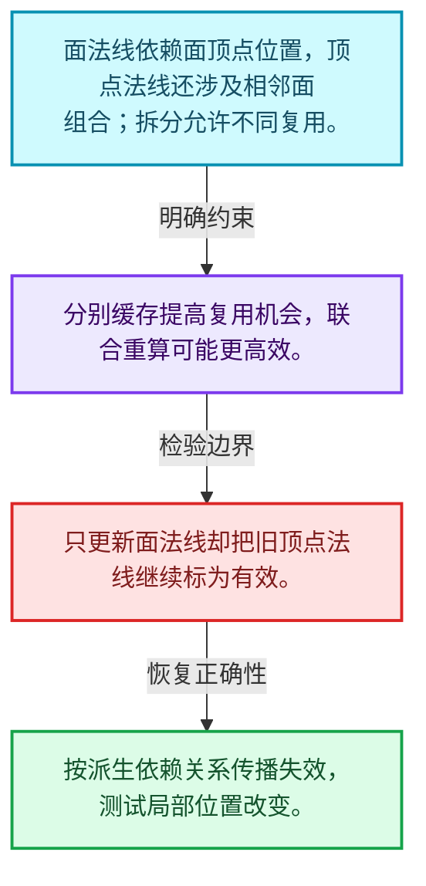
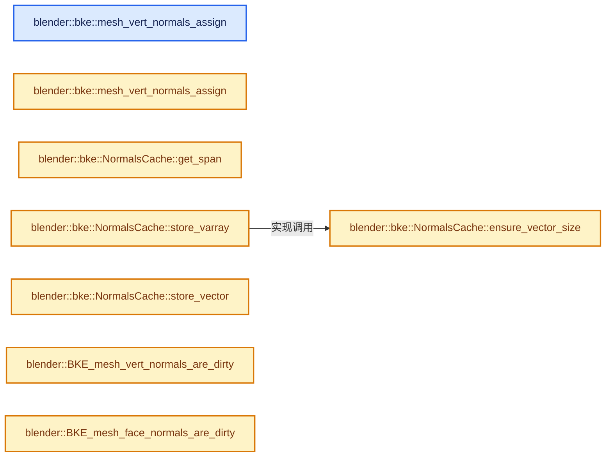
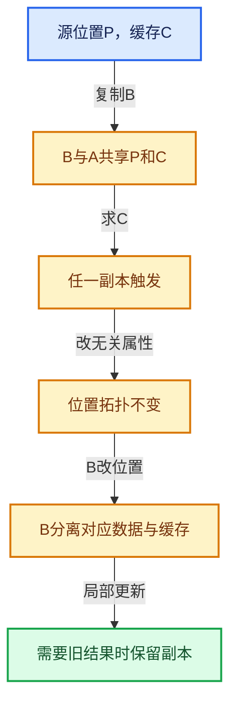

# 06-08 法线缓存的真实依赖

[方向导航](README.md) · [总目录](../README.md) · [实现索引](../00-课程指南/02-源码与提交索引/符号依赖与实现索引.md)

## 从问题到实现

面法线和顶点法线为什么可拆分缓存？

两类结果的依赖和重算成本不同，拆分让部分复用成为可能，但联合计算也可能更高效。

**数据模型**

面法线依赖面顶点位置，顶点法线还涉及相邻面组合；拆分允许不同复用。

**设计取舍**

分别缓存提高复用机会，联合重算可能更高效。

**最小反例**

只更新面法线却把旧顶点法线继续标为有效。

**推导**

按派生依赖关系传播失效，测试局部位置改变。

## 阅读地图与执行推演








图中的数值推演是本方向的教学模型；实际函数之间的调用边与概念分析边分别标注，不能把概念关系当作运行时调度顺序。

## 完整源码单元与就地讲解

中文讲解直接放在相关代码旁，复杂机制在代码下展开。原文折叠区保留基准行号；不需要在行号表和函数之间来回查找。类布局可分段展示，函数实现不按固定行数切开。

### 类型布局、声明与编译条件 · mesh_normals.cc L1—L49

<!-- annotated:1e3ae9082c3a65 -->

```cpp
/* SPDX-FileCopyrightText: 2001-2002 NaN Holding BV. All rights reserved.
 *
 * SPDX-License-Identifier: GPL-2.0-or-later */

/** \file
 * \ingroup bke
 *
 * Mesh normal calculation functions.
 *
 * \see `bmesh_mesh_normals.cc` for the equivalent #BMesh functionality.
 */

#include <climits>

#include "BLI_math_geom_c.hh"
#include "BLI_math_vector_c.hh"

#include "BLI_array_utils.hh"
#include "BLI_bit_vector.hh"
#include "BLI_enumerable_thread_specific.hh"
#include "BLI_linklist.hh"
#include "BLI_math_base.hh"
#include "BLI_math_vector.hh"
#include "BLI_memarena.hh"
#include "BLI_span.hh"
#include "BLI_task.hh"
#include "BLI_utildefines.hh"

#include "BKE_attribute.hh"
#include "BKE_global.hh"
#include "BKE_mesh.hh"
#include "BKE_mesh_mapping.hh"

namespace blender {

// #define DEBUG_TIME

#ifdef DEBUG_TIME
#  include "BLI_timeit.hh"
#endif

/* -------------------------------------------------------------------- */
/** \name Public Utility Functions
 *
 * Related to managing normals but not directly related to calculating normals.
 * \{ */

namespace bke {

```

<details>
<summary>核对原始源码：source/blender/blenkernel/intern/mesh_normals.cc · L1—L49</summary>

<!-- original:1e3ae9082c3a65:source/blender/blenkernel/intern/mesh_normals.cc:1:49 -->

```cpp
/* SPDX-FileCopyrightText: 2001-2002 NaN Holding BV. All rights reserved.
 *
 * SPDX-License-Identifier: GPL-2.0-or-later */

/** \file
 * \ingroup bke
 *
 * Mesh normal calculation functions.
 *
 * \see `bmesh_mesh_normals.cc` for the equivalent #BMesh functionality.
 */

#include <climits>

#include "BLI_math_geom_c.hh"
#include "BLI_math_vector_c.hh"

#include "BLI_array_utils.hh"
#include "BLI_bit_vector.hh"
#include "BLI_enumerable_thread_specific.hh"
#include "BLI_linklist.hh"
#include "BLI_math_base.hh"
#include "BLI_math_vector.hh"
#include "BLI_memarena.hh"
#include "BLI_span.hh"
#include "BLI_task.hh"
#include "BLI_utildefines.hh"

#include "BKE_attribute.hh"
#include "BKE_global.hh"
#include "BKE_mesh.hh"
#include "BKE_mesh_mapping.hh"

namespace blender {

// #define DEBUG_TIME

#ifdef DEBUG_TIME
#  include "BLI_timeit.hh"
#endif

/* -------------------------------------------------------------------- */
/** \name Public Utility Functions
 *
 * Related to managing normals but not directly related to calculating normals.
 * \{ */

namespace bke {

```

</details>

<a id="f-8b1f54645380b8f0"></a>

### `blender::bke::mesh_vert_normals_assign`

实现位置：[source/blender/blenkernel/intern/mesh_normals.cc](../../../../../source/blender/blenkernel/intern/mesh_normals.cc) · L50—L54。

接口参数：

- `Mesh &mesh`
- `Span<float3> vert_normals`

**教学注释版**

<!-- annotated:850b394ec36dce -->

```cpp
void mesh_vert_normals_assign(Mesh &mesh, Span<float3> vert_normals)
{
  mesh.runtime->vert_normals_true_cache.ensure(
      [&](Vector<float3> &r_data) { r_data = vert_normals; });
}
```

<details>
<summary>核对原始源码：source/blender/blenkernel/intern/mesh_normals.cc · L50—L54</summary>

<!-- original:850b394ec36dce:source/blender/blenkernel/intern/mesh_normals.cc:50:54 -->

```cpp
void mesh_vert_normals_assign(Mesh &mesh, Span<float3> vert_normals)
{
  mesh.runtime->vert_normals_true_cache.ensure(
      [&](Vector<float3> &r_data) { r_data = vert_normals; });
}
```

</details>

**继续追踪实现**

- `mesh.runtime->vert_normals_true_cache.ensure` → [调用协议](../00-课程指南/01-路线与规范/模板宏与动态分派协议.md)：接收对象类型依赖auto、返回值或模板实例；不按同名猜测目标。调用位置L52。

<!-- annotated:9c8c73a815ea0a -->

```cpp

```

<details>
<summary>核对原始源码：source/blender/blenkernel/intern/mesh_normals.cc · L55—L55</summary>

<!-- original:9c8c73a815ea0a:source/blender/blenkernel/intern/mesh_normals.cc:55:55 -->

```cpp

```

</details>

<a id="f-aacbc38a0e8cd621"></a>

### `blender::bke::mesh_vert_normals_assign`

实现位置：[source/blender/blenkernel/intern/mesh_normals.cc](../../../../../source/blender/blenkernel/intern/mesh_normals.cc) · L56—L60。

接口参数：

- `Mesh &mesh`
- `Vector<float3> vert_normals`

**教学注释版**

<!-- annotated:6418bde6da4684 -->

```cpp
void mesh_vert_normals_assign(Mesh &mesh, Vector<float3> vert_normals)
{
  mesh.runtime->vert_normals_true_cache.ensure(
      // [讲解] std::move：把表达式转换成可供移动重载选择的值类别；不保证真的移动，不结束源对象寿命，对const值可能选择复制。
      [&](Vector<float3> &r_data) { r_data = std::move(vert_normals); });
}
```

<details>
<summary>核对原始源码：source/blender/blenkernel/intern/mesh_normals.cc · L56—L60</summary>

<!-- original:6418bde6da4684:source/blender/blenkernel/intern/mesh_normals.cc:56:60 -->

```cpp
void mesh_vert_normals_assign(Mesh &mesh, Vector<float3> vert_normals)
{
  mesh.runtime->vert_normals_true_cache.ensure(
      [&](Vector<float3> &r_data) { r_data = std::move(vert_normals); });
}
```

</details>

**继续追踪实现**

- `mesh.runtime->vert_normals_true_cache.ensure` → [调用协议](../00-课程指南/01-路线与规范/模板宏与动态分派协议.md)：接收对象类型依赖auto、返回值或模板实例；不按同名猜测目标。调用位置L58。
- `std::move` → [外部契约](https://eel.is/c++draft/utility.forward)：把表达式转换成可供移动重载选择的值类别；不保证真的移动，不结束源对象寿命，对const值可能选择复制。

<!-- annotated:76f631503cf245 -->

```cpp

```

<details>
<summary>核对原始源码：source/blender/blenkernel/intern/mesh_normals.cc · L61—L61</summary>

<!-- original:76f631503cf245:source/blender/blenkernel/intern/mesh_normals.cc:61:61 -->

```cpp

```

</details>

<a id="f-78a076593b2e4433"></a>

### `blender::bke::NormalsCache::ensure_vector_size`

实现位置：[source/blender/blenkernel/intern/mesh_normals.cc](../../../../../source/blender/blenkernel/intern/mesh_normals.cc) · L62—L71。

接口参数：

- `const int size`

**教学注释版**

<!-- annotated:395195c6ae9504 -->

```cpp
MutableSpan<float3> NormalsCache::ensure_vector_size(const int size)
{
  if (auto *vector = std::get_if<Vector<float3>>(&this->data)) {
    vector->resize(size);
  }
  else {
    this->data = Vector<float3>(size);
  }
  return std::get<Vector<float3>>(this->data).as_mutable_span();
}
```

<details>
<summary>核对原始源码：source/blender/blenkernel/intern/mesh_normals.cc · L62—L71</summary>

<!-- original:395195c6ae9504:source/blender/blenkernel/intern/mesh_normals.cc:62:71 -->

```cpp
MutableSpan<float3> NormalsCache::ensure_vector_size(const int size)
{
  if (auto *vector = std::get_if<Vector<float3>>(&this->data)) {
    vector->resize(size);
  }
  else {
    this->data = Vector<float3>(size);
  }
  return std::get<Vector<float3>>(this->data).as_mutable_span();
}
```

</details>

**沿实际写入检查状态**

- `this->data = Vector<float3>(size);`

**结果出口**

- `return std::get<Vector<float3>>(this->data).as_mutable_span();`

**继续追踪实现**

- `std::get_if<Vector<float3>>` → [外部契约](https://eel.is/c++draft/)：这个边界按实际表达式及所属类型核对参数、返回值、寿命与失败行为。这里提供接口入口，不声称已解释该第三方版本的内部实现。
- `vector->resize` → [调用协议](../00-课程指南/01-路线与规范/模板宏与动态分派协议.md)：接收对象类型依赖auto、返回值或模板实例；不按同名猜测目标。调用位置L65。
- `Vector<float3>` → [KDL::Vector](../90-实现依赖专题/07-Intern运行时与平台/itasc/kdl/utilities/traits.h.md#t-3494ab227c7f)；[KDL::Vector](../90-实现依赖专题/07-Intern运行时与平台/itasc/kdl/frames.hpp.md#t-7db3cae4c06c)；[KDL::Vector](../90-实现依赖专题/07-Intern运行时与平台/itasc/kdl/frames.hpp.md#t-d9f123375f9e)；[blender::Vector](../90-实现依赖专题/01-BLI基础库/BLI_vector.hh.md#t-14451f176559)；[blender::nodes::decl::Vector](../90-实现依赖专题/04-Nodes节点系统/NOD_socket_declarations.hh.md#t-244cfac6be12)。
- `std::get<Vector<float3>>(this->data).as_mutable_span` → [外部契约](https://eel.is/c++draft/)：这个边界按实际表达式及所属类型核对参数、返回值、寿命与失败行为。这里提供接口入口，不声称已解释该第三方版本的内部实现。
- `std::get<Vector<float3>>` → [外部契约](https://eel.is/c++draft/)：这个边界按实际表达式及所属类型核对参数、返回值、寿命与失败行为。这里提供接口入口，不声称已解释该第三方版本的内部实现。

<!-- annotated:ca19a2be1f5d6e -->

```cpp

```

<details>
<summary>核对原始源码：source/blender/blenkernel/intern/mesh_normals.cc · L72—L72</summary>

<!-- original:ca19a2be1f5d6e:source/blender/blenkernel/intern/mesh_normals.cc:72:72 -->

```cpp

```

</details>

<a id="f-b8648d1431aa2272"></a>

### `blender::bke::NormalsCache::get_span`

实现位置：[source/blender/blenkernel/intern/mesh_normals.cc](../../../../../source/blender/blenkernel/intern/mesh_normals.cc) · L73—L79。

**教学注释版**

<!-- annotated:3fe658206d1a8c -->

```cpp
Span<float3> NormalsCache::get_span() const
{
  if (const auto *vector = std::get_if<Vector<float3>>(&this->data)) {
    return vector->as_span();
  }
  return std::get<Span<float3>>(this->data);
}
```

<details>
<summary>核对原始源码：source/blender/blenkernel/intern/mesh_normals.cc · L73—L79</summary>

<!-- original:3fe658206d1a8c:source/blender/blenkernel/intern/mesh_normals.cc:73:79 -->

```cpp
Span<float3> NormalsCache::get_span() const
{
  if (const auto *vector = std::get_if<Vector<float3>>(&this->data)) {
    return vector->as_span();
  }
  return std::get<Span<float3>>(this->data);
}
```

</details>

**结果出口**

- `return vector->as_span();`
- `return std::get<Span<float3>>(this->data);`

**继续追踪实现**

- `std::get_if<Vector<float3>>` → [外部契约](https://eel.is/c++draft/)：这个边界按实际表达式及所属类型核对参数、返回值、寿命与失败行为。这里提供接口入口，不声称已解释该第三方版本的内部实现。
- `vector->as_span` → [调用协议](../00-课程指南/01-路线与规范/模板宏与动态分派协议.md)：接收对象类型依赖auto、返回值或模板实例；不按同名猜测目标。调用位置L76。
- `std::get<Span<float3>>` → [外部契约](https://eel.is/c++draft/)：这个边界按实际表达式及所属类型核对参数、返回值、寿命与失败行为。这里提供接口入口，不声称已解释该第三方版本的内部实现。

<!-- annotated:7944bc0e01ac8d -->

```cpp

```

<details>
<summary>核对原始源码：source/blender/blenkernel/intern/mesh_normals.cc · L80—L80</summary>

<!-- original:7944bc0e01ac8d:source/blender/blenkernel/intern/mesh_normals.cc:80:80 -->

```cpp

```

</details>

<a id="f-3803344aba1391c2"></a>

### `blender::bke::NormalsCache::store_varray`

实现位置：[source/blender/blenkernel/intern/mesh_normals.cc](../../../../../source/blender/blenkernel/intern/mesh_normals.cc) · L81—L89。

接口参数：

- `const VArray<float3> &data`

**教学注释版**

<!-- annotated:a52b941ae781f2 -->

```cpp
void NormalsCache::store_varray(const VArray<float3> &data)
{
  if (data.is_span()) {
    this->data = data.get_internal_span();
  }
  else {
    data.materialize(this->ensure_vector_size(data.size()));
  }
}
```

<details>
<summary>核对原始源码：source/blender/blenkernel/intern/mesh_normals.cc · L81—L89</summary>

<!-- original:a52b941ae781f2:source/blender/blenkernel/intern/mesh_normals.cc:81:89 -->

```cpp
void NormalsCache::store_varray(const VArray<float3> &data)
{
  if (data.is_span()) {
    this->data = data.get_internal_span();
  }
  else {
    data.materialize(this->ensure_vector_size(data.size()));
  }
}
```

</details>

**沿实际写入检查状态**

- `this->data = data.get_internal_span();`

**继续追踪实现**

- `data.is_span` → [调用协议](../00-课程指南/01-路线与规范/模板宏与动态分派协议.md)：由接收对象具体类型或运行时策略提供实现。调用位置L83。
- `data.get_internal_span` → [调用协议](../00-课程指南/01-路线与规范/模板宏与动态分派协议.md)：由接收对象具体类型或运行时策略提供实现。调用位置L84。
- `data.materialize` → [调用协议](../00-课程指南/01-路线与规范/模板宏与动态分派协议.md)：由接收对象具体类型或运行时策略提供实现。调用位置L87。
- `this->ensure_vector_size` → [blender::bke::NormalsCache::ensure_vector_size · L62](08-法线缓存的真实依赖.md#f-78a076593b2e4433)。
- `data.size` → [调用协议](../00-课程指南/01-路线与规范/模板宏与动态分派协议.md)：由接收对象具体类型或运行时策略提供实现。调用位置L87。

<!-- annotated:c3b18996a735b7 -->

```cpp

```

<details>
<summary>核对原始源码：source/blender/blenkernel/intern/mesh_normals.cc · L90—L90</summary>

<!-- original:c3b18996a735b7:source/blender/blenkernel/intern/mesh_normals.cc:90:90 -->

```cpp

```

</details>

<a id="f-863f00d1b40780a0"></a>

### `blender::bke::NormalsCache::store_vector`

实现位置：[source/blender/blenkernel/intern/mesh_normals.cc](../../../../../source/blender/blenkernel/intern/mesh_normals.cc) · L91—L94。

接口参数：

- `Vector<float3> &&data`

**教学注释版**

<!-- annotated:10ce16747fb8ea -->

```cpp
void NormalsCache::store_vector(Vector<float3> &&data)
{
  // [讲解] std::move：把表达式转换成可供移动重载选择的值类别；不保证真的移动，不结束源对象寿命，对const值可能选择复制。
  this->data = std::move(data);
}
```

<details>
<summary>核对原始源码：source/blender/blenkernel/intern/mesh_normals.cc · L91—L94</summary>

<!-- original:10ce16747fb8ea:source/blender/blenkernel/intern/mesh_normals.cc:91:94 -->

```cpp
void NormalsCache::store_vector(Vector<float3> &&data)
{
  this->data = std::move(data);
}
```

</details>

**沿实际写入检查状态**

- `this->data = std::move(data);`

**继续追踪实现**

- `std::move` → [外部契约](https://eel.is/c++draft/utility.forward)：把表达式转换成可供移动重载选择的值类别；不保证真的移动，不结束源对象寿命，对const值可能选择复制。

### 类型布局、声明与编译条件 · mesh_normals.cc L95—L97

<!-- annotated:d3017782dc538d -->

```cpp

}  // namespace bke

```

<details>
<summary>核对原始源码：source/blender/blenkernel/intern/mesh_normals.cc · L95—L97</summary>

<!-- original:d3017782dc538d:source/blender/blenkernel/intern/mesh_normals.cc:95:97 -->

```cpp

}  // namespace bke

```

</details>

<a id="f-9288deb067058754"></a>

### `blender::BKE_mesh_vert_normals_are_dirty`

实现位置：[source/blender/blenkernel/intern/mesh_normals.cc](../../../../../source/blender/blenkernel/intern/mesh_normals.cc) · L98—L101。

接口参数：

- `const Mesh *mesh`

**教学注释版**

<!-- annotated:841f8d71dc806a -->

```cpp
bool BKE_mesh_vert_normals_are_dirty(const Mesh *mesh)
{
  return mesh->runtime->vert_normals_cache.is_dirty();
}
```

<details>
<summary>核对原始源码：source/blender/blenkernel/intern/mesh_normals.cc · L98—L101</summary>

<!-- original:841f8d71dc806a:source/blender/blenkernel/intern/mesh_normals.cc:98:101 -->

```cpp
bool BKE_mesh_vert_normals_are_dirty(const Mesh *mesh)
{
  return mesh->runtime->vert_normals_cache.is_dirty();
}
```

</details>

**结果出口**

- `return mesh->runtime->vert_normals_cache.is_dirty();`

**继续追踪实现**

- `mesh->runtime->vert_normals_cache.is_dirty` → [调用协议](../00-课程指南/01-路线与规范/模板宏与动态分派协议.md)：接收对象类型依赖auto、返回值或模板实例；不按同名猜测目标。调用位置L100。

<!-- annotated:6983c5e56f66f0 -->

```cpp

```

<details>
<summary>核对原始源码：source/blender/blenkernel/intern/mesh_normals.cc · L102—L102</summary>

<!-- original:6983c5e56f66f0:source/blender/blenkernel/intern/mesh_normals.cc:102:102 -->

```cpp

```

</details>

<a id="f-99295a8853fdc3c4"></a>

### `blender::BKE_mesh_face_normals_are_dirty`

实现位置：[source/blender/blenkernel/intern/mesh_normals.cc](../../../../../source/blender/blenkernel/intern/mesh_normals.cc) · L103—L106。

接口参数：

- `const Mesh *mesh`

**教学注释版**

<!-- annotated:a1d064ca9cec42 -->

```cpp
bool BKE_mesh_face_normals_are_dirty(const Mesh *mesh)
{
  return mesh->runtime->face_normals_cache.is_dirty();
}
```

<details>
<summary>核对原始源码：source/blender/blenkernel/intern/mesh_normals.cc · L103—L106</summary>

<!-- original:a1d064ca9cec42:source/blender/blenkernel/intern/mesh_normals.cc:103:106 -->

```cpp
bool BKE_mesh_face_normals_are_dirty(const Mesh *mesh)
{
  return mesh->runtime->face_normals_cache.is_dirty();
}
```

</details>

**结果出口**

- `return mesh->runtime->face_normals_cache.is_dirty();`

**继续追踪实现**

- `mesh->runtime->face_normals_cache.is_dirty` → [调用协议](../00-课程指南/01-路线与规范/模板宏与动态分派协议.md)：接收对象类型依赖auto、返回值或模板实例；不按同名猜测目标。调用位置L105。

### 类型布局、声明与编译条件 · mesh_normals.cc L107—L122

<!-- annotated:5e97c5e2eee77b -->

```cpp

/** \} */

namespace bke::mesh {

/* -------------------------------------------------------------------- */
/** \name Mesh Normal Calculation (Polygons)
 * \{ */

/*
 * COMPUTE POLY NORMAL
 *
 * Computes the normal of a planar
 * face See Graphics Gems for
 * computing newell normal.
 */
```

<details>
<summary>核对原始源码：source/blender/blenkernel/intern/mesh_normals.cc · L107—L122</summary>

<!-- original:5e97c5e2eee77b:source/blender/blenkernel/intern/mesh_normals.cc:107:122 -->

```cpp

/** \} */

namespace bke::mesh {

/* -------------------------------------------------------------------- */
/** \name Mesh Normal Calculation (Polygons)
 * \{ */

/*
 * COMPUTE POLY NORMAL
 *
 * Computes the normal of a planar
 * face See Graphics Gems for
 * computing newell normal.
 */
```

</details>

<a id="f-c15fa2e642adeaad"></a>

### `blender::bke::mesh::normal_calc_ngon`

实现位置：[source/blender/blenkernel/intern/mesh_normals.cc](../../../../../source/blender/blenkernel/intern/mesh_normals.cc) · L123—L141。

接口参数：

- `const Span<float3> vert_positions`
- `const Span<int> face_verts`

**教学注释版**

<!-- annotated:d3c657ecc92e22 -->

```cpp
static float3 normal_calc_ngon(const Span<float3> vert_positions, const Span<int> face_verts)
{
  float3 normal(0);

  /* Newell's Method */
  // [讲解] face_verts.last：按视图边界访问元素。
  const float *v_prev = vert_positions[face_verts.last()];
  // [讲解] face_verts.index_range：查询视图长度或生成对应有效索引区间。
  for (const int i : face_verts.index_range()) {
    const float *v_curr = vert_positions[face_verts[i]];
    add_newell_cross_v3_v3v3(normal, v_prev, v_curr);
    v_prev = v_curr;
  }

  if (normalize_v3(normal) == 0.0f) [[unlikely]] {
    /* Other axis are already set to zero. */
    normal[2] = 1.0f;
  }

  return normal;
}
```

<details>
<summary>核对原始源码：source/blender/blenkernel/intern/mesh_normals.cc · L123—L141</summary>

<!-- original:d3c657ecc92e22:source/blender/blenkernel/intern/mesh_normals.cc:123:141 -->

```cpp
static float3 normal_calc_ngon(const Span<float3> vert_positions, const Span<int> face_verts)
{
  float3 normal(0);

  /* Newell's Method */
  const float *v_prev = vert_positions[face_verts.last()];
  for (const int i : face_verts.index_range()) {
    const float *v_curr = vert_positions[face_verts[i]];
    add_newell_cross_v3_v3v3(normal, v_prev, v_curr);
    v_prev = v_curr;
  }

  if (normalize_v3(normal) == 0.0f) [[unlikely]] {
    /* Other axis are already set to zero. */
    normal[2] = 1.0f;
  }

  return normal;
}
```

</details>

**沿实际写入检查状态**

- `v_prev = v_curr;`
- `normal[2] = 1.0f;`

**结果出口**

- `return normal;`

**继续追踪实现**

- `face_verts.last` → [blender::Span::last · L329](../01-基础容器与现代CPP/05-Span只读连续视图.md#f-a92146c285596891)。
- `face_verts.index_range` → [blender::Span::index_range · L405](../01-基础容器与现代CPP/05-Span只读连续视图.md#f-caaa9b06e13e53e0)。
- `add_newell_cross_v3_v3v3` → [调用协议](../00-课程指南/01-路线与规范/模板宏与动态分派协议.md)：函数指针、局部可调用对象或未展开的宏；必须结合调用者环境。调用位置L131。
- `normalize_v3` → [blender::normalize_v3 · L933](../90-实现依赖专题/01-BLI基础库/intern/math_vector_inline.cc.md#f-5f3257e657ef732c)。

<!-- annotated:0ea16348e05d57 -->

```cpp

```

<details>
<summary>核对原始源码：source/blender/blenkernel/intern/mesh_normals.cc · L142—L142</summary>

<!-- original:0ea16348e05d57:source/blender/blenkernel/intern/mesh_normals.cc:142:142 -->

```cpp

```

</details>

<a id="f-d62af7ecfb61b003"></a>

### `blender::bke::mesh::face_normal_calc`

实现位置：[source/blender/blenkernel/intern/mesh_normals.cc](../../../../../source/blender/blenkernel/intern/mesh_normals.cc) · L143—L169。

接口参数：

- `const Span<float3> vert_positions`
- `const Span<int> face_verts`

**教学注释版**

<!-- annotated:5962d646995920 -->

```cpp
float3 face_normal_calc(const Span<float3> vert_positions, const Span<int> face_verts)
{
  float3 normal;
  // [讲解] face_verts.size：查询视图长度或生成对应有效索引区间。
  if (face_verts.size() == 4) {
    normal_quad_v3(normal,
                   vert_positions[face_verts[0]],
                   vert_positions[face_verts[1]],
                   vert_positions[face_verts[2]],
                   vert_positions[face_verts[3]]);
  }
  else if (face_verts.size() == 3) {
    normal = math::normal_tri(vert_positions[face_verts[0]],
                              vert_positions[face_verts[1]],
                              vert_positions[face_verts[2]]);
  }
  else {
    BLI_assert(face_verts.size() > 4);
    normal = normal_calc_ngon(vert_positions, face_verts);
  }

  if (math::is_zero(normal)) [[unlikely]] {
    normal.z = 1.0f;
  }

  BLI_ASSERT_UNIT_V3(normal);
  return normal;
}
```

<details>
<summary>核对原始源码：source/blender/blenkernel/intern/mesh_normals.cc · L143—L169</summary>

<!-- original:5962d646995920:source/blender/blenkernel/intern/mesh_normals.cc:143:169 -->

```cpp
float3 face_normal_calc(const Span<float3> vert_positions, const Span<int> face_verts)
{
  float3 normal;
  if (face_verts.size() == 4) {
    normal_quad_v3(normal,
                   vert_positions[face_verts[0]],
                   vert_positions[face_verts[1]],
                   vert_positions[face_verts[2]],
                   vert_positions[face_verts[3]]);
  }
  else if (face_verts.size() == 3) {
    normal = math::normal_tri(vert_positions[face_verts[0]],
                              vert_positions[face_verts[1]],
                              vert_positions[face_verts[2]]);
  }
  else {
    BLI_assert(face_verts.size() > 4);
    normal = normal_calc_ngon(vert_positions, face_verts);
  }

  if (math::is_zero(normal)) [[unlikely]] {
    normal.z = 1.0f;
  }

  BLI_ASSERT_UNIT_V3(normal);
  return normal;
}
```

</details>

**沿实际写入检查状态**

- `normal = math::normal_tri(vert_positions[face_verts[0]],`
- `normal = normal_calc_ngon(vert_positions, face_verts);`
- `normal.z = 1.0f;`

**结果出口**

- `return normal;`

**继续追踪实现**

- `face_verts.size` → [blender::Span::size · L256](../01-基础容器与现代CPP/05-Span只读连续视图.md#f-5f80fa006089c998)。
- `normal_quad_v3` → [blender::normal_quad_v3 · L62](../90-实现依赖专题/01-BLI基础库/intern/math_geom.cc.md#f-edc1a63efd858f34)。
- `math::normal_tri` → [blender::math::normal_tri · L623](../90-实现依赖专题/01-BLI基础库/BLI_math_vector.hh.md#f-757fbf3642200b08)。
- `BLI_assert` → [BLI_assert · L48](../90-实现依赖专题/01-BLI基础库/BLI_assert.hh.md#m-57a88495704d)；[BLI_assert · L63](../90-实现依赖专题/01-BLI基础库/BLI_assert.hh.md#m-d07050020cb5)。宏定义由构建条件选择。
- `normal_calc_ngon` → [blender::bke::mesh::normal_calc_ngon · L123](08-法线缓存的真实依赖.md#f-c15fa2e642adeaad)。
- `math::is_zero` → [blender::math::is_zero · L784](../90-实现依赖专题/01-BLI基础库/BLI_math_vector.hh.md#f-b05b3db842a9f17e)；[blender::math::is_zero · L108](../90-实现依赖专题/01-BLI基础库/BLI_math_quaternion.hh.md#f-b97bee3fbc328c0d)；[blender::math::is_zero · L593](../90-实现依赖专题/01-BLI基础库/BLI_math_matrix.hh.md#f-b879ac524126b464)；[blender::math::is_zero · L23](../90-实现依赖专题/01-BLI基础库/BLI_math_base.hh.md#f-6fdcc74ca7338838)。同名重载需按实参类型选择。
- `BLI_ASSERT_UNIT_V3` → [BLI_ASSERT_UNIT_V3 · L315](../90-实现依赖专题/01-BLI基础库/BLI_math_base_c.hh.md#m-7f347402189a)；[BLI_ASSERT_UNIT_V3 · L359](../90-实现依赖专题/01-BLI基础库/BLI_math_base_c.hh.md#m-fe91af053d50)。宏定义由构建条件选择。

### 类型布局、声明与编译条件 · mesh_normals.cc L170—L179

<!-- annotated:8b76dbb79e1994 -->

```cpp

/** \} */

/* -------------------------------------------------------------------- */
/** \name Mesh Normal Calculation (Polygons & Vertices)
 *
 * Take care making optimizations to this function as improvements to low-poly
 * meshes can slow down high-poly meshes. For details on performance, see D11993.
 * \{ */

```

<details>
<summary>核对原始源码：source/blender/blenkernel/intern/mesh_normals.cc · L170—L179</summary>

<!-- original:8b76dbb79e1994:source/blender/blenkernel/intern/mesh_normals.cc:170:179 -->

```cpp

/** \} */

/* -------------------------------------------------------------------- */
/** \name Mesh Normal Calculation (Polygons & Vertices)
 *
 * Take care making optimizations to this function as improvements to low-poly
 * meshes can slow down high-poly meshes. For details on performance, see D11993.
 * \{ */

```

</details>

<a id="f-eb179c7fddf256a7"></a>

### `blender::bke::mesh::normals_calc_faces`

实现位置：[source/blender/blenkernel/intern/mesh_normals.cc](../../../../../source/blender/blenkernel/intern/mesh_normals.cc) · L180—L192。

接口参数：

- `const Span<float3> positions`
- `const OffsetIndices<int> faces`
- `const Span<int> corner_verts`
- `MutableSpan<float3> face_normals`

**教学注释版**

<!-- annotated:0a9d79d4865e47 -->

```cpp
void normals_calc_faces(const Span<float3> positions,
                        const OffsetIndices<int> faces,
                        const Span<int> corner_verts,
                        MutableSpan<float3> face_normals)
{
  PRF_scope(ProfileCategory::Default);
  // [讲解] faces.size：读取连续区间或分组的边界信息。
  BLI_assert(faces.size() == face_normals.size());
  threading::parallel_for(faces.index_range(), 1024, [&](const IndexRange range) {
    for (const int i : range) {
      // [讲解] corner_verts.slice：建立原连续范围的子视图。
      face_normals[i] = normal_calc_ngon(positions, corner_verts.slice(faces[i]));
    }
  });
}
```

<details>
<summary>核对原始源码：source/blender/blenkernel/intern/mesh_normals.cc · L180—L192</summary>

<!-- original:0a9d79d4865e47:source/blender/blenkernel/intern/mesh_normals.cc:180:192 -->

```cpp
void normals_calc_faces(const Span<float3> positions,
                        const OffsetIndices<int> faces,
                        const Span<int> corner_verts,
                        MutableSpan<float3> face_normals)
{
  PRF_scope(ProfileCategory::Default);
  BLI_assert(faces.size() == face_normals.size());
  threading::parallel_for(faces.index_range(), 1024, [&](const IndexRange range) {
    for (const int i : range) {
      face_normals[i] = normal_calc_ngon(positions, corner_verts.slice(faces[i]));
    }
  });
}
```

</details>

**沿实际写入检查状态**

- `face_normals[i] = normal_calc_ngon(positions, corner_verts.slice(faces[i]));`

**继续追踪实现**

- `PRF_scope` → [PRF_scope · L51](../90-实现依赖专题/07-Intern运行时与平台/profile/PRF_profile.hh.md#m-9f5e4ea0487b)；[PRF_scope · L90](../90-实现依赖专题/07-Intern运行时与平台/profile/PRF_profile.hh.md#m-8fc74ae4419e)。宏定义由构建条件选择。
- `BLI_assert` → [BLI_assert · L48](../90-实现依赖专题/01-BLI基础库/BLI_assert.hh.md#m-57a88495704d)；[BLI_assert · L63](../90-实现依赖专题/01-BLI基础库/BLI_assert.hh.md#m-d07050020cb5)。宏定义由构建条件选择。
- `faces.size` → [blender::offset_indices::OffsetIndices::size · L67](../05-几何存储与拓扑映射/02-OffsetIndices完整接口.md#f-e238abc62ed42abd)。
- `face_normals.size` → [blender::MutableSpan::size · L499](../01-基础容器与现代CPP/06-MutableSpan可写视图.md#f-1de6a66839c304a8)；[blender::gpu::shader::parser::MutableSpan::size · L87](../90-实现依赖专题/08-其他Blender模块/gpu/shader_tool/utils.hh.md#f-5e684af6ee7990e9)。同名重载需按实参类型选择。
- `threading::parallel_for` → [blender::threading::parallel_for · L68](../11-Depsgraph与并行任务系统/07-任务池与TBB接入.md#f-838294754c24426c)。
- `faces.index_range` → [blender::offset_indices::OffsetIndices::index_range · L77](../05-几何存储与拓扑映射/02-OffsetIndices完整接口.md#f-19b5ca1456de007d)。
- `normal_calc_ngon` → [blender::bke::mesh::normal_calc_ngon · L123](08-法线缓存的真实依赖.md#f-c15fa2e642adeaad)。
- `corner_verts.slice` → [blender::Span::slice · L141](../01-基础容器与现代CPP/05-Span只读连续视图.md#f-380a0e8fdcbd53cc)；[blender::Span::slice · L149](../01-基础容器与现代CPP/05-Span只读连续视图.md#f-9b9c15e78dd54eec)。同名重载需按实参类型选择。

<!-- annotated:f7dacff776b5c4 -->

```cpp

```

<details>
<summary>核对原始源码：source/blender/blenkernel/intern/mesh_normals.cc · L193—L193</summary>

<!-- original:f7dacff776b5c4:source/blender/blenkernel/intern/mesh_normals.cc:193:193 -->

```cpp

```

</details>

<a id="f-d32a150778e2a1da"></a>

### `blender::bke::mesh::normals_calc_verts`

实现位置：[source/blender/blenkernel/intern/mesh_normals.cc](../../../../../source/blender/blenkernel/intern/mesh_normals.cc) · L194—L224。

接口参数：

- `const Span<float3> vert_positions`
- `const OffsetIndices<int> faces`
- `const Span<int> corner_verts`
- `const GroupedSpan<int> vert_to_face_map`
- `const Span<float3> face_normals`
- `MutableSpan<float3> vert_normals`

**教学注释版**

<!-- annotated:91b05c650c985c -->

```cpp
void normals_calc_verts(const Span<float3> vert_positions,
                        const OffsetIndices<int> faces,
                        const Span<int> corner_verts,
                        const GroupedSpan<int> vert_to_face_map,
                        const Span<float3> face_normals,
                        MutableSpan<float3> vert_normals)
{
  PRF_scope(ProfileCategory::Default);
  const Span<float3> positions = vert_positions;
  // [讲解] positions.index_range：查询视图长度或生成对应有效索引区间。
  threading::parallel_for(positions.index_range(), 1024, [&](const IndexRange range) {
    for (const int vert : range) {
      const Span<int> vert_faces = vert_to_face_map[vert];
      // [讲解] vert_faces.is_empty：查询视图长度或生成对应有效索引区间。
      if (vert_faces.is_empty()) {
        vert_normals[vert] = math::normalize(positions[vert]);
        continue;
      }

      float3 vert_normal(0);
      for (const int face : vert_faces) {
        const int2 adjacent_verts = face_find_adjacent_verts(faces[face], corner_verts, vert);
        const float3 dir_prev = math::normalize(positions[adjacent_verts[0]] - positions[vert]);
        const float3 dir_next = math::normalize(positions[adjacent_verts[1]] - positions[vert]);
        const float factor = math::safe_acos_approx(math::dot(dir_prev, dir_next));

        vert_normal += face_normals[face] * factor;
      }

      vert_normals[vert] = math::normalize(vert_normal);
    }
  });
}
```

<details>
<summary>核对原始源码：source/blender/blenkernel/intern/mesh_normals.cc · L194—L224</summary>

<!-- original:91b05c650c985c:source/blender/blenkernel/intern/mesh_normals.cc:194:224 -->

```cpp
void normals_calc_verts(const Span<float3> vert_positions,
                        const OffsetIndices<int> faces,
                        const Span<int> corner_verts,
                        const GroupedSpan<int> vert_to_face_map,
                        const Span<float3> face_normals,
                        MutableSpan<float3> vert_normals)
{
  PRF_scope(ProfileCategory::Default);
  const Span<float3> positions = vert_positions;
  threading::parallel_for(positions.index_range(), 1024, [&](const IndexRange range) {
    for (const int vert : range) {
      const Span<int> vert_faces = vert_to_face_map[vert];
      if (vert_faces.is_empty()) {
        vert_normals[vert] = math::normalize(positions[vert]);
        continue;
      }

      float3 vert_normal(0);
      for (const int face : vert_faces) {
        const int2 adjacent_verts = face_find_adjacent_verts(faces[face], corner_verts, vert);
        const float3 dir_prev = math::normalize(positions[adjacent_verts[0]] - positions[vert]);
        const float3 dir_next = math::normalize(positions[adjacent_verts[1]] - positions[vert]);
        const float factor = math::safe_acos_approx(math::dot(dir_prev, dir_next));

        vert_normal += face_normals[face] * factor;
      }

      vert_normals[vert] = math::normalize(vert_normal);
    }
  });
}
```

</details>

**沿实际写入检查状态**

- `vert_normals[vert] = math::normalize(positions[vert]);`
- `vert_normal += face_normals[face] * factor;`
- `vert_normals[vert] = math::normalize(vert_normal);`

**继续追踪实现**

- `PRF_scope` → [PRF_scope · L51](../90-实现依赖专题/07-Intern运行时与平台/profile/PRF_profile.hh.md#m-9f5e4ea0487b)；[PRF_scope · L90](../90-实现依赖专题/07-Intern运行时与平台/profile/PRF_profile.hh.md#m-8fc74ae4419e)。宏定义由构建条件选择。
- `threading::parallel_for` → [blender::threading::parallel_for · L68](../11-Depsgraph与并行任务系统/07-任务池与TBB接入.md#f-838294754c24426c)。
- `positions.index_range` → [blender::Span::index_range · L405](../01-基础容器与现代CPP/05-Span只读连续视图.md#f-caaa9b06e13e53e0)。
- `vert_faces.is_empty` → [blender::Span::is_empty · L264](../01-基础容器与现代CPP/05-Span只读连续视图.md#f-8cc1d7ba8feb50e6)。
- `math::normalize` → [blender::math::normalize · L542](../90-实现依赖专题/01-BLI基础库/BLI_math_vector.hh.md#f-5bea914457e11f7f)；[blender::math::normalize · L258](../90-实现依赖专题/01-BLI基础库/BLI_math_quaternion.hh.md#f-5bf6b351333e4054)；[blender::math::normalize · L450](../90-实现依赖专题/01-BLI基础库/BLI_math_quaternion.hh.md#f-b852cee8f0cc9b6a)；[blender::math::normalize · L745](../90-实现依赖专题/01-BLI基础库/BLI_math_matrix.hh.md#f-2235cb6f5ec7ff18)；[blender::math::normalize · L783](../90-实现依赖专题/01-BLI基础库/BLI_math_matrix.hh.md#f-0386bc4ee9ac7425)。同名重载需按实参类型选择。
- `face_find_adjacent_verts` → [blender::bke::mesh::face_find_adjacent_verts · L338](../05-几何存储与拓扑映射/01-Mesh顶点边面角点.md#f-2c11a0178b78bf97)。
- `math::safe_acos_approx` → [blender::math::safe_acos_approx · L241](../90-实现依赖专题/01-BLI基础库/BLI_math_base.hh.md#f-1f29eb306de0b3f7)。
- `math::dot` → [blender::math::dot · L430](../90-实现依赖专题/01-BLI基础库/BLI_math_vector.hh.md#f-6f0c6a081b107428)；[blender::math::dot · L198](../90-实现依赖专题/01-BLI基础库/BLI_math_quaternion.hh.md#f-5b1ef457981dbc76)。同名重载需按实参类型选择。

### 类型布局、声明与编译条件 · mesh_normals.cc L225—L227

<!-- annotated:16f5814bc0d845 -->

```cpp

/** \} */

```

<details>
<summary>核对原始源码：source/blender/blenkernel/intern/mesh_normals.cc · L225—L227</summary>

<!-- original:16f5814bc0d845:source/blender/blenkernel/intern/mesh_normals.cc:225:227 -->

```cpp

/** \} */

```

</details>

<a id="f-d424082777c607e8"></a>

### `blender::bke::mesh::mix_normals_corner_to_vert`

实现位置：[source/blender/blenkernel/intern/mesh_normals.cc](../../../../../source/blender/blenkernel/intern/mesh_normals.cc) · L228—L261。

接口参数：

- `const Span<float3> vert_positions`
- `const OffsetIndices<int> faces`
- `const Span<int> corner_verts`
- `const GroupedSpan<int> vert_to_face_map`
- `const Span<float3> corner_normals`
- `MutableSpan<float3> vert_normals`

**教学注释版**

<!-- annotated:f4531fe46ad16f -->

```cpp
static void mix_normals_corner_to_vert(const Span<float3> vert_positions,
                                       const OffsetIndices<int> faces,
                                       const Span<int> corner_verts,
                                       const GroupedSpan<int> vert_to_face_map,
                                       const Span<float3> corner_normals,
                                       MutableSpan<float3> vert_normals)
{
  PRF_scope(ProfileCategory::Default);
  const Span<float3> positions = vert_positions;
  // [讲解] positions.index_range：查询视图长度或生成对应有效索引区间。
  threading::parallel_for(positions.index_range(), 1024, [&](const IndexRange range) {
    for (const int vert : range) {
      const Span<int> vert_faces = vert_to_face_map[vert];
      // [讲解] vert_faces.is_empty：查询视图长度或生成对应有效索引区间。
      if (vert_faces.is_empty()) {
        vert_normals[vert] = math::normalize(positions[vert]);
        continue;
      }

      float3 vert_normal(0);
      for (const int face : vert_faces) {
        const int corner = mesh::face_find_corner_from_vert(faces[face], corner_verts, vert);
        const int2 adjacent_verts{corner_verts[mesh::face_corner_prev(faces[face], corner)],
                                  corner_verts[mesh::face_corner_next(faces[face], corner)]};

        const float3 dir_prev = math::normalize(positions[adjacent_verts[0]] - positions[vert]);
        const float3 dir_next = math::normalize(positions[adjacent_verts[1]] - positions[vert]);
        const float factor = math::safe_acos_approx(math::dot(dir_prev, dir_next));

        vert_normal += corner_normals[corner] * factor;
      }

      vert_normals[vert] = math::normalize(vert_normal);
    }
  });
}
```

<details>
<summary>核对原始源码：source/blender/blenkernel/intern/mesh_normals.cc · L228—L261</summary>

<!-- original:f4531fe46ad16f:source/blender/blenkernel/intern/mesh_normals.cc:228:261 -->

```cpp
static void mix_normals_corner_to_vert(const Span<float3> vert_positions,
                                       const OffsetIndices<int> faces,
                                       const Span<int> corner_verts,
                                       const GroupedSpan<int> vert_to_face_map,
                                       const Span<float3> corner_normals,
                                       MutableSpan<float3> vert_normals)
{
  PRF_scope(ProfileCategory::Default);
  const Span<float3> positions = vert_positions;
  threading::parallel_for(positions.index_range(), 1024, [&](const IndexRange range) {
    for (const int vert : range) {
      const Span<int> vert_faces = vert_to_face_map[vert];
      if (vert_faces.is_empty()) {
        vert_normals[vert] = math::normalize(positions[vert]);
        continue;
      }

      float3 vert_normal(0);
      for (const int face : vert_faces) {
        const int corner = mesh::face_find_corner_from_vert(faces[face], corner_verts, vert);
        const int2 adjacent_verts{corner_verts[mesh::face_corner_prev(faces[face], corner)],
                                  corner_verts[mesh::face_corner_next(faces[face], corner)]};

        const float3 dir_prev = math::normalize(positions[adjacent_verts[0]] - positions[vert]);
        const float3 dir_next = math::normalize(positions[adjacent_verts[1]] - positions[vert]);
        const float factor = math::safe_acos_approx(math::dot(dir_prev, dir_next));

        vert_normal += corner_normals[corner] * factor;
      }

      vert_normals[vert] = math::normalize(vert_normal);
    }
  });
}
```

</details>

**沿实际写入检查状态**

- `vert_normals[vert] = math::normalize(positions[vert]);`
- `vert_normal += corner_normals[corner] * factor;`
- `vert_normals[vert] = math::normalize(vert_normal);`

**继续追踪实现**

- `PRF_scope` → [PRF_scope · L51](../90-实现依赖专题/07-Intern运行时与平台/profile/PRF_profile.hh.md#m-9f5e4ea0487b)；[PRF_scope · L90](../90-实现依赖专题/07-Intern运行时与平台/profile/PRF_profile.hh.md#m-8fc74ae4419e)。宏定义由构建条件选择。
- `threading::parallel_for` → [blender::threading::parallel_for · L68](../11-Depsgraph与并行任务系统/07-任务池与TBB接入.md#f-838294754c24426c)。
- `positions.index_range` → [blender::Span::index_range · L405](../01-基础容器与现代CPP/05-Span只读连续视图.md#f-caaa9b06e13e53e0)。
- `vert_faces.is_empty` → [blender::Span::is_empty · L264](../01-基础容器与现代CPP/05-Span只读连续视图.md#f-8cc1d7ba8feb50e6)。
- `math::normalize` → [blender::math::normalize · L542](../90-实现依赖专题/01-BLI基础库/BLI_math_vector.hh.md#f-5bea914457e11f7f)；[blender::math::normalize · L258](../90-实现依赖专题/01-BLI基础库/BLI_math_quaternion.hh.md#f-5bf6b351333e4054)；[blender::math::normalize · L450](../90-实现依赖专题/01-BLI基础库/BLI_math_quaternion.hh.md#f-b852cee8f0cc9b6a)；[blender::math::normalize · L745](../90-实现依赖专题/01-BLI基础库/BLI_math_matrix.hh.md#f-2235cb6f5ec7ff18)；[blender::math::normalize · L783](../90-实现依赖专题/01-BLI基础库/BLI_math_matrix.hh.md#f-0386bc4ee9ac7425)。同名重载需按实参类型选择。
- `mesh::face_find_corner_from_vert` → [blender::bke::mesh::face_find_corner_from_vert · L327](../05-几何存储与拓扑映射/01-Mesh顶点边面角点.md#f-6d7f1e04f4b052aa)。
- `mesh::face_corner_prev` → [blender::bke::mesh::face_corner_prev · L306](../05-几何存储与拓扑映射/01-Mesh顶点边面角点.md#f-7d8f15af3216c9f5)。
- `mesh::face_corner_next` → [blender::bke::mesh::face_corner_next · L315](../05-几何存储与拓扑映射/01-Mesh顶点边面角点.md#f-bf639df87b51fe48)。
- `math::safe_acos_approx` → [blender::math::safe_acos_approx · L241](../90-实现依赖专题/01-BLI基础库/BLI_math_base.hh.md#f-1f29eb306de0b3f7)。
- `math::dot` → [blender::math::dot · L430](../90-实现依赖专题/01-BLI基础库/BLI_math_vector.hh.md#f-6f0c6a081b107428)；[blender::math::dot · L198](../90-实现依赖专题/01-BLI基础库/BLI_math_quaternion.hh.md#f-5b1ef457981dbc76)。同名重载需按实参类型选择。

<!-- annotated:e543441373562d -->

```cpp

```

<details>
<summary>核对原始源码：source/blender/blenkernel/intern/mesh_normals.cc · L262—L262</summary>

<!-- original:e543441373562d:source/blender/blenkernel/intern/mesh_normals.cc:262:262 -->

```cpp

```

</details>

<a id="f-b31283ae40c37abb"></a>

### `blender::bke::mesh::mix_normals_vert_to_face`

实现位置：[source/blender/blenkernel/intern/mesh_normals.cc](../../../../../source/blender/blenkernel/intern/mesh_normals.cc) · L263—L278。

接口参数：

- `const OffsetIndices<int> faces`
- `const Span<int> corner_verts`
- `const Span<float3> vert_normals`
- `MutableSpan<float3> face_normals`

**教学注释版**

<!-- annotated:417bc51d6a01e4 -->

```cpp
static void mix_normals_vert_to_face(const OffsetIndices<int> faces,
                                     const Span<int> corner_verts,
                                     const Span<float3> vert_normals,
                                     MutableSpan<float3> face_normals)
{
  PRF_scope(ProfileCategory::Default);
  threading::parallel_for(faces.index_range(), 1024, [&](const IndexRange range) {
    for (const int face : range) {
      float3 sum(0);
      // [讲解] corner_verts.slice：建立原连续范围的子视图。
      for (const int vert : corner_verts.slice(faces[face])) {
        sum += vert_normals[vert];
      }
      face_normals[face] = math::normalize(sum);
    }
  });
}
```

<details>
<summary>核对原始源码：source/blender/blenkernel/intern/mesh_normals.cc · L263—L278</summary>

<!-- original:417bc51d6a01e4:source/blender/blenkernel/intern/mesh_normals.cc:263:278 -->

```cpp
static void mix_normals_vert_to_face(const OffsetIndices<int> faces,
                                     const Span<int> corner_verts,
                                     const Span<float3> vert_normals,
                                     MutableSpan<float3> face_normals)
{
  PRF_scope(ProfileCategory::Default);
  threading::parallel_for(faces.index_range(), 1024, [&](const IndexRange range) {
    for (const int face : range) {
      float3 sum(0);
      for (const int vert : corner_verts.slice(faces[face])) {
        sum += vert_normals[vert];
      }
      face_normals[face] = math::normalize(sum);
    }
  });
}
```

</details>

**沿实际写入检查状态**

- `sum += vert_normals[vert];`
- `face_normals[face] = math::normalize(sum);`

**继续追踪实现**

- `PRF_scope` → [PRF_scope · L51](../90-实现依赖专题/07-Intern运行时与平台/profile/PRF_profile.hh.md#m-9f5e4ea0487b)；[PRF_scope · L90](../90-实现依赖专题/07-Intern运行时与平台/profile/PRF_profile.hh.md#m-8fc74ae4419e)。宏定义由构建条件选择。
- `threading::parallel_for` → [blender::threading::parallel_for · L68](../11-Depsgraph与并行任务系统/07-任务池与TBB接入.md#f-838294754c24426c)。
- `faces.index_range` → [blender::offset_indices::OffsetIndices::index_range · L77](../05-几何存储与拓扑映射/02-OffsetIndices完整接口.md#f-19b5ca1456de007d)。
- `corner_verts.slice` → [blender::Span::slice · L141](../01-基础容器与现代CPP/05-Span只读连续视图.md#f-380a0e8fdcbd53cc)；[blender::Span::slice · L149](../01-基础容器与现代CPP/05-Span只读连续视图.md#f-9b9c15e78dd54eec)。同名重载需按实参类型选择。
- `math::normalize` → [blender::math::normalize · L542](../90-实现依赖专题/01-BLI基础库/BLI_math_vector.hh.md#f-5bea914457e11f7f)；[blender::math::normalize · L258](../90-实现依赖专题/01-BLI基础库/BLI_math_quaternion.hh.md#f-5bf6b351333e4054)；[blender::math::normalize · L450](../90-实现依赖专题/01-BLI基础库/BLI_math_quaternion.hh.md#f-b852cee8f0cc9b6a)；[blender::math::normalize · L745](../90-实现依赖专题/01-BLI基础库/BLI_math_matrix.hh.md#f-2235cb6f5ec7ff18)；[blender::math::normalize · L783](../90-实现依赖专题/01-BLI基础库/BLI_math_matrix.hh.md#f-0386bc4ee9ac7425)。同名重载需按实参类型选择。

<!-- annotated:a8be1c1302b504 -->

```cpp

```

<details>
<summary>核对原始源码：source/blender/blenkernel/intern/mesh_normals.cc · L279—L279</summary>

<!-- original:a8be1c1302b504:source/blender/blenkernel/intern/mesh_normals.cc:279:279 -->

```cpp

```

</details>

<a id="f-5912fc06883957d6"></a>

### `blender::bke::mesh::mix_normals_corner_to_face`

实现位置：[source/blender/blenkernel/intern/mesh_normals.cc](../../../../../source/blender/blenkernel/intern/mesh_normals.cc) · L280—L293。

接口参数：

- `const OffsetIndices<int> faces`
- `const Span<float3> corner_normals`
- `MutableSpan<float3> face_normals`

**教学注释版**

<!-- annotated:c5e65d76a52e98 -->

```cpp
static void mix_normals_corner_to_face(const OffsetIndices<int> faces,
                                       const Span<float3> corner_normals,
                                       MutableSpan<float3> face_normals)
{
  PRF_scope(ProfileCategory::Default);
  threading::parallel_for(faces.index_range(), 1024, [&](const IndexRange range) {
    for (const int face : range) {
      // [讲解] corner_normals.slice：建立原连续范围的子视图。
      const Span<float3> face_corner_normals = corner_normals.slice(faces[face]);
      const float3 sum = std::accumulate(
          // [讲解] face_corner_normals.begin：返回借用范围的地址。
          face_corner_normals.begin(), face_corner_normals.end(), float3(0));
      face_normals[face] = math::normalize(sum);
    }
  });
}
```

<details>
<summary>核对原始源码：source/blender/blenkernel/intern/mesh_normals.cc · L280—L293</summary>

<!-- original:c5e65d76a52e98:source/blender/blenkernel/intern/mesh_normals.cc:280:293 -->

```cpp
static void mix_normals_corner_to_face(const OffsetIndices<int> faces,
                                       const Span<float3> corner_normals,
                                       MutableSpan<float3> face_normals)
{
  PRF_scope(ProfileCategory::Default);
  threading::parallel_for(faces.index_range(), 1024, [&](const IndexRange range) {
    for (const int face : range) {
      const Span<float3> face_corner_normals = corner_normals.slice(faces[face]);
      const float3 sum = std::accumulate(
          face_corner_normals.begin(), face_corner_normals.end(), float3(0));
      face_normals[face] = math::normalize(sum);
    }
  });
}
```

</details>

**沿实际写入检查状态**

- `face_normals[face] = math::normalize(sum);`

**继续追踪实现**

- `PRF_scope` → [PRF_scope · L51](../90-实现依赖专题/07-Intern运行时与平台/profile/PRF_profile.hh.md#m-9f5e4ea0487b)；[PRF_scope · L90](../90-实现依赖专题/07-Intern运行时与平台/profile/PRF_profile.hh.md#m-8fc74ae4419e)。宏定义由构建条件选择。
- `threading::parallel_for` → [blender::threading::parallel_for · L68](../11-Depsgraph与并行任务系统/07-任务池与TBB接入.md#f-838294754c24426c)。
- `faces.index_range` → [blender::offset_indices::OffsetIndices::index_range · L77](../05-几何存储与拓扑映射/02-OffsetIndices完整接口.md#f-19b5ca1456de007d)。
- `corner_normals.slice` → [blender::Span::slice · L141](../01-基础容器与现代CPP/05-Span只读连续视图.md#f-380a0e8fdcbd53cc)；[blender::Span::slice · L149](../01-基础容器与现代CPP/05-Span只读连续视图.md#f-9b9c15e78dd54eec)。同名重载需按实参类型选择。
- `std::accumulate` → [外部契约](https://eel.is/c++draft/)：这个边界按实际表达式及所属类型核对参数、返回值、寿命与失败行为。这里提供接口入口，不声称已解释该第三方版本的内部实现。
- `face_corner_normals.begin` → [blender::Span::begin · L224](../01-基础容器与现代CPP/05-Span只读连续视图.md#f-415883b512284f46)。
- `face_corner_normals.end` → [blender::Span::end · L228](../01-基础容器与现代CPP/05-Span只读连续视图.md#f-a7d8b9e494c291a7)。
- `float3` → [float3 · L641](../90-实现依赖专题/08-其他Blender模块/compositor/algorithms/intern/smaa.cc.md#m-0ea8254cfdb4)。宏定义由构建条件选择。
- `math::normalize` → [blender::math::normalize · L542](../90-实现依赖专题/01-BLI基础库/BLI_math_vector.hh.md#f-5bea914457e11f7f)；[blender::math::normalize · L258](../90-实现依赖专题/01-BLI基础库/BLI_math_quaternion.hh.md#f-5bf6b351333e4054)；[blender::math::normalize · L450](../90-实现依赖专题/01-BLI基础库/BLI_math_quaternion.hh.md#f-b852cee8f0cc9b6a)；[blender::math::normalize · L745](../90-实现依赖专题/01-BLI基础库/BLI_math_matrix.hh.md#f-2235cb6f5ec7ff18)；[blender::math::normalize · L783](../90-实现依赖专题/01-BLI基础库/BLI_math_matrix.hh.md#f-0386bc4ee9ac7425)。同名重载需按实参类型选择。

### 类型布局、声明与编译条件 · mesh_normals.cc L294—L300

<!-- annotated:abd60ec30a4cf1 -->

```cpp

}  // namespace bke::mesh

/* -------------------------------------------------------------------- */
/** \name Mesh Normal Calculation
 * \{ */

```

<details>
<summary>核对原始源码：source/blender/blenkernel/intern/mesh_normals.cc · L294—L300</summary>

<!-- original:abd60ec30a4cf1:source/blender/blenkernel/intern/mesh_normals.cc:294:300 -->

```cpp

}  // namespace bke::mesh

/* -------------------------------------------------------------------- */
/** \name Mesh Normal Calculation
 * \{ */

```

</details>

<a id="f-303a2beb01515e4a"></a>

### `blender::Mesh::normals_domain`

实现位置：[source/blender/blenkernel/intern/mesh_normals.cc](../../../../../source/blender/blenkernel/intern/mesh_normals.cc) · L301—L347。

**教学注释版**

<!-- annotated:97b0eb70f957c1 -->

```cpp
bke::MeshNormalDomain Mesh::normals_domain() const
{
  using namespace blender::bke;
  if (this->faces_num == 0) {
    return MeshNormalDomain::Point;
  }

  const bke::AttributeAccessor attributes = this->attributes();
  if (const std::optional<AttributeMetaData> custom = attributes.lookup_meta_data("custom_normal"))
  {
    switch (custom->domain) {
      case AttrDomain::Point:
        return MeshNormalDomain::Point;
      case AttrDomain::Edge:
        break;
      case AttrDomain::Face:
        return MeshNormalDomain::Face;
      case AttrDomain::Corner:
        return MeshNormalDomain::Corner;
      default:
        BLI_assert_unreachable();
    }
  }

  const VArray<bool> sharp_faces = *attributes.lookup_or_default<bool>(
      "sharp_face", AttrDomain::Face, false);

  const array_utils::BooleanMix face_mix = array_utils::booleans_mix_calc(sharp_faces);
  if (face_mix == array_utils::BooleanMix::AllTrue) {
    return MeshNormalDomain::Face;
  }

  const VArray<bool> sharp_edges = *attributes.lookup_or_default<bool>(
      "sharp_edge", AttrDomain::Edge, false);
  const array_utils::BooleanMix edge_mix = array_utils::booleans_mix_calc(sharp_edges);
  if (edge_mix == array_utils::BooleanMix::AllTrue) {
    return MeshNormalDomain::Face;
  }

  if (edge_mix == array_utils::BooleanMix::AllFalse &&
      face_mix == array_utils::BooleanMix::AllFalse)
  {
    return MeshNormalDomain::Point;
  }

  return MeshNormalDomain::Corner;
}
```

<details>
<summary>核对原始源码：source/blender/blenkernel/intern/mesh_normals.cc · L301—L347</summary>

<!-- original:97b0eb70f957c1:source/blender/blenkernel/intern/mesh_normals.cc:301:347 -->

```cpp
bke::MeshNormalDomain Mesh::normals_domain() const
{
  using namespace blender::bke;
  if (this->faces_num == 0) {
    return MeshNormalDomain::Point;
  }

  const bke::AttributeAccessor attributes = this->attributes();
  if (const std::optional<AttributeMetaData> custom = attributes.lookup_meta_data("custom_normal"))
  {
    switch (custom->domain) {
      case AttrDomain::Point:
        return MeshNormalDomain::Point;
      case AttrDomain::Edge:
        break;
      case AttrDomain::Face:
        return MeshNormalDomain::Face;
      case AttrDomain::Corner:
        return MeshNormalDomain::Corner;
      default:
        BLI_assert_unreachable();
    }
  }

  const VArray<bool> sharp_faces = *attributes.lookup_or_default<bool>(
      "sharp_face", AttrDomain::Face, false);

  const array_utils::BooleanMix face_mix = array_utils::booleans_mix_calc(sharp_faces);
  if (face_mix == array_utils::BooleanMix::AllTrue) {
    return MeshNormalDomain::Face;
  }

  const VArray<bool> sharp_edges = *attributes.lookup_or_default<bool>(
      "sharp_edge", AttrDomain::Edge, false);
  const array_utils::BooleanMix edge_mix = array_utils::booleans_mix_calc(sharp_edges);
  if (edge_mix == array_utils::BooleanMix::AllTrue) {
    return MeshNormalDomain::Face;
  }

  if (edge_mix == array_utils::BooleanMix::AllFalse &&
      face_mix == array_utils::BooleanMix::AllFalse)
  {
    return MeshNormalDomain::Point;
  }

  return MeshNormalDomain::Corner;
}
```

</details>

**结果出口**

- `return MeshNormalDomain::Point;`
- `return MeshNormalDomain::Face;`
- `return MeshNormalDomain::Corner;`

**继续追踪实现**

- `this->attributes` → [Mesh::attributes · L1298](../05-几何存储与拓扑映射/03-MPoly迁移与兼容.md#f-607bbfe3e57cfc7f)。
- `attributes.lookup_meta_data` → [blender::bke::AttributeAccessor::lookup_meta_data · L533](../05-几何存储与拓扑映射/08-AttributeAccessor接口.md#f-8e846cee4b51f075)。
- `BLI_assert_unreachable` → [BLI_assert_unreachable · L77](../90-实现依赖专题/01-BLI基础库/BLI_assert.hh.md#m-7a2d91a67d8e)。宏定义由构建条件选择。
- `attributes.lookup_or_default<bool>` → [blender::bke::AttributeAccessor::lookup_or_default · L415](../90-实现依赖专题/02-BKE几何与数据/intern/attribute_access.cc.md#f-a0cc3e316f1da4bd)。
- `array_utils::booleans_mix_calc` → [blender::array_utils::booleans_mix_calc · L387](../05-几何存储与拓扑映射/07-分组访问与反向索引.md#f-aa790c55b250b597)；[blender::array_utils::booleans_mix_calc · L296](../90-实现依赖专题/01-BLI基础库/intern/array_utils.cc.md#f-3283268137451a3a)。同名重载需按实参类型选择。

<!-- annotated:ff4728165ff1f3 -->

```cpp

```

<details>
<summary>核对原始源码：source/blender/blenkernel/intern/mesh_normals.cc · L348—L348</summary>

<!-- original:ff4728165ff1f3:source/blender/blenkernel/intern/mesh_normals.cc:348:348 -->

```cpp

```

</details>

<a id="f-e9a9d50dc8e15fba"></a>

### `blender::Mesh::vert_normals`

实现位置：[source/blender/blenkernel/intern/mesh_normals.cc](../../../../../source/blender/blenkernel/intern/mesh_normals.cc) · L349—L398。

**教学注释版**

<!-- annotated:714c3ae2d47215 -->

```cpp
Span<float3> Mesh::vert_normals() const
{
  using namespace blender::bke;
  this->runtime->vert_normals_cache.ensure([&](NormalsCache &r_data) {
    if (const GAttributeReader custom = this->attributes().lookup("custom_normal")) {
      if (custom.varray.type().is<float3>()) {
        if (custom.domain == AttrDomain::Point) {
          r_data.store_varray(custom.varray.typed<float3>());
          return;
        }
        if (custom.domain == AttrDomain::Face) {
          mesh::normals_calc_verts(this->vert_positions(),
                                   this->faces(),
                                   this->corner_verts(),
                                   this->vert_to_face_map(),
                                   VArraySpan<float3>(custom.varray.typed<float3>()),
                                   r_data.ensure_vector_size(this->verts_num));

          return;
        }
        if (custom.domain == AttrDomain::Corner) {
          mesh::mix_normals_corner_to_vert(this->vert_positions(),
                                           this->faces(),
                                           this->corner_verts(),
                                           this->vert_to_face_map(),
                                           VArraySpan<float3>(custom.varray.typed<float3>()),
                                           r_data.ensure_vector_size(this->verts_num));
          return;
        }
      }
      else if (custom.varray.type().is<short2>() && custom.domain == AttrDomain::Corner) {
        mesh::mix_normals_corner_to_vert(this->vert_positions(),
                                         this->faces(),
                                         this->corner_verts(),
                                         this->vert_to_face_map(),
                                         this->corner_normals(),
                                         r_data.ensure_vector_size(this->verts_num));
        return;
      }
    }
    r_data.data = NormalsCache::UseTrueCache();
  });
  if (std::holds_alternative<NormalsCache::UseTrueCache>(
          this->runtime->vert_normals_cache.data().data))
  {
    return this->vert_normals_true();
  }

  return this->runtime->vert_normals_cache.data().get_span();
}
```

<details>
<summary>核对原始源码：source/blender/blenkernel/intern/mesh_normals.cc · L349—L398</summary>

<!-- original:714c3ae2d47215:source/blender/blenkernel/intern/mesh_normals.cc:349:398 -->

```cpp
Span<float3> Mesh::vert_normals() const
{
  using namespace blender::bke;
  this->runtime->vert_normals_cache.ensure([&](NormalsCache &r_data) {
    if (const GAttributeReader custom = this->attributes().lookup("custom_normal")) {
      if (custom.varray.type().is<float3>()) {
        if (custom.domain == AttrDomain::Point) {
          r_data.store_varray(custom.varray.typed<float3>());
          return;
        }
        if (custom.domain == AttrDomain::Face) {
          mesh::normals_calc_verts(this->vert_positions(),
                                   this->faces(),
                                   this->corner_verts(),
                                   this->vert_to_face_map(),
                                   VArraySpan<float3>(custom.varray.typed<float3>()),
                                   r_data.ensure_vector_size(this->verts_num));

          return;
        }
        if (custom.domain == AttrDomain::Corner) {
          mesh::mix_normals_corner_to_vert(this->vert_positions(),
                                           this->faces(),
                                           this->corner_verts(),
                                           this->vert_to_face_map(),
                                           VArraySpan<float3>(custom.varray.typed<float3>()),
                                           r_data.ensure_vector_size(this->verts_num));
          return;
        }
      }
      else if (custom.varray.type().is<short2>() && custom.domain == AttrDomain::Corner) {
        mesh::mix_normals_corner_to_vert(this->vert_positions(),
                                         this->faces(),
                                         this->corner_verts(),
                                         this->vert_to_face_map(),
                                         this->corner_normals(),
                                         r_data.ensure_vector_size(this->verts_num));
        return;
      }
    }
    r_data.data = NormalsCache::UseTrueCache();
  });
  if (std::holds_alternative<NormalsCache::UseTrueCache>(
          this->runtime->vert_normals_cache.data().data))
  {
    return this->vert_normals_true();
  }

  return this->runtime->vert_normals_cache.data().get_span();
}
```

</details>

**沿实际写入检查状态**

- `r_data.data = NormalsCache::UseTrueCache();`

**结果出口**

- `return this->vert_normals_true();`
- `return this->runtime->vert_normals_cache.data().get_span();`

**继续追踪实现**

- `this->runtime->vert_normals_cache.ensure` → [调用协议](../00-课程指南/01-路线与规范/模板宏与动态分派协议.md)：接收对象类型依赖auto、返回值或模板实例；不按同名猜测目标。调用位置L352。
- `this->attributes().lookup` → [调用协议](../00-课程指南/01-路线与规范/模板宏与动态分派协议.md)：接收对象类型依赖auto、返回值或模板实例；不按同名猜测目标。调用位置L353。
- `this->attributes` → [Mesh::attributes · L1298](../05-几何存储与拓扑映射/03-MPoly迁移与兼容.md#f-607bbfe3e57cfc7f)。
- `custom.varray.type().is<float3>` → [调用协议](../00-课程指南/01-路线与规范/模板宏与动态分派协议.md)：接收对象类型依赖auto、返回值或模板实例；不按同名猜测目标。调用位置L354。
- `custom.varray.type` → [调用协议](../00-课程指南/01-路线与规范/模板宏与动态分派协议.md)：接收对象类型依赖auto、返回值或模板实例；不按同名猜测目标。调用位置L354。
- `r_data.store_varray` → [blender::bke::NormalsCache::store_varray · L81](08-法线缓存的真实依赖.md#f-3803344aba1391c2)。
- `custom.varray.typed<float3>` → [调用协议](../00-课程指南/01-路线与规范/模板宏与动态分派协议.md)：接收对象类型依赖auto、返回值或模板实例；不按同名猜测目标。调用位置L356。
- `mesh::normals_calc_verts` → [blender::bke::mesh::normals_calc_verts · L194](08-法线缓存的真实依赖.md#f-d32a150778e2a1da)。
- `this->vert_positions` → [Mesh::vert_positions · L1193](../05-几何存储与拓扑映射/03-MPoly迁移与兼容.md#f-ae4177e5c5f2b371)。
- `this->faces` → [Mesh::faces · L1217](../05-几何存储与拓扑映射/03-MPoly迁移与兼容.md#f-ea444760154e17b2)。
- `this->corner_verts` → [Mesh::corner_verts · L1238](../05-几何存储与拓扑映射/03-MPoly迁移与兼容.md#f-a59c61f583b64bc4)。
- `this->vert_to_face_map` → [blender::Mesh::vert_to_face_map · L119](10-局部更新与失效修复.md#f-343af7b6eb5a9239)。
- `VArraySpan<float3>` → [blender::VArraySpan::VArraySpan · L954](../04-虚拟数组与索引选择/04-所有权与小对象优化.md#f-7f6b36035be3dc40)；[blender::VArraySpan::VArraySpan · L956](../04-虚拟数组与索引选择/04-所有权与小对象优化.md#f-40832e170cafb212)；[blender::VArraySpan::VArraySpan · L958](../04-虚拟数组与索引选择/04-所有权与小对象优化.md#f-3d07ad306af2ea15)；[blender::VArraySpan::VArraySpan · L976](../04-虚拟数组与索引选择/04-所有权与小对象优化.md#f-4ef6f24b8ef9ee54)。同名重载需按实参类型选择。
- `r_data.ensure_vector_size` → [blender::bke::NormalsCache::ensure_vector_size · L62](08-法线缓存的真实依赖.md#f-78a076593b2e4433)。
- `mesh::mix_normals_corner_to_vert` → [blender::bke::mesh::mix_normals_corner_to_vert · L228](08-法线缓存的真实依赖.md#f-d424082777c607e8)。
- `custom.varray.type().is<short2>` → [调用协议](../00-课程指南/01-路线与规范/模板宏与动态分派协议.md)：接收对象类型依赖auto、返回值或模板实例；不按同名猜测目标。调用位置L379。
- `this->corner_normals` → [blender::Mesh::corner_normals · L468](08-法线缓存的真实依赖.md#f-91d46c2a581e44bc)。
- `NormalsCache::UseTrueCache` → [blender::bke::NormalsCache::UseTrueCache](../90-实现依赖专题/02-BKE几何与数据/BKE_mesh_types.hh.md#t-a8556cef9ca6)。
- `std::holds_alternative<NormalsCache::UseTrueCache>` → [外部契约](https://eel.is/c++draft/)：这个边界按实际表达式及所属类型核对参数、返回值、寿命与失败行为。这里提供接口入口，不声称已解释该第三方版本的内部实现。
- `this->runtime->vert_normals_cache.data` → [调用协议](../00-课程指南/01-路线与规范/模板宏与动态分派协议.md)：接收对象类型依赖auto、返回值或模板实例；不按同名猜测目标。调用位置L392。
- `this->vert_normals_true` → [blender::Mesh::vert_normals_true · L400](08-法线缓存的真实依赖.md#f-9f843a18ab6ce3ef)。
- `this->runtime->vert_normals_cache.data().get_span` → [调用协议](../00-课程指南/01-路线与规范/模板宏与动态分派协议.md)：接收对象类型依赖auto、返回值或模板实例；不按同名猜测目标。调用位置L397。

<!-- annotated:c1790f8d64fd0b -->

```cpp

```

<details>
<summary>核对原始源码：source/blender/blenkernel/intern/mesh_normals.cc · L399—L399</summary>

<!-- original:c1790f8d64fd0b:source/blender/blenkernel/intern/mesh_normals.cc:399:399 -->

```cpp

```

</details>

<a id="f-9f843a18ab6ce3ef"></a>

### `blender::Mesh::vert_normals_true`

实现位置：[source/blender/blenkernel/intern/mesh_normals.cc](../../../../../source/blender/blenkernel/intern/mesh_normals.cc) · L400—L413。

**教学注释版**

<!-- annotated:9561e507bf52a8 -->

```cpp
Span<float3> Mesh::vert_normals_true() const
{
  using namespace blender::bke;
  this->runtime->vert_normals_true_cache.ensure([&](Vector<float3> &r_data) {
    // [讲解] r_data.reinitialize：先销毁全部旧元素，再按新长度重新构造；旧元素不参与扩容迁移。
    r_data.reinitialize(this->verts_num);
    mesh::normals_calc_verts(this->vert_positions(),
                             this->faces(),
                             this->corner_verts(),
                             this->vert_to_face_map(),
                             this->face_normals_true(),
                             r_data);
  });
  return this->runtime->vert_normals_true_cache.data();
}
```

<details>
<summary>核对原始源码：source/blender/blenkernel/intern/mesh_normals.cc · L400—L413</summary>

<!-- original:9561e507bf52a8:source/blender/blenkernel/intern/mesh_normals.cc:400:413 -->

```cpp
Span<float3> Mesh::vert_normals_true() const
{
  using namespace blender::bke;
  this->runtime->vert_normals_true_cache.ensure([&](Vector<float3> &r_data) {
    r_data.reinitialize(this->verts_num);
    mesh::normals_calc_verts(this->vert_positions(),
                             this->faces(),
                             this->corner_verts(),
                             this->vert_to_face_map(),
                             this->face_normals_true(),
                             r_data);
  });
  return this->runtime->vert_normals_true_cache.data();
}
```

</details>

**结果出口**

- `return this->runtime->vert_normals_true_cache.data();`

**继续追踪实现**

- `this->runtime->vert_normals_true_cache.ensure` → [调用协议](../00-课程指南/01-路线与规范/模板宏与动态分派协议.md)：接收对象类型依赖auto、返回值或模板实例；不按同名猜测目标。调用位置L403。
- `r_data.reinitialize` → [blender::Vector::reinitialize · L458](../01-基础容器与现代CPP/10-Vector扩容与增长.md#f-9249cd61747c1405)。
- `mesh::normals_calc_verts` → [blender::bke::mesh::normals_calc_verts · L194](08-法线缓存的真实依赖.md#f-d32a150778e2a1da)。
- `this->vert_positions` → [Mesh::vert_positions · L1193](../05-几何存储与拓扑映射/03-MPoly迁移与兼容.md#f-ae4177e5c5f2b371)。
- `this->faces` → [Mesh::faces · L1217](../05-几何存储与拓扑映射/03-MPoly迁移与兼容.md#f-ea444760154e17b2)。
- `this->corner_verts` → [Mesh::corner_verts · L1238](../05-几何存储与拓扑映射/03-MPoly迁移与兼容.md#f-a59c61f583b64bc4)。
- `this->vert_to_face_map` → [blender::Mesh::vert_to_face_map · L119](10-局部更新与失效修复.md#f-343af7b6eb5a9239)。
- `this->face_normals_true` → [blender::Mesh::face_normals_true · L458](08-法线缓存的真实依赖.md#f-fe50f8ea920f5198)。
- `this->runtime->vert_normals_true_cache.data` → [调用协议](../00-课程指南/01-路线与规范/模板宏与动态分派协议.md)：接收对象类型依赖auto、返回值或模板实例；不按同名猜测目标。调用位置L412。

<!-- annotated:d89ccf7800a96b -->

```cpp

```

<details>
<summary>核对原始源码：source/blender/blenkernel/intern/mesh_normals.cc · L414—L414</summary>

<!-- original:d89ccf7800a96b:source/blender/blenkernel/intern/mesh_normals.cc:414:414 -->

```cpp

```

</details>

<a id="f-65ff7730b863cee0"></a>

### `blender::Mesh::face_normals`

实现位置：[source/blender/blenkernel/intern/mesh_normals.cc](../../../../../source/blender/blenkernel/intern/mesh_normals.cc) · L415—L456。

**教学注释版**

<!-- annotated:40a170538629c5 -->

```cpp
Span<float3> Mesh::face_normals() const
{
  using namespace blender::bke;
  if (this->faces_num == 0) {
    return {};
  }
  this->runtime->face_normals_cache.ensure([&](NormalsCache &r_data) {
    if (const GAttributeReader custom = this->attributes().lookup("custom_normal")) {
      if (custom.varray.type().is<float3>()) {
        if (custom.domain == AttrDomain::Face) {
          r_data.store_varray(custom.varray.typed<float3>());
          return;
        }
        if (custom.domain == AttrDomain::Point) {
          mesh::mix_normals_vert_to_face(this->faces(),
                                         this->corner_verts(),
                                         VArraySpan<float3>(custom.varray.typed<float3>()),
                                         r_data.ensure_vector_size(this->faces_num));
          return;
        }
        if (custom.domain == AttrDomain::Corner) {
          mesh::mix_normals_corner_to_face(this->faces(),
                                           VArraySpan<float3>(custom.varray.typed<float3>()),
                                           r_data.ensure_vector_size(this->faces_num));
          return;
        }
      }
      else if (custom.varray.type().is<short2>() && custom.domain == AttrDomain::Corner) {
        mesh::mix_normals_corner_to_face(
            this->faces(), this->corner_normals(), r_data.ensure_vector_size(this->faces_num));
        return;
      }
    }
    r_data.data = NormalsCache::UseTrueCache();
  });
  if (std::holds_alternative<NormalsCache::UseTrueCache>(
          this->runtime->face_normals_cache.data().data))
  {
    return this->face_normals_true();
  }
  return this->runtime->face_normals_cache.data().get_span();
}
```

<details>
<summary>核对原始源码：source/blender/blenkernel/intern/mesh_normals.cc · L415—L456</summary>

<!-- original:40a170538629c5:source/blender/blenkernel/intern/mesh_normals.cc:415:456 -->

```cpp
Span<float3> Mesh::face_normals() const
{
  using namespace blender::bke;
  if (this->faces_num == 0) {
    return {};
  }
  this->runtime->face_normals_cache.ensure([&](NormalsCache &r_data) {
    if (const GAttributeReader custom = this->attributes().lookup("custom_normal")) {
      if (custom.varray.type().is<float3>()) {
        if (custom.domain == AttrDomain::Face) {
          r_data.store_varray(custom.varray.typed<float3>());
          return;
        }
        if (custom.domain == AttrDomain::Point) {
          mesh::mix_normals_vert_to_face(this->faces(),
                                         this->corner_verts(),
                                         VArraySpan<float3>(custom.varray.typed<float3>()),
                                         r_data.ensure_vector_size(this->faces_num));
          return;
        }
        if (custom.domain == AttrDomain::Corner) {
          mesh::mix_normals_corner_to_face(this->faces(),
                                           VArraySpan<float3>(custom.varray.typed<float3>()),
                                           r_data.ensure_vector_size(this->faces_num));
          return;
        }
      }
      else if (custom.varray.type().is<short2>() && custom.domain == AttrDomain::Corner) {
        mesh::mix_normals_corner_to_face(
            this->faces(), this->corner_normals(), r_data.ensure_vector_size(this->faces_num));
        return;
      }
    }
    r_data.data = NormalsCache::UseTrueCache();
  });
  if (std::holds_alternative<NormalsCache::UseTrueCache>(
          this->runtime->face_normals_cache.data().data))
  {
    return this->face_normals_true();
  }
  return this->runtime->face_normals_cache.data().get_span();
}
```

</details>

**沿实际写入检查状态**

- `r_data.data = NormalsCache::UseTrueCache();`

**结果出口**

- `return {};`
- `return this->face_normals_true();`
- `return this->runtime->face_normals_cache.data().get_span();`

**继续追踪实现**

- `this->runtime->face_normals_cache.ensure` → [调用协议](../00-课程指南/01-路线与规范/模板宏与动态分派协议.md)：接收对象类型依赖auto、返回值或模板实例；不按同名猜测目标。调用位置L421。
- `this->attributes().lookup` → [调用协议](../00-课程指南/01-路线与规范/模板宏与动态分派协议.md)：接收对象类型依赖auto、返回值或模板实例；不按同名猜测目标。调用位置L422。
- `this->attributes` → [Mesh::attributes · L1298](../05-几何存储与拓扑映射/03-MPoly迁移与兼容.md#f-607bbfe3e57cfc7f)。
- `custom.varray.type().is<float3>` → [调用协议](../00-课程指南/01-路线与规范/模板宏与动态分派协议.md)：接收对象类型依赖auto、返回值或模板实例；不按同名猜测目标。调用位置L423。
- `custom.varray.type` → [调用协议](../00-课程指南/01-路线与规范/模板宏与动态分派协议.md)：接收对象类型依赖auto、返回值或模板实例；不按同名猜测目标。调用位置L423。
- `r_data.store_varray` → [blender::bke::NormalsCache::store_varray · L81](08-法线缓存的真实依赖.md#f-3803344aba1391c2)。
- `custom.varray.typed<float3>` → [调用协议](../00-课程指南/01-路线与规范/模板宏与动态分派协议.md)：接收对象类型依赖auto、返回值或模板实例；不按同名猜测目标。调用位置L425。
- `mesh::mix_normals_vert_to_face` → [blender::bke::mesh::mix_normals_vert_to_face · L263](08-法线缓存的真实依赖.md#f-b31283ae40c37abb)。
- `this->faces` → [Mesh::faces · L1217](../05-几何存储与拓扑映射/03-MPoly迁移与兼容.md#f-ea444760154e17b2)。
- `this->corner_verts` → [Mesh::corner_verts · L1238](../05-几何存储与拓扑映射/03-MPoly迁移与兼容.md#f-a59c61f583b64bc4)。
- `VArraySpan<float3>` → [blender::VArraySpan::VArraySpan · L954](../04-虚拟数组与索引选择/04-所有权与小对象优化.md#f-7f6b36035be3dc40)；[blender::VArraySpan::VArraySpan · L956](../04-虚拟数组与索引选择/04-所有权与小对象优化.md#f-40832e170cafb212)；[blender::VArraySpan::VArraySpan · L958](../04-虚拟数组与索引选择/04-所有权与小对象优化.md#f-3d07ad306af2ea15)；[blender::VArraySpan::VArraySpan · L976](../04-虚拟数组与索引选择/04-所有权与小对象优化.md#f-4ef6f24b8ef9ee54)。同名重载需按实参类型选择。
- `r_data.ensure_vector_size` → [blender::bke::NormalsCache::ensure_vector_size · L62](08-法线缓存的真实依赖.md#f-78a076593b2e4433)。
- `mesh::mix_normals_corner_to_face` → [blender::bke::mesh::mix_normals_corner_to_face · L280](08-法线缓存的真实依赖.md#f-5912fc06883957d6)。
- `custom.varray.type().is<short2>` → [调用协议](../00-课程指南/01-路线与规范/模板宏与动态分派协议.md)：接收对象类型依赖auto、返回值或模板实例；不按同名猜测目标。调用位置L442。
- `this->corner_normals` → [blender::Mesh::corner_normals · L468](08-法线缓存的真实依赖.md#f-91d46c2a581e44bc)。
- `NormalsCache::UseTrueCache` → [blender::bke::NormalsCache::UseTrueCache](../90-实现依赖专题/02-BKE几何与数据/BKE_mesh_types.hh.md#t-a8556cef9ca6)。
- `std::holds_alternative<NormalsCache::UseTrueCache>` → [外部契约](https://eel.is/c++draft/)：这个边界按实际表达式及所属类型核对参数、返回值、寿命与失败行为。这里提供接口入口，不声称已解释该第三方版本的内部实现。
- `this->runtime->face_normals_cache.data` → [调用协议](../00-课程指南/01-路线与规范/模板宏与动态分派协议.md)：接收对象类型依赖auto、返回值或模板实例；不按同名猜测目标。调用位置L451。
- `this->face_normals_true` → [blender::Mesh::face_normals_true · L458](08-法线缓存的真实依赖.md#f-fe50f8ea920f5198)。
- `this->runtime->face_normals_cache.data().get_span` → [调用协议](../00-课程指南/01-路线与规范/模板宏与动态分派协议.md)：接收对象类型依赖auto、返回值或模板实例；不按同名猜测目标。调用位置L455。

<!-- annotated:4128bacb936644 -->

```cpp

```

<details>
<summary>核对原始源码：source/blender/blenkernel/intern/mesh_normals.cc · L457—L457</summary>

<!-- original:4128bacb936644:source/blender/blenkernel/intern/mesh_normals.cc:457:457 -->

```cpp

```

</details>

<a id="f-fe50f8ea920f5198"></a>

### `blender::Mesh::face_normals_true`

实现位置：[source/blender/blenkernel/intern/mesh_normals.cc](../../../../../source/blender/blenkernel/intern/mesh_normals.cc) · L458—L466。

**教学注释版**

<!-- annotated:cd8c0b55f75455 -->

```cpp
Span<float3> Mesh::face_normals_true() const
{
  using namespace blender::bke;
  this->runtime->face_normals_true_cache.ensure([&](Vector<float3> &r_data) {
    // [讲解] r_data.reinitialize：先销毁全部旧元素，再按新长度重新构造；旧元素不参与扩容迁移。
    r_data.reinitialize(this->faces_num);
    mesh::normals_calc_faces(this->vert_positions(), this->faces(), this->corner_verts(), r_data);
  });
  return this->runtime->face_normals_true_cache.data();
}
```

<details>
<summary>核对原始源码：source/blender/blenkernel/intern/mesh_normals.cc · L458—L466</summary>

<!-- original:cd8c0b55f75455:source/blender/blenkernel/intern/mesh_normals.cc:458:466 -->

```cpp
Span<float3> Mesh::face_normals_true() const
{
  using namespace blender::bke;
  this->runtime->face_normals_true_cache.ensure([&](Vector<float3> &r_data) {
    r_data.reinitialize(this->faces_num);
    mesh::normals_calc_faces(this->vert_positions(), this->faces(), this->corner_verts(), r_data);
  });
  return this->runtime->face_normals_true_cache.data();
}
```

</details>

**结果出口**

- `return this->runtime->face_normals_true_cache.data();`

**继续追踪实现**

- `this->runtime->face_normals_true_cache.ensure` → [调用协议](../00-课程指南/01-路线与规范/模板宏与动态分派协议.md)：接收对象类型依赖auto、返回值或模板实例；不按同名猜测目标。调用位置L461。
- `r_data.reinitialize` → [blender::Vector::reinitialize · L458](../01-基础容器与现代CPP/10-Vector扩容与增长.md#f-9249cd61747c1405)。
- `mesh::normals_calc_faces` → [blender::bke::mesh::normals_calc_faces · L180](08-法线缓存的真实依赖.md#f-eb179c7fddf256a7)。
- `this->vert_positions` → [Mesh::vert_positions · L1193](../05-几何存储与拓扑映射/03-MPoly迁移与兼容.md#f-ae4177e5c5f2b371)。
- `this->faces` → [Mesh::faces · L1217](../05-几何存储与拓扑映射/03-MPoly迁移与兼容.md#f-ea444760154e17b2)。
- `this->corner_verts` → [Mesh::corner_verts · L1238](../05-几何存储与拓扑映射/03-MPoly迁移与兼容.md#f-a59c61f583b64bc4)。
- `this->runtime->face_normals_true_cache.data` → [调用协议](../00-课程指南/01-路线与规范/模板宏与动态分派协议.md)：接收对象类型依赖auto、返回值或模板实例；不按同名猜测目标。调用位置L465。

<!-- annotated:371d979df3a956 -->

```cpp

```

<details>
<summary>核对原始源码：source/blender/blenkernel/intern/mesh_normals.cc · L467—L467</summary>

<!-- original:371d979df3a956:source/blender/blenkernel/intern/mesh_normals.cc:467:467 -->

```cpp

```

</details>

<a id="f-91d46c2a581e44bc"></a>

### `blender::Mesh::corner_normals`

实现位置：[source/blender/blenkernel/intern/mesh_normals.cc](../../../../../source/blender/blenkernel/intern/mesh_normals.cc) · L468—L515。

**教学注释版**

<!-- annotated:558ef1a33bbd21 -->

```cpp
Span<float3> Mesh::corner_normals() const
{
  using namespace blender::bke;
  if (this->faces_num == 0) {
    return {};
  }
  this->runtime->corner_normals_cache.ensure([&](NormalsCache &r_data) {
    const OffsetIndices<int> faces = this->faces();
    switch (this->normals_domain()) {
      case MeshNormalDomain::Point: {
        MutableSpan<float3> data = r_data.ensure_vector_size(this->corners_num);
        array_utils::gather(this->vert_normals(), this->corner_verts(), data);
        break;
      }
      case MeshNormalDomain::Face: {
        MutableSpan<float3> data = r_data.ensure_vector_size(this->corners_num);
        const Span<float3> face_normals = this->face_normals();
        array_utils::gather_to_groups(faces, faces.index_range(), face_normals, data);
        break;
      }
      case MeshNormalDomain::Corner: {
        const AttributeAccessor attributes = this->attributes();
        const GAttributeReader custom = attributes.lookup("custom_normal");
        if (custom && custom.varray.type().is<float3>()) {
          if (custom.domain == bke::AttrDomain::Corner) {
            r_data.store_varray(custom.varray.typed<float3>());
          }
          return;
        }
        MutableSpan<float3> data = r_data.ensure_vector_size(this->corners_num);
        const VArraySpan sharp_edges = *attributes.lookup<bool>("sharp_edge", AttrDomain::Edge);
        const VArraySpan sharp_faces = *attributes.lookup<bool>("sharp_face", AttrDomain::Face);
        mesh::normals_calc_corners(this->vert_positions(),
                                   this->faces(),
                                   this->corner_verts(),
                                   this->corner_edges(),
                                   this->vert_to_face_map(),
                                   this->face_normals_true(),
                                   sharp_edges,
                                   sharp_faces,
                                   VArraySpan<short2>(custom.varray.typed<short2>()),
                                   nullptr,
                                   data);
      }
    }
  });
  return this->runtime->corner_normals_cache.data().get_span();
}
```

<details>
<summary>核对原始源码：source/blender/blenkernel/intern/mesh_normals.cc · L468—L515</summary>

<!-- original:558ef1a33bbd21:source/blender/blenkernel/intern/mesh_normals.cc:468:515 -->

```cpp
Span<float3> Mesh::corner_normals() const
{
  using namespace blender::bke;
  if (this->faces_num == 0) {
    return {};
  }
  this->runtime->corner_normals_cache.ensure([&](NormalsCache &r_data) {
    const OffsetIndices<int> faces = this->faces();
    switch (this->normals_domain()) {
      case MeshNormalDomain::Point: {
        MutableSpan<float3> data = r_data.ensure_vector_size(this->corners_num);
        array_utils::gather(this->vert_normals(), this->corner_verts(), data);
        break;
      }
      case MeshNormalDomain::Face: {
        MutableSpan<float3> data = r_data.ensure_vector_size(this->corners_num);
        const Span<float3> face_normals = this->face_normals();
        array_utils::gather_to_groups(faces, faces.index_range(), face_normals, data);
        break;
      }
      case MeshNormalDomain::Corner: {
        const AttributeAccessor attributes = this->attributes();
        const GAttributeReader custom = attributes.lookup("custom_normal");
        if (custom && custom.varray.type().is<float3>()) {
          if (custom.domain == bke::AttrDomain::Corner) {
            r_data.store_varray(custom.varray.typed<float3>());
          }
          return;
        }
        MutableSpan<float3> data = r_data.ensure_vector_size(this->corners_num);
        const VArraySpan sharp_edges = *attributes.lookup<bool>("sharp_edge", AttrDomain::Edge);
        const VArraySpan sharp_faces = *attributes.lookup<bool>("sharp_face", AttrDomain::Face);
        mesh::normals_calc_corners(this->vert_positions(),
                                   this->faces(),
                                   this->corner_verts(),
                                   this->corner_edges(),
                                   this->vert_to_face_map(),
                                   this->face_normals_true(),
                                   sharp_edges,
                                   sharp_faces,
                                   VArraySpan<short2>(custom.varray.typed<short2>()),
                                   nullptr,
                                   data);
      }
    }
  });
  return this->runtime->corner_normals_cache.data().get_span();
}
```

</details>

**结果出口**

- `return {};`
- `return this->runtime->corner_normals_cache.data().get_span();`

**继续追踪实现**

- `this->runtime->corner_normals_cache.ensure` → [调用协议](../00-课程指南/01-路线与规范/模板宏与动态分派协议.md)：接收对象类型依赖auto、返回值或模板实例；不按同名猜测目标。调用位置L474。
- `this->faces` → [Mesh::faces · L1217](../05-几何存储与拓扑映射/03-MPoly迁移与兼容.md#f-ea444760154e17b2)。
- `this->normals_domain` → [blender::Mesh::normals_domain · L301](08-法线缓存的真实依赖.md#f-303a2beb01515e4a)。
- `r_data.ensure_vector_size` → [blender::bke::NormalsCache::ensure_vector_size · L62](08-法线缓存的真实依赖.md#f-78a076593b2e4433)。
- `array_utils::gather` → [blender::array_utils::gather · L187](../01-基础容器与现代CPP/20-容器选择与独立实现.md#f-1760adec5858a42f)；[blender::array_utils::gather · L209](../01-基础容器与现代CPP/20-容器选择与独立实现.md#f-a9f65820788454bf)；[blender::array_utils::gather · L225](../01-基础容器与现代CPP/20-容器选择与独立实现.md#f-279764b4196f0b63)；[blender::array_utils::gather · L237](../01-基础容器与现代CPP/20-容器选择与独立实现.md#f-e310fd489b49341b)；[blender::array_utils::gather · L268](../01-基础容器与现代CPP/20-容器选择与独立实现.md#f-7b21c29791903615)；[blender::array_utils::gather · L63](../90-实现依赖专题/01-BLI基础库/intern/array_utils.cc.md#f-5c2b501b03ddbb1f)；[blender::array_utils::gather · L82](../90-实现依赖专题/01-BLI基础库/intern/array_utils.cc.md#f-ea4dd9e673fe81e4)。同名重载需按实参类型选择。
- `this->vert_normals` → [blender::Mesh::vert_normals · L349](08-法线缓存的真实依赖.md#f-e9a9d50dc8e15fba)。
- `this->corner_verts` → [Mesh::corner_verts · L1238](../05-几何存储与拓扑映射/03-MPoly迁移与兼容.md#f-a59c61f583b64bc4)。
- `this->face_normals` → [blender::Mesh::face_normals · L415](08-法线缓存的真实依赖.md#f-65ff7730b863cee0)。
- `array_utils::gather_to_groups` → [blender::array_utils::gather_to_groups · L319](../05-几何存储与拓扑映射/07-分组访问与反向索引.md#f-f417b7a0f21ac1c3)。
- `faces.index_range` → [blender::offset_indices::OffsetIndices::index_range · L77](../05-几何存储与拓扑映射/02-OffsetIndices完整接口.md#f-19b5ca1456de007d)。
- `this->attributes` → [Mesh::attributes · L1298](../05-几何存储与拓扑映射/03-MPoly迁移与兼容.md#f-607bbfe3e57cfc7f)。
- `attributes.lookup` → [blender::bke::AttributeAccessor::lookup · L401](../90-实现依赖专题/02-BKE几何与数据/intern/attribute_access.cc.md#f-4673351b7bb3b651)。
- `custom.varray.type().is<float3>` → [调用协议](../00-课程指南/01-路线与规范/模板宏与动态分派协议.md)：接收对象类型依赖auto、返回值或模板实例；不按同名猜测目标。调用位置L491。
- `custom.varray.type` → [调用协议](../00-课程指南/01-路线与规范/模板宏与动态分派协议.md)：接收对象类型依赖auto、返回值或模板实例；不按同名猜测目标。调用位置L491。
- `r_data.store_varray` → [blender::bke::NormalsCache::store_varray · L81](08-法线缓存的真实依赖.md#f-3803344aba1391c2)。
- `custom.varray.typed<float3>` → [调用协议](../00-课程指南/01-路线与规范/模板宏与动态分派协议.md)：接收对象类型依赖auto、返回值或模板实例；不按同名猜测目标。调用位置L493。
- `attributes.lookup<bool>` → [blender::bke::AttributeAccessor::lookup · L401](../90-实现依赖专题/02-BKE几何与数据/intern/attribute_access.cc.md#f-4673351b7bb3b651)。
- `mesh::normals_calc_corners` → [blender::bke::mesh::normals_calc_corners · L1239](08-法线缓存的真实依赖.md#f-be88fbe319bfb500)。
- `this->vert_positions` → [Mesh::vert_positions · L1193](../05-几何存储与拓扑映射/03-MPoly迁移与兼容.md#f-ae4177e5c5f2b371)。
- `this->corner_edges` → [Mesh::corner_edges · L1252](../05-几何存储与拓扑映射/03-MPoly迁移与兼容.md#f-687b790868e7f257)。
- `this->vert_to_face_map` → [blender::Mesh::vert_to_face_map · L119](10-局部更新与失效修复.md#f-343af7b6eb5a9239)。
- `this->face_normals_true` → [blender::Mesh::face_normals_true · L458](08-法线缓存的真实依赖.md#f-fe50f8ea920f5198)。
- `VArraySpan<short2>` → [blender::VArraySpan::VArraySpan · L954](../04-虚拟数组与索引选择/04-所有权与小对象优化.md#f-7f6b36035be3dc40)；[blender::VArraySpan::VArraySpan · L956](../04-虚拟数组与索引选择/04-所有权与小对象优化.md#f-40832e170cafb212)；[blender::VArraySpan::VArraySpan · L958](../04-虚拟数组与索引选择/04-所有权与小对象优化.md#f-3d07ad306af2ea15)；[blender::VArraySpan::VArraySpan · L976](../04-虚拟数组与索引选择/04-所有权与小对象优化.md#f-4ef6f24b8ef9ee54)。同名重载需按实参类型选择。
- `custom.varray.typed<short2>` → [调用协议](../00-课程指南/01-路线与规范/模板宏与动态分派协议.md)：接收对象类型依赖auto、返回值或模板实例；不按同名猜测目标。调用位置L508。
- `this->runtime->corner_normals_cache.data().get_span` → [调用协议](../00-课程指南/01-路线与规范/模板宏与动态分派协议.md)：接收对象类型依赖auto、返回值或模板实例；不按同名猜测目标。调用位置L514。
- `this->runtime->corner_normals_cache.data` → [调用协议](../00-课程指南/01-路线与规范/模板宏与动态分派协议.md)：接收对象类型依赖auto、返回值或模板实例；不按同名猜测目标。调用位置L514。

<!-- annotated:0e69e34d02f8d1 -->

```cpp

```

<details>
<summary>核对原始源码：source/blender/blenkernel/intern/mesh_normals.cc · L516—L516</summary>

<!-- original:0e69e34d02f8d1:source/blender/blenkernel/intern/mesh_normals.cc:516:516 -->

```cpp

```

</details>

<a id="f-c9c03b6c56b5819c"></a>

### `blender::BKE_lnor_spacearr_init`

实现位置：[source/blender/blenkernel/intern/mesh_normals.cc](../../../../../source/blender/blenkernel/intern/mesh_normals.cc) · L517—L543。

接口参数：

- `MLoopNorSpaceArray *lnors_spacearr`
- `const int numLoops`
- `const char data_type`

**教学注释版**

<!-- annotated:b6c8ce211d44bf -->

```cpp
void BKE_lnor_spacearr_init(MLoopNorSpaceArray *lnors_spacearr,
                            const int numLoops,
                            const char data_type)
{
  if (!(lnors_spacearr->lspacearr && lnors_spacearr->loops_pool)) {
    MemArena *mem;

    if (!lnors_spacearr->mem) {
      lnors_spacearr->mem = BLI_memarena_new(BLI_MEMARENA_STD_BUFSIZE, __func__);
    }
    mem = lnors_spacearr->mem;
    if (numLoops > 0) {
      lnors_spacearr->lspacearr = static_cast<MLoopNorSpace **>(
          BLI_memarena_calloc(mem, sizeof(MLoopNorSpace *) * size_t(numLoops)));
      lnors_spacearr->loops_pool = static_cast<LinkNode *>(
          BLI_memarena_alloc(mem, sizeof(LinkNode) * size_t(numLoops)));
    }
    else {
      lnors_spacearr->lspacearr = nullptr;
      lnors_spacearr->loops_pool = nullptr;
    }

    lnors_spacearr->spaces_num = 0;
  }
  BLI_assert(ELEM(data_type, MLNOR_SPACEARR_BMLOOP_PTR, MLNOR_SPACEARR_LOOP_INDEX));
  lnors_spacearr->data_type = data_type;
}
```

<details>
<summary>核对原始源码：source/blender/blenkernel/intern/mesh_normals.cc · L517—L543</summary>

<!-- original:b6c8ce211d44bf:source/blender/blenkernel/intern/mesh_normals.cc:517:543 -->

```cpp
void BKE_lnor_spacearr_init(MLoopNorSpaceArray *lnors_spacearr,
                            const int numLoops,
                            const char data_type)
{
  if (!(lnors_spacearr->lspacearr && lnors_spacearr->loops_pool)) {
    MemArena *mem;

    if (!lnors_spacearr->mem) {
      lnors_spacearr->mem = BLI_memarena_new(BLI_MEMARENA_STD_BUFSIZE, __func__);
    }
    mem = lnors_spacearr->mem;
    if (numLoops > 0) {
      lnors_spacearr->lspacearr = static_cast<MLoopNorSpace **>(
          BLI_memarena_calloc(mem, sizeof(MLoopNorSpace *) * size_t(numLoops)));
      lnors_spacearr->loops_pool = static_cast<LinkNode *>(
          BLI_memarena_alloc(mem, sizeof(LinkNode) * size_t(numLoops)));
    }
    else {
      lnors_spacearr->lspacearr = nullptr;
      lnors_spacearr->loops_pool = nullptr;
    }

    lnors_spacearr->spaces_num = 0;
  }
  BLI_assert(ELEM(data_type, MLNOR_SPACEARR_BMLOOP_PTR, MLNOR_SPACEARR_LOOP_INDEX));
  lnors_spacearr->data_type = data_type;
}
```

</details>

**沿实际写入检查状态**

- `lnors_spacearr->mem = BLI_memarena_new(BLI_MEMARENA_STD_BUFSIZE, __func__);`
- `mem = lnors_spacearr->mem;`
- `lnors_spacearr->lspacearr = static_cast<MLoopNorSpace **>(`
- `lnors_spacearr->loops_pool = static_cast<LinkNode *>(`
- `lnors_spacearr->lspacearr = nullptr;`
- `lnors_spacearr->loops_pool = nullptr;`
- `lnors_spacearr->spaces_num = 0;`
- `lnors_spacearr->data_type = data_type;`

**继续追踪实现**

- `BLI_memarena_new` → [blender::BLI_memarena_new · L73](../90-实现依赖专题/01-BLI基础库/intern/BLI_memarena.cc.md#f-590ef4f6ab548c98)。
- `BLI_memarena_calloc` → [blender::BLI_memarena_calloc · L170](../90-实现依赖专题/01-BLI基础库/intern/BLI_memarena.cc.md#f-3bb0d5bc840ed647)；[blender::BLI_memarena_calloc · L51](../90-实现依赖专题/01-BLI基础库/BLI_memarena.hh.md#f-c1d2e662fc2ae3ef)。同名重载需按实参类型选择。
- `BLI_memarena_alloc` → [blender::BLI_memarena_alloc · L125](../90-实现依赖专题/01-BLI基础库/intern/BLI_memarena.cc.md#f-ae79828c3629e134)；[blender::BLI_memarena_alloc · L43](../90-实现依赖专题/01-BLI基础库/BLI_memarena.hh.md#f-3c7ccf0d8384021b)。同名重载需按实参类型选择。
- `BLI_assert` → [BLI_assert · L48](../90-实现依赖专题/01-BLI基础库/BLI_assert.hh.md#m-57a88495704d)；[BLI_assert · L63](../90-实现依赖专题/01-BLI基础库/BLI_assert.hh.md#m-d07050020cb5)。宏定义由构建条件选择。
- `ELEM` → [ELEM · L88](../90-实现依赖专题/07-Intern运行时与平台/ghost/intern/GHOST_utildefines.hh.md#m-d28724a15928)；[ELEM · L135](../90-实现依赖专题/01-BLI基础库/BLI_utildefines.hh.md#m-d6572de7cae0)。宏定义由构建条件选择。

<!-- annotated:a8a751e4ec0e45 -->

```cpp

```

<details>
<summary>核对原始源码：source/blender/blenkernel/intern/mesh_normals.cc · L544—L544</summary>

<!-- original:a8a751e4ec0e45:source/blender/blenkernel/intern/mesh_normals.cc:544:544 -->

```cpp

```

</details>

<a id="f-4423735483536492"></a>

### `blender::BKE_lnor_spacearr_tls_init`

实现位置：[source/blender/blenkernel/intern/mesh_normals.cc](../../../../../source/blender/blenkernel/intern/mesh_normals.cc) · L545—L550。

接口参数：

- `MLoopNorSpaceArray *lnors_spacearr`
- `MLoopNorSpaceArray *lnors_spacearr_tls`

**教学注释版**

<!-- annotated:6fead990585558 -->

```cpp
void BKE_lnor_spacearr_tls_init(MLoopNorSpaceArray *lnors_spacearr,
                                MLoopNorSpaceArray *lnors_spacearr_tls)
{
  *lnors_spacearr_tls = *lnors_spacearr;
  lnors_spacearr_tls->mem = BLI_memarena_new(BLI_MEMARENA_STD_BUFSIZE, __func__);
}
```

<details>
<summary>核对原始源码：source/blender/blenkernel/intern/mesh_normals.cc · L545—L550</summary>

<!-- original:6fead990585558:source/blender/blenkernel/intern/mesh_normals.cc:545:550 -->

```cpp
void BKE_lnor_spacearr_tls_init(MLoopNorSpaceArray *lnors_spacearr,
                                MLoopNorSpaceArray *lnors_spacearr_tls)
{
  *lnors_spacearr_tls = *lnors_spacearr;
  lnors_spacearr_tls->mem = BLI_memarena_new(BLI_MEMARENA_STD_BUFSIZE, __func__);
}
```

</details>

**沿实际写入检查状态**

- `lnors_spacearr_tls->mem = BLI_memarena_new(BLI_MEMARENA_STD_BUFSIZE, __func__);`

**继续追踪实现**

- `BLI_memarena_new` → [blender::BLI_memarena_new · L73](../90-实现依赖专题/01-BLI基础库/intern/BLI_memarena.cc.md#f-590ef4f6ab548c98)。

<!-- annotated:6741375ff25075 -->

```cpp

```

<details>
<summary>核对原始源码：source/blender/blenkernel/intern/mesh_normals.cc · L551—L551</summary>

<!-- original:6741375ff25075:source/blender/blenkernel/intern/mesh_normals.cc:551:551 -->

```cpp

```

</details>

<a id="f-af6a8f30bcafd511"></a>

### `blender::BKE_lnor_spacearr_tls_join`

实现位置：[source/blender/blenkernel/intern/mesh_normals.cc](../../../../../source/blender/blenkernel/intern/mesh_normals.cc) · L552—L562。

接口参数：

- `MLoopNorSpaceArray *lnors_spacearr`
- `MLoopNorSpaceArray *lnors_spacearr_tls`

**教学注释版**

<!-- annotated:c3c3f119c3d13f -->

```cpp
void BKE_lnor_spacearr_tls_join(MLoopNorSpaceArray *lnors_spacearr,
                                MLoopNorSpaceArray *lnors_spacearr_tls)
{
  BLI_assert(lnors_spacearr->data_type == lnors_spacearr_tls->data_type);
  BLI_assert(lnors_spacearr->mem != lnors_spacearr_tls->mem);
  lnors_spacearr->spaces_num += lnors_spacearr_tls->spaces_num;
  BLI_memarena_merge(lnors_spacearr->mem, lnors_spacearr_tls->mem);
  BLI_memarena_free(lnors_spacearr_tls->mem);
  lnors_spacearr_tls->mem = nullptr;
  BKE_lnor_spacearr_clear(lnors_spacearr_tls);
}
```

<details>
<summary>核对原始源码：source/blender/blenkernel/intern/mesh_normals.cc · L552—L562</summary>

<!-- original:c3c3f119c3d13f:source/blender/blenkernel/intern/mesh_normals.cc:552:562 -->

```cpp
void BKE_lnor_spacearr_tls_join(MLoopNorSpaceArray *lnors_spacearr,
                                MLoopNorSpaceArray *lnors_spacearr_tls)
{
  BLI_assert(lnors_spacearr->data_type == lnors_spacearr_tls->data_type);
  BLI_assert(lnors_spacearr->mem != lnors_spacearr_tls->mem);
  lnors_spacearr->spaces_num += lnors_spacearr_tls->spaces_num;
  BLI_memarena_merge(lnors_spacearr->mem, lnors_spacearr_tls->mem);
  BLI_memarena_free(lnors_spacearr_tls->mem);
  lnors_spacearr_tls->mem = nullptr;
  BKE_lnor_spacearr_clear(lnors_spacearr_tls);
}
```

</details>

**沿实际写入检查状态**

- `lnors_spacearr->spaces_num += lnors_spacearr_tls->spaces_num;`
- `lnors_spacearr_tls->mem = nullptr;`

**继续追踪实现**

- `BLI_assert` → [BLI_assert · L48](../90-实现依赖专题/01-BLI基础库/BLI_assert.hh.md#m-57a88495704d)；[BLI_assert · L63](../90-实现依赖专题/01-BLI基础库/BLI_assert.hh.md#m-d07050020cb5)。宏定义由构建条件选择。
- `BLI_memarena_merge` → [blender::BLI_memarena_merge · L184](../90-实现依赖专题/01-BLI基础库/intern/BLI_memarena.cc.md#f-7135d3612c50b719)。
- `BLI_memarena_free` → [blender::BLI_memarena_free · L103](../90-实现依赖专题/01-BLI基础库/intern/BLI_memarena.cc.md#f-a655794ad41d1bdf)。
- `BKE_lnor_spacearr_clear` → [blender::BKE_lnor_spacearr_clear · L564](08-法线缓存的真实依赖.md#f-9ef868214a8332e6)。

<!-- annotated:79cda06c27d58a -->

```cpp

```

<details>
<summary>核对原始源码：source/blender/blenkernel/intern/mesh_normals.cc · L563—L563</summary>

<!-- original:79cda06c27d58a:source/blender/blenkernel/intern/mesh_normals.cc:563:563 -->

```cpp

```

</details>

<a id="f-9ef868214a8332e6"></a>

### `blender::BKE_lnor_spacearr_clear`

实现位置：[source/blender/blenkernel/intern/mesh_normals.cc](../../../../../source/blender/blenkernel/intern/mesh_normals.cc) · L564—L572。

接口参数：

- `MLoopNorSpaceArray *lnors_spacearr`

**教学注释版**

<!-- annotated:ddcc13ddfce6c7 -->

```cpp
void BKE_lnor_spacearr_clear(MLoopNorSpaceArray *lnors_spacearr)
{
  lnors_spacearr->spaces_num = 0;
  lnors_spacearr->lspacearr = nullptr;
  lnors_spacearr->loops_pool = nullptr;
  if (lnors_spacearr->mem != nullptr) {
    BLI_memarena_clear(lnors_spacearr->mem);
  }
}
```

<details>
<summary>核对原始源码：source/blender/blenkernel/intern/mesh_normals.cc · L564—L572</summary>

<!-- original:ddcc13ddfce6c7:source/blender/blenkernel/intern/mesh_normals.cc:564:572 -->

```cpp
void BKE_lnor_spacearr_clear(MLoopNorSpaceArray *lnors_spacearr)
{
  lnors_spacearr->spaces_num = 0;
  lnors_spacearr->lspacearr = nullptr;
  lnors_spacearr->loops_pool = nullptr;
  if (lnors_spacearr->mem != nullptr) {
    BLI_memarena_clear(lnors_spacearr->mem);
  }
}
```

</details>

**沿实际写入检查状态**

- `lnors_spacearr->spaces_num = 0;`
- `lnors_spacearr->lspacearr = nullptr;`
- `lnors_spacearr->loops_pool = nullptr;`

**继续追踪实现**

- `BLI_memarena_clear` → [blender::BLI_memarena_clear · L225](../90-实现依赖专题/01-BLI基础库/intern/BLI_memarena.cc.md#f-58102a3c4f840caa)。

<!-- annotated:5a70f8efe55247 -->

```cpp

```

<details>
<summary>核对原始源码：source/blender/blenkernel/intern/mesh_normals.cc · L573—L573</summary>

<!-- original:5a70f8efe55247:source/blender/blenkernel/intern/mesh_normals.cc:573:573 -->

```cpp

```

</details>

<a id="f-db2bf57cbb492dde"></a>

### `blender::BKE_lnor_spacearr_free`

实现位置：[source/blender/blenkernel/intern/mesh_normals.cc](../../../../../source/blender/blenkernel/intern/mesh_normals.cc) · L574—L581。

接口参数：

- `MLoopNorSpaceArray *lnors_spacearr`

**教学注释版**

<!-- annotated:d7e0c6bf7e4394 -->

```cpp
void BKE_lnor_spacearr_free(MLoopNorSpaceArray *lnors_spacearr)
{
  lnors_spacearr->spaces_num = 0;
  lnors_spacearr->lspacearr = nullptr;
  lnors_spacearr->loops_pool = nullptr;
  BLI_memarena_free(lnors_spacearr->mem);
  lnors_spacearr->mem = nullptr;
}
```

<details>
<summary>核对原始源码：source/blender/blenkernel/intern/mesh_normals.cc · L574—L581</summary>

<!-- original:d7e0c6bf7e4394:source/blender/blenkernel/intern/mesh_normals.cc:574:581 -->

```cpp
void BKE_lnor_spacearr_free(MLoopNorSpaceArray *lnors_spacearr)
{
  lnors_spacearr->spaces_num = 0;
  lnors_spacearr->lspacearr = nullptr;
  lnors_spacearr->loops_pool = nullptr;
  BLI_memarena_free(lnors_spacearr->mem);
  lnors_spacearr->mem = nullptr;
}
```

</details>

**沿实际写入检查状态**

- `lnors_spacearr->spaces_num = 0;`
- `lnors_spacearr->lspacearr = nullptr;`
- `lnors_spacearr->loops_pool = nullptr;`
- `lnors_spacearr->mem = nullptr;`

**继续追踪实现**

- `BLI_memarena_free` → [blender::BLI_memarena_free · L103](../90-实现依赖专题/01-BLI基础库/intern/BLI_memarena.cc.md#f-a655794ad41d1bdf)。

<!-- annotated:f172a93f1e4e97 -->

```cpp

```

<details>
<summary>核对原始源码：source/blender/blenkernel/intern/mesh_normals.cc · L582—L582</summary>

<!-- original:f172a93f1e4e97:source/blender/blenkernel/intern/mesh_normals.cc:582:582 -->

```cpp

```

</details>

<a id="f-3443e484badc548d"></a>

### `blender::BKE_lnor_space_create`

实现位置：[source/blender/blenkernel/intern/mesh_normals.cc](../../../../../source/blender/blenkernel/intern/mesh_normals.cc) · L583—L588。

接口参数：

- `MLoopNorSpaceArray *lnors_spacearr`

**教学注释版**

<!-- annotated:583f9e1f6a07b4 -->

```cpp
MLoopNorSpace *BKE_lnor_space_create(MLoopNorSpaceArray *lnors_spacearr)
{
  lnors_spacearr->spaces_num++;
  return static_cast<MLoopNorSpace *>(
      BLI_memarena_calloc(lnors_spacearr->mem, sizeof(MLoopNorSpace)));
}
```

<details>
<summary>核对原始源码：source/blender/blenkernel/intern/mesh_normals.cc · L583—L588</summary>

<!-- original:583f9e1f6a07b4:source/blender/blenkernel/intern/mesh_normals.cc:583:588 -->

```cpp
MLoopNorSpace *BKE_lnor_space_create(MLoopNorSpaceArray *lnors_spacearr)
{
  lnors_spacearr->spaces_num++;
  return static_cast<MLoopNorSpace *>(
      BLI_memarena_calloc(lnors_spacearr->mem, sizeof(MLoopNorSpace)));
}
```

</details>

**结果出口**

- `return static_cast<MLoopNorSpace *>(`

**继续追踪实现**

- `BLI_memarena_calloc` → [blender::BLI_memarena_calloc · L170](../90-实现依赖专题/01-BLI基础库/intern/BLI_memarena.cc.md#f-3bb0d5bc840ed647)；[blender::BLI_memarena_calloc · L51](../90-实现依赖专题/01-BLI基础库/BLI_memarena.hh.md#f-c1d2e662fc2ae3ef)。同名重载需按实参类型选择。

### 类型布局、声明与编译条件 · mesh_normals.cc L589—L594

<!-- annotated:7eb7ac811a3955 -->

```cpp

/* This threshold is a bit touchy (usual float precision issue), this value seems OK. */
#define LNOR_SPACE_TRIGO_THRESHOLD (1.0f - 1e-4f)

namespace bke::mesh {

```

<details>
<summary>核对原始源码：source/blender/blenkernel/intern/mesh_normals.cc · L589—L594</summary>

<!-- original:7eb7ac811a3955:source/blender/blenkernel/intern/mesh_normals.cc:589:594 -->

```cpp

/* This threshold is a bit touchy (usual float precision issue), this value seems OK. */
#define LNOR_SPACE_TRIGO_THRESHOLD (1.0f - 1e-4f)

namespace bke::mesh {

```

</details>

<a id="f-61711fc157de0247"></a>

### `blender::bke::mesh::corner_fan_space_define`

实现位置：[source/blender/blenkernel/intern/mesh_normals.cc](../../../../../source/blender/blenkernel/intern/mesh_normals.cc) · L595—L655。

接口参数：

- `const float3 &lnor`
- `const float3 &vec_ref`
- `const float3 &vec_other`
- `const Span<float3> edge_vectors`

**教学注释版**

<!-- annotated:5777c80f978cb6 -->

```cpp
static CornerNormalSpace corner_fan_space_define(const float3 &lnor,
                                                 const float3 &vec_ref,
                                                 const float3 &vec_other,
                                                 const Span<float3> edge_vectors)
{
  CornerNormalSpace lnor_space{};
  const float pi2 = float(M_PI) * 2.0f;
  const float dtp_ref = math::dot(vec_ref, lnor);
  const float dtp_other = math::dot(vec_other, lnor);

  if (std::abs(dtp_ref) >= LNOR_SPACE_TRIGO_THRESHOLD ||
      std::abs(dtp_other) >= LNOR_SPACE_TRIGO_THRESHOLD) [[unlikely]]
  {
    /* If vec_ref or vec_other are too much aligned with lnor, we can't build lnor space,
     * tag it as invalid and abort. */
    lnor_space.ref_alpha = lnor_space.ref_beta = 0.0f;
    return lnor_space;
  }

  lnor_space.vec_lnor = lnor;

  /* Compute ref alpha, average angle of all available edge vectors to lnor. */
  // [讲解] edge_vectors.is_empty：查询视图长度或生成对应有效索引区间。
  if (!edge_vectors.is_empty()) {
    float alpha = 0.0f;
    for (const float3 &vec : edge_vectors) {
      alpha += math::safe_acos_approx(math::dot(vec, lnor));
    }
    /* This piece of code shall only be called for more than one loop. */
    /* NOTE: In theory, this could be `count > 2`,
     * but there is one case where we only have two edges for two loops:
     * a smooth vertex with only two edges and two faces (our Monkey's nose has that, e.g.).
     */
    // [讲解] edge_vectors.size：查询视图长度或生成对应有效索引区间。
    BLI_assert(edge_vectors.size() >= 2);
    lnor_space.ref_alpha = alpha / float(edge_vectors.size());
  }
  else {
    lnor_space.ref_alpha = (math::safe_acos_approx(math::dot(vec_ref, lnor)) +
                            math::safe_acos_approx(math::dot(vec_other, lnor))) /
                           2.0f;
  }

  /* Project vec_ref on lnor's ortho plane. */
  lnor_space.vec_ref = math::normalize(vec_ref - lnor * dtp_ref);
  lnor_space.vec_ortho = math::normalize(math::cross(lnor, lnor_space.vec_ref));

  /* Project vec_other on lnor's ortho plane. */
  const float3 vec_other_proj = math::normalize(vec_other - lnor * dtp_other);

  /* Beta is angle between ref_vec and other_vec, around lnor. */
  const float dtp = math::dot(lnor_space.vec_ref, vec_other_proj);
  if (dtp < LNOR_SPACE_TRIGO_THRESHOLD) [[likely]] {
    const float beta = math::safe_acos_approx(dtp);
    lnor_space.ref_beta = (math::dot(lnor_space.vec_ortho, vec_other_proj) < 0.0f) ? pi2 - beta :
                                                                                     beta;
  }
  else {
    lnor_space.ref_beta = pi2;
  }

  return lnor_space;
}
```

<details>
<summary>核对原始源码：source/blender/blenkernel/intern/mesh_normals.cc · L595—L655</summary>

<!-- original:5777c80f978cb6:source/blender/blenkernel/intern/mesh_normals.cc:595:655 -->

```cpp
static CornerNormalSpace corner_fan_space_define(const float3 &lnor,
                                                 const float3 &vec_ref,
                                                 const float3 &vec_other,
                                                 const Span<float3> edge_vectors)
{
  CornerNormalSpace lnor_space{};
  const float pi2 = float(M_PI) * 2.0f;
  const float dtp_ref = math::dot(vec_ref, lnor);
  const float dtp_other = math::dot(vec_other, lnor);

  if (std::abs(dtp_ref) >= LNOR_SPACE_TRIGO_THRESHOLD ||
      std::abs(dtp_other) >= LNOR_SPACE_TRIGO_THRESHOLD) [[unlikely]]
  {
    /* If vec_ref or vec_other are too much aligned with lnor, we can't build lnor space,
     * tag it as invalid and abort. */
    lnor_space.ref_alpha = lnor_space.ref_beta = 0.0f;
    return lnor_space;
  }

  lnor_space.vec_lnor = lnor;

  /* Compute ref alpha, average angle of all available edge vectors to lnor. */
  if (!edge_vectors.is_empty()) {
    float alpha = 0.0f;
    for (const float3 &vec : edge_vectors) {
      alpha += math::safe_acos_approx(math::dot(vec, lnor));
    }
    /* This piece of code shall only be called for more than one loop. */
    /* NOTE: In theory, this could be `count > 2`,
     * but there is one case where we only have two edges for two loops:
     * a smooth vertex with only two edges and two faces (our Monkey's nose has that, e.g.).
     */
    BLI_assert(edge_vectors.size() >= 2);
    lnor_space.ref_alpha = alpha / float(edge_vectors.size());
  }
  else {
    lnor_space.ref_alpha = (math::safe_acos_approx(math::dot(vec_ref, lnor)) +
                            math::safe_acos_approx(math::dot(vec_other, lnor))) /
                           2.0f;
  }

  /* Project vec_ref on lnor's ortho plane. */
  lnor_space.vec_ref = math::normalize(vec_ref - lnor * dtp_ref);
  lnor_space.vec_ortho = math::normalize(math::cross(lnor, lnor_space.vec_ref));

  /* Project vec_other on lnor's ortho plane. */
  const float3 vec_other_proj = math::normalize(vec_other - lnor * dtp_other);

  /* Beta is angle between ref_vec and other_vec, around lnor. */
  const float dtp = math::dot(lnor_space.vec_ref, vec_other_proj);
  if (dtp < LNOR_SPACE_TRIGO_THRESHOLD) [[likely]] {
    const float beta = math::safe_acos_approx(dtp);
    lnor_space.ref_beta = (math::dot(lnor_space.vec_ortho, vec_other_proj) < 0.0f) ? pi2 - beta :
                                                                                     beta;
  }
  else {
    lnor_space.ref_beta = pi2;
  }

  return lnor_space;
}
```

</details>

**沿实际写入检查状态**

- `lnor_space.ref_alpha = lnor_space.ref_beta = 0.0f;`
- `lnor_space.vec_lnor = lnor;`
- `alpha += math::safe_acos_approx(math::dot(vec, lnor));`
- `lnor_space.ref_alpha = alpha / float(edge_vectors.size());`
- `lnor_space.ref_alpha = (math::safe_acos_approx(math::dot(vec_ref, lnor)) +`
- `lnor_space.vec_ref = math::normalize(vec_ref - lnor * dtp_ref);`
- `lnor_space.vec_ortho = math::normalize(math::cross(lnor, lnor_space.vec_ref));`
- `lnor_space.ref_beta = (math::dot(lnor_space.vec_ortho, vec_other_proj) < 0.0f) ? pi2 - beta :`
- `lnor_space.ref_beta = pi2;`

**结果出口**

- `return lnor_space;`

**继续追踪实现**

- `math::dot` → [blender::math::dot · L430](../90-实现依赖专题/01-BLI基础库/BLI_math_vector.hh.md#f-6f0c6a081b107428)；[blender::math::dot · L198](../90-实现依赖专题/01-BLI基础库/BLI_math_quaternion.hh.md#f-5b1ef457981dbc76)。同名重载需按实参类型选择。
- `std::abs` → [外部契约](https://eel.is/c++draft/)：这个边界按实际表达式及所属类型核对参数、返回值、寿命与失败行为。这里提供接口入口，不声称已解释该第三方版本的内部实现。
- `edge_vectors.is_empty` → [blender::Span::is_empty · L264](../01-基础容器与现代CPP/05-Span只读连续视图.md#f-8cc1d7ba8feb50e6)。
- `math::safe_acos_approx` → [blender::math::safe_acos_approx · L241](../90-实现依赖专题/01-BLI基础库/BLI_math_base.hh.md#f-1f29eb306de0b3f7)。
- `BLI_assert` → [BLI_assert · L48](../90-实现依赖专题/01-BLI基础库/BLI_assert.hh.md#m-57a88495704d)；[BLI_assert · L63](../90-实现依赖专题/01-BLI基础库/BLI_assert.hh.md#m-d07050020cb5)。宏定义由构建条件选择。
- `edge_vectors.size` → [blender::Span::size · L256](../01-基础容器与现代CPP/05-Span只读连续视图.md#f-5f80fa006089c998)。
- `math::normalize` → [blender::math::normalize · L542](../90-实现依赖专题/01-BLI基础库/BLI_math_vector.hh.md#f-5bea914457e11f7f)；[blender::math::normalize · L258](../90-实现依赖专题/01-BLI基础库/BLI_math_quaternion.hh.md#f-5bf6b351333e4054)；[blender::math::normalize · L450](../90-实现依赖专题/01-BLI基础库/BLI_math_quaternion.hh.md#f-b852cee8f0cc9b6a)；[blender::math::normalize · L745](../90-实现依赖专题/01-BLI基础库/BLI_math_matrix.hh.md#f-2235cb6f5ec7ff18)；[blender::math::normalize · L783](../90-实现依赖专题/01-BLI基础库/BLI_math_matrix.hh.md#f-0386bc4ee9ac7425)。同名重载需按实参类型选择。
- `math::cross` → [blender::math::cross · L549](../90-实现依赖专题/01-BLI基础库/BLI_math_vector.hh.md#f-cb1b14dc107aa107)；[blender::math::cross · L562](../90-实现依赖专题/01-BLI基础库/BLI_math_vector.hh.md#f-8dcac1cc63a3672a)；[blender::math::cross · L217](../90-实现依赖专题/01-BLI基础库/BLI_math_basis_types.hh.md#f-0cb9fb63f068f85e)。同名重载需按实参类型选择。

### 类型布局、声明与编译条件 · mesh_normals.cc L656—L658

<!-- annotated:18242f4c508f19 -->

```cpp

}  // namespace bke::mesh

```

<details>
<summary>核对原始源码：source/blender/blenkernel/intern/mesh_normals.cc · L656—L658</summary>

<!-- original:18242f4c508f19:source/blender/blenkernel/intern/mesh_normals.cc:656:658 -->

```cpp

}  // namespace bke::mesh

```

</details>

<a id="f-3f35195e55e05cfe"></a>

### `blender::BKE_lnor_space_define`

实现位置：[source/blender/blenkernel/intern/mesh_normals.cc](../../../../../source/blender/blenkernel/intern/mesh_normals.cc) · L659—L672。

接口参数：

- `MLoopNorSpace *lnor_space`
- `const float lnor[3]`
- `const float vec_ref[3]`
- `const float vec_other[3]`
- `const Span<float3> edge_vectors`

**教学注释版**

<!-- annotated:969243adc442f5 -->

```cpp
void BKE_lnor_space_define(MLoopNorSpace *lnor_space,
                           const float lnor[3],
                           const float vec_ref[3],
                           const float vec_other[3],
                           const Span<float3> edge_vectors)
{
  using namespace blender::bke::mesh;
  const CornerNormalSpace space = corner_fan_space_define(lnor, vec_ref, vec_other, edge_vectors);
  copy_v3_v3(lnor_space->vec_lnor, space.vec_lnor);
  copy_v3_v3(lnor_space->vec_ref, space.vec_ref);
  copy_v3_v3(lnor_space->vec_ortho, space.vec_ortho);
  lnor_space->ref_alpha = space.ref_alpha;
  lnor_space->ref_beta = space.ref_beta;
}
```

<details>
<summary>核对原始源码：source/blender/blenkernel/intern/mesh_normals.cc · L659—L672</summary>

<!-- original:969243adc442f5:source/blender/blenkernel/intern/mesh_normals.cc:659:672 -->

```cpp
void BKE_lnor_space_define(MLoopNorSpace *lnor_space,
                           const float lnor[3],
                           const float vec_ref[3],
                           const float vec_other[3],
                           const Span<float3> edge_vectors)
{
  using namespace blender::bke::mesh;
  const CornerNormalSpace space = corner_fan_space_define(lnor, vec_ref, vec_other, edge_vectors);
  copy_v3_v3(lnor_space->vec_lnor, space.vec_lnor);
  copy_v3_v3(lnor_space->vec_ref, space.vec_ref);
  copy_v3_v3(lnor_space->vec_ortho, space.vec_ortho);
  lnor_space->ref_alpha = space.ref_alpha;
  lnor_space->ref_beta = space.ref_beta;
}
```

</details>

**沿实际写入检查状态**

- `lnor_space->ref_alpha = space.ref_alpha;`
- `lnor_space->ref_beta = space.ref_beta;`

**继续追踪实现**

- `corner_fan_space_define` → [blender::bke::mesh::corner_fan_space_define · L595](08-法线缓存的真实依赖.md#f-61711fc157de0247)。
- `copy_v3_v3` → [blender::copy_v3_v3 · L47](../90-实现依赖专题/01-BLI基础库/intern/math_vector_inline.cc.md#f-037a0d5fa5060bd6)。

<!-- annotated:3693f7f7f371bb -->

```cpp

```

<details>
<summary>核对原始源码：source/blender/blenkernel/intern/mesh_normals.cc · L673—L673</summary>

<!-- original:3693f7f7f371bb:source/blender/blenkernel/intern/mesh_normals.cc:673:673 -->

```cpp

```

</details>

<a id="f-3512e215d096c095"></a>

### `blender::BKE_lnor_space_add_loop`

实现位置：[source/blender/blenkernel/intern/mesh_normals.cc](../../../../../source/blender/blenkernel/intern/mesh_normals.cc) · L674—L696。

接口参数：

- `MLoopNorSpaceArray *lnors_spacearr`
- `MLoopNorSpace *lnor_space`
- `const int corner`
- `void *bm_loop`
- `const bool is_single`

**教学注释版**

<!-- annotated:99a5ed077f47a1 -->

```cpp
void BKE_lnor_space_add_loop(MLoopNorSpaceArray *lnors_spacearr,
                             MLoopNorSpace *lnor_space,
                             const int corner,
                             void *bm_loop,
                             const bool is_single)
{
  BLI_assert((lnors_spacearr->data_type == MLNOR_SPACEARR_LOOP_INDEX && bm_loop == nullptr) ||
             (lnors_spacearr->data_type == MLNOR_SPACEARR_BMLOOP_PTR && bm_loop != nullptr));

  lnors_spacearr->lspacearr[corner] = lnor_space;
  if (bm_loop == nullptr) {
    bm_loop = POINTER_FROM_INT(corner);
  }
  if (is_single) {
    BLI_assert(lnor_space->loops == nullptr);
    lnor_space->flags |= MLNOR_SPACE_IS_SINGLE;
    lnor_space->loops = static_cast<LinkNode *>(bm_loop);
  }
  else {
    BLI_assert((lnor_space->flags & MLNOR_SPACE_IS_SINGLE) == 0);
    BLI_linklist_prepend_nlink(&lnor_space->loops, bm_loop, &lnors_spacearr->loops_pool[corner]);
  }
}
```

<details>
<summary>核对原始源码：source/blender/blenkernel/intern/mesh_normals.cc · L674—L696</summary>

<!-- original:99a5ed077f47a1:source/blender/blenkernel/intern/mesh_normals.cc:674:696 -->

```cpp
void BKE_lnor_space_add_loop(MLoopNorSpaceArray *lnors_spacearr,
                             MLoopNorSpace *lnor_space,
                             const int corner,
                             void *bm_loop,
                             const bool is_single)
{
  BLI_assert((lnors_spacearr->data_type == MLNOR_SPACEARR_LOOP_INDEX && bm_loop == nullptr) ||
             (lnors_spacearr->data_type == MLNOR_SPACEARR_BMLOOP_PTR && bm_loop != nullptr));

  lnors_spacearr->lspacearr[corner] = lnor_space;
  if (bm_loop == nullptr) {
    bm_loop = POINTER_FROM_INT(corner);
  }
  if (is_single) {
    BLI_assert(lnor_space->loops == nullptr);
    lnor_space->flags |= MLNOR_SPACE_IS_SINGLE;
    lnor_space->loops = static_cast<LinkNode *>(bm_loop);
  }
  else {
    BLI_assert((lnor_space->flags & MLNOR_SPACE_IS_SINGLE) == 0);
    BLI_linklist_prepend_nlink(&lnor_space->loops, bm_loop, &lnors_spacearr->loops_pool[corner]);
  }
}
```

</details>

**沿实际写入检查状态**

- `lnors_spacearr->lspacearr[corner] = lnor_space;`
- `bm_loop = POINTER_FROM_INT(corner);`
- `lnor_space->flags |= MLNOR_SPACE_IS_SINGLE;`
- `lnor_space->loops = static_cast<LinkNode *>(bm_loop);`

**继续追踪实现**

- `BLI_assert` → [BLI_assert · L48](../90-实现依赖专题/01-BLI基础库/BLI_assert.hh.md#m-57a88495704d)；[BLI_assert · L63](../90-实现依赖专题/01-BLI基础库/BLI_assert.hh.md#m-d07050020cb5)。宏定义由构建条件选择。
- `POINTER_FROM_INT` → [POINTER_FROM_INT · L321](../90-实现依赖专题/01-BLI基础库/BLI_utildefines.hh.md#m-17841357bb5a)。宏定义由构建条件选择。
- `BLI_linklist_prepend_nlink` → [blender::BLI_linklist_prepend_nlink · L156](../90-实现依赖专题/01-BLI基础库/intern/BLI_linklist.cc.md#f-b9aa7837cf05537f)。

<!-- annotated:e9fa900748e865 -->

```cpp

```

<details>
<summary>核对原始源码：source/blender/blenkernel/intern/mesh_normals.cc · L697—L697</summary>

<!-- original:e9fa900748e865:source/blender/blenkernel/intern/mesh_normals.cc:697:697 -->

```cpp

```

</details>

<a id="f-b55c0984df844441"></a>

### `blender::unit_short_to_float`

实现位置：[source/blender/blenkernel/intern/mesh_normals.cc](../../../../../source/blender/blenkernel/intern/mesh_normals.cc) · L698—L701。

接口参数：

- `const short val`

**教学注释版**

<!-- annotated:be6e91b104eb60 -->

```cpp
MINLINE float unit_short_to_float(const short val)
{
  return float(val) / float(SHRT_MAX);
}
```

<details>
<summary>核对原始源码：source/blender/blenkernel/intern/mesh_normals.cc · L698—L701</summary>

<!-- original:be6e91b104eb60:source/blender/blenkernel/intern/mesh_normals.cc:698:701 -->

```cpp
MINLINE float unit_short_to_float(const short val)
{
  return float(val) / float(SHRT_MAX);
}
```

</details>

**结果出口**

- `return float(val) / float(SHRT_MAX);`

**继续追踪实现**

本实现没有需要继续展开的显式调用；检查返回表达式、对象转换和调用者前置条件。

<!-- annotated:f2d34da5d4be0e -->

```cpp

```

<details>
<summary>核对原始源码：source/blender/blenkernel/intern/mesh_normals.cc · L702—L702</summary>

<!-- original:f2d34da5d4be0e:source/blender/blenkernel/intern/mesh_normals.cc:702:702 -->

```cpp

```

</details>

<a id="f-973fd20aa57187dd"></a>

### `blender::unit_float_to_short`

实现位置：[source/blender/blenkernel/intern/mesh_normals.cc](../../../../../source/blender/blenkernel/intern/mesh_normals.cc) · L703—L707。

接口参数：

- `const float val`

**教学注释版**

<!-- annotated:c7aae2ed3c2870 -->

```cpp
MINLINE short unit_float_to_short(const float val)
{
  /* Rounding. */
  return short(floorf(val * float(SHRT_MAX) + 0.5f));
}
```

<details>
<summary>核对原始源码：source/blender/blenkernel/intern/mesh_normals.cc · L703—L707</summary>

<!-- original:c7aae2ed3c2870:source/blender/blenkernel/intern/mesh_normals.cc:703:707 -->

```cpp
MINLINE short unit_float_to_short(const float val)
{
  /* Rounding. */
  return short(floorf(val * float(SHRT_MAX) + 0.5f));
}
```

</details>

**结果出口**

- `return short(floorf(val * float(SHRT_MAX) + 0.5f));`

**继续追踪实现**

- `floorf` → [floorf · L22](../90-实现依赖专题/07-Intern运行时与平台/cycles/kernel/svm/radial_tiling_shared.h.md#m-fb64dda1b0f0)；[floorf · L44](../90-实现依赖专题/07-Intern运行时与平台/cycles/kernel/svm/radial_tiling_shared.h.md#m-25e4a157b53d)；[floorf · L75](../90-实现依赖专题/07-Intern运行时与平台/cycles/kernel/svm/radial_tiling_shared.h.md#m-e128f662cbe8)；[floorf · L26](../90-实现依赖专题/01-BLI基础库/intern/radial_tiling_shared.hh.md#m-ebadf845d492)；[floorf · L48](../90-实现依赖专题/01-BLI基础库/intern/radial_tiling_shared.hh.md#m-efe0b148573a)；[floorf · L79](../90-实现依赖专题/01-BLI基础库/intern/radial_tiling_shared.hh.md#m-9df2f26758e8)；[floorf · L22](../90-实现依赖专题/07-Intern运行时与平台/cycles/kernel/osl/shaders/node_radial_tiling_shared.h.md#m-6b2e29ad4b19)；[floorf · L44](../90-实现依赖专题/07-Intern运行时与平台/cycles/kernel/osl/shaders/node_radial_tiling_shared.h.md#m-f90222d9b445)；[floorf · L75](../90-实现依赖专题/07-Intern运行时与平台/cycles/kernel/osl/shaders/node_radial_tiling_shared.h.md#m-938380992bb5)；[floorf · L172](../90-实现依赖专题/07-Intern运行时与平台/cycles/kernel/device/oneapi/compat.h.md#m-176475a253a6)；[floorf · L270](../90-实现依赖专题/07-Intern运行时与平台/cycles/kernel/device/metal/compat.h.md#m-fb37dbc77698)；[floorf · L49](../90-实现依赖专题/08-其他Blender模块/gpu/GPU_shader_shared_utils.hh.md#m-e7115fdd7560)；[floorf · L70](../90-实现依赖专题/08-其他Blender模块/gpu/GPU_shader_shared_utils.hh.md#m-aee5f6a438e4)。宏定义由构建条件选择。

### 类型布局、声明与编译条件 · mesh_normals.cc L708—L710

<!-- annotated:9cb6a7d286dcf5 -->

```cpp

namespace bke::mesh {

```

<details>
<summary>核对原始源码：source/blender/blenkernel/intern/mesh_normals.cc · L708—L710</summary>

<!-- original:9cb6a7d286dcf5:source/blender/blenkernel/intern/mesh_normals.cc:708:710 -->

```cpp

namespace bke::mesh {

```

</details>

<a id="f-a3d259178af8c19c"></a>

### `blender::bke::mesh::corner_space_custom_data_to_normal`

实现位置：[source/blender/blenkernel/intern/mesh_normals.cc](../../../../../source/blender/blenkernel/intern/mesh_normals.cc) · L711—L743。

接口参数：

- `const CornerNormalSpace &lnor_space`
- `const short2 clnor_data`

**教学注释版**

<!-- annotated:dc149a6bd4d8cf -->

```cpp
static float3 corner_space_custom_data_to_normal(const CornerNormalSpace &lnor_space,
                                                 const short2 clnor_data)
{
  /* NOP custom normal data or invalid lnor space, return. */
  if (clnor_data[0] == 0 || lnor_space.ref_alpha == 0.0f || lnor_space.ref_beta == 0.0f) {
    return lnor_space.vec_lnor;
  }

  float3 custom_lnor;

  /* TODO: Check whether using #sincosf() gives any noticeable benefit
   * (could not even get it working under linux though)! */
  const float pi2 = float(M_PI * 2.0);
  const float alphafac = unit_short_to_float(clnor_data[0]);
  const float alpha = (alphafac > 0.0f ? lnor_space.ref_alpha : pi2 - lnor_space.ref_alpha) *
                      alphafac;
  const float betafac = unit_short_to_float(clnor_data[1]);

  mul_v3_v3fl(custom_lnor, lnor_space.vec_lnor, cosf(alpha));

  if (betafac == 0.0f) {
    madd_v3_v3fl(custom_lnor, lnor_space.vec_ref, sinf(alpha));
  }
  else {
    const float sinalpha = sinf(alpha);
    const float beta = (betafac > 0.0f ? lnor_space.ref_beta : pi2 - lnor_space.ref_beta) *
                       betafac;
    madd_v3_v3fl(custom_lnor, lnor_space.vec_ref, sinalpha * cosf(beta));
    madd_v3_v3fl(custom_lnor, lnor_space.vec_ortho, sinalpha * sinf(beta));
  }

  return custom_lnor;
}
```

<details>
<summary>核对原始源码：source/blender/blenkernel/intern/mesh_normals.cc · L711—L743</summary>

<!-- original:dc149a6bd4d8cf:source/blender/blenkernel/intern/mesh_normals.cc:711:743 -->

```cpp
static float3 corner_space_custom_data_to_normal(const CornerNormalSpace &lnor_space,
                                                 const short2 clnor_data)
{
  /* NOP custom normal data or invalid lnor space, return. */
  if (clnor_data[0] == 0 || lnor_space.ref_alpha == 0.0f || lnor_space.ref_beta == 0.0f) {
    return lnor_space.vec_lnor;
  }

  float3 custom_lnor;

  /* TODO: Check whether using #sincosf() gives any noticeable benefit
   * (could not even get it working under linux though)! */
  const float pi2 = float(M_PI * 2.0);
  const float alphafac = unit_short_to_float(clnor_data[0]);
  const float alpha = (alphafac > 0.0f ? lnor_space.ref_alpha : pi2 - lnor_space.ref_alpha) *
                      alphafac;
  const float betafac = unit_short_to_float(clnor_data[1]);

  mul_v3_v3fl(custom_lnor, lnor_space.vec_lnor, cosf(alpha));

  if (betafac == 0.0f) {
    madd_v3_v3fl(custom_lnor, lnor_space.vec_ref, sinf(alpha));
  }
  else {
    const float sinalpha = sinf(alpha);
    const float beta = (betafac > 0.0f ? lnor_space.ref_beta : pi2 - lnor_space.ref_beta) *
                       betafac;
    madd_v3_v3fl(custom_lnor, lnor_space.vec_ref, sinalpha * cosf(beta));
    madd_v3_v3fl(custom_lnor, lnor_space.vec_ortho, sinalpha * sinf(beta));
  }

  return custom_lnor;
}
```

</details>

**结果出口**

- `return lnor_space.vec_lnor;`
- `return custom_lnor;`

**继续追踪实现**

- `unit_short_to_float` → [blender::unit_short_to_float · L698](08-法线缓存的真实依赖.md#f-b55c0984df844441)。
- `mul_v3_v3fl` → [blender::mul_v3_v3fl · L428](../90-实现依赖专题/01-BLI基础库/intern/math_vector_inline.cc.md#f-c3cb822497b967a8)。
- `cosf` → [cosf · L20](../90-实现依赖专题/07-Intern运行时与平台/cycles/kernel/svm/radial_tiling_shared.h.md#m-cee9ebf67d86)；[cosf · L42](../90-实现依赖专题/07-Intern运行时与平台/cycles/kernel/svm/radial_tiling_shared.h.md#m-346533627567)；[cosf · L73](../90-实现依赖专题/07-Intern运行时与平台/cycles/kernel/svm/radial_tiling_shared.h.md#m-e01b94a43b72)；[cosf · L24](../90-实现依赖专题/01-BLI基础库/intern/radial_tiling_shared.hh.md#m-c317cb08dec6)；[cosf · L46](../90-实现依赖专题/01-BLI基础库/intern/radial_tiling_shared.hh.md#m-93325b515297)；[cosf · L77](../90-实现依赖专题/01-BLI基础库/intern/radial_tiling_shared.hh.md#m-d3058af0b490)；[cosf · L20](../90-实现依赖专题/07-Intern运行时与平台/cycles/kernel/osl/shaders/node_radial_tiling_shared.h.md#m-4c6aea22a560)；[cosf · L42](../90-实现依赖专题/07-Intern运行时与平台/cycles/kernel/osl/shaders/node_radial_tiling_shared.h.md#m-1fd6a5414477)；[cosf · L73](../90-实现依赖专题/07-Intern运行时与平台/cycles/kernel/osl/shaders/node_radial_tiling_shared.h.md#m-de2402f85270)；[cosf · L186](../90-实现依赖专题/07-Intern运行时与平台/cycles/kernel/device/oneapi/compat.h.md#m-7fdbd99009e0)；[cosf · L288](../90-实现依赖专题/07-Intern运行时与平台/cycles/kernel/device/metal/compat.h.md#m-68fe984e8b68)；[cosf · L93](../90-实现依赖专题/07-Intern运行时与平台/cycles/kernel/device/hip/compat.h.md#m-21bb557a23f1)；[cosf · L91](../90-实现依赖专题/07-Intern运行时与平台/cycles/kernel/device/cuda/compat.h.md#m-7721be419a49)；[cosf · L43](../90-实现依赖专题/08-其他Blender模块/gpu/GPU_shader_shared_utils.hh.md#m-25d02fd11b3b)；[cosf · L64](../90-实现依赖专题/08-其他Blender模块/gpu/GPU_shader_shared_utils.hh.md#m-698fc51ccda3)。宏定义由构建条件选择。
- `madd_v3_v3fl` → [blender::madd_v3_v3fl · L501](../90-实现依赖专题/01-BLI基础库/intern/math_vector_inline.cc.md#f-4f81667c5d595c80)。
- `sinf` → [sinf · L27](../90-实现依赖专题/07-Intern运行时与平台/cycles/kernel/svm/radial_tiling_shared.h.md#m-40547e913688)；[sinf · L49](../90-实现依赖专题/07-Intern运行时与平台/cycles/kernel/svm/radial_tiling_shared.h.md#m-8908e5f49833)；[sinf · L80](../90-实现依赖专题/07-Intern运行时与平台/cycles/kernel/svm/radial_tiling_shared.h.md#m-71130f6adcc4)；[sinf · L31](../90-实现依赖专题/01-BLI基础库/intern/radial_tiling_shared.hh.md#m-a51a6c88deca)；[sinf · L53](../90-实现依赖专题/01-BLI基础库/intern/radial_tiling_shared.hh.md#m-9a4db95358ff)；[sinf · L84](../90-实现依赖专题/01-BLI基础库/intern/radial_tiling_shared.hh.md#m-d26cdafe5b93)；[sinf · L27](../90-实现依赖专题/07-Intern运行时与平台/cycles/kernel/osl/shaders/node_radial_tiling_shared.h.md#m-9f80b4d363af)；[sinf · L49](../90-实现依赖专题/07-Intern运行时与平台/cycles/kernel/osl/shaders/node_radial_tiling_shared.h.md#m-f52c29b37ed1)；[sinf · L80](../90-实现依赖专题/07-Intern运行时与平台/cycles/kernel/osl/shaders/node_radial_tiling_shared.h.md#m-7f1f234ef9ec)；[sinf · L187](../90-实现依赖专题/07-Intern运行时与平台/cycles/kernel/device/oneapi/compat.h.md#m-aab07e522dda)；[sinf · L287](../90-实现依赖专题/07-Intern运行时与平台/cycles/kernel/device/metal/compat.h.md#m-7009b99c07ca)；[sinf · L94](../90-实现依赖专题/07-Intern运行时与平台/cycles/kernel/device/hip/compat.h.md#m-4a1f5d760325)；[sinf · L92](../90-实现依赖专题/07-Intern运行时与平台/cycles/kernel/device/cuda/compat.h.md#m-e63872738f13)；[sinf · L44](../90-实现依赖专题/08-其他Blender模块/gpu/GPU_shader_shared_utils.hh.md#m-a916f31e38c4)；[sinf · L65](../90-实现依赖专题/08-其他Blender模块/gpu/GPU_shader_shared_utils.hh.md#m-268edbf6d41e)。宏定义由构建条件选择。

### 类型布局、声明与编译条件 · mesh_normals.cc L744—L746

<!-- annotated:d8b47c390ac68e -->

```cpp

}  // namespace bke::mesh

```

<details>
<summary>核对原始源码：source/blender/blenkernel/intern/mesh_normals.cc · L744—L746</summary>

<!-- original:d8b47c390ac68e:source/blender/blenkernel/intern/mesh_normals.cc:744:746 -->

```cpp

}  // namespace bke::mesh

```

</details>

<a id="f-934d547cec483672"></a>

### `blender::BKE_lnor_space_custom_data_to_normal`

实现位置：[source/blender/blenkernel/intern/mesh_normals.cc](../../../../../source/blender/blenkernel/intern/mesh_normals.cc) · L747—L759。

接口参数：

- `const MLoopNorSpace *lnor_space`
- `const short clnor_data[2]`
- `float r_custom_lnor[3]`

**教学注释版**

<!-- annotated:c434c22244168f -->

```cpp
void BKE_lnor_space_custom_data_to_normal(const MLoopNorSpace *lnor_space,
                                          const short clnor_data[2],
                                          float r_custom_lnor[3])
{
  using namespace blender::bke::mesh;
  CornerNormalSpace space;
  space.vec_lnor = lnor_space->vec_lnor;
  space.vec_ref = lnor_space->vec_ref;
  space.vec_ortho = lnor_space->vec_ortho;
  space.ref_alpha = lnor_space->ref_alpha;
  space.ref_beta = lnor_space->ref_beta;
  copy_v3_v3(r_custom_lnor, corner_space_custom_data_to_normal(space, clnor_data));
}
```

<details>
<summary>核对原始源码：source/blender/blenkernel/intern/mesh_normals.cc · L747—L759</summary>

<!-- original:c434c22244168f:source/blender/blenkernel/intern/mesh_normals.cc:747:759 -->

```cpp
void BKE_lnor_space_custom_data_to_normal(const MLoopNorSpace *lnor_space,
                                          const short clnor_data[2],
                                          float r_custom_lnor[3])
{
  using namespace blender::bke::mesh;
  CornerNormalSpace space;
  space.vec_lnor = lnor_space->vec_lnor;
  space.vec_ref = lnor_space->vec_ref;
  space.vec_ortho = lnor_space->vec_ortho;
  space.ref_alpha = lnor_space->ref_alpha;
  space.ref_beta = lnor_space->ref_beta;
  copy_v3_v3(r_custom_lnor, corner_space_custom_data_to_normal(space, clnor_data));
}
```

</details>

**沿实际写入检查状态**

- `space.vec_lnor = lnor_space->vec_lnor;`
- `space.vec_ref = lnor_space->vec_ref;`
- `space.vec_ortho = lnor_space->vec_ortho;`
- `space.ref_alpha = lnor_space->ref_alpha;`
- `space.ref_beta = lnor_space->ref_beta;`

**继续追踪实现**

- `copy_v3_v3` → [blender::copy_v3_v3 · L47](../90-实现依赖专题/01-BLI基础库/intern/math_vector_inline.cc.md#f-037a0d5fa5060bd6)。
- `corner_space_custom_data_to_normal` → [blender::bke::mesh::corner_space_custom_data_to_normal · L711](08-法线缓存的真实依赖.md#f-a3d259178af8c19c)。

### 类型布局、声明与编译条件 · mesh_normals.cc L760—L762

<!-- annotated:66343ff21ff719 -->

```cpp

namespace bke::mesh {

```

<details>
<summary>核对原始源码：source/blender/blenkernel/intern/mesh_normals.cc · L760—L762</summary>

<!-- original:66343ff21ff719:source/blender/blenkernel/intern/mesh_normals.cc:760:762 -->

```cpp

namespace bke::mesh {

```

</details>

<a id="f-93f6ee1fb21a1368"></a>

### `blender::bke::mesh::corner_space_custom_normal_to_data`

实现位置：[source/blender/blenkernel/intern/mesh_normals.cc](../../../../../source/blender/blenkernel/intern/mesh_normals.cc) · L763—L809。

接口参数：

- `const CornerNormalSpace &lnor_space`
- `const float3 &custom_lnor`

**教学注释版**

<!-- annotated:0ce0567557f27b -->

```cpp
short2 corner_space_custom_normal_to_data(const CornerNormalSpace &lnor_space,
                                          const float3 &custom_lnor)
{
  /* We use zero vector as NOP custom normal (can be simpler than giving auto-computed `lnor`). */
  if (is_zero_v3(custom_lnor) || compare_v3v3(lnor_space.vec_lnor, custom_lnor, 1e-4f)) {
    return short2(0);
  }

  short2 clnor_data;

  const float pi2 = float(M_PI * 2.0);
  const float cos_alpha = math::dot(lnor_space.vec_lnor, custom_lnor);

  const float alpha = math::safe_acos_approx(cos_alpha);
  if (alpha > lnor_space.ref_alpha) {
    /* Note we could stick to [0, pi] range here,
     * but makes decoding more complex, not worth it. */
    clnor_data[0] = unit_float_to_short(-(pi2 - alpha) / (pi2 - lnor_space.ref_alpha));
  }
  else {
    clnor_data[0] = unit_float_to_short(alpha / lnor_space.ref_alpha);
  }

  /* Project custom lnor on (vec_ref, vec_ortho) plane. */
  const float3 vec = math::normalize(lnor_space.vec_lnor * -cos_alpha + custom_lnor);

  const float cos_beta = math::dot(lnor_space.vec_ref, vec);

  if (cos_beta < LNOR_SPACE_TRIGO_THRESHOLD) {
    float beta = math::safe_acos_approx(cos_beta);
    if (math::dot(lnor_space.vec_ortho, vec) < 0.0f) {
      beta = pi2 - beta;
    }

    if (beta > lnor_space.ref_beta) {
      clnor_data[1] = unit_float_to_short(-(pi2 - beta) / (pi2 - lnor_space.ref_beta));
    }
    else {
      clnor_data[1] = unit_float_to_short(beta / lnor_space.ref_beta);
    }
  }
  else {
    clnor_data[1] = 0;
  }

  return clnor_data;
}
```

<details>
<summary>核对原始源码：source/blender/blenkernel/intern/mesh_normals.cc · L763—L809</summary>

<!-- original:0ce0567557f27b:source/blender/blenkernel/intern/mesh_normals.cc:763:809 -->

```cpp
short2 corner_space_custom_normal_to_data(const CornerNormalSpace &lnor_space,
                                          const float3 &custom_lnor)
{
  /* We use zero vector as NOP custom normal (can be simpler than giving auto-computed `lnor`). */
  if (is_zero_v3(custom_lnor) || compare_v3v3(lnor_space.vec_lnor, custom_lnor, 1e-4f)) {
    return short2(0);
  }

  short2 clnor_data;

  const float pi2 = float(M_PI * 2.0);
  const float cos_alpha = math::dot(lnor_space.vec_lnor, custom_lnor);

  const float alpha = math::safe_acos_approx(cos_alpha);
  if (alpha > lnor_space.ref_alpha) {
    /* Note we could stick to [0, pi] range here,
     * but makes decoding more complex, not worth it. */
    clnor_data[0] = unit_float_to_short(-(pi2 - alpha) / (pi2 - lnor_space.ref_alpha));
  }
  else {
    clnor_data[0] = unit_float_to_short(alpha / lnor_space.ref_alpha);
  }

  /* Project custom lnor on (vec_ref, vec_ortho) plane. */
  const float3 vec = math::normalize(lnor_space.vec_lnor * -cos_alpha + custom_lnor);

  const float cos_beta = math::dot(lnor_space.vec_ref, vec);

  if (cos_beta < LNOR_SPACE_TRIGO_THRESHOLD) {
    float beta = math::safe_acos_approx(cos_beta);
    if (math::dot(lnor_space.vec_ortho, vec) < 0.0f) {
      beta = pi2 - beta;
    }

    if (beta > lnor_space.ref_beta) {
      clnor_data[1] = unit_float_to_short(-(pi2 - beta) / (pi2 - lnor_space.ref_beta));
    }
    else {
      clnor_data[1] = unit_float_to_short(beta / lnor_space.ref_beta);
    }
  }
  else {
    clnor_data[1] = 0;
  }

  return clnor_data;
}
```

</details>

**沿实际写入检查状态**

- `clnor_data[0] = unit_float_to_short(-(pi2 - alpha) / (pi2 - lnor_space.ref_alpha));`
- `clnor_data[0] = unit_float_to_short(alpha / lnor_space.ref_alpha);`
- `beta = pi2 - beta;`
- `clnor_data[1] = unit_float_to_short(-(pi2 - beta) / (pi2 - lnor_space.ref_beta));`
- `clnor_data[1] = unit_float_to_short(beta / lnor_space.ref_beta);`
- `clnor_data[1] = 0;`

**结果出口**

- `return short2(0);`
- `return clnor_data;`

**继续追踪实现**

- `is_zero_v3` → [blender::is_zero_v3 · L963](../90-实现依赖专题/01-BLI基础库/intern/math_vector_inline.cc.md#f-80d0c8ecffdfad5b)。
- `compare_v3v3` → [blender::compare_v3v3 · L1026](../90-实现依赖专题/01-BLI基础库/intern/math_vector_inline.cc.md#f-201177e3ff1f8b64)。
- `short2` → [调用协议](../00-课程指南/01-路线与规范/模板宏与动态分派协议.md)：函数指针、局部可调用对象或未展开的宏；必须结合调用者环境。调用位置L768。
- `math::dot` → [blender::math::dot · L430](../90-实现依赖专题/01-BLI基础库/BLI_math_vector.hh.md#f-6f0c6a081b107428)；[blender::math::dot · L198](../90-实现依赖专题/01-BLI基础库/BLI_math_quaternion.hh.md#f-5b1ef457981dbc76)。同名重载需按实参类型选择。
- `math::safe_acos_approx` → [blender::math::safe_acos_approx · L241](../90-实现依赖专题/01-BLI基础库/BLI_math_base.hh.md#f-1f29eb306de0b3f7)。
- `unit_float_to_short` → [blender::unit_float_to_short · L703](08-法线缓存的真实依赖.md#f-973fd20aa57187dd)。
- `math::normalize` → [blender::math::normalize · L542](../90-实现依赖专题/01-BLI基础库/BLI_math_vector.hh.md#f-5bea914457e11f7f)；[blender::math::normalize · L258](../90-实现依赖专题/01-BLI基础库/BLI_math_quaternion.hh.md#f-5bf6b351333e4054)；[blender::math::normalize · L450](../90-实现依赖专题/01-BLI基础库/BLI_math_quaternion.hh.md#f-b852cee8f0cc9b6a)；[blender::math::normalize · L745](../90-实现依赖专题/01-BLI基础库/BLI_math_matrix.hh.md#f-2235cb6f5ec7ff18)；[blender::math::normalize · L783](../90-实现依赖专题/01-BLI基础库/BLI_math_matrix.hh.md#f-0386bc4ee9ac7425)。同名重载需按实参类型选择。

### 类型布局、声明与编译条件 · mesh_normals.cc L810—L812

<!-- annotated:424b93368d987a -->

```cpp

}  // namespace bke::mesh

```

<details>
<summary>核对原始源码：source/blender/blenkernel/intern/mesh_normals.cc · L810—L812</summary>

<!-- original:424b93368d987a:source/blender/blenkernel/intern/mesh_normals.cc:810:812 -->

```cpp

}  // namespace bke::mesh

```

</details>

<a id="f-1c563ba9a64f2747"></a>

### `blender::BKE_lnor_space_custom_normal_to_data`

实现位置：[source/blender/blenkernel/intern/mesh_normals.cc](../../../../../source/blender/blenkernel/intern/mesh_normals.cc) · L813—L825。

接口参数：

- `const MLoopNorSpace *lnor_space`
- `const float custom_lnor[3]`
- `short r_clnor_data[2]`

**教学注释版**

<!-- annotated:a42ab226518bf6 -->

```cpp
void BKE_lnor_space_custom_normal_to_data(const MLoopNorSpace *lnor_space,
                                          const float custom_lnor[3],
                                          short r_clnor_data[2])
{
  using namespace blender::bke::mesh;
  CornerNormalSpace space;
  space.vec_lnor = lnor_space->vec_lnor;
  space.vec_ref = lnor_space->vec_ref;
  space.vec_ortho = lnor_space->vec_ortho;
  space.ref_alpha = lnor_space->ref_alpha;
  space.ref_beta = lnor_space->ref_beta;
  copy_v2_v2_short(r_clnor_data, corner_space_custom_normal_to_data(space, custom_lnor));
}
```

<details>
<summary>核对原始源码：source/blender/blenkernel/intern/mesh_normals.cc · L813—L825</summary>

<!-- original:a42ab226518bf6:source/blender/blenkernel/intern/mesh_normals.cc:813:825 -->

```cpp
void BKE_lnor_space_custom_normal_to_data(const MLoopNorSpace *lnor_space,
                                          const float custom_lnor[3],
                                          short r_clnor_data[2])
{
  using namespace blender::bke::mesh;
  CornerNormalSpace space;
  space.vec_lnor = lnor_space->vec_lnor;
  space.vec_ref = lnor_space->vec_ref;
  space.vec_ortho = lnor_space->vec_ortho;
  space.ref_alpha = lnor_space->ref_alpha;
  space.ref_beta = lnor_space->ref_beta;
  copy_v2_v2_short(r_clnor_data, corner_space_custom_normal_to_data(space, custom_lnor));
}
```

</details>

**沿实际写入检查状态**

- `space.vec_lnor = lnor_space->vec_lnor;`
- `space.vec_ref = lnor_space->vec_ref;`
- `space.vec_ortho = lnor_space->vec_ortho;`
- `space.ref_alpha = lnor_space->ref_alpha;`
- `space.ref_beta = lnor_space->ref_beta;`

**继续追踪实现**

- `copy_v2_v2_short` → [blender::copy_v2_v2_short · L102](../90-实现依赖专题/01-BLI基础库/intern/math_vector_inline.cc.md#f-da0116edc90db83b)。
- `corner_space_custom_normal_to_data` → [blender::bke::mesh::corner_space_custom_normal_to_data · L763](08-法线缓存的真实依赖.md#f-93f6ee1fb21a1368)。

### 类型布局、声明与编译条件 · mesh_normals.cc L826—L835

<!-- annotated:fc935468190ed9 -->

```cpp

namespace bke {

namespace mesh {

#define INDEX_UNSET INT_MIN
#define INDEX_INVALID -1
/* See comment about edge_to_corners below. */
#define IS_EDGE_SHARP(_e2l) ELEM((_e2l)[1], INDEX_UNSET, INDEX_INVALID)

```

<details>
<summary>核对原始源码：source/blender/blenkernel/intern/mesh_normals.cc · L826—L835</summary>

<!-- original:fc935468190ed9:source/blender/blenkernel/intern/mesh_normals.cc:826:835 -->

```cpp

namespace bke {

namespace mesh {

#define INDEX_UNSET INT_MIN
#define INDEX_INVALID -1
/* See comment about edge_to_corners below. */
#define IS_EDGE_SHARP(_e2l) ELEM((_e2l)[1], INDEX_UNSET, INDEX_INVALID)

```

</details>

<a id="f-6bd4e25f5b9ff4cd"></a>

### `blender::bke::mesh::mesh_edges_sharp_tag`

实现位置：[source/blender/blenkernel/intern/mesh_normals.cc](../../../../../source/blender/blenkernel/intern/mesh_normals.cc) · L836—L901。

接口参数：

- `const OffsetIndices<int> faces`
- `const Span<int> corner_verts`
- `const Span<int> corner_edges`
- `const Span<int> corner_to_face_map`
- `const Span<float3> face_normals`
- `const Span<bool> sharp_faces`
- `const Span<bool> sharp_edges`
- `const float split_angle`
- `MutableSpan<int2> edge_to_corners`
- `MutableSpan<bool> r_sharp_edges`

**教学注释版**

<!-- annotated:7b468d66693587 -->

```cpp
static void mesh_edges_sharp_tag(const OffsetIndices<int> faces,
                                 const Span<int> corner_verts,
                                 const Span<int> corner_edges,
                                 const Span<int> corner_to_face_map,
                                 const Span<float3> face_normals,
                                 const Span<bool> sharp_faces,
                                 const Span<bool> sharp_edges,
                                 const float split_angle,
                                 MutableSpan<int2> edge_to_corners,
                                 MutableSpan<bool> r_sharp_edges)
{
  const float split_angle_cos = cosf(split_angle);
  auto face_is_smooth = [&](const int face_i) {
    // [讲解] sharp_faces.is_empty：查询视图长度或生成对应有效索引区间。
    return sharp_faces.is_empty() || !sharp_faces[face_i];
  };

  for (const int face_i : faces.index_range()) {
    for (const int corner : faces[face_i]) {
      const int vert = corner_verts[corner];
      const int edge = corner_edges[corner];

      int2 &e2l = edge_to_corners[edge];

      /* Check whether current edge might be smooth or sharp */
      if ((e2l[0] | e2l[1]) == 0) {
        /* 'Empty' edge until now, set e2l[0] (and e2l[1] to INDEX_UNSET to tag it as unset). */
        e2l[0] = corner;
        /* We have to check this here too, else we might miss some flat faces!!! */
        e2l[1] = face_is_smooth(face_i) ? INDEX_UNSET : INDEX_INVALID;
      }
      else if (e2l[1] == INDEX_UNSET) {
        const bool is_angle_sharp = math::dot(face_normals[corner_to_face_map[e2l[0]]],
                                              face_normals[face_i]) < split_angle_cos;

        /* Second corner using this edge, time to test its sharpness.
         * An edge is sharp if it is tagged as such, or its face is not smooth,
         * or both faces have opposed (flipped) normals, i.e. both corners on the same edge share
         * the same vertex, or angle between both its faces' normals is above split_angle value. */
        if (!face_is_smooth(face_i) || (!sharp_edges.is_empty() && sharp_edges[edge]) ||
            vert == corner_verts[e2l[0]] || is_angle_sharp)
        {
          /* NOTE: we are sure that corner != 0 here ;). */
          e2l[1] = INDEX_INVALID;

          /* We want to avoid tagging edges as sharp when it is already defined as such by
           * other causes than angle threshold. */
          if (is_angle_sharp) {
            r_sharp_edges[edge] = true;
          }
        }
        else {
          e2l[1] = corner;
        }
      }
      else if (!IS_EDGE_SHARP(e2l)) {
        /* More than two corners using this edge, tag as sharp if not yet done. */
        e2l[1] = INDEX_INVALID;

        /* We want to avoid tagging edges as sharp when it is already defined as such by
         * other causes than angle threshold. */
        r_sharp_edges[edge] = false;
      }
      /* Else, edge is already 'disqualified' (i.e. sharp)! */
    }
  }
}
```

<details>
<summary>核对原始源码：source/blender/blenkernel/intern/mesh_normals.cc · L836—L901</summary>

<!-- original:7b468d66693587:source/blender/blenkernel/intern/mesh_normals.cc:836:901 -->

```cpp
static void mesh_edges_sharp_tag(const OffsetIndices<int> faces,
                                 const Span<int> corner_verts,
                                 const Span<int> corner_edges,
                                 const Span<int> corner_to_face_map,
                                 const Span<float3> face_normals,
                                 const Span<bool> sharp_faces,
                                 const Span<bool> sharp_edges,
                                 const float split_angle,
                                 MutableSpan<int2> edge_to_corners,
                                 MutableSpan<bool> r_sharp_edges)
{
  const float split_angle_cos = cosf(split_angle);
  auto face_is_smooth = [&](const int face_i) {
    return sharp_faces.is_empty() || !sharp_faces[face_i];
  };

  for (const int face_i : faces.index_range()) {
    for (const int corner : faces[face_i]) {
      const int vert = corner_verts[corner];
      const int edge = corner_edges[corner];

      int2 &e2l = edge_to_corners[edge];

      /* Check whether current edge might be smooth or sharp */
      if ((e2l[0] | e2l[1]) == 0) {
        /* 'Empty' edge until now, set e2l[0] (and e2l[1] to INDEX_UNSET to tag it as unset). */
        e2l[0] = corner;
        /* We have to check this here too, else we might miss some flat faces!!! */
        e2l[1] = face_is_smooth(face_i) ? INDEX_UNSET : INDEX_INVALID;
      }
      else if (e2l[1] == INDEX_UNSET) {
        const bool is_angle_sharp = math::dot(face_normals[corner_to_face_map[e2l[0]]],
                                              face_normals[face_i]) < split_angle_cos;

        /* Second corner using this edge, time to test its sharpness.
         * An edge is sharp if it is tagged as such, or its face is not smooth,
         * or both faces have opposed (flipped) normals, i.e. both corners on the same edge share
         * the same vertex, or angle between both its faces' normals is above split_angle value. */
        if (!face_is_smooth(face_i) || (!sharp_edges.is_empty() && sharp_edges[edge]) ||
            vert == corner_verts[e2l[0]] || is_angle_sharp)
        {
          /* NOTE: we are sure that corner != 0 here ;). */
          e2l[1] = INDEX_INVALID;

          /* We want to avoid tagging edges as sharp when it is already defined as such by
           * other causes than angle threshold. */
          if (is_angle_sharp) {
            r_sharp_edges[edge] = true;
          }
        }
        else {
          e2l[1] = corner;
        }
      }
      else if (!IS_EDGE_SHARP(e2l)) {
        /* More than two corners using this edge, tag as sharp if not yet done. */
        e2l[1] = INDEX_INVALID;

        /* We want to avoid tagging edges as sharp when it is already defined as such by
         * other causes than angle threshold. */
        r_sharp_edges[edge] = false;
      }
      /* Else, edge is already 'disqualified' (i.e. sharp)! */
    }
  }
}
```

</details>

**沿实际写入检查状态**

- `e2l[0] = corner;`
- `e2l[1] = face_is_smooth(face_i) ? INDEX_UNSET : INDEX_INVALID;`
- `e2l[1] = INDEX_INVALID;`
- `r_sharp_edges[edge] = true;`
- `e2l[1] = corner;`
- `r_sharp_edges[edge] = false;`

**结果出口**

- `return sharp_faces.is_empty() || !sharp_faces[face_i];`

**继续追踪实现**

- `cosf` → [cosf · L20](../90-实现依赖专题/07-Intern运行时与平台/cycles/kernel/svm/radial_tiling_shared.h.md#m-cee9ebf67d86)；[cosf · L42](../90-实现依赖专题/07-Intern运行时与平台/cycles/kernel/svm/radial_tiling_shared.h.md#m-346533627567)；[cosf · L73](../90-实现依赖专题/07-Intern运行时与平台/cycles/kernel/svm/radial_tiling_shared.h.md#m-e01b94a43b72)；[cosf · L24](../90-实现依赖专题/01-BLI基础库/intern/radial_tiling_shared.hh.md#m-c317cb08dec6)；[cosf · L46](../90-实现依赖专题/01-BLI基础库/intern/radial_tiling_shared.hh.md#m-93325b515297)；[cosf · L77](../90-实现依赖专题/01-BLI基础库/intern/radial_tiling_shared.hh.md#m-d3058af0b490)；[cosf · L20](../90-实现依赖专题/07-Intern运行时与平台/cycles/kernel/osl/shaders/node_radial_tiling_shared.h.md#m-4c6aea22a560)；[cosf · L42](../90-实现依赖专题/07-Intern运行时与平台/cycles/kernel/osl/shaders/node_radial_tiling_shared.h.md#m-1fd6a5414477)；[cosf · L73](../90-实现依赖专题/07-Intern运行时与平台/cycles/kernel/osl/shaders/node_radial_tiling_shared.h.md#m-de2402f85270)；[cosf · L186](../90-实现依赖专题/07-Intern运行时与平台/cycles/kernel/device/oneapi/compat.h.md#m-7fdbd99009e0)；[cosf · L288](../90-实现依赖专题/07-Intern运行时与平台/cycles/kernel/device/metal/compat.h.md#m-68fe984e8b68)；[cosf · L93](../90-实现依赖专题/07-Intern运行时与平台/cycles/kernel/device/hip/compat.h.md#m-21bb557a23f1)；[cosf · L91](../90-实现依赖专题/07-Intern运行时与平台/cycles/kernel/device/cuda/compat.h.md#m-7721be419a49)；[cosf · L43](../90-实现依赖专题/08-其他Blender模块/gpu/GPU_shader_shared_utils.hh.md#m-25d02fd11b3b)；[cosf · L64](../90-实现依赖专题/08-其他Blender模块/gpu/GPU_shader_shared_utils.hh.md#m-698fc51ccda3)。宏定义由构建条件选择。
- `sharp_faces.is_empty` → [blender::Span::is_empty · L264](../01-基础容器与现代CPP/05-Span只读连续视图.md#f-8cc1d7ba8feb50e6)。
- `faces.index_range` → [blender::offset_indices::OffsetIndices::index_range · L77](../05-几何存储与拓扑映射/02-OffsetIndices完整接口.md#f-19b5ca1456de007d)。
- `face_is_smooth` → [调用协议](../00-课程指南/01-路线与规范/模板宏与动态分派协议.md)：局部可调用对象，须结合其初始化与捕获环境。调用位置L864。
- `math::dot` → [blender::math::dot · L430](../90-实现依赖专题/01-BLI基础库/BLI_math_vector.hh.md#f-6f0c6a081b107428)；[blender::math::dot · L198](../90-实现依赖专题/01-BLI基础库/BLI_math_quaternion.hh.md#f-5b1ef457981dbc76)。同名重载需按实参类型选择。
- `sharp_edges.is_empty` → [blender::Span::is_empty · L264](../01-基础容器与现代CPP/05-Span只读连续视图.md#f-8cc1d7ba8feb50e6)。
- `IS_EDGE_SHARP` → [IS_EDGE_SHARP · L834](../90-实现依赖专题/02-BKE几何与数据/intern/mesh_normals.cc.md#m-bde0a8f0fcc5)。宏定义由构建条件选择。

<!-- annotated:e1a98cb94bc175 -->

```cpp

```

<details>
<summary>核对原始源码：source/blender/blenkernel/intern/mesh_normals.cc · L902—L902</summary>

<!-- original:e1a98cb94bc175:source/blender/blenkernel/intern/mesh_normals.cc:902:902 -->

```cpp

```

</details>

<a id="f-d05898a8e91b4b5f"></a>

### `blender::bke::mesh::edges_sharp_from_angle_set`

实现位置：[source/blender/blenkernel/intern/mesh_normals.cc](../../../../../source/blender/blenkernel/intern/mesh_normals.cc) · L903—L930。

接口参数：

- `const OffsetIndices<int> faces`
- `const Span<int> corner_verts`
- `const Span<int> corner_edges`
- `const Span<float3> face_normals`
- `const Span<int> corner_to_face`
- `const Span<bool> sharp_faces`
- `const float split_angle`
- `MutableSpan<bool> sharp_edges`

**教学注释版**

<!-- annotated:86a249aae94385 -->

```cpp
void edges_sharp_from_angle_set(const OffsetIndices<int> faces,
                                const Span<int> corner_verts,
                                const Span<int> corner_edges,
                                const Span<float3> face_normals,
                                const Span<int> corner_to_face,
                                const Span<bool> sharp_faces,
                                const float split_angle,
                                MutableSpan<bool> sharp_edges)
{
  if (split_angle >= float(M_PI)) {
    /* Nothing to do! */
    return;
  }

  /* Mapping edge -> corners. */
  // [讲解] sharp_edges.size：查询视图长度或生成对应有效索引区间。
  Array<int2> edge_to_corners(sharp_edges.size(), int2(0));

  mesh_edges_sharp_tag(faces,
                       corner_verts,
                       corner_edges,
                       corner_to_face,
                       face_normals,
                       sharp_faces,
                       sharp_edges,
                       split_angle,
                       edge_to_corners,
                       sharp_edges);
}
```

<details>
<summary>核对原始源码：source/blender/blenkernel/intern/mesh_normals.cc · L903—L930</summary>

<!-- original:86a249aae94385:source/blender/blenkernel/intern/mesh_normals.cc:903:930 -->

```cpp
void edges_sharp_from_angle_set(const OffsetIndices<int> faces,
                                const Span<int> corner_verts,
                                const Span<int> corner_edges,
                                const Span<float3> face_normals,
                                const Span<int> corner_to_face,
                                const Span<bool> sharp_faces,
                                const float split_angle,
                                MutableSpan<bool> sharp_edges)
{
  if (split_angle >= float(M_PI)) {
    /* Nothing to do! */
    return;
  }

  /* Mapping edge -> corners. */
  Array<int2> edge_to_corners(sharp_edges.size(), int2(0));

  mesh_edges_sharp_tag(faces,
                       corner_verts,
                       corner_edges,
                       corner_to_face,
                       face_normals,
                       sharp_faces,
                       sharp_edges,
                       split_angle,
                       edge_to_corners,
                       sharp_edges);
}
```

</details>

**继续追踪实现**

- `sharp_edges.size` → [blender::MutableSpan::size · L499](../01-基础容器与现代CPP/06-MutableSpan可写视图.md#f-1de6a66839c304a8)；[blender::gpu::shader::parser::MutableSpan::size · L87](../90-实现依赖专题/08-其他Blender模块/gpu/shader_tool/utils.hh.md#f-5e684af6ee7990e9)。同名重载需按实参类型选择。
- `int2` → [int2 · L643](../90-实现依赖专题/08-其他Blender模块/compositor/algorithms/intern/smaa.cc.md#m-8960c8e6139d)。宏定义由构建条件选择。
- `mesh_edges_sharp_tag` → [blender::bke::mesh::mesh_edges_sharp_tag · L836](08-法线缓存的真实依赖.md#f-6bd4e25f5b9ff4cd)。

### 类型布局、声明与编译条件 · mesh_normals.cc L931—L949

<a id="t-ea6e84cb6449"></a>

`VertCornerInfo`在这里声明的数据成员：

- `int face`
- `int corner`
- `int corner_prev`
- `int corner_next`
- `int vert_prev`
- `int vert_next`
- `int local_edge_prev`
- `int local_edge_next`

<!-- annotated:40d52af4b406c2 -->

```cpp

struct VertCornerInfo {
  int face;
  int corner;
  int corner_prev;
  int corner_next;
  int vert_prev;
  int vert_next;
  int local_edge_prev;
  int local_edge_next;
};

/**
 * Gather data related to all the connected faces / face corners. This makes accessing it simpler
 * later on in the various per-vertex hot loops. It also means we can be sure it will be in CPU
 * caches. Gathering it into a single Vector of an "info" struct rather than multiple vectors is
 * expected to be worth it because there are typically very few connected corners; the overhead of
 * a Vector for each piece of data would be significant.
 */
```

<details>
<summary>核对原始源码：source/blender/blenkernel/intern/mesh_normals.cc · L931—L949</summary>

<!-- original:40d52af4b406c2:source/blender/blenkernel/intern/mesh_normals.cc:931:949 -->

```cpp

struct VertCornerInfo {
  int face;
  int corner;
  int corner_prev;
  int corner_next;
  int vert_prev;
  int vert_next;
  int local_edge_prev;
  int local_edge_next;
};

/**
 * Gather data related to all the connected faces / face corners. This makes accessing it simpler
 * later on in the various per-vertex hot loops. It also means we can be sure it will be in CPU
 * caches. Gathering it into a single Vector of an "info" struct rather than multiple vectors is
 * expected to be worth it because there are typically very few connected corners; the overhead of
 * a Vector for each piece of data would be significant.
 */
```

</details>

<a id="f-0a6ec2279b5a5235"></a>

### `blender::bke::mesh::collect_corner_info`

实现位置：[source/blender/blenkernel/intern/mesh_normals.cc](../../../../../source/blender/blenkernel/intern/mesh_normals.cc) · L950—L965。

接口参数：

- `const OffsetIndices<int> faces`
- `const Span<int> corner_verts`
- `const Span<int> vert_faces`
- `const int vert`
- `MutableSpan<VertCornerInfo> r_corner_infos`

**教学注释版**

<!-- annotated:00e1276915f614 -->

```cpp
static void collect_corner_info(const OffsetIndices<int> faces,
                                const Span<int> corner_verts,
                                const Span<int> vert_faces,
                                const int vert,
                                MutableSpan<VertCornerInfo> r_corner_infos)
{
  // [讲解] vert_faces.index_range：查询视图长度或生成对应有效索引区间。
  for (const int i : vert_faces.index_range()) {
    const int face = vert_faces[i];
    r_corner_infos[i].face = face;
    r_corner_infos[i].corner = face_find_corner_from_vert(faces[face], corner_verts, vert);
    r_corner_infos[i].corner_prev = face_corner_prev(faces[face], r_corner_infos[i].corner);
    r_corner_infos[i].corner_next = face_corner_next(faces[face], r_corner_infos[i].corner);
    r_corner_infos[i].vert_prev = corner_verts[r_corner_infos[i].corner_prev];
    r_corner_infos[i].vert_next = corner_verts[r_corner_infos[i].corner_next];
  }
}
```

<details>
<summary>核对原始源码：source/blender/blenkernel/intern/mesh_normals.cc · L950—L965</summary>

<!-- original:00e1276915f614:source/blender/blenkernel/intern/mesh_normals.cc:950:965 -->

```cpp
static void collect_corner_info(const OffsetIndices<int> faces,
                                const Span<int> corner_verts,
                                const Span<int> vert_faces,
                                const int vert,
                                MutableSpan<VertCornerInfo> r_corner_infos)
{
  for (const int i : vert_faces.index_range()) {
    const int face = vert_faces[i];
    r_corner_infos[i].face = face;
    r_corner_infos[i].corner = face_find_corner_from_vert(faces[face], corner_verts, vert);
    r_corner_infos[i].corner_prev = face_corner_prev(faces[face], r_corner_infos[i].corner);
    r_corner_infos[i].corner_next = face_corner_next(faces[face], r_corner_infos[i].corner);
    r_corner_infos[i].vert_prev = corner_verts[r_corner_infos[i].corner_prev];
    r_corner_infos[i].vert_next = corner_verts[r_corner_infos[i].corner_next];
  }
}
```

</details>

**沿实际写入检查状态**

- `r_corner_infos[i].face = face;`
- `r_corner_infos[i].corner = face_find_corner_from_vert(faces[face], corner_verts, vert);`
- `r_corner_infos[i].corner_prev = face_corner_prev(faces[face], r_corner_infos[i].corner);`
- `r_corner_infos[i].corner_next = face_corner_next(faces[face], r_corner_infos[i].corner);`
- `r_corner_infos[i].vert_prev = corner_verts[r_corner_infos[i].corner_prev];`
- `r_corner_infos[i].vert_next = corner_verts[r_corner_infos[i].corner_next];`

**继续追踪实现**

- `vert_faces.index_range` → [blender::Span::index_range · L405](../01-基础容器与现代CPP/05-Span只读连续视图.md#f-caaa9b06e13e53e0)。
- `face_find_corner_from_vert` → [blender::bke::mesh::face_find_corner_from_vert · L327](../05-几何存储与拓扑映射/01-Mesh顶点边面角点.md#f-6d7f1e04f4b052aa)。
- `face_corner_prev` → [blender::bke::mesh::face_corner_prev · L306](../05-几何存储与拓扑映射/01-Mesh顶点边面角点.md#f-7d8f15af3216c9f5)。
- `face_corner_next` → [blender::bke::mesh::face_corner_next · L315](../05-几何存储与拓扑映射/01-Mesh顶点边面角点.md#f-bf639df87b51fe48)。

### 类型布局、声明与编译条件 · mesh_normals.cc L966—L997

<a id="t-024301ac7742"></a>

`EdgeOneCorner`在这里声明的数据成员：

- `int local_corner_1`
- `bool winding_torwards_vert`

<a id="t-2784903a13ac"></a>

`EdgeTwoCorners`在这里声明的数据成员：

- `int local_corner_1`
- `int local_corner_2`

<a id="t-d9e66eb672ae"></a>

<!-- annotated:308d9d1cf0dbe9 -->

```cpp

/** The edge hasn't been handled yet while the edge info is being created. */
using EdgeUninitialized = std::monostate;

/**
 * The first corner has been added to the edge. For boundary edges, this is the only corner. We
 * store whether the winding direction of the face was towards or away from the vertex to be able
 * to detect when the winding direction of two neighboring faces doesn't match.
 */
struct EdgeOneCorner {
  int local_corner_1;
  bool winding_torwards_vert;
};

/**
 * The edge is manifold and is used by two faces/corners. The actual faces and corners have to be
 * retrieved with the data in #VertCornerInfo.
 */
struct EdgeTwoCorners {
  int local_corner_1;
  int local_corner_2;
};

/**
 * The edge "breaks" the topology flow of faces around the vertex. It could be marked sharp
 * explicitly, it could be used by a sharp face, it could have mismatched face winding directions,
 * or it might be non-manifold and used by more than two faces.
 */
struct EdgeSharp {};

using VertEdgeInfo = std::variant<EdgeUninitialized, EdgeOneCorner, EdgeTwoCorners, EdgeSharp>;

```

<details>
<summary>核对原始源码：source/blender/blenkernel/intern/mesh_normals.cc · L966—L997</summary>

<!-- original:308d9d1cf0dbe9:source/blender/blenkernel/intern/mesh_normals.cc:966:997 -->

```cpp

/** The edge hasn't been handled yet while the edge info is being created. */
using EdgeUninitialized = std::monostate;

/**
 * The first corner has been added to the edge. For boundary edges, this is the only corner. We
 * store whether the winding direction of the face was towards or away from the vertex to be able
 * to detect when the winding direction of two neighboring faces doesn't match.
 */
struct EdgeOneCorner {
  int local_corner_1;
  bool winding_torwards_vert;
};

/**
 * The edge is manifold and is used by two faces/corners. The actual faces and corners have to be
 * retrieved with the data in #VertCornerInfo.
 */
struct EdgeTwoCorners {
  int local_corner_1;
  int local_corner_2;
};

/**
 * The edge "breaks" the topology flow of faces around the vertex. It could be marked sharp
 * explicitly, it could be used by a sharp face, it could have mismatched face winding directions,
 * or it might be non-manifold and used by more than two faces.
 */
struct EdgeSharp {};

using VertEdgeInfo = std::variant<EdgeUninitialized, EdgeOneCorner, EdgeTwoCorners, EdgeSharp>;

```

</details>

<a id="f-407a3a5061e39eec"></a>

### `blender::bke::mesh::add_corner_to_edge`

实现位置：[source/blender/blenkernel/intern/mesh_normals.cc](../../../../../source/blender/blenkernel/intern/mesh_normals.cc) · L998—L1034。

接口参数：

- `const Span<int> corner_edges`
- `const Span<bool> sharp_edges`
- `const int local_corner`
- `const int corner`
- `const int other_corner`
- `const bool winding_torwards_vert`
- `VertEdgeInfo &info`

**教学注释版**

<!-- annotated:c8978de74d3fe3 -->

```cpp
static void add_corner_to_edge(const Span<int> corner_edges,
                               const Span<bool> sharp_edges,
                               const int local_corner,
                               const int corner,
                               const int other_corner,
                               const bool winding_torwards_vert,
                               VertEdgeInfo &info)
{
  if (std::holds_alternative<EdgeUninitialized>(info)) {
    // [讲解] sharp_edges.is_empty：查询视图长度或生成对应有效索引区间。
    if (!sharp_edges.is_empty()) {
      /* The first time we encounter the edge, we check if it is marked sharp. In that case corner
       * fans shouldn't propagate past it. To find the edge we need to check if the current corner
       * references the edge connected to `other_corner` or if `other_corner` uses the edge. */
      if (sharp_edges[corner_edges[winding_torwards_vert ? other_corner : corner]]) {
        info = EdgeSharp{};
        return;
      }
    }
    info = EdgeOneCorner{local_corner, winding_torwards_vert};
  }
  else if (const EdgeOneCorner *info_one_edge = std::get_if<EdgeOneCorner>(&info)) {
    /* If the edge ends up being used by faces, we still have to check if the winding direction
     * changes. Though it's an undesirable situation for the mesh to be in, we shouldn't propagate
     * smooth normals across edges facing opposite directions. Breaking the flow on these winding
     * direction changes also simplifies the fan traversal later on; without it the we couldn't
     * traverse by just continuing to use the next/previous corner. */
    if (info_one_edge->winding_torwards_vert == winding_torwards_vert) {
      info = EdgeSharp{};
      return;
    }
    info = EdgeTwoCorners{info_one_edge->local_corner_1, local_corner};
  }
  else {
    /* The edge is either already sharp, or we're trying to add a third corner. */
    info = EdgeSharp{};
  }
}
```

<details>
<summary>核对原始源码：source/blender/blenkernel/intern/mesh_normals.cc · L998—L1034</summary>

<!-- original:c8978de74d3fe3:source/blender/blenkernel/intern/mesh_normals.cc:998:1034 -->

```cpp
static void add_corner_to_edge(const Span<int> corner_edges,
                               const Span<bool> sharp_edges,
                               const int local_corner,
                               const int corner,
                               const int other_corner,
                               const bool winding_torwards_vert,
                               VertEdgeInfo &info)
{
  if (std::holds_alternative<EdgeUninitialized>(info)) {
    if (!sharp_edges.is_empty()) {
      /* The first time we encounter the edge, we check if it is marked sharp. In that case corner
       * fans shouldn't propagate past it. To find the edge we need to check if the current corner
       * references the edge connected to `other_corner` or if `other_corner` uses the edge. */
      if (sharp_edges[corner_edges[winding_torwards_vert ? other_corner : corner]]) {
        info = EdgeSharp{};
        return;
      }
    }
    info = EdgeOneCorner{local_corner, winding_torwards_vert};
  }
  else if (const EdgeOneCorner *info_one_edge = std::get_if<EdgeOneCorner>(&info)) {
    /* If the edge ends up being used by faces, we still have to check if the winding direction
     * changes. Though it's an undesirable situation for the mesh to be in, we shouldn't propagate
     * smooth normals across edges facing opposite directions. Breaking the flow on these winding
     * direction changes also simplifies the fan traversal later on; without it the we couldn't
     * traverse by just continuing to use the next/previous corner. */
    if (info_one_edge->winding_torwards_vert == winding_torwards_vert) {
      info = EdgeSharp{};
      return;
    }
    info = EdgeTwoCorners{info_one_edge->local_corner_1, local_corner};
  }
  else {
    /* The edge is either already sharp, or we're trying to add a third corner. */
    info = EdgeSharp{};
  }
}
```

</details>

**沿实际写入检查状态**

- `info = EdgeSharp{};`
- `info = EdgeOneCorner{local_corner, winding_torwards_vert};`
- `info = EdgeTwoCorners{info_one_edge->local_corner_1, local_corner};`

**继续追踪实现**

- `std::holds_alternative<EdgeUninitialized>` → [外部契约](https://eel.is/c++draft/)：这个边界按实际表达式及所属类型核对参数、返回值、寿命与失败行为。这里提供接口入口，不声称已解释该第三方版本的内部实现。
- `sharp_edges.is_empty` → [blender::Span::is_empty · L264](../01-基础容器与现代CPP/05-Span只读连续视图.md#f-8cc1d7ba8feb50e6)。
- `std::get_if<EdgeOneCorner>` → [外部契约](https://eel.is/c++draft/)：这个边界按实际表达式及所属类型核对参数、返回值、寿命与失败行为。这里提供接口入口，不声称已解释该第三方版本的内部实现。

### 类型布局、声明与编译条件 · mesh_normals.cc L1035—L1049

<!-- annotated:b34629a55ac6f7 -->

```cpp

/** Use a custom VectorSet type to use int32 instead of int64 for the key indices. */
using LocalEdgeVectorSet = VectorSet<int,
                                     16,
                                     DefaultProbingStrategy,
                                     DefaultHash<int>,
                                     DefaultEquality<int>,
                                     SimpleVectorSetSlot<int, int>,
                                     GuardedAllocator>;

/**
 * Create a local indexing for the edges connected to the vertex (not including loose edges of
 * course). We could look up the edge indices from the VectorSet as necessary later, but it should
 * be better to just use a bit more space in #VertCornerInfo to simplify things instead.
 */
```

<details>
<summary>核对原始源码：source/blender/blenkernel/intern/mesh_normals.cc · L1035—L1049</summary>

<!-- original:b34629a55ac6f7:source/blender/blenkernel/intern/mesh_normals.cc:1035:1049 -->

```cpp

/** Use a custom VectorSet type to use int32 instead of int64 for the key indices. */
using LocalEdgeVectorSet = VectorSet<int,
                                     16,
                                     DefaultProbingStrategy,
                                     DefaultHash<int>,
                                     DefaultEquality<int>,
                                     SimpleVectorSetSlot<int, int>,
                                     GuardedAllocator>;

/**
 * Create a local indexing for the edges connected to the vertex (not including loose edges of
 * course). We could look up the edge indices from the VectorSet as necessary later, but it should
 * be better to just use a bit more space in #VertCornerInfo to simplify things instead.
 */
```

</details>

<a id="f-49cb3739fbed4227"></a>

### `blender::bke::mesh::calc_local_edge_indices`

实现位置：[source/blender/blenkernel/intern/mesh_normals.cc](../../../../../source/blender/blenkernel/intern/mesh_normals.cc) · L1050—L1058。

接口参数：

- `MutableSpan<VertCornerInfo> corner_infos`
- `LocalEdgeVectorSet &r_other_vert_to_edge`

**教学注释版**

<!-- annotated:4947043d86a0bb -->

```cpp
static void calc_local_edge_indices(MutableSpan<VertCornerInfo> corner_infos,
                                    LocalEdgeVectorSet &r_other_vert_to_edge)
{
  // [讲解] corner_infos.size：查询视图长度或生成对应有效索引区间。
  r_other_vert_to_edge.reserve(corner_infos.size());
  for (VertCornerInfo &info : corner_infos) {
    info.local_edge_prev = r_other_vert_to_edge.index_of_or_add(info.vert_prev);
    info.local_edge_next = r_other_vert_to_edge.index_of_or_add(info.vert_next);
  }
}
```

<details>
<summary>核对原始源码：source/blender/blenkernel/intern/mesh_normals.cc · L1050—L1058</summary>

<!-- original:4947043d86a0bb:source/blender/blenkernel/intern/mesh_normals.cc:1050:1058 -->

```cpp
static void calc_local_edge_indices(MutableSpan<VertCornerInfo> corner_infos,
                                    LocalEdgeVectorSet &r_other_vert_to_edge)
{
  r_other_vert_to_edge.reserve(corner_infos.size());
  for (VertCornerInfo &info : corner_infos) {
    info.local_edge_prev = r_other_vert_to_edge.index_of_or_add(info.vert_prev);
    info.local_edge_next = r_other_vert_to_edge.index_of_or_add(info.vert_next);
  }
}
```

</details>

**沿实际写入检查状态**

- `info.local_edge_prev = r_other_vert_to_edge.index_of_or_add(info.vert_prev);`
- `info.local_edge_next = r_other_vert_to_edge.index_of_or_add(info.vert_next);`

**继续追踪实现**

- `r_other_vert_to_edge.reserve` → [调用协议](../00-课程指南/01-路线与规范/模板宏与动态分派协议.md)：由接收对象具体类型或运行时策略提供实现。调用位置L1053。
- `corner_infos.size` → [blender::MutableSpan::size · L499](../01-基础容器与现代CPP/06-MutableSpan可写视图.md#f-1de6a66839c304a8)；[blender::gpu::shader::parser::MutableSpan::size · L87](../90-实现依赖专题/08-其他Blender模块/gpu/shader_tool/utils.hh.md#f-5e684af6ee7990e9)。同名重载需按实参类型选择。
- `r_other_vert_to_edge.index_of_or_add` → [blender::VectorSet::index_of_or_add · L505](../01-基础容器与现代CPP/14-VectorSet稳定索引与去重.md#f-f2628fdd122b5270)；[blender::VectorSet::index_of_or_add · L509](../01-基础容器与现代CPP/14-VectorSet稳定索引与去重.md#f-7134ab7d140dfd6a)。同名重载需按实参类型选择。

<!-- annotated:7f5e6a2758ffbb -->

```cpp

```

<details>
<summary>核对原始源码：source/blender/blenkernel/intern/mesh_normals.cc · L1059—L1059</summary>

<!-- original:7f5e6a2758ffbb:source/blender/blenkernel/intern/mesh_normals.cc:1059:1059 -->

```cpp

```

</details>

<a id="f-1f71ac8b5bdc6428"></a>

### `blender::bke::mesh::calc_connecting_edge_info`

实现位置：[source/blender/blenkernel/intern/mesh_normals.cc](../../../../../source/blender/blenkernel/intern/mesh_normals.cc) · L1060—L1090。

接口参数：

- `const Span<int> corner_edges`
- `const Span<bool> sharp_edges`
- `const Span<bool> sharp_faces`
- `const Span<VertCornerInfo> corner_infos`
- `MutableSpan<VertEdgeInfo> edge_infos`

**教学注释版**

<!-- annotated:036ca4d7744582 -->

```cpp
static void calc_connecting_edge_info(const Span<int> corner_edges,
                                      const Span<bool> sharp_edges,
                                      const Span<bool> sharp_faces,
                                      const Span<VertCornerInfo> corner_infos,
                                      MutableSpan<VertEdgeInfo> edge_infos)
{
  // [讲解] corner_infos.index_range：查询视图长度或生成对应有效索引区间。
  for (const int local_corner : corner_infos.index_range()) {
    const VertCornerInfo &info = corner_infos[local_corner];
    // [讲解] sharp_faces.is_empty：查询视图长度或生成对应有效索引区间。
    if (!sharp_faces.is_empty() && sharp_faces[info.face]) {
      /* Sharp faces implicitly cause sharp edges. */
      edge_infos[info.local_edge_prev] = EdgeSharp{};
      edge_infos[info.local_edge_next] = EdgeSharp{};
      continue;
    }
    /* The "previous" edge is winding towards the vertex, the "next" edge is winding away. */
    add_corner_to_edge(corner_edges,
                       sharp_edges,
                       local_corner,
                       info.corner,
                       info.corner_prev,
                       true,
                       edge_infos[info.local_edge_prev]);
    add_corner_to_edge(corner_edges,
                       sharp_edges,
                       local_corner,
                       info.corner,
                       info.corner_next,
                       false,
                       edge_infos[info.local_edge_next]);
  }
}
```

<details>
<summary>核对原始源码：source/blender/blenkernel/intern/mesh_normals.cc · L1060—L1090</summary>

<!-- original:036ca4d7744582:source/blender/blenkernel/intern/mesh_normals.cc:1060:1090 -->

```cpp
static void calc_connecting_edge_info(const Span<int> corner_edges,
                                      const Span<bool> sharp_edges,
                                      const Span<bool> sharp_faces,
                                      const Span<VertCornerInfo> corner_infos,
                                      MutableSpan<VertEdgeInfo> edge_infos)
{
  for (const int local_corner : corner_infos.index_range()) {
    const VertCornerInfo &info = corner_infos[local_corner];
    if (!sharp_faces.is_empty() && sharp_faces[info.face]) {
      /* Sharp faces implicitly cause sharp edges. */
      edge_infos[info.local_edge_prev] = EdgeSharp{};
      edge_infos[info.local_edge_next] = EdgeSharp{};
      continue;
    }
    /* The "previous" edge is winding towards the vertex, the "next" edge is winding away. */
    add_corner_to_edge(corner_edges,
                       sharp_edges,
                       local_corner,
                       info.corner,
                       info.corner_prev,
                       true,
                       edge_infos[info.local_edge_prev]);
    add_corner_to_edge(corner_edges,
                       sharp_edges,
                       local_corner,
                       info.corner,
                       info.corner_next,
                       false,
                       edge_infos[info.local_edge_next]);
  }
}
```

</details>

**沿实际写入检查状态**

- `edge_infos[info.local_edge_prev] = EdgeSharp{};`
- `edge_infos[info.local_edge_next] = EdgeSharp{};`

**继续追踪实现**

- `corner_infos.index_range` → [blender::Span::index_range · L405](../01-基础容器与现代CPP/05-Span只读连续视图.md#f-caaa9b06e13e53e0)。
- `sharp_faces.is_empty` → [blender::Span::is_empty · L264](../01-基础容器与现代CPP/05-Span只读连续视图.md#f-8cc1d7ba8feb50e6)。
- `add_corner_to_edge` → [blender::bke::mesh::add_corner_to_edge · L998](08-法线缓存的真实依赖.md#f-407a3a5061e39eec)。

### 类型布局、声明与编译条件 · mesh_normals.cc L1091—L1096

<!-- annotated:c40702ef8927b7 -->

```cpp

/**
 * From a starting corner, follow the connected edges to find the other corners "fanning" around
 * the vertex. Crucially, we've removed ambiguity from the process already by marking edges
 * connected to three faces and edges between faces with opposite winding direction sharp.
 */
```

<details>
<summary>核对原始源码：source/blender/blenkernel/intern/mesh_normals.cc · L1091—L1096</summary>

<!-- original:c40702ef8927b7:source/blender/blenkernel/intern/mesh_normals.cc:1091:1096 -->

```cpp

/**
 * From a starting corner, follow the connected edges to find the other corners "fanning" around
 * the vertex. Crucially, we've removed ambiguity from the process already by marking edges
 * connected to three faces and edges between faces with opposite winding direction sharp.
 */
```

</details>

<a id="f-3c0d9d87d736336f"></a>

### `blender::bke::mesh::traverse_fan_local_corners`

实现位置：[source/blender/blenkernel/intern/mesh_normals.cc](../../../../../source/blender/blenkernel/intern/mesh_normals.cc) · L1097—L1144。

接口参数：

- `const Span<VertCornerInfo> corner_infos`
- `const Span<VertEdgeInfo> edge_infos`
- `const int start_local_corner`
- `Vector<int, 16> &result_fan`

**教学注释版**

<!-- annotated:e955cb1e726e02 -->

```cpp
static void traverse_fan_local_corners(const Span<VertCornerInfo> corner_infos,
                                       const Span<VertEdgeInfo> edge_infos,
                                       const int start_local_corner,
                                       Vector<int, 16> &result_fan)
{
  // [讲解] result_fan.append：在尾部建立新元素，必要时先扩大存储。
  result_fan.append(start_local_corner);
  {
    /* Travel around the vertex in a right-handed clockwise direction (based on the normal). The
     * corners found in this traversal are reversed so the direction matches with the next
     * traversal (or so that the next traversal doesn't have to be added at the beginning of the
     * vector). */
    int current = start_local_corner;
    int local_edge = corner_infos[current].local_edge_next;
    bool found_cyclic_fan = false;
    while (const EdgeTwoCorners *edge = std::get_if<EdgeTwoCorners>(&edge_infos[local_edge])) {
      current = mesh::edge_other_vert(int2(edge->local_corner_1, edge->local_corner_2), current);
      if (current == start_local_corner) {
        found_cyclic_fan = true;
        break;
      }
      result_fan.append(current);
      local_edge = corner_infos[current].local_edge_next;
    }
    /* Reverse the corners added so the final order is consistent with the next traversal. */
    // [讲解] result_fan.as_mutable_span：构造对当前有效元素区间的借用视图。
    result_fan.as_mutable_span().reverse();

    if (found_cyclic_fan) {
      /* To match behavior from the previous implementation of face corner normal calculation, the
       * final fan is rotated so that the smallest face corner index comes first. */
      int *fan_first_corner = std::min_element(
          // [讲解] result_fan.begin：提供当前存储或有效范围的地址。
          result_fan.begin(), result_fan.end(), [&](const int a, const int b) {
            return corner_infos[a].corner < corner_infos[b].corner;
          });
      // [讲解] result_fan.end：提供当前存储或有效范围的地址。
      std::rotate(result_fan.begin(), fan_first_corner, result_fan.end());
      return;
    }
  }

  /* Travel in the other direction. */
  int current = start_local_corner;
  int local_edge = corner_infos[current].local_edge_prev;
  while (const EdgeTwoCorners *edge = std::get_if<EdgeTwoCorners>(&edge_infos[local_edge])) {
    current = current == edge->local_corner_1 ? edge->local_corner_2 : edge->local_corner_1;
    /* Cyclic fans have already been found, so there's no need to check for them here. */
    result_fan.append(current);
    local_edge = corner_infos[current].local_edge_prev;
  }
}
```

<details>
<summary>核对原始源码：source/blender/blenkernel/intern/mesh_normals.cc · L1097—L1144</summary>

<!-- original:e955cb1e726e02:source/blender/blenkernel/intern/mesh_normals.cc:1097:1144 -->

```cpp
static void traverse_fan_local_corners(const Span<VertCornerInfo> corner_infos,
                                       const Span<VertEdgeInfo> edge_infos,
                                       const int start_local_corner,
                                       Vector<int, 16> &result_fan)
{
  result_fan.append(start_local_corner);
  {
    /* Travel around the vertex in a right-handed clockwise direction (based on the normal). The
     * corners found in this traversal are reversed so the direction matches with the next
     * traversal (or so that the next traversal doesn't have to be added at the beginning of the
     * vector). */
    int current = start_local_corner;
    int local_edge = corner_infos[current].local_edge_next;
    bool found_cyclic_fan = false;
    while (const EdgeTwoCorners *edge = std::get_if<EdgeTwoCorners>(&edge_infos[local_edge])) {
      current = mesh::edge_other_vert(int2(edge->local_corner_1, edge->local_corner_2), current);
      if (current == start_local_corner) {
        found_cyclic_fan = true;
        break;
      }
      result_fan.append(current);
      local_edge = corner_infos[current].local_edge_next;
    }
    /* Reverse the corners added so the final order is consistent with the next traversal. */
    result_fan.as_mutable_span().reverse();

    if (found_cyclic_fan) {
      /* To match behavior from the previous implementation of face corner normal calculation, the
       * final fan is rotated so that the smallest face corner index comes first. */
      int *fan_first_corner = std::min_element(
          result_fan.begin(), result_fan.end(), [&](const int a, const int b) {
            return corner_infos[a].corner < corner_infos[b].corner;
          });
      std::rotate(result_fan.begin(), fan_first_corner, result_fan.end());
      return;
    }
  }

  /* Travel in the other direction. */
  int current = start_local_corner;
  int local_edge = corner_infos[current].local_edge_prev;
  while (const EdgeTwoCorners *edge = std::get_if<EdgeTwoCorners>(&edge_infos[local_edge])) {
    current = current == edge->local_corner_1 ? edge->local_corner_2 : edge->local_corner_1;
    /* Cyclic fans have already been found, so there's no need to check for them here. */
    result_fan.append(current);
    local_edge = corner_infos[current].local_edge_prev;
  }
}
```

</details>

**沿实际写入检查状态**

- `current = mesh::edge_other_vert(int2(edge->local_corner_1, edge->local_corner_2), current);`
- `found_cyclic_fan = true;`
- `local_edge = corner_infos[current].local_edge_next;`
- `current = current == edge->local_corner_1 ? edge->local_corner_2 : edge->local_corner_1;`
- `local_edge = corner_infos[current].local_edge_prev;`

**结果出口**

- `return corner_infos[a].corner < corner_infos[b].corner;`

**继续追踪实现**

- `result_fan.append` → [blender::Vector::append · L498](../01-基础容器与现代CPP/11-Vector插入删除与重排.md#f-5bde268a69e443ec)；[blender::Vector::append · L502](../01-基础容器与现代CPP/11-Vector插入删除与重排.md#f-591e0b15e6308532)。同名重载需按实参类型选择。
- `std::get_if<EdgeTwoCorners>` → [外部契约](https://eel.is/c++draft/)：这个边界按实际表达式及所属类型核对参数、返回值、寿命与失败行为。这里提供接口入口，不声称已解释该第三方版本的内部实现。
- `mesh::edge_other_vert` → [blender::bke::mesh::edge_other_vert · L370](../05-几何存储与拓扑映射/01-Mesh顶点边面角点.md#f-1490bc33956b55a1)。
- `int2` → [int2 · L643](../90-实现依赖专题/08-其他Blender模块/compositor/algorithms/intern/smaa.cc.md#m-8960c8e6139d)。宏定义由构建条件选择。
- `result_fan.as_mutable_span().reverse` → [调用协议](../00-课程指南/01-路线与规范/模板宏与动态分派协议.md)：接收对象类型依赖auto、返回值或模板实例；不按同名猜测目标。调用位置L1121。
- `result_fan.as_mutable_span` → [blender::Vector::as_mutable_span · L395](../01-基础容器与现代CPP/10-Vector扩容与增长.md#f-98b7994c0b2e3bae)。
- `std::min_element` → [外部契约](https://eel.is/c++draft/)：这个边界按实际表达式及所属类型核对参数、返回值、寿命与失败行为。这里提供接口入口，不声称已解释该第三方版本的内部实现。
- `result_fan.begin` → [blender::Vector::begin · L967](../01-基础容器与现代CPP/12-Vector异常安全与边界.md#f-64fb75a6663b953c)；[blender::Vector::begin · L976](../01-基础容器与现代CPP/12-Vector异常安全与边界.md#f-7c6486a8b8e8f13f)。同名重载需按实参类型选择。
- `result_fan.end` → [blender::Vector::end · L971](../01-基础容器与现代CPP/12-Vector异常安全与边界.md#f-8a6033745be8f712)；[blender::Vector::end · L980](../01-基础容器与现代CPP/12-Vector异常安全与边界.md#f-ebb3ada259887677)。同名重载需按实参类型选择。
- `std::rotate` → [外部契约](https://eel.is/c++draft/)：这个边界按实际表达式及所属类型核对参数、返回值、寿命与失败行为。这里提供接口入口，不声称已解释该第三方版本的内部实现。

### 类型布局、声明与编译条件 · mesh_normals.cc L1145—L1150

<!-- annotated:8f9070e70b6b33 -->

```cpp

/**
 * The edge directions are used to compute factors for the face normals from each corner. Since
 * they involve a normalization it's worth it to compute them once, especially since we've
 * deduplicated the edge indices and can easily index them with #VertCornerInfo.
 */
```

<details>
<summary>核对原始源码：source/blender/blenkernel/intern/mesh_normals.cc · L1145—L1150</summary>

<!-- original:8f9070e70b6b33:source/blender/blenkernel/intern/mesh_normals.cc:1145:1150 -->

```cpp

/**
 * The edge directions are used to compute factors for the face normals from each corner. Since
 * they involve a normalization it's worth it to compute them once, especially since we've
 * deduplicated the edge indices and can easily index them with #VertCornerInfo.
 */
```

</details>

<a id="f-6221412f260b22a3"></a>

### `blender::bke::mesh::calc_edge_directions`

实现位置：[source/blender/blenkernel/intern/mesh_normals.cc](../../../../../source/blender/blenkernel/intern/mesh_normals.cc) · L1151—L1159。

接口参数：

- `const Span<float3> vert_positions`
- `const Span<int> local_edge_by_vert`
- `const float3 &vert_position`
- `MutableSpan<float3> edge_dirs`

**教学注释版**

<!-- annotated:e84cb7472696a2 -->

```cpp
static void calc_edge_directions(const Span<float3> vert_positions,
                                 const Span<int> local_edge_by_vert,
                                 const float3 &vert_position,
                                 MutableSpan<float3> edge_dirs)
{
  // [讲解] local_edge_by_vert.index_range：查询视图长度或生成对应有效索引区间。
  for (const int i : local_edge_by_vert.index_range()) {
    edge_dirs[i] = math::normalize(vert_positions[local_edge_by_vert[i]] - vert_position);
  }
}
```

<details>
<summary>核对原始源码：source/blender/blenkernel/intern/mesh_normals.cc · L1151—L1159</summary>

<!-- original:e84cb7472696a2:source/blender/blenkernel/intern/mesh_normals.cc:1151:1159 -->

```cpp
static void calc_edge_directions(const Span<float3> vert_positions,
                                 const Span<int> local_edge_by_vert,
                                 const float3 &vert_position,
                                 MutableSpan<float3> edge_dirs)
{
  for (const int i : local_edge_by_vert.index_range()) {
    edge_dirs[i] = math::normalize(vert_positions[local_edge_by_vert[i]] - vert_position);
  }
}
```

</details>

**沿实际写入检查状态**

- `edge_dirs[i] = math::normalize(vert_positions[local_edge_by_vert[i]] - vert_position);`

**继续追踪实现**

- `local_edge_by_vert.index_range` → [blender::Span::index_range · L405](../01-基础容器与现代CPP/05-Span只读连续视图.md#f-caaa9b06e13e53e0)。
- `math::normalize` → [blender::math::normalize · L542](../90-实现依赖专题/01-BLI基础库/BLI_math_vector.hh.md#f-5bea914457e11f7f)；[blender::math::normalize · L258](../90-实现依赖专题/01-BLI基础库/BLI_math_quaternion.hh.md#f-5bf6b351333e4054)；[blender::math::normalize · L450](../90-实现依赖专题/01-BLI基础库/BLI_math_quaternion.hh.md#f-b852cee8f0cc9b6a)；[blender::math::normalize · L745](../90-实现依赖专题/01-BLI基础库/BLI_math_matrix.hh.md#f-2235cb6f5ec7ff18)；[blender::math::normalize · L783](../90-实现依赖专题/01-BLI基础库/BLI_math_matrix.hh.md#f-0386bc4ee9ac7425)。同名重载需按实参类型选择。

### 类型布局、声明与编译条件 · mesh_normals.cc L1160—L1161

<!-- annotated:01a31d0ae9f530 -->

```cpp

/** The normal for all the corners in the fan is a weighted combination of their face normals. */
```

<details>
<summary>核对原始源码：source/blender/blenkernel/intern/mesh_normals.cc · L1160—L1161</summary>

<!-- original:01a31d0ae9f530:source/blender/blenkernel/intern/mesh_normals.cc:1160:1161 -->

```cpp

/** The normal for all the corners in the fan is a weighted combination of their face normals. */
```

</details>

<a id="f-98593d1031fde0be"></a>

### `blender::bke::mesh::accumulate_fan_normal`

实现位置：[source/blender/blenkernel/intern/mesh_normals.cc](../../../../../source/blender/blenkernel/intern/mesh_normals.cc) · L1162—L1181。

接口参数：

- `const Span<VertCornerInfo> corner_infos`
- `const Span<float3> edge_dirs`
- `const Span<float3> face_normals`
- `const Span<int> local_corners_in_fan`

**教学注释版**

<!-- annotated:0acd778ab1ba26 -->

```cpp
static float3 accumulate_fan_normal(const Span<VertCornerInfo> corner_infos,
                                    const Span<float3> edge_dirs,
                                    const Span<float3> face_normals,
                                    const Span<int> local_corners_in_fan)
{
  // [讲解] local_corners_in_fan.size：查询视图长度或生成对应有效索引区间。
  if (local_corners_in_fan.size() == 1) {
    /* Logically this special case is unnecessary, but due to floating point precision it is
     * required for the output to be the same as previous versions of the algorithm. */
    // [讲解] local_corners_in_fan.first：按视图边界访问元素。
    return face_normals[corner_infos[local_corners_in_fan.first()].face];
  }
  float3 fan_normal(0);
  for (const int local_corner : local_corners_in_fan) {
    const VertCornerInfo &info = corner_infos[local_corner];
    const float3 &dir_prev = edge_dirs[info.local_edge_prev];
    const float3 &dir_next = edge_dirs[info.local_edge_next];
    const float factor = math::safe_acos_approx(math::dot(dir_prev, dir_next));
    fan_normal += face_normals[info.face] * factor;
  }
  return math::normalize(fan_normal);
}
```

<details>
<summary>核对原始源码：source/blender/blenkernel/intern/mesh_normals.cc · L1162—L1181</summary>

<!-- original:0acd778ab1ba26:source/blender/blenkernel/intern/mesh_normals.cc:1162:1181 -->

```cpp
static float3 accumulate_fan_normal(const Span<VertCornerInfo> corner_infos,
                                    const Span<float3> edge_dirs,
                                    const Span<float3> face_normals,
                                    const Span<int> local_corners_in_fan)
{
  if (local_corners_in_fan.size() == 1) {
    /* Logically this special case is unnecessary, but due to floating point precision it is
     * required for the output to be the same as previous versions of the algorithm. */
    return face_normals[corner_infos[local_corners_in_fan.first()].face];
  }
  float3 fan_normal(0);
  for (const int local_corner : local_corners_in_fan) {
    const VertCornerInfo &info = corner_infos[local_corner];
    const float3 &dir_prev = edge_dirs[info.local_edge_prev];
    const float3 &dir_next = edge_dirs[info.local_edge_next];
    const float factor = math::safe_acos_approx(math::dot(dir_prev, dir_next));
    fan_normal += face_normals[info.face] * factor;
  }
  return math::normalize(fan_normal);
}
```

</details>

**沿实际写入检查状态**

- `fan_normal += face_normals[info.face] * factor;`

**结果出口**

- `return face_normals[corner_infos[local_corners_in_fan.first()].face];`
- `return math::normalize(fan_normal);`

**继续追踪实现**

- `local_corners_in_fan.size` → [blender::Span::size · L256](../01-基础容器与现代CPP/05-Span只读连续视图.md#f-5f80fa006089c998)。
- `local_corners_in_fan.first` → [blender::Span::first · L319](../01-基础容器与现代CPP/05-Span只读连续视图.md#f-d8c9bcc3e9757248)。
- `math::safe_acos_approx` → [blender::math::safe_acos_approx · L241](../90-实现依赖专题/01-BLI基础库/BLI_math_base.hh.md#f-1f29eb306de0b3f7)。
- `math::dot` → [blender::math::dot · L430](../90-实现依赖专题/01-BLI基础库/BLI_math_vector.hh.md#f-6f0c6a081b107428)；[blender::math::dot · L198](../90-实现依赖专题/01-BLI基础库/BLI_math_quaternion.hh.md#f-5b1ef457981dbc76)。同名重载需按实参类型选择。
- `math::normalize` → [blender::math::normalize · L542](../90-实现依赖专题/01-BLI基础库/BLI_math_vector.hh.md#f-5bea914457e11f7f)；[blender::math::normalize · L258](../90-实现依赖专题/01-BLI基础库/BLI_math_quaternion.hh.md#f-5bf6b351333e4054)；[blender::math::normalize · L450](../90-实现依赖专题/01-BLI基础库/BLI_math_quaternion.hh.md#f-b852cee8f0cc9b6a)；[blender::math::normalize · L745](../90-实现依赖专题/01-BLI基础库/BLI_math_matrix.hh.md#f-2235cb6f5ec7ff18)；[blender::math::normalize · L783](../90-实现依赖专题/01-BLI基础库/BLI_math_matrix.hh.md#f-0386bc4ee9ac7425)。同名重载需按实参类型选择。

### 类型布局、声明与编译条件 · mesh_normals.cc L1182—L1189

<a id="t-609895d4b167"></a>

`CornerSpaceGroup`在这里声明的数据成员：

- `Array<int> fan_corners`
- `CornerNormalSpace space`

<!-- annotated:149aa0debfe8ba -->

```cpp

struct CornerSpaceGroup {
  /* Maybe acyclic and unordered set of adjacent corners in same smooth group around vertex. */
  Array<int> fan_corners;
  CornerNormalSpace space;
};

/** Don't inline this function to simplify the code path without custom normals. */
```

<details>
<summary>核对原始源码：source/blender/blenkernel/intern/mesh_normals.cc · L1182—L1189</summary>

<!-- original:149aa0debfe8ba:source/blender/blenkernel/intern/mesh_normals.cc:1182:1189 -->

```cpp

struct CornerSpaceGroup {
  /* Maybe acyclic and unordered set of adjacent corners in same smooth group around vertex. */
  Array<int> fan_corners;
  CornerNormalSpace space;
};

/** Don't inline this function to simplify the code path without custom normals. */
```

</details>

<a id="f-c9004df09fcfd0a0"></a>

### `blender::bke::mesh::handle_fan_result_and_custom_normals`

实现位置：[source/blender/blenkernel/intern/mesh_normals.cc](../../../../../source/blender/blenkernel/intern/mesh_normals.cc) · L1190—L1237。

接口参数：

- `const Span<short2> custom_normals`
- `const Span<VertCornerInfo> corner_infos`
- `const Span<float3> edge_dirs`
- `const Span<int> local_corners_in_fan`
- `float3 &fan_normal`
- `CornerNormalSpaceArray *r_fan_spaces`
- `Vector<CornerSpaceGroup, 0> *r_local_space_groups`

**教学注释版**

<!-- annotated:cd339d1dfc4eb5 -->

```cpp
BLI_NOINLINE static void handle_fan_result_and_custom_normals(
    const Span<short2> custom_normals,
    const Span<VertCornerInfo> corner_infos,
    const Span<float3> edge_dirs,
    const Span<int> local_corners_in_fan,
    float3 &fan_normal,
    CornerNormalSpaceArray *r_fan_spaces,
    Vector<CornerSpaceGroup, 0> *r_local_space_groups)
{
  // [讲解] local_corners_in_fan.first：按视图边界访问元素。
  const int local_edge_first = corner_infos[local_corners_in_fan.first()].local_edge_next;
  // [讲解] local_corners_in_fan.last：按视图边界访问元素。
  const int local_edge_last = corner_infos[local_corners_in_fan.last()].local_edge_prev;

  Vector<float3, 16> fan_edge_dirs;
  // [讲解] local_corners_in_fan.size：查询视图长度或生成对应有效索引区间。
  if (local_corners_in_fan.size() > 1) {
    // [讲解] fan_edge_dirs.reserve：确保可容纳至少min_capacity个元素；当前size和已有元素值不因容量请求本身而增加。
    fan_edge_dirs.reserve(local_corners_in_fan.size() + 1);
    for (const int local_corner : local_corners_in_fan) {
      const VertCornerInfo &info = corner_infos[local_corner];
      // [讲解] fan_edge_dirs.append_unchecked：在调用者已保证容量足够的条件下扩展尾部。
      fan_edge_dirs.append_unchecked(edge_dirs[info.local_edge_next]);
    }
    if (local_edge_last != local_edge_first) {
      fan_edge_dirs.append_unchecked(edge_dirs[local_edge_last]);
    }
  }

  const CornerNormalSpace fan_space = corner_fan_space_define(
      fan_normal, edge_dirs[local_edge_first], edge_dirs[local_edge_last], fan_edge_dirs);

  // [讲解] custom_normals.is_empty：查询视图长度或生成对应有效索引区间。
  if (!custom_normals.is_empty()) {
    int2 average_custom_normal(0);
    for (const int local_corner : local_corners_in_fan) {
      const VertCornerInfo &info = corner_infos[local_corner];
      average_custom_normal += int2(custom_normals[info.corner]);
    }
    average_custom_normal /= local_corners_in_fan.size();
    fan_normal = corner_space_custom_data_to_normal(fan_space, short2(average_custom_normal));
  }

  if (!r_fan_spaces) {
    return;
  }

  Array<int> fan_corners(local_corners_in_fan.size());
  // [讲解] local_corners_in_fan.index_range：查询视图长度或生成对应有效索引区间。
  for (const int i : local_corners_in_fan.index_range()) {
    const VertCornerInfo &info = corner_infos[local_corners_in_fan[i]];
    fan_corners[i] = info.corner;
  }
  // [讲解] r_local_space_groups->append：在尾部建立新元素，必要时先扩大存储。
  r_local_space_groups->append({std::move(fan_corners), fan_space});
}
```

<details>
<summary>核对原始源码：source/blender/blenkernel/intern/mesh_normals.cc · L1190—L1237</summary>

<!-- original:cd339d1dfc4eb5:source/blender/blenkernel/intern/mesh_normals.cc:1190:1237 -->

```cpp
BLI_NOINLINE static void handle_fan_result_and_custom_normals(
    const Span<short2> custom_normals,
    const Span<VertCornerInfo> corner_infos,
    const Span<float3> edge_dirs,
    const Span<int> local_corners_in_fan,
    float3 &fan_normal,
    CornerNormalSpaceArray *r_fan_spaces,
    Vector<CornerSpaceGroup, 0> *r_local_space_groups)
{
  const int local_edge_first = corner_infos[local_corners_in_fan.first()].local_edge_next;
  const int local_edge_last = corner_infos[local_corners_in_fan.last()].local_edge_prev;

  Vector<float3, 16> fan_edge_dirs;
  if (local_corners_in_fan.size() > 1) {
    fan_edge_dirs.reserve(local_corners_in_fan.size() + 1);
    for (const int local_corner : local_corners_in_fan) {
      const VertCornerInfo &info = corner_infos[local_corner];
      fan_edge_dirs.append_unchecked(edge_dirs[info.local_edge_next]);
    }
    if (local_edge_last != local_edge_first) {
      fan_edge_dirs.append_unchecked(edge_dirs[local_edge_last]);
    }
  }

  const CornerNormalSpace fan_space = corner_fan_space_define(
      fan_normal, edge_dirs[local_edge_first], edge_dirs[local_edge_last], fan_edge_dirs);

  if (!custom_normals.is_empty()) {
    int2 average_custom_normal(0);
    for (const int local_corner : local_corners_in_fan) {
      const VertCornerInfo &info = corner_infos[local_corner];
      average_custom_normal += int2(custom_normals[info.corner]);
    }
    average_custom_normal /= local_corners_in_fan.size();
    fan_normal = corner_space_custom_data_to_normal(fan_space, short2(average_custom_normal));
  }

  if (!r_fan_spaces) {
    return;
  }

  Array<int> fan_corners(local_corners_in_fan.size());
  for (const int i : local_corners_in_fan.index_range()) {
    const VertCornerInfo &info = corner_infos[local_corners_in_fan[i]];
    fan_corners[i] = info.corner;
  }
  r_local_space_groups->append({std::move(fan_corners), fan_space});
}
```

</details>

**沿实际写入检查状态**

- `average_custom_normal += int2(custom_normals[info.corner]);`
- `fan_normal = corner_space_custom_data_to_normal(fan_space, short2(average_custom_normal));`
- `fan_corners[i] = info.corner;`

**继续追踪实现**

- `local_corners_in_fan.first` → [blender::Span::first · L319](../01-基础容器与现代CPP/05-Span只读连续视图.md#f-d8c9bcc3e9757248)。
- `local_corners_in_fan.last` → [blender::Span::last · L329](../01-基础容器与现代CPP/05-Span只读连续视图.md#f-a92146c285596891)。
- `local_corners_in_fan.size` → [blender::Span::size · L256](../01-基础容器与现代CPP/05-Span只读连续视图.md#f-5f80fa006089c998)。
- `fan_edge_dirs.reserve` → [blender::Vector::reserve · L405](../01-基础容器与现代CPP/10-Vector扩容与增长.md#f-4cf9c0f00e01102e)。
- `fan_edge_dirs.append_unchecked` → [blender::Vector::append_unchecked · L549](../01-基础容器与现代CPP/11-Vector插入删除与重排.md#f-b24d60bc615a7ccd)；[blender::Vector::append_unchecked · L553](../01-基础容器与现代CPP/11-Vector插入删除与重排.md#f-415919ea0bfd674a)。同名重载需按实参类型选择。
- `corner_fan_space_define` → [blender::bke::mesh::corner_fan_space_define · L595](08-法线缓存的真实依赖.md#f-61711fc157de0247)。
- `custom_normals.is_empty` → [blender::Span::is_empty · L264](../01-基础容器与现代CPP/05-Span只读连续视图.md#f-8cc1d7ba8feb50e6)。
- `int2` → [int2 · L643](../90-实现依赖专题/08-其他Blender模块/compositor/algorithms/intern/smaa.cc.md#m-8960c8e6139d)。宏定义由构建条件选择。
- `corner_space_custom_data_to_normal` → [blender::bke::mesh::corner_space_custom_data_to_normal · L711](08-法线缓存的真实依赖.md#f-a3d259178af8c19c)。
- `short2` → [调用协议](../00-课程指南/01-路线与规范/模板宏与动态分派协议.md)：函数指针、局部可调用对象或未展开的宏；必须结合调用者环境。调用位置L1224。
- `local_corners_in_fan.index_range` → [blender::Span::index_range · L405](../01-基础容器与现代CPP/05-Span只读连续视图.md#f-caaa9b06e13e53e0)。
- `r_local_space_groups->append` → [blender::Vector::append · L498](../01-基础容器与现代CPP/11-Vector插入删除与重排.md#f-5bde268a69e443ec)；[blender::Vector::append · L502](../01-基础容器与现代CPP/11-Vector插入删除与重排.md#f-591e0b15e6308532)。同名重载需按实参类型选择。
- `std::move` → [外部契约](https://eel.is/c++draft/utility.forward)：把表达式转换成可供移动重载选择的值类别；不保证真的移动，不结束源对象寿命，对const值可能选择复制。

<!-- annotated:c8ce9cd43bf623 -->

```cpp

```

<details>
<summary>核对原始源码：source/blender/blenkernel/intern/mesh_normals.cc · L1238—L1238</summary>

<!-- original:c8ce9cd43bf623:source/blender/blenkernel/intern/mesh_normals.cc:1238:1238 -->

```cpp

```

</details>

<a id="f-be88fbe319bfb500"></a>

### `blender::bke::mesh::normals_calc_corners`

实现位置：[source/blender/blenkernel/intern/mesh_normals.cc](../../../../../source/blender/blenkernel/intern/mesh_normals.cc) · L1239—L1393。

接口参数：

- `const Span<float3> vert_positions`
- `const OffsetIndices<int> faces`
- `const Span<int> corner_verts`
- `const Span<int> corner_edges`
- `const GroupedSpan<int> vert_to_face_map`
- `const Span<float3> face_normals`
- `const Span<bool> sharp_edges`
- `const Span<bool> sharp_faces`
- `const Span<short2> custom_normals`
- `CornerNormalSpaceArray *r_fan_spaces`
- `MutableSpan<float3> r_corner_normals`

**教学注释版**

<!-- annotated:46279bf961e41e -->

```cpp
void normals_calc_corners(const Span<float3> vert_positions,
                          const OffsetIndices<int> faces,
                          const Span<int> corner_verts,
                          const Span<int> corner_edges,
                          const GroupedSpan<int> vert_to_face_map,
                          const Span<float3> face_normals,
                          const Span<bool> sharp_edges,
                          const Span<bool> sharp_faces,
                          const Span<short2> custom_normals,
                          CornerNormalSpaceArray *r_fan_spaces,
                          MutableSpan<float3> r_corner_normals)
{
  PRF_scope(ProfileCategory::Default);
  // [讲解] corner_verts.size：查询视图长度或生成对应有效索引区间。
  BLI_assert(corner_verts.size() == corner_edges.size());
  // [讲解] custom_normals.is_empty：查询视图长度或生成对应有效索引区间。
  BLI_assert(custom_normals.is_empty() || corner_verts.size() == custom_normals.size());
  BLI_assert(corner_verts.size() == r_corner_normals.size());
  BLI_assert(corner_verts.size() == vert_to_face_map.offsets.total_size());

  /* Mesh is not empty, but there are no faces, so no normals. */
  if (corner_verts.is_empty()) {
    return;
  }

  threading::EnumerableThreadSpecific<Vector<CornerSpaceGroup, 0>> space_groups;

  // [讲解] vert_positions.index_range：查询视图长度或生成对应有效索引区间。
  threading::parallel_for(vert_positions.index_range(), 256, [&](const IndexRange range) {
    Vector<VertCornerInfo, 16> corner_infos;
    LocalEdgeVectorSet local_edge_by_vert;
    Vector<VertEdgeInfo, 16> edge_infos;
    Vector<float3, 16> edge_dirs;
    Vector<bool, 16> local_corner_visited;
    Vector<int, 16> corners_in_fan;

    Vector<CornerSpaceGroup, 0> *local_space_groups = r_fan_spaces ? &space_groups.local() :
                                                                     nullptr;

    for (const int vert : range) {
      const float3 vert_position = vert_positions[vert];
      const Span<int> vert_faces = vert_to_face_map[vert];

      /* Because we're iterating over vertices in order to batch work for their connected face
       * corners, we have to handle loose vertices and vertices not used by faces. */
      if (vert_faces.is_empty()) {
        continue;
      }

      // [讲解] corner_infos.resize：把有效元素数调整为new_size。增长路径构造新元素，缩小路径销毁尾部对象，最后才提交新的end_。
      corner_infos.resize(vert_faces.size());
      collect_corner_info(faces, corner_verts, vert_faces, vert, corner_infos);

      local_edge_by_vert.clear_and_keep_capacity();
      calc_local_edge_indices(corner_infos, local_edge_by_vert);

      // [讲解] edge_infos.clear：销毁所有有效元素，把size变为0，但保留原分配或内嵌容量。
      edge_infos.clear();
      edge_infos.resize(local_edge_by_vert.size());
      calc_connecting_edge_info(corner_edges, sharp_edges, sharp_faces, corner_infos, edge_infos);

      edge_dirs.resize(edge_infos.size());
      calc_edge_directions(vert_positions, local_edge_by_vert, vert_position, edge_dirs);

      /* Though we are protected from traversing to the same corner twice by the fact that 3-way
       * connections are marked sharp, we need to maintain the "visited" status of each corner so
       * we can find the next start corner for each subsequent fan traversal. Keeping track of the
       * number of visited corners is a quick way to avoid this book keeping for the final fan (and
       * there are usually just two, so that should be worth it). */
      int visited_count = 0;
      local_corner_visited.resize(vert_faces.size());
      local_corner_visited.fill(false);

      int start_local_corner = 0;
      while (true) {
        corners_in_fan.clear();
        traverse_fan_local_corners(corner_infos, edge_infos, start_local_corner, corners_in_fan);

        float3 fan_normal = accumulate_fan_normal(
            corner_infos, edge_dirs, face_normals, corners_in_fan);

        if (!custom_normals.is_empty() || r_fan_spaces) {
          handle_fan_result_and_custom_normals(custom_normals,
                                               corner_infos,
                                               edge_dirs,
                                               corners_in_fan,
                                               fan_normal,
                                               r_fan_spaces,
                                               local_space_groups);
        }

        for (const int local_corner : corners_in_fan) {
          const VertCornerInfo &info = corner_infos[local_corner];
          r_corner_normals[info.corner] = fan_normal;
        }

        visited_count += corners_in_fan.size();
        if (visited_count == corner_infos.size()) {
          break;
        }

        // [讲解] local_corner_visited.as_mutable_span：构造对当前有效元素区间的借用视图。
        local_corner_visited.as_mutable_span().fill_indices(corners_in_fan.as_span(), true);
        // [讲解] local_corner_visited.as_span：构造对当前有效元素区间的借用视图。
        BLI_assert(!local_corner_visited.as_span().take_front(start_local_corner).contains(false));
        BLI_assert(local_corner_visited.as_span().drop_front(start_local_corner).contains(false));
        /* Will start traversing the next smooth fan mixed in shared index space. */
        while (local_corner_visited[start_local_corner]) {
          start_local_corner++;
        }
      }
      BLI_assert(visited_count == corner_infos.size());
    }
  });

  if (!r_fan_spaces) {
    return;
  }

  Vector<int> space_groups_count;
  Vector<Vector<CornerSpaceGroup, 0>> all_space_groups;
  /* WARNING: can't use `auto` here, causes build failure on GCC 15.2, WITH_TBB=OFF. */
  for (Vector<CornerSpaceGroup, 0> &groups : space_groups) {
    // [讲解] space_groups_count.append：在尾部建立新元素，必要时先扩大存储。
    space_groups_count.append(groups.size());
    // [讲解] std::move：把表达式转换成可供移动重载选择的值类别；不保证真的移动，不结束源对象寿命，对const值可能选择复制。
    all_space_groups.append(std::move(groups));
  }
  space_groups_count.append(0);
  const OffsetIndices<int> space_offsets = offset_indices::accumulate_counts_to_offsets(
      space_groups_count);

  r_fan_spaces->spaces.reinitialize(space_offsets.total_size());
  r_fan_spaces->corner_space_indices.reinitialize(corner_verts.size());
  if (r_fan_spaces->create_corners_by_space) {
    r_fan_spaces->corners_by_space.reinitialize(space_offsets.total_size());
  }

  /* Copy the data from each local data vector to the final array. it's expected that
   * multi-threading has some benefit here, even though the work is largely just copying memory,
   * but choose a large grain size to err on the size of less parallelization. */
  // [讲解] std::max<int64_t>：按比较关系选取较大值。本讲解中的增长公式同时满足最低请求和几何增长；若保存返回引用，还需注意实参寿命。
  const int64_t mean_size = std::max<int64_t>(1,
                                              space_offsets.total_size() / space_offsets.size());
  const int64_t grain_size = std::max<int64_t>(1, 1024 * 16 / mean_size);
  threading::parallel_for(all_space_groups.index_range(), grain_size, [&](const IndexRange range) {
    for (const int thread_i : range) {
      Vector<CornerSpaceGroup, 0> &local_space_groups = all_space_groups[thread_i];
      for (const int group_i : local_space_groups.index_range()) {
        const int space_index = space_offsets[thread_i][group_i];
        r_fan_spaces->spaces[space_index] = local_space_groups[group_i].space;
        r_fan_spaces->corner_space_indices.as_mutable_span().fill_indices(
            local_space_groups[group_i].fan_corners.as_span(), space_index);
      }
      if (!r_fan_spaces->create_corners_by_space) {
        continue;
      }
      for (const int group_i : local_space_groups.index_range()) {
        const int space_index = space_offsets[thread_i][group_i];
        r_fan_spaces->corners_by_space[space_index] = std::move(
            local_space_groups[group_i].fan_corners);
      }
    }
  });
}
```

<details>
<summary>核对原始源码：source/blender/blenkernel/intern/mesh_normals.cc · L1239—L1393</summary>

<!-- original:46279bf961e41e:source/blender/blenkernel/intern/mesh_normals.cc:1239:1393 -->

```cpp
void normals_calc_corners(const Span<float3> vert_positions,
                          const OffsetIndices<int> faces,
                          const Span<int> corner_verts,
                          const Span<int> corner_edges,
                          const GroupedSpan<int> vert_to_face_map,
                          const Span<float3> face_normals,
                          const Span<bool> sharp_edges,
                          const Span<bool> sharp_faces,
                          const Span<short2> custom_normals,
                          CornerNormalSpaceArray *r_fan_spaces,
                          MutableSpan<float3> r_corner_normals)
{
  PRF_scope(ProfileCategory::Default);
  BLI_assert(corner_verts.size() == corner_edges.size());
  BLI_assert(custom_normals.is_empty() || corner_verts.size() == custom_normals.size());
  BLI_assert(corner_verts.size() == r_corner_normals.size());
  BLI_assert(corner_verts.size() == vert_to_face_map.offsets.total_size());

  /* Mesh is not empty, but there are no faces, so no normals. */
  if (corner_verts.is_empty()) {
    return;
  }

  threading::EnumerableThreadSpecific<Vector<CornerSpaceGroup, 0>> space_groups;

  threading::parallel_for(vert_positions.index_range(), 256, [&](const IndexRange range) {
    Vector<VertCornerInfo, 16> corner_infos;
    LocalEdgeVectorSet local_edge_by_vert;
    Vector<VertEdgeInfo, 16> edge_infos;
    Vector<float3, 16> edge_dirs;
    Vector<bool, 16> local_corner_visited;
    Vector<int, 16> corners_in_fan;

    Vector<CornerSpaceGroup, 0> *local_space_groups = r_fan_spaces ? &space_groups.local() :
                                                                     nullptr;

    for (const int vert : range) {
      const float3 vert_position = vert_positions[vert];
      const Span<int> vert_faces = vert_to_face_map[vert];

      /* Because we're iterating over vertices in order to batch work for their connected face
       * corners, we have to handle loose vertices and vertices not used by faces. */
      if (vert_faces.is_empty()) {
        continue;
      }

      corner_infos.resize(vert_faces.size());
      collect_corner_info(faces, corner_verts, vert_faces, vert, corner_infos);

      local_edge_by_vert.clear_and_keep_capacity();
      calc_local_edge_indices(corner_infos, local_edge_by_vert);

      edge_infos.clear();
      edge_infos.resize(local_edge_by_vert.size());
      calc_connecting_edge_info(corner_edges, sharp_edges, sharp_faces, corner_infos, edge_infos);

      edge_dirs.resize(edge_infos.size());
      calc_edge_directions(vert_positions, local_edge_by_vert, vert_position, edge_dirs);

      /* Though we are protected from traversing to the same corner twice by the fact that 3-way
       * connections are marked sharp, we need to maintain the "visited" status of each corner so
       * we can find the next start corner for each subsequent fan traversal. Keeping track of the
       * number of visited corners is a quick way to avoid this book keeping for the final fan (and
       * there are usually just two, so that should be worth it). */
      int visited_count = 0;
      local_corner_visited.resize(vert_faces.size());
      local_corner_visited.fill(false);

      int start_local_corner = 0;
      while (true) {
        corners_in_fan.clear();
        traverse_fan_local_corners(corner_infos, edge_infos, start_local_corner, corners_in_fan);

        float3 fan_normal = accumulate_fan_normal(
            corner_infos, edge_dirs, face_normals, corners_in_fan);

        if (!custom_normals.is_empty() || r_fan_spaces) {
          handle_fan_result_and_custom_normals(custom_normals,
                                               corner_infos,
                                               edge_dirs,
                                               corners_in_fan,
                                               fan_normal,
                                               r_fan_spaces,
                                               local_space_groups);
        }

        for (const int local_corner : corners_in_fan) {
          const VertCornerInfo &info = corner_infos[local_corner];
          r_corner_normals[info.corner] = fan_normal;
        }

        visited_count += corners_in_fan.size();
        if (visited_count == corner_infos.size()) {
          break;
        }

        local_corner_visited.as_mutable_span().fill_indices(corners_in_fan.as_span(), true);
        BLI_assert(!local_corner_visited.as_span().take_front(start_local_corner).contains(false));
        BLI_assert(local_corner_visited.as_span().drop_front(start_local_corner).contains(false));
        /* Will start traversing the next smooth fan mixed in shared index space. */
        while (local_corner_visited[start_local_corner]) {
          start_local_corner++;
        }
      }
      BLI_assert(visited_count == corner_infos.size());
    }
  });

  if (!r_fan_spaces) {
    return;
  }

  Vector<int> space_groups_count;
  Vector<Vector<CornerSpaceGroup, 0>> all_space_groups;
  /* WARNING: can't use `auto` here, causes build failure on GCC 15.2, WITH_TBB=OFF. */
  for (Vector<CornerSpaceGroup, 0> &groups : space_groups) {
    space_groups_count.append(groups.size());
    all_space_groups.append(std::move(groups));
  }
  space_groups_count.append(0);
  const OffsetIndices<int> space_offsets = offset_indices::accumulate_counts_to_offsets(
      space_groups_count);

  r_fan_spaces->spaces.reinitialize(space_offsets.total_size());
  r_fan_spaces->corner_space_indices.reinitialize(corner_verts.size());
  if (r_fan_spaces->create_corners_by_space) {
    r_fan_spaces->corners_by_space.reinitialize(space_offsets.total_size());
  }

  /* Copy the data from each local data vector to the final array. it's expected that
   * multi-threading has some benefit here, even though the work is largely just copying memory,
   * but choose a large grain size to err on the size of less parallelization. */
  const int64_t mean_size = std::max<int64_t>(1,
                                              space_offsets.total_size() / space_offsets.size());
  const int64_t grain_size = std::max<int64_t>(1, 1024 * 16 / mean_size);
  threading::parallel_for(all_space_groups.index_range(), grain_size, [&](const IndexRange range) {
    for (const int thread_i : range) {
      Vector<CornerSpaceGroup, 0> &local_space_groups = all_space_groups[thread_i];
      for (const int group_i : local_space_groups.index_range()) {
        const int space_index = space_offsets[thread_i][group_i];
        r_fan_spaces->spaces[space_index] = local_space_groups[group_i].space;
        r_fan_spaces->corner_space_indices.as_mutable_span().fill_indices(
            local_space_groups[group_i].fan_corners.as_span(), space_index);
      }
      if (!r_fan_spaces->create_corners_by_space) {
        continue;
      }
      for (const int group_i : local_space_groups.index_range()) {
        const int space_index = space_offsets[thread_i][group_i];
        r_fan_spaces->corners_by_space[space_index] = std::move(
            local_space_groups[group_i].fan_corners);
      }
    }
  });
}
```

</details>

**沿实际写入检查状态**

- `r_corner_normals[info.corner] = fan_normal;`
- `visited_count += corners_in_fan.size();`
- `r_fan_spaces->spaces[space_index] = local_space_groups[group_i].space;`
- `r_fan_spaces->corners_by_space[space_index] = std::move(`

**继续追踪实现**

- `PRF_scope` → [PRF_scope · L51](../90-实现依赖专题/07-Intern运行时与平台/profile/PRF_profile.hh.md#m-9f5e4ea0487b)；[PRF_scope · L90](../90-实现依赖专题/07-Intern运行时与平台/profile/PRF_profile.hh.md#m-8fc74ae4419e)。宏定义由构建条件选择。
- `BLI_assert` → [BLI_assert · L48](../90-实现依赖专题/01-BLI基础库/BLI_assert.hh.md#m-57a88495704d)；[BLI_assert · L63](../90-实现依赖专题/01-BLI基础库/BLI_assert.hh.md#m-d07050020cb5)。宏定义由构建条件选择。
- `corner_verts.size` → [blender::Span::size · L256](../01-基础容器与现代CPP/05-Span只读连续视图.md#f-5f80fa006089c998)。
- `corner_edges.size` → [blender::Span::size · L256](../01-基础容器与现代CPP/05-Span只读连续视图.md#f-5f80fa006089c998)。
- `custom_normals.is_empty` → [blender::Span::is_empty · L264](../01-基础容器与现代CPP/05-Span只读连续视图.md#f-8cc1d7ba8feb50e6)。
- `custom_normals.size` → [blender::Span::size · L256](../01-基础容器与现代CPP/05-Span只读连续视图.md#f-5f80fa006089c998)。
- `r_corner_normals.size` → [blender::MutableSpan::size · L499](../01-基础容器与现代CPP/06-MutableSpan可写视图.md#f-1de6a66839c304a8)；[blender::gpu::shader::parser::MutableSpan::size · L87](../90-实现依赖专题/08-其他Blender模块/gpu/shader_tool/utils.hh.md#f-5e684af6ee7990e9)。同名重载需按实参类型选择。
- `vert_to_face_map.offsets.total_size` → [调用协议](../00-课程指南/01-路线与规范/模板宏与动态分派协议.md)：接收对象类型依赖auto、返回值或模板实例；不按同名猜测目标。调用位置L1255。
- `corner_verts.is_empty` → [blender::Span::is_empty · L264](../01-基础容器与现代CPP/05-Span只读连续视图.md#f-8cc1d7ba8feb50e6)。
- `threading::parallel_for` → [blender::threading::parallel_for · L68](../11-Depsgraph与并行任务系统/07-任务池与TBB接入.md#f-838294754c24426c)。
- `vert_positions.index_range` → [blender::Span::index_range · L405](../01-基础容器与现代CPP/05-Span只读连续视图.md#f-caaa9b06e13e53e0)。
- `space_groups.local` → [blender::threading::EnumerableThreadSpecific::local · L51](../90-实现依赖专题/01-BLI基础库/BLI_enumerable_thread_specific.hh.md#f-38c6c32570e94c93)；[blender::threading::EnumerableThreadSpecific::local · L87](../90-实现依赖专题/01-BLI基础库/BLI_enumerable_thread_specific.hh.md#f-3c8975467b7a35ba)。同名重载需按实参类型选择。
- `vert_faces.is_empty` → [blender::Span::is_empty · L264](../01-基础容器与现代CPP/05-Span只读连续视图.md#f-8cc1d7ba8feb50e6)。
- `corner_infos.resize` → [blender::Vector::resize · L418](../01-基础容器与现代CPP/10-Vector扩容与增长.md#f-059312cabb8abe3a)；[blender::Vector::resize · L439](../01-基础容器与现代CPP/10-Vector扩容与增长.md#f-ab8f94924ebe2d12)。同名重载需按实参类型选择。
- `vert_faces.size` → [blender::Span::size · L256](../01-基础容器与现代CPP/05-Span只读连续视图.md#f-5f80fa006089c998)。
- `collect_corner_info` → [blender::bke::mesh::collect_corner_info · L950](08-法线缓存的真实依赖.md#f-0a6ec2279b5a5235)。
- `local_edge_by_vert.clear_and_keep_capacity` → [调用协议](../00-课程指南/01-路线与规范/模板宏与动态分派协议.md)：由接收对象具体类型或运行时策略提供实现。调用位置L1288。
- `calc_local_edge_indices` → [blender::bke::mesh::calc_local_edge_indices · L1050](08-法线缓存的真实依赖.md#f-49cb3739fbed4227)。
- `edge_infos.clear` → [blender::Vector::clear · L468](../01-基础容器与现代CPP/10-Vector扩容与增长.md#f-d051bebff5275a43)。
- `edge_infos.resize` → [blender::Vector::resize · L418](../01-基础容器与现代CPP/10-Vector扩容与增长.md#f-059312cabb8abe3a)；[blender::Vector::resize · L439](../01-基础容器与现代CPP/10-Vector扩容与增长.md#f-ab8f94924ebe2d12)。同名重载需按实参类型选择。
- `local_edge_by_vert.size` → [调用协议](../00-课程指南/01-路线与规范/模板宏与动态分派协议.md)：由接收对象具体类型或运行时策略提供实现。调用位置L1292。
- `calc_connecting_edge_info` → [blender::bke::mesh::calc_connecting_edge_info · L1060](08-法线缓存的真实依赖.md#f-1f71ac8b5bdc6428)。
- `edge_dirs.resize` → [blender::Vector::resize · L418](../01-基础容器与现代CPP/10-Vector扩容与增长.md#f-059312cabb8abe3a)；[blender::Vector::resize · L439](../01-基础容器与现代CPP/10-Vector扩容与增长.md#f-ab8f94924ebe2d12)。同名重载需按实参类型选择。
- `edge_infos.size` → [blender::Vector::size · L780](../01-基础容器与现代CPP/11-Vector插入删除与重排.md#f-714773731767349c)。
- `calc_edge_directions` → [blender::bke::mesh::calc_edge_directions · L1151](08-法线缓存的真实依赖.md#f-6221412f260b22a3)。
- `local_corner_visited.resize` → [blender::Vector::resize · L418](../01-基础容器与现代CPP/10-Vector扩容与增长.md#f-059312cabb8abe3a)；[blender::Vector::resize · L439](../01-基础容器与现代CPP/10-Vector扩容与增长.md#f-ab8f94924ebe2d12)。同名重载需按实参类型选择。
- `local_corner_visited.fill` → [blender::Vector::fill · L946](../01-基础容器与现代CPP/12-Vector异常安全与边界.md#f-da02b30aee138d05)。
- `corners_in_fan.clear` → [blender::Vector::clear · L468](../01-基础容器与现代CPP/10-Vector扩容与增长.md#f-d051bebff5275a43)。
- `traverse_fan_local_corners` → [blender::bke::mesh::traverse_fan_local_corners · L1097](08-法线缓存的真实依赖.md#f-3c0d9d87d736336f)。
- `accumulate_fan_normal` → [blender::bke::mesh::accumulate_fan_normal · L1162](08-法线缓存的真实依赖.md#f-98593d1031fde0be)。
- `handle_fan_result_and_custom_normals` → [blender::bke::mesh::handle_fan_result_and_custom_normals · L1190](08-法线缓存的真实依赖.md#f-c9004df09fcfd0a0)。
- `corners_in_fan.size` → [blender::Vector::size · L780](../01-基础容器与现代CPP/11-Vector插入删除与重排.md#f-714773731767349c)。
- `corner_infos.size` → [blender::Vector::size · L780](../01-基础容器与现代CPP/11-Vector插入删除与重排.md#f-714773731767349c)。
- `local_corner_visited.as_mutable_span().fill_indices` → [调用协议](../00-课程指南/01-路线与规范/模板宏与动态分派协议.md)：接收对象类型依赖auto、返回值或模板实例；不按同名猜测目标。调用位置L1335。
- `local_corner_visited.as_mutable_span` → [blender::Vector::as_mutable_span · L395](../01-基础容器与现代CPP/10-Vector扩容与增长.md#f-98b7994c0b2e3bae)。
- `corners_in_fan.as_span` → [blender::Vector::as_span · L390](../01-基础容器与现代CPP/10-Vector扩容与增长.md#f-e2eed03cefcdd2ff)。
- `local_corner_visited.as_span().take_front(start_local_corner).contains` → [调用协议](../00-课程指南/01-路线与规范/模板宏与动态分派协议.md)：接收对象类型依赖auto、返回值或模板实例；不按同名猜测目标。调用位置L1336。
- `local_corner_visited.as_span().take_front` → [调用协议](../00-课程指南/01-路线与规范/模板宏与动态分派协议.md)：接收对象类型依赖auto、返回值或模板实例；不按同名猜测目标。调用位置L1336。
- `local_corner_visited.as_span` → [blender::Vector::as_span · L390](../01-基础容器与现代CPP/10-Vector扩容与增长.md#f-e2eed03cefcdd2ff)。
- `local_corner_visited.as_span().drop_front(start_local_corner).contains` → [调用协议](../00-课程指南/01-路线与规范/模板宏与动态分派协议.md)：接收对象类型依赖auto、返回值或模板实例；不按同名猜测目标。调用位置L1337。
- `local_corner_visited.as_span().drop_front` → [调用协议](../00-课程指南/01-路线与规范/模板宏与动态分派协议.md)：接收对象类型依赖auto、返回值或模板实例；不按同名猜测目标。调用位置L1337。
- `space_groups_count.append` → [blender::Vector::append · L498](../01-基础容器与现代CPP/11-Vector插入删除与重排.md#f-5bde268a69e443ec)；[blender::Vector::append · L502](../01-基础容器与现代CPP/11-Vector插入删除与重排.md#f-591e0b15e6308532)。同名重载需按实参类型选择。
- `groups.size` → [调用协议](../00-课程指南/01-路线与规范/模板宏与动态分派协议.md)：接收对象类型依赖auto、返回值或模板实例；不按同名猜测目标。调用位置L1355。
- `all_space_groups.append` → [blender::Vector::append · L498](../01-基础容器与现代CPP/11-Vector插入删除与重排.md#f-5bde268a69e443ec)；[blender::Vector::append · L502](../01-基础容器与现代CPP/11-Vector插入删除与重排.md#f-591e0b15e6308532)。同名重载需按实参类型选择。
- `std::move` → [外部契约](https://eel.is/c++draft/utility.forward)：把表达式转换成可供移动重载选择的值类别；不保证真的移动，不结束源对象寿命，对const值可能选择复制。
- `offset_indices::accumulate_counts_to_offsets` → [blender::offset_indices::accumulate_counts_to_offsets · L24](../05-几何存储与拓扑映射/05-邻接关系与前缀和.md#f-cfa9fbd186afcdd5)。
- `r_fan_spaces->spaces.reinitialize` → [调用协议](../00-课程指南/01-路线与规范/模板宏与动态分派协议.md)：接收对象类型依赖auto、返回值或模板实例；不按同名猜测目标。调用位置L1362。
- `space_offsets.total_size` → [blender::offset_indices::OffsetIndices::total_size · L58](../05-几何存储与拓扑映射/02-OffsetIndices完整接口.md#f-c111ffdac7a19248)。
- `r_fan_spaces->corner_space_indices.reinitialize` → [调用协议](../00-课程指南/01-路线与规范/模板宏与动态分派协议.md)：接收对象类型依赖auto、返回值或模板实例；不按同名猜测目标。调用位置L1363。
- `r_fan_spaces->corners_by_space.reinitialize` → [调用协议](../00-课程指南/01-路线与规范/模板宏与动态分派协议.md)：接收对象类型依赖auto、返回值或模板实例；不按同名猜测目标。调用位置L1365。
- `std::max<int64_t>` → [外部契约](https://eel.is/c++draft/alg.min.max)：按比较关系选取较大值。本讲解中的增长公式同时满足最低请求和几何增长；若保存返回引用，还需注意实参寿命。
- `space_offsets.size` → [blender::offset_indices::OffsetIndices::size · L67](../05-几何存储与拓扑映射/02-OffsetIndices完整接口.md#f-e238abc62ed42abd)。
- `all_space_groups.index_range` → [blender::Vector::index_range · L1026](../01-基础容器与现代CPP/12-Vector异常安全与边界.md#f-ac29cf36ef185ab9)。
- `local_space_groups.index_range` → [blender::Vector::index_range · L1026](../01-基础容器与现代CPP/12-Vector异常安全与边界.md#f-ac29cf36ef185ab9)。
- `r_fan_spaces->corner_space_indices.as_mutable_span().fill_indices` → [调用协议](../00-课程指南/01-路线与规范/模板宏与动态分派协议.md)：接收对象类型依赖auto、返回值或模板实例；不按同名猜测目标。调用位置L1380。
- `r_fan_spaces->corner_space_indices.as_mutable_span` → [调用协议](../00-课程指南/01-路线与规范/模板宏与动态分派协议.md)：接收对象类型依赖auto、返回值或模板实例；不按同名猜测目标。调用位置L1380。
- `local_space_groups[group_i].fan_corners.as_span` → [调用协议](../00-课程指南/01-路线与规范/模板宏与动态分派协议.md)：接收对象类型依赖auto、返回值或模板实例；不按同名猜测目标。调用位置L1381。

### 类型布局、声明与编译条件 · mesh_normals.cc L1394—L1408

<!-- annotated:0bb893c0280ff3 -->

```cpp

#undef INDEX_UNSET
#undef INDEX_INVALID
#undef IS_EDGE_SHARP

/**
 * Compute internal representation of given custom normals (as an array of float[2]).
 * It also makes sure the mesh matches those custom normals, by setting sharp edges flag as needed
 * to get a same custom lnor for all corners sharing the same smooth fan.
 * If use_vertices if true, r_custom_corner_normals is assumed to be per-vertex, not per-corner
 * (this allows to set whole vert's normals at once, useful in some cases).
 * r_custom_corner_normals is expected to have normalized normals, or zero ones,
 * in which case they will be replaced by default corner/vertex normal.
 */

```

<details>
<summary>核对原始源码：source/blender/blenkernel/intern/mesh_normals.cc · L1394—L1408</summary>

<!-- original:0bb893c0280ff3:source/blender/blenkernel/intern/mesh_normals.cc:1394:1408 -->

```cpp

#undef INDEX_UNSET
#undef INDEX_INVALID
#undef IS_EDGE_SHARP

/**
 * Compute internal representation of given custom normals (as an array of float[2]).
 * It also makes sure the mesh matches those custom normals, by setting sharp edges flag as needed
 * to get a same custom lnor for all corners sharing the same smooth fan.
 * If use_vertices if true, r_custom_corner_normals is assumed to be per-vertex, not per-corner
 * (this allows to set whole vert's normals at once, useful in some cases).
 * r_custom_corner_normals is expected to have normalized normals, or zero ones,
 * in which case they will be replaced by default corner/vertex normal.
 */

```

</details>

<a id="f-5047f512cd65de05"></a>

### `blender::bke::mesh::mesh_normals_corner_custom_set`

实现位置：[source/blender/blenkernel/intern/mesh_normals.cc](../../../../../source/blender/blenkernel/intern/mesh_normals.cc) · L1409—L1598。

接口参数：

- `const Span<float3> positions`
- `const OffsetIndices<int> faces`
- `const Span<int> corner_verts`
- `const Span<int> corner_edges`
- `const GroupedSpan<int> vert_to_face_map`
- `const Span<float3> vert_normals`
- `const Span<float3> face_normals`
- `const Span<bool> sharp_faces`
- `const bool use_vertices`
- `MutableSpan<float3> r_custom_corner_normals`
- `MutableSpan<bool> sharp_edges`
- `MutableSpan<short2> r_clnors_data`

**教学注释版**

<!-- annotated:02530b1438f2b0 -->

```cpp
static void mesh_normals_corner_custom_set(const Span<float3> positions,
                                           const OffsetIndices<int> faces,
                                           const Span<int> corner_verts,
                                           const Span<int> corner_edges,
                                           const GroupedSpan<int> vert_to_face_map,
                                           const Span<float3> vert_normals,
                                           const Span<float3> face_normals,
                                           const Span<bool> sharp_faces,
                                           const bool use_vertices,
                                           MutableSpan<float3> r_custom_corner_normals,
                                           MutableSpan<bool> sharp_edges,
                                           MutableSpan<short2> r_clnors_data)
{
  /* We *may* make that poor #bke::mesh::normals_calc_corners() even more complex by making it
   * handling that feature too, would probably be more efficient in absolute. However, this
   * function *is not* performance-critical, since it is mostly expected to be called by IO add-ons
   * when importing custom normals, and modifier (and perhaps from some editing tools later?). So
   * better to keep some simplicity here, and just call #bke::mesh::normals_calc_corners() twice!
   */
  CornerNormalSpaceArray lnors_spacearr;
  lnors_spacearr.create_corners_by_space = true;
  // [讲解] corner_verts.size：查询视图长度或生成对应有效索引区间。
  BitVector<> done_corners(corner_verts.size(), false);
  Array<float3> corner_normals(corner_verts.size());
  const Array<int> corner_to_face = build_corner_to_face_map(faces);

  /* Compute current lnor spacearr. */
  normals_calc_corners(positions,
                       faces,
                       corner_verts,
                       corner_edges,
                       vert_to_face_map,
                       face_normals,
                       sharp_edges,
                       sharp_faces,
                       r_clnors_data,
                       &lnors_spacearr,
                       corner_normals);

  /* Set all given zero vectors to their default value. */
  if (use_vertices) {
    // [讲解] positions.index_range：查询视图长度或生成对应有效索引区间。
    for (const int i : positions.index_range()) {
      if (is_zero_v3(r_custom_corner_normals[i])) {
        copy_v3_v3(r_custom_corner_normals[i], vert_normals[i]);
      }
    }
  }
  else {
    for (const int i : corner_verts.index_range()) {
      if (is_zero_v3(r_custom_corner_normals[i])) {
        copy_v3_v3(r_custom_corner_normals[i], corner_normals[i]);
      }
    }
  }

  /* Now, check each current smooth fan (one lnor space per smooth fan!),
   * and if all its matching custom corner_normals are not (enough) equal, add sharp edges as
   * needed. This way, next time we run bke::mesh::normals_calc_corners(), we'll get lnor
   * spacearr/smooth fans matching given custom corner_normals. Note this code *will never* unsharp
   * edges! And quite obviously, when we set custom normals per vertices, running this is
   * absolutely useless. */
  if (use_vertices) {
    done_corners.fill(true);
  }
  else {
    for (const int i : corner_verts.index_range()) {
      if (done_corners[i]) {
        continue;
      }

      const int space_index = lnors_spacearr.corner_space_indices[i];
      const Span<int> fan_corners = lnors_spacearr.corners_by_space[space_index];

      /* Notes:
       * - In case of mono-corner smooth fan, we have nothing to do.
       * - Loops in this linklist are ordered (in reversed order compared to how they were
       *   discovered by bke::mesh::normals_calc_corners(), but this is not a problem).
       *   Which means if we find a mismatching clnor,
       *   we know all remaining corners will have to be in a new, different smooth fan/lnor space.
       * - In smooth fan case, we compare each clnor against a ref one,
       *   to avoid small differences adding up into a real big one in the end!
       */
      // [讲解] fan_corners.is_empty：查询视图长度或生成对应有效索引区间。
      if (fan_corners.is_empty()) {
        done_corners[i].set();
        continue;
      }

      int prev_corner = -1;
      const float *org_nor = nullptr;

      for (int i = fan_corners.index_range().last(); i >= 0; i--) {
        const int corner = fan_corners[i];
        float *nor = r_custom_corner_normals[corner];

        if (!org_nor) {
          org_nor = nor;
        }
        else if (dot_v3v3(org_nor, nor) < LNOR_SPACE_TRIGO_THRESHOLD) {
          /* Current normal differs too much from org one, we have to tag the edge between
           * previous corner's face and current's one as sharp.
           * We know those two corners do not point to the same edge,
           * since we do not allow reversed winding in a same smooth fan. */
          const IndexRange face = faces[corner_to_face[corner]];
          const int corner_prev = face_corner_prev(face, corner);
          const int edge = corner_edges[corner];
          const int edge_prev = corner_edges[corner_prev];
          const int prev_edge = corner_edges[prev_corner];
          sharp_edges[prev_edge == edge_prev ? prev_edge : edge] = true;

          org_nor = nor;
        }

        prev_corner = corner;
        done_corners[corner].set();
      }

      /* We also have to check between last and first corners,
       * otherwise we may miss some sharp edges here!
       * This is just a simplified version of above while loop.
       * See #45984. */
      if (fan_corners.size() > 1 && org_nor) {
        // [讲解] fan_corners.last：按视图边界访问元素。
        const int corner = fan_corners.last();
        float *nor = r_custom_corner_normals[corner];

        if (dot_v3v3(org_nor, nor) < LNOR_SPACE_TRIGO_THRESHOLD) {
          const IndexRange face = faces[corner_to_face[corner]];
          const int corner_prev = face_corner_prev(face, corner);
          const int edge = corner_edges[corner];
          const int edge_prev = corner_edges[corner_prev];
          const int prev_edge = corner_edges[prev_corner];
          sharp_edges[prev_edge == edge_prev ? prev_edge : edge] = true;
        }
      }
    }

    /* And now, recompute our new auto `corner_normals` and lnor spacearr! */
    normals_calc_corners(positions,
                         faces,
                         corner_verts,
                         corner_edges,
                         vert_to_face_map,
                         face_normals,
                         sharp_edges,
                         sharp_faces,
                         r_clnors_data,
                         &lnors_spacearr,
                         corner_normals);
  }

  /* And we just have to convert plain object-space custom normals to our
   * lnor space-encoded ones. */
  for (const int i : corner_verts.index_range()) {
    if (lnors_spacearr.corner_space_indices[i] == -1) {
      done_corners[i].reset();
      if (G.debug & G_DEBUG) {
        printf("WARNING! Still getting invalid nullptr corner space in second for loop %d!\n", i);
      }
      continue;
    }
    if (!done_corners[i]) {
      continue;
    }

    const int space_index = lnors_spacearr.corner_space_indices[i];
    const Span<int> fan_corners = lnors_spacearr.corners_by_space[space_index];

    /* Note we accumulate and average all custom normals in current smooth fan,
     * to avoid getting different clnors data (tiny differences in plain custom normals can
     * give rather huge differences in computed 2D factors). */
    if (fan_corners.size() < 2) {
      const int nidx = use_vertices ? corner_verts[i] : i;
      r_clnors_data[i] = corner_space_custom_normal_to_data(lnors_spacearr.spaces[space_index],
                                                            r_custom_corner_normals[nidx]);
      done_corners[i].reset();
    }
    else {
      float3 avg_nor(0.0f);
      for (const int corner : fan_corners) {
        const int nidx = use_vertices ? corner_verts[corner] : corner;
        avg_nor += r_custom_corner_normals[nidx];
        done_corners[corner].reset();
      }

      mul_v3_fl(avg_nor, 1.0f / float(fan_corners.size()));
      short2 clnor_data_tmp = corner_space_custom_normal_to_data(
          lnors_spacearr.spaces[space_index], avg_nor);

      r_clnors_data.fill_indices(fan_corners, clnor_data_tmp);
    }
  }
}
```

<details>
<summary>核对原始源码：source/blender/blenkernel/intern/mesh_normals.cc · L1409—L1598</summary>

<!-- original:02530b1438f2b0:source/blender/blenkernel/intern/mesh_normals.cc:1409:1598 -->

```cpp
static void mesh_normals_corner_custom_set(const Span<float3> positions,
                                           const OffsetIndices<int> faces,
                                           const Span<int> corner_verts,
                                           const Span<int> corner_edges,
                                           const GroupedSpan<int> vert_to_face_map,
                                           const Span<float3> vert_normals,
                                           const Span<float3> face_normals,
                                           const Span<bool> sharp_faces,
                                           const bool use_vertices,
                                           MutableSpan<float3> r_custom_corner_normals,
                                           MutableSpan<bool> sharp_edges,
                                           MutableSpan<short2> r_clnors_data)
{
  /* We *may* make that poor #bke::mesh::normals_calc_corners() even more complex by making it
   * handling that feature too, would probably be more efficient in absolute. However, this
   * function *is not* performance-critical, since it is mostly expected to be called by IO add-ons
   * when importing custom normals, and modifier (and perhaps from some editing tools later?). So
   * better to keep some simplicity here, and just call #bke::mesh::normals_calc_corners() twice!
   */
  CornerNormalSpaceArray lnors_spacearr;
  lnors_spacearr.create_corners_by_space = true;
  BitVector<> done_corners(corner_verts.size(), false);
  Array<float3> corner_normals(corner_verts.size());
  const Array<int> corner_to_face = build_corner_to_face_map(faces);

  /* Compute current lnor spacearr. */
  normals_calc_corners(positions,
                       faces,
                       corner_verts,
                       corner_edges,
                       vert_to_face_map,
                       face_normals,
                       sharp_edges,
                       sharp_faces,
                       r_clnors_data,
                       &lnors_spacearr,
                       corner_normals);

  /* Set all given zero vectors to their default value. */
  if (use_vertices) {
    for (const int i : positions.index_range()) {
      if (is_zero_v3(r_custom_corner_normals[i])) {
        copy_v3_v3(r_custom_corner_normals[i], vert_normals[i]);
      }
    }
  }
  else {
    for (const int i : corner_verts.index_range()) {
      if (is_zero_v3(r_custom_corner_normals[i])) {
        copy_v3_v3(r_custom_corner_normals[i], corner_normals[i]);
      }
    }
  }

  /* Now, check each current smooth fan (one lnor space per smooth fan!),
   * and if all its matching custom corner_normals are not (enough) equal, add sharp edges as
   * needed. This way, next time we run bke::mesh::normals_calc_corners(), we'll get lnor
   * spacearr/smooth fans matching given custom corner_normals. Note this code *will never* unsharp
   * edges! And quite obviously, when we set custom normals per vertices, running this is
   * absolutely useless. */
  if (use_vertices) {
    done_corners.fill(true);
  }
  else {
    for (const int i : corner_verts.index_range()) {
      if (done_corners[i]) {
        continue;
      }

      const int space_index = lnors_spacearr.corner_space_indices[i];
      const Span<int> fan_corners = lnors_spacearr.corners_by_space[space_index];

      /* Notes:
       * - In case of mono-corner smooth fan, we have nothing to do.
       * - Loops in this linklist are ordered (in reversed order compared to how they were
       *   discovered by bke::mesh::normals_calc_corners(), but this is not a problem).
       *   Which means if we find a mismatching clnor,
       *   we know all remaining corners will have to be in a new, different smooth fan/lnor space.
       * - In smooth fan case, we compare each clnor against a ref one,
       *   to avoid small differences adding up into a real big one in the end!
       */
      if (fan_corners.is_empty()) {
        done_corners[i].set();
        continue;
      }

      int prev_corner = -1;
      const float *org_nor = nullptr;

      for (int i = fan_corners.index_range().last(); i >= 0; i--) {
        const int corner = fan_corners[i];
        float *nor = r_custom_corner_normals[corner];

        if (!org_nor) {
          org_nor = nor;
        }
        else if (dot_v3v3(org_nor, nor) < LNOR_SPACE_TRIGO_THRESHOLD) {
          /* Current normal differs too much from org one, we have to tag the edge between
           * previous corner's face and current's one as sharp.
           * We know those two corners do not point to the same edge,
           * since we do not allow reversed winding in a same smooth fan. */
          const IndexRange face = faces[corner_to_face[corner]];
          const int corner_prev = face_corner_prev(face, corner);
          const int edge = corner_edges[corner];
          const int edge_prev = corner_edges[corner_prev];
          const int prev_edge = corner_edges[prev_corner];
          sharp_edges[prev_edge == edge_prev ? prev_edge : edge] = true;

          org_nor = nor;
        }

        prev_corner = corner;
        done_corners[corner].set();
      }

      /* We also have to check between last and first corners,
       * otherwise we may miss some sharp edges here!
       * This is just a simplified version of above while loop.
       * See #45984. */
      if (fan_corners.size() > 1 && org_nor) {
        const int corner = fan_corners.last();
        float *nor = r_custom_corner_normals[corner];

        if (dot_v3v3(org_nor, nor) < LNOR_SPACE_TRIGO_THRESHOLD) {
          const IndexRange face = faces[corner_to_face[corner]];
          const int corner_prev = face_corner_prev(face, corner);
          const int edge = corner_edges[corner];
          const int edge_prev = corner_edges[corner_prev];
          const int prev_edge = corner_edges[prev_corner];
          sharp_edges[prev_edge == edge_prev ? prev_edge : edge] = true;
        }
      }
    }

    /* And now, recompute our new auto `corner_normals` and lnor spacearr! */
    normals_calc_corners(positions,
                         faces,
                         corner_verts,
                         corner_edges,
                         vert_to_face_map,
                         face_normals,
                         sharp_edges,
                         sharp_faces,
                         r_clnors_data,
                         &lnors_spacearr,
                         corner_normals);
  }

  /* And we just have to convert plain object-space custom normals to our
   * lnor space-encoded ones. */
  for (const int i : corner_verts.index_range()) {
    if (lnors_spacearr.corner_space_indices[i] == -1) {
      done_corners[i].reset();
      if (G.debug & G_DEBUG) {
        printf("WARNING! Still getting invalid nullptr corner space in second for loop %d!\n", i);
      }
      continue;
    }
    if (!done_corners[i]) {
      continue;
    }

    const int space_index = lnors_spacearr.corner_space_indices[i];
    const Span<int> fan_corners = lnors_spacearr.corners_by_space[space_index];

    /* Note we accumulate and average all custom normals in current smooth fan,
     * to avoid getting different clnors data (tiny differences in plain custom normals can
     * give rather huge differences in computed 2D factors). */
    if (fan_corners.size() < 2) {
      const int nidx = use_vertices ? corner_verts[i] : i;
      r_clnors_data[i] = corner_space_custom_normal_to_data(lnors_spacearr.spaces[space_index],
                                                            r_custom_corner_normals[nidx]);
      done_corners[i].reset();
    }
    else {
      float3 avg_nor(0.0f);
      for (const int corner : fan_corners) {
        const int nidx = use_vertices ? corner_verts[corner] : corner;
        avg_nor += r_custom_corner_normals[nidx];
        done_corners[corner].reset();
      }

      mul_v3_fl(avg_nor, 1.0f / float(fan_corners.size()));
      short2 clnor_data_tmp = corner_space_custom_normal_to_data(
          lnors_spacearr.spaces[space_index], avg_nor);

      r_clnors_data.fill_indices(fan_corners, clnor_data_tmp);
    }
  }
}
```

</details>

**沿实际写入检查状态**

- `lnors_spacearr.create_corners_by_space = true;`
- `org_nor = nor;`
- `prev_corner = corner;`
- `r_clnors_data[i] = corner_space_custom_normal_to_data(lnors_spacearr.spaces[space_index],`
- `avg_nor += r_custom_corner_normals[nidx];`

**继续追踪实现**

- `corner_verts.size` → [blender::Span::size · L256](../01-基础容器与现代CPP/05-Span只读连续视图.md#f-5f80fa006089c998)。
- `build_corner_to_face_map` → [blender::bke::mesh::build_corner_to_face_map · L271](../05-几何存储与拓扑映射/06-拓扑映射构建.md#f-03abee56cb704ad5)。
- `normals_calc_corners` → [blender::bke::mesh::normals_calc_corners · L1239](08-法线缓存的真实依赖.md#f-be88fbe319bfb500)。
- `positions.index_range` → [blender::Span::index_range · L405](../01-基础容器与现代CPP/05-Span只读连续视图.md#f-caaa9b06e13e53e0)。
- `is_zero_v3` → [blender::is_zero_v3 · L963](../90-实现依赖专题/01-BLI基础库/intern/math_vector_inline.cc.md#f-80d0c8ecffdfad5b)。
- `copy_v3_v3` → [调用协议](../00-课程指南/01-路线与规范/模板宏与动态分派协议.md)：函数指针、局部可调用对象或未展开的宏；必须结合调用者环境。调用位置L1451。
- `corner_verts.index_range` → [blender::Span::index_range · L405](../01-基础容器与现代CPP/05-Span只读连续视图.md#f-caaa9b06e13e53e0)。
- `done_corners.fill` → [blender::bits::BitVector::fill · L303](../01-基础容器与现代CPP/19-BitSpan与BitVector.md#f-ebe084fd083316a3)。
- `fan_corners.is_empty` → [blender::Span::is_empty · L264](../01-基础容器与现代CPP/05-Span只读连续视图.md#f-8cc1d7ba8feb50e6)。
- `done_corners[i].set` → [调用协议](../00-课程指南/01-路线与规范/模板宏与动态分派协议.md)：接收对象类型依赖auto、返回值或模板实例；不按同名猜测目标。调用位置L1491。
- `fan_corners.index_range().last` → [调用协议](../00-课程指南/01-路线与规范/模板宏与动态分派协议.md)：接收对象类型依赖auto、返回值或模板实例；不按同名猜测目标。调用位置L1498。
- `fan_corners.index_range` → [blender::Span::index_range · L405](../01-基础容器与现代CPP/05-Span只读连续视图.md#f-caaa9b06e13e53e0)。
- `dot_v3v3` → [blender::dot_v3v3 · L646](../90-实现依赖专题/01-BLI基础库/intern/math_vector_inline.cc.md#f-c88befa67d07591a)。
- `face_corner_prev` → [blender::bke::mesh::face_corner_prev · L306](../05-几何存储与拓扑映射/01-Mesh顶点边面角点.md#f-7d8f15af3216c9f5)。
- `done_corners[corner].set` → [调用协议](../00-课程指南/01-路线与规范/模板宏与动态分派协议.md)：接收对象类型依赖auto、返回值或模板实例；不按同名猜测目标。调用位置L1521。
- `fan_corners.size` → [blender::Span::size · L256](../01-基础容器与现代CPP/05-Span只读连续视图.md#f-5f80fa006089c998)。
- `fan_corners.last` → [blender::Span::last · L329](../01-基础容器与现代CPP/05-Span只读连续视图.md#f-a92146c285596891)。
- `done_corners[i].reset` → [调用协议](../00-课程指南/01-路线与规范/模板宏与动态分派协议.md)：接收对象类型依赖auto、返回值或模板实例；不按同名猜测目标。调用位置L1561。
- `printf` → [外部契约](https://eel.is/c++draft/)：这个边界按实际表达式及所属类型核对参数、返回值、寿命与失败行为。这里提供接口入口，不声称已解释该第三方版本的内部实现。
- `corner_space_custom_normal_to_data` → [blender::bke::mesh::corner_space_custom_normal_to_data · L763](08-法线缓存的真实依赖.md#f-93f6ee1fb21a1368)。
- `done_corners[corner].reset` → [调用协议](../00-课程指南/01-路线与规范/模板宏与动态分派协议.md)：接收对象类型依赖auto、返回值或模板实例；不按同名猜测目标。调用位置L1588。
- `mul_v3_fl` → [blender::mul_v3_fl · L414](../90-实现依赖专题/01-BLI基础库/intern/math_vector_inline.cc.md#f-00165156a06d1224)。
- `r_clnors_data.fill_indices` → [blender::MutableSpan::fill_indices · L532](../01-基础容器与现代CPP/06-MutableSpan可写视图.md#f-2237396727062a71)。

<!-- annotated:60c36888bcb060 -->

```cpp

```

<details>
<summary>核对原始源码：source/blender/blenkernel/intern/mesh_normals.cc · L1599—L1599</summary>

<!-- original:60c36888bcb060:source/blender/blenkernel/intern/mesh_normals.cc:1599:1599 -->

```cpp

```

</details>

<a id="f-047f5ce7040508c8"></a>

### `blender::bke::mesh::normals_corner_custom_set`

实现位置：[source/blender/blenkernel/intern/mesh_normals.cc](../../../../../source/blender/blenkernel/intern/mesh_normals.cc) · L1600—L1624。

接口参数：

- `const Span<float3> vert_positions`
- `const OffsetIndices<int> faces`
- `const Span<int> corner_verts`
- `const Span<int> corner_edges`
- `const GroupedSpan<int> vert_to_face_map`
- `const Span<float3> vert_normals`
- `const Span<float3> face_normals`
- `const Span<bool> sharp_faces`
- `MutableSpan<bool> sharp_edges`
- `MutableSpan<float3> r_custom_corner_normals`
- `MutableSpan<short2> r_clnors_data`

**教学注释版**

<!-- annotated:52288ca6fc9b53 -->

```cpp
void normals_corner_custom_set(const Span<float3> vert_positions,
                               const OffsetIndices<int> faces,
                               const Span<int> corner_verts,
                               const Span<int> corner_edges,
                               const GroupedSpan<int> vert_to_face_map,
                               const Span<float3> vert_normals,
                               const Span<float3> face_normals,
                               const Span<bool> sharp_faces,
                               MutableSpan<bool> sharp_edges,
                               MutableSpan<float3> r_custom_corner_normals,
                               MutableSpan<short2> r_clnors_data)
{
  mesh_normals_corner_custom_set(vert_positions,
                                 faces,
                                 corner_verts,
                                 corner_edges,
                                 vert_to_face_map,
                                 vert_normals,
                                 face_normals,
                                 sharp_faces,
                                 false,
                                 r_custom_corner_normals,
                                 sharp_edges,
                                 r_clnors_data);
}
```

<details>
<summary>核对原始源码：source/blender/blenkernel/intern/mesh_normals.cc · L1600—L1624</summary>

<!-- original:52288ca6fc9b53:source/blender/blenkernel/intern/mesh_normals.cc:1600:1624 -->

```cpp
void normals_corner_custom_set(const Span<float3> vert_positions,
                               const OffsetIndices<int> faces,
                               const Span<int> corner_verts,
                               const Span<int> corner_edges,
                               const GroupedSpan<int> vert_to_face_map,
                               const Span<float3> vert_normals,
                               const Span<float3> face_normals,
                               const Span<bool> sharp_faces,
                               MutableSpan<bool> sharp_edges,
                               MutableSpan<float3> r_custom_corner_normals,
                               MutableSpan<short2> r_clnors_data)
{
  mesh_normals_corner_custom_set(vert_positions,
                                 faces,
                                 corner_verts,
                                 corner_edges,
                                 vert_to_face_map,
                                 vert_normals,
                                 face_normals,
                                 sharp_faces,
                                 false,
                                 r_custom_corner_normals,
                                 sharp_edges,
                                 r_clnors_data);
}
```

</details>

**继续追踪实现**

- `mesh_normals_corner_custom_set` → [blender::bke::mesh::mesh_normals_corner_custom_set · L1409](08-法线缓存的真实依赖.md#f-5047f512cd65de05)。

<!-- annotated:4bfc4d8c9d2c24 -->

```cpp

```

<details>
<summary>核对原始源码：source/blender/blenkernel/intern/mesh_normals.cc · L1625—L1625</summary>

<!-- original:4bfc4d8c9d2c24:source/blender/blenkernel/intern/mesh_normals.cc:1625:1625 -->

```cpp

```

</details>

<a id="f-15dff820a56fcdf7"></a>

### `blender::bke::mesh::normals_corner_custom_set_from_verts`

实现位置：[source/blender/blenkernel/intern/mesh_normals.cc](../../../../../source/blender/blenkernel/intern/mesh_normals.cc) · L1626—L1650。

接口参数：

- `const Span<float3> vert_positions`
- `const OffsetIndices<int> faces`
- `const Span<int> corner_verts`
- `const Span<int> corner_edges`
- `const GroupedSpan<int> vert_to_face_map`
- `const Span<float3> vert_normals`
- `const Span<float3> face_normals`
- `const Span<bool> sharp_faces`
- `MutableSpan<bool> sharp_edges`
- `MutableSpan<float3> r_custom_vert_normals`
- `MutableSpan<short2> r_clnors_data`

**教学注释版**

<!-- annotated:fdb1e8d50dd8fe -->

```cpp
void normals_corner_custom_set_from_verts(const Span<float3> vert_positions,
                                          const OffsetIndices<int> faces,
                                          const Span<int> corner_verts,
                                          const Span<int> corner_edges,
                                          const GroupedSpan<int> vert_to_face_map,
                                          const Span<float3> vert_normals,
                                          const Span<float3> face_normals,
                                          const Span<bool> sharp_faces,
                                          MutableSpan<bool> sharp_edges,
                                          MutableSpan<float3> r_custom_vert_normals,
                                          MutableSpan<short2> r_clnors_data)
{
  mesh_normals_corner_custom_set(vert_positions,
                                 faces,
                                 corner_verts,
                                 corner_edges,
                                 vert_to_face_map,
                                 vert_normals,
                                 face_normals,
                                 sharp_faces,
                                 true,
                                 r_custom_vert_normals,
                                 sharp_edges,
                                 r_clnors_data);
}
```

<details>
<summary>核对原始源码：source/blender/blenkernel/intern/mesh_normals.cc · L1626—L1650</summary>

<!-- original:fdb1e8d50dd8fe:source/blender/blenkernel/intern/mesh_normals.cc:1626:1650 -->

```cpp
void normals_corner_custom_set_from_verts(const Span<float3> vert_positions,
                                          const OffsetIndices<int> faces,
                                          const Span<int> corner_verts,
                                          const Span<int> corner_edges,
                                          const GroupedSpan<int> vert_to_face_map,
                                          const Span<float3> vert_normals,
                                          const Span<float3> face_normals,
                                          const Span<bool> sharp_faces,
                                          MutableSpan<bool> sharp_edges,
                                          MutableSpan<float3> r_custom_vert_normals,
                                          MutableSpan<short2> r_clnors_data)
{
  mesh_normals_corner_custom_set(vert_positions,
                                 faces,
                                 corner_verts,
                                 corner_edges,
                                 vert_to_face_map,
                                 vert_normals,
                                 face_normals,
                                 sharp_faces,
                                 true,
                                 r_custom_vert_normals,
                                 sharp_edges,
                                 r_clnors_data);
}
```

</details>

**继续追踪实现**

- `mesh_normals_corner_custom_set` → [blender::bke::mesh::mesh_normals_corner_custom_set · L1409](08-法线缓存的真实依赖.md#f-5047f512cd65de05)。

<!-- annotated:ef8ec42455085c -->

```cpp

```

<details>
<summary>核对原始源码：source/blender/blenkernel/intern/mesh_normals.cc · L1651—L1651</summary>

<!-- original:ef8ec42455085c:source/blender/blenkernel/intern/mesh_normals.cc:1651:1651 -->

```cpp

```

</details>

<a id="f-6017a7bffabab195"></a>

### `blender::bke::mesh::mesh_set_custom_normals`

实现位置：[source/blender/blenkernel/intern/mesh_normals.cc](../../../../../source/blender/blenkernel/intern/mesh_normals.cc) · L1652—L1681。

接口参数：

- `Mesh &mesh`
- `MutableSpan<float3> r_custom_nors`
- `const bool use_vertices`

**教学注释版**

<!-- annotated:a0430e56fe65e0 -->

```cpp
static void mesh_set_custom_normals(Mesh &mesh,
                                    MutableSpan<float3> r_custom_nors,
                                    const bool use_vertices)
{
  MutableAttributeAccessor attributes = mesh.attributes_for_write();
  SpanAttributeWriter custom_normals = attributes.lookup_or_add_for_write_span<short2>(
      "custom_normal", AttrDomain::Corner);
  if (!custom_normals) {
    return;
  }
  SpanAttributeWriter<bool> sharp_edges = attributes.lookup_or_add_for_write_span<bool>(
      "sharp_edge", AttrDomain::Edge);
  const VArraySpan sharp_faces = *attributes.lookup<bool>("sharp_face", AttrDomain::Face);

  mesh_normals_corner_custom_set(mesh.vert_positions(),
                                 mesh.faces(),
                                 mesh.corner_verts(),
                                 mesh.corner_edges(),
                                 mesh.vert_to_face_map(),
                                 mesh.vert_normals_true(),
                                 mesh.face_normals_true(),
                                 sharp_faces,
                                 use_vertices,
                                 r_custom_nors,
                                 sharp_edges.span,
                                 custom_normals.span);

  sharp_edges.finish();
  custom_normals.finish();
}
```

<details>
<summary>核对原始源码：source/blender/blenkernel/intern/mesh_normals.cc · L1652—L1681</summary>

<!-- original:a0430e56fe65e0:source/blender/blenkernel/intern/mesh_normals.cc:1652:1681 -->

```cpp
static void mesh_set_custom_normals(Mesh &mesh,
                                    MutableSpan<float3> r_custom_nors,
                                    const bool use_vertices)
{
  MutableAttributeAccessor attributes = mesh.attributes_for_write();
  SpanAttributeWriter custom_normals = attributes.lookup_or_add_for_write_span<short2>(
      "custom_normal", AttrDomain::Corner);
  if (!custom_normals) {
    return;
  }
  SpanAttributeWriter<bool> sharp_edges = attributes.lookup_or_add_for_write_span<bool>(
      "sharp_edge", AttrDomain::Edge);
  const VArraySpan sharp_faces = *attributes.lookup<bool>("sharp_face", AttrDomain::Face);

  mesh_normals_corner_custom_set(mesh.vert_positions(),
                                 mesh.faces(),
                                 mesh.corner_verts(),
                                 mesh.corner_edges(),
                                 mesh.vert_to_face_map(),
                                 mesh.vert_normals_true(),
                                 mesh.face_normals_true(),
                                 sharp_faces,
                                 use_vertices,
                                 r_custom_nors,
                                 sharp_edges.span,
                                 custom_normals.span);

  sharp_edges.finish();
  custom_normals.finish();
}
```

</details>

**继续追踪实现**

- `mesh.attributes_for_write` → [Mesh::attributes_for_write · L1303](../05-几何存储与拓扑映射/03-MPoly迁移与兼容.md#f-ca7af2f1a15f0bc4)。
- `attributes.lookup_or_add_for_write_span<short2>` → [blender::bke::MutableAttributeAccessor::lookup_or_add_for_write_span · L533](../90-实现依赖专题/02-BKE几何与数据/intern/attribute_access.cc.md#f-c533eff1b9a4973e)。
- `attributes.lookup_or_add_for_write_span<bool>` → [blender::bke::MutableAttributeAccessor::lookup_or_add_for_write_span · L533](../90-实现依赖专题/02-BKE几何与数据/intern/attribute_access.cc.md#f-c533eff1b9a4973e)。
- `attributes.lookup<bool>` → [调用协议](../00-课程指南/01-路线与规范/模板宏与动态分派协议.md)：由接收对象具体类型或运行时策略提供实现。调用位置L1664。
- `mesh_normals_corner_custom_set` → [blender::bke::mesh::mesh_normals_corner_custom_set · L1409](08-法线缓存的真实依赖.md#f-5047f512cd65de05)。
- `mesh.vert_positions` → [Mesh::vert_positions · L1193](../05-几何存储与拓扑映射/03-MPoly迁移与兼容.md#f-ae4177e5c5f2b371)。
- `mesh.faces` → [Mesh::faces · L1217](../05-几何存储与拓扑映射/03-MPoly迁移与兼容.md#f-ea444760154e17b2)。
- `mesh.corner_verts` → [Mesh::corner_verts · L1238](../05-几何存储与拓扑映射/03-MPoly迁移与兼容.md#f-a59c61f583b64bc4)。
- `mesh.corner_edges` → [Mesh::corner_edges · L1252](../05-几何存储与拓扑映射/03-MPoly迁移与兼容.md#f-687b790868e7f257)。
- `mesh.vert_to_face_map` → [blender::Mesh::vert_to_face_map · L119](10-局部更新与失效修复.md#f-343af7b6eb5a9239)。
- `mesh.vert_normals_true` → [blender::Mesh::vert_normals_true · L400](08-法线缓存的真实依赖.md#f-9f843a18ab6ce3ef)。
- `mesh.face_normals_true` → [blender::Mesh::face_normals_true · L458](08-法线缓存的真实依赖.md#f-fe50f8ea920f5198)。
- `sharp_edges.finish` → [blender::bke::SpanAttributeWriter::finish · L279](../05-几何存储与拓扑映射/08-AttributeAccessor接口.md#f-585970a3b1bd4da4)。
- `custom_normals.finish` → [blender::bke::SpanAttributeWriter::finish · L279](../05-几何存储与拓扑映射/08-AttributeAccessor接口.md#f-585970a3b1bd4da4)。

### 类型布局、声明与编译条件 · mesh_normals.cc L1682—L1684

<!-- annotated:ab06d32f3ea218 -->

```cpp

}  // namespace mesh

```

<details>
<summary>核对原始源码：source/blender/blenkernel/intern/mesh_normals.cc · L1682—L1684</summary>

<!-- original:ab06d32f3ea218:source/blender/blenkernel/intern/mesh_normals.cc:1682:1684 -->

```cpp

}  // namespace mesh

```

</details>

<a id="f-7e37411b558422fb"></a>

### `blender::bke::normalize_vecs`

实现位置：[source/blender/blenkernel/intern/mesh_normals.cc](../../../../../source/blender/blenkernel/intern/mesh_normals.cc) · L1685—L1692。

接口参数：

- `MutableSpan<float3> normals`

**教学注释版**

<!-- annotated:c0c8c266e78dfe -->

```cpp
static void normalize_vecs(MutableSpan<float3> normals)
{
  // [讲解] normals.index_range：查询视图长度或生成对应有效索引区间。
  threading::parallel_for(normals.index_range(), 4096, [&](const IndexRange range) {
    for (const int i : range) {
      normals[i] = math::normalize(normals[i]);
    }
  });
}
```

<details>
<summary>核对原始源码：source/blender/blenkernel/intern/mesh_normals.cc · L1685—L1692</summary>

<!-- original:c0c8c266e78dfe:source/blender/blenkernel/intern/mesh_normals.cc:1685:1692 -->

```cpp
static void normalize_vecs(MutableSpan<float3> normals)
{
  threading::parallel_for(normals.index_range(), 4096, [&](const IndexRange range) {
    for (const int i : range) {
      normals[i] = math::normalize(normals[i]);
    }
  });
}
```

</details>

**沿实际写入检查状态**

- `normals[i] = math::normalize(normals[i]);`

**继续追踪实现**

- `threading::parallel_for` → [blender::threading::parallel_for · L68](../11-Depsgraph与并行任务系统/07-任务池与TBB接入.md#f-838294754c24426c)。
- `normals.index_range` → [blender::MutableSpan::index_range · L676](../01-基础容器与现代CPP/06-MutableSpan可写视图.md#f-f9a9d59a69ca64b5)。
- `math::normalize` → [blender::math::normalize · L542](../90-实现依赖专题/01-BLI基础库/BLI_math_vector.hh.md#f-5bea914457e11f7f)；[blender::math::normalize · L258](../90-实现依赖专题/01-BLI基础库/BLI_math_quaternion.hh.md#f-5bf6b351333e4054)；[blender::math::normalize · L450](../90-实现依赖专题/01-BLI基础库/BLI_math_quaternion.hh.md#f-b852cee8f0cc9b6a)；[blender::math::normalize · L745](../90-实现依赖专题/01-BLI基础库/BLI_math_matrix.hh.md#f-2235cb6f5ec7ff18)；[blender::math::normalize · L783](../90-实现依赖专题/01-BLI基础库/BLI_math_matrix.hh.md#f-0386bc4ee9ac7425)。同名重载需按实参类型选择。

<!-- annotated:5475b111f4a91e -->

```cpp

```

<details>
<summary>核对原始源码：source/blender/blenkernel/intern/mesh_normals.cc · L1693—L1693</summary>

<!-- original:5475b111f4a91e:source/blender/blenkernel/intern/mesh_normals.cc:1693:1693 -->

```cpp

```

</details>

<a id="f-8d90e94d841c7dcf"></a>

### `blender::bke::mesh_set_custom_normals`

实现位置：[source/blender/blenkernel/intern/mesh_normals.cc](../../../../../source/blender/blenkernel/intern/mesh_normals.cc) · L1694—L1698。

接口参数：

- `Mesh &mesh`
- `MutableSpan<float3> corner_normals`

**教学注释版**

<!-- annotated:c05e848c7840fa -->

```cpp
void mesh_set_custom_normals(Mesh &mesh, MutableSpan<float3> corner_normals)
{
  normalize_vecs(corner_normals);
  mesh::mesh_set_custom_normals(mesh, corner_normals, false);
}
```

<details>
<summary>核对原始源码：source/blender/blenkernel/intern/mesh_normals.cc · L1694—L1698</summary>

<!-- original:c05e848c7840fa:source/blender/blenkernel/intern/mesh_normals.cc:1694:1698 -->

```cpp
void mesh_set_custom_normals(Mesh &mesh, MutableSpan<float3> corner_normals)
{
  normalize_vecs(corner_normals);
  mesh::mesh_set_custom_normals(mesh, corner_normals, false);
}
```

</details>

**继续追踪实现**

- `normalize_vecs` → [blender::bke::normalize_vecs · L1685](08-法线缓存的真实依赖.md#f-7e37411b558422fb)。
- `mesh::mesh_set_custom_normals` → [blender::bke::mesh::mesh_set_custom_normals · L1652](08-法线缓存的真实依赖.md#f-6017a7bffabab195)。

<!-- annotated:812c023acab2e1 -->

```cpp

```

<details>
<summary>核对原始源码：source/blender/blenkernel/intern/mesh_normals.cc · L1699—L1699</summary>

<!-- original:812c023acab2e1:source/blender/blenkernel/intern/mesh_normals.cc:1699:1699 -->

```cpp

```

</details>

<a id="f-96e05ccd6d9a9c03"></a>

### `blender::bke::mesh_set_custom_normals_normalized`

实现位置：[source/blender/blenkernel/intern/mesh_normals.cc](../../../../../source/blender/blenkernel/intern/mesh_normals.cc) · L1700—L1703。

接口参数：

- `Mesh &mesh`
- `MutableSpan<float3> corner_normals`

**教学注释版**

<!-- annotated:aa5ef0491d6991 -->

```cpp
void mesh_set_custom_normals_normalized(Mesh &mesh, MutableSpan<float3> corner_normals)
{
  mesh::mesh_set_custom_normals(mesh, corner_normals, false);
}
```

<details>
<summary>核对原始源码：source/blender/blenkernel/intern/mesh_normals.cc · L1700—L1703</summary>

<!-- original:aa5ef0491d6991:source/blender/blenkernel/intern/mesh_normals.cc:1700:1703 -->

```cpp
void mesh_set_custom_normals_normalized(Mesh &mesh, MutableSpan<float3> corner_normals)
{
  mesh::mesh_set_custom_normals(mesh, corner_normals, false);
}
```

</details>

**继续追踪实现**

- `mesh::mesh_set_custom_normals` → [blender::bke::mesh::mesh_set_custom_normals · L1652](08-法线缓存的真实依赖.md#f-6017a7bffabab195)。

<!-- annotated:168dbfa50fa161 -->

```cpp

```

<details>
<summary>核对原始源码：source/blender/blenkernel/intern/mesh_normals.cc · L1704—L1704</summary>

<!-- original:168dbfa50fa161:source/blender/blenkernel/intern/mesh_normals.cc:1704:1704 -->

```cpp

```

</details>

<a id="f-fa22cf93862ba2ae"></a>

### `blender::bke::mesh_set_custom_normals_from_verts`

实现位置：[source/blender/blenkernel/intern/mesh_normals.cc](../../../../../source/blender/blenkernel/intern/mesh_normals.cc) · L1705—L1709。

接口参数：

- `Mesh &mesh`
- `MutableSpan<float3> vert_normals`

**教学注释版**

<!-- annotated:041898f93ddb27 -->

```cpp
void mesh_set_custom_normals_from_verts(Mesh &mesh, MutableSpan<float3> vert_normals)
{
  normalize_vecs(vert_normals);
  mesh::mesh_set_custom_normals(mesh, vert_normals, true);
}
```

<details>
<summary>核对原始源码：source/blender/blenkernel/intern/mesh_normals.cc · L1705—L1709</summary>

<!-- original:041898f93ddb27:source/blender/blenkernel/intern/mesh_normals.cc:1705:1709 -->

```cpp
void mesh_set_custom_normals_from_verts(Mesh &mesh, MutableSpan<float3> vert_normals)
{
  normalize_vecs(vert_normals);
  mesh::mesh_set_custom_normals(mesh, vert_normals, true);
}
```

</details>

**继续追踪实现**

- `normalize_vecs` → [blender::bke::normalize_vecs · L1685](08-法线缓存的真实依赖.md#f-7e37411b558422fb)。
- `mesh::mesh_set_custom_normals` → [blender::bke::mesh::mesh_set_custom_normals · L1652](08-法线缓存的真实依赖.md#f-6017a7bffabab195)。

<!-- annotated:8bc0bcf6065adf -->

```cpp

```

<details>
<summary>核对原始源码：source/blender/blenkernel/intern/mesh_normals.cc · L1710—L1710</summary>

<!-- original:8bc0bcf6065adf:source/blender/blenkernel/intern/mesh_normals.cc:1710:1710 -->

```cpp

```

</details>

<a id="f-7df24f22876b41f5"></a>

### `blender::bke::mesh_set_custom_normals_from_verts_normalized`

实现位置：[source/blender/blenkernel/intern/mesh_normals.cc](../../../../../source/blender/blenkernel/intern/mesh_normals.cc) · L1711—L1714。

接口参数：

- `Mesh &mesh`
- `MutableSpan<float3> vert_normals`

**教学注释版**

<!-- annotated:4a78b1bf834e1b -->

```cpp
void mesh_set_custom_normals_from_verts_normalized(Mesh &mesh, MutableSpan<float3> vert_normals)
{
  mesh::mesh_set_custom_normals(mesh, vert_normals, true);
}
```

<details>
<summary>核对原始源码：source/blender/blenkernel/intern/mesh_normals.cc · L1711—L1714</summary>

<!-- original:4a78b1bf834e1b:source/blender/blenkernel/intern/mesh_normals.cc:1711:1714 -->

```cpp
void mesh_set_custom_normals_from_verts_normalized(Mesh &mesh, MutableSpan<float3> vert_normals)
{
  mesh::mesh_set_custom_normals(mesh, vert_normals, true);
}
```

</details>

**继续追踪实现**

- `mesh::mesh_set_custom_normals` → [blender::bke::mesh::mesh_set_custom_normals · L1652](08-法线缓存的真实依赖.md#f-6017a7bffabab195)。

### 类型布局、声明与编译条件 · mesh_normals.cc L1715—L1719

<!-- annotated:7fdb9c8a78f5d2 -->

```cpp

namespace mesh {

constexpr AttributeMetaData CORNER_FAN_META_DATA{AttrDomain::Corner, AttrType::Int16_2D};

```

<details>
<summary>核对原始源码：source/blender/blenkernel/intern/mesh_normals.cc · L1715—L1719</summary>

<!-- original:7fdb9c8a78f5d2:source/blender/blenkernel/intern/mesh_normals.cc:1715:1719 -->

```cpp

namespace mesh {

constexpr AttributeMetaData CORNER_FAN_META_DATA{AttrDomain::Corner, AttrType::Int16_2D};

```

</details>

<a id="f-e5bd923dabe8960a"></a>

### `blender::bke::mesh::is_corner_fan_normals`

实现位置：[source/blender/blenkernel/intern/mesh_normals.cc](../../../../../source/blender/blenkernel/intern/mesh_normals.cc) · L1720—L1723。

接口参数：

- `const AttributeMetaData &meta_data`

**教学注释版**

<!-- annotated:7c5fb59bcc2e5b -->

```cpp
bool is_corner_fan_normals(const AttributeMetaData &meta_data)
{
  return meta_data == CORNER_FAN_META_DATA;
}
```

<details>
<summary>核对原始源码：source/blender/blenkernel/intern/mesh_normals.cc · L1720—L1723</summary>

<!-- original:7c5fb59bcc2e5b:source/blender/blenkernel/intern/mesh_normals.cc:1720:1723 -->

```cpp
bool is_corner_fan_normals(const AttributeMetaData &meta_data)
{
  return meta_data == CORNER_FAN_META_DATA;
}
```

</details>

**结果出口**

- `return meta_data == CORNER_FAN_META_DATA;`

**继续追踪实现**

本实现没有需要继续展开的显式调用；检查返回表达式、对象转换和调用者前置条件。

<!-- annotated:ab818f30e7eaf1 -->

```cpp

```

<details>
<summary>核对原始源码：source/blender/blenkernel/intern/mesh_normals.cc · L1724—L1724</summary>

<!-- original:ab818f30e7eaf1:source/blender/blenkernel/intern/mesh_normals.cc:1724:1724 -->

```cpp

```

</details>

<a id="f-e675ac08ac19b8f0"></a>

### `blender::bke::mesh::normal_domain_to_domain`

实现位置：[source/blender/blenkernel/intern/mesh_normals.cc](../../../../../source/blender/blenkernel/intern/mesh_normals.cc) · L1725—L1737。

接口参数：

- `bke::MeshNormalDomain domain`

**教学注释版**

<!-- annotated:3b9e1e69537750 -->

```cpp
static bke::AttrDomain normal_domain_to_domain(bke::MeshNormalDomain domain)
{
  switch (domain) {
    case bke::MeshNormalDomain::Point:
      return bke::AttrDomain::Point;
    case bke::MeshNormalDomain::Face:
      return bke::AttrDomain::Face;
    case bke::MeshNormalDomain::Corner:
      return bke::AttrDomain::Corner;
  }
  BLI_assert_unreachable();
  return bke::AttrDomain::Point;
}
```

<details>
<summary>核对原始源码：source/blender/blenkernel/intern/mesh_normals.cc · L1725—L1737</summary>

<!-- original:3b9e1e69537750:source/blender/blenkernel/intern/mesh_normals.cc:1725:1737 -->

```cpp
static bke::AttrDomain normal_domain_to_domain(bke::MeshNormalDomain domain)
{
  switch (domain) {
    case bke::MeshNormalDomain::Point:
      return bke::AttrDomain::Point;
    case bke::MeshNormalDomain::Face:
      return bke::AttrDomain::Face;
    case bke::MeshNormalDomain::Corner:
      return bke::AttrDomain::Corner;
  }
  BLI_assert_unreachable();
  return bke::AttrDomain::Point;
}
```

</details>

**结果出口**

- `return bke::AttrDomain::Point;`
- `return bke::AttrDomain::Face;`
- `return bke::AttrDomain::Corner;`

**继续追踪实现**

- `BLI_assert_unreachable` → [BLI_assert_unreachable · L77](../90-实现依赖专题/01-BLI基础库/BLI_assert.hh.md#m-7a2d91a67d8e)。宏定义由构建条件选择。

<!-- annotated:a3f45b9477baba -->

```cpp

```

<details>
<summary>核对原始源码：source/blender/blenkernel/intern/mesh_normals.cc · L1738—L1738</summary>

<!-- original:a3f45b9477baba:source/blender/blenkernel/intern/mesh_normals.cc:1738:1738 -->

```cpp

```

</details>

<a id="f-8ee5e707e9af8ae0"></a>

### `blender::bke::mesh::NormalJoinInfo::add_no_custom_normals`

实现位置：[source/blender/blenkernel/intern/mesh_normals.cc](../../../../../source/blender/blenkernel/intern/mesh_normals.cc) · L1739—L1742。

接口参数：

- `const bke::MeshNormalDomain domain`

**教学注释版**

<!-- annotated:ac5810b548a275 -->

```cpp
void NormalJoinInfo::add_no_custom_normals(const bke::MeshNormalDomain domain)
{
  this->add_domain(normal_domain_to_domain(domain));
}
```

<details>
<summary>核对原始源码：source/blender/blenkernel/intern/mesh_normals.cc · L1739—L1742</summary>

<!-- original:ac5810b548a275:source/blender/blenkernel/intern/mesh_normals.cc:1739:1742 -->

```cpp
void NormalJoinInfo::add_no_custom_normals(const bke::MeshNormalDomain domain)
{
  this->add_domain(normal_domain_to_domain(domain));
}
```

</details>

**继续追踪实现**

- `this->add_domain` → [blender::bke::mesh::NormalJoinInfo::add_domain · L1752](08-法线缓存的真实依赖.md#f-c3fc413609ed2832)。
- `normal_domain_to_domain` → [blender::bke::mesh::normal_domain_to_domain · L1725](08-法线缓存的真实依赖.md#f-e675ac08ac19b8f0)。

<!-- annotated:8a078af89b0512 -->

```cpp

```

<details>
<summary>核对原始源码：source/blender/blenkernel/intern/mesh_normals.cc · L1743—L1743</summary>

<!-- original:8a078af89b0512:source/blender/blenkernel/intern/mesh_normals.cc:1743:1743 -->

```cpp

```

</details>

<a id="f-67464f6624329e1d"></a>

### `blender::bke::mesh::NormalJoinInfo::add_corner_fan_normals`

实现位置：[source/blender/blenkernel/intern/mesh_normals.cc](../../../../../source/blender/blenkernel/intern/mesh_normals.cc) · L1744—L1750。

**教学注释版**

<!-- annotated:8ab9f29e2266e7 -->

```cpp
void NormalJoinInfo::add_corner_fan_normals()
{
  this->add_domain(bke::AttrDomain::Corner);
  if (this->result_type == Output::None) {
    this->result_type = Output::CornerFan;
  }
}
```

<details>
<summary>核对原始源码：source/blender/blenkernel/intern/mesh_normals.cc · L1744—L1750</summary>

<!-- original:8ab9f29e2266e7:source/blender/blenkernel/intern/mesh_normals.cc:1744:1750 -->

```cpp
void NormalJoinInfo::add_corner_fan_normals()
{
  this->add_domain(bke::AttrDomain::Corner);
  if (this->result_type == Output::None) {
    this->result_type = Output::CornerFan;
  }
}
```

</details>

**沿实际写入检查状态**

- `this->result_type = Output::CornerFan;`

**继续追踪实现**

- `this->add_domain` → [blender::bke::mesh::NormalJoinInfo::add_domain · L1752](08-法线缓存的真实依赖.md#f-c3fc413609ed2832)。

<!-- annotated:a6542747ed06e7 -->

```cpp

```

<details>
<summary>核对原始源码：source/blender/blenkernel/intern/mesh_normals.cc · L1751—L1751</summary>

<!-- original:a6542747ed06e7:source/blender/blenkernel/intern/mesh_normals.cc:1751:1751 -->

```cpp

```

</details>

<a id="f-c3fc413609ed2832"></a>

### `blender::bke::mesh::NormalJoinInfo::add_domain`

实现位置：[source/blender/blenkernel/intern/mesh_normals.cc](../../../../../source/blender/blenkernel/intern/mesh_normals.cc) · L1752—L1763。

接口参数：

- `const bke::AttrDomain domain`

**教学注释版**

<!-- annotated:217280445a3f3a -->

```cpp
void NormalJoinInfo::add_domain(const bke::AttrDomain domain)
{
  if (this->result_domain) {
    /* Any combination of point/face domains puts the result normals on the corner domain. */
    if (this->result_domain != domain) {
      this->result_domain = bke::AttrDomain::Corner;
    }
  }
  else {
    this->result_domain = domain;
  }
}
```

<details>
<summary>核对原始源码：source/blender/blenkernel/intern/mesh_normals.cc · L1752—L1763</summary>

<!-- original:217280445a3f3a:source/blender/blenkernel/intern/mesh_normals.cc:1752:1763 -->

```cpp
void NormalJoinInfo::add_domain(const bke::AttrDomain domain)
{
  if (this->result_domain) {
    /* Any combination of point/face domains puts the result normals on the corner domain. */
    if (this->result_domain != domain) {
      this->result_domain = bke::AttrDomain::Corner;
    }
  }
  else {
    this->result_domain = domain;
  }
}
```

</details>

**沿实际写入检查状态**

- `this->result_domain = bke::AttrDomain::Corner;`
- `this->result_domain = domain;`

**继续追踪实现**

本实现没有需要继续展开的显式调用；检查返回表达式、对象转换和调用者前置条件。

<!-- annotated:8c642c7e308812 -->

```cpp

```

<details>
<summary>核对原始源码：source/blender/blenkernel/intern/mesh_normals.cc · L1764—L1764</summary>

<!-- original:8c642c7e308812:source/blender/blenkernel/intern/mesh_normals.cc:1764:1764 -->

```cpp

```

</details>

<a id="f-83f547d0166a910f"></a>

### `blender::bke::mesh::NormalJoinInfo::add_free_normals`

实现位置：[source/blender/blenkernel/intern/mesh_normals.cc](../../../../../source/blender/blenkernel/intern/mesh_normals.cc) · L1765—L1769。

接口参数：

- `const bke::AttrDomain domain`

**教学注释版**

<!-- annotated:9d293065eb3abf -->

```cpp
void NormalJoinInfo::add_free_normals(const bke::AttrDomain domain)
{
  this->add_domain(domain);
  this->result_type = Output::Free;
}
```

<details>
<summary>核对原始源码：source/blender/blenkernel/intern/mesh_normals.cc · L1765—L1769</summary>

<!-- original:9d293065eb3abf:source/blender/blenkernel/intern/mesh_normals.cc:1765:1769 -->

```cpp
void NormalJoinInfo::add_free_normals(const bke::AttrDomain domain)
{
  this->add_domain(domain);
  this->result_type = Output::Free;
}
```

</details>

**沿实际写入检查状态**

- `this->result_type = Output::Free;`

**继续追踪实现**

- `this->add_domain` → [blender::bke::mesh::NormalJoinInfo::add_domain · L1752](08-法线缓存的真实依赖.md#f-c3fc413609ed2832)。

<!-- annotated:b6912bedc51d3b -->

```cpp

```

<details>
<summary>核对原始源码：source/blender/blenkernel/intern/mesh_normals.cc · L1770—L1770</summary>

<!-- original:b6912bedc51d3b:source/blender/blenkernel/intern/mesh_normals.cc:1770:1770 -->

```cpp

```

</details>

<a id="f-77cbc5843f71aa8e"></a>

### `blender::bke::mesh::NormalJoinInfo::add_mesh`

实现位置：[source/blender/blenkernel/intern/mesh_normals.cc](../../../../../source/blender/blenkernel/intern/mesh_normals.cc) · L1771—L1791。

接口参数：

- `const Mesh &mesh`

**教学注释版**

<!-- annotated:97cf207498fe9c -->

```cpp
void NormalJoinInfo::add_mesh(const Mesh &mesh)
{
  const bke::AttributeAccessor attributes = mesh.attributes();
  const std::optional<bke::AttributeMetaData> custom_normal = attributes.lookup_meta_data(
      "custom_normal");
  if (!custom_normal) {
    this->add_no_custom_normals(mesh.normals_domain());
    return;
  }
  if (custom_normal->data_type == bke::AttrType::Float3) {
    if (custom_normal->domain == bke::AttrDomain::Edge) {
      /* Skip invalid storage on the edge domain. */
      this->add_no_custom_normals(mesh.normals_domain());
      return;
    }
    this->add_free_normals(custom_normal->domain);
  }
  else if (*custom_normal == CORNER_FAN_META_DATA) {
    this->add_corner_fan_normals();
  }
}
```

<details>
<summary>核对原始源码：source/blender/blenkernel/intern/mesh_normals.cc · L1771—L1791</summary>

<!-- original:97cf207498fe9c:source/blender/blenkernel/intern/mesh_normals.cc:1771:1791 -->

```cpp
void NormalJoinInfo::add_mesh(const Mesh &mesh)
{
  const bke::AttributeAccessor attributes = mesh.attributes();
  const std::optional<bke::AttributeMetaData> custom_normal = attributes.lookup_meta_data(
      "custom_normal");
  if (!custom_normal) {
    this->add_no_custom_normals(mesh.normals_domain());
    return;
  }
  if (custom_normal->data_type == bke::AttrType::Float3) {
    if (custom_normal->domain == bke::AttrDomain::Edge) {
      /* Skip invalid storage on the edge domain. */
      this->add_no_custom_normals(mesh.normals_domain());
      return;
    }
    this->add_free_normals(custom_normal->domain);
  }
  else if (*custom_normal == CORNER_FAN_META_DATA) {
    this->add_corner_fan_normals();
  }
}
```

</details>

**继续追踪实现**

- `mesh.attributes` → [Mesh::attributes · L1298](../05-几何存储与拓扑映射/03-MPoly迁移与兼容.md#f-607bbfe3e57cfc7f)。
- `attributes.lookup_meta_data` → [blender::bke::AttributeAccessor::lookup_meta_data · L533](../05-几何存储与拓扑映射/08-AttributeAccessor接口.md#f-8e846cee4b51f075)。
- `this->add_no_custom_normals` → [blender::bke::mesh::NormalJoinInfo::add_no_custom_normals · L1739](08-法线缓存的真实依赖.md#f-8ee5e707e9af8ae0)。
- `mesh.normals_domain` → [blender::Mesh::normals_domain · L301](08-法线缓存的真实依赖.md#f-303a2beb01515e4a)。
- `this->add_free_normals` → [blender::bke::mesh::NormalJoinInfo::add_free_normals · L1765](08-法线缓存的真实依赖.md#f-83f547d0166a910f)。
- `this->add_corner_fan_normals` → [blender::bke::mesh::NormalJoinInfo::add_corner_fan_normals · L1744](08-法线缓存的真实依赖.md#f-67464f6624329e1d)。

### 类型布局、声明与编译条件 · mesh_normals.cc L1792—L1801

<!-- annotated:f25d80e5e2cfdb -->

```cpp

}  // namespace mesh

}  // namespace bke

#undef LNOR_SPACE_TRIGO_THRESHOLD

/** \} */

}  // namespace blender
```

<details>
<summary>核对原始源码：source/blender/blenkernel/intern/mesh_normals.cc · L1792—L1801</summary>

<!-- original:f25d80e5e2cfdb:source/blender/blenkernel/intern/mesh_normals.cc:1792:1801 -->

```cpp

}  // namespace mesh

}  // namespace bke

#undef LNOR_SPACE_TRIGO_THRESHOLD

/** \} */

}  // namespace blender
```

</details>

## 语法与相关类型

### 常量求值 constexpr

constexpr声明允许相应实体参与常量求值，但constexpr函数仍可以在运行时执行。是否常量求值由调用场景和表达式合法性共同决定。

比较constexpr变量初始化和从运行时输入调用同一函数。

### 只读限定 const

const约束当前访问路径可做的修改。const指针、指向const的指针、const视图对象、const元素是不同位置的限定；其他别名可能仍可修改原对象。

分别写T* const、const T*与const T* const，并画出不可修改的层次。

### 移动转换 std::move

std::move把表达式转换为可供移动重载选择的值类别，实际资源转移发生在被选中的构造或赋值中。对const对象move可能仍调用复制，对视图move也不会获得底层数据所有权。

记录移动构造调用次数，不用变量名或std::move的出现次数替代测量。

### 异常边界 try与catch

try定义异常传播的局部边界。失败路径需要销毁已经成功构造的部分并释放相应存储；未构造的对象不能被析构。

在第k次构造失败，列出已经存在的对象集合与待释放缓冲。

### 显式静态转换 static_cast

static_cast表达编译期允许的转换，不会自动验证运行时真实类型、指针寿命或索引边界。由void指针恢复T指针时，调用者仍须保证实际存储中确有合法T对象。

标出转换前后的类型以及正确性依据来自哪里。

### 可选值 optional

optional把不存在与存在的T区分开，T的构造和析构跟随engaged状态变化。访问前应由has_value或条件分支证明存在。

把空Field状态与合法常量零区分，不能用某个普通值代替不存在。

### 判别联合 variant

variant在若干候选类型中保存一个活动值，通过判别信息选择操作。它能把不同表示集中在值类型中，但各分支的复制移动成本不同。

列出活动分支及每种分支实际拥有或借用的数据。

### 对象表示 sizeof

sizeof给出对象表示大小，不是其引用的所有堆内存总量。sizeof视图很小并不说明底层数组很小。

分别统计容器对象、容量字节和元素拥有的间接资源。

### 构造与new表达式

普通new可能分配并构造；placement new在给定地址构造，存储由其他机制提供。失败回滚应区分两类责任。

追踪地址来自哪里、构造何时成功、由谁析构、由谁释放。

### 内部断言 assert

断言表达开发者预期成立的内部契约，发布构建可能关闭。它不能替代对不可信输入的完整错误处理，也不保证后续操作被运行时保护。

对每条断言构造违反条件的输入，区分调用者错误与应向用户报告的错误。

### 类型别名 using

类型别名为已有类型建立名字，不创建运行期对象。它常把模板内部使用的类型统一暴露给泛型调用者。

展开别名直到基础类型，区分类型别名和变量声明。

## 实现练习与验证

改变单个顶点位置，列出受影响面和顶点法线集合。

参考推理：按派生依赖关系传播失效，测试局部位置改变。

改变副本不改变原对象结果；修改任一真实依赖后旧结果不可继续被当成有效缓存。

## 历史、跨库比较与证据

与shared_ptr比较寿命管理，与写时复制容器比较写边界，与普通memoization比较键的等价性；SharedCache把等价对象的派生结果放在共同控制对象中。

[历史提交索引](../00-课程指南/02-源码与提交索引/历史提交与设计演化索引.md) · [源码基准](../00-课程指南/02-源码与提交索引/源码版本与覆盖索引.md) · [验收报告](../00-课程指南/03-验收报告/验收报告.md)
