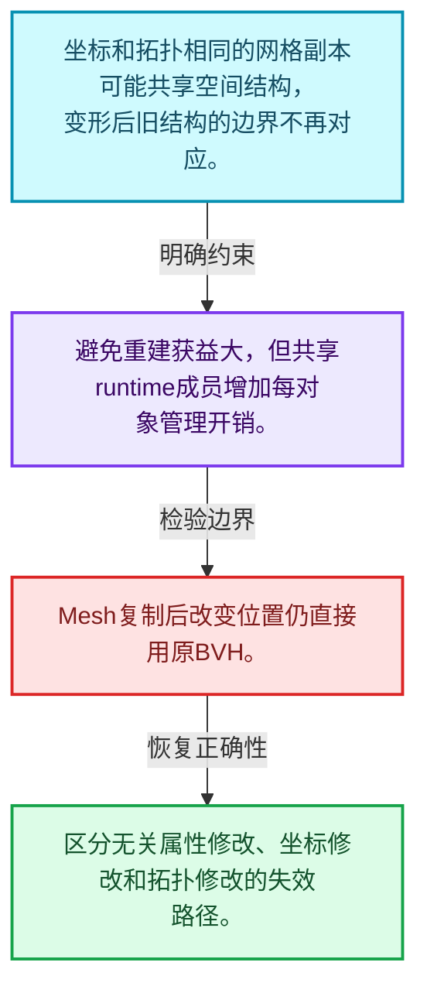
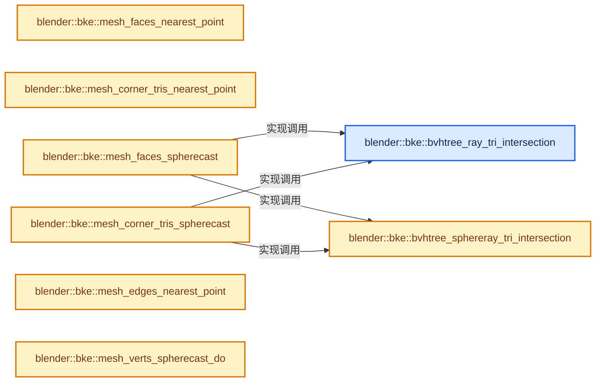
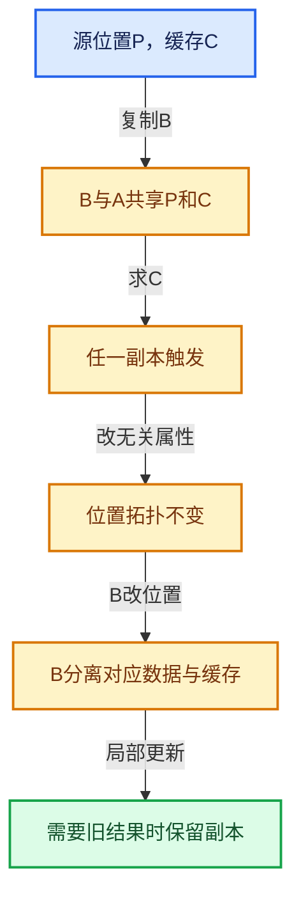

# 06-09 BVH共享与运行时数据

[方向导航](README.md) · [总目录](../README.md) · [实现索引](../%E7%AC%A6%E5%8F%B7%E4%BE%9D%E8%B5%96%E4%B8%8E%E5%AE%9E%E7%8E%B0%E7%B4%A2%E5%BC%95.md)

## 从问题到实现

空间结构何时能跨网格副本共享？

拓扑和坐标未变时可能复用，变形或拓扑修改需要相应失效；runtime缓存不是持久化源数据。

**数据模型**

坐标和拓扑相同的网格副本可能共享空间结构，变形后旧结构的边界不再对应。

**设计取舍**

避免重建获益大，但共享runtime成员增加每对象管理开销。

**最小反例**

Mesh复制后改变位置仍直接用原BVH。

**推导**

区分无关属性修改、坐标修改和拓扑修改的失效路径。

## 阅读地图与执行推演








图中的数值推演是本方向的教学模型；实际函数之间的调用边与概念分析边分别标注，不能把概念关系当作运行时调度顺序。

## 完整源码单元与就地讲解

中文讲解直接放在相关代码旁，复杂机制在代码下展开。原文折叠区保留基准行号；不需要在行号表和函数之间来回查找。类布局可分段展示，函数实现不按固定行数切开。

### 类型布局、声明与编译条件 · BKE_mesh_runtime.hh L1—L87

<a id="t-6909070dca0f"></a>

<a id="t-1dd79ddb7c97"></a>

<a id="t-2c895ed9acfa"></a>

<a id="t-e191922d83bc"></a>

<a id="t-26e9a997dcf8"></a>

<a id="t-fe32e548b039"></a>

<a id="t-c6b5ee526d3f"></a>

<a id="t-752726ff2576"></a>

<!-- annotated:9a9548021f19d9 -->

```cpp
/* SPDX-FileCopyrightText: 2001-2002 NaN Holding BV. All rights reserved.
 *
 * SPDX-License-Identifier: GPL-2.0-or-later */
#pragma once

/** \file
 * \ingroup bke
 *
 * This file contains access functions for the Mesh.runtime struct.
 */

#include "BLI_math_vector_types.hh"
#include "BLI_span.hh"

namespace blender {

struct BMEditMesh;
struct CustomData_MeshMasks;
struct Depsgraph;
struct KeyBlock;
struct ModifierData;
struct Mesh;
struct Object;
struct Scene;

/** Return the number of derived triangles (corner_tris). */
int BKE_mesh_runtime_corner_tris_len(const Mesh *mesh);

void BKE_mesh_runtime_ensure_edit_data(Mesh *mesh);

/**
 * Clear and free any derived caches associated with the mesh geometry data. Examples include BVH
 * caches, normals, triangulation, etc. This should be called when replacing a mesh's geometry
 * directly or making other large changes to topology. It does not need to be called on new meshes.
 *
 * For "smaller" changes to meshes like updating positions, consider calling a more specific update
 * function like #Mesh::tag_positions_changed().
 */
void BKE_mesh_runtime_clear_geometry(Mesh *mesh);

/**
 * Similar to #BKE_mesh_runtime_clear_geometry, but subtly different in that it also clears
 * data-block level features like evaluated data-blocks and edit mode data. They will be
 * functionally the same in most cases, but prefer this function if unsure, since it clears
 * more data.
 */
void BKE_mesh_runtime_clear_cache(Mesh *mesh);

namespace bke {

void mesh_get_mapped_verts_coords(const Mesh *mesh_eval, MutableSpan<float3> r_cos);

const Mesh *editbmesh_get_eval_cage(Depsgraph *depsgraph,
                                    const Scene *scene,
                                    Object *obedit,
                                    const CustomData_MeshMasks *dataMask);
const Mesh *editbmesh_get_eval_cage_from_orig(Depsgraph *depsgraph,
                                              const Scene *scene,
                                              Object *obedit,
                                              const CustomData_MeshMasks *dataMask);

bool editbmesh_modifier_is_enabled(const Scene *scene,
                                   const Object *ob,
                                   ModifierData *md,
                                   bool has_prev_mesh);

const Mesh *mesh_get_eval_deform(Depsgraph *depsgraph,
                                 const Scene *scene,
                                 Object *ob,
                                 const CustomData_MeshMasks *dataMask);

Mesh *mesh_create_eval_final(Depsgraph *depsgraph,
                             const Scene *scene,
                             Object *ob,
                             const CustomData_MeshMasks *dataMask);

Mesh *mesh_create_eval_no_deform(Depsgraph *depsgraph,
                                 const Scene *scene,
                                 Object *ob,
                                 const CustomData_MeshMasks *dataMask);
Mesh *mesh_create_eval_no_deform_render(Depsgraph *depsgraph,
                                        const Scene *scene,
                                        Object *ob,
                                        const CustomData_MeshMasks *dataMask);

}  // namespace bke
}  // namespace blender
```

<details>
<summary>核对原始源码：source/blender/blenkernel/BKE_mesh_runtime.hh · L1—L87</summary>

<!-- original:9a9548021f19d9:source/blender/blenkernel/BKE_mesh_runtime.hh:1:87 -->

```cpp
/* SPDX-FileCopyrightText: 2001-2002 NaN Holding BV. All rights reserved.
 *
 * SPDX-License-Identifier: GPL-2.0-or-later */
#pragma once

/** \file
 * \ingroup bke
 *
 * This file contains access functions for the Mesh.runtime struct.
 */

#include "BLI_math_vector_types.hh"
#include "BLI_span.hh"

namespace blender {

struct BMEditMesh;
struct CustomData_MeshMasks;
struct Depsgraph;
struct KeyBlock;
struct ModifierData;
struct Mesh;
struct Object;
struct Scene;

/** Return the number of derived triangles (corner_tris). */
int BKE_mesh_runtime_corner_tris_len(const Mesh *mesh);

void BKE_mesh_runtime_ensure_edit_data(Mesh *mesh);

/**
 * Clear and free any derived caches associated with the mesh geometry data. Examples include BVH
 * caches, normals, triangulation, etc. This should be called when replacing a mesh's geometry
 * directly or making other large changes to topology. It does not need to be called on new meshes.
 *
 * For "smaller" changes to meshes like updating positions, consider calling a more specific update
 * function like #Mesh::tag_positions_changed().
 */
void BKE_mesh_runtime_clear_geometry(Mesh *mesh);

/**
 * Similar to #BKE_mesh_runtime_clear_geometry, but subtly different in that it also clears
 * data-block level features like evaluated data-blocks and edit mode data. They will be
 * functionally the same in most cases, but prefer this function if unsure, since it clears
 * more data.
 */
void BKE_mesh_runtime_clear_cache(Mesh *mesh);

namespace bke {

void mesh_get_mapped_verts_coords(const Mesh *mesh_eval, MutableSpan<float3> r_cos);

const Mesh *editbmesh_get_eval_cage(Depsgraph *depsgraph,
                                    const Scene *scene,
                                    Object *obedit,
                                    const CustomData_MeshMasks *dataMask);
const Mesh *editbmesh_get_eval_cage_from_orig(Depsgraph *depsgraph,
                                              const Scene *scene,
                                              Object *obedit,
                                              const CustomData_MeshMasks *dataMask);

bool editbmesh_modifier_is_enabled(const Scene *scene,
                                   const Object *ob,
                                   ModifierData *md,
                                   bool has_prev_mesh);

const Mesh *mesh_get_eval_deform(Depsgraph *depsgraph,
                                 const Scene *scene,
                                 Object *ob,
                                 const CustomData_MeshMasks *dataMask);

Mesh *mesh_create_eval_final(Depsgraph *depsgraph,
                             const Scene *scene,
                             Object *ob,
                             const CustomData_MeshMasks *dataMask);

Mesh *mesh_create_eval_no_deform(Depsgraph *depsgraph,
                                 const Scene *scene,
                                 Object *ob,
                                 const CustomData_MeshMasks *dataMask);
Mesh *mesh_create_eval_no_deform_render(Depsgraph *depsgraph,
                                        const Scene *scene,
                                        Object *ob,
                                        const CustomData_MeshMasks *dataMask);

}  // namespace bke
}  // namespace blender
```

</details>

### 类型布局、声明与编译条件 · bvhutils.cc L1—L29

<!-- annotated:552a6c2327cd7e -->

```cpp
/* SPDX-FileCopyrightText: 2024 Blender Authors
 *
 * SPDX-License-Identifier: GPL-2.0-or-later */

/** \file
 * \ingroup bke
 */

#include "DNA_meshdata_types.h"
#include "DNA_pointcloud_types.h"

#include "BLI_math_geom_c.hh"

#include "BKE_attribute.hh"
#include "BKE_bvhutils.hh"
#include "BKE_editmesh.hh"
#include "BKE_mesh.hh"
#include "BKE_pointcloud.hh"

namespace blender {

namespace bke {

/* -------------------------------------------------------------------- */
/** \name Local Callbacks
 * \{ */

/* Math stuff for ray casting on mesh faces and for nearest surface */

```

<details>
<summary>核对原始源码：source/blender/blenkernel/intern/bvhutils.cc · L1—L29</summary>

<!-- original:552a6c2327cd7e:source/blender/blenkernel/intern/bvhutils.cc:1:29 -->

```cpp
/* SPDX-FileCopyrightText: 2024 Blender Authors
 *
 * SPDX-License-Identifier: GPL-2.0-or-later */

/** \file
 * \ingroup bke
 */

#include "DNA_meshdata_types.h"
#include "DNA_pointcloud_types.h"

#include "BLI_math_geom_c.hh"

#include "BKE_attribute.hh"
#include "BKE_bvhutils.hh"
#include "BKE_editmesh.hh"
#include "BKE_mesh.hh"
#include "BKE_pointcloud.hh"

namespace blender {

namespace bke {

/* -------------------------------------------------------------------- */
/** \name Local Callbacks
 * \{ */

/* Math stuff for ray casting on mesh faces and for nearest surface */

```

</details>

<a id="f-762c1cf73cdcb17d"></a>

### `blender::bke::bvhtree_ray_tri_intersection`

实现位置：[source/blender/blenkernel/intern/bvhutils.cc](../../../../../source/blender/blenkernel/intern/bvhutils.cc) · L30—L49。

接口参数：

- `const BVHTreeRay *ray`
- `const float`
- `const float v0[3]`
- `const float v1[3]`
- `const float v2[3]`

**教学注释版**

<!-- annotated:bcbcbf6256d951 -->

```cpp
float bvhtree_ray_tri_intersection(const BVHTreeRay *ray,
                                   const float /*m_dist*/,
                                   const float v0[3],
                                   const float v1[3],
                                   const float v2[3])
{
  float dist;

#ifdef USE_KDOPBVH_WATERTIGHT
  if (isect_ray_tri_watertight_v3(ray->origin, ray->isect_precalc, v0, v1, v2, &dist, nullptr))
#else
  if (isect_ray_tri_epsilon_v3(
          ray->origin, ray->direction, v0, v1, v2, &dist, nullptr, FLT_EPSILON))
#endif
  {
    return dist;
  }

  return FLT_MAX;
}
```

<details>
<summary>核对原始源码：source/blender/blenkernel/intern/bvhutils.cc · L30—L49</summary>

<!-- original:bcbcbf6256d951:source/blender/blenkernel/intern/bvhutils.cc:30:49 -->

```cpp
float bvhtree_ray_tri_intersection(const BVHTreeRay *ray,
                                   const float /*m_dist*/,
                                   const float v0[3],
                                   const float v1[3],
                                   const float v2[3])
{
  float dist;

#ifdef USE_KDOPBVH_WATERTIGHT
  if (isect_ray_tri_watertight_v3(ray->origin, ray->isect_precalc, v0, v1, v2, &dist, nullptr))
#else
  if (isect_ray_tri_epsilon_v3(
          ray->origin, ray->direction, v0, v1, v2, &dist, nullptr, FLT_EPSILON))
#endif
  {
    return dist;
  }

  return FLT_MAX;
}
```

</details>

**结果出口**

- `return dist;`
- `return FLT_MAX;`

**继续追踪实现**

- `isect_ray_tri_watertight_v3` → [blender::isect_ray_tri_watertight_v3 · L1972](../12-%E7%A9%BA%E9%97%B4%E6%95%B0%E6%8D%AE%E7%BB%93%E6%9E%84%E4%B8%8E%E5%87%A0%E4%BD%95%E7%AE%97%E6%B3%95/%E4%BE%9D%E8%B5%96-math_geom-8d91a3.md#f-f28795b387bf6ee2)。
- `isect_ray_tri_epsilon_v3` → [blender::isect_ray_tri_epsilon_v3 · L1896](../12-%E7%A9%BA%E9%97%B4%E6%95%B0%E6%8D%AE%E7%BB%93%E6%9E%84%E4%B8%8E%E5%87%A0%E4%BD%95%E7%AE%97%E6%B3%95/%E4%BE%9D%E8%B5%96-math_geom-8d91a3.md#f-de884353b76a663e)。

<!-- annotated:47c7d39f002ee6 -->

```cpp

```

<details>
<summary>核对原始源码：source/blender/blenkernel/intern/bvhutils.cc · L50—L50</summary>

<!-- original:47c7d39f002ee6:source/blender/blenkernel/intern/bvhutils.cc:50:50 -->

```cpp

```

</details>

<a id="f-f78e5e398cf48fde"></a>

### `blender::bke::bvhtree_sphereray_tri_intersection`

实现位置：[source/blender/blenkernel/intern/bvhutils.cc](../../../../../source/blender/blenkernel/intern/bvhutils.cc) · L51—L69。

接口参数：

- `const BVHTreeRay *ray`
- `float radius`
- `const float m_dist`
- `const float v0[3]`
- `const float v1[3]`
- `const float v2[3]`

**教学注释版**

<!-- annotated:1acc72d3e98429 -->

```cpp
float bvhtree_sphereray_tri_intersection(const BVHTreeRay *ray,
                                         float radius,
                                         const float m_dist,
                                         const float v0[3],
                                         const float v1[3],
                                         const float v2[3])
{

  float idist;
  float p1[3];
  float hit_point[3];

  madd_v3_v3v3fl(p1, ray->origin, ray->direction, m_dist);
  if (isect_sweeping_sphere_tri_v3(ray->origin, p1, radius, v0, v1, v2, &idist, hit_point)) {
    return idist * m_dist;
  }

  return FLT_MAX;
}
```

<details>
<summary>核对原始源码：source/blender/blenkernel/intern/bvhutils.cc · L51—L69</summary>

<!-- original:1acc72d3e98429:source/blender/blenkernel/intern/bvhutils.cc:51:69 -->

```cpp
float bvhtree_sphereray_tri_intersection(const BVHTreeRay *ray,
                                         float radius,
                                         const float m_dist,
                                         const float v0[3],
                                         const float v1[3],
                                         const float v2[3])
{

  float idist;
  float p1[3];
  float hit_point[3];

  madd_v3_v3v3fl(p1, ray->origin, ray->direction, m_dist);
  if (isect_sweeping_sphere_tri_v3(ray->origin, p1, radius, v0, v1, v2, &idist, hit_point)) {
    return idist * m_dist;
  }

  return FLT_MAX;
}
```

</details>

**结果出口**

- `return idist * m_dist;`
- `return FLT_MAX;`

**继续追踪实现**

- `madd_v3_v3v3fl` → [blender::madd_v3_v3v3fl · L514](../12-%E7%A9%BA%E9%97%B4%E6%95%B0%E6%8D%AE%E7%BB%93%E6%9E%84%E4%B8%8E%E5%87%A0%E4%BD%95%E7%AE%97%E6%B3%95/%E4%BE%9D%E8%B5%96-math_vector_inline-0c8541.md#f-862faf7c108f3bb8)。
- `isect_sweeping_sphere_tri_v3` → [blender::isect_sweeping_sphere_tri_v3 · L2804](../12-%E7%A9%BA%E9%97%B4%E6%95%B0%E6%8D%AE%E7%BB%93%E6%9E%84%E4%B8%8E%E5%87%A0%E4%BD%95%E7%AE%97%E6%B3%95/%E4%BE%9D%E8%B5%96-math_geom-8d91a3.md#f-fcae166000e275b1)。

### 类型布局、声明与编译条件 · bvhutils.cc L70—L80

<!-- annotated:ea987099cf344d -->

```cpp

/*
 * BVH from meshes callbacks
 */

/**
 * Callback to BVH-tree nearest point.
 * The tree must have been built using #bvhtree_from_mesh_faces.
 *
 * \param userdata: Must be a #BVHMeshCallbackUserdata built from the same mesh as the tree.
 */
```

<details>
<summary>核对原始源码：source/blender/blenkernel/intern/bvhutils.cc · L70—L80</summary>

<!-- original:ea987099cf344d:source/blender/blenkernel/intern/bvhutils.cc:70:80 -->

```cpp

/*
 * BVH from meshes callbacks
 */

/**
 * Callback to BVH-tree nearest point.
 * The tree must have been built using #bvhtree_from_mesh_faces.
 *
 * \param userdata: Must be a #BVHMeshCallbackUserdata built from the same mesh as the tree.
 */
```

</details>

<a id="f-30a5eb84bb598d31"></a>

### `blender::bke::mesh_faces_nearest_point`

实现位置：[source/blender/blenkernel/intern/bvhutils.cc](../../../../../source/blender/blenkernel/intern/bvhutils.cc) · L81—L113。

接口参数：

- `void *userdata`
- `int index`
- `const float co[3]`
- `BVHTreeNearest *nearest`

**教学注释版**

<!-- annotated:97e4f7f3e7ac46 -->

```cpp
static void mesh_faces_nearest_point(void *userdata,
                                     int index,
                                     const float co[3],
                                     BVHTreeNearest *nearest)
{
  const BVHTreeFromMesh *data = static_cast<BVHTreeFromMesh *>(userdata);
  const MFace *face = data->face + index;

  const float *t0, *t1, *t2, *t3;
  t0 = data->vert_positions[face->v1];
  t1 = data->vert_positions[face->v2];
  t2 = data->vert_positions[face->v3];
  t3 = face->v4 ? &data->vert_positions[face->v4].x : nullptr;

  do {
    float nearest_tmp[3], dist_sq;

    closest_on_tri_to_point_v3(nearest_tmp, co, t0, t1, t2);
    dist_sq = len_squared_v3v3(co, nearest_tmp);

    if (dist_sq < nearest->dist_sq) {
      nearest->index = index;
      nearest->dist_sq = dist_sq;
      copy_v3_v3(nearest->co, nearest_tmp);
      normal_tri_v3(nearest->no, t0, t1, t2);
    }

    t1 = t2;
    t2 = t3;
    t3 = nullptr;

  } while (t2);
}
```

<details>
<summary>核对原始源码：source/blender/blenkernel/intern/bvhutils.cc · L81—L113</summary>

<!-- original:97e4f7f3e7ac46:source/blender/blenkernel/intern/bvhutils.cc:81:113 -->

```cpp
static void mesh_faces_nearest_point(void *userdata,
                                     int index,
                                     const float co[3],
                                     BVHTreeNearest *nearest)
{
  const BVHTreeFromMesh *data = static_cast<BVHTreeFromMesh *>(userdata);
  const MFace *face = data->face + index;

  const float *t0, *t1, *t2, *t3;
  t0 = data->vert_positions[face->v1];
  t1 = data->vert_positions[face->v2];
  t2 = data->vert_positions[face->v3];
  t3 = face->v4 ? &data->vert_positions[face->v4].x : nullptr;

  do {
    float nearest_tmp[3], dist_sq;

    closest_on_tri_to_point_v3(nearest_tmp, co, t0, t1, t2);
    dist_sq = len_squared_v3v3(co, nearest_tmp);

    if (dist_sq < nearest->dist_sq) {
      nearest->index = index;
      nearest->dist_sq = dist_sq;
      copy_v3_v3(nearest->co, nearest_tmp);
      normal_tri_v3(nearest->no, t0, t1, t2);
    }

    t1 = t2;
    t2 = t3;
    t3 = nullptr;

  } while (t2);
}
```

</details>

**沿实际写入检查状态**

- `t0 = data->vert_positions[face->v1];`
- `t1 = data->vert_positions[face->v2];`
- `t2 = data->vert_positions[face->v3];`
- `t3 = face->v4 ? &data->vert_positions[face->v4].x : nullptr;`
- `dist_sq = len_squared_v3v3(co, nearest_tmp);`
- `nearest->index = index;`
- `nearest->dist_sq = dist_sq;`
- `t1 = t2;`
- `t2 = t3;`
- `t3 = nullptr;`

**继续追踪实现**

- `closest_on_tri_to_point_v3` → [blender::closest_on_tri_to_point_v3 · L1045](../12-%E7%A9%BA%E9%97%B4%E6%95%B0%E6%8D%AE%E7%BB%93%E6%9E%84%E4%B8%8E%E5%87%A0%E4%BD%95%E7%AE%97%E6%B3%95/%E4%BE%9D%E8%B5%96-math_geom-8d91a3.md#f-1cbb0122e4eceb5a)；[blender::closest_on_tri_to_point_v3 · L1174](../12-%E7%A9%BA%E9%97%B4%E6%95%B0%E6%8D%AE%E7%BB%93%E6%9E%84%E4%B8%8E%E5%87%A0%E4%BD%95%E7%AE%97%E6%B3%95/%E4%BE%9D%E8%B5%96-math_geom-8d91a3.md#f-6f3923afbf23e1a4)。同名重载需按实参类型选择。
- `len_squared_v3v3` → [blender::len_squared_v3v3 · L794](../12-%E7%A9%BA%E9%97%B4%E6%95%B0%E6%8D%AE%E7%BB%93%E6%9E%84%E4%B8%8E%E5%87%A0%E4%BD%95%E7%AE%97%E6%B3%95/%E4%BE%9D%E8%B5%96-math_vector_inline-0c8541.md#f-ae487ac3ef64aa87)。
- `copy_v3_v3` → [调用协议](../%E6%A8%A1%E6%9D%BF%E5%AE%8F%E4%B8%8E%E5%8A%A8%E6%80%81%E5%88%86%E6%B4%BE%E5%8D%8F%E8%AE%AE.md)：函数指针、局部可调用对象或未展开的宏；必须结合调用者环境。调用位置L104。
- `normal_tri_v3` → [blender::normal_tri_v3 · L45](../12-%E7%A9%BA%E9%97%B4%E6%95%B0%E6%8D%AE%E7%BB%93%E6%9E%84%E4%B8%8E%E5%87%A0%E4%BD%95%E7%AE%97%E6%B3%95/%E4%BE%9D%E8%B5%96-math_geom-8d91a3.md#f-f574cdfe156b33d2)。

### 类型布局、声明与编译条件 · bvhutils.cc L114—L114

<!-- annotated:8beeab50e6f663 -->

```cpp
/* copy of function above */
```

<details>
<summary>核对原始源码：source/blender/blenkernel/intern/bvhutils.cc · L114—L114</summary>

<!-- original:8beeab50e6f663:source/blender/blenkernel/intern/bvhutils.cc:114:114 -->

```cpp
/* copy of function above */
```

</details>

<a id="f-8d1af6b856ecf398"></a>

### `blender::bke::mesh_corner_tris_nearest_point`

实现位置：[source/blender/blenkernel/intern/bvhutils.cc](../../../../../source/blender/blenkernel/intern/bvhutils.cc) · L115—L138。

接口参数：

- `void *userdata`
- `int index`
- `const float co[3]`
- `BVHTreeNearest *nearest`

**教学注释版**

<!-- annotated:5d1109dd4b8cea -->

```cpp
static void mesh_corner_tris_nearest_point(void *userdata,
                                           int index,
                                           const float co[3],
                                           BVHTreeNearest *nearest)
{
  const BVHTreeFromMesh *data = static_cast<BVHTreeFromMesh *>(userdata);
  const int3 &tri = data->corner_tris[index];
  const float *vtri_co[3] = {
      data->vert_positions[data->corner_verts[tri[0]]],
      data->vert_positions[data->corner_verts[tri[1]]],
      data->vert_positions[data->corner_verts[tri[2]]],
  };
  float nearest_tmp[3], dist_sq;

  closest_on_tri_to_point_v3(nearest_tmp, co, UNPACK3(vtri_co));
  dist_sq = len_squared_v3v3(co, nearest_tmp);

  if (dist_sq < nearest->dist_sq) {
    nearest->index = index;
    nearest->dist_sq = dist_sq;
    copy_v3_v3(nearest->co, nearest_tmp);
    normal_tri_v3(nearest->no, UNPACK3(vtri_co));
  }
}
```

<details>
<summary>核对原始源码：source/blender/blenkernel/intern/bvhutils.cc · L115—L138</summary>

<!-- original:5d1109dd4b8cea:source/blender/blenkernel/intern/bvhutils.cc:115:138 -->

```cpp
static void mesh_corner_tris_nearest_point(void *userdata,
                                           int index,
                                           const float co[3],
                                           BVHTreeNearest *nearest)
{
  const BVHTreeFromMesh *data = static_cast<BVHTreeFromMesh *>(userdata);
  const int3 &tri = data->corner_tris[index];
  const float *vtri_co[3] = {
      data->vert_positions[data->corner_verts[tri[0]]],
      data->vert_positions[data->corner_verts[tri[1]]],
      data->vert_positions[data->corner_verts[tri[2]]],
  };
  float nearest_tmp[3], dist_sq;

  closest_on_tri_to_point_v3(nearest_tmp, co, UNPACK3(vtri_co));
  dist_sq = len_squared_v3v3(co, nearest_tmp);

  if (dist_sq < nearest->dist_sq) {
    nearest->index = index;
    nearest->dist_sq = dist_sq;
    copy_v3_v3(nearest->co, nearest_tmp);
    normal_tri_v3(nearest->no, UNPACK3(vtri_co));
  }
}
```

</details>

**沿实际写入检查状态**

- `dist_sq = len_squared_v3v3(co, nearest_tmp);`
- `nearest->index = index;`
- `nearest->dist_sq = dist_sq;`

**继续追踪实现**

- `closest_on_tri_to_point_v3` → [blender::closest_on_tri_to_point_v3 · L1045](../12-%E7%A9%BA%E9%97%B4%E6%95%B0%E6%8D%AE%E7%BB%93%E6%9E%84%E4%B8%8E%E5%87%A0%E4%BD%95%E7%AE%97%E6%B3%95/%E4%BE%9D%E8%B5%96-math_geom-8d91a3.md#f-1cbb0122e4eceb5a)；[blender::closest_on_tri_to_point_v3 · L1174](../12-%E7%A9%BA%E9%97%B4%E6%95%B0%E6%8D%AE%E7%BB%93%E6%9E%84%E4%B8%8E%E5%87%A0%E4%BD%95%E7%AE%97%E6%B3%95/%E4%BE%9D%E8%B5%96-math_geom-8d91a3.md#f-6f3923afbf23e1a4)。同名重载需按实参类型选择。
- `UNPACK3` → [UNPACK3 · L23](../05-%E5%87%A0%E4%BD%95%E5%AD%98%E5%82%A8%E4%B8%8E%E6%8B%93%E6%89%91%E6%98%A0%E5%B0%84/%E4%BE%9D%E8%B5%96-GHOST_utildefines-34b996.md#m-f882324eb80a)；[UNPACK3 · L235](../01-%E5%9F%BA%E7%A1%80%E5%AE%B9%E5%99%A8%E4%B8%8E%E7%8E%B0%E4%BB%A3CPP/%E4%BE%9D%E8%B5%96-BLI_utildefines-293a0a.md#m-bbbbdcf09d3b)；[UNPACK3 · L14](../05-%E5%87%A0%E4%BD%95%E5%AD%98%E5%82%A8%E4%B8%8E%E6%8B%93%E6%89%91%E6%98%A0%E5%B0%84/%E4%BE%9D%E8%B5%96-gpu_shader_utildefines.bsl-e9f199.md#m-b4e3357a0310)。宏定义由构建条件选择。
- `len_squared_v3v3` → [blender::len_squared_v3v3 · L794](../12-%E7%A9%BA%E9%97%B4%E6%95%B0%E6%8D%AE%E7%BB%93%E6%9E%84%E4%B8%8E%E5%87%A0%E4%BD%95%E7%AE%97%E6%B3%95/%E4%BE%9D%E8%B5%96-math_vector_inline-0c8541.md#f-ae487ac3ef64aa87)。
- `copy_v3_v3` → [调用协议](../%E6%A8%A1%E6%9D%BF%E5%AE%8F%E4%B8%8E%E5%8A%A8%E6%80%81%E5%88%86%E6%B4%BE%E5%8D%8F%E8%AE%AE.md)：函数指针、局部可调用对象或未展开的宏；必须结合调用者环境。调用位置L135。
- `normal_tri_v3` → [blender::normal_tri_v3 · L45](../12-%E7%A9%BA%E9%97%B4%E6%95%B0%E6%8D%AE%E7%BB%93%E6%9E%84%E4%B8%8E%E5%87%A0%E4%BD%95%E7%AE%97%E6%B3%95/%E4%BE%9D%E8%B5%96-math_geom-8d91a3.md#f-f574cdfe156b33d2)。

### 类型布局、声明与编译条件 · bvhutils.cc L139—L145

<!-- annotated:9d24aa9134a671 -->

```cpp

/**
 * Callback to BVH-tree ray-cast.
 * The tree must have been built using bvhtree_from_mesh_faces.
 *
 * \param userdata: Must be a #BVHMeshCallbackUserdata built from the same mesh as the tree.
 */
```

<details>
<summary>核对原始源码：source/blender/blenkernel/intern/bvhutils.cc · L139—L145</summary>

<!-- original:9d24aa9134a671:source/blender/blenkernel/intern/bvhutils.cc:139:145 -->

```cpp

/**
 * Callback to BVH-tree ray-cast.
 * The tree must have been built using bvhtree_from_mesh_faces.
 *
 * \param userdata: Must be a #BVHMeshCallbackUserdata built from the same mesh as the tree.
 */
```

</details>

<a id="f-7f5f5aed0095f62d"></a>

### `blender::bke::mesh_faces_spherecast`

实现位置：[source/blender/blenkernel/intern/bvhutils.cc](../../../../../source/blender/blenkernel/intern/bvhutils.cc) · L146—L182。

接口参数：

- `void *userdata`
- `int index`
- `const BVHTreeRay *ray`
- `BVHTreeRayHit *hit`

**教学注释版**

<!-- annotated:94ecb8ab6b30e8 -->

```cpp
static void mesh_faces_spherecast(void *userdata,
                                  int index,
                                  const BVHTreeRay *ray,
                                  BVHTreeRayHit *hit)
{
  const BVHTreeFromMesh *data = static_cast<BVHTreeFromMesh *>(userdata);
  const MFace *face = &data->face[index];

  const float *t0, *t1, *t2, *t3;
  t0 = data->vert_positions[face->v1];
  t1 = data->vert_positions[face->v2];
  t2 = data->vert_positions[face->v3];
  t3 = face->v4 ? &data->vert_positions[face->v4].x : nullptr;

  do {
    float dist;
    if (ray->radius == 0.0f) {
      dist = bvhtree_ray_tri_intersection(ray, hit->dist, t0, t1, t2);
    }
    else {
      dist = bvhtree_sphereray_tri_intersection(ray, ray->radius, hit->dist, t0, t1, t2);
    }

    if (dist >= 0 && dist < hit->dist) {
      hit->index = index;
      hit->dist = dist;
      madd_v3_v3v3fl(hit->co, ray->origin, ray->direction, dist);

      normal_tri_v3(hit->no, t0, t1, t2);
    }

    t1 = t2;
    t2 = t3;
    t3 = nullptr;

  } while (t2);
}
```

<details>
<summary>核对原始源码：source/blender/blenkernel/intern/bvhutils.cc · L146—L182</summary>

<!-- original:94ecb8ab6b30e8:source/blender/blenkernel/intern/bvhutils.cc:146:182 -->

```cpp
static void mesh_faces_spherecast(void *userdata,
                                  int index,
                                  const BVHTreeRay *ray,
                                  BVHTreeRayHit *hit)
{
  const BVHTreeFromMesh *data = static_cast<BVHTreeFromMesh *>(userdata);
  const MFace *face = &data->face[index];

  const float *t0, *t1, *t2, *t3;
  t0 = data->vert_positions[face->v1];
  t1 = data->vert_positions[face->v2];
  t2 = data->vert_positions[face->v3];
  t3 = face->v4 ? &data->vert_positions[face->v4].x : nullptr;

  do {
    float dist;
    if (ray->radius == 0.0f) {
      dist = bvhtree_ray_tri_intersection(ray, hit->dist, t0, t1, t2);
    }
    else {
      dist = bvhtree_sphereray_tri_intersection(ray, ray->radius, hit->dist, t0, t1, t2);
    }

    if (dist >= 0 && dist < hit->dist) {
      hit->index = index;
      hit->dist = dist;
      madd_v3_v3v3fl(hit->co, ray->origin, ray->direction, dist);

      normal_tri_v3(hit->no, t0, t1, t2);
    }

    t1 = t2;
    t2 = t3;
    t3 = nullptr;

  } while (t2);
}
```

</details>

**沿实际写入检查状态**

- `t0 = data->vert_positions[face->v1];`
- `t1 = data->vert_positions[face->v2];`
- `t2 = data->vert_positions[face->v3];`
- `t3 = face->v4 ? &data->vert_positions[face->v4].x : nullptr;`
- `dist = bvhtree_ray_tri_intersection(ray, hit->dist, t0, t1, t2);`
- `dist = bvhtree_sphereray_tri_intersection(ray, ray->radius, hit->dist, t0, t1, t2);`
- `hit->index = index;`
- `hit->dist = dist;`
- `t1 = t2;`
- `t2 = t3;`
- `t3 = nullptr;`

**继续追踪实现**

- `bvhtree_ray_tri_intersection` → [blender::bke::bvhtree_ray_tri_intersection · L30](09-BVH%E5%85%B1%E4%BA%AB%E4%B8%8E%E8%BF%90%E8%A1%8C%E6%97%B6%E6%95%B0%E6%8D%AE.md#f-762c1cf73cdcb17d)。
- `bvhtree_sphereray_tri_intersection` → [blender::bke::bvhtree_sphereray_tri_intersection · L51](09-BVH%E5%85%B1%E4%BA%AB%E4%B8%8E%E8%BF%90%E8%A1%8C%E6%97%B6%E6%95%B0%E6%8D%AE.md#f-f78e5e398cf48fde)。
- `madd_v3_v3v3fl` → [blender::madd_v3_v3v3fl · L514](../12-%E7%A9%BA%E9%97%B4%E6%95%B0%E6%8D%AE%E7%BB%93%E6%9E%84%E4%B8%8E%E5%87%A0%E4%BD%95%E7%AE%97%E6%B3%95/%E4%BE%9D%E8%B5%96-math_vector_inline-0c8541.md#f-862faf7c108f3bb8)。
- `normal_tri_v3` → [blender::normal_tri_v3 · L45](../12-%E7%A9%BA%E9%97%B4%E6%95%B0%E6%8D%AE%E7%BB%93%E6%9E%84%E4%B8%8E%E5%87%A0%E4%BD%95%E7%AE%97%E6%B3%95/%E4%BE%9D%E8%B5%96-math_geom-8d91a3.md#f-f574cdfe156b33d2)。

### 类型布局、声明与编译条件 · bvhutils.cc L183—L183

<!-- annotated:60540959ada219 -->

```cpp
/* copy of function above */
```

<details>
<summary>核对原始源码：source/blender/blenkernel/intern/bvhutils.cc · L183—L183</summary>

<!-- original:60540959ada219:source/blender/blenkernel/intern/bvhutils.cc:183:183 -->

```cpp
/* copy of function above */
```

</details>

<a id="f-51176d990d9a21fa"></a>

### `blender::bke::mesh_corner_tris_spherecast`

实现位置：[source/blender/blenkernel/intern/bvhutils.cc](../../../../../source/blender/blenkernel/intern/bvhutils.cc) · L184—L213。

接口参数：

- `void *userdata`
- `int index`
- `const BVHTreeRay *ray`
- `BVHTreeRayHit *hit`

**教学注释版**

<!-- annotated:a4fb2115bd93f3 -->

```cpp
static void mesh_corner_tris_spherecast(void *userdata,
                                        int index,
                                        const BVHTreeRay *ray,
                                        BVHTreeRayHit *hit)
{
  const BVHTreeFromMesh *data = static_cast<BVHTreeFromMesh *>(userdata);
  const Span<float3> positions = data->vert_positions;
  const int3 &tri = data->corner_tris[index];
  const float *vtri_co[3] = {
      positions[data->corner_verts[tri[0]]],
      positions[data->corner_verts[tri[1]]],
      positions[data->corner_verts[tri[2]]],
  };
  float dist;

  if (ray->radius == 0.0f) {
    dist = bvhtree_ray_tri_intersection(ray, hit->dist, UNPACK3(vtri_co));
  }
  else {
    dist = bvhtree_sphereray_tri_intersection(ray, ray->radius, hit->dist, UNPACK3(vtri_co));
  }

  if (dist >= 0 && dist < hit->dist) {
    hit->index = index;
    hit->dist = dist;
    madd_v3_v3v3fl(hit->co, ray->origin, ray->direction, dist);

    normal_tri_v3(hit->no, UNPACK3(vtri_co));
  }
}
```

<details>
<summary>核对原始源码：source/blender/blenkernel/intern/bvhutils.cc · L184—L213</summary>

<!-- original:a4fb2115bd93f3:source/blender/blenkernel/intern/bvhutils.cc:184:213 -->

```cpp
static void mesh_corner_tris_spherecast(void *userdata,
                                        int index,
                                        const BVHTreeRay *ray,
                                        BVHTreeRayHit *hit)
{
  const BVHTreeFromMesh *data = static_cast<BVHTreeFromMesh *>(userdata);
  const Span<float3> positions = data->vert_positions;
  const int3 &tri = data->corner_tris[index];
  const float *vtri_co[3] = {
      positions[data->corner_verts[tri[0]]],
      positions[data->corner_verts[tri[1]]],
      positions[data->corner_verts[tri[2]]],
  };
  float dist;

  if (ray->radius == 0.0f) {
    dist = bvhtree_ray_tri_intersection(ray, hit->dist, UNPACK3(vtri_co));
  }
  else {
    dist = bvhtree_sphereray_tri_intersection(ray, ray->radius, hit->dist, UNPACK3(vtri_co));
  }

  if (dist >= 0 && dist < hit->dist) {
    hit->index = index;
    hit->dist = dist;
    madd_v3_v3v3fl(hit->co, ray->origin, ray->direction, dist);

    normal_tri_v3(hit->no, UNPACK3(vtri_co));
  }
}
```

</details>

**沿实际写入检查状态**

- `dist = bvhtree_ray_tri_intersection(ray, hit->dist, UNPACK3(vtri_co));`
- `dist = bvhtree_sphereray_tri_intersection(ray, ray->radius, hit->dist, UNPACK3(vtri_co));`
- `hit->index = index;`
- `hit->dist = dist;`

**继续追踪实现**

- `bvhtree_ray_tri_intersection` → [blender::bke::bvhtree_ray_tri_intersection · L30](09-BVH%E5%85%B1%E4%BA%AB%E4%B8%8E%E8%BF%90%E8%A1%8C%E6%97%B6%E6%95%B0%E6%8D%AE.md#f-762c1cf73cdcb17d)。
- `UNPACK3` → [UNPACK3 · L23](../05-%E5%87%A0%E4%BD%95%E5%AD%98%E5%82%A8%E4%B8%8E%E6%8B%93%E6%89%91%E6%98%A0%E5%B0%84/%E4%BE%9D%E8%B5%96-GHOST_utildefines-34b996.md#m-f882324eb80a)；[UNPACK3 · L235](../01-%E5%9F%BA%E7%A1%80%E5%AE%B9%E5%99%A8%E4%B8%8E%E7%8E%B0%E4%BB%A3CPP/%E4%BE%9D%E8%B5%96-BLI_utildefines-293a0a.md#m-bbbbdcf09d3b)；[UNPACK3 · L14](../05-%E5%87%A0%E4%BD%95%E5%AD%98%E5%82%A8%E4%B8%8E%E6%8B%93%E6%89%91%E6%98%A0%E5%B0%84/%E4%BE%9D%E8%B5%96-gpu_shader_utildefines.bsl-e9f199.md#m-b4e3357a0310)。宏定义由构建条件选择。
- `bvhtree_sphereray_tri_intersection` → [blender::bke::bvhtree_sphereray_tri_intersection · L51](09-BVH%E5%85%B1%E4%BA%AB%E4%B8%8E%E8%BF%90%E8%A1%8C%E6%97%B6%E6%95%B0%E6%8D%AE.md#f-f78e5e398cf48fde)。
- `madd_v3_v3v3fl` → [blender::madd_v3_v3v3fl · L514](../12-%E7%A9%BA%E9%97%B4%E6%95%B0%E6%8D%AE%E7%BB%93%E6%9E%84%E4%B8%8E%E5%87%A0%E4%BD%95%E7%AE%97%E6%B3%95/%E4%BE%9D%E8%B5%96-math_vector_inline-0c8541.md#f-862faf7c108f3bb8)。
- `normal_tri_v3` → [blender::normal_tri_v3 · L45](../12-%E7%A9%BA%E9%97%B4%E6%95%B0%E6%8D%AE%E7%BB%93%E6%9E%84%E4%B8%8E%E5%87%A0%E4%BD%95%E7%AE%97%E6%B3%95/%E4%BE%9D%E8%B5%96-math_geom-8d91a3.md#f-f574cdfe156b33d2)。

### 类型布局、声明与编译条件 · bvhutils.cc L214—L220

<!-- annotated:75fade2d42581b -->

```cpp

/**
 * Callback to BVH-tree nearest point.
 * The tree must have been built using #bvhtree_from_mesh_edges.
 *
 * \param userdata: Must be a #BVHMeshCallbackUserdata built from the same mesh as the tree.
 */
```

<details>
<summary>核对原始源码：source/blender/blenkernel/intern/bvhutils.cc · L214—L220</summary>

<!-- original:75fade2d42581b:source/blender/blenkernel/intern/bvhutils.cc:214:220 -->

```cpp

/**
 * Callback to BVH-tree nearest point.
 * The tree must have been built using #bvhtree_from_mesh_edges.
 *
 * \param userdata: Must be a #BVHMeshCallbackUserdata built from the same mesh as the tree.
 */
```

</details>

<a id="f-bf772b006f1e1926"></a>

### `blender::bke::mesh_edges_nearest_point`

实现位置：[source/blender/blenkernel/intern/bvhutils.cc](../../../../../source/blender/blenkernel/intern/bvhutils.cc) · L221—L245。

接口参数：

- `void *userdata`
- `int index`
- `const float co[3]`
- `BVHTreeNearest *nearest`

**教学注释版**

<!-- annotated:f378b1aedb9c2f -->

```cpp
static void mesh_edges_nearest_point(void *userdata,
                                     int index,
                                     const float co[3],
                                     BVHTreeNearest *nearest)
{
  const BVHTreeFromMesh *data = static_cast<BVHTreeFromMesh *>(userdata);
  const Span<float3> positions = data->vert_positions;
  const int2 edge = data->edges[index];
  float nearest_tmp[3], dist_sq;

  const float *t0, *t1;
  t0 = positions[edge[0]];
  t1 = positions[edge[1]];

  closest_to_line_segment_v3(nearest_tmp, co, t0, t1);
  dist_sq = len_squared_v3v3(nearest_tmp, co);

  if (dist_sq < nearest->dist_sq) {
    nearest->index = index;
    nearest->dist_sq = dist_sq;
    copy_v3_v3(nearest->co, nearest_tmp);
    sub_v3_v3v3(nearest->no, t0, t1);
    normalize_v3(nearest->no);
  }
}
```

<details>
<summary>核对原始源码：source/blender/blenkernel/intern/bvhutils.cc · L221—L245</summary>

<!-- original:f378b1aedb9c2f:source/blender/blenkernel/intern/bvhutils.cc:221:245 -->

```cpp
static void mesh_edges_nearest_point(void *userdata,
                                     int index,
                                     const float co[3],
                                     BVHTreeNearest *nearest)
{
  const BVHTreeFromMesh *data = static_cast<BVHTreeFromMesh *>(userdata);
  const Span<float3> positions = data->vert_positions;
  const int2 edge = data->edges[index];
  float nearest_tmp[3], dist_sq;

  const float *t0, *t1;
  t0 = positions[edge[0]];
  t1 = positions[edge[1]];

  closest_to_line_segment_v3(nearest_tmp, co, t0, t1);
  dist_sq = len_squared_v3v3(nearest_tmp, co);

  if (dist_sq < nearest->dist_sq) {
    nearest->index = index;
    nearest->dist_sq = dist_sq;
    copy_v3_v3(nearest->co, nearest_tmp);
    sub_v3_v3v3(nearest->no, t0, t1);
    normalize_v3(nearest->no);
  }
}
```

</details>

**沿实际写入检查状态**

- `t0 = positions[edge[0]];`
- `t1 = positions[edge[1]];`
- `dist_sq = len_squared_v3v3(nearest_tmp, co);`
- `nearest->index = index;`
- `nearest->dist_sq = dist_sq;`

**继续追踪实现**

- `closest_to_line_segment_v3` → [blender::closest_to_line_segment_v3 · L403](../12-%E7%A9%BA%E9%97%B4%E6%95%B0%E6%8D%AE%E7%BB%93%E6%9E%84%E4%B8%8E%E5%87%A0%E4%BD%95%E7%AE%97%E6%B3%95/%E4%BE%9D%E8%B5%96-math_geom-8d91a3.md#f-7753906a2490987b)。
- `len_squared_v3v3` → [blender::len_squared_v3v3 · L794](../12-%E7%A9%BA%E9%97%B4%E6%95%B0%E6%8D%AE%E7%BB%93%E6%9E%84%E4%B8%8E%E5%87%A0%E4%BD%95%E7%AE%97%E6%B3%95/%E4%BE%9D%E8%B5%96-math_vector_inline-0c8541.md#f-ae487ac3ef64aa87)。
- `copy_v3_v3` → [调用协议](../%E6%A8%A1%E6%9D%BF%E5%AE%8F%E4%B8%8E%E5%8A%A8%E6%80%81%E5%88%86%E6%B4%BE%E5%8D%8F%E8%AE%AE.md)：函数指针、局部可调用对象或未展开的宏；必须结合调用者环境。调用位置L241。
- `sub_v3_v3v3` → [blender::sub_v3_v3v3 · L360](../12-%E7%A9%BA%E9%97%B4%E6%95%B0%E6%8D%AE%E7%BB%93%E6%9E%84%E4%B8%8E%E5%87%A0%E4%BD%95%E7%AE%97%E6%B3%95/%E4%BE%9D%E8%B5%96-math_vector_inline-0c8541.md#f-23781c252db8b30c)。
- `normalize_v3` → [blender::normalize_v3 · L933](../12-%E7%A9%BA%E9%97%B4%E6%95%B0%E6%8D%AE%E7%BB%93%E6%9E%84%E4%B8%8E%E5%87%A0%E4%BD%95%E7%AE%97%E6%B3%95/%E4%BE%9D%E8%B5%96-math_vector_inline-0c8541.md#f-5f3257e657ef732c)。

### 类型布局、声明与编译条件 · bvhutils.cc L246—L247

<!-- annotated:3aad035b35f307 -->

```cpp

/* Helper, does all the point-sphere-cast work actually. */
```

<details>
<summary>核对原始源码：source/blender/blenkernel/intern/bvhutils.cc · L246—L247</summary>

<!-- original:3aad035b35f307:source/blender/blenkernel/intern/bvhutils.cc:246:247 -->

```cpp

/* Helper, does all the point-sphere-cast work actually. */
```

</details>

<a id="f-0cd74fd9cb6614c4"></a>

### `blender::bke::mesh_verts_spherecast_do`

实现位置：[source/blender/blenkernel/intern/bvhutils.cc](../../../../../source/blender/blenkernel/intern/bvhutils.cc) · L248—L269。

接口参数：

- `int index`
- `const float v[3]`
- `const BVHTreeRay *ray`
- `BVHTreeRayHit *hit`

**教学注释版**

<!-- annotated:58e9593c5ecfb8 -->

```cpp
static void mesh_verts_spherecast_do(int index,
                                     const float v[3],
                                     const BVHTreeRay *ray,
                                     BVHTreeRayHit *hit)
{
  const float *r1;
  float r2[3], i1[3];
  r1 = ray->origin;
  add_v3_v3v3(r2, r1, ray->direction);

  closest_to_line_segment_v3(i1, v, r1, r2);

  /* No hit if closest point is 'behind' the origin of the ray, or too far away from it. */
  if (dot_v3v3v3(r1, i1, r2) >= 0.0f) {
    const float dist = len_v3v3(r1, i1);
    if (dist < hit->dist) {
      hit->index = index;
      hit->dist = dist;
      copy_v3_v3(hit->co, i1);
    }
  }
}
```

<details>
<summary>核对原始源码：source/blender/blenkernel/intern/bvhutils.cc · L248—L269</summary>

<!-- original:58e9593c5ecfb8:source/blender/blenkernel/intern/bvhutils.cc:248:269 -->

```cpp
static void mesh_verts_spherecast_do(int index,
                                     const float v[3],
                                     const BVHTreeRay *ray,
                                     BVHTreeRayHit *hit)
{
  const float *r1;
  float r2[3], i1[3];
  r1 = ray->origin;
  add_v3_v3v3(r2, r1, ray->direction);

  closest_to_line_segment_v3(i1, v, r1, r2);

  /* No hit if closest point is 'behind' the origin of the ray, or too far away from it. */
  if (dot_v3v3v3(r1, i1, r2) >= 0.0f) {
    const float dist = len_v3v3(r1, i1);
    if (dist < hit->dist) {
      hit->index = index;
      hit->dist = dist;
      copy_v3_v3(hit->co, i1);
    }
  }
}
```

</details>

**沿实际写入检查状态**

- `r1 = ray->origin;`
- `hit->index = index;`
- `hit->dist = dist;`

**继续追踪实现**

- `add_v3_v3v3` → [blender::add_v3_v3v3 · L300](../12-%E7%A9%BA%E9%97%B4%E6%95%B0%E6%8D%AE%E7%BB%93%E6%9E%84%E4%B8%8E%E5%87%A0%E4%BD%95%E7%AE%97%E6%B3%95/%E4%BE%9D%E8%B5%96-math_vector_inline-0c8541.md#f-7343b459d0d3db69)。
- `closest_to_line_segment_v3` → [blender::closest_to_line_segment_v3 · L403](../12-%E7%A9%BA%E9%97%B4%E6%95%B0%E6%8D%AE%E7%BB%93%E6%9E%84%E4%B8%8E%E5%87%A0%E4%BD%95%E7%AE%97%E6%B3%95/%E4%BE%9D%E8%B5%96-math_geom-8d91a3.md#f-7753906a2490987b)。
- `dot_v3v3v3` → [blender::dot_v3v3v3 · L653](../12-%E7%A9%BA%E9%97%B4%E6%95%B0%E6%8D%AE%E7%BB%93%E6%9E%84%E4%B8%8E%E5%87%A0%E4%BD%95%E7%AE%97%E6%B3%95/%E4%BE%9D%E8%B5%96-math_vector_inline-0c8541.md#f-bff0d798a3a3acf5)。
- `len_v3v3` → [blender::len_v3v3 · L826](../12-%E7%A9%BA%E9%97%B4%E6%95%B0%E6%8D%AE%E7%BB%93%E6%9E%84%E4%B8%8E%E5%87%A0%E4%BD%95%E7%AE%97%E6%B3%95/%E4%BE%9D%E8%B5%96-math_vector_inline-0c8541.md#f-c873370566848169)。
- `copy_v3_v3` → [调用协议](../%E6%A8%A1%E6%9D%BF%E5%AE%8F%E4%B8%8E%E5%8A%A8%E6%80%81%E5%88%86%E6%B4%BE%E5%8D%8F%E8%AE%AE.md)：函数指针、局部可调用对象或未展开的宏；必须结合调用者环境。调用位置L266。

### 类型布局、声明与编译条件 · bvhutils.cc L270—L276

<!-- annotated:4c35367d7daa9d -->

```cpp

/**
 * Callback to BVH-tree ray-cast.
 * The tree must have been built using bvhtree_from_mesh_verts.
 *
 * \param userdata: Must be a #BVHMeshCallbackUserdata built from the same mesh as the tree.
 */
```

<details>
<summary>核对原始源码：source/blender/blenkernel/intern/bvhutils.cc · L270—L276</summary>

<!-- original:4c35367d7daa9d:source/blender/blenkernel/intern/bvhutils.cc:270:276 -->

```cpp

/**
 * Callback to BVH-tree ray-cast.
 * The tree must have been built using bvhtree_from_mesh_verts.
 *
 * \param userdata: Must be a #BVHMeshCallbackUserdata built from the same mesh as the tree.
 */
```

</details>

<a id="f-4b4419f195495cf9"></a>

### `blender::bke::mesh_verts_spherecast`

实现位置：[source/blender/blenkernel/intern/bvhutils.cc](../../../../../source/blender/blenkernel/intern/bvhutils.cc) · L277—L286。

接口参数：

- `void *userdata`
- `int index`
- `const BVHTreeRay *ray`
- `BVHTreeRayHit *hit`

**教学注释版**

<!-- annotated:7db6ed4d72e6df -->

```cpp
static void mesh_verts_spherecast(void *userdata,
                                  int index,
                                  const BVHTreeRay *ray,
                                  BVHTreeRayHit *hit)
{
  const BVHTreeFromMesh *data = static_cast<BVHTreeFromMesh *>(userdata);
  const float *v = data->vert_positions[index];

  mesh_verts_spherecast_do(index, v, ray, hit);
}
```

<details>
<summary>核对原始源码：source/blender/blenkernel/intern/bvhutils.cc · L277—L286</summary>

<!-- original:7db6ed4d72e6df:source/blender/blenkernel/intern/bvhutils.cc:277:286 -->

```cpp
static void mesh_verts_spherecast(void *userdata,
                                  int index,
                                  const BVHTreeRay *ray,
                                  BVHTreeRayHit *hit)
{
  const BVHTreeFromMesh *data = static_cast<BVHTreeFromMesh *>(userdata);
  const float *v = data->vert_positions[index];

  mesh_verts_spherecast_do(index, v, ray, hit);
}
```

</details>

**继续追踪实现**

- `mesh_verts_spherecast_do` → [blender::bke::mesh_verts_spherecast_do · L248](09-BVH%E5%85%B1%E4%BA%AB%E4%B8%8E%E8%BF%90%E8%A1%8C%E6%97%B6%E6%95%B0%E6%8D%AE.md#f-0cd74fd9cb6614c4)。

### 类型布局、声明与编译条件 · bvhutils.cc L287—L293

<!-- annotated:3439750a186517 -->

```cpp

/**
 * Callback to BVH-tree ray-cast.
 * The tree must have been built using bvhtree_from_mesh_edges.
 *
 * \param userdata: Must be a #BVHMeshCallbackUserdata built from the same mesh as the tree.
 */
```

<details>
<summary>核对原始源码：source/blender/blenkernel/intern/bvhutils.cc · L287—L293</summary>

<!-- original:3439750a186517:source/blender/blenkernel/intern/bvhutils.cc:287:293 -->

```cpp

/**
 * Callback to BVH-tree ray-cast.
 * The tree must have been built using bvhtree_from_mesh_edges.
 *
 * \param userdata: Must be a #BVHMeshCallbackUserdata built from the same mesh as the tree.
 */
```

</details>

<a id="f-799f06e85dd7590f"></a>

### `blender::bke::mesh_edges_spherecast`

实现位置：[source/blender/blenkernel/intern/bvhutils.cc](../../../../../source/blender/blenkernel/intern/bvhutils.cc) · L294—L339。

接口参数：

- `void *userdata`
- `int index`
- `const BVHTreeRay *ray`
- `BVHTreeRayHit *hit`

**教学注释版**

<!-- annotated:120f7c03e6e7d3 -->

```cpp
static void mesh_edges_spherecast(void *userdata,
                                  int index,
                                  const BVHTreeRay *ray,
                                  BVHTreeRayHit *hit)
{
  const BVHTreeFromMesh *data = static_cast<BVHTreeFromMesh *>(userdata);
  const Span<float3> positions = data->vert_positions;
  const int2 edge = data->edges[index];

  const float radius_sq = square_f(ray->radius);
  const float *v1, *v2, *r1;
  float r2[3], i1[3], i2[3];
  v1 = positions[edge[0]];
  v2 = positions[edge[1]];

  /* In case we get a zero-length edge, handle it as a point! */
  if (equals_v3v3(v1, v2)) {
    mesh_verts_spherecast_do(index, v1, ray, hit);
    return;
  }

  r1 = ray->origin;
  add_v3_v3v3(r2, r1, ray->direction);

  if (isect_line_line_v3(v1, v2, r1, r2, i1, i2)) {
    /* No hit if intersection point is 'behind' the origin of the ray, or too far away from it. */
    if (dot_v3v3v3(r1, i2, r2) >= 0.0f) {
      const float dist = len_v3v3(r1, i2);
      if (dist < hit->dist) {
        const float e_fac = line_point_factor_v3(i1, v1, v2);
        if (e_fac < 0.0f) {
          copy_v3_v3(i1, v1);
        }
        else if (e_fac > 1.0f) {
          copy_v3_v3(i1, v2);
        }
        /* Ensure ray is really close enough from edge! */
        if (len_squared_v3v3(i1, i2) <= radius_sq) {
          hit->index = index;
          hit->dist = dist;
          copy_v3_v3(hit->co, i2);
        }
      }
    }
  }
}
```

<details>
<summary>核对原始源码：source/blender/blenkernel/intern/bvhutils.cc · L294—L339</summary>

<!-- original:120f7c03e6e7d3:source/blender/blenkernel/intern/bvhutils.cc:294:339 -->

```cpp
static void mesh_edges_spherecast(void *userdata,
                                  int index,
                                  const BVHTreeRay *ray,
                                  BVHTreeRayHit *hit)
{
  const BVHTreeFromMesh *data = static_cast<BVHTreeFromMesh *>(userdata);
  const Span<float3> positions = data->vert_positions;
  const int2 edge = data->edges[index];

  const float radius_sq = square_f(ray->radius);
  const float *v1, *v2, *r1;
  float r2[3], i1[3], i2[3];
  v1 = positions[edge[0]];
  v2 = positions[edge[1]];

  /* In case we get a zero-length edge, handle it as a point! */
  if (equals_v3v3(v1, v2)) {
    mesh_verts_spherecast_do(index, v1, ray, hit);
    return;
  }

  r1 = ray->origin;
  add_v3_v3v3(r2, r1, ray->direction);

  if (isect_line_line_v3(v1, v2, r1, r2, i1, i2)) {
    /* No hit if intersection point is 'behind' the origin of the ray, or too far away from it. */
    if (dot_v3v3v3(r1, i2, r2) >= 0.0f) {
      const float dist = len_v3v3(r1, i2);
      if (dist < hit->dist) {
        const float e_fac = line_point_factor_v3(i1, v1, v2);
        if (e_fac < 0.0f) {
          copy_v3_v3(i1, v1);
        }
        else if (e_fac > 1.0f) {
          copy_v3_v3(i1, v2);
        }
        /* Ensure ray is really close enough from edge! */
        if (len_squared_v3v3(i1, i2) <= radius_sq) {
          hit->index = index;
          hit->dist = dist;
          copy_v3_v3(hit->co, i2);
        }
      }
    }
  }
}
```

</details>

**沿实际写入检查状态**

- `v1 = positions[edge[0]];`
- `v2 = positions[edge[1]];`
- `r1 = ray->origin;`
- `hit->index = index;`
- `hit->dist = dist;`

**继续追踪实现**

- `square_f` → [blender::square_f · L302](../12-%E7%A9%BA%E9%97%B4%E6%95%B0%E6%8D%AE%E7%BB%93%E6%9E%84%E4%B8%8E%E5%87%A0%E4%BD%95%E7%AE%97%E6%B3%95/%E4%BE%9D%E8%B5%96-math_base_inline-546b00.md#f-30f1dde493a37e0d)。
- `equals_v3v3` → [blender::equals_v3v3 · L1006](../12-%E7%A9%BA%E9%97%B4%E6%95%B0%E6%8D%AE%E7%BB%93%E6%9E%84%E4%B8%8E%E5%87%A0%E4%BD%95%E7%AE%97%E6%B3%95/%E4%BE%9D%E8%B5%96-math_vector_inline-0c8541.md#f-f49aac9436333b4a)。
- `mesh_verts_spherecast_do` → [blender::bke::mesh_verts_spherecast_do · L248](09-BVH%E5%85%B1%E4%BA%AB%E4%B8%8E%E8%BF%90%E8%A1%8C%E6%97%B6%E6%95%B0%E6%8D%AE.md#f-0cd74fd9cb6614c4)。
- `add_v3_v3v3` → [blender::add_v3_v3v3 · L300](../12-%E7%A9%BA%E9%97%B4%E6%95%B0%E6%8D%AE%E7%BB%93%E6%9E%84%E4%B8%8E%E5%87%A0%E4%BD%95%E7%AE%97%E6%B3%95/%E4%BE%9D%E8%B5%96-math_vector_inline-0c8541.md#f-7343b459d0d3db69)。
- `isect_line_line_v3` → [blender::isect_line_line_v3 · L3113](../12-%E7%A9%BA%E9%97%B4%E6%95%B0%E6%8D%AE%E7%BB%93%E6%9E%84%E4%B8%8E%E5%87%A0%E4%BD%95%E7%AE%97%E6%B3%95/%E4%BE%9D%E8%B5%96-math_geom-8d91a3.md#f-527fc62f3440b4a6)。
- `dot_v3v3v3` → [blender::dot_v3v3v3 · L653](../12-%E7%A9%BA%E9%97%B4%E6%95%B0%E6%8D%AE%E7%BB%93%E6%9E%84%E4%B8%8E%E5%87%A0%E4%BD%95%E7%AE%97%E6%B3%95/%E4%BE%9D%E8%B5%96-math_vector_inline-0c8541.md#f-bff0d798a3a3acf5)。
- `len_v3v3` → [blender::len_v3v3 · L826](../12-%E7%A9%BA%E9%97%B4%E6%95%B0%E6%8D%AE%E7%BB%93%E6%9E%84%E4%B8%8E%E5%87%A0%E4%BD%95%E7%AE%97%E6%B3%95/%E4%BE%9D%E8%B5%96-math_vector_inline-0c8541.md#f-c873370566848169)。
- `line_point_factor_v3` → [blender::line_point_factor_v3 · L3425](../12-%E7%A9%BA%E9%97%B4%E6%95%B0%E6%8D%AE%E7%BB%93%E6%9E%84%E4%B8%8E%E5%87%A0%E4%BD%95%E7%AE%97%E6%B3%95/%E4%BE%9D%E8%B5%96-math_geom-8d91a3.md#f-8007e153e8d379bc)。
- `copy_v3_v3` → [调用协议](../%E6%A8%A1%E6%9D%BF%E5%AE%8F%E4%B8%8E%E5%8A%A8%E6%80%81%E5%88%86%E6%B4%BE%E5%8D%8F%E8%AE%AE.md)：函数指针、局部可调用对象或未展开的宏；必须结合调用者环境。调用位置L325。
- `len_squared_v3v3` → [blender::len_squared_v3v3 · L794](../12-%E7%A9%BA%E9%97%B4%E6%95%B0%E6%8D%AE%E7%BB%93%E6%9E%84%E4%B8%8E%E5%87%A0%E4%BD%95%E7%AE%97%E6%B3%95/%E4%BE%9D%E8%B5%96-math_vector_inline-0c8541.md#f-ae487ac3ef64aa87)。

### 类型布局、声明与编译条件 · bvhutils.cc L340—L350

<!-- annotated:fa8539225f4403 -->

```cpp

/** \} */

/*
 * BVH builders
 */

/* -------------------------------------------------------------------- */
/** \name Common Utils
 * \{ */

```

<details>
<summary>核对原始源码：source/blender/blenkernel/intern/bvhutils.cc · L340—L350</summary>

<!-- original:fa8539225f4403:source/blender/blenkernel/intern/bvhutils.cc:340:350 -->

```cpp

/** \} */

/*
 * BVH builders
 */

/* -------------------------------------------------------------------- */
/** \name Common Utils
 * \{ */

```

</details>

<a id="f-b4d0af3d2a7b2414"></a>

### `blender::bke::create_verts_tree_data`

实现位置：[source/blender/blenkernel/intern/bvhutils.cc](../../../../../source/blender/blenkernel/intern/bvhutils.cc) · L351—L361。

接口参数：

- `const BVHTree *tree`
- `const Span<float3> positions`

**教学注释版**

<!-- annotated:6fe33f2e5f51cf -->

```cpp
static BVHTreeFromMesh create_verts_tree_data(const BVHTree *tree, const Span<float3> positions)
{
  BVHTreeFromMesh data{};
  data.tree = tree;
  data.vert_positions = positions;
  /* a nullptr nearest callback works fine
   * remember the min distance to point is the same as the min distance to BV of point */
  data.nearest_callback = nullptr;
  data.raycast_callback = mesh_verts_spherecast;
  return data;
}
```

<details>
<summary>核对原始源码：source/blender/blenkernel/intern/bvhutils.cc · L351—L361</summary>

<!-- original:6fe33f2e5f51cf:source/blender/blenkernel/intern/bvhutils.cc:351:361 -->

```cpp
static BVHTreeFromMesh create_verts_tree_data(const BVHTree *tree, const Span<float3> positions)
{
  BVHTreeFromMesh data{};
  data.tree = tree;
  data.vert_positions = positions;
  /* a nullptr nearest callback works fine
   * remember the min distance to point is the same as the min distance to BV of point */
  data.nearest_callback = nullptr;
  data.raycast_callback = mesh_verts_spherecast;
  return data;
}
```

</details>

**沿实际写入检查状态**

- `data.tree = tree;`
- `data.vert_positions = positions;`
- `data.nearest_callback = nullptr;`
- `data.raycast_callback = mesh_verts_spherecast;`

**结果出口**

- `return data;`

**继续追踪实现**

本实现没有需要继续展开的显式调用；检查返回表达式、对象转换和调用者前置条件。

<!-- annotated:752f44c4f06dff -->

```cpp

```

<details>
<summary>核对原始源码：source/blender/blenkernel/intern/bvhutils.cc · L362—L362</summary>

<!-- original:752f44c4f06dff:source/blender/blenkernel/intern/bvhutils.cc:362:362 -->

```cpp

```

</details>

<a id="f-7aa5d5356a55d14e"></a>

### `blender::bke::create_verts_tree_data`

实现位置：[source/blender/blenkernel/intern/bvhutils.cc](../../../../../source/blender/blenkernel/intern/bvhutils.cc) · L363—L369。

接口参数：

- `std::unique_ptr<BVHTree, BVHTreeDeleter> tree`
- `const Span<float3> positions`

**教学注释版**

<!-- annotated:48cb2825a704a0 -->

```cpp
static BVHTreeFromMesh create_verts_tree_data(std::unique_ptr<BVHTree, BVHTreeDeleter> tree,
                                              const Span<float3> positions)
{
  BVHTreeFromMesh data = create_verts_tree_data(tree.get(), positions);
  // [讲解] std::move：把表达式转换成可供移动重载选择的值类别；不保证真的移动，不结束源对象寿命，对const值可能选择复制。
  data.owned_tree = std::move(tree);
  return data;
}
```

<details>
<summary>核对原始源码：source/blender/blenkernel/intern/bvhutils.cc · L363—L369</summary>

<!-- original:48cb2825a704a0:source/blender/blenkernel/intern/bvhutils.cc:363:369 -->

```cpp
static BVHTreeFromMesh create_verts_tree_data(std::unique_ptr<BVHTree, BVHTreeDeleter> tree,
                                              const Span<float3> positions)
{
  BVHTreeFromMesh data = create_verts_tree_data(tree.get(), positions);
  data.owned_tree = std::move(tree);
  return data;
}
```

</details>

**沿实际写入检查状态**

- `data.owned_tree = std::move(tree);`

**结果出口**

- `return data;`

**继续追踪实现**

- `create_verts_tree_data` → [blender::bke::create_verts_tree_data · L351](09-BVH%E5%85%B1%E4%BA%AB%E4%B8%8E%E8%BF%90%E8%A1%8C%E6%97%B6%E6%95%B0%E6%8D%AE.md#f-b4d0af3d2a7b2414)；[blender::bke::create_verts_tree_data · L363](09-BVH%E5%85%B1%E4%BA%AB%E4%B8%8E%E8%BF%90%E8%A1%8C%E6%97%B6%E6%95%B0%E6%8D%AE.md#f-7aa5d5356a55d14e)。同名重载需按实参类型选择。
- `tree.get` → [外部契约](https://eel.is/c++draft/)：这个边界按实际表达式及所属类型核对参数、返回值、寿命与失败行为。这里提供接口入口，不声称已解释该第三方版本的内部实现。
- `std::move` → [外部契约](https://eel.is/c++draft/utility.forward)：把表达式转换成可供移动重载选择的值类别；不保证真的移动，不结束源对象寿命，对const值可能选择复制。

<!-- annotated:4772beb7e757de -->

```cpp

```

<details>
<summary>核对原始源码：source/blender/blenkernel/intern/bvhutils.cc · L370—L370</summary>

<!-- original:4772beb7e757de:source/blender/blenkernel/intern/bvhutils.cc:370:370 -->

```cpp

```

</details>

<a id="f-804ab4bfc33be4c7"></a>

### `blender::bke::create_edges_tree_data`

实现位置：[source/blender/blenkernel/intern/bvhutils.cc](../../../../../source/blender/blenkernel/intern/bvhutils.cc) · L371—L382。

接口参数：

- `const BVHTree *tree`
- `const Span<float3> positions`
- `const Span<int2> edges`

**教学注释版**

<!-- annotated:261c64c30b5363 -->

```cpp
static BVHTreeFromMesh create_edges_tree_data(const BVHTree *tree,
                                              const Span<float3> positions,
                                              const Span<int2> edges)
{
  BVHTreeFromMesh data{};
  data.tree = tree;
  data.vert_positions = positions;
  data.edges = edges;
  data.nearest_callback = mesh_edges_nearest_point;
  data.raycast_callback = mesh_edges_spherecast;
  return data;
}
```

<details>
<summary>核对原始源码：source/blender/blenkernel/intern/bvhutils.cc · L371—L382</summary>

<!-- original:261c64c30b5363:source/blender/blenkernel/intern/bvhutils.cc:371:382 -->

```cpp
static BVHTreeFromMesh create_edges_tree_data(const BVHTree *tree,
                                              const Span<float3> positions,
                                              const Span<int2> edges)
{
  BVHTreeFromMesh data{};
  data.tree = tree;
  data.vert_positions = positions;
  data.edges = edges;
  data.nearest_callback = mesh_edges_nearest_point;
  data.raycast_callback = mesh_edges_spherecast;
  return data;
}
```

</details>

**沿实际写入检查状态**

- `data.tree = tree;`
- `data.vert_positions = positions;`
- `data.edges = edges;`
- `data.nearest_callback = mesh_edges_nearest_point;`
- `data.raycast_callback = mesh_edges_spherecast;`

**结果出口**

- `return data;`

**继续追踪实现**

本实现没有需要继续展开的显式调用；检查返回表达式、对象转换和调用者前置条件。

<!-- annotated:db9d5ec6a0d26d -->

```cpp

```

<details>
<summary>核对原始源码：source/blender/blenkernel/intern/bvhutils.cc · L383—L383</summary>

<!-- original:db9d5ec6a0d26d:source/blender/blenkernel/intern/bvhutils.cc:383:383 -->

```cpp

```

</details>

<a id="f-bd42261919784f35"></a>

### `blender::bke::create_edges_tree_data`

实现位置：[source/blender/blenkernel/intern/bvhutils.cc](../../../../../source/blender/blenkernel/intern/bvhutils.cc) · L384—L391。

接口参数：

- `std::unique_ptr<BVHTree, BVHTreeDeleter> tree`
- `const Span<float3> positions`
- `const Span<int2> edges`

**教学注释版**

<!-- annotated:660573315d5a6a -->

```cpp
static BVHTreeFromMesh create_edges_tree_data(std::unique_ptr<BVHTree, BVHTreeDeleter> tree,
                                              const Span<float3> positions,
                                              const Span<int2> edges)
{
  BVHTreeFromMesh data = create_edges_tree_data(tree.get(), positions, edges);
  // [讲解] std::move：把表达式转换成可供移动重载选择的值类别；不保证真的移动，不结束源对象寿命，对const值可能选择复制。
  data.owned_tree = std::move(tree);
  return data;
}
```

<details>
<summary>核对原始源码：source/blender/blenkernel/intern/bvhutils.cc · L384—L391</summary>

<!-- original:660573315d5a6a:source/blender/blenkernel/intern/bvhutils.cc:384:391 -->

```cpp
static BVHTreeFromMesh create_edges_tree_data(std::unique_ptr<BVHTree, BVHTreeDeleter> tree,
                                              const Span<float3> positions,
                                              const Span<int2> edges)
{
  BVHTreeFromMesh data = create_edges_tree_data(tree.get(), positions, edges);
  data.owned_tree = std::move(tree);
  return data;
}
```

</details>

**沿实际写入检查状态**

- `data.owned_tree = std::move(tree);`

**结果出口**

- `return data;`

**继续追踪实现**

- `create_edges_tree_data` → [blender::bke::create_edges_tree_data · L371](09-BVH%E5%85%B1%E4%BA%AB%E4%B8%8E%E8%BF%90%E8%A1%8C%E6%97%B6%E6%95%B0%E6%8D%AE.md#f-804ab4bfc33be4c7)；[blender::bke::create_edges_tree_data · L384](09-BVH%E5%85%B1%E4%BA%AB%E4%B8%8E%E8%BF%90%E8%A1%8C%E6%97%B6%E6%95%B0%E6%8D%AE.md#f-bd42261919784f35)。同名重载需按实参类型选择。
- `tree.get` → [外部契约](https://eel.is/c++draft/)：这个边界按实际表达式及所属类型核对参数、返回值、寿命与失败行为。这里提供接口入口，不声称已解释该第三方版本的内部实现。
- `std::move` → [外部契约](https://eel.is/c++draft/utility.forward)：把表达式转换成可供移动重载选择的值类别；不保证真的移动，不结束源对象寿命，对const值可能选择复制。

<!-- annotated:a858348a2176b7 -->

```cpp

```

<details>
<summary>核对原始源码：source/blender/blenkernel/intern/bvhutils.cc · L392—L392</summary>

<!-- original:a858348a2176b7:source/blender/blenkernel/intern/bvhutils.cc:392:392 -->

```cpp

```

</details>

<a id="f-b9165541f09fa292"></a>

### `blender::bke::create_legacy_faces_tree_data`

实现位置：[source/blender/blenkernel/intern/bvhutils.cc](../../../../../source/blender/blenkernel/intern/bvhutils.cc) · L393—L404。

接口参数：

- `const BVHTree *tree`
- `const Span<float3> positions`
- `const MFace *face`

**教学注释版**

<!-- annotated:4320ae51c17525 -->

```cpp
static BVHTreeFromMesh create_legacy_faces_tree_data(const BVHTree *tree,
                                                     const Span<float3> positions,
                                                     const MFace *face)
{
  BVHTreeFromMesh data{};
  data.tree = tree;
  data.vert_positions = positions;
  data.face = face;
  data.nearest_callback = mesh_faces_nearest_point;
  data.raycast_callback = mesh_faces_spherecast;
  return data;
}
```

<details>
<summary>核对原始源码：source/blender/blenkernel/intern/bvhutils.cc · L393—L404</summary>

<!-- original:4320ae51c17525:source/blender/blenkernel/intern/bvhutils.cc:393:404 -->

```cpp
static BVHTreeFromMesh create_legacy_faces_tree_data(const BVHTree *tree,
                                                     const Span<float3> positions,
                                                     const MFace *face)
{
  BVHTreeFromMesh data{};
  data.tree = tree;
  data.vert_positions = positions;
  data.face = face;
  data.nearest_callback = mesh_faces_nearest_point;
  data.raycast_callback = mesh_faces_spherecast;
  return data;
}
```

</details>

**沿实际写入检查状态**

- `data.tree = tree;`
- `data.vert_positions = positions;`
- `data.face = face;`
- `data.nearest_callback = mesh_faces_nearest_point;`
- `data.raycast_callback = mesh_faces_spherecast;`

**结果出口**

- `return data;`

**继续追踪实现**

本实现没有需要继续展开的显式调用；检查返回表达式、对象转换和调用者前置条件。

<!-- annotated:8e32405d539b5d -->

```cpp

```

<details>
<summary>核对原始源码：source/blender/blenkernel/intern/bvhutils.cc · L405—L405</summary>

<!-- original:8e32405d539b5d:source/blender/blenkernel/intern/bvhutils.cc:405:405 -->

```cpp

```

</details>

<a id="f-f3b39fadd8ae0065"></a>

### `blender::bke::create_tris_tree_data`

实现位置：[source/blender/blenkernel/intern/bvhutils.cc](../../../../../source/blender/blenkernel/intern/bvhutils.cc) · L406—L419。

接口参数：

- `const BVHTree *tree`
- `const Span<float3> positions`
- `const Span<int> corner_verts`
- `const Span<int3> corner_tris`

**教学注释版**

<!-- annotated:236f6e85fff21e -->

```cpp
static BVHTreeFromMesh create_tris_tree_data(const BVHTree *tree,
                                             const Span<float3> positions,
                                             const Span<int> corner_verts,
                                             const Span<int3> corner_tris)
{
  BVHTreeFromMesh data{};
  data.tree = tree;
  data.vert_positions = positions;
  data.corner_verts = corner_verts;
  data.corner_tris = corner_tris;
  data.nearest_callback = mesh_corner_tris_nearest_point;
  data.raycast_callback = mesh_corner_tris_spherecast;
  return data;
}
```

<details>
<summary>核对原始源码：source/blender/blenkernel/intern/bvhutils.cc · L406—L419</summary>

<!-- original:236f6e85fff21e:source/blender/blenkernel/intern/bvhutils.cc:406:419 -->

```cpp
static BVHTreeFromMesh create_tris_tree_data(const BVHTree *tree,
                                             const Span<float3> positions,
                                             const Span<int> corner_verts,
                                             const Span<int3> corner_tris)
{
  BVHTreeFromMesh data{};
  data.tree = tree;
  data.vert_positions = positions;
  data.corner_verts = corner_verts;
  data.corner_tris = corner_tris;
  data.nearest_callback = mesh_corner_tris_nearest_point;
  data.raycast_callback = mesh_corner_tris_spherecast;
  return data;
}
```

</details>

**沿实际写入检查状态**

- `data.tree = tree;`
- `data.vert_positions = positions;`
- `data.corner_verts = corner_verts;`
- `data.corner_tris = corner_tris;`
- `data.nearest_callback = mesh_corner_tris_nearest_point;`
- `data.raycast_callback = mesh_corner_tris_spherecast;`

**结果出口**

- `return data;`

**继续追踪实现**

本实现没有需要继续展开的显式调用；检查返回表达式、对象转换和调用者前置条件。

<!-- annotated:fcb8d11502ad1a -->

```cpp

```

<details>
<summary>核对原始源码：source/blender/blenkernel/intern/bvhutils.cc · L420—L420</summary>

<!-- original:fcb8d11502ad1a:source/blender/blenkernel/intern/bvhutils.cc:420:420 -->

```cpp

```

</details>

<a id="f-a80bec9bc6639089"></a>

### `blender::bke::create_tris_tree_data`

实现位置：[source/blender/blenkernel/intern/bvhutils.cc](../../../../../source/blender/blenkernel/intern/bvhutils.cc) · L421—L429。

接口参数：

- `std::unique_ptr<BVHTree, BVHTreeDeleter> tree`
- `const Span<float3> positions`
- `const Span<int> corner_verts`
- `const Span<int3> corner_tris`

**教学注释版**

<!-- annotated:2350cdce53d175 -->

```cpp
static BVHTreeFromMesh create_tris_tree_data(std::unique_ptr<BVHTree, BVHTreeDeleter> tree,
                                             const Span<float3> positions,
                                             const Span<int> corner_verts,
                                             const Span<int3> corner_tris)
{
  BVHTreeFromMesh data = create_tris_tree_data(tree.get(), positions, corner_verts, corner_tris);
  // [讲解] std::move：把表达式转换成可供移动重载选择的值类别；不保证真的移动，不结束源对象寿命，对const值可能选择复制。
  data.owned_tree = std::move(tree);
  return data;
}
```

<details>
<summary>核对原始源码：source/blender/blenkernel/intern/bvhutils.cc · L421—L429</summary>

<!-- original:2350cdce53d175:source/blender/blenkernel/intern/bvhutils.cc:421:429 -->

```cpp
static BVHTreeFromMesh create_tris_tree_data(std::unique_ptr<BVHTree, BVHTreeDeleter> tree,
                                             const Span<float3> positions,
                                             const Span<int> corner_verts,
                                             const Span<int3> corner_tris)
{
  BVHTreeFromMesh data = create_tris_tree_data(tree.get(), positions, corner_verts, corner_tris);
  data.owned_tree = std::move(tree);
  return data;
}
```

</details>

**沿实际写入检查状态**

- `data.owned_tree = std::move(tree);`

**结果出口**

- `return data;`

**继续追踪实现**

- `create_tris_tree_data` → [blender::bke::create_tris_tree_data · L406](09-BVH%E5%85%B1%E4%BA%AB%E4%B8%8E%E8%BF%90%E8%A1%8C%E6%97%B6%E6%95%B0%E6%8D%AE.md#f-f3b39fadd8ae0065)；[blender::bke::create_tris_tree_data · L421](09-BVH%E5%85%B1%E4%BA%AB%E4%B8%8E%E8%BF%90%E8%A1%8C%E6%97%B6%E6%95%B0%E6%8D%AE.md#f-a80bec9bc6639089)。同名重载需按实参类型选择。
- `tree.get` → [外部契约](https://eel.is/c++draft/)：这个边界按实际表达式及所属类型核对参数、返回值、寿命与失败行为。这里提供接口入口，不声称已解释该第三方版本的内部实现。
- `std::move` → [外部契约](https://eel.is/c++draft/utility.forward)：把表达式转换成可供移动重载选择的值类别；不保证真的移动，不结束源对象寿命，对const值可能选择复制。

<!-- annotated:cb26366e3e8344 -->

```cpp

```

<details>
<summary>核对原始源码：source/blender/blenkernel/intern/bvhutils.cc · L430—L430</summary>

<!-- original:cb26366e3e8344:source/blender/blenkernel/intern/bvhutils.cc:430:430 -->

```cpp

```

</details>

<a id="f-1a50284e994a407c"></a>

### `blender::bke::bvhtree_new_common`

实现位置：[source/blender/blenkernel/intern/bvhutils.cc](../../../../../source/blender/blenkernel/intern/bvhutils.cc) · L431—L437。

接口参数：

- `int elems_num`

**教学注释版**

<!-- annotated:f28e3e972a28d1 -->

```cpp
static std::unique_ptr<BVHTree, BVHTreeDeleter> bvhtree_new_common(int elems_num)
{
  if (elems_num == 0) {
    return nullptr;
  }
  return std::unique_ptr<BVHTree, BVHTreeDeleter>(BLI_bvhtree_new(elems_num, 0.0f, 2, 6));
}
```

<details>
<summary>核对原始源码：source/blender/blenkernel/intern/bvhutils.cc · L431—L437</summary>

<!-- original:f28e3e972a28d1:source/blender/blenkernel/intern/bvhutils.cc:431:437 -->

```cpp
static std::unique_ptr<BVHTree, BVHTreeDeleter> bvhtree_new_common(int elems_num)
{
  if (elems_num == 0) {
    return nullptr;
  }
  return std::unique_ptr<BVHTree, BVHTreeDeleter>(BLI_bvhtree_new(elems_num, 0.0f, 2, 6));
}
```

</details>

**结果出口**

- `return nullptr;`
- `return std::unique_ptr<BVHTree, BVHTreeDeleter>(BLI_bvhtree_new(elems_num, 0.0f, 2, 6));`

**继续追踪实现**

- `std::unique_ptr<BVHTree, BVHTreeDeleter>` → [外部契约](https://eel.is/c++draft/)：这个边界按实际表达式及所属类型核对参数、返回值、寿命与失败行为。这里提供接口入口，不声称已解释该第三方版本的内部实现。
- `BLI_bvhtree_new` → [blender::BLI_bvhtree_new · L864](../12-%E7%A9%BA%E9%97%B4%E6%95%B0%E6%8D%AE%E7%BB%93%E6%9E%84%E4%B8%8E%E5%87%A0%E4%BD%95%E7%AE%97%E6%B3%95/%E4%BE%9D%E8%B5%96-BLI_kdopbvh-9f4bb8.md#f-4ec9d64950b835b8)。

<!-- annotated:c53151b79a854d -->

```cpp

```

<details>
<summary>核对原始源码：source/blender/blenkernel/intern/bvhutils.cc · L438—L438</summary>

<!-- original:c53151b79a854d:source/blender/blenkernel/intern/bvhutils.cc:438:438 -->

```cpp

```

</details>

<a id="f-470cf58b27f17fce"></a>

### `blender::bke::create_tree_from_verts`

实现位置：[source/blender/blenkernel/intern/bvhutils.cc](../../../../../source/blender/blenkernel/intern/bvhutils.cc) · L439—L450。

接口参数：

- `const Span<float3> positions`
- `const IndexMask &verts_mask`

**教学注释版**

<!-- annotated:a9d819481c1be2 -->

```cpp
static std::unique_ptr<BVHTree, BVHTreeDeleter> create_tree_from_verts(
    const Span<float3> positions, const IndexMask &verts_mask)
{
  std::unique_ptr<BVHTree, BVHTreeDeleter> tree = bvhtree_new_common(verts_mask.size());
  if (!tree) {
    return nullptr;
  }
  verts_mask.foreach_index(
      [&](const int i) { BLI_bvhtree_insert(tree.get(), i, positions[i], 1); });
  BLI_bvhtree_balance(tree.get());
  return tree;
}
```

<details>
<summary>核对原始源码：source/blender/blenkernel/intern/bvhutils.cc · L439—L450</summary>

<!-- original:a9d819481c1be2:source/blender/blenkernel/intern/bvhutils.cc:439:450 -->

```cpp
static std::unique_ptr<BVHTree, BVHTreeDeleter> create_tree_from_verts(
    const Span<float3> positions, const IndexMask &verts_mask)
{
  std::unique_ptr<BVHTree, BVHTreeDeleter> tree = bvhtree_new_common(verts_mask.size());
  if (!tree) {
    return nullptr;
  }
  verts_mask.foreach_index(
      [&](const int i) { BLI_bvhtree_insert(tree.get(), i, positions[i], 1); });
  BLI_bvhtree_balance(tree.get());
  return tree;
}
```

</details>

**结果出口**

- `return nullptr;`
- `return tree;`

**继续追踪实现**

- `bvhtree_new_common` → [blender::bke::bvhtree_new_common · L431](09-BVH%E5%85%B1%E4%BA%AB%E4%B8%8E%E8%BF%90%E8%A1%8C%E6%97%B6%E6%95%B0%E6%8D%AE.md#f-1a50284e994a407c)。
- `verts_mask.size` → [blender::index_mask::IndexMask::size · L743](../04-%E8%99%9A%E6%8B%9F%E6%95%B0%E7%BB%84%E4%B8%8E%E7%B4%A2%E5%BC%95%E9%80%89%E6%8B%A9/09-%E5%88%86%E6%AE%B5%E5%AD%98%E5%82%A8%E4%B8%8E%E9%81%8D%E5%8E%86.md#f-0163b32abc9a0d9c)。
- `verts_mask.foreach_index` → [blender::index_mask::IndexMask::foreach_index · L855](../04-%E8%99%9A%E6%8B%9F%E6%95%B0%E7%BB%84%E4%B8%8E%E7%B4%A2%E5%BC%95%E9%80%89%E6%8B%A9/09-%E5%88%86%E6%AE%B5%E5%AD%98%E5%82%A8%E4%B8%8E%E9%81%8D%E5%8E%86.md#f-cd6cd317e2e2812c)。
- `BLI_bvhtree_insert` → [blender::BLI_bvhtree_insert · L988](../12-%E7%A9%BA%E9%97%B4%E6%95%B0%E6%8D%AE%E7%BB%93%E6%9E%84%E4%B8%8E%E5%87%A0%E4%BD%95%E7%AE%97%E6%B3%95/%E4%BE%9D%E8%B5%96-BLI_kdopbvh-9f4bb8.md#f-00e2c6f8e338e6a0)。
- `tree.get` → [外部契约](https://eel.is/c++draft/)：这个边界按实际表达式及所属类型核对参数、返回值、寿命与失败行为。这里提供接口入口，不声称已解释该第三方版本的内部实现。
- `BLI_bvhtree_balance` → [blender::BLI_bvhtree_balance · L946](../12-%E7%A9%BA%E9%97%B4%E6%95%B0%E6%8D%AE%E7%BB%93%E6%9E%84%E4%B8%8E%E5%87%A0%E4%BD%95%E7%AE%97%E6%B3%95/%E4%BE%9D%E8%B5%96-BLI_kdopbvh-9f4bb8.md#f-623c82143d96130e)。

<!-- annotated:a3986a47de86ca -->

```cpp

```

<details>
<summary>核对原始源码：source/blender/blenkernel/intern/bvhutils.cc · L451—L451</summary>

<!-- original:a3986a47de86ca:source/blender/blenkernel/intern/bvhutils.cc:451:451 -->

```cpp

```

</details>

<a id="f-f4843cfc58ef5787"></a>

### `blender::bke::bvhtree_from_mesh_verts_ex`

实现位置：[source/blender/blenkernel/intern/bvhutils.cc](../../../../../source/blender/blenkernel/intern/bvhutils.cc) · L452—L457。

接口参数：

- `const Span<float3> vert_positions`
- `const IndexMask &verts_mask`

**教学注释版**

<!-- annotated:9fce7c6d877703 -->

```cpp
BVHTreeFromMesh bvhtree_from_mesh_verts_ex(const Span<float3> vert_positions,
                                           const IndexMask &verts_mask)
{
  return create_verts_tree_data(create_tree_from_verts(vert_positions, verts_mask),
                                vert_positions);
}
```

<details>
<summary>核对原始源码：source/blender/blenkernel/intern/bvhutils.cc · L452—L457</summary>

<!-- original:9fce7c6d877703:source/blender/blenkernel/intern/bvhutils.cc:452:457 -->

```cpp
BVHTreeFromMesh bvhtree_from_mesh_verts_ex(const Span<float3> vert_positions,
                                           const IndexMask &verts_mask)
{
  return create_verts_tree_data(create_tree_from_verts(vert_positions, verts_mask),
                                vert_positions);
}
```

</details>

**结果出口**

- `return create_verts_tree_data(create_tree_from_verts(vert_positions, verts_mask),`

**继续追踪实现**

- `create_verts_tree_data` → [blender::bke::create_verts_tree_data · L351](09-BVH%E5%85%B1%E4%BA%AB%E4%B8%8E%E8%BF%90%E8%A1%8C%E6%97%B6%E6%95%B0%E6%8D%AE.md#f-b4d0af3d2a7b2414)；[blender::bke::create_verts_tree_data · L363](09-BVH%E5%85%B1%E4%BA%AB%E4%B8%8E%E8%BF%90%E8%A1%8C%E6%97%B6%E6%95%B0%E6%8D%AE.md#f-7aa5d5356a55d14e)。同名重载需按实参类型选择。
- `create_tree_from_verts` → [blender::bke::create_tree_from_verts · L439](09-BVH%E5%85%B1%E4%BA%AB%E4%B8%8E%E8%BF%90%E8%A1%8C%E6%97%B6%E6%95%B0%E6%8D%AE.md#f-470cf58b27f17fce)。

<!-- annotated:53e3017f659fb2 -->

```cpp

```

<details>
<summary>核对原始源码：source/blender/blenkernel/intern/bvhutils.cc · L458—L458</summary>

<!-- original:53e3017f659fb2:source/blender/blenkernel/intern/bvhutils.cc:458:458 -->

```cpp

```

</details>

<a id="f-71b91847a4f82f1e"></a>

### `blender::bke::create_tree_from_edges`

实现位置：[source/blender/blenkernel/intern/bvhutils.cc](../../../../../source/blender/blenkernel/intern/bvhutils.cc) · L459—L475。

接口参数：

- `const Span<float3> positions`
- `const Span<int2> edges`
- `const IndexMask &edges_mask`

**教学注释版**

<!-- annotated:34fe6985a4dae6 -->

```cpp
static std::unique_ptr<BVHTree, BVHTreeDeleter> create_tree_from_edges(
    const Span<float3> positions, const Span<int2> edges, const IndexMask &edges_mask)
{
  std::unique_ptr<BVHTree, BVHTreeDeleter> tree = bvhtree_new_common(edges_mask.size());
  if (!tree) {
    return nullptr;
  }
  edges_mask.foreach_index([&](const int edge_i) {
    const int2 &edge = edges[edge_i];
    float co[2][3];
    copy_v3_v3(co[0], positions[edge[0]]);
    copy_v3_v3(co[1], positions[edge[1]]);
    BLI_bvhtree_insert(tree.get(), edge_i, co[0], 2);
  });
  BLI_bvhtree_balance(tree.get());
  return tree;
}
```

<details>
<summary>核对原始源码：source/blender/blenkernel/intern/bvhutils.cc · L459—L475</summary>

<!-- original:34fe6985a4dae6:source/blender/blenkernel/intern/bvhutils.cc:459:475 -->

```cpp
static std::unique_ptr<BVHTree, BVHTreeDeleter> create_tree_from_edges(
    const Span<float3> positions, const Span<int2> edges, const IndexMask &edges_mask)
{
  std::unique_ptr<BVHTree, BVHTreeDeleter> tree = bvhtree_new_common(edges_mask.size());
  if (!tree) {
    return nullptr;
  }
  edges_mask.foreach_index([&](const int edge_i) {
    const int2 &edge = edges[edge_i];
    float co[2][3];
    copy_v3_v3(co[0], positions[edge[0]]);
    copy_v3_v3(co[1], positions[edge[1]]);
    BLI_bvhtree_insert(tree.get(), edge_i, co[0], 2);
  });
  BLI_bvhtree_balance(tree.get());
  return tree;
}
```

</details>

**结果出口**

- `return nullptr;`
- `return tree;`

**继续追踪实现**

- `bvhtree_new_common` → [blender::bke::bvhtree_new_common · L431](09-BVH%E5%85%B1%E4%BA%AB%E4%B8%8E%E8%BF%90%E8%A1%8C%E6%97%B6%E6%95%B0%E6%8D%AE.md#f-1a50284e994a407c)。
- `edges_mask.size` → [blender::index_mask::IndexMask::size · L743](../04-%E8%99%9A%E6%8B%9F%E6%95%B0%E7%BB%84%E4%B8%8E%E7%B4%A2%E5%BC%95%E9%80%89%E6%8B%A9/09-%E5%88%86%E6%AE%B5%E5%AD%98%E5%82%A8%E4%B8%8E%E9%81%8D%E5%8E%86.md#f-0163b32abc9a0d9c)。
- `edges_mask.foreach_index` → [blender::index_mask::IndexMask::foreach_index · L855](../04-%E8%99%9A%E6%8B%9F%E6%95%B0%E7%BB%84%E4%B8%8E%E7%B4%A2%E5%BC%95%E9%80%89%E6%8B%A9/09-%E5%88%86%E6%AE%B5%E5%AD%98%E5%82%A8%E4%B8%8E%E9%81%8D%E5%8E%86.md#f-cd6cd317e2e2812c)。
- `copy_v3_v3` → [调用协议](../%E6%A8%A1%E6%9D%BF%E5%AE%8F%E4%B8%8E%E5%8A%A8%E6%80%81%E5%88%86%E6%B4%BE%E5%8D%8F%E8%AE%AE.md)：函数指针、局部可调用对象或未展开的宏；必须结合调用者环境。调用位置L469。
- `BLI_bvhtree_insert` → [blender::BLI_bvhtree_insert · L988](../12-%E7%A9%BA%E9%97%B4%E6%95%B0%E6%8D%AE%E7%BB%93%E6%9E%84%E4%B8%8E%E5%87%A0%E4%BD%95%E7%AE%97%E6%B3%95/%E4%BE%9D%E8%B5%96-BLI_kdopbvh-9f4bb8.md#f-00e2c6f8e338e6a0)。
- `tree.get` → [外部契约](https://eel.is/c++draft/)：这个边界按实际表达式及所属类型核对参数、返回值、寿命与失败行为。这里提供接口入口，不声称已解释该第三方版本的内部实现。
- `BLI_bvhtree_balance` → [blender::BLI_bvhtree_balance · L946](../12-%E7%A9%BA%E9%97%B4%E6%95%B0%E6%8D%AE%E7%BB%93%E6%9E%84%E4%B8%8E%E5%87%A0%E4%BD%95%E7%AE%97%E6%B3%95/%E4%BE%9D%E8%B5%96-BLI_kdopbvh-9f4bb8.md#f-623c82143d96130e)。

<!-- annotated:28529c2c48e38c -->

```cpp

```

<details>
<summary>核对原始源码：source/blender/blenkernel/intern/bvhutils.cc · L476—L476</summary>

<!-- original:28529c2c48e38c:source/blender/blenkernel/intern/bvhutils.cc:476:476 -->

```cpp

```

</details>

<a id="f-37dad6d5408bf18f"></a>

### `blender::bke::bvhtree_from_mesh_edges_ex`

实现位置：[source/blender/blenkernel/intern/bvhutils.cc](../../../../../source/blender/blenkernel/intern/bvhutils.cc) · L477—L483。

接口参数：

- `const Span<float3> vert_positions`
- `const Span<int2> edges`
- `const IndexMask &edges_mask`

**教学注释版**

<!-- annotated:f86fbd010a2a85 -->

```cpp
BVHTreeFromMesh bvhtree_from_mesh_edges_ex(const Span<float3> vert_positions,
                                           const Span<int2> edges,
                                           const IndexMask &edges_mask)
{
  return create_edges_tree_data(
      create_tree_from_edges(vert_positions, edges, edges_mask), vert_positions, edges);
}
```

<details>
<summary>核对原始源码：source/blender/blenkernel/intern/bvhutils.cc · L477—L483</summary>

<!-- original:f86fbd010a2a85:source/blender/blenkernel/intern/bvhutils.cc:477:483 -->

```cpp
BVHTreeFromMesh bvhtree_from_mesh_edges_ex(const Span<float3> vert_positions,
                                           const Span<int2> edges,
                                           const IndexMask &edges_mask)
{
  return create_edges_tree_data(
      create_tree_from_edges(vert_positions, edges, edges_mask), vert_positions, edges);
}
```

</details>

**结果出口**

- `return create_edges_tree_data(`

**继续追踪实现**

- `create_edges_tree_data` → [blender::bke::create_edges_tree_data · L371](09-BVH%E5%85%B1%E4%BA%AB%E4%B8%8E%E8%BF%90%E8%A1%8C%E6%97%B6%E6%95%B0%E6%8D%AE.md#f-804ab4bfc33be4c7)；[blender::bke::create_edges_tree_data · L384](09-BVH%E5%85%B1%E4%BA%AB%E4%B8%8E%E8%BF%90%E8%A1%8C%E6%97%B6%E6%95%B0%E6%8D%AE.md#f-bd42261919784f35)。同名重载需按实参类型选择。
- `create_tree_from_edges` → [blender::bke::create_tree_from_edges · L459](09-BVH%E5%85%B1%E4%BA%AB%E4%B8%8E%E8%BF%90%E8%A1%8C%E6%97%B6%E6%95%B0%E6%8D%AE.md#f-71b91847a4f82f1e)。

<!-- annotated:f07e11c0399d2a -->

```cpp

```

<details>
<summary>核对原始源码：source/blender/blenkernel/intern/bvhutils.cc · L484—L484</summary>

<!-- original:f07e11c0399d2a:source/blender/blenkernel/intern/bvhutils.cc:484:484 -->

```cpp

```

</details>

<a id="f-74cec5b362c43b3e"></a>

### `blender::bke::create_tree_from_legacy_faces`

实现位置：[source/blender/blenkernel/intern/bvhutils.cc](../../../../../source/blender/blenkernel/intern/bvhutils.cc) · L485—L504。

接口参数：

- `const Span<float3> positions`
- `const Span<MFace> faces`

**教学注释版**

<!-- annotated:bee0481398207a -->

```cpp
static std::unique_ptr<BVHTree, BVHTreeDeleter> create_tree_from_legacy_faces(
    const Span<float3> positions, const Span<MFace> faces)
{
  // [讲解] faces.size：查询视图长度或生成对应有效索引区间。
  std::unique_ptr<BVHTree, BVHTreeDeleter> tree = bvhtree_new_common(faces.size());
  if (!tree) {
    return nullptr;
  }
  // [讲解] faces.index_range：查询视图长度或生成对应有效索引区间。
  for (const int i : faces.index_range()) {
    float co[4][3];
    copy_v3_v3(co[0], positions[faces[i].v1]);
    copy_v3_v3(co[1], positions[faces[i].v2]);
    copy_v3_v3(co[2], positions[faces[i].v3]);
    if (faces[i].v4) {
      copy_v3_v3(co[3], positions[faces[i].v4]);
    }
    BLI_bvhtree_insert(tree.get(), i, co[0], faces[i].v4 ? 4 : 3);
  }
  BLI_bvhtree_balance(tree.get());
  return tree;
}
```

<details>
<summary>核对原始源码：source/blender/blenkernel/intern/bvhutils.cc · L485—L504</summary>

<!-- original:bee0481398207a:source/blender/blenkernel/intern/bvhutils.cc:485:504 -->

```cpp
static std::unique_ptr<BVHTree, BVHTreeDeleter> create_tree_from_legacy_faces(
    const Span<float3> positions, const Span<MFace> faces)
{
  std::unique_ptr<BVHTree, BVHTreeDeleter> tree = bvhtree_new_common(faces.size());
  if (!tree) {
    return nullptr;
  }
  for (const int i : faces.index_range()) {
    float co[4][3];
    copy_v3_v3(co[0], positions[faces[i].v1]);
    copy_v3_v3(co[1], positions[faces[i].v2]);
    copy_v3_v3(co[2], positions[faces[i].v3]);
    if (faces[i].v4) {
      copy_v3_v3(co[3], positions[faces[i].v4]);
    }
    BLI_bvhtree_insert(tree.get(), i, co[0], faces[i].v4 ? 4 : 3);
  }
  BLI_bvhtree_balance(tree.get());
  return tree;
}
```

</details>

**结果出口**

- `return nullptr;`
- `return tree;`

**继续追踪实现**

- `bvhtree_new_common` → [blender::bke::bvhtree_new_common · L431](09-BVH%E5%85%B1%E4%BA%AB%E4%B8%8E%E8%BF%90%E8%A1%8C%E6%97%B6%E6%95%B0%E6%8D%AE.md#f-1a50284e994a407c)。
- `faces.size` → [blender::Span::size · L256](../01-%E5%9F%BA%E7%A1%80%E5%AE%B9%E5%99%A8%E4%B8%8E%E7%8E%B0%E4%BB%A3CPP/05-Span%E5%8F%AA%E8%AF%BB%E8%BF%9E%E7%BB%AD%E8%A7%86%E5%9B%BE.md#f-5f80fa006089c998)。
- `faces.index_range` → [blender::Span::index_range · L405](../01-%E5%9F%BA%E7%A1%80%E5%AE%B9%E5%99%A8%E4%B8%8E%E7%8E%B0%E4%BB%A3CPP/05-Span%E5%8F%AA%E8%AF%BB%E8%BF%9E%E7%BB%AD%E8%A7%86%E5%9B%BE.md#f-caaa9b06e13e53e0)。
- `copy_v3_v3` → [调用协议](../%E6%A8%A1%E6%9D%BF%E5%AE%8F%E4%B8%8E%E5%8A%A8%E6%80%81%E5%88%86%E6%B4%BE%E5%8D%8F%E8%AE%AE.md)：函数指针、局部可调用对象或未展开的宏；必须结合调用者环境。调用位置L494。
- `BLI_bvhtree_insert` → [blender::BLI_bvhtree_insert · L988](../12-%E7%A9%BA%E9%97%B4%E6%95%B0%E6%8D%AE%E7%BB%93%E6%9E%84%E4%B8%8E%E5%87%A0%E4%BD%95%E7%AE%97%E6%B3%95/%E4%BE%9D%E8%B5%96-BLI_kdopbvh-9f4bb8.md#f-00e2c6f8e338e6a0)。
- `tree.get` → [外部契约](https://eel.is/c++draft/)：这个边界按实际表达式及所属类型核对参数、返回值、寿命与失败行为。这里提供接口入口，不声称已解释该第三方版本的内部实现。
- `BLI_bvhtree_balance` → [blender::BLI_bvhtree_balance · L946](../12-%E7%A9%BA%E9%97%B4%E6%95%B0%E6%8D%AE%E7%BB%93%E6%9E%84%E4%B8%8E%E5%87%A0%E4%BD%95%E7%AE%97%E6%B3%95/%E4%BE%9D%E8%B5%96-BLI_kdopbvh-9f4bb8.md#f-623c82143d96130e)。

<!-- annotated:45ded4b39337e4 -->

```cpp

```

<details>
<summary>核对原始源码：source/blender/blenkernel/intern/bvhutils.cc · L505—L505</summary>

<!-- original:45ded4b39337e4:source/blender/blenkernel/intern/bvhutils.cc:505:505 -->

```cpp

```

</details>

<a id="f-8f13a8e45c55ea2f"></a>

### `blender::bke::create_tree_from_tris`

实现位置：[source/blender/blenkernel/intern/bvhutils.cc](../../../../../source/blender/blenkernel/intern/bvhutils.cc) · L506—L523。

接口参数：

- `const Span<float3> positions`
- `const Span<int> corner_verts`
- `const Span<int3> corner_tris`

**教学注释版**

<!-- annotated:764177bebcb0d4 -->

```cpp
static std::unique_ptr<BVHTree, BVHTreeDeleter> create_tree_from_tris(const Span<float3> positions,
                                                                      const Span<int> corner_verts,
                                                                      const Span<int3> corner_tris)
{
  // [讲解] corner_tris.size：查询视图长度或生成对应有效索引区间。
  std::unique_ptr<BVHTree, BVHTreeDeleter> tree = bvhtree_new_common(corner_tris.size());
  if (!tree) {
    return {};
  }
  // [讲解] corner_tris.index_range：查询视图长度或生成对应有效索引区间。
  for (const int tri : corner_tris.index_range()) {
    float co[3][3];
    copy_v3_v3(co[0], positions[corner_verts[corner_tris[tri][0]]]);
    copy_v3_v3(co[1], positions[corner_verts[corner_tris[tri][1]]]);
    copy_v3_v3(co[2], positions[corner_verts[corner_tris[tri][2]]]);
    BLI_bvhtree_insert(tree.get(), tri, co[0], 3);
  }
  BLI_bvhtree_balance(tree.get());
  return tree;
}
```

<details>
<summary>核对原始源码：source/blender/blenkernel/intern/bvhutils.cc · L506—L523</summary>

<!-- original:764177bebcb0d4:source/blender/blenkernel/intern/bvhutils.cc:506:523 -->

```cpp
static std::unique_ptr<BVHTree, BVHTreeDeleter> create_tree_from_tris(const Span<float3> positions,
                                                                      const Span<int> corner_verts,
                                                                      const Span<int3> corner_tris)
{
  std::unique_ptr<BVHTree, BVHTreeDeleter> tree = bvhtree_new_common(corner_tris.size());
  if (!tree) {
    return {};
  }
  for (const int tri : corner_tris.index_range()) {
    float co[3][3];
    copy_v3_v3(co[0], positions[corner_verts[corner_tris[tri][0]]]);
    copy_v3_v3(co[1], positions[corner_verts[corner_tris[tri][1]]]);
    copy_v3_v3(co[2], positions[corner_verts[corner_tris[tri][2]]]);
    BLI_bvhtree_insert(tree.get(), tri, co[0], 3);
  }
  BLI_bvhtree_balance(tree.get());
  return tree;
}
```

</details>

**结果出口**

- `return {};`
- `return tree;`

**继续追踪实现**

- `bvhtree_new_common` → [blender::bke::bvhtree_new_common · L431](09-BVH%E5%85%B1%E4%BA%AB%E4%B8%8E%E8%BF%90%E8%A1%8C%E6%97%B6%E6%95%B0%E6%8D%AE.md#f-1a50284e994a407c)。
- `corner_tris.size` → [blender::Span::size · L256](../01-%E5%9F%BA%E7%A1%80%E5%AE%B9%E5%99%A8%E4%B8%8E%E7%8E%B0%E4%BB%A3CPP/05-Span%E5%8F%AA%E8%AF%BB%E8%BF%9E%E7%BB%AD%E8%A7%86%E5%9B%BE.md#f-5f80fa006089c998)。
- `corner_tris.index_range` → [blender::Span::index_range · L405](../01-%E5%9F%BA%E7%A1%80%E5%AE%B9%E5%99%A8%E4%B8%8E%E7%8E%B0%E4%BB%A3CPP/05-Span%E5%8F%AA%E8%AF%BB%E8%BF%9E%E7%BB%AD%E8%A7%86%E5%9B%BE.md#f-caaa9b06e13e53e0)。
- `copy_v3_v3` → [调用协议](../%E6%A8%A1%E6%9D%BF%E5%AE%8F%E4%B8%8E%E5%8A%A8%E6%80%81%E5%88%86%E6%B4%BE%E5%8D%8F%E8%AE%AE.md)：函数指针、局部可调用对象或未展开的宏；必须结合调用者环境。调用位置L516。
- `BLI_bvhtree_insert` → [blender::BLI_bvhtree_insert · L988](../12-%E7%A9%BA%E9%97%B4%E6%95%B0%E6%8D%AE%E7%BB%93%E6%9E%84%E4%B8%8E%E5%87%A0%E4%BD%95%E7%AE%97%E6%B3%95/%E4%BE%9D%E8%B5%96-BLI_kdopbvh-9f4bb8.md#f-00e2c6f8e338e6a0)。
- `tree.get` → [外部契约](https://eel.is/c++draft/)：这个边界按实际表达式及所属类型核对参数、返回值、寿命与失败行为。这里提供接口入口，不声称已解释该第三方版本的内部实现。
- `BLI_bvhtree_balance` → [blender::BLI_bvhtree_balance · L946](../12-%E7%A9%BA%E9%97%B4%E6%95%B0%E6%8D%AE%E7%BB%93%E6%9E%84%E4%B8%8E%E5%87%A0%E4%BD%95%E7%AE%97%E6%B3%95/%E4%BE%9D%E8%B5%96-BLI_kdopbvh-9f4bb8.md#f-623c82143d96130e)。

<!-- annotated:05814a74f19372 -->

```cpp

```

<details>
<summary>核对原始源码：source/blender/blenkernel/intern/bvhutils.cc · L524—L524</summary>

<!-- original:05814a74f19372:source/blender/blenkernel/intern/bvhutils.cc:524:524 -->

```cpp

```

</details>

<a id="f-1936a97467f36e38"></a>

### `blender::bke::create_tree_from_tris`

实现位置：[source/blender/blenkernel/intern/bvhutils.cc](../../../../../source/blender/blenkernel/intern/bvhutils.cc) · L525—L560。

接口参数：

- `const Span<float3> positions`
- `const OffsetIndices<int> faces`
- `const Span<int> corner_verts`
- `const Span<int3> corner_tris`
- `const IndexMask &faces_mask`
- `const bool map_global_indices`

**教学注释版**

<!-- annotated:ee074735b6a98b -->

```cpp
static std::unique_ptr<BVHTree, BVHTreeDeleter> create_tree_from_tris(
    const Span<float3> positions,
    const OffsetIndices<int> faces,
    const Span<int> corner_verts,
    const Span<int3> corner_tris,
    const IndexMask &faces_mask,
    const bool map_global_indices)
{
  // [讲解] faces.size：读取连续区间或分组的边界信息。
  if (faces_mask.size() == faces.size()) {
    /* Avoid accessing face offsets if the selection is full. */
    return create_tree_from_tris(positions, corner_verts, corner_tris);
  }

  int tris_num = 0;
  faces_mask.foreach_index_optimized<int>(
      [&](const int i) { tris_num += mesh::face_triangles_num(faces[i].size()); });

  std::unique_ptr<BVHTree, BVHTreeDeleter> tree = bvhtree_new_common(tris_num);
  if (!tree) {
    return {};
  }
  int i = 0;
  faces_mask.foreach_index([&](const int face) {
    for (const int tri : mesh::face_triangles_range(faces, face)) {
      float co[3][3];
      copy_v3_v3(co[0], positions[corner_verts[corner_tris[tri][0]]]);
      copy_v3_v3(co[1], positions[corner_verts[corner_tris[tri][1]]]);
      copy_v3_v3(co[2], positions[corner_verts[corner_tris[tri][2]]]);
      const int index = map_global_indices ? tri : i;
      BLI_bvhtree_insert(tree.get(), index, co[0], 3);
      i++;
    }
  });
  BLI_bvhtree_balance(tree.get());
  return tree;
}
```

<details>
<summary>核对原始源码：source/blender/blenkernel/intern/bvhutils.cc · L525—L560</summary>

<!-- original:ee074735b6a98b:source/blender/blenkernel/intern/bvhutils.cc:525:560 -->

```cpp
static std::unique_ptr<BVHTree, BVHTreeDeleter> create_tree_from_tris(
    const Span<float3> positions,
    const OffsetIndices<int> faces,
    const Span<int> corner_verts,
    const Span<int3> corner_tris,
    const IndexMask &faces_mask,
    const bool map_global_indices)
{
  if (faces_mask.size() == faces.size()) {
    /* Avoid accessing face offsets if the selection is full. */
    return create_tree_from_tris(positions, corner_verts, corner_tris);
  }

  int tris_num = 0;
  faces_mask.foreach_index_optimized<int>(
      [&](const int i) { tris_num += mesh::face_triangles_num(faces[i].size()); });

  std::unique_ptr<BVHTree, BVHTreeDeleter> tree = bvhtree_new_common(tris_num);
  if (!tree) {
    return {};
  }
  int i = 0;
  faces_mask.foreach_index([&](const int face) {
    for (const int tri : mesh::face_triangles_range(faces, face)) {
      float co[3][3];
      copy_v3_v3(co[0], positions[corner_verts[corner_tris[tri][0]]]);
      copy_v3_v3(co[1], positions[corner_verts[corner_tris[tri][1]]]);
      copy_v3_v3(co[2], positions[corner_verts[corner_tris[tri][2]]]);
      const int index = map_global_indices ? tri : i;
      BLI_bvhtree_insert(tree.get(), index, co[0], 3);
      i++;
    }
  });
  BLI_bvhtree_balance(tree.get());
  return tree;
}
```

</details>

**结果出口**

- `return create_tree_from_tris(positions, corner_verts, corner_tris);`
- `return {};`
- `return tree;`

**继续追踪实现**

- `faces_mask.size` → [blender::index_mask::IndexMask::size · L743](../04-%E8%99%9A%E6%8B%9F%E6%95%B0%E7%BB%84%E4%B8%8E%E7%B4%A2%E5%BC%95%E9%80%89%E6%8B%A9/09-%E5%88%86%E6%AE%B5%E5%AD%98%E5%82%A8%E4%B8%8E%E9%81%8D%E5%8E%86.md#f-0163b32abc9a0d9c)。
- `faces.size` → [blender::offset_indices::OffsetIndices::size · L67](../05-%E5%87%A0%E4%BD%95%E5%AD%98%E5%82%A8%E4%B8%8E%E6%8B%93%E6%89%91%E6%98%A0%E5%B0%84/02-OffsetIndices%E5%AE%8C%E6%95%B4%E6%8E%A5%E5%8F%A3.md#f-e238abc62ed42abd)。
- `create_tree_from_tris` → [blender::bke::create_tree_from_tris · L506](09-BVH%E5%85%B1%E4%BA%AB%E4%B8%8E%E8%BF%90%E8%A1%8C%E6%97%B6%E6%95%B0%E6%8D%AE.md#f-8f13a8e45c55ea2f)；[blender::bke::create_tree_from_tris · L525](09-BVH%E5%85%B1%E4%BA%AB%E4%B8%8E%E8%BF%90%E8%A1%8C%E6%97%B6%E6%95%B0%E6%8D%AE.md#f-1936a97467f36e38)。同名重载需按实参类型选择。
- `faces_mask.foreach_index_optimized<int>` → [blender::index_mask::IndexMask::foreach_index_optimized · L937](../04-%E8%99%9A%E6%8B%9F%E6%95%B0%E7%BB%84%E4%B8%8E%E7%B4%A2%E5%BC%95%E9%80%89%E6%8B%A9/12-%E9%87%8D%E6%9E%84%E5%8E%86%E5%8F%B2%E4%B8%8E%E5%9F%BA%E5%87%86%E7%BB%83%E4%B9%A0.md#f-a2c3e7876407eaaf)。
- `mesh::face_triangles_num` → [blender::bke::mesh::face_triangles_num · L350](../05-%E5%87%A0%E4%BD%95%E5%AD%98%E5%82%A8%E4%B8%8E%E6%8B%93%E6%89%91%E6%98%A0%E5%B0%84/01-Mesh%E9%A1%B6%E7%82%B9%E8%BE%B9%E9%9D%A2%E8%A7%92%E7%82%B9.md#f-720b4d927730b800)。
- `faces[i].size` → [调用协议](../%E6%A8%A1%E6%9D%BF%E5%AE%8F%E4%B8%8E%E5%8A%A8%E6%80%81%E5%88%86%E6%B4%BE%E5%8D%8F%E8%AE%AE.md)：接收对象类型依赖auto、返回值或模板实例；不按同名猜测目标。调用位置L540。
- `bvhtree_new_common` → [blender::bke::bvhtree_new_common · L431](09-BVH%E5%85%B1%E4%BA%AB%E4%B8%8E%E8%BF%90%E8%A1%8C%E6%97%B6%E6%95%B0%E6%8D%AE.md#f-1a50284e994a407c)。
- `faces_mask.foreach_index` → [blender::index_mask::IndexMask::foreach_index · L855](../04-%E8%99%9A%E6%8B%9F%E6%95%B0%E7%BB%84%E4%B8%8E%E7%B4%A2%E5%BC%95%E9%80%89%E6%8B%A9/09-%E5%88%86%E6%AE%B5%E5%AD%98%E5%82%A8%E4%B8%8E%E9%81%8D%E5%8E%86.md#f-cd6cd317e2e2812c)。
- `mesh::face_triangles_range` → [blender::bke::mesh::face_triangles_range · L359](../05-%E5%87%A0%E4%BD%95%E5%AD%98%E5%82%A8%E4%B8%8E%E6%8B%93%E6%89%91%E6%98%A0%E5%B0%84/01-Mesh%E9%A1%B6%E7%82%B9%E8%BE%B9%E9%9D%A2%E8%A7%92%E7%82%B9.md#f-029966d2ab83c686)。
- `copy_v3_v3` → [调用协议](../%E6%A8%A1%E6%9D%BF%E5%AE%8F%E4%B8%8E%E5%8A%A8%E6%80%81%E5%88%86%E6%B4%BE%E5%8D%8F%E8%AE%AE.md)：函数指针、局部可调用对象或未展开的宏；必须结合调用者环境。调用位置L550。
- `BLI_bvhtree_insert` → [blender::BLI_bvhtree_insert · L988](../12-%E7%A9%BA%E9%97%B4%E6%95%B0%E6%8D%AE%E7%BB%93%E6%9E%84%E4%B8%8E%E5%87%A0%E4%BD%95%E7%AE%97%E6%B3%95/%E4%BE%9D%E8%B5%96-BLI_kdopbvh-9f4bb8.md#f-00e2c6f8e338e6a0)。
- `tree.get` → [外部契约](https://eel.is/c++draft/)：这个边界按实际表达式及所属类型核对参数、返回值、寿命与失败行为。这里提供接口入口，不声称已解释该第三方版本的内部实现。
- `BLI_bvhtree_balance` → [blender::BLI_bvhtree_balance · L946](../12-%E7%A9%BA%E9%97%B4%E6%95%B0%E6%8D%AE%E7%BB%93%E6%9E%84%E4%B8%8E%E5%87%A0%E4%BD%95%E7%AE%97%E6%B3%95/%E4%BE%9D%E8%B5%96-BLI_kdopbvh-9f4bb8.md#f-623c82143d96130e)。

<!-- annotated:620e9bdc305b59 -->

```cpp

```

<details>
<summary>核对原始源码：source/blender/blenkernel/intern/bvhutils.cc · L561—L561</summary>

<!-- original:620e9bdc305b59:source/blender/blenkernel/intern/bvhutils.cc:561:561 -->

```cpp

```

</details>

<a id="f-85e4392d08db9a08"></a>

### `blender::bke::bvhtree_from_mesh_corner_tris_ex`

实现位置：[source/blender/blenkernel/intern/bvhutils.cc](../../../../../source/blender/blenkernel/intern/bvhutils.cc) · L562—L575。

接口参数：

- `const Span<float3> vert_positions`
- `const OffsetIndices<int> faces`
- `const Span<int> corner_verts`
- `const Span<int3> corner_tris`
- `const IndexMask &faces_mask`
- `const bool map_global_indices`

**教学注释版**

<!-- annotated:9652d4f1a9ab03 -->

```cpp
BVHTreeFromMesh bvhtree_from_mesh_corner_tris_ex(const Span<float3> vert_positions,
                                                 const OffsetIndices<int> faces,
                                                 const Span<int> corner_verts,
                                                 const Span<int3> corner_tris,
                                                 const IndexMask &faces_mask,
                                                 const bool map_global_indices)
{
  return create_tris_tree_data(
      create_tree_from_tris(
          vert_positions, faces, corner_verts, corner_tris, faces_mask, map_global_indices),
      vert_positions,
      corner_verts,
      corner_tris);
}
```

<details>
<summary>核对原始源码：source/blender/blenkernel/intern/bvhutils.cc · L562—L575</summary>

<!-- original:9652d4f1a9ab03:source/blender/blenkernel/intern/bvhutils.cc:562:575 -->

```cpp
BVHTreeFromMesh bvhtree_from_mesh_corner_tris_ex(const Span<float3> vert_positions,
                                                 const OffsetIndices<int> faces,
                                                 const Span<int> corner_verts,
                                                 const Span<int3> corner_tris,
                                                 const IndexMask &faces_mask,
                                                 const bool map_global_indices)
{
  return create_tris_tree_data(
      create_tree_from_tris(
          vert_positions, faces, corner_verts, corner_tris, faces_mask, map_global_indices),
      vert_positions,
      corner_verts,
      corner_tris);
}
```

</details>

**结果出口**

- `return create_tris_tree_data(`

**继续追踪实现**

- `create_tris_tree_data` → [blender::bke::create_tris_tree_data · L406](09-BVH%E5%85%B1%E4%BA%AB%E4%B8%8E%E8%BF%90%E8%A1%8C%E6%97%B6%E6%95%B0%E6%8D%AE.md#f-f3b39fadd8ae0065)；[blender::bke::create_tris_tree_data · L421](09-BVH%E5%85%B1%E4%BA%AB%E4%B8%8E%E8%BF%90%E8%A1%8C%E6%97%B6%E6%95%B0%E6%8D%AE.md#f-a80bec9bc6639089)。同名重载需按实参类型选择。
- `create_tree_from_tris` → [blender::bke::create_tree_from_tris · L506](09-BVH%E5%85%B1%E4%BA%AB%E4%B8%8E%E8%BF%90%E8%A1%8C%E6%97%B6%E6%95%B0%E6%8D%AE.md#f-8f13a8e45c55ea2f)；[blender::bke::create_tree_from_tris · L525](09-BVH%E5%85%B1%E4%BA%AB%E4%B8%8E%E8%BF%90%E8%A1%8C%E6%97%B6%E6%95%B0%E6%8D%AE.md#f-1936a97467f36e38)。同名重载需按实参类型选择。

<!-- annotated:e61941153d6730 -->

```cpp

```

<details>
<summary>核对原始源码：source/blender/blenkernel/intern/bvhutils.cc · L576—L576</summary>

<!-- original:e61941153d6730:source/blender/blenkernel/intern/bvhutils.cc:576:576 -->

```cpp

```

</details>

<a id="f-16656cbcd94c4954"></a>

### `blender::bke::loose_verts_no_hidden_mask_get`

实现位置：[source/blender/blenkernel/intern/bvhutils.cc](../../../../../source/blender/blenkernel/intern/bvhutils.cc) · L577—L610。

接口参数：

- `const Mesh &mesh`

**教学注释版**

<!-- annotated:72cd20490d5f3d -->

```cpp
static BitVector<> loose_verts_no_hidden_mask_get(const Mesh &mesh)
{
  int count = mesh.verts_num;
  BitVector<> verts_mask(count, true);

  const AttributeAccessor attributes = mesh.attributes();
  const Span<int2> edges = mesh.edges();
  const VArray<bool> hide_edge = *attributes.lookup_or_default(
      ".hide_edge", AttrDomain::Edge, false);
  const VArray<bool> hide_vert = *attributes.lookup_or_default(
      ".hide_vert", AttrDomain::Point, false);

  // [讲解] edges.index_range：查询视图长度或生成对应有效索引区间。
  for (const int i : edges.index_range()) {
    if (hide_edge[i]) {
      continue;
    }
    for (const int vert : {edges[i][0], edges[i][1]}) {
      if (verts_mask[vert]) {
        verts_mask[vert].reset();
        count--;
      }
    }
  }

  if (count) {
    for (const int vert : verts_mask.index_range()) {
      if (verts_mask[vert] && hide_vert[vert]) {
        verts_mask[vert].reset();
      }
    }
  }

  return verts_mask;
}
```

<details>
<summary>核对原始源码：source/blender/blenkernel/intern/bvhutils.cc · L577—L610</summary>

<!-- original:72cd20490d5f3d:source/blender/blenkernel/intern/bvhutils.cc:577:610 -->

```cpp
static BitVector<> loose_verts_no_hidden_mask_get(const Mesh &mesh)
{
  int count = mesh.verts_num;
  BitVector<> verts_mask(count, true);

  const AttributeAccessor attributes = mesh.attributes();
  const Span<int2> edges = mesh.edges();
  const VArray<bool> hide_edge = *attributes.lookup_or_default(
      ".hide_edge", AttrDomain::Edge, false);
  const VArray<bool> hide_vert = *attributes.lookup_or_default(
      ".hide_vert", AttrDomain::Point, false);

  for (const int i : edges.index_range()) {
    if (hide_edge[i]) {
      continue;
    }
    for (const int vert : {edges[i][0], edges[i][1]}) {
      if (verts_mask[vert]) {
        verts_mask[vert].reset();
        count--;
      }
    }
  }

  if (count) {
    for (const int vert : verts_mask.index_range()) {
      if (verts_mask[vert] && hide_vert[vert]) {
        verts_mask[vert].reset();
      }
    }
  }

  return verts_mask;
}
```

</details>

**结果出口**

- `return verts_mask;`

**继续追踪实现**

- `mesh.attributes` → [Mesh::attributes · L1298](../05-%E5%87%A0%E4%BD%95%E5%AD%98%E5%82%A8%E4%B8%8E%E6%8B%93%E6%89%91%E6%98%A0%E5%B0%84/03-MPoly%E8%BF%81%E7%A7%BB%E4%B8%8E%E5%85%BC%E5%AE%B9.md#f-607bbfe3e57cfc7f)。
- `mesh.edges` → [Mesh::edges · L1205](../05-%E5%87%A0%E4%BD%95%E5%AD%98%E5%82%A8%E4%B8%8E%E6%8B%93%E6%89%91%E6%98%A0%E5%B0%84/03-MPoly%E8%BF%81%E7%A7%BB%E4%B8%8E%E5%85%BC%E5%AE%B9.md#f-7232f6756b674d12)。
- `attributes.lookup_or_default` → [blender::bke::AttributeAccessor::lookup_or_default · L415](../05-%E5%87%A0%E4%BD%95%E5%AD%98%E5%82%A8%E4%B8%8E%E6%8B%93%E6%89%91%E6%98%A0%E5%B0%84/%E4%BE%9D%E8%B5%96-attribute_access-bceef3.md#f-a0cc3e316f1da4bd)。
- `edges.index_range` → [blender::Span::index_range · L405](../01-%E5%9F%BA%E7%A1%80%E5%AE%B9%E5%99%A8%E4%B8%8E%E7%8E%B0%E4%BB%A3CPP/05-Span%E5%8F%AA%E8%AF%BB%E8%BF%9E%E7%BB%AD%E8%A7%86%E5%9B%BE.md#f-caaa9b06e13e53e0)。
- `verts_mask[vert].reset` → [调用协议](../%E6%A8%A1%E6%9D%BF%E5%AE%8F%E4%B8%8E%E5%8A%A8%E6%80%81%E5%88%86%E6%B4%BE%E5%8D%8F%E8%AE%AE.md)：接收对象类型依赖auto、返回值或模板实例；不按同名猜测目标。调用位置L595。
- `verts_mask.index_range` → [blender::bits::BitVector::index_range · L246](../01-%E5%9F%BA%E7%A1%80%E5%AE%B9%E5%99%A8%E4%B8%8E%E7%8E%B0%E4%BB%A3CPP/19-BitSpan%E4%B8%8EBitVector.md#f-0aea2de9e95e0e03)。

<!-- annotated:a1fd59adef2405 -->

```cpp

```

<details>
<summary>核对原始源码：source/blender/blenkernel/intern/bvhutils.cc · L611—L611</summary>

<!-- original:a1fd59adef2405:source/blender/blenkernel/intern/bvhutils.cc:611:611 -->

```cpp

```

</details>

<a id="f-6caa0a814d5a280f"></a>

### `blender::bke::loose_edges_no_hidden_mask_get`

实现位置：[source/blender/blenkernel/intern/bvhutils.cc](../../../../../source/blender/blenkernel/intern/bvhutils.cc) · L612—L646。

接口参数：

- `const Mesh &mesh`

**教学注释版**

<!-- annotated:c6718f1a29621c -->

```cpp
static BitVector<> loose_edges_no_hidden_mask_get(const Mesh &mesh)
{
  int count = mesh.edges_num;
  BitVector<> edge_mask(count, true);

  const AttributeAccessor attributes = mesh.attributes();
  const OffsetIndices faces = mesh.faces();
  const Span<int> corner_edges = mesh.corner_edges();
  const VArray<bool> hide_poly = *attributes.lookup_or_default(
      ".hide_poly", AttrDomain::Face, false);
  const VArray<bool> hide_edge = *attributes.lookup_or_default(
      ".hide_edge", AttrDomain::Edge, false);

  for (const int i : faces.index_range()) {
    if (hide_poly[i]) {
      continue;
    }
    // [讲解] corner_edges.slice：建立原连续范围的子视图。
    for (const int edge : corner_edges.slice(faces[i])) {
      if (edge_mask[edge]) {
        edge_mask[edge].reset();
        count--;
      }
    }
  }

  if (count) {
    for (const int edge : edge_mask.index_range()) {
      if (edge_mask[edge] && hide_edge[edge]) {
        edge_mask[edge].reset();
      }
    }
  }

  return edge_mask;
}
```

<details>
<summary>核对原始源码：source/blender/blenkernel/intern/bvhutils.cc · L612—L646</summary>

<!-- original:c6718f1a29621c:source/blender/blenkernel/intern/bvhutils.cc:612:646 -->

```cpp
static BitVector<> loose_edges_no_hidden_mask_get(const Mesh &mesh)
{
  int count = mesh.edges_num;
  BitVector<> edge_mask(count, true);

  const AttributeAccessor attributes = mesh.attributes();
  const OffsetIndices faces = mesh.faces();
  const Span<int> corner_edges = mesh.corner_edges();
  const VArray<bool> hide_poly = *attributes.lookup_or_default(
      ".hide_poly", AttrDomain::Face, false);
  const VArray<bool> hide_edge = *attributes.lookup_or_default(
      ".hide_edge", AttrDomain::Edge, false);

  for (const int i : faces.index_range()) {
    if (hide_poly[i]) {
      continue;
    }
    for (const int edge : corner_edges.slice(faces[i])) {
      if (edge_mask[edge]) {
        edge_mask[edge].reset();
        count--;
      }
    }
  }

  if (count) {
    for (const int edge : edge_mask.index_range()) {
      if (edge_mask[edge] && hide_edge[edge]) {
        edge_mask[edge].reset();
      }
    }
  }

  return edge_mask;
}
```

</details>

**结果出口**

- `return edge_mask;`

**继续追踪实现**

- `mesh.attributes` → [Mesh::attributes · L1298](../05-%E5%87%A0%E4%BD%95%E5%AD%98%E5%82%A8%E4%B8%8E%E6%8B%93%E6%89%91%E6%98%A0%E5%B0%84/03-MPoly%E8%BF%81%E7%A7%BB%E4%B8%8E%E5%85%BC%E5%AE%B9.md#f-607bbfe3e57cfc7f)。
- `mesh.faces` → [Mesh::faces · L1217](../05-%E5%87%A0%E4%BD%95%E5%AD%98%E5%82%A8%E4%B8%8E%E6%8B%93%E6%89%91%E6%98%A0%E5%B0%84/03-MPoly%E8%BF%81%E7%A7%BB%E4%B8%8E%E5%85%BC%E5%AE%B9.md#f-ea444760154e17b2)。
- `mesh.corner_edges` → [Mesh::corner_edges · L1252](../05-%E5%87%A0%E4%BD%95%E5%AD%98%E5%82%A8%E4%B8%8E%E6%8B%93%E6%89%91%E6%98%A0%E5%B0%84/03-MPoly%E8%BF%81%E7%A7%BB%E4%B8%8E%E5%85%BC%E5%AE%B9.md#f-687b790868e7f257)。
- `attributes.lookup_or_default` → [blender::bke::AttributeAccessor::lookup_or_default · L415](../05-%E5%87%A0%E4%BD%95%E5%AD%98%E5%82%A8%E4%B8%8E%E6%8B%93%E6%89%91%E6%98%A0%E5%B0%84/%E4%BE%9D%E8%B5%96-attribute_access-bceef3.md#f-a0cc3e316f1da4bd)。
- `faces.index_range` → [blender::offset_indices::OffsetIndices::index_range · L77](../05-%E5%87%A0%E4%BD%95%E5%AD%98%E5%82%A8%E4%B8%8E%E6%8B%93%E6%89%91%E6%98%A0%E5%B0%84/02-OffsetIndices%E5%AE%8C%E6%95%B4%E6%8E%A5%E5%8F%A3.md#f-19b5ca1456de007d)。
- `corner_edges.slice` → [blender::Span::slice · L141](../01-%E5%9F%BA%E7%A1%80%E5%AE%B9%E5%99%A8%E4%B8%8E%E7%8E%B0%E4%BB%A3CPP/05-Span%E5%8F%AA%E8%AF%BB%E8%BF%9E%E7%BB%AD%E8%A7%86%E5%9B%BE.md#f-380a0e8fdcbd53cc)；[blender::Span::slice · L149](../01-%E5%9F%BA%E7%A1%80%E5%AE%B9%E5%99%A8%E4%B8%8E%E7%8E%B0%E4%BB%A3CPP/05-Span%E5%8F%AA%E8%AF%BB%E8%BF%9E%E7%BB%AD%E8%A7%86%E5%9B%BE.md#f-9b9c15e78dd54eec)。同名重载需按实参类型选择。
- `edge_mask[edge].reset` → [调用协议](../%E6%A8%A1%E6%9D%BF%E5%AE%8F%E4%B8%8E%E5%8A%A8%E6%80%81%E5%88%86%E6%B4%BE%E5%8D%8F%E8%AE%AE.md)：接收对象类型依赖auto、返回值或模板实例；不按同名猜测目标。调用位置L631。
- `edge_mask.index_range` → [blender::bits::BitVector::index_range · L246](../01-%E5%9F%BA%E7%A1%80%E5%AE%B9%E5%99%A8%E4%B8%8E%E7%8E%B0%E4%BB%A3CPP/19-BitSpan%E4%B8%8EBitVector.md#f-0aea2de9e95e0e03)。

### 类型布局、声明与编译条件 · bvhutils.cc L647—L649

<!-- annotated:47f030bb9188e7 -->

```cpp

}  // namespace bke

```

<details>
<summary>核对原始源码：source/blender/blenkernel/intern/bvhutils.cc · L647—L649</summary>

<!-- original:47f030bb9188e7:source/blender/blenkernel/intern/bvhutils.cc:647:649 -->

```cpp

}  // namespace bke

```

</details>

<a id="f-8024d4cf28d56da8"></a>

### `blender::Mesh::bvh_loose_verts`

实现位置：[source/blender/blenkernel/intern/bvhutils.cc](../../../../../source/blender/blenkernel/intern/bvhutils.cc) · L650—L658。

**教学注释版**

<!-- annotated:52df7819d146b5 -->

```cpp
bke::BVHTreeFromMesh Mesh::bvh_loose_verts() const
{
  using namespace blender::bke;
  const Span<float3> positions = this->vert_positions();
  this->runtime->bvh_cache_loose_verts.ensure([&](std::unique_ptr<BVHTree, BVHTreeDeleter> &data) {
    data = create_tree_from_verts(positions, this->loose_verts());
  });
  return create_verts_tree_data(this->runtime->bvh_cache_loose_verts.data().get(), positions);
}
```

<details>
<summary>核对原始源码：source/blender/blenkernel/intern/bvhutils.cc · L650—L658</summary>

<!-- original:52df7819d146b5:source/blender/blenkernel/intern/bvhutils.cc:650:658 -->

```cpp
bke::BVHTreeFromMesh Mesh::bvh_loose_verts() const
{
  using namespace blender::bke;
  const Span<float3> positions = this->vert_positions();
  this->runtime->bvh_cache_loose_verts.ensure([&](std::unique_ptr<BVHTree, BVHTreeDeleter> &data) {
    data = create_tree_from_verts(positions, this->loose_verts());
  });
  return create_verts_tree_data(this->runtime->bvh_cache_loose_verts.data().get(), positions);
}
```

</details>

**沿实际写入检查状态**

- `data = create_tree_from_verts(positions, this->loose_verts());`

**结果出口**

- `return create_verts_tree_data(this->runtime->bvh_cache_loose_verts.data().get(), positions);`

**继续追踪实现**

- `this->vert_positions` → [Mesh::vert_positions · L1193](../05-%E5%87%A0%E4%BD%95%E5%AD%98%E5%82%A8%E4%B8%8E%E6%8B%93%E6%89%91%E6%98%A0%E5%B0%84/03-MPoly%E8%BF%81%E7%A7%BB%E4%B8%8E%E5%85%BC%E5%AE%B9.md#f-ae4177e5c5f2b371)。
- `this->runtime->bvh_cache_loose_verts.ensure` → [调用协议](../%E6%A8%A1%E6%9D%BF%E5%AE%8F%E4%B8%8E%E5%8A%A8%E6%80%81%E5%88%86%E6%B4%BE%E5%8D%8F%E8%AE%AE.md)：接收对象类型依赖auto、返回值或模板实例；不按同名猜测目标。调用位置L654。
- `create_tree_from_verts` → [blender::bke::create_tree_from_verts · L439](09-BVH%E5%85%B1%E4%BA%AB%E4%B8%8E%E8%BF%90%E8%A1%8C%E6%97%B6%E6%95%B0%E6%8D%AE.md#f-470cf58b27f17fce)。
- `this->loose_verts` → [blender::Mesh::loose_verts · L163](10-%E5%B1%80%E9%83%A8%E6%9B%B4%E6%96%B0%E4%B8%8E%E5%A4%B1%E6%95%88%E4%BF%AE%E5%A4%8D.md#f-9f31b4f671ff9085)。
- `create_verts_tree_data` → [blender::bke::create_verts_tree_data · L351](09-BVH%E5%85%B1%E4%BA%AB%E4%B8%8E%E8%BF%90%E8%A1%8C%E6%97%B6%E6%95%B0%E6%8D%AE.md#f-b4d0af3d2a7b2414)；[blender::bke::create_verts_tree_data · L363](09-BVH%E5%85%B1%E4%BA%AB%E4%B8%8E%E8%BF%90%E8%A1%8C%E6%97%B6%E6%95%B0%E6%8D%AE.md#f-7aa5d5356a55d14e)。同名重载需按实参类型选择。
- `this->runtime->bvh_cache_loose_verts.data().get` → [调用协议](../%E6%A8%A1%E6%9D%BF%E5%AE%8F%E4%B8%8E%E5%8A%A8%E6%80%81%E5%88%86%E6%B4%BE%E5%8D%8F%E8%AE%AE.md)：接收对象类型依赖auto、返回值或模板实例；不按同名猜测目标。调用位置L657。
- `this->runtime->bvh_cache_loose_verts.data` → [调用协议](../%E6%A8%A1%E6%9D%BF%E5%AE%8F%E4%B8%8E%E5%8A%A8%E6%80%81%E5%88%86%E6%B4%BE%E5%8D%8F%E8%AE%AE.md)：接收对象类型依赖auto、返回值或模板实例；不按同名猜测目标。调用位置L657。

<!-- annotated:085f9c55ea71a6 -->

```cpp

```

<details>
<summary>核对原始源码：source/blender/blenkernel/intern/bvhutils.cc · L659—L659</summary>

<!-- original:085f9c55ea71a6:source/blender/blenkernel/intern/bvhutils.cc:659:659 -->

```cpp

```

</details>

<a id="f-eae894b5bdcff282"></a>

### `blender::Mesh::bvh_loose_no_hidden_verts`

实现位置：[source/blender/blenkernel/intern/bvhutils.cc](../../../../../source/blender/blenkernel/intern/bvhutils.cc) · L660—L672。

**教学注释版**

<!-- annotated:da28772f8cedcd -->

```cpp
bke::BVHTreeFromMesh Mesh::bvh_loose_no_hidden_verts() const
{
  using namespace blender::bke;
  const Span<float3> positions = this->vert_positions();
  this->runtime->bvh_cache_loose_verts_no_hidden.ensure(
      [&](std::unique_ptr<BVHTree, BVHTreeDeleter> &data) {
        const BitVector<> mask = loose_verts_no_hidden_mask_get(*this);
        IndexMaskMemory memory;
        data = create_tree_from_verts(positions, IndexMask::from_bits(mask, memory));
      });
  return create_verts_tree_data(this->runtime->bvh_cache_loose_verts_no_hidden.data().get(),
                                positions);
}
```

<details>
<summary>核对原始源码：source/blender/blenkernel/intern/bvhutils.cc · L660—L672</summary>

<!-- original:da28772f8cedcd:source/blender/blenkernel/intern/bvhutils.cc:660:672 -->

```cpp
bke::BVHTreeFromMesh Mesh::bvh_loose_no_hidden_verts() const
{
  using namespace blender::bke;
  const Span<float3> positions = this->vert_positions();
  this->runtime->bvh_cache_loose_verts_no_hidden.ensure(
      [&](std::unique_ptr<BVHTree, BVHTreeDeleter> &data) {
        const BitVector<> mask = loose_verts_no_hidden_mask_get(*this);
        IndexMaskMemory memory;
        data = create_tree_from_verts(positions, IndexMask::from_bits(mask, memory));
      });
  return create_verts_tree_data(this->runtime->bvh_cache_loose_verts_no_hidden.data().get(),
                                positions);
}
```

</details>

**沿实际写入检查状态**

- `data = create_tree_from_verts(positions, IndexMask::from_bits(mask, memory));`

**结果出口**

- `return create_verts_tree_data(this->runtime->bvh_cache_loose_verts_no_hidden.data().get(),`

**继续追踪实现**

- `this->vert_positions` → [Mesh::vert_positions · L1193](../05-%E5%87%A0%E4%BD%95%E5%AD%98%E5%82%A8%E4%B8%8E%E6%8B%93%E6%89%91%E6%98%A0%E5%B0%84/03-MPoly%E8%BF%81%E7%A7%BB%E4%B8%8E%E5%85%BC%E5%AE%B9.md#f-ae4177e5c5f2b371)。
- `this->runtime->bvh_cache_loose_verts_no_hidden.ensure` → [调用协议](../%E6%A8%A1%E6%9D%BF%E5%AE%8F%E4%B8%8E%E5%8A%A8%E6%80%81%E5%88%86%E6%B4%BE%E5%8D%8F%E8%AE%AE.md)：接收对象类型依赖auto、返回值或模板实例；不按同名猜测目标。调用位置L664。
- `loose_verts_no_hidden_mask_get` → [blender::bke::loose_verts_no_hidden_mask_get · L577](09-BVH%E5%85%B1%E4%BA%AB%E4%B8%8E%E8%BF%90%E8%A1%8C%E6%97%B6%E6%95%B0%E6%8D%AE.md#f-16656cbcd94c4954)。
- `create_tree_from_verts` → [blender::bke::create_tree_from_verts · L439](09-BVH%E5%85%B1%E4%BA%AB%E4%B8%8E%E8%BF%90%E8%A1%8C%E6%97%B6%E6%95%B0%E6%8D%AE.md#f-470cf58b27f17fce)。
- `IndexMask::from_bits` → [blender::index_mask::IndexMask::from_bits · L452](../04-%E8%99%9A%E6%8B%9F%E6%95%B0%E7%BB%84%E4%B8%8E%E7%B4%A2%E5%BC%95%E9%80%89%E6%8B%A9/10-IndexMask%E6%9E%84%E5%BB%BA%E4%B8%8E%E5%B9%B6%E8%A1%8C.md#f-793d0ba2aa866e11)；[blender::index_mask::IndexMask::from_bits · L485](../04-%E8%99%9A%E6%8B%9F%E6%95%B0%E7%BB%84%E4%B8%8E%E7%B4%A2%E5%BC%95%E9%80%89%E6%8B%A9/10-IndexMask%E6%9E%84%E5%BB%BA%E4%B8%8E%E5%B9%B6%E8%A1%8C.md#f-c64648e6798fe52e)。同名重载需按实参类型选择。
- `create_verts_tree_data` → [blender::bke::create_verts_tree_data · L351](09-BVH%E5%85%B1%E4%BA%AB%E4%B8%8E%E8%BF%90%E8%A1%8C%E6%97%B6%E6%95%B0%E6%8D%AE.md#f-b4d0af3d2a7b2414)；[blender::bke::create_verts_tree_data · L363](09-BVH%E5%85%B1%E4%BA%AB%E4%B8%8E%E8%BF%90%E8%A1%8C%E6%97%B6%E6%95%B0%E6%8D%AE.md#f-7aa5d5356a55d14e)。同名重载需按实参类型选择。
- `this->runtime->bvh_cache_loose_verts_no_hidden.data().get` → [调用协议](../%E6%A8%A1%E6%9D%BF%E5%AE%8F%E4%B8%8E%E5%8A%A8%E6%80%81%E5%88%86%E6%B4%BE%E5%8D%8F%E8%AE%AE.md)：接收对象类型依赖auto、返回值或模板实例；不按同名猜测目标。调用位置L670。
- `this->runtime->bvh_cache_loose_verts_no_hidden.data` → [调用协议](../%E6%A8%A1%E6%9D%BF%E5%AE%8F%E4%B8%8E%E5%8A%A8%E6%80%81%E5%88%86%E6%B4%BE%E5%8D%8F%E8%AE%AE.md)：接收对象类型依赖auto、返回值或模板实例；不按同名猜测目标。调用位置L670。

<!-- annotated:2ac4d52770957d -->

```cpp

```

<details>
<summary>核对原始源码：source/blender/blenkernel/intern/bvhutils.cc · L673—L673</summary>

<!-- original:2ac4d52770957d:source/blender/blenkernel/intern/bvhutils.cc:673:673 -->

```cpp

```

</details>

<a id="f-31dc9b32b0d4da34"></a>

### `blender::Mesh::bvh_verts`

实现位置：[source/blender/blenkernel/intern/bvhutils.cc](../../../../../source/blender/blenkernel/intern/bvhutils.cc) · L674—L682。

**教学注释版**

<!-- annotated:0303a5fbacef69 -->

```cpp
const bke::bvh::Tree &Mesh::bvh_verts() const
{
  using namespace blender::bke;
  this->runtime->bvh_embree_verts_cache.ensure([&](bvh::Tree &data) {
    const Span<float3> positions = this->vert_positions();
    // [讲解] positions.index_range：查询视图长度或生成对应有效索引区间。
    data = bvh::Tree::from_points(positions, positions.index_range());
  });
  return this->runtime->bvh_embree_verts_cache.data();
}
```

<details>
<summary>核对原始源码：source/blender/blenkernel/intern/bvhutils.cc · L674—L682</summary>

<!-- original:0303a5fbacef69:source/blender/blenkernel/intern/bvhutils.cc:674:682 -->

```cpp
const bke::bvh::Tree &Mesh::bvh_verts() const
{
  using namespace blender::bke;
  this->runtime->bvh_embree_verts_cache.ensure([&](bvh::Tree &data) {
    const Span<float3> positions = this->vert_positions();
    data = bvh::Tree::from_points(positions, positions.index_range());
  });
  return this->runtime->bvh_embree_verts_cache.data();
}
```

</details>

**沿实际写入检查状态**

- `data = bvh::Tree::from_points(positions, positions.index_range());`

**结果出口**

- `return this->runtime->bvh_embree_verts_cache.data();`

**继续追踪实现**

- `this->runtime->bvh_embree_verts_cache.ensure` → [调用协议](../%E6%A8%A1%E6%9D%BF%E5%AE%8F%E4%B8%8E%E5%8A%A8%E6%80%81%E5%88%86%E6%B4%BE%E5%8D%8F%E8%AE%AE.md)：接收对象类型依赖auto、返回值或模板实例；不按同名猜测目标。调用位置L677。
- `this->vert_positions` → [Mesh::vert_positions · L1193](../05-%E5%87%A0%E4%BD%95%E5%AD%98%E5%82%A8%E4%B8%8E%E6%8B%93%E6%89%91%E6%98%A0%E5%B0%84/03-MPoly%E8%BF%81%E7%A7%BB%E4%B8%8E%E5%85%BC%E5%AE%B9.md#f-ae4177e5c5f2b371)。
- `bvh::Tree::from_points` → [blender::bke::bvh::Tree::from_points · L391](../05-%E5%87%A0%E4%BD%95%E5%AD%98%E5%82%A8%E4%B8%8E%E6%8B%93%E6%89%91%E6%98%A0%E5%B0%84/%E4%BE%9D%E8%B5%96-bvh-718c1e.md#f-f582c23cfd1cfc7e)。
- `positions.index_range` → [blender::Span::index_range · L405](../01-%E5%9F%BA%E7%A1%80%E5%AE%B9%E5%99%A8%E4%B8%8E%E7%8E%B0%E4%BB%A3CPP/05-Span%E5%8F%AA%E8%AF%BB%E8%BF%9E%E7%BB%AD%E8%A7%86%E5%9B%BE.md#f-caaa9b06e13e53e0)。
- `this->runtime->bvh_embree_verts_cache.data` → [调用协议](../%E6%A8%A1%E6%9D%BF%E5%AE%8F%E4%B8%8E%E5%8A%A8%E6%80%81%E5%88%86%E6%B4%BE%E5%8D%8F%E8%AE%AE.md)：接收对象类型依赖auto、返回值或模板实例；不按同名猜测目标。调用位置L681。

<!-- annotated:46cf5e511d4da9 -->

```cpp

```

<details>
<summary>核对原始源码：source/blender/blenkernel/intern/bvhutils.cc · L683—L683</summary>

<!-- original:46cf5e511d4da9:source/blender/blenkernel/intern/bvhutils.cc:683:683 -->

```cpp

```

</details>

<a id="f-dd0c85cef4bc51f3"></a>

### `blender::Mesh::bvh_loose_edges`

实现位置：[source/blender/blenkernel/intern/bvhutils.cc](../../../../../source/blender/blenkernel/intern/bvhutils.cc) · L684—L694。

**教学注释版**

<!-- annotated:85d7975b7a1993 -->

```cpp
bke::BVHTreeFromMesh Mesh::bvh_loose_edges() const
{
  using namespace blender::bke;
  const Span<float3> positions = this->vert_positions();
  const Span<int2> edges = this->edges();
  this->runtime->bvh_cache_loose_edges.ensure([&](std::unique_ptr<BVHTree, BVHTreeDeleter> &data) {
    data = create_tree_from_edges(positions, edges, this->loose_edges());
  });
  return create_edges_tree_data(
      this->runtime->bvh_cache_loose_edges.data().get(), positions, edges);
}
```

<details>
<summary>核对原始源码：source/blender/blenkernel/intern/bvhutils.cc · L684—L694</summary>

<!-- original:85d7975b7a1993:source/blender/blenkernel/intern/bvhutils.cc:684:694 -->

```cpp
bke::BVHTreeFromMesh Mesh::bvh_loose_edges() const
{
  using namespace blender::bke;
  const Span<float3> positions = this->vert_positions();
  const Span<int2> edges = this->edges();
  this->runtime->bvh_cache_loose_edges.ensure([&](std::unique_ptr<BVHTree, BVHTreeDeleter> &data) {
    data = create_tree_from_edges(positions, edges, this->loose_edges());
  });
  return create_edges_tree_data(
      this->runtime->bvh_cache_loose_edges.data().get(), positions, edges);
}
```

</details>

**沿实际写入检查状态**

- `data = create_tree_from_edges(positions, edges, this->loose_edges());`

**结果出口**

- `return create_edges_tree_data(`

**继续追踪实现**

- `this->vert_positions` → [Mesh::vert_positions · L1193](../05-%E5%87%A0%E4%BD%95%E5%AD%98%E5%82%A8%E4%B8%8E%E6%8B%93%E6%89%91%E6%98%A0%E5%B0%84/03-MPoly%E8%BF%81%E7%A7%BB%E4%B8%8E%E5%85%BC%E5%AE%B9.md#f-ae4177e5c5f2b371)。
- `this->edges` → [Mesh::edges · L1205](../05-%E5%87%A0%E4%BD%95%E5%AD%98%E5%82%A8%E4%B8%8E%E6%8B%93%E6%89%91%E6%98%A0%E5%B0%84/03-MPoly%E8%BF%81%E7%A7%BB%E4%B8%8E%E5%85%BC%E5%AE%B9.md#f-7232f6756b674d12)。
- `this->runtime->bvh_cache_loose_edges.ensure` → [调用协议](../%E6%A8%A1%E6%9D%BF%E5%AE%8F%E4%B8%8E%E5%8A%A8%E6%80%81%E5%88%86%E6%B4%BE%E5%8D%8F%E8%AE%AE.md)：接收对象类型依赖auto、返回值或模板实例；不按同名猜测目标。调用位置L689。
- `create_tree_from_edges` → [blender::bke::create_tree_from_edges · L459](09-BVH%E5%85%B1%E4%BA%AB%E4%B8%8E%E8%BF%90%E8%A1%8C%E6%97%B6%E6%95%B0%E6%8D%AE.md#f-71b91847a4f82f1e)。
- `this->loose_edges` → [blender::Mesh::loose_edges · L194](10-%E5%B1%80%E9%83%A8%E6%9B%B4%E6%96%B0%E4%B8%8E%E5%A4%B1%E6%95%88%E4%BF%AE%E5%A4%8D.md#f-80e2cb4f8c0f449d)。
- `create_edges_tree_data` → [blender::bke::create_edges_tree_data · L371](09-BVH%E5%85%B1%E4%BA%AB%E4%B8%8E%E8%BF%90%E8%A1%8C%E6%97%B6%E6%95%B0%E6%8D%AE.md#f-804ab4bfc33be4c7)；[blender::bke::create_edges_tree_data · L384](09-BVH%E5%85%B1%E4%BA%AB%E4%B8%8E%E8%BF%90%E8%A1%8C%E6%97%B6%E6%95%B0%E6%8D%AE.md#f-bd42261919784f35)。同名重载需按实参类型选择。
- `this->runtime->bvh_cache_loose_edges.data().get` → [调用协议](../%E6%A8%A1%E6%9D%BF%E5%AE%8F%E4%B8%8E%E5%8A%A8%E6%80%81%E5%88%86%E6%B4%BE%E5%8D%8F%E8%AE%AE.md)：接收对象类型依赖auto、返回值或模板实例；不按同名猜测目标。调用位置L693。
- `this->runtime->bvh_cache_loose_edges.data` → [调用协议](../%E6%A8%A1%E6%9D%BF%E5%AE%8F%E4%B8%8E%E5%8A%A8%E6%80%81%E5%88%86%E6%B4%BE%E5%8D%8F%E8%AE%AE.md)：接收对象类型依赖auto、返回值或模板实例；不按同名猜测目标。调用位置L693。

<!-- annotated:af3ae2f0513b14 -->

```cpp

```

<details>
<summary>核对原始源码：source/blender/blenkernel/intern/bvhutils.cc · L695—L695</summary>

<!-- original:af3ae2f0513b14:source/blender/blenkernel/intern/bvhutils.cc:695:695 -->

```cpp

```

</details>

<a id="f-f016c1f5c9ec61b3"></a>

### `blender::Mesh::bvh_loose_no_hidden_edges`

实现位置：[source/blender/blenkernel/intern/bvhutils.cc](../../../../../source/blender/blenkernel/intern/bvhutils.cc) · L696—L709。

**教学注释版**

<!-- annotated:a4ea8e22c151cf -->

```cpp
bke::BVHTreeFromMesh Mesh::bvh_loose_no_hidden_edges() const
{
  using namespace blender::bke;
  const Span<float3> positions = this->vert_positions();
  const Span<int2> edges = this->edges();
  this->runtime->bvh_cache_loose_edges_no_hidden.ensure(
      [&](std::unique_ptr<BVHTree, BVHTreeDeleter> &data) {
        const BitVector<> mask = loose_edges_no_hidden_mask_get(*this);
        IndexMaskMemory memory;
        data = create_tree_from_edges(positions, edges, IndexMask::from_bits(mask, memory));
      });
  return create_edges_tree_data(
      this->runtime->bvh_cache_loose_edges_no_hidden.data().get(), positions, edges);
}
```

<details>
<summary>核对原始源码：source/blender/blenkernel/intern/bvhutils.cc · L696—L709</summary>

<!-- original:a4ea8e22c151cf:source/blender/blenkernel/intern/bvhutils.cc:696:709 -->

```cpp
bke::BVHTreeFromMesh Mesh::bvh_loose_no_hidden_edges() const
{
  using namespace blender::bke;
  const Span<float3> positions = this->vert_positions();
  const Span<int2> edges = this->edges();
  this->runtime->bvh_cache_loose_edges_no_hidden.ensure(
      [&](std::unique_ptr<BVHTree, BVHTreeDeleter> &data) {
        const BitVector<> mask = loose_edges_no_hidden_mask_get(*this);
        IndexMaskMemory memory;
        data = create_tree_from_edges(positions, edges, IndexMask::from_bits(mask, memory));
      });
  return create_edges_tree_data(
      this->runtime->bvh_cache_loose_edges_no_hidden.data().get(), positions, edges);
}
```

</details>

**沿实际写入检查状态**

- `data = create_tree_from_edges(positions, edges, IndexMask::from_bits(mask, memory));`

**结果出口**

- `return create_edges_tree_data(`

**继续追踪实现**

- `this->vert_positions` → [Mesh::vert_positions · L1193](../05-%E5%87%A0%E4%BD%95%E5%AD%98%E5%82%A8%E4%B8%8E%E6%8B%93%E6%89%91%E6%98%A0%E5%B0%84/03-MPoly%E8%BF%81%E7%A7%BB%E4%B8%8E%E5%85%BC%E5%AE%B9.md#f-ae4177e5c5f2b371)。
- `this->edges` → [Mesh::edges · L1205](../05-%E5%87%A0%E4%BD%95%E5%AD%98%E5%82%A8%E4%B8%8E%E6%8B%93%E6%89%91%E6%98%A0%E5%B0%84/03-MPoly%E8%BF%81%E7%A7%BB%E4%B8%8E%E5%85%BC%E5%AE%B9.md#f-7232f6756b674d12)。
- `this->runtime->bvh_cache_loose_edges_no_hidden.ensure` → [调用协议](../%E6%A8%A1%E6%9D%BF%E5%AE%8F%E4%B8%8E%E5%8A%A8%E6%80%81%E5%88%86%E6%B4%BE%E5%8D%8F%E8%AE%AE.md)：接收对象类型依赖auto、返回值或模板实例；不按同名猜测目标。调用位置L701。
- `loose_edges_no_hidden_mask_get` → [blender::bke::loose_edges_no_hidden_mask_get · L612](09-BVH%E5%85%B1%E4%BA%AB%E4%B8%8E%E8%BF%90%E8%A1%8C%E6%97%B6%E6%95%B0%E6%8D%AE.md#f-6caa0a814d5a280f)。
- `create_tree_from_edges` → [blender::bke::create_tree_from_edges · L459](09-BVH%E5%85%B1%E4%BA%AB%E4%B8%8E%E8%BF%90%E8%A1%8C%E6%97%B6%E6%95%B0%E6%8D%AE.md#f-71b91847a4f82f1e)。
- `IndexMask::from_bits` → [blender::index_mask::IndexMask::from_bits · L452](../04-%E8%99%9A%E6%8B%9F%E6%95%B0%E7%BB%84%E4%B8%8E%E7%B4%A2%E5%BC%95%E9%80%89%E6%8B%A9/10-IndexMask%E6%9E%84%E5%BB%BA%E4%B8%8E%E5%B9%B6%E8%A1%8C.md#f-793d0ba2aa866e11)；[blender::index_mask::IndexMask::from_bits · L485](../04-%E8%99%9A%E6%8B%9F%E6%95%B0%E7%BB%84%E4%B8%8E%E7%B4%A2%E5%BC%95%E9%80%89%E6%8B%A9/10-IndexMask%E6%9E%84%E5%BB%BA%E4%B8%8E%E5%B9%B6%E8%A1%8C.md#f-c64648e6798fe52e)。同名重载需按实参类型选择。
- `create_edges_tree_data` → [blender::bke::create_edges_tree_data · L371](09-BVH%E5%85%B1%E4%BA%AB%E4%B8%8E%E8%BF%90%E8%A1%8C%E6%97%B6%E6%95%B0%E6%8D%AE.md#f-804ab4bfc33be4c7)；[blender::bke::create_edges_tree_data · L384](09-BVH%E5%85%B1%E4%BA%AB%E4%B8%8E%E8%BF%90%E8%A1%8C%E6%97%B6%E6%95%B0%E6%8D%AE.md#f-bd42261919784f35)。同名重载需按实参类型选择。
- `this->runtime->bvh_cache_loose_edges_no_hidden.data().get` → [调用协议](../%E6%A8%A1%E6%9D%BF%E5%AE%8F%E4%B8%8E%E5%8A%A8%E6%80%81%E5%88%86%E6%B4%BE%E5%8D%8F%E8%AE%AE.md)：接收对象类型依赖auto、返回值或模板实例；不按同名猜测目标。调用位置L708。
- `this->runtime->bvh_cache_loose_edges_no_hidden.data` → [调用协议](../%E6%A8%A1%E6%9D%BF%E5%AE%8F%E4%B8%8E%E5%8A%A8%E6%80%81%E5%88%86%E6%B4%BE%E5%8D%8F%E8%AE%AE.md)：接收对象类型依赖auto、返回值或模板实例；不按同名猜测目标。调用位置L708。

<!-- annotated:fb00264dd57f17 -->

```cpp

```

<details>
<summary>核对原始源码：source/blender/blenkernel/intern/bvhutils.cc · L710—L710</summary>

<!-- original:fb00264dd57f17:source/blender/blenkernel/intern/bvhutils.cc:710:710 -->

```cpp

```

</details>

<a id="f-65395be9217c5e97"></a>

### `blender::Mesh::bvh_edges`

实现位置：[source/blender/blenkernel/intern/bvhutils.cc](../../../../../source/blender/blenkernel/intern/bvhutils.cc) · L711—L719。

**教学注释版**

<!-- annotated:c44f3fe3ee7623 -->

```cpp
const bke::bvh::Tree &Mesh::bvh_edges() const
{
  using namespace blender::bke;
  this->runtime->bvh_embree_edges_cache.ensure([&](bvh::Tree &data) {
    const Span<int2> edges = this->edges();
    // [讲解] edges.index_range：查询视图长度或生成对应有效索引区间。
    data = bvh::Tree::from_edges(this->vert_positions(), edges, edges.index_range());
  });
  return this->runtime->bvh_embree_edges_cache.data();
}
```

<details>
<summary>核对原始源码：source/blender/blenkernel/intern/bvhutils.cc · L711—L719</summary>

<!-- original:c44f3fe3ee7623:source/blender/blenkernel/intern/bvhutils.cc:711:719 -->

```cpp
const bke::bvh::Tree &Mesh::bvh_edges() const
{
  using namespace blender::bke;
  this->runtime->bvh_embree_edges_cache.ensure([&](bvh::Tree &data) {
    const Span<int2> edges = this->edges();
    data = bvh::Tree::from_edges(this->vert_positions(), edges, edges.index_range());
  });
  return this->runtime->bvh_embree_edges_cache.data();
}
```

</details>

**沿实际写入检查状态**

- `data = bvh::Tree::from_edges(this->vert_positions(), edges, edges.index_range());`

**结果出口**

- `return this->runtime->bvh_embree_edges_cache.data();`

**继续追踪实现**

- `this->runtime->bvh_embree_edges_cache.ensure` → [调用协议](../%E6%A8%A1%E6%9D%BF%E5%AE%8F%E4%B8%8E%E5%8A%A8%E6%80%81%E5%88%86%E6%B4%BE%E5%8D%8F%E8%AE%AE.md)：接收对象类型依赖auto、返回值或模板实例；不按同名猜测目标。调用位置L714。
- `this->edges` → [Mesh::edges · L1205](../05-%E5%87%A0%E4%BD%95%E5%AD%98%E5%82%A8%E4%B8%8E%E6%8B%93%E6%89%91%E6%98%A0%E5%B0%84/03-MPoly%E8%BF%81%E7%A7%BB%E4%B8%8E%E5%85%BC%E5%AE%B9.md#f-7232f6756b674d12)。
- `bvh::Tree::from_edges` → [blender::bke::bvh::Tree::from_edges · L415](../05-%E5%87%A0%E4%BD%95%E5%AD%98%E5%82%A8%E4%B8%8E%E6%8B%93%E6%89%91%E6%98%A0%E5%B0%84/%E4%BE%9D%E8%B5%96-bvh-718c1e.md#f-8f554f5d0f5ee0f1)。
- `this->vert_positions` → [Mesh::vert_positions · L1193](../05-%E5%87%A0%E4%BD%95%E5%AD%98%E5%82%A8%E4%B8%8E%E6%8B%93%E6%89%91%E6%98%A0%E5%B0%84/03-MPoly%E8%BF%81%E7%A7%BB%E4%B8%8E%E5%85%BC%E5%AE%B9.md#f-ae4177e5c5f2b371)。
- `edges.index_range` → [blender::Span::index_range · L405](../01-%E5%9F%BA%E7%A1%80%E5%AE%B9%E5%99%A8%E4%B8%8E%E7%8E%B0%E4%BB%A3CPP/05-Span%E5%8F%AA%E8%AF%BB%E8%BF%9E%E7%BB%AD%E8%A7%86%E5%9B%BE.md#f-caaa9b06e13e53e0)。
- `this->runtime->bvh_embree_edges_cache.data` → [调用协议](../%E6%A8%A1%E6%9D%BF%E5%AE%8F%E4%B8%8E%E5%8A%A8%E6%80%81%E5%88%86%E6%B4%BE%E5%8D%8F%E8%AE%AE.md)：接收对象类型依赖auto、返回值或模板实例；不按同名猜测目标。调用位置L718。

<!-- annotated:1bb18ad2546e16 -->

```cpp

```

<details>
<summary>核对原始源码：source/blender/blenkernel/intern/bvhutils.cc · L720—L720</summary>

<!-- original:1bb18ad2546e16:source/blender/blenkernel/intern/bvhutils.cc:720:720 -->

```cpp

```

</details>

<a id="f-37bb1c5842bdc8e7"></a>

### `blender::Mesh::bvh_edges_legacy`

实现位置：[source/blender/blenkernel/intern/bvhutils.cc](../../../../../source/blender/blenkernel/intern/bvhutils.cc) · L721—L730。

**教学注释版**

<!-- annotated:36fd6837cc5503 -->

```cpp
bke::BVHTreeFromMesh Mesh::bvh_edges_legacy() const
{
  using namespace blender::bke;
  const Span<float3> positions = this->vert_positions();
  const Span<int2> edges = this->edges();
  this->runtime->bvh_cache_edges.ensure([&](std::unique_ptr<BVHTree, BVHTreeDeleter> &data) {
    // [讲解] edges.index_range：查询视图长度或生成对应有效索引区间。
    data = create_tree_from_edges(positions, edges, edges.index_range());
  });
  return create_edges_tree_data(this->runtime->bvh_cache_edges.data().get(), positions, edges);
}
```

<details>
<summary>核对原始源码：source/blender/blenkernel/intern/bvhutils.cc · L721—L730</summary>

<!-- original:36fd6837cc5503:source/blender/blenkernel/intern/bvhutils.cc:721:730 -->

```cpp
bke::BVHTreeFromMesh Mesh::bvh_edges_legacy() const
{
  using namespace blender::bke;
  const Span<float3> positions = this->vert_positions();
  const Span<int2> edges = this->edges();
  this->runtime->bvh_cache_edges.ensure([&](std::unique_ptr<BVHTree, BVHTreeDeleter> &data) {
    data = create_tree_from_edges(positions, edges, edges.index_range());
  });
  return create_edges_tree_data(this->runtime->bvh_cache_edges.data().get(), positions, edges);
}
```

</details>

**沿实际写入检查状态**

- `data = create_tree_from_edges(positions, edges, edges.index_range());`

**结果出口**

- `return create_edges_tree_data(this->runtime->bvh_cache_edges.data().get(), positions, edges);`

**继续追踪实现**

- `this->vert_positions` → [Mesh::vert_positions · L1193](../05-%E5%87%A0%E4%BD%95%E5%AD%98%E5%82%A8%E4%B8%8E%E6%8B%93%E6%89%91%E6%98%A0%E5%B0%84/03-MPoly%E8%BF%81%E7%A7%BB%E4%B8%8E%E5%85%BC%E5%AE%B9.md#f-ae4177e5c5f2b371)。
- `this->edges` → [Mesh::edges · L1205](../05-%E5%87%A0%E4%BD%95%E5%AD%98%E5%82%A8%E4%B8%8E%E6%8B%93%E6%89%91%E6%98%A0%E5%B0%84/03-MPoly%E8%BF%81%E7%A7%BB%E4%B8%8E%E5%85%BC%E5%AE%B9.md#f-7232f6756b674d12)。
- `this->runtime->bvh_cache_edges.ensure` → [调用协议](../%E6%A8%A1%E6%9D%BF%E5%AE%8F%E4%B8%8E%E5%8A%A8%E6%80%81%E5%88%86%E6%B4%BE%E5%8D%8F%E8%AE%AE.md)：接收对象类型依赖auto、返回值或模板实例；不按同名猜测目标。调用位置L726。
- `create_tree_from_edges` → [blender::bke::create_tree_from_edges · L459](09-BVH%E5%85%B1%E4%BA%AB%E4%B8%8E%E8%BF%90%E8%A1%8C%E6%97%B6%E6%95%B0%E6%8D%AE.md#f-71b91847a4f82f1e)。
- `edges.index_range` → [blender::Span::index_range · L405](../01-%E5%9F%BA%E7%A1%80%E5%AE%B9%E5%99%A8%E4%B8%8E%E7%8E%B0%E4%BB%A3CPP/05-Span%E5%8F%AA%E8%AF%BB%E8%BF%9E%E7%BB%AD%E8%A7%86%E5%9B%BE.md#f-caaa9b06e13e53e0)。
- `create_edges_tree_data` → [blender::bke::create_edges_tree_data · L371](09-BVH%E5%85%B1%E4%BA%AB%E4%B8%8E%E8%BF%90%E8%A1%8C%E6%97%B6%E6%95%B0%E6%8D%AE.md#f-804ab4bfc33be4c7)；[blender::bke::create_edges_tree_data · L384](09-BVH%E5%85%B1%E4%BA%AB%E4%B8%8E%E8%BF%90%E8%A1%8C%E6%97%B6%E6%95%B0%E6%8D%AE.md#f-bd42261919784f35)。同名重载需按实参类型选择。
- `this->runtime->bvh_cache_edges.data().get` → [调用协议](../%E6%A8%A1%E6%9D%BF%E5%AE%8F%E4%B8%8E%E5%8A%A8%E6%80%81%E5%88%86%E6%B4%BE%E5%8D%8F%E8%AE%AE.md)：接收对象类型依赖auto、返回值或模板实例；不按同名猜测目标。调用位置L729。
- `this->runtime->bvh_cache_edges.data` → [调用协议](../%E6%A8%A1%E6%9D%BF%E5%AE%8F%E4%B8%8E%E5%8A%A8%E6%80%81%E5%88%86%E6%B4%BE%E5%8D%8F%E8%AE%AE.md)：接收对象类型依赖auto、返回值或模板实例；不按同名猜测目标。调用位置L729。

<!-- annotated:e961ba7841723a -->

```cpp

```

<details>
<summary>核对原始源码：source/blender/blenkernel/intern/bvhutils.cc · L731—L731</summary>

<!-- original:e961ba7841723a:source/blender/blenkernel/intern/bvhutils.cc:731:731 -->

```cpp

```

</details>

<a id="f-e13130fcb57ccf68"></a>

### `blender::Mesh::bvh_legacy_faces`

实现位置：[source/blender/blenkernel/intern/bvhutils.cc](../../../../../source/blender/blenkernel/intern/bvhutils.cc) · L732—L745。

**教学注释版**

<!-- annotated:cc7f1f38a34f4c -->

```cpp
bke::BVHTreeFromMesh Mesh::bvh_legacy_faces() const
{
  using namespace blender::bke;
  BLI_assert(!(this->totface_legacy == 0 && this->faces_num != 0));
  Span legacy_faces{
      static_cast<const MFace *>(CustomData_get_layer(&this->fdata_legacy, CD_MFACE)),
      this->totface_legacy};
  const Span<float3> positions = this->vert_positions();
  this->runtime->bvh_cache_faces.ensure([&](std::unique_ptr<BVHTree, BVHTreeDeleter> &data) {
    data = create_tree_from_legacy_faces(positions, legacy_faces);
  });
  return create_legacy_faces_tree_data(
      // [讲解] legacy_faces.data：返回借用范围的地址。
      this->runtime->bvh_cache_faces.data().get(), positions, legacy_faces.data());
}
```

<details>
<summary>核对原始源码：source/blender/blenkernel/intern/bvhutils.cc · L732—L745</summary>

<!-- original:cc7f1f38a34f4c:source/blender/blenkernel/intern/bvhutils.cc:732:745 -->

```cpp
bke::BVHTreeFromMesh Mesh::bvh_legacy_faces() const
{
  using namespace blender::bke;
  BLI_assert(!(this->totface_legacy == 0 && this->faces_num != 0));
  Span legacy_faces{
      static_cast<const MFace *>(CustomData_get_layer(&this->fdata_legacy, CD_MFACE)),
      this->totface_legacy};
  const Span<float3> positions = this->vert_positions();
  this->runtime->bvh_cache_faces.ensure([&](std::unique_ptr<BVHTree, BVHTreeDeleter> &data) {
    data = create_tree_from_legacy_faces(positions, legacy_faces);
  });
  return create_legacy_faces_tree_data(
      this->runtime->bvh_cache_faces.data().get(), positions, legacy_faces.data());
}
```

</details>

**沿实际写入检查状态**

- `data = create_tree_from_legacy_faces(positions, legacy_faces);`

**结果出口**

- `return create_legacy_faces_tree_data(`

**继续追踪实现**

- `BLI_assert` → [BLI_assert · L48](../01-%E5%9F%BA%E7%A1%80%E5%AE%B9%E5%99%A8%E4%B8%8E%E7%8E%B0%E4%BB%A3CPP/%E4%BE%9D%E8%B5%96-BLI_assert-cc98e8.md#m-57a88495704d)；[BLI_assert · L63](../01-%E5%9F%BA%E7%A1%80%E5%AE%B9%E5%99%A8%E4%B8%8E%E7%8E%B0%E4%BB%A3CPP/%E4%BE%9D%E8%B5%96-BLI_assert-cc98e8.md#m-d07050020cb5)。宏定义由构建条件选择。
- `CustomData_get_layer` → [blender::CustomData_get_layer · L3308](../05-%E5%87%A0%E4%BD%95%E5%AD%98%E5%82%A8%E4%B8%8E%E6%8B%93%E6%89%91%E6%98%A0%E5%B0%84/%E4%BE%9D%E8%B5%96-customdata-2eef81.md#f-add1273f3ef3e57b)。
- `this->vert_positions` → [Mesh::vert_positions · L1193](../05-%E5%87%A0%E4%BD%95%E5%AD%98%E5%82%A8%E4%B8%8E%E6%8B%93%E6%89%91%E6%98%A0%E5%B0%84/03-MPoly%E8%BF%81%E7%A7%BB%E4%B8%8E%E5%85%BC%E5%AE%B9.md#f-ae4177e5c5f2b371)。
- `this->runtime->bvh_cache_faces.ensure` → [调用协议](../%E6%A8%A1%E6%9D%BF%E5%AE%8F%E4%B8%8E%E5%8A%A8%E6%80%81%E5%88%86%E6%B4%BE%E5%8D%8F%E8%AE%AE.md)：接收对象类型依赖auto、返回值或模板实例；不按同名猜测目标。调用位置L740。
- `create_tree_from_legacy_faces` → [blender::bke::create_tree_from_legacy_faces · L485](09-BVH%E5%85%B1%E4%BA%AB%E4%B8%8E%E8%BF%90%E8%A1%8C%E6%97%B6%E6%95%B0%E6%8D%AE.md#f-74cec5b362c43b3e)。
- `create_legacy_faces_tree_data` → [blender::bke::create_legacy_faces_tree_data · L393](09-BVH%E5%85%B1%E4%BA%AB%E4%B8%8E%E8%BF%90%E8%A1%8C%E6%97%B6%E6%95%B0%E6%8D%AE.md#f-b9165541f09fa292)。
- `this->runtime->bvh_cache_faces.data().get` → [调用协议](../%E6%A8%A1%E6%9D%BF%E5%AE%8F%E4%B8%8E%E5%8A%A8%E6%80%81%E5%88%86%E6%B4%BE%E5%8D%8F%E8%AE%AE.md)：接收对象类型依赖auto、返回值或模板实例；不按同名猜测目标。调用位置L744。
- `this->runtime->bvh_cache_faces.data` → [调用协议](../%E6%A8%A1%E6%9D%BF%E5%AE%8F%E4%B8%8E%E5%8A%A8%E6%80%81%E5%88%86%E6%B4%BE%E5%8D%8F%E8%AE%AE.md)：接收对象类型依赖auto、返回值或模板实例；不按同名猜测目标。调用位置L744。
- `legacy_faces.data` → [blender::Span::data · L219](../01-%E5%9F%BA%E7%A1%80%E5%AE%B9%E5%99%A8%E4%B8%8E%E7%8E%B0%E4%BB%A3CPP/05-Span%E5%8F%AA%E8%AF%BB%E8%BF%9E%E7%BB%AD%E8%A7%86%E5%9B%BE.md#f-10c5889198935800)。

<!-- annotated:d0e4097638a536 -->

```cpp

```

<details>
<summary>核对原始源码：source/blender/blenkernel/intern/bvhutils.cc · L746—L746</summary>

<!-- original:d0e4097638a536:source/blender/blenkernel/intern/bvhutils.cc:746:746 -->

```cpp

```

</details>

<a id="f-c563c06db0c15dbe"></a>

### `blender::Mesh::bvh_corner_tris_no_hidden`

实现位置：[source/blender/blenkernel/intern/bvhutils.cc](../../../../../source/blender/blenkernel/intern/bvhutils.cc) · L747—L771。

**教学注释版**

<!-- annotated:9ff96104449690 -->

```cpp
bke::BVHTreeFromMesh Mesh::bvh_corner_tris_no_hidden() const
{
  using namespace blender::bke;
  const Span<float3> positions = this->vert_positions();
  const Span<int> corner_verts = this->corner_verts();
  const Span<int3> corner_tris = this->corner_tris();
  const AttributeAccessor attributes = this->attributes();
  const VArray hide_poly = *attributes.lookup<bool>(".hide_poly", AttrDomain::Face);
  if (!hide_poly) {
    return this->bvh_corner_tris();
  }
  this->runtime->bvh_cache_corner_tris_no_hidden.ensure(
      [&](std::unique_ptr<BVHTree, BVHTreeDeleter> &data) {
        const OffsetIndices<int> faces = this->faces();
        IndexMaskMemory memory;
        const IndexMask visible_faces = IndexMask::from_bools_inverse(
            faces.index_range(), VArraySpan(hide_poly), memory);
        data = create_tree_from_tris(
            positions, faces, corner_verts, corner_tris, visible_faces, true);
      });
  return create_tris_tree_data(this->runtime->bvh_cache_corner_tris_no_hidden.data().get(),
                               positions,
                               corner_verts,
                               corner_tris);
}
```

<details>
<summary>核对原始源码：source/blender/blenkernel/intern/bvhutils.cc · L747—L771</summary>

<!-- original:9ff96104449690:source/blender/blenkernel/intern/bvhutils.cc:747:771 -->

```cpp
bke::BVHTreeFromMesh Mesh::bvh_corner_tris_no_hidden() const
{
  using namespace blender::bke;
  const Span<float3> positions = this->vert_positions();
  const Span<int> corner_verts = this->corner_verts();
  const Span<int3> corner_tris = this->corner_tris();
  const AttributeAccessor attributes = this->attributes();
  const VArray hide_poly = *attributes.lookup<bool>(".hide_poly", AttrDomain::Face);
  if (!hide_poly) {
    return this->bvh_corner_tris();
  }
  this->runtime->bvh_cache_corner_tris_no_hidden.ensure(
      [&](std::unique_ptr<BVHTree, BVHTreeDeleter> &data) {
        const OffsetIndices<int> faces = this->faces();
        IndexMaskMemory memory;
        const IndexMask visible_faces = IndexMask::from_bools_inverse(
            faces.index_range(), VArraySpan(hide_poly), memory);
        data = create_tree_from_tris(
            positions, faces, corner_verts, corner_tris, visible_faces, true);
      });
  return create_tris_tree_data(this->runtime->bvh_cache_corner_tris_no_hidden.data().get(),
                               positions,
                               corner_verts,
                               corner_tris);
}
```

</details>

**沿实际写入检查状态**

- `data = create_tree_from_tris(`

**结果出口**

- `return this->bvh_corner_tris();`
- `return create_tris_tree_data(this->runtime->bvh_cache_corner_tris_no_hidden.data().get(),`

**继续追踪实现**

- `this->vert_positions` → [Mesh::vert_positions · L1193](../05-%E5%87%A0%E4%BD%95%E5%AD%98%E5%82%A8%E4%B8%8E%E6%8B%93%E6%89%91%E6%98%A0%E5%B0%84/03-MPoly%E8%BF%81%E7%A7%BB%E4%B8%8E%E5%85%BC%E5%AE%B9.md#f-ae4177e5c5f2b371)。
- `this->corner_verts` → [Mesh::corner_verts · L1238](../05-%E5%87%A0%E4%BD%95%E5%AD%98%E5%82%A8%E4%B8%8E%E6%8B%93%E6%89%91%E6%98%A0%E5%B0%84/03-MPoly%E8%BF%81%E7%A7%BB%E4%B8%8E%E5%85%BC%E5%AE%B9.md#f-a59c61f583b64bc4)。
- `this->corner_tris` → [blender::Mesh::corner_tris · L264](10-%E5%B1%80%E9%83%A8%E6%9B%B4%E6%96%B0%E4%B8%8E%E5%A4%B1%E6%95%88%E4%BF%AE%E5%A4%8D.md#f-9bb421790000fc20)。
- `this->attributes` → [Mesh::attributes · L1298](../05-%E5%87%A0%E4%BD%95%E5%AD%98%E5%82%A8%E4%B8%8E%E6%8B%93%E6%89%91%E6%98%A0%E5%B0%84/03-MPoly%E8%BF%81%E7%A7%BB%E4%B8%8E%E5%85%BC%E5%AE%B9.md#f-607bbfe3e57cfc7f)。
- `attributes.lookup<bool>` → [blender::bke::AttributeAccessor::lookup · L401](../05-%E5%87%A0%E4%BD%95%E5%AD%98%E5%82%A8%E4%B8%8E%E6%8B%93%E6%89%91%E6%98%A0%E5%B0%84/%E4%BE%9D%E8%B5%96-attribute_access-bceef3.md#f-4673351b7bb3b651)。
- `this->bvh_corner_tris` → [blender::Mesh::bvh_corner_tris · L773](09-BVH%E5%85%B1%E4%BA%AB%E4%B8%8E%E8%BF%90%E8%A1%8C%E6%97%B6%E6%95%B0%E6%8D%AE.md#f-9c8110cd438d92e1)。
- `this->runtime->bvh_cache_corner_tris_no_hidden.ensure` → [调用协议](../%E6%A8%A1%E6%9D%BF%E5%AE%8F%E4%B8%8E%E5%8A%A8%E6%80%81%E5%88%86%E6%B4%BE%E5%8D%8F%E8%AE%AE.md)：接收对象类型依赖auto、返回值或模板实例；不按同名猜测目标。调用位置L758。
- `this->faces` → [Mesh::faces · L1217](../05-%E5%87%A0%E4%BD%95%E5%AD%98%E5%82%A8%E4%B8%8E%E6%8B%93%E6%89%91%E6%98%A0%E5%B0%84/03-MPoly%E8%BF%81%E7%A7%BB%E4%B8%8E%E5%85%BC%E5%AE%B9.md#f-ea444760154e17b2)。
- `IndexMask::from_bools_inverse` → [blender::index_mask::IndexMask::from_bools_inverse · L603](../04-%E8%99%9A%E6%8B%9F%E6%95%B0%E7%BB%84%E4%B8%8E%E7%B4%A2%E5%BC%95%E9%80%89%E6%8B%A9/10-IndexMask%E6%9E%84%E5%BB%BA%E4%B8%8E%E5%B9%B6%E8%A1%8C.md#f-96442cca3bb6cc50)；[blender::index_mask::IndexMask::from_bools_inverse · L608](../04-%E8%99%9A%E6%8B%9F%E6%95%B0%E7%BB%84%E4%B8%8E%E7%B4%A2%E5%BC%95%E9%80%89%E6%8B%A9/10-IndexMask%E6%9E%84%E5%BB%BA%E4%B8%8E%E5%B9%B6%E8%A1%8C.md#f-c40b154f402a386c)；[blender::index_mask::IndexMask::from_bools_inverse · L640](../04-%E8%99%9A%E6%8B%9F%E6%95%B0%E7%BB%84%E4%B8%8E%E7%B4%A2%E5%BC%95%E9%80%89%E6%8B%A9/10-IndexMask%E6%9E%84%E5%BB%BA%E4%B8%8E%E5%B9%B6%E8%A1%8C.md#f-f2da3a64e1eb2558)；[blender::index_mask::IndexMask::from_bools_inverse · L668](../04-%E8%99%9A%E6%8B%9F%E6%95%B0%E7%BB%84%E4%B8%8E%E7%B4%A2%E5%BC%95%E9%80%89%E6%8B%A9/10-IndexMask%E6%9E%84%E5%BB%BA%E4%B8%8E%E5%B9%B6%E8%A1%8C.md#f-1975fcd2e2ded5f3)。同名重载需按实参类型选择。
- `faces.index_range` → [blender::offset_indices::OffsetIndices::index_range · L77](../05-%E5%87%A0%E4%BD%95%E5%AD%98%E5%82%A8%E4%B8%8E%E6%8B%93%E6%89%91%E6%98%A0%E5%B0%84/02-OffsetIndices%E5%AE%8C%E6%95%B4%E6%8E%A5%E5%8F%A3.md#f-19b5ca1456de007d)。
- `VArraySpan` → [blender::VArraySpan::VArraySpan · L954](../04-%E8%99%9A%E6%8B%9F%E6%95%B0%E7%BB%84%E4%B8%8E%E7%B4%A2%E5%BC%95%E9%80%89%E6%8B%A9/04-%E6%89%80%E6%9C%89%E6%9D%83%E4%B8%8E%E5%B0%8F%E5%AF%B9%E8%B1%A1%E4%BC%98%E5%8C%96.md#f-7f6b36035be3dc40)；[blender::VArraySpan::VArraySpan · L956](../04-%E8%99%9A%E6%8B%9F%E6%95%B0%E7%BB%84%E4%B8%8E%E7%B4%A2%E5%BC%95%E9%80%89%E6%8B%A9/04-%E6%89%80%E6%9C%89%E6%9D%83%E4%B8%8E%E5%B0%8F%E5%AF%B9%E8%B1%A1%E4%BC%98%E5%8C%96.md#f-40832e170cafb212)；[blender::VArraySpan::VArraySpan · L958](../04-%E8%99%9A%E6%8B%9F%E6%95%B0%E7%BB%84%E4%B8%8E%E7%B4%A2%E5%BC%95%E9%80%89%E6%8B%A9/04-%E6%89%80%E6%9C%89%E6%9D%83%E4%B8%8E%E5%B0%8F%E5%AF%B9%E8%B1%A1%E4%BC%98%E5%8C%96.md#f-3d07ad306af2ea15)；[blender::VArraySpan::VArraySpan · L976](../04-%E8%99%9A%E6%8B%9F%E6%95%B0%E7%BB%84%E4%B8%8E%E7%B4%A2%E5%BC%95%E9%80%89%E6%8B%A9/04-%E6%89%80%E6%9C%89%E6%9D%83%E4%B8%8E%E5%B0%8F%E5%AF%B9%E8%B1%A1%E4%BC%98%E5%8C%96.md#f-4ef6f24b8ef9ee54)。同名重载需按实参类型选择。
- `create_tree_from_tris` → [blender::bke::create_tree_from_tris · L506](09-BVH%E5%85%B1%E4%BA%AB%E4%B8%8E%E8%BF%90%E8%A1%8C%E6%97%B6%E6%95%B0%E6%8D%AE.md#f-8f13a8e45c55ea2f)；[blender::bke::create_tree_from_tris · L525](09-BVH%E5%85%B1%E4%BA%AB%E4%B8%8E%E8%BF%90%E8%A1%8C%E6%97%B6%E6%95%B0%E6%8D%AE.md#f-1936a97467f36e38)。同名重载需按实参类型选择。
- `create_tris_tree_data` → [blender::bke::create_tris_tree_data · L406](09-BVH%E5%85%B1%E4%BA%AB%E4%B8%8E%E8%BF%90%E8%A1%8C%E6%97%B6%E6%95%B0%E6%8D%AE.md#f-f3b39fadd8ae0065)；[blender::bke::create_tris_tree_data · L421](09-BVH%E5%85%B1%E4%BA%AB%E4%B8%8E%E8%BF%90%E8%A1%8C%E6%97%B6%E6%95%B0%E6%8D%AE.md#f-a80bec9bc6639089)。同名重载需按实参类型选择。
- `this->runtime->bvh_cache_corner_tris_no_hidden.data().get` → [调用协议](../%E6%A8%A1%E6%9D%BF%E5%AE%8F%E4%B8%8E%E5%8A%A8%E6%80%81%E5%88%86%E6%B4%BE%E5%8D%8F%E8%AE%AE.md)：接收对象类型依赖auto、返回值或模板实例；不按同名猜测目标。调用位置L767。
- `this->runtime->bvh_cache_corner_tris_no_hidden.data` → [调用协议](../%E6%A8%A1%E6%9D%BF%E5%AE%8F%E4%B8%8E%E5%8A%A8%E6%80%81%E5%88%86%E6%B4%BE%E5%8D%8F%E8%AE%AE.md)：接收对象类型依赖auto、返回值或模板实例；不按同名猜测目标。调用位置L767。

<!-- annotated:c19fea1d0906e7 -->

```cpp

```

<details>
<summary>核对原始源码：source/blender/blenkernel/intern/bvhutils.cc · L772—L772</summary>

<!-- original:c19fea1d0906e7:source/blender/blenkernel/intern/bvhutils.cc:772:772 -->

```cpp

```

</details>

<a id="f-9c8110cd438d92e1"></a>

### `blender::Mesh::bvh_corner_tris`

实现位置：[source/blender/blenkernel/intern/bvhutils.cc](../../../../../source/blender/blenkernel/intern/bvhutils.cc) · L773—L784。

**教学注释版**

<!-- annotated:e3a25ad1c0219b -->

```cpp
bke::BVHTreeFromMesh Mesh::bvh_corner_tris() const
{
  using namespace blender::bke;
  const Span<float3> positions = this->vert_positions();
  const Span<int> corner_verts = this->corner_verts();
  const Span<int3> corner_tris = this->corner_tris();
  this->runtime->bvh_cache_corner_tris.ensure([&](std::unique_ptr<BVHTree, BVHTreeDeleter> &data) {
    data = create_tree_from_tris(positions, corner_verts, corner_tris);
  });
  return create_tris_tree_data(
      this->runtime->bvh_cache_corner_tris.data().get(), positions, corner_verts, corner_tris);
}
```

<details>
<summary>核对原始源码：source/blender/blenkernel/intern/bvhutils.cc · L773—L784</summary>

<!-- original:e3a25ad1c0219b:source/blender/blenkernel/intern/bvhutils.cc:773:784 -->

```cpp
bke::BVHTreeFromMesh Mesh::bvh_corner_tris() const
{
  using namespace blender::bke;
  const Span<float3> positions = this->vert_positions();
  const Span<int> corner_verts = this->corner_verts();
  const Span<int3> corner_tris = this->corner_tris();
  this->runtime->bvh_cache_corner_tris.ensure([&](std::unique_ptr<BVHTree, BVHTreeDeleter> &data) {
    data = create_tree_from_tris(positions, corner_verts, corner_tris);
  });
  return create_tris_tree_data(
      this->runtime->bvh_cache_corner_tris.data().get(), positions, corner_verts, corner_tris);
}
```

</details>

**沿实际写入检查状态**

- `data = create_tree_from_tris(positions, corner_verts, corner_tris);`

**结果出口**

- `return create_tris_tree_data(`

**继续追踪实现**

- `this->vert_positions` → [Mesh::vert_positions · L1193](../05-%E5%87%A0%E4%BD%95%E5%AD%98%E5%82%A8%E4%B8%8E%E6%8B%93%E6%89%91%E6%98%A0%E5%B0%84/03-MPoly%E8%BF%81%E7%A7%BB%E4%B8%8E%E5%85%BC%E5%AE%B9.md#f-ae4177e5c5f2b371)。
- `this->corner_verts` → [Mesh::corner_verts · L1238](../05-%E5%87%A0%E4%BD%95%E5%AD%98%E5%82%A8%E4%B8%8E%E6%8B%93%E6%89%91%E6%98%A0%E5%B0%84/03-MPoly%E8%BF%81%E7%A7%BB%E4%B8%8E%E5%85%BC%E5%AE%B9.md#f-a59c61f583b64bc4)。
- `this->corner_tris` → [blender::Mesh::corner_tris · L264](10-%E5%B1%80%E9%83%A8%E6%9B%B4%E6%96%B0%E4%B8%8E%E5%A4%B1%E6%95%88%E4%BF%AE%E5%A4%8D.md#f-9bb421790000fc20)。
- `this->runtime->bvh_cache_corner_tris.ensure` → [调用协议](../%E6%A8%A1%E6%9D%BF%E5%AE%8F%E4%B8%8E%E5%8A%A8%E6%80%81%E5%88%86%E6%B4%BE%E5%8D%8F%E8%AE%AE.md)：接收对象类型依赖auto、返回值或模板实例；不按同名猜测目标。调用位置L779。
- `create_tree_from_tris` → [blender::bke::create_tree_from_tris · L506](09-BVH%E5%85%B1%E4%BA%AB%E4%B8%8E%E8%BF%90%E8%A1%8C%E6%97%B6%E6%95%B0%E6%8D%AE.md#f-8f13a8e45c55ea2f)；[blender::bke::create_tree_from_tris · L525](09-BVH%E5%85%B1%E4%BA%AB%E4%B8%8E%E8%BF%90%E8%A1%8C%E6%97%B6%E6%95%B0%E6%8D%AE.md#f-1936a97467f36e38)。同名重载需按实参类型选择。
- `create_tris_tree_data` → [blender::bke::create_tris_tree_data · L406](09-BVH%E5%85%B1%E4%BA%AB%E4%B8%8E%E8%BF%90%E8%A1%8C%E6%97%B6%E6%95%B0%E6%8D%AE.md#f-f3b39fadd8ae0065)；[blender::bke::create_tris_tree_data · L421](09-BVH%E5%85%B1%E4%BA%AB%E4%B8%8E%E8%BF%90%E8%A1%8C%E6%97%B6%E6%95%B0%E6%8D%AE.md#f-a80bec9bc6639089)。同名重载需按实参类型选择。
- `this->runtime->bvh_cache_corner_tris.data().get` → [调用协议](../%E6%A8%A1%E6%9D%BF%E5%AE%8F%E4%B8%8E%E5%8A%A8%E6%80%81%E5%88%86%E6%B4%BE%E5%8D%8F%E8%AE%AE.md)：接收对象类型依赖auto、返回值或模板实例；不按同名猜测目标。调用位置L783。
- `this->runtime->bvh_cache_corner_tris.data` → [调用协议](../%E6%A8%A1%E6%9D%BF%E5%AE%8F%E4%B8%8E%E5%8A%A8%E6%80%81%E5%88%86%E6%B4%BE%E5%8D%8F%E8%AE%AE.md)：接收对象类型依赖auto、返回值或模板实例；不按同名猜测目标。调用位置L783。

<!-- annotated:645e1e26e3685a -->

```cpp

```

<details>
<summary>核对原始源码：source/blender/blenkernel/intern/bvhutils.cc · L785—L785</summary>

<!-- original:645e1e26e3685a:source/blender/blenkernel/intern/bvhutils.cc:785:785 -->

```cpp

```

</details>

<a id="f-22c52773bbb2366e"></a>

### `blender::Mesh::bvh_tris`

实现位置：[source/blender/blenkernel/intern/bvhutils.cc](../../../../../source/blender/blenkernel/intern/bvhutils.cc) · L786—L792。

**教学注释版**

<!-- annotated:5fda3b5243efff -->

```cpp
const bke::bvh::Tree &Mesh::bvh_tris() const
{
  using namespace blender::bke::bvh;
  this->runtime->bvh_embree_tris_cache.ensure(
      [&](bke::bvh::Tree &data) { data = bke::bvh::Tree::from_single_mesh(*this); });
  return this->runtime->bvh_embree_tris_cache.data();
}
```

<details>
<summary>核对原始源码：source/blender/blenkernel/intern/bvhutils.cc · L786—L792</summary>

<!-- original:5fda3b5243efff:source/blender/blenkernel/intern/bvhutils.cc:786:792 -->

```cpp
const bke::bvh::Tree &Mesh::bvh_tris() const
{
  using namespace blender::bke::bvh;
  this->runtime->bvh_embree_tris_cache.ensure(
      [&](bke::bvh::Tree &data) { data = bke::bvh::Tree::from_single_mesh(*this); });
  return this->runtime->bvh_embree_tris_cache.data();
}
```

</details>

**结果出口**

- `return this->runtime->bvh_embree_tris_cache.data();`

**继续追踪实现**

- `this->runtime->bvh_embree_tris_cache.ensure` → [调用协议](../%E6%A8%A1%E6%9D%BF%E5%AE%8F%E4%B8%8E%E5%8A%A8%E6%80%81%E5%88%86%E6%B4%BE%E5%8D%8F%E8%AE%AE.md)：接收对象类型依赖auto、返回值或模板实例；不按同名猜测目标。调用位置L789。
- `bke::bvh::Tree::from_single_mesh` → [blender::bke::bvh::Tree::from_single_mesh · L352](../05-%E5%87%A0%E4%BD%95%E5%AD%98%E5%82%A8%E4%B8%8E%E6%8B%93%E6%89%91%E6%98%A0%E5%B0%84/%E4%BE%9D%E8%B5%96-bvh-718c1e.md#f-44f7595eaae5699e)。
- `this->runtime->bvh_embree_tris_cache.data` → [调用协议](../%E6%A8%A1%E6%9D%BF%E5%AE%8F%E4%B8%8E%E5%8A%A8%E6%80%81%E5%88%86%E6%B4%BE%E5%8D%8F%E8%AE%AE.md)：接收对象类型依赖auto、返回值或模板实例；不按同名猜测目标。调用位置L791。

### 类型布局、声明与编译条件 · bvhutils.cc L793—L799

<!-- annotated:1b174346160387 -->

```cpp

/** \} */

/* -------------------------------------------------------------------- */
/** \name Point Cloud BVH Building
 * \{ */

```

<details>
<summary>核对原始源码：source/blender/blenkernel/intern/bvhutils.cc · L793—L799</summary>

<!-- original:1b174346160387:source/blender/blenkernel/intern/bvhutils.cc:793:799 -->

```cpp

/** \} */

/* -------------------------------------------------------------------- */
/** \name Point Cloud BVH Building
 * \{ */

```

</details>

<a id="f-9cc7d9fc76c38113"></a>

### `blender::PointCloud::bvh_tree`

实现位置：[source/blender/blenkernel/intern/bvhutils.cc](../../../../../source/blender/blenkernel/intern/bvhutils.cc) · L800—L808。

**教学注释版**

<!-- annotated:e7c0faed9179ca -->

```cpp
const bke::bvh::Tree &PointCloud::bvh_tree() const
{
  using namespace blender::bke;
  this->runtime->bvh_cache.ensure([&](bvh::Tree &data) {
    const Span<float3> positions = this->positions();
    // [讲解] positions.index_range：查询视图长度或生成对应有效索引区间。
    data = bvh::Tree::from_points(positions, positions.index_range());
  });
  return this->runtime->bvh_cache.data();
}
```

<details>
<summary>核对原始源码：source/blender/blenkernel/intern/bvhutils.cc · L800—L808</summary>

<!-- original:e7c0faed9179ca:source/blender/blenkernel/intern/bvhutils.cc:800:808 -->

```cpp
const bke::bvh::Tree &PointCloud::bvh_tree() const
{
  using namespace blender::bke;
  this->runtime->bvh_cache.ensure([&](bvh::Tree &data) {
    const Span<float3> positions = this->positions();
    data = bvh::Tree::from_points(positions, positions.index_range());
  });
  return this->runtime->bvh_cache.data();
}
```

</details>

**沿实际写入检查状态**

- `data = bvh::Tree::from_points(positions, positions.index_range());`

**结果出口**

- `return this->runtime->bvh_cache.data();`

**继续追踪实现**

- `this->runtime->bvh_cache.ensure` → [调用协议](../%E6%A8%A1%E6%9D%BF%E5%AE%8F%E4%B8%8E%E5%8A%A8%E6%80%81%E5%88%86%E6%B4%BE%E5%8D%8F%E8%AE%AE.md)：接收对象类型依赖auto、返回值或模板实例；不按同名猜测目标。调用位置L803。
- `this->positions` → [blender::PointCloud::positions · L198](../05-%E5%87%A0%E4%BD%95%E5%AD%98%E5%82%A8%E4%B8%8E%E6%8B%93%E6%89%91%E6%98%A0%E5%B0%84/%E4%BE%9D%E8%B5%96-pointcloud-49a366.md#f-f02364be34f558ea)。
- `bvh::Tree::from_points` → [blender::bke::bvh::Tree::from_points · L391](../05-%E5%87%A0%E4%BD%95%E5%AD%98%E5%82%A8%E4%B8%8E%E6%8B%93%E6%89%91%E6%98%A0%E5%B0%84/%E4%BE%9D%E8%B5%96-bvh-718c1e.md#f-f582c23cfd1cfc7e)。
- `positions.index_range` → [blender::Span::index_range · L405](../01-%E5%9F%BA%E7%A1%80%E5%AE%B9%E5%99%A8%E4%B8%8E%E7%8E%B0%E4%BB%A3CPP/05-Span%E5%8F%AA%E8%AF%BB%E8%BF%9E%E7%BB%AD%E8%A7%86%E5%9B%BE.md#f-caaa9b06e13e53e0)。
- `this->runtime->bvh_cache.data` → [调用协议](../%E6%A8%A1%E6%9D%BF%E5%AE%8F%E4%B8%8E%E5%8A%A8%E6%80%81%E5%88%86%E6%B4%BE%E5%8D%8F%E8%AE%AE.md)：接收对象类型依赖auto、返回值或模板实例；不按同名猜测目标。调用位置L807。

### 类型布局、声明与编译条件 · bvhutils.cc L809—L812

<!-- annotated:465b32a5bff1e7 -->

```cpp

/** \} */

}  // namespace blender
```

<details>
<summary>核对原始源码：source/blender/blenkernel/intern/bvhutils.cc · L809—L812</summary>

<!-- original:465b32a5bff1e7:source/blender/blenkernel/intern/bvhutils.cc:809:812 -->

```cpp

/** \} */

}  // namespace blender
```

</details>

## 语法与相关类型

### 只读限定 const

const约束当前访问路径可做的修改。const指针、指向const的指针、const视图对象、const元素是不同位置的限定；其他别名可能仍可修改原对象。

分别写T* const、const T*与const T* const，并画出不可修改的层次。

### 移动转换 std::move

std::move把表达式转换为可供移动重载选择的值类别，实际资源转移发生在被选中的构造或赋值中。对const对象move可能仍调用复制，对视图move也不会获得底层数据所有权。

记录移动构造调用次数，不用变量名或std::move的出现次数替代测量。

### 异常边界 try与catch

try定义异常传播的局部边界。失败路径需要销毁已经成功构造的部分并释放相应存储；未构造的对象不能被析构。

在第k次构造失败，列出已经存在的对象集合与待释放缓冲。

### 显式静态转换 static_cast

static_cast表达编译期允许的转换，不会自动验证运行时真实类型、指针寿命或索引边界。由void指针恢复T指针时，调用者仍须保证实际存储中确有合法T对象。

标出转换前后的类型以及正确性依据来自哪里。

### 构造与new表达式

普通new可能分配并构造；placement new在给定地址构造，存储由其他机制提供。失败回滚应区分两类责任。

追踪地址来自哪里、构造何时成功、由谁析构、由谁释放。

### 内部断言 assert

断言表达开发者预期成立的内部契约，发布构建可能关闭。它不能替代对不可信输入的完整错误处理，也不保证后续操作被运行时保护。

对每条断言构造违反条件的输入，区分调用者错误与应向用户报告的错误。

### 独占拥有 unique_ptr

unique_ptr通过移动转移拥有关系，默认删除策略必须与资源来源匹配。get返回借用指针，release交出责任而不销毁。

区分move、get、release和reset后谁负责销毁。

### 类型别名 using

类型别名为已有类型建立名字，不创建运行期对象。它常把模板内部使用的类型统一暴露给泛型调用者。

展开别名直到基础类型，区分类型别名和变量声明。

## 实现练习与验证

对相同几何副本和变形副本分别验证查询结果。

参考推理：区分无关属性修改、坐标修改和拓扑修改的失效路径。

改变副本不改变原对象结果；修改任一真实依赖后旧结果不可继续被当成有效缓存。

## 历史、跨库比较与证据

与shared_ptr比较寿命管理，与写时复制容器比较写边界，与普通memoization比较键的等价性；SharedCache把等价对象的派生结果放在共同控制对象中。

[历史提交索引](../%E5%8E%86%E5%8F%B2%E6%8F%90%E4%BA%A4%E4%B8%8E%E8%AE%BE%E8%AE%A1%E6%BC%94%E5%8C%96%E7%B4%A2%E5%BC%95.md) · [源码基准](../%E6%BA%90%E7%A0%81%E7%89%88%E6%9C%AC%E4%B8%8E%E8%A6%86%E7%9B%96%E7%B4%A2%E5%BC%95.md) · [验收报告](../%E9%AA%8C%E6%94%B6%E6%8A%A5%E5%91%8A.md)
