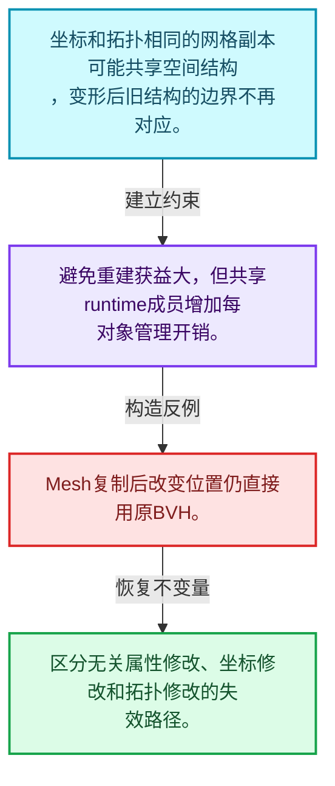
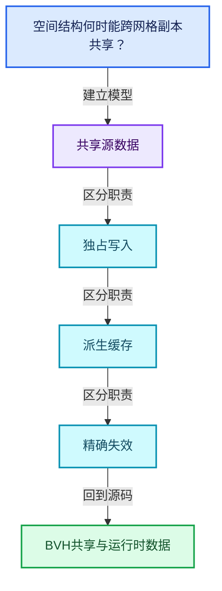
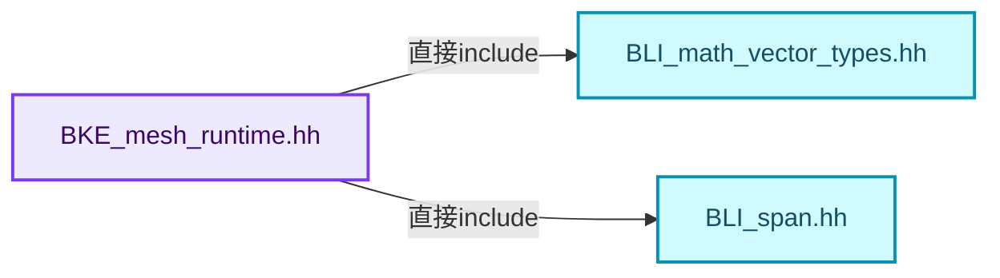
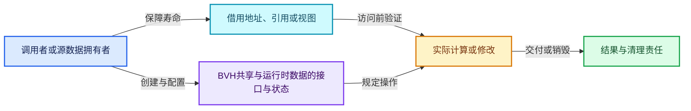
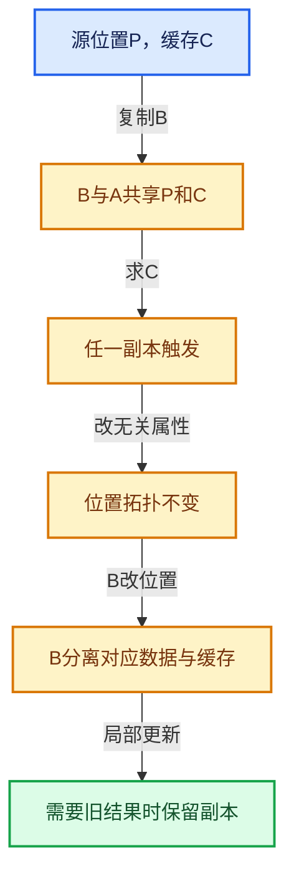

# 06-09 BVH共享与运行时数据

[方向导航](README.md) · [总目录](../README.md) · [覆盖索引](../%E6%BA%90%E7%A0%81%E7%89%88%E6%9C%AC%E4%B8%8E%E8%A6%86%E7%9B%96%E7%B4%A2%E5%BC%95.md)

> 阅读顺序：问题与数据模型 → 语法与类型 → 源码逐行 → 调用线索 → 历史与取舍 → 推演和练习。

- 基准 HEAD：`cbda6b96c26c0dee3c3b5cbb93960c4ac06a6b30`。
- 记录日期：2026-10-14。
- 教学示例状态：正文中的推演不是本机性能实测；已运行练习见验收报告。

## 一、从问题到设计

空间结构何时能跨网格副本共享？

拓扑和坐标未变时可能复用，变形或拓扑修改需要相应失效；runtime缓存不是持久化源数据。

本篇把语法、数据语义和系统取舍连接起来。共享计数回答谁还活着，缓存依赖回答结果是否仍正确，两者不能互相替代。

### 本篇独立模型与设计推理

坐标和拓扑相同的网格副本可能共享空间结构，变形后旧结构的边界不再对应。

设计取舍：避免重建获益大，但共享runtime成员增加每对象管理开销。

最小反例：Mesh复制后改变位置仍直接用原BVH。

推导与处理：区分无关属性修改、坐标修改和拓扑修改的失效路径。



### 源码范围与相邻篇章

| 文件 | 本篇逐行范围 | 基准SHA-256 |
|---|---|---|
| [source/blender/blenkernel/BKE_mesh_runtime.hh](../../../../../source/blender/blenkernel/BKE_mesh_runtime.hh) | L1—L87 | `524e2da2fbb68f760d5901a018109e0d80d7ed7239c5ff538e2f6de83735d25b` |
| [source/blender/blenkernel/intern/bvhutils.cc](../../../../../source/blender/blenkernel/intern/bvhutils.cc) | L1—L812 | `e239196e1010a29d7b54e53a8e912cff922fe353e728d226ba7ed1784efe75e1` |

同一主讲文件可能分多篇覆盖；超出本篇范围的符号通过覆盖索引定位。空行与纯注释保留在源码摘录中，逐行表解释有效语句与语法边界；许可证头统一保留。

前篇：[法线缓存的真实依赖](08-%E6%B3%95%E7%BA%BF%E7%BC%93%E5%AD%98%E7%9A%84%E7%9C%9F%E5%AE%9E%E4%BE%9D%E8%B5%96.md).

后篇：[局部更新与失效修复](10-%E5%B1%80%E9%83%A8%E6%9B%B4%E6%96%B0%E4%B8%8E%E5%A4%B1%E6%95%88%E4%BF%AE%E5%A4%8D.md).

## 二、类型、数据与阅读地图



这是概念依赖图，边表示阅读关系，不声称是运行时调用顺序。

### 直接编译依赖



箭头只表示头文件包含关系；完整调用线索见后面的符号定位表。

## 三、关键词、语法与类型角色

### 只读限定 const

const约束当前访问路径可做的修改。const指针、指向const的指针、const视图对象、const元素是不同位置的限定；其他别名可能仍可修改原对象。

具体检查：分别写T* const、const T*与const T* const，并画出不可修改的层次。

### 移动转换 std::move

std::move把表达式转换为可供移动重载选择的值类别，实际资源转移发生在被选中的构造或赋值中。对const对象move可能仍调用复制，对视图move也不会获得底层数据所有权。

具体检查：记录移动构造调用次数，不用变量名或std::move的出现次数替代测量。

### 异常边界 try与catch

try定义异常传播的局部边界。失败路径需要销毁已经成功构造的部分并释放相应存储；未构造的对象不能被析构。

具体检查：在第k次构造失败，列出已经存在的对象集合与待释放缓冲。

### 显式静态转换 static_cast

static_cast表达编译期允许的转换，不会自动验证运行时真实类型、指针寿命或索引边界。由void指针恢复T指针时，调用者仍须保证实际存储中确有合法T对象。

具体检查：标出转换前后的类型以及正确性依据来自哪里。

### 构造与new表达式

普通new可能分配并构造；placement new在给定地址构造，存储由其他机制提供。失败回滚应区分两类责任。

具体检查：追踪地址来自哪里、构造何时成功、由谁析构、由谁释放。

### 内部断言 assert

断言表达开发者预期成立的内部契约，发布构建可能关闭。它不能替代对不可信输入的完整错误处理，也不保证后续操作被运行时保护。

具体检查：对每条断言构造违反条件的输入，区分调用者错误与应向用户报告的错误。

### 独占拥有 unique_ptr

unique_ptr通过移动转移拥有关系，默认删除策略必须与资源来源匹配。get返回借用指针，release交出责任而不销毁。

具体检查：区分move、get、release和reset后谁负责销毁。

### 类型别名 using

类型别名为已有类型建立名字，不创建运行期对象。它常把模板内部使用的类型统一暴露给泛型调用者。

具体检查：展开别名直到基础类型，区分类型别名和变量声明。

## 四、真实源码与逐行讲解

源码块保持原行内容，原始行号由小节标题及逐行表给出。表中的调用定位是静态阅读辅助；重载、模板实例化、宏展开和虚调用需结合完整声明，不能仅凭词法出现证明动态调用。

### BKE_mesh_runtime.hh：L1—L47

<!-- source:source/blender/blenkernel/BKE_mesh_runtime.hh:1:47 -->

```cpp
/* SPDX-FileCopyrightText: 2001-2002 NaN Holding BV. All rights reserved.
 *
 * SPDX-License-Identifier: GPL-2.0-or-later */
#pragma once

/** \file
 * \ingroup bke
 *
 * This file contains access functions for the Mesh.runtime struct.
 */

#include "BLI_math_vector_types.hh"
#include "BLI_span.hh"

namespace blender {

struct BMEditMesh;
struct CustomData_MeshMasks;
struct Depsgraph;
struct KeyBlock;
struct ModifierData;
struct Mesh;
struct Object;
struct Scene;

/** Return the number of derived triangles (corner_tris). */
int BKE_mesh_runtime_corner_tris_len(const Mesh *mesh);

void BKE_mesh_runtime_ensure_edit_data(Mesh *mesh);

/**
 * Clear and free any derived caches associated with the mesh geometry data. Examples include BVH
 * caches, normals, triangulation, etc. This should be called when replacing a mesh's geometry
 * directly or making other large changes to topology. It does not need to be called on new meshes.
 *
 * For "smaller" changes to meshes like updating positions, consider calling a more specific update
 * function like #Mesh::tag_positions_changed().
 */
void BKE_mesh_runtime_clear_geometry(Mesh *mesh);

/**
 * Similar to #BKE_mesh_runtime_clear_geometry, but subtly different in that it also clears
 * data-block level features like evaluated data-blocks and edit mode data. They will be
 * functionally the same in most cases, but prefer this function if unsure, since it clears
 * more data.
 */
void BKE_mesh_runtime_clear_cache(Mesh *mesh);
```

| 原始行 | 语义、约束与检查 |
|---|---|
| L4 | 防止同一头文件在一个翻译单元中重复展开；不控制多个源文件之间的链接或对象寿命。 |
| L12 | 引入编译依赖 "BLI_math_vector_types.hh"；这是声明可见性关系，不表示运行时一定调用该文件的所有接口。 |
| L13 | 引入编译依赖 "BLI_span.hh"；这是声明可见性关系，不表示运行时一定调用该文件的所有接口。 |
| L15 | 把后续声明放入 blender 命名空间，影响名称查找和符号归属，不创建运行时对象。 |
| L17 | 声明或定义类型 `struct BMEditMesh`。结合继承、访问权限和成员布局确认接口与拥有关系；前向声明本身没有完整对象布局。 |
| L18 | 声明或定义类型 `struct CustomData_MeshMasks`。结合继承、访问权限和成员布局确认接口与拥有关系；前向声明本身没有完整对象布局。 |
| L19 | 声明或定义类型 `struct Depsgraph`。结合继承、访问权限和成员布局确认接口与拥有关系；前向声明本身没有完整对象布局。 |
| L20 | 声明或定义类型 `struct KeyBlock`。结合继承、访问权限和成员布局确认接口与拥有关系；前向声明本身没有完整对象布局。 |
| L21 | 声明或定义类型 `struct ModifierData`。结合继承、访问权限和成员布局确认接口与拥有关系；前向声明本身没有完整对象布局。 |
| L22 | 声明或定义类型 `struct Mesh`。结合继承、访问权限和成员布局确认接口与拥有关系；前向声明本身没有完整对象布局。 |
| L23 | 声明或定义类型 `struct Object`。结合继承、访问权限和成员布局确认接口与拥有关系；前向声明本身没有完整对象布局。 |
| L24 | 声明或定义类型 `struct Scene`。结合继承、访问权限和成员布局确认接口与拥有关系；前向声明本身没有完整对象布局。 |
| L27 | 声明接口 `int BKE_mesh_runtime_corner_tris_len(const Mesh *mesh)`，本行没有对应函数体；返回类型、参数限定和const/noexcept共同组成调用契约，实际行为需继续定位实现。 |
| L29 | 声明接口 `void BKE_mesh_runtime_ensure_edit_data(Mesh *mesh)`，本行没有对应函数体；返回类型、参数限定和const/noexcept共同组成调用契约，实际行为需继续定位实现。 |
| L39 | 声明接口 `void BKE_mesh_runtime_clear_geometry(Mesh *mesh)`，本行没有对应函数体；返回类型、参数限定和const/noexcept共同组成调用契约，实际行为需继续定位实现。 |
| L47 | 声明接口 `void BKE_mesh_runtime_clear_cache(Mesh *mesh)`，本行没有对应函数体；返回类型、参数限定和const/noexcept共同组成调用契约，实际行为需继续定位实现。 |

### BKE_mesh_runtime.hh：L48—L87

<!-- source:source/blender/blenkernel/BKE_mesh_runtime.hh:48:87 -->

```cpp

namespace bke {

void mesh_get_mapped_verts_coords(const Mesh *mesh_eval, MutableSpan<float3> r_cos);

const Mesh *editbmesh_get_eval_cage(Depsgraph *depsgraph,
                                    const Scene *scene,
                                    Object *obedit,
                                    const CustomData_MeshMasks *dataMask);
const Mesh *editbmesh_get_eval_cage_from_orig(Depsgraph *depsgraph,
                                              const Scene *scene,
                                              Object *obedit,
                                              const CustomData_MeshMasks *dataMask);

bool editbmesh_modifier_is_enabled(const Scene *scene,
                                   const Object *ob,
                                   ModifierData *md,
                                   bool has_prev_mesh);

const Mesh *mesh_get_eval_deform(Depsgraph *depsgraph,
                                 const Scene *scene,
                                 Object *ob,
                                 const CustomData_MeshMasks *dataMask);

Mesh *mesh_create_eval_final(Depsgraph *depsgraph,
                             const Scene *scene,
                             Object *ob,
                             const CustomData_MeshMasks *dataMask);

Mesh *mesh_create_eval_no_deform(Depsgraph *depsgraph,
                                 const Scene *scene,
                                 Object *ob,
                                 const CustomData_MeshMasks *dataMask);
Mesh *mesh_create_eval_no_deform_render(Depsgraph *depsgraph,
                                        const Scene *scene,
                                        Object *ob,
                                        const CustomData_MeshMasks *dataMask);

}  // namespace bke
}  // namespace blender
```

| 原始行 | 语义、约束与检查 |
|---|---|
| L49 | 把后续声明放入 bke 命名空间，影响名称查找和符号归属，不创建运行时对象。 |
| L51 | 声明接口 `void mesh_get_mapped_verts_coords(const Mesh *mesh_eval, MutableSpan<float3> r_cos)`，本行没有对应函数体；返回类型、参数限定和const/noexcept共同组成调用契约，实际行为需继续定位实现。 |
| L53 | 出现调用或函数声明 `editbmesh_get_eval_cage`，对应表达式为 `const Mesh *editbmesh_get_eval_cage(Depsgraph *depsgraph,`。参数求值、返回类型与重载需结合前后完整语句；静态文本引用不能证明动态目标。 |
| L54 | 本行是连续声明或表达式的一部分：`const Scene *scene,`。与本段前后行合读；逗号、括号和限定符决定它属于参数、初始化列表还是实际计算。 |
| L55 | 本行是连续声明或表达式的一部分：`Object *obedit,`。与本段前后行合读；逗号、括号和限定符决定它属于参数、初始化列表还是实际计算。 |
| L56 | 声明成员、局部对象或完成语句 `const CustomData_MeshMasks *dataMask)`。若为指针或引用，它本身不说明拥有；若为值对象，其构造析构由所在作用域或外层对象管理。 |
| L57 | 出现调用或函数声明 `editbmesh_get_eval_cage_from_orig`，对应表达式为 `const Mesh *editbmesh_get_eval_cage_from_orig(Depsgraph *depsgraph,`。参数求值、返回类型与重载需结合前后完整语句；静态文本引用不能证明动态目标。 |
| L58 | 本行是连续声明或表达式的一部分：`const Scene *scene,`。与本段前后行合读；逗号、括号和限定符决定它属于参数、初始化列表还是实际计算。 |
| L59 | 本行是连续声明或表达式的一部分：`Object *obedit,`。与本段前后行合读；逗号、括号和限定符决定它属于参数、初始化列表还是实际计算。 |
| L60 | 声明成员、局部对象或完成语句 `const CustomData_MeshMasks *dataMask)`。若为指针或引用，它本身不说明拥有；若为值对象，其构造析构由所在作用域或外层对象管理。 |
| L62 | 出现调用或函数声明 `editbmesh_modifier_is_enabled`，对应表达式为 `bool editbmesh_modifier_is_enabled(const Scene *scene,`。参数求值、返回类型与重载需结合前后完整语句；静态文本引用不能证明动态目标。 |
| L63 | 本行是连续声明或表达式的一部分：`const Object *ob,`。与本段前后行合读；逗号、括号和限定符决定它属于参数、初始化列表还是实际计算。 |
| L64 | 本行是连续声明或表达式的一部分：`ModifierData *md,`。与本段前后行合读；逗号、括号和限定符决定它属于参数、初始化列表还是实际计算。 |
| L65 | 声明成员、局部对象或完成语句 `bool has_prev_mesh)`。若为指针或引用，它本身不说明拥有；若为值对象，其构造析构由所在作用域或外层对象管理。 |
| L67 | 出现调用或函数声明 `mesh_get_eval_deform`，对应表达式为 `const Mesh *mesh_get_eval_deform(Depsgraph *depsgraph,`。参数求值、返回类型与重载需结合前后完整语句；静态文本引用不能证明动态目标。 |
| L68 | 本行是连续声明或表达式的一部分：`const Scene *scene,`。与本段前后行合读；逗号、括号和限定符决定它属于参数、初始化列表还是实际计算。 |
| L69 | 本行是连续声明或表达式的一部分：`Object *ob,`。与本段前后行合读；逗号、括号和限定符决定它属于参数、初始化列表还是实际计算。 |
| L70 | 声明成员、局部对象或完成语句 `const CustomData_MeshMasks *dataMask)`。若为指针或引用，它本身不说明拥有；若为值对象，其构造析构由所在作用域或外层对象管理。 |
| L72 | 出现调用或函数声明 `mesh_create_eval_final`，对应表达式为 `Mesh *mesh_create_eval_final(Depsgraph *depsgraph,`。参数求值、返回类型与重载需结合前后完整语句；静态文本引用不能证明动态目标。 |
| L73 | 本行是连续声明或表达式的一部分：`const Scene *scene,`。与本段前后行合读；逗号、括号和限定符决定它属于参数、初始化列表还是实际计算。 |
| L74 | 本行是连续声明或表达式的一部分：`Object *ob,`。与本段前后行合读；逗号、括号和限定符决定它属于参数、初始化列表还是实际计算。 |
| L75 | 声明成员、局部对象或完成语句 `const CustomData_MeshMasks *dataMask)`。若为指针或引用，它本身不说明拥有；若为值对象，其构造析构由所在作用域或外层对象管理。 |
| L77 | 出现调用或函数声明 `mesh_create_eval_no_deform`，对应表达式为 `Mesh *mesh_create_eval_no_deform(Depsgraph *depsgraph,`。参数求值、返回类型与重载需结合前后完整语句；静态文本引用不能证明动态目标。 |
| L78 | 本行是连续声明或表达式的一部分：`const Scene *scene,`。与本段前后行合读；逗号、括号和限定符决定它属于参数、初始化列表还是实际计算。 |
| L79 | 本行是连续声明或表达式的一部分：`Object *ob,`。与本段前后行合读；逗号、括号和限定符决定它属于参数、初始化列表还是实际计算。 |
| L80 | 声明成员、局部对象或完成语句 `const CustomData_MeshMasks *dataMask)`。若为指针或引用，它本身不说明拥有；若为值对象，其构造析构由所在作用域或外层对象管理。 |
| L81 | 出现调用或函数声明 `mesh_create_eval_no_deform_render`，对应表达式为 `Mesh *mesh_create_eval_no_deform_render(Depsgraph *depsgraph,`。参数求值、返回类型与重载需结合前后完整语句；静态文本引用不能证明动态目标。 |
| L82 | 本行是连续声明或表达式的一部分：`const Scene *scene,`。与本段前后行合读；逗号、括号和限定符决定它属于参数、初始化列表还是实际计算。 |
| L83 | 本行是连续声明或表达式的一部分：`Object *ob,`。与本段前后行合读；逗号、括号和限定符决定它属于参数、初始化列表还是实际计算。 |
| L84 | 声明成员、局部对象或完成语句 `const CustomData_MeshMasks *dataMask)`。若为指针或引用，它本身不说明拥有；若为值对象，其构造析构由所在作用域或外层对象管理。 |
| L86 | 结束当前语法单元。局部自动对象在离开其作用域时按规则销毁；这不等于所有被引用的外部数据也被释放。 |
| L87 | 结束当前语法单元。局部自动对象在离开其作用域时按规则销毁；这不等于所有被引用的外部数据也被释放。 |

### bvhutils.cc：L1—L49

<!-- source:source/blender/blenkernel/intern/bvhutils.cc:1:49 -->

```cpp
/* SPDX-FileCopyrightText: 2024 Blender Authors
 *
 * SPDX-License-Identifier: GPL-2.0-or-later */

/** \file
 * \ingroup bke
 */

#include "DNA_meshdata_types.h"
#include "DNA_pointcloud_types.h"

#include "BLI_math_geom_c.hh"

#include "BKE_attribute.hh"
#include "BKE_bvhutils.hh"
#include "BKE_editmesh.hh"
#include "BKE_mesh.hh"
#include "BKE_pointcloud.hh"

namespace blender {

namespace bke {

/* -------------------------------------------------------------------- */
/** \name Local Callbacks
 * \{ */

/* Math stuff for ray casting on mesh faces and for nearest surface */

float bvhtree_ray_tri_intersection(const BVHTreeRay *ray,
                                   const float /*m_dist*/,
                                   const float v0[3],
                                   const float v1[3],
                                   const float v2[3])
{
  float dist;

#ifdef USE_KDOPBVH_WATERTIGHT
  if (isect_ray_tri_watertight_v3(ray->origin, ray->isect_precalc, v0, v1, v2, &dist, nullptr))
#else
  if (isect_ray_tri_epsilon_v3(
          ray->origin, ray->direction, v0, v1, v2, &dist, nullptr, FLT_EPSILON))
#endif
  {
    return dist;
  }

  return FLT_MAX;
}
```

本段语义重点：

- 分支证据 `isect_ray_tri_watertight_v3(ray->origin, ray->isect_precalc, v0, v1, v2, &dist, nullptr))`：分别推演条件成立与不成立，核对相同出口处的状态。
- 分支证据 `isect_ray_tri_epsilon_v3(`：分别推演条件成立与不成立，核对相同出口处的状态。

| 原始行 | 语义、约束与检查 |
|---|---|
| L9 | 引入编译依赖 "DNA_meshdata_types.h"；这是声明可见性关系，不表示运行时一定调用该文件的所有接口。 |
| L10 | 引入编译依赖 "DNA_pointcloud_types.h"；这是声明可见性关系，不表示运行时一定调用该文件的所有接口。 |
| L12 | 引入编译依赖 "BLI_math_geom_c.hh"；这是声明可见性关系，不表示运行时一定调用该文件的所有接口。 |
| L14 | 引入编译依赖 "BKE_attribute.hh"；这是声明可见性关系，不表示运行时一定调用该文件的所有接口。 |
| L15 | 引入编译依赖 "BKE_bvhutils.hh"；这是声明可见性关系，不表示运行时一定调用该文件的所有接口。 |
| L16 | 引入编译依赖 "BKE_editmesh.hh"；这是声明可见性关系，不表示运行时一定调用该文件的所有接口。 |
| L17 | 引入编译依赖 "BKE_mesh.hh"；这是声明可见性关系，不表示运行时一定调用该文件的所有接口。 |
| L18 | 引入编译依赖 "BKE_pointcloud.hh"；这是声明可见性关系，不表示运行时一定调用该文件的所有接口。 |
| L20 | 把后续声明放入 blender 命名空间，影响名称查找和符号归属，不创建运行时对象。 |
| L22 | 把后续声明放入 bke 命名空间，影响名称查找和符号归属，不创建运行时对象。 |
| L30 | 出现调用或函数声明 `bvhtree_ray_tri_intersection`，对应表达式为 `float bvhtree_ray_tri_intersection(const BVHTreeRay *ray,`。参数求值、返回类型与重载需结合前后完整语句；静态文本引用不能证明动态目标。 |
| L31 | 本行是连续声明或表达式的一部分：`const float ,`。与本段前后行合读；逗号、括号和限定符决定它属于参数、初始化列表还是实际计算。 |
| L32 | 本行是连续声明或表达式的一部分：`const float v0[3],`。与本段前后行合读；逗号、括号和限定符决定它属于参数、初始化列表还是实际计算。 |
| L33 | 本行是连续声明或表达式的一部分：`const float v1[3],`。与本段前后行合读；逗号、括号和限定符决定它属于参数、初始化列表还是实际计算。 |
| L34 | 本行是连续声明或表达式的一部分：`const float v2[3])`。与本段前后行合读；逗号、括号和限定符决定它属于参数、初始化列表还是实际计算。 |
| L35 | 连接上一行的声明或控制结构与其语句块；后续行在这个作用域中执行或声明。 |
| L36 | 声明成员、局部对象或完成语句 `float dist`。若为指针或引用，它本身不说明拥有；若为值对象，其构造析构由所在作用域或外层对象管理。 |
| L38 | 预处理阶段处理 #ifdef USE_KDOPBVH_WATERTIGHT。它决定哪些代码进入编译，不是运行时分支；阅读行为时必须结合实际构建宏。 |
| L39 | 判断 `isect_ray_tri_watertight_v3(ray->origin, ray->isect_precalc, v0, v1, v2, &dist, nullptr)`，成立时进入本分支，否则继续后续路径。这里区分空地址与可用地址，但非空本身仍不能证明对象存活。 |
| L40 | 预处理阶段处理 #else。它决定哪些代码进入编译，不是运行时分支；阅读行为时必须结合实际构建宏。 |
| L41 | 判断 `isect_ray_tri_epsilon_v3(`，成立时进入本分支，否则继续后续路径。 |
| L42 | 本行是连续声明或表达式的一部分：`ray->origin, ray->direction, v0, v1, v2, &dist, nullptr, FLT_EPSILON))`。与本段前后行合读；逗号、括号和限定符决定它属于参数、初始化列表还是实际计算。 |
| L43 | 预处理阶段处理 #endif。它决定哪些代码进入编译，不是运行时分支；阅读行为时必须结合实际构建宏。 |
| L44 | 连接上一行的声明或控制结构与其语句块；后续行在这个作用域中执行或声明。 |
| L45 | 返回表达式 `dist`。 |
| L46 | 结束当前语法单元。局部自动对象在离开其作用域时按规则销毁；这不等于所有被引用的外部数据也被释放。 |
| L48 | 返回表达式 `FLT_MAX`。 |
| L49 | 结束当前语法单元。局部自动对象在离开其作用域时按规则销毁；这不等于所有被引用的外部数据也被释放。 |

### bvhutils.cc：L50—L113

<!-- source:source/blender/blenkernel/intern/bvhutils.cc:50:113 -->

```cpp

float bvhtree_sphereray_tri_intersection(const BVHTreeRay *ray,
                                         float radius,
                                         const float m_dist,
                                         const float v0[3],
                                         const float v1[3],
                                         const float v2[3])
{

  float idist;
  float p1[3];
  float hit_point[3];

  madd_v3_v3v3fl(p1, ray->origin, ray->direction, m_dist);
  if (isect_sweeping_sphere_tri_v3(ray->origin, p1, radius, v0, v1, v2, &idist, hit_point)) {
    return idist * m_dist;
  }

  return FLT_MAX;
}

/*
 * BVH from meshes callbacks
 */

/**
 * Callback to BVH-tree nearest point.
 * The tree must have been built using #bvhtree_from_mesh_faces.
 *
 * \param userdata: Must be a #BVHMeshCallbackUserdata built from the same mesh as the tree.
 */
static void mesh_faces_nearest_point(void *userdata,
                                     int index,
                                     const float co[3],
                                     BVHTreeNearest *nearest)
{
  const BVHTreeFromMesh *data = static_cast<BVHTreeFromMesh *>(userdata);
  const MFace *face = data->face + index;

  const float *t0, *t1, *t2, *t3;
  t0 = data->vert_positions[face->v1];
  t1 = data->vert_positions[face->v2];
  t2 = data->vert_positions[face->v3];
  t3 = face->v4 ? &data->vert_positions[face->v4].x : nullptr;

  do {
    float nearest_tmp[3], dist_sq;

    closest_on_tri_to_point_v3(nearest_tmp, co, t0, t1, t2);
    dist_sq = len_squared_v3v3(co, nearest_tmp);

    if (dist_sq < nearest->dist_sq) {
      nearest->index = index;
      nearest->dist_sq = dist_sq;
      copy_v3_v3(nearest->co, nearest_tmp);
      normal_tri_v3(nearest->no, t0, t1, t2);
    }

    t1 = t2;
    t2 = t3;
    t3 = nullptr;

  } while (t2);
}
```

本段语义重点：

- 分支证据 `isect_sweeping_sphere_tri_v3(ray->origin, p1, radius, v0, v1, v2, &idist, hit_point))`：分别推演条件成立与不成立，核对相同出口处的状态。
- 分支证据 `dist_sq < nearest->dist_sq)`：分别推演条件成立与不成立，核对相同出口处的状态。

| 原始行 | 语义、约束与检查 |
|---|---|
| L51 | 出现调用或函数声明 `bvhtree_sphereray_tri_intersection`，对应表达式为 `float bvhtree_sphereray_tri_intersection(const BVHTreeRay *ray,`。参数求值、返回类型与重载需结合前后完整语句；静态文本引用不能证明动态目标。 |
| L52 | 本行是连续声明或表达式的一部分：`float radius,`。与本段前后行合读；逗号、括号和限定符决定它属于参数、初始化列表还是实际计算。 |
| L53 | 本行是连续声明或表达式的一部分：`const float m_dist,`。与本段前后行合读；逗号、括号和限定符决定它属于参数、初始化列表还是实际计算。 |
| L54 | 本行是连续声明或表达式的一部分：`const float v0[3],`。与本段前后行合读；逗号、括号和限定符决定它属于参数、初始化列表还是实际计算。 |
| L55 | 本行是连续声明或表达式的一部分：`const float v1[3],`。与本段前后行合读；逗号、括号和限定符决定它属于参数、初始化列表还是实际计算。 |
| L56 | 本行是连续声明或表达式的一部分：`const float v2[3])`。与本段前后行合读；逗号、括号和限定符决定它属于参数、初始化列表还是实际计算。 |
| L57 | 连接上一行的声明或控制结构与其语句块；后续行在这个作用域中执行或声明。 |
| L59 | 声明成员、局部对象或完成语句 `float idist`。若为指针或引用，它本身不说明拥有；若为值对象，其构造析构由所在作用域或外层对象管理。 |
| L60 | 声明成员、局部对象或完成语句 `float p1[3]`。若为指针或引用，它本身不说明拥有；若为值对象，其构造析构由所在作用域或外层对象管理。 |
| L61 | 声明成员、局部对象或完成语句 `float hit_point[3]`。若为指针或引用，它本身不说明拥有；若为值对象，其构造析构由所在作用域或外层对象管理。 |
| L63 | 出现调用或函数声明 `madd_v3_v3v3fl`，对应表达式为 `madd_v3_v3v3fl(p1, ray->origin, ray->direction, m_dist);`。参数求值、返回类型与重载需结合前后完整语句；静态文本引用不能证明动态目标。 |
| L64 | 判断 `isect_sweeping_sphere_tri_v3(ray->origin, p1, radius, v0, v1, v2, &idist, hit_point)`，成立时进入本分支，否则继续后续路径。 |
| L65 | 返回表达式 `idist * m_dist`。结合函数声明检查返回值是否借用原存储，借用值不会自动延长其寿命。 |
| L66 | 结束当前语法单元。局部自动对象在离开其作用域时按规则销毁；这不等于所有被引用的外部数据也被释放。 |
| L68 | 返回表达式 `FLT_MAX`。 |
| L69 | 结束当前语法单元。局部自动对象在离开其作用域时按规则销毁；这不等于所有被引用的外部数据也被释放。 |
| L81 | 出现调用或函数声明 `mesh_faces_nearest_point`，对应表达式为 `static void mesh_faces_nearest_point(void *userdata,`。参数求值、返回类型与重载需结合前后完整语句；静态文本引用不能证明动态目标。 |
| L82 | 本行是连续声明或表达式的一部分：`int index,`。与本段前后行合读；逗号、括号和限定符决定它属于参数、初始化列表还是实际计算。 |
| L83 | 本行是连续声明或表达式的一部分：`const float co[3],`。与本段前后行合读；逗号、括号和限定符决定它属于参数、初始化列表还是实际计算。 |
| L84 | 本行是连续声明或表达式的一部分：`BVHTreeNearest *nearest)`。与本段前后行合读；逗号、括号和限定符决定它属于参数、初始化列表还是实际计算。 |
| L85 | 连接上一行的声明或控制结构与其语句块；后续行在这个作用域中执行或声明。 |
| L86 | 把右侧 `static_cast<BVHTreeFromMesh *>(userdata)` 用于初始化或更新左侧 `const BVHTreeFromMesh *data`。声明初始化与已有对象赋值应按上下文区分；有资源的类型会调用相应特殊成员。 |
| L87 | 把右侧 `data->face + index` 用于初始化或更新左侧 `const MFace *face`。声明初始化与已有对象赋值应按上下文区分；有资源的类型会调用相应特殊成员。 |
| L89 | 声明成员、局部对象或完成语句 `const float *t0, *t1, *t2, *t3`。若为指针或引用，它本身不说明拥有；若为值对象，其构造析构由所在作用域或外层对象管理。 |
| L90 | 把右侧 `data->vert_positions[face->v1]` 用于初始化或更新左侧 `t0`。声明初始化与已有对象赋值应按上下文区分；有资源的类型会调用相应特殊成员。 |
| L91 | 把右侧 `data->vert_positions[face->v2]` 用于初始化或更新左侧 `t1`。声明初始化与已有对象赋值应按上下文区分；有资源的类型会调用相应特殊成员。 |
| L92 | 把右侧 `data->vert_positions[face->v3]` 用于初始化或更新左侧 `t2`。声明初始化与已有对象赋值应按上下文区分；有资源的类型会调用相应特殊成员。 |
| L93 | 把右侧 `face->v4 ? &data->vert_positions[face->v4].x : nullptr` 用于初始化或更新左侧 `t3`。声明初始化与已有对象赋值应按上下文区分；有资源的类型会调用相应特殊成员。 |
| L95 | 本行是连续声明或表达式的一部分：`do {`。与本段前后行合读；逗号、括号和限定符决定它属于参数、初始化列表还是实际计算。 |
| L96 | 声明成员、局部对象或完成语句 `float nearest_tmp[3], dist_sq`。若为指针或引用，它本身不说明拥有；若为值对象，其构造析构由所在作用域或外层对象管理。 |
| L98 | 出现调用或函数声明 `closest_on_tri_to_point_v3`，对应表达式为 `closest_on_tri_to_point_v3(nearest_tmp, co, t0, t1, t2);`。参数求值、返回类型与重载需结合前后完整语句；静态文本引用不能证明动态目标。 |
| L99 | 把右侧 `len_squared_v3v3(co, nearest_tmp)` 用于初始化或更新左侧 `dist_sq`。声明初始化与已有对象赋值应按上下文区分；有资源的类型会调用相应特殊成员。 |
| L101 | 判断 `dist_sq < nearest->dist_sq`，成立时进入本分支，否则继续后续路径。 |
| L102 | 把右侧 `index` 用于初始化或更新左侧 `nearest->index`。声明初始化与已有对象赋值应按上下文区分；有资源的类型会调用相应特殊成员。 |
| L103 | 把右侧 `dist_sq` 用于初始化或更新左侧 `nearest->dist_sq`。声明初始化与已有对象赋值应按上下文区分；有资源的类型会调用相应特殊成员。 |
| L104 | 出现调用或函数声明 `copy_v3_v3`，对应表达式为 `copy_v3_v3(nearest->co, nearest_tmp);`。参数求值、返回类型与重载需结合前后完整语句；静态文本引用不能证明动态目标。 |
| L105 | 出现调用或函数声明 `normal_tri_v3`，对应表达式为 `normal_tri_v3(nearest->no, t0, t1, t2);`。参数求值、返回类型与重载需结合前后完整语句；静态文本引用不能证明动态目标。 |
| L106 | 结束当前语法单元。局部自动对象在离开其作用域时按规则销毁；这不等于所有被引用的外部数据也被释放。 |
| L108 | 把右侧 `t2` 用于初始化或更新左侧 `t1`。声明初始化与已有对象赋值应按上下文区分；有资源的类型会调用相应特殊成员。 |
| L109 | 把右侧 `t3` 用于初始化或更新左侧 `t2`。声明初始化与已有对象赋值应按上下文区分；有资源的类型会调用相应特殊成员。 |
| L110 | 把右侧 `nullptr` 用于初始化或更新左侧 `t3`。声明初始化与已有对象赋值应按上下文区分；有资源的类型会调用相应特殊成员。 |
| L112 | 出现调用或函数声明 `while`，对应表达式为 `} while (t2);`。参数求值、返回类型与重载需结合前后完整语句；静态文本引用不能证明动态目标。 |
| L113 | 结束当前语法单元。局部自动对象在离开其作用域时按规则销毁；这不等于所有被引用的外部数据也被释放。 |

### bvhutils.cc：L114—L182

<!-- source:source/blender/blenkernel/intern/bvhutils.cc:114:182 -->

```cpp
/* copy of function above */
static void mesh_corner_tris_nearest_point(void *userdata,
                                           int index,
                                           const float co[3],
                                           BVHTreeNearest *nearest)
{
  const BVHTreeFromMesh *data = static_cast<BVHTreeFromMesh *>(userdata);
  const int3 &tri = data->corner_tris[index];
  const float *vtri_co[3] = {
      data->vert_positions[data->corner_verts[tri[0]]],
      data->vert_positions[data->corner_verts[tri[1]]],
      data->vert_positions[data->corner_verts[tri[2]]],
  };
  float nearest_tmp[3], dist_sq;

  closest_on_tri_to_point_v3(nearest_tmp, co, UNPACK3(vtri_co));
  dist_sq = len_squared_v3v3(co, nearest_tmp);

  if (dist_sq < nearest->dist_sq) {
    nearest->index = index;
    nearest->dist_sq = dist_sq;
    copy_v3_v3(nearest->co, nearest_tmp);
    normal_tri_v3(nearest->no, UNPACK3(vtri_co));
  }
}

/**
 * Callback to BVH-tree ray-cast.
 * The tree must have been built using bvhtree_from_mesh_faces.
 *
 * \param userdata: Must be a #BVHMeshCallbackUserdata built from the same mesh as the tree.
 */
static void mesh_faces_spherecast(void *userdata,
                                  int index,
                                  const BVHTreeRay *ray,
                                  BVHTreeRayHit *hit)
{
  const BVHTreeFromMesh *data = static_cast<BVHTreeFromMesh *>(userdata);
  const MFace *face = &data->face[index];

  const float *t0, *t1, *t2, *t3;
  t0 = data->vert_positions[face->v1];
  t1 = data->vert_positions[face->v2];
  t2 = data->vert_positions[face->v3];
  t3 = face->v4 ? &data->vert_positions[face->v4].x : nullptr;

  do {
    float dist;
    if (ray->radius == 0.0f) {
      dist = bvhtree_ray_tri_intersection(ray, hit->dist, t0, t1, t2);
    }
    else {
      dist = bvhtree_sphereray_tri_intersection(ray, ray->radius, hit->dist, t0, t1, t2);
    }

    if (dist >= 0 && dist < hit->dist) {
      hit->index = index;
      hit->dist = dist;
      madd_v3_v3v3fl(hit->co, ray->origin, ray->direction, dist);

      normal_tri_v3(hit->no, t0, t1, t2);
    }

    t1 = t2;
    t2 = t3;
    t3 = nullptr;

  } while (t2);
}
```

本段语义重点：

- 分支证据 `dist_sq < nearest->dist_sq)`：分别推演条件成立与不成立，核对相同出口处的状态。
- 分支证据 `ray->radius == 0.0f)`：分别推演条件成立与不成立，核对相同出口处的状态。

| 原始行 | 语义、约束与检查 |
|---|---|
| L115 | 出现调用或函数声明 `mesh_corner_tris_nearest_point`，对应表达式为 `static void mesh_corner_tris_nearest_point(void *userdata,`。参数求值、返回类型与重载需结合前后完整语句；静态文本引用不能证明动态目标。 |
| L116 | 本行是连续声明或表达式的一部分：`int index,`。与本段前后行合读；逗号、括号和限定符决定它属于参数、初始化列表还是实际计算。 |
| L117 | 本行是连续声明或表达式的一部分：`const float co[3],`。与本段前后行合读；逗号、括号和限定符决定它属于参数、初始化列表还是实际计算。 |
| L118 | 本行是连续声明或表达式的一部分：`BVHTreeNearest *nearest)`。与本段前后行合读；逗号、括号和限定符决定它属于参数、初始化列表还是实际计算。 |
| L119 | 连接上一行的声明或控制结构与其语句块；后续行在这个作用域中执行或声明。 |
| L120 | 把右侧 `static_cast<BVHTreeFromMesh *>(userdata)` 用于初始化或更新左侧 `const BVHTreeFromMesh *data`。声明初始化与已有对象赋值应按上下文区分；有资源的类型会调用相应特殊成员。 |
| L121 | 把右侧 `data->corner_tris[index]` 用于初始化或更新左侧 `const int3 &tri`。声明初始化与已有对象赋值应按上下文区分；有资源的类型会调用相应特殊成员。 |
| L122 | 把右侧 `{` 用于初始化或更新左侧 `const float *vtri_co[3]`。声明初始化与已有对象赋值应按上下文区分；有资源的类型会调用相应特殊成员。 |
| L123 | 本行是连续声明或表达式的一部分：`data->vert_positions[data->corner_verts[tri[0]]],`。与本段前后行合读；逗号、括号和限定符决定它属于参数、初始化列表还是实际计算。 |
| L124 | 本行是连续声明或表达式的一部分：`data->vert_positions[data->corner_verts[tri[1]]],`。与本段前后行合读；逗号、括号和限定符决定它属于参数、初始化列表还是实际计算。 |
| L125 | 本行是连续声明或表达式的一部分：`data->vert_positions[data->corner_verts[tri[2]]],`。与本段前后行合读；逗号、括号和限定符决定它属于参数、初始化列表还是实际计算。 |
| L126 | 结束当前语法单元。局部自动对象在离开其作用域时按规则销毁；这不等于所有被引用的外部数据也被释放。 |
| L127 | 声明成员、局部对象或完成语句 `float nearest_tmp[3], dist_sq`。若为指针或引用，它本身不说明拥有；若为值对象，其构造析构由所在作用域或外层对象管理。 |
| L129 | 出现调用或函数声明 `closest_on_tri_to_point_v3`，对应表达式为 `closest_on_tri_to_point_v3(nearest_tmp, co, UNPACK3(vtri_co));`。参数求值、返回类型与重载需结合前后完整语句；静态文本引用不能证明动态目标。 |
| L130 | 把右侧 `len_squared_v3v3(co, nearest_tmp)` 用于初始化或更新左侧 `dist_sq`。声明初始化与已有对象赋值应按上下文区分；有资源的类型会调用相应特殊成员。 |
| L132 | 判断 `dist_sq < nearest->dist_sq`，成立时进入本分支，否则继续后续路径。 |
| L133 | 把右侧 `index` 用于初始化或更新左侧 `nearest->index`。声明初始化与已有对象赋值应按上下文区分；有资源的类型会调用相应特殊成员。 |
| L134 | 把右侧 `dist_sq` 用于初始化或更新左侧 `nearest->dist_sq`。声明初始化与已有对象赋值应按上下文区分；有资源的类型会调用相应特殊成员。 |
| L135 | 出现调用或函数声明 `copy_v3_v3`，对应表达式为 `copy_v3_v3(nearest->co, nearest_tmp);`。参数求值、返回类型与重载需结合前后完整语句；静态文本引用不能证明动态目标。 |
| L136 | 出现调用或函数声明 `normal_tri_v3`，对应表达式为 `normal_tri_v3(nearest->no, UNPACK3(vtri_co));`。参数求值、返回类型与重载需结合前后完整语句；静态文本引用不能证明动态目标。 |
| L137 | 结束当前语法单元。局部自动对象在离开其作用域时按规则销毁；这不等于所有被引用的外部数据也被释放。 |
| L138 | 结束当前语法单元。局部自动对象在离开其作用域时按规则销毁；这不等于所有被引用的外部数据也被释放。 |
| L146 | 出现调用或函数声明 `mesh_faces_spherecast`，对应表达式为 `static void mesh_faces_spherecast(void *userdata,`。参数求值、返回类型与重载需结合前后完整语句；静态文本引用不能证明动态目标。 |
| L147 | 本行是连续声明或表达式的一部分：`int index,`。与本段前后行合读；逗号、括号和限定符决定它属于参数、初始化列表还是实际计算。 |
| L148 | 本行是连续声明或表达式的一部分：`const BVHTreeRay *ray,`。与本段前后行合读；逗号、括号和限定符决定它属于参数、初始化列表还是实际计算。 |
| L149 | 本行是连续声明或表达式的一部分：`BVHTreeRayHit *hit)`。与本段前后行合读；逗号、括号和限定符决定它属于参数、初始化列表还是实际计算。 |
| L150 | 连接上一行的声明或控制结构与其语句块；后续行在这个作用域中执行或声明。 |
| L151 | 把右侧 `static_cast<BVHTreeFromMesh *>(userdata)` 用于初始化或更新左侧 `const BVHTreeFromMesh *data`。声明初始化与已有对象赋值应按上下文区分；有资源的类型会调用相应特殊成员。 |
| L152 | 把右侧 `&data->face[index]` 用于初始化或更新左侧 `const MFace *face`。声明初始化与已有对象赋值应按上下文区分；有资源的类型会调用相应特殊成员。 |
| L154 | 声明成员、局部对象或完成语句 `const float *t0, *t1, *t2, *t3`。若为指针或引用，它本身不说明拥有；若为值对象，其构造析构由所在作用域或外层对象管理。 |
| L155 | 把右侧 `data->vert_positions[face->v1]` 用于初始化或更新左侧 `t0`。声明初始化与已有对象赋值应按上下文区分；有资源的类型会调用相应特殊成员。 |
| L156 | 把右侧 `data->vert_positions[face->v2]` 用于初始化或更新左侧 `t1`。声明初始化与已有对象赋值应按上下文区分；有资源的类型会调用相应特殊成员。 |
| L157 | 把右侧 `data->vert_positions[face->v3]` 用于初始化或更新左侧 `t2`。声明初始化与已有对象赋值应按上下文区分；有资源的类型会调用相应特殊成员。 |
| L158 | 把右侧 `face->v4 ? &data->vert_positions[face->v4].x : nullptr` 用于初始化或更新左侧 `t3`。声明初始化与已有对象赋值应按上下文区分；有资源的类型会调用相应特殊成员。 |
| L160 | 本行是连续声明或表达式的一部分：`do {`。与本段前后行合读；逗号、括号和限定符决定它属于参数、初始化列表还是实际计算。 |
| L161 | 声明成员、局部对象或完成语句 `float dist`。若为指针或引用，它本身不说明拥有；若为值对象，其构造析构由所在作用域或外层对象管理。 |
| L162 | 判断 `ray->radius == 0.0f`，成立时进入本分支，否则继续后续路径。 |
| L163 | 把右侧 `bvhtree_ray_tri_intersection(ray, hit->dist, t0, t1, t2)` 用于初始化或更新左侧 `dist`。声明初始化与已有对象赋值应按上下文区分；有资源的类型会调用相应特殊成员。 |
| L164 | 结束当前语法单元。局部自动对象在离开其作用域时按规则销毁；这不等于所有被引用的外部数据也被释放。 |
| L165 | 处理前一条件不成立的互补路径。比较两条路径最后是否恢复同一不变量，以及是否产生不同的资源责任。 |
| L166 | 把右侧 `bvhtree_sphereray_tri_intersection(ray, ray->radius, hit->dist, t0, t1, t2)` 用于初始化或更新左侧 `dist`。声明初始化与已有对象赋值应按上下文区分；有资源的类型会调用相应特殊成员。 |
| L167 | 结束当前语法单元。局部自动对象在离开其作用域时按规则销毁；这不等于所有被引用的外部数据也被释放。 |
| L169 | 判断 `dist >= 0 && dist < hit->dist`，成立时进入本分支，否则继续后续路径。 |
| L170 | 把右侧 `index` 用于初始化或更新左侧 `hit->index`。声明初始化与已有对象赋值应按上下文区分；有资源的类型会调用相应特殊成员。 |
| L171 | 把右侧 `dist` 用于初始化或更新左侧 `hit->dist`。声明初始化与已有对象赋值应按上下文区分；有资源的类型会调用相应特殊成员。 |
| L172 | 出现调用或函数声明 `madd_v3_v3v3fl`，对应表达式为 `madd_v3_v3v3fl(hit->co, ray->origin, ray->direction, dist);`。参数求值、返回类型与重载需结合前后完整语句；静态文本引用不能证明动态目标。 |
| L174 | 出现调用或函数声明 `normal_tri_v3`，对应表达式为 `normal_tri_v3(hit->no, t0, t1, t2);`。参数求值、返回类型与重载需结合前后完整语句；静态文本引用不能证明动态目标。 |
| L175 | 结束当前语法单元。局部自动对象在离开其作用域时按规则销毁；这不等于所有被引用的外部数据也被释放。 |
| L177 | 把右侧 `t2` 用于初始化或更新左侧 `t1`。声明初始化与已有对象赋值应按上下文区分；有资源的类型会调用相应特殊成员。 |
| L178 | 把右侧 `t3` 用于初始化或更新左侧 `t2`。声明初始化与已有对象赋值应按上下文区分；有资源的类型会调用相应特殊成员。 |
| L179 | 把右侧 `nullptr` 用于初始化或更新左侧 `t3`。声明初始化与已有对象赋值应按上下文区分；有资源的类型会调用相应特殊成员。 |
| L181 | 出现调用或函数声明 `while`，对应表达式为 `} while (t2);`。参数求值、返回类型与重载需结合前后完整语句；静态文本引用不能证明动态目标。 |
| L182 | 结束当前语法单元。局部自动对象在离开其作用域时按规则销毁；这不等于所有被引用的外部数据也被释放。 |

### bvhutils.cc：L183—L245

<!-- source:source/blender/blenkernel/intern/bvhutils.cc:183:245 -->

```cpp
/* copy of function above */
static void mesh_corner_tris_spherecast(void *userdata,
                                        int index,
                                        const BVHTreeRay *ray,
                                        BVHTreeRayHit *hit)
{
  const BVHTreeFromMesh *data = static_cast<BVHTreeFromMesh *>(userdata);
  const Span<float3> positions = data->vert_positions;
  const int3 &tri = data->corner_tris[index];
  const float *vtri_co[3] = {
      positions[data->corner_verts[tri[0]]],
      positions[data->corner_verts[tri[1]]],
      positions[data->corner_verts[tri[2]]],
  };
  float dist;

  if (ray->radius == 0.0f) {
    dist = bvhtree_ray_tri_intersection(ray, hit->dist, UNPACK3(vtri_co));
  }
  else {
    dist = bvhtree_sphereray_tri_intersection(ray, ray->radius, hit->dist, UNPACK3(vtri_co));
  }

  if (dist >= 0 && dist < hit->dist) {
    hit->index = index;
    hit->dist = dist;
    madd_v3_v3v3fl(hit->co, ray->origin, ray->direction, dist);

    normal_tri_v3(hit->no, UNPACK3(vtri_co));
  }
}

/**
 * Callback to BVH-tree nearest point.
 * The tree must have been built using #bvhtree_from_mesh_edges.
 *
 * \param userdata: Must be a #BVHMeshCallbackUserdata built from the same mesh as the tree.
 */
static void mesh_edges_nearest_point(void *userdata,
                                     int index,
                                     const float co[3],
                                     BVHTreeNearest *nearest)
{
  const BVHTreeFromMesh *data = static_cast<BVHTreeFromMesh *>(userdata);
  const Span<float3> positions = data->vert_positions;
  const int2 edge = data->edges[index];
  float nearest_tmp[3], dist_sq;

  const float *t0, *t1;
  t0 = positions[edge[0]];
  t1 = positions[edge[1]];

  closest_to_line_segment_v3(nearest_tmp, co, t0, t1);
  dist_sq = len_squared_v3v3(nearest_tmp, co);

  if (dist_sq < nearest->dist_sq) {
    nearest->index = index;
    nearest->dist_sq = dist_sq;
    copy_v3_v3(nearest->co, nearest_tmp);
    sub_v3_v3v3(nearest->no, t0, t1);
    normalize_v3(nearest->no);
  }
}
```

本段语义重点：

- 分支证据 `ray->radius == 0.0f)`：分别推演条件成立与不成立，核对相同出口处的状态。
- 分支证据 `dist >= 0 && dist < hit->dist)`：分别推演条件成立与不成立，核对相同出口处的状态。

| 原始行 | 语义、约束与检查 |
|---|---|
| L184 | 出现调用或函数声明 `mesh_corner_tris_spherecast`，对应表达式为 `static void mesh_corner_tris_spherecast(void *userdata,`。参数求值、返回类型与重载需结合前后完整语句；静态文本引用不能证明动态目标。 |
| L185 | 本行是连续声明或表达式的一部分：`int index,`。与本段前后行合读；逗号、括号和限定符决定它属于参数、初始化列表还是实际计算。 |
| L186 | 本行是连续声明或表达式的一部分：`const BVHTreeRay *ray,`。与本段前后行合读；逗号、括号和限定符决定它属于参数、初始化列表还是实际计算。 |
| L187 | 本行是连续声明或表达式的一部分：`BVHTreeRayHit *hit)`。与本段前后行合读；逗号、括号和限定符决定它属于参数、初始化列表还是实际计算。 |
| L188 | 连接上一行的声明或控制结构与其语句块；后续行在这个作用域中执行或声明。 |
| L189 | 把右侧 `static_cast<BVHTreeFromMesh *>(userdata)` 用于初始化或更新左侧 `const BVHTreeFromMesh *data`。声明初始化与已有对象赋值应按上下文区分；有资源的类型会调用相应特殊成员。 |
| L190 | 把右侧 `data->vert_positions` 用于初始化或更新左侧 `const Span<float3> positions`。声明初始化与已有对象赋值应按上下文区分；有资源的类型会调用相应特殊成员。 |
| L191 | 把右侧 `data->corner_tris[index]` 用于初始化或更新左侧 `const int3 &tri`。声明初始化与已有对象赋值应按上下文区分；有资源的类型会调用相应特殊成员。 |
| L192 | 把右侧 `{` 用于初始化或更新左侧 `const float *vtri_co[3]`。声明初始化与已有对象赋值应按上下文区分；有资源的类型会调用相应特殊成员。 |
| L193 | 本行是连续声明或表达式的一部分：`positions[data->corner_verts[tri[0]]],`。与本段前后行合读；逗号、括号和限定符决定它属于参数、初始化列表还是实际计算。 |
| L194 | 本行是连续声明或表达式的一部分：`positions[data->corner_verts[tri[1]]],`。与本段前后行合读；逗号、括号和限定符决定它属于参数、初始化列表还是实际计算。 |
| L195 | 本行是连续声明或表达式的一部分：`positions[data->corner_verts[tri[2]]],`。与本段前后行合读；逗号、括号和限定符决定它属于参数、初始化列表还是实际计算。 |
| L196 | 结束当前语法单元。局部自动对象在离开其作用域时按规则销毁；这不等于所有被引用的外部数据也被释放。 |
| L197 | 声明成员、局部对象或完成语句 `float dist`。若为指针或引用，它本身不说明拥有；若为值对象，其构造析构由所在作用域或外层对象管理。 |
| L199 | 判断 `ray->radius == 0.0f`，成立时进入本分支，否则继续后续路径。 |
| L200 | 把右侧 `bvhtree_ray_tri_intersection(ray, hit->dist, UNPACK3(vtri_co))` 用于初始化或更新左侧 `dist`。声明初始化与已有对象赋值应按上下文区分；有资源的类型会调用相应特殊成员。 |
| L201 | 结束当前语法单元。局部自动对象在离开其作用域时按规则销毁；这不等于所有被引用的外部数据也被释放。 |
| L202 | 处理前一条件不成立的互补路径。比较两条路径最后是否恢复同一不变量，以及是否产生不同的资源责任。 |
| L203 | 把右侧 `bvhtree_sphereray_tri_intersection(ray, ray->radius, hit->dist, UNPACK3(vtri_co))` 用于初始化或更新左侧 `dist`。声明初始化与已有对象赋值应按上下文区分；有资源的类型会调用相应特殊成员。 |
| L204 | 结束当前语法单元。局部自动对象在离开其作用域时按规则销毁；这不等于所有被引用的外部数据也被释放。 |
| L206 | 判断 `dist >= 0 && dist < hit->dist`，成立时进入本分支，否则继续后续路径。 |
| L207 | 把右侧 `index` 用于初始化或更新左侧 `hit->index`。声明初始化与已有对象赋值应按上下文区分；有资源的类型会调用相应特殊成员。 |
| L208 | 把右侧 `dist` 用于初始化或更新左侧 `hit->dist`。声明初始化与已有对象赋值应按上下文区分；有资源的类型会调用相应特殊成员。 |
| L209 | 出现调用或函数声明 `madd_v3_v3v3fl`，对应表达式为 `madd_v3_v3v3fl(hit->co, ray->origin, ray->direction, dist);`。参数求值、返回类型与重载需结合前后完整语句；静态文本引用不能证明动态目标。 |
| L211 | 出现调用或函数声明 `normal_tri_v3`，对应表达式为 `normal_tri_v3(hit->no, UNPACK3(vtri_co));`。参数求值、返回类型与重载需结合前后完整语句；静态文本引用不能证明动态目标。 |
| L212 | 结束当前语法单元。局部自动对象在离开其作用域时按规则销毁；这不等于所有被引用的外部数据也被释放。 |
| L213 | 结束当前语法单元。局部自动对象在离开其作用域时按规则销毁；这不等于所有被引用的外部数据也被释放。 |
| L221 | 出现调用或函数声明 `mesh_edges_nearest_point`，对应表达式为 `static void mesh_edges_nearest_point(void *userdata,`。参数求值、返回类型与重载需结合前后完整语句；静态文本引用不能证明动态目标。 |
| L222 | 本行是连续声明或表达式的一部分：`int index,`。与本段前后行合读；逗号、括号和限定符决定它属于参数、初始化列表还是实际计算。 |
| L223 | 本行是连续声明或表达式的一部分：`const float co[3],`。与本段前后行合读；逗号、括号和限定符决定它属于参数、初始化列表还是实际计算。 |
| L224 | 本行是连续声明或表达式的一部分：`BVHTreeNearest *nearest)`。与本段前后行合读；逗号、括号和限定符决定它属于参数、初始化列表还是实际计算。 |
| L225 | 连接上一行的声明或控制结构与其语句块；后续行在这个作用域中执行或声明。 |
| L226 | 把右侧 `static_cast<BVHTreeFromMesh *>(userdata)` 用于初始化或更新左侧 `const BVHTreeFromMesh *data`。声明初始化与已有对象赋值应按上下文区分；有资源的类型会调用相应特殊成员。 |
| L227 | 把右侧 `data->vert_positions` 用于初始化或更新左侧 `const Span<float3> positions`。声明初始化与已有对象赋值应按上下文区分；有资源的类型会调用相应特殊成员。 |
| L228 | 把右侧 `data->edges[index]` 用于初始化或更新左侧 `const int2 edge`。声明初始化与已有对象赋值应按上下文区分；有资源的类型会调用相应特殊成员。 |
| L229 | 声明成员、局部对象或完成语句 `float nearest_tmp[3], dist_sq`。若为指针或引用，它本身不说明拥有；若为值对象，其构造析构由所在作用域或外层对象管理。 |
| L231 | 声明成员、局部对象或完成语句 `const float *t0, *t1`。若为指针或引用，它本身不说明拥有；若为值对象，其构造析构由所在作用域或外层对象管理。 |
| L232 | 把右侧 `positions[edge[0]]` 用于初始化或更新左侧 `t0`。声明初始化与已有对象赋值应按上下文区分；有资源的类型会调用相应特殊成员。 |
| L233 | 把右侧 `positions[edge[1]]` 用于初始化或更新左侧 `t1`。声明初始化与已有对象赋值应按上下文区分；有资源的类型会调用相应特殊成员。 |
| L235 | 出现调用或函数声明 `closest_to_line_segment_v3`，对应表达式为 `closest_to_line_segment_v3(nearest_tmp, co, t0, t1);`。参数求值、返回类型与重载需结合前后完整语句；静态文本引用不能证明动态目标。 |
| L236 | 把右侧 `len_squared_v3v3(nearest_tmp, co)` 用于初始化或更新左侧 `dist_sq`。声明初始化与已有对象赋值应按上下文区分；有资源的类型会调用相应特殊成员。 |
| L238 | 判断 `dist_sq < nearest->dist_sq`，成立时进入本分支，否则继续后续路径。 |
| L239 | 把右侧 `index` 用于初始化或更新左侧 `nearest->index`。声明初始化与已有对象赋值应按上下文区分；有资源的类型会调用相应特殊成员。 |
| L240 | 把右侧 `dist_sq` 用于初始化或更新左侧 `nearest->dist_sq`。声明初始化与已有对象赋值应按上下文区分；有资源的类型会调用相应特殊成员。 |
| L241 | 出现调用或函数声明 `copy_v3_v3`，对应表达式为 `copy_v3_v3(nearest->co, nearest_tmp);`。参数求值、返回类型与重载需结合前后完整语句；静态文本引用不能证明动态目标。 |
| L242 | 出现调用或函数声明 `sub_v3_v3v3`，对应表达式为 `sub_v3_v3v3(nearest->no, t0, t1);`。参数求值、返回类型与重载需结合前后完整语句；静态文本引用不能证明动态目标。 |
| L243 | 出现调用或函数声明 `normalize_v3`，对应表达式为 `normalize_v3(nearest->no);`。参数求值、返回类型与重载需结合前后完整语句；静态文本引用不能证明动态目标。 |
| L244 | 结束当前语法单元。局部自动对象在离开其作用域时按规则销毁；这不等于所有被引用的外部数据也被释放。 |
| L245 | 结束当前语法单元。局部自动对象在离开其作用域时按规则销毁；这不等于所有被引用的外部数据也被释放。 |

### bvhutils.cc：L246—L286

<!-- source:source/blender/blenkernel/intern/bvhutils.cc:246:286 -->

```cpp

/* Helper, does all the point-sphere-cast work actually. */
static void mesh_verts_spherecast_do(int index,
                                     const float v[3],
                                     const BVHTreeRay *ray,
                                     BVHTreeRayHit *hit)
{
  const float *r1;
  float r2[3], i1[3];
  r1 = ray->origin;
  add_v3_v3v3(r2, r1, ray->direction);

  closest_to_line_segment_v3(i1, v, r1, r2);

  /* No hit if closest point is 'behind' the origin of the ray, or too far away from it. */
  if (dot_v3v3v3(r1, i1, r2) >= 0.0f) {
    const float dist = len_v3v3(r1, i1);
    if (dist < hit->dist) {
      hit->index = index;
      hit->dist = dist;
      copy_v3_v3(hit->co, i1);
    }
  }
}

/**
 * Callback to BVH-tree ray-cast.
 * The tree must have been built using bvhtree_from_mesh_verts.
 *
 * \param userdata: Must be a #BVHMeshCallbackUserdata built from the same mesh as the tree.
 */
static void mesh_verts_spherecast(void *userdata,
                                  int index,
                                  const BVHTreeRay *ray,
                                  BVHTreeRayHit *hit)
{
  const BVHTreeFromMesh *data = static_cast<BVHTreeFromMesh *>(userdata);
  const float *v = data->vert_positions[index];

  mesh_verts_spherecast_do(index, v, ray, hit);
}
```

本段语义重点：

- 分支证据 `dot_v3v3v3(r1, i1, r2) >= 0.0f)`：分别推演条件成立与不成立，核对相同出口处的状态。
- 分支证据 `dist < hit->dist)`：分别推演条件成立与不成立，核对相同出口处的状态。

| 原始行 | 语义、约束与检查 |
|---|---|
| L248 | 出现调用或函数声明 `mesh_verts_spherecast_do`，对应表达式为 `static void mesh_verts_spherecast_do(int index,`。参数求值、返回类型与重载需结合前后完整语句；静态文本引用不能证明动态目标。 |
| L249 | 本行是连续声明或表达式的一部分：`const float v[3],`。与本段前后行合读；逗号、括号和限定符决定它属于参数、初始化列表还是实际计算。 |
| L250 | 本行是连续声明或表达式的一部分：`const BVHTreeRay *ray,`。与本段前后行合读；逗号、括号和限定符决定它属于参数、初始化列表还是实际计算。 |
| L251 | 本行是连续声明或表达式的一部分：`BVHTreeRayHit *hit)`。与本段前后行合读；逗号、括号和限定符决定它属于参数、初始化列表还是实际计算。 |
| L252 | 连接上一行的声明或控制结构与其语句块；后续行在这个作用域中执行或声明。 |
| L253 | 声明成员、局部对象或完成语句 `const float *r1`。若为指针或引用，它本身不说明拥有；若为值对象，其构造析构由所在作用域或外层对象管理。 |
| L254 | 声明成员、局部对象或完成语句 `float r2[3], i1[3]`。若为指针或引用，它本身不说明拥有；若为值对象，其构造析构由所在作用域或外层对象管理。 |
| L255 | 把右侧 `ray->origin` 用于初始化或更新左侧 `r1`。声明初始化与已有对象赋值应按上下文区分；有资源的类型会调用相应特殊成员。 |
| L256 | 出现调用或函数声明 `add_v3_v3v3`，对应表达式为 `add_v3_v3v3(r2, r1, ray->direction);`。参数求值、返回类型与重载需结合前后完整语句；静态文本引用不能证明动态目标。 |
| L258 | 出现调用或函数声明 `closest_to_line_segment_v3`，对应表达式为 `closest_to_line_segment_v3(i1, v, r1, r2);`。参数求值、返回类型与重载需结合前后完整语句；静态文本引用不能证明动态目标。 |
| L261 | 判断 `dot_v3v3v3(r1, i1, r2) >= 0.0f`，成立时进入本分支，否则继续后续路径。 |
| L262 | 把右侧 `len_v3v3(r1, i1)` 用于初始化或更新左侧 `const float dist`。声明初始化与已有对象赋值应按上下文区分；有资源的类型会调用相应特殊成员。 |
| L263 | 判断 `dist < hit->dist`，成立时进入本分支，否则继续后续路径。 |
| L264 | 把右侧 `index` 用于初始化或更新左侧 `hit->index`。声明初始化与已有对象赋值应按上下文区分；有资源的类型会调用相应特殊成员。 |
| L265 | 把右侧 `dist` 用于初始化或更新左侧 `hit->dist`。声明初始化与已有对象赋值应按上下文区分；有资源的类型会调用相应特殊成员。 |
| L266 | 出现调用或函数声明 `copy_v3_v3`，对应表达式为 `copy_v3_v3(hit->co, i1);`。参数求值、返回类型与重载需结合前后完整语句；静态文本引用不能证明动态目标。 |
| L267 | 结束当前语法单元。局部自动对象在离开其作用域时按规则销毁；这不等于所有被引用的外部数据也被释放。 |
| L268 | 结束当前语法单元。局部自动对象在离开其作用域时按规则销毁；这不等于所有被引用的外部数据也被释放。 |
| L269 | 结束当前语法单元。局部自动对象在离开其作用域时按规则销毁；这不等于所有被引用的外部数据也被释放。 |
| L277 | 出现调用或函数声明 `mesh_verts_spherecast`，对应表达式为 `static void mesh_verts_spherecast(void *userdata,`。参数求值、返回类型与重载需结合前后完整语句；静态文本引用不能证明动态目标。 |
| L278 | 本行是连续声明或表达式的一部分：`int index,`。与本段前后行合读；逗号、括号和限定符决定它属于参数、初始化列表还是实际计算。 |
| L279 | 本行是连续声明或表达式的一部分：`const BVHTreeRay *ray,`。与本段前后行合读；逗号、括号和限定符决定它属于参数、初始化列表还是实际计算。 |
| L280 | 本行是连续声明或表达式的一部分：`BVHTreeRayHit *hit)`。与本段前后行合读；逗号、括号和限定符决定它属于参数、初始化列表还是实际计算。 |
| L281 | 连接上一行的声明或控制结构与其语句块；后续行在这个作用域中执行或声明。 |
| L282 | 把右侧 `static_cast<BVHTreeFromMesh *>(userdata)` 用于初始化或更新左侧 `const BVHTreeFromMesh *data`。声明初始化与已有对象赋值应按上下文区分；有资源的类型会调用相应特殊成员。 |
| L283 | 把右侧 `data->vert_positions[index]` 用于初始化或更新左侧 `const float *v`。声明初始化与已有对象赋值应按上下文区分；有资源的类型会调用相应特殊成员。 |
| L285 | 出现调用或函数声明 `mesh_verts_spherecast_do`，对应表达式为 `mesh_verts_spherecast_do(index, v, ray, hit);`。参数求值、返回类型与重载需结合前后完整语句；静态文本引用不能证明动态目标。 |
| L286 | 结束当前语法单元。局部自动对象在离开其作用域时按规则销毁；这不等于所有被引用的外部数据也被释放。 |

### bvhutils.cc：L287—L339

<!-- source:source/blender/blenkernel/intern/bvhutils.cc:287:339 -->

```cpp

/**
 * Callback to BVH-tree ray-cast.
 * The tree must have been built using bvhtree_from_mesh_edges.
 *
 * \param userdata: Must be a #BVHMeshCallbackUserdata built from the same mesh as the tree.
 */
static void mesh_edges_spherecast(void *userdata,
                                  int index,
                                  const BVHTreeRay *ray,
                                  BVHTreeRayHit *hit)
{
  const BVHTreeFromMesh *data = static_cast<BVHTreeFromMesh *>(userdata);
  const Span<float3> positions = data->vert_positions;
  const int2 edge = data->edges[index];

  const float radius_sq = square_f(ray->radius);
  const float *v1, *v2, *r1;
  float r2[3], i1[3], i2[3];
  v1 = positions[edge[0]];
  v2 = positions[edge[1]];

  /* In case we get a zero-length edge, handle it as a point! */
  if (equals_v3v3(v1, v2)) {
    mesh_verts_spherecast_do(index, v1, ray, hit);
    return;
  }

  r1 = ray->origin;
  add_v3_v3v3(r2, r1, ray->direction);

  if (isect_line_line_v3(v1, v2, r1, r2, i1, i2)) {
    /* No hit if intersection point is 'behind' the origin of the ray, or too far away from it. */
    if (dot_v3v3v3(r1, i2, r2) >= 0.0f) {
      const float dist = len_v3v3(r1, i2);
      if (dist < hit->dist) {
        const float e_fac = line_point_factor_v3(i1, v1, v2);
        if (e_fac < 0.0f) {
          copy_v3_v3(i1, v1);
        }
        else if (e_fac > 1.0f) {
          copy_v3_v3(i1, v2);
        }
        /* Ensure ray is really close enough from edge! */
        if (len_squared_v3v3(i1, i2) <= radius_sq) {
          hit->index = index;
          hit->dist = dist;
          copy_v3_v3(hit->co, i2);
        }
      }
    }
  }
}
```

本段语义重点：

- 分支证据 `equals_v3v3(v1, v2))`：分别推演条件成立与不成立，核对相同出口处的状态。
- 分支证据 `isect_line_line_v3(v1, v2, r1, r2, i1, i2))`：分别推演条件成立与不成立，核对相同出口处的状态。

| 原始行 | 语义、约束与检查 |
|---|---|
| L294 | 出现调用或函数声明 `mesh_edges_spherecast`，对应表达式为 `static void mesh_edges_spherecast(void *userdata,`。参数求值、返回类型与重载需结合前后完整语句；静态文本引用不能证明动态目标。 |
| L295 | 本行是连续声明或表达式的一部分：`int index,`。与本段前后行合读；逗号、括号和限定符决定它属于参数、初始化列表还是实际计算。 |
| L296 | 本行是连续声明或表达式的一部分：`const BVHTreeRay *ray,`。与本段前后行合读；逗号、括号和限定符决定它属于参数、初始化列表还是实际计算。 |
| L297 | 本行是连续声明或表达式的一部分：`BVHTreeRayHit *hit)`。与本段前后行合读；逗号、括号和限定符决定它属于参数、初始化列表还是实际计算。 |
| L298 | 连接上一行的声明或控制结构与其语句块；后续行在这个作用域中执行或声明。 |
| L299 | 把右侧 `static_cast<BVHTreeFromMesh *>(userdata)` 用于初始化或更新左侧 `const BVHTreeFromMesh *data`。声明初始化与已有对象赋值应按上下文区分；有资源的类型会调用相应特殊成员。 |
| L300 | 把右侧 `data->vert_positions` 用于初始化或更新左侧 `const Span<float3> positions`。声明初始化与已有对象赋值应按上下文区分；有资源的类型会调用相应特殊成员。 |
| L301 | 把右侧 `data->edges[index]` 用于初始化或更新左侧 `const int2 edge`。声明初始化与已有对象赋值应按上下文区分；有资源的类型会调用相应特殊成员。 |
| L303 | 把右侧 `square_f(ray->radius)` 用于初始化或更新左侧 `const float radius_sq`。声明初始化与已有对象赋值应按上下文区分；有资源的类型会调用相应特殊成员。 |
| L304 | 声明成员、局部对象或完成语句 `const float *v1, *v2, *r1`。若为指针或引用，它本身不说明拥有；若为值对象，其构造析构由所在作用域或外层对象管理。 |
| L305 | 声明成员、局部对象或完成语句 `float r2[3], i1[3], i2[3]`。若为指针或引用，它本身不说明拥有；若为值对象，其构造析构由所在作用域或外层对象管理。 |
| L306 | 把右侧 `positions[edge[0]]` 用于初始化或更新左侧 `v1`。声明初始化与已有对象赋值应按上下文区分；有资源的类型会调用相应特殊成员。 |
| L307 | 把右侧 `positions[edge[1]]` 用于初始化或更新左侧 `v2`。声明初始化与已有对象赋值应按上下文区分；有资源的类型会调用相应特殊成员。 |
| L310 | 判断 `equals_v3v3(v1, v2)`，成立时进入本分支，否则继续后续路径。 |
| L311 | 出现调用或函数声明 `mesh_verts_spherecast_do`，对应表达式为 `mesh_verts_spherecast_do(index, v1, ray, hit);`。参数求值、返回类型与重载需结合前后完整语句；静态文本引用不能证明动态目标。 |
| L312 | 结束当前函数，本路径不再执行后续语句；局部对象按作用域规则清理。 |
| L313 | 结束当前语法单元。局部自动对象在离开其作用域时按规则销毁；这不等于所有被引用的外部数据也被释放。 |
| L315 | 把右侧 `ray->origin` 用于初始化或更新左侧 `r1`。声明初始化与已有对象赋值应按上下文区分；有资源的类型会调用相应特殊成员。 |
| L316 | 出现调用或函数声明 `add_v3_v3v3`，对应表达式为 `add_v3_v3v3(r2, r1, ray->direction);`。参数求值、返回类型与重载需结合前后完整语句；静态文本引用不能证明动态目标。 |
| L318 | 判断 `isect_line_line_v3(v1, v2, r1, r2, i1, i2)`，成立时进入本分支，否则继续后续路径。 |
| L320 | 判断 `dot_v3v3v3(r1, i2, r2) >= 0.0f`，成立时进入本分支，否则继续后续路径。 |
| L321 | 把右侧 `len_v3v3(r1, i2)` 用于初始化或更新左侧 `const float dist`。声明初始化与已有对象赋值应按上下文区分；有资源的类型会调用相应特殊成员。 |
| L322 | 判断 `dist < hit->dist`，成立时进入本分支，否则继续后续路径。 |
| L323 | 把右侧 `line_point_factor_v3(i1, v1, v2)` 用于初始化或更新左侧 `const float e_fac`。声明初始化与已有对象赋值应按上下文区分；有资源的类型会调用相应特殊成员。 |
| L324 | 判断 `e_fac < 0.0f`，成立时进入本分支，否则继续后续路径。 |
| L325 | 出现调用或函数声明 `copy_v3_v3`，对应表达式为 `copy_v3_v3(i1, v1);`。参数求值、返回类型与重载需结合前后完整语句；静态文本引用不能证明动态目标。 |
| L326 | 结束当前语法单元。局部自动对象在离开其作用域时按规则销毁；这不等于所有被引用的外部数据也被释放。 |
| L327 | 判断 `e_fac > 1.0f`，成立时进入本分支，否则继续后续路径。 |
| L328 | 出现调用或函数声明 `copy_v3_v3`，对应表达式为 `copy_v3_v3(i1, v2);`。参数求值、返回类型与重载需结合前后完整语句；静态文本引用不能证明动态目标。 |
| L329 | 结束当前语法单元。局部自动对象在离开其作用域时按规则销毁；这不等于所有被引用的外部数据也被释放。 |
| L331 | 判断 `len_squared_v3v3(i1, i2) <= radius_sq`，成立时进入本分支，否则继续后续路径。 |
| L332 | 把右侧 `index` 用于初始化或更新左侧 `hit->index`。声明初始化与已有对象赋值应按上下文区分；有资源的类型会调用相应特殊成员。 |
| L333 | 把右侧 `dist` 用于初始化或更新左侧 `hit->dist`。声明初始化与已有对象赋值应按上下文区分；有资源的类型会调用相应特殊成员。 |
| L334 | 出现调用或函数声明 `copy_v3_v3`，对应表达式为 `copy_v3_v3(hit->co, i2);`。参数求值、返回类型与重载需结合前后完整语句；静态文本引用不能证明动态目标。 |
| L335 | 结束当前语法单元。局部自动对象在离开其作用域时按规则销毁；这不等于所有被引用的外部数据也被释放。 |
| L336 | 结束当前语法单元。局部自动对象在离开其作用域时按规则销毁；这不等于所有被引用的外部数据也被释放。 |
| L337 | 结束当前语法单元。局部自动对象在离开其作用域时按规则销毁；这不等于所有被引用的外部数据也被释放。 |
| L338 | 结束当前语法单元。局部自动对象在离开其作用域时按规则销毁；这不等于所有被引用的外部数据也被释放。 |
| L339 | 结束当前语法单元。局部自动对象在离开其作用域时按规则销毁；这不等于所有被引用的外部数据也被释放。 |

### bvhutils.cc：L340—L391

<!-- source:source/blender/blenkernel/intern/bvhutils.cc:340:391 -->

```cpp

/** \} */

/*
 * BVH builders
 */

/* -------------------------------------------------------------------- */
/** \name Common Utils
 * \{ */

static BVHTreeFromMesh create_verts_tree_data(const BVHTree *tree, const Span<float3> positions)
{
  BVHTreeFromMesh data{};
  data.tree = tree;
  data.vert_positions = positions;
  /* a nullptr nearest callback works fine
   * remember the min distance to point is the same as the min distance to BV of point */
  data.nearest_callback = nullptr;
  data.raycast_callback = mesh_verts_spherecast;
  return data;
}

static BVHTreeFromMesh create_verts_tree_data(std::unique_ptr<BVHTree, BVHTreeDeleter> tree,
                                              const Span<float3> positions)
{
  BVHTreeFromMesh data = create_verts_tree_data(tree.get(), positions);
  data.owned_tree = std::move(tree);
  return data;
}

static BVHTreeFromMesh create_edges_tree_data(const BVHTree *tree,
                                              const Span<float3> positions,
                                              const Span<int2> edges)
{
  BVHTreeFromMesh data{};
  data.tree = tree;
  data.vert_positions = positions;
  data.edges = edges;
  data.nearest_callback = mesh_edges_nearest_point;
  data.raycast_callback = mesh_edges_spherecast;
  return data;
}

static BVHTreeFromMesh create_edges_tree_data(std::unique_ptr<BVHTree, BVHTreeDeleter> tree,
                                              const Span<float3> positions,
                                              const Span<int2> edges)
{
  BVHTreeFromMesh data = create_edges_tree_data(tree.get(), positions, edges);
  data.owned_tree = std::move(tree);
  return data;
}
```

| 原始行 | 语义、约束与检查 |
|---|---|
| L351 | 出现调用或函数声明 `create_verts_tree_data`，对应表达式为 `static BVHTreeFromMesh create_verts_tree_data(const BVHTree *tree, const Span<float3> positions)`。参数求值、返回类型与重载需结合前后完整语句；静态文本引用不能证明动态目标。 |
| L352 | 连接上一行的声明或控制结构与其语句块；后续行在这个作用域中执行或声明。 |
| L353 | 声明成员、局部对象或完成语句 `BVHTreeFromMesh data{}`。若为指针或引用，它本身不说明拥有；若为值对象，其构造析构由所在作用域或外层对象管理。 |
| L354 | 把右侧 `tree` 用于初始化或更新左侧 `data.tree`。声明初始化与已有对象赋值应按上下文区分；有资源的类型会调用相应特殊成员。 |
| L355 | 把右侧 `positions` 用于初始化或更新左侧 `data.vert_positions`。声明初始化与已有对象赋值应按上下文区分；有资源的类型会调用相应特殊成员。 |
| L358 | 把右侧 `nullptr` 用于初始化或更新左侧 `data.nearest_callback`。声明初始化与已有对象赋值应按上下文区分；有资源的类型会调用相应特殊成员。 |
| L359 | 把右侧 `mesh_verts_spherecast` 用于初始化或更新左侧 `data.raycast_callback`。声明初始化与已有对象赋值应按上下文区分；有资源的类型会调用相应特殊成员。 |
| L360 | 返回表达式 `data`。 |
| L361 | 结束当前语法单元。局部自动对象在离开其作用域时按规则销毁；这不等于所有被引用的外部数据也被释放。 |
| L363 | 出现调用或函数声明 `create_verts_tree_data`，对应表达式为 `static BVHTreeFromMesh create_verts_tree_data(std::unique_ptr<BVHTree, BVHTreeDeleter> tree,`。参数求值、返回类型与重载需结合前后完整语句；静态文本引用不能证明动态目标。 |
| L364 | 本行是连续声明或表达式的一部分：`const Span<float3> positions)`。与本段前后行合读；逗号、括号和限定符决定它属于参数、初始化列表还是实际计算。 |
| L365 | 连接上一行的声明或控制结构与其语句块；后续行在这个作用域中执行或声明。 |
| L366 | 把右侧 `create_verts_tree_data(tree.get(), positions)` 用于初始化或更新左侧 `BVHTreeFromMesh data`。声明初始化与已有对象赋值应按上下文区分；有资源的类型会调用相应特殊成员。 |
| L367 | 把右侧 `std::move(tree)` 用于初始化或更新左侧 `data.owned_tree`。声明初始化与已有对象赋值应按上下文区分；有资源的类型会调用相应特殊成员。 |
| L368 | 返回表达式 `data`。 |
| L369 | 结束当前语法单元。局部自动对象在离开其作用域时按规则销毁；这不等于所有被引用的外部数据也被释放。 |
| L371 | 出现调用或函数声明 `create_edges_tree_data`，对应表达式为 `static BVHTreeFromMesh create_edges_tree_data(const BVHTree *tree,`。参数求值、返回类型与重载需结合前后完整语句；静态文本引用不能证明动态目标。 |
| L372 | 本行是连续声明或表达式的一部分：`const Span<float3> positions,`。与本段前后行合读；逗号、括号和限定符决定它属于参数、初始化列表还是实际计算。 |
| L373 | 本行是连续声明或表达式的一部分：`const Span<int2> edges)`。与本段前后行合读；逗号、括号和限定符决定它属于参数、初始化列表还是实际计算。 |
| L374 | 连接上一行的声明或控制结构与其语句块；后续行在这个作用域中执行或声明。 |
| L375 | 声明成员、局部对象或完成语句 `BVHTreeFromMesh data{}`。若为指针或引用，它本身不说明拥有；若为值对象，其构造析构由所在作用域或外层对象管理。 |
| L376 | 把右侧 `tree` 用于初始化或更新左侧 `data.tree`。声明初始化与已有对象赋值应按上下文区分；有资源的类型会调用相应特殊成员。 |
| L377 | 把右侧 `positions` 用于初始化或更新左侧 `data.vert_positions`。声明初始化与已有对象赋值应按上下文区分；有资源的类型会调用相应特殊成员。 |
| L378 | 把右侧 `edges` 用于初始化或更新左侧 `data.edges`。声明初始化与已有对象赋值应按上下文区分；有资源的类型会调用相应特殊成员。 |
| L379 | 把右侧 `mesh_edges_nearest_point` 用于初始化或更新左侧 `data.nearest_callback`。声明初始化与已有对象赋值应按上下文区分；有资源的类型会调用相应特殊成员。 |
| L380 | 把右侧 `mesh_edges_spherecast` 用于初始化或更新左侧 `data.raycast_callback`。声明初始化与已有对象赋值应按上下文区分；有资源的类型会调用相应特殊成员。 |
| L381 | 返回表达式 `data`。 |
| L382 | 结束当前语法单元。局部自动对象在离开其作用域时按规则销毁；这不等于所有被引用的外部数据也被释放。 |
| L384 | 出现调用或函数声明 `create_edges_tree_data`，对应表达式为 `static BVHTreeFromMesh create_edges_tree_data(std::unique_ptr<BVHTree, BVHTreeDeleter> tree,`。参数求值、返回类型与重载需结合前后完整语句；静态文本引用不能证明动态目标。 |
| L385 | 本行是连续声明或表达式的一部分：`const Span<float3> positions,`。与本段前后行合读；逗号、括号和限定符决定它属于参数、初始化列表还是实际计算。 |
| L386 | 本行是连续声明或表达式的一部分：`const Span<int2> edges)`。与本段前后行合读；逗号、括号和限定符决定它属于参数、初始化列表还是实际计算。 |
| L387 | 连接上一行的声明或控制结构与其语句块；后续行在这个作用域中执行或声明。 |
| L388 | 把右侧 `create_edges_tree_data(tree.get(), positions, edges)` 用于初始化或更新左侧 `BVHTreeFromMesh data`。声明初始化与已有对象赋值应按上下文区分；有资源的类型会调用相应特殊成员。 |
| L389 | 把右侧 `std::move(tree)` 用于初始化或更新左侧 `data.owned_tree`。声明初始化与已有对象赋值应按上下文区分；有资源的类型会调用相应特殊成员。 |
| L390 | 返回表达式 `data`。 |
| L391 | 结束当前语法单元。局部自动对象在离开其作用域时按规则销毁；这不等于所有被引用的外部数据也被释放。 |

### bvhutils.cc：L392—L437

<!-- source:source/blender/blenkernel/intern/bvhutils.cc:392:437 -->

```cpp

static BVHTreeFromMesh create_legacy_faces_tree_data(const BVHTree *tree,
                                                     const Span<float3> positions,
                                                     const MFace *face)
{
  BVHTreeFromMesh data{};
  data.tree = tree;
  data.vert_positions = positions;
  data.face = face;
  data.nearest_callback = mesh_faces_nearest_point;
  data.raycast_callback = mesh_faces_spherecast;
  return data;
}

static BVHTreeFromMesh create_tris_tree_data(const BVHTree *tree,
                                             const Span<float3> positions,
                                             const Span<int> corner_verts,
                                             const Span<int3> corner_tris)
{
  BVHTreeFromMesh data{};
  data.tree = tree;
  data.vert_positions = positions;
  data.corner_verts = corner_verts;
  data.corner_tris = corner_tris;
  data.nearest_callback = mesh_corner_tris_nearest_point;
  data.raycast_callback = mesh_corner_tris_spherecast;
  return data;
}

static BVHTreeFromMesh create_tris_tree_data(std::unique_ptr<BVHTree, BVHTreeDeleter> tree,
                                             const Span<float3> positions,
                                             const Span<int> corner_verts,
                                             const Span<int3> corner_tris)
{
  BVHTreeFromMesh data = create_tris_tree_data(tree.get(), positions, corner_verts, corner_tris);
  data.owned_tree = std::move(tree);
  return data;
}

static std::unique_ptr<BVHTree, BVHTreeDeleter> bvhtree_new_common(int elems_num)
{
  if (elems_num == 0) {
    return nullptr;
  }
  return std::unique_ptr<BVHTree, BVHTreeDeleter>(BLI_bvhtree_new(elems_num, 0.0f, 2, 6));
}
```

本段语义重点：

- 分支证据 `elems_num == 0)`：分别推演条件成立与不成立，核对相同出口处的状态。

| 原始行 | 语义、约束与检查 |
|---|---|
| L393 | 出现调用或函数声明 `create_legacy_faces_tree_data`，对应表达式为 `static BVHTreeFromMesh create_legacy_faces_tree_data(const BVHTree *tree,`。参数求值、返回类型与重载需结合前后完整语句；静态文本引用不能证明动态目标。 |
| L394 | 本行是连续声明或表达式的一部分：`const Span<float3> positions,`。与本段前后行合读；逗号、括号和限定符决定它属于参数、初始化列表还是实际计算。 |
| L395 | 本行是连续声明或表达式的一部分：`const MFace *face)`。与本段前后行合读；逗号、括号和限定符决定它属于参数、初始化列表还是实际计算。 |
| L396 | 连接上一行的声明或控制结构与其语句块；后续行在这个作用域中执行或声明。 |
| L397 | 声明成员、局部对象或完成语句 `BVHTreeFromMesh data{}`。若为指针或引用，它本身不说明拥有；若为值对象，其构造析构由所在作用域或外层对象管理。 |
| L398 | 把右侧 `tree` 用于初始化或更新左侧 `data.tree`。声明初始化与已有对象赋值应按上下文区分；有资源的类型会调用相应特殊成员。 |
| L399 | 把右侧 `positions` 用于初始化或更新左侧 `data.vert_positions`。声明初始化与已有对象赋值应按上下文区分；有资源的类型会调用相应特殊成员。 |
| L400 | 把右侧 `face` 用于初始化或更新左侧 `data.face`。声明初始化与已有对象赋值应按上下文区分；有资源的类型会调用相应特殊成员。 |
| L401 | 把右侧 `mesh_faces_nearest_point` 用于初始化或更新左侧 `data.nearest_callback`。声明初始化与已有对象赋值应按上下文区分；有资源的类型会调用相应特殊成员。 |
| L402 | 把右侧 `mesh_faces_spherecast` 用于初始化或更新左侧 `data.raycast_callback`。声明初始化与已有对象赋值应按上下文区分；有资源的类型会调用相应特殊成员。 |
| L403 | 返回表达式 `data`。 |
| L404 | 结束当前语法单元。局部自动对象在离开其作用域时按规则销毁；这不等于所有被引用的外部数据也被释放。 |
| L406 | 出现调用或函数声明 `create_tris_tree_data`，对应表达式为 `static BVHTreeFromMesh create_tris_tree_data(const BVHTree *tree,`。参数求值、返回类型与重载需结合前后完整语句；静态文本引用不能证明动态目标。 |
| L407 | 本行是连续声明或表达式的一部分：`const Span<float3> positions,`。与本段前后行合读；逗号、括号和限定符决定它属于参数、初始化列表还是实际计算。 |
| L408 | 本行是连续声明或表达式的一部分：`const Span<int> corner_verts,`。与本段前后行合读；逗号、括号和限定符决定它属于参数、初始化列表还是实际计算。 |
| L409 | 本行是连续声明或表达式的一部分：`const Span<int3> corner_tris)`。与本段前后行合读；逗号、括号和限定符决定它属于参数、初始化列表还是实际计算。 |
| L410 | 连接上一行的声明或控制结构与其语句块；后续行在这个作用域中执行或声明。 |
| L411 | 声明成员、局部对象或完成语句 `BVHTreeFromMesh data{}`。若为指针或引用，它本身不说明拥有；若为值对象，其构造析构由所在作用域或外层对象管理。 |
| L412 | 把右侧 `tree` 用于初始化或更新左侧 `data.tree`。声明初始化与已有对象赋值应按上下文区分；有资源的类型会调用相应特殊成员。 |
| L413 | 把右侧 `positions` 用于初始化或更新左侧 `data.vert_positions`。声明初始化与已有对象赋值应按上下文区分；有资源的类型会调用相应特殊成员。 |
| L414 | 把右侧 `corner_verts` 用于初始化或更新左侧 `data.corner_verts`。声明初始化与已有对象赋值应按上下文区分；有资源的类型会调用相应特殊成员。 |
| L415 | 把右侧 `corner_tris` 用于初始化或更新左侧 `data.corner_tris`。声明初始化与已有对象赋值应按上下文区分；有资源的类型会调用相应特殊成员。 |
| L416 | 把右侧 `mesh_corner_tris_nearest_point` 用于初始化或更新左侧 `data.nearest_callback`。声明初始化与已有对象赋值应按上下文区分；有资源的类型会调用相应特殊成员。 |
| L417 | 把右侧 `mesh_corner_tris_spherecast` 用于初始化或更新左侧 `data.raycast_callback`。声明初始化与已有对象赋值应按上下文区分；有资源的类型会调用相应特殊成员。 |
| L418 | 返回表达式 `data`。 |
| L419 | 结束当前语法单元。局部自动对象在离开其作用域时按规则销毁；这不等于所有被引用的外部数据也被释放。 |
| L421 | 出现调用或函数声明 `create_tris_tree_data`，对应表达式为 `static BVHTreeFromMesh create_tris_tree_data(std::unique_ptr<BVHTree, BVHTreeDeleter> tree,`。参数求值、返回类型与重载需结合前后完整语句；静态文本引用不能证明动态目标。 |
| L422 | 本行是连续声明或表达式的一部分：`const Span<float3> positions,`。与本段前后行合读；逗号、括号和限定符决定它属于参数、初始化列表还是实际计算。 |
| L423 | 本行是连续声明或表达式的一部分：`const Span<int> corner_verts,`。与本段前后行合读；逗号、括号和限定符决定它属于参数、初始化列表还是实际计算。 |
| L424 | 本行是连续声明或表达式的一部分：`const Span<int3> corner_tris)`。与本段前后行合读；逗号、括号和限定符决定它属于参数、初始化列表还是实际计算。 |
| L425 | 连接上一行的声明或控制结构与其语句块；后续行在这个作用域中执行或声明。 |
| L426 | 把右侧 `create_tris_tree_data(tree.get(), positions, corner_verts, corner_tris)` 用于初始化或更新左侧 `BVHTreeFromMesh data`。声明初始化与已有对象赋值应按上下文区分；有资源的类型会调用相应特殊成员。 |
| L427 | 把右侧 `std::move(tree)` 用于初始化或更新左侧 `data.owned_tree`。声明初始化与已有对象赋值应按上下文区分；有资源的类型会调用相应特殊成员。 |
| L428 | 返回表达式 `data`。 |
| L429 | 结束当前语法单元。局部自动对象在离开其作用域时按规则销毁；这不等于所有被引用的外部数据也被释放。 |
| L431 | 出现调用或函数声明 `bvhtree_new_common`，对应表达式为 `static std::unique_ptr<BVHTree, BVHTreeDeleter> bvhtree_new_common(int elems_num)`。参数求值、返回类型与重载需结合前后完整语句；静态文本引用不能证明动态目标。 |
| L432 | 连接上一行的声明或控制结构与其语句块；后续行在这个作用域中执行或声明。 |
| L433 | 判断 `elems_num == 0`，成立时进入本分支，否则继续后续路径。 |
| L434 | 返回表达式 `nullptr`。 |
| L435 | 结束当前语法单元。局部自动对象在离开其作用域时按规则销毁；这不等于所有被引用的外部数据也被释放。 |
| L436 | 返回表达式 `std::unique_ptr<BVHTree, BVHTreeDeleter>(BLI_bvhtree_new(elems_num, 0.0f, 2, 6))`。 |
| L437 | 结束当前语法单元。局部自动对象在离开其作用域时按规则销毁；这不等于所有被引用的外部数据也被释放。 |

### bvhutils.cc：L438—L483

<!-- source:source/blender/blenkernel/intern/bvhutils.cc:438:483 -->

```cpp

static std::unique_ptr<BVHTree, BVHTreeDeleter> create_tree_from_verts(
    const Span<float3> positions, const IndexMask &verts_mask)
{
  std::unique_ptr<BVHTree, BVHTreeDeleter> tree = bvhtree_new_common(verts_mask.size());
  if (!tree) {
    return nullptr;
  }
  verts_mask.foreach_index(
      [&](const int i) { BLI_bvhtree_insert(tree.get(), i, positions[i], 1); });
  BLI_bvhtree_balance(tree.get());
  return tree;
}

BVHTreeFromMesh bvhtree_from_mesh_verts_ex(const Span<float3> vert_positions,
                                           const IndexMask &verts_mask)
{
  return create_verts_tree_data(create_tree_from_verts(vert_positions, verts_mask),
                                vert_positions);
}

static std::unique_ptr<BVHTree, BVHTreeDeleter> create_tree_from_edges(
    const Span<float3> positions, const Span<int2> edges, const IndexMask &edges_mask)
{
  std::unique_ptr<BVHTree, BVHTreeDeleter> tree = bvhtree_new_common(edges_mask.size());
  if (!tree) {
    return nullptr;
  }
  edges_mask.foreach_index([&](const int edge_i) {
    const int2 &edge = edges[edge_i];
    float co[2][3];
    copy_v3_v3(co[0], positions[edge[0]]);
    copy_v3_v3(co[1], positions[edge[1]]);
    BLI_bvhtree_insert(tree.get(), edge_i, co[0], 2);
  });
  BLI_bvhtree_balance(tree.get());
  return tree;
}

BVHTreeFromMesh bvhtree_from_mesh_edges_ex(const Span<float3> vert_positions,
                                           const Span<int2> edges,
                                           const IndexMask &edges_mask)
{
  return create_edges_tree_data(
      create_tree_from_edges(vert_positions, edges, edges_mask), vert_positions, edges);
}
```

本段语义重点：

- 分支证据 `!tree)`：分别推演条件成立与不成立，核对相同出口处的状态。
- 分支证据 `!tree)`：分别推演条件成立与不成立，核对相同出口处的状态。

| 原始行 | 语义、约束与检查 |
|---|---|
| L439 | 出现调用或函数声明 `create_tree_from_verts`，对应表达式为 `static std::unique_ptr<BVHTree, BVHTreeDeleter> create_tree_from_verts(`。参数求值、返回类型与重载需结合前后完整语句；静态文本引用不能证明动态目标。 |
| L440 | 本行是连续声明或表达式的一部分：`const Span<float3> positions, const IndexMask &verts_mask)`。与本段前后行合读；逗号、括号和限定符决定它属于参数、初始化列表还是实际计算。 |
| L441 | 连接上一行的声明或控制结构与其语句块；后续行在这个作用域中执行或声明。 |
| L442 | 把右侧 `bvhtree_new_common(verts_mask.size())` 用于初始化或更新左侧 `std::unique_ptr<BVHTree, BVHTreeDeleter> tree`。声明初始化与已有对象赋值应按上下文区分；有资源的类型会调用相应特殊成员。 |
| L443 | 判断 `!tree`，成立时进入本分支，否则继续后续路径。 |
| L444 | 返回表达式 `nullptr`。 |
| L445 | 结束当前语法单元。局部自动对象在离开其作用域时按规则销毁；这不等于所有被引用的外部数据也被释放。 |
| L446 | 出现调用或函数声明 `foreach_index`，对应表达式为 `verts_mask.foreach_index(`。参数求值、返回类型与重载需结合前后完整语句；静态文本引用不能证明动态目标。 |
| L447 | 出现调用或函数声明 `BLI_bvhtree_insert`，对应表达式为 `[&](const int i) { BLI_bvhtree_insert(tree.get(), i, positions[i], 1); });`。参数求值、返回类型与重载需结合前后完整语句；静态文本引用不能证明动态目标。 |
| L448 | 出现调用或函数声明 `BLI_bvhtree_balance`，对应表达式为 `BLI_bvhtree_balance(tree.get());`。参数求值、返回类型与重载需结合前后完整语句；静态文本引用不能证明动态目标。 |
| L449 | 返回表达式 `tree`。 |
| L450 | 结束当前语法单元。局部自动对象在离开其作用域时按规则销毁；这不等于所有被引用的外部数据也被释放。 |
| L452 | 出现调用或函数声明 `bvhtree_from_mesh_verts_ex`，对应表达式为 `BVHTreeFromMesh bvhtree_from_mesh_verts_ex(const Span<float3> vert_positions,`。参数求值、返回类型与重载需结合前后完整语句；静态文本引用不能证明动态目标。 |
| L453 | 本行是连续声明或表达式的一部分：`const IndexMask &verts_mask)`。与本段前后行合读；逗号、括号和限定符决定它属于参数、初始化列表还是实际计算。 |
| L454 | 连接上一行的声明或控制结构与其语句块；后续行在这个作用域中执行或声明。 |
| L455 | 返回表达式 `create_verts_tree_data(create_tree_from_verts(vert_positions, verts_mask),`。 |
| L456 | 声明成员、局部对象或完成语句 `vert_positions)`。若为指针或引用，它本身不说明拥有；若为值对象，其构造析构由所在作用域或外层对象管理。 |
| L457 | 结束当前语法单元。局部自动对象在离开其作用域时按规则销毁；这不等于所有被引用的外部数据也被释放。 |
| L459 | 出现调用或函数声明 `create_tree_from_edges`，对应表达式为 `static std::unique_ptr<BVHTree, BVHTreeDeleter> create_tree_from_edges(`。参数求值、返回类型与重载需结合前后完整语句；静态文本引用不能证明动态目标。 |
| L460 | 本行是连续声明或表达式的一部分：`const Span<float3> positions, const Span<int2> edges, const IndexMask &edges_mask)`。与本段前后行合读；逗号、括号和限定符决定它属于参数、初始化列表还是实际计算。 |
| L461 | 连接上一行的声明或控制结构与其语句块；后续行在这个作用域中执行或声明。 |
| L462 | 把右侧 `bvhtree_new_common(edges_mask.size())` 用于初始化或更新左侧 `std::unique_ptr<BVHTree, BVHTreeDeleter> tree`。声明初始化与已有对象赋值应按上下文区分；有资源的类型会调用相应特殊成员。 |
| L463 | 判断 `!tree`，成立时进入本分支，否则继续后续路径。 |
| L464 | 返回表达式 `nullptr`。 |
| L465 | 结束当前语法单元。局部自动对象在离开其作用域时按规则销毁；这不等于所有被引用的外部数据也被释放。 |
| L466 | 出现调用或函数声明 `foreach_index`，对应表达式为 `edges_mask.foreach_index([&](const int edge_i) {`。参数求值、返回类型与重载需结合前后完整语句；静态文本引用不能证明动态目标。 |
| L467 | 把右侧 `edges[edge_i]` 用于初始化或更新左侧 `const int2 &edge`。声明初始化与已有对象赋值应按上下文区分；有资源的类型会调用相应特殊成员。 |
| L468 | 声明成员、局部对象或完成语句 `float co[2][3]`。若为指针或引用，它本身不说明拥有；若为值对象，其构造析构由所在作用域或外层对象管理。 |
| L469 | 出现调用或函数声明 `copy_v3_v3`，对应表达式为 `copy_v3_v3(co[0], positions[edge[0]]);`。参数求值、返回类型与重载需结合前后完整语句；静态文本引用不能证明动态目标。 |
| L470 | 出现调用或函数声明 `copy_v3_v3`，对应表达式为 `copy_v3_v3(co[1], positions[edge[1]]);`。参数求值、返回类型与重载需结合前后完整语句；静态文本引用不能证明动态目标。 |
| L471 | 出现调用或函数声明 `BLI_bvhtree_insert`，对应表达式为 `BLI_bvhtree_insert(tree.get(), edge_i, co[0], 2);`。参数求值、返回类型与重载需结合前后完整语句；静态文本引用不能证明动态目标。 |
| L472 | 结束当前语法单元。局部自动对象在离开其作用域时按规则销毁；这不等于所有被引用的外部数据也被释放。 |
| L473 | 出现调用或函数声明 `BLI_bvhtree_balance`，对应表达式为 `BLI_bvhtree_balance(tree.get());`。参数求值、返回类型与重载需结合前后完整语句；静态文本引用不能证明动态目标。 |
| L474 | 返回表达式 `tree`。 |
| L475 | 结束当前语法单元。局部自动对象在离开其作用域时按规则销毁；这不等于所有被引用的外部数据也被释放。 |
| L477 | 出现调用或函数声明 `bvhtree_from_mesh_edges_ex`，对应表达式为 `BVHTreeFromMesh bvhtree_from_mesh_edges_ex(const Span<float3> vert_positions,`。参数求值、返回类型与重载需结合前后完整语句；静态文本引用不能证明动态目标。 |
| L478 | 本行是连续声明或表达式的一部分：`const Span<int2> edges,`。与本段前后行合读；逗号、括号和限定符决定它属于参数、初始化列表还是实际计算。 |
| L479 | 本行是连续声明或表达式的一部分：`const IndexMask &edges_mask)`。与本段前后行合读；逗号、括号和限定符决定它属于参数、初始化列表还是实际计算。 |
| L480 | 连接上一行的声明或控制结构与其语句块；后续行在这个作用域中执行或声明。 |
| L481 | 返回表达式 `create_edges_tree_data(`。 |
| L482 | 出现调用或函数声明 `create_tree_from_edges`，对应表达式为 `create_tree_from_edges(vert_positions, edges, edges_mask), vert_positions, edges);`。参数求值、返回类型与重载需结合前后完整语句；静态文本引用不能证明动态目标。 |
| L483 | 结束当前语法单元。局部自动对象在离开其作用域时按规则销毁；这不等于所有被引用的外部数据也被释放。 |

### bvhutils.cc：L484—L523

<!-- source:source/blender/blenkernel/intern/bvhutils.cc:484:523 -->

```cpp

static std::unique_ptr<BVHTree, BVHTreeDeleter> create_tree_from_legacy_faces(
    const Span<float3> positions, const Span<MFace> faces)
{
  std::unique_ptr<BVHTree, BVHTreeDeleter> tree = bvhtree_new_common(faces.size());
  if (!tree) {
    return nullptr;
  }
  for (const int i : faces.index_range()) {
    float co[4][3];
    copy_v3_v3(co[0], positions[faces[i].v1]);
    copy_v3_v3(co[1], positions[faces[i].v2]);
    copy_v3_v3(co[2], positions[faces[i].v3]);
    if (faces[i].v4) {
      copy_v3_v3(co[3], positions[faces[i].v4]);
    }
    BLI_bvhtree_insert(tree.get(), i, co[0], faces[i].v4 ? 4 : 3);
  }
  BLI_bvhtree_balance(tree.get());
  return tree;
}

static std::unique_ptr<BVHTree, BVHTreeDeleter> create_tree_from_tris(const Span<float3> positions,
                                                                      const Span<int> corner_verts,
                                                                      const Span<int3> corner_tris)
{
  std::unique_ptr<BVHTree, BVHTreeDeleter> tree = bvhtree_new_common(corner_tris.size());
  if (!tree) {
    return {};
  }
  for (const int tri : corner_tris.index_range()) {
    float co[3][3];
    copy_v3_v3(co[0], positions[corner_verts[corner_tris[tri][0]]]);
    copy_v3_v3(co[1], positions[corner_verts[corner_tris[tri][1]]]);
    copy_v3_v3(co[2], positions[corner_verts[corner_tris[tri][2]]]);
    BLI_bvhtree_insert(tree.get(), tri, co[0], 3);
  }
  BLI_bvhtree_balance(tree.get());
  return tree;
}
```

本段语义重点：

- 分支证据 `!tree)`：分别推演条件成立与不成立，核对相同出口处的状态。
- 分支证据 `faces[i].v4)`：分别推演条件成立与不成立，核对相同出口处的状态。

| 原始行 | 语义、约束与检查 |
|---|---|
| L485 | 出现调用或函数声明 `create_tree_from_legacy_faces`，对应表达式为 `static std::unique_ptr<BVHTree, BVHTreeDeleter> create_tree_from_legacy_faces(`。参数求值、返回类型与重载需结合前后完整语句；静态文本引用不能证明动态目标。 |
| L486 | 本行是连续声明或表达式的一部分：`const Span<float3> positions, const Span<MFace> faces)`。与本段前后行合读；逗号、括号和限定符决定它属于参数、初始化列表还是实际计算。 |
| L487 | 连接上一行的声明或控制结构与其语句块；后续行在这个作用域中执行或声明。 |
| L488 | 把右侧 `bvhtree_new_common(faces.size())` 用于初始化或更新左侧 `std::unique_ptr<BVHTree, BVHTreeDeleter> tree`。声明初始化与已有对象赋值应按上下文区分；有资源的类型会调用相应特殊成员。 |
| L489 | 判断 `!tree`，成立时进入本分支，否则继续后续路径。 |
| L490 | 返回表达式 `nullptr`。 |
| L491 | 结束当前语法单元。局部自动对象在离开其作用域时按规则销毁；这不等于所有被引用的外部数据也被释放。 |
| L492 | 按 `for (const int i : faces.index_range())` 指定的范围或条件重复执行。对照循环变量与真实元素编号；循环内调用成本乘以实际迭代次数。 |
| L493 | 声明成员、局部对象或完成语句 `float co[4][3]`。若为指针或引用，它本身不说明拥有；若为值对象，其构造析构由所在作用域或外层对象管理。 |
| L494 | 出现调用或函数声明 `copy_v3_v3`，对应表达式为 `copy_v3_v3(co[0], positions[faces[i].v1]);`。参数求值、返回类型与重载需结合前后完整语句；静态文本引用不能证明动态目标。 |
| L495 | 出现调用或函数声明 `copy_v3_v3`，对应表达式为 `copy_v3_v3(co[1], positions[faces[i].v2]);`。参数求值、返回类型与重载需结合前后完整语句；静态文本引用不能证明动态目标。 |
| L496 | 出现调用或函数声明 `copy_v3_v3`，对应表达式为 `copy_v3_v3(co[2], positions[faces[i].v3]);`。参数求值、返回类型与重载需结合前后完整语句；静态文本引用不能证明动态目标。 |
| L497 | 判断 `faces[i].v4`，成立时进入本分支，否则继续后续路径。 |
| L498 | 出现调用或函数声明 `copy_v3_v3`，对应表达式为 `copy_v3_v3(co[3], positions[faces[i].v4]);`。参数求值、返回类型与重载需结合前后完整语句；静态文本引用不能证明动态目标。 |
| L499 | 结束当前语法单元。局部自动对象在离开其作用域时按规则销毁；这不等于所有被引用的外部数据也被释放。 |
| L500 | 出现调用或函数声明 `BLI_bvhtree_insert`，对应表达式为 `BLI_bvhtree_insert(tree.get(), i, co[0], faces[i].v4 ? 4 : 3);`。参数求值、返回类型与重载需结合前后完整语句；静态文本引用不能证明动态目标。 |
| L501 | 结束当前语法单元。局部自动对象在离开其作用域时按规则销毁；这不等于所有被引用的外部数据也被释放。 |
| L502 | 出现调用或函数声明 `BLI_bvhtree_balance`，对应表达式为 `BLI_bvhtree_balance(tree.get());`。参数求值、返回类型与重载需结合前后完整语句；静态文本引用不能证明动态目标。 |
| L503 | 返回表达式 `tree`。 |
| L504 | 结束当前语法单元。局部自动对象在离开其作用域时按规则销毁；这不等于所有被引用的外部数据也被释放。 |
| L506 | 出现调用或函数声明 `create_tree_from_tris`，对应表达式为 `static std::unique_ptr<BVHTree, BVHTreeDeleter> create_tree_from_tris(const Span<float3> positions,`。参数求值、返回类型与重载需结合前后完整语句；静态文本引用不能证明动态目标。 |
| L507 | 本行是连续声明或表达式的一部分：`const Span<int> corner_verts,`。与本段前后行合读；逗号、括号和限定符决定它属于参数、初始化列表还是实际计算。 |
| L508 | 本行是连续声明或表达式的一部分：`const Span<int3> corner_tris)`。与本段前后行合读；逗号、括号和限定符决定它属于参数、初始化列表还是实际计算。 |
| L509 | 连接上一行的声明或控制结构与其语句块；后续行在这个作用域中执行或声明。 |
| L510 | 把右侧 `bvhtree_new_common(corner_tris.size())` 用于初始化或更新左侧 `std::unique_ptr<BVHTree, BVHTreeDeleter> tree`。声明初始化与已有对象赋值应按上下文区分；有资源的类型会调用相应特殊成员。 |
| L511 | 判断 `!tree`，成立时进入本分支，否则继续后续路径。 |
| L512 | 返回表达式 `{}`。 |
| L513 | 结束当前语法单元。局部自动对象在离开其作用域时按规则销毁；这不等于所有被引用的外部数据也被释放。 |
| L514 | 按 `for (const int tri : corner_tris.index_range())` 指定的范围或条件重复执行。对照循环变量与真实元素编号；循环内调用成本乘以实际迭代次数。 |
| L515 | 声明成员、局部对象或完成语句 `float co[3][3]`。若为指针或引用，它本身不说明拥有；若为值对象，其构造析构由所在作用域或外层对象管理。 |
| L516 | 出现调用或函数声明 `copy_v3_v3`，对应表达式为 `copy_v3_v3(co[0], positions[corner_verts[corner_tris[tri][0]]]);`。参数求值、返回类型与重载需结合前后完整语句；静态文本引用不能证明动态目标。 |
| L517 | 出现调用或函数声明 `copy_v3_v3`，对应表达式为 `copy_v3_v3(co[1], positions[corner_verts[corner_tris[tri][1]]]);`。参数求值、返回类型与重载需结合前后完整语句；静态文本引用不能证明动态目标。 |
| L518 | 出现调用或函数声明 `copy_v3_v3`，对应表达式为 `copy_v3_v3(co[2], positions[corner_verts[corner_tris[tri][2]]]);`。参数求值、返回类型与重载需结合前后完整语句；静态文本引用不能证明动态目标。 |
| L519 | 出现调用或函数声明 `BLI_bvhtree_insert`，对应表达式为 `BLI_bvhtree_insert(tree.get(), tri, co[0], 3);`。参数求值、返回类型与重载需结合前后完整语句；静态文本引用不能证明动态目标。 |
| L520 | 结束当前语法单元。局部自动对象在离开其作用域时按规则销毁；这不等于所有被引用的外部数据也被释放。 |
| L521 | 出现调用或函数声明 `BLI_bvhtree_balance`，对应表达式为 `BLI_bvhtree_balance(tree.get());`。参数求值、返回类型与重载需结合前后完整语句；静态文本引用不能证明动态目标。 |
| L522 | 返回表达式 `tree`。 |
| L523 | 结束当前语法单元。局部自动对象在离开其作用域时按规则销毁；这不等于所有被引用的外部数据也被释放。 |

### bvhutils.cc：L524—L575

<!-- source:source/blender/blenkernel/intern/bvhutils.cc:524:575 -->

```cpp

static std::unique_ptr<BVHTree, BVHTreeDeleter> create_tree_from_tris(
    const Span<float3> positions,
    const OffsetIndices<int> faces,
    const Span<int> corner_verts,
    const Span<int3> corner_tris,
    const IndexMask &faces_mask,
    const bool map_global_indices)
{
  if (faces_mask.size() == faces.size()) {
    /* Avoid accessing face offsets if the selection is full. */
    return create_tree_from_tris(positions, corner_verts, corner_tris);
  }

  int tris_num = 0;
  faces_mask.foreach_index_optimized<int>(
      [&](const int i) { tris_num += mesh::face_triangles_num(faces[i].size()); });

  std::unique_ptr<BVHTree, BVHTreeDeleter> tree = bvhtree_new_common(tris_num);
  if (!tree) {
    return {};
  }
  int i = 0;
  faces_mask.foreach_index([&](const int face) {
    for (const int tri : mesh::face_triangles_range(faces, face)) {
      float co[3][3];
      copy_v3_v3(co[0], positions[corner_verts[corner_tris[tri][0]]]);
      copy_v3_v3(co[1], positions[corner_verts[corner_tris[tri][1]]]);
      copy_v3_v3(co[2], positions[corner_verts[corner_tris[tri][2]]]);
      const int index = map_global_indices ? tri : i;
      BLI_bvhtree_insert(tree.get(), index, co[0], 3);
      i++;
    }
  });
  BLI_bvhtree_balance(tree.get());
  return tree;
}

BVHTreeFromMesh bvhtree_from_mesh_corner_tris_ex(const Span<float3> vert_positions,
                                                 const OffsetIndices<int> faces,
                                                 const Span<int> corner_verts,
                                                 const Span<int3> corner_tris,
                                                 const IndexMask &faces_mask,
                                                 const bool map_global_indices)
{
  return create_tris_tree_data(
      create_tree_from_tris(
          vert_positions, faces, corner_verts, corner_tris, faces_mask, map_global_indices),
      vert_positions,
      corner_verts,
      corner_tris);
}
```

本段语义重点：

- 分支证据 `faces_mask.size() == faces.size())`：分别推演条件成立与不成立，核对相同出口处的状态。
- 分支证据 `!tree)`：分别推演条件成立与不成立，核对相同出口处的状态。

| 原始行 | 语义、约束与检查 |
|---|---|
| L525 | 出现调用或函数声明 `create_tree_from_tris`，对应表达式为 `static std::unique_ptr<BVHTree, BVHTreeDeleter> create_tree_from_tris(`。参数求值、返回类型与重载需结合前后完整语句；静态文本引用不能证明动态目标。 |
| L526 | 本行是连续声明或表达式的一部分：`const Span<float3> positions,`。与本段前后行合读；逗号、括号和限定符决定它属于参数、初始化列表还是实际计算。 |
| L527 | 本行是连续声明或表达式的一部分：`const OffsetIndices<int> faces,`。与本段前后行合读；逗号、括号和限定符决定它属于参数、初始化列表还是实际计算。 |
| L528 | 本行是连续声明或表达式的一部分：`const Span<int> corner_verts,`。与本段前后行合读；逗号、括号和限定符决定它属于参数、初始化列表还是实际计算。 |
| L529 | 本行是连续声明或表达式的一部分：`const Span<int3> corner_tris,`。与本段前后行合读；逗号、括号和限定符决定它属于参数、初始化列表还是实际计算。 |
| L530 | 本行是连续声明或表达式的一部分：`const IndexMask &faces_mask,`。与本段前后行合读；逗号、括号和限定符决定它属于参数、初始化列表还是实际计算。 |
| L531 | 本行是连续声明或表达式的一部分：`const bool map_global_indices)`。与本段前后行合读；逗号、括号和限定符决定它属于参数、初始化列表还是实际计算。 |
| L532 | 连接上一行的声明或控制结构与其语句块；后续行在这个作用域中执行或声明。 |
| L533 | 判断 `faces_mask.size() == faces.size()`，成立时进入本分支，否则继续后续路径。该边界影响可访问元素或可用容量，两者要按各变量的定义区分。 |
| L535 | 返回表达式 `create_tree_from_tris(positions, corner_verts, corner_tris)`。 |
| L536 | 结束当前语法单元。局部自动对象在离开其作用域时按规则销毁；这不等于所有被引用的外部数据也被释放。 |
| L538 | 把右侧 `0` 用于初始化或更新左侧 `int tris_num`。声明初始化与已有对象赋值应按上下文区分；有资源的类型会调用相应特殊成员。 |
| L539 | 出现调用或函数声明 `foreach_index_optimized`，对应表达式为 `faces_mask.foreach_index_optimized<int>(`。参数求值、返回类型与重载需结合前后完整语句；静态文本引用不能证明动态目标。 |
| L540 | 复合更新 `[&](const int i) { tris_num += mesh::face_triangles_num(faces[i].size()); })`：读取左侧现有值，与右侧按`+=`对应操作组合后写回。检查数值边界、位掩码或共享状态保护；它不是新对象的构造。 |
| L542 | 把右侧 `bvhtree_new_common(tris_num)` 用于初始化或更新左侧 `std::unique_ptr<BVHTree, BVHTreeDeleter> tree`。声明初始化与已有对象赋值应按上下文区分；有资源的类型会调用相应特殊成员。 |
| L543 | 判断 `!tree`，成立时进入本分支，否则继续后续路径。 |
| L544 | 返回表达式 `{}`。 |
| L545 | 结束当前语法单元。局部自动对象在离开其作用域时按规则销毁；这不等于所有被引用的外部数据也被释放。 |
| L546 | 把右侧 `0` 用于初始化或更新左侧 `int i`。声明初始化与已有对象赋值应按上下文区分；有资源的类型会调用相应特殊成员。 |
| L547 | 出现调用或函数声明 `foreach_index`，对应表达式为 `faces_mask.foreach_index([&](const int face) {`。参数求值、返回类型与重载需结合前后完整语句；静态文本引用不能证明动态目标。 |
| L548 | 按 `for (const int tri : mesh::face_triangles_range(faces, face))` 指定的范围或条件重复执行。对照循环变量与真实元素编号；循环内调用成本乘以实际迭代次数。 |
| L549 | 声明成员、局部对象或完成语句 `float co[3][3]`。若为指针或引用，它本身不说明拥有；若为值对象，其构造析构由所在作用域或外层对象管理。 |
| L550 | 出现调用或函数声明 `copy_v3_v3`，对应表达式为 `copy_v3_v3(co[0], positions[corner_verts[corner_tris[tri][0]]]);`。参数求值、返回类型与重载需结合前后完整语句；静态文本引用不能证明动态目标。 |
| L551 | 出现调用或函数声明 `copy_v3_v3`，对应表达式为 `copy_v3_v3(co[1], positions[corner_verts[corner_tris[tri][1]]]);`。参数求值、返回类型与重载需结合前后完整语句；静态文本引用不能证明动态目标。 |
| L552 | 出现调用或函数声明 `copy_v3_v3`，对应表达式为 `copy_v3_v3(co[2], positions[corner_verts[corner_tris[tri][2]]]);`。参数求值、返回类型与重载需结合前后完整语句；静态文本引用不能证明动态目标。 |
| L553 | 把右侧 `map_global_indices ? tri : i` 用于初始化或更新左侧 `const int index`。声明初始化与已有对象赋值应按上下文区分；有资源的类型会调用相应特殊成员。 |
| L554 | 出现调用或函数声明 `BLI_bvhtree_insert`，对应表达式为 `BLI_bvhtree_insert(tree.get(), index, co[0], 3);`。参数求值、返回类型与重载需结合前后完整语句；静态文本引用不能证明动态目标。 |
| L555 | 递增或递减现有状态：`i++;`。这改变计数或游标；检查边界、计数单位，以及并发访问是否有相应保护。 |
| L556 | 结束当前语法单元。局部自动对象在离开其作用域时按规则销毁；这不等于所有被引用的外部数据也被释放。 |
| L557 | 结束当前语法单元。局部自动对象在离开其作用域时按规则销毁；这不等于所有被引用的外部数据也被释放。 |
| L558 | 出现调用或函数声明 `BLI_bvhtree_balance`，对应表达式为 `BLI_bvhtree_balance(tree.get());`。参数求值、返回类型与重载需结合前后完整语句；静态文本引用不能证明动态目标。 |
| L559 | 返回表达式 `tree`。 |
| L560 | 结束当前语法单元。局部自动对象在离开其作用域时按规则销毁；这不等于所有被引用的外部数据也被释放。 |
| L562 | 出现调用或函数声明 `bvhtree_from_mesh_corner_tris_ex`，对应表达式为 `BVHTreeFromMesh bvhtree_from_mesh_corner_tris_ex(const Span<float3> vert_positions,`。参数求值、返回类型与重载需结合前后完整语句；静态文本引用不能证明动态目标。 |
| L563 | 本行是连续声明或表达式的一部分：`const OffsetIndices<int> faces,`。与本段前后行合读；逗号、括号和限定符决定它属于参数、初始化列表还是实际计算。 |
| L564 | 本行是连续声明或表达式的一部分：`const Span<int> corner_verts,`。与本段前后行合读；逗号、括号和限定符决定它属于参数、初始化列表还是实际计算。 |
| L565 | 本行是连续声明或表达式的一部分：`const Span<int3> corner_tris,`。与本段前后行合读；逗号、括号和限定符决定它属于参数、初始化列表还是实际计算。 |
| L566 | 本行是连续声明或表达式的一部分：`const IndexMask &faces_mask,`。与本段前后行合读；逗号、括号和限定符决定它属于参数、初始化列表还是实际计算。 |
| L567 | 本行是连续声明或表达式的一部分：`const bool map_global_indices)`。与本段前后行合读；逗号、括号和限定符决定它属于参数、初始化列表还是实际计算。 |
| L568 | 连接上一行的声明或控制结构与其语句块；后续行在这个作用域中执行或声明。 |
| L569 | 返回表达式 `create_tris_tree_data(`。 |
| L570 | 出现调用或函数声明 `create_tree_from_tris`，对应表达式为 `create_tree_from_tris(`。参数求值、返回类型与重载需结合前后完整语句；静态文本引用不能证明动态目标。 |
| L571 | 本行是连续声明或表达式的一部分：`vert_positions, faces, corner_verts, corner_tris, faces_mask, map_global_indices),`。与本段前后行合读；逗号、括号和限定符决定它属于参数、初始化列表还是实际计算。 |
| L572 | 本行是连续声明或表达式的一部分：`vert_positions,`。与本段前后行合读；逗号、括号和限定符决定它属于参数、初始化列表还是实际计算。 |
| L573 | 本行是连续声明或表达式的一部分：`corner_verts,`。与本段前后行合读；逗号、括号和限定符决定它属于参数、初始化列表还是实际计算。 |
| L574 | 声明成员、局部对象或完成语句 `corner_tris)`。若为指针或引用，它本身不说明拥有；若为值对象，其构造析构由所在作用域或外层对象管理。 |
| L575 | 结束当前语法单元。局部自动对象在离开其作用域时按规则销毁；这不等于所有被引用的外部数据也被释放。 |

### bvhutils.cc：L576—L610

<!-- source:source/blender/blenkernel/intern/bvhutils.cc:576:610 -->

```cpp

static BitVector<> loose_verts_no_hidden_mask_get(const Mesh &mesh)
{
  int count = mesh.verts_num;
  BitVector<> verts_mask(count, true);

  const AttributeAccessor attributes = mesh.attributes();
  const Span<int2> edges = mesh.edges();
  const VArray<bool> hide_edge = *attributes.lookup_or_default(
      ".hide_edge", AttrDomain::Edge, false);
  const VArray<bool> hide_vert = *attributes.lookup_or_default(
      ".hide_vert", AttrDomain::Point, false);

  for (const int i : edges.index_range()) {
    if (hide_edge[i]) {
      continue;
    }
    for (const int vert : {edges[i][0], edges[i][1]}) {
      if (verts_mask[vert]) {
        verts_mask[vert].reset();
        count--;
      }
    }
  }

  if (count) {
    for (const int vert : verts_mask.index_range()) {
      if (verts_mask[vert] && hide_vert[vert]) {
        verts_mask[vert].reset();
      }
    }
  }

  return verts_mask;
}
```

本段语义重点：

- 分支证据 `hide_edge[i])`：分别推演条件成立与不成立，核对相同出口处的状态。
- 分支证据 `verts_mask[vert])`：分别推演条件成立与不成立，核对相同出口处的状态。

| 原始行 | 语义、约束与检查 |
|---|---|
| L577 | 出现调用或函数声明 `loose_verts_no_hidden_mask_get`，对应表达式为 `static BitVector<> loose_verts_no_hidden_mask_get(const Mesh &mesh)`。参数求值、返回类型与重载需结合前后完整语句；静态文本引用不能证明动态目标。 |
| L578 | 连接上一行的声明或控制结构与其语句块；后续行在这个作用域中执行或声明。 |
| L579 | 把右侧 `mesh.verts_num` 用于初始化或更新左侧 `int count`。声明初始化与已有对象赋值应按上下文区分；有资源的类型会调用相应特殊成员。 |
| L580 | 出现调用或函数声明 `verts_mask`，对应表达式为 `BitVector<> verts_mask(count, true);`。参数求值、返回类型与重载需结合前后完整语句；静态文本引用不能证明动态目标。 |
| L582 | 把右侧 `mesh.attributes()` 用于初始化或更新左侧 `const AttributeAccessor attributes`。声明初始化与已有对象赋值应按上下文区分；有资源的类型会调用相应特殊成员。 |
| L583 | 把右侧 `mesh.edges()` 用于初始化或更新左侧 `const Span<int2> edges`。声明初始化与已有对象赋值应按上下文区分；有资源的类型会调用相应特殊成员。 |
| L584 | 把右侧 `*attributes.lookup_or_default(` 用于初始化或更新左侧 `const VArray<bool> hide_edge`。声明初始化与已有对象赋值应按上下文区分；有资源的类型会调用相应特殊成员。 |
| L585 | 声明成员、局部对象或完成语句 `".hide_edge", AttrDomain::Edge, false)`。若为指针或引用，它本身不说明拥有；若为值对象，其构造析构由所在作用域或外层对象管理。 |
| L586 | 把右侧 `*attributes.lookup_or_default(` 用于初始化或更新左侧 `const VArray<bool> hide_vert`。声明初始化与已有对象赋值应按上下文区分；有资源的类型会调用相应特殊成员。 |
| L587 | 声明成员、局部对象或完成语句 `".hide_vert", AttrDomain::Point, false)`。若为指针或引用，它本身不说明拥有；若为值对象，其构造析构由所在作用域或外层对象管理。 |
| L589 | 按 `for (const int i : edges.index_range())` 指定的范围或条件重复执行。对照循环变量与真实元素编号；循环内调用成本乘以实际迭代次数。 |
| L590 | 判断 `hide_edge[i]`，成立时进入本分支，否则继续后续路径。 |
| L591 | 结束本轮循环并进入下一轮；核对本轮已经取得的资源是否由作用域或显式代码清理。 |
| L592 | 结束当前语法单元。局部自动对象在离开其作用域时按规则销毁；这不等于所有被引用的外部数据也被释放。 |
| L593 | 按 `for (const int vert : {edges[i][0], edges[i][1]})` 指定的范围或条件重复执行。对照循环变量与真实元素编号；循环内调用成本乘以实际迭代次数。 |
| L594 | 判断 `verts_mask[vert]`，成立时进入本分支，否则继续后续路径。 |
| L595 | 出现调用或函数声明 `reset`，对应表达式为 `verts_mask[vert].reset();`。参数求值、返回类型与重载需结合前后完整语句；静态文本引用不能证明动态目标。 |
| L596 | 递增或递减现有状态：`count--;`。这改变计数或游标；检查边界、计数单位，以及并发访问是否有相应保护。 |
| L597 | 结束当前语法单元。局部自动对象在离开其作用域时按规则销毁；这不等于所有被引用的外部数据也被释放。 |
| L598 | 结束当前语法单元。局部自动对象在离开其作用域时按规则销毁；这不等于所有被引用的外部数据也被释放。 |
| L599 | 结束当前语法单元。局部自动对象在离开其作用域时按规则销毁；这不等于所有被引用的外部数据也被释放。 |
| L601 | 判断 `count`，成立时进入本分支，否则继续后续路径。 |
| L602 | 按 `for (const int vert : verts_mask.index_range())` 指定的范围或条件重复执行。对照循环变量与真实元素编号；循环内调用成本乘以实际迭代次数。 |
| L603 | 判断 `verts_mask[vert] && hide_vert[vert]`，成立时进入本分支，否则继续后续路径。 |
| L604 | 出现调用或函数声明 `reset`，对应表达式为 `verts_mask[vert].reset();`。参数求值、返回类型与重载需结合前后完整语句；静态文本引用不能证明动态目标。 |
| L605 | 结束当前语法单元。局部自动对象在离开其作用域时按规则销毁；这不等于所有被引用的外部数据也被释放。 |
| L606 | 结束当前语法单元。局部自动对象在离开其作用域时按规则销毁；这不等于所有被引用的外部数据也被释放。 |
| L607 | 结束当前语法单元。局部自动对象在离开其作用域时按规则销毁；这不等于所有被引用的外部数据也被释放。 |
| L609 | 返回表达式 `verts_mask`。 |
| L610 | 结束当前语法单元。局部自动对象在离开其作用域时按规则销毁；这不等于所有被引用的外部数据也被释放。 |

### bvhutils.cc：L611—L658

<!-- source:source/blender/blenkernel/intern/bvhutils.cc:611:658 -->

```cpp

static BitVector<> loose_edges_no_hidden_mask_get(const Mesh &mesh)
{
  int count = mesh.edges_num;
  BitVector<> edge_mask(count, true);

  const AttributeAccessor attributes = mesh.attributes();
  const OffsetIndices faces = mesh.faces();
  const Span<int> corner_edges = mesh.corner_edges();
  const VArray<bool> hide_poly = *attributes.lookup_or_default(
      ".hide_poly", AttrDomain::Face, false);
  const VArray<bool> hide_edge = *attributes.lookup_or_default(
      ".hide_edge", AttrDomain::Edge, false);

  for (const int i : faces.index_range()) {
    if (hide_poly[i]) {
      continue;
    }
    for (const int edge : corner_edges.slice(faces[i])) {
      if (edge_mask[edge]) {
        edge_mask[edge].reset();
        count--;
      }
    }
  }

  if (count) {
    for (const int edge : edge_mask.index_range()) {
      if (edge_mask[edge] && hide_edge[edge]) {
        edge_mask[edge].reset();
      }
    }
  }

  return edge_mask;
}

}  // namespace bke

bke::BVHTreeFromMesh Mesh::bvh_loose_verts() const
{
  using namespace blender::bke;
  const Span<float3> positions = this->vert_positions();
  this->runtime->bvh_cache_loose_verts.ensure([&](std::unique_ptr<BVHTree, BVHTreeDeleter> &data) {
    data = create_tree_from_verts(positions, this->loose_verts());
  });
  return create_verts_tree_data(this->runtime->bvh_cache_loose_verts.data().get(), positions);
}
```

本段语义重点：

- 分支证据 `hide_poly[i])`：分别推演条件成立与不成立，核对相同出口处的状态。
- 分支证据 `edge_mask[edge])`：分别推演条件成立与不成立，核对相同出口处的状态。

| 原始行 | 语义、约束与检查 |
|---|---|
| L612 | 出现调用或函数声明 `loose_edges_no_hidden_mask_get`，对应表达式为 `static BitVector<> loose_edges_no_hidden_mask_get(const Mesh &mesh)`。参数求值、返回类型与重载需结合前后完整语句；静态文本引用不能证明动态目标。 |
| L613 | 连接上一行的声明或控制结构与其语句块；后续行在这个作用域中执行或声明。 |
| L614 | 把右侧 `mesh.edges_num` 用于初始化或更新左侧 `int count`。声明初始化与已有对象赋值应按上下文区分；有资源的类型会调用相应特殊成员。 |
| L615 | 出现调用或函数声明 `edge_mask`，对应表达式为 `BitVector<> edge_mask(count, true);`。参数求值、返回类型与重载需结合前后完整语句；静态文本引用不能证明动态目标。 |
| L617 | 把右侧 `mesh.attributes()` 用于初始化或更新左侧 `const AttributeAccessor attributes`。声明初始化与已有对象赋值应按上下文区分；有资源的类型会调用相应特殊成员。 |
| L618 | 把右侧 `mesh.faces()` 用于初始化或更新左侧 `const OffsetIndices faces`。声明初始化与已有对象赋值应按上下文区分；有资源的类型会调用相应特殊成员。 |
| L619 | 把右侧 `mesh.corner_edges()` 用于初始化或更新左侧 `const Span<int> corner_edges`。声明初始化与已有对象赋值应按上下文区分；有资源的类型会调用相应特殊成员。 |
| L620 | 把右侧 `*attributes.lookup_or_default(` 用于初始化或更新左侧 `const VArray<bool> hide_poly`。声明初始化与已有对象赋值应按上下文区分；有资源的类型会调用相应特殊成员。 |
| L621 | 声明成员、局部对象或完成语句 `".hide_poly", AttrDomain::Face, false)`。若为指针或引用，它本身不说明拥有；若为值对象，其构造析构由所在作用域或外层对象管理。 |
| L622 | 把右侧 `*attributes.lookup_or_default(` 用于初始化或更新左侧 `const VArray<bool> hide_edge`。声明初始化与已有对象赋值应按上下文区分；有资源的类型会调用相应特殊成员。 |
| L623 | 声明成员、局部对象或完成语句 `".hide_edge", AttrDomain::Edge, false)`。若为指针或引用，它本身不说明拥有；若为值对象，其构造析构由所在作用域或外层对象管理。 |
| L625 | 按 `for (const int i : faces.index_range())` 指定的范围或条件重复执行。对照循环变量与真实元素编号；循环内调用成本乘以实际迭代次数。 |
| L626 | 判断 `hide_poly[i]`，成立时进入本分支，否则继续后续路径。 |
| L627 | 结束本轮循环并进入下一轮；核对本轮已经取得的资源是否由作用域或显式代码清理。 |
| L628 | 结束当前语法单元。局部自动对象在离开其作用域时按规则销毁；这不等于所有被引用的外部数据也被释放。 |
| L629 | 按 `for (const int edge : corner_edges.slice(faces[i]))` 指定的范围或条件重复执行。对照循环变量与真实元素编号；循环内调用成本乘以实际迭代次数。 |
| L630 | 判断 `edge_mask[edge]`，成立时进入本分支，否则继续后续路径。 |
| L631 | 出现调用或函数声明 `reset`，对应表达式为 `edge_mask[edge].reset();`。参数求值、返回类型与重载需结合前后完整语句；静态文本引用不能证明动态目标。 |
| L632 | 递增或递减现有状态：`count--;`。这改变计数或游标；检查边界、计数单位，以及并发访问是否有相应保护。 |
| L633 | 结束当前语法单元。局部自动对象在离开其作用域时按规则销毁；这不等于所有被引用的外部数据也被释放。 |
| L634 | 结束当前语法单元。局部自动对象在离开其作用域时按规则销毁；这不等于所有被引用的外部数据也被释放。 |
| L635 | 结束当前语法单元。局部自动对象在离开其作用域时按规则销毁；这不等于所有被引用的外部数据也被释放。 |
| L637 | 判断 `count`，成立时进入本分支，否则继续后续路径。 |
| L638 | 按 `for (const int edge : edge_mask.index_range())` 指定的范围或条件重复执行。对照循环变量与真实元素编号；循环内调用成本乘以实际迭代次数。 |
| L639 | 判断 `edge_mask[edge] && hide_edge[edge]`，成立时进入本分支，否则继续后续路径。 |
| L640 | 出现调用或函数声明 `reset`，对应表达式为 `edge_mask[edge].reset();`。参数求值、返回类型与重载需结合前后完整语句；静态文本引用不能证明动态目标。 |
| L641 | 结束当前语法单元。局部自动对象在离开其作用域时按规则销毁；这不等于所有被引用的外部数据也被释放。 |
| L642 | 结束当前语法单元。局部自动对象在离开其作用域时按规则销毁；这不等于所有被引用的外部数据也被释放。 |
| L643 | 结束当前语法单元。局部自动对象在离开其作用域时按规则销毁；这不等于所有被引用的外部数据也被释放。 |
| L645 | 返回表达式 `edge_mask`。 |
| L646 | 结束当前语法单元。局部自动对象在离开其作用域时按规则销毁；这不等于所有被引用的外部数据也被释放。 |
| L648 | 结束当前语法单元。局部自动对象在离开其作用域时按规则销毁；这不等于所有被引用的外部数据也被释放。 |
| L650 | 出现调用或函数声明 `Mesh::bvh_loose_verts`，对应表达式为 `bke::BVHTreeFromMesh Mesh::bvh_loose_verts() const`。参数求值、返回类型与重载需结合前后完整语句；静态文本引用不能证明动态目标。 |
| L651 | 连接上一行的声明或控制结构与其语句块；后续行在这个作用域中执行或声明。 |
| L652 | 定义类型别名 `using namespace blender::bke`，为模板接口或内部实现统一命名；本行不分配该类型对象。 |
| L653 | 把右侧 `this->vert_positions()` 用于初始化或更新左侧 `const Span<float3> positions`。声明初始化与已有对象赋值应按上下文区分；有资源的类型会调用相应特殊成员。 |
| L654 | 出现调用或函数声明 `ensure`，对应表达式为 `this->runtime->bvh_cache_loose_verts.ensure([&](std::unique_ptr<BVHTree, BVHTreeDeleter> &data) {`。参数求值、返回类型与重载需结合前后完整语句；静态文本引用不能证明动态目标。 |
| L655 | 把右侧 `create_tree_from_verts(positions, this->loose_verts())` 用于初始化或更新左侧 `data`。声明初始化与已有对象赋值应按上下文区分；有资源的类型会调用相应特殊成员。 |
| L656 | 结束当前语法单元。局部自动对象在离开其作用域时按规则销毁；这不等于所有被引用的外部数据也被释放。 |
| L657 | 返回表达式 `create_verts_tree_data(this->runtime->bvh_cache_loose_verts.data().get(), positions)`。 |
| L658 | 结束当前语法单元。局部自动对象在离开其作用域时按规则销毁；这不等于所有被引用的外部数据也被释放。 |

### bvhutils.cc：L659—L709

<!-- source:source/blender/blenkernel/intern/bvhutils.cc:659:709 -->

```cpp

bke::BVHTreeFromMesh Mesh::bvh_loose_no_hidden_verts() const
{
  using namespace blender::bke;
  const Span<float3> positions = this->vert_positions();
  this->runtime->bvh_cache_loose_verts_no_hidden.ensure(
      [&](std::unique_ptr<BVHTree, BVHTreeDeleter> &data) {
        const BitVector<> mask = loose_verts_no_hidden_mask_get(*this);
        IndexMaskMemory memory;
        data = create_tree_from_verts(positions, IndexMask::from_bits(mask, memory));
      });
  return create_verts_tree_data(this->runtime->bvh_cache_loose_verts_no_hidden.data().get(),
                                positions);
}

const bke::bvh::Tree &Mesh::bvh_verts() const
{
  using namespace blender::bke;
  this->runtime->bvh_embree_verts_cache.ensure([&](bvh::Tree &data) {
    const Span<float3> positions = this->vert_positions();
    data = bvh::Tree::from_points(positions, positions.index_range());
  });
  return this->runtime->bvh_embree_verts_cache.data();
}

bke::BVHTreeFromMesh Mesh::bvh_loose_edges() const
{
  using namespace blender::bke;
  const Span<float3> positions = this->vert_positions();
  const Span<int2> edges = this->edges();
  this->runtime->bvh_cache_loose_edges.ensure([&](std::unique_ptr<BVHTree, BVHTreeDeleter> &data) {
    data = create_tree_from_edges(positions, edges, this->loose_edges());
  });
  return create_edges_tree_data(
      this->runtime->bvh_cache_loose_edges.data().get(), positions, edges);
}

bke::BVHTreeFromMesh Mesh::bvh_loose_no_hidden_edges() const
{
  using namespace blender::bke;
  const Span<float3> positions = this->vert_positions();
  const Span<int2> edges = this->edges();
  this->runtime->bvh_cache_loose_edges_no_hidden.ensure(
      [&](std::unique_ptr<BVHTree, BVHTreeDeleter> &data) {
        const BitVector<> mask = loose_edges_no_hidden_mask_get(*this);
        IndexMaskMemory memory;
        data = create_tree_from_edges(positions, edges, IndexMask::from_bits(mask, memory));
      });
  return create_edges_tree_data(
      this->runtime->bvh_cache_loose_edges_no_hidden.data().get(), positions, edges);
}
```

| 原始行 | 语义、约束与检查 |
|---|---|
| L660 | 出现调用或函数声明 `Mesh::bvh_loose_no_hidden_verts`，对应表达式为 `bke::BVHTreeFromMesh Mesh::bvh_loose_no_hidden_verts() const`。参数求值、返回类型与重载需结合前后完整语句；静态文本引用不能证明动态目标。 |
| L661 | 连接上一行的声明或控制结构与其语句块；后续行在这个作用域中执行或声明。 |
| L662 | 定义类型别名 `using namespace blender::bke`，为模板接口或内部实现统一命名；本行不分配该类型对象。 |
| L663 | 把右侧 `this->vert_positions()` 用于初始化或更新左侧 `const Span<float3> positions`。声明初始化与已有对象赋值应按上下文区分；有资源的类型会调用相应特殊成员。 |
| L664 | 出现调用或函数声明 `ensure`，对应表达式为 `this->runtime->bvh_cache_loose_verts_no_hidden.ensure(`。参数求值、返回类型与重载需结合前后完整语句；静态文本引用不能证明动态目标。 |
| L665 | 本行是连续声明或表达式的一部分：`[&](std::unique_ptr<BVHTree, BVHTreeDeleter> &data) {`。与本段前后行合读；逗号、括号和限定符决定它属于参数、初始化列表还是实际计算。 |
| L666 | 把右侧 `loose_verts_no_hidden_mask_get(*this)` 用于初始化或更新左侧 `const BitVector<> mask`。声明初始化与已有对象赋值应按上下文区分；有资源的类型会调用相应特殊成员。 |
| L667 | 声明成员、局部对象或完成语句 `IndexMaskMemory memory`。若为指针或引用，它本身不说明拥有；若为值对象，其构造析构由所在作用域或外层对象管理。 |
| L668 | 把右侧 `create_tree_from_verts(positions, IndexMask::from_bits(mask, memory))` 用于初始化或更新左侧 `data`。声明初始化与已有对象赋值应按上下文区分；有资源的类型会调用相应特殊成员。 |
| L669 | 结束当前语法单元。局部自动对象在离开其作用域时按规则销毁；这不等于所有被引用的外部数据也被释放。 |
| L670 | 返回表达式 `create_verts_tree_data(this->runtime->bvh_cache_loose_verts_no_hidden.data().get(),`。 |
| L671 | 声明成员、局部对象或完成语句 `positions)`。若为指针或引用，它本身不说明拥有；若为值对象，其构造析构由所在作用域或外层对象管理。 |
| L672 | 结束当前语法单元。局部自动对象在离开其作用域时按规则销毁；这不等于所有被引用的外部数据也被释放。 |
| L674 | 出现调用或函数声明 `Mesh::bvh_verts`，对应表达式为 `const bke::bvh::Tree &Mesh::bvh_verts() const`。参数求值、返回类型与重载需结合前后完整语句；静态文本引用不能证明动态目标。 |
| L675 | 连接上一行的声明或控制结构与其语句块；后续行在这个作用域中执行或声明。 |
| L676 | 定义类型别名 `using namespace blender::bke`，为模板接口或内部实现统一命名；本行不分配该类型对象。 |
| L677 | 出现调用或函数声明 `ensure`，对应表达式为 `this->runtime->bvh_embree_verts_cache.ensure([&](bvh::Tree &data) {`。参数求值、返回类型与重载需结合前后完整语句；静态文本引用不能证明动态目标。 |
| L678 | 把右侧 `this->vert_positions()` 用于初始化或更新左侧 `const Span<float3> positions`。声明初始化与已有对象赋值应按上下文区分；有资源的类型会调用相应特殊成员。 |
| L679 | 把右侧 `bvh::Tree::from_points(positions, positions.index_range())` 用于初始化或更新左侧 `data`。声明初始化与已有对象赋值应按上下文区分；有资源的类型会调用相应特殊成员。 |
| L680 | 结束当前语法单元。局部自动对象在离开其作用域时按规则销毁；这不等于所有被引用的外部数据也被释放。 |
| L681 | 返回表达式 `this->runtime->bvh_embree_verts_cache.data()`。 |
| L682 | 结束当前语法单元。局部自动对象在离开其作用域时按规则销毁；这不等于所有被引用的外部数据也被释放。 |
| L684 | 出现调用或函数声明 `Mesh::bvh_loose_edges`，对应表达式为 `bke::BVHTreeFromMesh Mesh::bvh_loose_edges() const`。参数求值、返回类型与重载需结合前后完整语句；静态文本引用不能证明动态目标。 |
| L685 | 连接上一行的声明或控制结构与其语句块；后续行在这个作用域中执行或声明。 |
| L686 | 定义类型别名 `using namespace blender::bke`，为模板接口或内部实现统一命名；本行不分配该类型对象。 |
| L687 | 把右侧 `this->vert_positions()` 用于初始化或更新左侧 `const Span<float3> positions`。声明初始化与已有对象赋值应按上下文区分；有资源的类型会调用相应特殊成员。 |
| L688 | 把右侧 `this->edges()` 用于初始化或更新左侧 `const Span<int2> edges`。声明初始化与已有对象赋值应按上下文区分；有资源的类型会调用相应特殊成员。 |
| L689 | 出现调用或函数声明 `ensure`，对应表达式为 `this->runtime->bvh_cache_loose_edges.ensure([&](std::unique_ptr<BVHTree, BVHTreeDeleter> &data) {`。参数求值、返回类型与重载需结合前后完整语句；静态文本引用不能证明动态目标。 |
| L690 | 把右侧 `create_tree_from_edges(positions, edges, this->loose_edges())` 用于初始化或更新左侧 `data`。声明初始化与已有对象赋值应按上下文区分；有资源的类型会调用相应特殊成员。 |
| L691 | 结束当前语法单元。局部自动对象在离开其作用域时按规则销毁；这不等于所有被引用的外部数据也被释放。 |
| L692 | 返回表达式 `create_edges_tree_data(`。 |
| L693 | 出现调用或函数声明 `data`，对应表达式为 `this->runtime->bvh_cache_loose_edges.data().get(), positions, edges);`。参数求值、返回类型与重载需结合前后完整语句；静态文本引用不能证明动态目标。 |
| L694 | 结束当前语法单元。局部自动对象在离开其作用域时按规则销毁；这不等于所有被引用的外部数据也被释放。 |
| L696 | 出现调用或函数声明 `Mesh::bvh_loose_no_hidden_edges`，对应表达式为 `bke::BVHTreeFromMesh Mesh::bvh_loose_no_hidden_edges() const`。参数求值、返回类型与重载需结合前后完整语句；静态文本引用不能证明动态目标。 |
| L697 | 连接上一行的声明或控制结构与其语句块；后续行在这个作用域中执行或声明。 |
| L698 | 定义类型别名 `using namespace blender::bke`，为模板接口或内部实现统一命名；本行不分配该类型对象。 |
| L699 | 把右侧 `this->vert_positions()` 用于初始化或更新左侧 `const Span<float3> positions`。声明初始化与已有对象赋值应按上下文区分；有资源的类型会调用相应特殊成员。 |
| L700 | 把右侧 `this->edges()` 用于初始化或更新左侧 `const Span<int2> edges`。声明初始化与已有对象赋值应按上下文区分；有资源的类型会调用相应特殊成员。 |
| L701 | 出现调用或函数声明 `ensure`，对应表达式为 `this->runtime->bvh_cache_loose_edges_no_hidden.ensure(`。参数求值、返回类型与重载需结合前后完整语句；静态文本引用不能证明动态目标。 |
| L702 | 本行是连续声明或表达式的一部分：`[&](std::unique_ptr<BVHTree, BVHTreeDeleter> &data) {`。与本段前后行合读；逗号、括号和限定符决定它属于参数、初始化列表还是实际计算。 |
| L703 | 把右侧 `loose_edges_no_hidden_mask_get(*this)` 用于初始化或更新左侧 `const BitVector<> mask`。声明初始化与已有对象赋值应按上下文区分；有资源的类型会调用相应特殊成员。 |
| L704 | 声明成员、局部对象或完成语句 `IndexMaskMemory memory`。若为指针或引用，它本身不说明拥有；若为值对象，其构造析构由所在作用域或外层对象管理。 |
| L705 | 把右侧 `create_tree_from_edges(positions, edges, IndexMask::from_bits(mask, memory))` 用于初始化或更新左侧 `data`。声明初始化与已有对象赋值应按上下文区分；有资源的类型会调用相应特殊成员。 |
| L706 | 结束当前语法单元。局部自动对象在离开其作用域时按规则销毁；这不等于所有被引用的外部数据也被释放。 |
| L707 | 返回表达式 `create_edges_tree_data(`。 |
| L708 | 出现调用或函数声明 `data`，对应表达式为 `this->runtime->bvh_cache_loose_edges_no_hidden.data().get(), positions, edges);`。参数求值、返回类型与重载需结合前后完整语句；静态文本引用不能证明动态目标。 |
| L709 | 结束当前语法单元。局部自动对象在离开其作用域时按规则销毁；这不等于所有被引用的外部数据也被释放。 |

### bvhutils.cc：L710—L745

<!-- source:source/blender/blenkernel/intern/bvhutils.cc:710:745 -->

```cpp

const bke::bvh::Tree &Mesh::bvh_edges() const
{
  using namespace blender::bke;
  this->runtime->bvh_embree_edges_cache.ensure([&](bvh::Tree &data) {
    const Span<int2> edges = this->edges();
    data = bvh::Tree::from_edges(this->vert_positions(), edges, edges.index_range());
  });
  return this->runtime->bvh_embree_edges_cache.data();
}

bke::BVHTreeFromMesh Mesh::bvh_edges_legacy() const
{
  using namespace blender::bke;
  const Span<float3> positions = this->vert_positions();
  const Span<int2> edges = this->edges();
  this->runtime->bvh_cache_edges.ensure([&](std::unique_ptr<BVHTree, BVHTreeDeleter> &data) {
    data = create_tree_from_edges(positions, edges, edges.index_range());
  });
  return create_edges_tree_data(this->runtime->bvh_cache_edges.data().get(), positions, edges);
}

bke::BVHTreeFromMesh Mesh::bvh_legacy_faces() const
{
  using namespace blender::bke;
  BLI_assert(!(this->totface_legacy == 0 && this->faces_num != 0));
  Span legacy_faces{
      static_cast<const MFace *>(CustomData_get_layer(&this->fdata_legacy, CD_MFACE)),
      this->totface_legacy};
  const Span<float3> positions = this->vert_positions();
  this->runtime->bvh_cache_faces.ensure([&](std::unique_ptr<BVHTree, BVHTreeDeleter> &data) {
    data = create_tree_from_legacy_faces(positions, legacy_faces);
  });
  return create_legacy_faces_tree_data(
      this->runtime->bvh_cache_faces.data().get(), positions, legacy_faces.data());
}
```

| 原始行 | 语义、约束与检查 |
|---|---|
| L711 | 出现调用或函数声明 `Mesh::bvh_edges`，对应表达式为 `const bke::bvh::Tree &Mesh::bvh_edges() const`。参数求值、返回类型与重载需结合前后完整语句；静态文本引用不能证明动态目标。 |
| L712 | 连接上一行的声明或控制结构与其语句块；后续行在这个作用域中执行或声明。 |
| L713 | 定义类型别名 `using namespace blender::bke`，为模板接口或内部实现统一命名；本行不分配该类型对象。 |
| L714 | 出现调用或函数声明 `ensure`，对应表达式为 `this->runtime->bvh_embree_edges_cache.ensure([&](bvh::Tree &data) {`。参数求值、返回类型与重载需结合前后完整语句；静态文本引用不能证明动态目标。 |
| L715 | 把右侧 `this->edges()` 用于初始化或更新左侧 `const Span<int2> edges`。声明初始化与已有对象赋值应按上下文区分；有资源的类型会调用相应特殊成员。 |
| L716 | 把右侧 `bvh::Tree::from_edges(this->vert_positions(), edges, edges.index_range())` 用于初始化或更新左侧 `data`。声明初始化与已有对象赋值应按上下文区分；有资源的类型会调用相应特殊成员。 |
| L717 | 结束当前语法单元。局部自动对象在离开其作用域时按规则销毁；这不等于所有被引用的外部数据也被释放。 |
| L718 | 返回表达式 `this->runtime->bvh_embree_edges_cache.data()`。 |
| L719 | 结束当前语法单元。局部自动对象在离开其作用域时按规则销毁；这不等于所有被引用的外部数据也被释放。 |
| L721 | 出现调用或函数声明 `Mesh::bvh_edges_legacy`，对应表达式为 `bke::BVHTreeFromMesh Mesh::bvh_edges_legacy() const`。参数求值、返回类型与重载需结合前后完整语句；静态文本引用不能证明动态目标。 |
| L722 | 连接上一行的声明或控制结构与其语句块；后续行在这个作用域中执行或声明。 |
| L723 | 定义类型别名 `using namespace blender::bke`，为模板接口或内部实现统一命名；本行不分配该类型对象。 |
| L724 | 把右侧 `this->vert_positions()` 用于初始化或更新左侧 `const Span<float3> positions`。声明初始化与已有对象赋值应按上下文区分；有资源的类型会调用相应特殊成员。 |
| L725 | 把右侧 `this->edges()` 用于初始化或更新左侧 `const Span<int2> edges`。声明初始化与已有对象赋值应按上下文区分；有资源的类型会调用相应特殊成员。 |
| L726 | 出现调用或函数声明 `ensure`，对应表达式为 `this->runtime->bvh_cache_edges.ensure([&](std::unique_ptr<BVHTree, BVHTreeDeleter> &data) {`。参数求值、返回类型与重载需结合前后完整语句；静态文本引用不能证明动态目标。 |
| L727 | 把右侧 `create_tree_from_edges(positions, edges, edges.index_range())` 用于初始化或更新左侧 `data`。声明初始化与已有对象赋值应按上下文区分；有资源的类型会调用相应特殊成员。 |
| L728 | 结束当前语法单元。局部自动对象在离开其作用域时按规则销毁；这不等于所有被引用的外部数据也被释放。 |
| L729 | 返回表达式 `create_edges_tree_data(this->runtime->bvh_cache_edges.data().get(), positions, edges)`。 |
| L730 | 结束当前语法单元。局部自动对象在离开其作用域时按规则销毁；这不等于所有被引用的外部数据也被释放。 |
| L732 | 出现调用或函数声明 `Mesh::bvh_legacy_faces`，对应表达式为 `bke::BVHTreeFromMesh Mesh::bvh_legacy_faces() const`。参数求值、返回类型与重载需结合前后完整语句；静态文本引用不能证明动态目标。 |
| L733 | 连接上一行的声明或控制结构与其语句块；后续行在这个作用域中执行或声明。 |
| L734 | 定义类型别名 `using namespace blender::bke`，为模板接口或内部实现统一命名；本行不分配该类型对象。 |
| L735 | 断言约束 `BLI_assert(!(this->totface_legacy == 0 && this->faces_num != 0));`。条件是后续访问的内部前置条件；发布构建可能不执行，不能把断言当作输入修复。 |
| L736 | 本行是连续声明或表达式的一部分：`Span legacy_faces{`。与本段前后行合读；逗号、括号和限定符决定它属于参数、初始化列表还是实际计算。 |
| L737 | 出现调用或函数声明 `static_cast`，对应表达式为 `static_cast<const MFace *>(CustomData_get_layer(&this->fdata_legacy, CD_MFACE)),`。参数求值、返回类型与重载需结合前后完整语句；静态文本引用不能证明动态目标。 |
| L738 | 声明成员、局部对象或完成语句 `this->totface_legacy}`。若为指针或引用，它本身不说明拥有；若为值对象，其构造析构由所在作用域或外层对象管理。 |
| L739 | 把右侧 `this->vert_positions()` 用于初始化或更新左侧 `const Span<float3> positions`。声明初始化与已有对象赋值应按上下文区分；有资源的类型会调用相应特殊成员。 |
| L740 | 出现调用或函数声明 `ensure`，对应表达式为 `this->runtime->bvh_cache_faces.ensure([&](std::unique_ptr<BVHTree, BVHTreeDeleter> &data) {`。参数求值、返回类型与重载需结合前后完整语句；静态文本引用不能证明动态目标。 |
| L741 | 把右侧 `create_tree_from_legacy_faces(positions, legacy_faces)` 用于初始化或更新左侧 `data`。声明初始化与已有对象赋值应按上下文区分；有资源的类型会调用相应特殊成员。 |
| L742 | 结束当前语法单元。局部自动对象在离开其作用域时按规则销毁；这不等于所有被引用的外部数据也被释放。 |
| L743 | 返回表达式 `create_legacy_faces_tree_data(`。 |
| L744 | 出现调用或函数声明 `data`，对应表达式为 `this->runtime->bvh_cache_faces.data().get(), positions, legacy_faces.data());`。参数求值、返回类型与重载需结合前后完整语句；静态文本引用不能证明动态目标。 |
| L745 | 结束当前语法单元。局部自动对象在离开其作用域时按规则销毁；这不等于所有被引用的外部数据也被释放。 |

### bvhutils.cc：L746—L792

<!-- source:source/blender/blenkernel/intern/bvhutils.cc:746:792 -->

```cpp

bke::BVHTreeFromMesh Mesh::bvh_corner_tris_no_hidden() const
{
  using namespace blender::bke;
  const Span<float3> positions = this->vert_positions();
  const Span<int> corner_verts = this->corner_verts();
  const Span<int3> corner_tris = this->corner_tris();
  const AttributeAccessor attributes = this->attributes();
  const VArray hide_poly = *attributes.lookup<bool>(".hide_poly", AttrDomain::Face);
  if (!hide_poly) {
    return this->bvh_corner_tris();
  }
  this->runtime->bvh_cache_corner_tris_no_hidden.ensure(
      [&](std::unique_ptr<BVHTree, BVHTreeDeleter> &data) {
        const OffsetIndices<int> faces = this->faces();
        IndexMaskMemory memory;
        const IndexMask visible_faces = IndexMask::from_bools_inverse(
            faces.index_range(), VArraySpan(hide_poly), memory);
        data = create_tree_from_tris(
            positions, faces, corner_verts, corner_tris, visible_faces, true);
      });
  return create_tris_tree_data(this->runtime->bvh_cache_corner_tris_no_hidden.data().get(),
                               positions,
                               corner_verts,
                               corner_tris);
}

bke::BVHTreeFromMesh Mesh::bvh_corner_tris() const
{
  using namespace blender::bke;
  const Span<float3> positions = this->vert_positions();
  const Span<int> corner_verts = this->corner_verts();
  const Span<int3> corner_tris = this->corner_tris();
  this->runtime->bvh_cache_corner_tris.ensure([&](std::unique_ptr<BVHTree, BVHTreeDeleter> &data) {
    data = create_tree_from_tris(positions, corner_verts, corner_tris);
  });
  return create_tris_tree_data(
      this->runtime->bvh_cache_corner_tris.data().get(), positions, corner_verts, corner_tris);
}

const bke::bvh::Tree &Mesh::bvh_tris() const
{
  using namespace blender::bke::bvh;
  this->runtime->bvh_embree_tris_cache.ensure(
      [&](bke::bvh::Tree &data) { data = bke::bvh::Tree::from_single_mesh(*this); });
  return this->runtime->bvh_embree_tris_cache.data();
}
```

本段语义重点：

- 分支证据 `!hide_poly)`：分别推演条件成立与不成立，核对相同出口处的状态。

| 原始行 | 语义、约束与检查 |
|---|---|
| L747 | 出现调用或函数声明 `Mesh::bvh_corner_tris_no_hidden`，对应表达式为 `bke::BVHTreeFromMesh Mesh::bvh_corner_tris_no_hidden() const`。参数求值、返回类型与重载需结合前后完整语句；静态文本引用不能证明动态目标。 |
| L748 | 连接上一行的声明或控制结构与其语句块；后续行在这个作用域中执行或声明。 |
| L749 | 定义类型别名 `using namespace blender::bke`，为模板接口或内部实现统一命名；本行不分配该类型对象。 |
| L750 | 把右侧 `this->vert_positions()` 用于初始化或更新左侧 `const Span<float3> positions`。声明初始化与已有对象赋值应按上下文区分；有资源的类型会调用相应特殊成员。 |
| L751 | 把右侧 `this->corner_verts()` 用于初始化或更新左侧 `const Span<int> corner_verts`。声明初始化与已有对象赋值应按上下文区分；有资源的类型会调用相应特殊成员。 |
| L752 | 把右侧 `this->corner_tris()` 用于初始化或更新左侧 `const Span<int3> corner_tris`。声明初始化与已有对象赋值应按上下文区分；有资源的类型会调用相应特殊成员。 |
| L753 | 把右侧 `this->attributes()` 用于初始化或更新左侧 `const AttributeAccessor attributes`。声明初始化与已有对象赋值应按上下文区分；有资源的类型会调用相应特殊成员。 |
| L754 | 把右侧 `*attributes.lookup<bool>(".hide_poly", AttrDomain::Face)` 用于初始化或更新左侧 `const VArray hide_poly`。声明初始化与已有对象赋值应按上下文区分；有资源的类型会调用相应特殊成员。 |
| L755 | 判断 `!hide_poly`，成立时进入本分支，否则继续后续路径。 |
| L756 | 返回表达式 `this->bvh_corner_tris()`。 |
| L757 | 结束当前语法单元。局部自动对象在离开其作用域时按规则销毁；这不等于所有被引用的外部数据也被释放。 |
| L758 | 出现调用或函数声明 `ensure`，对应表达式为 `this->runtime->bvh_cache_corner_tris_no_hidden.ensure(`。参数求值、返回类型与重载需结合前后完整语句；静态文本引用不能证明动态目标。 |
| L759 | 本行是连续声明或表达式的一部分：`[&](std::unique_ptr<BVHTree, BVHTreeDeleter> &data) {`。与本段前后行合读；逗号、括号和限定符决定它属于参数、初始化列表还是实际计算。 |
| L760 | 把右侧 `this->faces()` 用于初始化或更新左侧 `const OffsetIndices<int> faces`。声明初始化与已有对象赋值应按上下文区分；有资源的类型会调用相应特殊成员。 |
| L761 | 声明成员、局部对象或完成语句 `IndexMaskMemory memory`。若为指针或引用，它本身不说明拥有；若为值对象，其构造析构由所在作用域或外层对象管理。 |
| L762 | 把右侧 `IndexMask::from_bools_inverse(` 用于初始化或更新左侧 `const IndexMask visible_faces`。声明初始化与已有对象赋值应按上下文区分；有资源的类型会调用相应特殊成员。 |
| L763 | 出现调用或函数声明 `index_range`，对应表达式为 `faces.index_range(), VArraySpan(hide_poly), memory);`。参数求值、返回类型与重载需结合前后完整语句；静态文本引用不能证明动态目标。 |
| L764 | 把右侧 `create_tree_from_tris(` 用于初始化或更新左侧 `data`。声明初始化与已有对象赋值应按上下文区分；有资源的类型会调用相应特殊成员。 |
| L765 | 声明成员、局部对象或完成语句 `positions, faces, corner_verts, corner_tris, visible_faces, true)`。若为指针或引用，它本身不说明拥有；若为值对象，其构造析构由所在作用域或外层对象管理。 |
| L766 | 结束当前语法单元。局部自动对象在离开其作用域时按规则销毁；这不等于所有被引用的外部数据也被释放。 |
| L767 | 返回表达式 `create_tris_tree_data(this->runtime->bvh_cache_corner_tris_no_hidden.data().get(),`。 |
| L768 | 本行是连续声明或表达式的一部分：`positions,`。与本段前后行合读；逗号、括号和限定符决定它属于参数、初始化列表还是实际计算。 |
| L769 | 本行是连续声明或表达式的一部分：`corner_verts,`。与本段前后行合读；逗号、括号和限定符决定它属于参数、初始化列表还是实际计算。 |
| L770 | 声明成员、局部对象或完成语句 `corner_tris)`。若为指针或引用，它本身不说明拥有；若为值对象，其构造析构由所在作用域或外层对象管理。 |
| L771 | 结束当前语法单元。局部自动对象在离开其作用域时按规则销毁；这不等于所有被引用的外部数据也被释放。 |
| L773 | 出现调用或函数声明 `Mesh::bvh_corner_tris`，对应表达式为 `bke::BVHTreeFromMesh Mesh::bvh_corner_tris() const`。参数求值、返回类型与重载需结合前后完整语句；静态文本引用不能证明动态目标。 |
| L774 | 连接上一行的声明或控制结构与其语句块；后续行在这个作用域中执行或声明。 |
| L775 | 定义类型别名 `using namespace blender::bke`，为模板接口或内部实现统一命名；本行不分配该类型对象。 |
| L776 | 把右侧 `this->vert_positions()` 用于初始化或更新左侧 `const Span<float3> positions`。声明初始化与已有对象赋值应按上下文区分；有资源的类型会调用相应特殊成员。 |
| L777 | 把右侧 `this->corner_verts()` 用于初始化或更新左侧 `const Span<int> corner_verts`。声明初始化与已有对象赋值应按上下文区分；有资源的类型会调用相应特殊成员。 |
| L778 | 把右侧 `this->corner_tris()` 用于初始化或更新左侧 `const Span<int3> corner_tris`。声明初始化与已有对象赋值应按上下文区分；有资源的类型会调用相应特殊成员。 |
| L779 | 出现调用或函数声明 `ensure`，对应表达式为 `this->runtime->bvh_cache_corner_tris.ensure([&](std::unique_ptr<BVHTree, BVHTreeDeleter> &data) {`。参数求值、返回类型与重载需结合前后完整语句；静态文本引用不能证明动态目标。 |
| L780 | 把右侧 `create_tree_from_tris(positions, corner_verts, corner_tris)` 用于初始化或更新左侧 `data`。声明初始化与已有对象赋值应按上下文区分；有资源的类型会调用相应特殊成员。 |
| L781 | 结束当前语法单元。局部自动对象在离开其作用域时按规则销毁；这不等于所有被引用的外部数据也被释放。 |
| L782 | 返回表达式 `create_tris_tree_data(`。 |
| L783 | 出现调用或函数声明 `data`，对应表达式为 `this->runtime->bvh_cache_corner_tris.data().get(), positions, corner_verts, corner_tris);`。参数求值、返回类型与重载需结合前后完整语句；静态文本引用不能证明动态目标。 |
| L784 | 结束当前语法单元。局部自动对象在离开其作用域时按规则销毁；这不等于所有被引用的外部数据也被释放。 |
| L786 | 出现调用或函数声明 `Mesh::bvh_tris`，对应表达式为 `const bke::bvh::Tree &Mesh::bvh_tris() const`。参数求值、返回类型与重载需结合前后完整语句；静态文本引用不能证明动态目标。 |
| L787 | 连接上一行的声明或控制结构与其语句块；后续行在这个作用域中执行或声明。 |
| L788 | 定义类型别名 `using namespace blender::bke::bvh`，为模板接口或内部实现统一命名；本行不分配该类型对象。 |
| L789 | 出现调用或函数声明 `ensure`，对应表达式为 `this->runtime->bvh_embree_tris_cache.ensure(`。参数求值、返回类型与重载需结合前后完整语句；静态文本引用不能证明动态目标。 |
| L790 | 把右侧 `bke::bvh::Tree::from_single_mesh(*this); })` 用于初始化或更新左侧 `[&](bke::bvh::Tree &data) { data`。声明初始化与已有对象赋值应按上下文区分；有资源的类型会调用相应特殊成员。 |
| L791 | 返回表达式 `this->runtime->bvh_embree_tris_cache.data()`。结合函数声明检查返回值是否借用原存储，借用值不会自动延长其寿命。 |
| L792 | 结束当前语法单元。局部自动对象在离开其作用域时按规则销毁；这不等于所有被引用的外部数据也被释放。 |

### bvhutils.cc：L793—L812

<!-- source:source/blender/blenkernel/intern/bvhutils.cc:793:812 -->

```cpp

/** \} */

/* -------------------------------------------------------------------- */
/** \name Point Cloud BVH Building
 * \{ */

const bke::bvh::Tree &PointCloud::bvh_tree() const
{
  using namespace blender::bke;
  this->runtime->bvh_cache.ensure([&](bvh::Tree &data) {
    const Span<float3> positions = this->positions();
    data = bvh::Tree::from_points(positions, positions.index_range());
  });
  return this->runtime->bvh_cache.data();
}

/** \} */

}  // namespace blender
```

| 原始行 | 语义、约束与检查 |
|---|---|
| L800 | 出现调用或函数声明 `PointCloud::bvh_tree`，对应表达式为 `const bke::bvh::Tree &PointCloud::bvh_tree() const`。参数求值、返回类型与重载需结合前后完整语句；静态文本引用不能证明动态目标。 |
| L801 | 连接上一行的声明或控制结构与其语句块；后续行在这个作用域中执行或声明。 |
| L802 | 定义类型别名 `using namespace blender::bke`，为模板接口或内部实现统一命名；本行不分配该类型对象。 |
| L803 | 出现调用或函数声明 `ensure`，对应表达式为 `this->runtime->bvh_cache.ensure([&](bvh::Tree &data) {`。参数求值、返回类型与重载需结合前后完整语句；静态文本引用不能证明动态目标。 |
| L804 | 把右侧 `this->positions()` 用于初始化或更新左侧 `const Span<float3> positions`。声明初始化与已有对象赋值应按上下文区分；有资源的类型会调用相应特殊成员。 |
| L805 | 把右侧 `bvh::Tree::from_points(positions, positions.index_range())` 用于初始化或更新左侧 `data`。声明初始化与已有对象赋值应按上下文区分；有资源的类型会调用相应特殊成员。 |
| L806 | 结束当前语法单元。局部自动对象在离开其作用域时按规则销毁；这不等于所有被引用的外部数据也被释放。 |
| L807 | 返回表达式 `this->runtime->bvh_cache.data()`。 |
| L808 | 结束当前语法单元。局部自动对象在离开其作用域时按规则销毁；这不等于所有被引用的外部数据也被释放。 |
| L812 | 结束当前语法单元。局部自动对象在离开其作用域时按规则销毁；这不等于所有被引用的外部数据也被释放。 |

## 五、接口定位、调用线索与生命周期

### 本篇声明与实现入口

| 源码位置 | 实际声明片段 |
|---|---|
| [BKE_mesh_runtime.hh:L17](../../../../../source/blender/blenkernel/BKE_mesh_runtime.hh#L17) | `struct BMEditMesh;` |
| [BKE_mesh_runtime.hh:L18](../../../../../source/blender/blenkernel/BKE_mesh_runtime.hh#L18) | `struct CustomData_MeshMasks;` |
| [BKE_mesh_runtime.hh:L19](../../../../../source/blender/blenkernel/BKE_mesh_runtime.hh#L19) | `struct Depsgraph;` |
| [BKE_mesh_runtime.hh:L20](../../../../../source/blender/blenkernel/BKE_mesh_runtime.hh#L20) | `struct KeyBlock;` |
| [BKE_mesh_runtime.hh:L21](../../../../../source/blender/blenkernel/BKE_mesh_runtime.hh#L21) | `struct ModifierData;` |
| [BKE_mesh_runtime.hh:L22](../../../../../source/blender/blenkernel/BKE_mesh_runtime.hh#L22) | `struct Mesh;` |
| [BKE_mesh_runtime.hh:L23](../../../../../source/blender/blenkernel/BKE_mesh_runtime.hh#L23) | `struct Object;` |
| [BKE_mesh_runtime.hh:L24](../../../../../source/blender/blenkernel/BKE_mesh_runtime.hh#L24) | `struct Scene;` |
| [BKE_mesh_runtime.hh:L27](../../../../../source/blender/blenkernel/BKE_mesh_runtime.hh#L27) | `int BKE_mesh_runtime_corner_tris_len(const Mesh *mesh);` |
| [BKE_mesh_runtime.hh:L29](../../../../../source/blender/blenkernel/BKE_mesh_runtime.hh#L29) | `void BKE_mesh_runtime_ensure_edit_data(Mesh *mesh);` |
| [BKE_mesh_runtime.hh:L39](../../../../../source/blender/blenkernel/BKE_mesh_runtime.hh#L39) | `void BKE_mesh_runtime_clear_geometry(Mesh *mesh);` |
| [BKE_mesh_runtime.hh:L47](../../../../../source/blender/blenkernel/BKE_mesh_runtime.hh#L47) | `void BKE_mesh_runtime_clear_cache(Mesh *mesh);` |
| [BKE_mesh_runtime.hh:L51](../../../../../source/blender/blenkernel/BKE_mesh_runtime.hh#L51) | `void mesh_get_mapped_verts_coords(const Mesh *mesh_eval, MutableSpan<float3> r_cos);` |
| [BKE_mesh_runtime.hh:L53](../../../../../source/blender/blenkernel/BKE_mesh_runtime.hh#L53) | `const Mesh *editbmesh_get_eval_cage(Depsgraph *depsgraph,` |
| [BKE_mesh_runtime.hh:L57](../../../../../source/blender/blenkernel/BKE_mesh_runtime.hh#L57) | `const Mesh *editbmesh_get_eval_cage_from_orig(Depsgraph *depsgraph,` |
| [BKE_mesh_runtime.hh:L62](../../../../../source/blender/blenkernel/BKE_mesh_runtime.hh#L62) | `bool editbmesh_modifier_is_enabled(const Scene *scene,` |
| [BKE_mesh_runtime.hh:L67](../../../../../source/blender/blenkernel/BKE_mesh_runtime.hh#L67) | `const Mesh *mesh_get_eval_deform(Depsgraph *depsgraph,` |
| [BKE_mesh_runtime.hh:L72](../../../../../source/blender/blenkernel/BKE_mesh_runtime.hh#L72) | `Mesh *mesh_create_eval_final(Depsgraph *depsgraph,` |
| [BKE_mesh_runtime.hh:L77](../../../../../source/blender/blenkernel/BKE_mesh_runtime.hh#L77) | `Mesh *mesh_create_eval_no_deform(Depsgraph *depsgraph,` |
| [BKE_mesh_runtime.hh:L81](../../../../../source/blender/blenkernel/BKE_mesh_runtime.hh#L81) | `Mesh *mesh_create_eval_no_deform_render(Depsgraph *depsgraph,` |
| [bvhutils.cc:L30](../../../../../source/blender/blenkernel/intern/bvhutils.cc#L30) | `float bvhtree_ray_tri_intersection(const BVHTreeRay *ray,` |
| [bvhutils.cc:L51](../../../../../source/blender/blenkernel/intern/bvhutils.cc#L51) | `float bvhtree_sphereray_tri_intersection(const BVHTreeRay *ray,` |
| [bvhutils.cc:L81](../../../../../source/blender/blenkernel/intern/bvhutils.cc#L81) | `static void mesh_faces_nearest_point(void *userdata,` |
| [bvhutils.cc:L115](../../../../../source/blender/blenkernel/intern/bvhutils.cc#L115) | `static void mesh_corner_tris_nearest_point(void *userdata,` |
| [bvhutils.cc:L146](../../../../../source/blender/blenkernel/intern/bvhutils.cc#L146) | `static void mesh_faces_spherecast(void *userdata,` |
| [bvhutils.cc:L184](../../../../../source/blender/blenkernel/intern/bvhutils.cc#L184) | `static void mesh_corner_tris_spherecast(void *userdata,` |
| [bvhutils.cc:L221](../../../../../source/blender/blenkernel/intern/bvhutils.cc#L221) | `static void mesh_edges_nearest_point(void *userdata,` |
| [bvhutils.cc:L248](../../../../../source/blender/blenkernel/intern/bvhutils.cc#L248) | `static void mesh_verts_spherecast_do(int index,` |
| [bvhutils.cc:L277](../../../../../source/blender/blenkernel/intern/bvhutils.cc#L277) | `static void mesh_verts_spherecast(void *userdata,` |
| [bvhutils.cc:L294](../../../../../source/blender/blenkernel/intern/bvhutils.cc#L294) | `static void mesh_edges_spherecast(void *userdata,` |
| [bvhutils.cc:L327](../../../../../source/blender/blenkernel/intern/bvhutils.cc#L327) | `else if (e_fac > 1.0f)` |
| [bvhutils.cc:L351](../../../../../source/blender/blenkernel/intern/bvhutils.cc#L351) | `static BVHTreeFromMesh create_verts_tree_data(const BVHTree *tree, const Span<float3> positions)` |
| [bvhutils.cc:L363](../../../../../source/blender/blenkernel/intern/bvhutils.cc#L363) | `static BVHTreeFromMesh create_verts_tree_data(std::unique_ptr<BVHTree, BVHTreeDeleter> tree,` |
| [bvhutils.cc:L371](../../../../../source/blender/blenkernel/intern/bvhutils.cc#L371) | `static BVHTreeFromMesh create_edges_tree_data(const BVHTree *tree,` |
| [bvhutils.cc:L384](../../../../../source/blender/blenkernel/intern/bvhutils.cc#L384) | `static BVHTreeFromMesh create_edges_tree_data(std::unique_ptr<BVHTree, BVHTreeDeleter> tree,` |
| [bvhutils.cc:L393](../../../../../source/blender/blenkernel/intern/bvhutils.cc#L393) | `static BVHTreeFromMesh create_legacy_faces_tree_data(const BVHTree *tree,` |
| [bvhutils.cc:L406](../../../../../source/blender/blenkernel/intern/bvhutils.cc#L406) | `static BVHTreeFromMesh create_tris_tree_data(const BVHTree *tree,` |
| [bvhutils.cc:L421](../../../../../source/blender/blenkernel/intern/bvhutils.cc#L421) | `static BVHTreeFromMesh create_tris_tree_data(std::unique_ptr<BVHTree, BVHTreeDeleter> tree,` |
| [bvhutils.cc:L448](../../../../../source/blender/blenkernel/intern/bvhutils.cc#L448) | `BLI_bvhtree_balance(tree.get());` |
| [bvhutils.cc:L452](../../../../../source/blender/blenkernel/intern/bvhutils.cc#L452) | `BVHTreeFromMesh bvhtree_from_mesh_verts_ex(const Span<float3> vert_positions,` |
| [bvhutils.cc:L471](../../../../../source/blender/blenkernel/intern/bvhutils.cc#L471) | `BLI_bvhtree_insert(tree.get(), edge_i, co[0], 2);` |
| [bvhutils.cc:L473](../../../../../source/blender/blenkernel/intern/bvhutils.cc#L473) | `BLI_bvhtree_balance(tree.get());` |
| [bvhutils.cc:L477](../../../../../source/blender/blenkernel/intern/bvhutils.cc#L477) | `BVHTreeFromMesh bvhtree_from_mesh_edges_ex(const Span<float3> vert_positions,` |
| [bvhutils.cc:L500](../../../../../source/blender/blenkernel/intern/bvhutils.cc#L500) | `BLI_bvhtree_insert(tree.get(), i, co[0], faces[i].v4 ? 4 : 3);` |
| [bvhutils.cc:L502](../../../../../source/blender/blenkernel/intern/bvhutils.cc#L502) | `BLI_bvhtree_balance(tree.get());` |
| [bvhutils.cc:L519](../../../../../source/blender/blenkernel/intern/bvhutils.cc#L519) | `BLI_bvhtree_insert(tree.get(), tri, co[0], 3);` |
| [bvhutils.cc:L521](../../../../../source/blender/blenkernel/intern/bvhutils.cc#L521) | `BLI_bvhtree_balance(tree.get());` |
| [bvhutils.cc:L554](../../../../../source/blender/blenkernel/intern/bvhutils.cc#L554) | `BLI_bvhtree_insert(tree.get(), index, co[0], 3);` |
| [bvhutils.cc:L558](../../../../../source/blender/blenkernel/intern/bvhutils.cc#L558) | `BLI_bvhtree_balance(tree.get());` |
| [bvhutils.cc:L562](../../../../../source/blender/blenkernel/intern/bvhutils.cc#L562) | `BVHTreeFromMesh bvhtree_from_mesh_corner_tris_ex(const Span<float3> vert_positions,` |
| [bvhutils.cc:L577](../../../../../source/blender/blenkernel/intern/bvhutils.cc#L577) | `static BitVector<> loose_verts_no_hidden_mask_get(const Mesh &mesh)` |
| [bvhutils.cc:L580](../../../../../source/blender/blenkernel/intern/bvhutils.cc#L580) | `BitVector<> verts_mask(count, true);` |
| [bvhutils.cc:L612](../../../../../source/blender/blenkernel/intern/bvhutils.cc#L612) | `static BitVector<> loose_edges_no_hidden_mask_get(const Mesh &mesh)` |
| [bvhutils.cc:L615](../../../../../source/blender/blenkernel/intern/bvhutils.cc#L615) | `BitVector<> edge_mask(count, true);` |
| [bvhutils.cc:L650](../../../../../source/blender/blenkernel/intern/bvhutils.cc#L650) | `bke::BVHTreeFromMesh Mesh::bvh_loose_verts() const` |
| [bvhutils.cc:L660](../../../../../source/blender/blenkernel/intern/bvhutils.cc#L660) | `bke::BVHTreeFromMesh Mesh::bvh_loose_no_hidden_verts() const` |
| [bvhutils.cc:L674](../../../../../source/blender/blenkernel/intern/bvhutils.cc#L674) | `const bke::bvh::Tree &Mesh::bvh_verts() const` |
| [bvhutils.cc:L684](../../../../../source/blender/blenkernel/intern/bvhutils.cc#L684) | `bke::BVHTreeFromMesh Mesh::bvh_loose_edges() const` |
| [bvhutils.cc:L696](../../../../../source/blender/blenkernel/intern/bvhutils.cc#L696) | `bke::BVHTreeFromMesh Mesh::bvh_loose_no_hidden_edges() const` |
| [bvhutils.cc:L711](../../../../../source/blender/blenkernel/intern/bvhutils.cc#L711) | `const bke::bvh::Tree &Mesh::bvh_edges() const` |
| [bvhutils.cc:L721](../../../../../source/blender/blenkernel/intern/bvhutils.cc#L721) | `bke::BVHTreeFromMesh Mesh::bvh_edges_legacy() const` |
| [bvhutils.cc:L732](../../../../../source/blender/blenkernel/intern/bvhutils.cc#L732) | `bke::BVHTreeFromMesh Mesh::bvh_legacy_faces() const` |
| [bvhutils.cc:L747](../../../../../source/blender/blenkernel/intern/bvhutils.cc#L747) | `bke::BVHTreeFromMesh Mesh::bvh_corner_tris_no_hidden() const` |
| [bvhutils.cc:L773](../../../../../source/blender/blenkernel/intern/bvhutils.cc#L773) | `bke::BVHTreeFromMesh Mesh::bvh_corner_tris() const` |
| [bvhutils.cc:L786](../../../../../source/blender/blenkernel/intern/bvhutils.cc#L786) | `const bke::bvh::Tree &Mesh::bvh_tris() const` |
| [bvhutils.cc:L800](../../../../../source/blender/blenkernel/intern/bvhutils.cc#L800) | `const bke::bvh::Tree &PointCloud::bvh_tree() const` |

### 同名符号出现位置

以下表提供跨文件阅读入口，包含声明、调用或测试使用；没有经过完整C++名称解析，不把它命名为已证明的运行时调用图。

| 符号 | 位置 | 文本证据 |
|---|---|---|
| `BKE_mesh_runtime_corner_tris_len` | [mesh_runtime.cc:L295](../../../../../source/blender/blenkernel/intern/mesh_runtime.cc#L295) | `int BKE_mesh_runtime_corner_tris_len(const Mesh *mesh)` |
| `BKE_mesh_runtime_ensure_edit_data` | [mesh_runtime.cc:L301](../../../../../source/blender/blenkernel/intern/mesh_runtime.cc#L301) | `void BKE_mesh_runtime_ensure_edit_data(Mesh *mesh)` |
| `BKE_mesh_runtime_clear_geometry` | [mesh_runtime.cc:L314](../../../../../source/blender/blenkernel/intern/mesh_runtime.cc#L314) | `BKE_mesh_runtime_clear_geometry(mesh);` |
| `BKE_mesh_runtime_clear_geometry` | [mesh_runtime.cc:L317](../../../../../source/blender/blenkernel/intern/mesh_runtime.cc#L317) | `void BKE_mesh_runtime_clear_geometry(Mesh *mesh)` |
| `BKE_mesh_runtime_clear_geometry` | [mesh_runtime.cc:L435](../../../../../source/blender/blenkernel/intern/mesh_runtime.cc#L435) | `BKE_mesh_runtime_clear_geometry(this);` |
| `BKE_mesh_runtime_clear_cache` | [mesh.cc:L1144](../../../../../source/blender/blenkernel/intern/mesh.cc#L1144) | `BKE_mesh_runtime_clear_cache(mesh);` |
| `BKE_mesh_runtime_clear_cache` | [mesh.cc:L1150](../../../../../source/blender/blenkernel/intern/mesh.cc#L1150) | `BKE_mesh_runtime_clear_cache(mesh);` |
| `BKE_mesh_runtime_clear_cache` | [mesh_runtime.cc:L308](../../../../../source/blender/blenkernel/intern/mesh_runtime.cc#L308) | `void BKE_mesh_runtime_clear_cache(Mesh *mesh)` |

### 生命周期推理图



这是审查生命周期的通用模型。具体类是否拥有数据由本篇成员、构造、析构和调用者一起证明；任何箭头都不自动代表shared_ptr。

## 六、把代码放进具体数据中推演

本方向的共同数值模型如下。本篇的专门检查是：对相同几何副本和变形副本分别验证查询结果。

| 步骤 | 数据或状态 | 为什么需要这一步 |
|---|---|---|
| 创建A | 源位置P，缓存C | C可以尚未计算 |
| 复制B | B与A共享P和C | 源数据等价才允许共享结果 |
| 求C | 任一副本触发 | 另一个副本也可见相同结果 |
| 改无关属性 | 位置拓扑不变 | 相关缓存可继续有效 |
| B改位置 | B分离对应数据与缓存 | A结果仍保持原语义 |
| 局部更新 | 需要旧结果时保留副本 | 与直接放弃旧缓存不同 |



图是教学推演模型；精确分支与状态更新以本篇摘录及调用契约为准。

### 本篇独立练习与参考思路

对相同几何副本和变形副本分别验证查询结果。

参考思路：拓扑和坐标未变时可能复用，变形或拓扑修改需要相应失效；runtime缓存不是持久化源数据。

将输入、预期结果和资源责任分成三张清单。先用最直接的实现给出可核对的答案，再替换成对应源码使用的表示；比较结果不变的条件，而不是只比较接口名字。

验收依据：改变副本不改变原对象结果；修改任一真实依赖后旧结果不可继续被当成有效缓存。

## 七、复杂度、设计取舍与其他基础库

与shared_ptr比较寿命管理，与写时复制容器比较写边界，与普通memoization比较键的等价性；SharedCache把等价对象的派生结果放在共同控制对象中。

本篇的具体取舍：拓扑和坐标未变时可能复用，变形或拓扑修改需要相应失效；runtime缓存不是持久化源数据。

| 观察维度 | 从源码取得证据的方法 | 本篇要避免的误判 |
|---|---|---|
| 时间 | 对循环次数、分派次数和重建频率分别计数 | 看到单次常数操作就断定整个操作序列是常数成本 |
| 内存 | 区分对象本体、容量存储、间接资源和共享控制块 | 用sizeof代替总内存 |
| 安全 | 沿构造、失败回滚、销毁与失效逐路径检查 | 把断言或非空指针当作完整安全证明 |
| 并发 | 逐字段确认锁、发布顺序和借用寿命 | 把引用计数线程安全等同数据读写线程安全 |

相关一手资料：

- [C++公开工作草案](https://eel.is/c++draft/)：持续更新的工作草案；语言与标准库语义以相应章节为准。
- [Blender依赖图设计](https://developer.blender.org/docs/features/core/depsgraph/)：包含历史设计背景，当前行为以本地源码为准。

资料用于核对契约和进一步阅读；这里没有声称外部库与Blender实现相同，也没有把上游性能数字当作本机实测。

## 八、历史提交与设计演化

### 2024-12-04 · Hans Goudey

[Mesh: Move BVH storage to shared cache system](https://projects.blender.org/blender/blender/commit/024d7d12e24a5468d3e9878adf29b0b0443b5dc8)

完整哈希：`024d7d12e24a5468d3e9878adf29b0b0443b5dc8`。提交标题与作者日期来自本地Git对象。

提交说明原文（历史证据，不能直接作为当前API说明）：

```text
Mesh: Move BVH storage to shared cache system

Avoid rebuilding BVH trees when meshes are copied.
Similar to the other uses of the shared cache system,
this can arbitrarily improve performance when meshes
are copied but not deformed and BVH building is the
main bottleneck. In a simple test file I got a 6x speedup.

The amount of code is also reduced and the system is
much simpler overall-- built out of common threading
patterns like `SharedCache` with its double-checked lock.
RAII is used in a few places to simplify memory management
too.

The downside is storing more `SharedCache` items in the
mesh runtime struct. That has a slight cost when copying
a small mesh many times, but we have ideas to improve that
in the future anyway (#104327).

Pull Request: https://projects.blender.org/blender/blender/pulls/130865
```

阅读任务：先根据说明复述旧问题，提出一个自己的修复方案，再对照diff。结合本篇重点“空间结构何时能跨网格副本共享？”判断方案改变的是表示、接口、生命周期还是调度。

## 九、反例、测试入口与掌握标准

需要实际构造的反例：

- 空输入或没有结果需求：确认接口允许的空状态与不允许访问的操作。
- 边界位置和退化结构：把长度为1、末尾位置、重复值或深链代入真实分支。
- 生命周期结束或修改之后：检查保存的指针、引用、结果视图是否仍有效。
- 与本篇核心不变量相冲突的输入：对相同几何副本和变形副本分别验证查询结果。

### 可运行的教学参考程序

[reference_exercises.cc](../_tools/reference_exercises.cc)包含独立于Blender的C++20参考检查：视图、简化SmallVector、异常回滚、哈希碰撞与删除、偏移数组、拓扑映射、共享缓存、表达式、惰性分支、闭包和暴力最近邻。

参考程序有意省略生产实现的完整能力。例如SmallVector禁止复制移动容器，不支持只能移动的元素，并禁止append参数别名到自身元素；TinyMap固定8槽，不提供增长。程序通过不能替代Blender实现测试。实际运行结果、编译器与命令见验收报告。

掌握标准：离开源码解释“空间结构何时能跨网格副本共享？”；独立完成上述练习；能指出一个会破坏共享源数据相关约束的最小反例，并用具体代码行说明检查或修复应放在哪里。
