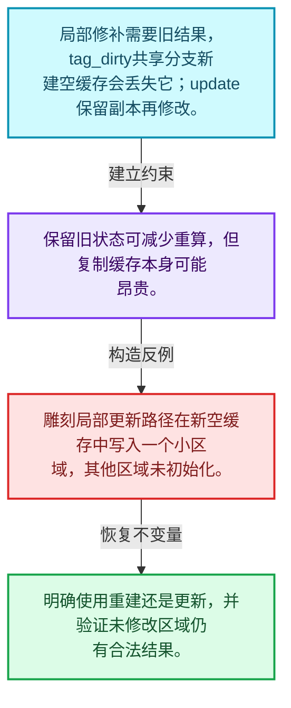
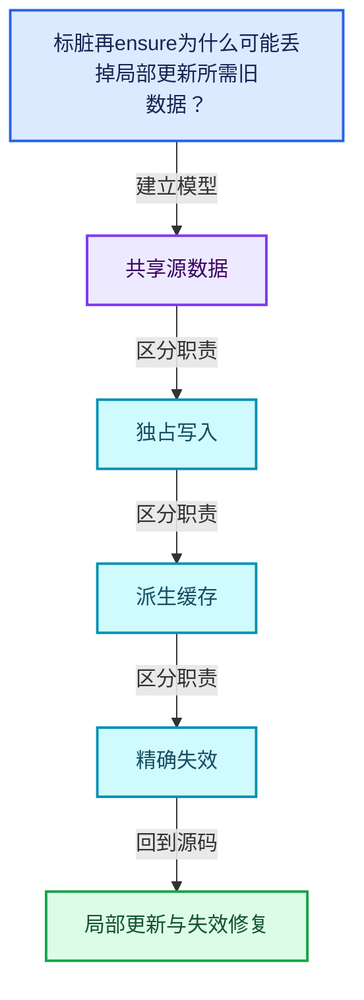
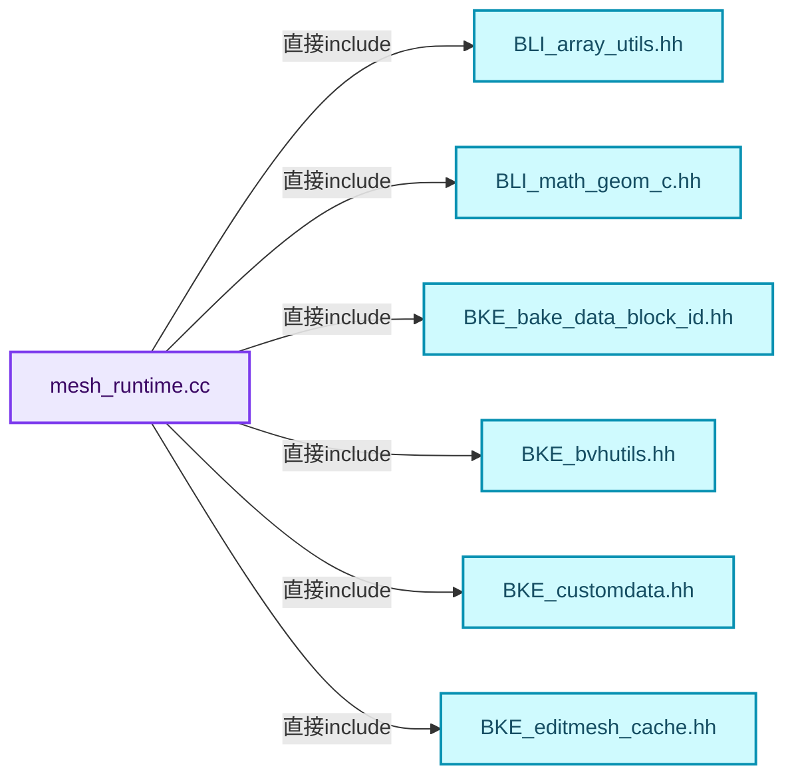
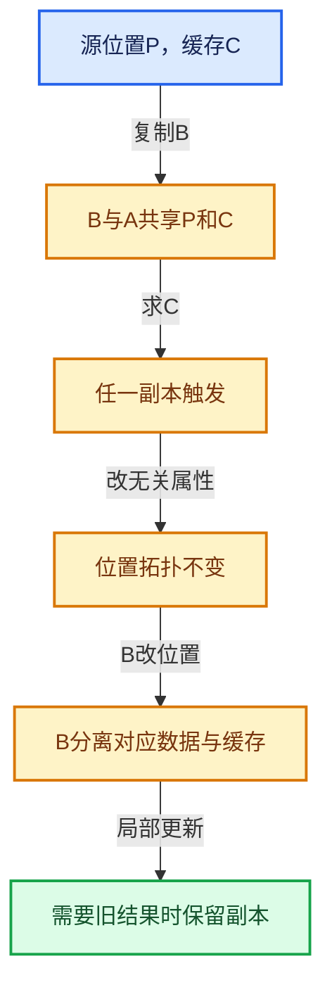

# 06-10 局部更新与失效修复

[方向导航](README.md) · [总目录](../README.md) · [覆盖索引](../%E6%BA%90%E7%A0%81%E7%89%88%E6%9C%AC%E4%B8%8E%E8%A6%86%E7%9B%96%E7%B4%A2%E5%BC%95.md)

> 阅读顺序：问题与数据模型 → 语法与类型 → 源码逐行 → 调用线索 → 历史与取舍 → 推演和练习。

- 基准 HEAD：`cbda6b96c26c0dee3c3b5cbb93960c4ac06a6b30`。
- 记录日期：2026-10-14。
- 教学示例状态：正文中的推演不是本机性能实测；已运行练习见验收报告。

## 一、从问题到设计

标脏再ensure为什么可能丢掉局部更新所需旧数据？

tag_dirty可以放弃共享旧缓存，update需要保留旧状态以便修补；两者解决不同更新模式。

本篇把语法、数据语义和系统取舍连接起来。共享计数回答谁还活着，缓存依赖回答结果是否仍正确，两者不能互相替代。

### 本篇独立模型与设计推理

局部修补需要旧结果，tag_dirty共享分支新建空缓存会丢失它；update保留副本再修改。

设计取舍：保留旧状态可减少重算，但复制缓存本身可能昂贵。

最小反例：雕刻局部更新路径在新空缓存中写入一个小区域，其他区域未初始化。

推导与处理：明确使用重建还是更新，并验证未修改区域仍有合法结果。



### 源码范围与相邻篇章

| 文件 | 本篇逐行范围 | 基准SHA-256 |
|---|---|---|
| [source/blender/blenkernel/intern/mesh_runtime.cc](../../../../../source/blender/blenkernel/intern/mesh_runtime.cc) | L1—L481 | `2992b325daab717c1a7e99c367d807f8ccfff874f9a01e21b402b77f0321d0e8` |

同一主讲文件可能分多篇覆盖；超出本篇范围的符号通过覆盖索引定位。空行与纯注释保留在源码摘录中，逐行表解释有效语句与语法边界；许可证头统一保留。

前篇：[BVH共享与运行时数据](09-BVH%E5%85%B1%E4%BA%AB%E4%B8%8E%E8%BF%90%E8%A1%8C%E6%97%B6%E6%95%B0%E6%8D%AE.md).

## 二、类型、数据与阅读地图



这是概念依赖图，边表示阅读关系，不声称是运行时调用顺序。

### 直接编译依赖



箭头只表示头文件包含关系；完整调用线索见后面的符号定位表。

## 三、关键词、语法与类型角色

### 只读限定 const

const约束当前访问路径可做的修改。const指针、指向const的指针、const视图对象、const元素是不同位置的限定；其他别名可能仍可修改原对象。

具体检查：分别写T* const、const T*与const T* const，并画出不可修改的层次。

### 异常边界 try与catch

try定义异常传播的局部边界。失败路径需要销毁已经成功构造的部分并释放相应存储；未构造的对象不能被析构。

具体检查：在第k次构造失败，列出已经存在的对象集合与待释放缓冲。

### 构造与new表达式

普通new可能分配并构造；placement new在给定地址构造，存储由其他机制提供。失败回滚应区分两类责任。

具体检查：追踪地址来自哪里、构造何时成功、由谁析构、由谁释放。

### 类型别名 using

类型别名为已有类型建立名字，不创建运行期对象。它常把模板内部使用的类型统一暴露给泛型调用者。

具体检查：展开别名直到基础类型，区分类型别名和变量声明。

## 四、真实源码与逐行讲解

源码块保持原行内容，原始行号由小节标题及逐行表给出。表中的调用定位是静态阅读辅助；重载、模板实例化、宏展开和虚调用需结合完整声明，不能仅凭词法出现证明动态调用。

### mesh_runtime.cc：L1—L45

<!-- source:source/blender/blenkernel/intern/mesh_runtime.cc:1:45 -->

```cpp
/* SPDX-FileCopyrightText: 2005 Blender Authors
 *
 * SPDX-License-Identifier: GPL-2.0-or-later */

/** \file
 * \ingroup bke
 */

#include "BLI_array_utils.hh"
#include "BLI_math_geom_c.hh"

#include "BKE_bake_data_block_id.hh"
#include "BKE_bvhutils.hh"
#include "BKE_customdata.hh"
#include "BKE_editmesh_cache.hh"
#include "BKE_lib_id.hh"
#include "BKE_mesh.hh"
#include "BKE_mesh_mapping.hh"
#include "BKE_mesh_runtime.hh"
#include "BKE_shrinkwrap.hh"
#include "BKE_subdiv_ccg.hh"

namespace blender {

/* -------------------------------------------------------------------- */
/** \name Mesh Runtime Struct Utils
 * \{ */

namespace bke {

static void free_mesh_eval(MeshRuntime &mesh_runtime)
{
  if (mesh_runtime.mesh_eval != nullptr) {
    BKE_id_free(nullptr, mesh_runtime.mesh_eval);
    mesh_runtime.mesh_eval = nullptr;
  }
}

static void free_batch_cache(MeshRuntime &mesh_runtime)
{
  if (mesh_runtime.batch_cache) {
    BKE_mesh_batch_cache_free(mesh_runtime.batch_cache);
    mesh_runtime.batch_cache = nullptr;
  }
}
```

本段语义重点：

- 分支证据 `mesh_runtime.mesh_eval != nullptr)`：分别推演条件成立与不成立，核对相同出口处的状态。
- 分支证据 `mesh_runtime.batch_cache)`：分别推演条件成立与不成立，核对相同出口处的状态。

| 原始行 | 语义、约束与检查 |
|---|---|
| L9 | 引入编译依赖 "BLI_array_utils.hh"；这是声明可见性关系，不表示运行时一定调用该文件的所有接口。 |
| L10 | 引入编译依赖 "BLI_math_geom_c.hh"；这是声明可见性关系，不表示运行时一定调用该文件的所有接口。 |
| L12 | 引入编译依赖 "BKE_bake_data_block_id.hh"；这是声明可见性关系，不表示运行时一定调用该文件的所有接口。 |
| L13 | 引入编译依赖 "BKE_bvhutils.hh"；这是声明可见性关系，不表示运行时一定调用该文件的所有接口。 |
| L14 | 引入编译依赖 "BKE_customdata.hh"；这是声明可见性关系，不表示运行时一定调用该文件的所有接口。 |
| L15 | 引入编译依赖 "BKE_editmesh_cache.hh"；这是声明可见性关系，不表示运行时一定调用该文件的所有接口。 |
| L16 | 引入编译依赖 "BKE_lib_id.hh"；这是声明可见性关系，不表示运行时一定调用该文件的所有接口。 |
| L17 | 引入编译依赖 "BKE_mesh.hh"；这是声明可见性关系，不表示运行时一定调用该文件的所有接口。 |
| L18 | 引入编译依赖 "BKE_mesh_mapping.hh"；这是声明可见性关系，不表示运行时一定调用该文件的所有接口。 |
| L19 | 引入编译依赖 "BKE_mesh_runtime.hh"；这是声明可见性关系，不表示运行时一定调用该文件的所有接口。 |
| L20 | 引入编译依赖 "BKE_shrinkwrap.hh"；这是声明可见性关系，不表示运行时一定调用该文件的所有接口。 |
| L21 | 引入编译依赖 "BKE_subdiv_ccg.hh"；这是声明可见性关系，不表示运行时一定调用该文件的所有接口。 |
| L23 | 把后续声明放入 blender 命名空间，影响名称查找和符号归属，不创建运行时对象。 |
| L29 | 把后续声明放入 bke 命名空间，影响名称查找和符号归属，不创建运行时对象。 |
| L31 | 出现调用或函数声明 `free_mesh_eval`，对应表达式为 `static void free_mesh_eval(MeshRuntime &mesh_runtime)`。参数求值、返回类型与重载需结合前后完整语句；静态文本引用不能证明动态目标。 |
| L32 | 连接上一行的声明或控制结构与其语句块；后续行在这个作用域中执行或声明。 |
| L33 | 判断 `mesh_runtime.mesh_eval != nullptr`，成立时进入本分支，否则继续后续路径。这里区分空地址与可用地址，但非空本身仍不能证明对象存活。 |
| L34 | 出现调用或函数声明 `BKE_id_free`，对应表达式为 `BKE_id_free(nullptr, mesh_runtime.mesh_eval);`。参数求值、返回类型与重载需结合前后完整语句；静态文本引用不能证明动态目标。 |
| L35 | 把右侧 `nullptr` 用于初始化或更新左侧 `mesh_runtime.mesh_eval`。声明初始化与已有对象赋值应按上下文区分；有资源的类型会调用相应特殊成员。 |
| L36 | 结束当前语法单元。局部自动对象在离开其作用域时按规则销毁；这不等于所有被引用的外部数据也被释放。 |
| L37 | 结束当前语法单元。局部自动对象在离开其作用域时按规则销毁；这不等于所有被引用的外部数据也被释放。 |
| L39 | 出现调用或函数声明 `free_batch_cache`，对应表达式为 `static void free_batch_cache(MeshRuntime &mesh_runtime)`。参数求值、返回类型与重载需结合前后完整语句；静态文本引用不能证明动态目标。 |
| L40 | 连接上一行的声明或控制结构与其语句块；后续行在这个作用域中执行或声明。 |
| L41 | 判断 `mesh_runtime.batch_cache`，成立时进入本分支，否则继续后续路径。 |
| L42 | 出现调用或函数声明 `BKE_mesh_batch_cache_free`，对应表达式为 `BKE_mesh_batch_cache_free(mesh_runtime.batch_cache);`。参数求值、返回类型与重载需结合前后完整语句；静态文本引用不能证明动态目标。 |
| L43 | 把右侧 `nullptr` 用于初始化或更新左侧 `mesh_runtime.batch_cache`。声明初始化与已有对象赋值应按上下文区分；有资源的类型会调用相应特殊成员。 |
| L44 | 结束当前语法单元。局部自动对象在离开其作用域时按规则销毁；这不等于所有被引用的外部数据也被释放。 |
| L45 | 结束当前语法单元。局部自动对象在离开其作用域时按规则销毁；这不等于所有被引用的外部数据也被释放。 |

### mesh_runtime.cc：L46—L97

<!-- source:source/blender/blenkernel/intern/mesh_runtime.cc:46:97 -->

```cpp

static void free_bvh_caches(MeshRuntime &mesh_runtime)
{
  mesh_runtime.bvh_cache_edges.tag_dirty();
  mesh_runtime.bvh_cache_faces.tag_dirty();
  mesh_runtime.bvh_cache_corner_tris.tag_dirty();
  mesh_runtime.bvh_cache_corner_tris_no_hidden.tag_dirty();
  mesh_runtime.bvh_cache_loose_verts.tag_dirty();
  mesh_runtime.bvh_cache_loose_verts_no_hidden.tag_dirty();
  mesh_runtime.bvh_cache_loose_edges.tag_dirty();
  mesh_runtime.bvh_cache_loose_edges_no_hidden.tag_dirty();
  mesh_runtime.bvh_embree_tris_cache.tag_dirty();
  mesh_runtime.bvh_embree_verts_cache.tag_dirty();
  mesh_runtime.bvh_embree_edges_cache.tag_dirty();
}

MeshRuntime::MeshRuntime() = default;

MeshRuntime::~MeshRuntime()
{
  free_mesh_eval(*this);
  free_batch_cache(*this);
}

static void set_bools(MutableSpan<bool> bools, const Span<int> indices_to_set)
{
  threading::memory_bandwidth_bound_task(indices_to_set.size(), [&]() {
    threading::parallel_for(indices_to_set.index_range(), 8192, [&](const IndexRange range) {
      for (const int i : range) {
        bools[indices_to_set[i]] = true;
      }
    });
  });
}

/**
 * If there are no loose edges and no loose vertices, all vertices are used by faces.
 */
static void try_tag_verts_no_face_none(const Mesh &mesh)
{
  if (!mesh.runtime->loose_edges_cache.is_cached() || !mesh.loose_edges().is_empty()) {
    return;
  }
  if (!mesh.runtime->loose_verts_cache.is_cached() || !mesh.loose_verts().is_empty()) {
    return;
  }
  mesh.runtime->verts_no_face_cache.ensure([&](LooseGeomCache &r_data) {
    r_data.allocator.~LinearAllocator<>();
    new (&r_data.allocator) LinearAllocator<>();
    r_data.mask = {};
  });
}
```

本段语义重点：

- `tag_dirty`：标记派生结果失效；对于共享缓存还可能分离旧缓存。

| 原始行 | 语义、约束与检查 |
|---|---|
| L47 | 出现调用或函数声明 `free_bvh_caches`，对应表达式为 `static void free_bvh_caches(MeshRuntime &mesh_runtime)`。参数求值、返回类型与重载需结合前后完整语句；静态文本引用不能证明动态目标。 |
| L48 | 连接上一行的声明或控制结构与其语句块；后续行在这个作用域中执行或声明。 |
| L49 | 本行使用 `tag_dirty`：标记派生结果失效；对于共享缓存还可能分离旧缓存。 |
| L50 | 本行使用 `tag_dirty`：标记派生结果失效；对于共享缓存还可能分离旧缓存。 |
| L51 | 本行使用 `tag_dirty`：标记派生结果失效；对于共享缓存还可能分离旧缓存。 |
| L52 | 本行使用 `tag_dirty`：标记派生结果失效；对于共享缓存还可能分离旧缓存。 |
| L53 | 本行使用 `tag_dirty`：标记派生结果失效；对于共享缓存还可能分离旧缓存。 |
| L54 | 本行使用 `tag_dirty`：标记派生结果失效；对于共享缓存还可能分离旧缓存。 |
| L55 | 本行使用 `tag_dirty`：标记派生结果失效；对于共享缓存还可能分离旧缓存。 |
| L56 | 本行使用 `tag_dirty`：标记派生结果失效；对于共享缓存还可能分离旧缓存。 |
| L57 | 本行使用 `tag_dirty`：标记派生结果失效；对于共享缓存还可能分离旧缓存。 |
| L58 | 本行使用 `tag_dirty`：标记派生结果失效；对于共享缓存还可能分离旧缓存。 |
| L59 | 本行使用 `tag_dirty`：标记派生结果失效；对于共享缓存还可能分离旧缓存。 |
| L60 | 结束当前语法单元。局部自动对象在离开其作用域时按规则销毁；这不等于所有被引用的外部数据也被释放。 |
| L62 | 显式采用编译器生成的特殊成员行为：`MeshRuntime::MeshRuntime() = default;`。成员和基类的性质决定该操作是否可用、是否被删除及异常约定，不表示运行时给对象赋值为default。 |
| L64 | 涉及析构接口或显式析构：`MeshRuntime::~MeshRuntime()`。检查目标对象已成功构造，且资源不会在另一条清理路径再次销毁。 |
| L65 | 连接上一行的声明或控制结构与其语句块；后续行在这个作用域中执行或声明。 |
| L66 | 出现调用或函数声明 `free_mesh_eval`，对应表达式为 `free_mesh_eval(*this);`。参数求值、返回类型与重载需结合前后完整语句；静态文本引用不能证明动态目标。 |
| L67 | 出现调用或函数声明 `free_batch_cache`，对应表达式为 `free_batch_cache(*this);`。参数求值、返回类型与重载需结合前后完整语句；静态文本引用不能证明动态目标。 |
| L68 | 结束当前语法单元。局部自动对象在离开其作用域时按规则销毁；这不等于所有被引用的外部数据也被释放。 |
| L70 | 出现调用或函数声明 `set_bools`，对应表达式为 `static void set_bools(MutableSpan<bool> bools, const Span<int> indices_to_set)`。参数求值、返回类型与重载需结合前后完整语句；静态文本引用不能证明动态目标。 |
| L71 | 连接上一行的声明或控制结构与其语句块；后续行在这个作用域中执行或声明。 |
| L72 | 出现调用或函数声明 `threading::memory_bandwidth_bound_task`，对应表达式为 `threading::memory_bandwidth_bound_task(indices_to_set.size(), [&]() {`。参数求值、返回类型与重载需结合前后完整语句；静态文本引用不能证明动态目标。 |
| L73 | 出现调用或函数声明 `threading::parallel_for`，对应表达式为 `threading::parallel_for(indices_to_set.index_range(), 8192, [&](const IndexRange range) {`。参数求值、返回类型与重载需结合前后完整语句；静态文本引用不能证明动态目标。 |
| L74 | 按 `for (const int i : range)` 指定的范围或条件重复执行。对照循环变量与真实元素编号；循环内调用成本乘以实际迭代次数。 |
| L75 | 把右侧 `true` 用于初始化或更新左侧 `bools[indices_to_set[i]]`。声明初始化与已有对象赋值应按上下文区分；有资源的类型会调用相应特殊成员。 |
| L76 | 结束当前语法单元。局部自动对象在离开其作用域时按规则销毁；这不等于所有被引用的外部数据也被释放。 |
| L77 | 结束当前语法单元。局部自动对象在离开其作用域时按规则销毁；这不等于所有被引用的外部数据也被释放。 |
| L78 | 结束当前语法单元。局部自动对象在离开其作用域时按规则销毁；这不等于所有被引用的外部数据也被释放。 |
| L79 | 结束当前语法单元。局部自动对象在离开其作用域时按规则销毁；这不等于所有被引用的外部数据也被释放。 |
| L84 | 出现调用或函数声明 `try_tag_verts_no_face_none`，对应表达式为 `static void try_tag_verts_no_face_none(const Mesh &mesh)`。参数求值、返回类型与重载需结合前后完整语句；静态文本引用不能证明动态目标。 |
| L85 | 连接上一行的声明或控制结构与其语句块；后续行在这个作用域中执行或声明。 |
| L86 | 判断 `!mesh.runtime->loose_edges_cache.is_cached() &#124;&#124; !mesh.loose_edges().is_empty()`，成立时进入本分支，否则继续后续路径。 |
| L87 | 结束当前函数，本路径不再执行后续语句；局部对象按作用域规则清理。 |
| L88 | 结束当前语法单元。局部自动对象在离开其作用域时按规则销毁；这不等于所有被引用的外部数据也被释放。 |
| L89 | 判断 `!mesh.runtime->loose_verts_cache.is_cached() &#124;&#124; !mesh.loose_verts().is_empty()`，成立时进入本分支，否则继续后续路径。 |
| L90 | 结束当前函数，本路径不再执行后续语句；局部对象按作用域规则清理。 |
| L91 | 结束当前语法单元。局部自动对象在离开其作用域时按规则销毁；这不等于所有被引用的外部数据也被释放。 |
| L92 | 出现调用或函数声明 `ensure`，对应表达式为 `mesh.runtime->verts_no_face_cache.ensure([&](LooseGeomCache &r_data) {`。参数求值、返回类型与重载需结合前后完整语句；静态文本引用不能证明动态目标。 |
| L93 | 涉及析构接口或显式析构：`r_data.allocator.~LinearAllocator<>();`。检查目标对象已成功构造，且资源不会在另一条清理路径再次销毁。 |
| L94 | 出现调用或函数声明 `new`，对应表达式为 `new (&r_data.allocator) LinearAllocator<>();`。参数求值、返回类型与重载需结合前后完整语句；静态文本引用不能证明动态目标。 |
| L95 | 把右侧 `{}` 用于初始化或更新左侧 `r_data.mask`。声明初始化与已有对象赋值应按上下文区分；有资源的类型会调用相应特殊成员。 |
| L96 | 结束当前语法单元。局部自动对象在离开其作用域时按规则销毁；这不等于所有被引用的外部数据也被释放。 |
| L97 | 结束当前语法单元。局部自动对象在离开其作用域时按规则销毁；这不等于所有被引用的外部数据也被释放。 |

### mesh_runtime.cc：L98—L147

<!-- source:source/blender/blenkernel/intern/mesh_runtime.cc:98:147 -->

```cpp

}  // namespace bke

Span<int> Mesh::corner_to_face_map() const
{
  this->runtime->corner_to_face_map_cache.ensure([&](Array<int> &r_data) {
    const OffsetIndices faces = this->faces();
    r_data = bke::mesh::build_corner_to_face_map(faces);
  });
  return this->runtime->corner_to_face_map_cache.data();
}

OffsetIndices<int> Mesh::vert_to_face_map_offsets() const
{
  this->runtime->vert_to_face_offset_cache.ensure([&](Array<int> &r_data) {
    r_data = Array<int>(this->verts_num + 1, 0);
    offset_indices::build_reverse_offsets(this->corner_verts(), r_data);
  });
  return OffsetIndices<int>(this->runtime->vert_to_face_offset_cache.data());
}

GroupedSpan<int> Mesh::vert_to_face_map() const
{
  const OffsetIndices offsets = this->vert_to_face_map_offsets();
  this->runtime->vert_to_face_map_cache.ensure([&](Array<int> &r_data) {
    r_data.reinitialize(this->corners_num);
    if (this->runtime->vert_to_corner_map_cache.is_cached() &&
        this->runtime->corner_to_face_map_cache.is_cached())
    {
      /* The vertex to face cache can be built from the vertex to face corner
       * and face corner to face maps if they are both already cached. */
      array_utils::gather(this->runtime->corner_to_face_map_cache.data().as_span(),
                          this->runtime->vert_to_corner_map_cache.data().as_span(),
                          r_data.as_mutable_span());
    }
    else {
      bke::mesh::build_vert_to_face_indices(this->faces(), this->corner_verts(), offsets, r_data);
    }
  });
  return {offsets, this->runtime->vert_to_face_map_cache.data()};
}

GroupedSpan<int> Mesh::vert_to_corner_map() const
{
  const OffsetIndices offsets = this->vert_to_face_map_offsets();
  this->runtime->vert_to_corner_map_cache.ensure([&](Array<int> &r_data) {
    r_data = bke::mesh::build_vert_to_corner_indices(this->corner_verts(), offsets);
  });
  return {offsets, this->runtime->vert_to_corner_map_cache.data()};
}
```

本段语义重点：

- 分支证据 `this->runtime->vert_to_corner_map_cache.is_cached() &&`：分别推演条件成立与不成立，核对相同出口处的状态。

| 原始行 | 语义、约束与检查 |
|---|---|
| L99 | 结束当前语法单元。局部自动对象在离开其作用域时按规则销毁；这不等于所有被引用的外部数据也被释放。 |
| L101 | 出现调用或函数声明 `Mesh::corner_to_face_map`，对应表达式为 `Span<int> Mesh::corner_to_face_map() const`。参数求值、返回类型与重载需结合前后完整语句；静态文本引用不能证明动态目标。 |
| L102 | 连接上一行的声明或控制结构与其语句块；后续行在这个作用域中执行或声明。 |
| L103 | 出现调用或函数声明 `ensure`，对应表达式为 `this->runtime->corner_to_face_map_cache.ensure([&](Array<int> &r_data) {`。参数求值、返回类型与重载需结合前后完整语句；静态文本引用不能证明动态目标。 |
| L104 | 把右侧 `this->faces()` 用于初始化或更新左侧 `const OffsetIndices faces`。声明初始化与已有对象赋值应按上下文区分；有资源的类型会调用相应特殊成员。 |
| L105 | 把右侧 `bke::mesh::build_corner_to_face_map(faces)` 用于初始化或更新左侧 `r_data`。声明初始化与已有对象赋值应按上下文区分；有资源的类型会调用相应特殊成员。 |
| L106 | 结束当前语法单元。局部自动对象在离开其作用域时按规则销毁；这不等于所有被引用的外部数据也被释放。 |
| L107 | 返回表达式 `this->runtime->corner_to_face_map_cache.data()`。 |
| L108 | 结束当前语法单元。局部自动对象在离开其作用域时按规则销毁；这不等于所有被引用的外部数据也被释放。 |
| L110 | 出现调用或函数声明 `Mesh::vert_to_face_map_offsets`，对应表达式为 `OffsetIndices<int> Mesh::vert_to_face_map_offsets() const`。参数求值、返回类型与重载需结合前后完整语句；静态文本引用不能证明动态目标。 |
| L111 | 连接上一行的声明或控制结构与其语句块；后续行在这个作用域中执行或声明。 |
| L112 | 出现调用或函数声明 `ensure`，对应表达式为 `this->runtime->vert_to_face_offset_cache.ensure([&](Array<int> &r_data) {`。参数求值、返回类型与重载需结合前后完整语句；静态文本引用不能证明动态目标。 |
| L113 | 把右侧 `Array<int>(this->verts_num + 1, 0)` 用于初始化或更新左侧 `r_data`。声明初始化与已有对象赋值应按上下文区分；有资源的类型会调用相应特殊成员。 |
| L114 | 出现调用或函数声明 `offset_indices::build_reverse_offsets`，对应表达式为 `offset_indices::build_reverse_offsets(this->corner_verts(), r_data);`。参数求值、返回类型与重载需结合前后完整语句；静态文本引用不能证明动态目标。 |
| L115 | 结束当前语法单元。局部自动对象在离开其作用域时按规则销毁；这不等于所有被引用的外部数据也被释放。 |
| L116 | 返回表达式 `OffsetIndices<int>(this->runtime->vert_to_face_offset_cache.data())`。 |
| L117 | 结束当前语法单元。局部自动对象在离开其作用域时按规则销毁；这不等于所有被引用的外部数据也被释放。 |
| L119 | 出现调用或函数声明 `Mesh::vert_to_face_map`，对应表达式为 `GroupedSpan<int> Mesh::vert_to_face_map() const`。参数求值、返回类型与重载需结合前后完整语句；静态文本引用不能证明动态目标。 |
| L120 | 连接上一行的声明或控制结构与其语句块；后续行在这个作用域中执行或声明。 |
| L121 | 把右侧 `this->vert_to_face_map_offsets()` 用于初始化或更新左侧 `const OffsetIndices offsets`。声明初始化与已有对象赋值应按上下文区分；有资源的类型会调用相应特殊成员。 |
| L122 | 出现调用或函数声明 `ensure`，对应表达式为 `this->runtime->vert_to_face_map_cache.ensure([&](Array<int> &r_data) {`。参数求值、返回类型与重载需结合前后完整语句；静态文本引用不能证明动态目标。 |
| L123 | 出现调用或函数声明 `reinitialize`，对应表达式为 `r_data.reinitialize(this->corners_num);`。参数求值、返回类型与重载需结合前后完整语句；静态文本引用不能证明动态目标。 |
| L124 | 判断 `this->runtime->vert_to_corner_map_cache.is_cached(`，成立时进入本分支，否则继续后续路径。 |
| L125 | 出现调用或函数声明 `is_cached`，对应表达式为 `this->runtime->corner_to_face_map_cache.is_cached())`。参数求值、返回类型与重载需结合前后完整语句；静态文本引用不能证明动态目标。 |
| L126 | 连接上一行的声明或控制结构与其语句块；后续行在这个作用域中执行或声明。 |
| L129 | 出现调用或函数声明 `array_utils::gather`，对应表达式为 `array_utils::gather(this->runtime->corner_to_face_map_cache.data().as_span(),`。参数求值、返回类型与重载需结合前后完整语句；静态文本引用不能证明动态目标。 |
| L130 | 出现调用或函数声明 `data`，对应表达式为 `this->runtime->vert_to_corner_map_cache.data().as_span(),`。参数求值、返回类型与重载需结合前后完整语句；静态文本引用不能证明动态目标。 |
| L131 | 出现调用或函数声明 `as_mutable_span`，对应表达式为 `r_data.as_mutable_span());`。参数求值、返回类型与重载需结合前后完整语句；静态文本引用不能证明动态目标。 |
| L132 | 结束当前语法单元。局部自动对象在离开其作用域时按规则销毁；这不等于所有被引用的外部数据也被释放。 |
| L133 | 处理前一条件不成立的互补路径。比较两条路径最后是否恢复同一不变量，以及是否产生不同的资源责任。 |
| L134 | 出现调用或函数声明 `bke::mesh::build_vert_to_face_indices`，对应表达式为 `bke::mesh::build_vert_to_face_indices(this->faces(), this->corner_verts(), offsets, r_data);`。参数求值、返回类型与重载需结合前后完整语句；静态文本引用不能证明动态目标。 |
| L135 | 结束当前语法单元。局部自动对象在离开其作用域时按规则销毁；这不等于所有被引用的外部数据也被释放。 |
| L136 | 结束当前语法单元。局部自动对象在离开其作用域时按规则销毁；这不等于所有被引用的外部数据也被释放。 |
| L137 | 返回表达式 `{offsets, this->runtime->vert_to_face_map_cache.data()}`。 |
| L138 | 结束当前语法单元。局部自动对象在离开其作用域时按规则销毁；这不等于所有被引用的外部数据也被释放。 |
| L140 | 出现调用或函数声明 `Mesh::vert_to_corner_map`，对应表达式为 `GroupedSpan<int> Mesh::vert_to_corner_map() const`。参数求值、返回类型与重载需结合前后完整语句；静态文本引用不能证明动态目标。 |
| L141 | 连接上一行的声明或控制结构与其语句块；后续行在这个作用域中执行或声明。 |
| L142 | 把右侧 `this->vert_to_face_map_offsets()` 用于初始化或更新左侧 `const OffsetIndices offsets`。声明初始化与已有对象赋值应按上下文区分；有资源的类型会调用相应特殊成员。 |
| L143 | 出现调用或函数声明 `ensure`，对应表达式为 `this->runtime->vert_to_corner_map_cache.ensure([&](Array<int> &r_data) {`。参数求值、返回类型与重载需结合前后完整语句；静态文本引用不能证明动态目标。 |
| L144 | 把右侧 `bke::mesh::build_vert_to_corner_indices(this->corner_verts(), offsets)` 用于初始化或更新左侧 `r_data`。声明初始化与已有对象赋值应按上下文区分；有资源的类型会调用相应特殊成员。 |
| L145 | 结束当前语法单元。局部自动对象在离开其作用域时按规则销毁；这不等于所有被引用的外部数据也被释放。 |
| L146 | 返回表达式 `{offsets, this->runtime->vert_to_corner_map_cache.data()}`。 |
| L147 | 结束当前语法单元。局部自动对象在离开其作用域时按规则销毁；这不等于所有被引用的外部数据也被释放。 |

### mesh_runtime.cc：L148—L192

<!-- source:source/blender/blenkernel/intern/mesh_runtime.cc:148:192 -->

```cpp

GroupedSpan<int> Mesh::edge_to_corner_map() const
{
  this->runtime->edge_to_corner_offset_cache.ensure([&](Array<int> &r_data) {
    r_data = Array<int>(this->edges_num + 1, 0);
    offset_indices::build_reverse_offsets(this->corner_edges(), r_data);
  });
  const OffsetIndices<int> offsets(this->runtime->edge_to_corner_offset_cache.data());
  this->runtime->edge_to_corner_map_cache.ensure([&](Array<int> &r_data) {
    r_data.reinitialize(offsets.total_size());
    offset_indices::reverse_indices_in_groups(this->corner_edges(), offsets, r_data);
  });
  return {offsets, this->runtime->edge_to_corner_map_cache.data()};
}

const IndexMask &Mesh::loose_verts() const
{
  using namespace blender::bke;
  this->runtime->loose_verts_cache.ensure([&](LooseGeomCache &r_data) {
    Array<bool, 256> bools(this->verts_num, false);
    set_bools(bools, this->edges().cast<int>());
    r_data.allocator.~LinearAllocator<>();
    new (&r_data.allocator) LinearAllocator<>();
    r_data.mask = IndexMask::from_bools_inverse(bools, r_data.allocator);
  });
  return this->runtime->loose_verts_cache.data().mask;
}

const IndexMask &Mesh::verts_no_face() const
{
  using namespace blender::bke;
  this->runtime->verts_no_face_cache.ensure([&](LooseGeomCache &r_data) {
    Array<bool, 256> bools(this->verts_num, false);
    set_bools(bools, this->corner_verts());
    r_data.allocator.~LinearAllocator<>();
    new (&r_data.allocator) LinearAllocator<>();
    r_data.mask = IndexMask::from_bools_inverse(bools, r_data.allocator);
  });
  return this->runtime->verts_no_face_cache.data().mask;
}

bool Mesh::no_overlapping_topology() const
{
  return this->flag & ME_NO_OVERLAPPING_TOPOLOGY;
}
```

本段语义重点：

- `total_size`：布局所需总字节数或范围总量，具体单位由声明和使用决定。

| 原始行 | 语义、约束与检查 |
|---|---|
| L149 | 出现调用或函数声明 `Mesh::edge_to_corner_map`，对应表达式为 `GroupedSpan<int> Mesh::edge_to_corner_map() const`。参数求值、返回类型与重载需结合前后完整语句；静态文本引用不能证明动态目标。 |
| L150 | 连接上一行的声明或控制结构与其语句块；后续行在这个作用域中执行或声明。 |
| L151 | 出现调用或函数声明 `ensure`，对应表达式为 `this->runtime->edge_to_corner_offset_cache.ensure([&](Array<int> &r_data) {`。参数求值、返回类型与重载需结合前后完整语句；静态文本引用不能证明动态目标。 |
| L152 | 把右侧 `Array<int>(this->edges_num + 1, 0)` 用于初始化或更新左侧 `r_data`。声明初始化与已有对象赋值应按上下文区分；有资源的类型会调用相应特殊成员。 |
| L153 | 出现调用或函数声明 `offset_indices::build_reverse_offsets`，对应表达式为 `offset_indices::build_reverse_offsets(this->corner_edges(), r_data);`。参数求值、返回类型与重载需结合前后完整语句；静态文本引用不能证明动态目标。 |
| L154 | 结束当前语法单元。局部自动对象在离开其作用域时按规则销毁；这不等于所有被引用的外部数据也被释放。 |
| L155 | 声明接口 `const OffsetIndices<int> offsets(this->runtime->edge_to_corner_offset_cache.data())`，本行没有对应函数体；返回类型、参数限定和const/noexcept共同组成调用契约，实际行为需继续定位实现。 |
| L156 | 出现调用或函数声明 `ensure`，对应表达式为 `this->runtime->edge_to_corner_map_cache.ensure([&](Array<int> &r_data) {`。参数求值、返回类型与重载需结合前后完整语句；静态文本引用不能证明动态目标。 |
| L157 | 本行涉及 `total_size`：布局所需总字节数或范围总量，具体单位由声明和使用决定。按此语义解读 `r_data.reinitialize(offsets.total_size())`，不要把地址、数量或状态混用。 |
| L158 | 出现调用或函数声明 `offset_indices::reverse_indices_in_groups`，对应表达式为 `offset_indices::reverse_indices_in_groups(this->corner_edges(), offsets, r_data);`。参数求值、返回类型与重载需结合前后完整语句；静态文本引用不能证明动态目标。 |
| L159 | 结束当前语法单元。局部自动对象在离开其作用域时按规则销毁；这不等于所有被引用的外部数据也被释放。 |
| L160 | 返回表达式 `{offsets, this->runtime->edge_to_corner_map_cache.data()}`。 |
| L161 | 结束当前语法单元。局部自动对象在离开其作用域时按规则销毁；这不等于所有被引用的外部数据也被释放。 |
| L163 | 出现调用或函数声明 `Mesh::loose_verts`，对应表达式为 `const IndexMask &Mesh::loose_verts() const`。参数求值、返回类型与重载需结合前后完整语句；静态文本引用不能证明动态目标。 |
| L164 | 连接上一行的声明或控制结构与其语句块；后续行在这个作用域中执行或声明。 |
| L165 | 定义类型别名 `using namespace blender::bke`，为模板接口或内部实现统一命名；本行不分配该类型对象。 |
| L166 | 出现调用或函数声明 `ensure`，对应表达式为 `this->runtime->loose_verts_cache.ensure([&](LooseGeomCache &r_data) {`。参数求值、返回类型与重载需结合前后完整语句；静态文本引用不能证明动态目标。 |
| L167 | 出现调用或函数声明 `bools`，对应表达式为 `Array<bool, 256> bools(this->verts_num, false);`。参数求值、返回类型与重载需结合前后完整语句；静态文本引用不能证明动态目标。 |
| L168 | 出现调用或函数声明 `set_bools`，对应表达式为 `set_bools(bools, this->edges().cast<int>());`。参数求值、返回类型与重载需结合前后完整语句；静态文本引用不能证明动态目标。 |
| L169 | 涉及析构接口或显式析构：`r_data.allocator.~LinearAllocator<>();`。检查目标对象已成功构造，且资源不会在另一条清理路径再次销毁。 |
| L170 | 出现调用或函数声明 `new`，对应表达式为 `new (&r_data.allocator) LinearAllocator<>();`。参数求值、返回类型与重载需结合前后完整语句；静态文本引用不能证明动态目标。 |
| L171 | 把右侧 `IndexMask::from_bools_inverse(bools, r_data.allocator)` 用于初始化或更新左侧 `r_data.mask`。声明初始化与已有对象赋值应按上下文区分；有资源的类型会调用相应特殊成员。 |
| L172 | 结束当前语法单元。局部自动对象在离开其作用域时按规则销毁；这不等于所有被引用的外部数据也被释放。 |
| L173 | 返回表达式 `this->runtime->loose_verts_cache.data().mask`。 |
| L174 | 结束当前语法单元。局部自动对象在离开其作用域时按规则销毁；这不等于所有被引用的外部数据也被释放。 |
| L176 | 出现调用或函数声明 `Mesh::verts_no_face`，对应表达式为 `const IndexMask &Mesh::verts_no_face() const`。参数求值、返回类型与重载需结合前后完整语句；静态文本引用不能证明动态目标。 |
| L177 | 连接上一行的声明或控制结构与其语句块；后续行在这个作用域中执行或声明。 |
| L178 | 定义类型别名 `using namespace blender::bke`，为模板接口或内部实现统一命名；本行不分配该类型对象。 |
| L179 | 出现调用或函数声明 `ensure`，对应表达式为 `this->runtime->verts_no_face_cache.ensure([&](LooseGeomCache &r_data) {`。参数求值、返回类型与重载需结合前后完整语句；静态文本引用不能证明动态目标。 |
| L180 | 出现调用或函数声明 `bools`，对应表达式为 `Array<bool, 256> bools(this->verts_num, false);`。参数求值、返回类型与重载需结合前后完整语句；静态文本引用不能证明动态目标。 |
| L181 | 出现调用或函数声明 `set_bools`，对应表达式为 `set_bools(bools, this->corner_verts());`。参数求值、返回类型与重载需结合前后完整语句；静态文本引用不能证明动态目标。 |
| L182 | 涉及析构接口或显式析构：`r_data.allocator.~LinearAllocator<>();`。检查目标对象已成功构造，且资源不会在另一条清理路径再次销毁。 |
| L183 | 出现调用或函数声明 `new`，对应表达式为 `new (&r_data.allocator) LinearAllocator<>();`。参数求值、返回类型与重载需结合前后完整语句；静态文本引用不能证明动态目标。 |
| L184 | 把右侧 `IndexMask::from_bools_inverse(bools, r_data.allocator)` 用于初始化或更新左侧 `r_data.mask`。声明初始化与已有对象赋值应按上下文区分；有资源的类型会调用相应特殊成员。 |
| L185 | 结束当前语法单元。局部自动对象在离开其作用域时按规则销毁；这不等于所有被引用的外部数据也被释放。 |
| L186 | 返回表达式 `this->runtime->verts_no_face_cache.data().mask`。 |
| L187 | 结束当前语法单元。局部自动对象在离开其作用域时按规则销毁；这不等于所有被引用的外部数据也被释放。 |
| L189 | 出现调用或函数声明 `Mesh::no_overlapping_topology`，对应表达式为 `bool Mesh::no_overlapping_topology() const`。参数求值、返回类型与重载需结合前后完整语句；静态文本引用不能证明动态目标。 |
| L190 | 连接上一行的声明或控制结构与其语句块；后续行在这个作用域中执行或声明。 |
| L191 | 返回表达式 `this->flag & ME_NO_OVERLAPPING_TOPOLOGY`。 |
| L192 | 结束当前语法单元。局部自动对象在离开其作用域时按规则销毁；这不等于所有被引用的外部数据也被释放。 |

### mesh_runtime.cc：L193—L241

<!-- source:source/blender/blenkernel/intern/mesh_runtime.cc:193:241 -->

```cpp

const IndexMask &Mesh::loose_edges() const
{
  using namespace blender::bke;
  this->runtime->loose_edges_cache.ensure([&](LooseGeomCache &r_data) {
    Array<bool, 256> bools(this->edges_num, false);
    set_bools(bools, this->corner_edges());
    r_data.allocator.~LinearAllocator<>();
    new (&r_data.allocator) LinearAllocator<>();
    r_data.mask = IndexMask::from_bools_inverse(bools, r_data.allocator);
  });
  return this->runtime->loose_edges_cache.data().mask;
}

void Mesh::tag_loose_verts_none() const
{
  using namespace blender::bke;
  this->runtime->loose_verts_cache.ensure([&](LooseGeomCache &r_data) {
    r_data.allocator.~LinearAllocator<>();
    new (&r_data.allocator) LinearAllocator<>();
    r_data.mask = {};
  });
  try_tag_verts_no_face_none(*this);
}

void Mesh::tag_loose_edges_none() const
{
  using namespace blender::bke;
  this->runtime->loose_edges_cache.ensure([&](LooseGeomCache &r_data) {
    r_data.allocator.~LinearAllocator<>();
    new (&r_data.allocator) LinearAllocator<>();
    r_data.mask = {};
  });
  try_tag_verts_no_face_none(*this);
}

void Mesh::tag_overlapping_none()
{
  using namespace blender::bke;
  this->flag |= ME_NO_OVERLAPPING_TOPOLOGY;
}

namespace bke {

void TrianglesCache::freeze()
{
  this->frozen = true;
  this->dirty_while_frozen = false;
}
```

| 原始行 | 语义、约束与检查 |
|---|---|
| L194 | 出现调用或函数声明 `Mesh::loose_edges`，对应表达式为 `const IndexMask &Mesh::loose_edges() const`。参数求值、返回类型与重载需结合前后完整语句；静态文本引用不能证明动态目标。 |
| L195 | 连接上一行的声明或控制结构与其语句块；后续行在这个作用域中执行或声明。 |
| L196 | 定义类型别名 `using namespace blender::bke`，为模板接口或内部实现统一命名；本行不分配该类型对象。 |
| L197 | 出现调用或函数声明 `ensure`，对应表达式为 `this->runtime->loose_edges_cache.ensure([&](LooseGeomCache &r_data) {`。参数求值、返回类型与重载需结合前后完整语句；静态文本引用不能证明动态目标。 |
| L198 | 出现调用或函数声明 `bools`，对应表达式为 `Array<bool, 256> bools(this->edges_num, false);`。参数求值、返回类型与重载需结合前后完整语句；静态文本引用不能证明动态目标。 |
| L199 | 出现调用或函数声明 `set_bools`，对应表达式为 `set_bools(bools, this->corner_edges());`。参数求值、返回类型与重载需结合前后完整语句；静态文本引用不能证明动态目标。 |
| L200 | 涉及析构接口或显式析构：`r_data.allocator.~LinearAllocator<>();`。检查目标对象已成功构造，且资源不会在另一条清理路径再次销毁。 |
| L201 | 出现调用或函数声明 `new`，对应表达式为 `new (&r_data.allocator) LinearAllocator<>();`。参数求值、返回类型与重载需结合前后完整语句；静态文本引用不能证明动态目标。 |
| L202 | 把右侧 `IndexMask::from_bools_inverse(bools, r_data.allocator)` 用于初始化或更新左侧 `r_data.mask`。声明初始化与已有对象赋值应按上下文区分；有资源的类型会调用相应特殊成员。 |
| L203 | 结束当前语法单元。局部自动对象在离开其作用域时按规则销毁；这不等于所有被引用的外部数据也被释放。 |
| L204 | 返回表达式 `this->runtime->loose_edges_cache.data().mask`。 |
| L205 | 结束当前语法单元。局部自动对象在离开其作用域时按规则销毁；这不等于所有被引用的外部数据也被释放。 |
| L207 | 出现调用或函数声明 `Mesh::tag_loose_verts_none`，对应表达式为 `void Mesh::tag_loose_verts_none() const`。参数求值、返回类型与重载需结合前后完整语句；静态文本引用不能证明动态目标。 |
| L208 | 连接上一行的声明或控制结构与其语句块；后续行在这个作用域中执行或声明。 |
| L209 | 定义类型别名 `using namespace blender::bke`，为模板接口或内部实现统一命名；本行不分配该类型对象。 |
| L210 | 出现调用或函数声明 `ensure`，对应表达式为 `this->runtime->loose_verts_cache.ensure([&](LooseGeomCache &r_data) {`。参数求值、返回类型与重载需结合前后完整语句；静态文本引用不能证明动态目标。 |
| L211 | 涉及析构接口或显式析构：`r_data.allocator.~LinearAllocator<>();`。检查目标对象已成功构造，且资源不会在另一条清理路径再次销毁。 |
| L212 | 出现调用或函数声明 `new`，对应表达式为 `new (&r_data.allocator) LinearAllocator<>();`。参数求值、返回类型与重载需结合前后完整语句；静态文本引用不能证明动态目标。 |
| L213 | 把右侧 `{}` 用于初始化或更新左侧 `r_data.mask`。声明初始化与已有对象赋值应按上下文区分；有资源的类型会调用相应特殊成员。 |
| L214 | 结束当前语法单元。局部自动对象在离开其作用域时按规则销毁；这不等于所有被引用的外部数据也被释放。 |
| L215 | 开始可能抛异常的操作区间；下面catch负责局部回滚，需精确区分已经构造和尚未构造对象。 |
| L216 | 结束当前语法单元。局部自动对象在离开其作用域时按规则销毁；这不等于所有被引用的外部数据也被释放。 |
| L218 | 出现调用或函数声明 `Mesh::tag_loose_edges_none`，对应表达式为 `void Mesh::tag_loose_edges_none() const`。参数求值、返回类型与重载需结合前后完整语句；静态文本引用不能证明动态目标。 |
| L219 | 连接上一行的声明或控制结构与其语句块；后续行在这个作用域中执行或声明。 |
| L220 | 定义类型别名 `using namespace blender::bke`，为模板接口或内部实现统一命名；本行不分配该类型对象。 |
| L221 | 出现调用或函数声明 `ensure`，对应表达式为 `this->runtime->loose_edges_cache.ensure([&](LooseGeomCache &r_data) {`。参数求值、返回类型与重载需结合前后完整语句；静态文本引用不能证明动态目标。 |
| L222 | 涉及析构接口或显式析构：`r_data.allocator.~LinearAllocator<>();`。检查目标对象已成功构造，且资源不会在另一条清理路径再次销毁。 |
| L223 | 出现调用或函数声明 `new`，对应表达式为 `new (&r_data.allocator) LinearAllocator<>();`。参数求值、返回类型与重载需结合前后完整语句；静态文本引用不能证明动态目标。 |
| L224 | 把右侧 `{}` 用于初始化或更新左侧 `r_data.mask`。声明初始化与已有对象赋值应按上下文区分；有资源的类型会调用相应特殊成员。 |
| L225 | 结束当前语法单元。局部自动对象在离开其作用域时按规则销毁；这不等于所有被引用的外部数据也被释放。 |
| L226 | 开始可能抛异常的操作区间；下面catch负责局部回滚，需精确区分已经构造和尚未构造对象。 |
| L227 | 结束当前语法单元。局部自动对象在离开其作用域时按规则销毁；这不等于所有被引用的外部数据也被释放。 |
| L229 | 出现调用或函数声明 `Mesh::tag_overlapping_none`，对应表达式为 `void Mesh::tag_overlapping_none()`。参数求值、返回类型与重载需结合前后完整语句；静态文本引用不能证明动态目标。 |
| L230 | 连接上一行的声明或控制结构与其语句块；后续行在这个作用域中执行或声明。 |
| L231 | 定义类型别名 `using namespace blender::bke`，为模板接口或内部实现统一命名；本行不分配该类型对象。 |
| L232 | 复合更新 `this->flag &#124;= ME_NO_OVERLAPPING_TOPOLOGY`：读取左侧现有值，与右侧按`&#124;=`对应操作组合后写回。检查数值边界、位掩码或共享状态保护；它不是新对象的构造。 |
| L233 | 结束当前语法单元。局部自动对象在离开其作用域时按规则销毁；这不等于所有被引用的外部数据也被释放。 |
| L235 | 把后续声明放入 bke 命名空间，影响名称查找和符号归属，不创建运行时对象。 |
| L237 | 出现调用或函数声明 `TrianglesCache::freeze`，对应表达式为 `void TrianglesCache::freeze()`。参数求值、返回类型与重载需结合前后完整语句；静态文本引用不能证明动态目标。 |
| L238 | 连接上一行的声明或控制结构与其语句块；后续行在这个作用域中执行或声明。 |
| L239 | 把右侧 `true` 用于初始化或更新左侧 `this->frozen`。声明初始化与已有对象赋值应按上下文区分；有资源的类型会调用相应特殊成员。 |
| L240 | 把右侧 `false` 用于初始化或更新左侧 `this->dirty_while_frozen`。声明初始化与已有对象赋值应按上下文区分；有资源的类型会调用相应特殊成员。 |
| L241 | 结束当前语法单元。局部自动对象在离开其作用域时按规则销毁；这不等于所有被引用的外部数据也被释放。 |

### mesh_runtime.cc：L242—L293

<!-- source:source/blender/blenkernel/intern/mesh_runtime.cc:242:293 -->

```cpp

void TrianglesCache::unfreeze()
{
  this->frozen = false;
  if (this->dirty_while_frozen) {
    this->data.tag_dirty();
  }
  this->dirty_while_frozen = false;
}

void TrianglesCache::tag_dirty()
{
  if (this->frozen) {
    this->dirty_while_frozen = true;
  }
  else {
    this->data.tag_dirty();
  }
}

}  // namespace bke

Span<int3> Mesh::corner_tris() const
{
  this->runtime->corner_tris_cache.data.ensure([&](Array<int3> &r_data) {
    const Span<float3> positions = this->vert_positions();
    const OffsetIndices faces = this->faces();
    const Span<int> corner_verts = this->corner_verts();

    r_data.reinitialize(poly_to_tri_count(faces.size(), corner_verts.size()));

    if (BKE_mesh_face_normals_are_dirty(this)) {
      bke::mesh::corner_tris_calc(positions, faces, corner_verts, r_data);
    }
    else {
      bke::mesh::corner_tris_calc_with_normals(
          positions, faces, corner_verts, this->face_normals(), r_data);
    }
  });

  return this->runtime->corner_tris_cache.data.data();
}

Span<int> Mesh::corner_tri_faces() const
{
  this->runtime->corner_tri_faces_cache.ensure([&](Array<int> &r_data) {
    const OffsetIndices faces = this->faces();
    r_data.reinitialize(poly_to_tri_count(faces.size(), this->corners_num));
    bke::mesh::corner_tris_calc_face_indices(faces, r_data);
  });
  return this->runtime->corner_tri_faces_cache.data();
}
```

本段语义重点：

- `tag_dirty`：标记派生结果失效；对于共享缓存还可能分离旧缓存。

| 原始行 | 语义、约束与检查 |
|---|---|
| L243 | 出现调用或函数声明 `TrianglesCache::unfreeze`，对应表达式为 `void TrianglesCache::unfreeze()`。参数求值、返回类型与重载需结合前后完整语句；静态文本引用不能证明动态目标。 |
| L244 | 连接上一行的声明或控制结构与其语句块；后续行在这个作用域中执行或声明。 |
| L245 | 把右侧 `false` 用于初始化或更新左侧 `this->frozen`。声明初始化与已有对象赋值应按上下文区分；有资源的类型会调用相应特殊成员。 |
| L246 | 判断 `this->dirty_while_frozen`，成立时进入本分支，否则继续后续路径。 |
| L247 | 本行使用 `tag_dirty`：标记派生结果失效；对于共享缓存还可能分离旧缓存。 |
| L248 | 结束当前语法单元。局部自动对象在离开其作用域时按规则销毁；这不等于所有被引用的外部数据也被释放。 |
| L249 | 把右侧 `false` 用于初始化或更新左侧 `this->dirty_while_frozen`。声明初始化与已有对象赋值应按上下文区分；有资源的类型会调用相应特殊成员。 |
| L250 | 结束当前语法单元。局部自动对象在离开其作用域时按规则销毁；这不等于所有被引用的外部数据也被释放。 |
| L252 | 本行使用 `tag_dirty`：标记派生结果失效；对于共享缓存还可能分离旧缓存。 |
| L253 | 连接上一行的声明或控制结构与其语句块；后续行在这个作用域中执行或声明。 |
| L254 | 判断 `this->frozen`，成立时进入本分支，否则继续后续路径。 |
| L255 | 把右侧 `true` 用于初始化或更新左侧 `this->dirty_while_frozen`。声明初始化与已有对象赋值应按上下文区分；有资源的类型会调用相应特殊成员。 |
| L256 | 结束当前语法单元。局部自动对象在离开其作用域时按规则销毁；这不等于所有被引用的外部数据也被释放。 |
| L257 | 处理前一条件不成立的互补路径。比较两条路径最后是否恢复同一不变量，以及是否产生不同的资源责任。 |
| L258 | 本行使用 `tag_dirty`：标记派生结果失效；对于共享缓存还可能分离旧缓存。 |
| L259 | 结束当前语法单元。局部自动对象在离开其作用域时按规则销毁；这不等于所有被引用的外部数据也被释放。 |
| L260 | 结束当前语法单元。局部自动对象在离开其作用域时按规则销毁；这不等于所有被引用的外部数据也被释放。 |
| L262 | 结束当前语法单元。局部自动对象在离开其作用域时按规则销毁；这不等于所有被引用的外部数据也被释放。 |
| L264 | 出现调用或函数声明 `Mesh::corner_tris`，对应表达式为 `Span<int3> Mesh::corner_tris() const`。参数求值、返回类型与重载需结合前后完整语句；静态文本引用不能证明动态目标。 |
| L265 | 连接上一行的声明或控制结构与其语句块；后续行在这个作用域中执行或声明。 |
| L266 | 出现调用或函数声明 `ensure`，对应表达式为 `this->runtime->corner_tris_cache.data.ensure([&](Array<int3> &r_data) {`。参数求值、返回类型与重载需结合前后完整语句；静态文本引用不能证明动态目标。 |
| L267 | 把右侧 `this->vert_positions()` 用于初始化或更新左侧 `const Span<float3> positions`。声明初始化与已有对象赋值应按上下文区分；有资源的类型会调用相应特殊成员。 |
| L268 | 把右侧 `this->faces()` 用于初始化或更新左侧 `const OffsetIndices faces`。声明初始化与已有对象赋值应按上下文区分；有资源的类型会调用相应特殊成员。 |
| L269 | 把右侧 `this->corner_verts()` 用于初始化或更新左侧 `const Span<int> corner_verts`。声明初始化与已有对象赋值应按上下文区分；有资源的类型会调用相应特殊成员。 |
| L271 | 出现调用或函数声明 `reinitialize`，对应表达式为 `r_data.reinitialize(poly_to_tri_count(faces.size(), corner_verts.size()));`。参数求值、返回类型与重载需结合前后完整语句；静态文本引用不能证明动态目标。 |
| L273 | 判断 `BKE_mesh_face_normals_are_dirty(this)`，成立时进入本分支，否则继续后续路径。 |
| L274 | 出现调用或函数声明 `bke::mesh::corner_tris_calc`，对应表达式为 `bke::mesh::corner_tris_calc(positions, faces, corner_verts, r_data);`。参数求值、返回类型与重载需结合前后完整语句；静态文本引用不能证明动态目标。 |
| L275 | 结束当前语法单元。局部自动对象在离开其作用域时按规则销毁；这不等于所有被引用的外部数据也被释放。 |
| L276 | 处理前一条件不成立的互补路径。比较两条路径最后是否恢复同一不变量，以及是否产生不同的资源责任。 |
| L277 | 出现调用或函数声明 `bke::mesh::corner_tris_calc_with_normals`，对应表达式为 `bke::mesh::corner_tris_calc_with_normals(`。参数求值、返回类型与重载需结合前后完整语句；静态文本引用不能证明动态目标。 |
| L278 | 出现调用或函数声明 `face_normals`，对应表达式为 `positions, faces, corner_verts, this->face_normals(), r_data);`。参数求值、返回类型与重载需结合前后完整语句；静态文本引用不能证明动态目标。 |
| L279 | 结束当前语法单元。局部自动对象在离开其作用域时按规则销毁；这不等于所有被引用的外部数据也被释放。 |
| L280 | 结束当前语法单元。局部自动对象在离开其作用域时按规则销毁；这不等于所有被引用的外部数据也被释放。 |
| L282 | 返回表达式 `this->runtime->corner_tris_cache.data.data()`。 |
| L283 | 结束当前语法单元。局部自动对象在离开其作用域时按规则销毁；这不等于所有被引用的外部数据也被释放。 |
| L285 | 出现调用或函数声明 `Mesh::corner_tri_faces`，对应表达式为 `Span<int> Mesh::corner_tri_faces() const`。参数求值、返回类型与重载需结合前后完整语句；静态文本引用不能证明动态目标。 |
| L286 | 连接上一行的声明或控制结构与其语句块；后续行在这个作用域中执行或声明。 |
| L287 | 出现调用或函数声明 `ensure`，对应表达式为 `this->runtime->corner_tri_faces_cache.ensure([&](Array<int> &r_data) {`。参数求值、返回类型与重载需结合前后完整语句；静态文本引用不能证明动态目标。 |
| L288 | 把右侧 `this->faces()` 用于初始化或更新左侧 `const OffsetIndices faces`。声明初始化与已有对象赋值应按上下文区分；有资源的类型会调用相应特殊成员。 |
| L289 | 出现调用或函数声明 `reinitialize`，对应表达式为 `r_data.reinitialize(poly_to_tri_count(faces.size(), this->corners_num));`。参数求值、返回类型与重载需结合前后完整语句；静态文本引用不能证明动态目标。 |
| L290 | 出现调用或函数声明 `bke::mesh::corner_tris_calc_face_indices`，对应表达式为 `bke::mesh::corner_tris_calc_face_indices(faces, r_data);`。参数求值、返回类型与重载需结合前后完整语句；静态文本引用不能证明动态目标。 |
| L291 | 结束当前语法单元。局部自动对象在离开其作用域时按规则销毁；这不等于所有被引用的外部数据也被释放。 |
| L292 | 返回表达式 `this->runtime->corner_tri_faces_cache.data()`。 |
| L293 | 结束当前语法单元。局部自动对象在离开其作用域时按规则销毁；这不等于所有被引用的外部数据也被释放。 |

### mesh_runtime.cc：L294—L345

<!-- source:source/blender/blenkernel/intern/mesh_runtime.cc:294:345 -->

```cpp

int BKE_mesh_runtime_corner_tris_len(const Mesh *mesh)
{
  /* Allow returning the size without calculating the cache. */
  return poly_to_tri_count(mesh->faces_num, mesh->corners_num);
}

void BKE_mesh_runtime_ensure_edit_data(Mesh *mesh)
{
  if (!mesh->runtime->edit_data) {
    mesh->runtime->edit_data = std::make_unique<bke::EditMeshData>();
  }
}

void BKE_mesh_runtime_clear_cache(Mesh *mesh)
{
  using namespace blender::bke;
  free_mesh_eval(*mesh->runtime);
  free_batch_cache(*mesh->runtime);
  mesh->runtime->edit_data.reset();
  BKE_mesh_runtime_clear_geometry(mesh);
}

void BKE_mesh_runtime_clear_geometry(Mesh *mesh)
{
  /* Tagging shared caches dirty will free the allocated data if there is only one user. */
  free_bvh_caches(*mesh->runtime);
  mesh->runtime->subdiv_ccg.reset();
  mesh->runtime->bounds_cache.tag_dirty();
  mesh->runtime->vert_to_face_offset_cache.tag_dirty();
  mesh->runtime->vert_to_face_map_cache.tag_dirty();
  mesh->runtime->vert_to_corner_map_cache.tag_dirty();
  mesh->runtime->corner_to_face_map_cache.tag_dirty();
  mesh->runtime->edge_to_corner_offset_cache.tag_dirty();
  mesh->runtime->edge_to_corner_map_cache.tag_dirty();
  mesh->runtime->vert_normals_cache.tag_dirty();
  mesh->runtime->vert_normals_true_cache.tag_dirty();
  mesh->runtime->face_normals_cache.tag_dirty();
  mesh->runtime->face_normals_true_cache.tag_dirty();
  mesh->runtime->corner_normals_cache.tag_dirty();
  mesh->runtime->loose_edges_cache.tag_dirty();
  mesh->runtime->loose_verts_cache.tag_dirty();
  mesh->runtime->verts_no_face_cache.tag_dirty();
  mesh->runtime->corner_tris_cache.data.tag_dirty();
  mesh->runtime->corner_tri_faces_cache.tag_dirty();
  mesh->runtime->shrinkwrap_boundary_cache.tag_dirty();
  mesh->runtime->max_material_index.tag_dirty();
  mesh->runtime->subsurf_face_dot_tags.clear_and_shrink();
  mesh->runtime->subsurf_optimal_display_edges.clear_and_shrink();
  mesh->runtime->spatial_groups.reset();
  mesh->flag &= ~(ME_NO_OVERLAPPING_TOPOLOGY | ME_FLAG_UV_SELECT_SYNC_VALID);
}
```

本段语义重点：

- `tag_dirty`：标记派生结果失效；对于共享缓存还可能分离旧缓存。

| 原始行 | 语义、约束与检查 |
|---|---|
| L295 | 出现调用或函数声明 `BKE_mesh_runtime_corner_tris_len`，对应表达式为 `int BKE_mesh_runtime_corner_tris_len(const Mesh *mesh)`。参数求值、返回类型与重载需结合前后完整语句；静态文本引用不能证明动态目标。 |
| L296 | 连接上一行的声明或控制结构与其语句块；后续行在这个作用域中执行或声明。 |
| L298 | 返回表达式 `poly_to_tri_count(mesh->faces_num, mesh->corners_num)`。 |
| L299 | 结束当前语法单元。局部自动对象在离开其作用域时按规则销毁；这不等于所有被引用的外部数据也被释放。 |
| L301 | 出现调用或函数声明 `BKE_mesh_runtime_ensure_edit_data`，对应表达式为 `void BKE_mesh_runtime_ensure_edit_data(Mesh *mesh)`。参数求值、返回类型与重载需结合前后完整语句；静态文本引用不能证明动态目标。 |
| L302 | 连接上一行的声明或控制结构与其语句块；后续行在这个作用域中执行或声明。 |
| L303 | 判断 `!mesh->runtime->edit_data`，成立时进入本分支，否则继续后续路径。 |
| L304 | 把右侧 `std::make_unique<bke::EditMeshData>()` 用于初始化或更新左侧 `mesh->runtime->edit_data`。声明初始化与已有对象赋值应按上下文区分；有资源的类型会调用相应特殊成员。 |
| L305 | 结束当前语法单元。局部自动对象在离开其作用域时按规则销毁；这不等于所有被引用的外部数据也被释放。 |
| L306 | 结束当前语法单元。局部自动对象在离开其作用域时按规则销毁；这不等于所有被引用的外部数据也被释放。 |
| L308 | 出现调用或函数声明 `BKE_mesh_runtime_clear_cache`，对应表达式为 `void BKE_mesh_runtime_clear_cache(Mesh *mesh)`。参数求值、返回类型与重载需结合前后完整语句；静态文本引用不能证明动态目标。 |
| L309 | 连接上一行的声明或控制结构与其语句块；后续行在这个作用域中执行或声明。 |
| L310 | 定义类型别名 `using namespace blender::bke`，为模板接口或内部实现统一命名；本行不分配该类型对象。 |
| L311 | 出现调用或函数声明 `free_mesh_eval`，对应表达式为 `free_mesh_eval(*mesh->runtime);`。参数求值、返回类型与重载需结合前后完整语句；静态文本引用不能证明动态目标。 |
| L312 | 出现调用或函数声明 `free_batch_cache`，对应表达式为 `free_batch_cache(*mesh->runtime);`。参数求值、返回类型与重载需结合前后完整语句；静态文本引用不能证明动态目标。 |
| L313 | 出现调用或函数声明 `reset`，对应表达式为 `mesh->runtime->edit_data.reset();`。参数求值、返回类型与重载需结合前后完整语句；静态文本引用不能证明动态目标。 |
| L314 | 出现调用或函数声明 `BKE_mesh_runtime_clear_geometry`，对应表达式为 `BKE_mesh_runtime_clear_geometry(mesh);`。参数求值、返回类型与重载需结合前后完整语句；静态文本引用不能证明动态目标。 |
| L315 | 结束当前语法单元。局部自动对象在离开其作用域时按规则销毁；这不等于所有被引用的外部数据也被释放。 |
| L317 | 出现调用或函数声明 `BKE_mesh_runtime_clear_geometry`，对应表达式为 `void BKE_mesh_runtime_clear_geometry(Mesh *mesh)`。参数求值、返回类型与重载需结合前后完整语句；静态文本引用不能证明动态目标。 |
| L318 | 连接上一行的声明或控制结构与其语句块；后续行在这个作用域中执行或声明。 |
| L320 | 出现调用或函数声明 `free_bvh_caches`，对应表达式为 `free_bvh_caches(*mesh->runtime);`。参数求值、返回类型与重载需结合前后完整语句；静态文本引用不能证明动态目标。 |
| L321 | 出现调用或函数声明 `reset`，对应表达式为 `mesh->runtime->subdiv_ccg.reset();`。参数求值、返回类型与重载需结合前后完整语句；静态文本引用不能证明动态目标。 |
| L322 | 本行使用 `tag_dirty`：标记派生结果失效；对于共享缓存还可能分离旧缓存。 |
| L323 | 本行使用 `tag_dirty`：标记派生结果失效；对于共享缓存还可能分离旧缓存。 |
| L324 | 本行使用 `tag_dirty`：标记派生结果失效；对于共享缓存还可能分离旧缓存。 |
| L325 | 本行使用 `tag_dirty`：标记派生结果失效；对于共享缓存还可能分离旧缓存。 |
| L326 | 本行使用 `tag_dirty`：标记派生结果失效；对于共享缓存还可能分离旧缓存。 |
| L327 | 本行使用 `tag_dirty`：标记派生结果失效；对于共享缓存还可能分离旧缓存。 |
| L328 | 本行使用 `tag_dirty`：标记派生结果失效；对于共享缓存还可能分离旧缓存。 |
| L329 | 本行使用 `tag_dirty`：标记派生结果失效；对于共享缓存还可能分离旧缓存。 |
| L330 | 本行使用 `tag_dirty`：标记派生结果失效；对于共享缓存还可能分离旧缓存。 |
| L331 | 本行使用 `tag_dirty`：标记派生结果失效；对于共享缓存还可能分离旧缓存。 |
| L332 | 本行使用 `tag_dirty`：标记派生结果失效；对于共享缓存还可能分离旧缓存。 |
| L333 | 本行使用 `tag_dirty`：标记派生结果失效；对于共享缓存还可能分离旧缓存。 |
| L334 | 本行使用 `tag_dirty`：标记派生结果失效；对于共享缓存还可能分离旧缓存。 |
| L335 | 本行使用 `tag_dirty`：标记派生结果失效；对于共享缓存还可能分离旧缓存。 |
| L336 | 本行使用 `tag_dirty`：标记派生结果失效；对于共享缓存还可能分离旧缓存。 |
| L337 | 本行使用 `tag_dirty`：标记派生结果失效；对于共享缓存还可能分离旧缓存。 |
| L338 | 本行使用 `tag_dirty`：标记派生结果失效；对于共享缓存还可能分离旧缓存。 |
| L339 | 本行使用 `tag_dirty`：标记派生结果失效；对于共享缓存还可能分离旧缓存。 |
| L340 | 本行使用 `tag_dirty`：标记派生结果失效；对于共享缓存还可能分离旧缓存。 |
| L341 | 出现调用或函数声明 `clear_and_shrink`，对应表达式为 `mesh->runtime->subsurf_face_dot_tags.clear_and_shrink();`。参数求值、返回类型与重载需结合前后完整语句；静态文本引用不能证明动态目标。 |
| L342 | 出现调用或函数声明 `clear_and_shrink`，对应表达式为 `mesh->runtime->subsurf_optimal_display_edges.clear_and_shrink();`。参数求值、返回类型与重载需结合前后完整语句；静态文本引用不能证明动态目标。 |
| L343 | 出现调用或函数声明 `reset`，对应表达式为 `mesh->runtime->spatial_groups.reset();`。参数求值、返回类型与重载需结合前后完整语句；静态文本引用不能证明动态目标。 |
| L344 | 涉及析构接口或显式析构：`mesh->flag &= ~(ME_NO_OVERLAPPING_TOPOLOGY &#124; ME_FLAG_UV_SELECT_SYNC_VALID);`。检查目标对象已成功构造，且资源不会在另一条清理路径再次销毁。 |
| L345 | 结束当前语法单元。局部自动对象在离开其作用域时按规则销毁；这不等于所有被引用的外部数据也被释放。 |

### mesh_runtime.cc：L346—L391

<!-- source:source/blender/blenkernel/intern/mesh_runtime.cc:346:391 -->

```cpp

void Mesh::tag_edges_split()
{
  /* Triangulation didn't change because vertex positions and loop vertex indices didn't change. */
  free_bvh_caches(*this->runtime);
  this->runtime->vert_normals_cache.tag_dirty();
  this->runtime->corner_normals_cache.tag_dirty();
  this->runtime->subdiv_ccg.reset();
  this->runtime->vert_to_face_offset_cache.tag_dirty();
  this->runtime->vert_to_face_map_cache.tag_dirty();
  this->runtime->vert_to_corner_map_cache.tag_dirty();
  this->runtime->edge_to_corner_offset_cache.tag_dirty();
  this->runtime->edge_to_corner_map_cache.tag_dirty();
  if (this->runtime->loose_edges_cache.is_cached() &&
      !this->runtime->loose_edges_cache.data().mask.is_empty())
  {
    this->runtime->loose_edges_cache.tag_dirty();
  }
  if (this->runtime->loose_verts_cache.is_cached() &&
      !this->runtime->loose_verts_cache.data().mask.is_empty())
  {
    this->runtime->loose_verts_cache.tag_dirty();
  }
  if (this->runtime->verts_no_face_cache.is_cached() &&
      !this->runtime->verts_no_face_cache.data().mask.is_empty())
  {
    this->runtime->verts_no_face_cache.tag_dirty();
  }
  this->runtime->subsurf_face_dot_tags.clear_and_shrink();
  this->runtime->subsurf_optimal_display_edges.clear_and_shrink();
  this->runtime->shrinkwrap_boundary_cache.tag_dirty();
}

void Mesh::tag_sharpness_changed()
{
  this->runtime->vert_normals_cache.tag_dirty();
  this->runtime->face_normals_cache.tag_dirty();
  this->runtime->corner_normals_cache.tag_dirty();
}

void Mesh::tag_custom_normals_changed()
{
  this->runtime->vert_normals_cache.tag_dirty();
  this->runtime->face_normals_cache.tag_dirty();
  this->runtime->corner_normals_cache.tag_dirty();
}
```

本段语义重点：

- `tag_dirty`：标记派生结果失效；对于共享缓存还可能分离旧缓存。

| 原始行 | 语义、约束与检查 |
|---|---|
| L347 | 出现调用或函数声明 `Mesh::tag_edges_split`，对应表达式为 `void Mesh::tag_edges_split()`。参数求值、返回类型与重载需结合前后完整语句；静态文本引用不能证明动态目标。 |
| L348 | 连接上一行的声明或控制结构与其语句块；后续行在这个作用域中执行或声明。 |
| L350 | 出现调用或函数声明 `free_bvh_caches`，对应表达式为 `free_bvh_caches(*this->runtime);`。参数求值、返回类型与重载需结合前后完整语句；静态文本引用不能证明动态目标。 |
| L351 | 本行使用 `tag_dirty`：标记派生结果失效；对于共享缓存还可能分离旧缓存。 |
| L352 | 本行使用 `tag_dirty`：标记派生结果失效；对于共享缓存还可能分离旧缓存。 |
| L353 | 出现调用或函数声明 `reset`，对应表达式为 `this->runtime->subdiv_ccg.reset();`。参数求值、返回类型与重载需结合前后完整语句；静态文本引用不能证明动态目标。 |
| L354 | 本行使用 `tag_dirty`：标记派生结果失效；对于共享缓存还可能分离旧缓存。 |
| L355 | 本行使用 `tag_dirty`：标记派生结果失效；对于共享缓存还可能分离旧缓存。 |
| L356 | 本行使用 `tag_dirty`：标记派生结果失效；对于共享缓存还可能分离旧缓存。 |
| L357 | 本行使用 `tag_dirty`：标记派生结果失效；对于共享缓存还可能分离旧缓存。 |
| L358 | 本行使用 `tag_dirty`：标记派生结果失效；对于共享缓存还可能分离旧缓存。 |
| L359 | 判断 `this->runtime->loose_edges_cache.is_cached(`，成立时进入本分支，否则继续后续路径。 |
| L360 | 出现调用或函数声明 `data`，对应表达式为 `!this->runtime->loose_edges_cache.data().mask.is_empty())`。参数求值、返回类型与重载需结合前后完整语句；静态文本引用不能证明动态目标。 |
| L361 | 连接上一行的声明或控制结构与其语句块；后续行在这个作用域中执行或声明。 |
| L362 | 本行使用 `tag_dirty`：标记派生结果失效；对于共享缓存还可能分离旧缓存。 |
| L363 | 结束当前语法单元。局部自动对象在离开其作用域时按规则销毁；这不等于所有被引用的外部数据也被释放。 |
| L364 | 判断 `this->runtime->loose_verts_cache.is_cached(`，成立时进入本分支，否则继续后续路径。 |
| L365 | 出现调用或函数声明 `data`，对应表达式为 `!this->runtime->loose_verts_cache.data().mask.is_empty())`。参数求值、返回类型与重载需结合前后完整语句；静态文本引用不能证明动态目标。 |
| L366 | 连接上一行的声明或控制结构与其语句块；后续行在这个作用域中执行或声明。 |
| L367 | 本行使用 `tag_dirty`：标记派生结果失效；对于共享缓存还可能分离旧缓存。 |
| L368 | 结束当前语法单元。局部自动对象在离开其作用域时按规则销毁；这不等于所有被引用的外部数据也被释放。 |
| L369 | 判断 `this->runtime->verts_no_face_cache.is_cached(`，成立时进入本分支，否则继续后续路径。 |
| L370 | 出现调用或函数声明 `data`，对应表达式为 `!this->runtime->verts_no_face_cache.data().mask.is_empty())`。参数求值、返回类型与重载需结合前后完整语句；静态文本引用不能证明动态目标。 |
| L371 | 连接上一行的声明或控制结构与其语句块；后续行在这个作用域中执行或声明。 |
| L372 | 本行使用 `tag_dirty`：标记派生结果失效；对于共享缓存还可能分离旧缓存。 |
| L373 | 结束当前语法单元。局部自动对象在离开其作用域时按规则销毁；这不等于所有被引用的外部数据也被释放。 |
| L374 | 出现调用或函数声明 `clear_and_shrink`，对应表达式为 `this->runtime->subsurf_face_dot_tags.clear_and_shrink();`。参数求值、返回类型与重载需结合前后完整语句；静态文本引用不能证明动态目标。 |
| L375 | 出现调用或函数声明 `clear_and_shrink`，对应表达式为 `this->runtime->subsurf_optimal_display_edges.clear_and_shrink();`。参数求值、返回类型与重载需结合前后完整语句；静态文本引用不能证明动态目标。 |
| L376 | 本行使用 `tag_dirty`：标记派生结果失效；对于共享缓存还可能分离旧缓存。 |
| L377 | 结束当前语法单元。局部自动对象在离开其作用域时按规则销毁；这不等于所有被引用的外部数据也被释放。 |
| L379 | 出现调用或函数声明 `Mesh::tag_sharpness_changed`，对应表达式为 `void Mesh::tag_sharpness_changed()`。参数求值、返回类型与重载需结合前后完整语句；静态文本引用不能证明动态目标。 |
| L380 | 连接上一行的声明或控制结构与其语句块；后续行在这个作用域中执行或声明。 |
| L381 | 本行使用 `tag_dirty`：标记派生结果失效；对于共享缓存还可能分离旧缓存。 |
| L382 | 本行使用 `tag_dirty`：标记派生结果失效；对于共享缓存还可能分离旧缓存。 |
| L383 | 本行使用 `tag_dirty`：标记派生结果失效；对于共享缓存还可能分离旧缓存。 |
| L384 | 结束当前语法单元。局部自动对象在离开其作用域时按规则销毁；这不等于所有被引用的外部数据也被释放。 |
| L386 | 出现调用或函数声明 `Mesh::tag_custom_normals_changed`，对应表达式为 `void Mesh::tag_custom_normals_changed()`。参数求值、返回类型与重载需结合前后完整语句；静态文本引用不能证明动态目标。 |
| L387 | 连接上一行的声明或控制结构与其语句块；后续行在这个作用域中执行或声明。 |
| L388 | 本行使用 `tag_dirty`：标记派生结果失效；对于共享缓存还可能分离旧缓存。 |
| L389 | 本行使用 `tag_dirty`：标记派生结果失效；对于共享缓存还可能分离旧缓存。 |
| L390 | 本行使用 `tag_dirty`：标记派生结果失效；对于共享缓存还可能分离旧缓存。 |
| L391 | 结束当前语法单元。局部自动对象在离开其作用域时按规则销毁；这不等于所有被引用的外部数据也被释放。 |

### mesh_runtime.cc：L392—L436

<!-- source:source/blender/blenkernel/intern/mesh_runtime.cc:392:436 -->

```cpp

void Mesh::tag_face_winding_changed()
{
  this->runtime->vert_normals_cache.tag_dirty();
  this->runtime->face_normals_cache.tag_dirty();
  this->runtime->vert_normals_true_cache.tag_dirty();
  this->runtime->face_normals_true_cache.tag_dirty();
  this->runtime->corner_normals_cache.tag_dirty();
  this->runtime->vert_to_corner_map_cache.tag_dirty();
  /* Reversing faces swaps edges stored for each of its corners, but the number of corners using
   * each edge doesn't change, so only the indices are recalculated, not the offsets. */
  this->runtime->edge_to_corner_map_cache.tag_dirty();
  this->runtime->shrinkwrap_boundary_cache.tag_dirty();
}

void Mesh::tag_positions_changed()
{
  this->runtime->vert_normals_cache.tag_dirty();
  this->runtime->face_normals_cache.tag_dirty();
  this->runtime->vert_normals_true_cache.tag_dirty();
  this->runtime->face_normals_true_cache.tag_dirty();
  this->runtime->corner_normals_cache.tag_dirty();
  this->runtime->shrinkwrap_boundary_cache.tag_dirty();
  this->tag_positions_changed_no_normals();
}

void Mesh::tag_positions_changed_no_normals()
{
  free_bvh_caches(*this->runtime);
  this->runtime->corner_tris_cache.tag_dirty();
  this->runtime->bounds_cache.tag_dirty();
  this->runtime->shrinkwrap_boundary_cache.tag_dirty();
}

void Mesh::tag_positions_changed_uniformly()
{
  /* The normals and triangulation didn't change, since all verts moved by the same amount. */
  free_bvh_caches(*this->runtime);
  this->runtime->bounds_cache.tag_dirty();
}

void Mesh::tag_topology_changed()
{
  BKE_mesh_runtime_clear_geometry(this);
}
```

本段语义重点：

- `tag_dirty`：标记派生结果失效；对于共享缓存还可能分离旧缓存。

| 原始行 | 语义、约束与检查 |
|---|---|
| L393 | 出现调用或函数声明 `Mesh::tag_face_winding_changed`，对应表达式为 `void Mesh::tag_face_winding_changed()`。参数求值、返回类型与重载需结合前后完整语句；静态文本引用不能证明动态目标。 |
| L394 | 连接上一行的声明或控制结构与其语句块；后续行在这个作用域中执行或声明。 |
| L395 | 本行使用 `tag_dirty`：标记派生结果失效；对于共享缓存还可能分离旧缓存。 |
| L396 | 本行使用 `tag_dirty`：标记派生结果失效；对于共享缓存还可能分离旧缓存。 |
| L397 | 本行使用 `tag_dirty`：标记派生结果失效；对于共享缓存还可能分离旧缓存。 |
| L398 | 本行使用 `tag_dirty`：标记派生结果失效；对于共享缓存还可能分离旧缓存。 |
| L399 | 本行使用 `tag_dirty`：标记派生结果失效；对于共享缓存还可能分离旧缓存。 |
| L400 | 本行使用 `tag_dirty`：标记派生结果失效；对于共享缓存还可能分离旧缓存。 |
| L403 | 本行使用 `tag_dirty`：标记派生结果失效；对于共享缓存还可能分离旧缓存。 |
| L404 | 本行使用 `tag_dirty`：标记派生结果失效；对于共享缓存还可能分离旧缓存。 |
| L405 | 结束当前语法单元。局部自动对象在离开其作用域时按规则销毁；这不等于所有被引用的外部数据也被释放。 |
| L407 | 出现调用或函数声明 `Mesh::tag_positions_changed`，对应表达式为 `void Mesh::tag_positions_changed()`。参数求值、返回类型与重载需结合前后完整语句；静态文本引用不能证明动态目标。 |
| L408 | 连接上一行的声明或控制结构与其语句块；后续行在这个作用域中执行或声明。 |
| L409 | 本行使用 `tag_dirty`：标记派生结果失效；对于共享缓存还可能分离旧缓存。 |
| L410 | 本行使用 `tag_dirty`：标记派生结果失效；对于共享缓存还可能分离旧缓存。 |
| L411 | 本行使用 `tag_dirty`：标记派生结果失效；对于共享缓存还可能分离旧缓存。 |
| L412 | 本行使用 `tag_dirty`：标记派生结果失效；对于共享缓存还可能分离旧缓存。 |
| L413 | 本行使用 `tag_dirty`：标记派生结果失效；对于共享缓存还可能分离旧缓存。 |
| L414 | 本行使用 `tag_dirty`：标记派生结果失效；对于共享缓存还可能分离旧缓存。 |
| L415 | 出现调用或函数声明 `tag_positions_changed_no_normals`，对应表达式为 `this->tag_positions_changed_no_normals();`。参数求值、返回类型与重载需结合前后完整语句；静态文本引用不能证明动态目标。 |
| L416 | 结束当前语法单元。局部自动对象在离开其作用域时按规则销毁；这不等于所有被引用的外部数据也被释放。 |
| L418 | 出现调用或函数声明 `Mesh::tag_positions_changed_no_normals`，对应表达式为 `void Mesh::tag_positions_changed_no_normals()`。参数求值、返回类型与重载需结合前后完整语句；静态文本引用不能证明动态目标。 |
| L419 | 连接上一行的声明或控制结构与其语句块；后续行在这个作用域中执行或声明。 |
| L420 | 出现调用或函数声明 `free_bvh_caches`，对应表达式为 `free_bvh_caches(*this->runtime);`。参数求值、返回类型与重载需结合前后完整语句；静态文本引用不能证明动态目标。 |
| L421 | 本行使用 `tag_dirty`：标记派生结果失效；对于共享缓存还可能分离旧缓存。 |
| L422 | 本行使用 `tag_dirty`：标记派生结果失效；对于共享缓存还可能分离旧缓存。 |
| L423 | 本行使用 `tag_dirty`：标记派生结果失效；对于共享缓存还可能分离旧缓存。 |
| L424 | 结束当前语法单元。局部自动对象在离开其作用域时按规则销毁；这不等于所有被引用的外部数据也被释放。 |
| L426 | 出现调用或函数声明 `Mesh::tag_positions_changed_uniformly`，对应表达式为 `void Mesh::tag_positions_changed_uniformly()`。参数求值、返回类型与重载需结合前后完整语句；静态文本引用不能证明动态目标。 |
| L427 | 连接上一行的声明或控制结构与其语句块；后续行在这个作用域中执行或声明。 |
| L429 | 出现调用或函数声明 `free_bvh_caches`，对应表达式为 `free_bvh_caches(*this->runtime);`。参数求值、返回类型与重载需结合前后完整语句；静态文本引用不能证明动态目标。 |
| L430 | 本行使用 `tag_dirty`：标记派生结果失效；对于共享缓存还可能分离旧缓存。 |
| L431 | 结束当前语法单元。局部自动对象在离开其作用域时按规则销毁；这不等于所有被引用的外部数据也被释放。 |
| L433 | 出现调用或函数声明 `Mesh::tag_topology_changed`，对应表达式为 `void Mesh::tag_topology_changed()`。参数求值、返回类型与重载需结合前后完整语句；静态文本引用不能证明动态目标。 |
| L434 | 连接上一行的声明或控制结构与其语句块；后续行在这个作用域中执行或声明。 |
| L435 | 出现调用或函数声明 `BKE_mesh_runtime_clear_geometry`，对应表达式为 `BKE_mesh_runtime_clear_geometry(this);`。参数求值、返回类型与重载需结合前后完整语句；静态文本引用不能证明动态目标。 |
| L436 | 结束当前语法单元。局部自动对象在离开其作用域时按规则销毁；这不等于所有被引用的外部数据也被释放。 |

### mesh_runtime.cc：L437—L481

<!-- source:source/blender/blenkernel/intern/mesh_runtime.cc:437:481 -->

```cpp

void Mesh::tag_visibility_changed()
{
  this->runtime->bvh_cache_corner_tris_no_hidden.tag_dirty();
  this->runtime->bvh_cache_loose_verts_no_hidden.tag_dirty();
  this->runtime->bvh_cache_loose_edges_no_hidden.tag_dirty();
}

void Mesh::tag_material_index_changed()
{
  this->runtime->max_material_index.tag_dirty();
}

/** \} */

/* -------------------------------------------------------------------- */
/** \name Mesh Batch Cache Callbacks
 * \{ */

/* Draw Engine */

void (*BKE_mesh_batch_cache_dirty_tag_cb)(Mesh *mesh, eMeshBatchDirtyMode mode) = nullptr;
void (*BKE_mesh_batch_cache_free_cb)(draw::MeshBatchCache *batch_cache) = nullptr;

void BKE_mesh_batch_cache_dirty_tag(Mesh *mesh, eMeshBatchDirtyMode mode)
{
  if (mesh->runtime->batch_cache) {
    BKE_mesh_batch_cache_dirty_tag_cb(mesh, mode);
  }

  /* Also tag batch cache for subdivided mesh, if it exists this will be
   * the mesh that is actually being drawn. */
  Mesh *mesh_eval = mesh->runtime->mesh_eval;
  if (mesh_eval && mesh_eval->runtime->batch_cache) {
    BKE_mesh_batch_cache_dirty_tag_cb(mesh_eval, mode);
  }
}
void BKE_mesh_batch_cache_free(draw::MeshBatchCache *batch_cache)
{
  BKE_mesh_batch_cache_free_cb(batch_cache);
}

/** \} */

}  // namespace blender
```

本段语义重点：

- `tag_dirty`：标记派生结果失效；对于共享缓存还可能分离旧缓存。

| 原始行 | 语义、约束与检查 |
|---|---|
| L438 | 出现调用或函数声明 `Mesh::tag_visibility_changed`，对应表达式为 `void Mesh::tag_visibility_changed()`。参数求值、返回类型与重载需结合前后完整语句；静态文本引用不能证明动态目标。 |
| L439 | 连接上一行的声明或控制结构与其语句块；后续行在这个作用域中执行或声明。 |
| L440 | 本行使用 `tag_dirty`：标记派生结果失效；对于共享缓存还可能分离旧缓存。 |
| L441 | 本行使用 `tag_dirty`：标记派生结果失效；对于共享缓存还可能分离旧缓存。 |
| L442 | 本行使用 `tag_dirty`：标记派生结果失效；对于共享缓存还可能分离旧缓存。 |
| L443 | 结束当前语法单元。局部自动对象在离开其作用域时按规则销毁；这不等于所有被引用的外部数据也被释放。 |
| L445 | 出现调用或函数声明 `Mesh::tag_material_index_changed`，对应表达式为 `void Mesh::tag_material_index_changed()`。参数求值、返回类型与重载需结合前后完整语句；静态文本引用不能证明动态目标。 |
| L446 | 连接上一行的声明或控制结构与其语句块；后续行在这个作用域中执行或声明。 |
| L447 | 本行使用 `tag_dirty`：标记派生结果失效；对于共享缓存还可能分离旧缓存。 |
| L448 | 结束当前语法单元。局部自动对象在离开其作用域时按规则销毁；这不等于所有被引用的外部数据也被释放。 |
| L458 | 把右侧 `nullptr` 用于初始化或更新左侧 `void (*BKE_mesh_batch_cache_dirty_tag_cb)(Mesh *mesh, eMeshBatchDirtyMode mode)`。声明初始化与已有对象赋值应按上下文区分；有资源的类型会调用相应特殊成员。 |
| L459 | 把右侧 `nullptr` 用于初始化或更新左侧 `void (*BKE_mesh_batch_cache_free_cb)(draw::MeshBatchCache *batch_cache)`。声明初始化与已有对象赋值应按上下文区分；有资源的类型会调用相应特殊成员。 |
| L461 | 出现调用或函数声明 `BKE_mesh_batch_cache_dirty_tag`，对应表达式为 `void BKE_mesh_batch_cache_dirty_tag(Mesh *mesh, eMeshBatchDirtyMode mode)`。参数求值、返回类型与重载需结合前后完整语句；静态文本引用不能证明动态目标。 |
| L462 | 连接上一行的声明或控制结构与其语句块；后续行在这个作用域中执行或声明。 |
| L463 | 判断 `mesh->runtime->batch_cache`，成立时进入本分支，否则继续后续路径。 |
| L464 | 出现调用或函数声明 `BKE_mesh_batch_cache_dirty_tag_cb`，对应表达式为 `BKE_mesh_batch_cache_dirty_tag_cb(mesh, mode);`。参数求值、返回类型与重载需结合前后完整语句；静态文本引用不能证明动态目标。 |
| L465 | 结束当前语法单元。局部自动对象在离开其作用域时按规则销毁；这不等于所有被引用的外部数据也被释放。 |
| L469 | 把右侧 `mesh->runtime->mesh_eval` 用于初始化或更新左侧 `Mesh *mesh_eval`。声明初始化与已有对象赋值应按上下文区分；有资源的类型会调用相应特殊成员。 |
| L470 | 判断 `mesh_eval && mesh_eval->runtime->batch_cache`，成立时进入本分支，否则继续后续路径。 |
| L471 | 出现调用或函数声明 `BKE_mesh_batch_cache_dirty_tag_cb`，对应表达式为 `BKE_mesh_batch_cache_dirty_tag_cb(mesh_eval, mode);`。参数求值、返回类型与重载需结合前后完整语句；静态文本引用不能证明动态目标。 |
| L472 | 结束当前语法单元。局部自动对象在离开其作用域时按规则销毁；这不等于所有被引用的外部数据也被释放。 |
| L473 | 结束当前语法单元。局部自动对象在离开其作用域时按规则销毁；这不等于所有被引用的外部数据也被释放。 |
| L474 | 出现调用或函数声明 `BKE_mesh_batch_cache_free`，对应表达式为 `void BKE_mesh_batch_cache_free(draw::MeshBatchCache *batch_cache)`。参数求值、返回类型与重载需结合前后完整语句；静态文本引用不能证明动态目标。 |
| L475 | 连接上一行的声明或控制结构与其语句块；后续行在这个作用域中执行或声明。 |
| L476 | 出现调用或函数声明 `BKE_mesh_batch_cache_free_cb`，对应表达式为 `BKE_mesh_batch_cache_free_cb(batch_cache);`。参数求值、返回类型与重载需结合前后完整语句；静态文本引用不能证明动态目标。 |
| L477 | 结束当前语法单元。局部自动对象在离开其作用域时按规则销毁；这不等于所有被引用的外部数据也被释放。 |
| L481 | 结束当前语法单元。局部自动对象在离开其作用域时按规则销毁；这不等于所有被引用的外部数据也被释放。 |

## 五、接口定位、调用线索与生命周期

### 本篇声明与实现入口

| 源码位置 | 实际声明片段 |
|---|---|
| [mesh_runtime.cc:L31](../../../../../source/blender/blenkernel/intern/mesh_runtime.cc#L31) | `static void free_mesh_eval(MeshRuntime &mesh_runtime)` |
| [mesh_runtime.cc:L34](../../../../../source/blender/blenkernel/intern/mesh_runtime.cc#L34) | `BKE_id_free(nullptr, mesh_runtime.mesh_eval);` |
| [mesh_runtime.cc:L39](../../../../../source/blender/blenkernel/intern/mesh_runtime.cc#L39) | `static void free_batch_cache(MeshRuntime &mesh_runtime)` |
| [mesh_runtime.cc:L42](../../../../../source/blender/blenkernel/intern/mesh_runtime.cc#L42) | `BKE_mesh_batch_cache_free(mesh_runtime.batch_cache);` |
| [mesh_runtime.cc:L47](../../../../../source/blender/blenkernel/intern/mesh_runtime.cc#L47) | `static void free_bvh_caches(MeshRuntime &mesh_runtime)` |
| [mesh_runtime.cc:L70](../../../../../source/blender/blenkernel/intern/mesh_runtime.cc#L70) | `static void set_bools(MutableSpan<bool> bools, const Span<int> indices_to_set)` |
| [mesh_runtime.cc:L84](../../../../../source/blender/blenkernel/intern/mesh_runtime.cc#L84) | `static void try_tag_verts_no_face_none(const Mesh &mesh)` |
| [mesh_runtime.cc:L101](../../../../../source/blender/blenkernel/intern/mesh_runtime.cc#L101) | `Span<int> Mesh::corner_to_face_map() const` |
| [mesh_runtime.cc:L110](../../../../../source/blender/blenkernel/intern/mesh_runtime.cc#L110) | `OffsetIndices<int> Mesh::vert_to_face_map_offsets() const` |
| [mesh_runtime.cc:L119](../../../../../source/blender/blenkernel/intern/mesh_runtime.cc#L119) | `GroupedSpan<int> Mesh::vert_to_face_map() const` |
| [mesh_runtime.cc:L140](../../../../../source/blender/blenkernel/intern/mesh_runtime.cc#L140) | `GroupedSpan<int> Mesh::vert_to_corner_map() const` |
| [mesh_runtime.cc:L149](../../../../../source/blender/blenkernel/intern/mesh_runtime.cc#L149) | `GroupedSpan<int> Mesh::edge_to_corner_map() const` |
| [mesh_runtime.cc:L155](../../../../../source/blender/blenkernel/intern/mesh_runtime.cc#L155) | `const OffsetIndices<int> offsets(this->runtime->edge_to_corner_offset_cache.data());` |
| [mesh_runtime.cc:L163](../../../../../source/blender/blenkernel/intern/mesh_runtime.cc#L163) | `const IndexMask &Mesh::loose_verts() const` |
| [mesh_runtime.cc:L176](../../../../../source/blender/blenkernel/intern/mesh_runtime.cc#L176) | `const IndexMask &Mesh::verts_no_face() const` |
| [mesh_runtime.cc:L189](../../../../../source/blender/blenkernel/intern/mesh_runtime.cc#L189) | `bool Mesh::no_overlapping_topology() const` |
| [mesh_runtime.cc:L194](../../../../../source/blender/blenkernel/intern/mesh_runtime.cc#L194) | `const IndexMask &Mesh::loose_edges() const` |
| [mesh_runtime.cc:L207](../../../../../source/blender/blenkernel/intern/mesh_runtime.cc#L207) | `void Mesh::tag_loose_verts_none() const` |
| [mesh_runtime.cc:L218](../../../../../source/blender/blenkernel/intern/mesh_runtime.cc#L218) | `void Mesh::tag_loose_edges_none() const` |
| [mesh_runtime.cc:L229](../../../../../source/blender/blenkernel/intern/mesh_runtime.cc#L229) | `void Mesh::tag_overlapping_none()` |
| [mesh_runtime.cc:L237](../../../../../source/blender/blenkernel/intern/mesh_runtime.cc#L237) | `void TrianglesCache::freeze()` |
| [mesh_runtime.cc:L243](../../../../../source/blender/blenkernel/intern/mesh_runtime.cc#L243) | `void TrianglesCache::unfreeze()` |
| [mesh_runtime.cc:L252](../../../../../source/blender/blenkernel/intern/mesh_runtime.cc#L252) | `void TrianglesCache::tag_dirty()` |
| [mesh_runtime.cc:L264](../../../../../source/blender/blenkernel/intern/mesh_runtime.cc#L264) | `Span<int3> Mesh::corner_tris() const` |
| [mesh_runtime.cc:L285](../../../../../source/blender/blenkernel/intern/mesh_runtime.cc#L285) | `Span<int> Mesh::corner_tri_faces() const` |
| [mesh_runtime.cc:L295](../../../../../source/blender/blenkernel/intern/mesh_runtime.cc#L295) | `int BKE_mesh_runtime_corner_tris_len(const Mesh *mesh)` |
| [mesh_runtime.cc:L301](../../../../../source/blender/blenkernel/intern/mesh_runtime.cc#L301) | `void BKE_mesh_runtime_ensure_edit_data(Mesh *mesh)` |
| [mesh_runtime.cc:L308](../../../../../source/blender/blenkernel/intern/mesh_runtime.cc#L308) | `void BKE_mesh_runtime_clear_cache(Mesh *mesh)` |
| [mesh_runtime.cc:L314](../../../../../source/blender/blenkernel/intern/mesh_runtime.cc#L314) | `BKE_mesh_runtime_clear_geometry(mesh);` |
| [mesh_runtime.cc:L317](../../../../../source/blender/blenkernel/intern/mesh_runtime.cc#L317) | `void BKE_mesh_runtime_clear_geometry(Mesh *mesh)` |
| [mesh_runtime.cc:L347](../../../../../source/blender/blenkernel/intern/mesh_runtime.cc#L347) | `void Mesh::tag_edges_split()` |
| [mesh_runtime.cc:L379](../../../../../source/blender/blenkernel/intern/mesh_runtime.cc#L379) | `void Mesh::tag_sharpness_changed()` |
| [mesh_runtime.cc:L386](../../../../../source/blender/blenkernel/intern/mesh_runtime.cc#L386) | `void Mesh::tag_custom_normals_changed()` |
| [mesh_runtime.cc:L393](../../../../../source/blender/blenkernel/intern/mesh_runtime.cc#L393) | `void Mesh::tag_face_winding_changed()` |
| [mesh_runtime.cc:L407](../../../../../source/blender/blenkernel/intern/mesh_runtime.cc#L407) | `void Mesh::tag_positions_changed()` |
| [mesh_runtime.cc:L418](../../../../../source/blender/blenkernel/intern/mesh_runtime.cc#L418) | `void Mesh::tag_positions_changed_no_normals()` |
| [mesh_runtime.cc:L426](../../../../../source/blender/blenkernel/intern/mesh_runtime.cc#L426) | `void Mesh::tag_positions_changed_uniformly()` |
| [mesh_runtime.cc:L433](../../../../../source/blender/blenkernel/intern/mesh_runtime.cc#L433) | `void Mesh::tag_topology_changed()` |
| [mesh_runtime.cc:L435](../../../../../source/blender/blenkernel/intern/mesh_runtime.cc#L435) | `BKE_mesh_runtime_clear_geometry(this);` |
| [mesh_runtime.cc:L438](../../../../../source/blender/blenkernel/intern/mesh_runtime.cc#L438) | `void Mesh::tag_visibility_changed()` |
| [mesh_runtime.cc:L445](../../../../../source/blender/blenkernel/intern/mesh_runtime.cc#L445) | `void Mesh::tag_material_index_changed()` |
| [mesh_runtime.cc:L461](../../../../../source/blender/blenkernel/intern/mesh_runtime.cc#L461) | `void BKE_mesh_batch_cache_dirty_tag(Mesh *mesh, eMeshBatchDirtyMode mode)` |
| [mesh_runtime.cc:L464](../../../../../source/blender/blenkernel/intern/mesh_runtime.cc#L464) | `BKE_mesh_batch_cache_dirty_tag_cb(mesh, mode);` |
| [mesh_runtime.cc:L471](../../../../../source/blender/blenkernel/intern/mesh_runtime.cc#L471) | `BKE_mesh_batch_cache_dirty_tag_cb(mesh_eval, mode);` |
| [mesh_runtime.cc:L474](../../../../../source/blender/blenkernel/intern/mesh_runtime.cc#L474) | `void BKE_mesh_batch_cache_free(draw::MeshBatchCache *batch_cache)` |
| [mesh_runtime.cc:L476](../../../../../source/blender/blenkernel/intern/mesh_runtime.cc#L476) | `BKE_mesh_batch_cache_free_cb(batch_cache);` |

### 同名符号出现位置

以下表提供跨文件阅读入口，包含声明、调用或测试使用；没有经过完整C++名称解析，不把它命名为已证明的运行时调用图。

| 符号 | 位置 | 文本证据 |
|---|---|---|
| `BKE_id_free` | [mesh.cc:L2257](../../../../../source/blender/blenkernel/intern/mesh.cc#L2257) | `BKE_id_free(nullptr, mesh->runtime->mesh_eval);` |
| `BKE_id_free` | [geometry_nodes_lazy_function.cc:L4311](../../../../../source/blender/nodes/intern/geometry_nodes_lazy_function.cc#L4311) | `[](bNodeTree *btree) { BKE_id_free(nullptr, &btree->id); }};` |
| `corner_to_face_map` | [mesh.cc:L1933](../../../../../source/blender/blenkernel/intern/mesh.cc#L1933) | `mesh.corner_to_face_map(),` |
| `vert_to_face_map` | [mesh_normals.cc:L363](../../../../../source/blender/blenkernel/intern/mesh_normals.cc#L363) | `this->vert_to_face_map(),` |
| `vert_to_face_map` | [mesh_normals.cc:L373](../../../../../source/blender/blenkernel/intern/mesh_normals.cc#L373) | `this->vert_to_face_map(),` |
| `vert_to_face_map` | [mesh_normals.cc:L383](../../../../../source/blender/blenkernel/intern/mesh_normals.cc#L383) | `this->vert_to_face_map(),` |
| `offsets` | [BKE_curves.hh:L196](../../../../../source/blender/blenkernel/BKE_curves.hh#L196) | `Span<int> offsets() const;` |
| `offsets` | [mesh_mapping.cc:L266](../../../../../source/blender/blenkernel/intern/mesh_mapping.cc#L266) | `Array<int> offsets(items_num + 1, 0);` |
| `offsets` | [mesh_mapping.cc:L285](../../../../../source/blender/blenkernel/intern/mesh_mapping.cc#L285) | `const OffsetIndices<int> offsets(r_offsets);` |
| `loose_verts` | [bvhutils.cc:L655](../../../../../source/blender/blenkernel/intern/bvhutils.cc#L655) | `data = create_tree_from_verts(positions, this->loose_verts());` |
| `loose_edges` | [bvhutils.cc:L690](../../../../../source/blender/blenkernel/intern/bvhutils.cc#L690) | `data = create_tree_from_edges(positions, edges, this->loose_edges());` |
| `tag_dirty` | [BLI_cache_mutex.hh:L97](../../../../../source/blender/blenlib/BLI_cache_mutex.hh#L97) | `void tag_dirty()` |
| `tag_dirty` | [BLI_shared_cache.hh:L52](../../../../../source/blender/blenlib/BLI_shared_cache.hh#L52) | `void tag_dirty()` |
| `tag_dirty` | [BLI_shared_cache.hh:L55](../../../../../source/blender/blenlib/BLI_shared_cache.hh#L55) | `cache_->mutex.tag_dirty();` |
| `corner_tris` | [bvhutils.cc:L752](../../../../../source/blender/blenkernel/intern/bvhutils.cc#L752) | `const Span<int3> corner_tris = this->corner_tris();` |
| `corner_tris` | [bvhutils.cc:L778](../../../../../source/blender/blenkernel/intern/bvhutils.cc#L778) | `const Span<int3> corner_tris = this->corner_tris();` |
| `BKE_mesh_runtime_corner_tris_len` | [BKE_mesh_runtime.hh:L27](../../../../../source/blender/blenkernel/BKE_mesh_runtime.hh#L27) | `int BKE_mesh_runtime_corner_tris_len(const Mesh *mesh);` |
| `BKE_mesh_runtime_ensure_edit_data` | [BKE_mesh_runtime.hh:L29](../../../../../source/blender/blenkernel/BKE_mesh_runtime.hh#L29) | `void BKE_mesh_runtime_ensure_edit_data(Mesh *mesh);` |
| `BKE_mesh_runtime_clear_cache` | [BKE_mesh_runtime.hh:L47](../../../../../source/blender/blenkernel/BKE_mesh_runtime.hh#L47) | `void BKE_mesh_runtime_clear_cache(Mesh *mesh);` |
| `BKE_mesh_runtime_clear_cache` | [mesh.cc:L1144](../../../../../source/blender/blenkernel/intern/mesh.cc#L1144) | `BKE_mesh_runtime_clear_cache(mesh);` |
| `BKE_mesh_runtime_clear_cache` | [mesh.cc:L1150](../../../../../source/blender/blenkernel/intern/mesh.cc#L1150) | `BKE_mesh_runtime_clear_cache(mesh);` |
| `BKE_mesh_runtime_clear_geometry` | [BKE_mesh_runtime.hh:L39](../../../../../source/blender/blenkernel/BKE_mesh_runtime.hh#L39) | `void BKE_mesh_runtime_clear_geometry(Mesh *mesh);` |
| `tag_positions_changed` | [BKE_curves.hh:L448](../../../../../source/blender/blenkernel/BKE_curves.hh#L448) | `void tag_positions_changed();` |
| `tag_positions_changed` | [mesh.cc:L1089](../../../../../source/blender/blenkernel/intern/mesh.cc#L1089) | `mesh.tag_positions_changed();` |
| `tag_positions_changed` | [mesh.cc:L2103](../../../../../source/blender/blenkernel/intern/mesh.cc#L2103) | `mesh.tag_positions_changed();` |
| `tag_positions_changed_uniformly` | [mesh.cc:L2082](../../../../../source/blender/blenkernel/intern/mesh.cc#L2082) | `mesh.tag_positions_changed_uniformly();` |
| `tag_topology_changed` | [BKE_curves.hh:L453](../../../../../source/blender/blenkernel/BKE_curves.hh#L453) | `void tag_topology_changed();` |
| `tag_topology_changed` | [mesh.cc:L1090](../../../../../source/blender/blenkernel/intern/mesh.cc#L1090) | `mesh.tag_topology_changed();` |
| `tag_material_index_changed` | [BKE_curves.hh:L462](../../../../../source/blender/blenkernel/BKE_curves.hh#L462) | `void tag_material_index_changed();` |

### 生命周期推理图


这是审查生命周期的通用模型。具体类是否拥有数据由本篇成员、构造、析构和调用者一起证明；任何箭头都不自动代表shared_ptr。

## 六、把代码放进具体数据中推演

本方向的共同数值模型如下。本篇的专门检查是：复现共享缓存后局部更新的状态变化，比较重建与复制后修补。

| 步骤 | 数据或状态 | 为什么需要这一步 |
|---|---|---|
| 创建A | 源位置P，缓存C | C可以尚未计算 |
| 复制B | B与A共享P和C | 源数据等价才允许共享结果 |
| 求C | 任一副本触发 | 另一个副本也可见相同结果 |
| 改无关属性 | 位置拓扑不变 | 相关缓存可继续有效 |
| B改位置 | B分离对应数据与缓存 | A结果仍保持原语义 |
| 局部更新 | 需要旧结果时保留副本 | 与直接放弃旧缓存不同 |



图是教学推演模型；精确分支与状态更新以本篇摘录及调用契约为准。

### 本篇独立练习与参考思路

复现共享缓存后局部更新的状态变化，比较重建与复制后修补。

参考思路：tag_dirty可以放弃共享旧缓存，update需要保留旧状态以便修补；两者解决不同更新模式。

将输入、预期结果和资源责任分成三张清单。先用最直接的实现给出可核对的答案，再替换成对应源码使用的表示；比较结果不变的条件，而不是只比较接口名字。

验收依据：改变副本不改变原对象结果；修改任一真实依赖后旧结果不可继续被当成有效缓存。

## 七、复杂度、设计取舍与其他基础库

与shared_ptr比较寿命管理，与写时复制容器比较写边界，与普通memoization比较键的等价性；SharedCache把等价对象的派生结果放在共同控制对象中。

本篇的具体取舍：tag_dirty可以放弃共享旧缓存，update需要保留旧状态以便修补；两者解决不同更新模式。

| 观察维度 | 从源码取得证据的方法 | 本篇要避免的误判 |
|---|---|---|
| 时间 | 对循环次数、分派次数和重建频率分别计数 | 看到单次常数操作就断定整个操作序列是常数成本 |
| 内存 | 区分对象本体、容量存储、间接资源和共享控制块 | 用sizeof代替总内存 |
| 安全 | 沿构造、失败回滚、销毁与失效逐路径检查 | 把断言或非空指针当作完整安全证明 |
| 并发 | 逐字段确认锁、发布顺序和借用寿命 | 把引用计数线程安全等同数据读写线程安全 |

相关一手资料：

- [C++公开工作草案](https://eel.is/c++draft/)：持续更新的工作草案；语言与标准库语义以相应章节为准。
- [Blender依赖图设计](https://developer.blender.org/docs/features/core/depsgraph/)：包含历史设计背景，当前行为以本地源码为准。

资料用于核对契约和进一步阅读；这里没有声称外部库与Blender实现相同，也没有把上游性能数字当作本机实测。

## 八、历史提交与设计演化

### 2023-08-25 · Hans Goudey

[Mesh: Share normals caches by splitting vertex and face calculation](https://projects.blender.org/blender/blender/commit/383a145a190c620e8c0278db65cf183181fdadc7)

完整哈希：`383a145a190c620e8c0278db65cf183181fdadc7`。提交标题与作者日期来自本地Git对象。

提交说明原文（历史证据，不能直接作为当前API说明）：

```text
Mesh: Share normals caches by splitting vertex and face calculation

Since vertex and face normals can be calculated separately, it simplifies
things to further separate the two caches. This makes it easier to use
`SharedCache` to avoid recalculating normals when copying meshes.

Sharing vertex normal caches with meshes with the same positions and
topology allows completely skipping recomputation as meshes are
copied. The effects are similar to e8f4010611e7, but normals are much
more expensive, so the benefit is larger.

In a simple test changing a large grid's generic attribute with geometry
nodes, I observed a performance improvement from 12 to 17 FPS.
Most real world situations will have smaller changes though.

Completely splitting face and vertex calculation is slightly slower
when face normals aren't already calculated, so I kept the option
to recalculate them together as well.

This simplifies investigating the changes in #105920 which resolve
non-determinism in the vertex normal calculation. If we can make the
topology map creation fast enough, that might allow simplifying this
code more in the future.

Pull Request: https://projects.blender.org/blender/blender/pulls/110479
```

阅读任务：先根据说明复述旧问题，提出一个自己的修复方案，再对照diff。结合本篇重点“标脏再ensure为什么可能丢掉局部更新所需旧数据？”判断方案改变的是表示、接口、生命周期还是调度。

### 2023-08-29 · Hans Goudey

[Fix: Crash in sculpt mode with shared normals caches](https://projects.blender.org/blender/blender/commit/b339e3937d8dc580b655efe599c3b0f97f412fb1)

完整哈希：`b339e3937d8dc580b655efe599c3b0f97f412fb1`。提交标题与作者日期来自本地Git对象。

提交说明原文（历史证据，不能直接作为当前API说明）：

```text
Fix: Crash in sculpt mode with shared normals caches

Since the normals are stored in a shared cache, tagging them dirty
recreated the cache from scratch when it was shared. Instead,
add a function that updates the cache in the same call as tagging
it dirty. This keeps the old state of the cache around even if it was
shared, and reflects the way that it's really the PBVH and sculpt
mode managing the dirty status of normals while sculpt mode
is active.

One consequence is that the BVH cache and the triangulation
cache need to be tagged dirty manually. I'd like to avoid abstracting
this more than necessary, because I'm hoping in the long term
different caching abstractions like a more global cache that takes
implicit sharing versions into account will make this complexity
unnecessary.

Fixes #111628, #111563

Pull Request: https://projects.blender.org/blender/blender/pulls/111641
```

阅读任务：先根据说明复述旧问题，提出一个自己的修复方案，再对照diff。结合本篇重点“标脏再ensure为什么可能丢掉局部更新所需旧数据？”判断方案改变的是表示、接口、生命周期还是调度。

### 2024-12-04 · Hans Goudey

[Mesh: Move BVH storage to shared cache system](https://projects.blender.org/blender/blender/commit/024d7d12e24a5468d3e9878adf29b0b0443b5dc8)

完整哈希：`024d7d12e24a5468d3e9878adf29b0b0443b5dc8`。提交标题与作者日期来自本地Git对象。

提交说明原文（历史证据，不能直接作为当前API说明）：

```text
Mesh: Move BVH storage to shared cache system

Avoid rebuilding BVH trees when meshes are copied.
Similar to the other uses of the shared cache system,
this can arbitrarily improve performance when meshes
are copied but not deformed and BVH building is the
main bottleneck. In a simple test file I got a 6x speedup.

The amount of code is also reduced and the system is
much simpler overall-- built out of common threading
patterns like `SharedCache` with its double-checked lock.
RAII is used in a few places to simplify memory management
too.

The downside is storing more `SharedCache` items in the
mesh runtime struct. That has a slight cost when copying
a small mesh many times, but we have ideas to improve that
in the future anyway (#104327).

Pull Request: https://projects.blender.org/blender/blender/pulls/130865
```

阅读任务：先根据说明复述旧问题，提出一个自己的修复方案，再对照diff。结合本篇重点“标脏再ensure为什么可能丢掉局部更新所需旧数据？”判断方案改变的是表示、接口、生命周期还是调度。

## 九、反例、测试入口与掌握标准

需要实际构造的反例：

- 空输入或没有结果需求：确认接口允许的空状态与不允许访问的操作。
- 边界位置和退化结构：把长度为1、末尾位置、重复值或深链代入真实分支。
- 生命周期结束或修改之后：检查保存的指针、引用、结果视图是否仍有效。
- 与本篇核心不变量相冲突的输入：复现共享缓存后局部更新的状态变化，比较重建与复制后修补。

### 可运行的教学参考程序

[reference_exercises.cc](../_tools/reference_exercises.cc)包含独立于Blender的C++20参考检查：视图、简化SmallVector、异常回滚、哈希碰撞与删除、偏移数组、拓扑映射、共享缓存、表达式、惰性分支、闭包和暴力最近邻。

参考程序有意省略生产实现的完整能力。例如SmallVector禁止复制移动容器，不支持只能移动的元素，并禁止append参数别名到自身元素；TinyMap固定8槽，不提供增长。程序通过不能替代Blender实现测试。实际运行结果、编译器与命令见验收报告。

掌握标准：离开源码解释“标脏再ensure为什么可能丢掉局部更新所需旧数据？”；独立完成上述练习；能指出一个会破坏共享源数据相关约束的最小反例，并用具体代码行说明检查或修复应放在哪里。
