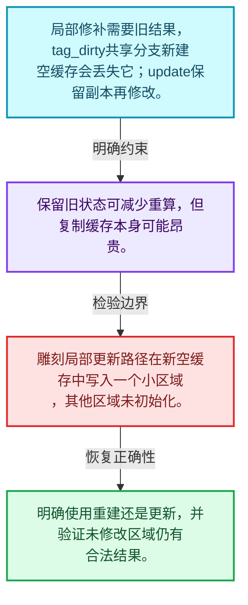
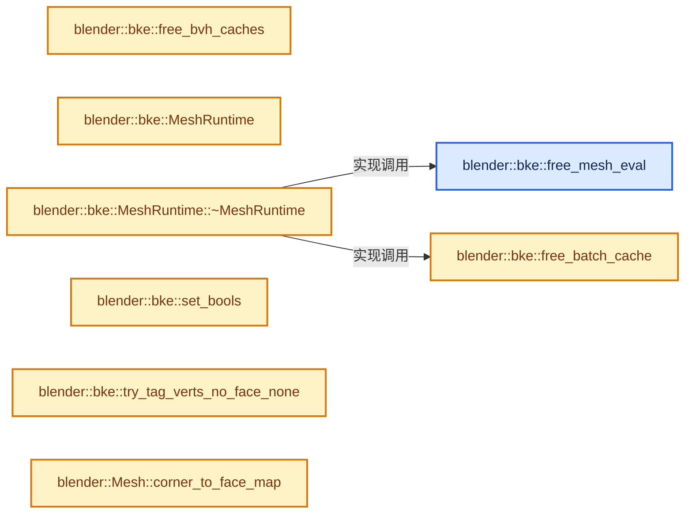
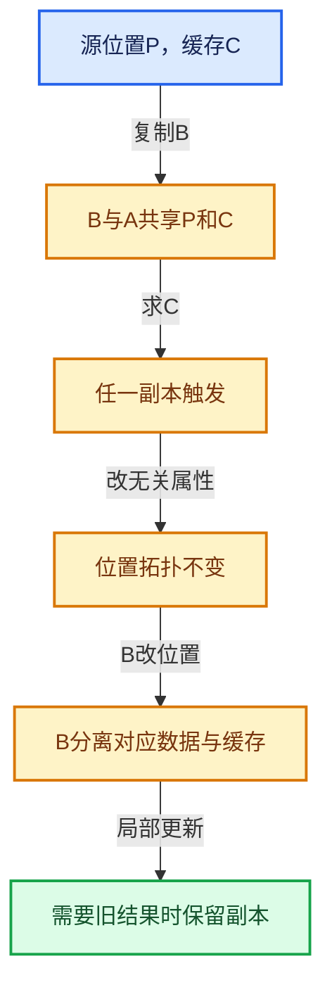

# 06-10 局部更新与失效修复

[方向导航](README.md) · [总目录](../README.md) · [实现索引](../00-课程指南/02-源码与提交索引/符号依赖与实现索引.md)

## 从问题到实现

标脏再ensure为什么可能丢掉局部更新所需旧数据？

tag_dirty可以放弃共享旧缓存，update需要保留旧状态以便修补；两者解决不同更新模式。

**数据模型**

局部修补需要旧结果，tag_dirty共享分支新建空缓存会丢失它；update保留副本再修改。

**设计取舍**

保留旧状态可减少重算，但复制缓存本身可能昂贵。

**最小反例**

雕刻局部更新路径在新空缓存中写入一个小区域，其他区域未初始化。

**推导**

明确使用重建还是更新，并验证未修改区域仍有合法结果。

## 阅读地图与执行推演








图中的数值推演是本方向的教学模型；实际函数之间的调用边与概念分析边分别标注，不能把概念关系当作运行时调度顺序。

## 完整源码单元与就地讲解

中文讲解直接放在相关代码旁，复杂机制在代码下展开。原文折叠区保留基准行号；不需要在行号表和函数之间来回查找。类布局可分段展示，函数实现不按固定行数切开。

### 类型布局、声明与编译条件 · mesh_runtime.cc L1—L30

<!-- annotated:a70899b99a7cb6 -->

```cpp
/* SPDX-FileCopyrightText: 2005 Blender Authors
 *
 * SPDX-License-Identifier: GPL-2.0-or-later */

/** \file
 * \ingroup bke
 */

#include "BLI_array_utils.hh"
#include "BLI_math_geom_c.hh"

#include "BKE_bake_data_block_id.hh"
#include "BKE_bvhutils.hh"
#include "BKE_customdata.hh"
#include "BKE_editmesh_cache.hh"
#include "BKE_lib_id.hh"
#include "BKE_mesh.hh"
#include "BKE_mesh_mapping.hh"
#include "BKE_mesh_runtime.hh"
#include "BKE_shrinkwrap.hh"
#include "BKE_subdiv_ccg.hh"

namespace blender {

/* -------------------------------------------------------------------- */
/** \name Mesh Runtime Struct Utils
 * \{ */

namespace bke {

```

<details>
<summary>核对原始源码：source/blender/blenkernel/intern/mesh_runtime.cc · L1—L30</summary>

<!-- original:a70899b99a7cb6:source/blender/blenkernel/intern/mesh_runtime.cc:1:30 -->

```cpp
/* SPDX-FileCopyrightText: 2005 Blender Authors
 *
 * SPDX-License-Identifier: GPL-2.0-or-later */

/** \file
 * \ingroup bke
 */

#include "BLI_array_utils.hh"
#include "BLI_math_geom_c.hh"

#include "BKE_bake_data_block_id.hh"
#include "BKE_bvhutils.hh"
#include "BKE_customdata.hh"
#include "BKE_editmesh_cache.hh"
#include "BKE_lib_id.hh"
#include "BKE_mesh.hh"
#include "BKE_mesh_mapping.hh"
#include "BKE_mesh_runtime.hh"
#include "BKE_shrinkwrap.hh"
#include "BKE_subdiv_ccg.hh"

namespace blender {

/* -------------------------------------------------------------------- */
/** \name Mesh Runtime Struct Utils
 * \{ */

namespace bke {

```

</details>

<a id="f-9914f37a1b4d858f"></a>

### `blender::bke::free_mesh_eval`

实现位置：[source/blender/blenkernel/intern/mesh_runtime.cc](../../../../../source/blender/blenkernel/intern/mesh_runtime.cc) · L31—L37。

接口参数：

- `MeshRuntime &mesh_runtime`

**教学注释版**

<!-- annotated:129bc713261a7d -->

```cpp
static void free_mesh_eval(MeshRuntime &mesh_runtime)
{
  if (mesh_runtime.mesh_eval != nullptr) {
    BKE_id_free(nullptr, mesh_runtime.mesh_eval);
    mesh_runtime.mesh_eval = nullptr;
  }
}
```

<details>
<summary>核对原始源码：source/blender/blenkernel/intern/mesh_runtime.cc · L31—L37</summary>

<!-- original:129bc713261a7d:source/blender/blenkernel/intern/mesh_runtime.cc:31:37 -->

```cpp
static void free_mesh_eval(MeshRuntime &mesh_runtime)
{
  if (mesh_runtime.mesh_eval != nullptr) {
    BKE_id_free(nullptr, mesh_runtime.mesh_eval);
    mesh_runtime.mesh_eval = nullptr;
  }
}
```

</details>

**沿实际写入检查状态**

- `mesh_runtime.mesh_eval = nullptr;`

**继续追踪实现**

- `BKE_id_free` → [blender::BKE_id_free · L224](../90-实现依赖专题/02-BKE几何与数据/intern/lib_id_delete.cc.md#f-28ed02c41d0f2d5b)。

<!-- annotated:bfa1ff8a93da9b -->

```cpp

```

<details>
<summary>核对原始源码：source/blender/blenkernel/intern/mesh_runtime.cc · L38—L38</summary>

<!-- original:bfa1ff8a93da9b:source/blender/blenkernel/intern/mesh_runtime.cc:38:38 -->

```cpp

```

</details>

<a id="f-3a0d9839e8119593"></a>

### `blender::bke::free_batch_cache`

实现位置：[source/blender/blenkernel/intern/mesh_runtime.cc](../../../../../source/blender/blenkernel/intern/mesh_runtime.cc) · L39—L45。

接口参数：

- `MeshRuntime &mesh_runtime`

**教学注释版**

<!-- annotated:6dfe03e93e597b -->

```cpp
static void free_batch_cache(MeshRuntime &mesh_runtime)
{
  if (mesh_runtime.batch_cache) {
    BKE_mesh_batch_cache_free(mesh_runtime.batch_cache);
    mesh_runtime.batch_cache = nullptr;
  }
}
```

<details>
<summary>核对原始源码：source/blender/blenkernel/intern/mesh_runtime.cc · L39—L45</summary>

<!-- original:6dfe03e93e597b:source/blender/blenkernel/intern/mesh_runtime.cc:39:45 -->

```cpp
static void free_batch_cache(MeshRuntime &mesh_runtime)
{
  if (mesh_runtime.batch_cache) {
    BKE_mesh_batch_cache_free(mesh_runtime.batch_cache);
    mesh_runtime.batch_cache = nullptr;
  }
}
```

</details>

**沿实际写入检查状态**

- `mesh_runtime.batch_cache = nullptr;`

**继续追踪实现**

- `BKE_mesh_batch_cache_free` → [blender::BKE_mesh_batch_cache_free · L474](10-局部更新与失效修复.md#f-56f14634da3a69be)。

<!-- annotated:4460d33b267c9a -->

```cpp

```

<details>
<summary>核对原始源码：source/blender/blenkernel/intern/mesh_runtime.cc · L46—L46</summary>

<!-- original:4460d33b267c9a:source/blender/blenkernel/intern/mesh_runtime.cc:46:46 -->

```cpp

```

</details>

<a id="f-390b904aeb0669e8"></a>

### `blender::bke::free_bvh_caches`

实现位置：[source/blender/blenkernel/intern/mesh_runtime.cc](../../../../../source/blender/blenkernel/intern/mesh_runtime.cc) · L47—L60。

接口参数：

- `MeshRuntime &mesh_runtime`

**教学注释版**

<!-- annotated:e1089f894b35f4 -->

```cpp
static void free_bvh_caches(MeshRuntime &mesh_runtime)
{
  mesh_runtime.bvh_cache_edges.tag_dirty();
  mesh_runtime.bvh_cache_faces.tag_dirty();
  mesh_runtime.bvh_cache_corner_tris.tag_dirty();
  mesh_runtime.bvh_cache_corner_tris_no_hidden.tag_dirty();
  mesh_runtime.bvh_cache_loose_verts.tag_dirty();
  mesh_runtime.bvh_cache_loose_verts_no_hidden.tag_dirty();
  mesh_runtime.bvh_cache_loose_edges.tag_dirty();
  mesh_runtime.bvh_cache_loose_edges_no_hidden.tag_dirty();
  mesh_runtime.bvh_embree_tris_cache.tag_dirty();
  mesh_runtime.bvh_embree_verts_cache.tag_dirty();
  mesh_runtime.bvh_embree_edges_cache.tag_dirty();
}
```

<details>
<summary>核对原始源码：source/blender/blenkernel/intern/mesh_runtime.cc · L47—L60</summary>

<!-- original:e1089f894b35f4:source/blender/blenkernel/intern/mesh_runtime.cc:47:60 -->

```cpp
static void free_bvh_caches(MeshRuntime &mesh_runtime)
{
  mesh_runtime.bvh_cache_edges.tag_dirty();
  mesh_runtime.bvh_cache_faces.tag_dirty();
  mesh_runtime.bvh_cache_corner_tris.tag_dirty();
  mesh_runtime.bvh_cache_corner_tris_no_hidden.tag_dirty();
  mesh_runtime.bvh_cache_loose_verts.tag_dirty();
  mesh_runtime.bvh_cache_loose_verts_no_hidden.tag_dirty();
  mesh_runtime.bvh_cache_loose_edges.tag_dirty();
  mesh_runtime.bvh_cache_loose_edges_no_hidden.tag_dirty();
  mesh_runtime.bvh_embree_tris_cache.tag_dirty();
  mesh_runtime.bvh_embree_verts_cache.tag_dirty();
  mesh_runtime.bvh_embree_edges_cache.tag_dirty();
}
```

</details>

**继续追踪实现**

- `mesh_runtime.bvh_cache_edges.tag_dirty` → [调用协议](../00-课程指南/01-路线与规范/模板宏与动态分派协议.md)：接收对象类型依赖auto、返回值或模板实例；不按同名猜测目标。调用位置L49。
- `mesh_runtime.bvh_cache_faces.tag_dirty` → [调用协议](../00-课程指南/01-路线与规范/模板宏与动态分派协议.md)：接收对象类型依赖auto、返回值或模板实例；不按同名猜测目标。调用位置L50。
- `mesh_runtime.bvh_cache_corner_tris.tag_dirty` → [调用协议](../00-课程指南/01-路线与规范/模板宏与动态分派协议.md)：接收对象类型依赖auto、返回值或模板实例；不按同名猜测目标。调用位置L51。
- `mesh_runtime.bvh_cache_corner_tris_no_hidden.tag_dirty` → [调用协议](../00-课程指南/01-路线与规范/模板宏与动态分派协议.md)：接收对象类型依赖auto、返回值或模板实例；不按同名猜测目标。调用位置L52。
- `mesh_runtime.bvh_cache_loose_verts.tag_dirty` → [调用协议](../00-课程指南/01-路线与规范/模板宏与动态分派协议.md)：接收对象类型依赖auto、返回值或模板实例；不按同名猜测目标。调用位置L53。
- `mesh_runtime.bvh_cache_loose_verts_no_hidden.tag_dirty` → [调用协议](../00-课程指南/01-路线与规范/模板宏与动态分派协议.md)：接收对象类型依赖auto、返回值或模板实例；不按同名猜测目标。调用位置L54。
- `mesh_runtime.bvh_cache_loose_edges.tag_dirty` → [调用协议](../00-课程指南/01-路线与规范/模板宏与动态分派协议.md)：接收对象类型依赖auto、返回值或模板实例；不按同名猜测目标。调用位置L55。
- `mesh_runtime.bvh_cache_loose_edges_no_hidden.tag_dirty` → [调用协议](../00-课程指南/01-路线与规范/模板宏与动态分派协议.md)：接收对象类型依赖auto、返回值或模板实例；不按同名猜测目标。调用位置L56。
- `mesh_runtime.bvh_embree_tris_cache.tag_dirty` → [调用协议](../00-课程指南/01-路线与规范/模板宏与动态分派协议.md)：接收对象类型依赖auto、返回值或模板实例；不按同名猜测目标。调用位置L57。
- `mesh_runtime.bvh_embree_verts_cache.tag_dirty` → [调用协议](../00-课程指南/01-路线与规范/模板宏与动态分派协议.md)：接收对象类型依赖auto、返回值或模板实例；不按同名猜测目标。调用位置L58。
- `mesh_runtime.bvh_embree_edges_cache.tag_dirty` → [调用协议](../00-课程指南/01-路线与规范/模板宏与动态分派协议.md)：接收对象类型依赖auto、返回值或模板实例；不按同名猜测目标。调用位置L59。

<!-- annotated:dd8f5c3e3b5908 -->

```cpp

```

<details>
<summary>核对原始源码：source/blender/blenkernel/intern/mesh_runtime.cc · L61—L61</summary>

<!-- original:dd8f5c3e3b5908:source/blender/blenkernel/intern/mesh_runtime.cc:61:61 -->

```cpp

```

</details>

<a id="f-95b92aff3b5d63a9"></a>

### `blender::bke::MeshRuntime`

实现位置：[source/blender/blenkernel/intern/mesh_runtime.cc](../../../../../source/blender/blenkernel/intern/mesh_runtime.cc) · L62—L62。

**教学注释版**

<!-- annotated:91c3dfdd0f4559 -->

```cpp
MeshRuntime::MeshRuntime() = default;
```

<details>
<summary>核对原始源码：source/blender/blenkernel/intern/mesh_runtime.cc · L62—L62</summary>

<!-- original:91c3dfdd0f4559:source/blender/blenkernel/intern/mesh_runtime.cc:62:62 -->

```cpp
MeshRuntime::MeshRuntime() = default;
```

</details>

**继续追踪实现**

本实现没有需要继续展开的显式调用；检查返回表达式、对象转换和调用者前置条件。

<!-- annotated:cdde76e6b6960c -->

```cpp

```

<details>
<summary>核对原始源码：source/blender/blenkernel/intern/mesh_runtime.cc · L63—L63</summary>

<!-- original:cdde76e6b6960c:source/blender/blenkernel/intern/mesh_runtime.cc:63:63 -->

```cpp

```

</details>

<a id="f-e5eca33ec1f38589"></a>

### `blender::bke::MeshRuntime::~MeshRuntime`

实现位置：[source/blender/blenkernel/intern/mesh_runtime.cc](../../../../../source/blender/blenkernel/intern/mesh_runtime.cc) · L64—L68。

**教学注释版**

<!-- annotated:3d7c8edf577b97 -->

```cpp
MeshRuntime::~MeshRuntime()
{
  free_mesh_eval(*this);
  free_batch_cache(*this);
}
```

<details>
<summary>核对原始源码：source/blender/blenkernel/intern/mesh_runtime.cc · L64—L68</summary>

<!-- original:3d7c8edf577b97:source/blender/blenkernel/intern/mesh_runtime.cc:64:68 -->

```cpp
MeshRuntime::~MeshRuntime()
{
  free_mesh_eval(*this);
  free_batch_cache(*this);
}
```

</details>

**继续追踪实现**

- `free_mesh_eval` → [blender::bke::free_mesh_eval · L31](10-局部更新与失效修复.md#f-9914f37a1b4d858f)。
- `free_batch_cache` → [blender::bke::free_batch_cache · L39](10-局部更新与失效修复.md#f-3a0d9839e8119593)。

<!-- annotated:5dd249a84c64e6 -->

```cpp

```

<details>
<summary>核对原始源码：source/blender/blenkernel/intern/mesh_runtime.cc · L69—L69</summary>

<!-- original:5dd249a84c64e6:source/blender/blenkernel/intern/mesh_runtime.cc:69:69 -->

```cpp

```

</details>

<a id="f-b3fd82969c5cbeda"></a>

### `blender::bke::set_bools`

实现位置：[source/blender/blenkernel/intern/mesh_runtime.cc](../../../../../source/blender/blenkernel/intern/mesh_runtime.cc) · L70—L79。

接口参数：

- `MutableSpan<bool> bools`
- `const Span<int> indices_to_set`

**教学注释版**

<!-- annotated:1040135778a044 -->

```cpp
static void set_bools(MutableSpan<bool> bools, const Span<int> indices_to_set)
{
  // [讲解] indices_to_set.size：查询视图长度或生成对应有效索引区间。
  threading::memory_bandwidth_bound_task(indices_to_set.size(), [&]() {
    // [讲解] indices_to_set.index_range：查询视图长度或生成对应有效索引区间。
    threading::parallel_for(indices_to_set.index_range(), 8192, [&](const IndexRange range) {
      for (const int i : range) {
        bools[indices_to_set[i]] = true;
      }
    });
  });
}
```

<details>
<summary>核对原始源码：source/blender/blenkernel/intern/mesh_runtime.cc · L70—L79</summary>

<!-- original:1040135778a044:source/blender/blenkernel/intern/mesh_runtime.cc:70:79 -->

```cpp
static void set_bools(MutableSpan<bool> bools, const Span<int> indices_to_set)
{
  threading::memory_bandwidth_bound_task(indices_to_set.size(), [&]() {
    threading::parallel_for(indices_to_set.index_range(), 8192, [&](const IndexRange range) {
      for (const int i : range) {
        bools[indices_to_set[i]] = true;
      }
    });
  });
}
```

</details>

**沿实际写入检查状态**

- `bools[indices_to_set[i]] = true;`

**继续追踪实现**

- `threading::memory_bandwidth_bound_task` → [blender::threading::memory_bandwidth_bound_task · L250](../11-Depsgraph与并行任务系统/07-任务池与TBB接入.md#f-aa412ccec656928d)。
- `indices_to_set.size` → [blender::Span::size · L256](../01-基础容器与现代CPP/05-Span只读连续视图.md#f-5f80fa006089c998)。
- `threading::parallel_for` → [blender::threading::parallel_for · L68](../11-Depsgraph与并行任务系统/07-任务池与TBB接入.md#f-838294754c24426c)。
- `indices_to_set.index_range` → [blender::Span::index_range · L405](../01-基础容器与现代CPP/05-Span只读连续视图.md#f-caaa9b06e13e53e0)。

### 类型布局、声明与编译条件 · mesh_runtime.cc L80—L83

<!-- annotated:c8331cc6762c7f -->

```cpp

/**
 * If there are no loose edges and no loose vertices, all vertices are used by faces.
 */
```

<details>
<summary>核对原始源码：source/blender/blenkernel/intern/mesh_runtime.cc · L80—L83</summary>

<!-- original:c8331cc6762c7f:source/blender/blenkernel/intern/mesh_runtime.cc:80:83 -->

```cpp

/**
 * If there are no loose edges and no loose vertices, all vertices are used by faces.
 */
```

</details>

<a id="f-859a3b0a1fbc0ea8"></a>

### `blender::bke::try_tag_verts_no_face_none`

实现位置：[source/blender/blenkernel/intern/mesh_runtime.cc](../../../../../source/blender/blenkernel/intern/mesh_runtime.cc) · L84—L97。

接口参数：

- `const Mesh &mesh`

**教学注释版**

<!-- annotated:30a59c1c0d8761 -->

```cpp
static void try_tag_verts_no_face_none(const Mesh &mesh)
{
  if (!mesh.runtime->loose_edges_cache.is_cached() || !mesh.loose_edges().is_empty()) {
    return;
  }
  if (!mesh.runtime->loose_verts_cache.is_cached() || !mesh.loose_verts().is_empty()) {
    return;
  }
  mesh.runtime->verts_no_face_cache.ensure([&](LooseGeomCache &r_data) {
    r_data.allocator.~LinearAllocator<>();
    new (&r_data.allocator) LinearAllocator<>();
    r_data.mask = {};
  });
}
```

<details>
<summary>核对原始源码：source/blender/blenkernel/intern/mesh_runtime.cc · L84—L97</summary>

<!-- original:30a59c1c0d8761:source/blender/blenkernel/intern/mesh_runtime.cc:84:97 -->

```cpp
static void try_tag_verts_no_face_none(const Mesh &mesh)
{
  if (!mesh.runtime->loose_edges_cache.is_cached() || !mesh.loose_edges().is_empty()) {
    return;
  }
  if (!mesh.runtime->loose_verts_cache.is_cached() || !mesh.loose_verts().is_empty()) {
    return;
  }
  mesh.runtime->verts_no_face_cache.ensure([&](LooseGeomCache &r_data) {
    r_data.allocator.~LinearAllocator<>();
    new (&r_data.allocator) LinearAllocator<>();
    r_data.mask = {};
  });
}
```

</details>

**沿实际写入检查状态**

- `r_data.mask = {};`

**继续追踪实现**

- `mesh.runtime->loose_edges_cache.is_cached` → [调用协议](../00-课程指南/01-路线与规范/模板宏与动态分派协议.md)：接收对象类型依赖auto、返回值或模板实例；不按同名猜测目标。调用位置L86。
- `mesh.loose_edges().is_empty` → [调用协议](../00-课程指南/01-路线与规范/模板宏与动态分派协议.md)：接收对象类型依赖auto、返回值或模板实例；不按同名猜测目标。调用位置L86。
- `mesh.loose_edges` → [blender::Mesh::loose_edges · L194](10-局部更新与失效修复.md#f-80e2cb4f8c0f449d)。
- `mesh.runtime->loose_verts_cache.is_cached` → [调用协议](../00-课程指南/01-路线与规范/模板宏与动态分派协议.md)：接收对象类型依赖auto、返回值或模板实例；不按同名猜测目标。调用位置L89。
- `mesh.loose_verts().is_empty` → [调用协议](../00-课程指南/01-路线与规范/模板宏与动态分派协议.md)：接收对象类型依赖auto、返回值或模板实例；不按同名猜测目标。调用位置L89。
- `mesh.loose_verts` → [blender::Mesh::loose_verts · L163](10-局部更新与失效修复.md#f-9f31b4f671ff9085)。
- `mesh.runtime->verts_no_face_cache.ensure` → [调用协议](../00-课程指南/01-路线与规范/模板宏与动态分派协议.md)：接收对象类型依赖auto、返回值或模板实例；不按同名猜测目标。调用位置L92。

### 类型布局、声明与编译条件 · mesh_runtime.cc L98—L100

<!-- annotated:cde57716ef88c1 -->

```cpp

}  // namespace bke

```

<details>
<summary>核对原始源码：source/blender/blenkernel/intern/mesh_runtime.cc · L98—L100</summary>

<!-- original:cde57716ef88c1:source/blender/blenkernel/intern/mesh_runtime.cc:98:100 -->

```cpp

}  // namespace bke

```

</details>

<a id="f-43907d9811e2baa7"></a>

### `blender::Mesh::corner_to_face_map`

实现位置：[source/blender/blenkernel/intern/mesh_runtime.cc](../../../../../source/blender/blenkernel/intern/mesh_runtime.cc) · L101—L108。

**教学注释版**

<!-- annotated:900e3ba1fe9080 -->

```cpp
Span<int> Mesh::corner_to_face_map() const
{
  this->runtime->corner_to_face_map_cache.ensure([&](Array<int> &r_data) {
    const OffsetIndices faces = this->faces();
    r_data = bke::mesh::build_corner_to_face_map(faces);
  });
  return this->runtime->corner_to_face_map_cache.data();
}
```

<details>
<summary>核对原始源码：source/blender/blenkernel/intern/mesh_runtime.cc · L101—L108</summary>

<!-- original:900e3ba1fe9080:source/blender/blenkernel/intern/mesh_runtime.cc:101:108 -->

```cpp
Span<int> Mesh::corner_to_face_map() const
{
  this->runtime->corner_to_face_map_cache.ensure([&](Array<int> &r_data) {
    const OffsetIndices faces = this->faces();
    r_data = bke::mesh::build_corner_to_face_map(faces);
  });
  return this->runtime->corner_to_face_map_cache.data();
}
```

</details>

**沿实际写入检查状态**

- `r_data = bke::mesh::build_corner_to_face_map(faces);`

**结果出口**

- `return this->runtime->corner_to_face_map_cache.data();`

**继续追踪实现**

- `this->runtime->corner_to_face_map_cache.ensure` → [调用协议](../00-课程指南/01-路线与规范/模板宏与动态分派协议.md)：接收对象类型依赖auto、返回值或模板实例；不按同名猜测目标。调用位置L103。
- `this->faces` → [Mesh::faces · L1217](../05-几何存储与拓扑映射/03-MPoly迁移与兼容.md#f-ea444760154e17b2)。
- `bke::mesh::build_corner_to_face_map` → [blender::bke::mesh::build_corner_to_face_map · L271](../05-几何存储与拓扑映射/06-拓扑映射构建.md#f-03abee56cb704ad5)。
- `this->runtime->corner_to_face_map_cache.data` → [调用协议](../00-课程指南/01-路线与规范/模板宏与动态分派协议.md)：接收对象类型依赖auto、返回值或模板实例；不按同名猜测目标。调用位置L107。

<!-- annotated:f3cffe9fb43d8b -->

```cpp

```

<details>
<summary>核对原始源码：source/blender/blenkernel/intern/mesh_runtime.cc · L109—L109</summary>

<!-- original:f3cffe9fb43d8b:source/blender/blenkernel/intern/mesh_runtime.cc:109:109 -->

```cpp

```

</details>

<a id="f-2b55b2923fa81c7e"></a>

### `blender::Mesh::vert_to_face_map_offsets`

实现位置：[source/blender/blenkernel/intern/mesh_runtime.cc](../../../../../source/blender/blenkernel/intern/mesh_runtime.cc) · L110—L117。

**教学注释版**

<!-- annotated:7b546df1d71f71 -->

```cpp
OffsetIndices<int> Mesh::vert_to_face_map_offsets() const
{
  this->runtime->vert_to_face_offset_cache.ensure([&](Array<int> &r_data) {
    r_data = Array<int>(this->verts_num + 1, 0);
    offset_indices::build_reverse_offsets(this->corner_verts(), r_data);
  });
  return OffsetIndices<int>(this->runtime->vert_to_face_offset_cache.data());
}
```

<details>
<summary>核对原始源码：source/blender/blenkernel/intern/mesh_runtime.cc · L110—L117</summary>

<!-- original:7b546df1d71f71:source/blender/blenkernel/intern/mesh_runtime.cc:110:117 -->

```cpp
OffsetIndices<int> Mesh::vert_to_face_map_offsets() const
{
  this->runtime->vert_to_face_offset_cache.ensure([&](Array<int> &r_data) {
    r_data = Array<int>(this->verts_num + 1, 0);
    offset_indices::build_reverse_offsets(this->corner_verts(), r_data);
  });
  return OffsetIndices<int>(this->runtime->vert_to_face_offset_cache.data());
}
```

</details>

**沿实际写入检查状态**

- `r_data = Array<int>(this->verts_num + 1, 0);`

**结果出口**

- `return OffsetIndices<int>(this->runtime->vert_to_face_offset_cache.data());`

**继续追踪实现**

- `this->runtime->vert_to_face_offset_cache.ensure` → [调用协议](../00-课程指南/01-路线与规范/模板宏与动态分派协议.md)：接收对象类型依赖auto、返回值或模板实例；不按同名猜测目标。调用位置L112。
- `Array<int>` → [blender::Array::Array · L78](../01-基础容器与现代CPP/07-Array构造与存储.md#f-001fd5eb3c658238)；[blender::Array::Array · L84](../01-基础容器与现代CPP/07-Array构造与存储.md#f-674e2f10361a462b)；[blender::Array::Array · L89](../01-基础容器与现代CPP/07-Array构造与存储.md#f-aa1e5908a9b67557)；[blender::Array::Array · L103](../01-基础容器与现代CPP/07-Array构造与存储.md#f-b141be39084346f3)；[blender::Array::Array · L110](../01-基础容器与现代CPP/07-Array构造与存储.md#f-452e276f39e81a2a)；[blender::Array::Array · L123](../01-基础容器与现代CPP/07-Array构造与存储.md#f-646aa58152ec44f6)；[blender::Array::Array · L135](../01-基础容器与现代CPP/07-Array构造与存储.md#f-0a9de4a549125f99)；[blender::Array::Array · L168](../01-基础容器与现代CPP/07-Array构造与存储.md#f-31f001eb92069e9d)；[blender::Array::Array · L176](../01-基础容器与现代CPP/07-Array构造与存储.md#f-cf8148f06fc6747a)；[blender::Array::Array · L178](../01-基础容器与现代CPP/07-Array构造与存储.md#f-2ddca2fb9dd964b3)。同名重载需按实参类型选择。
- `offset_indices::build_reverse_offsets` → [blender::offset_indices::build_reverse_offsets · L178](../05-几何存储与拓扑映射/05-邻接关系与前缀和.md#f-f9f2ea11aab00646)。
- `this->corner_verts` → [Mesh::corner_verts · L1238](../05-几何存储与拓扑映射/03-MPoly迁移与兼容.md#f-a59c61f583b64bc4)。
- `OffsetIndices<int>` → [blender::offset_indices::OffsetIndices::OffsetIndices · L44](../05-几何存储与拓扑映射/02-OffsetIndices完整接口.md#f-52a26009810ef8ec)；[blender::offset_indices::OffsetIndices::OffsetIndices · L45](../05-几何存储与拓扑映射/02-OffsetIndices完整接口.md#f-7be713f9489f3dd7)；[blender::offset_indices::OffsetIndices::OffsetIndices · L55](../05-几何存储与拓扑映射/02-OffsetIndices完整接口.md#f-db7e81a5ec2dfb8d)。同名重载需按实参类型选择。
- `this->runtime->vert_to_face_offset_cache.data` → [调用协议](../00-课程指南/01-路线与规范/模板宏与动态分派协议.md)：接收对象类型依赖auto、返回值或模板实例；不按同名猜测目标。调用位置L116。

<!-- annotated:f84f24317eb0c6 -->

```cpp

```

<details>
<summary>核对原始源码：source/blender/blenkernel/intern/mesh_runtime.cc · L118—L118</summary>

<!-- original:f84f24317eb0c6:source/blender/blenkernel/intern/mesh_runtime.cc:118:118 -->

```cpp

```

</details>

<a id="f-343af7b6eb5a9239"></a>

### `blender::Mesh::vert_to_face_map`

实现位置：[source/blender/blenkernel/intern/mesh_runtime.cc](../../../../../source/blender/blenkernel/intern/mesh_runtime.cc) · L119—L138。

**教学注释版**

<!-- annotated:703dcf2487b234 -->

```cpp
GroupedSpan<int> Mesh::vert_to_face_map() const
{
  const OffsetIndices offsets = this->vert_to_face_map_offsets();
  this->runtime->vert_to_face_map_cache.ensure([&](Array<int> &r_data) {
    // [讲解] r_data.reinitialize：以新长度重建数组。
    r_data.reinitialize(this->corners_num);
    if (this->runtime->vert_to_corner_map_cache.is_cached() &&
        this->runtime->corner_to_face_map_cache.is_cached())
    {
      /* The vertex to face cache can be built from the vertex to face corner
       * and face corner to face maps if they are both already cached. */
      array_utils::gather(this->runtime->corner_to_face_map_cache.data().as_span(),
                          this->runtime->vert_to_corner_map_cache.data().as_span(),
                          // [讲解] r_data.as_mutable_span：提供数组的借用访问入口。
                          r_data.as_mutable_span());
    }
    else {
      bke::mesh::build_vert_to_face_indices(this->faces(), this->corner_verts(), offsets, r_data);
    }
  });
  return {offsets, this->runtime->vert_to_face_map_cache.data()};
}
```

<details>
<summary>核对原始源码：source/blender/blenkernel/intern/mesh_runtime.cc · L119—L138</summary>

<!-- original:703dcf2487b234:source/blender/blenkernel/intern/mesh_runtime.cc:119:138 -->

```cpp
GroupedSpan<int> Mesh::vert_to_face_map() const
{
  const OffsetIndices offsets = this->vert_to_face_map_offsets();
  this->runtime->vert_to_face_map_cache.ensure([&](Array<int> &r_data) {
    r_data.reinitialize(this->corners_num);
    if (this->runtime->vert_to_corner_map_cache.is_cached() &&
        this->runtime->corner_to_face_map_cache.is_cached())
    {
      /* The vertex to face cache can be built from the vertex to face corner
       * and face corner to face maps if they are both already cached. */
      array_utils::gather(this->runtime->corner_to_face_map_cache.data().as_span(),
                          this->runtime->vert_to_corner_map_cache.data().as_span(),
                          r_data.as_mutable_span());
    }
    else {
      bke::mesh::build_vert_to_face_indices(this->faces(), this->corner_verts(), offsets, r_data);
    }
  });
  return {offsets, this->runtime->vert_to_face_map_cache.data()};
}
```

</details>

**结果出口**

- `return {offsets, this->runtime->vert_to_face_map_cache.data()};`

**继续追踪实现**

- `this->vert_to_face_map_offsets` → [blender::Mesh::vert_to_face_map_offsets · L110](10-局部更新与失效修复.md#f-2b55b2923fa81c7e)。
- `this->runtime->vert_to_face_map_cache.ensure` → [调用协议](../00-课程指南/01-路线与规范/模板宏与动态分派协议.md)：接收对象类型依赖auto、返回值或模板实例；不按同名猜测目标。调用位置L122。
- `r_data.reinitialize` → [blender::Array::reinitialize · L430](../01-基础容器与现代CPP/08-Array复制移动与销毁.md#f-3414f619e246b688)。
- `this->runtime->vert_to_corner_map_cache.is_cached` → [调用协议](../00-课程指南/01-路线与规范/模板宏与动态分派协议.md)：接收对象类型依赖auto、返回值或模板实例；不按同名猜测目标。调用位置L124。
- `this->runtime->corner_to_face_map_cache.is_cached` → [调用协议](../00-课程指南/01-路线与规范/模板宏与动态分派协议.md)：接收对象类型依赖auto、返回值或模板实例；不按同名猜测目标。调用位置L125。
- `array_utils::gather` → [blender::array_utils::gather · L187](../01-基础容器与现代CPP/20-容器选择与独立实现.md#f-1760adec5858a42f)；[blender::array_utils::gather · L209](../01-基础容器与现代CPP/20-容器选择与独立实现.md#f-a9f65820788454bf)；[blender::array_utils::gather · L225](../01-基础容器与现代CPP/20-容器选择与独立实现.md#f-279764b4196f0b63)；[blender::array_utils::gather · L237](../01-基础容器与现代CPP/20-容器选择与独立实现.md#f-e310fd489b49341b)；[blender::array_utils::gather · L268](../01-基础容器与现代CPP/20-容器选择与独立实现.md#f-7b21c29791903615)；[blender::array_utils::gather · L63](../90-实现依赖专题/01-BLI基础库/intern/array_utils.cc.md#f-5c2b501b03ddbb1f)；[blender::array_utils::gather · L82](../90-实现依赖专题/01-BLI基础库/intern/array_utils.cc.md#f-ea4dd9e673fe81e4)。同名重载需按实参类型选择。
- `this->runtime->corner_to_face_map_cache.data().as_span` → [调用协议](../00-课程指南/01-路线与规范/模板宏与动态分派协议.md)：接收对象类型依赖auto、返回值或模板实例；不按同名猜测目标。调用位置L129。
- `this->runtime->corner_to_face_map_cache.data` → [调用协议](../00-课程指南/01-路线与规范/模板宏与动态分派协议.md)：接收对象类型依赖auto、返回值或模板实例；不按同名猜测目标。调用位置L129。
- `this->runtime->vert_to_corner_map_cache.data().as_span` → [调用协议](../00-课程指南/01-路线与规范/模板宏与动态分派协议.md)：接收对象类型依赖auto、返回值或模板实例；不按同名猜测目标。调用位置L130。
- `this->runtime->vert_to_corner_map_cache.data` → [调用协议](../00-课程指南/01-路线与规范/模板宏与动态分派协议.md)：接收对象类型依赖auto、返回值或模板实例；不按同名猜测目标。调用位置L130。
- `r_data.as_mutable_span` → [blender::Array::as_mutable_span · L259](../01-基础容器与现代CPP/08-Array复制移动与销毁.md#f-4e91de9f1337c144)。
- `bke::mesh::build_vert_to_face_indices` → [blender::bke::mesh::build_vert_to_face_indices · L294](../05-几何存储与拓扑映射/06-拓扑映射构建.md#f-584fa6de12700e95)。
- `this->faces` → [Mesh::faces · L1217](../05-几何存储与拓扑映射/03-MPoly迁移与兼容.md#f-ea444760154e17b2)。
- `this->corner_verts` → [Mesh::corner_verts · L1238](../05-几何存储与拓扑映射/03-MPoly迁移与兼容.md#f-a59c61f583b64bc4)。
- `this->runtime->vert_to_face_map_cache.data` → [调用协议](../00-课程指南/01-路线与规范/模板宏与动态分派协议.md)：接收对象类型依赖auto、返回值或模板实例；不按同名猜测目标。调用位置L137。

<!-- annotated:424bbd53dfb53d -->

```cpp

```

<details>
<summary>核对原始源码：source/blender/blenkernel/intern/mesh_runtime.cc · L139—L139</summary>

<!-- original:424bbd53dfb53d:source/blender/blenkernel/intern/mesh_runtime.cc:139:139 -->

```cpp

```

</details>

<a id="f-c0845a9b3fbd56eb"></a>

### `blender::Mesh::vert_to_corner_map`

实现位置：[source/blender/blenkernel/intern/mesh_runtime.cc](../../../../../source/blender/blenkernel/intern/mesh_runtime.cc) · L140—L147。

**教学注释版**

<!-- annotated:f5501050e1af4f -->

```cpp
GroupedSpan<int> Mesh::vert_to_corner_map() const
{
  const OffsetIndices offsets = this->vert_to_face_map_offsets();
  this->runtime->vert_to_corner_map_cache.ensure([&](Array<int> &r_data) {
    r_data = bke::mesh::build_vert_to_corner_indices(this->corner_verts(), offsets);
  });
  return {offsets, this->runtime->vert_to_corner_map_cache.data()};
}
```

<details>
<summary>核对原始源码：source/blender/blenkernel/intern/mesh_runtime.cc · L140—L147</summary>

<!-- original:f5501050e1af4f:source/blender/blenkernel/intern/mesh_runtime.cc:140:147 -->

```cpp
GroupedSpan<int> Mesh::vert_to_corner_map() const
{
  const OffsetIndices offsets = this->vert_to_face_map_offsets();
  this->runtime->vert_to_corner_map_cache.ensure([&](Array<int> &r_data) {
    r_data = bke::mesh::build_vert_to_corner_indices(this->corner_verts(), offsets);
  });
  return {offsets, this->runtime->vert_to_corner_map_cache.data()};
}
```

</details>

**沿实际写入检查状态**

- `r_data = bke::mesh::build_vert_to_corner_indices(this->corner_verts(), offsets);`

**结果出口**

- `return {offsets, this->runtime->vert_to_corner_map_cache.data()};`

**继续追踪实现**

- `this->vert_to_face_map_offsets` → [blender::Mesh::vert_to_face_map_offsets · L110](10-局部更新与失效修复.md#f-2b55b2923fa81c7e)。
- `this->runtime->vert_to_corner_map_cache.ensure` → [调用协议](../00-课程指南/01-路线与规范/模板宏与动态分派协议.md)：接收对象类型依赖auto、返回值或模板实例；不按同名猜测目标。调用位置L143。
- `bke::mesh::build_vert_to_corner_indices` → [blender::bke::mesh::build_vert_to_corner_indices · L314](../05-几何存储与拓扑映射/06-拓扑映射构建.md#f-e101eb282f5adaf0)。
- `this->corner_verts` → [Mesh::corner_verts · L1238](../05-几何存储与拓扑映射/03-MPoly迁移与兼容.md#f-a59c61f583b64bc4)。
- `this->runtime->vert_to_corner_map_cache.data` → [调用协议](../00-课程指南/01-路线与规范/模板宏与动态分派协议.md)：接收对象类型依赖auto、返回值或模板实例；不按同名猜测目标。调用位置L146。

<!-- annotated:231a223c3e544d -->

```cpp

```

<details>
<summary>核对原始源码：source/blender/blenkernel/intern/mesh_runtime.cc · L148—L148</summary>

<!-- original:231a223c3e544d:source/blender/blenkernel/intern/mesh_runtime.cc:148:148 -->

```cpp

```

</details>

<a id="f-c1c3e254b19dbee3"></a>

### `blender::Mesh::edge_to_corner_map`

实现位置：[source/blender/blenkernel/intern/mesh_runtime.cc](../../../../../source/blender/blenkernel/intern/mesh_runtime.cc) · L149—L161。

**教学注释版**

<!-- annotated:3b6b0c1ca0e895 -->

```cpp
GroupedSpan<int> Mesh::edge_to_corner_map() const
{
  this->runtime->edge_to_corner_offset_cache.ensure([&](Array<int> &r_data) {
    r_data = Array<int>(this->edges_num + 1, 0);
    offset_indices::build_reverse_offsets(this->corner_edges(), r_data);
  });
  const OffsetIndices<int> offsets(this->runtime->edge_to_corner_offset_cache.data());
  this->runtime->edge_to_corner_map_cache.ensure([&](Array<int> &r_data) {
    // [讲解] r_data.reinitialize：以新长度重建数组。
    r_data.reinitialize(offsets.total_size());
    offset_indices::reverse_indices_in_groups(this->corner_edges(), offsets, r_data);
  });
  return {offsets, this->runtime->edge_to_corner_map_cache.data()};
}
```

<details>
<summary>核对原始源码：source/blender/blenkernel/intern/mesh_runtime.cc · L149—L161</summary>

<!-- original:3b6b0c1ca0e895:source/blender/blenkernel/intern/mesh_runtime.cc:149:161 -->

```cpp
GroupedSpan<int> Mesh::edge_to_corner_map() const
{
  this->runtime->edge_to_corner_offset_cache.ensure([&](Array<int> &r_data) {
    r_data = Array<int>(this->edges_num + 1, 0);
    offset_indices::build_reverse_offsets(this->corner_edges(), r_data);
  });
  const OffsetIndices<int> offsets(this->runtime->edge_to_corner_offset_cache.data());
  this->runtime->edge_to_corner_map_cache.ensure([&](Array<int> &r_data) {
    r_data.reinitialize(offsets.total_size());
    offset_indices::reverse_indices_in_groups(this->corner_edges(), offsets, r_data);
  });
  return {offsets, this->runtime->edge_to_corner_map_cache.data()};
}
```

</details>

**沿实际写入检查状态**

- `r_data = Array<int>(this->edges_num + 1, 0);`

**结果出口**

- `return {offsets, this->runtime->edge_to_corner_map_cache.data()};`

**继续追踪实现**

- `this->runtime->edge_to_corner_offset_cache.ensure` → [调用协议](../00-课程指南/01-路线与规范/模板宏与动态分派协议.md)：接收对象类型依赖auto、返回值或模板实例；不按同名猜测目标。调用位置L151。
- `Array<int>` → [blender::Array::Array · L78](../01-基础容器与现代CPP/07-Array构造与存储.md#f-001fd5eb3c658238)；[blender::Array::Array · L84](../01-基础容器与现代CPP/07-Array构造与存储.md#f-674e2f10361a462b)；[blender::Array::Array · L89](../01-基础容器与现代CPP/07-Array构造与存储.md#f-aa1e5908a9b67557)；[blender::Array::Array · L103](../01-基础容器与现代CPP/07-Array构造与存储.md#f-b141be39084346f3)；[blender::Array::Array · L110](../01-基础容器与现代CPP/07-Array构造与存储.md#f-452e276f39e81a2a)；[blender::Array::Array · L123](../01-基础容器与现代CPP/07-Array构造与存储.md#f-646aa58152ec44f6)；[blender::Array::Array · L135](../01-基础容器与现代CPP/07-Array构造与存储.md#f-0a9de4a549125f99)；[blender::Array::Array · L168](../01-基础容器与现代CPP/07-Array构造与存储.md#f-31f001eb92069e9d)；[blender::Array::Array · L176](../01-基础容器与现代CPP/07-Array构造与存储.md#f-cf8148f06fc6747a)；[blender::Array::Array · L178](../01-基础容器与现代CPP/07-Array构造与存储.md#f-2ddca2fb9dd964b3)。同名重载需按实参类型选择。
- `offset_indices::build_reverse_offsets` → [blender::offset_indices::build_reverse_offsets · L178](../05-几何存储与拓扑映射/05-邻接关系与前缀和.md#f-f9f2ea11aab00646)。
- `this->corner_edges` → [Mesh::corner_edges · L1252](../05-几何存储与拓扑映射/03-MPoly迁移与兼容.md#f-687b790868e7f257)。
- `this->runtime->edge_to_corner_offset_cache.data` → [调用协议](../00-课程指南/01-路线与规范/模板宏与动态分派协议.md)：接收对象类型依赖auto、返回值或模板实例；不按同名猜测目标。调用位置L155。
- `this->runtime->edge_to_corner_map_cache.ensure` → [调用协议](../00-课程指南/01-路线与规范/模板宏与动态分派协议.md)：接收对象类型依赖auto、返回值或模板实例；不按同名猜测目标。调用位置L156。
- `r_data.reinitialize` → [blender::Array::reinitialize · L430](../01-基础容器与现代CPP/08-Array复制移动与销毁.md#f-3414f619e246b688)。
- `offsets.total_size` → [blender::offset_indices::OffsetIndices::total_size · L58](../05-几何存储与拓扑映射/02-OffsetIndices完整接口.md#f-c111ffdac7a19248)。
- `offset_indices::reverse_indices_in_groups` → [blender::offset_indices::reverse_indices_in_groups · L331](../05-几何存储与拓扑映射/05-邻接关系与前缀和.md#f-a6233b87f753fce6)；[blender::offset_indices::reverse_indices_in_groups · L353](../05-几何存储与拓扑映射/05-邻接关系与前缀和.md#f-8a5003c28b7e2b96)；[blender::offset_indices::reverse_indices_in_groups · L388](../05-几何存储与拓扑映射/05-邻接关系与前缀和.md#f-b670c6339bcc64cd)。同名重载需按实参类型选择。
- `this->runtime->edge_to_corner_map_cache.data` → [调用协议](../00-课程指南/01-路线与规范/模板宏与动态分派协议.md)：接收对象类型依赖auto、返回值或模板实例；不按同名猜测目标。调用位置L160。

<!-- annotated:4d9d4a76ffa6d4 -->

```cpp

```

<details>
<summary>核对原始源码：source/blender/blenkernel/intern/mesh_runtime.cc · L162—L162</summary>

<!-- original:4d9d4a76ffa6d4:source/blender/blenkernel/intern/mesh_runtime.cc:162:162 -->

```cpp

```

</details>

<a id="f-9f31b4f671ff9085"></a>

### `blender::Mesh::loose_verts`

实现位置：[source/blender/blenkernel/intern/mesh_runtime.cc](../../../../../source/blender/blenkernel/intern/mesh_runtime.cc) · L163—L174。

**教学注释版**

<!-- annotated:70c585b12d791b -->

```cpp
const IndexMask &Mesh::loose_verts() const
{
  using namespace blender::bke;
  this->runtime->loose_verts_cache.ensure([&](LooseGeomCache &r_data) {
    Array<bool, 256> bools(this->verts_num, false);
    set_bools(bools, this->edges().cast<int>());
    r_data.allocator.~LinearAllocator<>();
    new (&r_data.allocator) LinearAllocator<>();
    r_data.mask = IndexMask::from_bools_inverse(bools, r_data.allocator);
  });
  return this->runtime->loose_verts_cache.data().mask;
}
```

<details>
<summary>核对原始源码：source/blender/blenkernel/intern/mesh_runtime.cc · L163—L174</summary>

<!-- original:70c585b12d791b:source/blender/blenkernel/intern/mesh_runtime.cc:163:174 -->

```cpp
const IndexMask &Mesh::loose_verts() const
{
  using namespace blender::bke;
  this->runtime->loose_verts_cache.ensure([&](LooseGeomCache &r_data) {
    Array<bool, 256> bools(this->verts_num, false);
    set_bools(bools, this->edges().cast<int>());
    r_data.allocator.~LinearAllocator<>();
    new (&r_data.allocator) LinearAllocator<>();
    r_data.mask = IndexMask::from_bools_inverse(bools, r_data.allocator);
  });
  return this->runtime->loose_verts_cache.data().mask;
}
```

</details>

**沿实际写入检查状态**

- `r_data.mask = IndexMask::from_bools_inverse(bools, r_data.allocator);`

**结果出口**

- `return this->runtime->loose_verts_cache.data().mask;`

**继续追踪实现**

- `this->runtime->loose_verts_cache.ensure` → [调用协议](../00-课程指南/01-路线与规范/模板宏与动态分派协议.md)：接收对象类型依赖auto、返回值或模板实例；不按同名猜测目标。调用位置L166。
- `set_bools` → [blender::bke::set_bools · L70](10-局部更新与失效修复.md#f-b3fd82969c5cbeda)。
- `this->edges().cast<int>` → [调用协议](../00-课程指南/01-路线与规范/模板宏与动态分派协议.md)：接收对象类型依赖auto、返回值或模板实例；不按同名猜测目标。调用位置L168。
- `this->edges` → [Mesh::edges · L1205](../05-几何存储与拓扑映射/03-MPoly迁移与兼容.md#f-7232f6756b674d12)。
- `IndexMask::from_bools_inverse` → [blender::index_mask::IndexMask::from_bools_inverse · L603](../04-虚拟数组与索引选择/10-IndexMask构建与并行.md#f-96442cca3bb6cc50)；[blender::index_mask::IndexMask::from_bools_inverse · L608](../04-虚拟数组与索引选择/10-IndexMask构建与并行.md#f-c40b154f402a386c)；[blender::index_mask::IndexMask::from_bools_inverse · L640](../04-虚拟数组与索引选择/10-IndexMask构建与并行.md#f-f2da3a64e1eb2558)；[blender::index_mask::IndexMask::from_bools_inverse · L668](../04-虚拟数组与索引选择/10-IndexMask构建与并行.md#f-1975fcd2e2ded5f3)。同名重载需按实参类型选择。
- `this->runtime->loose_verts_cache.data` → [调用协议](../00-课程指南/01-路线与规范/模板宏与动态分派协议.md)：接收对象类型依赖auto、返回值或模板实例；不按同名猜测目标。调用位置L173。

<!-- annotated:039b27ec133f2e -->

```cpp

```

<details>
<summary>核对原始源码：source/blender/blenkernel/intern/mesh_runtime.cc · L175—L175</summary>

<!-- original:039b27ec133f2e:source/blender/blenkernel/intern/mesh_runtime.cc:175:175 -->

```cpp

```

</details>

<a id="f-11b9bed425be6cbf"></a>

### `blender::Mesh::verts_no_face`

实现位置：[source/blender/blenkernel/intern/mesh_runtime.cc](../../../../../source/blender/blenkernel/intern/mesh_runtime.cc) · L176—L187。

**教学注释版**

<!-- annotated:01b9b9961c9b33 -->

```cpp
const IndexMask &Mesh::verts_no_face() const
{
  using namespace blender::bke;
  this->runtime->verts_no_face_cache.ensure([&](LooseGeomCache &r_data) {
    Array<bool, 256> bools(this->verts_num, false);
    set_bools(bools, this->corner_verts());
    r_data.allocator.~LinearAllocator<>();
    new (&r_data.allocator) LinearAllocator<>();
    r_data.mask = IndexMask::from_bools_inverse(bools, r_data.allocator);
  });
  return this->runtime->verts_no_face_cache.data().mask;
}
```

<details>
<summary>核对原始源码：source/blender/blenkernel/intern/mesh_runtime.cc · L176—L187</summary>

<!-- original:01b9b9961c9b33:source/blender/blenkernel/intern/mesh_runtime.cc:176:187 -->

```cpp
const IndexMask &Mesh::verts_no_face() const
{
  using namespace blender::bke;
  this->runtime->verts_no_face_cache.ensure([&](LooseGeomCache &r_data) {
    Array<bool, 256> bools(this->verts_num, false);
    set_bools(bools, this->corner_verts());
    r_data.allocator.~LinearAllocator<>();
    new (&r_data.allocator) LinearAllocator<>();
    r_data.mask = IndexMask::from_bools_inverse(bools, r_data.allocator);
  });
  return this->runtime->verts_no_face_cache.data().mask;
}
```

</details>

**沿实际写入检查状态**

- `r_data.mask = IndexMask::from_bools_inverse(bools, r_data.allocator);`

**结果出口**

- `return this->runtime->verts_no_face_cache.data().mask;`

**继续追踪实现**

- `this->runtime->verts_no_face_cache.ensure` → [调用协议](../00-课程指南/01-路线与规范/模板宏与动态分派协议.md)：接收对象类型依赖auto、返回值或模板实例；不按同名猜测目标。调用位置L179。
- `set_bools` → [blender::bke::set_bools · L70](10-局部更新与失效修复.md#f-b3fd82969c5cbeda)。
- `this->corner_verts` → [Mesh::corner_verts · L1238](../05-几何存储与拓扑映射/03-MPoly迁移与兼容.md#f-a59c61f583b64bc4)。
- `IndexMask::from_bools_inverse` → [blender::index_mask::IndexMask::from_bools_inverse · L603](../04-虚拟数组与索引选择/10-IndexMask构建与并行.md#f-96442cca3bb6cc50)；[blender::index_mask::IndexMask::from_bools_inverse · L608](../04-虚拟数组与索引选择/10-IndexMask构建与并行.md#f-c40b154f402a386c)；[blender::index_mask::IndexMask::from_bools_inverse · L640](../04-虚拟数组与索引选择/10-IndexMask构建与并行.md#f-f2da3a64e1eb2558)；[blender::index_mask::IndexMask::from_bools_inverse · L668](../04-虚拟数组与索引选择/10-IndexMask构建与并行.md#f-1975fcd2e2ded5f3)。同名重载需按实参类型选择。
- `this->runtime->verts_no_face_cache.data` → [调用协议](../00-课程指南/01-路线与规范/模板宏与动态分派协议.md)：接收对象类型依赖auto、返回值或模板实例；不按同名猜测目标。调用位置L186。

<!-- annotated:8bb848297a5b82 -->

```cpp

```

<details>
<summary>核对原始源码：source/blender/blenkernel/intern/mesh_runtime.cc · L188—L188</summary>

<!-- original:8bb848297a5b82:source/blender/blenkernel/intern/mesh_runtime.cc:188:188 -->

```cpp

```

</details>

<a id="f-e0203a45618f1e8d"></a>

### `blender::Mesh::no_overlapping_topology`

实现位置：[source/blender/blenkernel/intern/mesh_runtime.cc](../../../../../source/blender/blenkernel/intern/mesh_runtime.cc) · L189—L192。

**教学注释版**

<!-- annotated:97adf5fb71c4b6 -->

```cpp
bool Mesh::no_overlapping_topology() const
{
  return this->flag & ME_NO_OVERLAPPING_TOPOLOGY;
}
```

<details>
<summary>核对原始源码：source/blender/blenkernel/intern/mesh_runtime.cc · L189—L192</summary>

<!-- original:97adf5fb71c4b6:source/blender/blenkernel/intern/mesh_runtime.cc:189:192 -->

```cpp
bool Mesh::no_overlapping_topology() const
{
  return this->flag & ME_NO_OVERLAPPING_TOPOLOGY;
}
```

</details>

**结果出口**

- `return this->flag & ME_NO_OVERLAPPING_TOPOLOGY;`

**继续追踪实现**

本实现没有需要继续展开的显式调用；检查返回表达式、对象转换和调用者前置条件。

<!-- annotated:60bfe5991f2c2d -->

```cpp

```

<details>
<summary>核对原始源码：source/blender/blenkernel/intern/mesh_runtime.cc · L193—L193</summary>

<!-- original:60bfe5991f2c2d:source/blender/blenkernel/intern/mesh_runtime.cc:193:193 -->

```cpp

```

</details>

<a id="f-80e2cb4f8c0f449d"></a>

### `blender::Mesh::loose_edges`

实现位置：[source/blender/blenkernel/intern/mesh_runtime.cc](../../../../../source/blender/blenkernel/intern/mesh_runtime.cc) · L194—L205。

**教学注释版**

<!-- annotated:3cd4f355dedfc3 -->

```cpp
const IndexMask &Mesh::loose_edges() const
{
  using namespace blender::bke;
  this->runtime->loose_edges_cache.ensure([&](LooseGeomCache &r_data) {
    Array<bool, 256> bools(this->edges_num, false);
    set_bools(bools, this->corner_edges());
    r_data.allocator.~LinearAllocator<>();
    new (&r_data.allocator) LinearAllocator<>();
    r_data.mask = IndexMask::from_bools_inverse(bools, r_data.allocator);
  });
  return this->runtime->loose_edges_cache.data().mask;
}
```

<details>
<summary>核对原始源码：source/blender/blenkernel/intern/mesh_runtime.cc · L194—L205</summary>

<!-- original:3cd4f355dedfc3:source/blender/blenkernel/intern/mesh_runtime.cc:194:205 -->

```cpp
const IndexMask &Mesh::loose_edges() const
{
  using namespace blender::bke;
  this->runtime->loose_edges_cache.ensure([&](LooseGeomCache &r_data) {
    Array<bool, 256> bools(this->edges_num, false);
    set_bools(bools, this->corner_edges());
    r_data.allocator.~LinearAllocator<>();
    new (&r_data.allocator) LinearAllocator<>();
    r_data.mask = IndexMask::from_bools_inverse(bools, r_data.allocator);
  });
  return this->runtime->loose_edges_cache.data().mask;
}
```

</details>

**沿实际写入检查状态**

- `r_data.mask = IndexMask::from_bools_inverse(bools, r_data.allocator);`

**结果出口**

- `return this->runtime->loose_edges_cache.data().mask;`

**继续追踪实现**

- `this->runtime->loose_edges_cache.ensure` → [调用协议](../00-课程指南/01-路线与规范/模板宏与动态分派协议.md)：接收对象类型依赖auto、返回值或模板实例；不按同名猜测目标。调用位置L197。
- `set_bools` → [blender::bke::set_bools · L70](10-局部更新与失效修复.md#f-b3fd82969c5cbeda)。
- `this->corner_edges` → [Mesh::corner_edges · L1252](../05-几何存储与拓扑映射/03-MPoly迁移与兼容.md#f-687b790868e7f257)。
- `IndexMask::from_bools_inverse` → [blender::index_mask::IndexMask::from_bools_inverse · L603](../04-虚拟数组与索引选择/10-IndexMask构建与并行.md#f-96442cca3bb6cc50)；[blender::index_mask::IndexMask::from_bools_inverse · L608](../04-虚拟数组与索引选择/10-IndexMask构建与并行.md#f-c40b154f402a386c)；[blender::index_mask::IndexMask::from_bools_inverse · L640](../04-虚拟数组与索引选择/10-IndexMask构建与并行.md#f-f2da3a64e1eb2558)；[blender::index_mask::IndexMask::from_bools_inverse · L668](../04-虚拟数组与索引选择/10-IndexMask构建与并行.md#f-1975fcd2e2ded5f3)。同名重载需按实参类型选择。
- `this->runtime->loose_edges_cache.data` → [调用协议](../00-课程指南/01-路线与规范/模板宏与动态分派协议.md)：接收对象类型依赖auto、返回值或模板实例；不按同名猜测目标。调用位置L204。

<!-- annotated:aa754a24571735 -->

```cpp

```

<details>
<summary>核对原始源码：source/blender/blenkernel/intern/mesh_runtime.cc · L206—L206</summary>

<!-- original:aa754a24571735:source/blender/blenkernel/intern/mesh_runtime.cc:206:206 -->

```cpp

```

</details>

<a id="f-496bb182c3efc1ed"></a>

### `blender::Mesh::tag_loose_verts_none`

实现位置：[source/blender/blenkernel/intern/mesh_runtime.cc](../../../../../source/blender/blenkernel/intern/mesh_runtime.cc) · L207—L216。

**教学注释版**

<!-- annotated:476bfaef9cabcc -->

```cpp
void Mesh::tag_loose_verts_none() const
{
  using namespace blender::bke;
  this->runtime->loose_verts_cache.ensure([&](LooseGeomCache &r_data) {
    r_data.allocator.~LinearAllocator<>();
    new (&r_data.allocator) LinearAllocator<>();
    r_data.mask = {};
  });
  try_tag_verts_no_face_none(*this);
}
```

<details>
<summary>核对原始源码：source/blender/blenkernel/intern/mesh_runtime.cc · L207—L216</summary>

<!-- original:476bfaef9cabcc:source/blender/blenkernel/intern/mesh_runtime.cc:207:216 -->

```cpp
void Mesh::tag_loose_verts_none() const
{
  using namespace blender::bke;
  this->runtime->loose_verts_cache.ensure([&](LooseGeomCache &r_data) {
    r_data.allocator.~LinearAllocator<>();
    new (&r_data.allocator) LinearAllocator<>();
    r_data.mask = {};
  });
  try_tag_verts_no_face_none(*this);
}
```

</details>

**沿实际写入检查状态**

- `r_data.mask = {};`

**继续追踪实现**

- `this->runtime->loose_verts_cache.ensure` → [调用协议](../00-课程指南/01-路线与规范/模板宏与动态分派协议.md)：接收对象类型依赖auto、返回值或模板实例；不按同名猜测目标。调用位置L210。
- `try_tag_verts_no_face_none` → [blender::bke::try_tag_verts_no_face_none · L84](10-局部更新与失效修复.md#f-859a3b0a1fbc0ea8)。

<!-- annotated:c57748b0bd819b -->

```cpp

```

<details>
<summary>核对原始源码：source/blender/blenkernel/intern/mesh_runtime.cc · L217—L217</summary>

<!-- original:c57748b0bd819b:source/blender/blenkernel/intern/mesh_runtime.cc:217:217 -->

```cpp

```

</details>

<a id="f-ce3d1779ee275444"></a>

### `blender::Mesh::tag_loose_edges_none`

实现位置：[source/blender/blenkernel/intern/mesh_runtime.cc](../../../../../source/blender/blenkernel/intern/mesh_runtime.cc) · L218—L227。

**教学注释版**

<!-- annotated:0d67e40fa810aa -->

```cpp
void Mesh::tag_loose_edges_none() const
{
  using namespace blender::bke;
  this->runtime->loose_edges_cache.ensure([&](LooseGeomCache &r_data) {
    r_data.allocator.~LinearAllocator<>();
    new (&r_data.allocator) LinearAllocator<>();
    r_data.mask = {};
  });
  try_tag_verts_no_face_none(*this);
}
```

<details>
<summary>核对原始源码：source/blender/blenkernel/intern/mesh_runtime.cc · L218—L227</summary>

<!-- original:0d67e40fa810aa:source/blender/blenkernel/intern/mesh_runtime.cc:218:227 -->

```cpp
void Mesh::tag_loose_edges_none() const
{
  using namespace blender::bke;
  this->runtime->loose_edges_cache.ensure([&](LooseGeomCache &r_data) {
    r_data.allocator.~LinearAllocator<>();
    new (&r_data.allocator) LinearAllocator<>();
    r_data.mask = {};
  });
  try_tag_verts_no_face_none(*this);
}
```

</details>

**沿实际写入检查状态**

- `r_data.mask = {};`

**继续追踪实现**

- `this->runtime->loose_edges_cache.ensure` → [调用协议](../00-课程指南/01-路线与规范/模板宏与动态分派协议.md)：接收对象类型依赖auto、返回值或模板实例；不按同名猜测目标。调用位置L221。
- `try_tag_verts_no_face_none` → [blender::bke::try_tag_verts_no_face_none · L84](10-局部更新与失效修复.md#f-859a3b0a1fbc0ea8)。

<!-- annotated:4e55c499501017 -->

```cpp

```

<details>
<summary>核对原始源码：source/blender/blenkernel/intern/mesh_runtime.cc · L228—L228</summary>

<!-- original:4e55c499501017:source/blender/blenkernel/intern/mesh_runtime.cc:228:228 -->

```cpp

```

</details>

<a id="f-23199a5a728fd0dc"></a>

### `blender::Mesh::tag_overlapping_none`

实现位置：[source/blender/blenkernel/intern/mesh_runtime.cc](../../../../../source/blender/blenkernel/intern/mesh_runtime.cc) · L229—L233。

**教学注释版**

<!-- annotated:5128362e0fd553 -->

```cpp
void Mesh::tag_overlapping_none()
{
  using namespace blender::bke;
  this->flag |= ME_NO_OVERLAPPING_TOPOLOGY;
}
```

<details>
<summary>核对原始源码：source/blender/blenkernel/intern/mesh_runtime.cc · L229—L233</summary>

<!-- original:5128362e0fd553:source/blender/blenkernel/intern/mesh_runtime.cc:229:233 -->

```cpp
void Mesh::tag_overlapping_none()
{
  using namespace blender::bke;
  this->flag |= ME_NO_OVERLAPPING_TOPOLOGY;
}
```

</details>

**沿实际写入检查状态**

- `this->flag |= ME_NO_OVERLAPPING_TOPOLOGY;`

**继续追踪实现**

本实现没有需要继续展开的显式调用；检查返回表达式、对象转换和调用者前置条件。

### 类型布局、声明与编译条件 · mesh_runtime.cc L234—L236

<!-- annotated:08bae81b7a1ceb -->

```cpp

namespace bke {

```

<details>
<summary>核对原始源码：source/blender/blenkernel/intern/mesh_runtime.cc · L234—L236</summary>

<!-- original:08bae81b7a1ceb:source/blender/blenkernel/intern/mesh_runtime.cc:234:236 -->

```cpp

namespace bke {

```

</details>

<a id="f-6ba7b67f716c5309"></a>

### `blender::bke::TrianglesCache::freeze`

实现位置：[source/blender/blenkernel/intern/mesh_runtime.cc](../../../../../source/blender/blenkernel/intern/mesh_runtime.cc) · L237—L241。

**教学注释版**

<!-- annotated:7dafc4fa563368 -->

```cpp
void TrianglesCache::freeze()
{
  this->frozen = true;
  this->dirty_while_frozen = false;
}
```

<details>
<summary>核对原始源码：source/blender/blenkernel/intern/mesh_runtime.cc · L237—L241</summary>

<!-- original:7dafc4fa563368:source/blender/blenkernel/intern/mesh_runtime.cc:237:241 -->

```cpp
void TrianglesCache::freeze()
{
  this->frozen = true;
  this->dirty_while_frozen = false;
}
```

</details>

**沿实际写入检查状态**

- `this->frozen = true;`
- `this->dirty_while_frozen = false;`

**继续追踪实现**

本实现没有需要继续展开的显式调用；检查返回表达式、对象转换和调用者前置条件。

<!-- annotated:eda3677243f2d1 -->

```cpp

```

<details>
<summary>核对原始源码：source/blender/blenkernel/intern/mesh_runtime.cc · L242—L242</summary>

<!-- original:eda3677243f2d1:source/blender/blenkernel/intern/mesh_runtime.cc:242:242 -->

```cpp

```

</details>

<a id="f-fe1250030f601dab"></a>

### `blender::bke::TrianglesCache::unfreeze`

实现位置：[source/blender/blenkernel/intern/mesh_runtime.cc](../../../../../source/blender/blenkernel/intern/mesh_runtime.cc) · L243—L250。

**教学注释版**

<!-- annotated:29190028324f9f -->

```cpp
void TrianglesCache::unfreeze()
{
  this->frozen = false;
  if (this->dirty_while_frozen) {
    this->data.tag_dirty();
  }
  this->dirty_while_frozen = false;
}
```

<details>
<summary>核对原始源码：source/blender/blenkernel/intern/mesh_runtime.cc · L243—L250</summary>

<!-- original:29190028324f9f:source/blender/blenkernel/intern/mesh_runtime.cc:243:250 -->

```cpp
void TrianglesCache::unfreeze()
{
  this->frozen = false;
  if (this->dirty_while_frozen) {
    this->data.tag_dirty();
  }
  this->dirty_while_frozen = false;
}
```

</details>

**沿实际写入检查状态**

- `this->frozen = false;`
- `this->dirty_while_frozen = false;`

**继续追踪实现**

- `this->data.tag_dirty` → [调用协议](../00-课程指南/01-路线与规范/模板宏与动态分派协议.md)：接收对象类型依赖auto、返回值或模板实例；不按同名猜测目标。调用位置L247。

<!-- annotated:733adc96666e34 -->

```cpp

```

<details>
<summary>核对原始源码：source/blender/blenkernel/intern/mesh_runtime.cc · L251—L251</summary>

<!-- original:733adc96666e34:source/blender/blenkernel/intern/mesh_runtime.cc:251:251 -->

```cpp

```

</details>

<a id="f-d5ae6694f59bf316"></a>

### `blender::bke::TrianglesCache::tag_dirty`

实现位置：[source/blender/blenkernel/intern/mesh_runtime.cc](../../../../../source/blender/blenkernel/intern/mesh_runtime.cc) · L252—L260。

**教学注释版**

<!-- annotated:93670249250dce -->

```cpp
void TrianglesCache::tag_dirty()
{
  if (this->frozen) {
    this->dirty_while_frozen = true;
  }
  else {
    this->data.tag_dirty();
  }
}
```

<details>
<summary>核对原始源码：source/blender/blenkernel/intern/mesh_runtime.cc · L252—L260</summary>

<!-- original:93670249250dce:source/blender/blenkernel/intern/mesh_runtime.cc:252:260 -->

```cpp
void TrianglesCache::tag_dirty()
{
  if (this->frozen) {
    this->dirty_while_frozen = true;
  }
  else {
    this->data.tag_dirty();
  }
}
```

</details>

**沿实际写入检查状态**

- `this->dirty_while_frozen = true;`

**继续追踪实现**

- `this->data.tag_dirty` → [调用协议](../00-课程指南/01-路线与规范/模板宏与动态分派协议.md)：接收对象类型依赖auto、返回值或模板实例；不按同名猜测目标。调用位置L258。

### 类型布局、声明与编译条件 · mesh_runtime.cc L261—L263

<!-- annotated:cf32bbe61e6c42 -->

```cpp

}  // namespace bke

```

<details>
<summary>核对原始源码：source/blender/blenkernel/intern/mesh_runtime.cc · L261—L263</summary>

<!-- original:cf32bbe61e6c42:source/blender/blenkernel/intern/mesh_runtime.cc:261:263 -->

```cpp

}  // namespace bke

```

</details>

<a id="f-9bb421790000fc20"></a>

### `blender::Mesh::corner_tris`

实现位置：[source/blender/blenkernel/intern/mesh_runtime.cc](../../../../../source/blender/blenkernel/intern/mesh_runtime.cc) · L264—L283。

**教学注释版**

<!-- annotated:fed634b31e3b50 -->

```cpp
Span<int3> Mesh::corner_tris() const
{
  this->runtime->corner_tris_cache.data.ensure([&](Array<int3> &r_data) {
    const Span<float3> positions = this->vert_positions();
    const OffsetIndices faces = this->faces();
    const Span<int> corner_verts = this->corner_verts();

    // [讲解] r_data.reinitialize：以新长度重建数组。
    r_data.reinitialize(poly_to_tri_count(faces.size(), corner_verts.size()));

    if (BKE_mesh_face_normals_are_dirty(this)) {
      bke::mesh::corner_tris_calc(positions, faces, corner_verts, r_data);
    }
    else {
      bke::mesh::corner_tris_calc_with_normals(
          positions, faces, corner_verts, this->face_normals(), r_data);
    }
  });

  return this->runtime->corner_tris_cache.data.data();
}
```

<details>
<summary>核对原始源码：source/blender/blenkernel/intern/mesh_runtime.cc · L264—L283</summary>

<!-- original:fed634b31e3b50:source/blender/blenkernel/intern/mesh_runtime.cc:264:283 -->

```cpp
Span<int3> Mesh::corner_tris() const
{
  this->runtime->corner_tris_cache.data.ensure([&](Array<int3> &r_data) {
    const Span<float3> positions = this->vert_positions();
    const OffsetIndices faces = this->faces();
    const Span<int> corner_verts = this->corner_verts();

    r_data.reinitialize(poly_to_tri_count(faces.size(), corner_verts.size()));

    if (BKE_mesh_face_normals_are_dirty(this)) {
      bke::mesh::corner_tris_calc(positions, faces, corner_verts, r_data);
    }
    else {
      bke::mesh::corner_tris_calc_with_normals(
          positions, faces, corner_verts, this->face_normals(), r_data);
    }
  });

  return this->runtime->corner_tris_cache.data.data();
}
```

</details>

**结果出口**

- `return this->runtime->corner_tris_cache.data.data();`

**继续追踪实现**

- `this->runtime->corner_tris_cache.data.ensure` → [调用协议](../00-课程指南/01-路线与规范/模板宏与动态分派协议.md)：接收对象类型依赖auto、返回值或模板实例；不按同名猜测目标。调用位置L266。
- `this->vert_positions` → [Mesh::vert_positions · L1193](../05-几何存储与拓扑映射/03-MPoly迁移与兼容.md#f-ae4177e5c5f2b371)。
- `this->faces` → [Mesh::faces · L1217](../05-几何存储与拓扑映射/03-MPoly迁移与兼容.md#f-ea444760154e17b2)。
- `this->corner_verts` → [Mesh::corner_verts · L1238](../05-几何存储与拓扑映射/03-MPoly迁移与兼容.md#f-a59c61f583b64bc4)。
- `r_data.reinitialize` → [blender::Array::reinitialize · L430](../01-基础容器与现代CPP/08-Array复制移动与销毁.md#f-3414f619e246b688)。
- `poly_to_tri_count` → [blender::poly_to_tri_count · L118](../90-实现依赖专题/01-BLI基础库/intern/math_geom_inline.cc.md#f-fd5a0e76d62e3b0b)。
- `faces.size` → [blender::offset_indices::OffsetIndices::size · L67](../05-几何存储与拓扑映射/02-OffsetIndices完整接口.md#f-e238abc62ed42abd)。
- `corner_verts.size` → [blender::Span::size · L256](../01-基础容器与现代CPP/05-Span只读连续视图.md#f-5f80fa006089c998)。
- `BKE_mesh_face_normals_are_dirty` → [blender::BKE_mesh_face_normals_are_dirty · L103](08-法线缓存的真实依赖.md#f-99295a8853fdc3c4)。
- `bke::mesh::corner_tris_calc` → [blender::bke::mesh::corner_tris_calc · L206](../90-实现依赖专题/02-BKE几何与数据/intern/mesh_tessellate.cc.md#f-69edfcb57d8c02dd)。
- `bke::mesh::corner_tris_calc_with_normals` → [blender::bke::mesh::corner_tris_calc_with_normals · L226](../90-实现依赖专题/02-BKE几何与数据/intern/mesh_tessellate.cc.md#f-089ddc0055000e6a)。
- `this->face_normals` → [blender::Mesh::face_normals · L415](08-法线缓存的真实依赖.md#f-65ff7730b863cee0)。
- `this->runtime->corner_tris_cache.data.data` → [调用协议](../00-课程指南/01-路线与规范/模板宏与动态分派协议.md)：接收对象类型依赖auto、返回值或模板实例；不按同名猜测目标。调用位置L282。

<!-- annotated:4d112d5d1cd75a -->

```cpp

```

<details>
<summary>核对原始源码：source/blender/blenkernel/intern/mesh_runtime.cc · L284—L284</summary>

<!-- original:4d112d5d1cd75a:source/blender/blenkernel/intern/mesh_runtime.cc:284:284 -->

```cpp

```

</details>

<a id="f-94cfee90bf521ed4"></a>

### `blender::Mesh::corner_tri_faces`

实现位置：[source/blender/blenkernel/intern/mesh_runtime.cc](../../../../../source/blender/blenkernel/intern/mesh_runtime.cc) · L285—L293。

**教学注释版**

<!-- annotated:cdbcee36192c60 -->

```cpp
Span<int> Mesh::corner_tri_faces() const
{
  this->runtime->corner_tri_faces_cache.ensure([&](Array<int> &r_data) {
    const OffsetIndices faces = this->faces();
    // [讲解] r_data.reinitialize：以新长度重建数组。
    r_data.reinitialize(poly_to_tri_count(faces.size(), this->corners_num));
    bke::mesh::corner_tris_calc_face_indices(faces, r_data);
  });
  return this->runtime->corner_tri_faces_cache.data();
}
```

<details>
<summary>核对原始源码：source/blender/blenkernel/intern/mesh_runtime.cc · L285—L293</summary>

<!-- original:cdbcee36192c60:source/blender/blenkernel/intern/mesh_runtime.cc:285:293 -->

```cpp
Span<int> Mesh::corner_tri_faces() const
{
  this->runtime->corner_tri_faces_cache.ensure([&](Array<int> &r_data) {
    const OffsetIndices faces = this->faces();
    r_data.reinitialize(poly_to_tri_count(faces.size(), this->corners_num));
    bke::mesh::corner_tris_calc_face_indices(faces, r_data);
  });
  return this->runtime->corner_tri_faces_cache.data();
}
```

</details>

**结果出口**

- `return this->runtime->corner_tri_faces_cache.data();`

**继续追踪实现**

- `this->runtime->corner_tri_faces_cache.ensure` → [调用协议](../00-课程指南/01-路线与规范/模板宏与动态分派协议.md)：接收对象类型依赖auto、返回值或模板实例；不按同名猜测目标。调用位置L287。
- `this->faces` → [Mesh::faces · L1217](../05-几何存储与拓扑映射/03-MPoly迁移与兼容.md#f-ea444760154e17b2)。
- `r_data.reinitialize` → [blender::Array::reinitialize · L430](../01-基础容器与现代CPP/08-Array复制移动与销毁.md#f-3414f619e246b688)。
- `poly_to_tri_count` → [blender::poly_to_tri_count · L118](../90-实现依赖专题/01-BLI基础库/intern/math_geom_inline.cc.md#f-fd5a0e76d62e3b0b)。
- `faces.size` → [blender::offset_indices::OffsetIndices::size · L67](../05-几何存储与拓扑映射/02-OffsetIndices完整接口.md#f-e238abc62ed42abd)。
- `bke::mesh::corner_tris_calc_face_indices` → [blender::bke::mesh::corner_tris_calc_face_indices · L214](../90-实现依赖专题/02-BKE几何与数据/intern/mesh_tessellate.cc.md#f-1f44987ba09b0207)。
- `this->runtime->corner_tri_faces_cache.data` → [调用协议](../00-课程指南/01-路线与规范/模板宏与动态分派协议.md)：接收对象类型依赖auto、返回值或模板实例；不按同名猜测目标。调用位置L292。

<!-- annotated:dd5e9dbc5a116b -->

```cpp

```

<details>
<summary>核对原始源码：source/blender/blenkernel/intern/mesh_runtime.cc · L294—L294</summary>

<!-- original:dd5e9dbc5a116b:source/blender/blenkernel/intern/mesh_runtime.cc:294:294 -->

```cpp

```

</details>

<a id="f-0c13526c31ccfacd"></a>

### `blender::BKE_mesh_runtime_corner_tris_len`

实现位置：[source/blender/blenkernel/intern/mesh_runtime.cc](../../../../../source/blender/blenkernel/intern/mesh_runtime.cc) · L295—L299。

接口参数：

- `const Mesh *mesh`

**教学注释版**

<!-- annotated:cf95cb4c4c4cdc -->

```cpp
int BKE_mesh_runtime_corner_tris_len(const Mesh *mesh)
{
  /* Allow returning the size without calculating the cache. */
  return poly_to_tri_count(mesh->faces_num, mesh->corners_num);
}
```

<details>
<summary>核对原始源码：source/blender/blenkernel/intern/mesh_runtime.cc · L295—L299</summary>

<!-- original:cf95cb4c4c4cdc:source/blender/blenkernel/intern/mesh_runtime.cc:295:299 -->

```cpp
int BKE_mesh_runtime_corner_tris_len(const Mesh *mesh)
{
  /* Allow returning the size without calculating the cache. */
  return poly_to_tri_count(mesh->faces_num, mesh->corners_num);
}
```

</details>

**结果出口**

- `return poly_to_tri_count(mesh->faces_num, mesh->corners_num);`

**继续追踪实现**

- `poly_to_tri_count` → [blender::poly_to_tri_count · L118](../90-实现依赖专题/01-BLI基础库/intern/math_geom_inline.cc.md#f-fd5a0e76d62e3b0b)。

<!-- annotated:b9a1b16720da9d -->

```cpp

```

<details>
<summary>核对原始源码：source/blender/blenkernel/intern/mesh_runtime.cc · L300—L300</summary>

<!-- original:b9a1b16720da9d:source/blender/blenkernel/intern/mesh_runtime.cc:300:300 -->

```cpp

```

</details>

<a id="f-bd697561fb664105"></a>

### `blender::BKE_mesh_runtime_ensure_edit_data`

实现位置：[source/blender/blenkernel/intern/mesh_runtime.cc](../../../../../source/blender/blenkernel/intern/mesh_runtime.cc) · L301—L306。

接口参数：

- `Mesh *mesh`

**教学注释版**

<!-- annotated:74c9f0b61cd564 -->

```cpp
void BKE_mesh_runtime_ensure_edit_data(Mesh *mesh)
{
  if (!mesh->runtime->edit_data) {
    // [讲解] std::make_unique<bke::EditMeshData>：创建独占拥有的对象，拥有关系可移动，get返回的借用指针不自动延长寿命。
    mesh->runtime->edit_data = std::make_unique<bke::EditMeshData>();
  }
}
```

<details>
<summary>核对原始源码：source/blender/blenkernel/intern/mesh_runtime.cc · L301—L306</summary>

<!-- original:74c9f0b61cd564:source/blender/blenkernel/intern/mesh_runtime.cc:301:306 -->

```cpp
void BKE_mesh_runtime_ensure_edit_data(Mesh *mesh)
{
  if (!mesh->runtime->edit_data) {
    mesh->runtime->edit_data = std::make_unique<bke::EditMeshData>();
  }
}
```

</details>

**沿实际写入检查状态**

- `mesh->runtime->edit_data = std::make_unique<bke::EditMeshData>();`

**继续追踪实现**

- `std::make_unique<bke::EditMeshData>` → [外部契约](https://eel.is/c++draft/unique.ptr.create)：创建独占拥有的对象，拥有关系可移动，get返回的借用指针不自动延长寿命。

<!-- annotated:07a9eba88dc8b9 -->

```cpp

```

<details>
<summary>核对原始源码：source/blender/blenkernel/intern/mesh_runtime.cc · L307—L307</summary>

<!-- original:07a9eba88dc8b9:source/blender/blenkernel/intern/mesh_runtime.cc:307:307 -->

```cpp

```

</details>

<a id="f-de9b4245f2adf2e7"></a>

### `blender::BKE_mesh_runtime_clear_cache`

实现位置：[source/blender/blenkernel/intern/mesh_runtime.cc](../../../../../source/blender/blenkernel/intern/mesh_runtime.cc) · L308—L315。

接口参数：

- `Mesh *mesh`

**教学注释版**

<!-- annotated:acdcdb89b52d77 -->

```cpp
void BKE_mesh_runtime_clear_cache(Mesh *mesh)
{
  using namespace blender::bke;
  free_mesh_eval(*mesh->runtime);
  free_batch_cache(*mesh->runtime);
  mesh->runtime->edit_data.reset();
  BKE_mesh_runtime_clear_geometry(mesh);
}
```

<details>
<summary>核对原始源码：source/blender/blenkernel/intern/mesh_runtime.cc · L308—L315</summary>

<!-- original:acdcdb89b52d77:source/blender/blenkernel/intern/mesh_runtime.cc:308:315 -->

```cpp
void BKE_mesh_runtime_clear_cache(Mesh *mesh)
{
  using namespace blender::bke;
  free_mesh_eval(*mesh->runtime);
  free_batch_cache(*mesh->runtime);
  mesh->runtime->edit_data.reset();
  BKE_mesh_runtime_clear_geometry(mesh);
}
```

</details>

**继续追踪实现**

- `free_mesh_eval` → [blender::bke::free_mesh_eval · L31](10-局部更新与失效修复.md#f-9914f37a1b4d858f)。
- `free_batch_cache` → [blender::bke::free_batch_cache · L39](10-局部更新与失效修复.md#f-3a0d9839e8119593)。
- `mesh->runtime->edit_data.reset` → [调用协议](../00-课程指南/01-路线与规范/模板宏与动态分派协议.md)：接收对象类型依赖auto、返回值或模板实例；不按同名猜测目标。调用位置L313。
- `BKE_mesh_runtime_clear_geometry` → [blender::BKE_mesh_runtime_clear_geometry · L317](10-局部更新与失效修复.md#f-b0e508c51e37f71f)。

<!-- annotated:aab3a9a56bacc3 -->

```cpp

```

<details>
<summary>核对原始源码：source/blender/blenkernel/intern/mesh_runtime.cc · L316—L316</summary>

<!-- original:aab3a9a56bacc3:source/blender/blenkernel/intern/mesh_runtime.cc:316:316 -->

```cpp

```

</details>

<a id="f-b0e508c51e37f71f"></a>

### `blender::BKE_mesh_runtime_clear_geometry`

实现位置：[source/blender/blenkernel/intern/mesh_runtime.cc](../../../../../source/blender/blenkernel/intern/mesh_runtime.cc) · L317—L345。

接口参数：

- `Mesh *mesh`

**教学注释版**

<!-- annotated:3f54b2ce074ffa -->

```cpp
void BKE_mesh_runtime_clear_geometry(Mesh *mesh)
{
  /* Tagging shared caches dirty will free the allocated data if there is only one user. */
  free_bvh_caches(*mesh->runtime);
  mesh->runtime->subdiv_ccg.reset();
  mesh->runtime->bounds_cache.tag_dirty();
  mesh->runtime->vert_to_face_offset_cache.tag_dirty();
  mesh->runtime->vert_to_face_map_cache.tag_dirty();
  mesh->runtime->vert_to_corner_map_cache.tag_dirty();
  mesh->runtime->corner_to_face_map_cache.tag_dirty();
  mesh->runtime->edge_to_corner_offset_cache.tag_dirty();
  mesh->runtime->edge_to_corner_map_cache.tag_dirty();
  mesh->runtime->vert_normals_cache.tag_dirty();
  mesh->runtime->vert_normals_true_cache.tag_dirty();
  mesh->runtime->face_normals_cache.tag_dirty();
  mesh->runtime->face_normals_true_cache.tag_dirty();
  mesh->runtime->corner_normals_cache.tag_dirty();
  mesh->runtime->loose_edges_cache.tag_dirty();
  mesh->runtime->loose_verts_cache.tag_dirty();
  mesh->runtime->verts_no_face_cache.tag_dirty();
  mesh->runtime->corner_tris_cache.data.tag_dirty();
  mesh->runtime->corner_tri_faces_cache.tag_dirty();
  mesh->runtime->shrinkwrap_boundary_cache.tag_dirty();
  mesh->runtime->max_material_index.tag_dirty();
  mesh->runtime->subsurf_face_dot_tags.clear_and_shrink();
  mesh->runtime->subsurf_optimal_display_edges.clear_and_shrink();
  mesh->runtime->spatial_groups.reset();
  mesh->flag &= ~(ME_NO_OVERLAPPING_TOPOLOGY | ME_FLAG_UV_SELECT_SYNC_VALID);
}
```

<details>
<summary>核对原始源码：source/blender/blenkernel/intern/mesh_runtime.cc · L317—L345</summary>

<!-- original:3f54b2ce074ffa:source/blender/blenkernel/intern/mesh_runtime.cc:317:345 -->

```cpp
void BKE_mesh_runtime_clear_geometry(Mesh *mesh)
{
  /* Tagging shared caches dirty will free the allocated data if there is only one user. */
  free_bvh_caches(*mesh->runtime);
  mesh->runtime->subdiv_ccg.reset();
  mesh->runtime->bounds_cache.tag_dirty();
  mesh->runtime->vert_to_face_offset_cache.tag_dirty();
  mesh->runtime->vert_to_face_map_cache.tag_dirty();
  mesh->runtime->vert_to_corner_map_cache.tag_dirty();
  mesh->runtime->corner_to_face_map_cache.tag_dirty();
  mesh->runtime->edge_to_corner_offset_cache.tag_dirty();
  mesh->runtime->edge_to_corner_map_cache.tag_dirty();
  mesh->runtime->vert_normals_cache.tag_dirty();
  mesh->runtime->vert_normals_true_cache.tag_dirty();
  mesh->runtime->face_normals_cache.tag_dirty();
  mesh->runtime->face_normals_true_cache.tag_dirty();
  mesh->runtime->corner_normals_cache.tag_dirty();
  mesh->runtime->loose_edges_cache.tag_dirty();
  mesh->runtime->loose_verts_cache.tag_dirty();
  mesh->runtime->verts_no_face_cache.tag_dirty();
  mesh->runtime->corner_tris_cache.data.tag_dirty();
  mesh->runtime->corner_tri_faces_cache.tag_dirty();
  mesh->runtime->shrinkwrap_boundary_cache.tag_dirty();
  mesh->runtime->max_material_index.tag_dirty();
  mesh->runtime->subsurf_face_dot_tags.clear_and_shrink();
  mesh->runtime->subsurf_optimal_display_edges.clear_and_shrink();
  mesh->runtime->spatial_groups.reset();
  mesh->flag &= ~(ME_NO_OVERLAPPING_TOPOLOGY | ME_FLAG_UV_SELECT_SYNC_VALID);
}
```

</details>

**沿实际写入检查状态**

- `mesh->flag &= ~(ME_NO_OVERLAPPING_TOPOLOGY | ME_FLAG_UV_SELECT_SYNC_VALID);`

**继续追踪实现**

- `free_bvh_caches` → [blender::bke::free_bvh_caches · L47](10-局部更新与失效修复.md#f-390b904aeb0669e8)。
- `mesh->runtime->subdiv_ccg.reset` → [调用协议](../00-课程指南/01-路线与规范/模板宏与动态分派协议.md)：接收对象类型依赖auto、返回值或模板实例；不按同名猜测目标。调用位置L321。
- `mesh->runtime->bounds_cache.tag_dirty` → [调用协议](../00-课程指南/01-路线与规范/模板宏与动态分派协议.md)：接收对象类型依赖auto、返回值或模板实例；不按同名猜测目标。调用位置L322。
- `mesh->runtime->vert_to_face_offset_cache.tag_dirty` → [调用协议](../00-课程指南/01-路线与规范/模板宏与动态分派协议.md)：接收对象类型依赖auto、返回值或模板实例；不按同名猜测目标。调用位置L323。
- `mesh->runtime->vert_to_face_map_cache.tag_dirty` → [调用协议](../00-课程指南/01-路线与规范/模板宏与动态分派协议.md)：接收对象类型依赖auto、返回值或模板实例；不按同名猜测目标。调用位置L324。
- `mesh->runtime->vert_to_corner_map_cache.tag_dirty` → [调用协议](../00-课程指南/01-路线与规范/模板宏与动态分派协议.md)：接收对象类型依赖auto、返回值或模板实例；不按同名猜测目标。调用位置L325。
- `mesh->runtime->corner_to_face_map_cache.tag_dirty` → [调用协议](../00-课程指南/01-路线与规范/模板宏与动态分派协议.md)：接收对象类型依赖auto、返回值或模板实例；不按同名猜测目标。调用位置L326。
- `mesh->runtime->edge_to_corner_offset_cache.tag_dirty` → [调用协议](../00-课程指南/01-路线与规范/模板宏与动态分派协议.md)：接收对象类型依赖auto、返回值或模板实例；不按同名猜测目标。调用位置L327。
- `mesh->runtime->edge_to_corner_map_cache.tag_dirty` → [调用协议](../00-课程指南/01-路线与规范/模板宏与动态分派协议.md)：接收对象类型依赖auto、返回值或模板实例；不按同名猜测目标。调用位置L328。
- `mesh->runtime->vert_normals_cache.tag_dirty` → [调用协议](../00-课程指南/01-路线与规范/模板宏与动态分派协议.md)：接收对象类型依赖auto、返回值或模板实例；不按同名猜测目标。调用位置L329。
- `mesh->runtime->vert_normals_true_cache.tag_dirty` → [调用协议](../00-课程指南/01-路线与规范/模板宏与动态分派协议.md)：接收对象类型依赖auto、返回值或模板实例；不按同名猜测目标。调用位置L330。
- `mesh->runtime->face_normals_cache.tag_dirty` → [调用协议](../00-课程指南/01-路线与规范/模板宏与动态分派协议.md)：接收对象类型依赖auto、返回值或模板实例；不按同名猜测目标。调用位置L331。
- `mesh->runtime->face_normals_true_cache.tag_dirty` → [调用协议](../00-课程指南/01-路线与规范/模板宏与动态分派协议.md)：接收对象类型依赖auto、返回值或模板实例；不按同名猜测目标。调用位置L332。
- `mesh->runtime->corner_normals_cache.tag_dirty` → [调用协议](../00-课程指南/01-路线与规范/模板宏与动态分派协议.md)：接收对象类型依赖auto、返回值或模板实例；不按同名猜测目标。调用位置L333。
- `mesh->runtime->loose_edges_cache.tag_dirty` → [调用协议](../00-课程指南/01-路线与规范/模板宏与动态分派协议.md)：接收对象类型依赖auto、返回值或模板实例；不按同名猜测目标。调用位置L334。
- `mesh->runtime->loose_verts_cache.tag_dirty` → [调用协议](../00-课程指南/01-路线与规范/模板宏与动态分派协议.md)：接收对象类型依赖auto、返回值或模板实例；不按同名猜测目标。调用位置L335。
- `mesh->runtime->verts_no_face_cache.tag_dirty` → [调用协议](../00-课程指南/01-路线与规范/模板宏与动态分派协议.md)：接收对象类型依赖auto、返回值或模板实例；不按同名猜测目标。调用位置L336。
- `mesh->runtime->corner_tris_cache.data.tag_dirty` → [调用协议](../00-课程指南/01-路线与规范/模板宏与动态分派协议.md)：接收对象类型依赖auto、返回值或模板实例；不按同名猜测目标。调用位置L337。
- `mesh->runtime->corner_tri_faces_cache.tag_dirty` → [调用协议](../00-课程指南/01-路线与规范/模板宏与动态分派协议.md)：接收对象类型依赖auto、返回值或模板实例；不按同名猜测目标。调用位置L338。
- `mesh->runtime->shrinkwrap_boundary_cache.tag_dirty` → [调用协议](../00-课程指南/01-路线与规范/模板宏与动态分派协议.md)：接收对象类型依赖auto、返回值或模板实例；不按同名猜测目标。调用位置L339。
- `mesh->runtime->max_material_index.tag_dirty` → [调用协议](../00-课程指南/01-路线与规范/模板宏与动态分派协议.md)：接收对象类型依赖auto、返回值或模板实例；不按同名猜测目标。调用位置L340。
- `mesh->runtime->subsurf_face_dot_tags.clear_and_shrink` → [调用协议](../00-课程指南/01-路线与规范/模板宏与动态分派协议.md)：接收对象类型依赖auto、返回值或模板实例；不按同名猜测目标。调用位置L341。
- `mesh->runtime->subsurf_optimal_display_edges.clear_and_shrink` → [调用协议](../00-课程指南/01-路线与规范/模板宏与动态分派协议.md)：接收对象类型依赖auto、返回值或模板实例；不按同名猜测目标。调用位置L342。
- `mesh->runtime->spatial_groups.reset` → [调用协议](../00-课程指南/01-路线与规范/模板宏与动态分派协议.md)：接收对象类型依赖auto、返回值或模板实例；不按同名猜测目标。调用位置L343。

<!-- annotated:cbb00dcc8fefe5 -->

```cpp

```

<details>
<summary>核对原始源码：source/blender/blenkernel/intern/mesh_runtime.cc · L346—L346</summary>

<!-- original:cbb00dcc8fefe5:source/blender/blenkernel/intern/mesh_runtime.cc:346:346 -->

```cpp

```

</details>

<a id="f-e97057a42e360e96"></a>

### `blender::Mesh::tag_edges_split`

实现位置：[source/blender/blenkernel/intern/mesh_runtime.cc](../../../../../source/blender/blenkernel/intern/mesh_runtime.cc) · L347—L377。

**教学注释版**

<!-- annotated:a0ee046ac8be97 -->

```cpp
void Mesh::tag_edges_split()
{
  /* Triangulation didn't change because vertex positions and loop vertex indices didn't change. */
  free_bvh_caches(*this->runtime);
  this->runtime->vert_normals_cache.tag_dirty();
  this->runtime->corner_normals_cache.tag_dirty();
  this->runtime->subdiv_ccg.reset();
  this->runtime->vert_to_face_offset_cache.tag_dirty();
  this->runtime->vert_to_face_map_cache.tag_dirty();
  this->runtime->vert_to_corner_map_cache.tag_dirty();
  this->runtime->edge_to_corner_offset_cache.tag_dirty();
  this->runtime->edge_to_corner_map_cache.tag_dirty();
  if (this->runtime->loose_edges_cache.is_cached() &&
      !this->runtime->loose_edges_cache.data().mask.is_empty())
  {
    this->runtime->loose_edges_cache.tag_dirty();
  }
  if (this->runtime->loose_verts_cache.is_cached() &&
      !this->runtime->loose_verts_cache.data().mask.is_empty())
  {
    this->runtime->loose_verts_cache.tag_dirty();
  }
  if (this->runtime->verts_no_face_cache.is_cached() &&
      !this->runtime->verts_no_face_cache.data().mask.is_empty())
  {
    this->runtime->verts_no_face_cache.tag_dirty();
  }
  this->runtime->subsurf_face_dot_tags.clear_and_shrink();
  this->runtime->subsurf_optimal_display_edges.clear_and_shrink();
  this->runtime->shrinkwrap_boundary_cache.tag_dirty();
}
```

<details>
<summary>核对原始源码：source/blender/blenkernel/intern/mesh_runtime.cc · L347—L377</summary>

<!-- original:a0ee046ac8be97:source/blender/blenkernel/intern/mesh_runtime.cc:347:377 -->

```cpp
void Mesh::tag_edges_split()
{
  /* Triangulation didn't change because vertex positions and loop vertex indices didn't change. */
  free_bvh_caches(*this->runtime);
  this->runtime->vert_normals_cache.tag_dirty();
  this->runtime->corner_normals_cache.tag_dirty();
  this->runtime->subdiv_ccg.reset();
  this->runtime->vert_to_face_offset_cache.tag_dirty();
  this->runtime->vert_to_face_map_cache.tag_dirty();
  this->runtime->vert_to_corner_map_cache.tag_dirty();
  this->runtime->edge_to_corner_offset_cache.tag_dirty();
  this->runtime->edge_to_corner_map_cache.tag_dirty();
  if (this->runtime->loose_edges_cache.is_cached() &&
      !this->runtime->loose_edges_cache.data().mask.is_empty())
  {
    this->runtime->loose_edges_cache.tag_dirty();
  }
  if (this->runtime->loose_verts_cache.is_cached() &&
      !this->runtime->loose_verts_cache.data().mask.is_empty())
  {
    this->runtime->loose_verts_cache.tag_dirty();
  }
  if (this->runtime->verts_no_face_cache.is_cached() &&
      !this->runtime->verts_no_face_cache.data().mask.is_empty())
  {
    this->runtime->verts_no_face_cache.tag_dirty();
  }
  this->runtime->subsurf_face_dot_tags.clear_and_shrink();
  this->runtime->subsurf_optimal_display_edges.clear_and_shrink();
  this->runtime->shrinkwrap_boundary_cache.tag_dirty();
}
```

</details>

**继续追踪实现**

- `free_bvh_caches` → [blender::bke::free_bvh_caches · L47](10-局部更新与失效修复.md#f-390b904aeb0669e8)。
- `this->runtime->vert_normals_cache.tag_dirty` → [调用协议](../00-课程指南/01-路线与规范/模板宏与动态分派协议.md)：接收对象类型依赖auto、返回值或模板实例；不按同名猜测目标。调用位置L351。
- `this->runtime->corner_normals_cache.tag_dirty` → [调用协议](../00-课程指南/01-路线与规范/模板宏与动态分派协议.md)：接收对象类型依赖auto、返回值或模板实例；不按同名猜测目标。调用位置L352。
- `this->runtime->subdiv_ccg.reset` → [调用协议](../00-课程指南/01-路线与规范/模板宏与动态分派协议.md)：接收对象类型依赖auto、返回值或模板实例；不按同名猜测目标。调用位置L353。
- `this->runtime->vert_to_face_offset_cache.tag_dirty` → [调用协议](../00-课程指南/01-路线与规范/模板宏与动态分派协议.md)：接收对象类型依赖auto、返回值或模板实例；不按同名猜测目标。调用位置L354。
- `this->runtime->vert_to_face_map_cache.tag_dirty` → [调用协议](../00-课程指南/01-路线与规范/模板宏与动态分派协议.md)：接收对象类型依赖auto、返回值或模板实例；不按同名猜测目标。调用位置L355。
- `this->runtime->vert_to_corner_map_cache.tag_dirty` → [调用协议](../00-课程指南/01-路线与规范/模板宏与动态分派协议.md)：接收对象类型依赖auto、返回值或模板实例；不按同名猜测目标。调用位置L356。
- `this->runtime->edge_to_corner_offset_cache.tag_dirty` → [调用协议](../00-课程指南/01-路线与规范/模板宏与动态分派协议.md)：接收对象类型依赖auto、返回值或模板实例；不按同名猜测目标。调用位置L357。
- `this->runtime->edge_to_corner_map_cache.tag_dirty` → [调用协议](../00-课程指南/01-路线与规范/模板宏与动态分派协议.md)：接收对象类型依赖auto、返回值或模板实例；不按同名猜测目标。调用位置L358。
- `this->runtime->loose_edges_cache.is_cached` → [调用协议](../00-课程指南/01-路线与规范/模板宏与动态分派协议.md)：接收对象类型依赖auto、返回值或模板实例；不按同名猜测目标。调用位置L359。
- `this->runtime->loose_edges_cache.data().mask.is_empty` → [调用协议](../00-课程指南/01-路线与规范/模板宏与动态分派协议.md)：接收对象类型依赖auto、返回值或模板实例；不按同名猜测目标。调用位置L360。
- `this->runtime->loose_edges_cache.data` → [调用协议](../00-课程指南/01-路线与规范/模板宏与动态分派协议.md)：接收对象类型依赖auto、返回值或模板实例；不按同名猜测目标。调用位置L360。
- `this->runtime->loose_edges_cache.tag_dirty` → [调用协议](../00-课程指南/01-路线与规范/模板宏与动态分派协议.md)：接收对象类型依赖auto、返回值或模板实例；不按同名猜测目标。调用位置L362。
- `this->runtime->loose_verts_cache.is_cached` → [调用协议](../00-课程指南/01-路线与规范/模板宏与动态分派协议.md)：接收对象类型依赖auto、返回值或模板实例；不按同名猜测目标。调用位置L364。
- `this->runtime->loose_verts_cache.data().mask.is_empty` → [调用协议](../00-课程指南/01-路线与规范/模板宏与动态分派协议.md)：接收对象类型依赖auto、返回值或模板实例；不按同名猜测目标。调用位置L365。
- `this->runtime->loose_verts_cache.data` → [调用协议](../00-课程指南/01-路线与规范/模板宏与动态分派协议.md)：接收对象类型依赖auto、返回值或模板实例；不按同名猜测目标。调用位置L365。
- `this->runtime->loose_verts_cache.tag_dirty` → [调用协议](../00-课程指南/01-路线与规范/模板宏与动态分派协议.md)：接收对象类型依赖auto、返回值或模板实例；不按同名猜测目标。调用位置L367。
- `this->runtime->verts_no_face_cache.is_cached` → [调用协议](../00-课程指南/01-路线与规范/模板宏与动态分派协议.md)：接收对象类型依赖auto、返回值或模板实例；不按同名猜测目标。调用位置L369。
- `this->runtime->verts_no_face_cache.data().mask.is_empty` → [调用协议](../00-课程指南/01-路线与规范/模板宏与动态分派协议.md)：接收对象类型依赖auto、返回值或模板实例；不按同名猜测目标。调用位置L370。
- `this->runtime->verts_no_face_cache.data` → [调用协议](../00-课程指南/01-路线与规范/模板宏与动态分派协议.md)：接收对象类型依赖auto、返回值或模板实例；不按同名猜测目标。调用位置L370。
- `this->runtime->verts_no_face_cache.tag_dirty` → [调用协议](../00-课程指南/01-路线与规范/模板宏与动态分派协议.md)：接收对象类型依赖auto、返回值或模板实例；不按同名猜测目标。调用位置L372。
- `this->runtime->subsurf_face_dot_tags.clear_and_shrink` → [调用协议](../00-课程指南/01-路线与规范/模板宏与动态分派协议.md)：接收对象类型依赖auto、返回值或模板实例；不按同名猜测目标。调用位置L374。
- `this->runtime->subsurf_optimal_display_edges.clear_and_shrink` → [调用协议](../00-课程指南/01-路线与规范/模板宏与动态分派协议.md)：接收对象类型依赖auto、返回值或模板实例；不按同名猜测目标。调用位置L375。
- `this->runtime->shrinkwrap_boundary_cache.tag_dirty` → [调用协议](../00-课程指南/01-路线与规范/模板宏与动态分派协议.md)：接收对象类型依赖auto、返回值或模板实例；不按同名猜测目标。调用位置L376。

<!-- annotated:ffbe291ada2562 -->

```cpp

```

<details>
<summary>核对原始源码：source/blender/blenkernel/intern/mesh_runtime.cc · L378—L378</summary>

<!-- original:ffbe291ada2562:source/blender/blenkernel/intern/mesh_runtime.cc:378:378 -->

```cpp

```

</details>

<a id="f-e531598913c14ddd"></a>

### `blender::Mesh::tag_sharpness_changed`

实现位置：[source/blender/blenkernel/intern/mesh_runtime.cc](../../../../../source/blender/blenkernel/intern/mesh_runtime.cc) · L379—L384。

**教学注释版**

<!-- annotated:8c7294515a884a -->

```cpp
void Mesh::tag_sharpness_changed()
{
  this->runtime->vert_normals_cache.tag_dirty();
  this->runtime->face_normals_cache.tag_dirty();
  this->runtime->corner_normals_cache.tag_dirty();
}
```

<details>
<summary>核对原始源码：source/blender/blenkernel/intern/mesh_runtime.cc · L379—L384</summary>

<!-- original:8c7294515a884a:source/blender/blenkernel/intern/mesh_runtime.cc:379:384 -->

```cpp
void Mesh::tag_sharpness_changed()
{
  this->runtime->vert_normals_cache.tag_dirty();
  this->runtime->face_normals_cache.tag_dirty();
  this->runtime->corner_normals_cache.tag_dirty();
}
```

</details>

**继续追踪实现**

- `this->runtime->vert_normals_cache.tag_dirty` → [调用协议](../00-课程指南/01-路线与规范/模板宏与动态分派协议.md)：接收对象类型依赖auto、返回值或模板实例；不按同名猜测目标。调用位置L381。
- `this->runtime->face_normals_cache.tag_dirty` → [调用协议](../00-课程指南/01-路线与规范/模板宏与动态分派协议.md)：接收对象类型依赖auto、返回值或模板实例；不按同名猜测目标。调用位置L382。
- `this->runtime->corner_normals_cache.tag_dirty` → [调用协议](../00-课程指南/01-路线与规范/模板宏与动态分派协议.md)：接收对象类型依赖auto、返回值或模板实例；不按同名猜测目标。调用位置L383。

<!-- annotated:f1609355ff445b -->

```cpp

```

<details>
<summary>核对原始源码：source/blender/blenkernel/intern/mesh_runtime.cc · L385—L385</summary>

<!-- original:f1609355ff445b:source/blender/blenkernel/intern/mesh_runtime.cc:385:385 -->

```cpp

```

</details>

<a id="f-0ef70b740b71632c"></a>

### `blender::Mesh::tag_custom_normals_changed`

实现位置：[source/blender/blenkernel/intern/mesh_runtime.cc](../../../../../source/blender/blenkernel/intern/mesh_runtime.cc) · L386—L391。

**教学注释版**

<!-- annotated:7e334998dff82f -->

```cpp
void Mesh::tag_custom_normals_changed()
{
  this->runtime->vert_normals_cache.tag_dirty();
  this->runtime->face_normals_cache.tag_dirty();
  this->runtime->corner_normals_cache.tag_dirty();
}
```

<details>
<summary>核对原始源码：source/blender/blenkernel/intern/mesh_runtime.cc · L386—L391</summary>

<!-- original:7e334998dff82f:source/blender/blenkernel/intern/mesh_runtime.cc:386:391 -->

```cpp
void Mesh::tag_custom_normals_changed()
{
  this->runtime->vert_normals_cache.tag_dirty();
  this->runtime->face_normals_cache.tag_dirty();
  this->runtime->corner_normals_cache.tag_dirty();
}
```

</details>

**继续追踪实现**

- `this->runtime->vert_normals_cache.tag_dirty` → [调用协议](../00-课程指南/01-路线与规范/模板宏与动态分派协议.md)：接收对象类型依赖auto、返回值或模板实例；不按同名猜测目标。调用位置L388。
- `this->runtime->face_normals_cache.tag_dirty` → [调用协议](../00-课程指南/01-路线与规范/模板宏与动态分派协议.md)：接收对象类型依赖auto、返回值或模板实例；不按同名猜测目标。调用位置L389。
- `this->runtime->corner_normals_cache.tag_dirty` → [调用协议](../00-课程指南/01-路线与规范/模板宏与动态分派协议.md)：接收对象类型依赖auto、返回值或模板实例；不按同名猜测目标。调用位置L390。

<!-- annotated:e208a5e92fa62a -->

```cpp

```

<details>
<summary>核对原始源码：source/blender/blenkernel/intern/mesh_runtime.cc · L392—L392</summary>

<!-- original:e208a5e92fa62a:source/blender/blenkernel/intern/mesh_runtime.cc:392:392 -->

```cpp

```

</details>

<a id="f-4d45ac7efe5d9754"></a>

### `blender::Mesh::tag_face_winding_changed`

实现位置：[source/blender/blenkernel/intern/mesh_runtime.cc](../../../../../source/blender/blenkernel/intern/mesh_runtime.cc) · L393—L405。

**教学注释版**

<!-- annotated:b07ac26616d107 -->

```cpp
void Mesh::tag_face_winding_changed()
{
  this->runtime->vert_normals_cache.tag_dirty();
  this->runtime->face_normals_cache.tag_dirty();
  this->runtime->vert_normals_true_cache.tag_dirty();
  this->runtime->face_normals_true_cache.tag_dirty();
  this->runtime->corner_normals_cache.tag_dirty();
  this->runtime->vert_to_corner_map_cache.tag_dirty();
  /* Reversing faces swaps edges stored for each of its corners, but the number of corners using
   * each edge doesn't change, so only the indices are recalculated, not the offsets. */
  this->runtime->edge_to_corner_map_cache.tag_dirty();
  this->runtime->shrinkwrap_boundary_cache.tag_dirty();
}
```

<details>
<summary>核对原始源码：source/blender/blenkernel/intern/mesh_runtime.cc · L393—L405</summary>

<!-- original:b07ac26616d107:source/blender/blenkernel/intern/mesh_runtime.cc:393:405 -->

```cpp
void Mesh::tag_face_winding_changed()
{
  this->runtime->vert_normals_cache.tag_dirty();
  this->runtime->face_normals_cache.tag_dirty();
  this->runtime->vert_normals_true_cache.tag_dirty();
  this->runtime->face_normals_true_cache.tag_dirty();
  this->runtime->corner_normals_cache.tag_dirty();
  this->runtime->vert_to_corner_map_cache.tag_dirty();
  /* Reversing faces swaps edges stored for each of its corners, but the number of corners using
   * each edge doesn't change, so only the indices are recalculated, not the offsets. */
  this->runtime->edge_to_corner_map_cache.tag_dirty();
  this->runtime->shrinkwrap_boundary_cache.tag_dirty();
}
```

</details>

**继续追踪实现**

- `this->runtime->vert_normals_cache.tag_dirty` → [调用协议](../00-课程指南/01-路线与规范/模板宏与动态分派协议.md)：接收对象类型依赖auto、返回值或模板实例；不按同名猜测目标。调用位置L395。
- `this->runtime->face_normals_cache.tag_dirty` → [调用协议](../00-课程指南/01-路线与规范/模板宏与动态分派协议.md)：接收对象类型依赖auto、返回值或模板实例；不按同名猜测目标。调用位置L396。
- `this->runtime->vert_normals_true_cache.tag_dirty` → [调用协议](../00-课程指南/01-路线与规范/模板宏与动态分派协议.md)：接收对象类型依赖auto、返回值或模板实例；不按同名猜测目标。调用位置L397。
- `this->runtime->face_normals_true_cache.tag_dirty` → [调用协议](../00-课程指南/01-路线与规范/模板宏与动态分派协议.md)：接收对象类型依赖auto、返回值或模板实例；不按同名猜测目标。调用位置L398。
- `this->runtime->corner_normals_cache.tag_dirty` → [调用协议](../00-课程指南/01-路线与规范/模板宏与动态分派协议.md)：接收对象类型依赖auto、返回值或模板实例；不按同名猜测目标。调用位置L399。
- `this->runtime->vert_to_corner_map_cache.tag_dirty` → [调用协议](../00-课程指南/01-路线与规范/模板宏与动态分派协议.md)：接收对象类型依赖auto、返回值或模板实例；不按同名猜测目标。调用位置L400。
- `this->runtime->edge_to_corner_map_cache.tag_dirty` → [调用协议](../00-课程指南/01-路线与规范/模板宏与动态分派协议.md)：接收对象类型依赖auto、返回值或模板实例；不按同名猜测目标。调用位置L403。
- `this->runtime->shrinkwrap_boundary_cache.tag_dirty` → [调用协议](../00-课程指南/01-路线与规范/模板宏与动态分派协议.md)：接收对象类型依赖auto、返回值或模板实例；不按同名猜测目标。调用位置L404。

<!-- annotated:dc0796ca136111 -->

```cpp

```

<details>
<summary>核对原始源码：source/blender/blenkernel/intern/mesh_runtime.cc · L406—L406</summary>

<!-- original:dc0796ca136111:source/blender/blenkernel/intern/mesh_runtime.cc:406:406 -->

```cpp

```

</details>

<a id="f-90e852663d44ad53"></a>

### `blender::Mesh::tag_positions_changed`

实现位置：[source/blender/blenkernel/intern/mesh_runtime.cc](../../../../../source/blender/blenkernel/intern/mesh_runtime.cc) · L407—L416。

**教学注释版**

<!-- annotated:64fb599afc0056 -->

```cpp
void Mesh::tag_positions_changed()
{
  this->runtime->vert_normals_cache.tag_dirty();
  this->runtime->face_normals_cache.tag_dirty();
  this->runtime->vert_normals_true_cache.tag_dirty();
  this->runtime->face_normals_true_cache.tag_dirty();
  this->runtime->corner_normals_cache.tag_dirty();
  this->runtime->shrinkwrap_boundary_cache.tag_dirty();
  this->tag_positions_changed_no_normals();
}
```

<details>
<summary>核对原始源码：source/blender/blenkernel/intern/mesh_runtime.cc · L407—L416</summary>

<!-- original:64fb599afc0056:source/blender/blenkernel/intern/mesh_runtime.cc:407:416 -->

```cpp
void Mesh::tag_positions_changed()
{
  this->runtime->vert_normals_cache.tag_dirty();
  this->runtime->face_normals_cache.tag_dirty();
  this->runtime->vert_normals_true_cache.tag_dirty();
  this->runtime->face_normals_true_cache.tag_dirty();
  this->runtime->corner_normals_cache.tag_dirty();
  this->runtime->shrinkwrap_boundary_cache.tag_dirty();
  this->tag_positions_changed_no_normals();
}
```

</details>

**继续追踪实现**

- `this->runtime->vert_normals_cache.tag_dirty` → [调用协议](../00-课程指南/01-路线与规范/模板宏与动态分派协议.md)：接收对象类型依赖auto、返回值或模板实例；不按同名猜测目标。调用位置L409。
- `this->runtime->face_normals_cache.tag_dirty` → [调用协议](../00-课程指南/01-路线与规范/模板宏与动态分派协议.md)：接收对象类型依赖auto、返回值或模板实例；不按同名猜测目标。调用位置L410。
- `this->runtime->vert_normals_true_cache.tag_dirty` → [调用协议](../00-课程指南/01-路线与规范/模板宏与动态分派协议.md)：接收对象类型依赖auto、返回值或模板实例；不按同名猜测目标。调用位置L411。
- `this->runtime->face_normals_true_cache.tag_dirty` → [调用协议](../00-课程指南/01-路线与规范/模板宏与动态分派协议.md)：接收对象类型依赖auto、返回值或模板实例；不按同名猜测目标。调用位置L412。
- `this->runtime->corner_normals_cache.tag_dirty` → [调用协议](../00-课程指南/01-路线与规范/模板宏与动态分派协议.md)：接收对象类型依赖auto、返回值或模板实例；不按同名猜测目标。调用位置L413。
- `this->runtime->shrinkwrap_boundary_cache.tag_dirty` → [调用协议](../00-课程指南/01-路线与规范/模板宏与动态分派协议.md)：接收对象类型依赖auto、返回值或模板实例；不按同名猜测目标。调用位置L414。
- `this->tag_positions_changed_no_normals` → [blender::Mesh::tag_positions_changed_no_normals · L418](10-局部更新与失效修复.md#f-0c6fd079d0be8e01)。

<!-- annotated:b7b98bfcc91c96 -->

```cpp

```

<details>
<summary>核对原始源码：source/blender/blenkernel/intern/mesh_runtime.cc · L417—L417</summary>

<!-- original:b7b98bfcc91c96:source/blender/blenkernel/intern/mesh_runtime.cc:417:417 -->

```cpp

```

</details>

<a id="f-0c6fd079d0be8e01"></a>

### `blender::Mesh::tag_positions_changed_no_normals`

实现位置：[source/blender/blenkernel/intern/mesh_runtime.cc](../../../../../source/blender/blenkernel/intern/mesh_runtime.cc) · L418—L424。

**教学注释版**

<!-- annotated:dd9627a5e77700 -->

```cpp
void Mesh::tag_positions_changed_no_normals()
{
  free_bvh_caches(*this->runtime);
  this->runtime->corner_tris_cache.tag_dirty();
  this->runtime->bounds_cache.tag_dirty();
  this->runtime->shrinkwrap_boundary_cache.tag_dirty();
}
```

<details>
<summary>核对原始源码：source/blender/blenkernel/intern/mesh_runtime.cc · L418—L424</summary>

<!-- original:dd9627a5e77700:source/blender/blenkernel/intern/mesh_runtime.cc:418:424 -->

```cpp
void Mesh::tag_positions_changed_no_normals()
{
  free_bvh_caches(*this->runtime);
  this->runtime->corner_tris_cache.tag_dirty();
  this->runtime->bounds_cache.tag_dirty();
  this->runtime->shrinkwrap_boundary_cache.tag_dirty();
}
```

</details>

**继续追踪实现**

- `free_bvh_caches` → [blender::bke::free_bvh_caches · L47](10-局部更新与失效修复.md#f-390b904aeb0669e8)。
- `this->runtime->corner_tris_cache.tag_dirty` → [调用协议](../00-课程指南/01-路线与规范/模板宏与动态分派协议.md)：接收对象类型依赖auto、返回值或模板实例；不按同名猜测目标。调用位置L421。
- `this->runtime->bounds_cache.tag_dirty` → [调用协议](../00-课程指南/01-路线与规范/模板宏与动态分派协议.md)：接收对象类型依赖auto、返回值或模板实例；不按同名猜测目标。调用位置L422。
- `this->runtime->shrinkwrap_boundary_cache.tag_dirty` → [调用协议](../00-课程指南/01-路线与规范/模板宏与动态分派协议.md)：接收对象类型依赖auto、返回值或模板实例；不按同名猜测目标。调用位置L423。

<!-- annotated:8b0b7cf6b724d0 -->

```cpp

```

<details>
<summary>核对原始源码：source/blender/blenkernel/intern/mesh_runtime.cc · L425—L425</summary>

<!-- original:8b0b7cf6b724d0:source/blender/blenkernel/intern/mesh_runtime.cc:425:425 -->

```cpp

```

</details>

<a id="f-8cd0155fb6d86941"></a>

### `blender::Mesh::tag_positions_changed_uniformly`

实现位置：[source/blender/blenkernel/intern/mesh_runtime.cc](../../../../../source/blender/blenkernel/intern/mesh_runtime.cc) · L426—L431。

**教学注释版**

<!-- annotated:13b26c096926e4 -->

```cpp
void Mesh::tag_positions_changed_uniformly()
{
  /* The normals and triangulation didn't change, since all verts moved by the same amount. */
  free_bvh_caches(*this->runtime);
  this->runtime->bounds_cache.tag_dirty();
}
```

<details>
<summary>核对原始源码：source/blender/blenkernel/intern/mesh_runtime.cc · L426—L431</summary>

<!-- original:13b26c096926e4:source/blender/blenkernel/intern/mesh_runtime.cc:426:431 -->

```cpp
void Mesh::tag_positions_changed_uniformly()
{
  /* The normals and triangulation didn't change, since all verts moved by the same amount. */
  free_bvh_caches(*this->runtime);
  this->runtime->bounds_cache.tag_dirty();
}
```

</details>

**继续追踪实现**

- `free_bvh_caches` → [blender::bke::free_bvh_caches · L47](10-局部更新与失效修复.md#f-390b904aeb0669e8)。
- `this->runtime->bounds_cache.tag_dirty` → [调用协议](../00-课程指南/01-路线与规范/模板宏与动态分派协议.md)：接收对象类型依赖auto、返回值或模板实例；不按同名猜测目标。调用位置L430。

<!-- annotated:b74b2cc0f34db0 -->

```cpp

```

<details>
<summary>核对原始源码：source/blender/blenkernel/intern/mesh_runtime.cc · L432—L432</summary>

<!-- original:b74b2cc0f34db0:source/blender/blenkernel/intern/mesh_runtime.cc:432:432 -->

```cpp

```

</details>

<a id="f-fab19a295d0a1a6b"></a>

### `blender::Mesh::tag_topology_changed`

实现位置：[source/blender/blenkernel/intern/mesh_runtime.cc](../../../../../source/blender/blenkernel/intern/mesh_runtime.cc) · L433—L436。

**教学注释版**

<!-- annotated:6dd8cbd13db785 -->

```cpp
void Mesh::tag_topology_changed()
{
  BKE_mesh_runtime_clear_geometry(this);
}
```

<details>
<summary>核对原始源码：source/blender/blenkernel/intern/mesh_runtime.cc · L433—L436</summary>

<!-- original:6dd8cbd13db785:source/blender/blenkernel/intern/mesh_runtime.cc:433:436 -->

```cpp
void Mesh::tag_topology_changed()
{
  BKE_mesh_runtime_clear_geometry(this);
}
```

</details>

**继续追踪实现**

- `BKE_mesh_runtime_clear_geometry` → [blender::BKE_mesh_runtime_clear_geometry · L317](10-局部更新与失效修复.md#f-b0e508c51e37f71f)。

<!-- annotated:97775d665bf3a7 -->

```cpp

```

<details>
<summary>核对原始源码：source/blender/blenkernel/intern/mesh_runtime.cc · L437—L437</summary>

<!-- original:97775d665bf3a7:source/blender/blenkernel/intern/mesh_runtime.cc:437:437 -->

```cpp

```

</details>

<a id="f-1e32fb5b320e8a31"></a>

### `blender::Mesh::tag_visibility_changed`

实现位置：[source/blender/blenkernel/intern/mesh_runtime.cc](../../../../../source/blender/blenkernel/intern/mesh_runtime.cc) · L438—L443。

**教学注释版**

<!-- annotated:f6a128776ba4b0 -->

```cpp
void Mesh::tag_visibility_changed()
{
  this->runtime->bvh_cache_corner_tris_no_hidden.tag_dirty();
  this->runtime->bvh_cache_loose_verts_no_hidden.tag_dirty();
  this->runtime->bvh_cache_loose_edges_no_hidden.tag_dirty();
}
```

<details>
<summary>核对原始源码：source/blender/blenkernel/intern/mesh_runtime.cc · L438—L443</summary>

<!-- original:f6a128776ba4b0:source/blender/blenkernel/intern/mesh_runtime.cc:438:443 -->

```cpp
void Mesh::tag_visibility_changed()
{
  this->runtime->bvh_cache_corner_tris_no_hidden.tag_dirty();
  this->runtime->bvh_cache_loose_verts_no_hidden.tag_dirty();
  this->runtime->bvh_cache_loose_edges_no_hidden.tag_dirty();
}
```

</details>

**继续追踪实现**

- `this->runtime->bvh_cache_corner_tris_no_hidden.tag_dirty` → [调用协议](../00-课程指南/01-路线与规范/模板宏与动态分派协议.md)：接收对象类型依赖auto、返回值或模板实例；不按同名猜测目标。调用位置L440。
- `this->runtime->bvh_cache_loose_verts_no_hidden.tag_dirty` → [调用协议](../00-课程指南/01-路线与规范/模板宏与动态分派协议.md)：接收对象类型依赖auto、返回值或模板实例；不按同名猜测目标。调用位置L441。
- `this->runtime->bvh_cache_loose_edges_no_hidden.tag_dirty` → [调用协议](../00-课程指南/01-路线与规范/模板宏与动态分派协议.md)：接收对象类型依赖auto、返回值或模板实例；不按同名猜测目标。调用位置L442。

<!-- annotated:99055afaf71bab -->

```cpp

```

<details>
<summary>核对原始源码：source/blender/blenkernel/intern/mesh_runtime.cc · L444—L444</summary>

<!-- original:99055afaf71bab:source/blender/blenkernel/intern/mesh_runtime.cc:444:444 -->

```cpp

```

</details>

<a id="f-24484bc5c5eda46a"></a>

### `blender::Mesh::tag_material_index_changed`

实现位置：[source/blender/blenkernel/intern/mesh_runtime.cc](../../../../../source/blender/blenkernel/intern/mesh_runtime.cc) · L445—L448。

**教学注释版**

<!-- annotated:10f22cd62c7e76 -->

```cpp
void Mesh::tag_material_index_changed()
{
  this->runtime->max_material_index.tag_dirty();
}
```

<details>
<summary>核对原始源码：source/blender/blenkernel/intern/mesh_runtime.cc · L445—L448</summary>

<!-- original:10f22cd62c7e76:source/blender/blenkernel/intern/mesh_runtime.cc:445:448 -->

```cpp
void Mesh::tag_material_index_changed()
{
  this->runtime->max_material_index.tag_dirty();
}
```

</details>

**继续追踪实现**

- `this->runtime->max_material_index.tag_dirty` → [调用协议](../00-课程指南/01-路线与规范/模板宏与动态分派协议.md)：接收对象类型依赖auto、返回值或模板实例；不按同名猜测目标。调用位置L447。

### 类型布局、声明与编译条件 · mesh_runtime.cc L449—L460

<!-- annotated:13e5f43c39bfc1 -->

```cpp

/** \} */

/* -------------------------------------------------------------------- */
/** \name Mesh Batch Cache Callbacks
 * \{ */

/* Draw Engine */

void (*BKE_mesh_batch_cache_dirty_tag_cb)(Mesh *mesh, eMeshBatchDirtyMode mode) = nullptr;
void (*BKE_mesh_batch_cache_free_cb)(draw::MeshBatchCache *batch_cache) = nullptr;

```

<details>
<summary>核对原始源码：source/blender/blenkernel/intern/mesh_runtime.cc · L449—L460</summary>

<!-- original:13e5f43c39bfc1:source/blender/blenkernel/intern/mesh_runtime.cc:449:460 -->

```cpp

/** \} */

/* -------------------------------------------------------------------- */
/** \name Mesh Batch Cache Callbacks
 * \{ */

/* Draw Engine */

void (*BKE_mesh_batch_cache_dirty_tag_cb)(Mesh *mesh, eMeshBatchDirtyMode mode) = nullptr;
void (*BKE_mesh_batch_cache_free_cb)(draw::MeshBatchCache *batch_cache) = nullptr;

```

</details>

<a id="f-a872bfdc8b712b65"></a>

### `blender::BKE_mesh_batch_cache_dirty_tag`

实现位置：[source/blender/blenkernel/intern/mesh_runtime.cc](../../../../../source/blender/blenkernel/intern/mesh_runtime.cc) · L461—L473。

接口参数：

- `Mesh *mesh`
- `eMeshBatchDirtyMode mode`

**教学注释版**

<!-- annotated:c78db3738917f5 -->

```cpp
void BKE_mesh_batch_cache_dirty_tag(Mesh *mesh, eMeshBatchDirtyMode mode)
{
  if (mesh->runtime->batch_cache) {
    BKE_mesh_batch_cache_dirty_tag_cb(mesh, mode);
  }

  /* Also tag batch cache for subdivided mesh, if it exists this will be
   * the mesh that is actually being drawn. */
  Mesh *mesh_eval = mesh->runtime->mesh_eval;
  if (mesh_eval && mesh_eval->runtime->batch_cache) {
    BKE_mesh_batch_cache_dirty_tag_cb(mesh_eval, mode);
  }
}
```

<details>
<summary>核对原始源码：source/blender/blenkernel/intern/mesh_runtime.cc · L461—L473</summary>

<!-- original:c78db3738917f5:source/blender/blenkernel/intern/mesh_runtime.cc:461:473 -->

```cpp
void BKE_mesh_batch_cache_dirty_tag(Mesh *mesh, eMeshBatchDirtyMode mode)
{
  if (mesh->runtime->batch_cache) {
    BKE_mesh_batch_cache_dirty_tag_cb(mesh, mode);
  }

  /* Also tag batch cache for subdivided mesh, if it exists this will be
   * the mesh that is actually being drawn. */
  Mesh *mesh_eval = mesh->runtime->mesh_eval;
  if (mesh_eval && mesh_eval->runtime->batch_cache) {
    BKE_mesh_batch_cache_dirty_tag_cb(mesh_eval, mode);
  }
}
```

</details>

**继续追踪实现**

- `BKE_mesh_batch_cache_dirty_tag_cb` → [调用协议](../00-课程指南/01-路线与规范/模板宏与动态分派协议.md)：函数指针、局部可调用对象或未展开的宏；必须结合调用者环境。调用位置L464。

<a id="f-56f14634da3a69be"></a>

### `blender::BKE_mesh_batch_cache_free`

实现位置：[source/blender/blenkernel/intern/mesh_runtime.cc](../../../../../source/blender/blenkernel/intern/mesh_runtime.cc) · L474—L477。

接口参数：

- `draw::MeshBatchCache *batch_cache`

**教学注释版**

<!-- annotated:b076d9c351f605 -->

```cpp
void BKE_mesh_batch_cache_free(draw::MeshBatchCache *batch_cache)
{
  BKE_mesh_batch_cache_free_cb(batch_cache);
}
```

<details>
<summary>核对原始源码：source/blender/blenkernel/intern/mesh_runtime.cc · L474—L477</summary>

<!-- original:b076d9c351f605:source/blender/blenkernel/intern/mesh_runtime.cc:474:477 -->

```cpp
void BKE_mesh_batch_cache_free(draw::MeshBatchCache *batch_cache)
{
  BKE_mesh_batch_cache_free_cb(batch_cache);
}
```

</details>

**继续追踪实现**

- `BKE_mesh_batch_cache_free_cb` → [调用协议](../00-课程指南/01-路线与规范/模板宏与动态分派协议.md)：函数指针、局部可调用对象或未展开的宏；必须结合调用者环境。调用位置L476。

### 类型布局、声明与编译条件 · mesh_runtime.cc L478—L481

<!-- annotated:92572c0f66e119 -->

```cpp

/** \} */

}  // namespace blender
```

<details>
<summary>核对原始源码：source/blender/blenkernel/intern/mesh_runtime.cc · L478—L481</summary>

<!-- original:92572c0f66e119:source/blender/blenkernel/intern/mesh_runtime.cc:478:481 -->

```cpp

/** \} */

}  // namespace blender
```

</details>

## 语法与相关类型

### 只读限定 const

const约束当前访问路径可做的修改。const指针、指向const的指针、const视图对象、const元素是不同位置的限定；其他别名可能仍可修改原对象。

分别写T* const、const T*与const T* const，并画出不可修改的层次。

### 异常边界 try与catch

try定义异常传播的局部边界。失败路径需要销毁已经成功构造的部分并释放相应存储；未构造的对象不能被析构。

在第k次构造失败，列出已经存在的对象集合与待释放缓冲。

### 构造与new表达式

普通new可能分配并构造；placement new在给定地址构造，存储由其他机制提供。失败回滚应区分两类责任。

追踪地址来自哪里、构造何时成功、由谁析构、由谁释放。

### 类型别名 using

类型别名为已有类型建立名字，不创建运行期对象。它常把模板内部使用的类型统一暴露给泛型调用者。

展开别名直到基础类型，区分类型别名和变量声明。

## 实现练习与验证

复现共享缓存后局部更新的状态变化，比较重建与复制后修补。

参考推理：明确使用重建还是更新，并验证未修改区域仍有合法结果。

改变副本不改变原对象结果；修改任一真实依赖后旧结果不可继续被当成有效缓存。

## 历史、跨库比较与证据

与shared_ptr比较寿命管理，与写时复制容器比较写边界，与普通memoization比较键的等价性；SharedCache把等价对象的派生结果放在共同控制对象中。

[历史提交索引](../00-课程指南/02-源码与提交索引/历史提交与设计演化索引.md) · [源码基准](../00-课程指南/02-源码与提交索引/源码版本与覆盖索引.md) · [验收报告](../00-课程指南/03-验收报告/验收报告.md)
