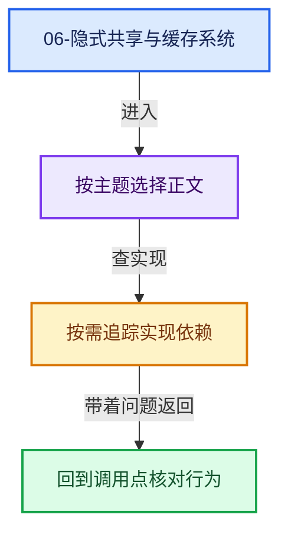
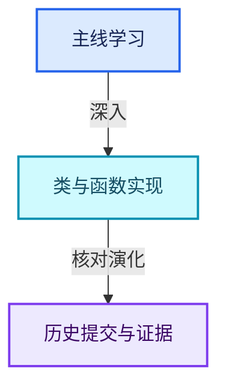

# 06-隐式共享与缓存系统

[总入口](../README.md) · [几何节点专题](../13-几何节点专题/README.md) · [实现依赖](../90-实现依赖专题/README.md)

## 阅读顺序

- [06-01 所有权与写时复制](01-所有权与写时复制.md)
- [06-02 ImplicitSharingInfo计数](02-ImplicitSharingInfo计数.md)
- [06-03 Mixin与共享指针封装](03-Mixin与共享指针封装.md)
- [06-04 GeometryComponent共享](04-GeometryComponent共享.md)
- [06-05 GeometrySet读写与复制](05-GeometrySet读写与复制.md)
- [06-06 CacheMutex惰性初始化](06-CacheMutex惰性初始化.md)
- [06-07 SharedCache跨对象复用](07-SharedCache跨对象复用.md)
- [06-08 法线缓存的真实依赖](08-法线缓存的真实依赖.md)
- [06-09 BVH共享与运行时数据](09-BVH共享与运行时数据.md)
- [06-10 局部更新与失效修复](10-局部更新与失效修复.md)

