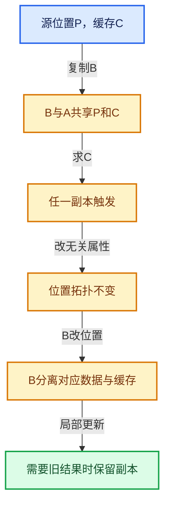

# 06-隐式共享与缓存系统

[总目录](../README.md)

共享计数回答谁还活着，缓存依赖回答结果是否仍正确，两者不能互相替代。

## 前置知识与阅读层次

- [01-基础容器与现代CPP](../01-%E5%9F%BA%E7%A1%80%E5%AE%B9%E5%99%A8%E4%B8%8E%E7%8E%B0%E4%BB%A3CPP/README.md)
- [03-内存分配与运行时类型](../03-%E5%86%85%E5%AD%98%E5%88%86%E9%85%8D%E4%B8%8E%E8%BF%90%E8%A1%8C%E6%97%B6%E7%B1%BB%E5%9E%8B/README.md)
- [05-几何存储与拓扑映射](../05-%E5%87%A0%E4%BD%95%E5%AD%98%E5%82%A8%E4%B8%8E%E6%8B%93%E6%89%91%E6%98%A0%E5%B0%84/README.md)

初读抓住数据模型，复读逐行检查，再完成反例和独立实现。方向间允许按实际问题回查，不要求机械线性阅读。

## 正文与源码范围

| 顺序 | 文档 | 主讲文件与范围 |
|---|---|---|
| 06-01 | [所有权与写时复制](01-%E6%89%80%E6%9C%89%E6%9D%83%E4%B8%8E%E5%86%99%E6%97%B6%E5%A4%8D%E5%88%B6.md) | BLI_implicit_sharing.hh:L1—L165 |
| 06-02 | [ImplicitSharingInfo计数](02-ImplicitSharingInfo%E8%AE%A1%E6%95%B0.md) | BLI_implicit_sharing.hh:L166—L337 |
| 06-03 | [Mixin与共享指针封装](03-Mixin%E4%B8%8E%E5%85%B1%E4%BA%AB%E6%8C%87%E9%92%88%E5%B0%81%E8%A3%85.md) | BLI_implicit_sharing_ptr.hh:L1—L262 |
| 06-04 | [GeometryComponent共享](04-GeometryComponent%E5%85%B1%E4%BA%AB.md) | BKE_geometry_set.hh:L1—L852 |
| 06-05 | [GeometrySet读写与复制](05-GeometrySet%E8%AF%BB%E5%86%99%E4%B8%8E%E5%A4%8D%E5%88%B6.md) | geometry_set.cc:L1—L846 |
| 06-06 | [CacheMutex惰性初始化](06-CacheMutex%E6%83%B0%E6%80%A7%E5%88%9D%E5%A7%8B%E5%8C%96.md) | BLI_cache_mutex.hh:L1—L122 |
| 06-07 | [SharedCache跨对象复用](07-SharedCache%E8%B7%A8%E5%AF%B9%E8%B1%A1%E5%A4%8D%E7%94%A8.md) | BLI_shared_cache.hh:L1—L112 |
| 06-08 | [法线缓存的真实依赖](08-%E6%B3%95%E7%BA%BF%E7%BC%93%E5%AD%98%E7%9A%84%E7%9C%9F%E5%AE%9E%E4%BE%9D%E8%B5%96.md) | mesh_normals.cc:L1—L1801 |
| 06-09 | [BVH共享与运行时数据](09-BVH%E5%85%B1%E4%BA%AB%E4%B8%8E%E8%BF%90%E8%A1%8C%E6%97%B6%E6%95%B0%E6%8D%AE.md) | BKE_mesh_runtime.hh:L1—L87；bvhutils.cc:L1—L812 |
| 06-10 | [局部更新与失效修复](10-%E5%B1%80%E9%83%A8%E6%9B%B4%E6%96%B0%E4%B8%8E%E5%A4%B1%E6%95%88%E4%BF%AE%E5%A4%8D.md) | mesh_runtime.cc:L1—L481 |

## 本方向的数据模型

## 状态推演

## 历史入口

- [BLI: add core types for supporting implicit-sharing](https://projects.blender.org/blender/blender/commit/fbcddfcd68adc72f4dde6c1b769659ba8e9f086b) · Jacques Lucke · 2023-03-28
- [Mesh: Share normals caches by splitting vertex and face calculation](https://projects.blender.org/blender/blender/commit/383a145a190c620e8c0278db65cf183181fdadc7) · Hans Goudey · 2023-08-25
- [Fix: Crash in sculpt mode with shared normals caches](https://projects.blender.org/blender/blender/commit/b339e3937d8dc580b655efe599c3b0f97f412fb1) · Hans Goudey · 2023-08-29
- [Mesh: Move BVH storage to shared cache system](https://projects.blender.org/blender/blender/commit/024d7d12e24a5468d3e9878adf29b0b0443b5dc8) · Hans Goudey · 2024-12-04

## 跨库比较与验收

与shared_ptr比较寿命管理，与写时复制容器比较写边界，与普通memoization比较键的等价性；SharedCache把等价对象的派生结果放在共同控制对象中。

改变副本不改变原对象结果；修改任一真实依赖后旧结果不可继续被当成有效缓存。

正文和源码区间已建立；自动检查结果见根目录验收报告。阅读者的掌握程度以独立练习与反例推理为准。
