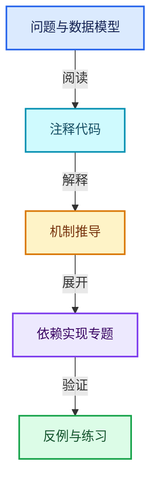
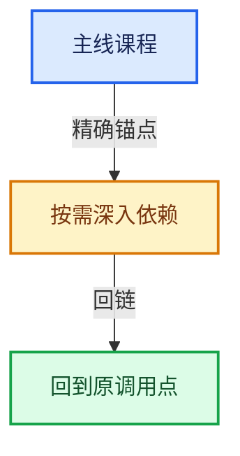

# 06-隐式共享与缓存系统

[总目录](../README.md) · [实现索引](../%E7%AC%A6%E5%8F%B7%E4%BE%9D%E8%B5%96%E4%B8%8E%E5%AE%9E%E7%8E%B0%E7%B4%A2%E5%BC%95.md)

## 主线课程

- [06-01 所有权与写时复制](01-%E6%89%80%E6%9C%89%E6%9D%83%E4%B8%8E%E5%86%99%E6%97%B6%E5%A4%8D%E5%88%B6.md)
- [06-02 ImplicitSharingInfo计数](02-ImplicitSharingInfo%E8%AE%A1%E6%95%B0.md)
- [06-03 Mixin与共享指针封装](03-Mixin%E4%B8%8E%E5%85%B1%E4%BA%AB%E6%8C%87%E9%92%88%E5%B0%81%E8%A3%85.md)
- [06-04 GeometryComponent共享](04-GeometryComponent%E5%85%B1%E4%BA%AB.md)
- [06-05 GeometrySet读写与复制](05-GeometrySet%E8%AF%BB%E5%86%99%E4%B8%8E%E5%A4%8D%E5%88%B6.md)
- [06-06 CacheMutex惰性初始化](06-CacheMutex%E6%83%B0%E6%80%A7%E5%88%9D%E5%A7%8B%E5%8C%96.md)
- [06-07 SharedCache跨对象复用](07-SharedCache%E8%B7%A8%E5%AF%B9%E8%B1%A1%E5%A4%8D%E7%94%A8.md)
- [06-08 法线缓存的真实依赖](08-%E6%B3%95%E7%BA%BF%E7%BC%93%E5%AD%98%E7%9A%84%E7%9C%9F%E5%AE%9E%E4%BE%9D%E8%B5%96.md)
- [06-09 BVH共享与运行时数据](09-BVH%E5%85%B1%E4%BA%AB%E4%B8%8E%E8%BF%90%E8%A1%8C%E6%97%B6%E6%95%B0%E6%8D%AE.md)
- [06-10 局部更新与失效修复](10-%E5%B1%80%E9%83%A8%E6%9B%B4%E6%96%B0%E4%B8%8E%E5%A4%B1%E6%95%88%E4%BF%AE%E5%A4%8D.md)

## 共享实现专题

- [source/blender/blenkernel/BKE_geometry_set.hh](%E4%BE%9D%E8%B5%96-BKE_geometry_set-0a0da4.md)
- [source/blender/blenkernel/intern/geometry_set_instances.cc](%E4%BE%9D%E8%B5%96-geometry_set_instances-cb6843.md)
- [source/blender/blenlib/intern/cache_mutex.cc](%E4%BE%9D%E8%B5%96-cache_mutex-0631e4.md)
- [source/blender/blenlib/intern/implicit_sharing.cc](%E4%BE%9D%E8%B5%96-implicit_sharing-d2e4c3.md)

## 几何节点扩展专题

- [GN-23 几何节点性能诊断与架构训练](%E6%89%A9%E5%B1%9501-%E5%87%A0%E4%BD%95%E8%8A%82%E7%82%B9%E6%80%A7%E8%83%BD%E8%AF%8A%E6%96%AD%E4%B8%8E%E6%9E%B6%E6%9E%84%E8%AE%AD%E7%BB%83.md)
