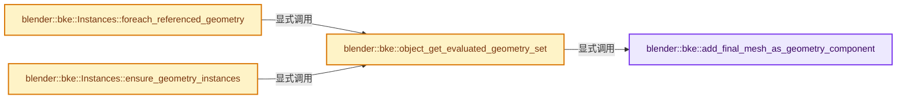
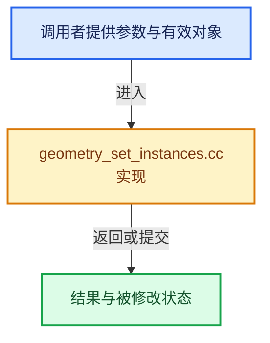

# 实现依赖专题：source/blender/blenkernel/intern/geometry_set_instances.cc

[方向导航](README.md) · [符号索引](../%E7%AC%A6%E5%8F%B7%E4%BE%9D%E8%B5%96%E4%B8%8E%E5%AE%9E%E7%8E%B0%E7%B4%A2%E5%BC%95.md)

本专题从正文实际调用进入，集中保存共享实现。函数有稳定锚点，可从调用处直接跳到对应完整函数；递归与互相调用通过回链组织。

## 本文件的实现关系






## 完整成员与函数实现

<a id="f-e778de57ed285ddb"></a>

### `blender::bke::add_final_mesh_as_geometry_component`

实现位置：[source/blender/blenkernel/intern/geometry_set_instances.cc](../../../../../source/blender/blenkernel/intern/geometry_set_instances.cc) · L26—L44。

接口参数：

- `const Object &object`
- `GeometrySet &geometry_set`
- `const bool apply_subdiv`

**教学注释版**

<!-- annotated:ceb8837dfc3fa5 -->

```cpp
static void add_final_mesh_as_geometry_component(const Object &object,
                                                 GeometrySet &geometry_set,
                                                 const bool apply_subdiv)
{
  if (apply_subdiv) {
    Mesh *mesh = BKE_modifier_get_evaluated_mesh_from_evaluated_object(
        &const_cast<Object &>(object));

    if (mesh != nullptr) {
      BKE_mesh_wrapper_ensure_mdata(mesh);
      geometry_set.replace_mesh(mesh, GeometryOwnershipType::ReadOnly);
    }
    return;
  }
  Mesh *mesh = BKE_object_get_evaluated_mesh_no_subsurf(&object);
  if (mesh != nullptr) {
    geometry_set.replace_mesh(mesh, GeometryOwnershipType::ReadOnly);
  }
}
```

<details>
<summary>核对原始源码：source/blender/blenkernel/intern/geometry_set_instances.cc · L26—L44</summary>

<!-- original:ceb8837dfc3fa5:source/blender/blenkernel/intern/geometry_set_instances.cc:26:44 -->

```cpp
static void add_final_mesh_as_geometry_component(const Object &object,
                                                 GeometrySet &geometry_set,
                                                 const bool apply_subdiv)
{
  if (apply_subdiv) {
    Mesh *mesh = BKE_modifier_get_evaluated_mesh_from_evaluated_object(
        &const_cast<Object &>(object));

    if (mesh != nullptr) {
      BKE_mesh_wrapper_ensure_mdata(mesh);
      geometry_set.replace_mesh(mesh, GeometryOwnershipType::ReadOnly);
    }
    return;
  }
  Mesh *mesh = BKE_object_get_evaluated_mesh_no_subsurf(&object);
  if (mesh != nullptr) {
    geometry_set.replace_mesh(mesh, GeometryOwnershipType::ReadOnly);
  }
}
```

</details>

**继续追踪实现**

- `BKE_modifier_get_evaluated_mesh_from_evaluated_object` → [blender::BKE_modifier_get_evaluated_mesh_from_evaluated_object · L1041](../05-%E5%87%A0%E4%BD%95%E5%AD%98%E5%82%A8%E4%B8%8E%E6%8B%93%E6%89%91%E6%98%A0%E5%B0%84/%E4%BE%9D%E8%B5%96-modifier-ab0273.md#f-75729c35b147b115)。
- `BKE_mesh_wrapper_ensure_mdata` → [blender::BKE_mesh_wrapper_ensure_mdata · L79](../05-%E5%87%A0%E4%BD%95%E5%AD%98%E5%82%A8%E4%B8%8E%E6%8B%93%E6%89%91%E6%98%A0%E5%B0%84/%E4%BE%9D%E8%B5%96-mesh_wrapper-33fdae.md#f-391cdba59bba6a12)。
- `geometry_set.replace_mesh` → [blender::bke::GeometrySet::replace_mesh · L477](05-GeometrySet%E8%AF%BB%E5%86%99%E4%B8%8E%E5%A4%8D%E5%88%B6.md#f-bf82c30bb38f2007)。
- `BKE_object_get_evaluated_mesh_no_subsurf` → [blender::BKE_object_get_evaluated_mesh_no_subsurf · L4419](../05-%E5%87%A0%E4%BD%95%E5%AD%98%E5%82%A8%E4%B8%8E%E6%8B%93%E6%89%91%E6%98%A0%E5%B0%84/%E4%BE%9D%E8%B5%96-object-843689.md#f-7f352b57780250ef)。

<a id="f-47e721147bb67b7f"></a>

### `blender::bke::object_get_evaluated_geometry_set`

实现位置：[source/blender/blenkernel/intern/geometry_set_instances.cc](../../../../../source/blender/blenkernel/intern/geometry_set_instances.cc) · L46—L77。

接口参数：

- `const Object &object`
- `const bool apply_subdiv`

**教学注释版**

<!-- annotated:baff5b570620e4 -->

```cpp
GeometrySet object_get_evaluated_geometry_set(const Object &object, const bool apply_subdiv)
{
  if (!DEG_object_geometry_is_evaluated(object)) {
    return {};
  }

  if (object.runtime->geometry_set_eval != nullptr) {
    GeometrySet geometry_set = *object.runtime->geometry_set_eval;
    /* Ensure that subdivision is performed on the CPU. */
    if (geometry_set.has_mesh()) {
      add_final_mesh_as_geometry_component(object, geometry_set, apply_subdiv);
    }
    return geometry_set;
  }

  /* Otherwise, construct a new geometry set with the component based on the object type. */
  if (object.type == OB_MESH) {
    GeometrySet geometry_set;
    add_final_mesh_as_geometry_component(object, geometry_set, apply_subdiv);
    return geometry_set;
  }
  if (object.type == OB_EMPTY && object.instance_collection != nullptr) {
    Collection &collection = *object.instance_collection;
    // [讲解] std::make_unique<Instances>：创建独占拥有的对象，拥有关系可移动，get返回的借用指针不自动延长寿命。
    auto instances = std::make_unique<Instances>(1);
    instances->reference_handles_for_write().first() = instances->add_reference(collection);
    instances->transforms_for_write().first() = float4x4::identity();
    // [讲解] std::move：把表达式转换成可供移动重载选择的值类别；不保证真的移动，不结束源对象寿命，对const值可能选择复制。
    return GeometrySet::from_instances(std::move(instances));
  }

  /* Return by value since there is not always an existing geometry set owned elsewhere to use. */
  return {};
}
```

<details>
<summary>核对原始源码：source/blender/blenkernel/intern/geometry_set_instances.cc · L46—L77</summary>

<!-- original:baff5b570620e4:source/blender/blenkernel/intern/geometry_set_instances.cc:46:77 -->

```cpp
GeometrySet object_get_evaluated_geometry_set(const Object &object, const bool apply_subdiv)
{
  if (!DEG_object_geometry_is_evaluated(object)) {
    return {};
  }

  if (object.runtime->geometry_set_eval != nullptr) {
    GeometrySet geometry_set = *object.runtime->geometry_set_eval;
    /* Ensure that subdivision is performed on the CPU. */
    if (geometry_set.has_mesh()) {
      add_final_mesh_as_geometry_component(object, geometry_set, apply_subdiv);
    }
    return geometry_set;
  }

  /* Otherwise, construct a new geometry set with the component based on the object type. */
  if (object.type == OB_MESH) {
    GeometrySet geometry_set;
    add_final_mesh_as_geometry_component(object, geometry_set, apply_subdiv);
    return geometry_set;
  }
  if (object.type == OB_EMPTY && object.instance_collection != nullptr) {
    Collection &collection = *object.instance_collection;
    auto instances = std::make_unique<Instances>(1);
    instances->reference_handles_for_write().first() = instances->add_reference(collection);
    instances->transforms_for_write().first() = float4x4::identity();
    return GeometrySet::from_instances(std::move(instances));
  }

  /* Return by value since there is not always an existing geometry set owned elsewhere to use. */
  return {};
}
```

</details>

**结果出口**

- `return {};`
- `return geometry_set;`
- `return GeometrySet::from_instances(std::move(instances));`

**继续追踪实现**

- `DEG_object_geometry_is_evaluated` → [blender::DEG_object_geometry_is_evaluated · L409](../11-Depsgraph%E4%B8%8E%E5%B9%B6%E8%A1%8C%E4%BB%BB%E5%8A%A1%E7%B3%BB%E7%BB%9F/%E4%BE%9D%E8%B5%96-depsgraph_query-e8b1e4.md#f-a62f5fc620060b5d)。
- `geometry_set.has_mesh` → [blender::bke::GeometrySet::has_mesh · L321](05-GeometrySet%E8%AF%BB%E5%86%99%E4%B8%8E%E5%A4%8D%E5%88%B6.md#f-8d9a6e8a3a3c9006)。
- `add_final_mesh_as_geometry_component` → [blender::bke::add_final_mesh_as_geometry_component · L26](%E4%BE%9D%E8%B5%96-geometry_set_instances-cb6843.md#f-e778de57ed285ddb)。
- `std::make_unique<Instances>` → [外部契约](https://eel.is/c++draft/unique.ptr.create)：创建独占拥有的对象，拥有关系可移动，get返回的借用指针不自动延长寿命。
- `instances->reference_handles_for_write().first` → [调用协议](../%E6%A8%A1%E6%9D%BF%E5%AE%8F%E4%B8%8E%E5%8A%A8%E6%80%81%E5%88%86%E6%B4%BE%E5%8D%8F%E8%AE%AE.md)：接收对象类型依赖auto、返回值或模板实例；不按同名猜测目标。调用位置L70。
- `instances->reference_handles_for_write` → [调用协议](../%E6%A8%A1%E6%9D%BF%E5%AE%8F%E4%B8%8E%E5%8A%A8%E6%80%81%E5%88%86%E6%B4%BE%E5%8D%8F%E8%AE%AE.md)：接收对象类型依赖auto、返回值或模板实例；不按同名猜测目标。调用位置L70。
- `instances->add_reference` → [调用协议](../%E6%A8%A1%E6%9D%BF%E5%AE%8F%E4%B8%8E%E5%8A%A8%E6%80%81%E5%88%86%E6%B4%BE%E5%8D%8F%E8%AE%AE.md)：接收对象类型依赖auto、返回值或模板实例；不按同名猜测目标。调用位置L70。
- `instances->transforms_for_write().first` → [调用协议](../%E6%A8%A1%E6%9D%BF%E5%AE%8F%E4%B8%8E%E5%8A%A8%E6%80%81%E5%88%86%E6%B4%BE%E5%8D%8F%E8%AE%AE.md)：接收对象类型依赖auto、返回值或模板实例；不按同名猜测目标。调用位置L71。
- `instances->transforms_for_write` → [调用协议](../%E6%A8%A1%E6%9D%BF%E5%AE%8F%E4%B8%8E%E5%8A%A8%E6%80%81%E5%88%86%E6%B4%BE%E5%8D%8F%E8%AE%AE.md)：接收对象类型依赖auto、返回值或模板实例；不按同名猜测目标。调用位置L71。
- `float4x4::identity` → [调用协议](../%E6%A8%A1%E6%9D%BF%E5%AE%8F%E4%B8%8E%E5%8A%A8%E6%80%81%E5%88%86%E6%B4%BE%E5%8D%8F%E8%AE%AE.md)：函数指针、局部可调用对象或未展开的宏；必须结合调用者环境。调用位置L71。
- `GeometrySet::from_instances` → [blender::bke::GeometrySet::from_instances · L455](05-GeometrySet%E8%AF%BB%E5%86%99%E4%B8%8E%E5%A4%8D%E5%88%B6.md#f-0c23a168248fb2cb)；[blender::bke::GeometrySet::from_instances · L462](05-GeometrySet%E8%AF%BB%E5%86%99%E4%B8%8E%E5%A4%8D%E5%88%B6.md#f-447a100ea7cfda47)。同名重载需按实参类型选择。
- `std::move` → [外部契约](https://eel.is/c++draft/utility.forward)：把表达式转换成可供移动重载选择的值类别；不保证真的移动，不结束源对象寿命，对const值可能选择复制。

<a id="f-f22fd0d0114d3f20"></a>

### `blender::bke::Instances::foreach_referenced_geometry`

实现位置：[source/blender/blenkernel/intern/geometry_set_instances.cc](../../../../../source/blender/blenkernel/intern/geometry_set_instances.cc) · L79—L109。

接口参数：

- `FunctionRef<void(const GeometrySet &geometry_set)> callback`
- `const GeometrySet &geometry_set`

**教学注释版**

<!-- annotated:ed1a0ffa3b5bb2 -->

```cpp
void Instances::foreach_referenced_geometry(
    FunctionRef<void(const GeometrySet &geometry_set)> callback) const
{
  for (const InstanceReference &reference : references_) {
    switch (reference.type()) {
      case InstanceReference::Type::Object: {
        const Object &object = reference.object();
        const GeometrySet object_geometry_set = object_get_evaluated_geometry_set(object);
        callback(object_geometry_set);
        break;
      }
      case InstanceReference::Type::Collection: {
        Collection &collection = reference.collection();
        FOREACH_COLLECTION_OBJECT_RECURSIVE_BEGIN (&collection, object) {
          const GeometrySet object_geometry_set = object_get_evaluated_geometry_set(*object);
          callback(object_geometry_set);
        }
        FOREACH_COLLECTION_OBJECT_RECURSIVE_END;
        break;
      }
      case InstanceReference::Type::GeometrySet: {
        const GeometrySet &instance_geometry_set = reference.geometry_set();
        callback(instance_geometry_set);
        break;
      }
      case InstanceReference::Type::None: {
        break;
      }
    }
  }
}
```

<details>
<summary>核对原始源码：source/blender/blenkernel/intern/geometry_set_instances.cc · L79—L109</summary>

<!-- original:ed1a0ffa3b5bb2:source/blender/blenkernel/intern/geometry_set_instances.cc:79:109 -->

```cpp
void Instances::foreach_referenced_geometry(
    FunctionRef<void(const GeometrySet &geometry_set)> callback) const
{
  for (const InstanceReference &reference : references_) {
    switch (reference.type()) {
      case InstanceReference::Type::Object: {
        const Object &object = reference.object();
        const GeometrySet object_geometry_set = object_get_evaluated_geometry_set(object);
        callback(object_geometry_set);
        break;
      }
      case InstanceReference::Type::Collection: {
        Collection &collection = reference.collection();
        FOREACH_COLLECTION_OBJECT_RECURSIVE_BEGIN (&collection, object) {
          const GeometrySet object_geometry_set = object_get_evaluated_geometry_set(*object);
          callback(object_geometry_set);
        }
        FOREACH_COLLECTION_OBJECT_RECURSIVE_END;
        break;
      }
      case InstanceReference::Type::GeometrySet: {
        const GeometrySet &instance_geometry_set = reference.geometry_set();
        callback(instance_geometry_set);
        break;
      }
      case InstanceReference::Type::None: {
        break;
      }
    }
  }
}
```

</details>

**继续追踪实现**

- `reference.type` → [调用协议](../%E6%A8%A1%E6%9D%BF%E5%AE%8F%E4%B8%8E%E5%8A%A8%E6%80%81%E5%88%86%E6%B4%BE%E5%8D%8F%E8%AE%AE.md)：接收对象类型依赖auto、返回值或模板实例；不按同名猜测目标。调用位置L83。
- `reference.object` → [调用协议](../%E6%A8%A1%E6%9D%BF%E5%AE%8F%E4%B8%8E%E5%8A%A8%E6%80%81%E5%88%86%E6%B4%BE%E5%8D%8F%E8%AE%AE.md)：接收对象类型依赖auto、返回值或模板实例；不按同名猜测目标。调用位置L85。
- `object_get_evaluated_geometry_set` → [blender::bke::object_get_evaluated_geometry_set · L46](%E4%BE%9D%E8%B5%96-geometry_set_instances-cb6843.md#f-47e721147bb67b7f)。
- `callback` → [调用协议](../%E6%A8%A1%E6%9D%BF%E5%AE%8F%E4%B8%8E%E5%8A%A8%E6%80%81%E5%88%86%E6%B4%BE%E5%8D%8F%E8%AE%AE.md)：局部可调用对象，须结合其初始化与捕获环境。调用位置L87。
- `reference.collection` → [调用协议](../%E6%A8%A1%E6%9D%BF%E5%AE%8F%E4%B8%8E%E5%8A%A8%E6%80%81%E5%88%86%E6%B4%BE%E5%8D%8F%E8%AE%AE.md)：接收对象类型依赖auto、返回值或模板实例；不按同名猜测目标。调用位置L91。
- `FOREACH_COLLECTION_OBJECT_RECURSIVE_BEGIN` → [FOREACH_COLLECTION_OBJECT_RECURSIVE_BEGIN · L485](../05-%E5%87%A0%E4%BD%95%E5%AD%98%E5%82%A8%E4%B8%8E%E6%8B%93%E6%89%91%E6%98%A0%E5%B0%84/%E4%BE%9D%E8%B5%96-BKE_collection-5db915.md#m-056dd72ee5fb)。宏定义由构建条件选择。
- `reference.geometry_set` → [调用协议](../%E6%A8%A1%E6%9D%BF%E5%AE%8F%E4%B8%8E%E5%8A%A8%E6%80%81%E5%88%86%E6%B4%BE%E5%8D%8F%E8%AE%AE.md)：接收对象类型依赖auto、返回值或模板实例；不按同名猜测目标。调用位置L100。

<a id="f-c6c307192970c4f3"></a>

### `blender::bke::Instances::ensure_geometry_instances`

实现位置：[source/blender/blenkernel/intern/geometry_set_instances.cc](../../../../../source/blender/blenkernel/intern/geometry_set_instances.cc) · L111—L170。

**教学注释版**

<!-- annotated:dadfa3fdd29abd -->

```cpp
void Instances::ensure_geometry_instances()
{
  Vector<InstanceReference> new_references;
  // [讲解] new_references.reserve：确保可容纳至少min_capacity个元素；当前size和已有元素值不因容量请求本身而增加。
  new_references.reserve(references_.size());
  for (const InstanceReference &reference : references_) {
    switch (reference.type()) {
      case InstanceReference::Type::None: {
        // [讲解] new_references.append：在尾部建立新元素，必要时先扩大存储。
        new_references.append(InstanceReference(GeometrySet{}));
        break;
      }
      case InstanceReference::Type::GeometrySet: {
        /* Those references can stay as their were. */
        new_references.append(reference);
        break;
      }
      case InstanceReference::Type::Object: {
        /* Create a new reference that contains the geometry set of the object. We may want to
         * treat e.g. lamps and similar object types separately here. */
        Object &object = reference.object();
        if (ELEM(object.type, OB_LAMP, OB_CAMERA, OB_SPEAKER, OB_ARMATURE)) {
          new_references.append(InstanceReference(object));
          break;
        }
        GeometrySet object_geometry_set = object_get_evaluated_geometry_set(object);
        object_geometry_set.set_name(BKE_id_name(object.id));
        if (object_geometry_set.has_instances()) {
          object_geometry_set.get_instances_for_write()->ensure_geometry_instances();
        }
        // [讲解] std::move：把表达式转换成可供移动重载选择的值类别；不保证真的移动，不结束源对象寿命，对const值可能选择复制。
        new_references.append(std::move(object_geometry_set));
        break;
      }
      case InstanceReference::Type::Collection: {
        /* Create a new reference that contains a geometry set that contains all objects from the
         * collection as instances. */
        Collection &collection = reference.collection();

        Vector<Object *, 8> objects;
        FOREACH_COLLECTION_OBJECT_RECURSIVE_BEGIN (&collection, object) {
          objects.append(object);
        }
        FOREACH_COLLECTION_OBJECT_RECURSIVE_END;

        // [讲解] std::make_unique<Instances>：创建独占拥有的对象，拥有关系可移动，get返回的借用指针不自动延长寿命。
        auto instances = std::make_unique<Instances>(objects.size());
        MutableSpan<int> handles = instances->reference_handles_for_write();
        MutableSpan<float4x4> transforms = instances->transforms_for_write();
        for (const int i : objects.index_range()) {
          handles[i] = instances->add_reference(*objects[i]);
          transforms[i] = objects[i]->object_to_world();
          transforms[i].location() -= collection.instance_offset;
        }
        instances->ensure_geometry_instances();
        GeometrySet geometry_set = GeometrySet::from_instances(std::move(instances));
        geometry_set.set_name(BKE_id_name(collection.id));
        new_references.append(std::move(geometry_set));
        break;
      }
    }
  }
  references_ = std::move(new_references);
}
```

<details>
<summary>核对原始源码：source/blender/blenkernel/intern/geometry_set_instances.cc · L111—L170</summary>

<!-- original:dadfa3fdd29abd:source/blender/blenkernel/intern/geometry_set_instances.cc:111:170 -->

```cpp
void Instances::ensure_geometry_instances()
{
  Vector<InstanceReference> new_references;
  new_references.reserve(references_.size());
  for (const InstanceReference &reference : references_) {
    switch (reference.type()) {
      case InstanceReference::Type::None: {
        new_references.append(InstanceReference(GeometrySet{}));
        break;
      }
      case InstanceReference::Type::GeometrySet: {
        /* Those references can stay as their were. */
        new_references.append(reference);
        break;
      }
      case InstanceReference::Type::Object: {
        /* Create a new reference that contains the geometry set of the object. We may want to
         * treat e.g. lamps and similar object types separately here. */
        Object &object = reference.object();
        if (ELEM(object.type, OB_LAMP, OB_CAMERA, OB_SPEAKER, OB_ARMATURE)) {
          new_references.append(InstanceReference(object));
          break;
        }
        GeometrySet object_geometry_set = object_get_evaluated_geometry_set(object);
        object_geometry_set.set_name(BKE_id_name(object.id));
        if (object_geometry_set.has_instances()) {
          object_geometry_set.get_instances_for_write()->ensure_geometry_instances();
        }
        new_references.append(std::move(object_geometry_set));
        break;
      }
      case InstanceReference::Type::Collection: {
        /* Create a new reference that contains a geometry set that contains all objects from the
         * collection as instances. */
        Collection &collection = reference.collection();

        Vector<Object *, 8> objects;
        FOREACH_COLLECTION_OBJECT_RECURSIVE_BEGIN (&collection, object) {
          objects.append(object);
        }
        FOREACH_COLLECTION_OBJECT_RECURSIVE_END;

        auto instances = std::make_unique<Instances>(objects.size());
        MutableSpan<int> handles = instances->reference_handles_for_write();
        MutableSpan<float4x4> transforms = instances->transforms_for_write();
        for (const int i : objects.index_range()) {
          handles[i] = instances->add_reference(*objects[i]);
          transforms[i] = objects[i]->object_to_world();
          transforms[i].location() -= collection.instance_offset;
        }
        instances->ensure_geometry_instances();
        GeometrySet geometry_set = GeometrySet::from_instances(std::move(instances));
        geometry_set.set_name(BKE_id_name(collection.id));
        new_references.append(std::move(geometry_set));
        break;
      }
    }
  }
  references_ = std::move(new_references);
}
```

</details>

**沿实际写入检查状态**

- `handles[i] = instances->add_reference(*objects[i]);`
- `transforms[i] = objects[i]->object_to_world();`
- `references_ = std::move(new_references);`

**继续追踪实现**

- `new_references.reserve` → [blender::Vector::reserve · L405](../01-%E5%9F%BA%E7%A1%80%E5%AE%B9%E5%99%A8%E4%B8%8E%E7%8E%B0%E4%BB%A3CPP/10-Vector%E6%89%A9%E5%AE%B9%E4%B8%8E%E5%A2%9E%E9%95%BF.md#f-4cf9c0f00e01102e)。
- `references_.size` → [调用协议](../%E6%A8%A1%E6%9D%BF%E5%AE%8F%E4%B8%8E%E5%8A%A8%E6%80%81%E5%88%86%E6%B4%BE%E5%8D%8F%E8%AE%AE.md)：接收对象类型依赖auto、返回值或模板实例；不按同名猜测目标。调用位置L114。
- `reference.type` → [调用协议](../%E6%A8%A1%E6%9D%BF%E5%AE%8F%E4%B8%8E%E5%8A%A8%E6%80%81%E5%88%86%E6%B4%BE%E5%8D%8F%E8%AE%AE.md)：接收对象类型依赖auto、返回值或模板实例；不按同名猜测目标。调用位置L116。
- `new_references.append` → [blender::Vector::append · L498](../01-%E5%9F%BA%E7%A1%80%E5%AE%B9%E5%99%A8%E4%B8%8E%E7%8E%B0%E4%BB%A3CPP/11-Vector%E6%8F%92%E5%85%A5%E5%88%A0%E9%99%A4%E4%B8%8E%E9%87%8D%E6%8E%92.md#f-5bde268a69e443ec)；[blender::Vector::append · L502](../01-%E5%9F%BA%E7%A1%80%E5%AE%B9%E5%99%A8%E4%B8%8E%E7%8E%B0%E4%BB%A3CPP/11-Vector%E6%8F%92%E5%85%A5%E5%88%A0%E9%99%A4%E4%B8%8E%E9%87%8D%E6%8E%92.md#f-591e0b15e6308532)。同名重载需按实参类型选择。
- `InstanceReference` → [blender::bke::InstanceReference::InstanceReference · L25](../05-%E5%87%A0%E4%BD%95%E5%AD%98%E5%82%A8%E4%B8%8E%E6%8B%93%E6%89%91%E6%98%A0%E5%B0%84/%E4%BE%9D%E8%B5%96-instances-5b2776.md#f-087c9bd8d14e53b8)；[blender::bke::InstanceReference::InstanceReference · L31](../05-%E5%87%A0%E4%BD%95%E5%AD%98%E5%82%A8%E4%B8%8E%E6%8B%93%E6%89%91%E6%98%A0%E5%B0%84/%E4%BE%9D%E8%B5%96-instances-5b2776.md#f-3a1a225c151dca34)。同名重载需按实参类型选择。
- `reference.object` → [调用协议](../%E6%A8%A1%E6%9D%BF%E5%AE%8F%E4%B8%8E%E5%8A%A8%E6%80%81%E5%88%86%E6%B4%BE%E5%8D%8F%E8%AE%AE.md)：接收对象类型依赖auto、返回值或模板实例；不按同名猜测目标。调用位置L129。
- `ELEM` → [ELEM · L88](../05-%E5%87%A0%E4%BD%95%E5%AD%98%E5%82%A8%E4%B8%8E%E6%8B%93%E6%89%91%E6%98%A0%E5%B0%84/%E4%BE%9D%E8%B5%96-GHOST_utildefines-34b996.md#m-d28724a15928)；[ELEM · L135](../01-%E5%9F%BA%E7%A1%80%E5%AE%B9%E5%99%A8%E4%B8%8E%E7%8E%B0%E4%BB%A3CPP/%E4%BE%9D%E8%B5%96-BLI_utildefines-293a0a.md#m-d6572de7cae0)。宏定义由构建条件选择。
- `object_get_evaluated_geometry_set` → [blender::bke::object_get_evaluated_geometry_set · L46](%E4%BE%9D%E8%B5%96-geometry_set_instances-cb6843.md#f-47e721147bb67b7f)。
- `object_geometry_set.set_name` → [blender::bke::GeometrySet::set_name · L805](05-GeometrySet%E8%AF%BB%E5%86%99%E4%B8%8E%E5%A4%8D%E5%88%B6.md#f-8509f63d0760936e)。
- `BKE_id_name` → [blender::BKE_id_name · L1001](../05-%E5%87%A0%E4%BD%95%E5%AD%98%E5%82%A8%E4%B8%8E%E6%8B%93%E6%89%91%E6%98%A0%E5%B0%84/%E4%BE%9D%E8%B5%96-BKE_lib_id-3c6ccd.md#f-b9397f1fe1fcc017)；[blender::BKE_id_name · L1005](../05-%E5%87%A0%E4%BD%95%E5%AD%98%E5%82%A8%E4%B8%8E%E6%8B%93%E6%89%91%E6%98%A0%E5%B0%84/%E4%BE%9D%E8%B5%96-BKE_lib_id-3c6ccd.md#f-c026427d13979145)。同名重载需按实参类型选择。
- `object_geometry_set.has_instances` → [blender::bke::GeometrySet::has_instances · L381](05-GeometrySet%E8%AF%BB%E5%86%99%E4%B8%8E%E5%A4%8D%E5%88%B6.md#f-96f474fc46f602f1)。
- `object_geometry_set.get_instances_for_write()->ensure_geometry_instances` → [调用协议](../%E6%A8%A1%E6%9D%BF%E5%AE%8F%E4%B8%8E%E5%8A%A8%E6%80%81%E5%88%86%E6%B4%BE%E5%8D%8F%E8%AE%AE.md)：接收对象类型依赖auto、返回值或模板实例；不按同名猜测目标。调用位置L137。
- `object_geometry_set.get_instances_for_write` → [blender::bke::GeometrySet::get_instances_for_write · L586](05-GeometrySet%E8%AF%BB%E5%86%99%E4%B8%8E%E5%A4%8D%E5%88%B6.md#f-e2fefbfed77f753f)。
- `std::move` → [外部契约](https://eel.is/c++draft/utility.forward)：把表达式转换成可供移动重载选择的值类别；不保证真的移动，不结束源对象寿命，对const值可能选择复制。
- `reference.collection` → [调用协议](../%E6%A8%A1%E6%9D%BF%E5%AE%8F%E4%B8%8E%E5%8A%A8%E6%80%81%E5%88%86%E6%B4%BE%E5%8D%8F%E8%AE%AE.md)：接收对象类型依赖auto、返回值或模板实例；不按同名猜测目标。调用位置L145。
- `FOREACH_COLLECTION_OBJECT_RECURSIVE_BEGIN` → [FOREACH_COLLECTION_OBJECT_RECURSIVE_BEGIN · L485](../05-%E5%87%A0%E4%BD%95%E5%AD%98%E5%82%A8%E4%B8%8E%E6%8B%93%E6%89%91%E6%98%A0%E5%B0%84/%E4%BE%9D%E8%B5%96-BKE_collection-5db915.md#m-056dd72ee5fb)。宏定义由构建条件选择。
- `objects.append` → [blender::Vector::append · L498](../01-%E5%9F%BA%E7%A1%80%E5%AE%B9%E5%99%A8%E4%B8%8E%E7%8E%B0%E4%BB%A3CPP/11-Vector%E6%8F%92%E5%85%A5%E5%88%A0%E9%99%A4%E4%B8%8E%E9%87%8D%E6%8E%92.md#f-5bde268a69e443ec)；[blender::Vector::append · L502](../01-%E5%9F%BA%E7%A1%80%E5%AE%B9%E5%99%A8%E4%B8%8E%E7%8E%B0%E4%BB%A3CPP/11-Vector%E6%8F%92%E5%85%A5%E5%88%A0%E9%99%A4%E4%B8%8E%E9%87%8D%E6%8E%92.md#f-591e0b15e6308532)。同名重载需按实参类型选择。
- `std::make_unique<Instances>` → [外部契约](https://eel.is/c++draft/unique.ptr.create)：创建独占拥有的对象，拥有关系可移动，get返回的借用指针不自动延长寿命。
- `objects.size` → [blender::Vector::size · L780](../01-%E5%9F%BA%E7%A1%80%E5%AE%B9%E5%99%A8%E4%B8%8E%E7%8E%B0%E4%BB%A3CPP/11-Vector%E6%8F%92%E5%85%A5%E5%88%A0%E9%99%A4%E4%B8%8E%E9%87%8D%E6%8E%92.md#f-714773731767349c)。
- `instances->reference_handles_for_write` → [调用协议](../%E6%A8%A1%E6%9D%BF%E5%AE%8F%E4%B8%8E%E5%8A%A8%E6%80%81%E5%88%86%E6%B4%BE%E5%8D%8F%E8%AE%AE.md)：接收对象类型依赖auto、返回值或模板实例；不按同名猜测目标。调用位置L154。
- `instances->transforms_for_write` → [调用协议](../%E6%A8%A1%E6%9D%BF%E5%AE%8F%E4%B8%8E%E5%8A%A8%E6%80%81%E5%88%86%E6%B4%BE%E5%8D%8F%E8%AE%AE.md)：接收对象类型依赖auto、返回值或模板实例；不按同名猜测目标。调用位置L155。
- `objects.index_range` → [blender::Vector::index_range · L1026](../01-%E5%9F%BA%E7%A1%80%E5%AE%B9%E5%99%A8%E4%B8%8E%E7%8E%B0%E4%BB%A3CPP/12-Vector%E5%BC%82%E5%B8%B8%E5%AE%89%E5%85%A8%E4%B8%8E%E8%BE%B9%E7%95%8C.md#f-ac29cf36ef185ab9)。
- `instances->add_reference` → [调用协议](../%E6%A8%A1%E6%9D%BF%E5%AE%8F%E4%B8%8E%E5%8A%A8%E6%80%81%E5%88%86%E6%B4%BE%E5%8D%8F%E8%AE%AE.md)：接收对象类型依赖auto、返回值或模板实例；不按同名猜测目标。调用位置L157。
- `objects[i]->object_to_world` → [调用协议](../%E6%A8%A1%E6%9D%BF%E5%AE%8F%E4%B8%8E%E5%8A%A8%E6%80%81%E5%88%86%E6%B4%BE%E5%8D%8F%E8%AE%AE.md)：接收对象类型依赖auto、返回值或模板实例；不按同名猜测目标。调用位置L158。
- `transforms[i].location` → [调用协议](../%E6%A8%A1%E6%9D%BF%E5%AE%8F%E4%B8%8E%E5%8A%A8%E6%80%81%E5%88%86%E6%B4%BE%E5%8D%8F%E8%AE%AE.md)：接收对象类型依赖auto、返回值或模板实例；不按同名猜测目标。调用位置L159。
- `instances->ensure_geometry_instances` → [调用协议](../%E6%A8%A1%E6%9D%BF%E5%AE%8F%E4%B8%8E%E5%8A%A8%E6%80%81%E5%88%86%E6%B4%BE%E5%8D%8F%E8%AE%AE.md)：接收对象类型依赖auto、返回值或模板实例；不按同名猜测目标。调用位置L161。
- `GeometrySet::from_instances` → [blender::bke::GeometrySet::from_instances · L455](05-GeometrySet%E8%AF%BB%E5%86%99%E4%B8%8E%E5%A4%8D%E5%88%B6.md#f-0c23a168248fb2cb)；[blender::bke::GeometrySet::from_instances · L462](05-GeometrySet%E8%AF%BB%E5%86%99%E4%B8%8E%E5%A4%8D%E5%88%B6.md#f-447a100ea7cfda47)。同名重载需按实参类型选择。
- `geometry_set.set_name` → [blender::bke::GeometrySet::set_name · L805](05-GeometrySet%E8%AF%BB%E5%86%99%E4%B8%8E%E5%A4%8D%E5%88%B6.md#f-8509f63d0760936e)。
