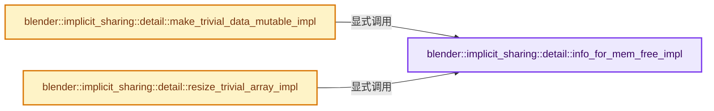
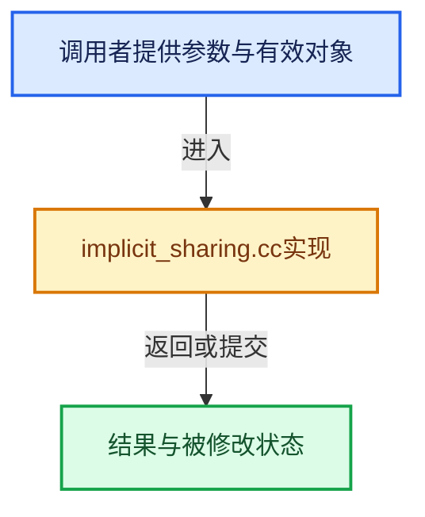

# 实现依赖专题：source/blender/blenlib/intern/implicit_sharing.cc

[方向导航](README.md) · [符号索引](../%E7%AC%A6%E5%8F%B7%E4%BE%9D%E8%B5%96%E4%B8%8E%E5%AE%9E%E7%8E%B0%E7%B4%A2%E5%BC%95.md)

本专题从正文实际调用进入，集中保存共享实现。函数有稳定锚点，可从调用处直接跳到对应完整函数；递归与互相调用通过回链组织。

## 本文件的实现关系






## 完整成员与函数实现

<a id="f-2522ab5f1adfc701"></a>

### `blender::implicit_sharing::detail::info_for_mem_free_impl`

实现位置：[source/blender/blenlib/intern/implicit_sharing.cc](../../../../../source/blender/blenlib/intern/implicit_sharing.cc) · L37—L40。

接口参数：

- `void *data`

**教学注释版**

<!-- annotated:806acaded77a36 -->

```cpp
const ImplicitSharingInfo *info_for_mem_free_impl(void *data)
{
  return MEM_new<MEMFreeImplicitSharing>(__func__, data);
}
```

<details>
<summary>核对原始源码：source/blender/blenlib/intern/implicit_sharing.cc · L37—L40</summary>

<!-- original:806acaded77a36:source/blender/blenlib/intern/implicit_sharing.cc:37:40 -->

```cpp
const ImplicitSharingInfo *info_for_mem_free_impl(void *data)
{
  return MEM_new<MEMFreeImplicitSharing>(__func__, data);
}
```

</details>

**结果出口**

- `return MEM_new<MEMFreeImplicitSharing>(__func__, data);`

**继续追踪实现**

- `MEM_new<MEMFreeImplicitSharing>` → [MEM_new · L351](../03-%E5%86%85%E5%AD%98%E5%88%86%E9%85%8D%E4%B8%8E%E8%BF%90%E8%A1%8C%E6%97%B6%E7%B1%BB%E5%9E%8B/%E4%BE%9D%E8%B5%96-MEM_guardedalloc-b54eca.md#f-115f9b6784f89912)。

<a id="f-14280f49abfad7a3"></a>

### `blender::implicit_sharing::detail::make_trivial_data_mutable_impl`

实现位置：[source/blender/blenlib/intern/implicit_sharing.cc](../../../../../source/blender/blenlib/intern/implicit_sharing.cc) · L42—L65。

接口参数：

- `void *old_data`
- `const int64_t size`
- `const int64_t alignment`
- `const ImplicitSharingInfo **sharing_info`

**教学注释版**

<!-- annotated:50bd29e172b6ad -->

```cpp
void *make_trivial_data_mutable_impl(void *old_data,
                                     const int64_t size,
                                     const int64_t alignment,
                                     const ImplicitSharingInfo **sharing_info)
{
  if (!old_data) {
    BLI_assert(size == 0);
    return nullptr;
  }

  BLI_assert(*sharing_info != nullptr);
  if ((*sharing_info)->is_mutable()) {
    (*sharing_info)->tag_ensured_mutable();
  }
  else {
    // [讲解] MEM_new_uninitialized_aligned：把公开MEM分配接口转交给当前选择的对齐分配后端。
    void *new_data = MEM_new_uninitialized_aligned(size, alignment, __func__);
    // [讲解] memcpy：复制字节，源与目标不应重叠。类型生命周期、对齐和可复制表示须由调用者证明，不是任意对象的复制构造。
    memcpy(new_data, old_data, size);
    (*sharing_info)->remove_user_and_delete_if_last();
    *sharing_info = info_for_mem_free_impl(new_data);
    return new_data;
  }

  return old_data;
}
```

<details>
<summary>核对原始源码：source/blender/blenlib/intern/implicit_sharing.cc · L42—L65</summary>

<!-- original:50bd29e172b6ad:source/blender/blenlib/intern/implicit_sharing.cc:42:65 -->

```cpp
void *make_trivial_data_mutable_impl(void *old_data,
                                     const int64_t size,
                                     const int64_t alignment,
                                     const ImplicitSharingInfo **sharing_info)
{
  if (!old_data) {
    BLI_assert(size == 0);
    return nullptr;
  }

  BLI_assert(*sharing_info != nullptr);
  if ((*sharing_info)->is_mutable()) {
    (*sharing_info)->tag_ensured_mutable();
  }
  else {
    void *new_data = MEM_new_uninitialized_aligned(size, alignment, __func__);
    memcpy(new_data, old_data, size);
    (*sharing_info)->remove_user_and_delete_if_last();
    *sharing_info = info_for_mem_free_impl(new_data);
    return new_data;
  }

  return old_data;
}
```

</details>

**结果出口**

- `return nullptr;`
- `return new_data;`
- `return old_data;`

**继续追踪实现**

- `BLI_assert` → [BLI_assert · L48](../01-%E5%9F%BA%E7%A1%80%E5%AE%B9%E5%99%A8%E4%B8%8E%E7%8E%B0%E4%BB%A3CPP/%E4%BE%9D%E8%B5%96-BLI_assert-cc98e8.md#m-57a88495704d)；[BLI_assert · L63](../01-%E5%9F%BA%E7%A1%80%E5%AE%B9%E5%99%A8%E4%B8%8E%E7%8E%B0%E4%BB%A3CPP/%E4%BE%9D%E8%B5%96-BLI_assert-cc98e8.md#m-d07050020cb5)。宏定义由构建条件选择。
- `(*sharing_info)->is_mutable` → [调用协议](../%E6%A8%A1%E6%9D%BF%E5%AE%8F%E4%B8%8E%E5%8A%A8%E6%80%81%E5%88%86%E6%B4%BE%E5%8D%8F%E8%AE%AE.md)：接收对象类型依赖auto、返回值或模板实例；不按同名猜测目标。调用位置L53。
- `(*sharing_info)->tag_ensured_mutable` → [调用协议](../%E6%A8%A1%E6%9D%BF%E5%AE%8F%E4%B8%8E%E5%8A%A8%E6%80%81%E5%88%86%E6%B4%BE%E5%8D%8F%E8%AE%AE.md)：接收对象类型依赖auto、返回值或模板实例；不按同名猜测目标。调用位置L54。
- `MEM_new_uninitialized_aligned` → [MEM_new_uninitialized_aligned · L134](../03-%E5%86%85%E5%AD%98%E5%88%86%E9%85%8D%E4%B8%8E%E8%BF%90%E8%A1%8C%E6%97%B6%E7%B1%BB%E5%9E%8B/%E4%BE%9D%E8%B5%96-mallocn-afdcd4.md#f-9f3d21bd7da93c68)。
- `memcpy` → [外部契约](https://eel.is/c++draft/cstring.syn)：复制字节，源与目标不应重叠。类型生命周期、对齐和可复制表示须由调用者证明，不是任意对象的复制构造。
- `(*sharing_info)->remove_user_and_delete_if_last` → [调用协议](../%E6%A8%A1%E6%9D%BF%E5%AE%8F%E4%B8%8E%E5%8A%A8%E6%80%81%E5%88%86%E6%B4%BE%E5%8D%8F%E8%AE%AE.md)：接收对象类型依赖auto、返回值或模板实例；不按同名猜测目标。调用位置L59。
- `info_for_mem_free_impl` → [blender::implicit_sharing::detail::info_for_mem_free_impl · L37](%E4%BE%9D%E8%B5%96-implicit_sharing-d2e4c3.md#f-2522ab5f1adfc701)。

<a id="f-534bbbd5b932748a"></a>

### `blender::implicit_sharing::detail::resize_trivial_array_impl`

实现位置：[source/blender/blenlib/intern/implicit_sharing.cc](../../../../../source/blender/blenlib/intern/implicit_sharing.cc) · L67—L108。

接口参数：

- `void *old_data`
- `const int64_t old_size`
- `const int64_t new_size`
- `const int64_t alignment`
- `const ImplicitSharingInfo **sharing_info`

**教学注释版**

<!-- annotated:9534e6b90954e1 -->

```cpp
void *resize_trivial_array_impl(void *old_data,
                                const int64_t old_size,
                                const int64_t new_size,
                                const int64_t alignment,
                                const ImplicitSharingInfo **sharing_info)
{
  if (new_size == 0) {
    if (*sharing_info) {
      (*sharing_info)->remove_user_and_delete_if_last();
      *sharing_info = nullptr;
    }
    return nullptr;
  }

  if (!old_data) {
    BLI_assert(old_size == 0);
    BLI_assert(*sharing_info == nullptr);
    // [讲解] MEM_new_uninitialized_aligned：把公开MEM分配接口转交给当前选择的对齐分配后端。
    void *new_data = MEM_new_uninitialized_aligned(new_size, alignment, __func__);
    *sharing_info = info_for_mem_free_impl(new_data);
    return new_data;
  }

  BLI_assert(old_size != 0);
  if ((*sharing_info)->is_mutable()) {
    if (auto *info = const_cast<MEMFreeImplicitSharing *>(
            dynamic_cast<const MEMFreeImplicitSharing *>(*sharing_info)))
    {
      /* If the array was allocated with the MEM allocator, we can use realloc directly, which
       * could theoretically give better performance if the data can be reused in place. */
      void *new_data = static_cast<int *>(MEM_realloc_uninitialized(old_data, new_size));
      info->data = new_data;
      (*sharing_info)->tag_ensured_mutable();
      return new_data;
    }
  }

  void *new_data = MEM_new_uninitialized_aligned(new_size, alignment, __func__);
  // [讲解] memcpy：复制字节，源与目标不应重叠。类型生命周期、对齐和可复制表示须由调用者证明，不是任意对象的复制构造。
  memcpy(new_data, old_data, std::min(old_size, new_size));
  (*sharing_info)->remove_user_and_delete_if_last();
  *sharing_info = info_for_mem_free_impl(new_data);
  return new_data;
}
```

<details>
<summary>核对原始源码：source/blender/blenlib/intern/implicit_sharing.cc · L67—L108</summary>

<!-- original:9534e6b90954e1:source/blender/blenlib/intern/implicit_sharing.cc:67:108 -->

```cpp
void *resize_trivial_array_impl(void *old_data,
                                const int64_t old_size,
                                const int64_t new_size,
                                const int64_t alignment,
                                const ImplicitSharingInfo **sharing_info)
{
  if (new_size == 0) {
    if (*sharing_info) {
      (*sharing_info)->remove_user_and_delete_if_last();
      *sharing_info = nullptr;
    }
    return nullptr;
  }

  if (!old_data) {
    BLI_assert(old_size == 0);
    BLI_assert(*sharing_info == nullptr);
    void *new_data = MEM_new_uninitialized_aligned(new_size, alignment, __func__);
    *sharing_info = info_for_mem_free_impl(new_data);
    return new_data;
  }

  BLI_assert(old_size != 0);
  if ((*sharing_info)->is_mutable()) {
    if (auto *info = const_cast<MEMFreeImplicitSharing *>(
            dynamic_cast<const MEMFreeImplicitSharing *>(*sharing_info)))
    {
      /* If the array was allocated with the MEM allocator, we can use realloc directly, which
       * could theoretically give better performance if the data can be reused in place. */
      void *new_data = static_cast<int *>(MEM_realloc_uninitialized(old_data, new_size));
      info->data = new_data;
      (*sharing_info)->tag_ensured_mutable();
      return new_data;
    }
  }

  void *new_data = MEM_new_uninitialized_aligned(new_size, alignment, __func__);
  memcpy(new_data, old_data, std::min(old_size, new_size));
  (*sharing_info)->remove_user_and_delete_if_last();
  *sharing_info = info_for_mem_free_impl(new_data);
  return new_data;
}
```

</details>

**沿实际写入检查状态**

- `info->data = new_data;`

**结果出口**

- `return nullptr;`
- `return new_data;`

**继续追踪实现**

- `(*sharing_info)->remove_user_and_delete_if_last` → [调用协议](../%E6%A8%A1%E6%9D%BF%E5%AE%8F%E4%B8%8E%E5%8A%A8%E6%80%81%E5%88%86%E6%B4%BE%E5%8D%8F%E8%AE%AE.md)：接收对象类型依赖auto、返回值或模板实例；不按同名猜测目标。调用位置L75。
- `BLI_assert` → [BLI_assert · L48](../01-%E5%9F%BA%E7%A1%80%E5%AE%B9%E5%99%A8%E4%B8%8E%E7%8E%B0%E4%BB%A3CPP/%E4%BE%9D%E8%B5%96-BLI_assert-cc98e8.md#m-57a88495704d)；[BLI_assert · L63](../01-%E5%9F%BA%E7%A1%80%E5%AE%B9%E5%99%A8%E4%B8%8E%E7%8E%B0%E4%BB%A3CPP/%E4%BE%9D%E8%B5%96-BLI_assert-cc98e8.md#m-d07050020cb5)。宏定义由构建条件选择。
- `MEM_new_uninitialized_aligned` → [MEM_new_uninitialized_aligned · L134](../03-%E5%86%85%E5%AD%98%E5%88%86%E9%85%8D%E4%B8%8E%E8%BF%90%E8%A1%8C%E6%97%B6%E7%B1%BB%E5%9E%8B/%E4%BE%9D%E8%B5%96-mallocn-afdcd4.md#f-9f3d21bd7da93c68)。
- `info_for_mem_free_impl` → [blender::implicit_sharing::detail::info_for_mem_free_impl · L37](%E4%BE%9D%E8%B5%96-implicit_sharing-d2e4c3.md#f-2522ab5f1adfc701)。
- `(*sharing_info)->is_mutable` → [调用协议](../%E6%A8%A1%E6%9D%BF%E5%AE%8F%E4%B8%8E%E5%8A%A8%E6%80%81%E5%88%86%E6%B4%BE%E5%8D%8F%E8%AE%AE.md)：接收对象类型依赖auto、返回值或模板实例；不按同名猜测目标。调用位置L90。
- `MEM_realloc_uninitialized` → [MEM_realloc_uninitialized · L118](../03-%E5%86%85%E5%AD%98%E5%88%86%E9%85%8D%E4%B8%8E%E8%BF%90%E8%A1%8C%E6%97%B6%E7%B1%BB%E5%9E%8B/%E4%BE%9D%E8%B5%96-MEM_guardedalloc-b54eca.md#m-813b7cd3fcff)。宏定义由构建条件选择。
- `(*sharing_info)->tag_ensured_mutable` → [调用协议](../%E6%A8%A1%E6%9D%BF%E5%AE%8F%E4%B8%8E%E5%8A%A8%E6%80%81%E5%88%86%E6%B4%BE%E5%8D%8F%E8%AE%AE.md)：接收对象类型依赖auto、返回值或模板实例；不按同名猜测目标。调用位置L98。
- `memcpy` → [外部契约](https://eel.is/c++draft/cstring.syn)：复制字节，源与目标不应重叠。类型生命周期、对齐和可复制表示须由调用者证明，不是任意对象的复制构造。
- `std::min` → [外部契约](https://eel.is/c++draft/alg.min.max)：按比较关系选取较小值；截断范围时还需先满足非负和可表示范围，min本身不会证明边界安全。
