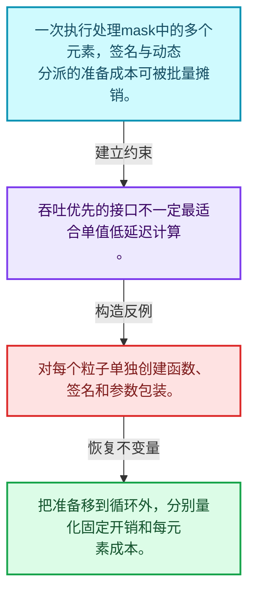
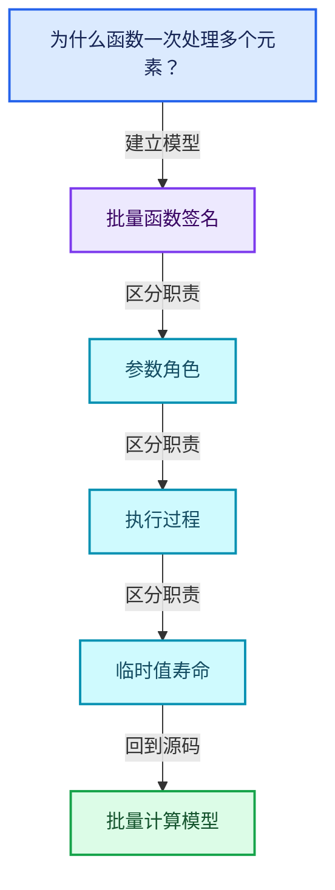
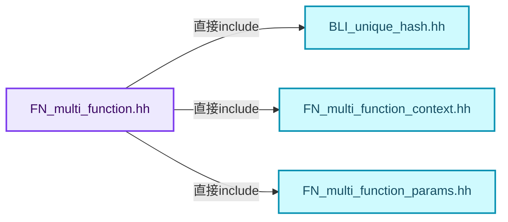
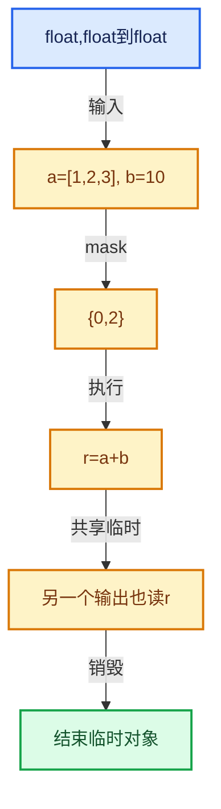

# 07-01 批量计算模型

[方向导航](README.md) · [总目录](../README.md) · [覆盖索引](../%E6%BA%90%E7%A0%81%E7%89%88%E6%9C%AC%E4%B8%8E%E8%A6%86%E7%9B%96%E7%B4%A2%E5%BC%95.md)

> 阅读顺序：问题与数据模型 → 语法与类型 → 源码逐行 → 调用线索 → 历史与取舍 → 推演和练习。

- 基准 HEAD：`cbda6b96c26c0dee3c3b5cbb93960c4ac06a6b30`。
- 记录日期：2026-10-14。
- 教学示例状态：正文中的推演不是本机性能实测；已运行练习见验收报告。

## 一、从问题到设计

为什么函数一次处理多个元素？

批量接口把类型分派、参数准备和循环组织移到元素循环之外，提高吞吐潜力。

本篇把语法、数据语义和系统取舍连接起来。把调用准备与元素循环分开，把值依赖与对象生存区间同时显式化。

### 本篇独立模型与设计推理

一次执行处理mask中的多个元素，签名与动态分派的准备成本可被批量摊销。

设计取舍：吞吐优先的接口不一定最适合单值低延迟计算。

最小反例：对每个粒子单独创建函数、签名和参数包装。

推导与处理：把准备移到循环外，分别量化固定开销和每元素成本。



### 源码范围与相邻篇章

| 文件 | 本篇逐行范围 | 基准SHA-256 |
|---|---|---|
| [source/blender/functions/FN_multi_function.hh](../../../../../source/blender/functions/FN_multi_function.hh) | L1—L152 | `def04d749803a04e0aca05d0324d08b383d5eae900ddb36ea626b0e970c9bf3b` |
| [source/blender/functions/intern/multi_function.cc](../../../../../source/blender/functions/intern/multi_function.cc) | L1—L182 | `723ca4138043d17768a375dd10b40b8eeae931c262c07a95673026db99fe4399` |

同一主讲文件可能分多篇覆盖；超出本篇范围的符号通过覆盖索引定位。空行与纯注释保留在源码摘录中，逐行表解释有效语句与语法边界；许可证头统一保留。

后篇：[函数签名](02-%E5%87%BD%E6%95%B0%E7%AD%BE%E5%90%8D.md).

## 二、类型、数据与阅读地图



这是概念依赖图，边表示阅读关系，不声称是运行时调用顺序。

### 直接编译依赖



箭头只表示头文件包含关系；完整调用线索见后面的符号定位表。

## 三、关键词、语法与类型角色

### 只读限定 const

const约束当前访问路径可做的修改。const指针、指向const的指针、const视图对象、const元素是不同位置的限定；其他别名可能仍可修改原对象。

具体检查：分别写T* const、const T*与const T* const，并画出不可修改的层次。

### 运行时多态 virtual

虚调用根据实际动态类型选择实现；经基类指针销毁对象时通常需要相应虚析构契约。每元素虚调用和循环外一次分派有不同开销。

具体检查：找出虚接口的实现类和调用频率，再讨论是否值得去虚拟化。

### 构造与new表达式

普通new可能分配并构造；placement new在给定地址构造，存储由其他机制提供。失败回滚应区分两类责任。

具体检查：追踪地址来自哪里、构造何时成功、由谁析构、由谁释放。

### 内部断言 assert

断言表达开发者预期成立的内部契约，发布构建可能关闭。它不能替代对不可信输入的完整错误处理，也不保证后续操作被运行时保护。

具体检查：对每条断言构造违反条件的输入，区分调用者错误与应向用户报告的错误。

### 类型别名 using

类型别名为已有类型建立名字，不创建运行期对象。它常把模板内部使用的类型统一暴露给泛型调用者。

具体检查：展开别名直到基础类型，区分类型别名和变量声明。

## 四、真实源码与逐行讲解

源码块保持原行内容，原始行号由小节标题及逐行表给出。表中的调用定位是静态阅读辅助；重载、模板实例化、宏展开和虚调用需结合完整声明，不能仅凭词法出现证明动态调用。

### FN_multi_function.hh：L1—L48

<!-- source:source/blender/functions/FN_multi_function.hh:1:48 -->

```cpp
/* SPDX-FileCopyrightText: 2023 Blender Authors
 *
 * SPDX-License-Identifier: GPL-2.0-or-later */

#pragma once

/** \file
 * \ingroup fn
 *
 * A `MultiFunction` encapsulates a function that is optimized for throughput (instead of latency).
 * The throughput is optimized by always processing many elements at once, instead of each element
 * separately. This is ideal for functions that are evaluated often (e.g. for every particle).
 *
 * By processing a lot of data at once, individual functions become easier to optimize for humans
 * and for the compiler. Furthermore, performance profiles become easier to understand and show
 * better where bottlenecks are.
 *
 * Every multi-function has a name and an ordered list of parameters. Parameters are used for input
 * and output. In fact, there are three kinds of parameters: inputs, outputs and mutable (which is
 * combination of input and output).
 *
 * To call a multi-function, one has to provide three things:
 * - `Params`: This references the input and output arrays that the function works with. The
 *      arrays are not owned by Params.
 * - `IndexMask`: An array of indices indicating which indices in the provided arrays should be
 *      touched/processed.
 * - `Context`: Further information for the called function.
 *
 * A new multi-function is generally implemented as follows:
 * 1. Create a new subclass of MultiFunction.
 * 2. Implement a constructor that initialized the signature of the function.
 * 3. Override the `call` function.
 */

#include "BLI_unique_hash.hh"
#include "FN_multi_function_context.hh"
#include "FN_multi_function_params.hh"

namespace blender {

namespace fn::multi_function {

class MultiFunction : NonCopyable, NonMovable {
 private:
  const Signature *signature_ref_ = nullptr;

 public:
  virtual ~MultiFunction() = default;
```

| 原始行 | 语义、约束与检查 |
|---|---|
| L5 | 防止同一头文件在一个翻译单元中重复展开；不控制多个源文件之间的链接或对象寿命。 |
| L35 | 引入编译依赖 "BLI_unique_hash.hh"；这是声明可见性关系，不表示运行时一定调用该文件的所有接口。 |
| L36 | 引入编译依赖 "FN_multi_function_context.hh"；这是声明可见性关系，不表示运行时一定调用该文件的所有接口。 |
| L37 | 引入编译依赖 "FN_multi_function_params.hh"；这是声明可见性关系，不表示运行时一定调用该文件的所有接口。 |
| L39 | 把后续声明放入 blender 命名空间，影响名称查找和符号归属，不创建运行时对象。 |
| L41 | 把后续声明放入 fn::multi_function 命名空间，影响名称查找和符号归属，不创建运行时对象。 |
| L43 | 声明或定义类型 `class MultiFunction : NonCopyable, NonMovable`。结合继承、访问权限和成员布局确认接口与拥有关系；前向声明本身没有完整对象布局。 |
| L44 | 切换成员访问权限为 private；它是编译期接口边界，不是线程同步或内存保护。 |
| L45 | 把右侧 `nullptr` 用于初始化或更新左侧 `const Signature *signature_ref_`。声明初始化与已有对象赋值应按上下文区分；有资源的类型会调用相应特殊成员。 |
| L47 | 切换成员访问权限为 public；它是编译期接口边界，不是线程同步或内存保护。 |
| L48 | 显式采用编译器生成的特殊成员行为：`virtual ~MultiFunction() = default;`。成员和基类的性质决定该操作是否可用、是否被删除及异常约定，不表示运行时给对象赋值为default。 |

### FN_multi_function.hh：L49—L93

<!-- source:source/blender/functions/FN_multi_function.hh:49:93 -->

```cpp

  /**
   * The result is the same as using #call directly but this method has some additional features.
   * - Automatic multi-threading when possible and appropriate.
   * - Automatic index mask offsetting to avoid large temporary intermediate arrays that are mostly
   *   unused.
   */
  void call_auto(const IndexMask &mask, Params params, Context context) const;
  virtual void call(const IndexMask &mask, Params params, Context context) const = 0;

  virtual void hash_unique(UniqueHashBytes &hash) const;
  virtual bool equals(const MultiFunction &other) const;

  int param_amount() const
  {
    return signature_ref_->params.size();
  }

  IndexRange param_indices() const
  {
    return signature_ref_->params.index_range();
  }

  ParamType param_type(int param_index) const
  {
    return signature_ref_->params[param_index].type;
  }

  StringRefNull param_name(int param_index) const
  {
    return signature_ref_->params[param_index].name;
  }

  StringRefNull name() const
  {
    return signature_ref_->function_name;
  }

  virtual std::string debug_name() const;

  const Signature &signature() const
  {
    BLI_assert(signature_ref_ != nullptr);
    return *signature_ref_;
  }
```

| 原始行 | 语义、约束与检查 |
|---|---|
| L56 | 声明接口 `void call_auto(const IndexMask &mask, Params params, Context context) const`，本行没有对应函数体；返回类型、参数限定和const/noexcept共同组成调用契约，实际行为需继续定位实现。 |
| L57 | 纯虚接口声明：`virtual void call(const IndexMask &mask, Params params, Context context) const = 0;`。等号零标记抽象接口，需要按继承约定提供覆写；不表示执行函数并把结果设为零。 |
| L59 | 声明接口 `virtual void hash_unique(UniqueHashBytes &hash) const`，本行没有对应函数体；返回类型、参数限定和const/noexcept共同组成调用契约，实际行为需继续定位实现。 |
| L60 | 声明接口 `virtual bool equals(const MultiFunction &other) const`，本行没有对应函数体；返回类型、参数限定和const/noexcept共同组成调用契约，实际行为需继续定位实现。 |
| L62 | 出现调用或函数声明 `param_amount`，对应表达式为 `int param_amount() const`。参数求值、返回类型与重载需结合前后完整语句；静态文本引用不能证明动态目标。 |
| L63 | 连接上一行的声明或控制结构与其语句块；后续行在这个作用域中执行或声明。 |
| L64 | 返回表达式 `signature_ref_->params.size()`。 |
| L65 | 结束当前语法单元。局部自动对象在离开其作用域时按规则销毁；这不等于所有被引用的外部数据也被释放。 |
| L67 | 出现调用或函数声明 `param_indices`，对应表达式为 `IndexRange param_indices() const`。参数求值、返回类型与重载需结合前后完整语句；静态文本引用不能证明动态目标。 |
| L68 | 连接上一行的声明或控制结构与其语句块；后续行在这个作用域中执行或声明。 |
| L69 | 返回表达式 `signature_ref_->params.index_range()`。 |
| L70 | 结束当前语法单元。局部自动对象在离开其作用域时按规则销毁；这不等于所有被引用的外部数据也被释放。 |
| L72 | 出现调用或函数声明 `param_type`，对应表达式为 `ParamType param_type(int param_index) const`。参数求值、返回类型与重载需结合前后完整语句；静态文本引用不能证明动态目标。 |
| L73 | 连接上一行的声明或控制结构与其语句块；后续行在这个作用域中执行或声明。 |
| L74 | 返回表达式 `signature_ref_->params[param_index].type`。 |
| L75 | 结束当前语法单元。局部自动对象在离开其作用域时按规则销毁；这不等于所有被引用的外部数据也被释放。 |
| L77 | 出现调用或函数声明 `param_name`，对应表达式为 `StringRefNull param_name(int param_index) const`。参数求值、返回类型与重载需结合前后完整语句；静态文本引用不能证明动态目标。 |
| L78 | 连接上一行的声明或控制结构与其语句块；后续行在这个作用域中执行或声明。 |
| L79 | 返回表达式 `signature_ref_->params[param_index].name`。 |
| L80 | 结束当前语法单元。局部自动对象在离开其作用域时按规则销毁；这不等于所有被引用的外部数据也被释放。 |
| L82 | 出现调用或函数声明 `name`，对应表达式为 `StringRefNull name() const`。参数求值、返回类型与重载需结合前后完整语句；静态文本引用不能证明动态目标。 |
| L83 | 连接上一行的声明或控制结构与其语句块；后续行在这个作用域中执行或声明。 |
| L84 | 返回表达式 `signature_ref_->function_name`。 |
| L85 | 结束当前语法单元。局部自动对象在离开其作用域时按规则销毁；这不等于所有被引用的外部数据也被释放。 |
| L87 | 声明接口 `virtual std::string debug_name() const`，本行没有对应函数体；返回类型、参数限定和const/noexcept共同组成调用契约，实际行为需继续定位实现。 |
| L89 | 出现调用或函数声明 `signature`，对应表达式为 `const Signature &signature() const`。参数求值、返回类型与重载需结合前后完整语句；静态文本引用不能证明动态目标。 |
| L90 | 连接上一行的声明或控制结构与其语句块；后续行在这个作用域中执行或声明。 |
| L91 | 断言约束 `BLI_assert(signature_ref_ != nullptr);`。条件是后续访问的内部前置条件；发布构建可能不执行，不能把断言当作输入修复。 |
| L92 | 返回表达式 `*signature_ref_`。 |
| L93 | 结束当前语法单元。局部自动对象在离开其作用域时按规则销毁；这不等于所有被引用的外部数据也被释放。 |

### FN_multi_function.hh：L94—L152

<!-- source:source/blender/functions/FN_multi_function.hh:94:152 -->

```cpp

  /**
   * Information about how the multi-function behaves that help a caller to execute it efficiently.
   */
  struct ExecutionHints {
    /**
     * Suggested minimum workload under which multi-threading does not really help.
     * This should be lowered when the multi-function is doing something computationally expensive.
     */
    int64_t min_grain_size = 10000;
    /**
     * Indicates that the multi-function will allocate an array large enough to hold all indices
     * passed in as mask. This tells the caller that it would be preferable to pass in smaller
     * indices. Also maybe the full mask should be split up into smaller segments to decrease peak
     * memory usage.
     */
    bool allocates_array = false;
    /**
     * Tells the caller that every execution takes about the same time. This helps making a more
     * educated guess about a good grain size.
     */
    bool uniform_execution_time = true;
  };

  ExecutionHints execution_hints() const;

  /**
   * For performance reasons it might make sense to delay construction of data inside the node
   * until we can be sure that the function will be evaluated. This method should be called before
   * execution. The work must be protected by a lock though, since it may be called from multiple
   * threads.
   */
  virtual void prepare_for_execution() const {}

 protected:
  /* Make the function use the given signature. This should be called once in the constructor of
   * child classes. No copy of the signature is made, so the caller has to make sure that the
   * signature lives as long as the multi function. It is ok to embed the signature into the child
   * class. */
  void set_signature(const Signature *signature)
  {
    /* Take a pointer as argument, so that it is more obvious that no copy is created. */
    BLI_assert(signature != nullptr);
    signature_ref_ = signature;
  }

  virtual ExecutionHints get_execution_hints() const;
};

inline ParamsBuilder::ParamsBuilder(const MultiFunction &fn, const IndexMask *mask)
    : ParamsBuilder(fn.signature(), *mask)
{
}

}  // namespace fn::multi_function

namespace mf = fn::multi_function;

}  // namespace blender
```

| 原始行 | 语义、约束与检查 |
|---|---|
| L98 | 声明或定义类型 `struct ExecutionHints`。结合继承、访问权限和成员布局确认接口与拥有关系；前向声明本身没有完整对象布局。 |
| L103 | 把右侧 `10000` 用于初始化或更新左侧 `int64_t min_grain_size`。声明初始化与已有对象赋值应按上下文区分；有资源的类型会调用相应特殊成员。 |
| L110 | 把右侧 `false` 用于初始化或更新左侧 `bool allocates_array`。声明初始化与已有对象赋值应按上下文区分；有资源的类型会调用相应特殊成员。 |
| L115 | 把右侧 `true` 用于初始化或更新左侧 `bool uniform_execution_time`。声明初始化与已有对象赋值应按上下文区分；有资源的类型会调用相应特殊成员。 |
| L116 | 结束当前语法单元。局部自动对象在离开其作用域时按规则销毁；这不等于所有被引用的外部数据也被释放。 |
| L118 | 声明接口 `ExecutionHints execution_hints() const`，本行没有对应函数体；返回类型、参数限定和const/noexcept共同组成调用契约，实际行为需继续定位实现。 |
| L126 | 出现调用或函数声明 `prepare_for_execution`，对应表达式为 `virtual void prepare_for_execution() const {}`。参数求值、返回类型与重载需结合前后完整语句；静态文本引用不能证明动态目标。 |
| L128 | 切换成员访问权限为 protected；它是编译期接口边界，不是线程同步或内存保护。 |
| L133 | 出现调用或函数声明 `set_signature`，对应表达式为 `void set_signature(const Signature *signature)`。参数求值、返回类型与重载需结合前后完整语句；静态文本引用不能证明动态目标。 |
| L134 | 连接上一行的声明或控制结构与其语句块；后续行在这个作用域中执行或声明。 |
| L136 | 断言约束 `BLI_assert(signature != nullptr);`。条件是后续访问的内部前置条件；发布构建可能不执行，不能把断言当作输入修复。 |
| L137 | 把右侧 `signature` 用于初始化或更新左侧 `signature_ref_`。声明初始化与已有对象赋值应按上下文区分；有资源的类型会调用相应特殊成员。 |
| L138 | 结束当前语法单元。局部自动对象在离开其作用域时按规则销毁；这不等于所有被引用的外部数据也被释放。 |
| L140 | 声明接口 `virtual ExecutionHints get_execution_hints() const`，本行没有对应函数体；返回类型、参数限定和const/noexcept共同组成调用契约，实际行为需继续定位实现。 |
| L141 | 结束当前语法单元。局部自动对象在离开其作用域时按规则销毁；这不等于所有被引用的外部数据也被释放。 |
| L143 | 出现调用或函数声明 `ParamsBuilder::ParamsBuilder`，对应表达式为 `inline ParamsBuilder::ParamsBuilder(const MultiFunction &fn, const IndexMask *mask)`。参数求值、返回类型与重载需结合前后完整语句；静态文本引用不能证明动态目标。 |
| L144 | 出现调用或函数声明 `ParamsBuilder`，对应表达式为 `: ParamsBuilder(fn.signature(), *mask)`。参数求值、返回类型与重载需结合前后完整语句；静态文本引用不能证明动态目标。 |
| L145 | 连接上一行的声明或控制结构与其语句块；后续行在这个作用域中执行或声明。 |
| L146 | 结束当前语法单元。局部自动对象在离开其作用域时按规则销毁；这不等于所有被引用的外部数据也被释放。 |
| L148 | 结束当前语法单元。局部自动对象在离开其作用域时按规则销毁；这不等于所有被引用的外部数据也被释放。 |
| L150 | 把后续声明放入 mf = fn::multi_function; 命名空间，影响名称查找和符号归属，不创建运行时对象。 |
| L152 | 结束当前语法单元。局部自动对象在离开其作用域时按规则销毁；这不等于所有被引用的外部数据也被释放。 |

### multi_function.cc：L1—L52

<!-- source:source/blender/functions/intern/multi_function.cc:1:52 -->

```cpp
/* SPDX-FileCopyrightText: 2023 Blender Authors
 *
 * SPDX-License-Identifier: GPL-2.0-or-later */

/** \file
 * \ingroup fn
 */

#include "FN_multi_function.hh"

#include "BLI_task.hh"
#include "BLI_threads.hh"

namespace blender::fn::multi_function {

using ExecutionHints = MultiFunction::ExecutionHints;

void MultiFunction::hash_unique(UniqueHashBytes &hash) const
{
  hash.add(this);
}

bool MultiFunction::equals(const MultiFunction &other) const
{
  return this == &other;
}

ExecutionHints MultiFunction::execution_hints() const
{
  return this->get_execution_hints();
}

ExecutionHints MultiFunction::get_execution_hints() const
{
  return ExecutionHints{};
}

static bool supports_threading_by_slicing_params(const MultiFunction &fn)
{
  for (const int i : fn.param_indices()) {
    const ParamType param_type = fn.param_type(i);
    if (ELEM(param_type.interface_type(),
             ParamType::InterfaceType::Mutable,
             ParamType::InterfaceType::Output))
    {
      if (param_type.data_type().is_vector()) {
        return false;
      }
    }
  }
  return true;
}
```

本段语义重点：

- 分支证据 `ELEM(param_type.interface_type(),`：分别推演条件成立与不成立，核对相同出口处的状态。
- 分支证据 `param_type.data_type().is_vector())`：分别推演条件成立与不成立，核对相同出口处的状态。

| 原始行 | 语义、约束与检查 |
|---|---|
| L9 | 引入编译依赖 "FN_multi_function.hh"；这是声明可见性关系，不表示运行时一定调用该文件的所有接口。 |
| L11 | 引入编译依赖 "BLI_task.hh"；这是声明可见性关系，不表示运行时一定调用该文件的所有接口。 |
| L12 | 引入编译依赖 "BLI_threads.hh"；这是声明可见性关系，不表示运行时一定调用该文件的所有接口。 |
| L14 | 把后续声明放入 blender::fn::multi_function 命名空间，影响名称查找和符号归属，不创建运行时对象。 |
| L16 | 定义类型别名 `using ExecutionHints = MultiFunction::ExecutionHints`，为模板接口或内部实现统一命名；本行不分配该类型对象。 |
| L18 | 出现调用或函数声明 `MultiFunction::hash_unique`，对应表达式为 `void MultiFunction::hash_unique(UniqueHashBytes &hash) const`。参数求值、返回类型与重载需结合前后完整语句；静态文本引用不能证明动态目标。 |
| L19 | 连接上一行的声明或控制结构与其语句块；后续行在这个作用域中执行或声明。 |
| L20 | 出现调用或函数声明 `add`，对应表达式为 `hash.add(this);`。参数求值、返回类型与重载需结合前后完整语句；静态文本引用不能证明动态目标。 |
| L21 | 结束当前语法单元。局部自动对象在离开其作用域时按规则销毁；这不等于所有被引用的外部数据也被释放。 |
| L23 | 出现调用或函数声明 `MultiFunction::equals`，对应表达式为 `bool MultiFunction::equals(const MultiFunction &other) const`。参数求值、返回类型与重载需结合前后完整语句；静态文本引用不能证明动态目标。 |
| L24 | 连接上一行的声明或控制结构与其语句块；后续行在这个作用域中执行或声明。 |
| L25 | 返回表达式 `this == &other`。 |
| L26 | 结束当前语法单元。局部自动对象在离开其作用域时按规则销毁；这不等于所有被引用的外部数据也被释放。 |
| L28 | 出现调用或函数声明 `MultiFunction::execution_hints`，对应表达式为 `ExecutionHints MultiFunction::execution_hints() const`。参数求值、返回类型与重载需结合前后完整语句；静态文本引用不能证明动态目标。 |
| L29 | 连接上一行的声明或控制结构与其语句块；后续行在这个作用域中执行或声明。 |
| L30 | 返回表达式 `this->get_execution_hints()`。 |
| L31 | 结束当前语法单元。局部自动对象在离开其作用域时按规则销毁；这不等于所有被引用的外部数据也被释放。 |
| L33 | 出现调用或函数声明 `MultiFunction::get_execution_hints`，对应表达式为 `ExecutionHints MultiFunction::get_execution_hints() const`。参数求值、返回类型与重载需结合前后完整语句；静态文本引用不能证明动态目标。 |
| L34 | 连接上一行的声明或控制结构与其语句块；后续行在这个作用域中执行或声明。 |
| L35 | 返回表达式 `ExecutionHints{}`。 |
| L36 | 结束当前语法单元。局部自动对象在离开其作用域时按规则销毁；这不等于所有被引用的外部数据也被释放。 |
| L38 | 出现调用或函数声明 `supports_threading_by_slicing_params`，对应表达式为 `static bool supports_threading_by_slicing_params(const MultiFunction &fn)`。参数求值、返回类型与重载需结合前后完整语句；静态文本引用不能证明动态目标。 |
| L39 | 连接上一行的声明或控制结构与其语句块；后续行在这个作用域中执行或声明。 |
| L40 | 按 `for (const int i : fn.param_indices())` 指定的范围或条件重复执行。对照循环变量与真实元素编号；循环内调用成本乘以实际迭代次数。 |
| L41 | 把右侧 `fn.param_type(i)` 用于初始化或更新左侧 `const ParamType param_type`。声明初始化与已有对象赋值应按上下文区分；有资源的类型会调用相应特殊成员。 |
| L42 | 判断 `ELEM(param_type.interface_type(`，成立时进入本分支，否则继续后续路径。 |
| L43 | 本行是连续声明或表达式的一部分：`ParamType::InterfaceType::Mutable,`。与本段前后行合读；逗号、括号和限定符决定它属于参数、初始化列表还是实际计算。 |
| L44 | 本行是连续声明或表达式的一部分：`ParamType::InterfaceType::Output))`。与本段前后行合读；逗号、括号和限定符决定它属于参数、初始化列表还是实际计算。 |
| L45 | 连接上一行的声明或控制结构与其语句块；后续行在这个作用域中执行或声明。 |
| L46 | 判断 `param_type.data_type().is_vector()`，成立时进入本分支，否则继续后续路径。 |
| L47 | 返回表达式 `false`。这是本路径的布尔结果，具体成功、存在或状态含义由函数接口规定。 |
| L48 | 结束当前语法单元。局部自动对象在离开其作用域时按规则销毁；这不等于所有被引用的外部数据也被释放。 |
| L49 | 结束当前语法单元。局部自动对象在离开其作用域时按规则销毁；这不等于所有被引用的外部数据也被释放。 |
| L50 | 结束当前语法单元。局部自动对象在离开其作用域时按规则销毁；这不等于所有被引用的外部数据也被释放。 |
| L51 | 返回表达式 `true`。这是本路径的布尔结果，具体成功、存在或状态含义由函数接口规定。 |
| L52 | 结束当前语法单元。局部自动对象在离开其作用域时按规则销毁；这不等于所有被引用的外部数据也被释放。 |

### multi_function.cc：L53—L80

<!-- source:source/blender/functions/intern/multi_function.cc:53:80 -->

```cpp

static int64_t compute_grain_size(const ExecutionHints &hints, const IndexMask &mask)
{
  int64_t grain_size = hints.min_grain_size;
  if (hints.uniform_execution_time) {
    const int thread_count = BLI_system_thread_count();
    /* Avoid using a small grain size even if it is not necessary. */
    const int64_t thread_based_grain_size = mask.size() / thread_count / 4;
    grain_size = std::max(grain_size, thread_based_grain_size);
  }
  if (hints.allocates_array) {
    const int64_t max_grain_size = 10000;
    /* Avoid allocating many large intermediate arrays. Better process data in smaller chunks to
     * keep peak memory usage lower. */
    grain_size = std::min(grain_size, max_grain_size);
  }
  return grain_size;
}

static int64_t compute_alignment(const int64_t grain_size)
{
  if (grain_size <= 512) {
    /* Don't use a number that's too large, or otherwise the work will be split quite unevenly. */
    return 8;
  }
  /* It's not common that more elements are processed in a loop at once. */
  return 32;
}
```

本段语义重点：

- `std::max`：取较大值，在容量计算中常用于同时满足请求量和增长策略。
- `std::min`：取较小值，常用于截断范围；还要检查负值、溢出和空范围。

| 原始行 | 语义、约束与检查 |
|---|---|
| L54 | 出现调用或函数声明 `compute_grain_size`，对应表达式为 `static int64_t compute_grain_size(const ExecutionHints &hints, const IndexMask &mask)`。参数求值、返回类型与重载需结合前后完整语句；静态文本引用不能证明动态目标。 |
| L55 | 连接上一行的声明或控制结构与其语句块；后续行在这个作用域中执行或声明。 |
| L56 | 把右侧 `hints.min_grain_size` 用于初始化或更新左侧 `int64_t grain_size`。声明初始化与已有对象赋值应按上下文区分；有资源的类型会调用相应特殊成员。 |
| L57 | 判断 `hints.uniform_execution_time`，成立时进入本分支，否则继续后续路径。 |
| L58 | 把右侧 `BLI_system_thread_count()` 用于初始化或更新左侧 `const int thread_count`。声明初始化与已有对象赋值应按上下文区分；有资源的类型会调用相应特殊成员。 |
| L60 | 把右侧 `mask.size() / thread_count / 4` 用于初始化或更新左侧 `const int64_t thread_based_grain_size`。声明初始化与已有对象赋值应按上下文区分；有资源的类型会调用相应特殊成员。 |
| L61 | 本行使用 `std::max`：取较大值，在容量计算中常用于同时满足请求量和增长策略。 |
| L62 | 结束当前语法单元。局部自动对象在离开其作用域时按规则销毁；这不等于所有被引用的外部数据也被释放。 |
| L63 | 判断 `hints.allocates_array`，成立时进入本分支，否则继续后续路径。 |
| L64 | 把右侧 `10000` 用于初始化或更新左侧 `const int64_t max_grain_size`。声明初始化与已有对象赋值应按上下文区分；有资源的类型会调用相应特殊成员。 |
| L67 | 本行使用 `std::min`：取较小值，常用于截断范围；还要检查负值、溢出和空范围。 |
| L68 | 结束当前语法单元。局部自动对象在离开其作用域时按规则销毁；这不等于所有被引用的外部数据也被释放。 |
| L69 | 返回表达式 `grain_size`。 |
| L70 | 结束当前语法单元。局部自动对象在离开其作用域时按规则销毁；这不等于所有被引用的外部数据也被释放。 |
| L72 | 出现调用或函数声明 `compute_alignment`，对应表达式为 `static int64_t compute_alignment(const int64_t grain_size)`。参数求值、返回类型与重载需结合前后完整语句；静态文本引用不能证明动态目标。 |
| L73 | 连接上一行的声明或控制结构与其语句块；后续行在这个作用域中执行或声明。 |
| L74 | 判断 `grain_size <= 512`，成立时进入本分支，否则继续后续路径。该边界影响可访问元素或可用容量，两者要按各变量的定义区分。 |
| L76 | 返回表达式 `8`。 |
| L77 | 结束当前语法单元。局部自动对象在离开其作用域时按规则销毁；这不等于所有被引用的外部数据也被释放。 |
| L79 | 返回表达式 `32`。 |
| L80 | 结束当前语法单元。局部自动对象在离开其作用域时按规则销毁；这不等于所有被引用的外部数据也被释放。 |

### multi_function.cc：L81—L128

<!-- source:source/blender/functions/intern/multi_function.cc:81:128 -->

```cpp

static void add_sliced_parameters(const Signature &signature,
                                  Params &full_params,
                                  const IndexRange slice_range,
                                  ParamsBuilder &r_sliced_params)
{
  for (const int param_index : signature.params.index_range()) {
    const ParamType &param_type = signature.params[param_index].type;
    switch (param_type.category()) {
      case ParamCategory::SingleInput: {
        const GVArray &varray = full_params.readonly_single_input(param_index);
        r_sliced_params.add_readonly_single_input(varray.slice(slice_range));
        break;
      }
      case ParamCategory::SingleMutable: {
        const GMutableSpan span = full_params.single_mutable(param_index);
        const GMutableSpan sliced_span = span.slice(slice_range);
        r_sliced_params.add_single_mutable(sliced_span);
        break;
      }
      case ParamCategory::SingleOutput: {
        if (flag_is_set(signature.params[param_index].flag, ParamFlag::SupportsUnusedOutput)) {
          const GMutableSpan span = full_params.uninitialized_single_output_if_required(
              param_index);
          if (span.is_empty()) {
            r_sliced_params.add_ignored_single_output();
          }
          else {
            const GMutableSpan sliced_span = span.slice(slice_range);
            r_sliced_params.add_uninitialized_single_output(sliced_span);
          }
        }
        else {
          const GMutableSpan span = full_params.uninitialized_single_output(param_index);
          const GMutableSpan sliced_span = span.slice(slice_range);
          r_sliced_params.add_uninitialized_single_output(sliced_span);
        }
        break;
      }
      case ParamCategory::VectorInput:
      case ParamCategory::VectorMutable:
      case ParamCategory::VectorOutput: {
        BLI_assert_unreachable();
        break;
      }
    }
  }
}
```

本段语义重点：

- 分支证据 `flag_is_set(signature.params[param_index].flag, ParamFlag::SupportsUnusedOutput))`：分别推演条件成立与不成立，核对相同出口处的状态。
- 分支证据 `span.is_empty())`：分别推演条件成立与不成立，核对相同出口处的状态。

| 原始行 | 语义、约束与检查 |
|---|---|
| L82 | 出现调用或函数声明 `add_sliced_parameters`，对应表达式为 `static void add_sliced_parameters(const Signature &signature,`。参数求值、返回类型与重载需结合前后完整语句；静态文本引用不能证明动态目标。 |
| L83 | 本行是连续声明或表达式的一部分：`Params &full_params,`。与本段前后行合读；逗号、括号和限定符决定它属于参数、初始化列表还是实际计算。 |
| L84 | 本行是连续声明或表达式的一部分：`const IndexRange slice_range,`。与本段前后行合读；逗号、括号和限定符决定它属于参数、初始化列表还是实际计算。 |
| L85 | 本行是连续声明或表达式的一部分：`ParamsBuilder &r_sliced_params)`。与本段前后行合读；逗号、括号和限定符决定它属于参数、初始化列表还是实际计算。 |
| L86 | 连接上一行的声明或控制结构与其语句块；后续行在这个作用域中执行或声明。 |
| L87 | 按 `for (const int param_index : signature.params.index_range())` 指定的范围或条件重复执行。对照循环变量与真实元素编号；循环内调用成本乘以实际迭代次数。 |
| L88 | 把右侧 `signature.params[param_index].type` 用于初始化或更新左侧 `const ParamType &param_type`。声明初始化与已有对象赋值应按上下文区分；有资源的类型会调用相应特殊成员。 |
| L89 | 按 switch (param_type.category()) 选择状态处理路径；每个case的break、return或贯穿行为决定下一步。 |
| L90 | 进入枚举或判别值对应分支 case ParamCategory::SingleInput: {；结合状态定义和后续更新判断允许的转移。 |
| L91 | 把右侧 `full_params.readonly_single_input(param_index)` 用于初始化或更新左侧 `const GVArray &varray`。声明初始化与已有对象赋值应按上下文区分；有资源的类型会调用相应特殊成员。 |
| L92 | 出现调用或函数声明 `add_readonly_single_input`，对应表达式为 `r_sliced_params.add_readonly_single_input(varray.slice(slice_range));`。参数求值、返回类型与重载需结合前后完整语句；静态文本引用不能证明动态目标。 |
| L93 | 离开最近的循环或switch；不是离开整个函数，后续清理和提交代码可能仍会执行。 |
| L94 | 结束当前语法单元。局部自动对象在离开其作用域时按规则销毁；这不等于所有被引用的外部数据也被释放。 |
| L95 | 进入枚举或判别值对应分支 case ParamCategory::SingleMutable: {；结合状态定义和后续更新判断允许的转移。 |
| L96 | 把右侧 `full_params.single_mutable(param_index)` 用于初始化或更新左侧 `const GMutableSpan span`。声明初始化与已有对象赋值应按上下文区分；有资源的类型会调用相应特殊成员。 |
| L97 | 把右侧 `span.slice(slice_range)` 用于初始化或更新左侧 `const GMutableSpan sliced_span`。声明初始化与已有对象赋值应按上下文区分；有资源的类型会调用相应特殊成员。 |
| L98 | 出现调用或函数声明 `add_single_mutable`，对应表达式为 `r_sliced_params.add_single_mutable(sliced_span);`。参数求值、返回类型与重载需结合前后完整语句；静态文本引用不能证明动态目标。 |
| L99 | 离开最近的循环或switch；不是离开整个函数，后续清理和提交代码可能仍会执行。 |
| L100 | 结束当前语法单元。局部自动对象在离开其作用域时按规则销毁；这不等于所有被引用的外部数据也被释放。 |
| L101 | 进入枚举或判别值对应分支 case ParamCategory::SingleOutput: {；结合状态定义和后续更新判断允许的转移。 |
| L102 | 判断 `flag_is_set(signature.params[param_index].flag, ParamFlag::SupportsUnusedOutput)`，成立时进入本分支，否则继续后续路径。 |
| L103 | 把右侧 `full_params.uninitialized_single_output_if_required(` 用于初始化或更新左侧 `const GMutableSpan span`。声明初始化与已有对象赋值应按上下文区分；有资源的类型会调用相应特殊成员。 |
| L104 | 声明成员、局部对象或完成语句 `param_index)`。若为指针或引用，它本身不说明拥有；若为值对象，其构造析构由所在作用域或外层对象管理。 |
| L105 | 判断 `span.is_empty()`，成立时进入本分支，否则继续后续路径。 |
| L106 | 出现调用或函数声明 `add_ignored_single_output`，对应表达式为 `r_sliced_params.add_ignored_single_output();`。参数求值、返回类型与重载需结合前后完整语句；静态文本引用不能证明动态目标。 |
| L107 | 结束当前语法单元。局部自动对象在离开其作用域时按规则销毁；这不等于所有被引用的外部数据也被释放。 |
| L108 | 处理前一条件不成立的互补路径。比较两条路径最后是否恢复同一不变量，以及是否产生不同的资源责任。 |
| L109 | 把右侧 `span.slice(slice_range)` 用于初始化或更新左侧 `const GMutableSpan sliced_span`。声明初始化与已有对象赋值应按上下文区分；有资源的类型会调用相应特殊成员。 |
| L110 | 出现调用或函数声明 `add_uninitialized_single_output`，对应表达式为 `r_sliced_params.add_uninitialized_single_output(sliced_span);`。参数求值、返回类型与重载需结合前后完整语句；静态文本引用不能证明动态目标。 |
| L111 | 结束当前语法单元。局部自动对象在离开其作用域时按规则销毁；这不等于所有被引用的外部数据也被释放。 |
| L112 | 结束当前语法单元。局部自动对象在离开其作用域时按规则销毁；这不等于所有被引用的外部数据也被释放。 |
| L113 | 处理前一条件不成立的互补路径。比较两条路径最后是否恢复同一不变量，以及是否产生不同的资源责任。 |
| L114 | 把右侧 `full_params.uninitialized_single_output(param_index)` 用于初始化或更新左侧 `const GMutableSpan span`。声明初始化与已有对象赋值应按上下文区分；有资源的类型会调用相应特殊成员。 |
| L115 | 把右侧 `span.slice(slice_range)` 用于初始化或更新左侧 `const GMutableSpan sliced_span`。声明初始化与已有对象赋值应按上下文区分；有资源的类型会调用相应特殊成员。 |
| L116 | 出现调用或函数声明 `add_uninitialized_single_output`，对应表达式为 `r_sliced_params.add_uninitialized_single_output(sliced_span);`。参数求值、返回类型与重载需结合前后完整语句；静态文本引用不能证明动态目标。 |
| L117 | 结束当前语法单元。局部自动对象在离开其作用域时按规则销毁；这不等于所有被引用的外部数据也被释放。 |
| L118 | 离开最近的循环或switch；不是离开整个函数，后续清理和提交代码可能仍会执行。 |
| L119 | 结束当前语法单元。局部自动对象在离开其作用域时按规则销毁；这不等于所有被引用的外部数据也被释放。 |
| L120 | 进入枚举或判别值对应分支 case ParamCategory::VectorInput:；结合状态定义和后续更新判断允许的转移。 |
| L121 | 进入枚举或判别值对应分支 case ParamCategory::VectorMutable:；结合状态定义和后续更新判断允许的转移。 |
| L122 | 进入枚举或判别值对应分支 case ParamCategory::VectorOutput: {；结合状态定义和后续更新判断允许的转移。 |
| L123 | 断言约束 `BLI_assert_unreachable();`。条件是后续访问的内部前置条件；发布构建可能不执行，不能把断言当作输入修复。 |
| L124 | 离开最近的循环或switch；不是离开整个函数，后续清理和提交代码可能仍会执行。 |
| L125 | 结束当前语法单元。局部自动对象在离开其作用域时按规则销毁；这不等于所有被引用的外部数据也被释放。 |
| L126 | 结束当前语法单元。局部自动对象在离开其作用域时按规则销毁；这不等于所有被引用的外部数据也被释放。 |
| L127 | 结束当前语法单元。局部自动对象在离开其作用域时按规则销毁；这不等于所有被引用的外部数据也被释放。 |
| L128 | 结束当前语法单元。局部自动对象在离开其作用域时按规则销毁；这不等于所有被引用的外部数据也被释放。 |

### multi_function.cc：L129—L182

<!-- source:source/blender/functions/intern/multi_function.cc:129:182 -->

```cpp

void MultiFunction::call_auto(const IndexMask &mask, Params params, Context context) const
{
  if (mask.is_empty()) {
    return;
  }
  const ExecutionHints hints = this->execution_hints();
  const int64_t grain_size = compute_grain_size(hints, mask);

  if (mask.size() <= grain_size) {
    this->call(mask, params, context);
    return;
  }

  const bool supports_threading = supports_threading_by_slicing_params(*this);
  if (!supports_threading) {
    this->call(mask, params, context);
    return;
  }

  const int64_t alignment = compute_alignment(grain_size);
  threading::parallel_for_aligned(
      mask.index_range(), grain_size, alignment, [&](const IndexRange sub_range) {
        const IndexMask sliced_mask = mask.slice(sub_range);
        if (!hints.allocates_array) {
          /* There is no benefit to changing indices in this case. */
          this->call(sliced_mask, params, context);
          return;
        }
        if (sliced_mask[0] < grain_size) {
          /* The indices are low, no need to offset them. */
          this->call(sliced_mask, params, context);
          return;
        }
        const int64_t input_slice_start = sliced_mask[0];
        const int64_t input_slice_size = sliced_mask.last() - input_slice_start + 1;
        const IndexRange input_slice_range{input_slice_start, input_slice_size};

        IndexMaskMemory memory;
        const int64_t offset = -input_slice_start;
        const IndexMask shifted_mask = mask.slice_and_shift(sub_range, offset, memory);

        ParamsBuilder sliced_params{*this, &shifted_mask};
        add_sliced_parameters(*signature_ref_, params, input_slice_range, sliced_params);
        this->call(shifted_mask, sliced_params, context);
      });
}

std::string MultiFunction::debug_name() const
{
  return signature_ref_->function_name;
}

}  // namespace blender::fn::multi_function
```

本段语义重点：

- 分支证据 `mask.is_empty())`：分别推演条件成立与不成立，核对相同出口处的状态。
- 分支证据 `mask.size() <= grain_size)`：分别推演条件成立与不成立，核对相同出口处的状态。

| 原始行 | 语义、约束与检查 |
|---|---|
| L130 | 出现调用或函数声明 `MultiFunction::call_auto`，对应表达式为 `void MultiFunction::call_auto(const IndexMask &mask, Params params, Context context) const`。参数求值、返回类型与重载需结合前后完整语句；静态文本引用不能证明动态目标。 |
| L131 | 连接上一行的声明或控制结构与其语句块；后续行在这个作用域中执行或声明。 |
| L132 | 判断 `mask.is_empty()`，成立时进入本分支，否则继续后续路径。 |
| L133 | 结束当前函数，本路径不再执行后续语句；局部对象按作用域规则清理。 |
| L134 | 结束当前语法单元。局部自动对象在离开其作用域时按规则销毁；这不等于所有被引用的外部数据也被释放。 |
| L135 | 把右侧 `this->execution_hints()` 用于初始化或更新左侧 `const ExecutionHints hints`。声明初始化与已有对象赋值应按上下文区分；有资源的类型会调用相应特殊成员。 |
| L136 | 把右侧 `compute_grain_size(hints, mask)` 用于初始化或更新左侧 `const int64_t grain_size`。声明初始化与已有对象赋值应按上下文区分；有资源的类型会调用相应特殊成员。 |
| L138 | 判断 `mask.size() <= grain_size`，成立时进入本分支，否则继续后续路径。该边界影响可访问元素或可用容量，两者要按各变量的定义区分。 |
| L139 | 出现调用或函数声明 `call`，对应表达式为 `this->call(mask, params, context);`。参数求值、返回类型与重载需结合前后完整语句；静态文本引用不能证明动态目标。 |
| L140 | 结束当前函数，本路径不再执行后续语句；局部对象按作用域规则清理。 |
| L141 | 结束当前语法单元。局部自动对象在离开其作用域时按规则销毁；这不等于所有被引用的外部数据也被释放。 |
| L143 | 把右侧 `supports_threading_by_slicing_params(*this)` 用于初始化或更新左侧 `const bool supports_threading`。声明初始化与已有对象赋值应按上下文区分；有资源的类型会调用相应特殊成员。 |
| L144 | 判断 `!supports_threading`，成立时进入本分支，否则继续后续路径。 |
| L145 | 出现调用或函数声明 `call`，对应表达式为 `this->call(mask, params, context);`。参数求值、返回类型与重载需结合前后完整语句；静态文本引用不能证明动态目标。 |
| L146 | 结束当前函数，本路径不再执行后续语句；局部对象按作用域规则清理。 |
| L147 | 结束当前语法单元。局部自动对象在离开其作用域时按规则销毁；这不等于所有被引用的外部数据也被释放。 |
| L149 | 把右侧 `compute_alignment(grain_size)` 用于初始化或更新左侧 `const int64_t alignment`。声明初始化与已有对象赋值应按上下文区分；有资源的类型会调用相应特殊成员。 |
| L150 | 出现调用或函数声明 `threading::parallel_for_aligned`，对应表达式为 `threading::parallel_for_aligned(`。参数求值、返回类型与重载需结合前后完整语句；静态文本引用不能证明动态目标。 |
| L151 | 出现调用或函数声明 `index_range`，对应表达式为 `mask.index_range(), grain_size, alignment, [&](const IndexRange sub_range) {`。参数求值、返回类型与重载需结合前后完整语句；静态文本引用不能证明动态目标。 |
| L152 | 把右侧 `mask.slice(sub_range)` 用于初始化或更新左侧 `const IndexMask sliced_mask`。声明初始化与已有对象赋值应按上下文区分；有资源的类型会调用相应特殊成员。 |
| L153 | 判断 `!hints.allocates_array`，成立时进入本分支，否则继续后续路径。 |
| L155 | 出现调用或函数声明 `call`，对应表达式为 `this->call(sliced_mask, params, context);`。参数求值、返回类型与重载需结合前后完整语句；静态文本引用不能证明动态目标。 |
| L156 | 结束当前函数，本路径不再执行后续语句；局部对象按作用域规则清理。 |
| L157 | 结束当前语法单元。局部自动对象在离开其作用域时按规则销毁；这不等于所有被引用的外部数据也被释放。 |
| L158 | 判断 `sliced_mask[0] < grain_size`，成立时进入本分支，否则继续后续路径。该边界影响可访问元素或可用容量，两者要按各变量的定义区分。 |
| L160 | 出现调用或函数声明 `call`，对应表达式为 `this->call(sliced_mask, params, context);`。参数求值、返回类型与重载需结合前后完整语句；静态文本引用不能证明动态目标。 |
| L161 | 结束当前函数，本路径不再执行后续语句；局部对象按作用域规则清理。 |
| L162 | 结束当前语法单元。局部自动对象在离开其作用域时按规则销毁；这不等于所有被引用的外部数据也被释放。 |
| L163 | 把右侧 `sliced_mask[0]` 用于初始化或更新左侧 `const int64_t input_slice_start`。声明初始化与已有对象赋值应按上下文区分；有资源的类型会调用相应特殊成员。 |
| L164 | 把右侧 `sliced_mask.last() - input_slice_start + 1` 用于初始化或更新左侧 `const int64_t input_slice_size`。声明初始化与已有对象赋值应按上下文区分；有资源的类型会调用相应特殊成员。 |
| L165 | 声明成员、局部对象或完成语句 `const IndexRange input_slice_range{input_slice_start, input_slice_size}`。若为指针或引用，它本身不说明拥有；若为值对象，其构造析构由所在作用域或外层对象管理。 |
| L167 | 声明成员、局部对象或完成语句 `IndexMaskMemory memory`。若为指针或引用，它本身不说明拥有；若为值对象，其构造析构由所在作用域或外层对象管理。 |
| L168 | 把右侧 `-input_slice_start` 用于初始化或更新左侧 `const int64_t offset`。声明初始化与已有对象赋值应按上下文区分；有资源的类型会调用相应特殊成员。 |
| L169 | 把右侧 `mask.slice_and_shift(sub_range, offset, memory)` 用于初始化或更新左侧 `const IndexMask shifted_mask`。声明初始化与已有对象赋值应按上下文区分；有资源的类型会调用相应特殊成员。 |
| L171 | 声明成员、局部对象或完成语句 `ParamsBuilder sliced_params{*this, &shifted_mask}`。若为指针或引用，它本身不说明拥有；若为值对象，其构造析构由所在作用域或外层对象管理。 |
| L172 | 出现调用或函数声明 `add_sliced_parameters`，对应表达式为 `add_sliced_parameters(*signature_ref_, params, input_slice_range, sliced_params);`。参数求值、返回类型与重载需结合前后完整语句；静态文本引用不能证明动态目标。 |
| L173 | 出现调用或函数声明 `call`，对应表达式为 `this->call(shifted_mask, sliced_params, context);`。参数求值、返回类型与重载需结合前后完整语句；静态文本引用不能证明动态目标。 |
| L174 | 结束当前语法单元。局部自动对象在离开其作用域时按规则销毁；这不等于所有被引用的外部数据也被释放。 |
| L175 | 结束当前语法单元。局部自动对象在离开其作用域时按规则销毁；这不等于所有被引用的外部数据也被释放。 |
| L177 | 出现调用或函数声明 `MultiFunction::debug_name`，对应表达式为 `std::string MultiFunction::debug_name() const`。参数求值、返回类型与重载需结合前后完整语句；静态文本引用不能证明动态目标。 |
| L178 | 连接上一行的声明或控制结构与其语句块；后续行在这个作用域中执行或声明。 |
| L179 | 返回表达式 `signature_ref_->function_name`。 |
| L180 | 结束当前语法单元。局部自动对象在离开其作用域时按规则销毁；这不等于所有被引用的外部数据也被释放。 |
| L182 | 结束当前语法单元。局部自动对象在离开其作用域时按规则销毁；这不等于所有被引用的外部数据也被释放。 |

## 五、接口定位、调用线索与生命周期

### 本篇声明与实现入口

| 源码位置 | 实际声明片段 |
|---|---|
| [FN_multi_function.hh:L43](../../../../../source/blender/functions/FN_multi_function.hh#L43) | `class MultiFunction : NonCopyable, NonMovable` |
| [FN_multi_function.hh:L48](../../../../../source/blender/functions/FN_multi_function.hh#L48) | `virtual ~MultiFunction() = default;` |
| [FN_multi_function.hh:L56](../../../../../source/blender/functions/FN_multi_function.hh#L56) | `void call_auto(const IndexMask &mask, Params params, Context context) const;` |
| [FN_multi_function.hh:L57](../../../../../source/blender/functions/FN_multi_function.hh#L57) | `virtual void call(const IndexMask &mask, Params params, Context context) const = 0;` |
| [FN_multi_function.hh:L59](../../../../../source/blender/functions/FN_multi_function.hh#L59) | `virtual void hash_unique(UniqueHashBytes &hash) const;` |
| [FN_multi_function.hh:L60](../../../../../source/blender/functions/FN_multi_function.hh#L60) | `virtual bool equals(const MultiFunction &other) const;` |
| [FN_multi_function.hh:L62](../../../../../source/blender/functions/FN_multi_function.hh#L62) | `int param_amount() const` |
| [FN_multi_function.hh:L67](../../../../../source/blender/functions/FN_multi_function.hh#L67) | `IndexRange param_indices() const` |
| [FN_multi_function.hh:L72](../../../../../source/blender/functions/FN_multi_function.hh#L72) | `ParamType param_type(int param_index) const` |
| [FN_multi_function.hh:L77](../../../../../source/blender/functions/FN_multi_function.hh#L77) | `StringRefNull param_name(int param_index) const` |
| [FN_multi_function.hh:L82](../../../../../source/blender/functions/FN_multi_function.hh#L82) | `StringRefNull name() const` |
| [FN_multi_function.hh:L87](../../../../../source/blender/functions/FN_multi_function.hh#L87) | `virtual std::string debug_name() const;` |
| [FN_multi_function.hh:L89](../../../../../source/blender/functions/FN_multi_function.hh#L89) | `const Signature &signature() const` |
| [FN_multi_function.hh:L98](../../../../../source/blender/functions/FN_multi_function.hh#L98) | `struct ExecutionHints` |
| [FN_multi_function.hh:L118](../../../../../source/blender/functions/FN_multi_function.hh#L118) | `ExecutionHints execution_hints() const;` |
| [FN_multi_function.hh:L126](../../../../../source/blender/functions/FN_multi_function.hh#L126) | `virtual void prepare_for_execution() const {}` |
| [FN_multi_function.hh:L133](../../../../../source/blender/functions/FN_multi_function.hh#L133) | `void set_signature(const Signature *signature)` |
| [FN_multi_function.hh:L140](../../../../../source/blender/functions/FN_multi_function.hh#L140) | `virtual ExecutionHints get_execution_hints() const;` |
| [FN_multi_function.hh:L143](../../../../../source/blender/functions/FN_multi_function.hh#L143) | `inline ParamsBuilder::ParamsBuilder(const MultiFunction &fn, const IndexMask *mask)` |
| [FN_multi_function.hh:L144](../../../../../source/blender/functions/FN_multi_function.hh#L144) | `: ParamsBuilder(fn.signature(), *mask)` |
| [multi_function.cc:L18](../../../../../source/blender/functions/intern/multi_function.cc#L18) | `void MultiFunction::hash_unique(UniqueHashBytes &hash) const` |
| [multi_function.cc:L23](../../../../../source/blender/functions/intern/multi_function.cc#L23) | `bool MultiFunction::equals(const MultiFunction &other) const` |
| [multi_function.cc:L28](../../../../../source/blender/functions/intern/multi_function.cc#L28) | `ExecutionHints MultiFunction::execution_hints() const` |
| [multi_function.cc:L33](../../../../../source/blender/functions/intern/multi_function.cc#L33) | `ExecutionHints MultiFunction::get_execution_hints() const` |
| [multi_function.cc:L38](../../../../../source/blender/functions/intern/multi_function.cc#L38) | `static bool supports_threading_by_slicing_params(const MultiFunction &fn)` |
| [multi_function.cc:L54](../../../../../source/blender/functions/intern/multi_function.cc#L54) | `static int64_t compute_grain_size(const ExecutionHints &hints, const IndexMask &mask)` |
| [multi_function.cc:L72](../../../../../source/blender/functions/intern/multi_function.cc#L72) | `static int64_t compute_alignment(const int64_t grain_size)` |
| [multi_function.cc:L82](../../../../../source/blender/functions/intern/multi_function.cc#L82) | `static void add_sliced_parameters(const Signature &signature,` |
| [multi_function.cc:L130](../../../../../source/blender/functions/intern/multi_function.cc#L130) | `void MultiFunction::call_auto(const IndexMask &mask, Params params, Context context) const` |
| [multi_function.cc:L177](../../../../../source/blender/functions/intern/multi_function.cc#L177) | `std::string MultiFunction::debug_name() const` |

### 同名符号出现位置

以下表提供跨文件阅读入口，包含声明、调用或测试使用；没有经过完整C++名称解析，不把它命名为已证明的运行时调用图。

| 符号 | 位置 | 文本证据 |
|---|---|---|
| `call_auto` | [field_evaluation.cc:L429](../../../../../source/blender/functions/intern/field_evaluation.cc#L429) | `procedure_executor.call_auto(mask, mf_params, mf_context);` |
| `call_auto` | [multi_function.cc:L130](../../../../../source/blender/functions/intern/multi_function.cc#L130) | `void MultiFunction::call_auto(const IndexMask &mask, Params params, Context context) const` |
| `call_auto` | [multi_function_procedure_executor.cc:L1072](../../../../../source/blender/functions/intern/multi_function_procedure_executor.cc#L1072) | `fn.call_auto(mask, params, context);` |
| `call` | [BKE_geometry_fields.hh:L495](../../../../../source/blender/blenkernel/BKE_geometry_fields.hh#L495) | `void call(const IndexMask &mask, mf::Params params, mf::Context ) const override;` |
| `call` | [geometry_fields.cc:L736](../../../../../source/blender/blenkernel/intern/geometry_fields.cc#L736) | `void SampleIndexFunction::call(const IndexMask &mask,` |
| `call` | [FN_multi_function_builder.hh:L512](../../../../../source/blender/functions/FN_multi_function_builder.hh#L512) | `void call(const IndexMask &mask, Params params, Context ) const override` |
| `hash_unique` | [BKE_geometry_fields.hh:L349](../../../../../source/blender/blenkernel/BKE_geometry_fields.hh#L349) | `void hash_unique(UniqueHashBytes &hash, fn::FieldHashDeep &deep_hash_cache) const override;` |
| `hash_unique` | [BKE_geometry_fields.hh:L381](../../../../../source/blender/blenkernel/BKE_geometry_fields.hh#L381) | `void hash_unique(UniqueHashBytes &hash, fn::FieldHashDeep &deep_hash_cache) const override;` |
| `hash_unique` | [BKE_geometry_fields.hh:L398](../../../../../source/blender/blenkernel/BKE_geometry_fields.hh#L398) | `void hash_unique(UniqueHashBytes &hash, fn::FieldHashDeep &deep_hash_cache) const override;` |
| `equals` | [FN_multi_function_builder.hh:L837](../../../../../source/blender/functions/FN_multi_function_builder.hh#L837) | `bool equals(const MultiFunction &other) const override;` |
| `equals` | [FN_multi_function_builder.hh:L883](../../../../../source/blender/functions/FN_multi_function_builder.hh#L883) | `bool equals(const MultiFunction &other) const override` |
| `equals` | [multi_function.cc:L23](../../../../../source/blender/functions/intern/multi_function.cc#L23) | `bool MultiFunction::equals(const MultiFunction &other) const` |
| `param_amount` | [field_evaluation.cc:L214](../../../../../source/blender/functions/intern/field_evaluation.cc#L214) | `Array<mf::Variable *, 8> variables(multi_function.param_amount());` |
| `param_amount` | [multi_function_procedure.cc:L197](../../../../../source/blender/functions/intern/multi_function_procedure.cc#L197) | `instruction.params_ = allocator_.allocate_array<Variable *>(fn.param_amount());` |
| `param_amount` | [multi_function_procedure.cc:L810](../../../../../source/blender/functions/intern/multi_function_procedure.cc#L810) | `if (param_index < fn.param_amount() - 1) {` |
| `param_indices` | [field.cc:L491](../../../../../source/blender/functions/intern/field.cc#L491) | `for (const int param_index : fn_->param_indices()) {` |
| `param_indices` | [field_evaluation.cc:L218](../../../../../source/blender/functions/intern/field_evaluation.cc#L218) | `for (const int param_index : multi_function.param_indices()) {` |
| `param_indices` | [multi_function.cc:L40](../../../../../source/blender/functions/intern/multi_function.cc#L40) | `for (const int i : fn.param_indices()) {` |
| `param_type` | [field.cc:L492](../../../../../source/blender/functions/intern/field.cc#L492) | `const mf::ParamType param_type = fn_->param_type(param_index);` |
| `param_type` | [field_evaluation.cc:L219](../../../../../source/blender/functions/intern/field_evaluation.cc#L219) | `const mf::ParamType param_type = multi_function.param_type(param_index);` |
| `param_type` | [multi_function.cc:L41](../../../../../source/blender/functions/intern/multi_function.cc#L41) | `const ParamType param_type = fn.param_type(i);` |
| `param_name` | [multi_function_procedure_builder.cc:L69](../../../../../source/blender/functions/intern/multi_function_procedure_builder.cc#L69) | `fn.param_name(param_index));` |
| `name` | [BKE_attribute.hh:L409](../../../../../source/blender/blenkernel/BKE_attribute.hh#L409) | `: name(name), domain(domain), data_type(data_type), get_fn_(get_fn)` |
| `name` | [BKE_attribute_storage.hh:L91](../../../../../source/blender/blenkernel/BKE_attribute_storage.hh#L91) | `StringRefNull name() const;` |
| `name` | [BKE_attribute_storage.hh:L129](../../../../../source/blender/blenkernel/BKE_attribute_storage.hh#L129) | `return value->name();` |
| `debug_name` | [FN_field.hh:L355](../../../../../source/blender/functions/FN_field.hh#L355) | `StringRefNull debug_name() const;` |
| `debug_name` | [FN_field.hh:L569](../../../../../source/blender/functions/FN_field.hh#L569) | `inline StringRefNull FieldInput::debug_name() const` |
| `debug_name` | [FN_lazy_function.hh:L224](../../../../../source/blender/functions/FN_lazy_function.hh#L224) | `: debug_name(debug_name), type(&type), usage(usage)` |
| `signature` | [NOD_geometry_nodes_closure.hh:L92](../../../../../source/blender/nodes/NOD_geometry_nodes_closure.hh#L92) | `const ClosureSignature &signature() const` |
| `signature` | [geometry_nodes_closure_zone.cc:L447](../../../../../source/blender/nodes/intern/geometry_nodes_closure_zone.cc#L447) | `const ClosureSignature &signature = closure.signature();` |
| `signature` | [geometry_nodes_closure_zone.cc:L551](../../../../../source/blender/nodes/intern/geometry_nodes_closure_zone.cc#L551) | `const ClosureSignature &closure_signature = closure.signature();` |

### 生命周期推理图


这是审查生命周期的通用模型。具体类是否拥有数据由本篇成员、构造、析构和调用者一起证明；任何箭头都不自动代表shared_ptr。

## 六、把代码放进具体数据中推演

本方向的共同数值模型如下。本篇的专门检查是：实现加法批处理，对比逐元素回调与一次批量调用。

| 步骤 | 数据或状态 | 为什么需要这一步 |
|---|---|---|
| 签名 | float,float到float | 输入输出序号与类型一致 |
| 输入 | a=[1,2,3], b=10 | b可保持单值表示 |
| mask | {0,2} | 只处理选中元素 |
| 执行 | r=a+b | 得到r0=11,r2=13 |
| 共享临时 | 另一个输出也读r | 最后使用前不能复用存储 |
| 销毁 | 结束临时对象 | 依据真实构造集合进行清理 |



图是教学推演模型；精确分支与状态更新以本篇摘录及调用契约为准。

### 本篇独立练习与参考思路

实现加法批处理，对比逐元素回调与一次批量调用。

参考思路：批量接口把类型分派、参数准备和循环组织移到元素循环之外，提高吞吐潜力。

将输入、预期结果和资源责任分成三张清单。先用最直接的实现给出可核对的答案，再替换成对应源码使用的表示；比较结果不变的条件，而不是只比较接口名字。

验收依据：签名与参数类型一致；指令读取前变量已定义；存储复用发生在最后使用和析构之后。

## 七、复杂度、设计取舍与其他基础库

与std::function逐次调用和简单字节码解释器比较：批量接口可把动态分派放到循环外，Procedure额外表达变量寿命和控制流。

本篇的具体取舍：批量接口把类型分派、参数准备和循环组织移到元素循环之外，提高吞吐潜力。

| 观察维度 | 从源码取得证据的方法 | 本篇要避免的误判 |
|---|---|---|
| 时间 | 对循环次数、分派次数和重建频率分别计数 | 看到单次常数操作就断定整个操作序列是常数成本 |
| 内存 | 区分对象本体、容量存储、间接资源和共享控制块 | 用sizeof代替总内存 |
| 安全 | 沿构造、失败回滚、销毁与失效逐路径检查 | 把断言或非空指针当作完整安全证明 |
| 并发 | 逐字段确认锁、发布顺序和借用寿命 | 把引用计数线程安全等同数据读写线程安全 |

相关一手资料：

- [C++公开工作草案](https://eel.is/c++draft/)：持续更新的工作草案；语言与标准库语义以相应章节为准。
- [Blender依赖图设计](https://developer.blender.org/docs/features/core/depsgraph/)：包含历史设计背景，当前行为以本地源码为准。

资料用于核对契约和进一步阅读；这里没有声称外部库与Blender实现相同，也没有把上游性能数字当作本机实测。

## 八、历史提交与设计演化

### 2020-06-16 · Jacques Lucke

[Functions: Multi Function](https://projects.blender.org/blender/blender/commit/4365de38700ccc05f98f601efdde0963de4645c1)

完整哈希：`4365de38700ccc05f98f601efdde0963de4645c1`。提交标题与作者日期来自本地Git对象。

提交说明原文（历史证据，不能直接作为当前API说明）：

```text
Functions: Multi Function

This adds the `MultiFunction` type and some smallish utility types that it uses.
A `MultiFunction` encapsulates a function that is optimized for throughput by
always processing many elements at once.

This is an important part of the new particle system, because it allows us to
execute user generated node trees for many particles efficiently.

Reviewers: brecht

Differential Revision: https://developer.blender.org/D8030
```

阅读任务：先根据说明复述旧问题，提出一个自己的修复方案，再对照diff。结合本篇重点“为什么函数一次处理多个元素？”判断方案改变的是表示、接口、生命周期还是调度。

### 2022-04-26 · Jacques Lucke

[Geometry Nodes: refactor array devirtualization](https://projects.blender.org/blender/blender/commit/ae94e36cfb2f3bc9a99b638782092d9c71d4b3c7)

完整哈希：`ae94e36cfb2f3bc9a99b638782092d9c71d4b3c7`。提交标题与作者日期来自本地Git对象。

提交说明原文（历史证据，不能直接作为当前API说明）：

```text
Geometry Nodes: refactor array devirtualization

Goals:
* Better high level control over where devirtualization occurs. There is always
  a trade-off between performance and compile-time/binary-size.
* Simplify using array devirtualization.
* Better performance for cases where devirtualization wasn't used before.

Many geometry nodes accept fields as inputs. Internally, that means that the
execution functions have to accept so called "virtual arrays" as inputs. Those
 can be e.g. actual arrays, just single values, or lazily computed arrays.
Due to these different possible virtual arrays implementations, access to
individual elements is slower than it would be if everything was just a normal
array (access does through a virtual function call). For more complex execution
functions, this overhead does not matter, but for small functions (like a simple
addition) it very much does. The virtual function call also prevents the compiler
from doing some optimizations (e.g. loop unrolling and inserting simd instructions).

The solution is to "devirtualize" the virtual arrays for small functions where the
overhead is measurable. Essentially, the function is generated many times with
different array types as input. Then there is a run-time dispatch that calls the
best implementation. We have been doing devirtualization in e.g. math nodes
for a long time already. This patch just generalizes the concept and makes it
easier to control. It also makes it easier to investigate the different trade-offs
when it comes to devirtualization.

Nodes that we've optimized using devirtualization before didn't get a speedup.
However, a couple of nodes are using devirtualization now, that didn't before.
Those got a 2-4x speedup in common cases.
* Map Range
* Random Value
* Switch
* Combine XYZ

Differential Revision: https://developer.blender.org/D14628
```

阅读任务：先根据说明复述旧问题，提出一个自己的修复方案，再对照diff。结合本篇重点“为什么函数一次处理多个元素？”判断方案改变的是表示、接口、生命周期还是调度。

## 九、反例、测试入口与掌握标准

仓库测试入口：

- [FN_multi_function_test.cc](../../../../../source/blender/functions/tests/FN_multi_function_test.cc)：阅读输入、断言与覆盖边界；本篇不把“存在测试”写成“本轮已运行”。

需要实际构造的反例：

- 空输入或没有结果需求：确认接口允许的空状态与不允许访问的操作。
- 边界位置和退化结构：把长度为1、末尾位置、重复值或深链代入真实分支。
- 生命周期结束或修改之后：检查保存的指针、引用、结果视图是否仍有效。
- 与本篇核心不变量相冲突的输入：实现加法批处理，对比逐元素回调与一次批量调用。

### 可运行的教学参考程序

[reference_exercises.cc](../_tools/reference_exercises.cc)包含独立于Blender的C++20参考检查：视图、简化SmallVector、异常回滚、哈希碰撞与删除、偏移数组、拓扑映射、共享缓存、表达式、惰性分支、闭包和暴力最近邻。

参考程序有意省略生产实现的完整能力。例如SmallVector禁止复制移动容器，不支持只能移动的元素，并禁止append参数别名到自身元素；TinyMap固定8槽，不提供增长。程序通过不能替代Blender实现测试。实际运行结果、编译器与命令见验收报告。

掌握标准：离开源码解释“为什么函数一次处理多个元素？”；独立完成上述练习；能指出一个会破坏批量函数签名相关约束的最小反例，并用具体代码行说明检查或修复应放在哪里。
