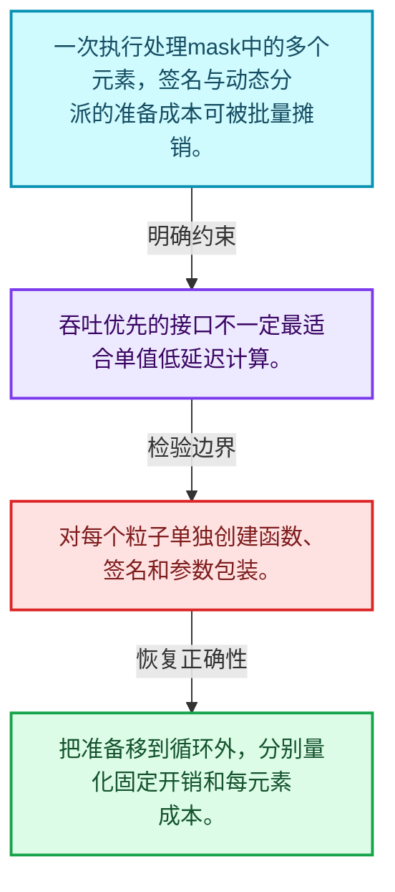
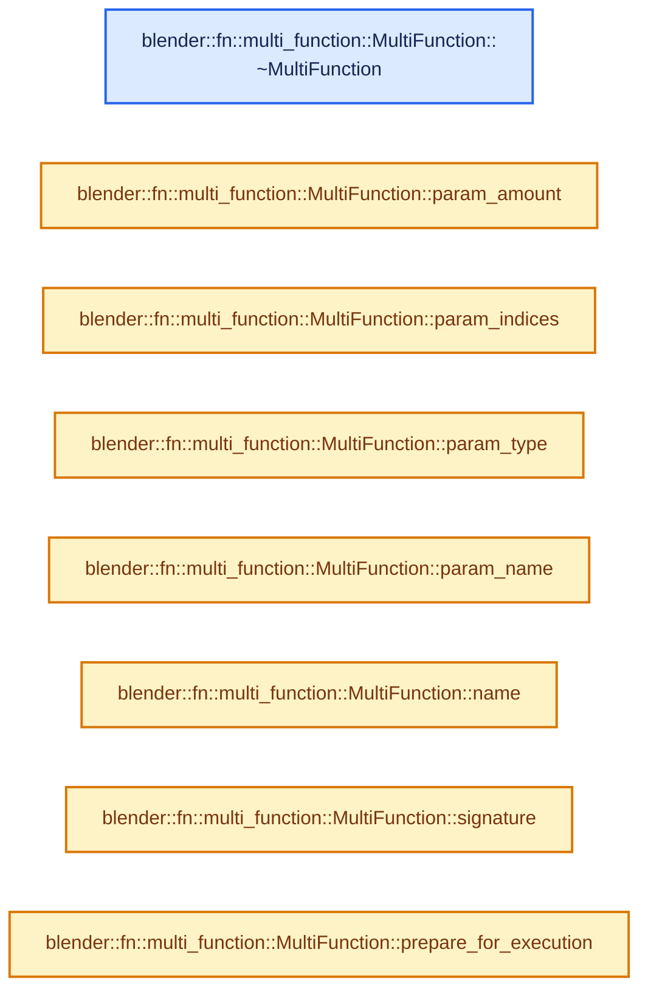
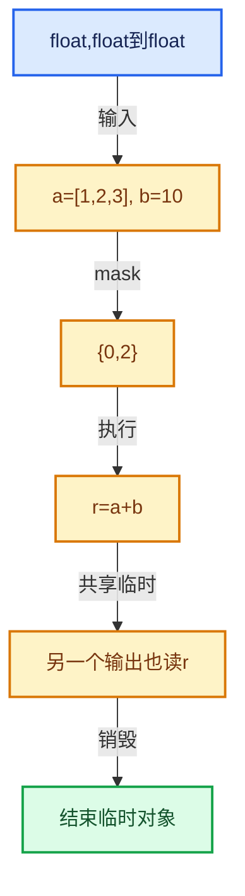

# 07-01 批量计算模型

[方向导航](README.md) · [总目录](../README.md) · [实现索引](../00-课程指南/02-源码与提交索引/符号依赖与实现索引.md)

## 从问题到实现

为什么函数一次处理多个元素？

批量接口把类型分派、参数准备和循环组织移到元素循环之外，提高吞吐潜力。

**数据模型**

一次执行处理mask中的多个元素，签名与动态分派的准备成本可被批量摊销。

**设计取舍**

吞吐优先的接口不一定最适合单值低延迟计算。

**最小反例**

对每个粒子单独创建函数、签名和参数包装。

**推导**

把准备移到循环外，分别量化固定开销和每元素成本。

## 阅读地图与执行推演








图中的数值推演是本方向的教学模型；实际函数之间的调用边与概念分析边分别标注，不能把概念关系当作运行时调度顺序。

## 完整源码单元与就地讲解

中文讲解直接放在相关代码旁，复杂机制在代码下展开。原文折叠区保留基准行号；不需要在行号表和函数之间来回查找。类布局可分段展示，函数实现不按固定行数切开。

### 类型布局、声明与编译条件 · FN_multi_function.hh L1—L47

<a id="t-bf52c3c6d5d1"></a>

`MultiFunction`在这里声明的数据成员：

- `Signature signature_ref_`

<!-- annotated:648a49e487369c -->

```cpp
/* SPDX-FileCopyrightText: 2023 Blender Authors
 *
 * SPDX-License-Identifier: GPL-2.0-or-later */

#pragma once

/** \file
 * \ingroup fn
 *
 * A `MultiFunction` encapsulates a function that is optimized for throughput (instead of latency).
 * The throughput is optimized by always processing many elements at once, instead of each element
 * separately. This is ideal for functions that are evaluated often (e.g. for every particle).
 *
 * By processing a lot of data at once, individual functions become easier to optimize for humans
 * and for the compiler. Furthermore, performance profiles become easier to understand and show
 * better where bottlenecks are.
 *
 * Every multi-function has a name and an ordered list of parameters. Parameters are used for input
 * and output. In fact, there are three kinds of parameters: inputs, outputs and mutable (which is
 * combination of input and output).
 *
 * To call a multi-function, one has to provide three things:
 * - `Params`: This references the input and output arrays that the function works with. The
 *      arrays are not owned by Params.
 * - `IndexMask`: An array of indices indicating which indices in the provided arrays should be
 *      touched/processed.
 * - `Context`: Further information for the called function.
 *
 * A new multi-function is generally implemented as follows:
 * 1. Create a new subclass of MultiFunction.
 * 2. Implement a constructor that initialized the signature of the function.
 * 3. Override the `call` function.
 */

#include "BLI_unique_hash.hh"
#include "FN_multi_function_context.hh"
#include "FN_multi_function_params.hh"

namespace blender {

namespace fn::multi_function {

class MultiFunction : NonCopyable, NonMovable {
 private:
  const Signature *signature_ref_ = nullptr;

 public:
```

<details>
<summary>核对原始源码：source/blender/functions/FN_multi_function.hh · L1—L47</summary>

<!-- original:648a49e487369c:source/blender/functions/FN_multi_function.hh:1:47 -->

```cpp
/* SPDX-FileCopyrightText: 2023 Blender Authors
 *
 * SPDX-License-Identifier: GPL-2.0-or-later */

#pragma once

/** \file
 * \ingroup fn
 *
 * A `MultiFunction` encapsulates a function that is optimized for throughput (instead of latency).
 * The throughput is optimized by always processing many elements at once, instead of each element
 * separately. This is ideal for functions that are evaluated often (e.g. for every particle).
 *
 * By processing a lot of data at once, individual functions become easier to optimize for humans
 * and for the compiler. Furthermore, performance profiles become easier to understand and show
 * better where bottlenecks are.
 *
 * Every multi-function has a name and an ordered list of parameters. Parameters are used for input
 * and output. In fact, there are three kinds of parameters: inputs, outputs and mutable (which is
 * combination of input and output).
 *
 * To call a multi-function, one has to provide three things:
 * - `Params`: This references the input and output arrays that the function works with. The
 *      arrays are not owned by Params.
 * - `IndexMask`: An array of indices indicating which indices in the provided arrays should be
 *      touched/processed.
 * - `Context`: Further information for the called function.
 *
 * A new multi-function is generally implemented as follows:
 * 1. Create a new subclass of MultiFunction.
 * 2. Implement a constructor that initialized the signature of the function.
 * 3. Override the `call` function.
 */

#include "BLI_unique_hash.hh"
#include "FN_multi_function_context.hh"
#include "FN_multi_function_params.hh"

namespace blender {

namespace fn::multi_function {

class MultiFunction : NonCopyable, NonMovable {
 private:
  const Signature *signature_ref_ = nullptr;

 public:
```

</details>

<a id="f-04f9b4b536f8c693"></a>

### `blender::fn::multi_function::MultiFunction::~MultiFunction`

实现位置：[source/blender/functions/FN_multi_function.hh](../../../../../source/blender/functions/FN_multi_function.hh) · L48—L48。

**教学注释版**

<!-- annotated:54ecc84b7dc3d4 -->

```cpp
  virtual ~MultiFunction() = default;
```

<details>
<summary>核对原始源码：source/blender/functions/FN_multi_function.hh · L48—L48</summary>

<!-- original:54ecc84b7dc3d4:source/blender/functions/FN_multi_function.hh:48:48 -->

```cpp
  virtual ~MultiFunction() = default;
```

</details>

**继续追踪实现**

本实现没有需要继续展开的显式调用；检查返回表达式、对象转换和调用者前置条件。

### 类型布局、声明与编译条件 · FN_multi_function.hh L49—L61

<!-- annotated:fd78644186f997 -->

```cpp

  /**
   * The result is the same as using #call directly but this method has some additional features.
   * - Automatic multi-threading when possible and appropriate.
   * - Automatic index mask offsetting to avoid large temporary intermediate arrays that are mostly
   *   unused.
   */
  void call_auto(const IndexMask &mask, Params params, Context context) const;
  virtual void call(const IndexMask &mask, Params params, Context context) const = 0;

  virtual void hash_unique(UniqueHashBytes &hash) const;
  virtual bool equals(const MultiFunction &other) const;

```

<details>
<summary>核对原始源码：source/blender/functions/FN_multi_function.hh · L49—L61</summary>

<!-- original:fd78644186f997:source/blender/functions/FN_multi_function.hh:49:61 -->

```cpp

  /**
   * The result is the same as using #call directly but this method has some additional features.
   * - Automatic multi-threading when possible and appropriate.
   * - Automatic index mask offsetting to avoid large temporary intermediate arrays that are mostly
   *   unused.
   */
  void call_auto(const IndexMask &mask, Params params, Context context) const;
  virtual void call(const IndexMask &mask, Params params, Context context) const = 0;

  virtual void hash_unique(UniqueHashBytes &hash) const;
  virtual bool equals(const MultiFunction &other) const;

```

</details>

<a id="f-dbc6d25e1e7ed8c8"></a>

### `blender::fn::multi_function::MultiFunction::param_amount`

实现位置：[source/blender/functions/FN_multi_function.hh](../../../../../source/blender/functions/FN_multi_function.hh) · L62—L65。

**教学注释版**

<!-- annotated:9e627950b51aca -->

```cpp
  int param_amount() const
  {
    return signature_ref_->params.size();
  }
```

<details>
<summary>核对原始源码：source/blender/functions/FN_multi_function.hh · L62—L65</summary>

<!-- original:9e627950b51aca:source/blender/functions/FN_multi_function.hh:62:65 -->

```cpp
  int param_amount() const
  {
    return signature_ref_->params.size();
  }
```

</details>

**结果出口**

- `return signature_ref_->params.size();`

**继续追踪实现**

- `signature_ref_->params.size` → [调用协议](../00-课程指南/01-路线与规范/模板宏与动态分派协议.md)：接收对象类型依赖auto、返回值或模板实例；不按同名猜测目标。调用位置L64。

<!-- annotated:ef031bbd8d43fb -->

```cpp

```

<details>
<summary>核对原始源码：source/blender/functions/FN_multi_function.hh · L66—L66</summary>

<!-- original:ef031bbd8d43fb:source/blender/functions/FN_multi_function.hh:66:66 -->

```cpp

```

</details>

<a id="f-e06e9cd4be7e3ea1"></a>

### `blender::fn::multi_function::MultiFunction::param_indices`

实现位置：[source/blender/functions/FN_multi_function.hh](../../../../../source/blender/functions/FN_multi_function.hh) · L67—L70。

**教学注释版**

<!-- annotated:d6d9425b6536d3 -->

```cpp
  IndexRange param_indices() const
  {
    return signature_ref_->params.index_range();
  }
```

<details>
<summary>核对原始源码：source/blender/functions/FN_multi_function.hh · L67—L70</summary>

<!-- original:d6d9425b6536d3:source/blender/functions/FN_multi_function.hh:67:70 -->

```cpp
  IndexRange param_indices() const
  {
    return signature_ref_->params.index_range();
  }
```

</details>

**结果出口**

- `return signature_ref_->params.index_range();`

**继续追踪实现**

- `signature_ref_->params.index_range` → [调用协议](../00-课程指南/01-路线与规范/模板宏与动态分派协议.md)：接收对象类型依赖auto、返回值或模板实例；不按同名猜测目标。调用位置L69。

<!-- annotated:b2f1eae018f365 -->

```cpp

```

<details>
<summary>核对原始源码：source/blender/functions/FN_multi_function.hh · L71—L71</summary>

<!-- original:b2f1eae018f365:source/blender/functions/FN_multi_function.hh:71:71 -->

```cpp

```

</details>

<a id="f-b713a5aeabff53fa"></a>

### `blender::fn::multi_function::MultiFunction::param_type`

实现位置：[source/blender/functions/FN_multi_function.hh](../../../../../source/blender/functions/FN_multi_function.hh) · L72—L75。

接口参数：

- `int param_index`

**教学注释版**

<!-- annotated:b64363870535d3 -->

```cpp
  ParamType param_type(int param_index) const
  {
    return signature_ref_->params[param_index].type;
  }
```

<details>
<summary>核对原始源码：source/blender/functions/FN_multi_function.hh · L72—L75</summary>

<!-- original:b64363870535d3:source/blender/functions/FN_multi_function.hh:72:75 -->

```cpp
  ParamType param_type(int param_index) const
  {
    return signature_ref_->params[param_index].type;
  }
```

</details>

**结果出口**

- `return signature_ref_->params[param_index].type;`

**继续追踪实现**

本实现没有需要继续展开的显式调用；检查返回表达式、对象转换和调用者前置条件。

<!-- annotated:1e48d5ee1f1852 -->

```cpp

```

<details>
<summary>核对原始源码：source/blender/functions/FN_multi_function.hh · L76—L76</summary>

<!-- original:1e48d5ee1f1852:source/blender/functions/FN_multi_function.hh:76:76 -->

```cpp

```

</details>

<a id="f-c803cd8bd675fedc"></a>

### `blender::fn::multi_function::MultiFunction::param_name`

实现位置：[source/blender/functions/FN_multi_function.hh](../../../../../source/blender/functions/FN_multi_function.hh) · L77—L80。

接口参数：

- `int param_index`

**教学注释版**

<!-- annotated:ab81e425df60ea -->

```cpp
  StringRefNull param_name(int param_index) const
  {
    return signature_ref_->params[param_index].name;
  }
```

<details>
<summary>核对原始源码：source/blender/functions/FN_multi_function.hh · L77—L80</summary>

<!-- original:ab81e425df60ea:source/blender/functions/FN_multi_function.hh:77:80 -->

```cpp
  StringRefNull param_name(int param_index) const
  {
    return signature_ref_->params[param_index].name;
  }
```

</details>

**结果出口**

- `return signature_ref_->params[param_index].name;`

**继续追踪实现**

本实现没有需要继续展开的显式调用；检查返回表达式、对象转换和调用者前置条件。

<!-- annotated:561bf5ebc927cd -->

```cpp

```

<details>
<summary>核对原始源码：source/blender/functions/FN_multi_function.hh · L81—L81</summary>

<!-- original:561bf5ebc927cd:source/blender/functions/FN_multi_function.hh:81:81 -->

```cpp

```

</details>

<a id="f-1e2f3fd60998b0bd"></a>

### `blender::fn::multi_function::MultiFunction::name`

实现位置：[source/blender/functions/FN_multi_function.hh](../../../../../source/blender/functions/FN_multi_function.hh) · L82—L85。

**教学注释版**

<!-- annotated:afa15391222f7e -->

```cpp
  StringRefNull name() const
  {
    return signature_ref_->function_name;
  }
```

<details>
<summary>核对原始源码：source/blender/functions/FN_multi_function.hh · L82—L85</summary>

<!-- original:afa15391222f7e:source/blender/functions/FN_multi_function.hh:82:85 -->

```cpp
  StringRefNull name() const
  {
    return signature_ref_->function_name;
  }
```

</details>

**结果出口**

- `return signature_ref_->function_name;`

**继续追踪实现**

本实现没有需要继续展开的显式调用；检查返回表达式、对象转换和调用者前置条件。

### 类型布局、声明与编译条件 · FN_multi_function.hh L86—L88

<!-- annotated:ac876dbd1e25f5 -->

```cpp

  virtual std::string debug_name() const;

```

<details>
<summary>核对原始源码：source/blender/functions/FN_multi_function.hh · L86—L88</summary>

<!-- original:ac876dbd1e25f5:source/blender/functions/FN_multi_function.hh:86:88 -->

```cpp

  virtual std::string debug_name() const;

```

</details>

<a id="f-bb80a89e78852180"></a>

### `blender::fn::multi_function::MultiFunction::signature`

实现位置：[source/blender/functions/FN_multi_function.hh](../../../../../source/blender/functions/FN_multi_function.hh) · L89—L93。

**教学注释版**

<!-- annotated:514caf6291731d -->

```cpp
  const Signature &signature() const
  {
    BLI_assert(signature_ref_ != nullptr);
    return *signature_ref_;
  }
```

<details>
<summary>核对原始源码：source/blender/functions/FN_multi_function.hh · L89—L93</summary>

<!-- original:514caf6291731d:source/blender/functions/FN_multi_function.hh:89:93 -->

```cpp
  const Signature &signature() const
  {
    BLI_assert(signature_ref_ != nullptr);
    return *signature_ref_;
  }
```

</details>

**结果出口**

- `return *signature_ref_;`

**继续追踪实现**

- `BLI_assert` → [BLI_assert · L48](../90-实现依赖专题/01-BLI基础库/BLI_assert.hh.md#m-57a88495704d)；[BLI_assert · L63](../90-实现依赖专题/01-BLI基础库/BLI_assert.hh.md#m-d07050020cb5)。宏定义由构建条件选择。

### 类型布局、声明与编译条件 · FN_multi_function.hh L94—L125

<a id="t-d7caf12b1bc4"></a>

`ExecutionHints`在这里声明的数据成员：

- `int64_t min_grain_size`
- `bool allocates_array`
- `bool uniform_execution_time`

<!-- annotated:0c00b9deab1465 -->

```cpp

  /**
   * Information about how the multi-function behaves that help a caller to execute it efficiently.
   */
  struct ExecutionHints {
    /**
     * Suggested minimum workload under which multi-threading does not really help.
     * This should be lowered when the multi-function is doing something computationally expensive.
     */
    int64_t min_grain_size = 10000;
    /**
     * Indicates that the multi-function will allocate an array large enough to hold all indices
     * passed in as mask. This tells the caller that it would be preferable to pass in smaller
     * indices. Also maybe the full mask should be split up into smaller segments to decrease peak
     * memory usage.
     */
    bool allocates_array = false;
    /**
     * Tells the caller that every execution takes about the same time. This helps making a more
     * educated guess about a good grain size.
     */
    bool uniform_execution_time = true;
  };

  ExecutionHints execution_hints() const;

  /**
   * For performance reasons it might make sense to delay construction of data inside the node
   * until we can be sure that the function will be evaluated. This method should be called before
   * execution. The work must be protected by a lock though, since it may be called from multiple
   * threads.
   */
```

<details>
<summary>核对原始源码：source/blender/functions/FN_multi_function.hh · L94—L125</summary>

<!-- original:0c00b9deab1465:source/blender/functions/FN_multi_function.hh:94:125 -->

```cpp

  /**
   * Information about how the multi-function behaves that help a caller to execute it efficiently.
   */
  struct ExecutionHints {
    /**
     * Suggested minimum workload under which multi-threading does not really help.
     * This should be lowered when the multi-function is doing something computationally expensive.
     */
    int64_t min_grain_size = 10000;
    /**
     * Indicates that the multi-function will allocate an array large enough to hold all indices
     * passed in as mask. This tells the caller that it would be preferable to pass in smaller
     * indices. Also maybe the full mask should be split up into smaller segments to decrease peak
     * memory usage.
     */
    bool allocates_array = false;
    /**
     * Tells the caller that every execution takes about the same time. This helps making a more
     * educated guess about a good grain size.
     */
    bool uniform_execution_time = true;
  };

  ExecutionHints execution_hints() const;

  /**
   * For performance reasons it might make sense to delay construction of data inside the node
   * until we can be sure that the function will be evaluated. This method should be called before
   * execution. The work must be protected by a lock though, since it may be called from multiple
   * threads.
   */
```

</details>

<a id="f-d9cb2a6f3a06d34b"></a>

### `blender::fn::multi_function::MultiFunction::prepare_for_execution`

实现位置：[source/blender/functions/FN_multi_function.hh](../../../../../source/blender/functions/FN_multi_function.hh) · L126—L126。

**教学注释版**

<!-- annotated:07dd306beff91f -->

```cpp
  virtual void prepare_for_execution() const {}
```

<details>
<summary>核对原始源码：source/blender/functions/FN_multi_function.hh · L126—L126</summary>

<!-- original:07dd306beff91f:source/blender/functions/FN_multi_function.hh:126:126 -->

```cpp
  virtual void prepare_for_execution() const {}
```

</details>

**继续追踪实现**

本实现没有需要继续展开的显式调用；检查返回表达式、对象转换和调用者前置条件。

### 类型布局、声明与编译条件 · FN_multi_function.hh L127—L132

<!-- annotated:1e611e20d8e98c -->

```cpp

 protected:
  /* Make the function use the given signature. This should be called once in the constructor of
   * child classes. No copy of the signature is made, so the caller has to make sure that the
   * signature lives as long as the multi function. It is ok to embed the signature into the child
   * class. */
```

<details>
<summary>核对原始源码：source/blender/functions/FN_multi_function.hh · L127—L132</summary>

<!-- original:1e611e20d8e98c:source/blender/functions/FN_multi_function.hh:127:132 -->

```cpp

 protected:
  /* Make the function use the given signature. This should be called once in the constructor of
   * child classes. No copy of the signature is made, so the caller has to make sure that the
   * signature lives as long as the multi function. It is ok to embed the signature into the child
   * class. */
```

</details>

<a id="f-3b440d337b220123"></a>

### `blender::fn::multi_function::MultiFunction::set_signature`

实现位置：[source/blender/functions/FN_multi_function.hh](../../../../../source/blender/functions/FN_multi_function.hh) · L133—L138。

接口参数：

- `const Signature *signature`

**教学注释版**

<!-- annotated:4b620b003c57a8 -->

```cpp
  void set_signature(const Signature *signature)
  {
    /* Take a pointer as argument, so that it is more obvious that no copy is created. */
    BLI_assert(signature != nullptr);
    signature_ref_ = signature;
  }
```

<details>
<summary>核对原始源码：source/blender/functions/FN_multi_function.hh · L133—L138</summary>

<!-- original:4b620b003c57a8:source/blender/functions/FN_multi_function.hh:133:138 -->

```cpp
  void set_signature(const Signature *signature)
  {
    /* Take a pointer as argument, so that it is more obvious that no copy is created. */
    BLI_assert(signature != nullptr);
    signature_ref_ = signature;
  }
```

</details>

**沿实际写入检查状态**

- `signature_ref_ = signature;`

**继续追踪实现**

- `BLI_assert` → [BLI_assert · L48](../90-实现依赖专题/01-BLI基础库/BLI_assert.hh.md#m-57a88495704d)；[BLI_assert · L63](../90-实现依赖专题/01-BLI基础库/BLI_assert.hh.md#m-d07050020cb5)。宏定义由构建条件选择。

### 类型布局、声明与编译条件 · FN_multi_function.hh L139—L142

<!-- annotated:6e6cbbdc05ab90 -->

```cpp

  virtual ExecutionHints get_execution_hints() const;
};

```

<details>
<summary>核对原始源码：source/blender/functions/FN_multi_function.hh · L139—L142</summary>

<!-- original:6e6cbbdc05ab90:source/blender/functions/FN_multi_function.hh:139:142 -->

```cpp

  virtual ExecutionHints get_execution_hints() const;
};

```

</details>

<a id="f-18f5afa063545a96"></a>

### `blender::fn::multi_function::ParamsBuilder::ParamsBuilder`

实现位置：[source/blender/functions/FN_multi_function.hh](../../../../../source/blender/functions/FN_multi_function.hh) · L143—L146。

接口参数：

- `const MultiFunction &fn`
- `const IndexMask *mask`

**教学注释版**

<!-- annotated:abb142bf496d35 -->

```cpp
inline ParamsBuilder::ParamsBuilder(const MultiFunction &fn, const IndexMask *mask)
    : ParamsBuilder(fn.signature(), *mask)
{
}
```

<details>
<summary>核对原始源码：source/blender/functions/FN_multi_function.hh · L143—L146</summary>

<!-- original:abb142bf496d35:source/blender/functions/FN_multi_function.hh:143:146 -->

```cpp
inline ParamsBuilder::ParamsBuilder(const MultiFunction &fn, const IndexMask *mask)
    : ParamsBuilder(fn.signature(), *mask)
{
}
```

</details>

**继续追踪实现**

本实现没有需要继续展开的显式调用；检查返回表达式、对象转换和调用者前置条件。

### 类型布局、声明与编译条件 · FN_multi_function.hh L147—L152

<!-- annotated:5c74ef3f513b5c -->

```cpp

}  // namespace fn::multi_function

namespace mf = fn::multi_function;

}  // namespace blender
```

<details>
<summary>核对原始源码：source/blender/functions/FN_multi_function.hh · L147—L152</summary>

<!-- original:5c74ef3f513b5c:source/blender/functions/FN_multi_function.hh:147:152 -->

```cpp

}  // namespace fn::multi_function

namespace mf = fn::multi_function;

}  // namespace blender
```

</details>

### 类型布局、声明与编译条件 · multi_function.cc L1—L17

<!-- annotated:18e31ed6a2d271 -->

```cpp
/* SPDX-FileCopyrightText: 2023 Blender Authors
 *
 * SPDX-License-Identifier: GPL-2.0-or-later */

/** \file
 * \ingroup fn
 */

#include "FN_multi_function.hh"

#include "BLI_task.hh"
#include "BLI_threads.hh"

namespace blender::fn::multi_function {

using ExecutionHints = MultiFunction::ExecutionHints;

```

<details>
<summary>核对原始源码：source/blender/functions/intern/multi_function.cc · L1—L17</summary>

<!-- original:18e31ed6a2d271:source/blender/functions/intern/multi_function.cc:1:17 -->

```cpp
/* SPDX-FileCopyrightText: 2023 Blender Authors
 *
 * SPDX-License-Identifier: GPL-2.0-or-later */

/** \file
 * \ingroup fn
 */

#include "FN_multi_function.hh"

#include "BLI_task.hh"
#include "BLI_threads.hh"

namespace blender::fn::multi_function {

using ExecutionHints = MultiFunction::ExecutionHints;

```

</details>

<a id="f-55c34d8750402db1"></a>

### `blender::fn::multi_function::MultiFunction::hash_unique`

实现位置：[source/blender/functions/intern/multi_function.cc](../../../../../source/blender/functions/intern/multi_function.cc) · L18—L21。

接口参数：

- `UniqueHashBytes &hash`

**教学注释版**

<!-- annotated:d354b7ee766d51 -->

```cpp
void MultiFunction::hash_unique(UniqueHashBytes &hash) const
{
  hash.add(this);
}
```

<details>
<summary>核对原始源码：source/blender/functions/intern/multi_function.cc · L18—L21</summary>

<!-- original:d354b7ee766d51:source/blender/functions/intern/multi_function.cc:18:21 -->

```cpp
void MultiFunction::hash_unique(UniqueHashBytes &hash) const
{
  hash.add(this);
}
```

</details>

**继续追踪实现**

- `hash.add` → [blender::UniqueHashBytes::add · L40](../90-实现依赖专题/01-BLI基础库/BLI_unique_hash.hh.md#f-12ca7cac7556bc01)。

<!-- annotated:8cfd6b21196f7f -->

```cpp

```

<details>
<summary>核对原始源码：source/blender/functions/intern/multi_function.cc · L22—L22</summary>

<!-- original:8cfd6b21196f7f:source/blender/functions/intern/multi_function.cc:22:22 -->

```cpp

```

</details>

<a id="f-2792c778c9aa88a6"></a>

### `blender::fn::multi_function::MultiFunction::equals`

实现位置：[source/blender/functions/intern/multi_function.cc](../../../../../source/blender/functions/intern/multi_function.cc) · L23—L26。

接口参数：

- `const MultiFunction &other`

**教学注释版**

<!-- annotated:cafcd644f3d918 -->

```cpp
bool MultiFunction::equals(const MultiFunction &other) const
{
  return this == &other;
}
```

<details>
<summary>核对原始源码：source/blender/functions/intern/multi_function.cc · L23—L26</summary>

<!-- original:cafcd644f3d918:source/blender/functions/intern/multi_function.cc:23:26 -->

```cpp
bool MultiFunction::equals(const MultiFunction &other) const
{
  return this == &other;
}
```

</details>

**结果出口**

- `return this == &other;`

**继续追踪实现**

本实现没有需要继续展开的显式调用；检查返回表达式、对象转换和调用者前置条件。

<!-- annotated:c5fa1a33b58552 -->

```cpp

```

<details>
<summary>核对原始源码：source/blender/functions/intern/multi_function.cc · L27—L27</summary>

<!-- original:c5fa1a33b58552:source/blender/functions/intern/multi_function.cc:27:27 -->

```cpp

```

</details>

<a id="f-773d2e5692baae68"></a>

### `blender::fn::multi_function::MultiFunction::execution_hints`

实现位置：[source/blender/functions/intern/multi_function.cc](../../../../../source/blender/functions/intern/multi_function.cc) · L28—L31。

**教学注释版**

<!-- annotated:b09a8087dd8c48 -->

```cpp
ExecutionHints MultiFunction::execution_hints() const
{
  return this->get_execution_hints();
}
```

<details>
<summary>核对原始源码：source/blender/functions/intern/multi_function.cc · L28—L31</summary>

<!-- original:b09a8087dd8c48:source/blender/functions/intern/multi_function.cc:28:31 -->

```cpp
ExecutionHints MultiFunction::execution_hints() const
{
  return this->get_execution_hints();
}
```

</details>

**结果出口**

- `return this->get_execution_hints();`

**继续追踪实现**

- `this->get_execution_hints` → [blender::fn::multi_function::MultiFunction::get_execution_hints · L33](01-批量计算模型.md#f-e1b22f59a166b4eb)。

<!-- annotated:3df4888549ab4d -->

```cpp

```

<details>
<summary>核对原始源码：source/blender/functions/intern/multi_function.cc · L32—L32</summary>

<!-- original:3df4888549ab4d:source/blender/functions/intern/multi_function.cc:32:32 -->

```cpp

```

</details>

<a id="f-e1b22f59a166b4eb"></a>

### `blender::fn::multi_function::MultiFunction::get_execution_hints`

实现位置：[source/blender/functions/intern/multi_function.cc](../../../../../source/blender/functions/intern/multi_function.cc) · L33—L36。

**教学注释版**

<!-- annotated:e0576d85f6948d -->

```cpp
ExecutionHints MultiFunction::get_execution_hints() const
{
  return ExecutionHints{};
}
```

<details>
<summary>核对原始源码：source/blender/functions/intern/multi_function.cc · L33—L36</summary>

<!-- original:e0576d85f6948d:source/blender/functions/intern/multi_function.cc:33:36 -->

```cpp
ExecutionHints MultiFunction::get_execution_hints() const
{
  return ExecutionHints{};
}
```

</details>

**结果出口**

- `return ExecutionHints{};`

**继续追踪实现**

本实现没有需要继续展开的显式调用；检查返回表达式、对象转换和调用者前置条件。

<!-- annotated:36a042842af691 -->

```cpp

```

<details>
<summary>核对原始源码：source/blender/functions/intern/multi_function.cc · L37—L37</summary>

<!-- original:36a042842af691:source/blender/functions/intern/multi_function.cc:37:37 -->

```cpp

```

</details>

<a id="f-a83382f203acb4d0"></a>

### `blender::fn::multi_function::supports_threading_by_slicing_params`

实现位置：[source/blender/functions/intern/multi_function.cc](../../../../../source/blender/functions/intern/multi_function.cc) · L38—L52。

接口参数：

- `const MultiFunction &fn`

**教学注释版**

<!-- annotated:295c49fb442a4e -->

```cpp
static bool supports_threading_by_slicing_params(const MultiFunction &fn)
{
  for (const int i : fn.param_indices()) {
    const ParamType param_type = fn.param_type(i);
    if (ELEM(param_type.interface_type(),
             ParamType::InterfaceType::Mutable,
             ParamType::InterfaceType::Output))
    {
      if (param_type.data_type().is_vector()) {
        return false;
      }
    }
  }
  return true;
}
```

<details>
<summary>核对原始源码：source/blender/functions/intern/multi_function.cc · L38—L52</summary>

<!-- original:295c49fb442a4e:source/blender/functions/intern/multi_function.cc:38:52 -->

```cpp
static bool supports_threading_by_slicing_params(const MultiFunction &fn)
{
  for (const int i : fn.param_indices()) {
    const ParamType param_type = fn.param_type(i);
    if (ELEM(param_type.interface_type(),
             ParamType::InterfaceType::Mutable,
             ParamType::InterfaceType::Output))
    {
      if (param_type.data_type().is_vector()) {
        return false;
      }
    }
  }
  return true;
}
```

</details>

**结果出口**

- `return false;`
- `return true;`

**继续追踪实现**

- `fn.param_indices` → [blender::fn::multi_function::MultiFunction::param_indices · L67](01-批量计算模型.md#f-e06e9cd4be7e3ea1)。
- `fn.param_type` → [blender::fn::multi_function::MultiFunction::param_type · L72](01-批量计算模型.md#f-b713a5aeabff53fa)。
- `ELEM` → [ELEM · L88](../90-实现依赖专题/07-Intern运行时与平台/ghost/intern/GHOST_utildefines.hh.md#m-d28724a15928)；[ELEM · L135](../90-实现依赖专题/01-BLI基础库/BLI_utildefines.hh.md#m-d6572de7cae0)。宏定义由构建条件选择。
- `param_type.interface_type` → [blender::fn::multi_function::ParamType::interface_type · L118](03-参数类型与角色.md#f-a506dc82cef792f5)。
- `param_type.data_type().is_vector` → [调用协议](../00-课程指南/01-路线与规范/模板宏与动态分派协议.md)：接收对象类型依赖auto、返回值或模板实例；不按同名猜测目标。调用位置L46。
- `param_type.data_type` → [blender::fn::multi_function::ParamType::data_type · L113](03-参数类型与角色.md#f-b29743877463338d)。

<!-- annotated:ba5d1ce2f9f2db -->

```cpp

```

<details>
<summary>核对原始源码：source/blender/functions/intern/multi_function.cc · L53—L53</summary>

<!-- original:ba5d1ce2f9f2db:source/blender/functions/intern/multi_function.cc:53:53 -->

```cpp

```

</details>

<a id="f-873d9b4d857ec781"></a>

### `blender::fn::multi_function::compute_grain_size`

实现位置：[source/blender/functions/intern/multi_function.cc](../../../../../source/blender/functions/intern/multi_function.cc) · L54—L70。

接口参数：

- `const ExecutionHints &hints`
- `const IndexMask &mask`

**教学注释版**

<!-- annotated:060ff5ea6c191c -->

```cpp
static int64_t compute_grain_size(const ExecutionHints &hints, const IndexMask &mask)
{
  int64_t grain_size = hints.min_grain_size;
  if (hints.uniform_execution_time) {
    const int thread_count = BLI_system_thread_count();
    /* Avoid using a small grain size even if it is not necessary. */
    const int64_t thread_based_grain_size = mask.size() / thread_count / 4;
    // [讲解] std::max：按比较关系选取较大值。本讲解中的增长公式同时满足最低请求和几何增长；若保存返回引用，还需注意实参寿命。
    grain_size = std::max(grain_size, thread_based_grain_size);
  }
  if (hints.allocates_array) {
    const int64_t max_grain_size = 10000;
    /* Avoid allocating many large intermediate arrays. Better process data in smaller chunks to
     * keep peak memory usage lower. */
    // [讲解] std::min：按比较关系选取较小值；截断范围时还需先满足非负和可表示范围，min本身不会证明边界安全。
    grain_size = std::min(grain_size, max_grain_size);
  }
  return grain_size;
}
```

<details>
<summary>核对原始源码：source/blender/functions/intern/multi_function.cc · L54—L70</summary>

<!-- original:060ff5ea6c191c:source/blender/functions/intern/multi_function.cc:54:70 -->

```cpp
static int64_t compute_grain_size(const ExecutionHints &hints, const IndexMask &mask)
{
  int64_t grain_size = hints.min_grain_size;
  if (hints.uniform_execution_time) {
    const int thread_count = BLI_system_thread_count();
    /* Avoid using a small grain size even if it is not necessary. */
    const int64_t thread_based_grain_size = mask.size() / thread_count / 4;
    grain_size = std::max(grain_size, thread_based_grain_size);
  }
  if (hints.allocates_array) {
    const int64_t max_grain_size = 10000;
    /* Avoid allocating many large intermediate arrays. Better process data in smaller chunks to
     * keep peak memory usage lower. */
    grain_size = std::min(grain_size, max_grain_size);
  }
  return grain_size;
}
```

</details>

**沿实际写入检查状态**

- `grain_size = std::max(grain_size, thread_based_grain_size);`
- `grain_size = std::min(grain_size, max_grain_size);`

**结果出口**

- `return grain_size;`

**继续追踪实现**

- `BLI_system_thread_count` → [BLI_system_thread_count · L258](../90-实现依赖专题/01-BLI基础库/intern/threads.cc.md#f-12aff71a24fecec4)。
- `mask.size` → [blender::index_mask::IndexMask::size · L743](../04-虚拟数组与索引选择/09-分段存储与遍历.md#f-0163b32abc9a0d9c)。
- `std::max` → [外部契约](https://eel.is/c++draft/alg.min.max)：按比较关系选取较大值。本讲解中的增长公式同时满足最低请求和几何增长；若保存返回引用，还需注意实参寿命。
- `std::min` → [外部契约](https://eel.is/c++draft/alg.min.max)：按比较关系选取较小值；截断范围时还需先满足非负和可表示范围，min本身不会证明边界安全。

<!-- annotated:c3e79dd1284223 -->

```cpp

```

<details>
<summary>核对原始源码：source/blender/functions/intern/multi_function.cc · L71—L71</summary>

<!-- original:c3e79dd1284223:source/blender/functions/intern/multi_function.cc:71:71 -->

```cpp

```

</details>

<a id="f-c318697e4551f808"></a>

### `blender::fn::multi_function::compute_alignment`

实现位置：[source/blender/functions/intern/multi_function.cc](../../../../../source/blender/functions/intern/multi_function.cc) · L72—L80。

接口参数：

- `const int64_t grain_size`

**教学注释版**

<!-- annotated:9f72067d6bbd32 -->

```cpp
static int64_t compute_alignment(const int64_t grain_size)
{
  if (grain_size <= 512) {
    /* Don't use a number that's too large, or otherwise the work will be split quite unevenly. */
    return 8;
  }
  /* It's not common that more elements are processed in a loop at once. */
  return 32;
}
```

<details>
<summary>核对原始源码：source/blender/functions/intern/multi_function.cc · L72—L80</summary>

<!-- original:9f72067d6bbd32:source/blender/functions/intern/multi_function.cc:72:80 -->

```cpp
static int64_t compute_alignment(const int64_t grain_size)
{
  if (grain_size <= 512) {
    /* Don't use a number that's too large, or otherwise the work will be split quite unevenly. */
    return 8;
  }
  /* It's not common that more elements are processed in a loop at once. */
  return 32;
}
```

</details>

**结果出口**

- `return 8;`
- `return 32;`

**继续追踪实现**

本实现没有需要继续展开的显式调用；检查返回表达式、对象转换和调用者前置条件。

<!-- annotated:e45b929bb9cd73 -->

```cpp

```

<details>
<summary>核对原始源码：source/blender/functions/intern/multi_function.cc · L81—L81</summary>

<!-- original:e45b929bb9cd73:source/blender/functions/intern/multi_function.cc:81:81 -->

```cpp

```

</details>

<a id="f-8510d4de7675e1fb"></a>

### `blender::fn::multi_function::add_sliced_parameters`

实现位置：[source/blender/functions/intern/multi_function.cc](../../../../../source/blender/functions/intern/multi_function.cc) · L82—L128。

接口参数：

- `const Signature &signature`
- `Params &full_params`
- `const IndexRange slice_range`
- `ParamsBuilder &r_sliced_params`

**教学注释版**

<!-- annotated:43889b1f0c94b2 -->

```cpp
static void add_sliced_parameters(const Signature &signature,
                                  Params &full_params,
                                  const IndexRange slice_range,
                                  ParamsBuilder &r_sliced_params)
{
  for (const int param_index : signature.params.index_range()) {
    const ParamType &param_type = signature.params[param_index].type;
    switch (param_type.category()) {
      case ParamCategory::SingleInput: {
        const GVArray &varray = full_params.readonly_single_input(param_index);
        r_sliced_params.add_readonly_single_input(varray.slice(slice_range));
        break;
      }
      case ParamCategory::SingleMutable: {
        const GMutableSpan span = full_params.single_mutable(param_index);
        const GMutableSpan sliced_span = span.slice(slice_range);
        r_sliced_params.add_single_mutable(sliced_span);
        break;
      }
      case ParamCategory::SingleOutput: {
        if (flag_is_set(signature.params[param_index].flag, ParamFlag::SupportsUnusedOutput)) {
          const GMutableSpan span = full_params.uninitialized_single_output_if_required(
              param_index);
          if (span.is_empty()) {
            r_sliced_params.add_ignored_single_output();
          }
          else {
            const GMutableSpan sliced_span = span.slice(slice_range);
            r_sliced_params.add_uninitialized_single_output(sliced_span);
          }
        }
        else {
          const GMutableSpan span = full_params.uninitialized_single_output(param_index);
          const GMutableSpan sliced_span = span.slice(slice_range);
          r_sliced_params.add_uninitialized_single_output(sliced_span);
        }
        break;
      }
      case ParamCategory::VectorInput:
      case ParamCategory::VectorMutable:
      case ParamCategory::VectorOutput: {
        BLI_assert_unreachable();
        break;
      }
    }
  }
}
```

<details>
<summary>核对原始源码：source/blender/functions/intern/multi_function.cc · L82—L128</summary>

<!-- original:43889b1f0c94b2:source/blender/functions/intern/multi_function.cc:82:128 -->

```cpp
static void add_sliced_parameters(const Signature &signature,
                                  Params &full_params,
                                  const IndexRange slice_range,
                                  ParamsBuilder &r_sliced_params)
{
  for (const int param_index : signature.params.index_range()) {
    const ParamType &param_type = signature.params[param_index].type;
    switch (param_type.category()) {
      case ParamCategory::SingleInput: {
        const GVArray &varray = full_params.readonly_single_input(param_index);
        r_sliced_params.add_readonly_single_input(varray.slice(slice_range));
        break;
      }
      case ParamCategory::SingleMutable: {
        const GMutableSpan span = full_params.single_mutable(param_index);
        const GMutableSpan sliced_span = span.slice(slice_range);
        r_sliced_params.add_single_mutable(sliced_span);
        break;
      }
      case ParamCategory::SingleOutput: {
        if (flag_is_set(signature.params[param_index].flag, ParamFlag::SupportsUnusedOutput)) {
          const GMutableSpan span = full_params.uninitialized_single_output_if_required(
              param_index);
          if (span.is_empty()) {
            r_sliced_params.add_ignored_single_output();
          }
          else {
            const GMutableSpan sliced_span = span.slice(slice_range);
            r_sliced_params.add_uninitialized_single_output(sliced_span);
          }
        }
        else {
          const GMutableSpan span = full_params.uninitialized_single_output(param_index);
          const GMutableSpan sliced_span = span.slice(slice_range);
          r_sliced_params.add_uninitialized_single_output(sliced_span);
        }
        break;
      }
      case ParamCategory::VectorInput:
      case ParamCategory::VectorMutable:
      case ParamCategory::VectorOutput: {
        BLI_assert_unreachable();
        break;
      }
    }
  }
}
```

</details>

**继续追踪实现**

- `signature.params.index_range` → [调用协议](../00-课程指南/01-路线与规范/模板宏与动态分派协议.md)：接收对象类型依赖auto、返回值或模板实例；不按同名猜测目标。调用位置L87。
- `param_type.category` → [blender::fn::multi_function::ParamType::category · L123](03-参数类型与角色.md#f-3b4b7b7786763245)。
- `full_params.readonly_single_input` → [blender::fn::multi_function::Params::readonly_single_input · L333](04-参数访问与输出构造.md#f-bf8962325f032689)；[blender::fn::multi_function::Params::readonly_single_input · L340](04-参数访问与输出构造.md#f-fb1c312ddfea5e55)。同名重载需按实参类型选择。
- `r_sliced_params.add_readonly_single_input` → [blender::fn::multi_function::ParamsBuilder::add_readonly_single_input · L156](04-参数访问与输出构造.md#f-5ef65d99e991c3f8)；[blender::fn::multi_function::ParamsBuilder::add_readonly_single_input · L167](04-参数访问与输出构造.md#f-39d85bcf8f1eb606)；[blender::fn::multi_function::ParamsBuilder::add_readonly_single_input · L174](04-参数访问与输出构造.md#f-b4224f26d95311ed)；[blender::fn::multi_function::ParamsBuilder::add_readonly_single_input · L184](04-参数访问与输出构造.md#f-c9ee081fd1fae167)。同名重载需按实参类型选择。
- `varray.slice` → [blender::GVArray::slice · L652](../04-虚拟数组与索引选择/05-GVArray运行时类型.md#f-78ff2fe92b17a34c)。
- `full_params.single_mutable` → [blender::fn::multi_function::Params::single_mutable · L409](04-参数访问与输出构造.md#f-3624af775b0fc604)；[blender::fn::multi_function::Params::single_mutable · L414](04-参数访问与输出构造.md#f-53a65f416e11568f)。同名重载需按实参类型选择。
- `span.slice` → [blender::GMutableSpan::slice · L227](../03-内存分配与运行时类型/11-GSpan与GArray.md#f-d7f8e350bc3a5156)；[blender::GMutableSpan::slice · L235](../03-内存分配与运行时类型/11-GSpan与GArray.md#f-b1101d4d9009fa75)。同名重载需按实参类型选择。
- `r_sliced_params.add_single_mutable` → [blender::fn::multi_function::ParamsBuilder::add_single_mutable · L255](04-参数访问与输出构造.md#f-239c619fcb387f5c)。
- `flag_is_set` → [调用协议](../00-课程指南/01-路线与规范/模板宏与动态分派协议.md)：函数指针、局部可调用对象或未展开的宏；必须结合调用者环境。调用位置L102。
- `full_params.uninitialized_single_output_if_required` → [blender::fn::multi_function::Params::uninitialized_single_output_if_required · L368](04-参数访问与输出构造.md#f-cf61774be6d07a93)；[blender::fn::multi_function::Params::uninitialized_single_output_if_required · L375](04-参数访问与输出构造.md#f-72bff53c80d8ed47)。同名重载需按实参类型选择。
- `span.is_empty` → [blender::GMutableSpan::is_empty · L193](../03-内存分配与运行时类型/11-GSpan与GArray.md#f-6fac8d7ba01608fb)。
- `r_sliced_params.add_ignored_single_output` → [blender::fn::multi_function::ParamsBuilder::add_ignored_single_output · L229](04-参数访问与输出构造.md#f-1c7fc6f769a09e79)。
- `r_sliced_params.add_uninitialized_single_output` → [blender::fn::multi_function::ParamsBuilder::add_uninitialized_single_output · L215](04-参数访问与输出构造.md#f-1faa1a496d7da36b)；[blender::fn::multi_function::ParamsBuilder::add_uninitialized_single_output · L221](04-参数访问与输出构造.md#f-1466d69a4fff0159)。同名重载需按实参类型选择。
- `full_params.uninitialized_single_output` → [blender::fn::multi_function::Params::uninitialized_single_output · L352](04-参数访问与输出构造.md#f-80ab080c634045bd)；[blender::fn::multi_function::Params::uninitialized_single_output · L358](04-参数访问与输出构造.md#f-86ca5af9f5eee7ba)。同名重载需按实参类型选择。
- `BLI_assert_unreachable` → [BLI_assert_unreachable · L77](../90-实现依赖专题/01-BLI基础库/BLI_assert.hh.md#m-7a2d91a67d8e)。宏定义由构建条件选择。

<!-- annotated:f7f1595027fe43 -->

```cpp

```

<details>
<summary>核对原始源码：source/blender/functions/intern/multi_function.cc · L129—L129</summary>

<!-- original:f7f1595027fe43:source/blender/functions/intern/multi_function.cc:129:129 -->

```cpp

```

</details>

<a id="f-003a5b189ca0aabc"></a>

### `blender::fn::multi_function::MultiFunction::call_auto`

实现位置：[source/blender/functions/intern/multi_function.cc](../../../../../source/blender/functions/intern/multi_function.cc) · L130—L175。

接口参数：

- `const IndexMask &mask`
- `Params params`
- `Context context`

**教学注释版**

<!-- annotated:5f86943335279b -->

```cpp
void MultiFunction::call_auto(const IndexMask &mask, Params params, Context context) const
{
  if (mask.is_empty()) {
    return;
  }
  const ExecutionHints hints = this->execution_hints();
  const int64_t grain_size = compute_grain_size(hints, mask);

  if (mask.size() <= grain_size) {
    this->call(mask, params, context);
    return;
  }

  const bool supports_threading = supports_threading_by_slicing_params(*this);
  if (!supports_threading) {
    this->call(mask, params, context);
    return;
  }

  const int64_t alignment = compute_alignment(grain_size);
  threading::parallel_for_aligned(
      mask.index_range(), grain_size, alignment, [&](const IndexRange sub_range) {
        const IndexMask sliced_mask = mask.slice(sub_range);
        if (!hints.allocates_array) {
          /* There is no benefit to changing indices in this case. */
          this->call(sliced_mask, params, context);
          return;
        }
        if (sliced_mask[0] < grain_size) {
          /* The indices are low, no need to offset them. */
          this->call(sliced_mask, params, context);
          return;
        }
        const int64_t input_slice_start = sliced_mask[0];
        const int64_t input_slice_size = sliced_mask.last() - input_slice_start + 1;
        const IndexRange input_slice_range{input_slice_start, input_slice_size};

        IndexMaskMemory memory;
        const int64_t offset = -input_slice_start;
        const IndexMask shifted_mask = mask.slice_and_shift(sub_range, offset, memory);

        ParamsBuilder sliced_params{*this, &shifted_mask};
        add_sliced_parameters(*signature_ref_, params, input_slice_range, sliced_params);
        this->call(shifted_mask, sliced_params, context);
      });
}
```

<details>
<summary>核对原始源码：source/blender/functions/intern/multi_function.cc · L130—L175</summary>

<!-- original:5f86943335279b:source/blender/functions/intern/multi_function.cc:130:175 -->

```cpp
void MultiFunction::call_auto(const IndexMask &mask, Params params, Context context) const
{
  if (mask.is_empty()) {
    return;
  }
  const ExecutionHints hints = this->execution_hints();
  const int64_t grain_size = compute_grain_size(hints, mask);

  if (mask.size() <= grain_size) {
    this->call(mask, params, context);
    return;
  }

  const bool supports_threading = supports_threading_by_slicing_params(*this);
  if (!supports_threading) {
    this->call(mask, params, context);
    return;
  }

  const int64_t alignment = compute_alignment(grain_size);
  threading::parallel_for_aligned(
      mask.index_range(), grain_size, alignment, [&](const IndexRange sub_range) {
        const IndexMask sliced_mask = mask.slice(sub_range);
        if (!hints.allocates_array) {
          /* There is no benefit to changing indices in this case. */
          this->call(sliced_mask, params, context);
          return;
        }
        if (sliced_mask[0] < grain_size) {
          /* The indices are low, no need to offset them. */
          this->call(sliced_mask, params, context);
          return;
        }
        const int64_t input_slice_start = sliced_mask[0];
        const int64_t input_slice_size = sliced_mask.last() - input_slice_start + 1;
        const IndexRange input_slice_range{input_slice_start, input_slice_size};

        IndexMaskMemory memory;
        const int64_t offset = -input_slice_start;
        const IndexMask shifted_mask = mask.slice_and_shift(sub_range, offset, memory);

        ParamsBuilder sliced_params{*this, &shifted_mask};
        add_sliced_parameters(*signature_ref_, params, input_slice_range, sliced_params);
        this->call(shifted_mask, sliced_params, context);
      });
}
```

</details>

**继续追踪实现**

- `mask.is_empty` → [blender::index_mask::IndexMask::is_empty · L748](../04-虚拟数组与索引选择/09-分段存储与遍历.md#f-190ac996386064f4)。
- `this->execution_hints` → [blender::fn::multi_function::MultiFunction::execution_hints · L28](01-批量计算模型.md#f-773d2e5692baae68)。
- `compute_grain_size` → [blender::fn::multi_function::compute_grain_size · L54](01-批量计算模型.md#f-873d9b4d857ec781)。
- `mask.size` → [blender::index_mask::IndexMask::size · L743](../04-虚拟数组与索引选择/09-分段存储与遍历.md#f-0163b32abc9a0d9c)。
- `this->call` → [blender::fn::multi_function::ProcedureExecutor::call · L1164](09-执行器与内存复用.md#f-7c940e46e6fc4dae)；[blender::fn::multi_function::CustomMF_GenericConstant::call · L38](06-函数构建器.md#f-7f9a8a275ed3c541)；[blender::fn::multi_function::CustomMF_GenericConstantArray::call · L73](06-函数构建器.md#f-4da15428ffb91d2d)；[blender::fn::multi_function::CustomMF_DefaultOutput::call · L94](06-函数构建器.md#f-638f7f1d314dcd17)；[blender::fn::multi_function::CustomMF_GenericCopy::call · L118](06-函数构建器.md#f-5846beb7a21e955f)。同名重载需按实参类型选择。
- `supports_threading_by_slicing_params` → [blender::fn::multi_function::supports_threading_by_slicing_params · L38](01-批量计算模型.md#f-a83382f203acb4d0)。
- `compute_alignment` → [blender::fn::multi_function::compute_alignment · L72](01-批量计算模型.md#f-c318697e4551f808)。
- `threading::parallel_for_aligned` → [blender::threading::parallel_for_aligned · L114](../11-Depsgraph与并行任务系统/07-任务池与TBB接入.md#f-247ed9610f9d2b09)。
- `mask.index_range` → [blender::index_mask::IndexMask::index_range · L753](../04-虚拟数组与索引选择/09-分段存储与遍历.md#f-749c399cf5bc4035)。
- `mask.slice` → [blender::index_mask::IndexMask::slice · L845](../04-虚拟数组与索引选择/09-分段存储与遍历.md#f-8c3ef56b66c5f123)；[blender::index_mask::IndexMask::slice · L125](../04-虚拟数组与索引选择/10-IndexMask构建与并行.md#f-ff79fd755a945991)；[blender::index_mask::IndexMask::slice · L144](../04-虚拟数组与索引选择/10-IndexMask构建与并行.md#f-c8b1c9029be81481)。同名重载需按实参类型选择。
- `sliced_mask.last` → [blender::index_mask::IndexMask::last · L774](../04-虚拟数组与索引选择/09-分段存储与遍历.md#f-b0ceb4e14d4fa2ce)。
- `mask.slice_and_shift` → [blender::index_mask::IndexMask::slice_and_shift · L184](../04-虚拟数组与索引选择/10-IndexMask构建与并行.md#f-1cad6a88e321f558)；[blender::index_mask::IndexMask::slice_and_shift · L191](../04-虚拟数组与索引选择/10-IndexMask构建与并行.md#f-55994dae07c436eb)。同名重载需按实参类型选择。
- `add_sliced_parameters` → [blender::fn::multi_function::add_sliced_parameters · L82](01-批量计算模型.md#f-8510d4de7675e1fb)。

<!-- annotated:641b1697860978 -->

```cpp

```

<details>
<summary>核对原始源码：source/blender/functions/intern/multi_function.cc · L176—L176</summary>

<!-- original:641b1697860978:source/blender/functions/intern/multi_function.cc:176:176 -->

```cpp

```

</details>

<a id="f-20c77270a8ed3f75"></a>

### `blender::fn::multi_function::MultiFunction::debug_name`

实现位置：[source/blender/functions/intern/multi_function.cc](../../../../../source/blender/functions/intern/multi_function.cc) · L177—L180。

**教学注释版**

<!-- annotated:b8df9c698cb8fc -->

```cpp
std::string MultiFunction::debug_name() const
{
  return signature_ref_->function_name;
}
```

<details>
<summary>核对原始源码：source/blender/functions/intern/multi_function.cc · L177—L180</summary>

<!-- original:b8df9c698cb8fc:source/blender/functions/intern/multi_function.cc:177:180 -->

```cpp
std::string MultiFunction::debug_name() const
{
  return signature_ref_->function_name;
}
```

</details>

**结果出口**

- `return signature_ref_->function_name;`

**继续追踪实现**

本实现没有需要继续展开的显式调用；检查返回表达式、对象转换和调用者前置条件。

### 类型布局、声明与编译条件 · multi_function.cc L181—L182

<!-- annotated:94252ee147c66a -->

```cpp

}  // namespace blender::fn::multi_function
```

<details>
<summary>核对原始源码：source/blender/functions/intern/multi_function.cc · L181—L182</summary>

<!-- original:94252ee147c66a:source/blender/functions/intern/multi_function.cc:181:182 -->

```cpp

}  // namespace blender::fn::multi_function
```

</details>

## 语法与相关类型

### 只读限定 const

const约束当前访问路径可做的修改。const指针、指向const的指针、const视图对象、const元素是不同位置的限定；其他别名可能仍可修改原对象。

分别写T* const、const T*与const T* const，并画出不可修改的层次。

### 运行时多态 virtual

虚调用根据实际动态类型选择实现；经基类指针销毁对象时通常需要相应虚析构契约。每元素虚调用和循环外一次分派有不同开销。

找出虚接口的实现类和调用频率，再讨论是否值得去虚拟化。

### 构造与new表达式

普通new可能分配并构造；placement new在给定地址构造，存储由其他机制提供。失败回滚应区分两类责任。

追踪地址来自哪里、构造何时成功、由谁析构、由谁释放。

### 内部断言 assert

断言表达开发者预期成立的内部契约，发布构建可能关闭。它不能替代对不可信输入的完整错误处理，也不保证后续操作被运行时保护。

对每条断言构造违反条件的输入，区分调用者错误与应向用户报告的错误。

### 类型别名 using

类型别名为已有类型建立名字，不创建运行期对象。它常把模板内部使用的类型统一暴露给泛型调用者。

展开别名直到基础类型，区分类型别名和变量声明。

## 实现练习与验证

实现加法批处理，对比逐元素回调与一次批量调用。

参考推理：把准备移到循环外，分别量化固定开销和每元素成本。

签名与参数类型一致；指令读取前变量已定义；存储复用发生在最后使用和析构之后。

## 历史、跨库比较与证据

与std::function逐次调用和简单字节码解释器比较：批量接口可把动态分派放到循环外，Procedure额外表达变量寿命和控制流。

[历史提交索引](../00-课程指南/02-源码与提交索引/历史提交与设计演化索引.md) · [源码基准](../00-课程指南/02-源码与提交索引/源码版本与覆盖索引.md) · [验收报告](../00-课程指南/03-验收报告/验收报告.md)
