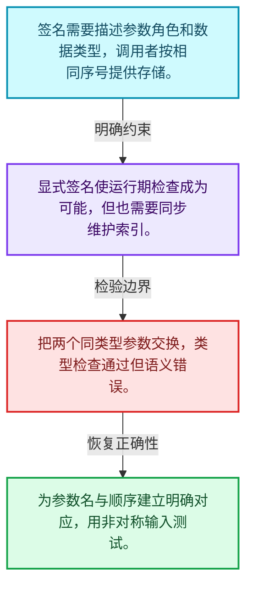
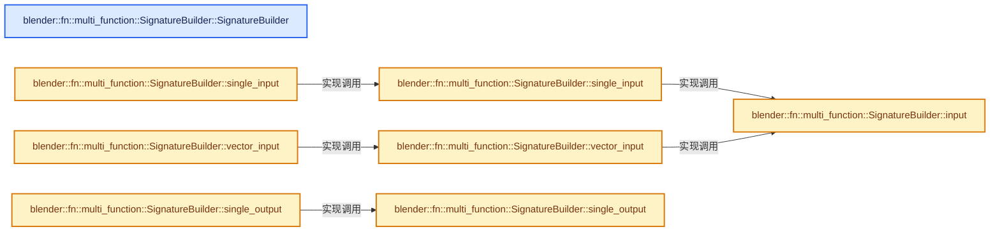
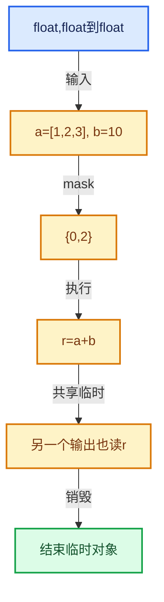

# 07-02 函数签名

[方向导航](README.md) · [总目录](../README.md) · [实现索引](../00-课程指南/02-源码与提交索引/符号依赖与实现索引.md)

## 从问题到实现

输入输出和类型如何成为可检查的数据？

签名描述调用约定，不能只保留函数地址；调用者与实现必须对参数序号和类型达成一致。

**数据模型**

签名需要描述参数角色和数据类型，调用者按相同序号提供存储。

**设计取舍**

显式签名使运行期检查成为可能，但也需要同步维护索引。

**最小反例**

把两个同类型参数交换，类型检查通过但语义错误。

**推导**

为参数名与顺序建立明确对应，用非对称输入测试。

## 阅读地图与执行推演








图中的数值推演是本方向的教学模型；实际函数之间的调用边与概念分析边分别标注，不能把概念关系当作运行时调度顺序。

## 完整源码单元与就地讲解

中文讲解直接放在相关代码旁，复杂机制在代码下展开。原文折叠区保留基准行号；不需要在行号表和函数之间来回查找。类布局可分段展示，函数实现不按固定行数切开。

### 类型布局、声明与编译条件 · FN_multi_function_signature.hh L1—L95

<a id="t-851c64885aee"></a>

<a id="t-5f8834674f4f"></a>

`Signature`在这里声明的数据成员：

- `char function_name`
- `Vector<ParamInfo> params`

<a id="t-dd6a5e71692a"></a>

`ParamInfo`在这里声明的数据成员：

- `ParamType type`
- `char name`
- `ParamFlag flag`

<a id="t-b19f31c0e339"></a>

`SignatureBuilder`在这里声明的数据成员：

- `Signature signature_`
- `void single_input`
- `void vector_input`
- `void input`
- `void single_output`
- `void vector_output`
- `void output`
- `void single_mutable`
- `void vector_mutable`
- `void mutable_`
- `void add`

<!-- annotated:c3bf8b4ddb1a2a -->

```cpp
/* SPDX-FileCopyrightText: 2023 Blender Authors
 *
 * SPDX-License-Identifier: GPL-2.0-or-later */

#pragma once

/** \file
 * \ingroup fn
 *
 * The signature of a multi-function contains the functions name and expected parameters. New
 * signatures should be build using the #SignatureBuilder class.
 */

#include "FN_multi_function_param_type.hh"

#include "BLI_enum_flags.hh"
#include "BLI_vector.hh"

namespace blender::fn::multi_function {

enum class ParamFlag {
  None = 0,
  /**
   * If set, the multi-function parameter can be accessed using
   * #Params::uninitialized_single_output_if_required which can result in better performance
   * because the output does not have to be computed when it is not needed.
   */
  SupportsUnusedOutput = 1 << 0,
};
ENUM_OPERATORS(ParamFlag);

struct Signature {
  struct ParamInfo {
    ParamType type;
    const char *name;
    ParamFlag flag = ParamFlag::None;
  };

  /**
   * The name should be statically allocated so that it lives longer than this signature. This is
   * used instead of an #std::string because of the overhead when many functions are created.
   * If the name of the function has to be more dynamic for debugging purposes, override
   * #MultiFunction::debug_name() instead. Then the dynamic name will only be computed when it is
   * actually needed.
   */
  const char *function_name;
  Vector<ParamInfo> params;
};

class SignatureBuilder {
 private:
  Signature &signature_;

 public:
  SignatureBuilder(const char *function_name, Signature &signature_to_build);

  /* Input Parameter Types */

  template<typename T> void single_input(const char *name);
  void single_input(const char *name, const CPPType &type);
  template<typename T> void vector_input(const char *name);
  void vector_input(const char *name, const CPPType &base_type);
  void input(const char *name, DataType data_type);

  /* Output Parameter Types */

  template<typename T>
  void single_output(const char *name, const ParamFlag flag = ParamFlag::None);
  void single_output(const char *name,
                     const CPPType &type,
                     const ParamFlag flag = ParamFlag::None);
  template<typename T>
  void vector_output(const char *name, const ParamFlag flag = ParamFlag::None);
  void vector_output(const char *name,
                     const CPPType &base_type,
                     const ParamFlag flag = ParamFlag::None);
  void output(const char *name, DataType data_type, const ParamFlag flag = ParamFlag::None);

  /* Mutable Parameter Types */

  template<typename T> void single_mutable(const char *name);
  void single_mutable(const char *name, const CPPType &type);
  template<typename T> void vector_mutable(const char *name);
  void vector_mutable(const char *name, const CPPType &base_type);
  void mutable_(const char *name, DataType data_type);

  template<ParamCategory Category, typename T>
  void add(ParamTag<Category, T> /*tag*/, const char *name);
  void add(const char *name, const ParamType &param_type);
};

/* -------------------------------------------------------------------- */
/** \name #SignatureBuilder Inline Methods
 * \{ */

```

<details>
<summary>核对原始源码：source/blender/functions/FN_multi_function_signature.hh · L1—L95</summary>

<!-- original:c3bf8b4ddb1a2a:source/blender/functions/FN_multi_function_signature.hh:1:95 -->

```cpp
/* SPDX-FileCopyrightText: 2023 Blender Authors
 *
 * SPDX-License-Identifier: GPL-2.0-or-later */

#pragma once

/** \file
 * \ingroup fn
 *
 * The signature of a multi-function contains the functions name and expected parameters. New
 * signatures should be build using the #SignatureBuilder class.
 */

#include "FN_multi_function_param_type.hh"

#include "BLI_enum_flags.hh"
#include "BLI_vector.hh"

namespace blender::fn::multi_function {

enum class ParamFlag {
  None = 0,
  /**
   * If set, the multi-function parameter can be accessed using
   * #Params::uninitialized_single_output_if_required which can result in better performance
   * because the output does not have to be computed when it is not needed.
   */
  SupportsUnusedOutput = 1 << 0,
};
ENUM_OPERATORS(ParamFlag);

struct Signature {
  struct ParamInfo {
    ParamType type;
    const char *name;
    ParamFlag flag = ParamFlag::None;
  };

  /**
   * The name should be statically allocated so that it lives longer than this signature. This is
   * used instead of an #std::string because of the overhead when many functions are created.
   * If the name of the function has to be more dynamic for debugging purposes, override
   * #MultiFunction::debug_name() instead. Then the dynamic name will only be computed when it is
   * actually needed.
   */
  const char *function_name;
  Vector<ParamInfo> params;
};

class SignatureBuilder {
 private:
  Signature &signature_;

 public:
  SignatureBuilder(const char *function_name, Signature &signature_to_build);

  /* Input Parameter Types */

  template<typename T> void single_input(const char *name);
  void single_input(const char *name, const CPPType &type);
  template<typename T> void vector_input(const char *name);
  void vector_input(const char *name, const CPPType &base_type);
  void input(const char *name, DataType data_type);

  /* Output Parameter Types */

  template<typename T>
  void single_output(const char *name, const ParamFlag flag = ParamFlag::None);
  void single_output(const char *name,
                     const CPPType &type,
                     const ParamFlag flag = ParamFlag::None);
  template<typename T>
  void vector_output(const char *name, const ParamFlag flag = ParamFlag::None);
  void vector_output(const char *name,
                     const CPPType &base_type,
                     const ParamFlag flag = ParamFlag::None);
  void output(const char *name, DataType data_type, const ParamFlag flag = ParamFlag::None);

  /* Mutable Parameter Types */

  template<typename T> void single_mutable(const char *name);
  void single_mutable(const char *name, const CPPType &type);
  template<typename T> void vector_mutable(const char *name);
  void vector_mutable(const char *name, const CPPType &base_type);
  void mutable_(const char *name, DataType data_type);

  template<ParamCategory Category, typename T>
  void add(ParamTag<Category, T> /*tag*/, const char *name);
  void add(const char *name, const ParamType &param_type);
};

/* -------------------------------------------------------------------- */
/** \name #SignatureBuilder Inline Methods
 * \{ */

```

</details>

<a id="f-18a566e45ddf76ab"></a>

### `blender::fn::multi_function::SignatureBuilder::SignatureBuilder`

实现位置：[source/blender/functions/FN_multi_function_signature.hh](../../../../../source/blender/functions/FN_multi_function_signature.hh) · L96—L100。

接口参数：

- `const char *function_name`
- `Signature &signature_to_build`

**教学注释版**

<!-- annotated:9c1751e100abc2 -->

```cpp
inline SignatureBuilder::SignatureBuilder(const char *function_name, Signature &signature_to_build)
    : signature_(signature_to_build)
{
  signature_.function_name = function_name;
}
```

<details>
<summary>核对原始源码：source/blender/functions/FN_multi_function_signature.hh · L96—L100</summary>

<!-- original:9c1751e100abc2:source/blender/functions/FN_multi_function_signature.hh:96:100 -->

```cpp
inline SignatureBuilder::SignatureBuilder(const char *function_name, Signature &signature_to_build)
    : signature_(signature_to_build)
{
  signature_.function_name = function_name;
}
```

</details>

**沿实际写入检查状态**

- `signature_.function_name = function_name;`

**继续追踪实现**

本实现没有需要继续展开的显式调用；检查返回表达式、对象转换和调用者前置条件。

<!-- annotated:ab546001400803 -->

```cpp

```

<details>
<summary>核对原始源码：source/blender/functions/FN_multi_function_signature.hh · L101—L101</summary>

<!-- original:ab546001400803:source/blender/functions/FN_multi_function_signature.hh:101:101 -->

```cpp

```

</details>

<a id="f-8c435d9e973ba71d"></a>

### `blender::fn::multi_function::SignatureBuilder::single_input`

实现位置：[source/blender/functions/FN_multi_function_signature.hh](../../../../../source/blender/functions/FN_multi_function_signature.hh) · L102—L105。

接口参数：

- `const char *name`

**教学注释版**

<!-- annotated:8391276ba83ab0 -->

```cpp
template<typename T> inline void SignatureBuilder::single_input(const char *name)
{
  this->single_input(name, CPPType::get<T>());
}
```

<details>
<summary>核对原始源码：source/blender/functions/FN_multi_function_signature.hh · L102—L105</summary>

<!-- original:8391276ba83ab0:source/blender/functions/FN_multi_function_signature.hh:102:105 -->

```cpp
template<typename T> inline void SignatureBuilder::single_input(const char *name)
{
  this->single_input(name, CPPType::get<T>());
}
```

</details>

**继续追踪实现**

- `this->single_input` → [blender::fn::multi_function::SignatureBuilder::single_input · L102](02-函数签名.md#f-8c435d9e973ba71d)；[blender::fn::multi_function::SignatureBuilder::single_input · L107](02-函数签名.md#f-9df9b61334a7062a)。同名重载需按实参类型选择。
- `CPPType::get<T>` → [blender::CPPType::get · L481](../03-内存分配与运行时类型/08-CPPType构造与析构.md#f-0cc10a3783d6abdb)。

<!-- annotated:380c016ff32770 -->

```cpp

```

<details>
<summary>核对原始源码：source/blender/functions/FN_multi_function_signature.hh · L106—L106</summary>

<!-- original:380c016ff32770:source/blender/functions/FN_multi_function_signature.hh:106:106 -->

```cpp

```

</details>

<a id="f-9df9b61334a7062a"></a>

### `blender::fn::multi_function::SignatureBuilder::single_input`

实现位置：[source/blender/functions/FN_multi_function_signature.hh](../../../../../source/blender/functions/FN_multi_function_signature.hh) · L107—L110。

接口参数：

- `const char *name`
- `const CPPType &type`

**教学注释版**

<!-- annotated:227fbf9f9c56f0 -->

```cpp
inline void SignatureBuilder::single_input(const char *name, const CPPType &type)
{
  this->input(name, DataType::ForSingle(type));
}
```

<details>
<summary>核对原始源码：source/blender/functions/FN_multi_function_signature.hh · L107—L110</summary>

<!-- original:227fbf9f9c56f0:source/blender/functions/FN_multi_function_signature.hh:107:110 -->

```cpp
inline void SignatureBuilder::single_input(const char *name, const CPPType &type)
{
  this->input(name, DataType::ForSingle(type));
}
```

</details>

**继续追踪实现**

- `this->input` → [blender::fn::multi_function::SignatureBuilder::input · L122](02-函数签名.md#f-024aa00d79e3d78e)。
- `DataType::ForSingle` → [blender::fn::multi_function::DataType::ForSingle · L65](03-参数类型与角色.md#f-e041e357ea765818)；[blender::fn::multi_function::DataType::ForSingle · L75](03-参数类型与角色.md#f-ffb4bc870ea750f6)。同名重载需按实参类型选择。

<!-- annotated:142755005aa9da -->

```cpp

```

<details>
<summary>核对原始源码：source/blender/functions/FN_multi_function_signature.hh · L111—L111</summary>

<!-- original:142755005aa9da:source/blender/functions/FN_multi_function_signature.hh:111:111 -->

```cpp

```

</details>

<a id="f-d757ef2273ad7d4f"></a>

### `blender::fn::multi_function::SignatureBuilder::vector_input`

实现位置：[source/blender/functions/FN_multi_function_signature.hh](../../../../../source/blender/functions/FN_multi_function_signature.hh) · L112—L115。

接口参数：

- `const char *name`

**教学注释版**

<!-- annotated:127554704bd6be -->

```cpp
template<typename T> inline void SignatureBuilder::vector_input(const char *name)
{
  this->vector_input(name, CPPType::get<T>());
}
```

<details>
<summary>核对原始源码：source/blender/functions/FN_multi_function_signature.hh · L112—L115</summary>

<!-- original:127554704bd6be:source/blender/functions/FN_multi_function_signature.hh:112:115 -->

```cpp
template<typename T> inline void SignatureBuilder::vector_input(const char *name)
{
  this->vector_input(name, CPPType::get<T>());
}
```

</details>

**继续追踪实现**

- `this->vector_input` → [blender::fn::multi_function::SignatureBuilder::vector_input · L112](02-函数签名.md#f-d757ef2273ad7d4f)；[blender::fn::multi_function::SignatureBuilder::vector_input · L117](02-函数签名.md#f-aa31731c7fc6d7d1)。同名重载需按实参类型选择。
- `CPPType::get<T>` → [blender::CPPType::get · L481](../03-内存分配与运行时类型/08-CPPType构造与析构.md#f-0cc10a3783d6abdb)。

<!-- annotated:200cfb182b81ee -->

```cpp

```

<details>
<summary>核对原始源码：source/blender/functions/FN_multi_function_signature.hh · L116—L116</summary>

<!-- original:200cfb182b81ee:source/blender/functions/FN_multi_function_signature.hh:116:116 -->

```cpp

```

</details>

<a id="f-aa31731c7fc6d7d1"></a>

### `blender::fn::multi_function::SignatureBuilder::vector_input`

实现位置：[source/blender/functions/FN_multi_function_signature.hh](../../../../../source/blender/functions/FN_multi_function_signature.hh) · L117—L120。

接口参数：

- `const char *name`
- `const CPPType &base_type`

**教学注释版**

<!-- annotated:70e9e59c897e3f -->

```cpp
inline void SignatureBuilder::vector_input(const char *name, const CPPType &base_type)
{
  this->input(name, DataType::ForVector(base_type));
}
```

<details>
<summary>核对原始源码：source/blender/functions/FN_multi_function_signature.hh · L117—L120</summary>

<!-- original:70e9e59c897e3f:source/blender/functions/FN_multi_function_signature.hh:117:120 -->

```cpp
inline void SignatureBuilder::vector_input(const char *name, const CPPType &base_type)
{
  this->input(name, DataType::ForVector(base_type));
}
```

</details>

**继续追踪实现**

- `this->input` → [blender::fn::multi_function::SignatureBuilder::input · L122](02-函数签名.md#f-024aa00d79e3d78e)。
- `DataType::ForVector` → [blender::fn::multi_function::DataType::ForVector · L70](03-参数类型与角色.md#f-7df464f275adbd5f)；[blender::fn::multi_function::DataType::ForVector · L80](03-参数类型与角色.md#f-b8a84ac3287de49e)。同名重载需按实参类型选择。

<!-- annotated:9f76321d864507 -->

```cpp

```

<details>
<summary>核对原始源码：source/blender/functions/FN_multi_function_signature.hh · L121—L121</summary>

<!-- original:9f76321d864507:source/blender/functions/FN_multi_function_signature.hh:121:121 -->

```cpp

```

</details>

<a id="f-024aa00d79e3d78e"></a>

### `blender::fn::multi_function::SignatureBuilder::input`

实现位置：[source/blender/functions/FN_multi_function_signature.hh](../../../../../source/blender/functions/FN_multi_function_signature.hh) · L122—L125。

接口参数：

- `const char *name`
- `DataType data_type`

**教学注释版**

<!-- annotated:530363e04211c7 -->

```cpp
inline void SignatureBuilder::input(const char *name, DataType data_type)
{
  signature_.params.append({ParamType(ParamType::Input, data_type), name});
}
```

<details>
<summary>核对原始源码：source/blender/functions/FN_multi_function_signature.hh · L122—L125</summary>

<!-- original:530363e04211c7:source/blender/functions/FN_multi_function_signature.hh:122:125 -->

```cpp
inline void SignatureBuilder::input(const char *name, DataType data_type)
{
  signature_.params.append({ParamType(ParamType::Input, data_type), name});
}
```

</details>

**继续追踪实现**

- `signature_.params.append` → [调用协议](../00-课程指南/01-路线与规范/模板宏与动态分派协议.md)：接收对象类型依赖auto、返回值或模板实例；不按同名猜测目标。调用位置L124。
- `ParamType` → [blender::fn::multi_function::ParamType::ParamType · L78](03-参数类型与角色.md#f-0e2fe2ba44d205ba)。

<!-- annotated:7ff7ced62dc9a7 -->

```cpp

```

<details>
<summary>核对原始源码：source/blender/functions/FN_multi_function_signature.hh · L126—L126</summary>

<!-- original:7ff7ced62dc9a7:source/blender/functions/FN_multi_function_signature.hh:126:126 -->

```cpp

```

</details>

<a id="f-12fe60c15a0df7eb"></a>

### `blender::fn::multi_function::SignatureBuilder::single_output`

实现位置：[source/blender/functions/FN_multi_function_signature.hh](../../../../../source/blender/functions/FN_multi_function_signature.hh) · L127—L131。

接口参数：

- `const char *name`
- `const ParamFlag flag`

**教学注释版**

<!-- annotated:cade8a62083c1d -->

```cpp
template<typename T>
inline void SignatureBuilder::single_output(const char *name, const ParamFlag flag)
{
  this->single_output(name, CPPType::get<T>(), flag);
}
```

<details>
<summary>核对原始源码：source/blender/functions/FN_multi_function_signature.hh · L127—L131</summary>

<!-- original:cade8a62083c1d:source/blender/functions/FN_multi_function_signature.hh:127:131 -->

```cpp
template<typename T>
inline void SignatureBuilder::single_output(const char *name, const ParamFlag flag)
{
  this->single_output(name, CPPType::get<T>(), flag);
}
```

</details>

**继续追踪实现**

- `this->single_output` → [blender::fn::multi_function::SignatureBuilder::single_output · L127](02-函数签名.md#f-12fe60c15a0df7eb)；[blender::fn::multi_function::SignatureBuilder::single_output · L133](02-函数签名.md#f-578452e5167aab0d)。同名重载需按实参类型选择。
- `CPPType::get<T>` → [blender::CPPType::get · L481](../03-内存分配与运行时类型/08-CPPType构造与析构.md#f-0cc10a3783d6abdb)。

<!-- annotated:83062470537ca7 -->

```cpp

```

<details>
<summary>核对原始源码：source/blender/functions/FN_multi_function_signature.hh · L132—L132</summary>

<!-- original:83062470537ca7:source/blender/functions/FN_multi_function_signature.hh:132:132 -->

```cpp

```

</details>

<a id="f-578452e5167aab0d"></a>

### `blender::fn::multi_function::SignatureBuilder::single_output`

实现位置：[source/blender/functions/FN_multi_function_signature.hh](../../../../../source/blender/functions/FN_multi_function_signature.hh) · L133—L138。

接口参数：

- `const char *name`
- `const CPPType &type`
- `const ParamFlag flag`

**教学注释版**

<!-- annotated:cf47e402edcffa -->

```cpp
inline void SignatureBuilder::single_output(const char *name,
                                            const CPPType &type,
                                            const ParamFlag flag)
{
  this->output(name, DataType::ForSingle(type), flag);
}
```

<details>
<summary>核对原始源码：source/blender/functions/FN_multi_function_signature.hh · L133—L138</summary>

<!-- original:cf47e402edcffa:source/blender/functions/FN_multi_function_signature.hh:133:138 -->

```cpp
inline void SignatureBuilder::single_output(const char *name,
                                            const CPPType &type,
                                            const ParamFlag flag)
{
  this->output(name, DataType::ForSingle(type), flag);
}
```

</details>

**继续追踪实现**

- `this->output` → [blender::fn::multi_function::SignatureBuilder::output · L153](02-函数签名.md#f-f01fcfbfc17e01a7)。
- `DataType::ForSingle` → [blender::fn::multi_function::DataType::ForSingle · L65](03-参数类型与角色.md#f-e041e357ea765818)；[blender::fn::multi_function::DataType::ForSingle · L75](03-参数类型与角色.md#f-ffb4bc870ea750f6)。同名重载需按实参类型选择。

<!-- annotated:65cd26225f6296 -->

```cpp

```

<details>
<summary>核对原始源码：source/blender/functions/FN_multi_function_signature.hh · L139—L139</summary>

<!-- original:65cd26225f6296:source/blender/functions/FN_multi_function_signature.hh:139:139 -->

```cpp

```

</details>

<a id="f-65d0378eb3c0b8d0"></a>

### `blender::fn::multi_function::SignatureBuilder::vector_output`

实现位置：[source/blender/functions/FN_multi_function_signature.hh](../../../../../source/blender/functions/FN_multi_function_signature.hh) · L140—L144。

接口参数：

- `const char *name`
- `const ParamFlag flag`

**教学注释版**

<!-- annotated:1b89dc55ad9c66 -->

```cpp
template<typename T>
inline void SignatureBuilder::vector_output(const char *name, const ParamFlag flag)
{
  this->vector_output(name, CPPType::get<T>(), flag);
}
```

<details>
<summary>核对原始源码：source/blender/functions/FN_multi_function_signature.hh · L140—L144</summary>

<!-- original:1b89dc55ad9c66:source/blender/functions/FN_multi_function_signature.hh:140:144 -->

```cpp
template<typename T>
inline void SignatureBuilder::vector_output(const char *name, const ParamFlag flag)
{
  this->vector_output(name, CPPType::get<T>(), flag);
}
```

</details>

**继续追踪实现**

- `this->vector_output` → [blender::fn::multi_function::SignatureBuilder::vector_output · L140](02-函数签名.md#f-65d0378eb3c0b8d0)；[blender::fn::multi_function::SignatureBuilder::vector_output · L146](02-函数签名.md#f-01baff011e966305)。同名重载需按实参类型选择。
- `CPPType::get<T>` → [blender::CPPType::get · L481](../03-内存分配与运行时类型/08-CPPType构造与析构.md#f-0cc10a3783d6abdb)。

<!-- annotated:2f7691baa27f51 -->

```cpp

```

<details>
<summary>核对原始源码：source/blender/functions/FN_multi_function_signature.hh · L145—L145</summary>

<!-- original:2f7691baa27f51:source/blender/functions/FN_multi_function_signature.hh:145:145 -->

```cpp

```

</details>

<a id="f-01baff011e966305"></a>

### `blender::fn::multi_function::SignatureBuilder::vector_output`

实现位置：[source/blender/functions/FN_multi_function_signature.hh](../../../../../source/blender/functions/FN_multi_function_signature.hh) · L146—L151。

接口参数：

- `const char *name`
- `const CPPType &base_type`
- `const ParamFlag flag`

**教学注释版**

<!-- annotated:74330b14794bc2 -->

```cpp
inline void SignatureBuilder::vector_output(const char *name,
                                            const CPPType &base_type,
                                            const ParamFlag flag)
{
  this->output(name, DataType::ForVector(base_type), flag);
}
```

<details>
<summary>核对原始源码：source/blender/functions/FN_multi_function_signature.hh · L146—L151</summary>

<!-- original:74330b14794bc2:source/blender/functions/FN_multi_function_signature.hh:146:151 -->

```cpp
inline void SignatureBuilder::vector_output(const char *name,
                                            const CPPType &base_type,
                                            const ParamFlag flag)
{
  this->output(name, DataType::ForVector(base_type), flag);
}
```

</details>

**继续追踪实现**

- `this->output` → [blender::fn::multi_function::SignatureBuilder::output · L153](02-函数签名.md#f-f01fcfbfc17e01a7)。
- `DataType::ForVector` → [blender::fn::multi_function::DataType::ForVector · L70](03-参数类型与角色.md#f-7df464f275adbd5f)；[blender::fn::multi_function::DataType::ForVector · L80](03-参数类型与角色.md#f-b8a84ac3287de49e)。同名重载需按实参类型选择。

<!-- annotated:c754cc48393978 -->

```cpp

```

<details>
<summary>核对原始源码：source/blender/functions/FN_multi_function_signature.hh · L152—L152</summary>

<!-- original:c754cc48393978:source/blender/functions/FN_multi_function_signature.hh:152:152 -->

```cpp

```

</details>

<a id="f-f01fcfbfc17e01a7"></a>

### `blender::fn::multi_function::SignatureBuilder::output`

实现位置：[source/blender/functions/FN_multi_function_signature.hh](../../../../../source/blender/functions/FN_multi_function_signature.hh) · L153—L156。

接口参数：

- `const char *name`
- `DataType data_type`
- `const ParamFlag flag`

**教学注释版**

<!-- annotated:aa890366927538 -->

```cpp
inline void SignatureBuilder::output(const char *name, DataType data_type, const ParamFlag flag)
{
  signature_.params.append({ParamType(ParamType::Output, data_type), name, flag});
}
```

<details>
<summary>核对原始源码：source/blender/functions/FN_multi_function_signature.hh · L153—L156</summary>

<!-- original:aa890366927538:source/blender/functions/FN_multi_function_signature.hh:153:156 -->

```cpp
inline void SignatureBuilder::output(const char *name, DataType data_type, const ParamFlag flag)
{
  signature_.params.append({ParamType(ParamType::Output, data_type), name, flag});
}
```

</details>

**继续追踪实现**

- `signature_.params.append` → [调用协议](../00-课程指南/01-路线与规范/模板宏与动态分派协议.md)：接收对象类型依赖auto、返回值或模板实例；不按同名猜测目标。调用位置L155。
- `ParamType` → [blender::fn::multi_function::ParamType::ParamType · L78](03-参数类型与角色.md#f-0e2fe2ba44d205ba)。

<!-- annotated:265643c1227721 -->

```cpp

```

<details>
<summary>核对原始源码：source/blender/functions/FN_multi_function_signature.hh · L157—L157</summary>

<!-- original:265643c1227721:source/blender/functions/FN_multi_function_signature.hh:157:157 -->

```cpp

```

</details>

<a id="f-04a96c67ffbbdef5"></a>

### `blender::fn::multi_function::SignatureBuilder::single_mutable`

实现位置：[source/blender/functions/FN_multi_function_signature.hh](../../../../../source/blender/functions/FN_multi_function_signature.hh) · L158—L161。

接口参数：

- `const char *name`

**教学注释版**

<!-- annotated:2ba3ebb10ba396 -->

```cpp
template<typename T> inline void SignatureBuilder::single_mutable(const char *name)
{
  this->single_mutable(name, CPPType::get<T>());
}
```

<details>
<summary>核对原始源码：source/blender/functions/FN_multi_function_signature.hh · L158—L161</summary>

<!-- original:2ba3ebb10ba396:source/blender/functions/FN_multi_function_signature.hh:158:161 -->

```cpp
template<typename T> inline void SignatureBuilder::single_mutable(const char *name)
{
  this->single_mutable(name, CPPType::get<T>());
}
```

</details>

**继续追踪实现**

- `this->single_mutable` → [blender::fn::multi_function::SignatureBuilder::single_mutable · L158](02-函数签名.md#f-04a96c67ffbbdef5)；[blender::fn::multi_function::SignatureBuilder::single_mutable · L163](02-函数签名.md#f-1878913cbab01fe3)。同名重载需按实参类型选择。
- `CPPType::get<T>` → [blender::CPPType::get · L481](../03-内存分配与运行时类型/08-CPPType构造与析构.md#f-0cc10a3783d6abdb)。

<!-- annotated:e08b0bb2e8b5a2 -->

```cpp

```

<details>
<summary>核对原始源码：source/blender/functions/FN_multi_function_signature.hh · L162—L162</summary>

<!-- original:e08b0bb2e8b5a2:source/blender/functions/FN_multi_function_signature.hh:162:162 -->

```cpp

```

</details>

<a id="f-1878913cbab01fe3"></a>

### `blender::fn::multi_function::SignatureBuilder::single_mutable`

实现位置：[source/blender/functions/FN_multi_function_signature.hh](../../../../../source/blender/functions/FN_multi_function_signature.hh) · L163—L166。

接口参数：

- `const char *name`
- `const CPPType &type`

**教学注释版**

<!-- annotated:14894d1e08fe4e -->

```cpp
inline void SignatureBuilder::single_mutable(const char *name, const CPPType &type)
{
  this->mutable_(name, DataType::ForSingle(type));
}
```

<details>
<summary>核对原始源码：source/blender/functions/FN_multi_function_signature.hh · L163—L166</summary>

<!-- original:14894d1e08fe4e:source/blender/functions/FN_multi_function_signature.hh:163:166 -->

```cpp
inline void SignatureBuilder::single_mutable(const char *name, const CPPType &type)
{
  this->mutable_(name, DataType::ForSingle(type));
}
```

</details>

**继续追踪实现**

- `this->mutable_` → [blender::fn::multi_function::SignatureBuilder::mutable_ · L178](02-函数签名.md#f-77548abc56bfb495)。
- `DataType::ForSingle` → [blender::fn::multi_function::DataType::ForSingle · L65](03-参数类型与角色.md#f-e041e357ea765818)；[blender::fn::multi_function::DataType::ForSingle · L75](03-参数类型与角色.md#f-ffb4bc870ea750f6)。同名重载需按实参类型选择。

<!-- annotated:caafd2c1f68639 -->

```cpp

```

<details>
<summary>核对原始源码：source/blender/functions/FN_multi_function_signature.hh · L167—L167</summary>

<!-- original:caafd2c1f68639:source/blender/functions/FN_multi_function_signature.hh:167:167 -->

```cpp

```

</details>

<a id="f-f8f0abadb4dc81cb"></a>

### `blender::fn::multi_function::SignatureBuilder::vector_mutable`

实现位置：[source/blender/functions/FN_multi_function_signature.hh](../../../../../source/blender/functions/FN_multi_function_signature.hh) · L168—L171。

接口参数：

- `const char *name`

**教学注释版**

<!-- annotated:22b20b9e721ff4 -->

```cpp
template<typename T> inline void SignatureBuilder::vector_mutable(const char *name)
{
  this->vector_mutable(name, CPPType::get<T>());
}
```

<details>
<summary>核对原始源码：source/blender/functions/FN_multi_function_signature.hh · L168—L171</summary>

<!-- original:22b20b9e721ff4:source/blender/functions/FN_multi_function_signature.hh:168:171 -->

```cpp
template<typename T> inline void SignatureBuilder::vector_mutable(const char *name)
{
  this->vector_mutable(name, CPPType::get<T>());
}
```

</details>

**继续追踪实现**

- `this->vector_mutable` → [blender::fn::multi_function::SignatureBuilder::vector_mutable · L168](02-函数签名.md#f-f8f0abadb4dc81cb)；[blender::fn::multi_function::SignatureBuilder::vector_mutable · L173](02-函数签名.md#f-4e414eb888669c11)。同名重载需按实参类型选择。
- `CPPType::get<T>` → [blender::CPPType::get · L481](../03-内存分配与运行时类型/08-CPPType构造与析构.md#f-0cc10a3783d6abdb)。

<!-- annotated:287af9ab963b78 -->

```cpp

```

<details>
<summary>核对原始源码：source/blender/functions/FN_multi_function_signature.hh · L172—L172</summary>

<!-- original:287af9ab963b78:source/blender/functions/FN_multi_function_signature.hh:172:172 -->

```cpp

```

</details>

<a id="f-4e414eb888669c11"></a>

### `blender::fn::multi_function::SignatureBuilder::vector_mutable`

实现位置：[source/blender/functions/FN_multi_function_signature.hh](../../../../../source/blender/functions/FN_multi_function_signature.hh) · L173—L176。

接口参数：

- `const char *name`
- `const CPPType &base_type`

**教学注释版**

<!-- annotated:a567653fa12658 -->

```cpp
inline void SignatureBuilder::vector_mutable(const char *name, const CPPType &base_type)
{
  this->mutable_(name, DataType::ForVector(base_type));
}
```

<details>
<summary>核对原始源码：source/blender/functions/FN_multi_function_signature.hh · L173—L176</summary>

<!-- original:a567653fa12658:source/blender/functions/FN_multi_function_signature.hh:173:176 -->

```cpp
inline void SignatureBuilder::vector_mutable(const char *name, const CPPType &base_type)
{
  this->mutable_(name, DataType::ForVector(base_type));
}
```

</details>

**继续追踪实现**

- `this->mutable_` → [blender::fn::multi_function::SignatureBuilder::mutable_ · L178](02-函数签名.md#f-77548abc56bfb495)。
- `DataType::ForVector` → [blender::fn::multi_function::DataType::ForVector · L70](03-参数类型与角色.md#f-7df464f275adbd5f)；[blender::fn::multi_function::DataType::ForVector · L80](03-参数类型与角色.md#f-b8a84ac3287de49e)。同名重载需按实参类型选择。

<!-- annotated:464a3ebd390d45 -->

```cpp

```

<details>
<summary>核对原始源码：source/blender/functions/FN_multi_function_signature.hh · L177—L177</summary>

<!-- original:464a3ebd390d45:source/blender/functions/FN_multi_function_signature.hh:177:177 -->

```cpp

```

</details>

<a id="f-77548abc56bfb495"></a>

### `blender::fn::multi_function::SignatureBuilder::mutable_`

实现位置：[source/blender/functions/FN_multi_function_signature.hh](../../../../../source/blender/functions/FN_multi_function_signature.hh) · L178—L181。

接口参数：

- `const char *name`
- `DataType data_type`

**教学注释版**

<!-- annotated:27651c4432d400 -->

```cpp
inline void SignatureBuilder::mutable_(const char *name, DataType data_type)
{
  signature_.params.append({ParamType(ParamType::Mutable, data_type), name});
}
```

<details>
<summary>核对原始源码：source/blender/functions/FN_multi_function_signature.hh · L178—L181</summary>

<!-- original:27651c4432d400:source/blender/functions/FN_multi_function_signature.hh:178:181 -->

```cpp
inline void SignatureBuilder::mutable_(const char *name, DataType data_type)
{
  signature_.params.append({ParamType(ParamType::Mutable, data_type), name});
}
```

</details>

**继续追踪实现**

- `signature_.params.append` → [调用协议](../00-课程指南/01-路线与规范/模板宏与动态分派协议.md)：接收对象类型依赖auto、返回值或模板实例；不按同名猜测目标。调用位置L180。
- `ParamType` → [blender::fn::multi_function::ParamType::ParamType · L78](03-参数类型与角色.md#f-0e2fe2ba44d205ba)。

<!-- annotated:ed5ed791e2ccde -->

```cpp

```

<details>
<summary>核对原始源码：source/blender/functions/FN_multi_function_signature.hh · L182—L182</summary>

<!-- original:ed5ed791e2ccde:source/blender/functions/FN_multi_function_signature.hh:182:182 -->

```cpp

```

</details>

<a id="f-5362d79471971d53"></a>

### `blender::fn::multi_function::SignatureBuilder::add`

实现位置：[source/blender/functions/FN_multi_function_signature.hh](../../../../../source/blender/functions/FN_multi_function_signature.hh) · L183—L196。

接口参数：

- `const char *name`
- `const ParamType &param_type`

**教学注释版**

<!-- annotated:395748ef8725d9 -->

```cpp
inline void SignatureBuilder::add(const char *name, const ParamType &param_type)
{
  switch (param_type.interface_type()) {
    case ParamType::Input:
      this->input(name, param_type.data_type());
      break;
    case ParamType::Mutable:
      this->mutable_(name, param_type.data_type());
      break;
    case ParamType::Output:
      this->output(name, param_type.data_type());
      break;
  }
}
```

<details>
<summary>核对原始源码：source/blender/functions/FN_multi_function_signature.hh · L183—L196</summary>

<!-- original:395748ef8725d9:source/blender/functions/FN_multi_function_signature.hh:183:196 -->

```cpp
inline void SignatureBuilder::add(const char *name, const ParamType &param_type)
{
  switch (param_type.interface_type()) {
    case ParamType::Input:
      this->input(name, param_type.data_type());
      break;
    case ParamType::Mutable:
      this->mutable_(name, param_type.data_type());
      break;
    case ParamType::Output:
      this->output(name, param_type.data_type());
      break;
  }
}
```

</details>

**继续追踪实现**

- `param_type.interface_type` → [blender::fn::multi_function::ParamType::interface_type · L118](03-参数类型与角色.md#f-a506dc82cef792f5)。
- `this->input` → [blender::fn::multi_function::SignatureBuilder::input · L122](02-函数签名.md#f-024aa00d79e3d78e)。
- `param_type.data_type` → [blender::fn::multi_function::ParamType::data_type · L113](03-参数类型与角色.md#f-b29743877463338d)。
- `this->mutable_` → [blender::fn::multi_function::SignatureBuilder::mutable_ · L178](02-函数签名.md#f-77548abc56bfb495)。
- `this->output` → [blender::fn::multi_function::SignatureBuilder::output · L153](02-函数签名.md#f-f01fcfbfc17e01a7)。

<!-- annotated:237d9da72146f3 -->

```cpp

```

<details>
<summary>核对原始源码：source/blender/functions/FN_multi_function_signature.hh · L197—L197</summary>

<!-- original:237d9da72146f3:source/blender/functions/FN_multi_function_signature.hh:197:197 -->

```cpp

```

</details>

<a id="f-c78f0b406df4344b"></a>

### `blender::fn::multi_function::SignatureBuilder::add`

实现位置：[source/blender/functions/FN_multi_function_signature.hh](../../../../../source/blender/functions/FN_multi_function_signature.hh) · L198—L222。

接口参数：

- `ParamTag<Category, T>`
- `const char *name`

**教学注释版**

<!-- annotated:92dfcf003dc6d0 -->

```cpp
template<ParamCategory Category, typename T>
inline void SignatureBuilder::add(ParamTag<Category, T> /*tag*/, const char *name)
{
  switch (Category) {
    case ParamCategory::SingleInput:
      this->single_input<T>(name);
      return;
    case ParamCategory::VectorInput:
      this->vector_input<T>(name);
      return;
    case ParamCategory::SingleOutput:
      this->single_output<T>(name);
      return;
    case ParamCategory::VectorOutput:
      this->vector_output<T>(name);
      return;
    case ParamCategory::SingleMutable:
      this->single_mutable<T>(name);
      return;
    case ParamCategory::VectorMutable:
      this->vector_mutable<T>(name);
      return;
  }
  BLI_assert_unreachable();
}
```

<details>
<summary>核对原始源码：source/blender/functions/FN_multi_function_signature.hh · L198—L222</summary>

<!-- original:92dfcf003dc6d0:source/blender/functions/FN_multi_function_signature.hh:198:222 -->

```cpp
template<ParamCategory Category, typename T>
inline void SignatureBuilder::add(ParamTag<Category, T> /*tag*/, const char *name)
{
  switch (Category) {
    case ParamCategory::SingleInput:
      this->single_input<T>(name);
      return;
    case ParamCategory::VectorInput:
      this->vector_input<T>(name);
      return;
    case ParamCategory::SingleOutput:
      this->single_output<T>(name);
      return;
    case ParamCategory::VectorOutput:
      this->vector_output<T>(name);
      return;
    case ParamCategory::SingleMutable:
      this->single_mutable<T>(name);
      return;
    case ParamCategory::VectorMutable:
      this->vector_mutable<T>(name);
      return;
  }
  BLI_assert_unreachable();
}
```

</details>

**继续追踪实现**

- `this->single_input<T>` → [blender::fn::multi_function::SignatureBuilder::single_input · L102](02-函数签名.md#f-8c435d9e973ba71d)；[blender::fn::multi_function::SignatureBuilder::single_input · L107](02-函数签名.md#f-9df9b61334a7062a)。同名重载需按实参类型选择。
- `this->vector_input<T>` → [blender::fn::multi_function::SignatureBuilder::vector_input · L112](02-函数签名.md#f-d757ef2273ad7d4f)；[blender::fn::multi_function::SignatureBuilder::vector_input · L117](02-函数签名.md#f-aa31731c7fc6d7d1)。同名重载需按实参类型选择。
- `this->single_output<T>` → [blender::fn::multi_function::SignatureBuilder::single_output · L127](02-函数签名.md#f-12fe60c15a0df7eb)；[blender::fn::multi_function::SignatureBuilder::single_output · L133](02-函数签名.md#f-578452e5167aab0d)。同名重载需按实参类型选择。
- `this->vector_output<T>` → [blender::fn::multi_function::SignatureBuilder::vector_output · L140](02-函数签名.md#f-65d0378eb3c0b8d0)；[blender::fn::multi_function::SignatureBuilder::vector_output · L146](02-函数签名.md#f-01baff011e966305)。同名重载需按实参类型选择。
- `this->single_mutable<T>` → [blender::fn::multi_function::SignatureBuilder::single_mutable · L158](02-函数签名.md#f-04a96c67ffbbdef5)；[blender::fn::multi_function::SignatureBuilder::single_mutable · L163](02-函数签名.md#f-1878913cbab01fe3)。同名重载需按实参类型选择。
- `this->vector_mutable<T>` → [blender::fn::multi_function::SignatureBuilder::vector_mutable · L168](02-函数签名.md#f-f8f0abadb4dc81cb)；[blender::fn::multi_function::SignatureBuilder::vector_mutable · L173](02-函数签名.md#f-4e414eb888669c11)。同名重载需按实参类型选择。
- `BLI_assert_unreachable` → [BLI_assert_unreachable · L77](../90-实现依赖专题/01-BLI基础库/BLI_assert.hh.md#m-7a2d91a67d8e)。宏定义由构建条件选择。

### 类型布局、声明与编译条件 · FN_multi_function_signature.hh L223—L226

<!-- annotated:ae62b251344ee5 -->

```cpp

/** \} */

}  // namespace blender::fn::multi_function
```

<details>
<summary>核对原始源码：source/blender/functions/FN_multi_function_signature.hh · L223—L226</summary>

<!-- original:ae62b251344ee5:source/blender/functions/FN_multi_function_signature.hh:223:226 -->

```cpp

/** \} */

}  // namespace blender::fn::multi_function
```

</details>

## 语法与相关类型

### 模板 template

模板把类型或常量作为生成实现的参数。读声明时先列出类型参数、非类型参数和默认值，再看使用者实际实例化了什么。模板声明本身不意味着每种T都支持其全部成员。

把T替换为int、string、只能移动的类型，分别检查每个被调用操作是否成立。

### 依赖名称 typename

typename既可引入类型模板参数，也可告诉编译器某个依赖名称是类型。它不创建运行时对象；解析期确认语法类别与实例化期检查具体类型是不同阶段。

区分typename T::value_type和T::size()，前者标记类型，后者是表达式。

### 只读限定 const

const约束当前访问路径可做的修改。const指针、指向const的指针、const视图对象、const元素是不同位置的限定；其他别名可能仍可修改原对象。

分别写T* const、const T*与const T* const，并画出不可修改的层次。

### 覆写检查 override

override要求函数确实覆盖基类虚函数，可捕获参数类型和const限定不匹配。它不改变基类规定的生命周期或线程约束。

故意改变一个参数或const，观察编译器如何拒绝误写的新函数。

### 内部断言 assert

断言表达开发者预期成立的内部契约，发布构建可能关闭。它不能替代对不可信输入的完整错误处理，也不保证后续操作被运行时保护。

对每条断言构造违反条件的输入，区分调用者错误与应向用户报告的错误。

### 类型别名 using

类型别名为已有类型建立名字，不创建运行期对象。它常把模板内部使用的类型统一暴露给泛型调用者。

展开别名直到基础类型，区分类型别名和变量声明。

### 枚举与状态模型 enum

枚举把有限状态命名；enum class避免许多隐式整数转换。状态机正确性还依赖允许的转移，不能只看有哪些枚举项。

列出每个状态的进入条件和离开条件，检查终止状态是否仍可能被调度。

## 实现练习与验证

为两输入一输出建立签名并构造错误类型案例。

参考推理：为参数名与顺序建立明确对应，用非对称输入测试。

签名与参数类型一致；指令读取前变量已定义；存储复用发生在最后使用和析构之后。

## 历史、跨库比较与证据

与std::function逐次调用和简单字节码解释器比较：批量接口可把动态分派放到循环外，Procedure额外表达变量寿命和控制流。

[历史提交索引](../00-课程指南/02-源码与提交索引/历史提交与设计演化索引.md) · [源码基准](../00-课程指南/02-源码与提交索引/源码版本与覆盖索引.md) · [验收报告](../00-课程指南/03-验收报告/验收报告.md)
