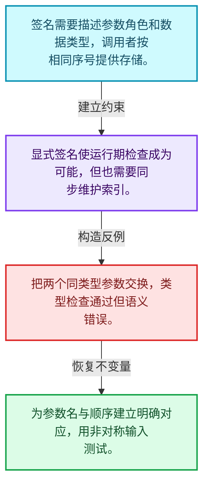
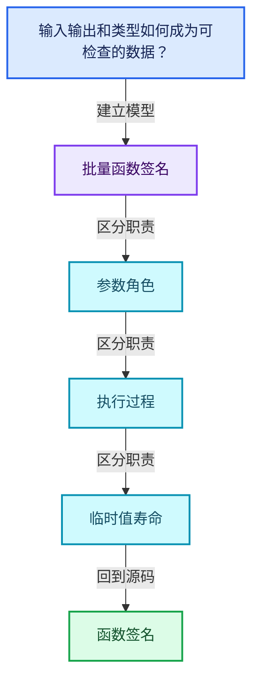
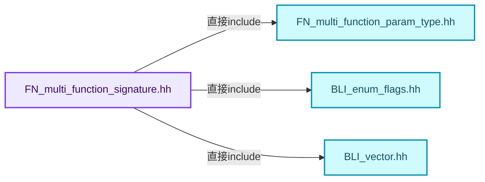
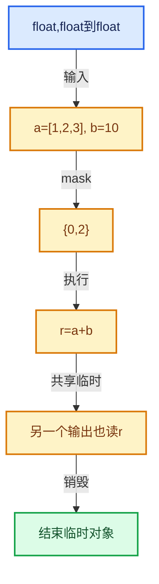

# 07-02 函数签名

[方向导航](README.md) · [总目录](../README.md) · [覆盖索引](../%E6%BA%90%E7%A0%81%E7%89%88%E6%9C%AC%E4%B8%8E%E8%A6%86%E7%9B%96%E7%B4%A2%E5%BC%95.md)

> 阅读顺序：问题与数据模型 → 语法与类型 → 源码逐行 → 调用线索 → 历史与取舍 → 推演和练习。

- 基准 HEAD：`cbda6b96c26c0dee3c3b5cbb93960c4ac06a6b30`。
- 记录日期：2026-10-14。
- 教学示例状态：正文中的推演不是本机性能实测；已运行练习见验收报告。

## 一、从问题到设计

输入输出和类型如何成为可检查的数据？

签名描述调用约定，不能只保留函数地址；调用者与实现必须对参数序号和类型达成一致。

本篇把语法、数据语义和系统取舍连接起来。把调用准备与元素循环分开，把值依赖与对象生存区间同时显式化。

### 本篇独立模型与设计推理

签名需要描述参数角色和数据类型，调用者按相同序号提供存储。

设计取舍：显式签名使运行期检查成为可能，但也需要同步维护索引。

最小反例：把两个同类型参数交换，类型检查通过但语义错误。

推导与处理：为参数名与顺序建立明确对应，用非对称输入测试。



### 源码范围与相邻篇章

| 文件 | 本篇逐行范围 | 基准SHA-256 |
|---|---|---|
| [source/blender/functions/FN_multi_function_signature.hh](../../../../../source/blender/functions/FN_multi_function_signature.hh) | L1—L226 | `a52e87235c22d75d4a4058724871736ace9f4cbe6a7171065578d18007038479` |

同一主讲文件可能分多篇覆盖；超出本篇范围的符号通过覆盖索引定位。空行与纯注释保留在源码摘录中，逐行表解释有效语句与语法边界；许可证头统一保留。

前篇：[批量计算模型](01-%E6%89%B9%E9%87%8F%E8%AE%A1%E7%AE%97%E6%A8%A1%E5%9E%8B.md).

后篇：[参数类型与角色](03-%E5%8F%82%E6%95%B0%E7%B1%BB%E5%9E%8B%E4%B8%8E%E8%A7%92%E8%89%B2.md).

## 二、类型、数据与阅读地图



这是概念依赖图，边表示阅读关系，不声称是运行时调用顺序。

### 直接编译依赖



箭头只表示头文件包含关系；完整调用线索见后面的符号定位表。

## 三、关键词、语法与类型角色

### 模板 template

模板把类型或常量作为生成实现的参数。读声明时先列出类型参数、非类型参数和默认值，再看使用者实际实例化了什么。模板声明本身不意味着每种T都支持其全部成员。

具体检查：把T替换为int、string、只能移动的类型，分别检查每个被调用操作是否成立。

### 依赖名称 typename

typename既可引入类型模板参数，也可告诉编译器某个依赖名称是类型。它不创建运行时对象；解析期确认语法类别与实例化期检查具体类型是不同阶段。

具体检查：区分typename T::value_type和T::size()，前者标记类型，后者是表达式。

### 只读限定 const

const约束当前访问路径可做的修改。const指针、指向const的指针、const视图对象、const元素是不同位置的限定；其他别名可能仍可修改原对象。

具体检查：分别写T* const、const T*与const T* const，并画出不可修改的层次。

### 覆写检查 override

override要求函数确实覆盖基类虚函数，可捕获参数类型和const限定不匹配。它不改变基类规定的生命周期或线程约束。

具体检查：故意改变一个参数或const，观察编译器如何拒绝误写的新函数。

### 内部断言 assert

断言表达开发者预期成立的内部契约，发布构建可能关闭。它不能替代对不可信输入的完整错误处理，也不保证后续操作被运行时保护。

具体检查：对每条断言构造违反条件的输入，区分调用者错误与应向用户报告的错误。

### 类型别名 using

类型别名为已有类型建立名字，不创建运行期对象。它常把模板内部使用的类型统一暴露给泛型调用者。

具体检查：展开别名直到基础类型，区分类型别名和变量声明。

### 枚举与状态模型 enum

枚举把有限状态命名；enum class避免许多隐式整数转换。状态机正确性还依赖允许的转移，不能只看有哪些枚举项。

具体检查：列出每个状态的进入条件和离开条件，检查终止状态是否仍可能被调度。

## 四、真实源码与逐行讲解

源码块保持原行内容，原始行号由小节标题及逐行表给出。表中的调用定位是静态阅读辅助；重载、模板实例化、宏展开和虚调用需结合完整声明，不能仅凭词法出现证明动态调用。

### FN_multi_function_signature.hh：L1—L48

<!-- source:source/blender/functions/FN_multi_function_signature.hh:1:48 -->

```cpp
/* SPDX-FileCopyrightText: 2023 Blender Authors
 *
 * SPDX-License-Identifier: GPL-2.0-or-later */

#pragma once

/** \file
 * \ingroup fn
 *
 * The signature of a multi-function contains the functions name and expected parameters. New
 * signatures should be build using the #SignatureBuilder class.
 */

#include "FN_multi_function_param_type.hh"

#include "BLI_enum_flags.hh"
#include "BLI_vector.hh"

namespace blender::fn::multi_function {

enum class ParamFlag {
  None = 0,
  /**
   * If set, the multi-function parameter can be accessed using
   * #Params::uninitialized_single_output_if_required which can result in better performance
   * because the output does not have to be computed when it is not needed.
   */
  SupportsUnusedOutput = 1 << 0,
};
ENUM_OPERATORS(ParamFlag);

struct Signature {
  struct ParamInfo {
    ParamType type;
    const char *name;
    ParamFlag flag = ParamFlag::None;
  };

  /**
   * The name should be statically allocated so that it lives longer than this signature. This is
   * used instead of an #std::string because of the overhead when many functions are created.
   * If the name of the function has to be more dynamic for debugging purposes, override
   * #MultiFunction::debug_name() instead. Then the dynamic name will only be computed when it is
   * actually needed.
   */
  const char *function_name;
  Vector<ParamInfo> params;
};
```

| 原始行 | 语义、约束与检查 |
|---|---|
| L5 | 防止同一头文件在一个翻译单元中重复展开；不控制多个源文件之间的链接或对象寿命。 |
| L14 | 引入编译依赖 "FN_multi_function_param_type.hh"；这是声明可见性关系，不表示运行时一定调用该文件的所有接口。 |
| L16 | 引入编译依赖 "BLI_enum_flags.hh"；这是声明可见性关系，不表示运行时一定调用该文件的所有接口。 |
| L17 | 引入编译依赖 "BLI_vector.hh"；这是声明可见性关系，不表示运行时一定调用该文件的所有接口。 |
| L19 | 把后续声明放入 blender::fn::multi_function 命名空间，影响名称查找和符号归属，不创建运行时对象。 |
| L21 | 声明或定义类型 `enum class ParamFlag`。结合继承、访问权限和成员布局确认接口与拥有关系；前向声明本身没有完整对象布局。 |
| L22 | 把右侧 `0,` 用于初始化或更新左侧 `None`。声明初始化与已有对象赋值应按上下文区分；有资源的类型会调用相应特殊成员。 |
| L28 | 把右侧 `1 << 0,` 用于初始化或更新左侧 `SupportsUnusedOutput`。声明初始化与已有对象赋值应按上下文区分；有资源的类型会调用相应特殊成员。 |
| L29 | 结束当前语法单元。局部自动对象在离开其作用域时按规则销毁；这不等于所有被引用的外部数据也被释放。 |
| L30 | 出现调用或函数声明 `ENUM_OPERATORS`，对应表达式为 `ENUM_OPERATORS(ParamFlag);`。参数求值、返回类型与重载需结合前后完整语句；静态文本引用不能证明动态目标。 |
| L32 | 声明或定义类型 `struct Signature`。结合继承、访问权限和成员布局确认接口与拥有关系；前向声明本身没有完整对象布局。 |
| L33 | 声明或定义类型 `struct ParamInfo`。结合继承、访问权限和成员布局确认接口与拥有关系；前向声明本身没有完整对象布局。 |
| L34 | 声明成员、局部对象或完成语句 `ParamType type`。若为指针或引用，它本身不说明拥有；若为值对象，其构造析构由所在作用域或外层对象管理。 |
| L35 | 声明成员、局部对象或完成语句 `const char *name`。若为指针或引用，它本身不说明拥有；若为值对象，其构造析构由所在作用域或外层对象管理。 |
| L36 | 把右侧 `ParamFlag::None` 用于初始化或更新左侧 `ParamFlag flag`。声明初始化与已有对象赋值应按上下文区分；有资源的类型会调用相应特殊成员。 |
| L37 | 结束当前语法单元。局部自动对象在离开其作用域时按规则销毁；这不等于所有被引用的外部数据也被释放。 |
| L46 | 声明成员、局部对象或完成语句 `const char *function_name`。若为指针或引用，它本身不说明拥有；若为值对象，其构造析构由所在作用域或外层对象管理。 |
| L47 | 声明成员、局部对象或完成语句 `Vector<ParamInfo> params`。若为指针或引用，它本身不说明拥有；若为值对象，其构造析构由所在作用域或外层对象管理。 |
| L48 | 结束当前语法单元。局部自动对象在离开其作用域时按规则销毁；这不等于所有被引用的外部数据也被释放。 |

### FN_multi_function_signature.hh：L49—L100

<!-- source:source/blender/functions/FN_multi_function_signature.hh:49:100 -->

```cpp

class SignatureBuilder {
 private:
  Signature &signature_;

 public:
  SignatureBuilder(const char *function_name, Signature &signature_to_build);

  /* Input Parameter Types */

  template<typename T> void single_input(const char *name);
  void single_input(const char *name, const CPPType &type);
  template<typename T> void vector_input(const char *name);
  void vector_input(const char *name, const CPPType &base_type);
  void input(const char *name, DataType data_type);

  /* Output Parameter Types */

  template<typename T>
  void single_output(const char *name, const ParamFlag flag = ParamFlag::None);
  void single_output(const char *name,
                     const CPPType &type,
                     const ParamFlag flag = ParamFlag::None);
  template<typename T>
  void vector_output(const char *name, const ParamFlag flag = ParamFlag::None);
  void vector_output(const char *name,
                     const CPPType &base_type,
                     const ParamFlag flag = ParamFlag::None);
  void output(const char *name, DataType data_type, const ParamFlag flag = ParamFlag::None);

  /* Mutable Parameter Types */

  template<typename T> void single_mutable(const char *name);
  void single_mutable(const char *name, const CPPType &type);
  template<typename T> void vector_mutable(const char *name);
  void vector_mutable(const char *name, const CPPType &base_type);
  void mutable_(const char *name, DataType data_type);

  template<ParamCategory Category, typename T>
  void add(ParamTag<Category, T> /*tag*/, const char *name);
  void add(const char *name, const ParamType &param_type);
};

/* -------------------------------------------------------------------- */
/** \name #SignatureBuilder Inline Methods
 * \{ */

inline SignatureBuilder::SignatureBuilder(const char *function_name, Signature &signature_to_build)
    : signature_(signature_to_build)
{
  signature_.function_name = function_name;
}
```

| 原始行 | 语义、约束与检查 |
|---|---|
| L50 | 声明或定义类型 `class SignatureBuilder`。结合继承、访问权限和成员布局确认接口与拥有关系；前向声明本身没有完整对象布局。 |
| L51 | 切换成员访问权限为 private；它是编译期接口边界，不是线程同步或内存保护。 |
| L52 | 声明成员、局部对象或完成语句 `Signature &signature_`。若为指针或引用，它本身不说明拥有；若为值对象，其构造析构由所在作用域或外层对象管理。 |
| L54 | 切换成员访问权限为 public；它是编译期接口边界，不是线程同步或内存保护。 |
| L55 | 出现调用或函数声明 `SignatureBuilder`，对应表达式为 `SignatureBuilder(const char *function_name, Signature &signature_to_build);`。参数求值、返回类型与重载需结合前后完整语句；静态文本引用不能证明动态目标。 |
| L59 | 声明模板参数 `template<typename T> void single_input(const char *name);`。类型参数决定生成操作的类型，非类型参数可决定内嵌容量或编译期分支。 |
| L60 | 声明接口 `void single_input(const char *name, const CPPType &type)`，本行没有对应函数体；返回类型、参数限定和const/noexcept共同组成调用契约，实际行为需继续定位实现。 |
| L61 | 声明模板参数 `template<typename T> void vector_input(const char *name);`。类型参数决定生成操作的类型，非类型参数可决定内嵌容量或编译期分支。 |
| L62 | 声明接口 `void vector_input(const char *name, const CPPType &base_type)`，本行没有对应函数体；返回类型、参数限定和const/noexcept共同组成调用契约，实际行为需继续定位实现。 |
| L63 | 声明接口 `void input(const char *name, DataType data_type)`，本行没有对应函数体；返回类型、参数限定和const/noexcept共同组成调用契约，实际行为需继续定位实现。 |
| L67 | 声明模板参数 `template<typename T>`。类型参数决定生成操作的类型，非类型参数可决定内嵌容量或编译期分支。 |
| L68 | 把右侧 `ParamFlag::None)` 用于初始化或更新左侧 `void single_output(const char *name, const ParamFlag flag`。声明初始化与已有对象赋值应按上下文区分；有资源的类型会调用相应特殊成员。 |
| L69 | 出现调用或函数声明 `single_output`，对应表达式为 `void single_output(const char *name,`。参数求值、返回类型与重载需结合前后完整语句；静态文本引用不能证明动态目标。 |
| L70 | 本行是连续声明或表达式的一部分：`const CPPType &type,`。与本段前后行合读；逗号、括号和限定符决定它属于参数、初始化列表还是实际计算。 |
| L71 | 把右侧 `ParamFlag::None)` 用于初始化或更新左侧 `const ParamFlag flag`。声明初始化与已有对象赋值应按上下文区分；有资源的类型会调用相应特殊成员。 |
| L72 | 声明模板参数 `template<typename T>`。类型参数决定生成操作的类型，非类型参数可决定内嵌容量或编译期分支。 |
| L73 | 把右侧 `ParamFlag::None)` 用于初始化或更新左侧 `void vector_output(const char *name, const ParamFlag flag`。声明初始化与已有对象赋值应按上下文区分；有资源的类型会调用相应特殊成员。 |
| L74 | 出现调用或函数声明 `vector_output`，对应表达式为 `void vector_output(const char *name,`。参数求值、返回类型与重载需结合前后完整语句；静态文本引用不能证明动态目标。 |
| L75 | 本行是连续声明或表达式的一部分：`const CPPType &base_type,`。与本段前后行合读；逗号、括号和限定符决定它属于参数、初始化列表还是实际计算。 |
| L76 | 把右侧 `ParamFlag::None)` 用于初始化或更新左侧 `const ParamFlag flag`。声明初始化与已有对象赋值应按上下文区分；有资源的类型会调用相应特殊成员。 |
| L77 | 把右侧 `ParamFlag::None)` 用于初始化或更新左侧 `void output(const char *name, DataType data_type, const ParamFlag flag`。声明初始化与已有对象赋值应按上下文区分；有资源的类型会调用相应特殊成员。 |
| L81 | 声明模板参数 `template<typename T> void single_mutable(const char *name);`。类型参数决定生成操作的类型，非类型参数可决定内嵌容量或编译期分支。 |
| L82 | 声明接口 `void single_mutable(const char *name, const CPPType &type)`，本行没有对应函数体；返回类型、参数限定和const/noexcept共同组成调用契约，实际行为需继续定位实现。 |
| L83 | 声明模板参数 `template<typename T> void vector_mutable(const char *name);`。类型参数决定生成操作的类型，非类型参数可决定内嵌容量或编译期分支。 |
| L84 | 声明接口 `void vector_mutable(const char *name, const CPPType &base_type)`，本行没有对应函数体；返回类型、参数限定和const/noexcept共同组成调用契约，实际行为需继续定位实现。 |
| L85 | 声明接口 `void mutable_(const char *name, DataType data_type)`，本行没有对应函数体；返回类型、参数限定和const/noexcept共同组成调用契约，实际行为需继续定位实现。 |
| L87 | 声明模板参数 `template<ParamCategory Category, typename T>`。类型参数决定生成操作的类型，非类型参数可决定内嵌容量或编译期分支。 |
| L88 | 声明接口 `void add(ParamTag<Category, T> , const char *name)`，本行没有对应函数体；返回类型、参数限定和const/noexcept共同组成调用契约，实际行为需继续定位实现。 |
| L89 | 声明接口 `void add(const char *name, const ParamType &param_type)`，本行没有对应函数体；返回类型、参数限定和const/noexcept共同组成调用契约，实际行为需继续定位实现。 |
| L90 | 结束当前语法单元。局部自动对象在离开其作用域时按规则销毁；这不等于所有被引用的外部数据也被释放。 |
| L96 | 出现调用或函数声明 `SignatureBuilder::SignatureBuilder`，对应表达式为 `inline SignatureBuilder::SignatureBuilder(const char *function_name, Signature &signature_to_build)`。参数求值、返回类型与重载需结合前后完整语句；静态文本引用不能证明动态目标。 |
| L97 | 出现调用或函数声明 `signature_`，对应表达式为 `: signature_(signature_to_build)`。参数求值、返回类型与重载需结合前后完整语句；静态文本引用不能证明动态目标。 |
| L98 | 连接上一行的声明或控制结构与其语句块；后续行在这个作用域中执行或声明。 |
| L99 | 把右侧 `function_name` 用于初始化或更新左侧 `signature_.function_name`。声明初始化与已有对象赋值应按上下文区分；有资源的类型会调用相应特殊成员。 |
| L100 | 结束当前语法单元。局部自动对象在离开其作用域时按规则销毁；这不等于所有被引用的外部数据也被释放。 |

### FN_multi_function_signature.hh：L101—L151

<!-- source:source/blender/functions/FN_multi_function_signature.hh:101:151 -->

```cpp

template<typename T> inline void SignatureBuilder::single_input(const char *name)
{
  this->single_input(name, CPPType::get<T>());
}

inline void SignatureBuilder::single_input(const char *name, const CPPType &type)
{
  this->input(name, DataType::ForSingle(type));
}

template<typename T> inline void SignatureBuilder::vector_input(const char *name)
{
  this->vector_input(name, CPPType::get<T>());
}

inline void SignatureBuilder::vector_input(const char *name, const CPPType &base_type)
{
  this->input(name, DataType::ForVector(base_type));
}

inline void SignatureBuilder::input(const char *name, DataType data_type)
{
  signature_.params.append({ParamType(ParamType::Input, data_type), name});
}

template<typename T>
inline void SignatureBuilder::single_output(const char *name, const ParamFlag flag)
{
  this->single_output(name, CPPType::get<T>(), flag);
}

inline void SignatureBuilder::single_output(const char *name,
                                            const CPPType &type,
                                            const ParamFlag flag)
{
  this->output(name, DataType::ForSingle(type), flag);
}

template<typename T>
inline void SignatureBuilder::vector_output(const char *name, const ParamFlag flag)
{
  this->vector_output(name, CPPType::get<T>(), flag);
}

inline void SignatureBuilder::vector_output(const char *name,
                                            const CPPType &base_type,
                                            const ParamFlag flag)
{
  this->output(name, DataType::ForVector(base_type), flag);
}
```

| 原始行 | 语义、约束与检查 |
|---|---|
| L102 | 声明模板参数 `template<typename T> inline void SignatureBuilder::single_input(const char *name)`。类型参数决定生成操作的类型，非类型参数可决定内嵌容量或编译期分支。 |
| L103 | 连接上一行的声明或控制结构与其语句块；后续行在这个作用域中执行或声明。 |
| L104 | 出现调用或函数声明 `single_input`，对应表达式为 `this->single_input(name, CPPType::get<T>());`。参数求值、返回类型与重载需结合前后完整语句；静态文本引用不能证明动态目标。 |
| L105 | 结束当前语法单元。局部自动对象在离开其作用域时按规则销毁；这不等于所有被引用的外部数据也被释放。 |
| L107 | 出现调用或函数声明 `SignatureBuilder::single_input`，对应表达式为 `inline void SignatureBuilder::single_input(const char *name, const CPPType &type)`。参数求值、返回类型与重载需结合前后完整语句；静态文本引用不能证明动态目标。 |
| L108 | 连接上一行的声明或控制结构与其语句块；后续行在这个作用域中执行或声明。 |
| L109 | 出现调用或函数声明 `input`，对应表达式为 `this->input(name, DataType::ForSingle(type));`。参数求值、返回类型与重载需结合前后完整语句；静态文本引用不能证明动态目标。 |
| L110 | 结束当前语法单元。局部自动对象在离开其作用域时按规则销毁；这不等于所有被引用的外部数据也被释放。 |
| L112 | 声明模板参数 `template<typename T> inline void SignatureBuilder::vector_input(const char *name)`。类型参数决定生成操作的类型，非类型参数可决定内嵌容量或编译期分支。 |
| L113 | 连接上一行的声明或控制结构与其语句块；后续行在这个作用域中执行或声明。 |
| L114 | 出现调用或函数声明 `vector_input`，对应表达式为 `this->vector_input(name, CPPType::get<T>());`。参数求值、返回类型与重载需结合前后完整语句；静态文本引用不能证明动态目标。 |
| L115 | 结束当前语法单元。局部自动对象在离开其作用域时按规则销毁；这不等于所有被引用的外部数据也被释放。 |
| L117 | 出现调用或函数声明 `SignatureBuilder::vector_input`，对应表达式为 `inline void SignatureBuilder::vector_input(const char *name, const CPPType &base_type)`。参数求值、返回类型与重载需结合前后完整语句；静态文本引用不能证明动态目标。 |
| L118 | 连接上一行的声明或控制结构与其语句块；后续行在这个作用域中执行或声明。 |
| L119 | 出现调用或函数声明 `input`，对应表达式为 `this->input(name, DataType::ForVector(base_type));`。参数求值、返回类型与重载需结合前后完整语句；静态文本引用不能证明动态目标。 |
| L120 | 结束当前语法单元。局部自动对象在离开其作用域时按规则销毁；这不等于所有被引用的外部数据也被释放。 |
| L122 | 出现调用或函数声明 `SignatureBuilder::input`，对应表达式为 `inline void SignatureBuilder::input(const char *name, DataType data_type)`。参数求值、返回类型与重载需结合前后完整语句；静态文本引用不能证明动态目标。 |
| L123 | 连接上一行的声明或控制结构与其语句块；后续行在这个作用域中执行或声明。 |
| L124 | 出现调用或函数声明 `append`，对应表达式为 `signature_.params.append({ParamType(ParamType::Input, data_type), name});`。参数求值、返回类型与重载需结合前后完整语句；静态文本引用不能证明动态目标。 |
| L125 | 结束当前语法单元。局部自动对象在离开其作用域时按规则销毁；这不等于所有被引用的外部数据也被释放。 |
| L127 | 声明模板参数 `template<typename T>`。类型参数决定生成操作的类型，非类型参数可决定内嵌容量或编译期分支。 |
| L128 | 出现调用或函数声明 `SignatureBuilder::single_output`，对应表达式为 `inline void SignatureBuilder::single_output(const char *name, const ParamFlag flag)`。参数求值、返回类型与重载需结合前后完整语句；静态文本引用不能证明动态目标。 |
| L129 | 连接上一行的声明或控制结构与其语句块；后续行在这个作用域中执行或声明。 |
| L130 | 出现调用或函数声明 `single_output`，对应表达式为 `this->single_output(name, CPPType::get<T>(), flag);`。参数求值、返回类型与重载需结合前后完整语句；静态文本引用不能证明动态目标。 |
| L131 | 结束当前语法单元。局部自动对象在离开其作用域时按规则销毁；这不等于所有被引用的外部数据也被释放。 |
| L133 | 出现调用或函数声明 `SignatureBuilder::single_output`，对应表达式为 `inline void SignatureBuilder::single_output(const char *name,`。参数求值、返回类型与重载需结合前后完整语句；静态文本引用不能证明动态目标。 |
| L134 | 本行是连续声明或表达式的一部分：`const CPPType &type,`。与本段前后行合读；逗号、括号和限定符决定它属于参数、初始化列表还是实际计算。 |
| L135 | 本行是连续声明或表达式的一部分：`const ParamFlag flag)`。与本段前后行合读；逗号、括号和限定符决定它属于参数、初始化列表还是实际计算。 |
| L136 | 连接上一行的声明或控制结构与其语句块；后续行在这个作用域中执行或声明。 |
| L137 | 出现调用或函数声明 `output`，对应表达式为 `this->output(name, DataType::ForSingle(type), flag);`。参数求值、返回类型与重载需结合前后完整语句；静态文本引用不能证明动态目标。 |
| L138 | 结束当前语法单元。局部自动对象在离开其作用域时按规则销毁；这不等于所有被引用的外部数据也被释放。 |
| L140 | 声明模板参数 `template<typename T>`。类型参数决定生成操作的类型，非类型参数可决定内嵌容量或编译期分支。 |
| L141 | 出现调用或函数声明 `SignatureBuilder::vector_output`，对应表达式为 `inline void SignatureBuilder::vector_output(const char *name, const ParamFlag flag)`。参数求值、返回类型与重载需结合前后完整语句；静态文本引用不能证明动态目标。 |
| L142 | 连接上一行的声明或控制结构与其语句块；后续行在这个作用域中执行或声明。 |
| L143 | 出现调用或函数声明 `vector_output`，对应表达式为 `this->vector_output(name, CPPType::get<T>(), flag);`。参数求值、返回类型与重载需结合前后完整语句；静态文本引用不能证明动态目标。 |
| L144 | 结束当前语法单元。局部自动对象在离开其作用域时按规则销毁；这不等于所有被引用的外部数据也被释放。 |
| L146 | 出现调用或函数声明 `SignatureBuilder::vector_output`，对应表达式为 `inline void SignatureBuilder::vector_output(const char *name,`。参数求值、返回类型与重载需结合前后完整语句；静态文本引用不能证明动态目标。 |
| L147 | 本行是连续声明或表达式的一部分：`const CPPType &base_type,`。与本段前后行合读；逗号、括号和限定符决定它属于参数、初始化列表还是实际计算。 |
| L148 | 本行是连续声明或表达式的一部分：`const ParamFlag flag)`。与本段前后行合读；逗号、括号和限定符决定它属于参数、初始化列表还是实际计算。 |
| L149 | 连接上一行的声明或控制结构与其语句块；后续行在这个作用域中执行或声明。 |
| L150 | 出现调用或函数声明 `output`，对应表达式为 `this->output(name, DataType::ForVector(base_type), flag);`。参数求值、返回类型与重载需结合前后完整语句；静态文本引用不能证明动态目标。 |
| L151 | 结束当前语法单元。局部自动对象在离开其作用域时按规则销毁；这不等于所有被引用的外部数据也被释放。 |

### FN_multi_function_signature.hh：L152—L196

<!-- source:source/blender/functions/FN_multi_function_signature.hh:152:196 -->

```cpp

inline void SignatureBuilder::output(const char *name, DataType data_type, const ParamFlag flag)
{
  signature_.params.append({ParamType(ParamType::Output, data_type), name, flag});
}

template<typename T> inline void SignatureBuilder::single_mutable(const char *name)
{
  this->single_mutable(name, CPPType::get<T>());
}

inline void SignatureBuilder::single_mutable(const char *name, const CPPType &type)
{
  this->mutable_(name, DataType::ForSingle(type));
}

template<typename T> inline void SignatureBuilder::vector_mutable(const char *name)
{
  this->vector_mutable(name, CPPType::get<T>());
}

inline void SignatureBuilder::vector_mutable(const char *name, const CPPType &base_type)
{
  this->mutable_(name, DataType::ForVector(base_type));
}

inline void SignatureBuilder::mutable_(const char *name, DataType data_type)
{
  signature_.params.append({ParamType(ParamType::Mutable, data_type), name});
}

inline void SignatureBuilder::add(const char *name, const ParamType &param_type)
{
  switch (param_type.interface_type()) {
    case ParamType::Input:
      this->input(name, param_type.data_type());
      break;
    case ParamType::Mutable:
      this->mutable_(name, param_type.data_type());
      break;
    case ParamType::Output:
      this->output(name, param_type.data_type());
      break;
  }
}
```

| 原始行 | 语义、约束与检查 |
|---|---|
| L153 | 出现调用或函数声明 `SignatureBuilder::output`，对应表达式为 `inline void SignatureBuilder::output(const char *name, DataType data_type, const ParamFlag flag)`。参数求值、返回类型与重载需结合前后完整语句；静态文本引用不能证明动态目标。 |
| L154 | 连接上一行的声明或控制结构与其语句块；后续行在这个作用域中执行或声明。 |
| L155 | 出现调用或函数声明 `append`，对应表达式为 `signature_.params.append({ParamType(ParamType::Output, data_type), name, flag});`。参数求值、返回类型与重载需结合前后完整语句；静态文本引用不能证明动态目标。 |
| L156 | 结束当前语法单元。局部自动对象在离开其作用域时按规则销毁；这不等于所有被引用的外部数据也被释放。 |
| L158 | 声明模板参数 `template<typename T> inline void SignatureBuilder::single_mutable(const char *name)`。类型参数决定生成操作的类型，非类型参数可决定内嵌容量或编译期分支。 |
| L159 | 连接上一行的声明或控制结构与其语句块；后续行在这个作用域中执行或声明。 |
| L160 | 出现调用或函数声明 `single_mutable`，对应表达式为 `this->single_mutable(name, CPPType::get<T>());`。参数求值、返回类型与重载需结合前后完整语句；静态文本引用不能证明动态目标。 |
| L161 | 结束当前语法单元。局部自动对象在离开其作用域时按规则销毁；这不等于所有被引用的外部数据也被释放。 |
| L163 | 出现调用或函数声明 `SignatureBuilder::single_mutable`，对应表达式为 `inline void SignatureBuilder::single_mutable(const char *name, const CPPType &type)`。参数求值、返回类型与重载需结合前后完整语句；静态文本引用不能证明动态目标。 |
| L164 | 连接上一行的声明或控制结构与其语句块；后续行在这个作用域中执行或声明。 |
| L165 | 出现调用或函数声明 `mutable_`，对应表达式为 `this->mutable_(name, DataType::ForSingle(type));`。参数求值、返回类型与重载需结合前后完整语句；静态文本引用不能证明动态目标。 |
| L166 | 结束当前语法单元。局部自动对象在离开其作用域时按规则销毁；这不等于所有被引用的外部数据也被释放。 |
| L168 | 声明模板参数 `template<typename T> inline void SignatureBuilder::vector_mutable(const char *name)`。类型参数决定生成操作的类型，非类型参数可决定内嵌容量或编译期分支。 |
| L169 | 连接上一行的声明或控制结构与其语句块；后续行在这个作用域中执行或声明。 |
| L170 | 出现调用或函数声明 `vector_mutable`，对应表达式为 `this->vector_mutable(name, CPPType::get<T>());`。参数求值、返回类型与重载需结合前后完整语句；静态文本引用不能证明动态目标。 |
| L171 | 结束当前语法单元。局部自动对象在离开其作用域时按规则销毁；这不等于所有被引用的外部数据也被释放。 |
| L173 | 出现调用或函数声明 `SignatureBuilder::vector_mutable`，对应表达式为 `inline void SignatureBuilder::vector_mutable(const char *name, const CPPType &base_type)`。参数求值、返回类型与重载需结合前后完整语句；静态文本引用不能证明动态目标。 |
| L174 | 连接上一行的声明或控制结构与其语句块；后续行在这个作用域中执行或声明。 |
| L175 | 出现调用或函数声明 `mutable_`，对应表达式为 `this->mutable_(name, DataType::ForVector(base_type));`。参数求值、返回类型与重载需结合前后完整语句；静态文本引用不能证明动态目标。 |
| L176 | 结束当前语法单元。局部自动对象在离开其作用域时按规则销毁；这不等于所有被引用的外部数据也被释放。 |
| L178 | 出现调用或函数声明 `SignatureBuilder::mutable_`，对应表达式为 `inline void SignatureBuilder::mutable_(const char *name, DataType data_type)`。参数求值、返回类型与重载需结合前后完整语句；静态文本引用不能证明动态目标。 |
| L179 | 连接上一行的声明或控制结构与其语句块；后续行在这个作用域中执行或声明。 |
| L180 | 出现调用或函数声明 `append`，对应表达式为 `signature_.params.append({ParamType(ParamType::Mutable, data_type), name});`。参数求值、返回类型与重载需结合前后完整语句；静态文本引用不能证明动态目标。 |
| L181 | 结束当前语法单元。局部自动对象在离开其作用域时按规则销毁；这不等于所有被引用的外部数据也被释放。 |
| L183 | 出现调用或函数声明 `SignatureBuilder::add`，对应表达式为 `inline void SignatureBuilder::add(const char *name, const ParamType &param_type)`。参数求值、返回类型与重载需结合前后完整语句；静态文本引用不能证明动态目标。 |
| L184 | 连接上一行的声明或控制结构与其语句块；后续行在这个作用域中执行或声明。 |
| L185 | 按 switch (param_type.interface_type()) 选择状态处理路径；每个case的break、return或贯穿行为决定下一步。 |
| L186 | 进入枚举或判别值对应分支 case ParamType::Input:；结合状态定义和后续更新判断允许的转移。 |
| L187 | 出现调用或函数声明 `input`，对应表达式为 `this->input(name, param_type.data_type());`。参数求值、返回类型与重载需结合前后完整语句；静态文本引用不能证明动态目标。 |
| L188 | 离开最近的循环或switch；不是离开整个函数，后续清理和提交代码可能仍会执行。 |
| L189 | 进入枚举或判别值对应分支 case ParamType::Mutable:；结合状态定义和后续更新判断允许的转移。 |
| L190 | 出现调用或函数声明 `mutable_`，对应表达式为 `this->mutable_(name, param_type.data_type());`。参数求值、返回类型与重载需结合前后完整语句；静态文本引用不能证明动态目标。 |
| L191 | 离开最近的循环或switch；不是离开整个函数，后续清理和提交代码可能仍会执行。 |
| L192 | 进入枚举或判别值对应分支 case ParamType::Output:；结合状态定义和后续更新判断允许的转移。 |
| L193 | 出现调用或函数声明 `output`，对应表达式为 `this->output(name, param_type.data_type());`。参数求值、返回类型与重载需结合前后完整语句；静态文本引用不能证明动态目标。 |
| L194 | 离开最近的循环或switch；不是离开整个函数，后续清理和提交代码可能仍会执行。 |
| L195 | 结束当前语法单元。局部自动对象在离开其作用域时按规则销毁；这不等于所有被引用的外部数据也被释放。 |
| L196 | 结束当前语法单元。局部自动对象在离开其作用域时按规则销毁；这不等于所有被引用的外部数据也被释放。 |

### FN_multi_function_signature.hh：L197—L226

<!-- source:source/blender/functions/FN_multi_function_signature.hh:197:226 -->

```cpp

template<ParamCategory Category, typename T>
inline void SignatureBuilder::add(ParamTag<Category, T> /*tag*/, const char *name)
{
  switch (Category) {
    case ParamCategory::SingleInput:
      this->single_input<T>(name);
      return;
    case ParamCategory::VectorInput:
      this->vector_input<T>(name);
      return;
    case ParamCategory::SingleOutput:
      this->single_output<T>(name);
      return;
    case ParamCategory::VectorOutput:
      this->vector_output<T>(name);
      return;
    case ParamCategory::SingleMutable:
      this->single_mutable<T>(name);
      return;
    case ParamCategory::VectorMutable:
      this->vector_mutable<T>(name);
      return;
  }
  BLI_assert_unreachable();
}

/** \} */

}  // namespace blender::fn::multi_function
```

| 原始行 | 语义、约束与检查 |
|---|---|
| L198 | 声明模板参数 `template<ParamCategory Category, typename T>`。类型参数决定生成操作的类型，非类型参数可决定内嵌容量或编译期分支。 |
| L199 | 出现调用或函数声明 `SignatureBuilder::add`，对应表达式为 `inline void SignatureBuilder::add(ParamTag<Category, T> , const char *name)`。参数求值、返回类型与重载需结合前后完整语句；静态文本引用不能证明动态目标。 |
| L200 | 连接上一行的声明或控制结构与其语句块；后续行在这个作用域中执行或声明。 |
| L201 | 按 switch (Category) 选择状态处理路径；每个case的break、return或贯穿行为决定下一步。 |
| L202 | 进入枚举或判别值对应分支 case ParamCategory::SingleInput:；结合状态定义和后续更新判断允许的转移。 |
| L203 | 出现调用或函数声明 `single_input`，对应表达式为 `this->single_input<T>(name);`。参数求值、返回类型与重载需结合前后完整语句；静态文本引用不能证明动态目标。 |
| L204 | 结束当前函数，本路径不再执行后续语句；局部对象按作用域规则清理。 |
| L205 | 进入枚举或判别值对应分支 case ParamCategory::VectorInput:；结合状态定义和后续更新判断允许的转移。 |
| L206 | 出现调用或函数声明 `vector_input`，对应表达式为 `this->vector_input<T>(name);`。参数求值、返回类型与重载需结合前后完整语句；静态文本引用不能证明动态目标。 |
| L207 | 结束当前函数，本路径不再执行后续语句；局部对象按作用域规则清理。 |
| L208 | 进入枚举或判别值对应分支 case ParamCategory::SingleOutput:；结合状态定义和后续更新判断允许的转移。 |
| L209 | 出现调用或函数声明 `single_output`，对应表达式为 `this->single_output<T>(name);`。参数求值、返回类型与重载需结合前后完整语句；静态文本引用不能证明动态目标。 |
| L210 | 结束当前函数，本路径不再执行后续语句；局部对象按作用域规则清理。 |
| L211 | 进入枚举或判别值对应分支 case ParamCategory::VectorOutput:；结合状态定义和后续更新判断允许的转移。 |
| L212 | 出现调用或函数声明 `vector_output`，对应表达式为 `this->vector_output<T>(name);`。参数求值、返回类型与重载需结合前后完整语句；静态文本引用不能证明动态目标。 |
| L213 | 结束当前函数，本路径不再执行后续语句；局部对象按作用域规则清理。 |
| L214 | 进入枚举或判别值对应分支 case ParamCategory::SingleMutable:；结合状态定义和后续更新判断允许的转移。 |
| L215 | 出现调用或函数声明 `single_mutable`，对应表达式为 `this->single_mutable<T>(name);`。参数求值、返回类型与重载需结合前后完整语句；静态文本引用不能证明动态目标。 |
| L216 | 结束当前函数，本路径不再执行后续语句；局部对象按作用域规则清理。 |
| L217 | 进入枚举或判别值对应分支 case ParamCategory::VectorMutable:；结合状态定义和后续更新判断允许的转移。 |
| L218 | 出现调用或函数声明 `vector_mutable`，对应表达式为 `this->vector_mutable<T>(name);`。参数求值、返回类型与重载需结合前后完整语句；静态文本引用不能证明动态目标。 |
| L219 | 结束当前函数，本路径不再执行后续语句；局部对象按作用域规则清理。 |
| L220 | 结束当前语法单元。局部自动对象在离开其作用域时按规则销毁；这不等于所有被引用的外部数据也被释放。 |
| L221 | 断言约束 `BLI_assert_unreachable();`。条件是后续访问的内部前置条件；发布构建可能不执行，不能把断言当作输入修复。 |
| L222 | 结束当前语法单元。局部自动对象在离开其作用域时按规则销毁；这不等于所有被引用的外部数据也被释放。 |
| L226 | 结束当前语法单元。局部自动对象在离开其作用域时按规则销毁；这不等于所有被引用的外部数据也被释放。 |

## 五、接口定位、调用线索与生命周期

### 本篇声明与实现入口

| 源码位置 | 实际声明片段 |
|---|---|
| [FN_multi_function_signature.hh:L21](../../../../../source/blender/functions/FN_multi_function_signature.hh#L21) | `enum class ParamFlag` |
| [FN_multi_function_signature.hh:L30](../../../../../source/blender/functions/FN_multi_function_signature.hh#L30) | `ENUM_OPERATORS(ParamFlag);` |
| [FN_multi_function_signature.hh:L32](../../../../../source/blender/functions/FN_multi_function_signature.hh#L32) | `struct Signature` |
| [FN_multi_function_signature.hh:L33](../../../../../source/blender/functions/FN_multi_function_signature.hh#L33) | `struct ParamInfo` |
| [FN_multi_function_signature.hh:L50](../../../../../source/blender/functions/FN_multi_function_signature.hh#L50) | `class SignatureBuilder` |
| [FN_multi_function_signature.hh:L55](../../../../../source/blender/functions/FN_multi_function_signature.hh#L55) | `SignatureBuilder(const char *function_name, Signature &signature_to_build);` |
| [FN_multi_function_signature.hh:L59](../../../../../source/blender/functions/FN_multi_function_signature.hh#L59) | `template<typename T> void single_input(const char *name);` |
| [FN_multi_function_signature.hh:L60](../../../../../source/blender/functions/FN_multi_function_signature.hh#L60) | `void single_input(const char *name, const CPPType &type);` |
| [FN_multi_function_signature.hh:L61](../../../../../source/blender/functions/FN_multi_function_signature.hh#L61) | `template<typename T> void vector_input(const char *name);` |
| [FN_multi_function_signature.hh:L62](../../../../../source/blender/functions/FN_multi_function_signature.hh#L62) | `void vector_input(const char *name, const CPPType &base_type);` |
| [FN_multi_function_signature.hh:L63](../../../../../source/blender/functions/FN_multi_function_signature.hh#L63) | `void input(const char *name, DataType data_type);` |
| [FN_multi_function_signature.hh:L68](../../../../../source/blender/functions/FN_multi_function_signature.hh#L68) | `void single_output(const char *name, const ParamFlag flag = ParamFlag::None);` |
| [FN_multi_function_signature.hh:L69](../../../../../source/blender/functions/FN_multi_function_signature.hh#L69) | `void single_output(const char *name,` |
| [FN_multi_function_signature.hh:L73](../../../../../source/blender/functions/FN_multi_function_signature.hh#L73) | `void vector_output(const char *name, const ParamFlag flag = ParamFlag::None);` |
| [FN_multi_function_signature.hh:L74](../../../../../source/blender/functions/FN_multi_function_signature.hh#L74) | `void vector_output(const char *name,` |
| [FN_multi_function_signature.hh:L77](../../../../../source/blender/functions/FN_multi_function_signature.hh#L77) | `void output(const char *name, DataType data_type, const ParamFlag flag = ParamFlag::None);` |
| [FN_multi_function_signature.hh:L81](../../../../../source/blender/functions/FN_multi_function_signature.hh#L81) | `template<typename T> void single_mutable(const char *name);` |
| [FN_multi_function_signature.hh:L82](../../../../../source/blender/functions/FN_multi_function_signature.hh#L82) | `void single_mutable(const char *name, const CPPType &type);` |
| [FN_multi_function_signature.hh:L83](../../../../../source/blender/functions/FN_multi_function_signature.hh#L83) | `template<typename T> void vector_mutable(const char *name);` |
| [FN_multi_function_signature.hh:L84](../../../../../source/blender/functions/FN_multi_function_signature.hh#L84) | `void vector_mutable(const char *name, const CPPType &base_type);` |
| [FN_multi_function_signature.hh:L85](../../../../../source/blender/functions/FN_multi_function_signature.hh#L85) | `void mutable_(const char *name, DataType data_type);` |
| [FN_multi_function_signature.hh:L88](../../../../../source/blender/functions/FN_multi_function_signature.hh#L88) | `void add(ParamTag<Category, T> /*tag*/, const char *name);` |
| [FN_multi_function_signature.hh:L89](../../../../../source/blender/functions/FN_multi_function_signature.hh#L89) | `void add(const char *name, const ParamType &param_type);` |
| [FN_multi_function_signature.hh:L96](../../../../../source/blender/functions/FN_multi_function_signature.hh#L96) | `inline SignatureBuilder::SignatureBuilder(const char *function_name, Signature &signature_to_build)` |
| [FN_multi_function_signature.hh:L97](../../../../../source/blender/functions/FN_multi_function_signature.hh#L97) | `: signature_(signature_to_build)` |
| [FN_multi_function_signature.hh:L102](../../../../../source/blender/functions/FN_multi_function_signature.hh#L102) | `template<typename T> inline void SignatureBuilder::single_input(const char *name)` |
| [FN_multi_function_signature.hh:L107](../../../../../source/blender/functions/FN_multi_function_signature.hh#L107) | `inline void SignatureBuilder::single_input(const char *name, const CPPType &type)` |
| [FN_multi_function_signature.hh:L112](../../../../../source/blender/functions/FN_multi_function_signature.hh#L112) | `template<typename T> inline void SignatureBuilder::vector_input(const char *name)` |
| [FN_multi_function_signature.hh:L117](../../../../../source/blender/functions/FN_multi_function_signature.hh#L117) | `inline void SignatureBuilder::vector_input(const char *name, const CPPType &base_type)` |
| [FN_multi_function_signature.hh:L122](../../../../../source/blender/functions/FN_multi_function_signature.hh#L122) | `inline void SignatureBuilder::input(const char *name, DataType data_type)` |
| [FN_multi_function_signature.hh:L128](../../../../../source/blender/functions/FN_multi_function_signature.hh#L128) | `inline void SignatureBuilder::single_output(const char *name, const ParamFlag flag)` |
| [FN_multi_function_signature.hh:L133](../../../../../source/blender/functions/FN_multi_function_signature.hh#L133) | `inline void SignatureBuilder::single_output(const char *name,` |
| [FN_multi_function_signature.hh:L141](../../../../../source/blender/functions/FN_multi_function_signature.hh#L141) | `inline void SignatureBuilder::vector_output(const char *name, const ParamFlag flag)` |
| [FN_multi_function_signature.hh:L146](../../../../../source/blender/functions/FN_multi_function_signature.hh#L146) | `inline void SignatureBuilder::vector_output(const char *name,` |
| [FN_multi_function_signature.hh:L153](../../../../../source/blender/functions/FN_multi_function_signature.hh#L153) | `inline void SignatureBuilder::output(const char *name, DataType data_type, const ParamFlag flag)` |
| [FN_multi_function_signature.hh:L158](../../../../../source/blender/functions/FN_multi_function_signature.hh#L158) | `template<typename T> inline void SignatureBuilder::single_mutable(const char *name)` |
| [FN_multi_function_signature.hh:L163](../../../../../source/blender/functions/FN_multi_function_signature.hh#L163) | `inline void SignatureBuilder::single_mutable(const char *name, const CPPType &type)` |
| [FN_multi_function_signature.hh:L168](../../../../../source/blender/functions/FN_multi_function_signature.hh#L168) | `template<typename T> inline void SignatureBuilder::vector_mutable(const char *name)` |
| [FN_multi_function_signature.hh:L173](../../../../../source/blender/functions/FN_multi_function_signature.hh#L173) | `inline void SignatureBuilder::vector_mutable(const char *name, const CPPType &base_type)` |
| [FN_multi_function_signature.hh:L178](../../../../../source/blender/functions/FN_multi_function_signature.hh#L178) | `inline void SignatureBuilder::mutable_(const char *name, DataType data_type)` |
| [FN_multi_function_signature.hh:L183](../../../../../source/blender/functions/FN_multi_function_signature.hh#L183) | `inline void SignatureBuilder::add(const char *name, const ParamType &param_type)` |
| [FN_multi_function_signature.hh:L199](../../../../../source/blender/functions/FN_multi_function_signature.hh#L199) | `inline void SignatureBuilder::add(ParamTag<Category, T> /*tag*/, const char *name)` |

### 同名符号出现位置

以下表提供跨文件阅读入口，包含声明、调用或测试使用；没有经过完整C++名称解析，不把它命名为已证明的运行时调用图。

| 符号 | 位置 | 文本证据 |
|---|---|---|
| `ENUM_OPERATORS` | [BLI_cpp_type.hh:L104](../../../../../source/blender/blenlib/BLI_cpp_type.hh#L104) | `ENUM_OPERATORS(CPPTypeFlags)` |
| `single_input` | [node_geo_menu_switch.cc:L187](../../../../../source/blender/nodes/geometry/nodes/node_geo_menu_switch.cc#L187) | `builder.single_input(enum_item.name, type);` |
| `input` | [FN_lazy_function_graph.hh:L168](../../../../../source/blender/functions/FN_lazy_function_graph.hh#L168) | `const InputSocket &input(int index) const;` |
| `input` | [FN_lazy_function_graph.hh:L170](../../../../../source/blender/functions/FN_lazy_function_graph.hh#L170) | `InputSocket &input(int index);` |
| `input` | [FN_lazy_function_graph.hh:L462](../../../../../source/blender/functions/FN_lazy_function_graph.hh#L462) | `inline const InputSocket &Node::input(const int index) const` |
| `single_output` | [geometry_fields.cc:L716](../../../../../source/blender/blenkernel/intern/geometry_fields.cc#L716) | `builder.single_output("Value", src_field_.cpp_type());` |
| `single_output` | [multi_function_builder.cc:L26](../../../../../source/blender/functions/intern/multi_function_builder.cc#L26) | `builder.single_output("Value", type);` |
| `single_output` | [node_geo_menu_switch.cc:L189](../../../../../source/blender/nodes/geometry/nodes/node_geo_menu_switch.cc#L189) | `builder.single_output("Output", type, mf::ParamFlag::SupportsUnusedOutput);` |
| `vector_output` | [FN_multi_function_params.hh:L120](../../../../../source/blender/functions/FN_multi_function_params.hh#L120) | `GVectorArray_TypedMutableRef<T> vector_output(int param_index, StringRef name = "");` |
| `vector_output` | [FN_multi_function_params.hh:L121](../../../../../source/blender/functions/FN_multi_function_params.hh#L121) | `GVectorArray &vector_output(int param_index, StringRef name = "");` |
| `vector_output` | [FN_multi_function_params.hh:L398](../../../../../source/blender/functions/FN_multi_function_params.hh#L398) | `inline GVectorArray_TypedMutableRef<T> Params::vector_output(int param_index, StringRef name)` |
| `output` | [FN_lazy_function_graph.hh:L169](../../../../../source/blender/functions/FN_lazy_function_graph.hh#L169) | `const OutputSocket &output(int index) const;` |
| `output` | [FN_lazy_function_graph.hh:L171](../../../../../source/blender/functions/FN_lazy_function_graph.hh#L171) | `OutputSocket &output(int index);` |
| `output` | [FN_lazy_function_graph.hh:L467](../../../../../source/blender/functions/FN_lazy_function_graph.hh#L467) | `inline const OutputSocket &Node::output(const int index) const` |
| `single_mutable` | [FN_multi_function_builder.hh:L403](../../../../../source/blender/functions/FN_multi_function_builder.hh#L403) | `return static_cast<T *>(params.single_mutable(I).data());` |
| `single_mutable` | [FN_multi_function_params.hh:L123](../../../../../source/blender/functions/FN_multi_function_params.hh#L123) | `template<typename T> MutableSpan<T> single_mutable(int param_index, StringRef name = "");` |
| `single_mutable` | [FN_multi_function_params.hh:L124](../../../../../source/blender/functions/FN_multi_function_params.hh#L124) | `GMutableSpan single_mutable(int param_index, StringRef name = "");` |
| `vector_mutable` | [FN_multi_function_params.hh:L127](../../../../../source/blender/functions/FN_multi_function_params.hh#L127) | `GVectorArray_TypedMutableRef<T> vector_mutable(int param_index, StringRef name = "");` |
| `vector_mutable` | [FN_multi_function_params.hh:L128](../../../../../source/blender/functions/FN_multi_function_params.hh#L128) | `GVectorArray &vector_mutable(int param_index, StringRef name = "");` |
| `vector_mutable` | [FN_multi_function_params.hh:L421](../../../../../source/blender/functions/FN_multi_function_params.hh#L421) | `inline GVectorArray_TypedMutableRef<T> Params::vector_mutable(int param_index, StringRef name)` |
| `add` | [BKE_attribute.hh:L769](../../../../../source/blender/blenkernel/BKE_attribute.hh#L769) | `bool add(const StringRef name,` |
| `add` | [BKE_attribute.hh:L783](../../../../../source/blender/blenkernel/BKE_attribute.hh#L783) | `return fn_->add(owner_, name, domain, data_type, initializer);` |
| `add` | [BKE_attribute.hh:L786](../../../../../source/blender/blenkernel/BKE_attribute.hh#L786) | `bool add(const StringRef name, const AttrDomain domain, const AttributeInit &initializer)` |
| `signature_` | [FN_multi_function_params.hh:L140](../../../../../source/blender/functions/FN_multi_function_params.hh#L140) | `: signature_(&signature), mask_(mask), min_array_size_(mask.min_array_size())` |
| `signature_` | [NOD_geometry_nodes_closure.hh:L81](../../../../../source/blender/nodes/NOD_geometry_nodes_closure.hh#L81) | `: signature_(signature),` |

### 生命周期推理图


这是审查生命周期的通用模型。具体类是否拥有数据由本篇成员、构造、析构和调用者一起证明；任何箭头都不自动代表shared_ptr。

## 六、把代码放进具体数据中推演

本方向的共同数值模型如下。本篇的专门检查是：为两输入一输出建立签名并构造错误类型案例。

| 步骤 | 数据或状态 | 为什么需要这一步 |
|---|---|---|
| 签名 | float,float到float | 输入输出序号与类型一致 |
| 输入 | a=[1,2,3], b=10 | b可保持单值表示 |
| mask | {0,2} | 只处理选中元素 |
| 执行 | r=a+b | 得到r0=11,r2=13 |
| 共享临时 | 另一个输出也读r | 最后使用前不能复用存储 |
| 销毁 | 结束临时对象 | 依据真实构造集合进行清理 |



图是教学推演模型；精确分支与状态更新以本篇摘录及调用契约为准。

### 本篇独立练习与参考思路

为两输入一输出建立签名并构造错误类型案例。

参考思路：签名描述调用约定，不能只保留函数地址；调用者与实现必须对参数序号和类型达成一致。

将输入、预期结果和资源责任分成三张清单。先用最直接的实现给出可核对的答案，再替换成对应源码使用的表示；比较结果不变的条件，而不是只比较接口名字。

验收依据：签名与参数类型一致；指令读取前变量已定义；存储复用发生在最后使用和析构之后。

## 七、复杂度、设计取舍与其他基础库

与std::function逐次调用和简单字节码解释器比较：批量接口可把动态分派放到循环外，Procedure额外表达变量寿命和控制流。

本篇的具体取舍：签名描述调用约定，不能只保留函数地址；调用者与实现必须对参数序号和类型达成一致。

| 观察维度 | 从源码取得证据的方法 | 本篇要避免的误判 |
|---|---|---|
| 时间 | 对循环次数、分派次数和重建频率分别计数 | 看到单次常数操作就断定整个操作序列是常数成本 |
| 内存 | 区分对象本体、容量存储、间接资源和共享控制块 | 用sizeof代替总内存 |
| 安全 | 沿构造、失败回滚、销毁与失效逐路径检查 | 把断言或非空指针当作完整安全证明 |
| 并发 | 逐字段确认锁、发布顺序和借用寿命 | 把引用计数线程安全等同数据读写线程安全 |

相关一手资料：

- [C++公开工作草案](https://eel.is/c++draft/)：持续更新的工作草案；语言与标准库语义以相应章节为准。
- [Blender依赖图设计](https://developer.blender.org/docs/features/core/depsgraph/)：包含历史设计背景，当前行为以本地源码为准。

资料用于核对契约和进一步阅读；这里没有声称外部库与Blender实现相同，也没有把上游性能数字当作本机实测。

## 八、历史提交与设计演化

### 2020-06-16 · Jacques Lucke

[Functions: Multi Function](https://projects.blender.org/blender/blender/commit/4365de38700ccc05f98f601efdde0963de4645c1)

完整哈希：`4365de38700ccc05f98f601efdde0963de4645c1`。提交标题与作者日期来自本地Git对象。

提交说明原文（历史证据，不能直接作为当前API说明）：

```text
Functions: Multi Function

This adds the `MultiFunction` type and some smallish utility types that it uses.
A `MultiFunction` encapsulates a function that is optimized for throughput by
always processing many elements at once.

This is an important part of the new particle system, because it allows us to
execute user generated node trees for many particles efficiently.

Reviewers: brecht

Differential Revision: https://developer.blender.org/D8030
```

阅读任务：先根据说明复述旧问题，提出一个自己的修复方案，再对照diff。结合本篇重点“输入输出和类型如何成为可检查的数据？”判断方案改变的是表示、接口、生命周期还是调度。

### 2022-04-26 · Jacques Lucke

[Geometry Nodes: refactor array devirtualization](https://projects.blender.org/blender/blender/commit/ae94e36cfb2f3bc9a99b638782092d9c71d4b3c7)

完整哈希：`ae94e36cfb2f3bc9a99b638782092d9c71d4b3c7`。提交标题与作者日期来自本地Git对象。

提交说明原文（历史证据，不能直接作为当前API说明）：

```text
Geometry Nodes: refactor array devirtualization

Goals:
* Better high level control over where devirtualization occurs. There is always
  a trade-off between performance and compile-time/binary-size.
* Simplify using array devirtualization.
* Better performance for cases where devirtualization wasn't used before.

Many geometry nodes accept fields as inputs. Internally, that means that the
execution functions have to accept so called "virtual arrays" as inputs. Those
 can be e.g. actual arrays, just single values, or lazily computed arrays.
Due to these different possible virtual arrays implementations, access to
individual elements is slower than it would be if everything was just a normal
array (access does through a virtual function call). For more complex execution
functions, this overhead does not matter, but for small functions (like a simple
addition) it very much does. The virtual function call also prevents the compiler
from doing some optimizations (e.g. loop unrolling and inserting simd instructions).

The solution is to "devirtualize" the virtual arrays for small functions where the
overhead is measurable. Essentially, the function is generated many times with
different array types as input. Then there is a run-time dispatch that calls the
best implementation. We have been doing devirtualization in e.g. math nodes
for a long time already. This patch just generalizes the concept and makes it
easier to control. It also makes it easier to investigate the different trade-offs
when it comes to devirtualization.

Nodes that we've optimized using devirtualization before didn't get a speedup.
However, a couple of nodes are using devirtualization now, that didn't before.
Those got a 2-4x speedup in common cases.
* Map Range
* Random Value
* Switch
* Combine XYZ

Differential Revision: https://developer.blender.org/D14628
```

阅读任务：先根据说明复述旧问题，提出一个自己的修复方案，再对照diff。结合本篇重点“输入输出和类型如何成为可检查的数据？”判断方案改变的是表示、接口、生命周期还是调度。

## 九、反例、测试入口与掌握标准

需要实际构造的反例：

- 空输入或没有结果需求：确认接口允许的空状态与不允许访问的操作。
- 边界位置和退化结构：把长度为1、末尾位置、重复值或深链代入真实分支。
- 生命周期结束或修改之后：检查保存的指针、引用、结果视图是否仍有效。
- 与本篇核心不变量相冲突的输入：为两输入一输出建立签名并构造错误类型案例。

### 可运行的教学参考程序

[reference_exercises.cc](../_tools/reference_exercises.cc)包含独立于Blender的C++20参考检查：视图、简化SmallVector、异常回滚、哈希碰撞与删除、偏移数组、拓扑映射、共享缓存、表达式、惰性分支、闭包和暴力最近邻。

参考程序有意省略生产实现的完整能力。例如SmallVector禁止复制移动容器，不支持只能移动的元素，并禁止append参数别名到自身元素；TinyMap固定8槽，不提供增长。程序通过不能替代Blender实现测试。实际运行结果、编译器与命令见验收报告。

掌握标准：离开源码解释“输入输出和类型如何成为可检查的数据？”；独立完成上述练习；能指出一个会破坏批量函数签名相关约束的最小反例，并用具体代码行说明检查或修复应放在哪里。
