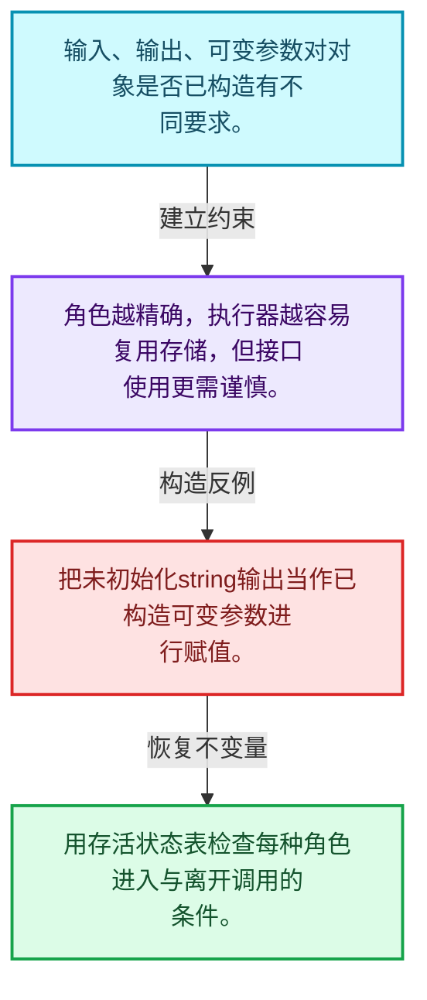
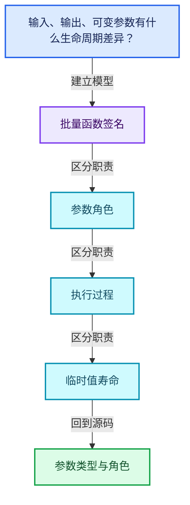
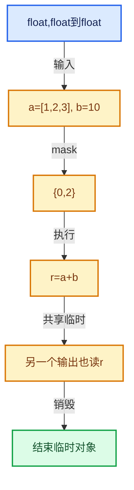

# 07-03 参数类型与角色

[方向导航](README.md) · [总目录](../README.md) · [覆盖索引](../%E6%BA%90%E7%A0%81%E7%89%88%E6%9C%AC%E4%B8%8E%E8%A6%86%E7%9B%96%E7%B4%A2%E5%BC%95.md)

> 阅读顺序：问题与数据模型 → 语法与类型 → 源码逐行 → 调用线索 → 历史与取舍 → 推演和练习。

- 基准 HEAD：`cbda6b96c26c0dee3c3b5cbb93960c4ac06a6b30`。
- 记录日期：2026-10-14。
- 教学示例状态：正文中的推演不是本机性能实测；已运行练习见验收报告。

## 一、从问题到设计

输入、输出、可变参数有什么生命周期差异？

只读输入不负责输出构造，可变参数通常要求已有对象；参数角色影响销毁与复用。

本篇把语法、数据语义和系统取舍连接起来。把调用准备与元素循环分开，把值依赖与对象生存区间同时显式化。

### 本篇独立模型与设计推理

输入、输出、可变参数对对象是否已构造有不同要求。

设计取舍：角色越精确，执行器越容易复用存储，但接口使用更需谨慎。

最小反例：把未初始化string输出当作已构造可变参数进行赋值。

推导与处理：用存活状态表检查每种角色进入与离开调用的条件。



### 源码范围与相邻篇章

| 文件 | 本篇逐行范围 | 基准SHA-256 |
|---|---|---|
| [source/blender/functions/FN_multi_function_param_type.hh](../../../../../source/blender/functions/FN_multi_function_param_type.hh) | L1—L170 | `8e5ead9cb64c77f89c9540d5d7c8ed8b81cef67e6b7374a5ec90b2ec30a9b2c1` |
| [source/blender/functions/FN_multi_function_data_type.hh](../../../../../source/blender/functions/FN_multi_function_data_type.hh) | L1—L131 | `c0128e23e7c45ce56877c4a40e9ab76619eecc63ed72d4527fb1809e09e04068` |

同一主讲文件可能分多篇覆盖；超出本篇范围的符号通过覆盖索引定位。空行与纯注释保留在源码摘录中，逐行表解释有效语句与语法边界；许可证头统一保留。

前篇：[函数签名](02-%E5%87%BD%E6%95%B0%E7%AD%BE%E5%90%8D.md).

后篇：[参数访问与输出构造](04-%E5%8F%82%E6%95%B0%E8%AE%BF%E9%97%AE%E4%B8%8E%E8%BE%93%E5%87%BA%E6%9E%84%E9%80%A0.md).

## 二、类型、数据与阅读地图



这是概念依赖图，边表示阅读关系，不声称是运行时调用顺序。

### 直接编译依赖


箭头只表示头文件包含关系；完整调用线索见后面的符号定位表。

## 三、关键词、语法与类型角色

### 模板 template

模板把类型或常量作为生成实现的参数。读声明时先列出类型参数、非类型参数和默认值，再看使用者实际实例化了什么。模板声明本身不意味着每种T都支持其全部成员。

具体检查：把T替换为int、string、只能移动的类型，分别检查每个被调用操作是否成立。

### 依赖名称 typename

typename既可引入类型模板参数，也可告诉编译器某个依赖名称是类型。它不创建运行时对象；解析期确认语法类别与实例化期检查具体类型是不同阶段。

具体检查：区分typename T::value_type和T::size()，前者标记类型，后者是表达式。

### 常量求值 constexpr

constexpr声明允许相应实体参与常量求值，但constexpr函数仍可以在运行时执行。是否常量求值由调用场景和表达式合法性共同决定。

具体检查：比较constexpr变量初始化和从运行时输入调用同一函数。

### 只读限定 const

const约束当前访问路径可做的修改。const指针、指向const的指针、const视图对象、const元素是不同位置的限定；其他别名可能仍可修改原对象。

具体检查：分别写T* const、const T*与const T* const，并画出不可修改的层次。

### 内部断言 assert

断言表达开发者预期成立的内部契约，发布构建可能关闭。它不能替代对不可信输入的完整错误处理，也不保证后续操作被运行时保护。

具体检查：对每条断言构造违反条件的输入，区分调用者错误与应向用户报告的错误。

### 受控访问 friend

friend授予指定函数或类访问非公开成员的权限，并不意味着继承，也不自动扩展到友元的派生类。

具体检查：解释执行器为何需要访问包装器的内部映射，同时检查边界是否仍清楚。

### 类型别名 using

类型别名为已有类型建立名字，不创建运行期对象。它常把模板内部使用的类型统一暴露给泛型调用者。

具体检查：展开别名直到基础类型，区分类型别名和变量声明。

### 枚举与状态模型 enum

枚举把有限状态命名；enum class避免许多隐式整数转换。状态机正确性还依赖允许的转移，不能只看有哪些枚举项。

具体检查：列出每个状态的进入条件和离开条件，检查终止状态是否仍可能被调度。

## 四、真实源码与逐行讲解

源码块保持原行内容，原始行号由小节标题及逐行表给出。表中的调用定位是静态阅读辅助；重载、模板实例化、宏展开和虚调用需结合完整声明，不能仅凭词法出现证明动态调用。

### FN_multi_function_param_type.hh：L1—L47

<!-- source:source/blender/functions/FN_multi_function_param_type.hh:1:47 -->

```cpp
/* SPDX-FileCopyrightText: 2023 Blender Authors
 *
 * SPDX-License-Identifier: GPL-2.0-or-later */

#pragma once

/** \file
 * \ingroup fn
 *
 * A multi-function has an arbitrary amount of parameters. Every parameter belongs to one of three
 * interface types:
 * - Input: An input parameter is readonly inside the function. The values have to be provided by
 *     the caller.
 * - Output: An output parameter has to be initialized by the function. However, the caller
 *     provides the memory where the data has to be constructed.
 * - Mutable: A mutable parameter can be considered to be an input and output. The caller has to
 *     initialize the data, but the function is allowed to modify it.
 *
 * Furthermore, every parameter has a DataType that describes what kind of data is being passed
 * around.
 */

#include "FN_multi_function_data_type.hh"

namespace blender::fn::multi_function {

enum class ParamCategory {
  SingleInput,
  VectorInput,
  SingleOutput,
  VectorOutput,
  SingleMutable,
  VectorMutable,
};

template<ParamCategory Category, typename T> struct ParamTag {
  static constexpr ParamCategory category = Category;
  using base_type = T;
};

class ParamType {
 public:
  enum InterfaceType {
    Input,
    Output,
    Mutable,
  };
```

| 原始行 | 语义、约束与检查 |
|---|---|
| L5 | 防止同一头文件在一个翻译单元中重复展开；不控制多个源文件之间的链接或对象寿命。 |
| L23 | 引入编译依赖 "FN_multi_function_data_type.hh"；这是声明可见性关系，不表示运行时一定调用该文件的所有接口。 |
| L25 | 把后续声明放入 blender::fn::multi_function 命名空间，影响名称查找和符号归属，不创建运行时对象。 |
| L27 | 声明或定义类型 `enum class ParamCategory`。结合继承、访问权限和成员布局确认接口与拥有关系；前向声明本身没有完整对象布局。 |
| L28 | 本行是连续声明或表达式的一部分：`SingleInput,`。与本段前后行合读；逗号、括号和限定符决定它属于参数、初始化列表还是实际计算。 |
| L29 | 本行是连续声明或表达式的一部分：`VectorInput,`。与本段前后行合读；逗号、括号和限定符决定它属于参数、初始化列表还是实际计算。 |
| L30 | 本行是连续声明或表达式的一部分：`SingleOutput,`。与本段前后行合读；逗号、括号和限定符决定它属于参数、初始化列表还是实际计算。 |
| L31 | 本行是连续声明或表达式的一部分：`VectorOutput,`。与本段前后行合读；逗号、括号和限定符决定它属于参数、初始化列表还是实际计算。 |
| L32 | 本行是连续声明或表达式的一部分：`SingleMutable,`。与本段前后行合读；逗号、括号和限定符决定它属于参数、初始化列表还是实际计算。 |
| L33 | 本行是连续声明或表达式的一部分：`VectorMutable,`。与本段前后行合读；逗号、括号和限定符决定它属于参数、初始化列表还是实际计算。 |
| L34 | 结束当前语法单元。局部自动对象在离开其作用域时按规则销毁；这不等于所有被引用的外部数据也被释放。 |
| L36 | 声明模板参数 `template<ParamCategory Category, typename T> struct ParamTag {`。类型参数决定生成操作的类型，非类型参数可决定内嵌容量或编译期分支。 |
| L37 | 把右侧 `Category` 用于初始化或更新左侧 `static constexpr ParamCategory category`。声明初始化与已有对象赋值应按上下文区分；有资源的类型会调用相应特殊成员。 |
| L38 | 定义类型别名 `using base_type = T`，为模板接口或内部实现统一命名；本行不分配该类型对象。 |
| L39 | 结束当前语法单元。局部自动对象在离开其作用域时按规则销毁；这不等于所有被引用的外部数据也被释放。 |
| L41 | 声明或定义类型 `class ParamType`。结合继承、访问权限和成员布局确认接口与拥有关系；前向声明本身没有完整对象布局。 |
| L42 | 切换成员访问权限为 public；它是编译期接口边界，不是线程同步或内存保护。 |
| L43 | 声明或定义类型 `enum InterfaceType`。结合继承、访问权限和成员布局确认接口与拥有关系；前向声明本身没有完整对象布局。 |
| L44 | 本行是连续声明或表达式的一部分：`Input,`。与本段前后行合读；逗号、括号和限定符决定它属于参数、初始化列表还是实际计算。 |
| L45 | 本行是连续声明或表达式的一部分：`Output,`。与本段前后行合读；逗号、括号和限定符决定它属于参数、初始化列表还是实际计算。 |
| L46 | 本行是连续声明或表达式的一部分：`Mutable,`。与本段前后行合读；逗号、括号和限定符决定它属于参数、初始化列表还是实际计算。 |
| L47 | 结束当前语法单元。局部自动对象在离开其作用域时按规则销毁；这不等于所有被引用的外部数据也被释放。 |

### FN_multi_function_param_type.hh：L48—L96

<!-- source:source/blender/functions/FN_multi_function_param_type.hh:48:96 -->

```cpp

 private:
  InterfaceType interface_type_;
  DataType data_type_;

 public:
  ParamType(InterfaceType interface_type, DataType data_type);

  static ParamType ForSingleInput(const CPPType &type);
  static ParamType ForVectorInput(const CPPType &base_type);
  static ParamType ForSingleOutput(const CPPType &type);
  static ParamType ForVectorOutput(const CPPType &base_type);
  static ParamType ForMutableSingle(const CPPType &type);
  static ParamType ForMutableVector(const CPPType &base_type);

  const DataType &data_type() const;
  InterfaceType interface_type() const;
  ParamCategory category() const;

  bool is_input_or_mutable() const;
  bool is_output_or_mutable() const;
  bool is_output() const;

  friend bool operator==(const ParamType &a, const ParamType &b) = default;
};

/* -------------------------------------------------------------------- */
/** \name #ParamType Inline Methods
 * \{ */

inline ParamType::ParamType(InterfaceType interface_type, DataType data_type)
    : interface_type_(interface_type), data_type_(data_type)
{
}

inline ParamType ParamType::ForSingleInput(const CPPType &type)
{
  return ParamType(InterfaceType::Input, DataType::ForSingle(type));
}

inline ParamType ParamType::ForVectorInput(const CPPType &base_type)
{
  return ParamType(InterfaceType::Input, DataType::ForVector(base_type));
}

inline ParamType ParamType::ForSingleOutput(const CPPType &type)
{
  return ParamType(InterfaceType::Output, DataType::ForSingle(type));
}
```

| 原始行 | 语义、约束与检查 |
|---|---|
| L49 | 切换成员访问权限为 private；它是编译期接口边界，不是线程同步或内存保护。 |
| L50 | 声明成员、局部对象或完成语句 `InterfaceType interface_type_`。若为指针或引用，它本身不说明拥有；若为值对象，其构造析构由所在作用域或外层对象管理。 |
| L51 | 声明成员、局部对象或完成语句 `DataType data_type_`。若为指针或引用，它本身不说明拥有；若为值对象，其构造析构由所在作用域或外层对象管理。 |
| L53 | 切换成员访问权限为 public；它是编译期接口边界，不是线程同步或内存保护。 |
| L54 | 出现调用或函数声明 `ParamType`，对应表达式为 `ParamType(InterfaceType interface_type, DataType data_type);`。参数求值、返回类型与重载需结合前后完整语句；静态文本引用不能证明动态目标。 |
| L56 | 声明接口 `static ParamType ForSingleInput(const CPPType &type)`，本行没有对应函数体；返回类型、参数限定和const/noexcept共同组成调用契约，实际行为需继续定位实现。 |
| L57 | 声明接口 `static ParamType ForVectorInput(const CPPType &base_type)`，本行没有对应函数体；返回类型、参数限定和const/noexcept共同组成调用契约，实际行为需继续定位实现。 |
| L58 | 声明接口 `static ParamType ForSingleOutput(const CPPType &type)`，本行没有对应函数体；返回类型、参数限定和const/noexcept共同组成调用契约，实际行为需继续定位实现。 |
| L59 | 声明接口 `static ParamType ForVectorOutput(const CPPType &base_type)`，本行没有对应函数体；返回类型、参数限定和const/noexcept共同组成调用契约，实际行为需继续定位实现。 |
| L60 | 声明接口 `static ParamType ForMutableSingle(const CPPType &type)`，本行没有对应函数体；返回类型、参数限定和const/noexcept共同组成调用契约，实际行为需继续定位实现。 |
| L61 | 声明接口 `static ParamType ForMutableVector(const CPPType &base_type)`，本行没有对应函数体；返回类型、参数限定和const/noexcept共同组成调用契约，实际行为需继续定位实现。 |
| L63 | 声明接口 `const DataType &data_type() const`，本行没有对应函数体；返回类型、参数限定和const/noexcept共同组成调用契约，实际行为需继续定位实现。 |
| L64 | 声明接口 `InterfaceType interface_type() const`，本行没有对应函数体；返回类型、参数限定和const/noexcept共同组成调用契约，实际行为需继续定位实现。 |
| L65 | 声明接口 `ParamCategory category() const`，本行没有对应函数体；返回类型、参数限定和const/noexcept共同组成调用契约，实际行为需继续定位实现。 |
| L67 | 声明接口 `bool is_input_or_mutable() const`，本行没有对应函数体；返回类型、参数限定和const/noexcept共同组成调用契约，实际行为需继续定位实现。 |
| L68 | 声明接口 `bool is_output_or_mutable() const`，本行没有对应函数体；返回类型、参数限定和const/noexcept共同组成调用契约，实际行为需继续定位实现。 |
| L69 | 声明接口 `bool is_output() const`，本行没有对应函数体；返回类型、参数限定和const/noexcept共同组成调用契约，实际行为需继续定位实现。 |
| L71 | 显式采用编译器生成的特殊成员行为：`friend bool operator==(const ParamType &a, const ParamType &b) = default;`。成员和基类的性质决定该操作是否可用、是否被删除及异常约定，不表示运行时给对象赋值为default。 |
| L72 | 结束当前语法单元。局部自动对象在离开其作用域时按规则销毁；这不等于所有被引用的外部数据也被释放。 |
| L78 | 出现调用或函数声明 `ParamType::ParamType`，对应表达式为 `inline ParamType::ParamType(InterfaceType interface_type, DataType data_type)`。参数求值、返回类型与重载需结合前后完整语句；静态文本引用不能证明动态目标。 |
| L79 | 出现调用或函数声明 `interface_type_`，对应表达式为 `: interface_type_(interface_type), data_type_(data_type)`。参数求值、返回类型与重载需结合前后完整语句；静态文本引用不能证明动态目标。 |
| L80 | 连接上一行的声明或控制结构与其语句块；后续行在这个作用域中执行或声明。 |
| L81 | 结束当前语法单元。局部自动对象在离开其作用域时按规则销毁；这不等于所有被引用的外部数据也被释放。 |
| L83 | 出现调用或函数声明 `ParamType::ForSingleInput`，对应表达式为 `inline ParamType ParamType::ForSingleInput(const CPPType &type)`。参数求值、返回类型与重载需结合前后完整语句；静态文本引用不能证明动态目标。 |
| L84 | 连接上一行的声明或控制结构与其语句块；后续行在这个作用域中执行或声明。 |
| L85 | 返回表达式 `ParamType(InterfaceType::Input, DataType::ForSingle(type))`。 |
| L86 | 结束当前语法单元。局部自动对象在离开其作用域时按规则销毁；这不等于所有被引用的外部数据也被释放。 |
| L88 | 出现调用或函数声明 `ParamType::ForVectorInput`，对应表达式为 `inline ParamType ParamType::ForVectorInput(const CPPType &base_type)`。参数求值、返回类型与重载需结合前后完整语句；静态文本引用不能证明动态目标。 |
| L89 | 连接上一行的声明或控制结构与其语句块；后续行在这个作用域中执行或声明。 |
| L90 | 返回表达式 `ParamType(InterfaceType::Input, DataType::ForVector(base_type))`。 |
| L91 | 结束当前语法单元。局部自动对象在离开其作用域时按规则销毁；这不等于所有被引用的外部数据也被释放。 |
| L93 | 出现调用或函数声明 `ParamType::ForSingleOutput`，对应表达式为 `inline ParamType ParamType::ForSingleOutput(const CPPType &type)`。参数求值、返回类型与重载需结合前后完整语句；静态文本引用不能证明动态目标。 |
| L94 | 连接上一行的声明或控制结构与其语句块；后续行在这个作用域中执行或声明。 |
| L95 | 返回表达式 `ParamType(InterfaceType::Output, DataType::ForSingle(type))`。 |
| L96 | 结束当前语法单元。局部自动对象在离开其作用域时按规则销毁；这不等于所有被引用的外部数据也被释放。 |

### FN_multi_function_param_type.hh：L97—L151

<!-- source:source/blender/functions/FN_multi_function_param_type.hh:97:151 -->

```cpp

inline ParamType ParamType::ForVectorOutput(const CPPType &base_type)
{
  return ParamType(InterfaceType::Output, DataType::ForVector(base_type));
}

inline ParamType ParamType::ForMutableSingle(const CPPType &type)
{
  return ParamType(InterfaceType::Mutable, DataType::ForSingle(type));
}

inline ParamType ParamType::ForMutableVector(const CPPType &base_type)
{
  return ParamType(InterfaceType::Mutable, DataType::ForVector(base_type));
}

inline const DataType &ParamType::data_type() const
{
  return data_type_;
}

inline ParamType::InterfaceType ParamType::interface_type() const
{
  return interface_type_;
}

inline ParamCategory ParamType::category() const
{
  switch (data_type_.category()) {
    case DataType::Single: {
      switch (interface_type_) {
        case Input:
          return ParamCategory::SingleInput;
        case Output:
          return ParamCategory::SingleOutput;
        case Mutable:
          return ParamCategory::SingleMutable;
      }
      break;
    }
    case DataType::Vector: {
      switch (interface_type_) {
        case Input:
          return ParamCategory::VectorInput;
        case Output:
          return ParamCategory::VectorOutput;
        case Mutable:
          return ParamCategory::VectorMutable;
      }
      break;
    }
  }
  BLI_assert_unreachable();
  return ParamCategory::SingleInput;
}
```

| 原始行 | 语义、约束与检查 |
|---|---|
| L98 | 出现调用或函数声明 `ParamType::ForVectorOutput`，对应表达式为 `inline ParamType ParamType::ForVectorOutput(const CPPType &base_type)`。参数求值、返回类型与重载需结合前后完整语句；静态文本引用不能证明动态目标。 |
| L99 | 连接上一行的声明或控制结构与其语句块；后续行在这个作用域中执行或声明。 |
| L100 | 返回表达式 `ParamType(InterfaceType::Output, DataType::ForVector(base_type))`。 |
| L101 | 结束当前语法单元。局部自动对象在离开其作用域时按规则销毁；这不等于所有被引用的外部数据也被释放。 |
| L103 | 出现调用或函数声明 `ParamType::ForMutableSingle`，对应表达式为 `inline ParamType ParamType::ForMutableSingle(const CPPType &type)`。参数求值、返回类型与重载需结合前后完整语句；静态文本引用不能证明动态目标。 |
| L104 | 连接上一行的声明或控制结构与其语句块；后续行在这个作用域中执行或声明。 |
| L105 | 返回表达式 `ParamType(InterfaceType::Mutable, DataType::ForSingle(type))`。 |
| L106 | 结束当前语法单元。局部自动对象在离开其作用域时按规则销毁；这不等于所有被引用的外部数据也被释放。 |
| L108 | 出现调用或函数声明 `ParamType::ForMutableVector`，对应表达式为 `inline ParamType ParamType::ForMutableVector(const CPPType &base_type)`。参数求值、返回类型与重载需结合前后完整语句；静态文本引用不能证明动态目标。 |
| L109 | 连接上一行的声明或控制结构与其语句块；后续行在这个作用域中执行或声明。 |
| L110 | 返回表达式 `ParamType(InterfaceType::Mutable, DataType::ForVector(base_type))`。 |
| L111 | 结束当前语法单元。局部自动对象在离开其作用域时按规则销毁；这不等于所有被引用的外部数据也被释放。 |
| L113 | 出现调用或函数声明 `ParamType::data_type`，对应表达式为 `inline const DataType &ParamType::data_type() const`。参数求值、返回类型与重载需结合前后完整语句；静态文本引用不能证明动态目标。 |
| L114 | 连接上一行的声明或控制结构与其语句块；后续行在这个作用域中执行或声明。 |
| L115 | 返回表达式 `data_type_`。 |
| L116 | 结束当前语法单元。局部自动对象在离开其作用域时按规则销毁；这不等于所有被引用的外部数据也被释放。 |
| L118 | 出现调用或函数声明 `ParamType::interface_type`，对应表达式为 `inline ParamType::InterfaceType ParamType::interface_type() const`。参数求值、返回类型与重载需结合前后完整语句；静态文本引用不能证明动态目标。 |
| L119 | 连接上一行的声明或控制结构与其语句块；后续行在这个作用域中执行或声明。 |
| L120 | 返回表达式 `interface_type_`。 |
| L121 | 结束当前语法单元。局部自动对象在离开其作用域时按规则销毁；这不等于所有被引用的外部数据也被释放。 |
| L123 | 出现调用或函数声明 `ParamType::category`，对应表达式为 `inline ParamCategory ParamType::category() const`。参数求值、返回类型与重载需结合前后完整语句；静态文本引用不能证明动态目标。 |
| L124 | 连接上一行的声明或控制结构与其语句块；后续行在这个作用域中执行或声明。 |
| L125 | 按 switch (data_type_.category()) 选择状态处理路径；每个case的break、return或贯穿行为决定下一步。 |
| L126 | 进入枚举或判别值对应分支 case DataType::Single: {；结合状态定义和后续更新判断允许的转移。 |
| L127 | 按 switch (interface_type_) 选择状态处理路径；每个case的break、return或贯穿行为决定下一步。 |
| L128 | 进入枚举或判别值对应分支 case Input:；结合状态定义和后续更新判断允许的转移。 |
| L129 | 返回表达式 `ParamCategory::SingleInput`。 |
| L130 | 进入枚举或判别值对应分支 case Output:；结合状态定义和后续更新判断允许的转移。 |
| L131 | 返回表达式 `ParamCategory::SingleOutput`。 |
| L132 | 进入枚举或判别值对应分支 case Mutable:；结合状态定义和后续更新判断允许的转移。 |
| L133 | 返回表达式 `ParamCategory::SingleMutable`。 |
| L134 | 结束当前语法单元。局部自动对象在离开其作用域时按规则销毁；这不等于所有被引用的外部数据也被释放。 |
| L135 | 离开最近的循环或switch；不是离开整个函数，后续清理和提交代码可能仍会执行。 |
| L136 | 结束当前语法单元。局部自动对象在离开其作用域时按规则销毁；这不等于所有被引用的外部数据也被释放。 |
| L137 | 进入枚举或判别值对应分支 case DataType::Vector: {；结合状态定义和后续更新判断允许的转移。 |
| L138 | 按 switch (interface_type_) 选择状态处理路径；每个case的break、return或贯穿行为决定下一步。 |
| L139 | 进入枚举或判别值对应分支 case Input:；结合状态定义和后续更新判断允许的转移。 |
| L140 | 返回表达式 `ParamCategory::VectorInput`。 |
| L141 | 进入枚举或判别值对应分支 case Output:；结合状态定义和后续更新判断允许的转移。 |
| L142 | 返回表达式 `ParamCategory::VectorOutput`。 |
| L143 | 进入枚举或判别值对应分支 case Mutable:；结合状态定义和后续更新判断允许的转移。 |
| L144 | 返回表达式 `ParamCategory::VectorMutable`。 |
| L145 | 结束当前语法单元。局部自动对象在离开其作用域时按规则销毁；这不等于所有被引用的外部数据也被释放。 |
| L146 | 离开最近的循环或switch；不是离开整个函数，后续清理和提交代码可能仍会执行。 |
| L147 | 结束当前语法单元。局部自动对象在离开其作用域时按规则销毁；这不等于所有被引用的外部数据也被释放。 |
| L148 | 结束当前语法单元。局部自动对象在离开其作用域时按规则销毁；这不等于所有被引用的外部数据也被释放。 |
| L149 | 断言约束 `BLI_assert_unreachable();`。条件是后续访问的内部前置条件；发布构建可能不执行，不能把断言当作输入修复。 |
| L150 | 返回表达式 `ParamCategory::SingleInput`。 |
| L151 | 结束当前语法单元。局部自动对象在离开其作用域时按规则销毁；这不等于所有被引用的外部数据也被释放。 |

### FN_multi_function_param_type.hh：L152—L170

<!-- source:source/blender/functions/FN_multi_function_param_type.hh:152:170 -->

```cpp

inline bool ParamType::is_input_or_mutable() const
{
  return ELEM(interface_type_, Input, Mutable);
}

inline bool ParamType::is_output_or_mutable() const
{
  return ELEM(interface_type_, Output, Mutable);
}

inline bool ParamType::is_output() const
{
  return interface_type_ == Output;
}

/** \} */

}  // namespace blender::fn::multi_function
```

| 原始行 | 语义、约束与检查 |
|---|---|
| L153 | 出现调用或函数声明 `ParamType::is_input_or_mutable`，对应表达式为 `inline bool ParamType::is_input_or_mutable() const`。参数求值、返回类型与重载需结合前后完整语句；静态文本引用不能证明动态目标。 |
| L154 | 连接上一行的声明或控制结构与其语句块；后续行在这个作用域中执行或声明。 |
| L155 | 返回表达式 `ELEM(interface_type_, Input, Mutable)`。 |
| L156 | 结束当前语法单元。局部自动对象在离开其作用域时按规则销毁；这不等于所有被引用的外部数据也被释放。 |
| L158 | 出现调用或函数声明 `ParamType::is_output_or_mutable`，对应表达式为 `inline bool ParamType::is_output_or_mutable() const`。参数求值、返回类型与重载需结合前后完整语句；静态文本引用不能证明动态目标。 |
| L159 | 连接上一行的声明或控制结构与其语句块；后续行在这个作用域中执行或声明。 |
| L160 | 返回表达式 `ELEM(interface_type_, Output, Mutable)`。 |
| L161 | 结束当前语法单元。局部自动对象在离开其作用域时按规则销毁；这不等于所有被引用的外部数据也被释放。 |
| L163 | 出现调用或函数声明 `ParamType::is_output`，对应表达式为 `inline bool ParamType::is_output() const`。参数求值、返回类型与重载需结合前后完整语句；静态文本引用不能证明动态目标。 |
| L164 | 连接上一行的声明或控制结构与其语句块；后续行在这个作用域中执行或声明。 |
| L165 | 返回表达式 `interface_type_ == Output`。 |
| L166 | 结束当前语法单元。局部自动对象在离开其作用域时按规则销毁；这不等于所有被引用的外部数据也被释放。 |
| L170 | 结束当前语法单元。局部自动对象在离开其作用域时按规则销毁；这不等于所有被引用的外部数据也被释放。 |

### FN_multi_function_data_type.hh：L1—L47

<!-- source:source/blender/functions/FN_multi_function_data_type.hh:1:47 -->

```cpp
/* SPDX-FileCopyrightText: 2023 Blender Authors
 *
 * SPDX-License-Identifier: GPL-2.0-or-later */

#pragma once

/** \file
 * \ingroup fn
 *
 * A DataType describes what type of data a multi-function gets as input, outputs or mutates.
 * Currently, only individual elements or vectors of elements are supported. Adding more data types
 * is possible when necessary.
 */

#include "BLI_cpp_type.hh"

namespace blender::fn::multi_function {

class DataType {
 public:
  enum Category {
    Single,
    Vector,
  };

 private:
  Category category_;
  const CPPType *type_;

  DataType(Category category, const CPPType &type);

 public:
  DataType() = default;

  static DataType ForSingle(const CPPType &type);
  static DataType ForVector(const CPPType &type);

  template<typename T> static DataType ForSingle();
  template<typename T> static DataType ForVector();

  bool is_single() const;
  bool is_vector() const;

  Category category() const;

  const CPPType &single_type() const;
  const CPPType &vector_base_type() const;
```

| 原始行 | 语义、约束与检查 |
|---|---|
| L5 | 防止同一头文件在一个翻译单元中重复展开；不控制多个源文件之间的链接或对象寿命。 |
| L15 | 引入编译依赖 "BLI_cpp_type.hh"；这是声明可见性关系，不表示运行时一定调用该文件的所有接口。 |
| L17 | 把后续声明放入 blender::fn::multi_function 命名空间，影响名称查找和符号归属，不创建运行时对象。 |
| L19 | 声明或定义类型 `class DataType`。结合继承、访问权限和成员布局确认接口与拥有关系；前向声明本身没有完整对象布局。 |
| L20 | 切换成员访问权限为 public；它是编译期接口边界，不是线程同步或内存保护。 |
| L21 | 声明或定义类型 `enum Category`。结合继承、访问权限和成员布局确认接口与拥有关系；前向声明本身没有完整对象布局。 |
| L22 | 本行是连续声明或表达式的一部分：`Single,`。与本段前后行合读；逗号、括号和限定符决定它属于参数、初始化列表还是实际计算。 |
| L23 | 本行是连续声明或表达式的一部分：`Vector,`。与本段前后行合读；逗号、括号和限定符决定它属于参数、初始化列表还是实际计算。 |
| L24 | 结束当前语法单元。局部自动对象在离开其作用域时按规则销毁；这不等于所有被引用的外部数据也被释放。 |
| L26 | 切换成员访问权限为 private；它是编译期接口边界，不是线程同步或内存保护。 |
| L27 | 声明成员、局部对象或完成语句 `Category category_`。若为指针或引用，它本身不说明拥有；若为值对象，其构造析构由所在作用域或外层对象管理。 |
| L28 | 声明成员、局部对象或完成语句 `const CPPType *type_`。若为指针或引用，它本身不说明拥有；若为值对象，其构造析构由所在作用域或外层对象管理。 |
| L30 | 出现调用或函数声明 `DataType`，对应表达式为 `DataType(Category category, const CPPType &type);`。参数求值、返回类型与重载需结合前后完整语句；静态文本引用不能证明动态目标。 |
| L32 | 切换成员访问权限为 public；它是编译期接口边界，不是线程同步或内存保护。 |
| L33 | 显式采用编译器生成的特殊成员行为：`DataType() = default;`。成员和基类的性质决定该操作是否可用、是否被删除及异常约定，不表示运行时给对象赋值为default。 |
| L35 | 声明接口 `static DataType ForSingle(const CPPType &type)`，本行没有对应函数体；返回类型、参数限定和const/noexcept共同组成调用契约，实际行为需继续定位实现。 |
| L36 | 声明接口 `static DataType ForVector(const CPPType &type)`，本行没有对应函数体；返回类型、参数限定和const/noexcept共同组成调用契约，实际行为需继续定位实现。 |
| L38 | 声明模板参数 `template<typename T> static DataType ForSingle();`。类型参数决定生成操作的类型，非类型参数可决定内嵌容量或编译期分支。 |
| L39 | 声明模板参数 `template<typename T> static DataType ForVector();`。类型参数决定生成操作的类型，非类型参数可决定内嵌容量或编译期分支。 |
| L41 | 声明接口 `bool is_single() const`，本行没有对应函数体；返回类型、参数限定和const/noexcept共同组成调用契约，实际行为需继续定位实现。 |
| L42 | 声明接口 `bool is_vector() const`，本行没有对应函数体；返回类型、参数限定和const/noexcept共同组成调用契约，实际行为需继续定位实现。 |
| L44 | 声明接口 `Category category() const`，本行没有对应函数体；返回类型、参数限定和const/noexcept共同组成调用契约，实际行为需继续定位实现。 |
| L46 | 声明接口 `const CPPType &single_type() const`，本行没有对应函数体；返回类型、参数限定和const/noexcept共同组成调用契约，实际行为需继续定位实现。 |
| L47 | 声明接口 `const CPPType &vector_base_type() const`，本行没有对应函数体；返回类型、参数限定和const/noexcept共同组成调用契约，实际行为需继续定位实现。 |

### FN_multi_function_data_type.hh：L48—L93

<!-- source:source/blender/functions/FN_multi_function_data_type.hh:48:93 -->

```cpp

  friend bool operator==(const DataType &a, const DataType &b) = default;

  std::string to_string() const;

  uint64_t hash() const;
};

/* -------------------------------------------------------------------- */
/** \name #DataType Inline Methods
 * \{ */

inline DataType::DataType(Category category, const CPPType &type)
    : category_(category), type_(&type)
{
}

inline DataType DataType::ForSingle(const CPPType &type)
{
  return DataType(Single, type);
}

inline DataType DataType::ForVector(const CPPType &type)
{
  return DataType(Vector, type);
}

template<typename T> inline DataType DataType::ForSingle()
{
  return DataType::ForSingle(CPPType::get<T>());
}

template<typename T> inline DataType DataType::ForVector()
{
  return DataType::ForVector(CPPType::get<T>());
}

inline bool DataType::is_single() const
{
  return category_ == Single;
}

inline bool DataType::is_vector() const
{
  return category_ == Vector;
}
```

| 原始行 | 语义、约束与检查 |
|---|---|
| L49 | 显式采用编译器生成的特殊成员行为：`friend bool operator==(const DataType &a, const DataType &b) = default;`。成员和基类的性质决定该操作是否可用、是否被删除及异常约定，不表示运行时给对象赋值为default。 |
| L51 | 声明接口 `std::string to_string() const`，本行没有对应函数体；返回类型、参数限定和const/noexcept共同组成调用契约，实际行为需继续定位实现。 |
| L53 | 声明接口 `uint64_t hash() const`，本行没有对应函数体；返回类型、参数限定和const/noexcept共同组成调用契约，实际行为需继续定位实现。 |
| L54 | 结束当前语法单元。局部自动对象在离开其作用域时按规则销毁；这不等于所有被引用的外部数据也被释放。 |
| L60 | 出现调用或函数声明 `DataType::DataType`，对应表达式为 `inline DataType::DataType(Category category, const CPPType &type)`。参数求值、返回类型与重载需结合前后完整语句；静态文本引用不能证明动态目标。 |
| L61 | 出现调用或函数声明 `category_`，对应表达式为 `: category_(category), type_(&type)`。参数求值、返回类型与重载需结合前后完整语句；静态文本引用不能证明动态目标。 |
| L62 | 连接上一行的声明或控制结构与其语句块；后续行在这个作用域中执行或声明。 |
| L63 | 结束当前语法单元。局部自动对象在离开其作用域时按规则销毁；这不等于所有被引用的外部数据也被释放。 |
| L65 | 出现调用或函数声明 `DataType::ForSingle`，对应表达式为 `inline DataType DataType::ForSingle(const CPPType &type)`。参数求值、返回类型与重载需结合前后完整语句；静态文本引用不能证明动态目标。 |
| L66 | 连接上一行的声明或控制结构与其语句块；后续行在这个作用域中执行或声明。 |
| L67 | 返回表达式 `DataType(Single, type)`。 |
| L68 | 结束当前语法单元。局部自动对象在离开其作用域时按规则销毁；这不等于所有被引用的外部数据也被释放。 |
| L70 | 出现调用或函数声明 `DataType::ForVector`，对应表达式为 `inline DataType DataType::ForVector(const CPPType &type)`。参数求值、返回类型与重载需结合前后完整语句；静态文本引用不能证明动态目标。 |
| L71 | 连接上一行的声明或控制结构与其语句块；后续行在这个作用域中执行或声明。 |
| L72 | 返回表达式 `DataType(Vector, type)`。 |
| L73 | 结束当前语法单元。局部自动对象在离开其作用域时按规则销毁；这不等于所有被引用的外部数据也被释放。 |
| L75 | 声明模板参数 `template<typename T> inline DataType DataType::ForSingle()`。类型参数决定生成操作的类型，非类型参数可决定内嵌容量或编译期分支。 |
| L76 | 连接上一行的声明或控制结构与其语句块；后续行在这个作用域中执行或声明。 |
| L77 | 返回表达式 `DataType::ForSingle(CPPType::get<T>())`。 |
| L78 | 结束当前语法单元。局部自动对象在离开其作用域时按规则销毁；这不等于所有被引用的外部数据也被释放。 |
| L80 | 声明模板参数 `template<typename T> inline DataType DataType::ForVector()`。类型参数决定生成操作的类型，非类型参数可决定内嵌容量或编译期分支。 |
| L81 | 连接上一行的声明或控制结构与其语句块；后续行在这个作用域中执行或声明。 |
| L82 | 返回表达式 `DataType::ForVector(CPPType::get<T>())`。 |
| L83 | 结束当前语法单元。局部自动对象在离开其作用域时按规则销毁；这不等于所有被引用的外部数据也被释放。 |
| L85 | 出现调用或函数声明 `DataType::is_single`，对应表达式为 `inline bool DataType::is_single() const`。参数求值、返回类型与重载需结合前后完整语句；静态文本引用不能证明动态目标。 |
| L86 | 连接上一行的声明或控制结构与其语句块；后续行在这个作用域中执行或声明。 |
| L87 | 返回表达式 `category_ == Single`。 |
| L88 | 结束当前语法单元。局部自动对象在离开其作用域时按规则销毁；这不等于所有被引用的外部数据也被释放。 |
| L90 | 出现调用或函数声明 `DataType::is_vector`，对应表达式为 `inline bool DataType::is_vector() const`。参数求值、返回类型与重载需结合前后完整语句；静态文本引用不能证明动态目标。 |
| L91 | 连接上一行的声明或控制结构与其语句块；后续行在这个作用域中执行或声明。 |
| L92 | 返回表达式 `category_ == Vector`。 |
| L93 | 结束当前语法单元。局部自动对象在离开其作用域时按规则销毁；这不等于所有被引用的外部数据也被释放。 |

### FN_multi_function_data_type.hh：L94—L131

<!-- source:source/blender/functions/FN_multi_function_data_type.hh:94:131 -->

```cpp

inline DataType::Category DataType::category() const
{
  return category_;
}

inline const CPPType &DataType::single_type() const
{
  BLI_assert(this->is_single());
  return *type_;
}

inline const CPPType &DataType::vector_base_type() const
{
  BLI_assert(this->is_vector());
  return *type_;
}

inline std::string DataType::to_string() const
{
  switch (category_) {
    case Single:
      return type_->name();
    case Vector:
      return type_->name() + " Vector";
  }
  BLI_assert(false);
  return "";
}

inline uint64_t DataType::hash() const
{
  return get_default_hash(*type_, category_);
}

/** \} */

}  // namespace blender::fn::multi_function
```

| 原始行 | 语义、约束与检查 |
|---|---|
| L95 | 出现调用或函数声明 `DataType::category`，对应表达式为 `inline DataType::Category DataType::category() const`。参数求值、返回类型与重载需结合前后完整语句；静态文本引用不能证明动态目标。 |
| L96 | 连接上一行的声明或控制结构与其语句块；后续行在这个作用域中执行或声明。 |
| L97 | 返回表达式 `category_`。 |
| L98 | 结束当前语法单元。局部自动对象在离开其作用域时按规则销毁；这不等于所有被引用的外部数据也被释放。 |
| L100 | 出现调用或函数声明 `DataType::single_type`，对应表达式为 `inline const CPPType &DataType::single_type() const`。参数求值、返回类型与重载需结合前后完整语句；静态文本引用不能证明动态目标。 |
| L101 | 连接上一行的声明或控制结构与其语句块；后续行在这个作用域中执行或声明。 |
| L102 | 断言约束 `BLI_assert(this->is_single());`。条件是后续访问的内部前置条件；发布构建可能不执行，不能把断言当作输入修复。 |
| L103 | 返回表达式 `*type_`。 |
| L104 | 结束当前语法单元。局部自动对象在离开其作用域时按规则销毁；这不等于所有被引用的外部数据也被释放。 |
| L106 | 出现调用或函数声明 `DataType::vector_base_type`，对应表达式为 `inline const CPPType &DataType::vector_base_type() const`。参数求值、返回类型与重载需结合前后完整语句；静态文本引用不能证明动态目标。 |
| L107 | 连接上一行的声明或控制结构与其语句块；后续行在这个作用域中执行或声明。 |
| L108 | 断言约束 `BLI_assert(this->is_vector());`。条件是后续访问的内部前置条件；发布构建可能不执行，不能把断言当作输入修复。 |
| L109 | 返回表达式 `*type_`。 |
| L110 | 结束当前语法单元。局部自动对象在离开其作用域时按规则销毁；这不等于所有被引用的外部数据也被释放。 |
| L112 | 出现调用或函数声明 `DataType::to_string`，对应表达式为 `inline std::string DataType::to_string() const`。参数求值、返回类型与重载需结合前后完整语句；静态文本引用不能证明动态目标。 |
| L113 | 连接上一行的声明或控制结构与其语句块；后续行在这个作用域中执行或声明。 |
| L114 | 按 switch (category_) 选择状态处理路径；每个case的break、return或贯穿行为决定下一步。 |
| L115 | 进入枚举或判别值对应分支 case Single:；结合状态定义和后续更新判断允许的转移。 |
| L116 | 返回表达式 `type_->name()`。 |
| L117 | 进入枚举或判别值对应分支 case Vector:；结合状态定义和后续更新判断允许的转移。 |
| L118 | 返回表达式 `type_->name() + " Vector"`。 |
| L119 | 结束当前语法单元。局部自动对象在离开其作用域时按规则销毁；这不等于所有被引用的外部数据也被释放。 |
| L120 | 断言约束 `BLI_assert(false);`。条件是后续访问的内部前置条件；发布构建可能不执行，不能把断言当作输入修复。 |
| L121 | 返回表达式 `""`。 |
| L122 | 结束当前语法单元。局部自动对象在离开其作用域时按规则销毁；这不等于所有被引用的外部数据也被释放。 |
| L124 | 出现调用或函数声明 `DataType::hash`，对应表达式为 `inline uint64_t DataType::hash() const`。参数求值、返回类型与重载需结合前后完整语句；静态文本引用不能证明动态目标。 |
| L125 | 连接上一行的声明或控制结构与其语句块；后续行在这个作用域中执行或声明。 |
| L126 | 返回表达式 `get_default_hash(*type_, category_)`。 |
| L127 | 结束当前语法单元。局部自动对象在离开其作用域时按规则销毁；这不等于所有被引用的外部数据也被释放。 |
| L131 | 结束当前语法单元。局部自动对象在离开其作用域时按规则销毁；这不等于所有被引用的外部数据也被释放。 |

## 五、接口定位、调用线索与生命周期

### 本篇声明与实现入口

| 源码位置 | 实际声明片段 |
|---|---|
| [FN_multi_function_param_type.hh:L27](../../../../../source/blender/functions/FN_multi_function_param_type.hh#L27) | `enum class ParamCategory` |
| [FN_multi_function_param_type.hh:L36](../../../../../source/blender/functions/FN_multi_function_param_type.hh#L36) | `template<ParamCategory Category, typename T> struct ParamTag` |
| [FN_multi_function_param_type.hh:L41](../../../../../source/blender/functions/FN_multi_function_param_type.hh#L41) | `class ParamType` |
| [FN_multi_function_param_type.hh:L54](../../../../../source/blender/functions/FN_multi_function_param_type.hh#L54) | `ParamType(InterfaceType interface_type, DataType data_type);` |
| [FN_multi_function_param_type.hh:L56](../../../../../source/blender/functions/FN_multi_function_param_type.hh#L56) | `static ParamType ForSingleInput(const CPPType &type);` |
| [FN_multi_function_param_type.hh:L57](../../../../../source/blender/functions/FN_multi_function_param_type.hh#L57) | `static ParamType ForVectorInput(const CPPType &base_type);` |
| [FN_multi_function_param_type.hh:L58](../../../../../source/blender/functions/FN_multi_function_param_type.hh#L58) | `static ParamType ForSingleOutput(const CPPType &type);` |
| [FN_multi_function_param_type.hh:L59](../../../../../source/blender/functions/FN_multi_function_param_type.hh#L59) | `static ParamType ForVectorOutput(const CPPType &base_type);` |
| [FN_multi_function_param_type.hh:L60](../../../../../source/blender/functions/FN_multi_function_param_type.hh#L60) | `static ParamType ForMutableSingle(const CPPType &type);` |
| [FN_multi_function_param_type.hh:L61](../../../../../source/blender/functions/FN_multi_function_param_type.hh#L61) | `static ParamType ForMutableVector(const CPPType &base_type);` |
| [FN_multi_function_param_type.hh:L63](../../../../../source/blender/functions/FN_multi_function_param_type.hh#L63) | `const DataType &data_type() const;` |
| [FN_multi_function_param_type.hh:L64](../../../../../source/blender/functions/FN_multi_function_param_type.hh#L64) | `InterfaceType interface_type() const;` |
| [FN_multi_function_param_type.hh:L65](../../../../../source/blender/functions/FN_multi_function_param_type.hh#L65) | `ParamCategory category() const;` |
| [FN_multi_function_param_type.hh:L67](../../../../../source/blender/functions/FN_multi_function_param_type.hh#L67) | `bool is_input_or_mutable() const;` |
| [FN_multi_function_param_type.hh:L68](../../../../../source/blender/functions/FN_multi_function_param_type.hh#L68) | `bool is_output_or_mutable() const;` |
| [FN_multi_function_param_type.hh:L69](../../../../../source/blender/functions/FN_multi_function_param_type.hh#L69) | `bool is_output() const;` |
| [FN_multi_function_param_type.hh:L78](../../../../../source/blender/functions/FN_multi_function_param_type.hh#L78) | `inline ParamType::ParamType(InterfaceType interface_type, DataType data_type)` |
| [FN_multi_function_param_type.hh:L79](../../../../../source/blender/functions/FN_multi_function_param_type.hh#L79) | `: interface_type_(interface_type), data_type_(data_type)` |
| [FN_multi_function_param_type.hh:L83](../../../../../source/blender/functions/FN_multi_function_param_type.hh#L83) | `inline ParamType ParamType::ForSingleInput(const CPPType &type)` |
| [FN_multi_function_param_type.hh:L88](../../../../../source/blender/functions/FN_multi_function_param_type.hh#L88) | `inline ParamType ParamType::ForVectorInput(const CPPType &base_type)` |
| [FN_multi_function_param_type.hh:L93](../../../../../source/blender/functions/FN_multi_function_param_type.hh#L93) | `inline ParamType ParamType::ForSingleOutput(const CPPType &type)` |
| [FN_multi_function_param_type.hh:L98](../../../../../source/blender/functions/FN_multi_function_param_type.hh#L98) | `inline ParamType ParamType::ForVectorOutput(const CPPType &base_type)` |
| [FN_multi_function_param_type.hh:L103](../../../../../source/blender/functions/FN_multi_function_param_type.hh#L103) | `inline ParamType ParamType::ForMutableSingle(const CPPType &type)` |
| [FN_multi_function_param_type.hh:L108](../../../../../source/blender/functions/FN_multi_function_param_type.hh#L108) | `inline ParamType ParamType::ForMutableVector(const CPPType &base_type)` |
| [FN_multi_function_param_type.hh:L113](../../../../../source/blender/functions/FN_multi_function_param_type.hh#L113) | `inline const DataType &ParamType::data_type() const` |
| [FN_multi_function_param_type.hh:L118](../../../../../source/blender/functions/FN_multi_function_param_type.hh#L118) | `inline ParamType::InterfaceType ParamType::interface_type() const` |
| [FN_multi_function_param_type.hh:L123](../../../../../source/blender/functions/FN_multi_function_param_type.hh#L123) | `inline ParamCategory ParamType::category() const` |
| [FN_multi_function_param_type.hh:L153](../../../../../source/blender/functions/FN_multi_function_param_type.hh#L153) | `inline bool ParamType::is_input_or_mutable() const` |
| [FN_multi_function_param_type.hh:L158](../../../../../source/blender/functions/FN_multi_function_param_type.hh#L158) | `inline bool ParamType::is_output_or_mutable() const` |
| [FN_multi_function_param_type.hh:L163](../../../../../source/blender/functions/FN_multi_function_param_type.hh#L163) | `inline bool ParamType::is_output() const` |
| [FN_multi_function_data_type.hh:L19](../../../../../source/blender/functions/FN_multi_function_data_type.hh#L19) | `class DataType` |
| [FN_multi_function_data_type.hh:L30](../../../../../source/blender/functions/FN_multi_function_data_type.hh#L30) | `DataType(Category category, const CPPType &type);` |
| [FN_multi_function_data_type.hh:L33](../../../../../source/blender/functions/FN_multi_function_data_type.hh#L33) | `DataType() = default;` |
| [FN_multi_function_data_type.hh:L35](../../../../../source/blender/functions/FN_multi_function_data_type.hh#L35) | `static DataType ForSingle(const CPPType &type);` |
| [FN_multi_function_data_type.hh:L36](../../../../../source/blender/functions/FN_multi_function_data_type.hh#L36) | `static DataType ForVector(const CPPType &type);` |
| [FN_multi_function_data_type.hh:L38](../../../../../source/blender/functions/FN_multi_function_data_type.hh#L38) | `template<typename T> static DataType ForSingle();` |
| [FN_multi_function_data_type.hh:L39](../../../../../source/blender/functions/FN_multi_function_data_type.hh#L39) | `template<typename T> static DataType ForVector();` |
| [FN_multi_function_data_type.hh:L41](../../../../../source/blender/functions/FN_multi_function_data_type.hh#L41) | `bool is_single() const;` |
| [FN_multi_function_data_type.hh:L42](../../../../../source/blender/functions/FN_multi_function_data_type.hh#L42) | `bool is_vector() const;` |
| [FN_multi_function_data_type.hh:L44](../../../../../source/blender/functions/FN_multi_function_data_type.hh#L44) | `Category category() const;` |
| [FN_multi_function_data_type.hh:L46](../../../../../source/blender/functions/FN_multi_function_data_type.hh#L46) | `const CPPType &single_type() const;` |
| [FN_multi_function_data_type.hh:L47](../../../../../source/blender/functions/FN_multi_function_data_type.hh#L47) | `const CPPType &vector_base_type() const;` |
| [FN_multi_function_data_type.hh:L51](../../../../../source/blender/functions/FN_multi_function_data_type.hh#L51) | `std::string to_string() const;` |
| [FN_multi_function_data_type.hh:L53](../../../../../source/blender/functions/FN_multi_function_data_type.hh#L53) | `uint64_t hash() const;` |
| [FN_multi_function_data_type.hh:L60](../../../../../source/blender/functions/FN_multi_function_data_type.hh#L60) | `inline DataType::DataType(Category category, const CPPType &type)` |
| [FN_multi_function_data_type.hh:L61](../../../../../source/blender/functions/FN_multi_function_data_type.hh#L61) | `: category_(category), type_(&type)` |
| [FN_multi_function_data_type.hh:L65](../../../../../source/blender/functions/FN_multi_function_data_type.hh#L65) | `inline DataType DataType::ForSingle(const CPPType &type)` |
| [FN_multi_function_data_type.hh:L70](../../../../../source/blender/functions/FN_multi_function_data_type.hh#L70) | `inline DataType DataType::ForVector(const CPPType &type)` |
| [FN_multi_function_data_type.hh:L75](../../../../../source/blender/functions/FN_multi_function_data_type.hh#L75) | `template<typename T> inline DataType DataType::ForSingle()` |
| [FN_multi_function_data_type.hh:L80](../../../../../source/blender/functions/FN_multi_function_data_type.hh#L80) | `template<typename T> inline DataType DataType::ForVector()` |
| [FN_multi_function_data_type.hh:L85](../../../../../source/blender/functions/FN_multi_function_data_type.hh#L85) | `inline bool DataType::is_single() const` |
| [FN_multi_function_data_type.hh:L90](../../../../../source/blender/functions/FN_multi_function_data_type.hh#L90) | `inline bool DataType::is_vector() const` |
| [FN_multi_function_data_type.hh:L95](../../../../../source/blender/functions/FN_multi_function_data_type.hh#L95) | `inline DataType::Category DataType::category() const` |
| [FN_multi_function_data_type.hh:L100](../../../../../source/blender/functions/FN_multi_function_data_type.hh#L100) | `inline const CPPType &DataType::single_type() const` |
| [FN_multi_function_data_type.hh:L106](../../../../../source/blender/functions/FN_multi_function_data_type.hh#L106) | `inline const CPPType &DataType::vector_base_type() const` |
| [FN_multi_function_data_type.hh:L112](../../../../../source/blender/functions/FN_multi_function_data_type.hh#L112) | `inline std::string DataType::to_string() const` |
| [FN_multi_function_data_type.hh:L124](../../../../../source/blender/functions/FN_multi_function_data_type.hh#L124) | `inline uint64_t DataType::hash() const` |

### 同名符号出现位置

以下表提供跨文件阅读入口，包含声明、调用或测试使用；没有经过完整C++名称解析，不把它命名为已证明的运行时调用图。

| 符号 | 位置 | 文本证据 |
|---|---|---|
| `ParamType` | [FN_multi_function_procedure_builder.hh:L163](../../../../../source/blender/functions/FN_multi_function_procedure_builder.hh#L163) | `return this->add_parameter(ParamType(ParamType::Input, data_type), std::move(name));` |
| `ParamType` | [FN_multi_function_signature.hh:L124](../../../../../source/blender/functions/FN_multi_function_signature.hh#L124) | `signature_.params.append({ParamType(ParamType::Input, data_type), name});` |
| `ParamType` | [FN_multi_function_signature.hh:L155](../../../../../source/blender/functions/FN_multi_function_signature.hh#L155) | `signature_.params.append({ParamType(ParamType::Output, data_type), name, flag});` |
| `ForSingleInput` | [FN_multi_function_params.hh:L148](../../../../../source/blender/functions/FN_multi_function_params.hh#L148) | `this->assert_current_param_type(ParamType::ForSingleInput(CPPType::get<T>()), expected_name);` |
| `ForSingleInput` | [FN_multi_function_params.hh:L159](../../../../../source/blender/functions/FN_multi_function_params.hh#L159) | `this->assert_current_param_type(ParamType::ForSingleInput(CPPType::get<T>()), expected_name);` |
| `ForSingleInput` | [FN_multi_function_params.hh:L169](../../../../../source/blender/functions/FN_multi_function_params.hh#L169) | `this->assert_current_param_type(ParamType::ForSingleInput(span.type()), expected_name);` |
| `ForVectorInput` | [FN_multi_function_params.hh:L210](../../../../../source/blender/functions/FN_multi_function_params.hh#L210) | `this->assert_current_param_type(ParamType::ForVectorInput(ref.type()), expected_name);` |
| `ForSingleOutput` | [FN_multi_function_params.hh:L224](../../../../../source/blender/functions/FN_multi_function_params.hh#L224) | `this->assert_current_param_type(ParamType::ForSingleOutput(ref.type()), expected_name);` |
| `ForVectorOutput` | [FN_multi_function_params.hh:L250](../../../../../source/blender/functions/FN_multi_function_params.hh#L250) | `this->assert_current_param_type(ParamType::ForVectorOutput(vector_array.type()), expected_name);` |
| `ForMutableSingle` | [FN_multi_function_params.hh:L257](../../../../../source/blender/functions/FN_multi_function_params.hh#L257) | `this->assert_current_param_type(ParamType::ForMutableSingle(ref.type()), expected_name);` |
| `ForMutableSingle` | [FN_multi_function_procedure_builder.hh:L175](../../../../../source/blender/functions/FN_multi_function_procedure_builder.hh#L175) | `return this->add_parameter(ParamType::ForMutableSingle(CPPType::get<T>()), std::move(name));` |
| `ForMutableVector` | [FN_multi_function_params.hh:L264](../../../../../source/blender/functions/FN_multi_function_params.hh#L264) | `this->assert_current_param_type(ParamType::ForMutableVector(vector_array.type()), expected_name);` |
| `data_type` | [BKE_attribute.hh:L409](../../../../../source/blender/blenkernel/BKE_attribute.hh#L409) | `: name(name), domain(domain), data_type(data_type), get_fn_(get_fn)` |
| `data_type` | [BKE_attribute_storage.hh:L100](../../../../../source/blender/blenkernel/BKE_attribute_storage.hh#L100) | `AttrType data_type() const;` |
| `data_type` | [BKE_attribute_storage.hh:L291](../../../../../source/blender/blenkernel/BKE_attribute_storage.hh#L291) | `inline AttrType Attribute::data_type() const` |
| `interface_type` | [FN_multi_function_procedure_builder.hh:L157](../../../../../source/blender/functions/FN_multi_function_procedure_builder.hh#L157) | `this->add_parameter(param_type.interface_type(), variable);` |
| `interface_type` | [FN_multi_function_signature.hh:L185](../../../../../source/blender/functions/FN_multi_function_signature.hh#L185) | `switch (param_type.interface_type()) {` |
| `interface_type` | [field_evaluation.cc:L220](../../../../../source/blender/functions/intern/field_evaluation.cc#L220) | `const mf::ParamType::InterfaceType interface_type = param_type.interface_type();` |
| `category` | [FN_multi_function_data_type.hh:L44](../../../../../source/blender/functions/FN_multi_function_data_type.hh#L44) | `Category category() const;` |
| `category` | [FN_multi_function_data_type.hh:L95](../../../../../source/blender/functions/FN_multi_function_data_type.hh#L95) | `inline DataType::Category DataType::category() const` |
| `category` | [FN_multi_function_params.hh:L234](../../../../../source/blender/functions/FN_multi_function_params.hh#L234) | `BLI_assert(param_type.category() == ParamCategory::SingleOutput);` |
| `is_output` | [FN_lazy_function_graph.hh:L69](../../../../../source/blender/functions/FN_lazy_function_graph.hh#L69) | `bool is_output() const;` |
| `is_output` | [FN_lazy_function_graph.hh:L325](../../../../../source/blender/functions/FN_lazy_function_graph.hh#L325) | `inline bool Socket::is_output() const` |
| `is_output` | [FN_lazy_function_graph.hh:L348](../../../../../source/blender/functions/FN_lazy_function_graph.hh#L348) | `BLI_assert(this->is_output());` |
| `ForSingle` | [FN_multi_function_param_type.hh:L85](../../../../../source/blender/functions/FN_multi_function_param_type.hh#L85) | `return ParamType(InterfaceType::Input, DataType::ForSingle(type));` |
| `ForSingle` | [FN_multi_function_param_type.hh:L95](../../../../../source/blender/functions/FN_multi_function_param_type.hh#L95) | `return ParamType(InterfaceType::Output, DataType::ForSingle(type));` |
| `ForSingle` | [FN_multi_function_param_type.hh:L105](../../../../../source/blender/functions/FN_multi_function_param_type.hh#L105) | `return ParamType(InterfaceType::Mutable, DataType::ForSingle(type));` |
| `ForVector` | [FN_multi_function_param_type.hh:L90](../../../../../source/blender/functions/FN_multi_function_param_type.hh#L90) | `return ParamType(InterfaceType::Input, DataType::ForVector(base_type));` |
| `ForVector` | [FN_multi_function_param_type.hh:L100](../../../../../source/blender/functions/FN_multi_function_param_type.hh#L100) | `return ParamType(InterfaceType::Output, DataType::ForVector(base_type));` |
| `ForVector` | [FN_multi_function_param_type.hh:L110](../../../../../source/blender/functions/FN_multi_function_param_type.hh#L110) | `return ParamType(InterfaceType::Mutable, DataType::ForVector(base_type));` |

### 生命周期推理图


这是审查生命周期的通用模型。具体类是否拥有数据由本篇成员、构造、析构和调用者一起证明；任何箭头都不自动代表shared_ptr。

## 六、把代码放进具体数据中推演

本方向的共同数值模型如下。本篇的专门检查是：列出string输入、输出和可变参数分别要求的存活状态。

| 步骤 | 数据或状态 | 为什么需要这一步 |
|---|---|---|
| 签名 | float,float到float | 输入输出序号与类型一致 |
| 输入 | a=[1,2,3], b=10 | b可保持单值表示 |
| mask | {0,2} | 只处理选中元素 |
| 执行 | r=a+b | 得到r0=11,r2=13 |
| 共享临时 | 另一个输出也读r | 最后使用前不能复用存储 |
| 销毁 | 结束临时对象 | 依据真实构造集合进行清理 |



图是教学推演模型；精确分支与状态更新以本篇摘录及调用契约为准。

### 本篇独立练习与参考思路

列出string输入、输出和可变参数分别要求的存活状态。

参考思路：只读输入不负责输出构造，可变参数通常要求已有对象；参数角色影响销毁与复用。

将输入、预期结果和资源责任分成三张清单。先用最直接的实现给出可核对的答案，再替换成对应源码使用的表示；比较结果不变的条件，而不是只比较接口名字。

验收依据：签名与参数类型一致；指令读取前变量已定义；存储复用发生在最后使用和析构之后。

## 七、复杂度、设计取舍与其他基础库

与std::function逐次调用和简单字节码解释器比较：批量接口可把动态分派放到循环外，Procedure额外表达变量寿命和控制流。

本篇的具体取舍：只读输入不负责输出构造，可变参数通常要求已有对象；参数角色影响销毁与复用。

| 观察维度 | 从源码取得证据的方法 | 本篇要避免的误判 |
|---|---|---|
| 时间 | 对循环次数、分派次数和重建频率分别计数 | 看到单次常数操作就断定整个操作序列是常数成本 |
| 内存 | 区分对象本体、容量存储、间接资源和共享控制块 | 用sizeof代替总内存 |
| 安全 | 沿构造、失败回滚、销毁与失效逐路径检查 | 把断言或非空指针当作完整安全证明 |
| 并发 | 逐字段确认锁、发布顺序和借用寿命 | 把引用计数线程安全等同数据读写线程安全 |

相关一手资料：

- [C++公开工作草案](https://eel.is/c++draft/)：持续更新的工作草案；语言与标准库语义以相应章节为准。
- [Blender依赖图设计](https://developer.blender.org/docs/features/core/depsgraph/)：包含历史设计背景，当前行为以本地源码为准。

资料用于核对契约和进一步阅读；这里没有声称外部库与Blender实现相同，也没有把上游性能数字当作本机实测。

## 八、历史提交与设计演化

### 2020-06-16 · Jacques Lucke

[Functions: Multi Function](https://projects.blender.org/blender/blender/commit/4365de38700ccc05f98f601efdde0963de4645c1)

完整哈希：`4365de38700ccc05f98f601efdde0963de4645c1`。提交标题与作者日期来自本地Git对象。

提交说明原文（历史证据，不能直接作为当前API说明）：

```text
Functions: Multi Function

This adds the `MultiFunction` type and some smallish utility types that it uses.
A `MultiFunction` encapsulates a function that is optimized for throughput by
always processing many elements at once.

This is an important part of the new particle system, because it allows us to
execute user generated node trees for many particles efficiently.

Reviewers: brecht

Differential Revision: https://developer.blender.org/D8030
```

阅读任务：先根据说明复述旧问题，提出一个自己的修复方案，再对照diff。结合本篇重点“输入、输出、可变参数有什么生命周期差异？”判断方案改变的是表示、接口、生命周期还是调度。

### 2022-04-26 · Jacques Lucke

[Geometry Nodes: refactor array devirtualization](https://projects.blender.org/blender/blender/commit/ae94e36cfb2f3bc9a99b638782092d9c71d4b3c7)

完整哈希：`ae94e36cfb2f3bc9a99b638782092d9c71d4b3c7`。提交标题与作者日期来自本地Git对象。

提交说明原文（历史证据，不能直接作为当前API说明）：

```text
Geometry Nodes: refactor array devirtualization

Goals:
* Better high level control over where devirtualization occurs. There is always
  a trade-off between performance and compile-time/binary-size.
* Simplify using array devirtualization.
* Better performance for cases where devirtualization wasn't used before.

Many geometry nodes accept fields as inputs. Internally, that means that the
execution functions have to accept so called "virtual arrays" as inputs. Those
 can be e.g. actual arrays, just single values, or lazily computed arrays.
Due to these different possible virtual arrays implementations, access to
individual elements is slower than it would be if everything was just a normal
array (access does through a virtual function call). For more complex execution
functions, this overhead does not matter, but for small functions (like a simple
addition) it very much does. The virtual function call also prevents the compiler
from doing some optimizations (e.g. loop unrolling and inserting simd instructions).

The solution is to "devirtualize" the virtual arrays for small functions where the
overhead is measurable. Essentially, the function is generated many times with
different array types as input. Then there is a run-time dispatch that calls the
best implementation. We have been doing devirtualization in e.g. math nodes
for a long time already. This patch just generalizes the concept and makes it
easier to control. It also makes it easier to investigate the different trade-offs
when it comes to devirtualization.

Nodes that we've optimized using devirtualization before didn't get a speedup.
However, a couple of nodes are using devirtualization now, that didn't before.
Those got a 2-4x speedup in common cases.
* Map Range
* Random Value
* Switch
* Combine XYZ

Differential Revision: https://developer.blender.org/D14628
```

阅读任务：先根据说明复述旧问题，提出一个自己的修复方案，再对照diff。结合本篇重点“输入、输出、可变参数有什么生命周期差异？”判断方案改变的是表示、接口、生命周期还是调度。

## 九、反例、测试入口与掌握标准

需要实际构造的反例：

- 空输入或没有结果需求：确认接口允许的空状态与不允许访问的操作。
- 边界位置和退化结构：把长度为1、末尾位置、重复值或深链代入真实分支。
- 生命周期结束或修改之后：检查保存的指针、引用、结果视图是否仍有效。
- 与本篇核心不变量相冲突的输入：列出string输入、输出和可变参数分别要求的存活状态。

### 可运行的教学参考程序

[reference_exercises.cc](../_tools/reference_exercises.cc)包含独立于Blender的C++20参考检查：视图、简化SmallVector、异常回滚、哈希碰撞与删除、偏移数组、拓扑映射、共享缓存、表达式、惰性分支、闭包和暴力最近邻。

参考程序有意省略生产实现的完整能力。例如SmallVector禁止复制移动容器，不支持只能移动的元素，并禁止append参数别名到自身元素；TinyMap固定8槽，不提供增长。程序通过不能替代Blender实现测试。实际运行结果、编译器与命令见验收报告。

掌握标准：离开源码解释“输入、输出、可变参数有什么生命周期差异？”；独立完成上述练习；能指出一个会破坏批量函数签名相关约束的最小反例，并用具体代码行说明检查或修复应放在哪里。
