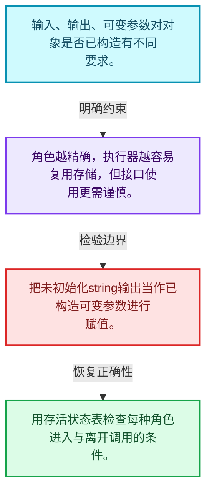
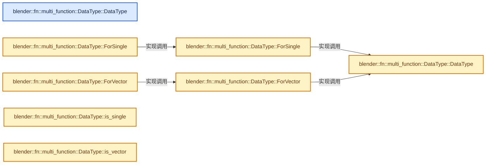
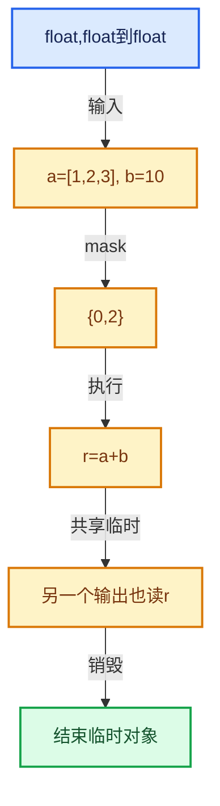

# 07-03 参数类型与角色

[方向导航](README.md) · [总目录](../README.md) · [实现索引](../%E7%AC%A6%E5%8F%B7%E4%BE%9D%E8%B5%96%E4%B8%8E%E5%AE%9E%E7%8E%B0%E7%B4%A2%E5%BC%95.md)

## 从问题到实现

输入、输出、可变参数有什么生命周期差异？

只读输入不负责输出构造，可变参数通常要求已有对象；参数角色影响销毁与复用。

**数据模型**

输入、输出、可变参数对对象是否已构造有不同要求。

**设计取舍**

角色越精确，执行器越容易复用存储，但接口使用更需谨慎。

**最小反例**

把未初始化string输出当作已构造可变参数进行赋值。

**推导**

用存活状态表检查每种角色进入与离开调用的条件。

## 阅读地图与执行推演








图中的数值推演是本方向的教学模型；实际函数之间的调用边与概念分析边分别标注，不能把概念关系当作运行时调度顺序。

## 完整源码单元与就地讲解

中文讲解直接放在相关代码旁，复杂机制在代码下展开。原文折叠区保留基准行号；不需要在行号表和函数之间来回查找。类布局可分段展示，函数实现不按固定行数切开。

### 类型布局、声明与编译条件 · FN_multi_function_data_type.hh L1—L32

<a id="t-67e56c0b1c2f"></a>

`DataType`在这里声明的数据成员：

- `Category category_`
- `CPPType type_`

<a id="t-9fb6c6106294"></a>

<!-- annotated:47aa517cc5a9ac -->

```cpp
/* SPDX-FileCopyrightText: 2023 Blender Authors
 *
 * SPDX-License-Identifier: GPL-2.0-or-later */

#pragma once

/** \file
 * \ingroup fn
 *
 * A DataType describes what type of data a multi-function gets as input, outputs or mutates.
 * Currently, only individual elements or vectors of elements are supported. Adding more data types
 * is possible when necessary.
 */

#include "BLI_cpp_type.hh"

namespace blender::fn::multi_function {

class DataType {
 public:
  enum Category {
    Single,
    Vector,
  };

 private:
  Category category_;
  const CPPType *type_;

  DataType(Category category, const CPPType &type);

 public:
```

<details>
<summary>核对原始源码：source/blender/functions/FN_multi_function_data_type.hh · L1—L32</summary>

<!-- original:47aa517cc5a9ac:source/blender/functions/FN_multi_function_data_type.hh:1:32 -->

```cpp
/* SPDX-FileCopyrightText: 2023 Blender Authors
 *
 * SPDX-License-Identifier: GPL-2.0-or-later */

#pragma once

/** \file
 * \ingroup fn
 *
 * A DataType describes what type of data a multi-function gets as input, outputs or mutates.
 * Currently, only individual elements or vectors of elements are supported. Adding more data types
 * is possible when necessary.
 */

#include "BLI_cpp_type.hh"

namespace blender::fn::multi_function {

class DataType {
 public:
  enum Category {
    Single,
    Vector,
  };

 private:
  Category category_;
  const CPPType *type_;

  DataType(Category category, const CPPType &type);

 public:
```

</details>

<a id="f-d5763a5c629a72c5"></a>

### `blender::fn::multi_function::DataType::DataType`

实现位置：[source/blender/functions/FN_multi_function_data_type.hh](../../../../../source/blender/functions/FN_multi_function_data_type.hh) · L33—L33。

**教学注释版**

<!-- annotated:65ecb8dc20d840 -->

```cpp
  DataType() = default;
```

<details>
<summary>核对原始源码：source/blender/functions/FN_multi_function_data_type.hh · L33—L33</summary>

<!-- original:65ecb8dc20d840:source/blender/functions/FN_multi_function_data_type.hh:33:33 -->

```cpp
  DataType() = default;
```

</details>

**继续追踪实现**

本实现没有需要继续展开的显式调用；检查返回表达式、对象转换和调用者前置条件。

### 类型布局、声明与编译条件 · FN_multi_function_data_type.hh L34—L59

<!-- annotated:06b0fa90134a9e -->

```cpp

  static DataType ForSingle(const CPPType &type);
  static DataType ForVector(const CPPType &type);

  template<typename T> static DataType ForSingle();
  template<typename T> static DataType ForVector();

  bool is_single() const;
  bool is_vector() const;

  Category category() const;

  const CPPType &single_type() const;
  const CPPType &vector_base_type() const;

  friend bool operator==(const DataType &a, const DataType &b) = default;

  std::string to_string() const;

  uint64_t hash() const;
};

/* -------------------------------------------------------------------- */
/** \name #DataType Inline Methods
 * \{ */

```

<details>
<summary>核对原始源码：source/blender/functions/FN_multi_function_data_type.hh · L34—L59</summary>

<!-- original:06b0fa90134a9e:source/blender/functions/FN_multi_function_data_type.hh:34:59 -->

```cpp

  static DataType ForSingle(const CPPType &type);
  static DataType ForVector(const CPPType &type);

  template<typename T> static DataType ForSingle();
  template<typename T> static DataType ForVector();

  bool is_single() const;
  bool is_vector() const;

  Category category() const;

  const CPPType &single_type() const;
  const CPPType &vector_base_type() const;

  friend bool operator==(const DataType &a, const DataType &b) = default;

  std::string to_string() const;

  uint64_t hash() const;
};

/* -------------------------------------------------------------------- */
/** \name #DataType Inline Methods
 * \{ */

```

</details>

<a id="f-cc5d3c7e322c6ac7"></a>

### `blender::fn::multi_function::DataType::DataType`

实现位置：[source/blender/functions/FN_multi_function_data_type.hh](../../../../../source/blender/functions/FN_multi_function_data_type.hh) · L60—L63。

接口参数：

- `Category category`
- `const CPPType &type`

**教学注释版**

<!-- annotated:2fe0f625470fc0 -->

```cpp
inline DataType::DataType(Category category, const CPPType &type)
    : category_(category), type_(&type)
{
}
```

<details>
<summary>核对原始源码：source/blender/functions/FN_multi_function_data_type.hh · L60—L63</summary>

<!-- original:2fe0f625470fc0:source/blender/functions/FN_multi_function_data_type.hh:60:63 -->

```cpp
inline DataType::DataType(Category category, const CPPType &type)
    : category_(category), type_(&type)
{
}
```

</details>

**继续追踪实现**

本实现没有需要继续展开的显式调用；检查返回表达式、对象转换和调用者前置条件。

<!-- annotated:85f8d53f387c7b -->

```cpp

```

<details>
<summary>核对原始源码：source/blender/functions/FN_multi_function_data_type.hh · L64—L64</summary>

<!-- original:85f8d53f387c7b:source/blender/functions/FN_multi_function_data_type.hh:64:64 -->

```cpp

```

</details>

<a id="f-e041e357ea765818"></a>

### `blender::fn::multi_function::DataType::ForSingle`

实现位置：[source/blender/functions/FN_multi_function_data_type.hh](../../../../../source/blender/functions/FN_multi_function_data_type.hh) · L65—L68。

接口参数：

- `const CPPType &type`

**教学注释版**

<!-- annotated:96784d3a035810 -->

```cpp
inline DataType DataType::ForSingle(const CPPType &type)
{
  return DataType(Single, type);
}
```

<details>
<summary>核对原始源码：source/blender/functions/FN_multi_function_data_type.hh · L65—L68</summary>

<!-- original:96784d3a035810:source/blender/functions/FN_multi_function_data_type.hh:65:68 -->

```cpp
inline DataType DataType::ForSingle(const CPPType &type)
{
  return DataType(Single, type);
}
```

</details>

**结果出口**

- `return DataType(Single, type);`

**继续追踪实现**

- `DataType` → [blender::fn::multi_function::DataType::DataType · L60](03-%E5%8F%82%E6%95%B0%E7%B1%BB%E5%9E%8B%E4%B8%8E%E8%A7%92%E8%89%B2.md#f-cc5d3c7e322c6ac7)。

<!-- annotated:0b4ec83afccec8 -->

```cpp

```

<details>
<summary>核对原始源码：source/blender/functions/FN_multi_function_data_type.hh · L69—L69</summary>

<!-- original:0b4ec83afccec8:source/blender/functions/FN_multi_function_data_type.hh:69:69 -->

```cpp

```

</details>

<a id="f-7df464f275adbd5f"></a>

### `blender::fn::multi_function::DataType::ForVector`

实现位置：[source/blender/functions/FN_multi_function_data_type.hh](../../../../../source/blender/functions/FN_multi_function_data_type.hh) · L70—L73。

接口参数：

- `const CPPType &type`

**教学注释版**

<!-- annotated:db8b7813c45310 -->

```cpp
inline DataType DataType::ForVector(const CPPType &type)
{
  return DataType(Vector, type);
}
```

<details>
<summary>核对原始源码：source/blender/functions/FN_multi_function_data_type.hh · L70—L73</summary>

<!-- original:db8b7813c45310:source/blender/functions/FN_multi_function_data_type.hh:70:73 -->

```cpp
inline DataType DataType::ForVector(const CPPType &type)
{
  return DataType(Vector, type);
}
```

</details>

**结果出口**

- `return DataType(Vector, type);`

**继续追踪实现**

- `DataType` → [blender::fn::multi_function::DataType::DataType · L60](03-%E5%8F%82%E6%95%B0%E7%B1%BB%E5%9E%8B%E4%B8%8E%E8%A7%92%E8%89%B2.md#f-cc5d3c7e322c6ac7)。

<!-- annotated:a062463c63b059 -->

```cpp

```

<details>
<summary>核对原始源码：source/blender/functions/FN_multi_function_data_type.hh · L74—L74</summary>

<!-- original:a062463c63b059:source/blender/functions/FN_multi_function_data_type.hh:74:74 -->

```cpp

```

</details>

<a id="f-ffb4bc870ea750f6"></a>

### `blender::fn::multi_function::DataType::ForSingle`

实现位置：[source/blender/functions/FN_multi_function_data_type.hh](../../../../../source/blender/functions/FN_multi_function_data_type.hh) · L75—L78。

**教学注释版**

<!-- annotated:a389779840906e -->

```cpp
template<typename T> inline DataType DataType::ForSingle()
{
  return DataType::ForSingle(CPPType::get<T>());
}
```

<details>
<summary>核对原始源码：source/blender/functions/FN_multi_function_data_type.hh · L75—L78</summary>

<!-- original:a389779840906e:source/blender/functions/FN_multi_function_data_type.hh:75:78 -->

```cpp
template<typename T> inline DataType DataType::ForSingle()
{
  return DataType::ForSingle(CPPType::get<T>());
}
```

</details>

**结果出口**

- `return DataType::ForSingle(CPPType::get<T>());`

**继续追踪实现**

- `DataType::ForSingle` → [blender::fn::multi_function::DataType::ForSingle · L65](03-%E5%8F%82%E6%95%B0%E7%B1%BB%E5%9E%8B%E4%B8%8E%E8%A7%92%E8%89%B2.md#f-e041e357ea765818)；[blender::fn::multi_function::DataType::ForSingle · L75](03-%E5%8F%82%E6%95%B0%E7%B1%BB%E5%9E%8B%E4%B8%8E%E8%A7%92%E8%89%B2.md#f-ffb4bc870ea750f6)。同名重载需按实参类型选择。
- `CPPType::get<T>` → [blender::CPPType::get · L481](../03-%E5%86%85%E5%AD%98%E5%88%86%E9%85%8D%E4%B8%8E%E8%BF%90%E8%A1%8C%E6%97%B6%E7%B1%BB%E5%9E%8B/08-CPPType%E6%9E%84%E9%80%A0%E4%B8%8E%E6%9E%90%E6%9E%84.md#f-0cc10a3783d6abdb)。

<!-- annotated:1d8c5c691edbdd -->

```cpp

```

<details>
<summary>核对原始源码：source/blender/functions/FN_multi_function_data_type.hh · L79—L79</summary>

<!-- original:1d8c5c691edbdd:source/blender/functions/FN_multi_function_data_type.hh:79:79 -->

```cpp

```

</details>

<a id="f-b8a84ac3287de49e"></a>

### `blender::fn::multi_function::DataType::ForVector`

实现位置：[source/blender/functions/FN_multi_function_data_type.hh](../../../../../source/blender/functions/FN_multi_function_data_type.hh) · L80—L83。

**教学注释版**

<!-- annotated:00148340400bfd -->

```cpp
template<typename T> inline DataType DataType::ForVector()
{
  return DataType::ForVector(CPPType::get<T>());
}
```

<details>
<summary>核对原始源码：source/blender/functions/FN_multi_function_data_type.hh · L80—L83</summary>

<!-- original:00148340400bfd:source/blender/functions/FN_multi_function_data_type.hh:80:83 -->

```cpp
template<typename T> inline DataType DataType::ForVector()
{
  return DataType::ForVector(CPPType::get<T>());
}
```

</details>

**结果出口**

- `return DataType::ForVector(CPPType::get<T>());`

**继续追踪实现**

- `DataType::ForVector` → [blender::fn::multi_function::DataType::ForVector · L70](03-%E5%8F%82%E6%95%B0%E7%B1%BB%E5%9E%8B%E4%B8%8E%E8%A7%92%E8%89%B2.md#f-7df464f275adbd5f)；[blender::fn::multi_function::DataType::ForVector · L80](03-%E5%8F%82%E6%95%B0%E7%B1%BB%E5%9E%8B%E4%B8%8E%E8%A7%92%E8%89%B2.md#f-b8a84ac3287de49e)。同名重载需按实参类型选择。
- `CPPType::get<T>` → [blender::CPPType::get · L481](../03-%E5%86%85%E5%AD%98%E5%88%86%E9%85%8D%E4%B8%8E%E8%BF%90%E8%A1%8C%E6%97%B6%E7%B1%BB%E5%9E%8B/08-CPPType%E6%9E%84%E9%80%A0%E4%B8%8E%E6%9E%90%E6%9E%84.md#f-0cc10a3783d6abdb)。

<!-- annotated:101eedfc886be6 -->

```cpp

```

<details>
<summary>核对原始源码：source/blender/functions/FN_multi_function_data_type.hh · L84—L84</summary>

<!-- original:101eedfc886be6:source/blender/functions/FN_multi_function_data_type.hh:84:84 -->

```cpp

```

</details>

<a id="f-10871d59c2ee7599"></a>

### `blender::fn::multi_function::DataType::is_single`

实现位置：[source/blender/functions/FN_multi_function_data_type.hh](../../../../../source/blender/functions/FN_multi_function_data_type.hh) · L85—L88。

**教学注释版**

<!-- annotated:b6b3187f6cdd04 -->

```cpp
inline bool DataType::is_single() const
{
  return category_ == Single;
}
```

<details>
<summary>核对原始源码：source/blender/functions/FN_multi_function_data_type.hh · L85—L88</summary>

<!-- original:b6b3187f6cdd04:source/blender/functions/FN_multi_function_data_type.hh:85:88 -->

```cpp
inline bool DataType::is_single() const
{
  return category_ == Single;
}
```

</details>

**结果出口**

- `return category_ == Single;`

**继续追踪实现**

本实现没有需要继续展开的显式调用；检查返回表达式、对象转换和调用者前置条件。

<!-- annotated:a694586071672c -->

```cpp

```

<details>
<summary>核对原始源码：source/blender/functions/FN_multi_function_data_type.hh · L89—L89</summary>

<!-- original:a694586071672c:source/blender/functions/FN_multi_function_data_type.hh:89:89 -->

```cpp

```

</details>

<a id="f-d2b339a97c1f6ee3"></a>

### `blender::fn::multi_function::DataType::is_vector`

实现位置：[source/blender/functions/FN_multi_function_data_type.hh](../../../../../source/blender/functions/FN_multi_function_data_type.hh) · L90—L93。

**教学注释版**

<!-- annotated:1676cdaf1dc4b2 -->

```cpp
inline bool DataType::is_vector() const
{
  return category_ == Vector;
}
```

<details>
<summary>核对原始源码：source/blender/functions/FN_multi_function_data_type.hh · L90—L93</summary>

<!-- original:1676cdaf1dc4b2:source/blender/functions/FN_multi_function_data_type.hh:90:93 -->

```cpp
inline bool DataType::is_vector() const
{
  return category_ == Vector;
}
```

</details>

**结果出口**

- `return category_ == Vector;`

**继续追踪实现**

本实现没有需要继续展开的显式调用；检查返回表达式、对象转换和调用者前置条件。

<!-- annotated:b61b0fe6dbd673 -->

```cpp

```

<details>
<summary>核对原始源码：source/blender/functions/FN_multi_function_data_type.hh · L94—L94</summary>

<!-- original:b61b0fe6dbd673:source/blender/functions/FN_multi_function_data_type.hh:94:94 -->

```cpp

```

</details>

<a id="f-c6df4fec62069575"></a>

### `blender::fn::multi_function::DataType::category`

实现位置：[source/blender/functions/FN_multi_function_data_type.hh](../../../../../source/blender/functions/FN_multi_function_data_type.hh) · L95—L98。

**教学注释版**

<!-- annotated:87e09087a714f3 -->

```cpp
inline DataType::Category DataType::category() const
{
  return category_;
}
```

<details>
<summary>核对原始源码：source/blender/functions/FN_multi_function_data_type.hh · L95—L98</summary>

<!-- original:87e09087a714f3:source/blender/functions/FN_multi_function_data_type.hh:95:98 -->

```cpp
inline DataType::Category DataType::category() const
{
  return category_;
}
```

</details>

**结果出口**

- `return category_;`

**继续追踪实现**

本实现没有需要继续展开的显式调用；检查返回表达式、对象转换和调用者前置条件。

<!-- annotated:b70e1af40722c7 -->

```cpp

```

<details>
<summary>核对原始源码：source/blender/functions/FN_multi_function_data_type.hh · L99—L99</summary>

<!-- original:b70e1af40722c7:source/blender/functions/FN_multi_function_data_type.hh:99:99 -->

```cpp

```

</details>

<a id="f-4c13c52b011327d7"></a>

### `blender::fn::multi_function::DataType::single_type`

实现位置：[source/blender/functions/FN_multi_function_data_type.hh](../../../../../source/blender/functions/FN_multi_function_data_type.hh) · L100—L104。

**教学注释版**

<!-- annotated:d2000bac8edf66 -->

```cpp
inline const CPPType &DataType::single_type() const
{
  BLI_assert(this->is_single());
  return *type_;
}
```

<details>
<summary>核对原始源码：source/blender/functions/FN_multi_function_data_type.hh · L100—L104</summary>

<!-- original:d2000bac8edf66:source/blender/functions/FN_multi_function_data_type.hh:100:104 -->

```cpp
inline const CPPType &DataType::single_type() const
{
  BLI_assert(this->is_single());
  return *type_;
}
```

</details>

**结果出口**

- `return *type_;`

**继续追踪实现**

- `BLI_assert` → [BLI_assert · L48](../01-%E5%9F%BA%E7%A1%80%E5%AE%B9%E5%99%A8%E4%B8%8E%E7%8E%B0%E4%BB%A3CPP/%E4%BE%9D%E8%B5%96-BLI_assert-cc98e8.md#m-57a88495704d)；[BLI_assert · L63](../01-%E5%9F%BA%E7%A1%80%E5%AE%B9%E5%99%A8%E4%B8%8E%E7%8E%B0%E4%BB%A3CPP/%E4%BE%9D%E8%B5%96-BLI_assert-cc98e8.md#m-d07050020cb5)。宏定义由构建条件选择。
- `this->is_single` → [blender::fn::multi_function::DataType::is_single · L85](03-%E5%8F%82%E6%95%B0%E7%B1%BB%E5%9E%8B%E4%B8%8E%E8%A7%92%E8%89%B2.md#f-10871d59c2ee7599)。

<!-- annotated:7d1593b25d039c -->

```cpp

```

<details>
<summary>核对原始源码：source/blender/functions/FN_multi_function_data_type.hh · L105—L105</summary>

<!-- original:7d1593b25d039c:source/blender/functions/FN_multi_function_data_type.hh:105:105 -->

```cpp

```

</details>

<a id="f-0e9453ed801fd6c6"></a>

### `blender::fn::multi_function::DataType::vector_base_type`

实现位置：[source/blender/functions/FN_multi_function_data_type.hh](../../../../../source/blender/functions/FN_multi_function_data_type.hh) · L106—L110。

**教学注释版**

<!-- annotated:f4aad3f17d54eb -->

```cpp
inline const CPPType &DataType::vector_base_type() const
{
  BLI_assert(this->is_vector());
  return *type_;
}
```

<details>
<summary>核对原始源码：source/blender/functions/FN_multi_function_data_type.hh · L106—L110</summary>

<!-- original:f4aad3f17d54eb:source/blender/functions/FN_multi_function_data_type.hh:106:110 -->

```cpp
inline const CPPType &DataType::vector_base_type() const
{
  BLI_assert(this->is_vector());
  return *type_;
}
```

</details>

**结果出口**

- `return *type_;`

**继续追踪实现**

- `BLI_assert` → [BLI_assert · L48](../01-%E5%9F%BA%E7%A1%80%E5%AE%B9%E5%99%A8%E4%B8%8E%E7%8E%B0%E4%BB%A3CPP/%E4%BE%9D%E8%B5%96-BLI_assert-cc98e8.md#m-57a88495704d)；[BLI_assert · L63](../01-%E5%9F%BA%E7%A1%80%E5%AE%B9%E5%99%A8%E4%B8%8E%E7%8E%B0%E4%BB%A3CPP/%E4%BE%9D%E8%B5%96-BLI_assert-cc98e8.md#m-d07050020cb5)。宏定义由构建条件选择。
- `this->is_vector` → [blender::fn::multi_function::DataType::is_vector · L90](03-%E5%8F%82%E6%95%B0%E7%B1%BB%E5%9E%8B%E4%B8%8E%E8%A7%92%E8%89%B2.md#f-d2b339a97c1f6ee3)。

<!-- annotated:78b60c997bb432 -->

```cpp

```

<details>
<summary>核对原始源码：source/blender/functions/FN_multi_function_data_type.hh · L111—L111</summary>

<!-- original:78b60c997bb432:source/blender/functions/FN_multi_function_data_type.hh:111:111 -->

```cpp

```

</details>

<a id="f-13bde1d61ff998f1"></a>

### `blender::fn::multi_function::DataType::to_string`

实现位置：[source/blender/functions/FN_multi_function_data_type.hh](../../../../../source/blender/functions/FN_multi_function_data_type.hh) · L112—L122。

**教学注释版**

<!-- annotated:aadb6a87241b0d -->

```cpp
inline std::string DataType::to_string() const
{
  switch (category_) {
    case Single:
      return type_->name();
    case Vector:
      return type_->name() + " Vector";
  }
  BLI_assert(false);
  return "";
}
```

<details>
<summary>核对原始源码：source/blender/functions/FN_multi_function_data_type.hh · L112—L122</summary>

<!-- original:aadb6a87241b0d:source/blender/functions/FN_multi_function_data_type.hh:112:122 -->

```cpp
inline std::string DataType::to_string() const
{
  switch (category_) {
    case Single:
      return type_->name();
    case Vector:
      return type_->name() + " Vector";
  }
  BLI_assert(false);
  return "";
}
```

</details>

**结果出口**

- `return type_->name();`
- `return type_->name() + " Vector";`
- `return "";`

**继续追踪实现**

- `type_->name` → [blender::CPPType::name · L497](../03-%E5%86%85%E5%AD%98%E5%88%86%E9%85%8D%E4%B8%8E%E8%BF%90%E8%A1%8C%E6%97%B6%E7%B1%BB%E5%9E%8B/08-CPPType%E6%9E%84%E9%80%A0%E4%B8%8E%E6%9E%90%E6%9E%84.md#f-e5ab6239f7e97c8e)。
- `BLI_assert` → [BLI_assert · L48](../01-%E5%9F%BA%E7%A1%80%E5%AE%B9%E5%99%A8%E4%B8%8E%E7%8E%B0%E4%BB%A3CPP/%E4%BE%9D%E8%B5%96-BLI_assert-cc98e8.md#m-57a88495704d)；[BLI_assert · L63](../01-%E5%9F%BA%E7%A1%80%E5%AE%B9%E5%99%A8%E4%B8%8E%E7%8E%B0%E4%BB%A3CPP/%E4%BE%9D%E8%B5%96-BLI_assert-cc98e8.md#m-d07050020cb5)。宏定义由构建条件选择。

<!-- annotated:ec84bcb34c7a3c -->

```cpp

```

<details>
<summary>核对原始源码：source/blender/functions/FN_multi_function_data_type.hh · L123—L123</summary>

<!-- original:ec84bcb34c7a3c:source/blender/functions/FN_multi_function_data_type.hh:123:123 -->

```cpp

```

</details>

<a id="f-4b3860e1453dd89c"></a>

### `blender::fn::multi_function::DataType::hash`

实现位置：[source/blender/functions/FN_multi_function_data_type.hh](../../../../../source/blender/functions/FN_multi_function_data_type.hh) · L124—L127。

**教学注释版**

<!-- annotated:1173d9b3dadde9 -->

```cpp
inline uint64_t DataType::hash() const
{
  return get_default_hash(*type_, category_);
}
```

<details>
<summary>核对原始源码：source/blender/functions/FN_multi_function_data_type.hh · L124—L127</summary>

<!-- original:1173d9b3dadde9:source/blender/functions/FN_multi_function_data_type.hh:124:127 -->

```cpp
inline uint64_t DataType::hash() const
{
  return get_default_hash(*type_, category_);
}
```

</details>

**结果出口**

- `return get_default_hash(*type_, category_);`

**继续追踪实现**

- `get_default_hash` → [blender::get_default_hash · L251](../02-%E5%93%88%E5%B8%8C%E8%A1%A8%E4%B8%8E%E5%85%B3%E8%81%94%E6%95%B0%E6%8D%AE%E7%BB%93%E6%9E%84/01-%E5%93%88%E5%B8%8C%E4%B8%8E%E7%9B%B8%E7%AD%89%E5%A5%91%E7%BA%A6.md#f-5f2c246aedf3dc0a)。

### 类型布局、声明与编译条件 · FN_multi_function_data_type.hh L128—L131

<!-- annotated:0d22c19c47e7e1 -->

```cpp

/** \} */

}  // namespace blender::fn::multi_function
```

<details>
<summary>核对原始源码：source/blender/functions/FN_multi_function_data_type.hh · L128—L131</summary>

<!-- original:0d22c19c47e7e1:source/blender/functions/FN_multi_function_data_type.hh:128:131 -->

```cpp

/** \} */

}  // namespace blender::fn::multi_function
```

</details>

### 类型布局、声明与编译条件 · FN_multi_function_param_type.hh L1—L77

<a id="t-d19791e99fe1"></a>

<a id="t-2a73fc630424"></a>

`ParamTag`在这里声明的数据成员：

- `ParamCategory category`

<a id="t-d303b323bd27"></a>

`ParamType`在这里声明的数据成员：

- `InterfaceType interface_type_`
- `DataType data_type_`
- `ParamType ForSingleInput`
- `ParamType ForVectorInput`
- `ParamType ForSingleOutput`
- `ParamType ForVectorOutput`
- `ParamType ForMutableSingle`
- `ParamType ForMutableVector`
- `DataType data_type`
- `InterfaceType interface_type`
- `ParamCategory category`
- `bool is_input_or_mutable`
- `bool is_output_or_mutable`
- `bool is_output`

<a id="t-88e6ae9bc145"></a>

<!-- annotated:7379b6f6b4f0f9 -->

```cpp
/* SPDX-FileCopyrightText: 2023 Blender Authors
 *
 * SPDX-License-Identifier: GPL-2.0-or-later */

#pragma once

/** \file
 * \ingroup fn
 *
 * A multi-function has an arbitrary amount of parameters. Every parameter belongs to one of three
 * interface types:
 * - Input: An input parameter is readonly inside the function. The values have to be provided by
 *     the caller.
 * - Output: An output parameter has to be initialized by the function. However, the caller
 *     provides the memory where the data has to be constructed.
 * - Mutable: A mutable parameter can be considered to be an input and output. The caller has to
 *     initialize the data, but the function is allowed to modify it.
 *
 * Furthermore, every parameter has a DataType that describes what kind of data is being passed
 * around.
 */

#include "FN_multi_function_data_type.hh"

namespace blender::fn::multi_function {

enum class ParamCategory {
  SingleInput,
  VectorInput,
  SingleOutput,
  VectorOutput,
  SingleMutable,
  VectorMutable,
};

template<ParamCategory Category, typename T> struct ParamTag {
  static constexpr ParamCategory category = Category;
  using base_type = T;
};

class ParamType {
 public:
  enum InterfaceType {
    Input,
    Output,
    Mutable,
  };

 private:
  InterfaceType interface_type_;
  DataType data_type_;

 public:
  ParamType(InterfaceType interface_type, DataType data_type);

  static ParamType ForSingleInput(const CPPType &type);
  static ParamType ForVectorInput(const CPPType &base_type);
  static ParamType ForSingleOutput(const CPPType &type);
  static ParamType ForVectorOutput(const CPPType &base_type);
  static ParamType ForMutableSingle(const CPPType &type);
  static ParamType ForMutableVector(const CPPType &base_type);

  const DataType &data_type() const;
  InterfaceType interface_type() const;
  ParamCategory category() const;

  bool is_input_or_mutable() const;
  bool is_output_or_mutable() const;
  bool is_output() const;

  friend bool operator==(const ParamType &a, const ParamType &b) = default;
};

/* -------------------------------------------------------------------- */
/** \name #ParamType Inline Methods
 * \{ */

```

<details>
<summary>核对原始源码：source/blender/functions/FN_multi_function_param_type.hh · L1—L77</summary>

<!-- original:7379b6f6b4f0f9:source/blender/functions/FN_multi_function_param_type.hh:1:77 -->

```cpp
/* SPDX-FileCopyrightText: 2023 Blender Authors
 *
 * SPDX-License-Identifier: GPL-2.0-or-later */

#pragma once

/** \file
 * \ingroup fn
 *
 * A multi-function has an arbitrary amount of parameters. Every parameter belongs to one of three
 * interface types:
 * - Input: An input parameter is readonly inside the function. The values have to be provided by
 *     the caller.
 * - Output: An output parameter has to be initialized by the function. However, the caller
 *     provides the memory where the data has to be constructed.
 * - Mutable: A mutable parameter can be considered to be an input and output. The caller has to
 *     initialize the data, but the function is allowed to modify it.
 *
 * Furthermore, every parameter has a DataType that describes what kind of data is being passed
 * around.
 */

#include "FN_multi_function_data_type.hh"

namespace blender::fn::multi_function {

enum class ParamCategory {
  SingleInput,
  VectorInput,
  SingleOutput,
  VectorOutput,
  SingleMutable,
  VectorMutable,
};

template<ParamCategory Category, typename T> struct ParamTag {
  static constexpr ParamCategory category = Category;
  using base_type = T;
};

class ParamType {
 public:
  enum InterfaceType {
    Input,
    Output,
    Mutable,
  };

 private:
  InterfaceType interface_type_;
  DataType data_type_;

 public:
  ParamType(InterfaceType interface_type, DataType data_type);

  static ParamType ForSingleInput(const CPPType &type);
  static ParamType ForVectorInput(const CPPType &base_type);
  static ParamType ForSingleOutput(const CPPType &type);
  static ParamType ForVectorOutput(const CPPType &base_type);
  static ParamType ForMutableSingle(const CPPType &type);
  static ParamType ForMutableVector(const CPPType &base_type);

  const DataType &data_type() const;
  InterfaceType interface_type() const;
  ParamCategory category() const;

  bool is_input_or_mutable() const;
  bool is_output_or_mutable() const;
  bool is_output() const;

  friend bool operator==(const ParamType &a, const ParamType &b) = default;
};

/* -------------------------------------------------------------------- */
/** \name #ParamType Inline Methods
 * \{ */

```

</details>

<a id="f-0e2fe2ba44d205ba"></a>

### `blender::fn::multi_function::ParamType::ParamType`

实现位置：[source/blender/functions/FN_multi_function_param_type.hh](../../../../../source/blender/functions/FN_multi_function_param_type.hh) · L78—L81。

接口参数：

- `InterfaceType interface_type`
- `DataType data_type`

**教学注释版**

<!-- annotated:3c735c91821e67 -->

```cpp
inline ParamType::ParamType(InterfaceType interface_type, DataType data_type)
    : interface_type_(interface_type), data_type_(data_type)
{
}
```

<details>
<summary>核对原始源码：source/blender/functions/FN_multi_function_param_type.hh · L78—L81</summary>

<!-- original:3c735c91821e67:source/blender/functions/FN_multi_function_param_type.hh:78:81 -->

```cpp
inline ParamType::ParamType(InterfaceType interface_type, DataType data_type)
    : interface_type_(interface_type), data_type_(data_type)
{
}
```

</details>

**继续追踪实现**

本实现没有需要继续展开的显式调用；检查返回表达式、对象转换和调用者前置条件。

<!-- annotated:05ece45fdbd3d5 -->

```cpp

```

<details>
<summary>核对原始源码：source/blender/functions/FN_multi_function_param_type.hh · L82—L82</summary>

<!-- original:05ece45fdbd3d5:source/blender/functions/FN_multi_function_param_type.hh:82:82 -->

```cpp

```

</details>

<a id="f-86d08054eca0c13f"></a>

### `blender::fn::multi_function::ParamType::ForSingleInput`

实现位置：[source/blender/functions/FN_multi_function_param_type.hh](../../../../../source/blender/functions/FN_multi_function_param_type.hh) · L83—L86。

接口参数：

- `const CPPType &type`

**教学注释版**

<!-- annotated:7ceb1558749a8a -->

```cpp
inline ParamType ParamType::ForSingleInput(const CPPType &type)
{
  return ParamType(InterfaceType::Input, DataType::ForSingle(type));
}
```

<details>
<summary>核对原始源码：source/blender/functions/FN_multi_function_param_type.hh · L83—L86</summary>

<!-- original:7ceb1558749a8a:source/blender/functions/FN_multi_function_param_type.hh:83:86 -->

```cpp
inline ParamType ParamType::ForSingleInput(const CPPType &type)
{
  return ParamType(InterfaceType::Input, DataType::ForSingle(type));
}
```

</details>

**结果出口**

- `return ParamType(InterfaceType::Input, DataType::ForSingle(type));`

**继续追踪实现**

- `ParamType` → [blender::fn::multi_function::ParamType::ParamType · L78](03-%E5%8F%82%E6%95%B0%E7%B1%BB%E5%9E%8B%E4%B8%8E%E8%A7%92%E8%89%B2.md#f-0e2fe2ba44d205ba)。
- `DataType::ForSingle` → [blender::fn::multi_function::DataType::ForSingle · L65](03-%E5%8F%82%E6%95%B0%E7%B1%BB%E5%9E%8B%E4%B8%8E%E8%A7%92%E8%89%B2.md#f-e041e357ea765818)；[blender::fn::multi_function::DataType::ForSingle · L75](03-%E5%8F%82%E6%95%B0%E7%B1%BB%E5%9E%8B%E4%B8%8E%E8%A7%92%E8%89%B2.md#f-ffb4bc870ea750f6)。同名重载需按实参类型选择。

<!-- annotated:889430563b94fd -->

```cpp

```

<details>
<summary>核对原始源码：source/blender/functions/FN_multi_function_param_type.hh · L87—L87</summary>

<!-- original:889430563b94fd:source/blender/functions/FN_multi_function_param_type.hh:87:87 -->

```cpp

```

</details>

<a id="f-0b53610f33acaf7b"></a>

### `blender::fn::multi_function::ParamType::ForVectorInput`

实现位置：[source/blender/functions/FN_multi_function_param_type.hh](../../../../../source/blender/functions/FN_multi_function_param_type.hh) · L88—L91。

接口参数：

- `const CPPType &base_type`

**教学注释版**

<!-- annotated:94d01889000e7c -->

```cpp
inline ParamType ParamType::ForVectorInput(const CPPType &base_type)
{
  return ParamType(InterfaceType::Input, DataType::ForVector(base_type));
}
```

<details>
<summary>核对原始源码：source/blender/functions/FN_multi_function_param_type.hh · L88—L91</summary>

<!-- original:94d01889000e7c:source/blender/functions/FN_multi_function_param_type.hh:88:91 -->

```cpp
inline ParamType ParamType::ForVectorInput(const CPPType &base_type)
{
  return ParamType(InterfaceType::Input, DataType::ForVector(base_type));
}
```

</details>

**结果出口**

- `return ParamType(InterfaceType::Input, DataType::ForVector(base_type));`

**继续追踪实现**

- `ParamType` → [blender::fn::multi_function::ParamType::ParamType · L78](03-%E5%8F%82%E6%95%B0%E7%B1%BB%E5%9E%8B%E4%B8%8E%E8%A7%92%E8%89%B2.md#f-0e2fe2ba44d205ba)。
- `DataType::ForVector` → [blender::fn::multi_function::DataType::ForVector · L70](03-%E5%8F%82%E6%95%B0%E7%B1%BB%E5%9E%8B%E4%B8%8E%E8%A7%92%E8%89%B2.md#f-7df464f275adbd5f)；[blender::fn::multi_function::DataType::ForVector · L80](03-%E5%8F%82%E6%95%B0%E7%B1%BB%E5%9E%8B%E4%B8%8E%E8%A7%92%E8%89%B2.md#f-b8a84ac3287de49e)。同名重载需按实参类型选择。

<!-- annotated:f71986237bde2e -->

```cpp

```

<details>
<summary>核对原始源码：source/blender/functions/FN_multi_function_param_type.hh · L92—L92</summary>

<!-- original:f71986237bde2e:source/blender/functions/FN_multi_function_param_type.hh:92:92 -->

```cpp

```

</details>

<a id="f-c50381a225332e4f"></a>

### `blender::fn::multi_function::ParamType::ForSingleOutput`

实现位置：[source/blender/functions/FN_multi_function_param_type.hh](../../../../../source/blender/functions/FN_multi_function_param_type.hh) · L93—L96。

接口参数：

- `const CPPType &type`

**教学注释版**

<!-- annotated:a36a642529b18b -->

```cpp
inline ParamType ParamType::ForSingleOutput(const CPPType &type)
{
  return ParamType(InterfaceType::Output, DataType::ForSingle(type));
}
```

<details>
<summary>核对原始源码：source/blender/functions/FN_multi_function_param_type.hh · L93—L96</summary>

<!-- original:a36a642529b18b:source/blender/functions/FN_multi_function_param_type.hh:93:96 -->

```cpp
inline ParamType ParamType::ForSingleOutput(const CPPType &type)
{
  return ParamType(InterfaceType::Output, DataType::ForSingle(type));
}
```

</details>

**结果出口**

- `return ParamType(InterfaceType::Output, DataType::ForSingle(type));`

**继续追踪实现**

- `ParamType` → [blender::fn::multi_function::ParamType::ParamType · L78](03-%E5%8F%82%E6%95%B0%E7%B1%BB%E5%9E%8B%E4%B8%8E%E8%A7%92%E8%89%B2.md#f-0e2fe2ba44d205ba)。
- `DataType::ForSingle` → [blender::fn::multi_function::DataType::ForSingle · L65](03-%E5%8F%82%E6%95%B0%E7%B1%BB%E5%9E%8B%E4%B8%8E%E8%A7%92%E8%89%B2.md#f-e041e357ea765818)；[blender::fn::multi_function::DataType::ForSingle · L75](03-%E5%8F%82%E6%95%B0%E7%B1%BB%E5%9E%8B%E4%B8%8E%E8%A7%92%E8%89%B2.md#f-ffb4bc870ea750f6)。同名重载需按实参类型选择。

<!-- annotated:9f21c1c3518978 -->

```cpp

```

<details>
<summary>核对原始源码：source/blender/functions/FN_multi_function_param_type.hh · L97—L97</summary>

<!-- original:9f21c1c3518978:source/blender/functions/FN_multi_function_param_type.hh:97:97 -->

```cpp

```

</details>

<a id="f-7cfaa12248cda9cf"></a>

### `blender::fn::multi_function::ParamType::ForVectorOutput`

实现位置：[source/blender/functions/FN_multi_function_param_type.hh](../../../../../source/blender/functions/FN_multi_function_param_type.hh) · L98—L101。

接口参数：

- `const CPPType &base_type`

**教学注释版**

<!-- annotated:d9c9c16f42a228 -->

```cpp
inline ParamType ParamType::ForVectorOutput(const CPPType &base_type)
{
  return ParamType(InterfaceType::Output, DataType::ForVector(base_type));
}
```

<details>
<summary>核对原始源码：source/blender/functions/FN_multi_function_param_type.hh · L98—L101</summary>

<!-- original:d9c9c16f42a228:source/blender/functions/FN_multi_function_param_type.hh:98:101 -->

```cpp
inline ParamType ParamType::ForVectorOutput(const CPPType &base_type)
{
  return ParamType(InterfaceType::Output, DataType::ForVector(base_type));
}
```

</details>

**结果出口**

- `return ParamType(InterfaceType::Output, DataType::ForVector(base_type));`

**继续追踪实现**

- `ParamType` → [blender::fn::multi_function::ParamType::ParamType · L78](03-%E5%8F%82%E6%95%B0%E7%B1%BB%E5%9E%8B%E4%B8%8E%E8%A7%92%E8%89%B2.md#f-0e2fe2ba44d205ba)。
- `DataType::ForVector` → [blender::fn::multi_function::DataType::ForVector · L70](03-%E5%8F%82%E6%95%B0%E7%B1%BB%E5%9E%8B%E4%B8%8E%E8%A7%92%E8%89%B2.md#f-7df464f275adbd5f)；[blender::fn::multi_function::DataType::ForVector · L80](03-%E5%8F%82%E6%95%B0%E7%B1%BB%E5%9E%8B%E4%B8%8E%E8%A7%92%E8%89%B2.md#f-b8a84ac3287de49e)。同名重载需按实参类型选择。

<!-- annotated:c73d9dcf3bc66d -->

```cpp

```

<details>
<summary>核对原始源码：source/blender/functions/FN_multi_function_param_type.hh · L102—L102</summary>

<!-- original:c73d9dcf3bc66d:source/blender/functions/FN_multi_function_param_type.hh:102:102 -->

```cpp

```

</details>

<a id="f-93ebc0161bf4482c"></a>

### `blender::fn::multi_function::ParamType::ForMutableSingle`

实现位置：[source/blender/functions/FN_multi_function_param_type.hh](../../../../../source/blender/functions/FN_multi_function_param_type.hh) · L103—L106。

接口参数：

- `const CPPType &type`

**教学注释版**

<!-- annotated:1d75eb0b495fbb -->

```cpp
inline ParamType ParamType::ForMutableSingle(const CPPType &type)
{
  return ParamType(InterfaceType::Mutable, DataType::ForSingle(type));
}
```

<details>
<summary>核对原始源码：source/blender/functions/FN_multi_function_param_type.hh · L103—L106</summary>

<!-- original:1d75eb0b495fbb:source/blender/functions/FN_multi_function_param_type.hh:103:106 -->

```cpp
inline ParamType ParamType::ForMutableSingle(const CPPType &type)
{
  return ParamType(InterfaceType::Mutable, DataType::ForSingle(type));
}
```

</details>

**结果出口**

- `return ParamType(InterfaceType::Mutable, DataType::ForSingle(type));`

**继续追踪实现**

- `ParamType` → [blender::fn::multi_function::ParamType::ParamType · L78](03-%E5%8F%82%E6%95%B0%E7%B1%BB%E5%9E%8B%E4%B8%8E%E8%A7%92%E8%89%B2.md#f-0e2fe2ba44d205ba)。
- `DataType::ForSingle` → [blender::fn::multi_function::DataType::ForSingle · L65](03-%E5%8F%82%E6%95%B0%E7%B1%BB%E5%9E%8B%E4%B8%8E%E8%A7%92%E8%89%B2.md#f-e041e357ea765818)；[blender::fn::multi_function::DataType::ForSingle · L75](03-%E5%8F%82%E6%95%B0%E7%B1%BB%E5%9E%8B%E4%B8%8E%E8%A7%92%E8%89%B2.md#f-ffb4bc870ea750f6)。同名重载需按实参类型选择。

<!-- annotated:66eeb860116fec -->

```cpp

```

<details>
<summary>核对原始源码：source/blender/functions/FN_multi_function_param_type.hh · L107—L107</summary>

<!-- original:66eeb860116fec:source/blender/functions/FN_multi_function_param_type.hh:107:107 -->

```cpp

```

</details>

<a id="f-9f99bed6d0240d8d"></a>

### `blender::fn::multi_function::ParamType::ForMutableVector`

实现位置：[source/blender/functions/FN_multi_function_param_type.hh](../../../../../source/blender/functions/FN_multi_function_param_type.hh) · L108—L111。

接口参数：

- `const CPPType &base_type`

**教学注释版**

<!-- annotated:2745092d693f8e -->

```cpp
inline ParamType ParamType::ForMutableVector(const CPPType &base_type)
{
  return ParamType(InterfaceType::Mutable, DataType::ForVector(base_type));
}
```

<details>
<summary>核对原始源码：source/blender/functions/FN_multi_function_param_type.hh · L108—L111</summary>

<!-- original:2745092d693f8e:source/blender/functions/FN_multi_function_param_type.hh:108:111 -->

```cpp
inline ParamType ParamType::ForMutableVector(const CPPType &base_type)
{
  return ParamType(InterfaceType::Mutable, DataType::ForVector(base_type));
}
```

</details>

**结果出口**

- `return ParamType(InterfaceType::Mutable, DataType::ForVector(base_type));`

**继续追踪实现**

- `ParamType` → [blender::fn::multi_function::ParamType::ParamType · L78](03-%E5%8F%82%E6%95%B0%E7%B1%BB%E5%9E%8B%E4%B8%8E%E8%A7%92%E8%89%B2.md#f-0e2fe2ba44d205ba)。
- `DataType::ForVector` → [blender::fn::multi_function::DataType::ForVector · L70](03-%E5%8F%82%E6%95%B0%E7%B1%BB%E5%9E%8B%E4%B8%8E%E8%A7%92%E8%89%B2.md#f-7df464f275adbd5f)；[blender::fn::multi_function::DataType::ForVector · L80](03-%E5%8F%82%E6%95%B0%E7%B1%BB%E5%9E%8B%E4%B8%8E%E8%A7%92%E8%89%B2.md#f-b8a84ac3287de49e)。同名重载需按实参类型选择。

<!-- annotated:9883f0485a1589 -->

```cpp

```

<details>
<summary>核对原始源码：source/blender/functions/FN_multi_function_param_type.hh · L112—L112</summary>

<!-- original:9883f0485a1589:source/blender/functions/FN_multi_function_param_type.hh:112:112 -->

```cpp

```

</details>

<a id="f-b29743877463338d"></a>

### `blender::fn::multi_function::ParamType::data_type`

实现位置：[source/blender/functions/FN_multi_function_param_type.hh](../../../../../source/blender/functions/FN_multi_function_param_type.hh) · L113—L116。

**教学注释版**

<!-- annotated:2992e6e51b2374 -->

```cpp
inline const DataType &ParamType::data_type() const
{
  return data_type_;
}
```

<details>
<summary>核对原始源码：source/blender/functions/FN_multi_function_param_type.hh · L113—L116</summary>

<!-- original:2992e6e51b2374:source/blender/functions/FN_multi_function_param_type.hh:113:116 -->

```cpp
inline const DataType &ParamType::data_type() const
{
  return data_type_;
}
```

</details>

**结果出口**

- `return data_type_;`

**继续追踪实现**

本实现没有需要继续展开的显式调用；检查返回表达式、对象转换和调用者前置条件。

<!-- annotated:b64c1247f39995 -->

```cpp

```

<details>
<summary>核对原始源码：source/blender/functions/FN_multi_function_param_type.hh · L117—L117</summary>

<!-- original:b64c1247f39995:source/blender/functions/FN_multi_function_param_type.hh:117:117 -->

```cpp

```

</details>

<a id="f-a506dc82cef792f5"></a>

### `blender::fn::multi_function::ParamType::interface_type`

实现位置：[source/blender/functions/FN_multi_function_param_type.hh](../../../../../source/blender/functions/FN_multi_function_param_type.hh) · L118—L121。

**教学注释版**

<!-- annotated:3d4cb10f485308 -->

```cpp
inline ParamType::InterfaceType ParamType::interface_type() const
{
  return interface_type_;
}
```

<details>
<summary>核对原始源码：source/blender/functions/FN_multi_function_param_type.hh · L118—L121</summary>

<!-- original:3d4cb10f485308:source/blender/functions/FN_multi_function_param_type.hh:118:121 -->

```cpp
inline ParamType::InterfaceType ParamType::interface_type() const
{
  return interface_type_;
}
```

</details>

**结果出口**

- `return interface_type_;`

**继续追踪实现**

本实现没有需要继续展开的显式调用；检查返回表达式、对象转换和调用者前置条件。

<!-- annotated:92d9ee45e4752b -->

```cpp

```

<details>
<summary>核对原始源码：source/blender/functions/FN_multi_function_param_type.hh · L122—L122</summary>

<!-- original:92d9ee45e4752b:source/blender/functions/FN_multi_function_param_type.hh:122:122 -->

```cpp

```

</details>

<a id="f-3b4b7b7786763245"></a>

### `blender::fn::multi_function::ParamType::category`

实现位置：[source/blender/functions/FN_multi_function_param_type.hh](../../../../../source/blender/functions/FN_multi_function_param_type.hh) · L123—L151。

**教学注释版**

<!-- annotated:41331f6656b6bb -->

```cpp
inline ParamCategory ParamType::category() const
{
  switch (data_type_.category()) {
    case DataType::Single: {
      switch (interface_type_) {
        case Input:
          return ParamCategory::SingleInput;
        case Output:
          return ParamCategory::SingleOutput;
        case Mutable:
          return ParamCategory::SingleMutable;
      }
      break;
    }
    case DataType::Vector: {
      switch (interface_type_) {
        case Input:
          return ParamCategory::VectorInput;
        case Output:
          return ParamCategory::VectorOutput;
        case Mutable:
          return ParamCategory::VectorMutable;
      }
      break;
    }
  }
  BLI_assert_unreachable();
  return ParamCategory::SingleInput;
}
```

<details>
<summary>核对原始源码：source/blender/functions/FN_multi_function_param_type.hh · L123—L151</summary>

<!-- original:41331f6656b6bb:source/blender/functions/FN_multi_function_param_type.hh:123:151 -->

```cpp
inline ParamCategory ParamType::category() const
{
  switch (data_type_.category()) {
    case DataType::Single: {
      switch (interface_type_) {
        case Input:
          return ParamCategory::SingleInput;
        case Output:
          return ParamCategory::SingleOutput;
        case Mutable:
          return ParamCategory::SingleMutable;
      }
      break;
    }
    case DataType::Vector: {
      switch (interface_type_) {
        case Input:
          return ParamCategory::VectorInput;
        case Output:
          return ParamCategory::VectorOutput;
        case Mutable:
          return ParamCategory::VectorMutable;
      }
      break;
    }
  }
  BLI_assert_unreachable();
  return ParamCategory::SingleInput;
}
```

</details>

**结果出口**

- `return ParamCategory::SingleInput;`
- `return ParamCategory::SingleOutput;`
- `return ParamCategory::SingleMutable;`
- `return ParamCategory::VectorInput;`
- `return ParamCategory::VectorOutput;`
- `return ParamCategory::VectorMutable;`

**继续追踪实现**

- `data_type_.category` → [blender::fn::multi_function::DataType::category · L95](03-%E5%8F%82%E6%95%B0%E7%B1%BB%E5%9E%8B%E4%B8%8E%E8%A7%92%E8%89%B2.md#f-c6df4fec62069575)。
- `BLI_assert_unreachable` → [BLI_assert_unreachable · L77](../01-%E5%9F%BA%E7%A1%80%E5%AE%B9%E5%99%A8%E4%B8%8E%E7%8E%B0%E4%BB%A3CPP/%E4%BE%9D%E8%B5%96-BLI_assert-cc98e8.md#m-7a2d91a67d8e)。宏定义由构建条件选择。

<!-- annotated:f9f977aa4dd77f -->

```cpp

```

<details>
<summary>核对原始源码：source/blender/functions/FN_multi_function_param_type.hh · L152—L152</summary>

<!-- original:f9f977aa4dd77f:source/blender/functions/FN_multi_function_param_type.hh:152:152 -->

```cpp

```

</details>

<a id="f-9a468c97ebe9901f"></a>

### `blender::fn::multi_function::ParamType::is_input_or_mutable`

实现位置：[source/blender/functions/FN_multi_function_param_type.hh](../../../../../source/blender/functions/FN_multi_function_param_type.hh) · L153—L156。

**教学注释版**

<!-- annotated:dc05e88bc9b556 -->

```cpp
inline bool ParamType::is_input_or_mutable() const
{
  return ELEM(interface_type_, Input, Mutable);
}
```

<details>
<summary>核对原始源码：source/blender/functions/FN_multi_function_param_type.hh · L153—L156</summary>

<!-- original:dc05e88bc9b556:source/blender/functions/FN_multi_function_param_type.hh:153:156 -->

```cpp
inline bool ParamType::is_input_or_mutable() const
{
  return ELEM(interface_type_, Input, Mutable);
}
```

</details>

**结果出口**

- `return ELEM(interface_type_, Input, Mutable);`

**继续追踪实现**

- `ELEM` → [ELEM · L88](../05-%E5%87%A0%E4%BD%95%E5%AD%98%E5%82%A8%E4%B8%8E%E6%8B%93%E6%89%91%E6%98%A0%E5%B0%84/%E4%BE%9D%E8%B5%96-GHOST_utildefines-34b996.md#m-d28724a15928)；[ELEM · L135](../01-%E5%9F%BA%E7%A1%80%E5%AE%B9%E5%99%A8%E4%B8%8E%E7%8E%B0%E4%BB%A3CPP/%E4%BE%9D%E8%B5%96-BLI_utildefines-293a0a.md#m-d6572de7cae0)。宏定义由构建条件选择。

<!-- annotated:a61a668c92fc9d -->

```cpp

```

<details>
<summary>核对原始源码：source/blender/functions/FN_multi_function_param_type.hh · L157—L157</summary>

<!-- original:a61a668c92fc9d:source/blender/functions/FN_multi_function_param_type.hh:157:157 -->

```cpp

```

</details>

<a id="f-4e2eec52f51fcf70"></a>

### `blender::fn::multi_function::ParamType::is_output_or_mutable`

实现位置：[source/blender/functions/FN_multi_function_param_type.hh](../../../../../source/blender/functions/FN_multi_function_param_type.hh) · L158—L161。

**教学注释版**

<!-- annotated:60b023a551c1a0 -->

```cpp
inline bool ParamType::is_output_or_mutable() const
{
  return ELEM(interface_type_, Output, Mutable);
}
```

<details>
<summary>核对原始源码：source/blender/functions/FN_multi_function_param_type.hh · L158—L161</summary>

<!-- original:60b023a551c1a0:source/blender/functions/FN_multi_function_param_type.hh:158:161 -->

```cpp
inline bool ParamType::is_output_or_mutable() const
{
  return ELEM(interface_type_, Output, Mutable);
}
```

</details>

**结果出口**

- `return ELEM(interface_type_, Output, Mutable);`

**继续追踪实现**

- `ELEM` → [ELEM · L88](../05-%E5%87%A0%E4%BD%95%E5%AD%98%E5%82%A8%E4%B8%8E%E6%8B%93%E6%89%91%E6%98%A0%E5%B0%84/%E4%BE%9D%E8%B5%96-GHOST_utildefines-34b996.md#m-d28724a15928)；[ELEM · L135](../01-%E5%9F%BA%E7%A1%80%E5%AE%B9%E5%99%A8%E4%B8%8E%E7%8E%B0%E4%BB%A3CPP/%E4%BE%9D%E8%B5%96-BLI_utildefines-293a0a.md#m-d6572de7cae0)。宏定义由构建条件选择。

<!-- annotated:2009516e949712 -->

```cpp

```

<details>
<summary>核对原始源码：source/blender/functions/FN_multi_function_param_type.hh · L162—L162</summary>

<!-- original:2009516e949712:source/blender/functions/FN_multi_function_param_type.hh:162:162 -->

```cpp

```

</details>

<a id="f-fd8eda039a304162"></a>

### `blender::fn::multi_function::ParamType::is_output`

实现位置：[source/blender/functions/FN_multi_function_param_type.hh](../../../../../source/blender/functions/FN_multi_function_param_type.hh) · L163—L166。

**教学注释版**

<!-- annotated:79d9186b99b6ad -->

```cpp
inline bool ParamType::is_output() const
{
  return interface_type_ == Output;
}
```

<details>
<summary>核对原始源码：source/blender/functions/FN_multi_function_param_type.hh · L163—L166</summary>

<!-- original:79d9186b99b6ad:source/blender/functions/FN_multi_function_param_type.hh:163:166 -->

```cpp
inline bool ParamType::is_output() const
{
  return interface_type_ == Output;
}
```

</details>

**结果出口**

- `return interface_type_ == Output;`

**继续追踪实现**

本实现没有需要继续展开的显式调用；检查返回表达式、对象转换和调用者前置条件。

### 类型布局、声明与编译条件 · FN_multi_function_param_type.hh L167—L170

<!-- annotated:837509be720a13 -->

```cpp

/** \} */

}  // namespace blender::fn::multi_function
```

<details>
<summary>核对原始源码：source/blender/functions/FN_multi_function_param_type.hh · L167—L170</summary>

<!-- original:837509be720a13:source/blender/functions/FN_multi_function_param_type.hh:167:170 -->

```cpp

/** \} */

}  // namespace blender::fn::multi_function
```

</details>

## 语法与相关类型

### 模板 template

模板把类型或常量作为生成实现的参数。读声明时先列出类型参数、非类型参数和默认值，再看使用者实际实例化了什么。模板声明本身不意味着每种T都支持其全部成员。

把T替换为int、string、只能移动的类型，分别检查每个被调用操作是否成立。

### 依赖名称 typename

typename既可引入类型模板参数，也可告诉编译器某个依赖名称是类型。它不创建运行时对象；解析期确认语法类别与实例化期检查具体类型是不同阶段。

区分typename T::value_type和T::size()，前者标记类型，后者是表达式。

### 常量求值 constexpr

constexpr声明允许相应实体参与常量求值，但constexpr函数仍可以在运行时执行。是否常量求值由调用场景和表达式合法性共同决定。

比较constexpr变量初始化和从运行时输入调用同一函数。

### 只读限定 const

const约束当前访问路径可做的修改。const指针、指向const的指针、const视图对象、const元素是不同位置的限定；其他别名可能仍可修改原对象。

分别写T* const、const T*与const T* const，并画出不可修改的层次。

### 内部断言 assert

断言表达开发者预期成立的内部契约，发布构建可能关闭。它不能替代对不可信输入的完整错误处理，也不保证后续操作被运行时保护。

对每条断言构造违反条件的输入，区分调用者错误与应向用户报告的错误。

### 受控访问 friend

friend授予指定函数或类访问非公开成员的权限，并不意味着继承，也不自动扩展到友元的派生类。

解释执行器为何需要访问包装器的内部映射，同时检查边界是否仍清楚。

### 类型别名 using

类型别名为已有类型建立名字，不创建运行期对象。它常把模板内部使用的类型统一暴露给泛型调用者。

展开别名直到基础类型，区分类型别名和变量声明。

### 枚举与状态模型 enum

枚举把有限状态命名；enum class避免许多隐式整数转换。状态机正确性还依赖允许的转移，不能只看有哪些枚举项。

列出每个状态的进入条件和离开条件，检查终止状态是否仍可能被调度。

## 实现练习与验证

列出string输入、输出和可变参数分别要求的存活状态。

参考推理：用存活状态表检查每种角色进入与离开调用的条件。

签名与参数类型一致；指令读取前变量已定义；存储复用发生在最后使用和析构之后。

## 历史、跨库比较与证据

与std::function逐次调用和简单字节码解释器比较：批量接口可把动态分派放到循环外，Procedure额外表达变量寿命和控制流。

[历史提交索引](../%E5%8E%86%E5%8F%B2%E6%8F%90%E4%BA%A4%E4%B8%8E%E8%AE%BE%E8%AE%A1%E6%BC%94%E5%8C%96%E7%B4%A2%E5%BC%95.md) · [源码基准](../%E6%BA%90%E7%A0%81%E7%89%88%E6%9C%AC%E4%B8%8E%E8%A6%86%E7%9B%96%E7%B4%A2%E5%BC%95.md) · [验收报告](../%E9%AA%8C%E6%94%B6%E6%8A%A5%E5%91%8A.md)
