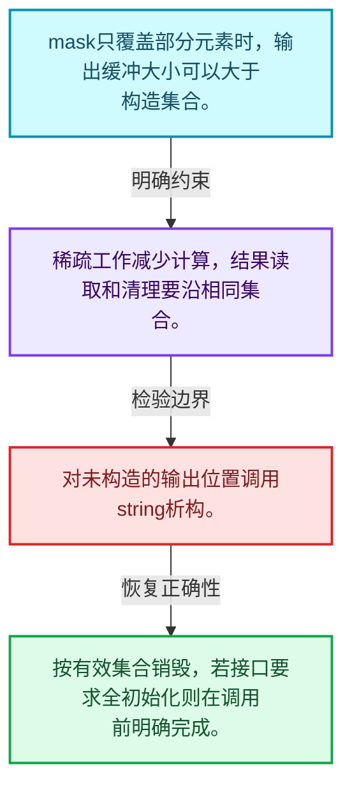
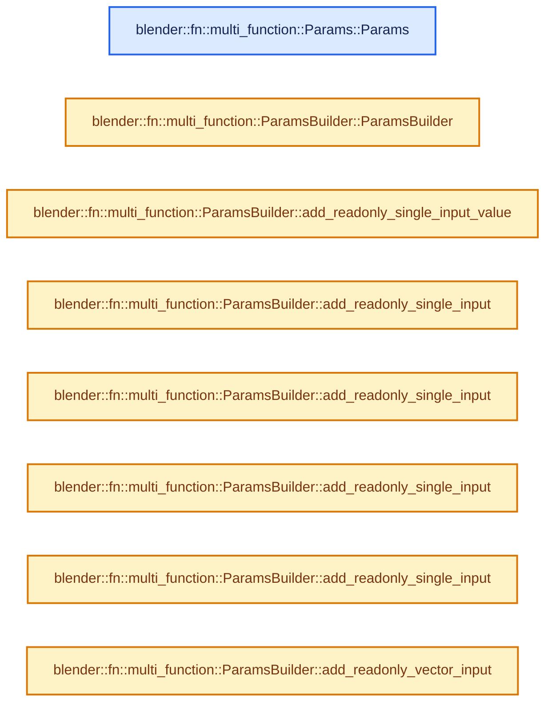
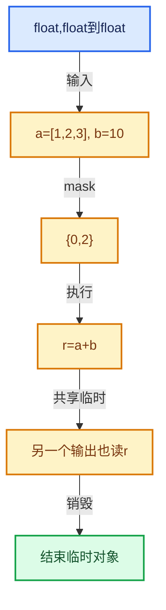

# 07-04 参数访问与输出构造

[方向导航](README.md) · [总目录](../README.md) · [实现索引](../%E7%AC%A6%E5%8F%B7%E4%BE%9D%E8%B5%96%E4%B8%8E%E5%AE%9E%E7%8E%B0%E7%B4%A2%E5%BC%95.md)

## 从问题到实现

输出存储准备好是否意味着元素已构造？

参数访问器连接签名与缓冲区；只构造mask覆盖元素时须准确记录有效位置。

**数据模型**

mask只覆盖部分元素时，输出缓冲大小可以大于构造集合。

**设计取舍**

稀疏工作减少计算，结果读取和清理要沿相同集合。

**最小反例**

对未构造的输出位置调用string析构。

**推导**

按有效集合销毁，若接口要求全初始化则在调用前明确完成。

## 阅读地图与执行推演








图中的数值推演是本方向的教学模型；实际函数之间的调用边与概念分析边分别标注，不能把概念关系当作运行时调度顺序。

## 完整源码单元与就地讲解

中文讲解直接放在相关代码旁，复杂机制在代码下展开。原文折叠区保留基准行号；不需要在行号表和函数之间来回查找。类布局可分段展示，函数实现不按固定行数切开。

### 类型布局、声明与编译条件 · FN_multi_function_params.hh L1—L89

<a id="t-0921548d09f3"></a>

`ParamsBuilder`在这里声明的数据成员：

- `std::unique_ptr<ResourceScope> scope_`
- `Signature signature_`
- `IndexMask mask_`
- `int64_t min_array_size_`
- `Vector<std::variant<GVArray, GMutableSpan, const GVVectorArray *, GVectorArray *>> actual_params_`
- `void add_readonly_single_input`
- `void add_readonly_single_input`
- `void add_readonly_single_input`
- `void add_readonly_vector_input`
- `void add_readonly_vector_input`
- `void add_readonly_vector_input`
- `void add_uninitialized_single_output`
- `void add_ignored_single_output`
- `void add_vector_output`
- `void add_single_mutable`
- `void add_vector_mutable`
- `int next_param_index`
- `GMutableSpan computed_array`
- `GVectorArray computed_vector_array`
- `void assert_current_param_type`
- `void assert_current_param_name`
- `ResourceScope resource_scope`
- `void add_unused_output_for_unsupporting_function`

<a id="t-1bb4433ac23b"></a>

<a id="t-6b7223e23dea"></a>

`Params`在这里声明的数据成员：

- `ParamsBuilder builder_`

<!-- annotated:175a96e064cca1 -->

```cpp
/* SPDX-FileCopyrightText: 2023 Blender Authors
 *
 * SPDX-License-Identifier: GPL-2.0-or-later */

#pragma once

/** \file
 * \ingroup fn
 *
 * This file provides an Params and ParamsBuilder structure.
 *
 * `ParamsBuilder` is used by a function caller to be prepare all parameters that are passed into
 * the function. `Params` is then used inside the called function to access the parameters.
 */

#include <variant>

#include "BLI_generic_pointer.hh"
#include "BLI_generic_vector_array.hh"
#include "BLI_generic_virtual_vector_array.hh"
#include "BLI_resource_scope.hh"

#include "FN_multi_function_signature.hh"

namespace blender::fn::multi_function {

class ParamsBuilder {
 private:
  std::unique_ptr<ResourceScope> scope_;
  const Signature *signature_;
  const IndexMask &mask_;
  int64_t min_array_size_;
  Vector<std::variant<GVArray, GMutableSpan, const GVVectorArray *, GVectorArray *>>
      actual_params_;

  friend class Params;

  ParamsBuilder(const Signature &signature, const IndexMask &mask);

 public:
  /**
   * The indices referenced by the #mask has to live longer than the params builder. This is
   * because the it might have to destruct elements for all masked indices in the end.
   */
  ParamsBuilder(const class MultiFunction &fn, const IndexMask *mask);

  template<typename T> void add_readonly_single_input_value(T value, StringRef expected_name = "");
  template<typename T>
  void add_readonly_single_input(const T *value, StringRef expected_name = "");
  void add_readonly_single_input(const GSpan span, StringRef expected_name = "");
  void add_readonly_single_input(GPointer value, StringRef expected_name = "");
  void add_readonly_single_input(GVArray varray, StringRef expected_name = "");

  void add_readonly_vector_input(const GVectorArray &vector_array, StringRef expected_name = "");
  void add_readonly_vector_input(const GSpan single_vector, StringRef expected_name = "");
  void add_readonly_vector_input(const GVVectorArray &ref, StringRef expected_name = "");

  template<typename T>
  void add_uninitialized_single_output(T *value, StringRef expected_name = "");
  void add_uninitialized_single_output(GMutableSpan ref, StringRef expected_name = "");

  void add_ignored_single_output(StringRef expected_name = "");

  void add_vector_output(GVectorArray &vector_array, StringRef expected_name = "");

  void add_single_mutable(GMutableSpan ref, StringRef expected_name = "");

  void add_vector_mutable(GVectorArray &vector_array, StringRef expected_name = "");

  int next_param_index() const;

  GMutableSpan computed_array(int param_index);

  GVectorArray &computed_vector_array(int param_index);

 private:
  void assert_current_param_type(ParamType param_type, StringRef expected_name = "");
  void assert_current_param_name(StringRef expected_name);

  ResourceScope &resource_scope();

  void add_unused_output_for_unsupporting_function(const CPPType &type);
};

class Params {
 private:
  ParamsBuilder *builder_;

 public:
```

<details>
<summary>核对原始源码：source/blender/functions/FN_multi_function_params.hh · L1—L89</summary>

<!-- original:175a96e064cca1:source/blender/functions/FN_multi_function_params.hh:1:89 -->

```cpp
/* SPDX-FileCopyrightText: 2023 Blender Authors
 *
 * SPDX-License-Identifier: GPL-2.0-or-later */

#pragma once

/** \file
 * \ingroup fn
 *
 * This file provides an Params and ParamsBuilder structure.
 *
 * `ParamsBuilder` is used by a function caller to be prepare all parameters that are passed into
 * the function. `Params` is then used inside the called function to access the parameters.
 */

#include <variant>

#include "BLI_generic_pointer.hh"
#include "BLI_generic_vector_array.hh"
#include "BLI_generic_virtual_vector_array.hh"
#include "BLI_resource_scope.hh"

#include "FN_multi_function_signature.hh"

namespace blender::fn::multi_function {

class ParamsBuilder {
 private:
  std::unique_ptr<ResourceScope> scope_;
  const Signature *signature_;
  const IndexMask &mask_;
  int64_t min_array_size_;
  Vector<std::variant<GVArray, GMutableSpan, const GVVectorArray *, GVectorArray *>>
      actual_params_;

  friend class Params;

  ParamsBuilder(const Signature &signature, const IndexMask &mask);

 public:
  /**
   * The indices referenced by the #mask has to live longer than the params builder. This is
   * because the it might have to destruct elements for all masked indices in the end.
   */
  ParamsBuilder(const class MultiFunction &fn, const IndexMask *mask);

  template<typename T> void add_readonly_single_input_value(T value, StringRef expected_name = "");
  template<typename T>
  void add_readonly_single_input(const T *value, StringRef expected_name = "");
  void add_readonly_single_input(const GSpan span, StringRef expected_name = "");
  void add_readonly_single_input(GPointer value, StringRef expected_name = "");
  void add_readonly_single_input(GVArray varray, StringRef expected_name = "");

  void add_readonly_vector_input(const GVectorArray &vector_array, StringRef expected_name = "");
  void add_readonly_vector_input(const GSpan single_vector, StringRef expected_name = "");
  void add_readonly_vector_input(const GVVectorArray &ref, StringRef expected_name = "");

  template<typename T>
  void add_uninitialized_single_output(T *value, StringRef expected_name = "");
  void add_uninitialized_single_output(GMutableSpan ref, StringRef expected_name = "");

  void add_ignored_single_output(StringRef expected_name = "");

  void add_vector_output(GVectorArray &vector_array, StringRef expected_name = "");

  void add_single_mutable(GMutableSpan ref, StringRef expected_name = "");

  void add_vector_mutable(GVectorArray &vector_array, StringRef expected_name = "");

  int next_param_index() const;

  GMutableSpan computed_array(int param_index);

  GVectorArray &computed_vector_array(int param_index);

 private:
  void assert_current_param_type(ParamType param_type, StringRef expected_name = "");
  void assert_current_param_name(StringRef expected_name);

  ResourceScope &resource_scope();

  void add_unused_output_for_unsupporting_function(const CPPType &type);
};

class Params {
 private:
  ParamsBuilder *builder_;

 public:
```

</details>

<a id="f-937c9b1a376d7518"></a>

### `blender::fn::multi_function::Params::Params`

实现位置：[source/blender/functions/FN_multi_function_params.hh](../../../../../source/blender/functions/FN_multi_function_params.hh) · L90—L90。

接口参数：

- `ParamsBuilder &builder`

**教学注释版**

<!-- annotated:a467728bcade6d -->

```cpp
  Params(ParamsBuilder &builder) : builder_(&builder) {}
```

<details>
<summary>核对原始源码：source/blender/functions/FN_multi_function_params.hh · L90—L90</summary>

<!-- original:a467728bcade6d:source/blender/functions/FN_multi_function_params.hh:90:90 -->

```cpp
  Params(ParamsBuilder &builder) : builder_(&builder) {}
```

</details>

**继续追踪实现**

本实现没有需要继续展开的显式调用；检查返回表达式、对象转换和调用者前置条件。

### 类型布局、声明与编译条件 · FN_multi_function_params.hh L91—L138

<!-- annotated:6099c17bacc43a -->

```cpp

  template<typename T> VArray<T> readonly_single_input(int param_index, StringRef name = "");
  const GVArray &readonly_single_input(int param_index, StringRef name = "");

  /**
   * \return True when the caller provided a buffer for this output parameter. This allows the
   * called multi-function to skip some computation. It is still valid to call
   * #uninitialized_single_output when this returns false. In this case a new temporary buffer is
   * allocated.
   */
  bool single_output_is_required(int param_index, StringRef name = "");

  template<typename T>
  MutableSpan<T> uninitialized_single_output(int param_index, StringRef name = "");
  GMutableSpan uninitialized_single_output(int param_index, StringRef name = "");

  /**
   * Same as #uninitialized_single_output, but returns an empty span when the output is not
   * required.
   */
  template<typename T>
  MutableSpan<T> uninitialized_single_output_if_required(int param_index, StringRef name = "");
  GMutableSpan uninitialized_single_output_if_required(int param_index, StringRef name = "");

  template<typename T>
  const VVectorArray<T> &readonly_vector_input(int param_index, StringRef name = "");
  const GVVectorArray &readonly_vector_input(int param_index, StringRef name = "");

  template<typename T>
  GVectorArray_TypedMutableRef<T> vector_output(int param_index, StringRef name = "");
  GVectorArray &vector_output(int param_index, StringRef name = "");

  template<typename T> MutableSpan<T> single_mutable(int param_index, StringRef name = "");
  GMutableSpan single_mutable(int param_index, StringRef name = "");

  template<typename T>
  GVectorArray_TypedMutableRef<T> vector_mutable(int param_index, StringRef name = "");
  GVectorArray &vector_mutable(int param_index, StringRef name = "");

 private:
  void assert_correct_param(int param_index, StringRef name, ParamType param_type);
  void assert_correct_param(int param_index, StringRef name, ParamCategory category);
};

/* -------------------------------------------------------------------- */
/** \name #Paramsbuilder Inline Methods
 * \{ */

```

<details>
<summary>核对原始源码：source/blender/functions/FN_multi_function_params.hh · L91—L138</summary>

<!-- original:6099c17bacc43a:source/blender/functions/FN_multi_function_params.hh:91:138 -->

```cpp

  template<typename T> VArray<T> readonly_single_input(int param_index, StringRef name = "");
  const GVArray &readonly_single_input(int param_index, StringRef name = "");

  /**
   * \return True when the caller provided a buffer for this output parameter. This allows the
   * called multi-function to skip some computation. It is still valid to call
   * #uninitialized_single_output when this returns false. In this case a new temporary buffer is
   * allocated.
   */
  bool single_output_is_required(int param_index, StringRef name = "");

  template<typename T>
  MutableSpan<T> uninitialized_single_output(int param_index, StringRef name = "");
  GMutableSpan uninitialized_single_output(int param_index, StringRef name = "");

  /**
   * Same as #uninitialized_single_output, but returns an empty span when the output is not
   * required.
   */
  template<typename T>
  MutableSpan<T> uninitialized_single_output_if_required(int param_index, StringRef name = "");
  GMutableSpan uninitialized_single_output_if_required(int param_index, StringRef name = "");

  template<typename T>
  const VVectorArray<T> &readonly_vector_input(int param_index, StringRef name = "");
  const GVVectorArray &readonly_vector_input(int param_index, StringRef name = "");

  template<typename T>
  GVectorArray_TypedMutableRef<T> vector_output(int param_index, StringRef name = "");
  GVectorArray &vector_output(int param_index, StringRef name = "");

  template<typename T> MutableSpan<T> single_mutable(int param_index, StringRef name = "");
  GMutableSpan single_mutable(int param_index, StringRef name = "");

  template<typename T>
  GVectorArray_TypedMutableRef<T> vector_mutable(int param_index, StringRef name = "");
  GVectorArray &vector_mutable(int param_index, StringRef name = "");

 private:
  void assert_correct_param(int param_index, StringRef name, ParamType param_type);
  void assert_correct_param(int param_index, StringRef name, ParamCategory category);
};

/* -------------------------------------------------------------------- */
/** \name #Paramsbuilder Inline Methods
 * \{ */

```

</details>

<a id="f-034dbf5173420e67"></a>

### `blender::fn::multi_function::ParamsBuilder::ParamsBuilder`

实现位置：[source/blender/functions/FN_multi_function_params.hh](../../../../../source/blender/functions/FN_multi_function_params.hh) · L139—L143。

接口参数：

- `const Signature &signature`
- `const IndexMask &mask`

**教学注释版**

<!-- annotated:8452a2888fa057 -->

```cpp
inline ParamsBuilder::ParamsBuilder(const Signature &signature, const IndexMask &mask)
    : signature_(&signature), mask_(mask), min_array_size_(mask.min_array_size())
{
  // [讲解] actual_params_.reserve：确保可容纳至少min_capacity个元素；当前size和已有元素值不因容量请求本身而增加。
  actual_params_.reserve(signature.params.size());
}
```

<details>
<summary>核对原始源码：source/blender/functions/FN_multi_function_params.hh · L139—L143</summary>

<!-- original:8452a2888fa057:source/blender/functions/FN_multi_function_params.hh:139:143 -->

```cpp
inline ParamsBuilder::ParamsBuilder(const Signature &signature, const IndexMask &mask)
    : signature_(&signature), mask_(mask), min_array_size_(mask.min_array_size())
{
  actual_params_.reserve(signature.params.size());
}
```

</details>

**继续追踪实现**

- `actual_params_.reserve` → [blender::Vector::reserve · L405](../01-%E5%9F%BA%E7%A1%80%E5%AE%B9%E5%99%A8%E4%B8%8E%E7%8E%B0%E4%BB%A3CPP/10-Vector%E6%89%A9%E5%AE%B9%E4%B8%8E%E5%A2%9E%E9%95%BF.md#f-4cf9c0f00e01102e)。
- `signature.params.size` → [调用协议](../%E6%A8%A1%E6%9D%BF%E5%AE%8F%E4%B8%8E%E5%8A%A8%E6%80%81%E5%88%86%E6%B4%BE%E5%8D%8F%E8%AE%AE.md)：接收对象类型依赖auto、返回值或模板实例；不按同名猜测目标。调用位置L142。

<!-- annotated:1b1c393a4fdca1 -->

```cpp

```

<details>
<summary>核对原始源码：source/blender/functions/FN_multi_function_params.hh · L144—L144</summary>

<!-- original:1b1c393a4fdca1:source/blender/functions/FN_multi_function_params.hh:144:144 -->

```cpp

```

</details>

<a id="f-5c21804f16393871"></a>

### `blender::fn::multi_function::ParamsBuilder::add_readonly_single_input_value`

实现位置：[source/blender/functions/FN_multi_function_params.hh](../../../../../source/blender/functions/FN_multi_function_params.hh) · L145—L154。

接口参数：

- `T value`
- `StringRef expected_name`

**教学注释版**

<!-- annotated:80546847f46933 -->

```cpp
template<typename T>
inline void ParamsBuilder::add_readonly_single_input_value(T value, StringRef expected_name)
{
  this->assert_current_param_type(ParamType::ForSingleInput(CPPType::get<T>()), expected_name);
  actual_params_.append_unchecked_as(std::in_place_type<GVArray>,
                                     varray_tag::single{},
                                     CPPType::get<T>(),
                                     min_array_size_,
                                     &value);
}
```

<details>
<summary>核对原始源码：source/blender/functions/FN_multi_function_params.hh · L145—L154</summary>

<!-- original:80546847f46933:source/blender/functions/FN_multi_function_params.hh:145:154 -->

```cpp
template<typename T>
inline void ParamsBuilder::add_readonly_single_input_value(T value, StringRef expected_name)
{
  this->assert_current_param_type(ParamType::ForSingleInput(CPPType::get<T>()), expected_name);
  actual_params_.append_unchecked_as(std::in_place_type<GVArray>,
                                     varray_tag::single{},
                                     CPPType::get<T>(),
                                     min_array_size_,
                                     &value);
}
```

</details>

**继续追踪实现**

- `this->assert_current_param_type` → [blender::fn::multi_function::ParamsBuilder::assert_current_param_type · L290](04-%E5%8F%82%E6%95%B0%E8%AE%BF%E9%97%AE%E4%B8%8E%E8%BE%93%E5%87%BA%E6%9E%84%E9%80%A0.md#f-7c3e2932f035e39d)。
- `ParamType::ForSingleInput` → [blender::fn::multi_function::ParamType::ForSingleInput · L83](03-%E5%8F%82%E6%95%B0%E7%B1%BB%E5%9E%8B%E4%B8%8E%E8%A7%92%E8%89%B2.md#f-86d08054eca0c13f)。
- `CPPType::get<T>` → [blender::CPPType::get · L481](../03-%E5%86%85%E5%AD%98%E5%88%86%E9%85%8D%E4%B8%8E%E8%BF%90%E8%A1%8C%E6%97%B6%E7%B1%BB%E5%9E%8B/08-CPPType%E6%9E%84%E9%80%A0%E4%B8%8E%E6%9E%90%E6%9E%84.md#f-0cc10a3783d6abdb)。
- `actual_params_.append_unchecked_as` → [blender::Vector::append_unchecked_as · L557](../01-%E5%9F%BA%E7%A1%80%E5%AE%B9%E5%99%A8%E4%B8%8E%E7%8E%B0%E4%BB%A3CPP/11-Vector%E6%8F%92%E5%85%A5%E5%88%A0%E9%99%A4%E4%B8%8E%E9%87%8D%E6%8E%92.md#f-f0d43149aa607529)。

<!-- annotated:9e9545ff3b27db -->

```cpp

```

<details>
<summary>核对原始源码：source/blender/functions/FN_multi_function_params.hh · L155—L155</summary>

<!-- original:9e9545ff3b27db:source/blender/functions/FN_multi_function_params.hh:155:155 -->

```cpp

```

</details>

<a id="f-5ef65d99e991c3f8"></a>

### `blender::fn::multi_function::ParamsBuilder::add_readonly_single_input`

实现位置：[source/blender/functions/FN_multi_function_params.hh](../../../../../source/blender/functions/FN_multi_function_params.hh) · L156—L165。

接口参数：

- `const T *value`
- `StringRef expected_name`

**教学注释版**

<!-- annotated:e489306abcdb6e -->

```cpp
template<typename T>
inline void ParamsBuilder::add_readonly_single_input(const T *value, StringRef expected_name)
{
  this->assert_current_param_type(ParamType::ForSingleInput(CPPType::get<T>()), expected_name);
  actual_params_.append_unchecked_as(std::in_place_type<GVArray>,
                                     varray_tag::single_ref{},
                                     CPPType::get<T>(),
                                     min_array_size_,
                                     value);
}
```

<details>
<summary>核对原始源码：source/blender/functions/FN_multi_function_params.hh · L156—L165</summary>

<!-- original:e489306abcdb6e:source/blender/functions/FN_multi_function_params.hh:156:165 -->

```cpp
template<typename T>
inline void ParamsBuilder::add_readonly_single_input(const T *value, StringRef expected_name)
{
  this->assert_current_param_type(ParamType::ForSingleInput(CPPType::get<T>()), expected_name);
  actual_params_.append_unchecked_as(std::in_place_type<GVArray>,
                                     varray_tag::single_ref{},
                                     CPPType::get<T>(),
                                     min_array_size_,
                                     value);
}
```

</details>

**继续追踪实现**

- `this->assert_current_param_type` → [blender::fn::multi_function::ParamsBuilder::assert_current_param_type · L290](04-%E5%8F%82%E6%95%B0%E8%AE%BF%E9%97%AE%E4%B8%8E%E8%BE%93%E5%87%BA%E6%9E%84%E9%80%A0.md#f-7c3e2932f035e39d)。
- `ParamType::ForSingleInput` → [blender::fn::multi_function::ParamType::ForSingleInput · L83](03-%E5%8F%82%E6%95%B0%E7%B1%BB%E5%9E%8B%E4%B8%8E%E8%A7%92%E8%89%B2.md#f-86d08054eca0c13f)。
- `CPPType::get<T>` → [blender::CPPType::get · L481](../03-%E5%86%85%E5%AD%98%E5%88%86%E9%85%8D%E4%B8%8E%E8%BF%90%E8%A1%8C%E6%97%B6%E7%B1%BB%E5%9E%8B/08-CPPType%E6%9E%84%E9%80%A0%E4%B8%8E%E6%9E%90%E6%9E%84.md#f-0cc10a3783d6abdb)。
- `actual_params_.append_unchecked_as` → [blender::Vector::append_unchecked_as · L557](../01-%E5%9F%BA%E7%A1%80%E5%AE%B9%E5%99%A8%E4%B8%8E%E7%8E%B0%E4%BB%A3CPP/11-Vector%E6%8F%92%E5%85%A5%E5%88%A0%E9%99%A4%E4%B8%8E%E9%87%8D%E6%8E%92.md#f-f0d43149aa607529)。

<!-- annotated:68a97ce24c6bb8 -->

```cpp

```

<details>
<summary>核对原始源码：source/blender/functions/FN_multi_function_params.hh · L166—L166</summary>

<!-- original:68a97ce24c6bb8:source/blender/functions/FN_multi_function_params.hh:166:166 -->

```cpp

```

</details>

<a id="f-39d85bcf8f1eb606"></a>

### `blender::fn::multi_function::ParamsBuilder::add_readonly_single_input`

实现位置：[source/blender/functions/FN_multi_function_params.hh](../../../../../source/blender/functions/FN_multi_function_params.hh) · L167—L172。

接口参数：

- `const GSpan span`
- `StringRef expected_name`

**教学注释版**

<!-- annotated:90dd316fab8b52 -->

```cpp
inline void ParamsBuilder::add_readonly_single_input(const GSpan span, StringRef expected_name)
{
  this->assert_current_param_type(ParamType::ForSingleInput(span.type()), expected_name);
  BLI_assert(span.size() >= min_array_size_);
  actual_params_.append_unchecked_as(std::in_place_type<GVArray>, varray_tag::span{}, span);
}
```

<details>
<summary>核对原始源码：source/blender/functions/FN_multi_function_params.hh · L167—L172</summary>

<!-- original:90dd316fab8b52:source/blender/functions/FN_multi_function_params.hh:167:172 -->

```cpp
inline void ParamsBuilder::add_readonly_single_input(const GSpan span, StringRef expected_name)
{
  this->assert_current_param_type(ParamType::ForSingleInput(span.type()), expected_name);
  BLI_assert(span.size() >= min_array_size_);
  actual_params_.append_unchecked_as(std::in_place_type<GVArray>, varray_tag::span{}, span);
}
```

</details>

**继续追踪实现**

- `this->assert_current_param_type` → [blender::fn::multi_function::ParamsBuilder::assert_current_param_type · L290](04-%E5%8F%82%E6%95%B0%E8%AE%BF%E9%97%AE%E4%B8%8E%E8%BE%93%E5%87%BA%E6%9E%84%E9%80%A0.md#f-7c3e2932f035e39d)。
- `ParamType::ForSingleInput` → [blender::fn::multi_function::ParamType::ForSingleInput · L83](03-%E5%8F%82%E6%95%B0%E7%B1%BB%E5%9E%8B%E4%B8%8E%E8%A7%92%E8%89%B2.md#f-86d08054eca0c13f)。
- `span.type` → [blender::GSpan::type · L55](../03-%E5%86%85%E5%AD%98%E5%88%86%E9%85%8D%E4%B8%8E%E8%BF%90%E8%A1%8C%E6%97%B6%E7%B1%BB%E5%9E%8B/11-GSpan%E4%B8%8EGArray.md#f-4c44cc0364dcf191)。
- `BLI_assert` → [BLI_assert · L48](../01-%E5%9F%BA%E7%A1%80%E5%AE%B9%E5%99%A8%E4%B8%8E%E7%8E%B0%E4%BB%A3CPP/%E4%BE%9D%E8%B5%96-BLI_assert-cc98e8.md#m-57a88495704d)；[BLI_assert · L63](../01-%E5%9F%BA%E7%A1%80%E5%AE%B9%E5%99%A8%E4%B8%8E%E7%8E%B0%E4%BB%A3CPP/%E4%BE%9D%E8%B5%96-BLI_assert-cc98e8.md#m-d07050020cb5)。宏定义由构建条件选择。
- `span.size` → [blender::GSpan::size · L71](../03-%E5%86%85%E5%AD%98%E5%88%86%E9%85%8D%E4%B8%8E%E8%BF%90%E8%A1%8C%E6%97%B6%E7%B1%BB%E5%9E%8B/11-GSpan%E4%B8%8EGArray.md#f-c942a700d5d93de1)。
- `actual_params_.append_unchecked_as` → [blender::Vector::append_unchecked_as · L557](../01-%E5%9F%BA%E7%A1%80%E5%AE%B9%E5%99%A8%E4%B8%8E%E7%8E%B0%E4%BB%A3CPP/11-Vector%E6%8F%92%E5%85%A5%E5%88%A0%E9%99%A4%E4%B8%8E%E9%87%8D%E6%8E%92.md#f-f0d43149aa607529)。

<!-- annotated:5d027b4ccd4a1c -->

```cpp

```

<details>
<summary>核对原始源码：source/blender/functions/FN_multi_function_params.hh · L173—L173</summary>

<!-- original:5d027b4ccd4a1c:source/blender/functions/FN_multi_function_params.hh:173:173 -->

```cpp

```

</details>

<a id="f-b4224f26d95311ed"></a>

### `blender::fn::multi_function::ParamsBuilder::add_readonly_single_input`

实现位置：[source/blender/functions/FN_multi_function_params.hh](../../../../../source/blender/functions/FN_multi_function_params.hh) · L174—L182。

接口参数：

- `GPointer value`
- `StringRef expected_name`

**教学注释版**

<!-- annotated:87ab92aaa74ef9 -->

```cpp
inline void ParamsBuilder::add_readonly_single_input(GPointer value, StringRef expected_name)
{
  this->assert_current_param_type(ParamType::ForSingleInput(*value.type()), expected_name);
  actual_params_.append_unchecked_as(std::in_place_type<GVArray>,
                                     varray_tag::single_ref{},
                                     *value.type(),
                                     min_array_size_,
                                     value.get());
}
```

<details>
<summary>核对原始源码：source/blender/functions/FN_multi_function_params.hh · L174—L182</summary>

<!-- original:87ab92aaa74ef9:source/blender/functions/FN_multi_function_params.hh:174:182 -->

```cpp
inline void ParamsBuilder::add_readonly_single_input(GPointer value, StringRef expected_name)
{
  this->assert_current_param_type(ParamType::ForSingleInput(*value.type()), expected_name);
  actual_params_.append_unchecked_as(std::in_place_type<GVArray>,
                                     varray_tag::single_ref{},
                                     *value.type(),
                                     min_array_size_,
                                     value.get());
}
```

</details>

**继续追踪实现**

- `this->assert_current_param_type` → [blender::fn::multi_function::ParamsBuilder::assert_current_param_type · L290](04-%E5%8F%82%E6%95%B0%E8%AE%BF%E9%97%AE%E4%B8%8E%E8%BE%93%E5%87%BA%E6%9E%84%E9%80%A0.md#f-7c3e2932f035e39d)。
- `ParamType::ForSingleInput` → [blender::fn::multi_function::ParamType::ForSingleInput · L83](03-%E5%8F%82%E6%95%B0%E7%B1%BB%E5%9E%8B%E4%B8%8E%E8%A7%92%E8%89%B2.md#f-86d08054eca0c13f)。
- `value.type` → [blender::GPointer::type · L122](../03-%E5%86%85%E5%AD%98%E5%88%86%E9%85%8D%E4%B8%8E%E8%BF%90%E8%A1%8C%E6%97%B6%E7%B1%BB%E5%9E%8B/12-%E5%BC%82%E6%9E%84%E5%80%BC%E5%AD%98%E5%82%A8%E5%AE%9E%E6%88%98.md#f-fab893bd990213d9)。
- `actual_params_.append_unchecked_as` → [blender::Vector::append_unchecked_as · L557](../01-%E5%9F%BA%E7%A1%80%E5%AE%B9%E5%99%A8%E4%B8%8E%E7%8E%B0%E4%BB%A3CPP/11-Vector%E6%8F%92%E5%85%A5%E5%88%A0%E9%99%A4%E4%B8%8E%E9%87%8D%E6%8E%92.md#f-f0d43149aa607529)。
- `value.get` → [blender::GPointer::get · L117](../03-%E5%86%85%E5%AD%98%E5%88%86%E9%85%8D%E4%B8%8E%E8%BF%90%E8%A1%8C%E6%97%B6%E7%B1%BB%E5%9E%8B/12-%E5%BC%82%E6%9E%84%E5%80%BC%E5%AD%98%E5%82%A8%E5%AE%9E%E6%88%98.md#f-d98a4f1af4104afe)；[blender::GPointer::get · L127](../03-%E5%86%85%E5%AD%98%E5%88%86%E9%85%8D%E4%B8%8E%E8%BF%90%E8%A1%8C%E6%97%B6%E7%B1%BB%E5%9E%8B/12-%E5%BC%82%E6%9E%84%E5%80%BC%E5%AD%98%E5%82%A8%E5%AE%9E%E6%88%98.md#f-5cf9e563400cde6b)。同名重载需按实参类型选择。

<!-- annotated:e69515d8579937 -->

```cpp

```

<details>
<summary>核对原始源码：source/blender/functions/FN_multi_function_params.hh · L183—L183</summary>

<!-- original:e69515d8579937:source/blender/functions/FN_multi_function_params.hh:183:183 -->

```cpp

```

</details>

<a id="f-c9ee081fd1fae167"></a>

### `blender::fn::multi_function::ParamsBuilder::add_readonly_single_input`

实现位置：[source/blender/functions/FN_multi_function_params.hh](../../../../../source/blender/functions/FN_multi_function_params.hh) · L184—L189。

接口参数：

- `GVArray varray`
- `StringRef expected_name`

**教学注释版**

<!-- annotated:34026efc25f881 -->

```cpp
inline void ParamsBuilder::add_readonly_single_input(GVArray varray, StringRef expected_name)
{
  this->assert_current_param_type(ParamType::ForSingleInput(varray.type()), expected_name);
  BLI_assert(varray.size() >= min_array_size_);
  // [讲解] std::move：把表达式转换成可供移动重载选择的值类别；不保证真的移动，不结束源对象寿命，对const值可能选择复制。
  actual_params_.append_unchecked_as(std::in_place_type<GVArray>, std::move(varray));
}
```

<details>
<summary>核对原始源码：source/blender/functions/FN_multi_function_params.hh · L184—L189</summary>

<!-- original:34026efc25f881:source/blender/functions/FN_multi_function_params.hh:184:189 -->

```cpp
inline void ParamsBuilder::add_readonly_single_input(GVArray varray, StringRef expected_name)
{
  this->assert_current_param_type(ParamType::ForSingleInput(varray.type()), expected_name);
  BLI_assert(varray.size() >= min_array_size_);
  actual_params_.append_unchecked_as(std::in_place_type<GVArray>, std::move(varray));
}
```

</details>

**继续追踪实现**

- `this->assert_current_param_type` → [blender::fn::multi_function::ParamsBuilder::assert_current_param_type · L290](04-%E5%8F%82%E6%95%B0%E8%AE%BF%E9%97%AE%E4%B8%8E%E8%BE%93%E5%87%BA%E6%9E%84%E9%80%A0.md#f-7c3e2932f035e39d)。
- `ParamType::ForSingleInput` → [blender::fn::multi_function::ParamType::ForSingleInput · L83](03-%E5%8F%82%E6%95%B0%E7%B1%BB%E5%9E%8B%E4%B8%8E%E8%A7%92%E8%89%B2.md#f-86d08054eca0c13f)。
- `varray.type` → [blender::fn::multi_function::InstructionCursor::type · L337](07-Procedure%E6%8C%87%E4%BB%A4%E4%B8%8E%E6%8E%A7%E5%88%B6%E6%B5%81.md#f-76e4c230aa096835)；[blender::fn::multi_function::Instruction::type · L374](07-Procedure%E6%8C%87%E4%BB%A4%E4%B8%8E%E6%8E%A7%E5%88%B6%E6%B5%81.md#f-7627ff2a0b57ac1f)。同名重载需按实参类型选择。
- `BLI_assert` → [BLI_assert · L48](../01-%E5%9F%BA%E7%A1%80%E5%AE%B9%E5%99%A8%E4%B8%8E%E7%8E%B0%E4%BB%A3CPP/%E4%BE%9D%E8%B5%96-BLI_assert-cc98e8.md#m-57a88495704d)；[BLI_assert · L63](../01-%E5%9F%BA%E7%A1%80%E5%AE%B9%E5%99%A8%E4%B8%8E%E7%8E%B0%E4%BB%A3CPP/%E4%BE%9D%E8%B5%96-BLI_assert-cc98e8.md#m-d07050020cb5)。宏定义由构建条件选择。
- `varray.size` → [调用协议](../%E6%A8%A1%E6%9D%BF%E5%AE%8F%E4%B8%8E%E5%8A%A8%E6%80%81%E5%88%86%E6%B4%BE%E5%8D%8F%E8%AE%AE.md)：由接收对象具体类型或运行时策略提供实现。调用位置L187。
- `actual_params_.append_unchecked_as` → [blender::Vector::append_unchecked_as · L557](../01-%E5%9F%BA%E7%A1%80%E5%AE%B9%E5%99%A8%E4%B8%8E%E7%8E%B0%E4%BB%A3CPP/11-Vector%E6%8F%92%E5%85%A5%E5%88%A0%E9%99%A4%E4%B8%8E%E9%87%8D%E6%8E%92.md#f-f0d43149aa607529)。
- `std::move` → [外部契约](https://eel.is/c++draft/utility.forward)：把表达式转换成可供移动重载选择的值类别；不保证真的移动，不结束源对象寿命，对const值可能选择复制。

<!-- annotated:b892210aa81a34 -->

```cpp

```

<details>
<summary>核对原始源码：source/blender/functions/FN_multi_function_params.hh · L190—L190</summary>

<!-- original:b892210aa81a34:source/blender/functions/FN_multi_function_params.hh:190:190 -->

```cpp

```

</details>

<a id="f-46596f0075454a4f"></a>

### `blender::fn::multi_function::ParamsBuilder::add_readonly_vector_input`

实现位置：[source/blender/functions/FN_multi_function_params.hh](../../../../../source/blender/functions/FN_multi_function_params.hh) · L191—L197。

接口参数：

- `const GVectorArray &vector_array`
- `StringRef expected_name`

**教学注释版**

<!-- annotated:1ae549d202307e -->

```cpp
inline void ParamsBuilder::add_readonly_vector_input(const GVectorArray &vector_array,
                                                     StringRef expected_name)
{
  this->add_readonly_vector_input(
      this->resource_scope().construct<GVVectorArray_For_GVectorArray>(vector_array),
      expected_name);
}
```

<details>
<summary>核对原始源码：source/blender/functions/FN_multi_function_params.hh · L191—L197</summary>

<!-- original:1ae549d202307e:source/blender/functions/FN_multi_function_params.hh:191:197 -->

```cpp
inline void ParamsBuilder::add_readonly_vector_input(const GVectorArray &vector_array,
                                                     StringRef expected_name)
{
  this->add_readonly_vector_input(
      this->resource_scope().construct<GVVectorArray_For_GVectorArray>(vector_array),
      expected_name);
}
```

</details>

**继续追踪实现**

- `this->add_readonly_vector_input` → [blender::fn::multi_function::ParamsBuilder::add_readonly_vector_input · L191](04-%E5%8F%82%E6%95%B0%E8%AE%BF%E9%97%AE%E4%B8%8E%E8%BE%93%E5%87%BA%E6%9E%84%E9%80%A0.md#f-46596f0075454a4f)；[blender::fn::multi_function::ParamsBuilder::add_readonly_vector_input · L199](04-%E5%8F%82%E6%95%B0%E8%AE%BF%E9%97%AE%E4%B8%8E%E8%BE%93%E5%87%BA%E6%9E%84%E9%80%A0.md#f-bd4cff0cdc49fd06)；[blender::fn::multi_function::ParamsBuilder::add_readonly_vector_input · L207](04-%E5%8F%82%E6%95%B0%E8%AE%BF%E9%97%AE%E4%B8%8E%E8%BE%93%E5%87%BA%E6%9E%84%E9%80%A0.md#f-4b1cbff206be0b9e)。同名重载需按实参类型选择。
- `this->resource_scope().construct<GVVectorArray_For_GVectorArray>` → [调用协议](../%E6%A8%A1%E6%9D%BF%E5%AE%8F%E4%B8%8E%E5%8A%A8%E6%80%81%E5%88%86%E6%B4%BE%E5%8D%8F%E8%AE%AE.md)：接收对象类型依赖auto、返回值或模板实例；不按同名猜测目标。调用位置L195。
- `this->resource_scope` → [blender::fn::multi_function::ParamsBuilder::resource_scope · L319](04-%E5%8F%82%E6%95%B0%E8%AE%BF%E9%97%AE%E4%B8%8E%E8%BE%93%E5%87%BA%E6%9E%84%E9%80%A0.md#f-f9b869c1d9b293b4)。

<!-- annotated:ddbc48f53b76be -->

```cpp

```

<details>
<summary>核对原始源码：source/blender/functions/FN_multi_function_params.hh · L198—L198</summary>

<!-- original:ddbc48f53b76be:source/blender/functions/FN_multi_function_params.hh:198:198 -->

```cpp

```

</details>

<a id="f-bd4cff0cdc49fd06"></a>

### `blender::fn::multi_function::ParamsBuilder::add_readonly_vector_input`

实现位置：[source/blender/functions/FN_multi_function_params.hh](../../../../../source/blender/functions/FN_multi_function_params.hh) · L199—L205。

接口参数：

- `const GSpan single_vector`
- `StringRef expected_name`

**教学注释版**

<!-- annotated:6c8065f3de1e63 -->

```cpp
inline void ParamsBuilder::add_readonly_vector_input(const GSpan single_vector,
                                                     StringRef expected_name)
{
  this->add_readonly_vector_input(this->resource_scope().construct<GVVectorArray_For_SingleGSpan>(
                                      single_vector, min_array_size_),
                                  expected_name);
}
```

<details>
<summary>核对原始源码：source/blender/functions/FN_multi_function_params.hh · L199—L205</summary>

<!-- original:6c8065f3de1e63:source/blender/functions/FN_multi_function_params.hh:199:205 -->

```cpp
inline void ParamsBuilder::add_readonly_vector_input(const GSpan single_vector,
                                                     StringRef expected_name)
{
  this->add_readonly_vector_input(this->resource_scope().construct<GVVectorArray_For_SingleGSpan>(
                                      single_vector, min_array_size_),
                                  expected_name);
}
```

</details>

**继续追踪实现**

- `this->add_readonly_vector_input` → [blender::fn::multi_function::ParamsBuilder::add_readonly_vector_input · L191](04-%E5%8F%82%E6%95%B0%E8%AE%BF%E9%97%AE%E4%B8%8E%E8%BE%93%E5%87%BA%E6%9E%84%E9%80%A0.md#f-46596f0075454a4f)；[blender::fn::multi_function::ParamsBuilder::add_readonly_vector_input · L199](04-%E5%8F%82%E6%95%B0%E8%AE%BF%E9%97%AE%E4%B8%8E%E8%BE%93%E5%87%BA%E6%9E%84%E9%80%A0.md#f-bd4cff0cdc49fd06)；[blender::fn::multi_function::ParamsBuilder::add_readonly_vector_input · L207](04-%E5%8F%82%E6%95%B0%E8%AE%BF%E9%97%AE%E4%B8%8E%E8%BE%93%E5%87%BA%E6%9E%84%E9%80%A0.md#f-4b1cbff206be0b9e)。同名重载需按实参类型选择。
- `this->resource_scope().construct<GVVectorArray_For_SingleGSpan>` → [调用协议](../%E6%A8%A1%E6%9D%BF%E5%AE%8F%E4%B8%8E%E5%8A%A8%E6%80%81%E5%88%86%E6%B4%BE%E5%8D%8F%E8%AE%AE.md)：接收对象类型依赖auto、返回值或模板实例；不按同名猜测目标。调用位置L202。
- `this->resource_scope` → [blender::fn::multi_function::ParamsBuilder::resource_scope · L319](04-%E5%8F%82%E6%95%B0%E8%AE%BF%E9%97%AE%E4%B8%8E%E8%BE%93%E5%87%BA%E6%9E%84%E9%80%A0.md#f-f9b869c1d9b293b4)。

<!-- annotated:feeb1e1714138b -->

```cpp

```

<details>
<summary>核对原始源码：source/blender/functions/FN_multi_function_params.hh · L206—L206</summary>

<!-- original:feeb1e1714138b:source/blender/functions/FN_multi_function_params.hh:206:206 -->

```cpp

```

</details>

<a id="f-4b1cbff206be0b9e"></a>

### `blender::fn::multi_function::ParamsBuilder::add_readonly_vector_input`

实现位置：[source/blender/functions/FN_multi_function_params.hh](../../../../../source/blender/functions/FN_multi_function_params.hh) · L207—L213。

接口参数：

- `const GVVectorArray &ref`
- `StringRef expected_name`

**教学注释版**

<!-- annotated:4583fd50836890 -->

```cpp
inline void ParamsBuilder::add_readonly_vector_input(const GVVectorArray &ref,
                                                     StringRef expected_name)
{
  this->assert_current_param_type(ParamType::ForVectorInput(ref.type()), expected_name);
  BLI_assert(ref.size() >= min_array_size_);
  actual_params_.append_unchecked_as(std::in_place_type<const GVVectorArray *>, &ref);
}
```

<details>
<summary>核对原始源码：source/blender/functions/FN_multi_function_params.hh · L207—L213</summary>

<!-- original:4583fd50836890:source/blender/functions/FN_multi_function_params.hh:207:213 -->

```cpp
inline void ParamsBuilder::add_readonly_vector_input(const GVVectorArray &ref,
                                                     StringRef expected_name)
{
  this->assert_current_param_type(ParamType::ForVectorInput(ref.type()), expected_name);
  BLI_assert(ref.size() >= min_array_size_);
  actual_params_.append_unchecked_as(std::in_place_type<const GVVectorArray *>, &ref);
}
```

</details>

**继续追踪实现**

- `this->assert_current_param_type` → [blender::fn::multi_function::ParamsBuilder::assert_current_param_type · L290](04-%E5%8F%82%E6%95%B0%E8%AE%BF%E9%97%AE%E4%B8%8E%E8%BE%93%E5%87%BA%E6%9E%84%E9%80%A0.md#f-7c3e2932f035e39d)。
- `ParamType::ForVectorInput` → [blender::fn::multi_function::ParamType::ForVectorInput · L88](03-%E5%8F%82%E6%95%B0%E7%B1%BB%E5%9E%8B%E4%B8%8E%E8%A7%92%E8%89%B2.md#f-0b53610f33acaf7b)。
- `ref.type` → [blender::GVVectorArray::type · L42](../01-%E5%9F%BA%E7%A1%80%E5%AE%B9%E5%99%A8%E4%B8%8E%E7%8E%B0%E4%BB%A3CPP/%E4%BE%9D%E8%B5%96-BLI_generic_virtual_vector_array-f22b58.md#f-9f46bb9b458c3ef6)。
- `BLI_assert` → [BLI_assert · L48](../01-%E5%9F%BA%E7%A1%80%E5%AE%B9%E5%99%A8%E4%B8%8E%E7%8E%B0%E4%BB%A3CPP/%E4%BE%9D%E8%B5%96-BLI_assert-cc98e8.md#m-57a88495704d)；[BLI_assert · L63](../01-%E5%9F%BA%E7%A1%80%E5%AE%B9%E5%99%A8%E4%B8%8E%E7%8E%B0%E4%BB%A3CPP/%E4%BE%9D%E8%B5%96-BLI_assert-cc98e8.md#m-d07050020cb5)。宏定义由构建条件选择。
- `ref.size` → [blender::GVVectorArray::size · L31](../01-%E5%9F%BA%E7%A1%80%E5%AE%B9%E5%99%A8%E4%B8%8E%E7%8E%B0%E4%BB%A3CPP/%E4%BE%9D%E8%B5%96-BLI_generic_virtual_vector_array-f22b58.md#f-0b369bd566f0fadc)。
- `actual_params_.append_unchecked_as` → [blender::Vector::append_unchecked_as · L557](../01-%E5%9F%BA%E7%A1%80%E5%AE%B9%E5%99%A8%E4%B8%8E%E7%8E%B0%E4%BB%A3CPP/11-Vector%E6%8F%92%E5%85%A5%E5%88%A0%E9%99%A4%E4%B8%8E%E9%87%8D%E6%8E%92.md#f-f0d43149aa607529)。

<!-- annotated:4e69d6a09c1ded -->

```cpp

```

<details>
<summary>核对原始源码：source/blender/functions/FN_multi_function_params.hh · L214—L214</summary>

<!-- original:4e69d6a09c1ded:source/blender/functions/FN_multi_function_params.hh:214:214 -->

```cpp

```

</details>

<a id="f-1faa1a496d7da36b"></a>

### `blender::fn::multi_function::ParamsBuilder::add_uninitialized_single_output`

实现位置：[source/blender/functions/FN_multi_function_params.hh](../../../../../source/blender/functions/FN_multi_function_params.hh) · L215—L219。

接口参数：

- `T *value`
- `StringRef expected_name`

**教学注释版**

<!-- annotated:89eebb1653a967 -->

```cpp
template<typename T>
inline void ParamsBuilder::add_uninitialized_single_output(T *value, StringRef expected_name)
{
  this->add_uninitialized_single_output(GMutableSpan(CPPType::get<T>(), value, 1), expected_name);
}
```

<details>
<summary>核对原始源码：source/blender/functions/FN_multi_function_params.hh · L215—L219</summary>

<!-- original:89eebb1653a967:source/blender/functions/FN_multi_function_params.hh:215:219 -->

```cpp
template<typename T>
inline void ParamsBuilder::add_uninitialized_single_output(T *value, StringRef expected_name)
{
  this->add_uninitialized_single_output(GMutableSpan(CPPType::get<T>(), value, 1), expected_name);
}
```

</details>

**继续追踪实现**

- `this->add_uninitialized_single_output` → [blender::fn::multi_function::ParamsBuilder::add_uninitialized_single_output · L215](04-%E5%8F%82%E6%95%B0%E8%AE%BF%E9%97%AE%E4%B8%8E%E8%BE%93%E5%87%BA%E6%9E%84%E9%80%A0.md#f-1faa1a496d7da36b)；[blender::fn::multi_function::ParamsBuilder::add_uninitialized_single_output · L221](04-%E5%8F%82%E6%95%B0%E8%AE%BF%E9%97%AE%E4%B8%8E%E8%BE%93%E5%87%BA%E6%9E%84%E9%80%A0.md#f-1466d69a4fff0159)。同名重载需按实参类型选择。
- `GMutableSpan` → [blender::GMutableSpan::GMutableSpan · L152](../03-%E5%86%85%E5%AD%98%E5%88%86%E9%85%8D%E4%B8%8E%E8%BF%90%E8%A1%8C%E6%97%B6%E7%B1%BB%E5%9E%8B/11-GSpan%E4%B8%8EGArray.md#f-b4ef5399177eeedd)；[blender::GMutableSpan::GMutableSpan · L154](../03-%E5%86%85%E5%AD%98%E5%88%86%E9%85%8D%E4%B8%8E%E8%BF%90%E8%A1%8C%E6%97%B6%E7%B1%BB%E5%9E%8B/11-GSpan%E4%B8%8EGArray.md#f-6439a40f33c7a2e5)；[blender::GMutableSpan::GMutableSpan · L163](../03-%E5%86%85%E5%AD%98%E5%88%86%E9%85%8D%E4%B8%8E%E8%BF%90%E8%A1%8C%E6%97%B6%E7%B1%BB%E5%9E%8B/11-GSpan%E4%B8%8EGArray.md#f-6054339faadc1405)；[blender::GMutableSpan::GMutableSpan · L167](../03-%E5%86%85%E5%AD%98%E5%88%86%E9%85%8D%E4%B8%8E%E8%BF%90%E8%A1%8C%E6%97%B6%E7%B1%BB%E5%9E%8B/11-GSpan%E4%B8%8EGArray.md#f-d1333b42c7982310)；[blender::GMutableSpan::GMutableSpan · L169](../03-%E5%86%85%E5%AD%98%E5%88%86%E9%85%8D%E4%B8%8E%E8%BF%90%E8%A1%8C%E6%97%B6%E7%B1%BB%E5%9E%8B/11-GSpan%E4%B8%8EGArray.md#f-3584f997d0fe9a96)；[blender::GMutableSpan::GMutableSpan · L171](../03-%E5%86%85%E5%AD%98%E5%88%86%E9%85%8D%E4%B8%8E%E8%BF%90%E8%A1%8C%E6%97%B6%E7%B1%BB%E5%9E%8B/11-GSpan%E4%B8%8EGArray.md#f-3074afdbe5232417)。同名重载需按实参类型选择。
- `CPPType::get<T>` → [blender::CPPType::get · L481](../03-%E5%86%85%E5%AD%98%E5%88%86%E9%85%8D%E4%B8%8E%E8%BF%90%E8%A1%8C%E6%97%B6%E7%B1%BB%E5%9E%8B/08-CPPType%E6%9E%84%E9%80%A0%E4%B8%8E%E6%9E%90%E6%9E%84.md#f-0cc10a3783d6abdb)。

<!-- annotated:470fd1581399cb -->

```cpp

```

<details>
<summary>核对原始源码：source/blender/functions/FN_multi_function_params.hh · L220—L220</summary>

<!-- original:470fd1581399cb:source/blender/functions/FN_multi_function_params.hh:220:220 -->

```cpp

```

</details>

<a id="f-1466d69a4fff0159"></a>

### `blender::fn::multi_function::ParamsBuilder::add_uninitialized_single_output`

实现位置：[source/blender/functions/FN_multi_function_params.hh](../../../../../source/blender/functions/FN_multi_function_params.hh) · L221—L227。

接口参数：

- `GMutableSpan ref`
- `StringRef expected_name`

**教学注释版**

<!-- annotated:1a645d65e868cf -->

```cpp
inline void ParamsBuilder::add_uninitialized_single_output(GMutableSpan ref,
                                                           StringRef expected_name)
{
  this->assert_current_param_type(ParamType::ForSingleOutput(ref.type()), expected_name);
  BLI_assert(ref.size() >= min_array_size_);
  actual_params_.append_unchecked_as(std::in_place_type<GMutableSpan>, ref);
}
```

<details>
<summary>核对原始源码：source/blender/functions/FN_multi_function_params.hh · L221—L227</summary>

<!-- original:1a645d65e868cf:source/blender/functions/FN_multi_function_params.hh:221:227 -->

```cpp
inline void ParamsBuilder::add_uninitialized_single_output(GMutableSpan ref,
                                                           StringRef expected_name)
{
  this->assert_current_param_type(ParamType::ForSingleOutput(ref.type()), expected_name);
  BLI_assert(ref.size() >= min_array_size_);
  actual_params_.append_unchecked_as(std::in_place_type<GMutableSpan>, ref);
}
```

</details>

**继续追踪实现**

- `this->assert_current_param_type` → [blender::fn::multi_function::ParamsBuilder::assert_current_param_type · L290](04-%E5%8F%82%E6%95%B0%E8%AE%BF%E9%97%AE%E4%B8%8E%E8%BE%93%E5%87%BA%E6%9E%84%E9%80%A0.md#f-7c3e2932f035e39d)。
- `ParamType::ForSingleOutput` → [blender::fn::multi_function::ParamType::ForSingleOutput · L93](03-%E5%8F%82%E6%95%B0%E7%B1%BB%E5%9E%8B%E4%B8%8E%E8%A7%92%E8%89%B2.md#f-c50381a225332e4f)。
- `ref.type` → [blender::GMutableSpan::type · L182](../03-%E5%86%85%E5%AD%98%E5%88%86%E9%85%8D%E4%B8%8E%E8%BF%90%E8%A1%8C%E6%97%B6%E7%B1%BB%E5%9E%8B/11-GSpan%E4%B8%8EGArray.md#f-74385040046c86d5)。
- `BLI_assert` → [BLI_assert · L48](../01-%E5%9F%BA%E7%A1%80%E5%AE%B9%E5%99%A8%E4%B8%8E%E7%8E%B0%E4%BB%A3CPP/%E4%BE%9D%E8%B5%96-BLI_assert-cc98e8.md#m-57a88495704d)；[BLI_assert · L63](../01-%E5%9F%BA%E7%A1%80%E5%AE%B9%E5%99%A8%E4%B8%8E%E7%8E%B0%E4%BB%A3CPP/%E4%BE%9D%E8%B5%96-BLI_assert-cc98e8.md#m-d07050020cb5)。宏定义由构建条件选择。
- `ref.size` → [blender::GMutableSpan::size · L198](../03-%E5%86%85%E5%AD%98%E5%88%86%E9%85%8D%E4%B8%8E%E8%BF%90%E8%A1%8C%E6%97%B6%E7%B1%BB%E5%9E%8B/11-GSpan%E4%B8%8EGArray.md#f-ecf8873167fb66c8)。
- `actual_params_.append_unchecked_as` → [blender::Vector::append_unchecked_as · L557](../01-%E5%9F%BA%E7%A1%80%E5%AE%B9%E5%99%A8%E4%B8%8E%E7%8E%B0%E4%BB%A3CPP/11-Vector%E6%8F%92%E5%85%A5%E5%88%A0%E9%99%A4%E4%B8%8E%E9%87%8D%E6%8E%92.md#f-f0d43149aa607529)。

<!-- annotated:2ed8e4f54c96f1 -->

```cpp

```

<details>
<summary>核对原始源码：source/blender/functions/FN_multi_function_params.hh · L228—L228</summary>

<!-- original:2ed8e4f54c96f1:source/blender/functions/FN_multi_function_params.hh:228:228 -->

```cpp

```

</details>

<a id="f-1c7fc6f769a09e79"></a>

### `blender::fn::multi_function::ParamsBuilder::add_ignored_single_output`

实现位置：[source/blender/functions/FN_multi_function_params.hh](../../../../../source/blender/functions/FN_multi_function_params.hh) · L229—L246。

接口参数：

- `StringRef expected_name`

**教学注释版**

<!-- annotated:0d44606269dbd0 -->

```cpp
inline void ParamsBuilder::add_ignored_single_output(StringRef expected_name)
{
  this->assert_current_param_name(expected_name);
  const int param_index = this->next_param_index();
  const ParamType &param_type = signature_->params[param_index].type;
  BLI_assert(param_type.category() == ParamCategory::SingleOutput);
  const DataType data_type = param_type.data_type();
  const CPPType &type = data_type.single_type();

  if (flag_is_set(signature_->params[param_index].flag, ParamFlag::SupportsUnusedOutput)) {
    /* An empty span indicates that this is ignored. */
    const GMutableSpan dummy_span{type};
    actual_params_.append_unchecked_as(std::in_place_type<GMutableSpan>, dummy_span);
  }
  else {
    this->add_unused_output_for_unsupporting_function(type);
  }
}
```

<details>
<summary>核对原始源码：source/blender/functions/FN_multi_function_params.hh · L229—L246</summary>

<!-- original:0d44606269dbd0:source/blender/functions/FN_multi_function_params.hh:229:246 -->

```cpp
inline void ParamsBuilder::add_ignored_single_output(StringRef expected_name)
{
  this->assert_current_param_name(expected_name);
  const int param_index = this->next_param_index();
  const ParamType &param_type = signature_->params[param_index].type;
  BLI_assert(param_type.category() == ParamCategory::SingleOutput);
  const DataType data_type = param_type.data_type();
  const CPPType &type = data_type.single_type();

  if (flag_is_set(signature_->params[param_index].flag, ParamFlag::SupportsUnusedOutput)) {
    /* An empty span indicates that this is ignored. */
    const GMutableSpan dummy_span{type};
    actual_params_.append_unchecked_as(std::in_place_type<GMutableSpan>, dummy_span);
  }
  else {
    this->add_unused_output_for_unsupporting_function(type);
  }
}
```

</details>

**继续追踪实现**

- `this->assert_current_param_name` → [blender::fn::multi_function::ParamsBuilder::assert_current_param_name · L306](04-%E5%8F%82%E6%95%B0%E8%AE%BF%E9%97%AE%E4%B8%8E%E8%BE%93%E5%87%BA%E6%9E%84%E9%80%A0.md#f-19b619170218802a)。
- `this->next_param_index` → [blender::fn::multi_function::ParamsBuilder::next_param_index · L269](04-%E5%8F%82%E6%95%B0%E8%AE%BF%E9%97%AE%E4%B8%8E%E8%BE%93%E5%87%BA%E6%9E%84%E9%80%A0.md#f-0dab30db67991fa9)。
- `BLI_assert` → [BLI_assert · L48](../01-%E5%9F%BA%E7%A1%80%E5%AE%B9%E5%99%A8%E4%B8%8E%E7%8E%B0%E4%BB%A3CPP/%E4%BE%9D%E8%B5%96-BLI_assert-cc98e8.md#m-57a88495704d)；[BLI_assert · L63](../01-%E5%9F%BA%E7%A1%80%E5%AE%B9%E5%99%A8%E4%B8%8E%E7%8E%B0%E4%BB%A3CPP/%E4%BE%9D%E8%B5%96-BLI_assert-cc98e8.md#m-d07050020cb5)。宏定义由构建条件选择。
- `param_type.category` → [blender::fn::multi_function::ParamType::category · L123](03-%E5%8F%82%E6%95%B0%E7%B1%BB%E5%9E%8B%E4%B8%8E%E8%A7%92%E8%89%B2.md#f-3b4b7b7786763245)。
- `param_type.data_type` → [blender::fn::multi_function::ParamType::data_type · L113](03-%E5%8F%82%E6%95%B0%E7%B1%BB%E5%9E%8B%E4%B8%8E%E8%A7%92%E8%89%B2.md#f-b29743877463338d)。
- `data_type.single_type` → [blender::fn::multi_function::DataType::single_type · L100](03-%E5%8F%82%E6%95%B0%E7%B1%BB%E5%9E%8B%E4%B8%8E%E8%A7%92%E8%89%B2.md#f-4c13c52b011327d7)。
- `flag_is_set` → [调用协议](../%E6%A8%A1%E6%9D%BF%E5%AE%8F%E4%B8%8E%E5%8A%A8%E6%80%81%E5%88%86%E6%B4%BE%E5%8D%8F%E8%AE%AE.md)：函数指针、局部可调用对象或未展开的宏；必须结合调用者环境。调用位置L238。
- `actual_params_.append_unchecked_as` → [blender::Vector::append_unchecked_as · L557](../01-%E5%9F%BA%E7%A1%80%E5%AE%B9%E5%99%A8%E4%B8%8E%E7%8E%B0%E4%BB%A3CPP/11-Vector%E6%8F%92%E5%85%A5%E5%88%A0%E9%99%A4%E4%B8%8E%E9%87%8D%E6%8E%92.md#f-f0d43149aa607529)。
- `this->add_unused_output_for_unsupporting_function` → [blender::fn::multi_function::ParamsBuilder::add_unused_output_for_unsupporting_function · L13](04-%E5%8F%82%E6%95%B0%E8%AE%BF%E9%97%AE%E4%B8%8E%E8%BE%93%E5%87%BA%E6%9E%84%E9%80%A0.md#f-35b344c748dfab4b)。

<!-- annotated:03527c37161274 -->

```cpp

```

<details>
<summary>核对原始源码：source/blender/functions/FN_multi_function_params.hh · L247—L247</summary>

<!-- original:03527c37161274:source/blender/functions/FN_multi_function_params.hh:247:247 -->

```cpp

```

</details>

<a id="f-df140eb09bdbb300"></a>

### `blender::fn::multi_function::ParamsBuilder::add_vector_output`

实现位置：[source/blender/functions/FN_multi_function_params.hh](../../../../../source/blender/functions/FN_multi_function_params.hh) · L248—L253。

接口参数：

- `GVectorArray &vector_array`
- `StringRef expected_name`

**教学注释版**

<!-- annotated:a846a0f43152a6 -->

```cpp
inline void ParamsBuilder::add_vector_output(GVectorArray &vector_array, StringRef expected_name)
{
  this->assert_current_param_type(ParamType::ForVectorOutput(vector_array.type()), expected_name);
  BLI_assert(vector_array.size() >= min_array_size_);
  actual_params_.append_unchecked_as(std::in_place_type<GVectorArray *>, &vector_array);
}
```

<details>
<summary>核对原始源码：source/blender/functions/FN_multi_function_params.hh · L248—L253</summary>

<!-- original:a846a0f43152a6:source/blender/functions/FN_multi_function_params.hh:248:253 -->

```cpp
inline void ParamsBuilder::add_vector_output(GVectorArray &vector_array, StringRef expected_name)
{
  this->assert_current_param_type(ParamType::ForVectorOutput(vector_array.type()), expected_name);
  BLI_assert(vector_array.size() >= min_array_size_);
  actual_params_.append_unchecked_as(std::in_place_type<GVectorArray *>, &vector_array);
}
```

</details>

**继续追踪实现**

- `this->assert_current_param_type` → [blender::fn::multi_function::ParamsBuilder::assert_current_param_type · L290](04-%E5%8F%82%E6%95%B0%E8%AE%BF%E9%97%AE%E4%B8%8E%E8%BE%93%E5%87%BA%E6%9E%84%E9%80%A0.md#f-7c3e2932f035e39d)。
- `ParamType::ForVectorOutput` → [blender::fn::multi_function::ParamType::ForVectorOutput · L98](03-%E5%8F%82%E6%95%B0%E7%B1%BB%E5%9E%8B%E4%B8%8E%E8%A7%92%E8%89%B2.md#f-7cfaa12248cda9cf)。
- `vector_array.type` → [blender::GVectorArray::type · L57](../01-%E5%9F%BA%E7%A1%80%E5%AE%B9%E5%99%A8%E4%B8%8E%E7%8E%B0%E4%BB%A3CPP/%E4%BE%9D%E8%B5%96-BLI_generic_vector_array-cfb2af.md#f-9dc15cffca471ee8)。
- `BLI_assert` → [BLI_assert · L48](../01-%E5%9F%BA%E7%A1%80%E5%AE%B9%E5%99%A8%E4%B8%8E%E7%8E%B0%E4%BB%A3CPP/%E4%BE%9D%E8%B5%96-BLI_assert-cc98e8.md#m-57a88495704d)；[BLI_assert · L63](../01-%E5%9F%BA%E7%A1%80%E5%AE%B9%E5%99%A8%E4%B8%8E%E7%8E%B0%E4%BB%A3CPP/%E4%BE%9D%E8%B5%96-BLI_assert-cc98e8.md#m-d07050020cb5)。宏定义由构建条件选择。
- `vector_array.size` → [blender::GVectorArray::size · L47](../01-%E5%9F%BA%E7%A1%80%E5%AE%B9%E5%99%A8%E4%B8%8E%E7%8E%B0%E4%BB%A3CPP/%E4%BE%9D%E8%B5%96-BLI_generic_vector_array-cfb2af.md#f-19cac5e83152c452)。
- `actual_params_.append_unchecked_as` → [blender::Vector::append_unchecked_as · L557](../01-%E5%9F%BA%E7%A1%80%E5%AE%B9%E5%99%A8%E4%B8%8E%E7%8E%B0%E4%BB%A3CPP/11-Vector%E6%8F%92%E5%85%A5%E5%88%A0%E9%99%A4%E4%B8%8E%E9%87%8D%E6%8E%92.md#f-f0d43149aa607529)。

<!-- annotated:7e7a8f6fbb5f1b -->

```cpp

```

<details>
<summary>核对原始源码：source/blender/functions/FN_multi_function_params.hh · L254—L254</summary>

<!-- original:7e7a8f6fbb5f1b:source/blender/functions/FN_multi_function_params.hh:254:254 -->

```cpp

```

</details>

<a id="f-239c619fcb387f5c"></a>

### `blender::fn::multi_function::ParamsBuilder::add_single_mutable`

实现位置：[source/blender/functions/FN_multi_function_params.hh](../../../../../source/blender/functions/FN_multi_function_params.hh) · L255—L260。

接口参数：

- `GMutableSpan ref`
- `StringRef expected_name`

**教学注释版**

<!-- annotated:e27f2e638bb605 -->

```cpp
inline void ParamsBuilder::add_single_mutable(GMutableSpan ref, StringRef expected_name)
{
  this->assert_current_param_type(ParamType::ForMutableSingle(ref.type()), expected_name);
  BLI_assert(ref.size() >= min_array_size_);
  actual_params_.append_unchecked_as(std::in_place_type<GMutableSpan>, ref);
}
```

<details>
<summary>核对原始源码：source/blender/functions/FN_multi_function_params.hh · L255—L260</summary>

<!-- original:e27f2e638bb605:source/blender/functions/FN_multi_function_params.hh:255:260 -->

```cpp
inline void ParamsBuilder::add_single_mutable(GMutableSpan ref, StringRef expected_name)
{
  this->assert_current_param_type(ParamType::ForMutableSingle(ref.type()), expected_name);
  BLI_assert(ref.size() >= min_array_size_);
  actual_params_.append_unchecked_as(std::in_place_type<GMutableSpan>, ref);
}
```

</details>

**继续追踪实现**

- `this->assert_current_param_type` → [blender::fn::multi_function::ParamsBuilder::assert_current_param_type · L290](04-%E5%8F%82%E6%95%B0%E8%AE%BF%E9%97%AE%E4%B8%8E%E8%BE%93%E5%87%BA%E6%9E%84%E9%80%A0.md#f-7c3e2932f035e39d)。
- `ParamType::ForMutableSingle` → [blender::fn::multi_function::ParamType::ForMutableSingle · L103](03-%E5%8F%82%E6%95%B0%E7%B1%BB%E5%9E%8B%E4%B8%8E%E8%A7%92%E8%89%B2.md#f-93ebc0161bf4482c)。
- `ref.type` → [blender::GMutableSpan::type · L182](../03-%E5%86%85%E5%AD%98%E5%88%86%E9%85%8D%E4%B8%8E%E8%BF%90%E8%A1%8C%E6%97%B6%E7%B1%BB%E5%9E%8B/11-GSpan%E4%B8%8EGArray.md#f-74385040046c86d5)。
- `BLI_assert` → [BLI_assert · L48](../01-%E5%9F%BA%E7%A1%80%E5%AE%B9%E5%99%A8%E4%B8%8E%E7%8E%B0%E4%BB%A3CPP/%E4%BE%9D%E8%B5%96-BLI_assert-cc98e8.md#m-57a88495704d)；[BLI_assert · L63](../01-%E5%9F%BA%E7%A1%80%E5%AE%B9%E5%99%A8%E4%B8%8E%E7%8E%B0%E4%BB%A3CPP/%E4%BE%9D%E8%B5%96-BLI_assert-cc98e8.md#m-d07050020cb5)。宏定义由构建条件选择。
- `ref.size` → [blender::GMutableSpan::size · L198](../03-%E5%86%85%E5%AD%98%E5%88%86%E9%85%8D%E4%B8%8E%E8%BF%90%E8%A1%8C%E6%97%B6%E7%B1%BB%E5%9E%8B/11-GSpan%E4%B8%8EGArray.md#f-ecf8873167fb66c8)。
- `actual_params_.append_unchecked_as` → [blender::Vector::append_unchecked_as · L557](../01-%E5%9F%BA%E7%A1%80%E5%AE%B9%E5%99%A8%E4%B8%8E%E7%8E%B0%E4%BB%A3CPP/11-Vector%E6%8F%92%E5%85%A5%E5%88%A0%E9%99%A4%E4%B8%8E%E9%87%8D%E6%8E%92.md#f-f0d43149aa607529)。

<!-- annotated:8aee45b1631ba6 -->

```cpp

```

<details>
<summary>核对原始源码：source/blender/functions/FN_multi_function_params.hh · L261—L261</summary>

<!-- original:8aee45b1631ba6:source/blender/functions/FN_multi_function_params.hh:261:261 -->

```cpp

```

</details>

<a id="f-8b6b30e2e5fb69df"></a>

### `blender::fn::multi_function::ParamsBuilder::add_vector_mutable`

实现位置：[source/blender/functions/FN_multi_function_params.hh](../../../../../source/blender/functions/FN_multi_function_params.hh) · L262—L267。

接口参数：

- `GVectorArray &vector_array`
- `StringRef expected_name`

**教学注释版**

<!-- annotated:b7236ecbc5ba7c -->

```cpp
inline void ParamsBuilder::add_vector_mutable(GVectorArray &vector_array, StringRef expected_name)
{
  this->assert_current_param_type(ParamType::ForMutableVector(vector_array.type()), expected_name);
  BLI_assert(vector_array.size() >= min_array_size_);
  actual_params_.append_unchecked_as(std::in_place_type<GVectorArray *>, &vector_array);
}
```

<details>
<summary>核对原始源码：source/blender/functions/FN_multi_function_params.hh · L262—L267</summary>

<!-- original:b7236ecbc5ba7c:source/blender/functions/FN_multi_function_params.hh:262:267 -->

```cpp
inline void ParamsBuilder::add_vector_mutable(GVectorArray &vector_array, StringRef expected_name)
{
  this->assert_current_param_type(ParamType::ForMutableVector(vector_array.type()), expected_name);
  BLI_assert(vector_array.size() >= min_array_size_);
  actual_params_.append_unchecked_as(std::in_place_type<GVectorArray *>, &vector_array);
}
```

</details>

**继续追踪实现**

- `this->assert_current_param_type` → [blender::fn::multi_function::ParamsBuilder::assert_current_param_type · L290](04-%E5%8F%82%E6%95%B0%E8%AE%BF%E9%97%AE%E4%B8%8E%E8%BE%93%E5%87%BA%E6%9E%84%E9%80%A0.md#f-7c3e2932f035e39d)。
- `ParamType::ForMutableVector` → [blender::fn::multi_function::ParamType::ForMutableVector · L108](03-%E5%8F%82%E6%95%B0%E7%B1%BB%E5%9E%8B%E4%B8%8E%E8%A7%92%E8%89%B2.md#f-9f99bed6d0240d8d)。
- `vector_array.type` → [blender::GVectorArray::type · L57](../01-%E5%9F%BA%E7%A1%80%E5%AE%B9%E5%99%A8%E4%B8%8E%E7%8E%B0%E4%BB%A3CPP/%E4%BE%9D%E8%B5%96-BLI_generic_vector_array-cfb2af.md#f-9dc15cffca471ee8)。
- `BLI_assert` → [BLI_assert · L48](../01-%E5%9F%BA%E7%A1%80%E5%AE%B9%E5%99%A8%E4%B8%8E%E7%8E%B0%E4%BB%A3CPP/%E4%BE%9D%E8%B5%96-BLI_assert-cc98e8.md#m-57a88495704d)；[BLI_assert · L63](../01-%E5%9F%BA%E7%A1%80%E5%AE%B9%E5%99%A8%E4%B8%8E%E7%8E%B0%E4%BB%A3CPP/%E4%BE%9D%E8%B5%96-BLI_assert-cc98e8.md#m-d07050020cb5)。宏定义由构建条件选择。
- `vector_array.size` → [blender::GVectorArray::size · L47](../01-%E5%9F%BA%E7%A1%80%E5%AE%B9%E5%99%A8%E4%B8%8E%E7%8E%B0%E4%BB%A3CPP/%E4%BE%9D%E8%B5%96-BLI_generic_vector_array-cfb2af.md#f-19cac5e83152c452)。
- `actual_params_.append_unchecked_as` → [blender::Vector::append_unchecked_as · L557](../01-%E5%9F%BA%E7%A1%80%E5%AE%B9%E5%99%A8%E4%B8%8E%E7%8E%B0%E4%BB%A3CPP/11-Vector%E6%8F%92%E5%85%A5%E5%88%A0%E9%99%A4%E4%B8%8E%E9%87%8D%E6%8E%92.md#f-f0d43149aa607529)。

<!-- annotated:7e2e4cef7f0758 -->

```cpp

```

<details>
<summary>核对原始源码：source/blender/functions/FN_multi_function_params.hh · L268—L268</summary>

<!-- original:7e2e4cef7f0758:source/blender/functions/FN_multi_function_params.hh:268:268 -->

```cpp

```

</details>

<a id="f-0dab30db67991fa9"></a>

### `blender::fn::multi_function::ParamsBuilder::next_param_index`

实现位置：[source/blender/functions/FN_multi_function_params.hh](../../../../../source/blender/functions/FN_multi_function_params.hh) · L269—L272。

**教学注释版**

<!-- annotated:4a80116f54a868 -->

```cpp
inline int ParamsBuilder::next_param_index() const
{
  // [讲解] actual_params_.size：用end_减begin_得到活元素数量。
  return actual_params_.size();
}
```

<details>
<summary>核对原始源码：source/blender/functions/FN_multi_function_params.hh · L269—L272</summary>

<!-- original:4a80116f54a868:source/blender/functions/FN_multi_function_params.hh:269:272 -->

```cpp
inline int ParamsBuilder::next_param_index() const
{
  return actual_params_.size();
}
```

</details>

**结果出口**

- `return actual_params_.size();`

**继续追踪实现**

- `actual_params_.size` → [blender::Vector::size · L780](../01-%E5%9F%BA%E7%A1%80%E5%AE%B9%E5%99%A8%E4%B8%8E%E7%8E%B0%E4%BB%A3CPP/11-Vector%E6%8F%92%E5%85%A5%E5%88%A0%E9%99%A4%E4%B8%8E%E9%87%8D%E6%8E%92.md#f-714773731767349c)。

<!-- annotated:60f0872fa9559c -->

```cpp

```

<details>
<summary>核对原始源码：source/blender/functions/FN_multi_function_params.hh · L273—L273</summary>

<!-- original:60f0872fa9559c:source/blender/functions/FN_multi_function_params.hh:273:273 -->

```cpp

```

</details>

<a id="f-72a94628a3edd16e"></a>

### `blender::fn::multi_function::ParamsBuilder::computed_array`

实现位置：[source/blender/functions/FN_multi_function_params.hh](../../../../../source/blender/functions/FN_multi_function_params.hh) · L274—L280。

接口参数：

- `int param_index`

**教学注释版**

<!-- annotated:16fb09d34c2527 -->

```cpp
inline GMutableSpan ParamsBuilder::computed_array(int param_index)
{
  BLI_assert(ELEM(signature_->params[param_index].type.category(),
                  ParamCategory::SingleOutput,
                  ParamCategory::SingleMutable));
  return std::get<GMutableSpan>(actual_params_[param_index]);
}
```

<details>
<summary>核对原始源码：source/blender/functions/FN_multi_function_params.hh · L274—L280</summary>

<!-- original:16fb09d34c2527:source/blender/functions/FN_multi_function_params.hh:274:280 -->

```cpp
inline GMutableSpan ParamsBuilder::computed_array(int param_index)
{
  BLI_assert(ELEM(signature_->params[param_index].type.category(),
                  ParamCategory::SingleOutput,
                  ParamCategory::SingleMutable));
  return std::get<GMutableSpan>(actual_params_[param_index]);
}
```

</details>

**结果出口**

- `return std::get<GMutableSpan>(actual_params_[param_index]);`

**继续追踪实现**

- `BLI_assert` → [BLI_assert · L48](../01-%E5%9F%BA%E7%A1%80%E5%AE%B9%E5%99%A8%E4%B8%8E%E7%8E%B0%E4%BB%A3CPP/%E4%BE%9D%E8%B5%96-BLI_assert-cc98e8.md#m-57a88495704d)；[BLI_assert · L63](../01-%E5%9F%BA%E7%A1%80%E5%AE%B9%E5%99%A8%E4%B8%8E%E7%8E%B0%E4%BB%A3CPP/%E4%BE%9D%E8%B5%96-BLI_assert-cc98e8.md#m-d07050020cb5)。宏定义由构建条件选择。
- `ELEM` → [ELEM · L88](../05-%E5%87%A0%E4%BD%95%E5%AD%98%E5%82%A8%E4%B8%8E%E6%8B%93%E6%89%91%E6%98%A0%E5%B0%84/%E4%BE%9D%E8%B5%96-GHOST_utildefines-34b996.md#m-d28724a15928)；[ELEM · L135](../01-%E5%9F%BA%E7%A1%80%E5%AE%B9%E5%99%A8%E4%B8%8E%E7%8E%B0%E4%BB%A3CPP/%E4%BE%9D%E8%B5%96-BLI_utildefines-293a0a.md#m-d6572de7cae0)。宏定义由构建条件选择。
- `signature_->params[param_index].type.category` → [调用协议](../%E6%A8%A1%E6%9D%BF%E5%AE%8F%E4%B8%8E%E5%8A%A8%E6%80%81%E5%88%86%E6%B4%BE%E5%8D%8F%E8%AE%AE.md)：接收对象类型依赖auto、返回值或模板实例；不按同名猜测目标。调用位置L276。
- `std::get<GMutableSpan>` → [外部契约](https://eel.is/c++draft/)：这个边界按实际表达式及所属类型核对参数、返回值、寿命与失败行为。这里提供接口入口，不声称已解释该第三方版本的内部实现。

<!-- annotated:6610e2160fd923 -->

```cpp

```

<details>
<summary>核对原始源码：source/blender/functions/FN_multi_function_params.hh · L281—L281</summary>

<!-- original:6610e2160fd923:source/blender/functions/FN_multi_function_params.hh:281:281 -->

```cpp

```

</details>

<a id="f-6168f08328fc07bb"></a>

### `blender::fn::multi_function::ParamsBuilder::computed_vector_array`

实现位置：[source/blender/functions/FN_multi_function_params.hh](../../../../../source/blender/functions/FN_multi_function_params.hh) · L282—L288。

接口参数：

- `int param_index`

**教学注释版**

<!-- annotated:b4ceab1748144b -->

```cpp
inline GVectorArray &ParamsBuilder::computed_vector_array(int param_index)
{
  BLI_assert(ELEM(signature_->params[param_index].type.category(),
                  ParamCategory::VectorOutput,
                  ParamCategory::VectorMutable));
  return *std::get<GVectorArray *>(actual_params_[param_index]);
}
```

<details>
<summary>核对原始源码：source/blender/functions/FN_multi_function_params.hh · L282—L288</summary>

<!-- original:b4ceab1748144b:source/blender/functions/FN_multi_function_params.hh:282:288 -->

```cpp
inline GVectorArray &ParamsBuilder::computed_vector_array(int param_index)
{
  BLI_assert(ELEM(signature_->params[param_index].type.category(),
                  ParamCategory::VectorOutput,
                  ParamCategory::VectorMutable));
  return *std::get<GVectorArray *>(actual_params_[param_index]);
}
```

</details>

**结果出口**

- `return *std::get<GVectorArray *>(actual_params_[param_index]);`

**继续追踪实现**

- `BLI_assert` → [BLI_assert · L48](../01-%E5%9F%BA%E7%A1%80%E5%AE%B9%E5%99%A8%E4%B8%8E%E7%8E%B0%E4%BB%A3CPP/%E4%BE%9D%E8%B5%96-BLI_assert-cc98e8.md#m-57a88495704d)；[BLI_assert · L63](../01-%E5%9F%BA%E7%A1%80%E5%AE%B9%E5%99%A8%E4%B8%8E%E7%8E%B0%E4%BB%A3CPP/%E4%BE%9D%E8%B5%96-BLI_assert-cc98e8.md#m-d07050020cb5)。宏定义由构建条件选择。
- `ELEM` → [ELEM · L88](../05-%E5%87%A0%E4%BD%95%E5%AD%98%E5%82%A8%E4%B8%8E%E6%8B%93%E6%89%91%E6%98%A0%E5%B0%84/%E4%BE%9D%E8%B5%96-GHOST_utildefines-34b996.md#m-d28724a15928)；[ELEM · L135](../01-%E5%9F%BA%E7%A1%80%E5%AE%B9%E5%99%A8%E4%B8%8E%E7%8E%B0%E4%BB%A3CPP/%E4%BE%9D%E8%B5%96-BLI_utildefines-293a0a.md#m-d6572de7cae0)。宏定义由构建条件选择。
- `signature_->params[param_index].type.category` → [调用协议](../%E6%A8%A1%E6%9D%BF%E5%AE%8F%E4%B8%8E%E5%8A%A8%E6%80%81%E5%88%86%E6%B4%BE%E5%8D%8F%E8%AE%AE.md)：接收对象类型依赖auto、返回值或模板实例；不按同名猜测目标。调用位置L284。
- `std::get<GVectorArray *>` → [外部契约](https://eel.is/c++draft/)：这个边界按实际表达式及所属类型核对参数、返回值、寿命与失败行为。这里提供接口入口，不声称已解释该第三方版本的内部实现。

<!-- annotated:2e98a3253f8775 -->

```cpp

```

<details>
<summary>核对原始源码：source/blender/functions/FN_multi_function_params.hh · L289—L289</summary>

<!-- original:2e98a3253f8775:source/blender/functions/FN_multi_function_params.hh:289:289 -->

```cpp

```

</details>

<a id="f-7c3e2932f035e39d"></a>

### `blender::fn::multi_function::ParamsBuilder::assert_current_param_type`

实现位置：[source/blender/functions/FN_multi_function_params.hh](../../../../../source/blender/functions/FN_multi_function_params.hh) · L290—L304。

接口参数：

- `ParamType param_type`
- `StringRef expected_name`

**教学注释版**

<!-- annotated:a49b4d6328e915 -->

```cpp
inline void ParamsBuilder::assert_current_param_type(ParamType param_type, StringRef expected_name)
{
  UNUSED_VARS_NDEBUG(param_type, expected_name);
#ifndef NDEBUG
  int param_index = this->next_param_index();

  if (expected_name != "") {
    StringRef actual_name = signature_->params[param_index].name;
    BLI_assert(actual_name == expected_name);
  }

  ParamType expected_type = signature_->params[param_index].type;
  BLI_assert(expected_type == param_type);
#endif
}
```

<details>
<summary>核对原始源码：source/blender/functions/FN_multi_function_params.hh · L290—L304</summary>

<!-- original:a49b4d6328e915:source/blender/functions/FN_multi_function_params.hh:290:304 -->

```cpp
inline void ParamsBuilder::assert_current_param_type(ParamType param_type, StringRef expected_name)
{
  UNUSED_VARS_NDEBUG(param_type, expected_name);
#ifndef NDEBUG
  int param_index = this->next_param_index();

  if (expected_name != "") {
    StringRef actual_name = signature_->params[param_index].name;
    BLI_assert(actual_name == expected_name);
  }

  ParamType expected_type = signature_->params[param_index].type;
  BLI_assert(expected_type == param_type);
#endif
}
```

</details>

**继续追踪实现**

- `UNUSED_VARS_NDEBUG` → [UNUSED_VARS_NDEBUG · L526](../01-%E5%9F%BA%E7%A1%80%E5%AE%B9%E5%99%A8%E4%B8%8E%E7%8E%B0%E4%BB%A3CPP/%E4%BE%9D%E8%B5%96-BLI_utildefines-293a0a.md#m-fea439f7d366)；[UNUSED_VARS_NDEBUG · L528](../01-%E5%9F%BA%E7%A1%80%E5%AE%B9%E5%99%A8%E4%B8%8E%E7%8E%B0%E4%BB%A3CPP/%E4%BE%9D%E8%B5%96-BLI_utildefines-293a0a.md#m-a8f8cfac06c0)。宏定义由构建条件选择。
- `this->next_param_index` → [blender::fn::multi_function::ParamsBuilder::next_param_index · L269](04-%E5%8F%82%E6%95%B0%E8%AE%BF%E9%97%AE%E4%B8%8E%E8%BE%93%E5%87%BA%E6%9E%84%E9%80%A0.md#f-0dab30db67991fa9)。
- `BLI_assert` → [BLI_assert · L48](../01-%E5%9F%BA%E7%A1%80%E5%AE%B9%E5%99%A8%E4%B8%8E%E7%8E%B0%E4%BB%A3CPP/%E4%BE%9D%E8%B5%96-BLI_assert-cc98e8.md#m-57a88495704d)；[BLI_assert · L63](../01-%E5%9F%BA%E7%A1%80%E5%AE%B9%E5%99%A8%E4%B8%8E%E7%8E%B0%E4%BB%A3CPP/%E4%BE%9D%E8%B5%96-BLI_assert-cc98e8.md#m-d07050020cb5)。宏定义由构建条件选择。

<!-- annotated:a17364d0261e75 -->

```cpp

```

<details>
<summary>核对原始源码：source/blender/functions/FN_multi_function_params.hh · L305—L305</summary>

<!-- original:a17364d0261e75:source/blender/functions/FN_multi_function_params.hh:305:305 -->

```cpp

```

</details>

<a id="f-19b619170218802a"></a>

### `blender::fn::multi_function::ParamsBuilder::assert_current_param_name`

实现位置：[source/blender/functions/FN_multi_function_params.hh](../../../../../source/blender/functions/FN_multi_function_params.hh) · L306—L317。

接口参数：

- `StringRef expected_name`

**教学注释版**

<!-- annotated:35bcf8cc6edddf -->

```cpp
inline void ParamsBuilder::assert_current_param_name(StringRef expected_name)
{
  UNUSED_VARS_NDEBUG(expected_name);
#ifndef NDEBUG
  if (expected_name.is_empty()) {
    return;
  }
  const int param_index = this->next_param_index();
  StringRef actual_name = signature_->params[param_index].name;
  BLI_assert(actual_name == expected_name);
#endif
}
```

<details>
<summary>核对原始源码：source/blender/functions/FN_multi_function_params.hh · L306—L317</summary>

<!-- original:35bcf8cc6edddf:source/blender/functions/FN_multi_function_params.hh:306:317 -->

```cpp
inline void ParamsBuilder::assert_current_param_name(StringRef expected_name)
{
  UNUSED_VARS_NDEBUG(expected_name);
#ifndef NDEBUG
  if (expected_name.is_empty()) {
    return;
  }
  const int param_index = this->next_param_index();
  StringRef actual_name = signature_->params[param_index].name;
  BLI_assert(actual_name == expected_name);
#endif
}
```

</details>

**继续追踪实现**

- `UNUSED_VARS_NDEBUG` → [UNUSED_VARS_NDEBUG · L526](../01-%E5%9F%BA%E7%A1%80%E5%AE%B9%E5%99%A8%E4%B8%8E%E7%8E%B0%E4%BB%A3CPP/%E4%BE%9D%E8%B5%96-BLI_utildefines-293a0a.md#m-fea439f7d366)；[UNUSED_VARS_NDEBUG · L528](../01-%E5%9F%BA%E7%A1%80%E5%AE%B9%E5%99%A8%E4%B8%8E%E7%8E%B0%E4%BB%A3CPP/%E4%BE%9D%E8%B5%96-BLI_utildefines-293a0a.md#m-a8f8cfac06c0)。宏定义由构建条件选择。
- `expected_name.is_empty` → [调用协议](../%E6%A8%A1%E6%9D%BF%E5%AE%8F%E4%B8%8E%E5%8A%A8%E6%80%81%E5%88%86%E6%B4%BE%E5%8D%8F%E8%AE%AE.md)：由接收对象具体类型或运行时策略提供实现。调用位置L310。
- `this->next_param_index` → [blender::fn::multi_function::ParamsBuilder::next_param_index · L269](04-%E5%8F%82%E6%95%B0%E8%AE%BF%E9%97%AE%E4%B8%8E%E8%BE%93%E5%87%BA%E6%9E%84%E9%80%A0.md#f-0dab30db67991fa9)。
- `BLI_assert` → [BLI_assert · L48](../01-%E5%9F%BA%E7%A1%80%E5%AE%B9%E5%99%A8%E4%B8%8E%E7%8E%B0%E4%BB%A3CPP/%E4%BE%9D%E8%B5%96-BLI_assert-cc98e8.md#m-57a88495704d)；[BLI_assert · L63](../01-%E5%9F%BA%E7%A1%80%E5%AE%B9%E5%99%A8%E4%B8%8E%E7%8E%B0%E4%BB%A3CPP/%E4%BE%9D%E8%B5%96-BLI_assert-cc98e8.md#m-d07050020cb5)。宏定义由构建条件选择。

<!-- annotated:4e24285cb110a5 -->

```cpp

```

<details>
<summary>核对原始源码：source/blender/functions/FN_multi_function_params.hh · L318—L318</summary>

<!-- original:4e24285cb110a5:source/blender/functions/FN_multi_function_params.hh:318:318 -->

```cpp

```

</details>

<a id="f-f9b869c1d9b293b4"></a>

### `blender::fn::multi_function::ParamsBuilder::resource_scope`

实现位置：[source/blender/functions/FN_multi_function_params.hh](../../../../../source/blender/functions/FN_multi_function_params.hh) · L319—L325。

**教学注释版**

<!-- annotated:267e88988382c0 -->

```cpp
inline ResourceScope &ParamsBuilder::resource_scope()
{
  if (!scope_) {
    // [讲解] std::make_unique<ResourceScope>：创建独占拥有的对象，拥有关系可移动，get返回的借用指针不自动延长寿命。
    scope_ = std::make_unique<ResourceScope>();
  }
  return *scope_;
}
```

<details>
<summary>核对原始源码：source/blender/functions/FN_multi_function_params.hh · L319—L325</summary>

<!-- original:267e88988382c0:source/blender/functions/FN_multi_function_params.hh:319:325 -->

```cpp
inline ResourceScope &ParamsBuilder::resource_scope()
{
  if (!scope_) {
    scope_ = std::make_unique<ResourceScope>();
  }
  return *scope_;
}
```

</details>

**沿实际写入检查状态**

- `scope_ = std::make_unique<ResourceScope>();`

**结果出口**

- `return *scope_;`

**继续追踪实现**

- `std::make_unique<ResourceScope>` → [外部契约](https://eel.is/c++draft/unique.ptr.create)：创建独占拥有的对象，拥有关系可移动，get返回的借用指针不自动延长寿命。

### 类型布局、声明与编译条件 · FN_multi_function_params.hh L326—L332

<!-- annotated:013f385a79ae1e -->

```cpp

/** \} */

/* -------------------------------------------------------------------- */
/** \name #Params Inline Methods
 * \{ */

```

<details>
<summary>核对原始源码：source/blender/functions/FN_multi_function_params.hh · L326—L332</summary>

<!-- original:013f385a79ae1e:source/blender/functions/FN_multi_function_params.hh:326:332 -->

```cpp

/** \} */

/* -------------------------------------------------------------------- */
/** \name #Params Inline Methods
 * \{ */

```

</details>

<a id="f-bf8962325f032689"></a>

### `blender::fn::multi_function::Params::readonly_single_input`

实现位置：[source/blender/functions/FN_multi_function_params.hh](../../../../../source/blender/functions/FN_multi_function_params.hh) · L333—L338。

接口参数：

- `int param_index`
- `StringRef name`

**教学注释版**

<!-- annotated:8a9d3abae63fda -->

```cpp
template<typename T>
inline VArray<T> Params::readonly_single_input(int param_index, StringRef name)
{
  const GVArray &varray = this->readonly_single_input(param_index, name);
  return varray.typed<T>();
}
```

<details>
<summary>核对原始源码：source/blender/functions/FN_multi_function_params.hh · L333—L338</summary>

<!-- original:8a9d3abae63fda:source/blender/functions/FN_multi_function_params.hh:333:338 -->

```cpp
template<typename T>
inline VArray<T> Params::readonly_single_input(int param_index, StringRef name)
{
  const GVArray &varray = this->readonly_single_input(param_index, name);
  return varray.typed<T>();
}
```

</details>

**结果出口**

- `return varray.typed<T>();`

**继续追踪实现**

- `this->readonly_single_input` → [blender::fn::multi_function::Params::readonly_single_input · L333](04-%E5%8F%82%E6%95%B0%E8%AE%BF%E9%97%AE%E4%B8%8E%E8%BE%93%E5%87%BA%E6%9E%84%E9%80%A0.md#f-bf8962325f032689)；[blender::fn::multi_function::Params::readonly_single_input · L340](04-%E5%8F%82%E6%95%B0%E8%AE%BF%E9%97%AE%E4%B8%8E%E8%BE%93%E5%87%BA%E6%9E%84%E9%80%A0.md#f-fb1c312ddfea5e55)。同名重载需按实参类型选择。
- `varray.typed<T>` → [blender::GVArray::typed · L913](../04-%E8%99%9A%E6%8B%9F%E6%95%B0%E7%BB%84%E4%B8%8E%E7%B4%A2%E5%BC%95%E9%80%89%E6%8B%A9/05-GVArray%E8%BF%90%E8%A1%8C%E6%97%B6%E7%B1%BB%E5%9E%8B.md#f-c17d1cd75ef41a17)。

<!-- annotated:b6282dc8715a5f -->

```cpp

```

<details>
<summary>核对原始源码：source/blender/functions/FN_multi_function_params.hh · L339—L339</summary>

<!-- original:b6282dc8715a5f:source/blender/functions/FN_multi_function_params.hh:339:339 -->

```cpp

```

</details>

<a id="f-fb1c312ddfea5e55"></a>

### `blender::fn::multi_function::Params::readonly_single_input`

实现位置：[source/blender/functions/FN_multi_function_params.hh](../../../../../source/blender/functions/FN_multi_function_params.hh) · L340—L344。

接口参数：

- `int param_index`
- `StringRef name`

**教学注释版**

<!-- annotated:1e912b0d08b9a4 -->

```cpp
inline const GVArray &Params::readonly_single_input(int param_index, StringRef name)
{
  this->assert_correct_param(param_index, name, ParamCategory::SingleInput);
  return std::get<GVArray>(builder_->actual_params_[param_index]);
}
```

<details>
<summary>核对原始源码：source/blender/functions/FN_multi_function_params.hh · L340—L344</summary>

<!-- original:1e912b0d08b9a4:source/blender/functions/FN_multi_function_params.hh:340:344 -->

```cpp
inline const GVArray &Params::readonly_single_input(int param_index, StringRef name)
{
  this->assert_correct_param(param_index, name, ParamCategory::SingleInput);
  return std::get<GVArray>(builder_->actual_params_[param_index]);
}
```

</details>

**结果出口**

- `return std::get<GVArray>(builder_->actual_params_[param_index]);`

**继续追踪实现**

- `this->assert_correct_param` → [blender::fn::multi_function::Params::assert_correct_param · L432](04-%E5%8F%82%E6%95%B0%E8%AE%BF%E9%97%AE%E4%B8%8E%E8%BE%93%E5%87%BA%E6%9E%84%E9%80%A0.md#f-45bde18251d8e30f)；[blender::fn::multi_function::Params::assert_correct_param · L443](04-%E5%8F%82%E6%95%B0%E8%AE%BF%E9%97%AE%E4%B8%8E%E8%BE%93%E5%87%BA%E6%9E%84%E9%80%A0.md#f-415298f92005bdb3)。同名重载需按实参类型选择。
- `std::get<GVArray>` → [外部契约](https://eel.is/c++draft/)：这个边界按实际表达式及所属类型核对参数、返回值、寿命与失败行为。这里提供接口入口，不声称已解释该第三方版本的内部实现。

<!-- annotated:93a18878b7c12f -->

```cpp

```

<details>
<summary>核对原始源码：source/blender/functions/FN_multi_function_params.hh · L345—L345</summary>

<!-- original:93a18878b7c12f:source/blender/functions/FN_multi_function_params.hh:345:345 -->

```cpp

```

</details>

<a id="f-4cc6328513b3b327"></a>

### `blender::fn::multi_function::Params::single_output_is_required`

实现位置：[source/blender/functions/FN_multi_function_params.hh](../../../../../source/blender/functions/FN_multi_function_params.hh) · L346—L350。

接口参数：

- `int param_index`
- `StringRef name`

**教学注释版**

<!-- annotated:ba1373f4e8eb86 -->

```cpp
inline bool Params::single_output_is_required(int param_index, StringRef name)
{
  this->assert_correct_param(param_index, name, ParamCategory::SingleOutput);
  return !std::get<GMutableSpan>(builder_->actual_params_[param_index]).is_empty();
}
```

<details>
<summary>核对原始源码：source/blender/functions/FN_multi_function_params.hh · L346—L350</summary>

<!-- original:ba1373f4e8eb86:source/blender/functions/FN_multi_function_params.hh:346:350 -->

```cpp
inline bool Params::single_output_is_required(int param_index, StringRef name)
{
  this->assert_correct_param(param_index, name, ParamCategory::SingleOutput);
  return !std::get<GMutableSpan>(builder_->actual_params_[param_index]).is_empty();
}
```

</details>

**结果出口**

- `return !std::get<GMutableSpan>(builder_->actual_params_[param_index]).is_empty();`

**继续追踪实现**

- `this->assert_correct_param` → [blender::fn::multi_function::Params::assert_correct_param · L432](04-%E5%8F%82%E6%95%B0%E8%AE%BF%E9%97%AE%E4%B8%8E%E8%BE%93%E5%87%BA%E6%9E%84%E9%80%A0.md#f-45bde18251d8e30f)；[blender::fn::multi_function::Params::assert_correct_param · L443](04-%E5%8F%82%E6%95%B0%E8%AE%BF%E9%97%AE%E4%B8%8E%E8%BE%93%E5%87%BA%E6%9E%84%E9%80%A0.md#f-415298f92005bdb3)。同名重载需按实参类型选择。
- `std::get<GMutableSpan>(builder_->actual_params_[param_index]).is_empty` → [外部契约](https://eel.is/c++draft/)：这个边界按实际表达式及所属类型核对参数、返回值、寿命与失败行为。这里提供接口入口，不声称已解释该第三方版本的内部实现。
- `std::get<GMutableSpan>` → [外部契约](https://eel.is/c++draft/)：这个边界按实际表达式及所属类型核对参数、返回值、寿命与失败行为。这里提供接口入口，不声称已解释该第三方版本的内部实现。

<!-- annotated:c2f7ede12da4d8 -->

```cpp

```

<details>
<summary>核对原始源码：source/blender/functions/FN_multi_function_params.hh · L351—L351</summary>

<!-- original:c2f7ede12da4d8:source/blender/functions/FN_multi_function_params.hh:351:351 -->

```cpp

```

</details>

<a id="f-80ab080c634045bd"></a>

### `blender::fn::multi_function::Params::uninitialized_single_output`

实现位置：[source/blender/functions/FN_multi_function_params.hh](../../../../../source/blender/functions/FN_multi_function_params.hh) · L352—L356。

接口参数：

- `int param_index`
- `StringRef name`

**教学注释版**

<!-- annotated:4ec687bc2595e4 -->

```cpp
template<typename T>
inline MutableSpan<T> Params::uninitialized_single_output(int param_index, StringRef name)
{
  return this->uninitialized_single_output(param_index, name).typed<T>();
}
```

<details>
<summary>核对原始源码：source/blender/functions/FN_multi_function_params.hh · L352—L356</summary>

<!-- original:4ec687bc2595e4:source/blender/functions/FN_multi_function_params.hh:352:356 -->

```cpp
template<typename T>
inline MutableSpan<T> Params::uninitialized_single_output(int param_index, StringRef name)
{
  return this->uninitialized_single_output(param_index, name).typed<T>();
}
```

</details>

**结果出口**

- `return this->uninitialized_single_output(param_index, name).typed<T>();`

**继续追踪实现**

- `this->uninitialized_single_output(param_index, name).typed<T>` → [调用协议](../%E6%A8%A1%E6%9D%BF%E5%AE%8F%E4%B8%8E%E5%8A%A8%E6%80%81%E5%88%86%E6%B4%BE%E5%8D%8F%E8%AE%AE.md)：接收对象类型依赖auto、返回值或模板实例；不按同名猜测目标。调用位置L355。
- `this->uninitialized_single_output` → [blender::fn::multi_function::Params::uninitialized_single_output · L352](04-%E5%8F%82%E6%95%B0%E8%AE%BF%E9%97%AE%E4%B8%8E%E8%BE%93%E5%87%BA%E6%9E%84%E9%80%A0.md#f-80ab080c634045bd)；[blender::fn::multi_function::Params::uninitialized_single_output · L358](04-%E5%8F%82%E6%95%B0%E8%AE%BF%E9%97%AE%E4%B8%8E%E8%BE%93%E5%87%BA%E6%9E%84%E9%80%A0.md#f-86ca5af9f5eee7ba)。同名重载需按实参类型选择。

<!-- annotated:1b314e471d97f5 -->

```cpp

```

<details>
<summary>核对原始源码：source/blender/functions/FN_multi_function_params.hh · L357—L357</summary>

<!-- original:1b314e471d97f5:source/blender/functions/FN_multi_function_params.hh:357:357 -->

```cpp

```

</details>

<a id="f-86ca5af9f5eee7ba"></a>

### `blender::fn::multi_function::Params::uninitialized_single_output`

实现位置：[source/blender/functions/FN_multi_function_params.hh](../../../../../source/blender/functions/FN_multi_function_params.hh) · L358—L366。

接口参数：

- `int param_index`
- `StringRef name`

**教学注释版**

<!-- annotated:fc06cd3c3cfd72 -->

```cpp
inline GMutableSpan Params::uninitialized_single_output(int param_index, StringRef name)
{
  this->assert_correct_param(param_index, name, ParamCategory::SingleOutput);
  BLI_assert(!flag_is_set(builder_->signature_->params[param_index].flag,
                          ParamFlag::SupportsUnusedOutput));
  GMutableSpan span = std::get<GMutableSpan>(builder_->actual_params_[param_index]);
  BLI_assert(span.size() >= builder_->min_array_size_);
  return span;
}
```

<details>
<summary>核对原始源码：source/blender/functions/FN_multi_function_params.hh · L358—L366</summary>

<!-- original:fc06cd3c3cfd72:source/blender/functions/FN_multi_function_params.hh:358:366 -->

```cpp
inline GMutableSpan Params::uninitialized_single_output(int param_index, StringRef name)
{
  this->assert_correct_param(param_index, name, ParamCategory::SingleOutput);
  BLI_assert(!flag_is_set(builder_->signature_->params[param_index].flag,
                          ParamFlag::SupportsUnusedOutput));
  GMutableSpan span = std::get<GMutableSpan>(builder_->actual_params_[param_index]);
  BLI_assert(span.size() >= builder_->min_array_size_);
  return span;
}
```

</details>

**结果出口**

- `return span;`

**继续追踪实现**

- `this->assert_correct_param` → [blender::fn::multi_function::Params::assert_correct_param · L432](04-%E5%8F%82%E6%95%B0%E8%AE%BF%E9%97%AE%E4%B8%8E%E8%BE%93%E5%87%BA%E6%9E%84%E9%80%A0.md#f-45bde18251d8e30f)；[blender::fn::multi_function::Params::assert_correct_param · L443](04-%E5%8F%82%E6%95%B0%E8%AE%BF%E9%97%AE%E4%B8%8E%E8%BE%93%E5%87%BA%E6%9E%84%E9%80%A0.md#f-415298f92005bdb3)。同名重载需按实参类型选择。
- `BLI_assert` → [BLI_assert · L48](../01-%E5%9F%BA%E7%A1%80%E5%AE%B9%E5%99%A8%E4%B8%8E%E7%8E%B0%E4%BB%A3CPP/%E4%BE%9D%E8%B5%96-BLI_assert-cc98e8.md#m-57a88495704d)；[BLI_assert · L63](../01-%E5%9F%BA%E7%A1%80%E5%AE%B9%E5%99%A8%E4%B8%8E%E7%8E%B0%E4%BB%A3CPP/%E4%BE%9D%E8%B5%96-BLI_assert-cc98e8.md#m-d07050020cb5)。宏定义由构建条件选择。
- `flag_is_set` → [调用协议](../%E6%A8%A1%E6%9D%BF%E5%AE%8F%E4%B8%8E%E5%8A%A8%E6%80%81%E5%88%86%E6%B4%BE%E5%8D%8F%E8%AE%AE.md)：函数指针、局部可调用对象或未展开的宏；必须结合调用者环境。调用位置L361。
- `std::get<GMutableSpan>` → [外部契约](https://eel.is/c++draft/)：这个边界按实际表达式及所属类型核对参数、返回值、寿命与失败行为。这里提供接口入口，不声称已解释该第三方版本的内部实现。
- `span.size` → [blender::GMutableSpan::size · L198](../03-%E5%86%85%E5%AD%98%E5%88%86%E9%85%8D%E4%B8%8E%E8%BF%90%E8%A1%8C%E6%97%B6%E7%B1%BB%E5%9E%8B/11-GSpan%E4%B8%8EGArray.md#f-ecf8873167fb66c8)。

<!-- annotated:7a7be51da23436 -->

```cpp

```

<details>
<summary>核对原始源码：source/blender/functions/FN_multi_function_params.hh · L367—L367</summary>

<!-- original:7a7be51da23436:source/blender/functions/FN_multi_function_params.hh:367:367 -->

```cpp

```

</details>

<a id="f-cf61774be6d07a93"></a>

### `blender::fn::multi_function::Params::uninitialized_single_output_if_required`

实现位置：[source/blender/functions/FN_multi_function_params.hh](../../../../../source/blender/functions/FN_multi_function_params.hh) · L368—L373。

接口参数：

- `int param_index`
- `StringRef name`

**教学注释版**

<!-- annotated:ddcab44aaa195a -->

```cpp
template<typename T>
inline MutableSpan<T> Params::uninitialized_single_output_if_required(int param_index,
                                                                      StringRef name)
{
  return this->uninitialized_single_output_if_required(param_index, name).typed<T>();
}
```

<details>
<summary>核对原始源码：source/blender/functions/FN_multi_function_params.hh · L368—L373</summary>

<!-- original:ddcab44aaa195a:source/blender/functions/FN_multi_function_params.hh:368:373 -->

```cpp
template<typename T>
inline MutableSpan<T> Params::uninitialized_single_output_if_required(int param_index,
                                                                      StringRef name)
{
  return this->uninitialized_single_output_if_required(param_index, name).typed<T>();
}
```

</details>

**结果出口**

- `return this->uninitialized_single_output_if_required(param_index, name).typed<T>();`

**继续追踪实现**

- `this->uninitialized_single_output_if_required(param_index, name).typed<T>` → [调用协议](../%E6%A8%A1%E6%9D%BF%E5%AE%8F%E4%B8%8E%E5%8A%A8%E6%80%81%E5%88%86%E6%B4%BE%E5%8D%8F%E8%AE%AE.md)：接收对象类型依赖auto、返回值或模板实例；不按同名猜测目标。调用位置L372。
- `this->uninitialized_single_output_if_required` → [blender::fn::multi_function::Params::uninitialized_single_output_if_required · L368](04-%E5%8F%82%E6%95%B0%E8%AE%BF%E9%97%AE%E4%B8%8E%E8%BE%93%E5%87%BA%E6%9E%84%E9%80%A0.md#f-cf61774be6d07a93)；[blender::fn::multi_function::Params::uninitialized_single_output_if_required · L375](04-%E5%8F%82%E6%95%B0%E8%AE%BF%E9%97%AE%E4%B8%8E%E8%BE%93%E5%87%BA%E6%9E%84%E9%80%A0.md#f-72bff53c80d8ed47)。同名重载需按实参类型选择。

<!-- annotated:9e7dde2c55d67e -->

```cpp

```

<details>
<summary>核对原始源码：source/blender/functions/FN_multi_function_params.hh · L374—L374</summary>

<!-- original:9e7dde2c55d67e:source/blender/functions/FN_multi_function_params.hh:374:374 -->

```cpp

```

</details>

<a id="f-72bff53c80d8ed47"></a>

### `blender::fn::multi_function::Params::uninitialized_single_output_if_required`

实现位置：[source/blender/functions/FN_multi_function_params.hh](../../../../../source/blender/functions/FN_multi_function_params.hh) · L375—L382。

接口参数：

- `int param_index`
- `StringRef name`

**教学注释版**

<!-- annotated:6a816a5a432c1f -->

```cpp
inline GMutableSpan Params::uninitialized_single_output_if_required(int param_index,
                                                                    StringRef name)
{
  this->assert_correct_param(param_index, name, ParamCategory::SingleOutput);
  BLI_assert(flag_is_set(builder_->signature_->params[param_index].flag,
                         ParamFlag::SupportsUnusedOutput));
  return std::get<GMutableSpan>(builder_->actual_params_[param_index]);
}
```

<details>
<summary>核对原始源码：source/blender/functions/FN_multi_function_params.hh · L375—L382</summary>

<!-- original:6a816a5a432c1f:source/blender/functions/FN_multi_function_params.hh:375:382 -->

```cpp
inline GMutableSpan Params::uninitialized_single_output_if_required(int param_index,
                                                                    StringRef name)
{
  this->assert_correct_param(param_index, name, ParamCategory::SingleOutput);
  BLI_assert(flag_is_set(builder_->signature_->params[param_index].flag,
                         ParamFlag::SupportsUnusedOutput));
  return std::get<GMutableSpan>(builder_->actual_params_[param_index]);
}
```

</details>

**结果出口**

- `return std::get<GMutableSpan>(builder_->actual_params_[param_index]);`

**继续追踪实现**

- `this->assert_correct_param` → [blender::fn::multi_function::Params::assert_correct_param · L432](04-%E5%8F%82%E6%95%B0%E8%AE%BF%E9%97%AE%E4%B8%8E%E8%BE%93%E5%87%BA%E6%9E%84%E9%80%A0.md#f-45bde18251d8e30f)；[blender::fn::multi_function::Params::assert_correct_param · L443](04-%E5%8F%82%E6%95%B0%E8%AE%BF%E9%97%AE%E4%B8%8E%E8%BE%93%E5%87%BA%E6%9E%84%E9%80%A0.md#f-415298f92005bdb3)。同名重载需按实参类型选择。
- `BLI_assert` → [BLI_assert · L48](../01-%E5%9F%BA%E7%A1%80%E5%AE%B9%E5%99%A8%E4%B8%8E%E7%8E%B0%E4%BB%A3CPP/%E4%BE%9D%E8%B5%96-BLI_assert-cc98e8.md#m-57a88495704d)；[BLI_assert · L63](../01-%E5%9F%BA%E7%A1%80%E5%AE%B9%E5%99%A8%E4%B8%8E%E7%8E%B0%E4%BB%A3CPP/%E4%BE%9D%E8%B5%96-BLI_assert-cc98e8.md#m-d07050020cb5)。宏定义由构建条件选择。
- `flag_is_set` → [调用协议](../%E6%A8%A1%E6%9D%BF%E5%AE%8F%E4%B8%8E%E5%8A%A8%E6%80%81%E5%88%86%E6%B4%BE%E5%8D%8F%E8%AE%AE.md)：函数指针、局部可调用对象或未展开的宏；必须结合调用者环境。调用位置L379。
- `std::get<GMutableSpan>` → [外部契约](https://eel.is/c++draft/)：这个边界按实际表达式及所属类型核对参数、返回值、寿命与失败行为。这里提供接口入口，不声称已解释该第三方版本的内部实现。

<!-- annotated:2c3acab499a87d -->

```cpp

```

<details>
<summary>核对原始源码：source/blender/functions/FN_multi_function_params.hh · L383—L383</summary>

<!-- original:2c3acab499a87d:source/blender/functions/FN_multi_function_params.hh:383:383 -->

```cpp

```

</details>

<a id="f-f10cb6752c83eb7e"></a>

### `blender::fn::multi_function::Params::readonly_vector_input`

实现位置：[source/blender/functions/FN_multi_function_params.hh](../../../../../source/blender/functions/FN_multi_function_params.hh) · L384—L389。

接口参数：

- `int param_index`
- `StringRef name`

**教学注释版**

<!-- annotated:5bb5e2221287dd -->

```cpp
template<typename T>
inline const VVectorArray<T> &Params::readonly_vector_input(int param_index, StringRef name)
{
  const GVVectorArray &vector_array = this->readonly_vector_input(param_index, name);
  return builder_->resource_scope().construct<VVectorArray_For_GVVectorArray<T>>(vector_array);
}
```

<details>
<summary>核对原始源码：source/blender/functions/FN_multi_function_params.hh · L384—L389</summary>

<!-- original:5bb5e2221287dd:source/blender/functions/FN_multi_function_params.hh:384:389 -->

```cpp
template<typename T>
inline const VVectorArray<T> &Params::readonly_vector_input(int param_index, StringRef name)
{
  const GVVectorArray &vector_array = this->readonly_vector_input(param_index, name);
  return builder_->resource_scope().construct<VVectorArray_For_GVVectorArray<T>>(vector_array);
}
```

</details>

**结果出口**

- `return builder_->resource_scope().construct<VVectorArray_For_GVVectorArray<T>>(vector_array);`

**继续追踪实现**

- `this->readonly_vector_input` → [blender::fn::multi_function::Params::readonly_vector_input · L384](04-%E5%8F%82%E6%95%B0%E8%AE%BF%E9%97%AE%E4%B8%8E%E8%BE%93%E5%87%BA%E6%9E%84%E9%80%A0.md#f-f10cb6752c83eb7e)；[blender::fn::multi_function::Params::readonly_vector_input · L391](04-%E5%8F%82%E6%95%B0%E8%AE%BF%E9%97%AE%E4%B8%8E%E8%BE%93%E5%87%BA%E6%9E%84%E9%80%A0.md#f-d0a0a8be68d7c202)。同名重载需按实参类型选择。
- `builder_->resource_scope().construct<VVectorArray_For_GVVectorArray<T>>` → [调用协议](../%E6%A8%A1%E6%9D%BF%E5%AE%8F%E4%B8%8E%E5%8A%A8%E6%80%81%E5%88%86%E6%B4%BE%E5%8D%8F%E8%AE%AE.md)：接收对象类型依赖auto、返回值或模板实例；不按同名猜测目标。调用位置L388。
- `builder_->resource_scope` → [blender::fn::multi_function::ParamsBuilder::resource_scope · L319](04-%E5%8F%82%E6%95%B0%E8%AE%BF%E9%97%AE%E4%B8%8E%E8%BE%93%E5%87%BA%E6%9E%84%E9%80%A0.md#f-f9b869c1d9b293b4)。

<!-- annotated:f4a2f3e1fca896 -->

```cpp

```

<details>
<summary>核对原始源码：source/blender/functions/FN_multi_function_params.hh · L390—L390</summary>

<!-- original:f4a2f3e1fca896:source/blender/functions/FN_multi_function_params.hh:390:390 -->

```cpp

```

</details>

<a id="f-d0a0a8be68d7c202"></a>

### `blender::fn::multi_function::Params::readonly_vector_input`

实现位置：[source/blender/functions/FN_multi_function_params.hh](../../../../../source/blender/functions/FN_multi_function_params.hh) · L391—L395。

接口参数：

- `int param_index`
- `StringRef name`

**教学注释版**

<!-- annotated:09657f1fa3cf2d -->

```cpp
inline const GVVectorArray &Params::readonly_vector_input(int param_index, StringRef name)
{
  this->assert_correct_param(param_index, name, ParamCategory::VectorInput);
  return *std::get<const GVVectorArray *>(builder_->actual_params_[param_index]);
}
```

<details>
<summary>核对原始源码：source/blender/functions/FN_multi_function_params.hh · L391—L395</summary>

<!-- original:09657f1fa3cf2d:source/blender/functions/FN_multi_function_params.hh:391:395 -->

```cpp
inline const GVVectorArray &Params::readonly_vector_input(int param_index, StringRef name)
{
  this->assert_correct_param(param_index, name, ParamCategory::VectorInput);
  return *std::get<const GVVectorArray *>(builder_->actual_params_[param_index]);
}
```

</details>

**结果出口**

- `return *std::get<const GVVectorArray *>(builder_->actual_params_[param_index]);`

**继续追踪实现**

- `this->assert_correct_param` → [blender::fn::multi_function::Params::assert_correct_param · L432](04-%E5%8F%82%E6%95%B0%E8%AE%BF%E9%97%AE%E4%B8%8E%E8%BE%93%E5%87%BA%E6%9E%84%E9%80%A0.md#f-45bde18251d8e30f)；[blender::fn::multi_function::Params::assert_correct_param · L443](04-%E5%8F%82%E6%95%B0%E8%AE%BF%E9%97%AE%E4%B8%8E%E8%BE%93%E5%87%BA%E6%9E%84%E9%80%A0.md#f-415298f92005bdb3)。同名重载需按实参类型选择。
- `std::get<const GVVectorArray *>` → [外部契约](https://eel.is/c++draft/)：这个边界按实际表达式及所属类型核对参数、返回值、寿命与失败行为。这里提供接口入口，不声称已解释该第三方版本的内部实现。

<!-- annotated:f1887d418a9dfe -->

```cpp

```

<details>
<summary>核对原始源码：source/blender/functions/FN_multi_function_params.hh · L396—L396</summary>

<!-- original:f1887d418a9dfe:source/blender/functions/FN_multi_function_params.hh:396:396 -->

```cpp

```

</details>

<a id="f-e6968c248cf9952b"></a>

### `blender::fn::multi_function::Params::vector_output`

实现位置：[source/blender/functions/FN_multi_function_params.hh](../../../../../source/blender/functions/FN_multi_function_params.hh) · L397—L401。

接口参数：

- `int param_index`
- `StringRef name`

**教学注释版**

<!-- annotated:0c992507255f6c -->

```cpp
template<typename T>
inline GVectorArray_TypedMutableRef<T> Params::vector_output(int param_index, StringRef name)
{
  return {this->vector_output(param_index, name)};
}
```

<details>
<summary>核对原始源码：source/blender/functions/FN_multi_function_params.hh · L397—L401</summary>

<!-- original:0c992507255f6c:source/blender/functions/FN_multi_function_params.hh:397:401 -->

```cpp
template<typename T>
inline GVectorArray_TypedMutableRef<T> Params::vector_output(int param_index, StringRef name)
{
  return {this->vector_output(param_index, name)};
}
```

</details>

**结果出口**

- `return {this->vector_output(param_index, name)};`

**继续追踪实现**

- `this->vector_output` → [blender::fn::multi_function::Params::vector_output · L397](04-%E5%8F%82%E6%95%B0%E8%AE%BF%E9%97%AE%E4%B8%8E%E8%BE%93%E5%87%BA%E6%9E%84%E9%80%A0.md#f-e6968c248cf9952b)；[blender::fn::multi_function::Params::vector_output · L403](04-%E5%8F%82%E6%95%B0%E8%AE%BF%E9%97%AE%E4%B8%8E%E8%BE%93%E5%87%BA%E6%9E%84%E9%80%A0.md#f-864dcd22feffcff4)。同名重载需按实参类型选择。

<!-- annotated:e069d32d590e96 -->

```cpp

```

<details>
<summary>核对原始源码：source/blender/functions/FN_multi_function_params.hh · L402—L402</summary>

<!-- original:e069d32d590e96:source/blender/functions/FN_multi_function_params.hh:402:402 -->

```cpp

```

</details>

<a id="f-864dcd22feffcff4"></a>

### `blender::fn::multi_function::Params::vector_output`

实现位置：[source/blender/functions/FN_multi_function_params.hh](../../../../../source/blender/functions/FN_multi_function_params.hh) · L403—L407。

接口参数：

- `int param_index`
- `StringRef name`

**教学注释版**

<!-- annotated:eff6740f6759ff -->

```cpp
inline GVectorArray &Params::vector_output(int param_index, StringRef name)
{
  this->assert_correct_param(param_index, name, ParamCategory::VectorOutput);
  return *std::get<GVectorArray *>(builder_->actual_params_[param_index]);
}
```

<details>
<summary>核对原始源码：source/blender/functions/FN_multi_function_params.hh · L403—L407</summary>

<!-- original:eff6740f6759ff:source/blender/functions/FN_multi_function_params.hh:403:407 -->

```cpp
inline GVectorArray &Params::vector_output(int param_index, StringRef name)
{
  this->assert_correct_param(param_index, name, ParamCategory::VectorOutput);
  return *std::get<GVectorArray *>(builder_->actual_params_[param_index]);
}
```

</details>

**结果出口**

- `return *std::get<GVectorArray *>(builder_->actual_params_[param_index]);`

**继续追踪实现**

- `this->assert_correct_param` → [blender::fn::multi_function::Params::assert_correct_param · L432](04-%E5%8F%82%E6%95%B0%E8%AE%BF%E9%97%AE%E4%B8%8E%E8%BE%93%E5%87%BA%E6%9E%84%E9%80%A0.md#f-45bde18251d8e30f)；[blender::fn::multi_function::Params::assert_correct_param · L443](04-%E5%8F%82%E6%95%B0%E8%AE%BF%E9%97%AE%E4%B8%8E%E8%BE%93%E5%87%BA%E6%9E%84%E9%80%A0.md#f-415298f92005bdb3)。同名重载需按实参类型选择。
- `std::get<GVectorArray *>` → [外部契约](https://eel.is/c++draft/)：这个边界按实际表达式及所属类型核对参数、返回值、寿命与失败行为。这里提供接口入口，不声称已解释该第三方版本的内部实现。

<!-- annotated:49623a8343914c -->

```cpp

```

<details>
<summary>核对原始源码：source/blender/functions/FN_multi_function_params.hh · L408—L408</summary>

<!-- original:49623a8343914c:source/blender/functions/FN_multi_function_params.hh:408:408 -->

```cpp

```

</details>

<a id="f-3624af775b0fc604"></a>

### `blender::fn::multi_function::Params::single_mutable`

实现位置：[source/blender/functions/FN_multi_function_params.hh](../../../../../source/blender/functions/FN_multi_function_params.hh) · L409—L412。

接口参数：

- `int param_index`
- `StringRef name`

**教学注释版**

<!-- annotated:a64b33847a50fb -->

```cpp
template<typename T> inline MutableSpan<T> Params::single_mutable(int param_index, StringRef name)
{
  return this->single_mutable(param_index, name).typed<T>();
}
```

<details>
<summary>核对原始源码：source/blender/functions/FN_multi_function_params.hh · L409—L412</summary>

<!-- original:a64b33847a50fb:source/blender/functions/FN_multi_function_params.hh:409:412 -->

```cpp
template<typename T> inline MutableSpan<T> Params::single_mutable(int param_index, StringRef name)
{
  return this->single_mutable(param_index, name).typed<T>();
}
```

</details>

**结果出口**

- `return this->single_mutable(param_index, name).typed<T>();`

**继续追踪实现**

- `this->single_mutable(param_index, name).typed<T>` → [调用协议](../%E6%A8%A1%E6%9D%BF%E5%AE%8F%E4%B8%8E%E5%8A%A8%E6%80%81%E5%88%86%E6%B4%BE%E5%8D%8F%E8%AE%AE.md)：接收对象类型依赖auto、返回值或模板实例；不按同名猜测目标。调用位置L411。
- `this->single_mutable` → [blender::fn::multi_function::Params::single_mutable · L409](04-%E5%8F%82%E6%95%B0%E8%AE%BF%E9%97%AE%E4%B8%8E%E8%BE%93%E5%87%BA%E6%9E%84%E9%80%A0.md#f-3624af775b0fc604)；[blender::fn::multi_function::Params::single_mutable · L414](04-%E5%8F%82%E6%95%B0%E8%AE%BF%E9%97%AE%E4%B8%8E%E8%BE%93%E5%87%BA%E6%9E%84%E9%80%A0.md#f-53a65f416e11568f)。同名重载需按实参类型选择。

<!-- annotated:aed97b2e82482d -->

```cpp

```

<details>
<summary>核对原始源码：source/blender/functions/FN_multi_function_params.hh · L413—L413</summary>

<!-- original:aed97b2e82482d:source/blender/functions/FN_multi_function_params.hh:413:413 -->

```cpp

```

</details>

<a id="f-53a65f416e11568f"></a>

### `blender::fn::multi_function::Params::single_mutable`

实现位置：[source/blender/functions/FN_multi_function_params.hh](../../../../../source/blender/functions/FN_multi_function_params.hh) · L414—L418。

接口参数：

- `int param_index`
- `StringRef name`

**教学注释版**

<!-- annotated:49b5e823792a69 -->

```cpp
inline GMutableSpan Params::single_mutable(int param_index, StringRef name)
{
  this->assert_correct_param(param_index, name, ParamCategory::SingleMutable);
  return std::get<GMutableSpan>(builder_->actual_params_[param_index]);
}
```

<details>
<summary>核对原始源码：source/blender/functions/FN_multi_function_params.hh · L414—L418</summary>

<!-- original:49b5e823792a69:source/blender/functions/FN_multi_function_params.hh:414:418 -->

```cpp
inline GMutableSpan Params::single_mutable(int param_index, StringRef name)
{
  this->assert_correct_param(param_index, name, ParamCategory::SingleMutable);
  return std::get<GMutableSpan>(builder_->actual_params_[param_index]);
}
```

</details>

**结果出口**

- `return std::get<GMutableSpan>(builder_->actual_params_[param_index]);`

**继续追踪实现**

- `this->assert_correct_param` → [blender::fn::multi_function::Params::assert_correct_param · L432](04-%E5%8F%82%E6%95%B0%E8%AE%BF%E9%97%AE%E4%B8%8E%E8%BE%93%E5%87%BA%E6%9E%84%E9%80%A0.md#f-45bde18251d8e30f)；[blender::fn::multi_function::Params::assert_correct_param · L443](04-%E5%8F%82%E6%95%B0%E8%AE%BF%E9%97%AE%E4%B8%8E%E8%BE%93%E5%87%BA%E6%9E%84%E9%80%A0.md#f-415298f92005bdb3)。同名重载需按实参类型选择。
- `std::get<GMutableSpan>` → [外部契约](https://eel.is/c++draft/)：这个边界按实际表达式及所属类型核对参数、返回值、寿命与失败行为。这里提供接口入口，不声称已解释该第三方版本的内部实现。

<!-- annotated:0f740e6d3de94f -->

```cpp

```

<details>
<summary>核对原始源码：source/blender/functions/FN_multi_function_params.hh · L419—L419</summary>

<!-- original:0f740e6d3de94f:source/blender/functions/FN_multi_function_params.hh:419:419 -->

```cpp

```

</details>

<a id="f-d26c0a543522f4f1"></a>

### `blender::fn::multi_function::Params::vector_mutable`

实现位置：[source/blender/functions/FN_multi_function_params.hh](../../../../../source/blender/functions/FN_multi_function_params.hh) · L420—L424。

接口参数：

- `int param_index`
- `StringRef name`

**教学注释版**

<!-- annotated:cf62042df7e00e -->

```cpp
template<typename T>
inline GVectorArray_TypedMutableRef<T> Params::vector_mutable(int param_index, StringRef name)
{
  return {this->vector_mutable(param_index, name)};
}
```

<details>
<summary>核对原始源码：source/blender/functions/FN_multi_function_params.hh · L420—L424</summary>

<!-- original:cf62042df7e00e:source/blender/functions/FN_multi_function_params.hh:420:424 -->

```cpp
template<typename T>
inline GVectorArray_TypedMutableRef<T> Params::vector_mutable(int param_index, StringRef name)
{
  return {this->vector_mutable(param_index, name)};
}
```

</details>

**结果出口**

- `return {this->vector_mutable(param_index, name)};`

**继续追踪实现**

- `this->vector_mutable` → [blender::fn::multi_function::Params::vector_mutable · L420](04-%E5%8F%82%E6%95%B0%E8%AE%BF%E9%97%AE%E4%B8%8E%E8%BE%93%E5%87%BA%E6%9E%84%E9%80%A0.md#f-d26c0a543522f4f1)；[blender::fn::multi_function::Params::vector_mutable · L426](04-%E5%8F%82%E6%95%B0%E8%AE%BF%E9%97%AE%E4%B8%8E%E8%BE%93%E5%87%BA%E6%9E%84%E9%80%A0.md#f-f84d494dd92b847b)。同名重载需按实参类型选择。

<!-- annotated:29dd752e055c5a -->

```cpp

```

<details>
<summary>核对原始源码：source/blender/functions/FN_multi_function_params.hh · L425—L425</summary>

<!-- original:29dd752e055c5a:source/blender/functions/FN_multi_function_params.hh:425:425 -->

```cpp

```

</details>

<a id="f-f84d494dd92b847b"></a>

### `blender::fn::multi_function::Params::vector_mutable`

实现位置：[source/blender/functions/FN_multi_function_params.hh](../../../../../source/blender/functions/FN_multi_function_params.hh) · L426—L430。

接口参数：

- `int param_index`
- `StringRef name`

**教学注释版**

<!-- annotated:5e7fbe2a0d5feb -->

```cpp
inline GVectorArray &Params::vector_mutable(int param_index, StringRef name)
{
  this->assert_correct_param(param_index, name, ParamCategory::VectorMutable);
  return *std::get<GVectorArray *>(builder_->actual_params_[param_index]);
}
```

<details>
<summary>核对原始源码：source/blender/functions/FN_multi_function_params.hh · L426—L430</summary>

<!-- original:5e7fbe2a0d5feb:source/blender/functions/FN_multi_function_params.hh:426:430 -->

```cpp
inline GVectorArray &Params::vector_mutable(int param_index, StringRef name)
{
  this->assert_correct_param(param_index, name, ParamCategory::VectorMutable);
  return *std::get<GVectorArray *>(builder_->actual_params_[param_index]);
}
```

</details>

**结果出口**

- `return *std::get<GVectorArray *>(builder_->actual_params_[param_index]);`

**继续追踪实现**

- `this->assert_correct_param` → [blender::fn::multi_function::Params::assert_correct_param · L432](04-%E5%8F%82%E6%95%B0%E8%AE%BF%E9%97%AE%E4%B8%8E%E8%BE%93%E5%87%BA%E6%9E%84%E9%80%A0.md#f-45bde18251d8e30f)；[blender::fn::multi_function::Params::assert_correct_param · L443](04-%E5%8F%82%E6%95%B0%E8%AE%BF%E9%97%AE%E4%B8%8E%E8%BE%93%E5%87%BA%E6%9E%84%E9%80%A0.md#f-415298f92005bdb3)。同名重载需按实参类型选择。
- `std::get<GVectorArray *>` → [外部契约](https://eel.is/c++draft/)：这个边界按实际表达式及所属类型核对参数、返回值、寿命与失败行为。这里提供接口入口，不声称已解释该第三方版本的内部实现。

<!-- annotated:a0f759fa3889e0 -->

```cpp

```

<details>
<summary>核对原始源码：source/blender/functions/FN_multi_function_params.hh · L431—L431</summary>

<!-- original:a0f759fa3889e0:source/blender/functions/FN_multi_function_params.hh:431:431 -->

```cpp

```

</details>

<a id="f-45bde18251d8e30f"></a>

### `blender::fn::multi_function::Params::assert_correct_param`

实现位置：[source/blender/functions/FN_multi_function_params.hh](../../../../../source/blender/functions/FN_multi_function_params.hh) · L432—L441。

接口参数：

- `int param_index`
- `StringRef name`
- `ParamType param_type`

**教学注释版**

<!-- annotated:af7f087364fbb6 -->

```cpp
inline void Params::assert_correct_param(int param_index, StringRef name, ParamType param_type)
{
  UNUSED_VARS_NDEBUG(param_index, name, param_type);
#ifndef NDEBUG
  BLI_assert(builder_->signature_->params[param_index].type == param_type);
  if (name.size() > 0) {
    BLI_assert(builder_->signature_->params[param_index].name == name);
  }
#endif
}
```

<details>
<summary>核对原始源码：source/blender/functions/FN_multi_function_params.hh · L432—L441</summary>

<!-- original:af7f087364fbb6:source/blender/functions/FN_multi_function_params.hh:432:441 -->

```cpp
inline void Params::assert_correct_param(int param_index, StringRef name, ParamType param_type)
{
  UNUSED_VARS_NDEBUG(param_index, name, param_type);
#ifndef NDEBUG
  BLI_assert(builder_->signature_->params[param_index].type == param_type);
  if (name.size() > 0) {
    BLI_assert(builder_->signature_->params[param_index].name == name);
  }
#endif
}
```

</details>

**继续追踪实现**

- `UNUSED_VARS_NDEBUG` → [UNUSED_VARS_NDEBUG · L526](../01-%E5%9F%BA%E7%A1%80%E5%AE%B9%E5%99%A8%E4%B8%8E%E7%8E%B0%E4%BB%A3CPP/%E4%BE%9D%E8%B5%96-BLI_utildefines-293a0a.md#m-fea439f7d366)；[UNUSED_VARS_NDEBUG · L528](../01-%E5%9F%BA%E7%A1%80%E5%AE%B9%E5%99%A8%E4%B8%8E%E7%8E%B0%E4%BB%A3CPP/%E4%BE%9D%E8%B5%96-BLI_utildefines-293a0a.md#m-a8f8cfac06c0)。宏定义由构建条件选择。
- `BLI_assert` → [BLI_assert · L48](../01-%E5%9F%BA%E7%A1%80%E5%AE%B9%E5%99%A8%E4%B8%8E%E7%8E%B0%E4%BB%A3CPP/%E4%BE%9D%E8%B5%96-BLI_assert-cc98e8.md#m-57a88495704d)；[BLI_assert · L63](../01-%E5%9F%BA%E7%A1%80%E5%AE%B9%E5%99%A8%E4%B8%8E%E7%8E%B0%E4%BB%A3CPP/%E4%BE%9D%E8%B5%96-BLI_assert-cc98e8.md#m-d07050020cb5)。宏定义由构建条件选择。
- `name.size` → [调用协议](../%E6%A8%A1%E6%9D%BF%E5%AE%8F%E4%B8%8E%E5%8A%A8%E6%80%81%E5%88%86%E6%B4%BE%E5%8D%8F%E8%AE%AE.md)：由接收对象具体类型或运行时策略提供实现。调用位置L437。

<!-- annotated:47eecb69bf7dc8 -->

```cpp

```

<details>
<summary>核对原始源码：source/blender/functions/FN_multi_function_params.hh · L442—L442</summary>

<!-- original:47eecb69bf7dc8:source/blender/functions/FN_multi_function_params.hh:442:442 -->

```cpp

```

</details>

<a id="f-415298f92005bdb3"></a>

### `blender::fn::multi_function::Params::assert_correct_param`

实现位置：[source/blender/functions/FN_multi_function_params.hh](../../../../../source/blender/functions/FN_multi_function_params.hh) · L443—L452。

接口参数：

- `int param_index`
- `StringRef name`
- `ParamCategory category`

**教学注释版**

<!-- annotated:c524e1ad66e02c -->

```cpp
inline void Params::assert_correct_param(int param_index, StringRef name, ParamCategory category)
{
  UNUSED_VARS_NDEBUG(param_index, name, category);
#ifndef NDEBUG
  BLI_assert(builder_->signature_->params[param_index].type.category() == category);
  if (name.size() > 0) {
    BLI_assert(builder_->signature_->params[param_index].name == name);
  }
#endif
}
```

<details>
<summary>核对原始源码：source/blender/functions/FN_multi_function_params.hh · L443—L452</summary>

<!-- original:c524e1ad66e02c:source/blender/functions/FN_multi_function_params.hh:443:452 -->

```cpp
inline void Params::assert_correct_param(int param_index, StringRef name, ParamCategory category)
{
  UNUSED_VARS_NDEBUG(param_index, name, category);
#ifndef NDEBUG
  BLI_assert(builder_->signature_->params[param_index].type.category() == category);
  if (name.size() > 0) {
    BLI_assert(builder_->signature_->params[param_index].name == name);
  }
#endif
}
```

</details>

**继续追踪实现**

- `UNUSED_VARS_NDEBUG` → [UNUSED_VARS_NDEBUG · L526](../01-%E5%9F%BA%E7%A1%80%E5%AE%B9%E5%99%A8%E4%B8%8E%E7%8E%B0%E4%BB%A3CPP/%E4%BE%9D%E8%B5%96-BLI_utildefines-293a0a.md#m-fea439f7d366)；[UNUSED_VARS_NDEBUG · L528](../01-%E5%9F%BA%E7%A1%80%E5%AE%B9%E5%99%A8%E4%B8%8E%E7%8E%B0%E4%BB%A3CPP/%E4%BE%9D%E8%B5%96-BLI_utildefines-293a0a.md#m-a8f8cfac06c0)。宏定义由构建条件选择。
- `BLI_assert` → [BLI_assert · L48](../01-%E5%9F%BA%E7%A1%80%E5%AE%B9%E5%99%A8%E4%B8%8E%E7%8E%B0%E4%BB%A3CPP/%E4%BE%9D%E8%B5%96-BLI_assert-cc98e8.md#m-57a88495704d)；[BLI_assert · L63](../01-%E5%9F%BA%E7%A1%80%E5%AE%B9%E5%99%A8%E4%B8%8E%E7%8E%B0%E4%BB%A3CPP/%E4%BE%9D%E8%B5%96-BLI_assert-cc98e8.md#m-d07050020cb5)。宏定义由构建条件选择。
- `builder_->signature_->params[param_index].type.category` → [调用协议](../%E6%A8%A1%E6%9D%BF%E5%AE%8F%E4%B8%8E%E5%8A%A8%E6%80%81%E5%88%86%E6%B4%BE%E5%8D%8F%E8%AE%AE.md)：接收对象类型依赖auto、返回值或模板实例；不按同名猜测目标。调用位置L447。
- `name.size` → [调用协议](../%E6%A8%A1%E6%9D%BF%E5%AE%8F%E4%B8%8E%E5%8A%A8%E6%80%81%E5%88%86%E6%B4%BE%E5%8D%8F%E8%AE%AE.md)：由接收对象具体类型或运行时策略提供实现。调用位置L448。

### 类型布局、声明与编译条件 · FN_multi_function_params.hh L453—L456

<!-- annotated:eb0fc1d5b0df99 -->

```cpp

/** \} */

}  // namespace blender::fn::multi_function
```

<details>
<summary>核对原始源码：source/blender/functions/FN_multi_function_params.hh · L453—L456</summary>

<!-- original:eb0fc1d5b0df99:source/blender/functions/FN_multi_function_params.hh:453:456 -->

```cpp

/** \} */

}  // namespace blender::fn::multi_function
```

</details>

### 类型布局、声明与编译条件 · multi_function_params.cc L1—L12

<!-- annotated:348033b2292979 -->

```cpp
/* SPDX-FileCopyrightText: 2023 Blender Authors
 *
 * SPDX-License-Identifier: GPL-2.0-or-later */

/** \file
 * \ingroup fn
 */

#include "FN_multi_function_params.hh"

namespace blender::fn::multi_function {

```

<details>
<summary>核对原始源码：source/blender/functions/intern/multi_function_params.cc · L1—L12</summary>

<!-- original:348033b2292979:source/blender/functions/intern/multi_function_params.cc:1:12 -->

```cpp
/* SPDX-FileCopyrightText: 2023 Blender Authors
 *
 * SPDX-License-Identifier: GPL-2.0-or-later */

/** \file
 * \ingroup fn
 */

#include "FN_multi_function_params.hh"

namespace blender::fn::multi_function {

```

</details>

<a id="f-35b344c748dfab4b"></a>

### `blender::fn::multi_function::ParamsBuilder::add_unused_output_for_unsupporting_function`

实现位置：[source/blender/functions/intern/multi_function_params.cc](../../../../../source/blender/functions/intern/multi_function_params.cc) · L13—L23。

接口参数：

- `const CPPType &type`

**教学注释版**

<!-- annotated:f084d5a3504809 -->

```cpp
void ParamsBuilder::add_unused_output_for_unsupporting_function(const CPPType &type)
{
  ResourceScope &scope = this->resource_scope();
  void *buffer = scope.allocator().allocate_array(type, min_array_size_);
  const GMutableSpan span{type, buffer, min_array_size_};
  actual_params_.append_unchecked_as(std::in_place_type<GMutableSpan>, span);
  if (!type.is_trivially_destructible) {
    scope.add_destruct_call(
        [&type, buffer, mask = mask_]() { type.destruct_indices(buffer, mask); });
  }
}
```

<details>
<summary>核对原始源码：source/blender/functions/intern/multi_function_params.cc · L13—L23</summary>

<!-- original:f084d5a3504809:source/blender/functions/intern/multi_function_params.cc:13:23 -->

```cpp
void ParamsBuilder::add_unused_output_for_unsupporting_function(const CPPType &type)
{
  ResourceScope &scope = this->resource_scope();
  void *buffer = scope.allocator().allocate_array(type, min_array_size_);
  const GMutableSpan span{type, buffer, min_array_size_};
  actual_params_.append_unchecked_as(std::in_place_type<GMutableSpan>, span);
  if (!type.is_trivially_destructible) {
    scope.add_destruct_call(
        [&type, buffer, mask = mask_]() { type.destruct_indices(buffer, mask); });
  }
}
```

</details>

**继续追踪实现**

- `this->resource_scope` → [blender::fn::multi_function::ParamsBuilder::resource_scope · L319](04-%E5%8F%82%E6%95%B0%E8%AE%BF%E9%97%AE%E4%B8%8E%E8%BE%93%E5%87%BA%E6%9E%84%E9%80%A0.md#f-f9b869c1d9b293b4)。
- `scope.allocator().allocate_array` → [调用协议](../%E6%A8%A1%E6%9D%BF%E5%AE%8F%E4%B8%8E%E5%8A%A8%E6%80%81%E5%88%86%E6%B4%BE%E5%8D%8F%E8%AE%AE.md)：接收对象类型依赖auto、返回值或模板实例；不按同名猜测目标。调用位置L16。
- `scope.allocator` → [blender::ResourceScope::allocator · L236](../03-%E5%86%85%E5%AD%98%E5%88%86%E9%85%8D%E4%B8%8E%E8%BF%90%E8%A1%8C%E6%97%B6%E7%B1%BB%E5%9E%8B/05-ResourceScope%E9%94%80%E6%AF%81%E8%B4%A3%E4%BB%BB.md#f-7ccba69e393aa150)。
- `actual_params_.append_unchecked_as` → [调用协议](../%E6%A8%A1%E6%9D%BF%E5%AE%8F%E4%B8%8E%E5%8A%A8%E6%80%81%E5%88%86%E6%B4%BE%E5%8D%8F%E8%AE%AE.md)：接收对象类型依赖auto、返回值或模板实例；不按同名猜测目标。调用位置L18。
- `scope.add_destruct_call` → [blender::ResourceScope::add_destruct_call · L212](../03-%E5%86%85%E5%AD%98%E5%88%86%E9%85%8D%E4%B8%8E%E8%BF%90%E8%A1%8C%E6%97%B6%E7%B1%BB%E5%9E%8B/05-ResourceScope%E9%94%80%E6%AF%81%E8%B4%A3%E4%BB%BB.md#f-086b76d60c137c86)。
- `type.destruct_indices` → [blender::CPPType::destruct_indices · L567](../03-%E5%86%85%E5%AD%98%E5%88%86%E9%85%8D%E4%B8%8E%E8%BF%90%E8%A1%8C%E6%97%B6%E7%B1%BB%E5%9E%8B/09-CPPType%E5%A4%8D%E5%88%B6%E7%A7%BB%E5%8A%A8%E9%87%8D%E5%AE%9A%E4%BD%8D.md#f-399974b7f6ab3ceb)。

### 类型布局、声明与编译条件 · multi_function_params.cc L24—L25

<!-- annotated:1b8084e5445420 -->

```cpp

}  // namespace blender::fn::multi_function
```

<details>
<summary>核对原始源码：source/blender/functions/intern/multi_function_params.cc · L24—L25</summary>

<!-- original:1b8084e5445420:source/blender/functions/intern/multi_function_params.cc:24:25 -->

```cpp

}  // namespace blender::fn::multi_function
```

</details>

## 语法与相关类型

### 模板 template

模板把类型或常量作为生成实现的参数。读声明时先列出类型参数、非类型参数和默认值，再看使用者实际实例化了什么。模板声明本身不意味着每种T都支持其全部成员。

把T替换为int、string、只能移动的类型，分别检查每个被调用操作是否成立。

### 依赖名称 typename

typename既可引入类型模板参数，也可告诉编译器某个依赖名称是类型。它不创建运行时对象；解析期确认语法类别与实例化期检查具体类型是不同阶段。

区分typename T::value_type和T::size()，前者标记类型，后者是表达式。

### 只读限定 const

const约束当前访问路径可做的修改。const指针、指向const的指针、const视图对象、const元素是不同位置的限定；其他别名可能仍可修改原对象。

分别写T* const、const T*与const T* const，并画出不可修改的层次。

### 移动转换 std::move

std::move把表达式转换为可供移动重载选择的值类别，实际资源转移发生在被选中的构造或赋值中。对const对象move可能仍调用复制，对视图move也不会获得底层数据所有权。

记录移动构造调用次数，不用变量名或std::move的出现次数替代测量。

### 运行时多态 virtual

虚调用根据实际动态类型选择实现；经基类指针销毁对象时通常需要相应虚析构契约。每元素虚调用和循环外一次分派有不同开销。

找出虚接口的实现类和调用频率，再讨论是否值得去虚拟化。

### 判别联合 variant

variant在若干候选类型中保存一个活动值，通过判别信息选择操作。它能把不同表示集中在值类型中，但各分支的复制移动成本不同。

列出活动分支及每种分支实际拥有或借用的数据。

### 构造与new表达式

普通new可能分配并构造；placement new在给定地址构造，存储由其他机制提供。失败回滚应区分两类责任。

追踪地址来自哪里、构造何时成功、由谁析构、由谁释放。

### 内部断言 assert

断言表达开发者预期成立的内部契约，发布构建可能关闭。它不能替代对不可信输入的完整错误处理，也不保证后续操作被运行时保护。

对每条断言构造违反条件的输入，区分调用者错误与应向用户报告的错误。

### 受控访问 friend

friend授予指定函数或类访问非公开成员的权限，并不意味着继承，也不自动扩展到友元的派生类。

解释执行器为何需要访问包装器的内部映射，同时检查边界是否仍清楚。

### 独占拥有 unique_ptr

unique_ptr通过移动转移拥有关系，默认删除策略必须与资源来源匹配。get返回借用指针，release交出责任而不销毁。

区分move、get、release和reset后谁负责销毁。

## 实现练习与验证

在稀疏mask上执行函数，检查未选位置不被读取或析构。

参考推理：按有效集合销毁，若接口要求全初始化则在调用前明确完成。

签名与参数类型一致；指令读取前变量已定义；存储复用发生在最后使用和析构之后。

## 历史、跨库比较与证据

与std::function逐次调用和简单字节码解释器比较：批量接口可把动态分派放到循环外，Procedure额外表达变量寿命和控制流。

[历史提交索引](../%E5%8E%86%E5%8F%B2%E6%8F%90%E4%BA%A4%E4%B8%8E%E8%AE%BE%E8%AE%A1%E6%BC%94%E5%8C%96%E7%B4%A2%E5%BC%95.md) · [源码基准](../%E6%BA%90%E7%A0%81%E7%89%88%E6%9C%AC%E4%B8%8E%E8%A6%86%E7%9B%96%E7%B4%A2%E5%BC%95.md) · [验收报告](../%E9%AA%8C%E6%94%B6%E6%8A%A5%E5%91%8A.md)
