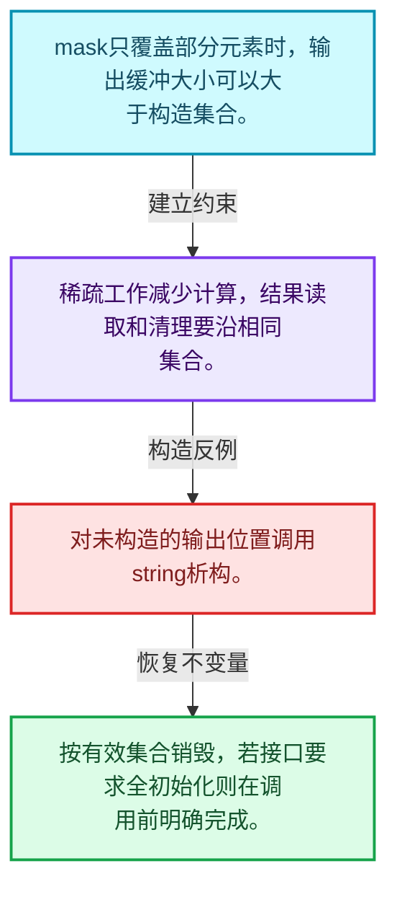
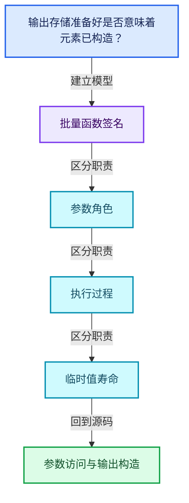
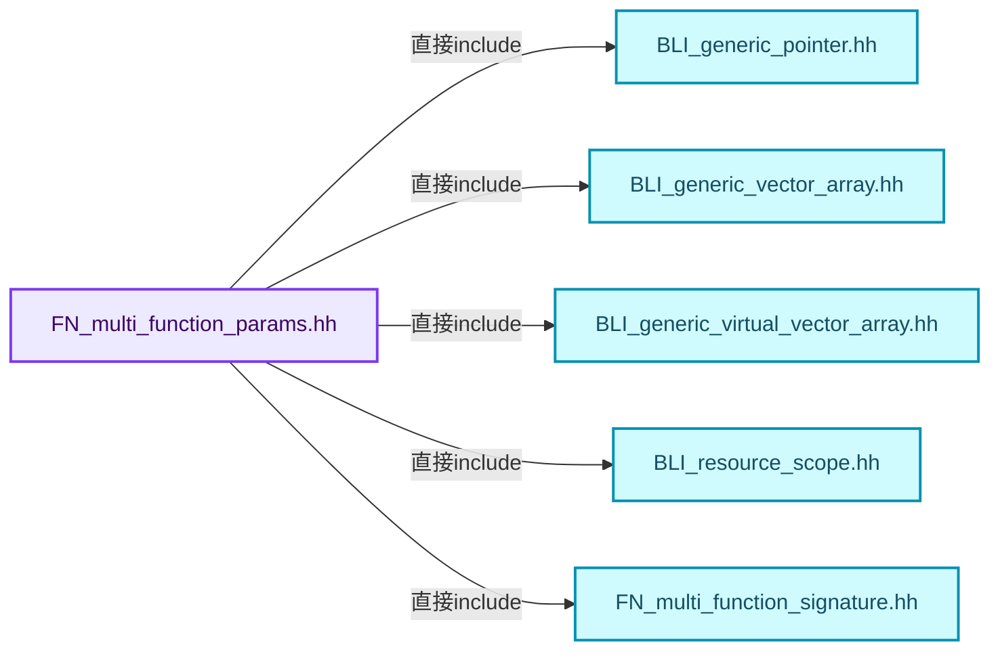
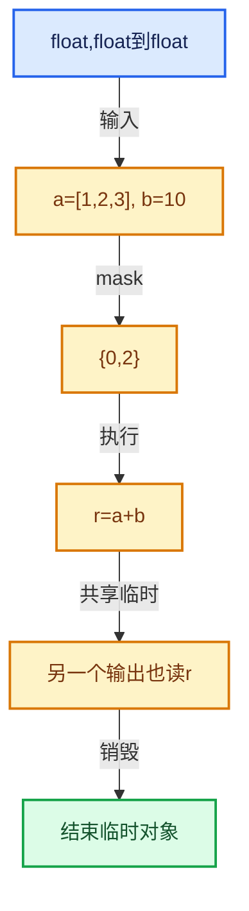

# 07-04 参数访问与输出构造

[方向导航](README.md) · [总目录](../README.md) · [覆盖索引](../%E6%BA%90%E7%A0%81%E7%89%88%E6%9C%AC%E4%B8%8E%E8%A6%86%E7%9B%96%E7%B4%A2%E5%BC%95.md)

> 阅读顺序：问题与数据模型 → 语法与类型 → 源码逐行 → 调用线索 → 历史与取舍 → 推演和练习。

- 基准 HEAD：`cbda6b96c26c0dee3c3b5cbb93960c4ac06a6b30`。
- 记录日期：2026-10-14。
- 教学示例状态：正文中的推演不是本机性能实测；已运行练习见验收报告。

## 一、从问题到设计

输出存储准备好是否意味着元素已构造？

参数访问器连接签名与缓冲区；只构造mask覆盖元素时须准确记录有效位置。

本篇把语法、数据语义和系统取舍连接起来。把调用准备与元素循环分开，把值依赖与对象生存区间同时显式化。

### 本篇独立模型与设计推理

mask只覆盖部分元素时，输出缓冲大小可以大于构造集合。

设计取舍：稀疏工作减少计算，结果读取和清理要沿相同集合。

最小反例：对未构造的输出位置调用string析构。

推导与处理：按有效集合销毁，若接口要求全初始化则在调用前明确完成。



### 源码范围与相邻篇章

| 文件 | 本篇逐行范围 | 基准SHA-256 |
|---|---|---|
| [source/blender/functions/FN_multi_function_params.hh](../../../../../source/blender/functions/FN_multi_function_params.hh) | L1—L456 | `321225ecebcc713595728fe68a8d020a8f0481185d5571b89ec113adc9b681f5` |
| [source/blender/functions/intern/multi_function_params.cc](../../../../../source/blender/functions/intern/multi_function_params.cc) | L1—L25 | `6363df952b1a79823e7ccda8da8801010434e623b3bdfc7cb429751cf04d0395` |

同一主讲文件可能分多篇覆盖；超出本篇范围的符号通过覆盖索引定位。空行与纯注释保留在源码摘录中，逐行表解释有效语句与语法边界；许可证头统一保留。

前篇：[参数类型与角色](03-%E5%8F%82%E6%95%B0%E7%B1%BB%E5%9E%8B%E4%B8%8E%E8%A7%92%E8%89%B2.md).

后篇：[Context与临时资源](05-Context%E4%B8%8E%E4%B8%B4%E6%97%B6%E8%B5%84%E6%BA%90.md).

## 二、类型、数据与阅读地图



这是概念依赖图，边表示阅读关系，不声称是运行时调用顺序。

### 直接编译依赖



箭头只表示头文件包含关系；完整调用线索见后面的符号定位表。

## 三、关键词、语法与类型角色

### 模板 template

模板把类型或常量作为生成实现的参数。读声明时先列出类型参数、非类型参数和默认值，再看使用者实际实例化了什么。模板声明本身不意味着每种T都支持其全部成员。

具体检查：把T替换为int、string、只能移动的类型，分别检查每个被调用操作是否成立。

### 依赖名称 typename

typename既可引入类型模板参数，也可告诉编译器某个依赖名称是类型。它不创建运行时对象；解析期确认语法类别与实例化期检查具体类型是不同阶段。

具体检查：区分typename T::value_type和T::size()，前者标记类型，后者是表达式。

### 只读限定 const

const约束当前访问路径可做的修改。const指针、指向const的指针、const视图对象、const元素是不同位置的限定；其他别名可能仍可修改原对象。

具体检查：分别写T* const、const T*与const T* const，并画出不可修改的层次。

### 移动转换 std::move

std::move把表达式转换为可供移动重载选择的值类别，实际资源转移发生在被选中的构造或赋值中。对const对象move可能仍调用复制，对视图move也不会获得底层数据所有权。

具体检查：记录移动构造调用次数，不用变量名或std::move的出现次数替代测量。

### 运行时多态 virtual

虚调用根据实际动态类型选择实现；经基类指针销毁对象时通常需要相应虚析构契约。每元素虚调用和循环外一次分派有不同开销。

具体检查：找出虚接口的实现类和调用频率，再讨论是否值得去虚拟化。

### 判别联合 variant

variant在若干候选类型中保存一个活动值，通过判别信息选择操作。它能把不同表示集中在值类型中，但各分支的复制移动成本不同。

具体检查：列出活动分支及每种分支实际拥有或借用的数据。

### 构造与new表达式

普通new可能分配并构造；placement new在给定地址构造，存储由其他机制提供。失败回滚应区分两类责任。

具体检查：追踪地址来自哪里、构造何时成功、由谁析构、由谁释放。

### 内部断言 assert

断言表达开发者预期成立的内部契约，发布构建可能关闭。它不能替代对不可信输入的完整错误处理，也不保证后续操作被运行时保护。

具体检查：对每条断言构造违反条件的输入，区分调用者错误与应向用户报告的错误。

### 受控访问 friend

friend授予指定函数或类访问非公开成员的权限，并不意味着继承，也不自动扩展到友元的派生类。

具体检查：解释执行器为何需要访问包装器的内部映射，同时检查边界是否仍清楚。

### 独占拥有 unique_ptr

unique_ptr通过移动转移拥有关系，默认删除策略必须与资源来源匹配。get返回借用指针，release交出责任而不销毁。

具体检查：区分move、get、release和reset后谁负责销毁。

## 四、真实源码与逐行讲解

源码块保持原行内容，原始行号由小节标题及逐行表给出。表中的调用定位是静态阅读辅助；重载、模板实例化、宏展开和虚调用需结合完整声明，不能仅凭词法出现证明动态调用。

### FN_multi_function_params.hh：L1—L47

<!-- source:source/blender/functions/FN_multi_function_params.hh:1:47 -->

```cpp
/* SPDX-FileCopyrightText: 2023 Blender Authors
 *
 * SPDX-License-Identifier: GPL-2.0-or-later */

#pragma once

/** \file
 * \ingroup fn
 *
 * This file provides an Params and ParamsBuilder structure.
 *
 * `ParamsBuilder` is used by a function caller to be prepare all parameters that are passed into
 * the function. `Params` is then used inside the called function to access the parameters.
 */

#include <variant>

#include "BLI_generic_pointer.hh"
#include "BLI_generic_vector_array.hh"
#include "BLI_generic_virtual_vector_array.hh"
#include "BLI_resource_scope.hh"

#include "FN_multi_function_signature.hh"

namespace blender::fn::multi_function {

class ParamsBuilder {
 private:
  std::unique_ptr<ResourceScope> scope_;
  const Signature *signature_;
  const IndexMask &mask_;
  int64_t min_array_size_;
  Vector<std::variant<GVArray, GMutableSpan, const GVVectorArray *, GVectorArray *>>
      actual_params_;

  friend class Params;

  ParamsBuilder(const Signature &signature, const IndexMask &mask);

 public:
  /**
   * The indices referenced by the #mask has to live longer than the params builder. This is
   * because the it might have to destruct elements for all masked indices in the end.
   */
  ParamsBuilder(const class MultiFunction &fn, const IndexMask *mask);

  template<typename T> void add_readonly_single_input_value(T value, StringRef expected_name = "");
```

本段语义重点：

- `scope_`：求值或资源作用域，负责相应临时存储及清理。
- `mask_`：索引集合字段；在FieldEvaluator中引用构造时允许处理的集合，其他上下文以声明为准。

| 原始行 | 语义、约束与检查 |
|---|---|
| L5 | 防止同一头文件在一个翻译单元中重复展开；不控制多个源文件之间的链接或对象寿命。 |
| L16 | 引入编译依赖 <variant>；这是声明可见性关系，不表示运行时一定调用该文件的所有接口。 |
| L18 | 引入编译依赖 "BLI_generic_pointer.hh"；这是声明可见性关系，不表示运行时一定调用该文件的所有接口。 |
| L19 | 引入编译依赖 "BLI_generic_vector_array.hh"；这是声明可见性关系，不表示运行时一定调用该文件的所有接口。 |
| L20 | 引入编译依赖 "BLI_generic_virtual_vector_array.hh"；这是声明可见性关系，不表示运行时一定调用该文件的所有接口。 |
| L21 | 引入编译依赖 "BLI_resource_scope.hh"；这是声明可见性关系，不表示运行时一定调用该文件的所有接口。 |
| L23 | 引入编译依赖 "FN_multi_function_signature.hh"；这是声明可见性关系，不表示运行时一定调用该文件的所有接口。 |
| L25 | 把后续声明放入 blender::fn::multi_function 命名空间，影响名称查找和符号归属，不创建运行时对象。 |
| L27 | 声明或定义类型 `class ParamsBuilder`。结合继承、访问权限和成员布局确认接口与拥有关系；前向声明本身没有完整对象布局。 |
| L28 | 切换成员访问权限为 private；它是编译期接口边界，不是线程同步或内存保护。 |
| L29 | 本行涉及 `scope_`：求值或资源作用域，负责相应临时存储及清理。按此语义解读 `std::unique_ptr<ResourceScope> scope_`，不要把地址、数量或状态混用。 |
| L30 | 声明成员、局部对象或完成语句 `const Signature *signature_`。若为指针或引用，它本身不说明拥有；若为值对象，其构造析构由所在作用域或外层对象管理。 |
| L31 | 本行涉及 `mask_`：索引集合字段；在FieldEvaluator中引用构造时允许处理的集合，其他上下文以声明为准。按此语义解读 `const IndexMask &mask_`，不要把地址、数量或状态混用。 |
| L32 | 声明成员、局部对象或完成语句 `int64_t min_array_size_`。若为指针或引用，它本身不说明拥有；若为值对象，其构造析构由所在作用域或外层对象管理。 |
| L33 | 本行是连续声明或表达式的一部分：`Vector<std::variant<GVArray, GMutableSpan, const GVVectorArray *, GVectorArray *>>`。与本段前后行合读；逗号、括号和限定符决定它属于参数、初始化列表还是实际计算。 |
| L34 | 声明成员、局部对象或完成语句 `actual_params_`。若为指针或引用，它本身不说明拥有；若为值对象，其构造析构由所在作用域或外层对象管理。 |
| L36 | 声明成员、局部对象或完成语句 `friend class Params`。若为指针或引用，它本身不说明拥有；若为值对象，其构造析构由所在作用域或外层对象管理。 |
| L38 | 出现调用或函数声明 `ParamsBuilder`，对应表达式为 `ParamsBuilder(const Signature &signature, const IndexMask &mask);`。参数求值、返回类型与重载需结合前后完整语句；静态文本引用不能证明动态目标。 |
| L40 | 切换成员访问权限为 public；它是编译期接口边界，不是线程同步或内存保护。 |
| L45 | 出现调用或函数声明 `ParamsBuilder`，对应表达式为 `ParamsBuilder(const class MultiFunction &fn, const IndexMask *mask);`。参数求值、返回类型与重载需结合前后完整语句；静态文本引用不能证明动态目标。 |
| L47 | 声明模板参数 `template<typename T> void add_readonly_single_input_value(T value, StringRef expected_name = "");`。类型参数决定生成操作的类型，非类型参数可决定内嵌容量或编译期分支。 |

### FN_multi_function_params.hh：L48—L93

<!-- source:source/blender/functions/FN_multi_function_params.hh:48:93 -->

```cpp
  template<typename T>
  void add_readonly_single_input(const T *value, StringRef expected_name = "");
  void add_readonly_single_input(const GSpan span, StringRef expected_name = "");
  void add_readonly_single_input(GPointer value, StringRef expected_name = "");
  void add_readonly_single_input(GVArray varray, StringRef expected_name = "");

  void add_readonly_vector_input(const GVectorArray &vector_array, StringRef expected_name = "");
  void add_readonly_vector_input(const GSpan single_vector, StringRef expected_name = "");
  void add_readonly_vector_input(const GVVectorArray &ref, StringRef expected_name = "");

  template<typename T>
  void add_uninitialized_single_output(T *value, StringRef expected_name = "");
  void add_uninitialized_single_output(GMutableSpan ref, StringRef expected_name = "");

  void add_ignored_single_output(StringRef expected_name = "");

  void add_vector_output(GVectorArray &vector_array, StringRef expected_name = "");

  void add_single_mutable(GMutableSpan ref, StringRef expected_name = "");

  void add_vector_mutable(GVectorArray &vector_array, StringRef expected_name = "");

  int next_param_index() const;

  GMutableSpan computed_array(int param_index);

  GVectorArray &computed_vector_array(int param_index);

 private:
  void assert_current_param_type(ParamType param_type, StringRef expected_name = "");
  void assert_current_param_name(StringRef expected_name);

  ResourceScope &resource_scope();

  void add_unused_output_for_unsupporting_function(const CPPType &type);
};

class Params {
 private:
  ParamsBuilder *builder_;

 public:
  Params(ParamsBuilder &builder) : builder_(&builder) {}

  template<typename T> VArray<T> readonly_single_input(int param_index, StringRef name = "");
  const GVArray &readonly_single_input(int param_index, StringRef name = "");
```

| 原始行 | 语义、约束与检查 |
|---|---|
| L48 | 声明模板参数 `template<typename T>`。类型参数决定生成操作的类型，非类型参数可决定内嵌容量或编译期分支。 |
| L49 | 把右侧 `"")` 用于初始化或更新左侧 `void add_readonly_single_input(const T *value, StringRef expected_name`。声明初始化与已有对象赋值应按上下文区分；有资源的类型会调用相应特殊成员。 |
| L50 | 把右侧 `"")` 用于初始化或更新左侧 `void add_readonly_single_input(const GSpan span, StringRef expected_name`。声明初始化与已有对象赋值应按上下文区分；有资源的类型会调用相应特殊成员。 |
| L51 | 把右侧 `"")` 用于初始化或更新左侧 `void add_readonly_single_input(GPointer value, StringRef expected_name`。声明初始化与已有对象赋值应按上下文区分；有资源的类型会调用相应特殊成员。 |
| L52 | 把右侧 `"")` 用于初始化或更新左侧 `void add_readonly_single_input(GVArray varray, StringRef expected_name`。声明初始化与已有对象赋值应按上下文区分；有资源的类型会调用相应特殊成员。 |
| L54 | 把右侧 `"")` 用于初始化或更新左侧 `void add_readonly_vector_input(const GVectorArray &vector_array, StringRef expected_name`。声明初始化与已有对象赋值应按上下文区分；有资源的类型会调用相应特殊成员。 |
| L55 | 把右侧 `"")` 用于初始化或更新左侧 `void add_readonly_vector_input(const GSpan single_vector, StringRef expected_name`。声明初始化与已有对象赋值应按上下文区分；有资源的类型会调用相应特殊成员。 |
| L56 | 把右侧 `"")` 用于初始化或更新左侧 `void add_readonly_vector_input(const GVVectorArray &ref, StringRef expected_name`。声明初始化与已有对象赋值应按上下文区分；有资源的类型会调用相应特殊成员。 |
| L58 | 声明模板参数 `template<typename T>`。类型参数决定生成操作的类型，非类型参数可决定内嵌容量或编译期分支。 |
| L59 | 把右侧 `"")` 用于初始化或更新左侧 `void add_uninitialized_single_output(T *value, StringRef expected_name`。声明初始化与已有对象赋值应按上下文区分；有资源的类型会调用相应特殊成员。 |
| L60 | 把右侧 `"")` 用于初始化或更新左侧 `void add_uninitialized_single_output(GMutableSpan ref, StringRef expected_name`。声明初始化与已有对象赋值应按上下文区分；有资源的类型会调用相应特殊成员。 |
| L62 | 把右侧 `"")` 用于初始化或更新左侧 `void add_ignored_single_output(StringRef expected_name`。声明初始化与已有对象赋值应按上下文区分；有资源的类型会调用相应特殊成员。 |
| L64 | 把右侧 `"")` 用于初始化或更新左侧 `void add_vector_output(GVectorArray &vector_array, StringRef expected_name`。声明初始化与已有对象赋值应按上下文区分；有资源的类型会调用相应特殊成员。 |
| L66 | 把右侧 `"")` 用于初始化或更新左侧 `void add_single_mutable(GMutableSpan ref, StringRef expected_name`。声明初始化与已有对象赋值应按上下文区分；有资源的类型会调用相应特殊成员。 |
| L68 | 把右侧 `"")` 用于初始化或更新左侧 `void add_vector_mutable(GVectorArray &vector_array, StringRef expected_name`。声明初始化与已有对象赋值应按上下文区分；有资源的类型会调用相应特殊成员。 |
| L70 | 声明接口 `int next_param_index() const`，本行没有对应函数体；返回类型、参数限定和const/noexcept共同组成调用契约，实际行为需继续定位实现。 |
| L72 | 出现调用或函数声明 `computed_array`，对应表达式为 `GMutableSpan computed_array(int param_index);`。参数求值、返回类型与重载需结合前后完整语句；静态文本引用不能证明动态目标。 |
| L74 | 出现调用或函数声明 `computed_vector_array`，对应表达式为 `GVectorArray &computed_vector_array(int param_index);`。参数求值、返回类型与重载需结合前后完整语句；静态文本引用不能证明动态目标。 |
| L76 | 切换成员访问权限为 private；它是编译期接口边界，不是线程同步或内存保护。 |
| L77 | 把右侧 `"")` 用于初始化或更新左侧 `void assert_current_param_type(ParamType param_type, StringRef expected_name`。声明初始化与已有对象赋值应按上下文区分；有资源的类型会调用相应特殊成员。 |
| L78 | 声明接口 `void assert_current_param_name(StringRef expected_name)`，本行没有对应函数体；返回类型、参数限定和const/noexcept共同组成调用契约，实际行为需继续定位实现。 |
| L80 | 出现调用或函数声明 `resource_scope`，对应表达式为 `ResourceScope &resource_scope();`。参数求值、返回类型与重载需结合前后完整语句；静态文本引用不能证明动态目标。 |
| L82 | 声明接口 `void add_unused_output_for_unsupporting_function(const CPPType &type)`，本行没有对应函数体；返回类型、参数限定和const/noexcept共同组成调用契约，实际行为需继续定位实现。 |
| L83 | 结束当前语法单元。局部自动对象在离开其作用域时按规则销毁；这不等于所有被引用的外部数据也被释放。 |
| L85 | 声明或定义类型 `class Params`。结合继承、访问权限和成员布局确认接口与拥有关系；前向声明本身没有完整对象布局。 |
| L86 | 切换成员访问权限为 private；它是编译期接口边界，不是线程同步或内存保护。 |
| L87 | 声明成员、局部对象或完成语句 `ParamsBuilder *builder_`。若为指针或引用，它本身不说明拥有；若为值对象，其构造析构由所在作用域或外层对象管理。 |
| L89 | 切换成员访问权限为 public；它是编译期接口边界，不是线程同步或内存保护。 |
| L90 | 出现调用或函数声明 `Params`，对应表达式为 `Params(ParamsBuilder &builder) : builder_(&builder) {}`。参数求值、返回类型与重载需结合前后完整语句；静态文本引用不能证明动态目标。 |
| L92 | 声明模板参数 `template<typename T> VArray<T> readonly_single_input(int param_index, StringRef name = "");`。类型参数决定生成操作的类型，非类型参数可决定内嵌容量或编译期分支。 |
| L93 | 把右侧 `"")` 用于初始化或更新左侧 `const GVArray &readonly_single_input(int param_index, StringRef name`。声明初始化与已有对象赋值应按上下文区分；有资源的类型会调用相应特殊成员。 |

### FN_multi_function_params.hh：L94—L143

<!-- source:source/blender/functions/FN_multi_function_params.hh:94:143 -->

```cpp

  /**
   * \return True when the caller provided a buffer for this output parameter. This allows the
   * called multi-function to skip some computation. It is still valid to call
   * #uninitialized_single_output when this returns false. In this case a new temporary buffer is
   * allocated.
   */
  bool single_output_is_required(int param_index, StringRef name = "");

  template<typename T>
  MutableSpan<T> uninitialized_single_output(int param_index, StringRef name = "");
  GMutableSpan uninitialized_single_output(int param_index, StringRef name = "");

  /**
   * Same as #uninitialized_single_output, but returns an empty span when the output is not
   * required.
   */
  template<typename T>
  MutableSpan<T> uninitialized_single_output_if_required(int param_index, StringRef name = "");
  GMutableSpan uninitialized_single_output_if_required(int param_index, StringRef name = "");

  template<typename T>
  const VVectorArray<T> &readonly_vector_input(int param_index, StringRef name = "");
  const GVVectorArray &readonly_vector_input(int param_index, StringRef name = "");

  template<typename T>
  GVectorArray_TypedMutableRef<T> vector_output(int param_index, StringRef name = "");
  GVectorArray &vector_output(int param_index, StringRef name = "");

  template<typename T> MutableSpan<T> single_mutable(int param_index, StringRef name = "");
  GMutableSpan single_mutable(int param_index, StringRef name = "");

  template<typename T>
  GVectorArray_TypedMutableRef<T> vector_mutable(int param_index, StringRef name = "");
  GVectorArray &vector_mutable(int param_index, StringRef name = "");

 private:
  void assert_correct_param(int param_index, StringRef name, ParamType param_type);
  void assert_correct_param(int param_index, StringRef name, ParamCategory category);
};

/* -------------------------------------------------------------------- */
/** \name #Paramsbuilder Inline Methods
 * \{ */

inline ParamsBuilder::ParamsBuilder(const Signature &signature, const IndexMask &mask)
    : signature_(&signature), mask_(mask), min_array_size_(mask.min_array_size())
{
  actual_params_.reserve(signature.params.size());
}
```

本段语义重点：

- `mask_`：索引集合字段；在FieldEvaluator中引用构造时允许处理的集合，其他上下文以声明为准。

| 原始行 | 语义、约束与检查 |
|---|---|
| L101 | 把右侧 `"")` 用于初始化或更新左侧 `bool single_output_is_required(int param_index, StringRef name`。声明初始化与已有对象赋值应按上下文区分；有资源的类型会调用相应特殊成员。 |
| L103 | 声明模板参数 `template<typename T>`。类型参数决定生成操作的类型，非类型参数可决定内嵌容量或编译期分支。 |
| L104 | 把右侧 `"")` 用于初始化或更新左侧 `MutableSpan<T> uninitialized_single_output(int param_index, StringRef name`。声明初始化与已有对象赋值应按上下文区分；有资源的类型会调用相应特殊成员。 |
| L105 | 把右侧 `"")` 用于初始化或更新左侧 `GMutableSpan uninitialized_single_output(int param_index, StringRef name`。声明初始化与已有对象赋值应按上下文区分；有资源的类型会调用相应特殊成员。 |
| L111 | 声明模板参数 `template<typename T>`。类型参数决定生成操作的类型，非类型参数可决定内嵌容量或编译期分支。 |
| L112 | 把右侧 `"")` 用于初始化或更新左侧 `MutableSpan<T> uninitialized_single_output_if_required(int param_index, StringRef name`。声明初始化与已有对象赋值应按上下文区分；有资源的类型会调用相应特殊成员。 |
| L113 | 把右侧 `"")` 用于初始化或更新左侧 `GMutableSpan uninitialized_single_output_if_required(int param_index, StringRef name`。声明初始化与已有对象赋值应按上下文区分；有资源的类型会调用相应特殊成员。 |
| L115 | 声明模板参数 `template<typename T>`。类型参数决定生成操作的类型，非类型参数可决定内嵌容量或编译期分支。 |
| L116 | 把右侧 `"")` 用于初始化或更新左侧 `const VVectorArray<T> &readonly_vector_input(int param_index, StringRef name`。声明初始化与已有对象赋值应按上下文区分；有资源的类型会调用相应特殊成员。 |
| L117 | 把右侧 `"")` 用于初始化或更新左侧 `const GVVectorArray &readonly_vector_input(int param_index, StringRef name`。声明初始化与已有对象赋值应按上下文区分；有资源的类型会调用相应特殊成员。 |
| L119 | 声明模板参数 `template<typename T>`。类型参数决定生成操作的类型，非类型参数可决定内嵌容量或编译期分支。 |
| L120 | 把右侧 `"")` 用于初始化或更新左侧 `GVectorArray_TypedMutableRef<T> vector_output(int param_index, StringRef name`。声明初始化与已有对象赋值应按上下文区分；有资源的类型会调用相应特殊成员。 |
| L121 | 把右侧 `"")` 用于初始化或更新左侧 `GVectorArray &vector_output(int param_index, StringRef name`。声明初始化与已有对象赋值应按上下文区分；有资源的类型会调用相应特殊成员。 |
| L123 | 声明模板参数 `template<typename T> MutableSpan<T> single_mutable(int param_index, StringRef name = "");`。类型参数决定生成操作的类型，非类型参数可决定内嵌容量或编译期分支。 |
| L124 | 把右侧 `"")` 用于初始化或更新左侧 `GMutableSpan single_mutable(int param_index, StringRef name`。声明初始化与已有对象赋值应按上下文区分；有资源的类型会调用相应特殊成员。 |
| L126 | 声明模板参数 `template<typename T>`。类型参数决定生成操作的类型，非类型参数可决定内嵌容量或编译期分支。 |
| L127 | 把右侧 `"")` 用于初始化或更新左侧 `GVectorArray_TypedMutableRef<T> vector_mutable(int param_index, StringRef name`。声明初始化与已有对象赋值应按上下文区分；有资源的类型会调用相应特殊成员。 |
| L128 | 把右侧 `"")` 用于初始化或更新左侧 `GVectorArray &vector_mutable(int param_index, StringRef name`。声明初始化与已有对象赋值应按上下文区分；有资源的类型会调用相应特殊成员。 |
| L130 | 切换成员访问权限为 private；它是编译期接口边界，不是线程同步或内存保护。 |
| L131 | 声明接口 `void assert_correct_param(int param_index, StringRef name, ParamType param_type)`，本行没有对应函数体；返回类型、参数限定和const/noexcept共同组成调用契约，实际行为需继续定位实现。 |
| L132 | 声明接口 `void assert_correct_param(int param_index, StringRef name, ParamCategory category)`，本行没有对应函数体；返回类型、参数限定和const/noexcept共同组成调用契约，实际行为需继续定位实现。 |
| L133 | 结束当前语法单元。局部自动对象在离开其作用域时按规则销毁；这不等于所有被引用的外部数据也被释放。 |
| L139 | 出现调用或函数声明 `ParamsBuilder::ParamsBuilder`，对应表达式为 `inline ParamsBuilder::ParamsBuilder(const Signature &signature, const IndexMask &mask)`。参数求值、返回类型与重载需结合前后完整语句；静态文本引用不能证明动态目标。 |
| L140 | 本行涉及 `mask_`：索引集合字段；在FieldEvaluator中引用构造时允许处理的集合，其他上下文以声明为准。按此语义解读 `: signature_(&signature), mask_(mask), min_array_size_(mask.min_array_size())`，不要把地址、数量或状态混用。 |
| L141 | 连接上一行的声明或控制结构与其语句块；后续行在这个作用域中执行或声明。 |
| L142 | 出现调用或函数声明 `reserve`，对应表达式为 `actual_params_.reserve(signature.params.size());`。参数求值、返回类型与重载需结合前后完整语句；静态文本引用不能证明动态目标。 |
| L143 | 结束当前语法单元。局部自动对象在离开其作用域时按规则销毁；这不等于所有被引用的外部数据也被释放。 |

### FN_multi_function_params.hh：L144—L189

<!-- source:source/blender/functions/FN_multi_function_params.hh:144:189 -->

```cpp

template<typename T>
inline void ParamsBuilder::add_readonly_single_input_value(T value, StringRef expected_name)
{
  this->assert_current_param_type(ParamType::ForSingleInput(CPPType::get<T>()), expected_name);
  actual_params_.append_unchecked_as(std::in_place_type<GVArray>,
                                     varray_tag::single{},
                                     CPPType::get<T>(),
                                     min_array_size_,
                                     &value);
}

template<typename T>
inline void ParamsBuilder::add_readonly_single_input(const T *value, StringRef expected_name)
{
  this->assert_current_param_type(ParamType::ForSingleInput(CPPType::get<T>()), expected_name);
  actual_params_.append_unchecked_as(std::in_place_type<GVArray>,
                                     varray_tag::single_ref{},
                                     CPPType::get<T>(),
                                     min_array_size_,
                                     value);
}

inline void ParamsBuilder::add_readonly_single_input(const GSpan span, StringRef expected_name)
{
  this->assert_current_param_type(ParamType::ForSingleInput(span.type()), expected_name);
  BLI_assert(span.size() >= min_array_size_);
  actual_params_.append_unchecked_as(std::in_place_type<GVArray>, varray_tag::span{}, span);
}

inline void ParamsBuilder::add_readonly_single_input(GPointer value, StringRef expected_name)
{
  this->assert_current_param_type(ParamType::ForSingleInput(*value.type()), expected_name);
  actual_params_.append_unchecked_as(std::in_place_type<GVArray>,
                                     varray_tag::single_ref{},
                                     *value.type(),
                                     min_array_size_,
                                     value.get());
}

inline void ParamsBuilder::add_readonly_single_input(GVArray varray, StringRef expected_name)
{
  this->assert_current_param_type(ParamType::ForSingleInput(varray.type()), expected_name);
  BLI_assert(varray.size() >= min_array_size_);
  actual_params_.append_unchecked_as(std::in_place_type<GVArray>, std::move(varray));
}
```

| 原始行 | 语义、约束与检查 |
|---|---|
| L145 | 声明模板参数 `template<typename T>`。类型参数决定生成操作的类型，非类型参数可决定内嵌容量或编译期分支。 |
| L146 | 出现调用或函数声明 `ParamsBuilder::add_readonly_single_input_value`，对应表达式为 `inline void ParamsBuilder::add_readonly_single_input_value(T value, StringRef expected_name)`。参数求值、返回类型与重载需结合前后完整语句；静态文本引用不能证明动态目标。 |
| L147 | 连接上一行的声明或控制结构与其语句块；后续行在这个作用域中执行或声明。 |
| L148 | 出现调用或函数声明 `assert_current_param_type`，对应表达式为 `this->assert_current_param_type(ParamType::ForSingleInput(CPPType::get<T>()), expected_name);`。参数求值、返回类型与重载需结合前后完整语句；静态文本引用不能证明动态目标。 |
| L149 | 出现调用或函数声明 `append_unchecked_as`，对应表达式为 `actual_params_.append_unchecked_as(std::in_place_type<GVArray>,`。参数求值、返回类型与重载需结合前后完整语句；静态文本引用不能证明动态目标。 |
| L150 | 本行是连续声明或表达式的一部分：`varray_tag::single{},`。与本段前后行合读；逗号、括号和限定符决定它属于参数、初始化列表还是实际计算。 |
| L151 | 出现调用或函数声明 `CPPType::get`，对应表达式为 `CPPType::get<T>(),`。参数求值、返回类型与重载需结合前后完整语句；静态文本引用不能证明动态目标。 |
| L152 | 本行是连续声明或表达式的一部分：`min_array_size_,`。与本段前后行合读；逗号、括号和限定符决定它属于参数、初始化列表还是实际计算。 |
| L153 | 声明成员、局部对象或完成语句 `&value)`。若为指针或引用，它本身不说明拥有；若为值对象，其构造析构由所在作用域或外层对象管理。 |
| L154 | 结束当前语法单元。局部自动对象在离开其作用域时按规则销毁；这不等于所有被引用的外部数据也被释放。 |
| L156 | 声明模板参数 `template<typename T>`。类型参数决定生成操作的类型，非类型参数可决定内嵌容量或编译期分支。 |
| L157 | 出现调用或函数声明 `ParamsBuilder::add_readonly_single_input`，对应表达式为 `inline void ParamsBuilder::add_readonly_single_input(const T *value, StringRef expected_name)`。参数求值、返回类型与重载需结合前后完整语句；静态文本引用不能证明动态目标。 |
| L158 | 连接上一行的声明或控制结构与其语句块；后续行在这个作用域中执行或声明。 |
| L159 | 出现调用或函数声明 `assert_current_param_type`，对应表达式为 `this->assert_current_param_type(ParamType::ForSingleInput(CPPType::get<T>()), expected_name);`。参数求值、返回类型与重载需结合前后完整语句；静态文本引用不能证明动态目标。 |
| L160 | 出现调用或函数声明 `append_unchecked_as`，对应表达式为 `actual_params_.append_unchecked_as(std::in_place_type<GVArray>,`。参数求值、返回类型与重载需结合前后完整语句；静态文本引用不能证明动态目标。 |
| L161 | 本行是连续声明或表达式的一部分：`varray_tag::single_ref{},`。与本段前后行合读；逗号、括号和限定符决定它属于参数、初始化列表还是实际计算。 |
| L162 | 出现调用或函数声明 `CPPType::get`，对应表达式为 `CPPType::get<T>(),`。参数求值、返回类型与重载需结合前后完整语句；静态文本引用不能证明动态目标。 |
| L163 | 本行是连续声明或表达式的一部分：`min_array_size_,`。与本段前后行合读；逗号、括号和限定符决定它属于参数、初始化列表还是实际计算。 |
| L164 | 声明成员、局部对象或完成语句 `value)`。若为指针或引用，它本身不说明拥有；若为值对象，其构造析构由所在作用域或外层对象管理。 |
| L165 | 结束当前语法单元。局部自动对象在离开其作用域时按规则销毁；这不等于所有被引用的外部数据也被释放。 |
| L167 | 出现调用或函数声明 `ParamsBuilder::add_readonly_single_input`，对应表达式为 `inline void ParamsBuilder::add_readonly_single_input(const GSpan span, StringRef expected_name)`。参数求值、返回类型与重载需结合前后完整语句；静态文本引用不能证明动态目标。 |
| L168 | 连接上一行的声明或控制结构与其语句块；后续行在这个作用域中执行或声明。 |
| L169 | 出现调用或函数声明 `assert_current_param_type`，对应表达式为 `this->assert_current_param_type(ParamType::ForSingleInput(span.type()), expected_name);`。参数求值、返回类型与重载需结合前后完整语句；静态文本引用不能证明动态目标。 |
| L170 | 断言约束 `BLI_assert(span.size() >= min_array_size_);`。条件是后续访问的内部前置条件；发布构建可能不执行，不能把断言当作输入修复。 |
| L171 | 出现调用或函数声明 `append_unchecked_as`，对应表达式为 `actual_params_.append_unchecked_as(std::in_place_type<GVArray>, varray_tag::span{}, span);`。参数求值、返回类型与重载需结合前后完整语句；静态文本引用不能证明动态目标。 |
| L172 | 结束当前语法单元。局部自动对象在离开其作用域时按规则销毁；这不等于所有被引用的外部数据也被释放。 |
| L174 | 出现调用或函数声明 `ParamsBuilder::add_readonly_single_input`，对应表达式为 `inline void ParamsBuilder::add_readonly_single_input(GPointer value, StringRef expected_name)`。参数求值、返回类型与重载需结合前后完整语句；静态文本引用不能证明动态目标。 |
| L175 | 连接上一行的声明或控制结构与其语句块；后续行在这个作用域中执行或声明。 |
| L176 | 出现调用或函数声明 `assert_current_param_type`，对应表达式为 `this->assert_current_param_type(ParamType::ForSingleInput(*value.type()), expected_name);`。参数求值、返回类型与重载需结合前后完整语句；静态文本引用不能证明动态目标。 |
| L177 | 出现调用或函数声明 `append_unchecked_as`，对应表达式为 `actual_params_.append_unchecked_as(std::in_place_type<GVArray>,`。参数求值、返回类型与重载需结合前后完整语句；静态文本引用不能证明动态目标。 |
| L178 | 本行是连续声明或表达式的一部分：`varray_tag::single_ref{},`。与本段前后行合读；逗号、括号和限定符决定它属于参数、初始化列表还是实际计算。 |
| L179 | 出现调用或函数声明 `type`，对应表达式为 `*value.type(),`。参数求值、返回类型与重载需结合前后完整语句；静态文本引用不能证明动态目标。 |
| L180 | 本行是连续声明或表达式的一部分：`min_array_size_,`。与本段前后行合读；逗号、括号和限定符决定它属于参数、初始化列表还是实际计算。 |
| L181 | 出现调用或函数声明 `get`，对应表达式为 `value.get());`。参数求值、返回类型与重载需结合前后完整语句；静态文本引用不能证明动态目标。 |
| L182 | 结束当前语法单元。局部自动对象在离开其作用域时按规则销毁；这不等于所有被引用的外部数据也被释放。 |
| L184 | 出现调用或函数声明 `ParamsBuilder::add_readonly_single_input`，对应表达式为 `inline void ParamsBuilder::add_readonly_single_input(GVArray varray, StringRef expected_name)`。参数求值、返回类型与重载需结合前后完整语句；静态文本引用不能证明动态目标。 |
| L185 | 连接上一行的声明或控制结构与其语句块；后续行在这个作用域中执行或声明。 |
| L186 | 出现调用或函数声明 `assert_current_param_type`，对应表达式为 `this->assert_current_param_type(ParamType::ForSingleInput(varray.type()), expected_name);`。参数求值、返回类型与重载需结合前后完整语句；静态文本引用不能证明动态目标。 |
| L187 | 断言约束 `BLI_assert(varray.size() >= min_array_size_);`。条件是后续访问的内部前置条件；发布构建可能不执行，不能把断言当作输入修复。 |
| L188 | 出现调用或函数声明 `append_unchecked_as`，对应表达式为 `actual_params_.append_unchecked_as(std::in_place_type<GVArray>, std::move(varray));`。参数求值、返回类型与重载需结合前后完整语句；静态文本引用不能证明动态目标。 |
| L189 | 结束当前语法单元。局部自动对象在离开其作用域时按规则销毁；这不等于所有被引用的外部数据也被释放。 |

### FN_multi_function_params.hh：L190—L246

<!-- source:source/blender/functions/FN_multi_function_params.hh:190:246 -->

```cpp

inline void ParamsBuilder::add_readonly_vector_input(const GVectorArray &vector_array,
                                                     StringRef expected_name)
{
  this->add_readonly_vector_input(
      this->resource_scope().construct<GVVectorArray_For_GVectorArray>(vector_array),
      expected_name);
}

inline void ParamsBuilder::add_readonly_vector_input(const GSpan single_vector,
                                                     StringRef expected_name)
{
  this->add_readonly_vector_input(this->resource_scope().construct<GVVectorArray_For_SingleGSpan>(
                                      single_vector, min_array_size_),
                                  expected_name);
}

inline void ParamsBuilder::add_readonly_vector_input(const GVVectorArray &ref,
                                                     StringRef expected_name)
{
  this->assert_current_param_type(ParamType::ForVectorInput(ref.type()), expected_name);
  BLI_assert(ref.size() >= min_array_size_);
  actual_params_.append_unchecked_as(std::in_place_type<const GVVectorArray *>, &ref);
}

template<typename T>
inline void ParamsBuilder::add_uninitialized_single_output(T *value, StringRef expected_name)
{
  this->add_uninitialized_single_output(GMutableSpan(CPPType::get<T>(), value, 1), expected_name);
}

inline void ParamsBuilder::add_uninitialized_single_output(GMutableSpan ref,
                                                           StringRef expected_name)
{
  this->assert_current_param_type(ParamType::ForSingleOutput(ref.type()), expected_name);
  BLI_assert(ref.size() >= min_array_size_);
  actual_params_.append_unchecked_as(std::in_place_type<GMutableSpan>, ref);
}

inline void ParamsBuilder::add_ignored_single_output(StringRef expected_name)
{
  this->assert_current_param_name(expected_name);
  const int param_index = this->next_param_index();
  const ParamType &param_type = signature_->params[param_index].type;
  BLI_assert(param_type.category() == ParamCategory::SingleOutput);
  const DataType data_type = param_type.data_type();
  const CPPType &type = data_type.single_type();

  if (flag_is_set(signature_->params[param_index].flag, ParamFlag::SupportsUnusedOutput)) {
    /* An empty span indicates that this is ignored. */
    const GMutableSpan dummy_span{type};
    actual_params_.append_unchecked_as(std::in_place_type<GMutableSpan>, dummy_span);
  }
  else {
    this->add_unused_output_for_unsupporting_function(type);
  }
}
```

本段语义重点：

- 分支证据 `flag_is_set(signature_->params[param_index].flag, ParamFlag::SupportsUnusedOutput))`：分别推演条件成立与不成立，核对相同出口处的状态。

| 原始行 | 语义、约束与检查 |
|---|---|
| L191 | 出现调用或函数声明 `ParamsBuilder::add_readonly_vector_input`，对应表达式为 `inline void ParamsBuilder::add_readonly_vector_input(const GVectorArray &vector_array,`。参数求值、返回类型与重载需结合前后完整语句；静态文本引用不能证明动态目标。 |
| L192 | 本行是连续声明或表达式的一部分：`StringRef expected_name)`。与本段前后行合读；逗号、括号和限定符决定它属于参数、初始化列表还是实际计算。 |
| L193 | 连接上一行的声明或控制结构与其语句块；后续行在这个作用域中执行或声明。 |
| L194 | 出现调用或函数声明 `add_readonly_vector_input`，对应表达式为 `this->add_readonly_vector_input(`。参数求值、返回类型与重载需结合前后完整语句；静态文本引用不能证明动态目标。 |
| L195 | 出现调用或函数声明 `resource_scope`，对应表达式为 `this->resource_scope().construct<GVVectorArray_For_GVectorArray>(vector_array),`。参数求值、返回类型与重载需结合前后完整语句；静态文本引用不能证明动态目标。 |
| L196 | 声明成员、局部对象或完成语句 `expected_name)`。若为指针或引用，它本身不说明拥有；若为值对象，其构造析构由所在作用域或外层对象管理。 |
| L197 | 结束当前语法单元。局部自动对象在离开其作用域时按规则销毁；这不等于所有被引用的外部数据也被释放。 |
| L199 | 出现调用或函数声明 `ParamsBuilder::add_readonly_vector_input`，对应表达式为 `inline void ParamsBuilder::add_readonly_vector_input(const GSpan single_vector,`。参数求值、返回类型与重载需结合前后完整语句；静态文本引用不能证明动态目标。 |
| L200 | 本行是连续声明或表达式的一部分：`StringRef expected_name)`。与本段前后行合读；逗号、括号和限定符决定它属于参数、初始化列表还是实际计算。 |
| L201 | 连接上一行的声明或控制结构与其语句块；后续行在这个作用域中执行或声明。 |
| L202 | 出现调用或函数声明 `add_readonly_vector_input`，对应表达式为 `this->add_readonly_vector_input(this->resource_scope().construct<GVVectorArray_For_SingleGSpan>(`。参数求值、返回类型与重载需结合前后完整语句；静态文本引用不能证明动态目标。 |
| L203 | 本行是连续声明或表达式的一部分：`single_vector, min_array_size_),`。与本段前后行合读；逗号、括号和限定符决定它属于参数、初始化列表还是实际计算。 |
| L204 | 声明成员、局部对象或完成语句 `expected_name)`。若为指针或引用，它本身不说明拥有；若为值对象，其构造析构由所在作用域或外层对象管理。 |
| L205 | 结束当前语法单元。局部自动对象在离开其作用域时按规则销毁；这不等于所有被引用的外部数据也被释放。 |
| L207 | 出现调用或函数声明 `ParamsBuilder::add_readonly_vector_input`，对应表达式为 `inline void ParamsBuilder::add_readonly_vector_input(const GVVectorArray &ref,`。参数求值、返回类型与重载需结合前后完整语句；静态文本引用不能证明动态目标。 |
| L208 | 本行是连续声明或表达式的一部分：`StringRef expected_name)`。与本段前后行合读；逗号、括号和限定符决定它属于参数、初始化列表还是实际计算。 |
| L209 | 连接上一行的声明或控制结构与其语句块；后续行在这个作用域中执行或声明。 |
| L210 | 出现调用或函数声明 `assert_current_param_type`，对应表达式为 `this->assert_current_param_type(ParamType::ForVectorInput(ref.type()), expected_name);`。参数求值、返回类型与重载需结合前后完整语句；静态文本引用不能证明动态目标。 |
| L211 | 断言约束 `BLI_assert(ref.size() >= min_array_size_);`。条件是后续访问的内部前置条件；发布构建可能不执行，不能把断言当作输入修复。 |
| L212 | 出现调用或函数声明 `append_unchecked_as`，对应表达式为 `actual_params_.append_unchecked_as(std::in_place_type<const GVVectorArray *>, &ref);`。参数求值、返回类型与重载需结合前后完整语句；静态文本引用不能证明动态目标。 |
| L213 | 结束当前语法单元。局部自动对象在离开其作用域时按规则销毁；这不等于所有被引用的外部数据也被释放。 |
| L215 | 声明模板参数 `template<typename T>`。类型参数决定生成操作的类型，非类型参数可决定内嵌容量或编译期分支。 |
| L216 | 出现调用或函数声明 `ParamsBuilder::add_uninitialized_single_output`，对应表达式为 `inline void ParamsBuilder::add_uninitialized_single_output(T *value, StringRef expected_name)`。参数求值、返回类型与重载需结合前后完整语句；静态文本引用不能证明动态目标。 |
| L217 | 连接上一行的声明或控制结构与其语句块；后续行在这个作用域中执行或声明。 |
| L218 | 出现调用或函数声明 `add_uninitialized_single_output`，对应表达式为 `this->add_uninitialized_single_output(GMutableSpan(CPPType::get<T>(), value, 1), expected_name);`。参数求值、返回类型与重载需结合前后完整语句；静态文本引用不能证明动态目标。 |
| L219 | 结束当前语法单元。局部自动对象在离开其作用域时按规则销毁；这不等于所有被引用的外部数据也被释放。 |
| L221 | 出现调用或函数声明 `ParamsBuilder::add_uninitialized_single_output`，对应表达式为 `inline void ParamsBuilder::add_uninitialized_single_output(GMutableSpan ref,`。参数求值、返回类型与重载需结合前后完整语句；静态文本引用不能证明动态目标。 |
| L222 | 本行是连续声明或表达式的一部分：`StringRef expected_name)`。与本段前后行合读；逗号、括号和限定符决定它属于参数、初始化列表还是实际计算。 |
| L223 | 连接上一行的声明或控制结构与其语句块；后续行在这个作用域中执行或声明。 |
| L224 | 出现调用或函数声明 `assert_current_param_type`，对应表达式为 `this->assert_current_param_type(ParamType::ForSingleOutput(ref.type()), expected_name);`。参数求值、返回类型与重载需结合前后完整语句；静态文本引用不能证明动态目标。 |
| L225 | 断言约束 `BLI_assert(ref.size() >= min_array_size_);`。条件是后续访问的内部前置条件；发布构建可能不执行，不能把断言当作输入修复。 |
| L226 | 出现调用或函数声明 `append_unchecked_as`，对应表达式为 `actual_params_.append_unchecked_as(std::in_place_type<GMutableSpan>, ref);`。参数求值、返回类型与重载需结合前后完整语句；静态文本引用不能证明动态目标。 |
| L227 | 结束当前语法单元。局部自动对象在离开其作用域时按规则销毁；这不等于所有被引用的外部数据也被释放。 |
| L229 | 出现调用或函数声明 `ParamsBuilder::add_ignored_single_output`，对应表达式为 `inline void ParamsBuilder::add_ignored_single_output(StringRef expected_name)`。参数求值、返回类型与重载需结合前后完整语句；静态文本引用不能证明动态目标。 |
| L230 | 连接上一行的声明或控制结构与其语句块；后续行在这个作用域中执行或声明。 |
| L231 | 出现调用或函数声明 `assert_current_param_name`，对应表达式为 `this->assert_current_param_name(expected_name);`。参数求值、返回类型与重载需结合前后完整语句；静态文本引用不能证明动态目标。 |
| L232 | 把右侧 `this->next_param_index()` 用于初始化或更新左侧 `const int param_index`。声明初始化与已有对象赋值应按上下文区分；有资源的类型会调用相应特殊成员。 |
| L233 | 把右侧 `signature_->params[param_index].type` 用于初始化或更新左侧 `const ParamType &param_type`。声明初始化与已有对象赋值应按上下文区分；有资源的类型会调用相应特殊成员。 |
| L234 | 断言约束 `BLI_assert(param_type.category() == ParamCategory::SingleOutput);`。条件是后续访问的内部前置条件；发布构建可能不执行，不能把断言当作输入修复。 |
| L235 | 把右侧 `param_type.data_type()` 用于初始化或更新左侧 `const DataType data_type`。声明初始化与已有对象赋值应按上下文区分；有资源的类型会调用相应特殊成员。 |
| L236 | 把右侧 `data_type.single_type()` 用于初始化或更新左侧 `const CPPType &type`。声明初始化与已有对象赋值应按上下文区分；有资源的类型会调用相应特殊成员。 |
| L238 | 判断 `flag_is_set(signature_->params[param_index].flag, ParamFlag::SupportsUnusedOutput)`，成立时进入本分支，否则继续后续路径。 |
| L240 | 声明成员、局部对象或完成语句 `const GMutableSpan dummy_span{type}`。若为指针或引用，它本身不说明拥有；若为值对象，其构造析构由所在作用域或外层对象管理。 |
| L241 | 出现调用或函数声明 `append_unchecked_as`，对应表达式为 `actual_params_.append_unchecked_as(std::in_place_type<GMutableSpan>, dummy_span);`。参数求值、返回类型与重载需结合前后完整语句；静态文本引用不能证明动态目标。 |
| L242 | 结束当前语法单元。局部自动对象在离开其作用域时按规则销毁；这不等于所有被引用的外部数据也被释放。 |
| L243 | 处理前一条件不成立的互补路径。比较两条路径最后是否恢复同一不变量，以及是否产生不同的资源责任。 |
| L244 | 出现调用或函数声明 `add_unused_output_for_unsupporting_function`，对应表达式为 `this->add_unused_output_for_unsupporting_function(type);`。参数求值、返回类型与重载需结合前后完整语句；静态文本引用不能证明动态目标。 |
| L245 | 结束当前语法单元。局部自动对象在离开其作用域时按规则销毁；这不等于所有被引用的外部数据也被释放。 |
| L246 | 结束当前语法单元。局部自动对象在离开其作用域时按规则销毁；这不等于所有被引用的外部数据也被释放。 |

### FN_multi_function_params.hh：L247—L288

<!-- source:source/blender/functions/FN_multi_function_params.hh:247:288 -->

```cpp

inline void ParamsBuilder::add_vector_output(GVectorArray &vector_array, StringRef expected_name)
{
  this->assert_current_param_type(ParamType::ForVectorOutput(vector_array.type()), expected_name);
  BLI_assert(vector_array.size() >= min_array_size_);
  actual_params_.append_unchecked_as(std::in_place_type<GVectorArray *>, &vector_array);
}

inline void ParamsBuilder::add_single_mutable(GMutableSpan ref, StringRef expected_name)
{
  this->assert_current_param_type(ParamType::ForMutableSingle(ref.type()), expected_name);
  BLI_assert(ref.size() >= min_array_size_);
  actual_params_.append_unchecked_as(std::in_place_type<GMutableSpan>, ref);
}

inline void ParamsBuilder::add_vector_mutable(GVectorArray &vector_array, StringRef expected_name)
{
  this->assert_current_param_type(ParamType::ForMutableVector(vector_array.type()), expected_name);
  BLI_assert(vector_array.size() >= min_array_size_);
  actual_params_.append_unchecked_as(std::in_place_type<GVectorArray *>, &vector_array);
}

inline int ParamsBuilder::next_param_index() const
{
  return actual_params_.size();
}

inline GMutableSpan ParamsBuilder::computed_array(int param_index)
{
  BLI_assert(ELEM(signature_->params[param_index].type.category(),
                  ParamCategory::SingleOutput,
                  ParamCategory::SingleMutable));
  return std::get<GMutableSpan>(actual_params_[param_index]);
}

inline GVectorArray &ParamsBuilder::computed_vector_array(int param_index)
{
  BLI_assert(ELEM(signature_->params[param_index].type.category(),
                  ParamCategory::VectorOutput,
                  ParamCategory::VectorMutable));
  return *std::get<GVectorArray *>(actual_params_[param_index]);
}
```

| 原始行 | 语义、约束与检查 |
|---|---|
| L248 | 出现调用或函数声明 `ParamsBuilder::add_vector_output`，对应表达式为 `inline void ParamsBuilder::add_vector_output(GVectorArray &vector_array, StringRef expected_name)`。参数求值、返回类型与重载需结合前后完整语句；静态文本引用不能证明动态目标。 |
| L249 | 连接上一行的声明或控制结构与其语句块；后续行在这个作用域中执行或声明。 |
| L250 | 出现调用或函数声明 `assert_current_param_type`，对应表达式为 `this->assert_current_param_type(ParamType::ForVectorOutput(vector_array.type()), expected_name);`。参数求值、返回类型与重载需结合前后完整语句；静态文本引用不能证明动态目标。 |
| L251 | 断言约束 `BLI_assert(vector_array.size() >= min_array_size_);`。条件是后续访问的内部前置条件；发布构建可能不执行，不能把断言当作输入修复。 |
| L252 | 出现调用或函数声明 `append_unchecked_as`，对应表达式为 `actual_params_.append_unchecked_as(std::in_place_type<GVectorArray *>, &vector_array);`。参数求值、返回类型与重载需结合前后完整语句；静态文本引用不能证明动态目标。 |
| L253 | 结束当前语法单元。局部自动对象在离开其作用域时按规则销毁；这不等于所有被引用的外部数据也被释放。 |
| L255 | 出现调用或函数声明 `ParamsBuilder::add_single_mutable`，对应表达式为 `inline void ParamsBuilder::add_single_mutable(GMutableSpan ref, StringRef expected_name)`。参数求值、返回类型与重载需结合前后完整语句；静态文本引用不能证明动态目标。 |
| L256 | 连接上一行的声明或控制结构与其语句块；后续行在这个作用域中执行或声明。 |
| L257 | 出现调用或函数声明 `assert_current_param_type`，对应表达式为 `this->assert_current_param_type(ParamType::ForMutableSingle(ref.type()), expected_name);`。参数求值、返回类型与重载需结合前后完整语句；静态文本引用不能证明动态目标。 |
| L258 | 断言约束 `BLI_assert(ref.size() >= min_array_size_);`。条件是后续访问的内部前置条件；发布构建可能不执行，不能把断言当作输入修复。 |
| L259 | 出现调用或函数声明 `append_unchecked_as`，对应表达式为 `actual_params_.append_unchecked_as(std::in_place_type<GMutableSpan>, ref);`。参数求值、返回类型与重载需结合前后完整语句；静态文本引用不能证明动态目标。 |
| L260 | 结束当前语法单元。局部自动对象在离开其作用域时按规则销毁；这不等于所有被引用的外部数据也被释放。 |
| L262 | 出现调用或函数声明 `ParamsBuilder::add_vector_mutable`，对应表达式为 `inline void ParamsBuilder::add_vector_mutable(GVectorArray &vector_array, StringRef expected_name)`。参数求值、返回类型与重载需结合前后完整语句；静态文本引用不能证明动态目标。 |
| L263 | 连接上一行的声明或控制结构与其语句块；后续行在这个作用域中执行或声明。 |
| L264 | 出现调用或函数声明 `assert_current_param_type`，对应表达式为 `this->assert_current_param_type(ParamType::ForMutableVector(vector_array.type()), expected_name);`。参数求值、返回类型与重载需结合前后完整语句；静态文本引用不能证明动态目标。 |
| L265 | 断言约束 `BLI_assert(vector_array.size() >= min_array_size_);`。条件是后续访问的内部前置条件；发布构建可能不执行，不能把断言当作输入修复。 |
| L266 | 出现调用或函数声明 `append_unchecked_as`，对应表达式为 `actual_params_.append_unchecked_as(std::in_place_type<GVectorArray *>, &vector_array);`。参数求值、返回类型与重载需结合前后完整语句；静态文本引用不能证明动态目标。 |
| L267 | 结束当前语法单元。局部自动对象在离开其作用域时按规则销毁；这不等于所有被引用的外部数据也被释放。 |
| L269 | 出现调用或函数声明 `ParamsBuilder::next_param_index`，对应表达式为 `inline int ParamsBuilder::next_param_index() const`。参数求值、返回类型与重载需结合前后完整语句；静态文本引用不能证明动态目标。 |
| L270 | 连接上一行的声明或控制结构与其语句块；后续行在这个作用域中执行或声明。 |
| L271 | 返回表达式 `actual_params_.size()`。 |
| L272 | 结束当前语法单元。局部自动对象在离开其作用域时按规则销毁；这不等于所有被引用的外部数据也被释放。 |
| L274 | 出现调用或函数声明 `ParamsBuilder::computed_array`，对应表达式为 `inline GMutableSpan ParamsBuilder::computed_array(int param_index)`。参数求值、返回类型与重载需结合前后完整语句；静态文本引用不能证明动态目标。 |
| L275 | 连接上一行的声明或控制结构与其语句块；后续行在这个作用域中执行或声明。 |
| L276 | 断言约束 `BLI_assert(ELEM(signature_->params[param_index].type.category(),`。条件是后续访问的内部前置条件；发布构建可能不执行，不能把断言当作输入修复。 |
| L277 | 本行是连续声明或表达式的一部分：`ParamCategory::SingleOutput,`。与本段前后行合读；逗号、括号和限定符决定它属于参数、初始化列表还是实际计算。 |
| L278 | 声明成员、局部对象或完成语句 `ParamCategory::SingleMutable))`。若为指针或引用，它本身不说明拥有；若为值对象，其构造析构由所在作用域或外层对象管理。 |
| L279 | 返回表达式 `std::get<GMutableSpan>(actual_params_[param_index])`。 |
| L280 | 结束当前语法单元。局部自动对象在离开其作用域时按规则销毁；这不等于所有被引用的外部数据也被释放。 |
| L282 | 出现调用或函数声明 `ParamsBuilder::computed_vector_array`，对应表达式为 `inline GVectorArray &ParamsBuilder::computed_vector_array(int param_index)`。参数求值、返回类型与重载需结合前后完整语句；静态文本引用不能证明动态目标。 |
| L283 | 连接上一行的声明或控制结构与其语句块；后续行在这个作用域中执行或声明。 |
| L284 | 断言约束 `BLI_assert(ELEM(signature_->params[param_index].type.category(),`。条件是后续访问的内部前置条件；发布构建可能不执行，不能把断言当作输入修复。 |
| L285 | 本行是连续声明或表达式的一部分：`ParamCategory::VectorOutput,`。与本段前后行合读；逗号、括号和限定符决定它属于参数、初始化列表还是实际计算。 |
| L286 | 声明成员、局部对象或完成语句 `ParamCategory::VectorMutable))`。若为指针或引用，它本身不说明拥有；若为值对象，其构造析构由所在作用域或外层对象管理。 |
| L287 | 返回表达式 `*std::get<GVectorArray *>(actual_params_[param_index])`。 |
| L288 | 结束当前语法单元。局部自动对象在离开其作用域时按规则销毁；这不等于所有被引用的外部数据也被释放。 |

### FN_multi_function_params.hh：L289—L338

<!-- source:source/blender/functions/FN_multi_function_params.hh:289:338 -->

```cpp

inline void ParamsBuilder::assert_current_param_type(ParamType param_type, StringRef expected_name)
{
  UNUSED_VARS_NDEBUG(param_type, expected_name);
#ifndef NDEBUG
  int param_index = this->next_param_index();

  if (expected_name != "") {
    StringRef actual_name = signature_->params[param_index].name;
    BLI_assert(actual_name == expected_name);
  }

  ParamType expected_type = signature_->params[param_index].type;
  BLI_assert(expected_type == param_type);
#endif
}

inline void ParamsBuilder::assert_current_param_name(StringRef expected_name)
{
  UNUSED_VARS_NDEBUG(expected_name);
#ifndef NDEBUG
  if (expected_name.is_empty()) {
    return;
  }
  const int param_index = this->next_param_index();
  StringRef actual_name = signature_->params[param_index].name;
  BLI_assert(actual_name == expected_name);
#endif
}

inline ResourceScope &ParamsBuilder::resource_scope()
{
  if (!scope_) {
    scope_ = std::make_unique<ResourceScope>();
  }
  return *scope_;
}

/** \} */

/* -------------------------------------------------------------------- */
/** \name #Params Inline Methods
 * \{ */

template<typename T>
inline VArray<T> Params::readonly_single_input(int param_index, StringRef name)
{
  const GVArray &varray = this->readonly_single_input(param_index, name);
  return varray.typed<T>();
}
```

本段语义重点：

- `scope_`：求值或资源作用域，负责相应临时存储及清理。

| 原始行 | 语义、约束与检查 |
|---|---|
| L290 | 出现调用或函数声明 `ParamsBuilder::assert_current_param_type`，对应表达式为 `inline void ParamsBuilder::assert_current_param_type(ParamType param_type, StringRef expected_name)`。参数求值、返回类型与重载需结合前后完整语句；静态文本引用不能证明动态目标。 |
| L291 | 连接上一行的声明或控制结构与其语句块；后续行在这个作用域中执行或声明。 |
| L292 | 出现调用或函数声明 `UNUSED_VARS_NDEBUG`，对应表达式为 `UNUSED_VARS_NDEBUG(param_type, expected_name);`。参数求值、返回类型与重载需结合前后完整语句；静态文本引用不能证明动态目标。 |
| L293 | 预处理阶段处理 #ifndef NDEBUG。它决定哪些代码进入编译，不是运行时分支；阅读行为时必须结合实际构建宏。 |
| L294 | 把右侧 `this->next_param_index()` 用于初始化或更新左侧 `int param_index`。声明初始化与已有对象赋值应按上下文区分；有资源的类型会调用相应特殊成员。 |
| L296 | 判断 `expected_name != ""`，成立时进入本分支，否则继续后续路径。 |
| L297 | 把右侧 `signature_->params[param_index].name` 用于初始化或更新左侧 `StringRef actual_name`。声明初始化与已有对象赋值应按上下文区分；有资源的类型会调用相应特殊成员。 |
| L298 | 断言约束 `BLI_assert(actual_name == expected_name);`。条件是后续访问的内部前置条件；发布构建可能不执行，不能把断言当作输入修复。 |
| L299 | 结束当前语法单元。局部自动对象在离开其作用域时按规则销毁；这不等于所有被引用的外部数据也被释放。 |
| L301 | 把右侧 `signature_->params[param_index].type` 用于初始化或更新左侧 `ParamType expected_type`。声明初始化与已有对象赋值应按上下文区分；有资源的类型会调用相应特殊成员。 |
| L302 | 断言约束 `BLI_assert(expected_type == param_type);`。条件是后续访问的内部前置条件；发布构建可能不执行，不能把断言当作输入修复。 |
| L303 | 预处理阶段处理 #endif。它决定哪些代码进入编译，不是运行时分支；阅读行为时必须结合实际构建宏。 |
| L304 | 结束当前语法单元。局部自动对象在离开其作用域时按规则销毁；这不等于所有被引用的外部数据也被释放。 |
| L306 | 出现调用或函数声明 `ParamsBuilder::assert_current_param_name`，对应表达式为 `inline void ParamsBuilder::assert_current_param_name(StringRef expected_name)`。参数求值、返回类型与重载需结合前后完整语句；静态文本引用不能证明动态目标。 |
| L307 | 连接上一行的声明或控制结构与其语句块；后续行在这个作用域中执行或声明。 |
| L308 | 出现调用或函数声明 `UNUSED_VARS_NDEBUG`，对应表达式为 `UNUSED_VARS_NDEBUG(expected_name);`。参数求值、返回类型与重载需结合前后完整语句；静态文本引用不能证明动态目标。 |
| L309 | 预处理阶段处理 #ifndef NDEBUG。它决定哪些代码进入编译，不是运行时分支；阅读行为时必须结合实际构建宏。 |
| L310 | 判断 `expected_name.is_empty()`，成立时进入本分支，否则继续后续路径。 |
| L311 | 结束当前函数，本路径不再执行后续语句；局部对象按作用域规则清理。 |
| L312 | 结束当前语法单元。局部自动对象在离开其作用域时按规则销毁；这不等于所有被引用的外部数据也被释放。 |
| L313 | 把右侧 `this->next_param_index()` 用于初始化或更新左侧 `const int param_index`。声明初始化与已有对象赋值应按上下文区分；有资源的类型会调用相应特殊成员。 |
| L314 | 把右侧 `signature_->params[param_index].name` 用于初始化或更新左侧 `StringRef actual_name`。声明初始化与已有对象赋值应按上下文区分；有资源的类型会调用相应特殊成员。 |
| L315 | 断言约束 `BLI_assert(actual_name == expected_name);`。条件是后续访问的内部前置条件；发布构建可能不执行，不能把断言当作输入修复。 |
| L316 | 预处理阶段处理 #endif。它决定哪些代码进入编译，不是运行时分支；阅读行为时必须结合实际构建宏。 |
| L317 | 结束当前语法单元。局部自动对象在离开其作用域时按规则销毁；这不等于所有被引用的外部数据也被释放。 |
| L319 | 出现调用或函数声明 `ParamsBuilder::resource_scope`，对应表达式为 `inline ResourceScope &ParamsBuilder::resource_scope()`。参数求值、返回类型与重载需结合前后完整语句；静态文本引用不能证明动态目标。 |
| L320 | 连接上一行的声明或控制结构与其语句块；后续行在这个作用域中执行或声明。 |
| L321 | 判断 `!scope_`，成立时进入本分支，否则继续后续路径。 |
| L322 | 建立或更新 `scope_`：求值或资源作用域，负责相应临时存储及清理。本行的具体值关系为 `scope_ = std::make_unique<ResourceScope>()`；对照更新前后相应范围或状态是否一致。 |
| L323 | 结束当前语法单元。局部自动对象在离开其作用域时按规则销毁；这不等于所有被引用的外部数据也被释放。 |
| L324 | 返回表达式 `*scope_`。 |
| L325 | 结束当前语法单元。局部自动对象在离开其作用域时按规则销毁；这不等于所有被引用的外部数据也被释放。 |
| L333 | 声明模板参数 `template<typename T>`。类型参数决定生成操作的类型，非类型参数可决定内嵌容量或编译期分支。 |
| L334 | 出现调用或函数声明 `Params::readonly_single_input`，对应表达式为 `inline VArray<T> Params::readonly_single_input(int param_index, StringRef name)`。参数求值、返回类型与重载需结合前后完整语句；静态文本引用不能证明动态目标。 |
| L335 | 连接上一行的声明或控制结构与其语句块；后续行在这个作用域中执行或声明。 |
| L336 | 把右侧 `this->readonly_single_input(param_index, name)` 用于初始化或更新左侧 `const GVArray &varray`。声明初始化与已有对象赋值应按上下文区分；有资源的类型会调用相应特殊成员。 |
| L337 | 返回表达式 `varray.typed<T>()`。结合函数声明检查返回值是否借用原存储，借用值不会自动延长其寿命。 |
| L338 | 结束当前语法单元。局部自动对象在离开其作用域时按规则销毁；这不等于所有被引用的外部数据也被释放。 |

### FN_multi_function_params.hh：L339—L389

<!-- source:source/blender/functions/FN_multi_function_params.hh:339:389 -->

```cpp

inline const GVArray &Params::readonly_single_input(int param_index, StringRef name)
{
  this->assert_correct_param(param_index, name, ParamCategory::SingleInput);
  return std::get<GVArray>(builder_->actual_params_[param_index]);
}

inline bool Params::single_output_is_required(int param_index, StringRef name)
{
  this->assert_correct_param(param_index, name, ParamCategory::SingleOutput);
  return !std::get<GMutableSpan>(builder_->actual_params_[param_index]).is_empty();
}

template<typename T>
inline MutableSpan<T> Params::uninitialized_single_output(int param_index, StringRef name)
{
  return this->uninitialized_single_output(param_index, name).typed<T>();
}

inline GMutableSpan Params::uninitialized_single_output(int param_index, StringRef name)
{
  this->assert_correct_param(param_index, name, ParamCategory::SingleOutput);
  BLI_assert(!flag_is_set(builder_->signature_->params[param_index].flag,
                          ParamFlag::SupportsUnusedOutput));
  GMutableSpan span = std::get<GMutableSpan>(builder_->actual_params_[param_index]);
  BLI_assert(span.size() >= builder_->min_array_size_);
  return span;
}

template<typename T>
inline MutableSpan<T> Params::uninitialized_single_output_if_required(int param_index,
                                                                      StringRef name)
{
  return this->uninitialized_single_output_if_required(param_index, name).typed<T>();
}

inline GMutableSpan Params::uninitialized_single_output_if_required(int param_index,
                                                                    StringRef name)
{
  this->assert_correct_param(param_index, name, ParamCategory::SingleOutput);
  BLI_assert(flag_is_set(builder_->signature_->params[param_index].flag,
                         ParamFlag::SupportsUnusedOutput));
  return std::get<GMutableSpan>(builder_->actual_params_[param_index]);
}

template<typename T>
inline const VVectorArray<T> &Params::readonly_vector_input(int param_index, StringRef name)
{
  const GVVectorArray &vector_array = this->readonly_vector_input(param_index, name);
  return builder_->resource_scope().construct<VVectorArray_For_GVVectorArray<T>>(vector_array);
}
```

| 原始行 | 语义、约束与检查 |
|---|---|
| L340 | 出现调用或函数声明 `Params::readonly_single_input`，对应表达式为 `inline const GVArray &Params::readonly_single_input(int param_index, StringRef name)`。参数求值、返回类型与重载需结合前后完整语句；静态文本引用不能证明动态目标。 |
| L341 | 连接上一行的声明或控制结构与其语句块；后续行在这个作用域中执行或声明。 |
| L342 | 出现调用或函数声明 `assert_correct_param`，对应表达式为 `this->assert_correct_param(param_index, name, ParamCategory::SingleInput);`。参数求值、返回类型与重载需结合前后完整语句；静态文本引用不能证明动态目标。 |
| L343 | 返回表达式 `std::get<GVArray>(builder_->actual_params_[param_index])`。 |
| L344 | 结束当前语法单元。局部自动对象在离开其作用域时按规则销毁；这不等于所有被引用的外部数据也被释放。 |
| L346 | 出现调用或函数声明 `Params::single_output_is_required`，对应表达式为 `inline bool Params::single_output_is_required(int param_index, StringRef name)`。参数求值、返回类型与重载需结合前后完整语句；静态文本引用不能证明动态目标。 |
| L347 | 连接上一行的声明或控制结构与其语句块；后续行在这个作用域中执行或声明。 |
| L348 | 出现调用或函数声明 `assert_correct_param`，对应表达式为 `this->assert_correct_param(param_index, name, ParamCategory::SingleOutput);`。参数求值、返回类型与重载需结合前后完整语句；静态文本引用不能证明动态目标。 |
| L349 | 返回表达式 `!std::get<GMutableSpan>(builder_->actual_params_[param_index]).is_empty()`。 |
| L350 | 结束当前语法单元。局部自动对象在离开其作用域时按规则销毁；这不等于所有被引用的外部数据也被释放。 |
| L352 | 声明模板参数 `template<typename T>`。类型参数决定生成操作的类型，非类型参数可决定内嵌容量或编译期分支。 |
| L353 | 出现调用或函数声明 `Params::uninitialized_single_output`，对应表达式为 `inline MutableSpan<T> Params::uninitialized_single_output(int param_index, StringRef name)`。参数求值、返回类型与重载需结合前后完整语句；静态文本引用不能证明动态目标。 |
| L354 | 连接上一行的声明或控制结构与其语句块；后续行在这个作用域中执行或声明。 |
| L355 | 返回表达式 `this->uninitialized_single_output(param_index, name).typed<T>()`。 |
| L356 | 结束当前语法单元。局部自动对象在离开其作用域时按规则销毁；这不等于所有被引用的外部数据也被释放。 |
| L358 | 出现调用或函数声明 `Params::uninitialized_single_output`，对应表达式为 `inline GMutableSpan Params::uninitialized_single_output(int param_index, StringRef name)`。参数求值、返回类型与重载需结合前后完整语句；静态文本引用不能证明动态目标。 |
| L359 | 连接上一行的声明或控制结构与其语句块；后续行在这个作用域中执行或声明。 |
| L360 | 出现调用或函数声明 `assert_correct_param`，对应表达式为 `this->assert_correct_param(param_index, name, ParamCategory::SingleOutput);`。参数求值、返回类型与重载需结合前后完整语句；静态文本引用不能证明动态目标。 |
| L361 | 断言约束 `BLI_assert(!flag_is_set(builder_->signature_->params[param_index].flag,`。条件是后续访问的内部前置条件；发布构建可能不执行，不能把断言当作输入修复。 |
| L362 | 声明成员、局部对象或完成语句 `ParamFlag::SupportsUnusedOutput))`。若为指针或引用，它本身不说明拥有；若为值对象，其构造析构由所在作用域或外层对象管理。 |
| L363 | 把右侧 `std::get<GMutableSpan>(builder_->actual_params_[param_index])` 用于初始化或更新左侧 `GMutableSpan span`。声明初始化与已有对象赋值应按上下文区分；有资源的类型会调用相应特殊成员。 |
| L364 | 断言约束 `BLI_assert(span.size() >= builder_->min_array_size_);`。条件是后续访问的内部前置条件；发布构建可能不执行，不能把断言当作输入修复。 |
| L365 | 返回表达式 `span`。 |
| L366 | 结束当前语法单元。局部自动对象在离开其作用域时按规则销毁；这不等于所有被引用的外部数据也被释放。 |
| L368 | 声明模板参数 `template<typename T>`。类型参数决定生成操作的类型，非类型参数可决定内嵌容量或编译期分支。 |
| L369 | 出现调用或函数声明 `Params::uninitialized_single_output_if_required`，对应表达式为 `inline MutableSpan<T> Params::uninitialized_single_output_if_required(int param_index,`。参数求值、返回类型与重载需结合前后完整语句；静态文本引用不能证明动态目标。 |
| L370 | 本行是连续声明或表达式的一部分：`StringRef name)`。与本段前后行合读；逗号、括号和限定符决定它属于参数、初始化列表还是实际计算。 |
| L371 | 连接上一行的声明或控制结构与其语句块；后续行在这个作用域中执行或声明。 |
| L372 | 返回表达式 `this->uninitialized_single_output_if_required(param_index, name).typed<T>()`。 |
| L373 | 结束当前语法单元。局部自动对象在离开其作用域时按规则销毁；这不等于所有被引用的外部数据也被释放。 |
| L375 | 出现调用或函数声明 `Params::uninitialized_single_output_if_required`，对应表达式为 `inline GMutableSpan Params::uninitialized_single_output_if_required(int param_index,`。参数求值、返回类型与重载需结合前后完整语句；静态文本引用不能证明动态目标。 |
| L376 | 本行是连续声明或表达式的一部分：`StringRef name)`。与本段前后行合读；逗号、括号和限定符决定它属于参数、初始化列表还是实际计算。 |
| L377 | 连接上一行的声明或控制结构与其语句块；后续行在这个作用域中执行或声明。 |
| L378 | 出现调用或函数声明 `assert_correct_param`，对应表达式为 `this->assert_correct_param(param_index, name, ParamCategory::SingleOutput);`。参数求值、返回类型与重载需结合前后完整语句；静态文本引用不能证明动态目标。 |
| L379 | 断言约束 `BLI_assert(flag_is_set(builder_->signature_->params[param_index].flag,`。条件是后续访问的内部前置条件；发布构建可能不执行，不能把断言当作输入修复。 |
| L380 | 声明成员、局部对象或完成语句 `ParamFlag::SupportsUnusedOutput))`。若为指针或引用，它本身不说明拥有；若为值对象，其构造析构由所在作用域或外层对象管理。 |
| L381 | 返回表达式 `std::get<GMutableSpan>(builder_->actual_params_[param_index])`。 |
| L382 | 结束当前语法单元。局部自动对象在离开其作用域时按规则销毁；这不等于所有被引用的外部数据也被释放。 |
| L384 | 声明模板参数 `template<typename T>`。类型参数决定生成操作的类型，非类型参数可决定内嵌容量或编译期分支。 |
| L385 | 出现调用或函数声明 `Params::readonly_vector_input`，对应表达式为 `inline const VVectorArray<T> &Params::readonly_vector_input(int param_index, StringRef name)`。参数求值、返回类型与重载需结合前后完整语句；静态文本引用不能证明动态目标。 |
| L386 | 连接上一行的声明或控制结构与其语句块；后续行在这个作用域中执行或声明。 |
| L387 | 把右侧 `this->readonly_vector_input(param_index, name)` 用于初始化或更新左侧 `const GVVectorArray &vector_array`。声明初始化与已有对象赋值应按上下文区分；有资源的类型会调用相应特殊成员。 |
| L388 | 返回表达式 `builder_->resource_scope().construct<VVectorArray_For_GVVectorArray<T>>(vector_array)`。结合函数声明检查返回值是否借用原存储，借用值不会自动延长其寿命。 |
| L389 | 结束当前语法单元。局部自动对象在离开其作用域时按规则销毁；这不等于所有被引用的外部数据也被释放。 |

### FN_multi_function_params.hh：L390—L441

<!-- source:source/blender/functions/FN_multi_function_params.hh:390:441 -->

```cpp

inline const GVVectorArray &Params::readonly_vector_input(int param_index, StringRef name)
{
  this->assert_correct_param(param_index, name, ParamCategory::VectorInput);
  return *std::get<const GVVectorArray *>(builder_->actual_params_[param_index]);
}

template<typename T>
inline GVectorArray_TypedMutableRef<T> Params::vector_output(int param_index, StringRef name)
{
  return {this->vector_output(param_index, name)};
}

inline GVectorArray &Params::vector_output(int param_index, StringRef name)
{
  this->assert_correct_param(param_index, name, ParamCategory::VectorOutput);
  return *std::get<GVectorArray *>(builder_->actual_params_[param_index]);
}

template<typename T> inline MutableSpan<T> Params::single_mutable(int param_index, StringRef name)
{
  return this->single_mutable(param_index, name).typed<T>();
}

inline GMutableSpan Params::single_mutable(int param_index, StringRef name)
{
  this->assert_correct_param(param_index, name, ParamCategory::SingleMutable);
  return std::get<GMutableSpan>(builder_->actual_params_[param_index]);
}

template<typename T>
inline GVectorArray_TypedMutableRef<T> Params::vector_mutable(int param_index, StringRef name)
{
  return {this->vector_mutable(param_index, name)};
}

inline GVectorArray &Params::vector_mutable(int param_index, StringRef name)
{
  this->assert_correct_param(param_index, name, ParamCategory::VectorMutable);
  return *std::get<GVectorArray *>(builder_->actual_params_[param_index]);
}

inline void Params::assert_correct_param(int param_index, StringRef name, ParamType param_type)
{
  UNUSED_VARS_NDEBUG(param_index, name, param_type);
#ifndef NDEBUG
  BLI_assert(builder_->signature_->params[param_index].type == param_type);
  if (name.size() > 0) {
    BLI_assert(builder_->signature_->params[param_index].name == name);
  }
#endif
}
```

本段语义重点：

- 分支证据 `name.size() > 0)`：分别推演条件成立与不成立，核对相同出口处的状态。

| 原始行 | 语义、约束与检查 |
|---|---|
| L391 | 出现调用或函数声明 `Params::readonly_vector_input`，对应表达式为 `inline const GVVectorArray &Params::readonly_vector_input(int param_index, StringRef name)`。参数求值、返回类型与重载需结合前后完整语句；静态文本引用不能证明动态目标。 |
| L392 | 连接上一行的声明或控制结构与其语句块；后续行在这个作用域中执行或声明。 |
| L393 | 出现调用或函数声明 `assert_correct_param`，对应表达式为 `this->assert_correct_param(param_index, name, ParamCategory::VectorInput);`。参数求值、返回类型与重载需结合前后完整语句；静态文本引用不能证明动态目标。 |
| L394 | 返回表达式 `*std::get<const GVVectorArray *>(builder_->actual_params_[param_index])`。 |
| L395 | 结束当前语法单元。局部自动对象在离开其作用域时按规则销毁；这不等于所有被引用的外部数据也被释放。 |
| L397 | 声明模板参数 `template<typename T>`。类型参数决定生成操作的类型，非类型参数可决定内嵌容量或编译期分支。 |
| L398 | 出现调用或函数声明 `Params::vector_output`，对应表达式为 `inline GVectorArray_TypedMutableRef<T> Params::vector_output(int param_index, StringRef name)`。参数求值、返回类型与重载需结合前后完整语句；静态文本引用不能证明动态目标。 |
| L399 | 连接上一行的声明或控制结构与其语句块；后续行在这个作用域中执行或声明。 |
| L400 | 返回表达式 `{this->vector_output(param_index, name)}`。 |
| L401 | 结束当前语法单元。局部自动对象在离开其作用域时按规则销毁；这不等于所有被引用的外部数据也被释放。 |
| L403 | 出现调用或函数声明 `Params::vector_output`，对应表达式为 `inline GVectorArray &Params::vector_output(int param_index, StringRef name)`。参数求值、返回类型与重载需结合前后完整语句；静态文本引用不能证明动态目标。 |
| L404 | 连接上一行的声明或控制结构与其语句块；后续行在这个作用域中执行或声明。 |
| L405 | 出现调用或函数声明 `assert_correct_param`，对应表达式为 `this->assert_correct_param(param_index, name, ParamCategory::VectorOutput);`。参数求值、返回类型与重载需结合前后完整语句；静态文本引用不能证明动态目标。 |
| L406 | 返回表达式 `*std::get<GVectorArray *>(builder_->actual_params_[param_index])`。 |
| L407 | 结束当前语法单元。局部自动对象在离开其作用域时按规则销毁；这不等于所有被引用的外部数据也被释放。 |
| L409 | 声明模板参数 `template<typename T> inline MutableSpan<T> Params::single_mutable(int param_index, StringRef name)`。类型参数决定生成操作的类型，非类型参数可决定内嵌容量或编译期分支。 |
| L410 | 连接上一行的声明或控制结构与其语句块；后续行在这个作用域中执行或声明。 |
| L411 | 返回表达式 `this->single_mutable(param_index, name).typed<T>()`。 |
| L412 | 结束当前语法单元。局部自动对象在离开其作用域时按规则销毁；这不等于所有被引用的外部数据也被释放。 |
| L414 | 出现调用或函数声明 `Params::single_mutable`，对应表达式为 `inline GMutableSpan Params::single_mutable(int param_index, StringRef name)`。参数求值、返回类型与重载需结合前后完整语句；静态文本引用不能证明动态目标。 |
| L415 | 连接上一行的声明或控制结构与其语句块；后续行在这个作用域中执行或声明。 |
| L416 | 出现调用或函数声明 `assert_correct_param`，对应表达式为 `this->assert_correct_param(param_index, name, ParamCategory::SingleMutable);`。参数求值、返回类型与重载需结合前后完整语句；静态文本引用不能证明动态目标。 |
| L417 | 返回表达式 `std::get<GMutableSpan>(builder_->actual_params_[param_index])`。 |
| L418 | 结束当前语法单元。局部自动对象在离开其作用域时按规则销毁；这不等于所有被引用的外部数据也被释放。 |
| L420 | 声明模板参数 `template<typename T>`。类型参数决定生成操作的类型，非类型参数可决定内嵌容量或编译期分支。 |
| L421 | 出现调用或函数声明 `Params::vector_mutable`，对应表达式为 `inline GVectorArray_TypedMutableRef<T> Params::vector_mutable(int param_index, StringRef name)`。参数求值、返回类型与重载需结合前后完整语句；静态文本引用不能证明动态目标。 |
| L422 | 连接上一行的声明或控制结构与其语句块；后续行在这个作用域中执行或声明。 |
| L423 | 返回表达式 `{this->vector_mutable(param_index, name)}`。 |
| L424 | 结束当前语法单元。局部自动对象在离开其作用域时按规则销毁；这不等于所有被引用的外部数据也被释放。 |
| L426 | 出现调用或函数声明 `Params::vector_mutable`，对应表达式为 `inline GVectorArray &Params::vector_mutable(int param_index, StringRef name)`。参数求值、返回类型与重载需结合前后完整语句；静态文本引用不能证明动态目标。 |
| L427 | 连接上一行的声明或控制结构与其语句块；后续行在这个作用域中执行或声明。 |
| L428 | 出现调用或函数声明 `assert_correct_param`，对应表达式为 `this->assert_correct_param(param_index, name, ParamCategory::VectorMutable);`。参数求值、返回类型与重载需结合前后完整语句；静态文本引用不能证明动态目标。 |
| L429 | 返回表达式 `*std::get<GVectorArray *>(builder_->actual_params_[param_index])`。 |
| L430 | 结束当前语法单元。局部自动对象在离开其作用域时按规则销毁；这不等于所有被引用的外部数据也被释放。 |
| L432 | 出现调用或函数声明 `Params::assert_correct_param`，对应表达式为 `inline void Params::assert_correct_param(int param_index, StringRef name, ParamType param_type)`。参数求值、返回类型与重载需结合前后完整语句；静态文本引用不能证明动态目标。 |
| L433 | 连接上一行的声明或控制结构与其语句块；后续行在这个作用域中执行或声明。 |
| L434 | 出现调用或函数声明 `UNUSED_VARS_NDEBUG`，对应表达式为 `UNUSED_VARS_NDEBUG(param_index, name, param_type);`。参数求值、返回类型与重载需结合前后完整语句；静态文本引用不能证明动态目标。 |
| L435 | 预处理阶段处理 #ifndef NDEBUG。它决定哪些代码进入编译，不是运行时分支；阅读行为时必须结合实际构建宏。 |
| L436 | 断言约束 `BLI_assert(builder_->signature_->params[param_index].type == param_type);`。条件是后续访问的内部前置条件；发布构建可能不执行，不能把断言当作输入修复。 |
| L437 | 判断 `name.size() > 0`，成立时进入本分支，否则继续后续路径。该边界影响可访问元素或可用容量，两者要按各变量的定义区分。 |
| L438 | 断言约束 `BLI_assert(builder_->signature_->params[param_index].name == name);`。条件是后续访问的内部前置条件；发布构建可能不执行，不能把断言当作输入修复。 |
| L439 | 结束当前语法单元。局部自动对象在离开其作用域时按规则销毁；这不等于所有被引用的外部数据也被释放。 |
| L440 | 预处理阶段处理 #endif。它决定哪些代码进入编译，不是运行时分支；阅读行为时必须结合实际构建宏。 |
| L441 | 结束当前语法单元。局部自动对象在离开其作用域时按规则销毁；这不等于所有被引用的外部数据也被释放。 |

### FN_multi_function_params.hh：L442—L456

<!-- source:source/blender/functions/FN_multi_function_params.hh:442:456 -->

```cpp

inline void Params::assert_correct_param(int param_index, StringRef name, ParamCategory category)
{
  UNUSED_VARS_NDEBUG(param_index, name, category);
#ifndef NDEBUG
  BLI_assert(builder_->signature_->params[param_index].type.category() == category);
  if (name.size() > 0) {
    BLI_assert(builder_->signature_->params[param_index].name == name);
  }
#endif
}

/** \} */

}  // namespace blender::fn::multi_function
```

本段语义重点：

- 分支证据 `name.size() > 0)`：分别推演条件成立与不成立，核对相同出口处的状态。

| 原始行 | 语义、约束与检查 |
|---|---|
| L443 | 出现调用或函数声明 `Params::assert_correct_param`，对应表达式为 `inline void Params::assert_correct_param(int param_index, StringRef name, ParamCategory category)`。参数求值、返回类型与重载需结合前后完整语句；静态文本引用不能证明动态目标。 |
| L444 | 连接上一行的声明或控制结构与其语句块；后续行在这个作用域中执行或声明。 |
| L445 | 出现调用或函数声明 `UNUSED_VARS_NDEBUG`，对应表达式为 `UNUSED_VARS_NDEBUG(param_index, name, category);`。参数求值、返回类型与重载需结合前后完整语句；静态文本引用不能证明动态目标。 |
| L446 | 预处理阶段处理 #ifndef NDEBUG。它决定哪些代码进入编译，不是运行时分支；阅读行为时必须结合实际构建宏。 |
| L447 | 断言约束 `BLI_assert(builder_->signature_->params[param_index].type.category() == category);`。条件是后续访问的内部前置条件；发布构建可能不执行，不能把断言当作输入修复。 |
| L448 | 判断 `name.size() > 0`，成立时进入本分支，否则继续后续路径。该边界影响可访问元素或可用容量，两者要按各变量的定义区分。 |
| L449 | 断言约束 `BLI_assert(builder_->signature_->params[param_index].name == name);`。条件是后续访问的内部前置条件；发布构建可能不执行，不能把断言当作输入修复。 |
| L450 | 结束当前语法单元。局部自动对象在离开其作用域时按规则销毁；这不等于所有被引用的外部数据也被释放。 |
| L451 | 预处理阶段处理 #endif。它决定哪些代码进入编译，不是运行时分支；阅读行为时必须结合实际构建宏。 |
| L452 | 结束当前语法单元。局部自动对象在离开其作用域时按规则销毁；这不等于所有被引用的外部数据也被释放。 |
| L456 | 结束当前语法单元。局部自动对象在离开其作用域时按规则销毁；这不等于所有被引用的外部数据也被释放。 |

### multi_function_params.cc：L1—L25

<!-- source:source/blender/functions/intern/multi_function_params.cc:1:25 -->

```cpp
/* SPDX-FileCopyrightText: 2023 Blender Authors
 *
 * SPDX-License-Identifier: GPL-2.0-or-later */

/** \file
 * \ingroup fn
 */

#include "FN_multi_function_params.hh"

namespace blender::fn::multi_function {

void ParamsBuilder::add_unused_output_for_unsupporting_function(const CPPType &type)
{
  ResourceScope &scope = this->resource_scope();
  void *buffer = scope.allocator().allocate_array(type, min_array_size_);
  const GMutableSpan span{type, buffer, min_array_size_};
  actual_params_.append_unchecked_as(std::in_place_type<GMutableSpan>, span);
  if (!type.is_trivially_destructible) {
    scope.add_destruct_call(
        [&type, buffer, mask = mask_]() { type.destruct_indices(buffer, mask); });
  }
}

}  // namespace blender::fn::multi_function
```

本段语义重点：

- `mask_`：索引集合字段；在FieldEvaluator中引用构造时允许处理的集合，其他上下文以声明为准。

| 原始行 | 语义、约束与检查 |
|---|---|
| L9 | 引入编译依赖 "FN_multi_function_params.hh"；这是声明可见性关系，不表示运行时一定调用该文件的所有接口。 |
| L11 | 把后续声明放入 blender::fn::multi_function 命名空间，影响名称查找和符号归属，不创建运行时对象。 |
| L13 | 出现调用或函数声明 `ParamsBuilder::add_unused_output_for_unsupporting_function`，对应表达式为 `void ParamsBuilder::add_unused_output_for_unsupporting_function(const CPPType &type)`。参数求值、返回类型与重载需结合前后完整语句；静态文本引用不能证明动态目标。 |
| L14 | 连接上一行的声明或控制结构与其语句块；后续行在这个作用域中执行或声明。 |
| L15 | 把右侧 `this->resource_scope()` 用于初始化或更新左侧 `ResourceScope &scope`。声明初始化与已有对象赋值应按上下文区分；有资源的类型会调用相应特殊成员。 |
| L16 | 把右侧 `scope.allocator().allocate_array(type, min_array_size_)` 用于初始化或更新左侧 `void *buffer`。声明初始化与已有对象赋值应按上下文区分；有资源的类型会调用相应特殊成员。 |
| L17 | 声明成员、局部对象或完成语句 `const GMutableSpan span{type, buffer, min_array_size_}`。若为指针或引用，它本身不说明拥有；若为值对象，其构造析构由所在作用域或外层对象管理。 |
| L18 | 出现调用或函数声明 `append_unchecked_as`，对应表达式为 `actual_params_.append_unchecked_as(std::in_place_type<GMutableSpan>, span);`。参数求值、返回类型与重载需结合前后完整语句；静态文本引用不能证明动态目标。 |
| L19 | 判断 `!type.is_trivially_destructible`，成立时进入本分支，否则继续后续路径。 |
| L20 | 出现调用或函数声明 `add_destruct_call`，对应表达式为 `scope.add_destruct_call(`。参数求值、返回类型与重载需结合前后完整语句；静态文本引用不能证明动态目标。 |
| L21 | 建立或更新 `mask_`：索引集合字段；在FieldEvaluator中引用构造时允许处理的集合，其他上下文以声明为准。本行的具体值关系为 `[&type, buffer, mask = mask_]() { type.destruct_indices(buffer, mask); })`；对照更新前后相应范围或状态是否一致。 |
| L22 | 结束当前语法单元。局部自动对象在离开其作用域时按规则销毁；这不等于所有被引用的外部数据也被释放。 |
| L23 | 结束当前语法单元。局部自动对象在离开其作用域时按规则销毁；这不等于所有被引用的外部数据也被释放。 |
| L25 | 结束当前语法单元。局部自动对象在离开其作用域时按规则销毁；这不等于所有被引用的外部数据也被释放。 |

## 五、接口定位、调用线索与生命周期

### 本篇声明与实现入口

| 源码位置 | 实际声明片段 |
|---|---|
| [FN_multi_function_params.hh:L27](../../../../../source/blender/functions/FN_multi_function_params.hh#L27) | `class ParamsBuilder` |
| [FN_multi_function_params.hh:L38](../../../../../source/blender/functions/FN_multi_function_params.hh#L38) | `ParamsBuilder(const Signature &signature, const IndexMask &mask);` |
| [FN_multi_function_params.hh:L45](../../../../../source/blender/functions/FN_multi_function_params.hh#L45) | `ParamsBuilder(const class MultiFunction &fn, const IndexMask *mask);` |
| [FN_multi_function_params.hh:L47](../../../../../source/blender/functions/FN_multi_function_params.hh#L47) | `template<typename T> void add_readonly_single_input_value(T value, StringRef expected_name = "");` |
| [FN_multi_function_params.hh:L49](../../../../../source/blender/functions/FN_multi_function_params.hh#L49) | `void add_readonly_single_input(const T *value, StringRef expected_name = "");` |
| [FN_multi_function_params.hh:L50](../../../../../source/blender/functions/FN_multi_function_params.hh#L50) | `void add_readonly_single_input(const GSpan span, StringRef expected_name = "");` |
| [FN_multi_function_params.hh:L51](../../../../../source/blender/functions/FN_multi_function_params.hh#L51) | `void add_readonly_single_input(GPointer value, StringRef expected_name = "");` |
| [FN_multi_function_params.hh:L52](../../../../../source/blender/functions/FN_multi_function_params.hh#L52) | `void add_readonly_single_input(GVArray varray, StringRef expected_name = "");` |
| [FN_multi_function_params.hh:L54](../../../../../source/blender/functions/FN_multi_function_params.hh#L54) | `void add_readonly_vector_input(const GVectorArray &vector_array, StringRef expected_name = "");` |
| [FN_multi_function_params.hh:L55](../../../../../source/blender/functions/FN_multi_function_params.hh#L55) | `void add_readonly_vector_input(const GSpan single_vector, StringRef expected_name = "");` |
| [FN_multi_function_params.hh:L56](../../../../../source/blender/functions/FN_multi_function_params.hh#L56) | `void add_readonly_vector_input(const GVVectorArray &ref, StringRef expected_name = "");` |
| [FN_multi_function_params.hh:L59](../../../../../source/blender/functions/FN_multi_function_params.hh#L59) | `void add_uninitialized_single_output(T *value, StringRef expected_name = "");` |
| [FN_multi_function_params.hh:L60](../../../../../source/blender/functions/FN_multi_function_params.hh#L60) | `void add_uninitialized_single_output(GMutableSpan ref, StringRef expected_name = "");` |
| [FN_multi_function_params.hh:L62](../../../../../source/blender/functions/FN_multi_function_params.hh#L62) | `void add_ignored_single_output(StringRef expected_name = "");` |
| [FN_multi_function_params.hh:L64](../../../../../source/blender/functions/FN_multi_function_params.hh#L64) | `void add_vector_output(GVectorArray &vector_array, StringRef expected_name = "");` |
| [FN_multi_function_params.hh:L66](../../../../../source/blender/functions/FN_multi_function_params.hh#L66) | `void add_single_mutable(GMutableSpan ref, StringRef expected_name = "");` |
| [FN_multi_function_params.hh:L68](../../../../../source/blender/functions/FN_multi_function_params.hh#L68) | `void add_vector_mutable(GVectorArray &vector_array, StringRef expected_name = "");` |
| [FN_multi_function_params.hh:L70](../../../../../source/blender/functions/FN_multi_function_params.hh#L70) | `int next_param_index() const;` |
| [FN_multi_function_params.hh:L72](../../../../../source/blender/functions/FN_multi_function_params.hh#L72) | `GMutableSpan computed_array(int param_index);` |
| [FN_multi_function_params.hh:L74](../../../../../source/blender/functions/FN_multi_function_params.hh#L74) | `GVectorArray &computed_vector_array(int param_index);` |
| [FN_multi_function_params.hh:L77](../../../../../source/blender/functions/FN_multi_function_params.hh#L77) | `void assert_current_param_type(ParamType param_type, StringRef expected_name = "");` |
| [FN_multi_function_params.hh:L78](../../../../../source/blender/functions/FN_multi_function_params.hh#L78) | `void assert_current_param_name(StringRef expected_name);` |
| [FN_multi_function_params.hh:L80](../../../../../source/blender/functions/FN_multi_function_params.hh#L80) | `ResourceScope &resource_scope();` |
| [FN_multi_function_params.hh:L82](../../../../../source/blender/functions/FN_multi_function_params.hh#L82) | `void add_unused_output_for_unsupporting_function(const CPPType &type);` |
| [FN_multi_function_params.hh:L85](../../../../../source/blender/functions/FN_multi_function_params.hh#L85) | `class Params` |
| [FN_multi_function_params.hh:L90](../../../../../source/blender/functions/FN_multi_function_params.hh#L90) | `Params(ParamsBuilder &builder) : builder_(&builder) {}` |
| [FN_multi_function_params.hh:L92](../../../../../source/blender/functions/FN_multi_function_params.hh#L92) | `template<typename T> VArray<T> readonly_single_input(int param_index, StringRef name = "");` |
| [FN_multi_function_params.hh:L93](../../../../../source/blender/functions/FN_multi_function_params.hh#L93) | `const GVArray &readonly_single_input(int param_index, StringRef name = "");` |
| [FN_multi_function_params.hh:L101](../../../../../source/blender/functions/FN_multi_function_params.hh#L101) | `bool single_output_is_required(int param_index, StringRef name = "");` |
| [FN_multi_function_params.hh:L104](../../../../../source/blender/functions/FN_multi_function_params.hh#L104) | `MutableSpan<T> uninitialized_single_output(int param_index, StringRef name = "");` |
| [FN_multi_function_params.hh:L105](../../../../../source/blender/functions/FN_multi_function_params.hh#L105) | `GMutableSpan uninitialized_single_output(int param_index, StringRef name = "");` |
| [FN_multi_function_params.hh:L112](../../../../../source/blender/functions/FN_multi_function_params.hh#L112) | `MutableSpan<T> uninitialized_single_output_if_required(int param_index, StringRef name = "");` |
| [FN_multi_function_params.hh:L113](../../../../../source/blender/functions/FN_multi_function_params.hh#L113) | `GMutableSpan uninitialized_single_output_if_required(int param_index, StringRef name = "");` |
| [FN_multi_function_params.hh:L116](../../../../../source/blender/functions/FN_multi_function_params.hh#L116) | `const VVectorArray<T> &readonly_vector_input(int param_index, StringRef name = "");` |
| [FN_multi_function_params.hh:L117](../../../../../source/blender/functions/FN_multi_function_params.hh#L117) | `const GVVectorArray &readonly_vector_input(int param_index, StringRef name = "");` |
| [FN_multi_function_params.hh:L120](../../../../../source/blender/functions/FN_multi_function_params.hh#L120) | `GVectorArray_TypedMutableRef<T> vector_output(int param_index, StringRef name = "");` |
| [FN_multi_function_params.hh:L121](../../../../../source/blender/functions/FN_multi_function_params.hh#L121) | `GVectorArray &vector_output(int param_index, StringRef name = "");` |
| [FN_multi_function_params.hh:L123](../../../../../source/blender/functions/FN_multi_function_params.hh#L123) | `template<typename T> MutableSpan<T> single_mutable(int param_index, StringRef name = "");` |
| [FN_multi_function_params.hh:L124](../../../../../source/blender/functions/FN_multi_function_params.hh#L124) | `GMutableSpan single_mutable(int param_index, StringRef name = "");` |
| [FN_multi_function_params.hh:L127](../../../../../source/blender/functions/FN_multi_function_params.hh#L127) | `GVectorArray_TypedMutableRef<T> vector_mutable(int param_index, StringRef name = "");` |
| [FN_multi_function_params.hh:L128](../../../../../source/blender/functions/FN_multi_function_params.hh#L128) | `GVectorArray &vector_mutable(int param_index, StringRef name = "");` |
| [FN_multi_function_params.hh:L131](../../../../../source/blender/functions/FN_multi_function_params.hh#L131) | `void assert_correct_param(int param_index, StringRef name, ParamType param_type);` |
| [FN_multi_function_params.hh:L132](../../../../../source/blender/functions/FN_multi_function_params.hh#L132) | `void assert_correct_param(int param_index, StringRef name, ParamCategory category);` |
| [FN_multi_function_params.hh:L139](../../../../../source/blender/functions/FN_multi_function_params.hh#L139) | `inline ParamsBuilder::ParamsBuilder(const Signature &signature, const IndexMask &mask)` |
| [FN_multi_function_params.hh:L140](../../../../../source/blender/functions/FN_multi_function_params.hh#L140) | `: signature_(&signature), mask_(mask), min_array_size_(mask.min_array_size())` |
| [FN_multi_function_params.hh:L146](../../../../../source/blender/functions/FN_multi_function_params.hh#L146) | `inline void ParamsBuilder::add_readonly_single_input_value(T value, StringRef expected_name)` |
| [FN_multi_function_params.hh:L157](../../../../../source/blender/functions/FN_multi_function_params.hh#L157) | `inline void ParamsBuilder::add_readonly_single_input(const T *value, StringRef expected_name)` |
| [FN_multi_function_params.hh:L167](../../../../../source/blender/functions/FN_multi_function_params.hh#L167) | `inline void ParamsBuilder::add_readonly_single_input(const GSpan span, StringRef expected_name)` |
| [FN_multi_function_params.hh:L174](../../../../../source/blender/functions/FN_multi_function_params.hh#L174) | `inline void ParamsBuilder::add_readonly_single_input(GPointer value, StringRef expected_name)` |
| [FN_multi_function_params.hh:L184](../../../../../source/blender/functions/FN_multi_function_params.hh#L184) | `inline void ParamsBuilder::add_readonly_single_input(GVArray varray, StringRef expected_name)` |
| [FN_multi_function_params.hh:L191](../../../../../source/blender/functions/FN_multi_function_params.hh#L191) | `inline void ParamsBuilder::add_readonly_vector_input(const GVectorArray &vector_array,` |
| [FN_multi_function_params.hh:L199](../../../../../source/blender/functions/FN_multi_function_params.hh#L199) | `inline void ParamsBuilder::add_readonly_vector_input(const GSpan single_vector,` |
| [FN_multi_function_params.hh:L207](../../../../../source/blender/functions/FN_multi_function_params.hh#L207) | `inline void ParamsBuilder::add_readonly_vector_input(const GVVectorArray &ref,` |
| [FN_multi_function_params.hh:L216](../../../../../source/blender/functions/FN_multi_function_params.hh#L216) | `inline void ParamsBuilder::add_uninitialized_single_output(T *value, StringRef expected_name)` |
| [FN_multi_function_params.hh:L221](../../../../../source/blender/functions/FN_multi_function_params.hh#L221) | `inline void ParamsBuilder::add_uninitialized_single_output(GMutableSpan ref,` |
| [FN_multi_function_params.hh:L229](../../../../../source/blender/functions/FN_multi_function_params.hh#L229) | `inline void ParamsBuilder::add_ignored_single_output(StringRef expected_name)` |
| [FN_multi_function_params.hh:L248](../../../../../source/blender/functions/FN_multi_function_params.hh#L248) | `inline void ParamsBuilder::add_vector_output(GVectorArray &vector_array, StringRef expected_name)` |
| [FN_multi_function_params.hh:L255](../../../../../source/blender/functions/FN_multi_function_params.hh#L255) | `inline void ParamsBuilder::add_single_mutable(GMutableSpan ref, StringRef expected_name)` |
| [FN_multi_function_params.hh:L262](../../../../../source/blender/functions/FN_multi_function_params.hh#L262) | `inline void ParamsBuilder::add_vector_mutable(GVectorArray &vector_array, StringRef expected_name)` |
| [FN_multi_function_params.hh:L269](../../../../../source/blender/functions/FN_multi_function_params.hh#L269) | `inline int ParamsBuilder::next_param_index() const` |
| [FN_multi_function_params.hh:L274](../../../../../source/blender/functions/FN_multi_function_params.hh#L274) | `inline GMutableSpan ParamsBuilder::computed_array(int param_index)` |
| [FN_multi_function_params.hh:L282](../../../../../source/blender/functions/FN_multi_function_params.hh#L282) | `inline GVectorArray &ParamsBuilder::computed_vector_array(int param_index)` |
| [FN_multi_function_params.hh:L290](../../../../../source/blender/functions/FN_multi_function_params.hh#L290) | `inline void ParamsBuilder::assert_current_param_type(ParamType param_type, StringRef expected_name)` |
| [FN_multi_function_params.hh:L292](../../../../../source/blender/functions/FN_multi_function_params.hh#L292) | `UNUSED_VARS_NDEBUG(param_type, expected_name);` |
| [FN_multi_function_params.hh:L306](../../../../../source/blender/functions/FN_multi_function_params.hh#L306) | `inline void ParamsBuilder::assert_current_param_name(StringRef expected_name)` |
| [FN_multi_function_params.hh:L308](../../../../../source/blender/functions/FN_multi_function_params.hh#L308) | `UNUSED_VARS_NDEBUG(expected_name);` |
| [FN_multi_function_params.hh:L319](../../../../../source/blender/functions/FN_multi_function_params.hh#L319) | `inline ResourceScope &ParamsBuilder::resource_scope()` |
| [FN_multi_function_params.hh:L334](../../../../../source/blender/functions/FN_multi_function_params.hh#L334) | `inline VArray<T> Params::readonly_single_input(int param_index, StringRef name)` |
| [FN_multi_function_params.hh:L340](../../../../../source/blender/functions/FN_multi_function_params.hh#L340) | `inline const GVArray &Params::readonly_single_input(int param_index, StringRef name)` |
| [FN_multi_function_params.hh:L346](../../../../../source/blender/functions/FN_multi_function_params.hh#L346) | `inline bool Params::single_output_is_required(int param_index, StringRef name)` |
| [FN_multi_function_params.hh:L353](../../../../../source/blender/functions/FN_multi_function_params.hh#L353) | `inline MutableSpan<T> Params::uninitialized_single_output(int param_index, StringRef name)` |
| [FN_multi_function_params.hh:L358](../../../../../source/blender/functions/FN_multi_function_params.hh#L358) | `inline GMutableSpan Params::uninitialized_single_output(int param_index, StringRef name)` |
| [FN_multi_function_params.hh:L369](../../../../../source/blender/functions/FN_multi_function_params.hh#L369) | `inline MutableSpan<T> Params::uninitialized_single_output_if_required(int param_index,` |
| [FN_multi_function_params.hh:L375](../../../../../source/blender/functions/FN_multi_function_params.hh#L375) | `inline GMutableSpan Params::uninitialized_single_output_if_required(int param_index,` |
| [FN_multi_function_params.hh:L385](../../../../../source/blender/functions/FN_multi_function_params.hh#L385) | `inline const VVectorArray<T> &Params::readonly_vector_input(int param_index, StringRef name)` |
| [FN_multi_function_params.hh:L391](../../../../../source/blender/functions/FN_multi_function_params.hh#L391) | `inline const GVVectorArray &Params::readonly_vector_input(int param_index, StringRef name)` |
| [FN_multi_function_params.hh:L398](../../../../../source/blender/functions/FN_multi_function_params.hh#L398) | `inline GVectorArray_TypedMutableRef<T> Params::vector_output(int param_index, StringRef name)` |
| [FN_multi_function_params.hh:L403](../../../../../source/blender/functions/FN_multi_function_params.hh#L403) | `inline GVectorArray &Params::vector_output(int param_index, StringRef name)` |
| [FN_multi_function_params.hh:L409](../../../../../source/blender/functions/FN_multi_function_params.hh#L409) | `template<typename T> inline MutableSpan<T> Params::single_mutable(int param_index, StringRef name)` |
| [FN_multi_function_params.hh:L414](../../../../../source/blender/functions/FN_multi_function_params.hh#L414) | `inline GMutableSpan Params::single_mutable(int param_index, StringRef name)` |
| [FN_multi_function_params.hh:L421](../../../../../source/blender/functions/FN_multi_function_params.hh#L421) | `inline GVectorArray_TypedMutableRef<T> Params::vector_mutable(int param_index, StringRef name)` |
| [FN_multi_function_params.hh:L426](../../../../../source/blender/functions/FN_multi_function_params.hh#L426) | `inline GVectorArray &Params::vector_mutable(int param_index, StringRef name)` |
| [FN_multi_function_params.hh:L432](../../../../../source/blender/functions/FN_multi_function_params.hh#L432) | `inline void Params::assert_correct_param(int param_index, StringRef name, ParamType param_type)` |
| [FN_multi_function_params.hh:L434](../../../../../source/blender/functions/FN_multi_function_params.hh#L434) | `UNUSED_VARS_NDEBUG(param_index, name, param_type);` |
| [FN_multi_function_params.hh:L443](../../../../../source/blender/functions/FN_multi_function_params.hh#L443) | `inline void Params::assert_correct_param(int param_index, StringRef name, ParamCategory category)` |
| [FN_multi_function_params.hh:L445](../../../../../source/blender/functions/FN_multi_function_params.hh#L445) | `UNUSED_VARS_NDEBUG(param_index, name, category);` |
| [multi_function_params.cc:L13](../../../../../source/blender/functions/intern/multi_function_params.cc#L13) | `void ParamsBuilder::add_unused_output_for_unsupporting_function(const CPPType &type)` |

### 同名符号出现位置

以下表提供跨文件阅读入口，包含声明、调用或测试使用；没有经过完整C++名称解析，不把它命名为已证明的运行时调用图。

| 符号 | 位置 | 文本证据 |
|---|---|---|
| `ParamsBuilder` | [FN_multi_function.hh:L143](../../../../../source/blender/functions/FN_multi_function.hh#L143) | `inline ParamsBuilder::ParamsBuilder(const MultiFunction &fn, const IndexMask *mask)` |
| `ParamsBuilder` | [FN_multi_function.hh:L144](../../../../../source/blender/functions/FN_multi_function.hh#L144) | `: ParamsBuilder(fn.signature(), *mask)` |
| `add_readonly_single_input` | [field_evaluation.cc:L393](../../../../../source/blender/functions/intern/field_evaluation.cc#L393) | `mf_params.add_readonly_single_input(varray);` |
| `add_readonly_single_input` | [field_evaluation.cc:L445](../../../../../source/blender/functions/intern/field_evaluation.cc#L445) | `mf_params.add_readonly_single_input(varray);` |
| `add_readonly_single_input` | [multi_function.cc:L92](../../../../../source/blender/functions/intern/multi_function.cc#L92) | `r_sliced_params.add_readonly_single_input(varray.slice(slice_range));` |
| `add_readonly_vector_input` | [multi_function_procedure_executor.cc:L378](../../../../../source/blender/functions/intern/multi_function_procedure_executor.cc#L378) | `params.add_readonly_vector_input(this->value_as<VariableValue_GVVectorArray>()->data);` |
| `add_readonly_vector_input` | [multi_function_procedure_executor.cc:L382](../../../../../source/blender/functions/intern/multi_function_procedure_executor.cc#L382) | `params.add_readonly_vector_input(this->value_as<VariableValue_GVectorArray>()->data);` |
| `add_readonly_vector_input` | [multi_function_procedure_executor.cc:L393](../../../../../source/blender/functions/intern/multi_function_procedure_executor.cc#L393) | `params.add_readonly_vector_input(this->value_as<VariableValue_OneVector>()->data[0]);` |
| `add_uninitialized_single_output` | [field_evaluation.cc:L426](../../../../../source/blender/functions/intern/field_evaluation.cc#L426) | `mf_params.add_uninitialized_single_output(span);` |
| `add_uninitialized_single_output` | [field_evaluation.cc:L455](../../../../../source/blender/functions/intern/field_evaluation.cc#L455) | `mf_params.add_uninitialized_single_output({type, buffer, 1});` |
| `add_uninitialized_single_output` | [multi_function.cc:L110](../../../../../source/blender/functions/intern/multi_function.cc#L110) | `r_sliced_params.add_uninitialized_single_output(sliced_span);` |
| `add_ignored_single_output` | [multi_function.cc:L106](../../../../../source/blender/functions/intern/multi_function.cc#L106) | `r_sliced_params.add_ignored_single_output();` |
| `add_ignored_single_output` | [multi_function_procedure_executor.cc:L1015](../../../../../source/blender/functions/intern/multi_function_procedure_executor.cc#L1015) | `params.add_ignored_single_output();` |
| `add_ignored_single_output` | [multi_function_procedure_executor.cc:L1033](../../../../../source/blender/functions/intern/multi_function_procedure_executor.cc#L1033) | `params.add_ignored_single_output();` |
| `add_vector_output` | [multi_function_procedure_executor.cc:L524](../../../../../source/blender/functions/intern/multi_function_procedure_executor.cc#L524) | `params.add_vector_output(this->value_as<VariableValue_GVectorArray>()->data);` |
| `add_vector_output` | [multi_function_procedure_executor.cc:L676](../../../../../source/blender/functions/intern/multi_function_procedure_executor.cc#L676) | `params.add_vector_output(value_typed->data);` |
| `add_single_mutable` | [multi_function.cc:L98](../../../../../source/blender/functions/intern/multi_function.cc#L98) | `r_sliced_params.add_single_mutable(sliced_span);` |
| `add_single_mutable` | [multi_function_procedure_executor.cc:L488](../../../../../source/blender/functions/intern/multi_function_procedure_executor.cc#L488) | `params.add_single_mutable(span);` |
| `add_single_mutable` | [multi_function_procedure_executor.cc:L637](../../../../../source/blender/functions/intern/multi_function_procedure_executor.cc#L637) | `params.add_single_mutable(GMutableSpan{data_type.single_type(), value_typed->data, 1});` |
| `add_vector_mutable` | [multi_function_procedure_executor.cc:L492](../../../../../source/blender/functions/intern/multi_function_procedure_executor.cc#L492) | `params.add_vector_mutable(this->value_as<VariableValue_GVectorArray>()->data);` |
| `add_vector_mutable` | [multi_function_procedure_executor.cc:L641](../../../../../source/blender/functions/intern/multi_function_procedure_executor.cc#L641) | `params.add_vector_mutable(this->value_as<VariableValue_OneVector>()->data);` |
| `next_param_index` | [geometry_nodes_lazy_function.cc:L446](../../../../../source/blender/nodes/intern/geometry_nodes_lazy_function.cc#L446) | `const mf::ParamType param_type = fn.param_type(params.next_param_index());` |
| `next_param_index` | [geometry_nodes_lazy_function.cc:L457](../../../../../source/blender/nodes/intern/geometry_nodes_lazy_function.cc#L457) | `const mf::ParamType param_type = fn.param_type(params.next_param_index());` |
| `resource_scope` | [multi_function_params.cc:L15](../../../../../source/blender/functions/intern/multi_function_params.cc#L15) | `ResourceScope &scope = this->resource_scope();` |
| `add_unused_output_for_unsupporting_function` | [multi_function_params.cc:L13](../../../../../source/blender/functions/intern/multi_function_params.cc#L13) | `void ParamsBuilder::add_unused_output_for_unsupporting_function(const CPPType &type)` |
| `Params` | [FN_lazy_function.hh:L120](../../../../../source/blender/functions/FN_lazy_function.hh#L120) | `Params(const LazyFunction &fn, bool allow_multi_threading_initially);` |
| `Params` | [FN_lazy_function.hh:L355](../../../../../source/blender/functions/FN_lazy_function.hh#L355) | `inline Params::Params(const LazyFunction &fn,` |
| `Params` | [lazy_function_execute.cc:L23](../../../../../source/blender/functions/intern/lazy_function_execute.cc#L23) | `: Params(fn, true),` |
| `readonly_single_input` | [FN_multi_function_builder.hh:L397](../../../../../source/blender/functions/FN_multi_function_builder.hh#L397) | `return params.readonly_single_input(I).get_implementation();` |
| `readonly_single_input` | [multi_function.cc:L91](../../../../../source/blender/functions/intern/multi_function.cc#L91) | `const GVArray &varray = full_params.readonly_single_input(param_index);` |
| `readonly_single_input` | [multi_function_builder.cc:L123](../../../../../source/blender/functions/intern/multi_function_builder.cc#L123) | `const GVArray &inputs = params.readonly_single_input(0, "Input");` |

### 生命周期推理图


这是审查生命周期的通用模型。具体类是否拥有数据由本篇成员、构造、析构和调用者一起证明；任何箭头都不自动代表shared_ptr。

## 六、把代码放进具体数据中推演

本方向的共同数值模型如下。本篇的专门检查是：在稀疏mask上执行函数，检查未选位置不被读取或析构。

| 步骤 | 数据或状态 | 为什么需要这一步 |
|---|---|---|
| 签名 | float,float到float | 输入输出序号与类型一致 |
| 输入 | a=[1,2,3], b=10 | b可保持单值表示 |
| mask | {0,2} | 只处理选中元素 |
| 执行 | r=a+b | 得到r0=11,r2=13 |
| 共享临时 | 另一个输出也读r | 最后使用前不能复用存储 |
| 销毁 | 结束临时对象 | 依据真实构造集合进行清理 |



图是教学推演模型；精确分支与状态更新以本篇摘录及调用契约为准。

### 本篇独立练习与参考思路

在稀疏mask上执行函数，检查未选位置不被读取或析构。

参考思路：参数访问器连接签名与缓冲区；只构造mask覆盖元素时须准确记录有效位置。

将输入、预期结果和资源责任分成三张清单。先用最直接的实现给出可核对的答案，再替换成对应源码使用的表示；比较结果不变的条件，而不是只比较接口名字。

验收依据：签名与参数类型一致；指令读取前变量已定义；存储复用发生在最后使用和析构之后。

## 七、复杂度、设计取舍与其他基础库

与std::function逐次调用和简单字节码解释器比较：批量接口可把动态分派放到循环外，Procedure额外表达变量寿命和控制流。

本篇的具体取舍：参数访问器连接签名与缓冲区；只构造mask覆盖元素时须准确记录有效位置。

| 观察维度 | 从源码取得证据的方法 | 本篇要避免的误判 |
|---|---|---|
| 时间 | 对循环次数、分派次数和重建频率分别计数 | 看到单次常数操作就断定整个操作序列是常数成本 |
| 内存 | 区分对象本体、容量存储、间接资源和共享控制块 | 用sizeof代替总内存 |
| 安全 | 沿构造、失败回滚、销毁与失效逐路径检查 | 把断言或非空指针当作完整安全证明 |
| 并发 | 逐字段确认锁、发布顺序和借用寿命 | 把引用计数线程安全等同数据读写线程安全 |

相关一手资料：

- [C++公开工作草案](https://eel.is/c++draft/)：持续更新的工作草案；语言与标准库语义以相应章节为准。
- [Blender依赖图设计](https://developer.blender.org/docs/features/core/depsgraph/)：包含历史设计背景，当前行为以本地源码为准。

资料用于核对契约和进一步阅读；这里没有声称外部库与Blender实现相同，也没有把上游性能数字当作本机实测。

## 八、历史提交与设计演化

### 2020-06-16 · Jacques Lucke

[Functions: Multi Function](https://projects.blender.org/blender/blender/commit/4365de38700ccc05f98f601efdde0963de4645c1)

完整哈希：`4365de38700ccc05f98f601efdde0963de4645c1`。提交标题与作者日期来自本地Git对象。

提交说明原文（历史证据，不能直接作为当前API说明）：

```text
Functions: Multi Function

This adds the `MultiFunction` type and some smallish utility types that it uses.
A `MultiFunction` encapsulates a function that is optimized for throughput by
always processing many elements at once.

This is an important part of the new particle system, because it allows us to
execute user generated node trees for many particles efficiently.

Reviewers: brecht

Differential Revision: https://developer.blender.org/D8030
```

阅读任务：先根据说明复述旧问题，提出一个自己的修复方案，再对照diff。结合本篇重点“输出存储准备好是否意味着元素已构造？”判断方案改变的是表示、接口、生命周期还是调度。

### 2022-04-26 · Jacques Lucke

[Geometry Nodes: refactor array devirtualization](https://projects.blender.org/blender/blender/commit/ae94e36cfb2f3bc9a99b638782092d9c71d4b3c7)

完整哈希：`ae94e36cfb2f3bc9a99b638782092d9c71d4b3c7`。提交标题与作者日期来自本地Git对象。

提交说明原文（历史证据，不能直接作为当前API说明）：

```text
Geometry Nodes: refactor array devirtualization

Goals:
* Better high level control over where devirtualization occurs. There is always
  a trade-off between performance and compile-time/binary-size.
* Simplify using array devirtualization.
* Better performance for cases where devirtualization wasn't used before.

Many geometry nodes accept fields as inputs. Internally, that means that the
execution functions have to accept so called "virtual arrays" as inputs. Those
 can be e.g. actual arrays, just single values, or lazily computed arrays.
Due to these different possible virtual arrays implementations, access to
individual elements is slower than it would be if everything was just a normal
array (access does through a virtual function call). For more complex execution
functions, this overhead does not matter, but for small functions (like a simple
addition) it very much does. The virtual function call also prevents the compiler
from doing some optimizations (e.g. loop unrolling and inserting simd instructions).

The solution is to "devirtualize" the virtual arrays for small functions where the
overhead is measurable. Essentially, the function is generated many times with
different array types as input. Then there is a run-time dispatch that calls the
best implementation. We have been doing devirtualization in e.g. math nodes
for a long time already. This patch just generalizes the concept and makes it
easier to control. It also makes it easier to investigate the different trade-offs
when it comes to devirtualization.

Nodes that we've optimized using devirtualization before didn't get a speedup.
However, a couple of nodes are using devirtualization now, that didn't before.
Those got a 2-4x speedup in common cases.
* Map Range
* Random Value
* Switch
* Combine XYZ

Differential Revision: https://developer.blender.org/D14628
```

阅读任务：先根据说明复述旧问题，提出一个自己的修复方案，再对照diff。结合本篇重点“输出存储准备好是否意味着元素已构造？”判断方案改变的是表示、接口、生命周期还是调度。

## 九、反例、测试入口与掌握标准

需要实际构造的反例：

- 空输入或没有结果需求：确认接口允许的空状态与不允许访问的操作。
- 边界位置和退化结构：把长度为1、末尾位置、重复值或深链代入真实分支。
- 生命周期结束或修改之后：检查保存的指针、引用、结果视图是否仍有效。
- 与本篇核心不变量相冲突的输入：在稀疏mask上执行函数，检查未选位置不被读取或析构。

### 可运行的教学参考程序

[reference_exercises.cc](../_tools/reference_exercises.cc)包含独立于Blender的C++20参考检查：视图、简化SmallVector、异常回滚、哈希碰撞与删除、偏移数组、拓扑映射、共享缓存、表达式、惰性分支、闭包和暴力最近邻。

参考程序有意省略生产实现的完整能力。例如SmallVector禁止复制移动容器，不支持只能移动的元素，并禁止append参数别名到自身元素；TinyMap固定8槽，不提供增长。程序通过不能替代Blender实现测试。实际运行结果、编译器与命令见验收报告。

掌握标准：离开源码解释“输出存储准备好是否意味着元素已构造？”；独立完成上述练习；能指出一个会破坏批量函数签名相关约束的最小反例，并用具体代码行说明检查或修复应放在哪里。
