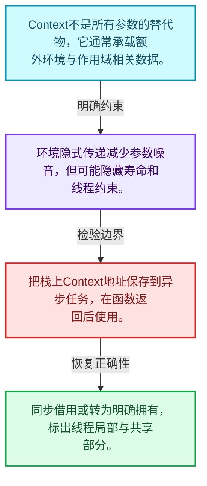
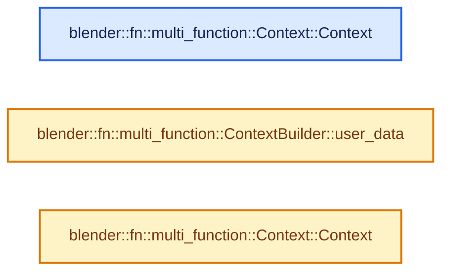
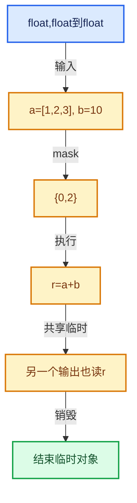

# 07-05 Context与临时资源

[方向导航](README.md) · [总目录](../README.md) · [实现索引](../%E7%AC%A6%E5%8F%B7%E4%BE%9D%E8%B5%96%E4%B8%8E%E5%AE%9E%E7%8E%B0%E7%B4%A2%E5%BC%95.md)

## 从问题到实现

共享环境和逐调用资源如何区分？

上下文传递额外环境，临时资源由对应作用域管理；异步延后使用不能借用已结束的上下文。

**数据模型**

Context不是所有参数的替代物，它通常承载额外环境与作用域相关数据。

**设计取舍**

环境隐式传递减少参数噪音，但可能隐藏寿命和线程约束。

**最小反例**

把栈上Context地址保存到异步任务，在函数返回后使用。

**推导**

同步借用或转为明确拥有，标出线程局部与共享部分。

## 阅读地图与执行推演








图中的数值推演是本方向的教学模型；实际函数之间的调用边与概念分析边分别标注，不能把概念关系当作运行时调度顺序。

## 完整源码单元与就地讲解

中文讲解直接放在相关代码旁，复杂机制在代码下展开。原文折叠区保留基准行号；不需要在行号表和函数之间来回查找。类布局可分段展示，函数实现不按固定行数切开。

### 类型布局、声明与编译条件 · FN_multi_function_context.hh L1—L33

<a id="t-38ec3a84c428"></a>

`Context`在这里声明的数据成员：

- `UserData user_data`

<a id="t-075a889c0930"></a>

<a id="t-2739d1e61ec3"></a>

`Context`在这里声明的数据成员：

- `UserData user_data`

<!-- annotated:7d3084528b3b80 -->

```cpp
/* SPDX-FileCopyrightText: 2023 Blender Authors
 *
 * SPDX-License-Identifier: GPL-2.0-or-later */

#pragma once

/** \file
 * \ingroup fn
 *
 * An #Context is passed along with every call to a multi-function. Right now it does nothing,
 * but it can be used for the following purposes:
 * - Pass debug information up and down the function call stack.
 * - Pass reusable memory buffers to sub-functions to increase performance.
 * - Pass cached data to called functions.
 */

#include "FN_user_data.hh"

namespace blender::fn::multi_function {

class Context;
class ContextBuilder;

class Context {
 public:
  /**
   * Custom user data that can be used in the function.
   */
  UserData *user_data = nullptr;

  friend ContextBuilder;

 private:
```

<details>
<summary>核对原始源码：source/blender/functions/FN_multi_function_context.hh · L1—L33</summary>

<!-- original:7d3084528b3b80:source/blender/functions/FN_multi_function_context.hh:1:33 -->

```cpp
/* SPDX-FileCopyrightText: 2023 Blender Authors
 *
 * SPDX-License-Identifier: GPL-2.0-or-later */

#pragma once

/** \file
 * \ingroup fn
 *
 * An #Context is passed along with every call to a multi-function. Right now it does nothing,
 * but it can be used for the following purposes:
 * - Pass debug information up and down the function call stack.
 * - Pass reusable memory buffers to sub-functions to increase performance.
 * - Pass cached data to called functions.
 */

#include "FN_user_data.hh"

namespace blender::fn::multi_function {

class Context;
class ContextBuilder;

class Context {
 public:
  /**
   * Custom user data that can be used in the function.
   */
  UserData *user_data = nullptr;

  friend ContextBuilder;

 private:
```

</details>

<a id="f-4781cb50eff6c508"></a>

### `blender::fn::multi_function::Context::Context`

实现位置：[source/blender/functions/FN_multi_function_context.hh](../../../../../source/blender/functions/FN_multi_function_context.hh) · L34—L34。

**教学注释版**

<!-- annotated:f2bccd4454d21c -->

```cpp
  Context() = default;
```

<details>
<summary>核对原始源码：source/blender/functions/FN_multi_function_context.hh · L34—L34</summary>

<!-- original:f2bccd4454d21c:source/blender/functions/FN_multi_function_context.hh:34:34 -->

```cpp
  Context() = default;
```

</details>

**继续追踪实现**

本实现没有需要继续展开的显式调用；检查返回表达式、对象转换和调用者前置条件。

### 类型布局、声明与编译条件 · FN_multi_function_context.hh L35—L46

<a id="t-ad356f9b1f2d"></a>

`ContextBuilder`在这里声明的数据成员：

- `Context context_`

<!-- annotated:3da79bbd8d7e17 -->

```cpp

 public:
  Context(ContextBuilder & /*builder*/);
};

class ContextBuilder {
 private:
  Context context_;

  friend Context;

 public:
```

<details>
<summary>核对原始源码：source/blender/functions/FN_multi_function_context.hh · L35—L46</summary>

<!-- original:3da79bbd8d7e17:source/blender/functions/FN_multi_function_context.hh:35:46 -->

```cpp

 public:
  Context(ContextBuilder & /*builder*/);
};

class ContextBuilder {
 private:
  Context context_;

  friend Context;

 public:
```

</details>

<a id="f-7723407b01c60bdb"></a>

### `blender::fn::multi_function::ContextBuilder::user_data`

实现位置：[source/blender/functions/FN_multi_function_context.hh](../../../../../source/blender/functions/FN_multi_function_context.hh) · L47—L50。

接口参数：

- `UserData *user_data`

**教学注释版**

<!-- annotated:a3e52111703b4f -->

```cpp
  void user_data(UserData *user_data)
  {
    context_.user_data = user_data;
  }
```

<details>
<summary>核对原始源码：source/blender/functions/FN_multi_function_context.hh · L47—L50</summary>

<!-- original:a3e52111703b4f:source/blender/functions/FN_multi_function_context.hh:47:50 -->

```cpp
  void user_data(UserData *user_data)
  {
    context_.user_data = user_data;
  }
```

</details>

**沿实际写入检查状态**

- `context_.user_data = user_data;`

**继续追踪实现**

本实现没有需要继续展开的显式调用；检查返回表达式、对象转换和调用者前置条件。

### 类型布局、声明与编译条件 · FN_multi_function_context.hh L51—L52

<!-- annotated:fc70bb34a4e3d1 -->

```cpp
};

```

<details>
<summary>核对原始源码：source/blender/functions/FN_multi_function_context.hh · L51—L52</summary>

<!-- original:fc70bb34a4e3d1:source/blender/functions/FN_multi_function_context.hh:51:52 -->

```cpp
};

```

</details>

<a id="f-70cf2d7805da577a"></a>

### `blender::fn::multi_function::Context::Context`

实现位置：[source/blender/functions/FN_multi_function_context.hh](../../../../../source/blender/functions/FN_multi_function_context.hh) · L53—L56。

接口参数：

- `ContextBuilder &builder`

**教学注释版**

<!-- annotated:9d7db3db6d927f -->

```cpp
inline Context::Context(ContextBuilder &builder)
{
  *this = builder.context_;
}
```

<details>
<summary>核对原始源码：source/blender/functions/FN_multi_function_context.hh · L53—L56</summary>

<!-- original:9d7db3db6d927f:source/blender/functions/FN_multi_function_context.hh:53:56 -->

```cpp
inline Context::Context(ContextBuilder &builder)
{
  *this = builder.context_;
}
```

</details>

**继续追踪实现**

本实现没有需要继续展开的显式调用；检查返回表达式、对象转换和调用者前置条件。

### 类型布局、声明与编译条件 · FN_multi_function_context.hh L57—L58

<!-- annotated:b7050f41458984 -->

```cpp

}  // namespace blender::fn::multi_function
```

<details>
<summary>核对原始源码：source/blender/functions/FN_multi_function_context.hh · L57—L58</summary>

<!-- original:b7050f41458984:source/blender/functions/FN_multi_function_context.hh:57:58 -->

```cpp

}  // namespace blender::fn::multi_function
```

</details>

## 语法与相关类型

### 受控访问 friend

friend授予指定函数或类访问非公开成员的权限，并不意味着继承，也不自动扩展到友元的派生类。

解释执行器为何需要访问包装器的内部映射，同时检查边界是否仍清楚。

## 实现练习与验证

画出调用者、Context和临时缓冲的寿命关系。

参考推理：同步借用或转为明确拥有，标出线程局部与共享部分。

签名与参数类型一致；指令读取前变量已定义；存储复用发生在最后使用和析构之后。

## 历史、跨库比较与证据

与std::function逐次调用和简单字节码解释器比较：批量接口可把动态分派放到循环外，Procedure额外表达变量寿命和控制流。

[历史提交索引](../%E5%8E%86%E5%8F%B2%E6%8F%90%E4%BA%A4%E4%B8%8E%E8%AE%BE%E8%AE%A1%E6%BC%94%E5%8C%96%E7%B4%A2%E5%BC%95.md) · [源码基准](../%E6%BA%90%E7%A0%81%E7%89%88%E6%9C%AC%E4%B8%8E%E8%A6%86%E7%9B%96%E7%B4%A2%E5%BC%95.md) · [验收报告](../%E9%AA%8C%E6%94%B6%E6%8A%A5%E5%91%8A.md)
