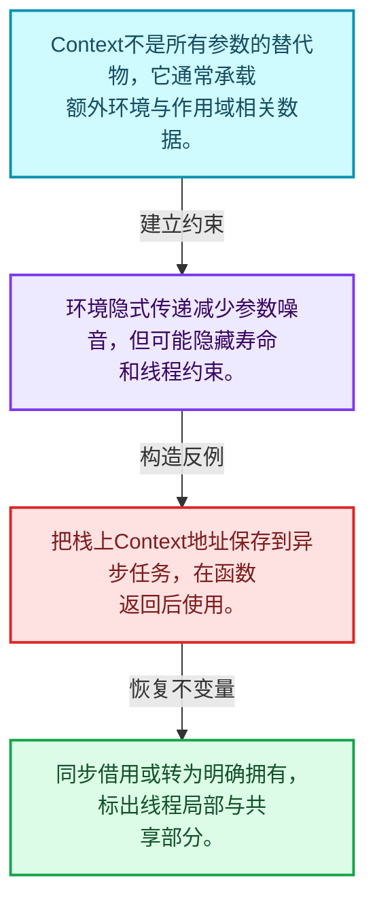
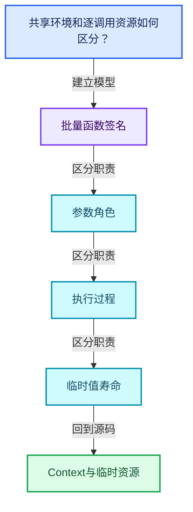
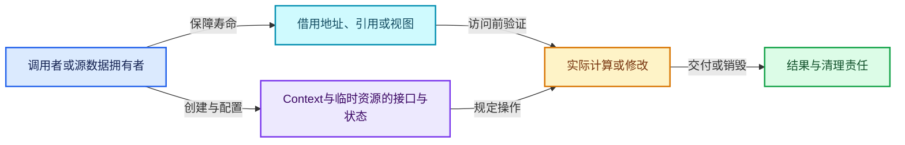
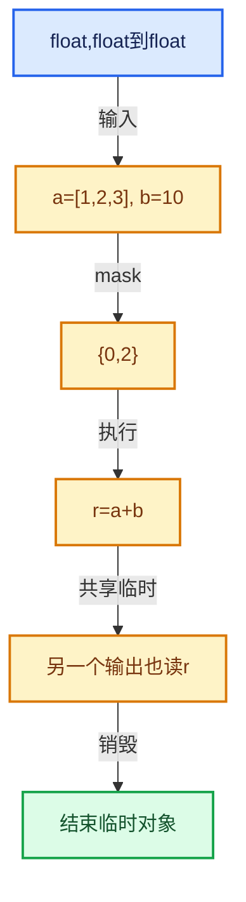

# 07-05 Context与临时资源

[方向导航](README.md) · [总目录](../README.md) · [覆盖索引](../%E6%BA%90%E7%A0%81%E7%89%88%E6%9C%AC%E4%B8%8E%E8%A6%86%E7%9B%96%E7%B4%A2%E5%BC%95.md)

> 阅读顺序：问题与数据模型 → 语法与类型 → 源码逐行 → 调用线索 → 历史与取舍 → 推演和练习。

- 基准 HEAD：`cbda6b96c26c0dee3c3b5cbb93960c4ac06a6b30`。
- 记录日期：2026-10-14。
- 教学示例状态：正文中的推演不是本机性能实测；已运行练习见验收报告。

## 一、从问题到设计

共享环境和逐调用资源如何区分？

上下文传递额外环境，临时资源由对应作用域管理；异步延后使用不能借用已结束的上下文。

本篇把语法、数据语义和系统取舍连接起来。把调用准备与元素循环分开，把值依赖与对象生存区间同时显式化。

### 本篇独立模型与设计推理

Context不是所有参数的替代物，它通常承载额外环境与作用域相关数据。

设计取舍：环境隐式传递减少参数噪音，但可能隐藏寿命和线程约束。

最小反例：把栈上Context地址保存到异步任务，在函数返回后使用。

推导与处理：同步借用或转为明确拥有，标出线程局部与共享部分。



### 源码范围与相邻篇章

| 文件 | 本篇逐行范围 | 基准SHA-256 |
|---|---|---|
| [source/blender/functions/FN_multi_function_context.hh](../../../../../source/blender/functions/FN_multi_function_context.hh) | L1—L58 | `a7fe3d7114c28383f801fdf081a104d6796365942f10dc609a2861ff463db0ac` |

同一主讲文件可能分多篇覆盖；超出本篇范围的符号通过覆盖索引定位。空行与纯注释保留在源码摘录中，逐行表解释有效语句与语法边界；许可证头统一保留。

前篇：[参数访问与输出构造](04-%E5%8F%82%E6%95%B0%E8%AE%BF%E9%97%AE%E4%B8%8E%E8%BE%93%E5%87%BA%E6%9E%84%E9%80%A0.md).

后篇：[函数构建器](06-%E5%87%BD%E6%95%B0%E6%9E%84%E5%BB%BA%E5%99%A8.md).

## 二、类型、数据与阅读地图



这是概念依赖图，边表示阅读关系，不声称是运行时调用顺序。

### 直接编译依赖


箭头只表示头文件包含关系；完整调用线索见后面的符号定位表。

## 三、关键词、语法与类型角色

### 受控访问 friend

friend授予指定函数或类访问非公开成员的权限，并不意味着继承，也不自动扩展到友元的派生类。

具体检查：解释执行器为何需要访问包装器的内部映射，同时检查边界是否仍清楚。

## 四、真实源码与逐行讲解

源码块保持原行内容，原始行号由小节标题及逐行表给出。表中的调用定位是静态阅读辅助；重载、模板实例化、宏展开和虚调用需结合完整声明，不能仅凭词法出现证明动态调用。

### FN_multi_function_context.hh：L1—L58

<!-- source:source/blender/functions/FN_multi_function_context.hh:1:58 -->

```cpp
/* SPDX-FileCopyrightText: 2023 Blender Authors
 *
 * SPDX-License-Identifier: GPL-2.0-or-later */

#pragma once

/** \file
 * \ingroup fn
 *
 * An #Context is passed along with every call to a multi-function. Right now it does nothing,
 * but it can be used for the following purposes:
 * - Pass debug information up and down the function call stack.
 * - Pass reusable memory buffers to sub-functions to increase performance.
 * - Pass cached data to called functions.
 */

#include "FN_user_data.hh"

namespace blender::fn::multi_function {

class Context;
class ContextBuilder;

class Context {
 public:
  /**
   * Custom user data that can be used in the function.
   */
  UserData *user_data = nullptr;

  friend ContextBuilder;

 private:
  Context() = default;

 public:
  Context(ContextBuilder & /*builder*/);
};

class ContextBuilder {
 private:
  Context context_;

  friend Context;

 public:
  void user_data(UserData *user_data)
  {
    context_.user_data = user_data;
  }
};

inline Context::Context(ContextBuilder &builder)
{
  *this = builder.context_;
}

}  // namespace blender::fn::multi_function
```

本段语义重点：

- `context_`：求值环境字段；FieldEvaluator以引用借用，其他类须按实际成员类型确认拥有关系。

| 原始行 | 语义、约束与检查 |
|---|---|
| L5 | 防止同一头文件在一个翻译单元中重复展开；不控制多个源文件之间的链接或对象寿命。 |
| L17 | 引入编译依赖 "FN_user_data.hh"；这是声明可见性关系，不表示运行时一定调用该文件的所有接口。 |
| L19 | 把后续声明放入 blender::fn::multi_function 命名空间，影响名称查找和符号归属，不创建运行时对象。 |
| L21 | 声明或定义类型 `class Context`。结合继承、访问权限和成员布局确认接口与拥有关系；前向声明本身没有完整对象布局。 |
| L22 | 声明或定义类型 `class ContextBuilder`。结合继承、访问权限和成员布局确认接口与拥有关系；前向声明本身没有完整对象布局。 |
| L24 | 声明或定义类型 `class Context`。结合继承、访问权限和成员布局确认接口与拥有关系；前向声明本身没有完整对象布局。 |
| L25 | 切换成员访问权限为 public；它是编译期接口边界，不是线程同步或内存保护。 |
| L29 | 把右侧 `nullptr` 用于初始化或更新左侧 `UserData *user_data`。声明初始化与已有对象赋值应按上下文区分；有资源的类型会调用相应特殊成员。 |
| L31 | 声明成员、局部对象或完成语句 `friend ContextBuilder`。若为指针或引用，它本身不说明拥有；若为值对象，其构造析构由所在作用域或外层对象管理。 |
| L33 | 切换成员访问权限为 private；它是编译期接口边界，不是线程同步或内存保护。 |
| L34 | 显式采用编译器生成的特殊成员行为：`Context() = default;`。成员和基类的性质决定该操作是否可用、是否被删除及异常约定，不表示运行时给对象赋值为default。 |
| L36 | 切换成员访问权限为 public；它是编译期接口边界，不是线程同步或内存保护。 |
| L37 | 出现调用或函数声明 `Context`，对应表达式为 `Context(ContextBuilder & );`。参数求值、返回类型与重载需结合前后完整语句；静态文本引用不能证明动态目标。 |
| L38 | 结束当前语法单元。局部自动对象在离开其作用域时按规则销毁；这不等于所有被引用的外部数据也被释放。 |
| L40 | 声明或定义类型 `class ContextBuilder`。结合继承、访问权限和成员布局确认接口与拥有关系；前向声明本身没有完整对象布局。 |
| L41 | 切换成员访问权限为 private；它是编译期接口边界，不是线程同步或内存保护。 |
| L42 | 本行涉及 `context_`：求值环境字段；FieldEvaluator以引用借用，其他类须按实际成员类型确认拥有关系。按此语义解读 `Context context_`，不要把地址、数量或状态混用。 |
| L44 | 声明成员、局部对象或完成语句 `friend Context`。若为指针或引用，它本身不说明拥有；若为值对象，其构造析构由所在作用域或外层对象管理。 |
| L46 | 切换成员访问权限为 public；它是编译期接口边界，不是线程同步或内存保护。 |
| L47 | 出现调用或函数声明 `user_data`，对应表达式为 `void user_data(UserData *user_data)`。参数求值、返回类型与重载需结合前后完整语句；静态文本引用不能证明动态目标。 |
| L48 | 连接上一行的声明或控制结构与其语句块；后续行在这个作用域中执行或声明。 |
| L49 | 建立或更新 `context_`：求值环境字段；FieldEvaluator以引用借用，其他类须按实际成员类型确认拥有关系。本行的具体值关系为 `context_.user_data = user_data`；对照更新前后相应范围或状态是否一致。 |
| L50 | 结束当前语法单元。局部自动对象在离开其作用域时按规则销毁；这不等于所有被引用的外部数据也被释放。 |
| L51 | 结束当前语法单元。局部自动对象在离开其作用域时按规则销毁；这不等于所有被引用的外部数据也被释放。 |
| L53 | 出现调用或函数声明 `Context::Context`，对应表达式为 `inline Context::Context(ContextBuilder &builder)`。参数求值、返回类型与重载需结合前后完整语句；静态文本引用不能证明动态目标。 |
| L54 | 连接上一行的声明或控制结构与其语句块；后续行在这个作用域中执行或声明。 |
| L55 | 建立或更新 `context_`：求值环境字段；FieldEvaluator以引用借用，其他类须按实际成员类型确认拥有关系。本行的具体值关系为 `*this = builder.context_`；对照更新前后相应范围或状态是否一致。 |
| L56 | 结束当前语法单元。局部自动对象在离开其作用域时按规则销毁；这不等于所有被引用的外部数据也被释放。 |
| L58 | 结束当前语法单元。局部自动对象在离开其作用域时按规则销毁；这不等于所有被引用的外部数据也被释放。 |

## 五、接口定位、调用线索与生命周期

### 本篇声明与实现入口

| 源码位置 | 实际声明片段 |
|---|---|
| [FN_multi_function_context.hh:L21](../../../../../source/blender/functions/FN_multi_function_context.hh#L21) | `class Context;` |
| [FN_multi_function_context.hh:L22](../../../../../source/blender/functions/FN_multi_function_context.hh#L22) | `class ContextBuilder;` |
| [FN_multi_function_context.hh:L24](../../../../../source/blender/functions/FN_multi_function_context.hh#L24) | `class Context` |
| [FN_multi_function_context.hh:L34](../../../../../source/blender/functions/FN_multi_function_context.hh#L34) | `Context() = default;` |
| [FN_multi_function_context.hh:L37](../../../../../source/blender/functions/FN_multi_function_context.hh#L37) | `Context(ContextBuilder & /*builder*/);` |
| [FN_multi_function_context.hh:L40](../../../../../source/blender/functions/FN_multi_function_context.hh#L40) | `class ContextBuilder` |
| [FN_multi_function_context.hh:L47](../../../../../source/blender/functions/FN_multi_function_context.hh#L47) | `void user_data(UserData *user_data)` |
| [FN_multi_function_context.hh:L53](../../../../../source/blender/functions/FN_multi_function_context.hh#L53) | `inline Context::Context(ContextBuilder &builder)` |

### 同名符号出现位置

以下表提供跨文件阅读入口，包含声明、调用或测试使用；没有经过完整C++名称解析，不把它命名为已证明的运行时调用图。

| 符号 | 位置 | 文本证据 |
|---|---|---|
| `Context` | [FN_lazy_function.hh:L99](../../../../../source/blender/functions/FN_lazy_function.hh#L99) | `Context(void *storage, UserData *user_data, LocalUserData *local_user_data)` |
| `user_data` | [FN_lazy_function.hh:L100](../../../../../source/blender/functions/FN_lazy_function.hh#L100) | `: storage(storage), user_data(user_data), local_user_data(local_user_data)` |
| `user_data` | [geometry_nodes_lazy_function.cc:L442](../../../../../source/blender/nodes/intern/geometry_nodes_lazy_function.cc#L442) | `context.user_data(user_data);` |

### 生命周期推理图



这是审查生命周期的通用模型。具体类是否拥有数据由本篇成员、构造、析构和调用者一起证明；任何箭头都不自动代表shared_ptr。

## 六、把代码放进具体数据中推演

本方向的共同数值模型如下。本篇的专门检查是：画出调用者、Context和临时缓冲的寿命关系。

| 步骤 | 数据或状态 | 为什么需要这一步 |
|---|---|---|
| 签名 | float,float到float | 输入输出序号与类型一致 |
| 输入 | a=[1,2,3], b=10 | b可保持单值表示 |
| mask | {0,2} | 只处理选中元素 |
| 执行 | r=a+b | 得到r0=11,r2=13 |
| 共享临时 | 另一个输出也读r | 最后使用前不能复用存储 |
| 销毁 | 结束临时对象 | 依据真实构造集合进行清理 |



图是教学推演模型；精确分支与状态更新以本篇摘录及调用契约为准。

### 本篇独立练习与参考思路

画出调用者、Context和临时缓冲的寿命关系。

参考思路：上下文传递额外环境，临时资源由对应作用域管理；异步延后使用不能借用已结束的上下文。

将输入、预期结果和资源责任分成三张清单。先用最直接的实现给出可核对的答案，再替换成对应源码使用的表示；比较结果不变的条件，而不是只比较接口名字。

验收依据：签名与参数类型一致；指令读取前变量已定义；存储复用发生在最后使用和析构之后。

## 七、复杂度、设计取舍与其他基础库

与std::function逐次调用和简单字节码解释器比较：批量接口可把动态分派放到循环外，Procedure额外表达变量寿命和控制流。

本篇的具体取舍：上下文传递额外环境，临时资源由对应作用域管理；异步延后使用不能借用已结束的上下文。

| 观察维度 | 从源码取得证据的方法 | 本篇要避免的误判 |
|---|---|---|
| 时间 | 对循环次数、分派次数和重建频率分别计数 | 看到单次常数操作就断定整个操作序列是常数成本 |
| 内存 | 区分对象本体、容量存储、间接资源和共享控制块 | 用sizeof代替总内存 |
| 安全 | 沿构造、失败回滚、销毁与失效逐路径检查 | 把断言或非空指针当作完整安全证明 |
| 并发 | 逐字段确认锁、发布顺序和借用寿命 | 把引用计数线程安全等同数据读写线程安全 |

相关一手资料：

- [C++公开工作草案](https://eel.is/c++draft/)：持续更新的工作草案；语言与标准库语义以相应章节为准。
- [Blender依赖图设计](https://developer.blender.org/docs/features/core/depsgraph/)：包含历史设计背景，当前行为以本地源码为准。

资料用于核对契约和进一步阅读；这里没有声称外部库与Blender实现相同，也没有把上游性能数字当作本机实测。

## 八、历史提交与设计演化

### 2020-06-16 · Jacques Lucke

[Functions: Multi Function](https://projects.blender.org/blender/blender/commit/4365de38700ccc05f98f601efdde0963de4645c1)

完整哈希：`4365de38700ccc05f98f601efdde0963de4645c1`。提交标题与作者日期来自本地Git对象。

提交说明原文（历史证据，不能直接作为当前API说明）：

```text
Functions: Multi Function

This adds the `MultiFunction` type and some smallish utility types that it uses.
A `MultiFunction` encapsulates a function that is optimized for throughput by
always processing many elements at once.

This is an important part of the new particle system, because it allows us to
execute user generated node trees for many particles efficiently.

Reviewers: brecht

Differential Revision: https://developer.blender.org/D8030
```

阅读任务：先根据说明复述旧问题，提出一个自己的修复方案，再对照diff。结合本篇重点“共享环境和逐调用资源如何区分？”判断方案改变的是表示、接口、生命周期还是调度。

## 九、反例、测试入口与掌握标准

需要实际构造的反例：

- 空输入或没有结果需求：确认接口允许的空状态与不允许访问的操作。
- 边界位置和退化结构：把长度为1、末尾位置、重复值或深链代入真实分支。
- 生命周期结束或修改之后：检查保存的指针、引用、结果视图是否仍有效。
- 与本篇核心不变量相冲突的输入：画出调用者、Context和临时缓冲的寿命关系。

### 可运行的教学参考程序

[reference_exercises.cc](../_tools/reference_exercises.cc)包含独立于Blender的C++20参考检查：视图、简化SmallVector、异常回滚、哈希碰撞与删除、偏移数组、拓扑映射、共享缓存、表达式、惰性分支、闭包和暴力最近邻。

参考程序有意省略生产实现的完整能力。例如SmallVector禁止复制移动容器，不支持只能移动的元素，并禁止append参数别名到自身元素；TinyMap固定8槽，不提供增长。程序通过不能替代Blender实现测试。实际运行结果、编译器与命令见验收报告。

掌握标准：离开源码解释“共享环境和逐调用资源如何区分？”；独立完成上述练习；能指出一个会破坏批量函数签名相关约束的最小反例，并用具体代码行说明检查或修复应放在哪里。
