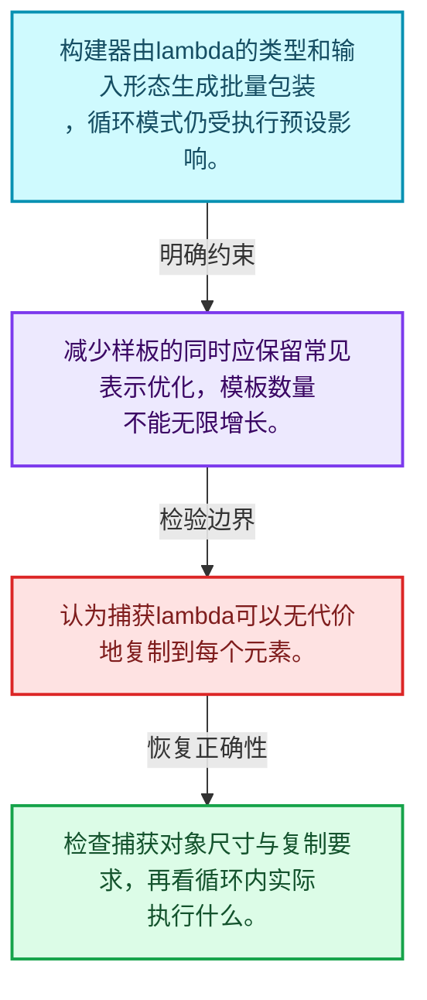
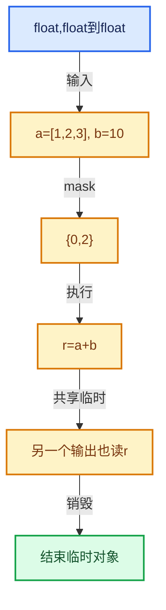

# 07-06 函数构建器

[方向导航](README.md) · [总目录](../README.md) · [实现索引](../00-课程指南/02-源码与提交索引/符号依赖与实现索引.md)

## 从问题到实现

怎样减少样板代码又保留高效实现？

构建器把常见函数形态映射为批量接口，模板推导和执行预设共同影响生成代码。

**数据模型**

构建器由lambda的类型和输入形态生成批量包装，循环模式仍受执行预设影响。

**设计取舍**

减少样板的同时应保留常见表示优化，模板数量不能无限增长。

**最小反例**

认为捕获lambda可以无代价地复制到每个元素。

**推导**

检查捕获对象尺寸与复制要求，再看循环内实际执行什么。

## 阅读地图与执行推演

```mermaid
flowchart LR
  F0["blender::fn::multi_function::build::exec_presets::AllSpanOrSingle::create_devirtualizers"]:::input
  F1["blender::fn::multi_function::build::exec_presets::SomeSpanOrSingle::create_devirtualizers"]:::compute
  F2["blender::fn::multi_function::build::detail::execute_array"]:::compute
  F3["blender::fn::multi_function::build::detail::execute_materialized_impl"]:::compute
  F4["blender::fn::multi_function::build::detail::execute_materialized"]:::compute
  F5["blender::fn::multi_function::build::detail::execute_element_fn_as_multi_function"]:::compute
  F6["blender::fn::multi_function::build::detail::build_multi_function_call_from_element_fn"]:::compute
  F7["blender::fn::multi_function::build::detail::CustomMF::CustomMF"]:::compute
  F4 -->|"实现调用"| F3
  F5 -->|"实现调用"| F0
  F5 -->|"实现调用"| F1
  F5 -->|"实现调用"| F2
  F5 -->|"实现调用"| F4
  F6 -->|"实现调用"| F5
  classDef input fill:#DBEAFE,stroke:#2563EB,color:#172554,stroke-width:2px;
  classDef data fill:#CFFAFE,stroke:#0891B2,color:#164E63,stroke-width:2px;
  classDef abstraction fill:#EDE9FE,stroke:#7C3AED,color:#3B0764,stroke-width:2px;
  classDef compute fill:#FEF3C7,stroke:#D97706,color:#78350F,stroke-width:2px;
  classDef result fill:#DCFCE7,stroke:#16A34A,color:#14532D,stroke-width:2px;
  classDef error fill:#FEE2E2,stroke:#DC2626,color:#7F1D1D,stroke-width:2px;
```








图中的数值推演是本方向的教学模型；实际函数之间的调用边与概念分析边分别标注，不能把概念关系当作运行时调度顺序。

## 完整源码单元与就地讲解

中文讲解直接放在相关代码旁，复杂机制在代码下展开。原文折叠区保留基准行号；不需要在行号表和函数之间来回查找。类布局可分段展示，函数实现不按固定行数切开。

### 类型布局、声明与编译条件 · FN_multi_function_builder.hh L1—L63

<a id="t-1545779d964a"></a>

<a id="t-b5cf7ac5a383"></a>

`Simple`在这里声明的数据成员：

- `bool use_devirtualization`
- `FallbackMode fallback_mode`

<a id="t-8600132b4621"></a>

`Materialized`在这里声明的数据成员：

- `bool use_devirtualization`
- `FallbackMode fallback_mode`

<a id="t-270ed26a4400"></a>

`AllSpanOrSingle`在这里声明的数据成员：

- `bool use_devirtualization`
- `FallbackMode fallback_mode`

<!-- annotated:00fe5a52e498f2 -->

```cpp
/* SPDX-FileCopyrightText: 2023 Blender Authors
 *
 * SPDX-License-Identifier: GPL-2.0-or-later */

#pragma once

/** \file
 * \ingroup fn
 *
 * This file contains several utilities to create multi-functions with less redundant code.
 */

#include "FN_multi_function.hh"

namespace blender {

namespace fn::multi_function::build {

/**
 * These presets determine what code is generated for a #CustomMF. Different presets make different
 * trade-offs between run-time performance and compile-time/binary size.
 */
namespace exec_presets {

/** Method to execute a function in case devirtualization was not possible. */
enum class FallbackMode {
  /** Access all elements in virtual arrays through virtual function calls. */
  Simple,
  /** Process elements in chunks to reduce virtual function call overhead. */
  Materialized,
};

/**
 * The "naive" method for executing a #CustomMF. Every element is processed separately and input
 * values are retrieved from the virtual arrays one by one. This generates the least amount of
 * code, but is also the slowest method.
 */
struct Simple {
  static constexpr bool use_devirtualization = false;
  static constexpr FallbackMode fallback_mode = FallbackMode::Simple;
};

/**
 * This is an improvement over the #Simple method. It still generates a relatively small amount of
 * code, because the function is only instantiated once. It's generally faster than #Simple,
 * because inputs are retrieved from the virtual arrays in chunks, reducing virtual method call
 * overhead.
 */
struct Materialized {
  static constexpr bool use_devirtualization = false;
  static constexpr FallbackMode fallback_mode = FallbackMode::Materialized;
};

/**
 * The most efficient preset, but also potentially generates a lot of code (exponential in the
 * number of inputs of the function). It generates separate optimized loops for all combinations of
 * inputs. This should be used for small functions of which all inputs are likely to be single
 * values or spans, and the number of inputs is relatively small.
 */
struct AllSpanOrSingle {
  static constexpr bool use_devirtualization = true;
  static constexpr FallbackMode fallback_mode = FallbackMode::Materialized;

```

<details>
<summary>核对原始源码：source/blender/functions/FN_multi_function_builder.hh · L1—L63</summary>

<!-- original:00fe5a52e498f2:source/blender/functions/FN_multi_function_builder.hh:1:63 -->

```cpp
/* SPDX-FileCopyrightText: 2023 Blender Authors
 *
 * SPDX-License-Identifier: GPL-2.0-or-later */

#pragma once

/** \file
 * \ingroup fn
 *
 * This file contains several utilities to create multi-functions with less redundant code.
 */

#include "FN_multi_function.hh"

namespace blender {

namespace fn::multi_function::build {

/**
 * These presets determine what code is generated for a #CustomMF. Different presets make different
 * trade-offs between run-time performance and compile-time/binary size.
 */
namespace exec_presets {

/** Method to execute a function in case devirtualization was not possible. */
enum class FallbackMode {
  /** Access all elements in virtual arrays through virtual function calls. */
  Simple,
  /** Process elements in chunks to reduce virtual function call overhead. */
  Materialized,
};

/**
 * The "naive" method for executing a #CustomMF. Every element is processed separately and input
 * values are retrieved from the virtual arrays one by one. This generates the least amount of
 * code, but is also the slowest method.
 */
struct Simple {
  static constexpr bool use_devirtualization = false;
  static constexpr FallbackMode fallback_mode = FallbackMode::Simple;
};

/**
 * This is an improvement over the #Simple method. It still generates a relatively small amount of
 * code, because the function is only instantiated once. It's generally faster than #Simple,
 * because inputs are retrieved from the virtual arrays in chunks, reducing virtual method call
 * overhead.
 */
struct Materialized {
  static constexpr bool use_devirtualization = false;
  static constexpr FallbackMode fallback_mode = FallbackMode::Materialized;
};

/**
 * The most efficient preset, but also potentially generates a lot of code (exponential in the
 * number of inputs of the function). It generates separate optimized loops for all combinations of
 * inputs. This should be used for small functions of which all inputs are likely to be single
 * values or spans, and the number of inputs is relatively small.
 */
struct AllSpanOrSingle {
  static constexpr bool use_devirtualization = true;
  static constexpr FallbackMode fallback_mode = FallbackMode::Materialized;

```

</details>

<a id="f-d0b73d395db68545"></a>

### `blender::fn::multi_function::build::exec_presets::AllSpanOrSingle::create_devirtualizers`

实现位置：[source/blender/functions/FN_multi_function_builder.hh](../../../../../source/blender/functions/FN_multi_function_builder.hh) · L64—L84。

接口参数：

- `TypeSequence<ParamTags...>`
- `std::index_sequence<I...>`
- `const std::tuple<LoadedParams...> &loaded_params`

**教学注释版**

<!-- annotated:8025a112d341bc -->

```cpp
  template<typename... ParamTags, typename... LoadedParams, size_t... I>
  auto create_devirtualizers(TypeSequence<ParamTags...> /*param_tags*/,
                             std::index_sequence<I...> /*indices*/,
                             const std::tuple<LoadedParams...> &loaded_params) const
  {
    return std::make_tuple([&]() {
      using ParamTag = ParamTags;
      using T = typename ParamTag::base_type;
      if constexpr (ParamTag::category == ParamCategory::SingleInput) {
        const GVArrayImpl &varray_impl = *std::get<I>(loaded_params);
        return GVArrayDevirtualizer<T, true, true>{varray_impl};
      }
      else if constexpr (ELEM(ParamTag::category,
                              ParamCategory::SingleOutput,
                              ParamCategory::SingleMutable))
      {
        T *ptr = std::get<I>(loaded_params);
        return BasicDevirtualizer<T *>{ptr};
      }
    }()...);
  }
```

<details>
<summary>核对原始源码：source/blender/functions/FN_multi_function_builder.hh · L64—L84</summary>

<!-- original:8025a112d341bc:source/blender/functions/FN_multi_function_builder.hh:64:84 -->

```cpp
  template<typename... ParamTags, typename... LoadedParams, size_t... I>
  auto create_devirtualizers(TypeSequence<ParamTags...> /*param_tags*/,
                             std::index_sequence<I...> /*indices*/,
                             const std::tuple<LoadedParams...> &loaded_params) const
  {
    return std::make_tuple([&]() {
      using ParamTag = ParamTags;
      using T = typename ParamTag::base_type;
      if constexpr (ParamTag::category == ParamCategory::SingleInput) {
        const GVArrayImpl &varray_impl = *std::get<I>(loaded_params);
        return GVArrayDevirtualizer<T, true, true>{varray_impl};
      }
      else if constexpr (ELEM(ParamTag::category,
                              ParamCategory::SingleOutput,
                              ParamCategory::SingleMutable))
      {
        T *ptr = std::get<I>(loaded_params);
        return BasicDevirtualizer<T *>{ptr};
      }
    }()...);
  }
```

</details>

**结果出口**

- `return std::make_tuple([&]() {`
- `return GVArrayDevirtualizer<T, true, true>{varray_impl};`
- `return BasicDevirtualizer<T *>{ptr};`

**继续追踪实现**

- `std::make_tuple` → [外部契约](https://eel.is/c++draft/)：这个边界按实际表达式及所属类型核对参数、返回值、寿命与失败行为。这里提供接口入口，不声称已解释该第三方版本的内部实现。
- `[&]() { using ParamTag = ParamTags; using T = typename ParamTag::base_type; if constexpr (ParamTag::category == ParamCategory::SingleInput) { const GVArrayImpl &varray_impl = *std: …（完整表达式见本函数源码）` → [调用协议](../00-课程指南/01-路线与规范/模板宏与动态分派协议.md)：函数指针、局部可调用对象或未展开的宏；必须结合调用者环境。调用位置L69。
- `std::get<I>` → [外部契约](https://eel.is/c++draft/)：这个边界按实际表达式及所属类型核对参数、返回值、寿命与失败行为。这里提供接口入口，不声称已解释该第三方版本的内部实现。
- `ELEM` → [ELEM · L88](../90-实现依赖专题/07-Intern运行时与平台/ghost/intern/GHOST_utildefines.hh.md#m-d28724a15928)；[ELEM · L135](../90-实现依赖专题/01-BLI基础库/BLI_utildefines.hh.md#m-d6572de7cae0)。宏定义由构建条件选择。

### 类型布局、声明与编译条件 · FN_multi_function_builder.hh L85—L95

<a id="t-5cf91a4b814c"></a>

`SomeSpanOrSingle`在这里声明的数据成员：

- `bool use_devirtualization`
- `FallbackMode fallback_mode`

<!-- annotated:19929bed0f54fd -->

```cpp
};

/**
 * A slightly weaker variant of #AllSpanOrSingle. It generates less code, because it assumes that
 * some of the inputs are most likely single values. It should be used for small functions which
 * have too many inputs to make #AllSingleOrSpan a reasonable choice.
 */
template<size_t... Indices> struct SomeSpanOrSingle {
  static constexpr bool use_devirtualization = true;
  static constexpr FallbackMode fallback_mode = FallbackMode::Materialized;

```

<details>
<summary>核对原始源码：source/blender/functions/FN_multi_function_builder.hh · L85—L95</summary>

<!-- original:19929bed0f54fd:source/blender/functions/FN_multi_function_builder.hh:85:95 -->

```cpp
};

/**
 * A slightly weaker variant of #AllSpanOrSingle. It generates less code, because it assumes that
 * some of the inputs are most likely single values. It should be used for small functions which
 * have too many inputs to make #AllSingleOrSpan a reasonable choice.
 */
template<size_t... Indices> struct SomeSpanOrSingle {
  static constexpr bool use_devirtualization = true;
  static constexpr FallbackMode fallback_mode = FallbackMode::Materialized;

```

</details>

<a id="f-44389c732e9cb04c"></a>

### `blender::fn::multi_function::build::exec_presets::SomeSpanOrSingle::create_devirtualizers`

实现位置：[source/blender/functions/FN_multi_function_builder.hh](../../../../../source/blender/functions/FN_multi_function_builder.hh) · L96—L118。

接口参数：

- `TypeSequence<ParamTags...>`
- `std::index_sequence<I...>`
- `const std::tuple<LoadedParams...> &loaded_params`

**教学注释版**

<!-- annotated:a610a821526f60 -->

```cpp
  template<typename... ParamTags, typename... LoadedParams, size_t... I>
  auto create_devirtualizers(TypeSequence<ParamTags...> /*param_tags*/,
                             std::index_sequence<I...> /*indices*/,
                             const std::tuple<LoadedParams...> &loaded_params) const
  {
    return std::make_tuple([&]() {
      using ParamTag = ParamTags;
      using T = typename ParamTag::base_type;

      if constexpr (ParamTag::category == ParamCategory::SingleInput) {
        constexpr bool UseSpan = ValueSequence<size_t, Indices...>::template contains<I>();
        const GVArrayImpl &varray_impl = *std::get<I>(loaded_params);
        return GVArrayDevirtualizer<T, true, UseSpan>{varray_impl};
      }
      else if constexpr (ELEM(ParamTag::category,
                              ParamCategory::SingleOutput,
                              ParamCategory::SingleMutable))
      {
        T *ptr = std::get<I>(loaded_params);
        return BasicDevirtualizer<T *>{ptr};
      }
    }()...);
  }
```

<details>
<summary>核对原始源码：source/blender/functions/FN_multi_function_builder.hh · L96—L118</summary>

<!-- original:a610a821526f60:source/blender/functions/FN_multi_function_builder.hh:96:118 -->

```cpp
  template<typename... ParamTags, typename... LoadedParams, size_t... I>
  auto create_devirtualizers(TypeSequence<ParamTags...> /*param_tags*/,
                             std::index_sequence<I...> /*indices*/,
                             const std::tuple<LoadedParams...> &loaded_params) const
  {
    return std::make_tuple([&]() {
      using ParamTag = ParamTags;
      using T = typename ParamTag::base_type;

      if constexpr (ParamTag::category == ParamCategory::SingleInput) {
        constexpr bool UseSpan = ValueSequence<size_t, Indices...>::template contains<I>();
        const GVArrayImpl &varray_impl = *std::get<I>(loaded_params);
        return GVArrayDevirtualizer<T, true, UseSpan>{varray_impl};
      }
      else if constexpr (ELEM(ParamTag::category,
                              ParamCategory::SingleOutput,
                              ParamCategory::SingleMutable))
      {
        T *ptr = std::get<I>(loaded_params);
        return BasicDevirtualizer<T *>{ptr};
      }
    }()...);
  }
```

</details>

**结果出口**

- `return std::make_tuple([&]() {`
- `return GVArrayDevirtualizer<T, true, UseSpan>{varray_impl};`
- `return BasicDevirtualizer<T *>{ptr};`

**继续追踪实现**

- `std::make_tuple` → [外部契约](https://eel.is/c++draft/)：这个边界按实际表达式及所属类型核对参数、返回值、寿命与失败行为。这里提供接口入口，不声称已解释该第三方版本的内部实现。
- `[&]() { using ParamTag = ParamTags; using T = typename ParamTag::base_type; if constexpr (ParamTag::category == ParamCategory::SingleInput) { constexpr bool UseSpan = ValueSequence …（完整表达式见本函数源码）` → [调用协议](../00-课程指南/01-路线与规范/模板宏与动态分派协议.md)：函数指针、局部可调用对象或未展开的宏；必须结合调用者环境。调用位置L101。
- `ValueSequence<size_t, Indices...>::template contains<I>` → [blender::ValueSequence](../90-实现依赖专题/01-BLI基础库/BLI_parameter_pack_utils.hh.md#t-218a2a043f3f)。
- `std::get<I>` → [外部契约](https://eel.is/c++draft/)：这个边界按实际表达式及所属类型核对参数、返回值、寿命与失败行为。这里提供接口入口，不声称已解释该第三方版本的内部实现。
- `ELEM` → [ELEM · L88](../90-实现依赖专题/07-Intern运行时与平台/ghost/intern/GHOST_utildefines.hh.md#m-d28724a15928)；[ELEM · L135](../90-实现依赖专题/01-BLI基础库/BLI_utildefines.hh.md#m-d6572de7cae0)。宏定义由构建条件选择。

### 类型布局、声明与编译条件 · FN_multi_function_builder.hh L119—L135

<!-- annotated:8126edeeba91b4 -->

```cpp
};

}  // namespace exec_presets

namespace detail {

/**
 * Executes #element_fn for all indices in the mask. The passed in #args contain the input as well
 * as output parameters. Usually types in #args are devirtualized (e.g. a `Span<int>` is passed in
 * instead of a `VArray<int>`).
 */
template<typename MaskT, typename... Args, typename ElementFn>
/* Perform additional optimizations on this loop because it is a very hot loop. For example, the
 * math node in geometry nodes is processed here. */
#if (defined(__GNUC__) && !defined(__clang__))
[[gnu::optimize("-funroll-loops")]] [[gnu::optimize("O3")]]
#endif
```

<details>
<summary>核对原始源码：source/blender/functions/FN_multi_function_builder.hh · L119—L135</summary>

<!-- original:8126edeeba91b4:source/blender/functions/FN_multi_function_builder.hh:119:135 -->

```cpp
};

}  // namespace exec_presets

namespace detail {

/**
 * Executes #element_fn for all indices in the mask. The passed in #args contain the input as well
 * as output parameters. Usually types in #args are devirtualized (e.g. a `Span<int>` is passed in
 * instead of a `VArray<int>`).
 */
template<typename MaskT, typename... Args, typename ElementFn>
/* Perform additional optimizations on this loop because it is a very hot loop. For example, the
 * math node in geometry nodes is processed here. */
#if (defined(__GNUC__) && !defined(__clang__))
[[gnu::optimize("-funroll-loops")]] [[gnu::optimize("O3")]]
#endif
```

</details>

<a id="f-6f09ff1962422578"></a>

### `blender::fn::multi_function::build::detail::execute_array`

实现位置：[source/blender/functions/FN_multi_function_builder.hh](../../../../../source/blender/functions/FN_multi_function_builder.hh) · L136—L155。

接口参数：

- `const ElementFn &element_fn`
- `MaskT mask`

**教学注释版**

<!-- annotated:6dbdc21516651b -->

```cpp
inline void execute_array(const ElementFn &element_fn,
                          MaskT mask,
                          /* Use restrict to tell the compiler that pointer inputs do not alias
                           * each other. This is important for some compiler optimizations. */
                          Args &&__restrict... args)
{
  if constexpr (std::is_same_v<std::decay_t<MaskT>, IndexRange>) {
    /* Having this explicit loop is necessary for MSVC to be able to vectorize this. */
    const int64_t start = mask.start();
    const int64_t end = mask.one_after_last();
    for (int64_t i = start; i < end; i++) {
      element_fn(args[i]...);
    }
  }
  else {
    for (const int64_t i : mask) {
      element_fn(args[i]...);
    }
  }
}
```

<details>
<summary>核对原始源码：source/blender/functions/FN_multi_function_builder.hh · L136—L155</summary>

<!-- original:6dbdc21516651b:source/blender/functions/FN_multi_function_builder.hh:136:155 -->

```cpp
inline void execute_array(const ElementFn &element_fn,
                          MaskT mask,
                          /* Use restrict to tell the compiler that pointer inputs do not alias
                           * each other. This is important for some compiler optimizations. */
                          Args &&__restrict... args)
{
  if constexpr (std::is_same_v<std::decay_t<MaskT>, IndexRange>) {
    /* Having this explicit loop is necessary for MSVC to be able to vectorize this. */
    const int64_t start = mask.start();
    const int64_t end = mask.one_after_last();
    for (int64_t i = start; i < end; i++) {
      element_fn(args[i]...);
    }
  }
  else {
    for (const int64_t i : mask) {
      element_fn(args[i]...);
    }
  }
}
```

</details>

**继续追踪实现**

- `mask.start` → [调用协议](../00-课程指南/01-路线与规范/模板宏与动态分派协议.md)：由接收对象具体类型或运行时策略提供实现。调用位置L144。
- `mask.one_after_last` → [调用协议](../00-课程指南/01-路线与规范/模板宏与动态分派协议.md)：由接收对象具体类型或运行时策略提供实现。调用位置L145。
- `element_fn` → [调用协议](../00-课程指南/01-路线与规范/模板宏与动态分派协议.md)：局部可调用对象，须结合其初始化与捕获环境。调用位置L147。

### 类型布局、声明与编译条件 · FN_multi_function_builder.hh L156—L171

<a id="t-7eab348f1f5e"></a>

<a id="t-35f130766e74"></a>

`MaterializeArgInfo`在这里声明的数据成员：

- `MaterializeArgMode mode`
- `typename ParamTag::base_type internal_span_data`

<!-- annotated:9f1442cc93b946 -->

```cpp

enum class MaterializeArgMode {
  Unknown,
  Single,
  Span,
  Materialized,
};

template<typename ParamTag> struct MaterializeArgInfo {
  MaterializeArgMode mode = MaterializeArgMode::Unknown;
  const typename ParamTag::base_type *internal_span_data;
};

/**
 * Similar to #execute_array but is only used with arrays and does not need a mask.
 */
```

<details>
<summary>核对原始源码：source/blender/functions/FN_multi_function_builder.hh · L156—L171</summary>

<!-- original:9f1442cc93b946:source/blender/functions/FN_multi_function_builder.hh:156:171 -->

```cpp

enum class MaterializeArgMode {
  Unknown,
  Single,
  Span,
  Materialized,
};

template<typename ParamTag> struct MaterializeArgInfo {
  MaterializeArgMode mode = MaterializeArgMode::Unknown;
  const typename ParamTag::base_type *internal_span_data;
};

/**
 * Similar to #execute_array but is only used with arrays and does not need a mask.
 */
```

</details>

<a id="f-4ddc7038cb502dfe"></a>

### `blender::fn::multi_function::build::detail::execute_materialized_impl`

实现位置：[source/blender/functions/FN_multi_function_builder.hh](../../../../../source/blender/functions/FN_multi_function_builder.hh) · L172—L184。

接口参数：

- `TypeSequence<ParamTags...>`
- `const ElementFn &element_fn`
- `const int64_t size`

**教学注释版**

<!-- annotated:f894799e504e66 -->

```cpp
template<typename... ParamTags, typename ElementFn, typename... Chunks>
#if (defined(__GNUC__) && !defined(__clang__))
[[gnu::optimize("-funroll-loops")]] [[gnu::optimize("O3")]]
#endif
inline void execute_materialized_impl(TypeSequence<ParamTags...> /*param_tags*/,
                                      const ElementFn &element_fn,
                                      const int64_t size,
                                      Chunks &&__restrict... chunks)
{
  for (int64_t i = 0; i < size; i++) {
    element_fn(chunks[i]...);
  }
}
```

<details>
<summary>核对原始源码：source/blender/functions/FN_multi_function_builder.hh · L172—L184</summary>

<!-- original:f894799e504e66:source/blender/functions/FN_multi_function_builder.hh:172:184 -->

```cpp
template<typename... ParamTags, typename ElementFn, typename... Chunks>
#if (defined(__GNUC__) && !defined(__clang__))
[[gnu::optimize("-funroll-loops")]] [[gnu::optimize("O3")]]
#endif
inline void execute_materialized_impl(TypeSequence<ParamTags...> /*param_tags*/,
                                      const ElementFn &element_fn,
                                      const int64_t size,
                                      Chunks &&__restrict... chunks)
{
  for (int64_t i = 0; i < size; i++) {
    element_fn(chunks[i]...);
  }
}
```

</details>

**继续追踪实现**

- `element_fn` → [调用协议](../00-课程指南/01-路线与规范/模板宏与动态分派协议.md)：局部可调用对象，须结合其初始化与捕获环境。调用位置L182。

### 类型布局、声明与编译条件 · FN_multi_function_builder.hh L185—L190

<!-- annotated:b8bafe5b6042f0 -->

```cpp

/**
 * Executes #element_fn for all indices in #mask. However, instead of processing every element
 * separately, processing happens in chunks. This allows retrieving from input virtual arrays in
 * chunks, which reduces virtual function call overhead.
 */
```

<details>
<summary>核对原始源码：source/blender/functions/FN_multi_function_builder.hh · L185—L190</summary>

<!-- original:b8bafe5b6042f0:source/blender/functions/FN_multi_function_builder.hh:185:190 -->

```cpp

/**
 * Executes #element_fn for all indices in #mask. However, instead of processing every element
 * separately, processing happens in chunks. This allows retrieving from input virtual arrays in
 * chunks, which reduces virtual function call overhead.
 */
```

</details>

<a id="f-9c0347cadbb9d363"></a>

### `blender::fn::multi_function::build::detail::execute_materialized`

实现位置：[source/blender/functions/FN_multi_function_builder.hh](../../../../../source/blender/functions/FN_multi_function_builder.hh) · L191—L378。

接口参数：

- `TypeSequence<ParamTags...>`
- `std::index_sequence<I...>`
- `const ElementFn &element_fn`
- `const IndexMaskSegment mask`
- `const std::tuple<LoadedParams...> &loaded_params`

**教学注释版**

<!-- annotated:4881a1d658f23d -->

```cpp
template<typename... ParamTags, size_t... I, typename ElementFn, typename... LoadedParams>
inline void execute_materialized(TypeSequence<ParamTags...> /*param_tags*/,
                                 std::index_sequence<I...> /*indices*/,
                                 const ElementFn &element_fn,
                                 const IndexMaskSegment mask,
                                 const std::tuple<LoadedParams...> &loaded_params)
{

  /* In theory, all elements could be processed in one chunk. However, that has the disadvantage
   * that large temporary arrays are needed. Using small chunks allows using small arrays, which
   * are reused multiple times, which improves cache efficiency. The chunk size also shouldn't be
   * too small, because then overhead of the outer loop over chunks becomes significant again. */
  static constexpr int64_t MaxChunkSize = 64;
  const int64_t mask_size = mask.size();
  // [讲解] std::min：按比较关系选取较小值；截断范围时还需先满足非负和可表示范围，min本身不会证明边界安全。
  const int64_t tmp_buffer_size = std::min(mask_size, MaxChunkSize);

  /* Local buffers that are used to temporarily store values for processing. */
  std::tuple<TypedBuffer<typename ParamTags::base_type, MaxChunkSize>...> temporary_buffers;

  /* Information about every parameter. */
  std::tuple<MaterializeArgInfo<ParamTags>...> args_info;

  (
      /* Setup information for all parameters. */
      [&] {
        /* Use `typedef` instead of `using` to work around a compiler bug. */
        using ParamTag = ParamTags;
        using T = typename ParamTag::base_type;
        [[maybe_unused]] MaterializeArgInfo<ParamTags> &arg_info = std::get<I>(args_info);
        if constexpr (ParamTag::category == ParamCategory::SingleInput) {
          const GVArrayImpl &varray_impl = *std::get<I>(loaded_params);
          const CommonVArrayInfo common_info = varray_impl.common_info();
          if (common_info.type == CommonVArrayInfo::Type::Single) {
            /* If an input #VArray is a single value, we have to fill the buffer with that value
             * only once. The same unchanged buffer can then be reused in every chunk. */
            const T &in_single = *static_cast<const T *>(common_info.data);
            T *tmp_buffer = std::get<I>(temporary_buffers).ptr();
            // [讲解] uninitialized_fill_n：从同一个value复制构造目标n个T。
            uninitialized_fill_n(tmp_buffer, tmp_buffer_size, in_single);
            arg_info.mode = MaterializeArgMode::Single;
          }
          else if (common_info.type == CommonVArrayInfo::Type::Span) {
            /* Remember the span so that it doesn't have to be retrieved in every iteration. */
            arg_info.internal_span_data = static_cast<const T *>(common_info.data);
          }
          else {
            arg_info.internal_span_data = nullptr;
          }
        }
      }(),
      ...);

  IndexMaskFromSegment index_mask_from_segment;
  const int64_t segment_offset = mask.offset();

  /* Outer loop over all chunks. */
  for (int64_t chunk_start = 0; chunk_start < mask_size; chunk_start += MaxChunkSize) {
    const int64_t chunk_end = std::min<int64_t>(chunk_start + MaxChunkSize, mask_size);
    const int64_t chunk_size = chunk_end - chunk_start;
    const IndexMaskSegment sliced_mask = mask.slice(chunk_start, chunk_size);
    const int64_t mask_start = sliced_mask[0];
    const bool sliced_mask_is_range = unique_sorted_indices::non_empty_is_range(
        sliced_mask.base_span());

    /* Move mutable data into temporary array. */
    if (!sliced_mask_is_range) {
      (
          [&] {
            /* Use `typedef` instead of `using` to work around a compiler bug. */
            using ParamTag = ParamTags;
            using T = typename ParamTag::base_type;
            if constexpr (ParamTag::category == ParamCategory::SingleMutable) {
              T *tmp_buffer = std::get<I>(temporary_buffers).ptr();
              T *param_buffer = std::get<I>(loaded_params);
              for (int64_t i = 0; i < chunk_size; i++) {
                // [讲解] std::move：把表达式转换成可供移动重载选择的值类别；不保证真的移动，不结束源对象寿命，对const值可能选择复制。
                new (tmp_buffer + i) T(std::move(param_buffer[sliced_mask[i]]));
              }
            }
          }(),
          ...);
    }

    const IndexMask *current_segment_mask = nullptr;

    execute_materialized_impl(
        TypeSequence<ParamTags...>(),
        element_fn,
        chunk_size,
        /* Prepare every parameter for this chunk. */
        [&] {
          using ParamTag = ParamTags;
          using T = typename ParamTag::base_type;
          [[maybe_unused]] MaterializeArgInfo<ParamTags> &arg_info = std::get<I>(args_info);
          T *tmp_buffer = std::get<I>(temporary_buffers);
          if constexpr (ParamTag::category == ParamCategory::SingleInput) {
            if (arg_info.mode == MaterializeArgMode::Single) {
              /* The single value has been filled into a buffer already reused for every chunk. */
              return const_cast<const T *>(tmp_buffer);
            }
            if (sliced_mask_is_range && arg_info.internal_span_data != nullptr) {
              /* In this case we can just use an existing span instead of "compressing" it into
               * a new temporary buffer. */
              arg_info.mode = MaterializeArgMode::Span;
              return arg_info.internal_span_data + mask_start;
            }
            const GVArrayImpl &varray_impl = *std::get<I>(loaded_params);
            if (current_segment_mask == nullptr) {
              current_segment_mask = &index_mask_from_segment.update(
                  {segment_offset, sliced_mask.base_span()});
            }
            /* As a fallback, do a virtual function call to retrieve all elements in the current
             * chunk. The elements are stored in a temporary buffer reused for every chunk. */
            varray_impl.materialize_compressed(*current_segment_mask, tmp_buffer, true);
            /* Remember that this parameter has been materialized, so that the values are
             * destructed properly when the chunk is done. */
            arg_info.mode = MaterializeArgMode::Materialized;
            return const_cast<const T *>(tmp_buffer);
          }
          else if constexpr (ELEM(ParamTag::category,
                                  ParamCategory::SingleOutput,
                                  ParamCategory::SingleMutable))
          {
            /* For outputs, just pass a pointer. This is important so that `__restrict` works. */
            if (sliced_mask_is_range) {
              /* Can write into the caller-provided buffer directly. */
              T *param_buffer = std::get<I>(loaded_params);
              return param_buffer + mask_start;
            }
            /* Use the temporary buffer. The values will have to be copied out of that
             * buffer into the caller-provided buffer afterwards. */
            return tmp_buffer;
          }
        }()...);

    /* Relocate outputs from temporary buffers to buffers provided by caller. */
    if (!sliced_mask_is_range) {
      (
          [&] {
            /* Use `typedef` instead of `using` to work around a compiler bug. */
            using ParamTag = ParamTags;
            using T = typename ParamTag::base_type;
            if constexpr (ELEM(ParamTag::category,
                               ParamCategory::SingleOutput,
                               ParamCategory::SingleMutable))
            {
              T *tmp_buffer = std::get<I>(temporary_buffers).ptr();
              T *param_buffer = std::get<I>(loaded_params);
              for (int64_t i = 0; i < chunk_size; i++) {
                new (param_buffer + sliced_mask[i]) T(std::move(tmp_buffer[i]));
                std::destroy_at(tmp_buffer + i);
              }
            }
          }(),
          ...);
    }

    (
        /* Destruct values that have been materialized before. */
        [&] {
          /* Use `typedef` instead of `using` to work around a compiler bug. */
          using ParamTag = ParamTags;
          using T = typename ParamTag::base_type;
          [[maybe_unused]] MaterializeArgInfo<ParamTags> &arg_info = std::get<I>(args_info);
          if constexpr (ParamTag::category == ParamCategory::SingleInput) {
            if (arg_info.mode == MaterializeArgMode::Materialized) {
              T *tmp_buffer = std::get<I>(temporary_buffers).ptr();
              destruct_n(tmp_buffer, chunk_size);
            }
          }
        }(),
        ...);
  }

  (
      /* Destruct buffers for single value inputs. */
      [&] {
        /* Use `typedef` instead of `using` to work around a compiler bug. */
        using ParamTag = ParamTags;
        using T = typename ParamTag::base_type;
        [[maybe_unused]] MaterializeArgInfo<ParamTags> &arg_info = std::get<I>(args_info);
        if constexpr (ParamTag::category == ParamCategory::SingleInput) {
          if (arg_info.mode == MaterializeArgMode::Single) {
            T *tmp_buffer = std::get<I>(temporary_buffers).ptr();
            destruct_n(tmp_buffer, tmp_buffer_size);
          }
        }
      }(),
      ...);
}
```

<details>
<summary>核对原始源码：source/blender/functions/FN_multi_function_builder.hh · L191—L378</summary>

<!-- original:4881a1d658f23d:source/blender/functions/FN_multi_function_builder.hh:191:378 -->

```cpp
template<typename... ParamTags, size_t... I, typename ElementFn, typename... LoadedParams>
inline void execute_materialized(TypeSequence<ParamTags...> /*param_tags*/,
                                 std::index_sequence<I...> /*indices*/,
                                 const ElementFn &element_fn,
                                 const IndexMaskSegment mask,
                                 const std::tuple<LoadedParams...> &loaded_params)
{

  /* In theory, all elements could be processed in one chunk. However, that has the disadvantage
   * that large temporary arrays are needed. Using small chunks allows using small arrays, which
   * are reused multiple times, which improves cache efficiency. The chunk size also shouldn't be
   * too small, because then overhead of the outer loop over chunks becomes significant again. */
  static constexpr int64_t MaxChunkSize = 64;
  const int64_t mask_size = mask.size();
  const int64_t tmp_buffer_size = std::min(mask_size, MaxChunkSize);

  /* Local buffers that are used to temporarily store values for processing. */
  std::tuple<TypedBuffer<typename ParamTags::base_type, MaxChunkSize>...> temporary_buffers;

  /* Information about every parameter. */
  std::tuple<MaterializeArgInfo<ParamTags>...> args_info;

  (
      /* Setup information for all parameters. */
      [&] {
        /* Use `typedef` instead of `using` to work around a compiler bug. */
        using ParamTag = ParamTags;
        using T = typename ParamTag::base_type;
        [[maybe_unused]] MaterializeArgInfo<ParamTags> &arg_info = std::get<I>(args_info);
        if constexpr (ParamTag::category == ParamCategory::SingleInput) {
          const GVArrayImpl &varray_impl = *std::get<I>(loaded_params);
          const CommonVArrayInfo common_info = varray_impl.common_info();
          if (common_info.type == CommonVArrayInfo::Type::Single) {
            /* If an input #VArray is a single value, we have to fill the buffer with that value
             * only once. The same unchanged buffer can then be reused in every chunk. */
            const T &in_single = *static_cast<const T *>(common_info.data);
            T *tmp_buffer = std::get<I>(temporary_buffers).ptr();
            uninitialized_fill_n(tmp_buffer, tmp_buffer_size, in_single);
            arg_info.mode = MaterializeArgMode::Single;
          }
          else if (common_info.type == CommonVArrayInfo::Type::Span) {
            /* Remember the span so that it doesn't have to be retrieved in every iteration. */
            arg_info.internal_span_data = static_cast<const T *>(common_info.data);
          }
          else {
            arg_info.internal_span_data = nullptr;
          }
        }
      }(),
      ...);

  IndexMaskFromSegment index_mask_from_segment;
  const int64_t segment_offset = mask.offset();

  /* Outer loop over all chunks. */
  for (int64_t chunk_start = 0; chunk_start < mask_size; chunk_start += MaxChunkSize) {
    const int64_t chunk_end = std::min<int64_t>(chunk_start + MaxChunkSize, mask_size);
    const int64_t chunk_size = chunk_end - chunk_start;
    const IndexMaskSegment sliced_mask = mask.slice(chunk_start, chunk_size);
    const int64_t mask_start = sliced_mask[0];
    const bool sliced_mask_is_range = unique_sorted_indices::non_empty_is_range(
        sliced_mask.base_span());

    /* Move mutable data into temporary array. */
    if (!sliced_mask_is_range) {
      (
          [&] {
            /* Use `typedef` instead of `using` to work around a compiler bug. */
            using ParamTag = ParamTags;
            using T = typename ParamTag::base_type;
            if constexpr (ParamTag::category == ParamCategory::SingleMutable) {
              T *tmp_buffer = std::get<I>(temporary_buffers).ptr();
              T *param_buffer = std::get<I>(loaded_params);
              for (int64_t i = 0; i < chunk_size; i++) {
                new (tmp_buffer + i) T(std::move(param_buffer[sliced_mask[i]]));
              }
            }
          }(),
          ...);
    }

    const IndexMask *current_segment_mask = nullptr;

    execute_materialized_impl(
        TypeSequence<ParamTags...>(),
        element_fn,
        chunk_size,
        /* Prepare every parameter for this chunk. */
        [&] {
          using ParamTag = ParamTags;
          using T = typename ParamTag::base_type;
          [[maybe_unused]] MaterializeArgInfo<ParamTags> &arg_info = std::get<I>(args_info);
          T *tmp_buffer = std::get<I>(temporary_buffers);
          if constexpr (ParamTag::category == ParamCategory::SingleInput) {
            if (arg_info.mode == MaterializeArgMode::Single) {
              /* The single value has been filled into a buffer already reused for every chunk. */
              return const_cast<const T *>(tmp_buffer);
            }
            if (sliced_mask_is_range && arg_info.internal_span_data != nullptr) {
              /* In this case we can just use an existing span instead of "compressing" it into
               * a new temporary buffer. */
              arg_info.mode = MaterializeArgMode::Span;
              return arg_info.internal_span_data + mask_start;
            }
            const GVArrayImpl &varray_impl = *std::get<I>(loaded_params);
            if (current_segment_mask == nullptr) {
              current_segment_mask = &index_mask_from_segment.update(
                  {segment_offset, sliced_mask.base_span()});
            }
            /* As a fallback, do a virtual function call to retrieve all elements in the current
             * chunk. The elements are stored in a temporary buffer reused for every chunk. */
            varray_impl.materialize_compressed(*current_segment_mask, tmp_buffer, true);
            /* Remember that this parameter has been materialized, so that the values are
             * destructed properly when the chunk is done. */
            arg_info.mode = MaterializeArgMode::Materialized;
            return const_cast<const T *>(tmp_buffer);
          }
          else if constexpr (ELEM(ParamTag::category,
                                  ParamCategory::SingleOutput,
                                  ParamCategory::SingleMutable))
          {
            /* For outputs, just pass a pointer. This is important so that `__restrict` works. */
            if (sliced_mask_is_range) {
              /* Can write into the caller-provided buffer directly. */
              T *param_buffer = std::get<I>(loaded_params);
              return param_buffer + mask_start;
            }
            /* Use the temporary buffer. The values will have to be copied out of that
             * buffer into the caller-provided buffer afterwards. */
            return tmp_buffer;
          }
        }()...);

    /* Relocate outputs from temporary buffers to buffers provided by caller. */
    if (!sliced_mask_is_range) {
      (
          [&] {
            /* Use `typedef` instead of `using` to work around a compiler bug. */
            using ParamTag = ParamTags;
            using T = typename ParamTag::base_type;
            if constexpr (ELEM(ParamTag::category,
                               ParamCategory::SingleOutput,
                               ParamCategory::SingleMutable))
            {
              T *tmp_buffer = std::get<I>(temporary_buffers).ptr();
              T *param_buffer = std::get<I>(loaded_params);
              for (int64_t i = 0; i < chunk_size; i++) {
                new (param_buffer + sliced_mask[i]) T(std::move(tmp_buffer[i]));
                std::destroy_at(tmp_buffer + i);
              }
            }
          }(),
          ...);
    }

    (
        /* Destruct values that have been materialized before. */
        [&] {
          /* Use `typedef` instead of `using` to work around a compiler bug. */
          using ParamTag = ParamTags;
          using T = typename ParamTag::base_type;
          [[maybe_unused]] MaterializeArgInfo<ParamTags> &arg_info = std::get<I>(args_info);
          if constexpr (ParamTag::category == ParamCategory::SingleInput) {
            if (arg_info.mode == MaterializeArgMode::Materialized) {
              T *tmp_buffer = std::get<I>(temporary_buffers).ptr();
              destruct_n(tmp_buffer, chunk_size);
            }
          }
        }(),
        ...);
  }

  (
      /* Destruct buffers for single value inputs. */
      [&] {
        /* Use `typedef` instead of `using` to work around a compiler bug. */
        using ParamTag = ParamTags;
        using T = typename ParamTag::base_type;
        [[maybe_unused]] MaterializeArgInfo<ParamTags> &arg_info = std::get<I>(args_info);
        if constexpr (ParamTag::category == ParamCategory::SingleInput) {
          if (arg_info.mode == MaterializeArgMode::Single) {
            T *tmp_buffer = std::get<I>(temporary_buffers).ptr();
            destruct_n(tmp_buffer, tmp_buffer_size);
          }
        }
      }(),
      ...);
}
```

</details>

**沿实际写入检查状态**

- `arg_info.mode = MaterializeArgMode::Single;`
- `arg_info.internal_span_data = static_cast<const T *>(common_info.data);`
- `arg_info.internal_span_data = nullptr;`
- `arg_info.mode = MaterializeArgMode::Span;`
- `current_segment_mask = &index_mask_from_segment.update(`
- `arg_info.mode = MaterializeArgMode::Materialized;`

**结果出口**

- `return const_cast<const T *>(tmp_buffer);`
- `return arg_info.internal_span_data + mask_start;`
- `return param_buffer + mask_start;`
- `return tmp_buffer;`

**继续追踪实现**

- `mask.size` → [调用协议](../00-课程指南/01-路线与规范/模板宏与动态分派协议.md)：由接收对象具体类型或运行时策略提供实现。调用位置L204。
- `std::min` → [外部契约](https://eel.is/c++draft/alg.min.max)：按比较关系选取较小值；截断范围时还需先满足非负和可表示范围，min本身不会证明边界安全。
- `[&] { /* Use ˋtypedefˋ instead of ˋusingˋ to work around a compiler bug. */ using ParamTag = ParamTags; using T = typename ParamTag::base_type; [[maybe_unused]] MaterializeArgInfo< …（完整表达式见本函数源码）` → [调用协议](../00-课程指南/01-路线与规范/模板宏与动态分派协议.md)：函数指针、局部可调用对象或未展开的宏；必须结合调用者环境。调用位置L215。
- `std::get<I>` → [外部契约](https://eel.is/c++draft/)：这个边界按实际表达式及所属类型核对参数、返回值、寿命与失败行为。这里提供接口入口，不声称已解释该第三方版本的内部实现。
- `varray_impl.common_info` → [blender::GVArrayImpl::common_info · L61](../04-虚拟数组与索引选择/05-GVArray运行时类型.md#f-05cf2613df5cf341)。
- `std::get<I>(temporary_buffers).ptr` → [外部契约](https://eel.is/c++draft/)：这个边界按实际表达式及所属类型核对参数、返回值、寿命与失败行为。这里提供接口入口，不声称已解释该第三方版本的内部实现。
- `uninitialized_fill_n` → [blender::uninitialized_fill_n · L91](../01-基础容器与现代CPP/01-对象生命周期与值类别.md#f-020ca78eff5f9227)。
- `mask.offset` → [调用协议](../00-课程指南/01-路线与规范/模板宏与动态分派协议.md)：由接收对象具体类型或运行时策略提供实现。调用位置L243。
- `std::min<int64_t>` → [外部契约](https://eel.is/c++draft/alg.min.max)：按比较关系选取较小值；截断范围时还需先满足非负和可表示范围，min本身不会证明边界安全。
- `mask.slice` → [blender::index_mask::IndexMaskSegment::slice · L670](../04-虚拟数组与索引选择/09-分段存储与遍历.md#f-139f8e8f6e3b0f6e)；[blender::index_mask::IndexMaskSegment::slice · L675](../04-虚拟数组与索引选择/09-分段存储与遍历.md#f-3ab4d324abc22bb8)。同名重载需按实参类型选择。
- `unique_sorted_indices::non_empty_is_range` → [blender::unique_sorted_indices::non_empty_is_range · L37](../90-实现依赖专题/01-BLI基础库/BLI_unique_sorted_indices.hh.md#f-f7e007562027c649)。
- `sliced_mask.base_span` → [blender::OffsetSpan::base_span · L33](../90-实现依赖专题/01-BLI基础库/BLI_offset_span.hh.md#f-e962d3f4adef8faf)。
- `[&] { /* Use ˋtypedefˋ instead of ˋusingˋ to work around a compiler bug. */ using ParamTag = ParamTags; using T = typename ParamTag::base_type; if constexpr (ParamTag::category ==  …（完整表达式见本函数源码）` → [调用协议](../00-课程指南/01-路线与规范/模板宏与动态分派协议.md)：函数指针、局部可调用对象或未展开的宏；必须结合调用者环境。调用位置L257。
- `std::move` → [外部契约](https://eel.is/c++draft/utility.forward)：把表达式转换成可供移动重载选择的值类别；不保证真的移动，不结束源对象寿命，对const值可能选择复制。
- `execute_materialized_impl` → [blender::fn::multi_function::build::detail::execute_materialized_impl · L172](06-函数构建器.md#f-4ddc7038cb502dfe)。
- `TypeSequence<ParamTags...>` → [blender::TypeSequence](../90-实现依赖专题/01-BLI基础库/BLI_parameter_pack_utils.hh.md#t-e894d3f83539)。
- `[&] { using ParamTag = ParamTags; using T = typename ParamTag::base_type; [[maybe_unused]] MaterializeArgInfo<ParamTags> &arg_info = std::get<I>(args_info); T *tmp_buffer = std::ge …（完整表达式见本函数源码）` → [调用协议](../00-课程指南/01-路线与规范/模板宏与动态分派协议.md)：函数指针、局部可调用对象或未展开的宏；必须结合调用者环境。调用位置L279。
- `index_mask_from_segment.update` → [blender::index_mask::IndexMaskFromSegment::update · L573](../04-虚拟数组与索引选择/09-分段存储与遍历.md#f-4b1966ed72243256)。
- `varray_impl.materialize_compressed` → [blender::GVArrayImpl::materialize_compressed · L37](../04-虚拟数组与索引选择/05-GVArray运行时类型.md#f-d078b16d7e8c679f)。
- `ELEM` → [ELEM · L88](../90-实现依赖专题/07-Intern运行时与平台/ghost/intern/GHOST_utildefines.hh.md#m-d28724a15928)；[ELEM · L135](../90-实现依赖专题/01-BLI基础库/BLI_utildefines.hh.md#m-d6572de7cae0)。宏定义由构建条件选择。
- `[&] { /* Use ˋtypedefˋ instead of ˋusingˋ to work around a compiler bug. */ using ParamTag = ParamTags; using T = typename ParamTag::base_type; if constexpr (ELEM(ParamTag::categor …（完整表达式见本函数源码）` → [调用协议](../00-课程指南/01-路线与规范/模板宏与动态分派协议.md)：函数指针、局部可调用对象或未展开的宏；必须结合调用者环境。调用位置L327。
- `std::destroy_at` → [外部契约](https://eel.is/c++draft/)：这个边界按实际表达式及所属类型核对参数、返回值、寿命与失败行为。这里提供接口入口，不声称已解释该第三方版本的内部实现。
- `[&] { /* Use ˋtypedefˋ instead of ˋusingˋ to work around a compiler bug. */ using ParamTag = ParamTags; using T = typename ParamTag::base_type; [[maybe_unused]] MaterializeArgInfo< …（完整表达式见本函数源码）` → [调用协议](../00-课程指南/01-路线与规范/模板宏与动态分派协议.md)：函数指针、局部可调用对象或未展开的宏；必须结合调用者环境。调用位置L348。
- `destruct_n` → [调用协议](../00-课程指南/01-路线与规范/模板宏与动态分派协议.md)：函数指针、局部可调用对象或未展开的宏；必须结合调用者环境。调用位置L356。
- `[&] { /* Use ˋtypedefˋ instead of ˋusingˋ to work around a compiler bug. */ using ParamTag = ParamTags; using T = typename ParamTag::base_type; [[maybe_unused]] MaterializeArgInfo< …（完整表达式见本函数源码）` → [调用协议](../00-课程指南/01-路线与规范/模板宏与动态分派协议.md)：函数指针、局部可调用对象或未展开的宏；必须结合调用者环境。调用位置L365。

<!-- annotated:5b8a66f255d7d1 -->

```cpp

```

<details>
<summary>核对原始源码：source/blender/functions/FN_multi_function_builder.hh · L379—L379</summary>

<!-- original:5b8a66f255d7d1:source/blender/functions/FN_multi_function_builder.hh:379:379 -->

```cpp

```

</details>

<a id="f-9e5e81c39784c8e2"></a>

### `blender::fn::multi_function::build::detail::execute_element_fn_as_multi_function`

实现位置：[source/blender/functions/FN_multi_function_builder.hh](../../../../../source/blender/functions/FN_multi_function_builder.hh) · L380—L470。

接口参数：

- `const ElementFn &element_fn`
- `const ExecPreset exec_preset`
- `const IndexMask &mask`
- `Params params`
- `TypeSequence<ParamTags...>`
- `std::index_sequence<I...>`

**教学注释版**

<!-- annotated:504fdd39a57b8b -->

```cpp
template<typename ElementFn, typename ExecPreset, typename... ParamTags, size_t... I>
inline void execute_element_fn_as_multi_function(const ElementFn &element_fn,
                                                 const ExecPreset exec_preset,
                                                 const IndexMask &mask,
                                                 Params params,
                                                 TypeSequence<ParamTags...> /*param_tags*/,
                                                 std::index_sequence<I...> /*indices*/)
{

  /* Load parameters from #Params. */
  /* Contains `const GVArrayImpl *` for inputs and `T *` for outputs. */
  const auto loaded_params = std::make_tuple([&]() {
    /* Use `typedef` instead of `using` to work around a compiler bug. */
    using ParamTag = ParamTags;
    using T = typename ParamTag::base_type;

    if constexpr (ParamTag::category == ParamCategory::SingleInput) {
      return params.readonly_single_input(I).get_implementation();
    }
    else if constexpr (ParamTag::category == ParamCategory::SingleOutput) {
      return static_cast<T *>(params.uninitialized_single_output(I).data());
    }
    else if constexpr (ParamTag::category == ParamCategory::SingleMutable) {
      return static_cast<T *>(params.single_mutable(I).data());
    }
  }()...);

  /* Try execute devirtualized if enabled and the input types allow it. */
  bool executed_devirtualized = false;
  if constexpr (ExecPreset::use_devirtualization) {
    /* Get segments before devirtualization to avoid generating this code multiple times. */
    const Vector<std::variant<IndexRange, IndexMaskSegment>, 16> mask_segments =
        mask.to_spans_and_ranges<16>();

    const auto devirtualizers = exec_preset.create_devirtualizers(
        TypeSequence<ParamTags...>(), std::index_sequence<I...>(), loaded_params);
    executed_devirtualized = call_with_devirtualized_parameters(
        devirtualizers, [&](auto &&...args) {
          for (const std::variant<IndexRange, IndexMaskSegment> &segment : mask_segments) {
            if (std::holds_alternative<IndexRange>(segment)) {
              const auto segment_range = std::get<IndexRange>(segment);
              // [讲解] std::forward<decltype(args)>：在转发引用中恢复调用者传入的值类别；依赖推导类型，不能与无条件move互换。
              execute_array(element_fn, segment_range, std::forward<decltype(args)>(args)...);
            }
            else {
              const auto segment_indices = std::get<IndexMaskSegment>(segment);
              execute_array(element_fn, segment_indices, std::forward<decltype(args)>(args)...);
            }
          }
        });
  }
  else {
    UNUSED_VARS(exec_preset);
  }

  /* If devirtualized execution was disabled or not possible, use a fallback method which is
   * slower but always works. */
  if (!executed_devirtualized) {
    /* The materialized method is most common because it avoids most virtual function overhead but
     * still instantiates the function only once. */
    if constexpr (ExecPreset::fallback_mode == exec_presets::FallbackMode::Materialized) {
      mask.foreach_segment([&](const IndexMaskSegment segment) {
        execute_materialized(TypeSequence<ParamTags...>(),
                             std::index_sequence<I...>(),
                             element_fn,
                             segment,
                             loaded_params);
      });
    }
    else {
      /* This fallback is slower because it uses virtual method calls for every element. */
      mask.foreach_segment([&](const IndexMaskSegment segment) {
        execute_array(element_fn, segment, [&]() {
          /* Use `typedef` instead of `using` to work around a compiler bug. */
          using ParamTag = ParamTags;
          using T = typename ParamTag::base_type;
          if constexpr (ParamTag::category == ParamCategory::SingleInput) {
            const GVArrayImpl &varray_impl = *std::get<I>(loaded_params);
            return GVArray(&varray_impl).typed<T>();
          }
          else if constexpr (ELEM(ParamTag::category,
                                  ParamCategory::SingleOutput,
                                  ParamCategory::SingleMutable))
          {
            T *ptr = std::get<I>(loaded_params);
            return ptr;
          }
        }()...);
      });
    }
  }
}
```

<details>
<summary>核对原始源码：source/blender/functions/FN_multi_function_builder.hh · L380—L470</summary>

<!-- original:504fdd39a57b8b:source/blender/functions/FN_multi_function_builder.hh:380:470 -->

```cpp
template<typename ElementFn, typename ExecPreset, typename... ParamTags, size_t... I>
inline void execute_element_fn_as_multi_function(const ElementFn &element_fn,
                                                 const ExecPreset exec_preset,
                                                 const IndexMask &mask,
                                                 Params params,
                                                 TypeSequence<ParamTags...> /*param_tags*/,
                                                 std::index_sequence<I...> /*indices*/)
{

  /* Load parameters from #Params. */
  /* Contains `const GVArrayImpl *` for inputs and `T *` for outputs. */
  const auto loaded_params = std::make_tuple([&]() {
    /* Use `typedef` instead of `using` to work around a compiler bug. */
    using ParamTag = ParamTags;
    using T = typename ParamTag::base_type;

    if constexpr (ParamTag::category == ParamCategory::SingleInput) {
      return params.readonly_single_input(I).get_implementation();
    }
    else if constexpr (ParamTag::category == ParamCategory::SingleOutput) {
      return static_cast<T *>(params.uninitialized_single_output(I).data());
    }
    else if constexpr (ParamTag::category == ParamCategory::SingleMutable) {
      return static_cast<T *>(params.single_mutable(I).data());
    }
  }()...);

  /* Try execute devirtualized if enabled and the input types allow it. */
  bool executed_devirtualized = false;
  if constexpr (ExecPreset::use_devirtualization) {
    /* Get segments before devirtualization to avoid generating this code multiple times. */
    const Vector<std::variant<IndexRange, IndexMaskSegment>, 16> mask_segments =
        mask.to_spans_and_ranges<16>();

    const auto devirtualizers = exec_preset.create_devirtualizers(
        TypeSequence<ParamTags...>(), std::index_sequence<I...>(), loaded_params);
    executed_devirtualized = call_with_devirtualized_parameters(
        devirtualizers, [&](auto &&...args) {
          for (const std::variant<IndexRange, IndexMaskSegment> &segment : mask_segments) {
            if (std::holds_alternative<IndexRange>(segment)) {
              const auto segment_range = std::get<IndexRange>(segment);
              execute_array(element_fn, segment_range, std::forward<decltype(args)>(args)...);
            }
            else {
              const auto segment_indices = std::get<IndexMaskSegment>(segment);
              execute_array(element_fn, segment_indices, std::forward<decltype(args)>(args)...);
            }
          }
        });
  }
  else {
    UNUSED_VARS(exec_preset);
  }

  /* If devirtualized execution was disabled or not possible, use a fallback method which is
   * slower but always works. */
  if (!executed_devirtualized) {
    /* The materialized method is most common because it avoids most virtual function overhead but
     * still instantiates the function only once. */
    if constexpr (ExecPreset::fallback_mode == exec_presets::FallbackMode::Materialized) {
      mask.foreach_segment([&](const IndexMaskSegment segment) {
        execute_materialized(TypeSequence<ParamTags...>(),
                             std::index_sequence<I...>(),
                             element_fn,
                             segment,
                             loaded_params);
      });
    }
    else {
      /* This fallback is slower because it uses virtual method calls for every element. */
      mask.foreach_segment([&](const IndexMaskSegment segment) {
        execute_array(element_fn, segment, [&]() {
          /* Use `typedef` instead of `using` to work around a compiler bug. */
          using ParamTag = ParamTags;
          using T = typename ParamTag::base_type;
          if constexpr (ParamTag::category == ParamCategory::SingleInput) {
            const GVArrayImpl &varray_impl = *std::get<I>(loaded_params);
            return GVArray(&varray_impl).typed<T>();
          }
          else if constexpr (ELEM(ParamTag::category,
                                  ParamCategory::SingleOutput,
                                  ParamCategory::SingleMutable))
          {
            T *ptr = std::get<I>(loaded_params);
            return ptr;
          }
        }()...);
      });
    }
  }
}
```

</details>

**沿实际写入检查状态**

- `executed_devirtualized = call_with_devirtualized_parameters(`

**结果出口**

- `return params.readonly_single_input(I).get_implementation();`
- `return static_cast<T *>(params.uninitialized_single_output(I).data());`
- `return static_cast<T *>(params.single_mutable(I).data());`
- `return GVArray(&varray_impl).typed<T>();`
- `return ptr;`

**继续追踪实现**

- `std::make_tuple` → [外部契约](https://eel.is/c++draft/)：这个边界按实际表达式及所属类型核对参数、返回值、寿命与失败行为。这里提供接口入口，不声称已解释该第三方版本的内部实现。
- `[&]() { /* Use ˋtypedefˋ instead of ˋusingˋ to work around a compiler bug. */ using ParamTag = ParamTags; using T = typename ParamTag::base_type; if constexpr (ParamTag::category = …（完整表达式见本函数源码）` → [调用协议](../00-课程指南/01-路线与规范/模板宏与动态分派协议.md)：函数指针、局部可调用对象或未展开的宏；必须结合调用者环境。调用位置L391。
- `params.readonly_single_input(I).get_implementation` → [调用协议](../00-课程指南/01-路线与规范/模板宏与动态分派协议.md)：接收对象类型依赖auto、返回值或模板实例；不按同名猜测目标。调用位置L397。
- `params.readonly_single_input` → [blender::fn::multi_function::Params::readonly_single_input · L333](04-参数访问与输出构造.md#f-bf8962325f032689)；[blender::fn::multi_function::Params::readonly_single_input · L340](04-参数访问与输出构造.md#f-fb1c312ddfea5e55)。同名重载需按实参类型选择。
- `params.uninitialized_single_output(I).data` → [调用协议](../00-课程指南/01-路线与规范/模板宏与动态分派协议.md)：接收对象类型依赖auto、返回值或模板实例；不按同名猜测目标。调用位置L400。
- `params.uninitialized_single_output` → [blender::fn::multi_function::Params::uninitialized_single_output · L352](04-参数访问与输出构造.md#f-80ab080c634045bd)；[blender::fn::multi_function::Params::uninitialized_single_output · L358](04-参数访问与输出构造.md#f-86ca5af9f5eee7ba)。同名重载需按实参类型选择。
- `params.single_mutable(I).data` → [调用协议](../00-课程指南/01-路线与规范/模板宏与动态分派协议.md)：接收对象类型依赖auto、返回值或模板实例；不按同名猜测目标。调用位置L403。
- `params.single_mutable` → [blender::fn::multi_function::Params::single_mutable · L409](04-参数访问与输出构造.md#f-3624af775b0fc604)；[blender::fn::multi_function::Params::single_mutable · L414](04-参数访问与输出构造.md#f-53a65f416e11568f)。同名重载需按实参类型选择。
- `mask.to_spans_and_ranges<16>` → [blender::index_mask::IndexMask::to_spans_and_ranges · L1149](../04-虚拟数组与索引选择/12-重构历史与基准练习.md#f-5b8d97a4a9df3559)。
- `exec_preset.create_devirtualizers` → [blender::fn::multi_function::build::exec_presets::AllSpanOrSingle::create_devirtualizers · L64](06-函数构建器.md#f-d0b73d395db68545)；[blender::fn::multi_function::build::exec_presets::SomeSpanOrSingle::create_devirtualizers · L96](06-函数构建器.md#f-44389c732e9cb04c)。同名重载需按实参类型选择。
- `TypeSequence<ParamTags...>` → [blender::TypeSequence](../90-实现依赖专题/01-BLI基础库/BLI_parameter_pack_utils.hh.md#t-e894d3f83539)。
- `std::index_sequence<I...>` → [外部契约](https://eel.is/c++draft/)：这个边界按实际表达式及所属类型核对参数、返回值、寿命与失败行为。这里提供接口入口，不声称已解释该第三方版本的内部实现。
- `call_with_devirtualized_parameters` → [blender::call_with_devirtualized_parameters · L54](../04-虚拟数组与索引选择/07-去虚拟化与优化.md#f-d35adfc32b894260)。
- `std::holds_alternative<IndexRange>` → [外部契约](https://eel.is/c++draft/)：这个边界按实际表达式及所属类型核对参数、返回值、寿命与失败行为。这里提供接口入口，不声称已解释该第三方版本的内部实现。
- `std::get<IndexRange>` → [外部契约](https://eel.is/c++draft/)：这个边界按实际表达式及所属类型核对参数、返回值、寿命与失败行为。这里提供接口入口，不声称已解释该第三方版本的内部实现。
- `execute_array` → [blender::fn::multi_function::build::detail::execute_array · L136](06-函数构建器.md#f-6f09ff1962422578)。
- `std::forward<decltype(args)>` → [外部契约](https://eel.is/c++draft/utility.forward)：在转发引用中恢复调用者传入的值类别；依赖推导类型，不能与无条件move互换。
- `std::get<IndexMaskSegment>` → [外部契约](https://eel.is/c++draft/)：这个边界按实际表达式及所属类型核对参数、返回值、寿命与失败行为。这里提供接口入口，不声称已解释该第三方版本的内部实现。
- `UNUSED_VARS` → [UNUSED_VARS · L522](../90-实现依赖专题/01-BLI基础库/BLI_utildefines.hh.md#m-013582537634)；[UNUSED_VARS · L41](../90-实现依赖专题/08-其他Blender模块/gpu/GPU_shader_shared_utils.hh.md#m-05d9d7a33da0)；[UNUSED_VARS · L62](../90-实现依赖专题/08-其他Blender模块/gpu/GPU_shader_shared_utils.hh.md#m-e12c683a4aca)。宏定义由构建条件选择。
- `mask.foreach_segment` → [blender::index_mask::IndexMask::foreach_segment · L1012](../04-虚拟数组与索引选择/12-重构历史与基准练习.md#f-ae3b9242dccf9a21)。
- `execute_materialized` → [blender::fn::multi_function::build::detail::execute_materialized · L191](06-函数构建器.md#f-9c0347cadbb9d363)。
- `[&]() { /* Use ˋtypedefˋ instead of ˋusingˋ to work around a compiler bug. */ using ParamTag = ParamTags; using T = typename ParamTag::base_type; if constexpr (ParamTag::category = …（完整表达式见本函数源码）` → [调用协议](../00-课程指南/01-路线与规范/模板宏与动态分派协议.md)：函数指针、局部可调用对象或未展开的宏；必须结合调用者环境。调用位置L451。
- `std::get<I>` → [外部契约](https://eel.is/c++draft/)：这个边界按实际表达式及所属类型核对参数、返回值、寿命与失败行为。这里提供接口入口，不声称已解释该第三方版本的内部实现。
- `GVArray(&varray_impl).typed<T>` → [调用协议](../00-课程指南/01-路线与规范/模板宏与动态分派协议.md)：接收对象类型依赖auto、返回值或模板实例；不按同名猜测目标。调用位置L457。
- `GVArray` → [blender::GVArray::GVArray · L163](../04-虚拟数组与索引选择/05-GVArray运行时类型.md#f-64f7cbf5d9f0e955)；[blender::GVArray::GVArray · L800](../04-虚拟数组与索引选择/05-GVArray运行时类型.md#f-92ab30090a1a4c9d)；[blender::GVArray::GVArray · L808](../04-虚拟数组与索引选择/05-GVArray运行时类型.md#f-ffdfb9685892d387)；[blender::GVArray::GVArray · L848](../04-虚拟数组与索引选择/05-GVArray运行时类型.md#f-9750722bb98b7336)；[blender::GVArray::GVArray · L852](../04-虚拟数组与索引选择/05-GVArray运行时类型.md#f-570ef42684f1d635)；[blender::GVArray::GVArray · L874](../04-虚拟数组与索引选择/05-GVArray运行时类型.md#f-ae91aa8c66a4a0d1)；[blender::GVArray::GVArray · L876](../04-虚拟数组与索引选择/05-GVArray运行时类型.md#f-3397bbb4ba5e7ea4)；[blender::GVArray::GVArray · L626](../04-虚拟数组与索引选择/05-GVArray运行时类型.md#f-fac576444532110b)。同名重载需按实参类型选择。
- `ELEM` → [ELEM · L88](../90-实现依赖专题/07-Intern运行时与平台/ghost/intern/GHOST_utildefines.hh.md#m-d28724a15928)；[ELEM · L135](../90-实现依赖专题/01-BLI基础库/BLI_utildefines.hh.md#m-d6572de7cae0)。宏定义由构建条件选择。

### 类型布局、声明与编译条件 · FN_multi_function_builder.hh L471—L477

<!-- annotated:89dc2556154a0c -->

```cpp

/**
 * `element_fn` is expected to return nothing and to have the following parameters:
 * - For single-inputs: const value or reference.
 * - For single-mutables: non-const reference.
 * - For single-outputs: non-const pointer.
 */
```

<details>
<summary>核对原始源码：source/blender/functions/FN_multi_function_builder.hh · L471—L477</summary>

<!-- original:89dc2556154a0c:source/blender/functions/FN_multi_function_builder.hh:471:477 -->

```cpp

/**
 * `element_fn` is expected to return nothing and to have the following parameters:
 * - For single-inputs: const value or reference.
 * - For single-mutables: non-const reference.
 * - For single-outputs: non-const pointer.
 */
```

</details>

<a id="f-2d152081ded23225"></a>

### `blender::fn::multi_function::build::detail::build_multi_function_call_from_element_fn`

实现位置：[source/blender/functions/FN_multi_function_builder.hh](../../../../../source/blender/functions/FN_multi_function_builder.hh) · L478—L492。

接口参数：

- `ElementFn &&element_fn`
- `const ExecPreset exec_preset`
- `TypeSequence<ParamTags...>`

**教学注释版**

<!-- annotated:2f59a16f36fece -->

```cpp
template<typename ElementFn, typename ExecPreset, typename... ParamTags>
inline auto build_multi_function_call_from_element_fn(ElementFn &&element_fn,
                                                      const ExecPreset exec_preset,
                                                      TypeSequence<ParamTags...> /*param_tags*/)
{
  // [讲解] std::forward<ElementFn>：在转发引用中恢复调用者传入的值类别；依赖推导类型，不能与无条件move互换。
  return [element_fn = std::forward<ElementFn>(element_fn), exec_preset](const IndexMask &mask,
                                                                         Params params) {
    execute_element_fn_as_multi_function(element_fn,
                                         exec_preset,
                                         mask,
                                         params,
                                         TypeSequence<ParamTags...>(),
                                         std::make_index_sequence<sizeof...(ParamTags)>());
  };
}
```

<details>
<summary>核对原始源码：source/blender/functions/FN_multi_function_builder.hh · L478—L492</summary>

<!-- original:2f59a16f36fece:source/blender/functions/FN_multi_function_builder.hh:478:492 -->

```cpp
template<typename ElementFn, typename ExecPreset, typename... ParamTags>
inline auto build_multi_function_call_from_element_fn(ElementFn &&element_fn,
                                                      const ExecPreset exec_preset,
                                                      TypeSequence<ParamTags...> /*param_tags*/)
{
  return [element_fn = std::forward<ElementFn>(element_fn), exec_preset](const IndexMask &mask,
                                                                         Params params) {
    execute_element_fn_as_multi_function(element_fn,
                                         exec_preset,
                                         mask,
                                         params,
                                         TypeSequence<ParamTags...>(),
                                         std::make_index_sequence<sizeof...(ParamTags)>());
  };
}
```

</details>

**结果出口**

- `return [element_fn = std::forward<ElementFn>(element_fn), exec_preset](const IndexMask &mask,`

**继续追踪实现**

- `std::forward<ElementFn>` → [外部契约](https://eel.is/c++draft/utility.forward)：在转发引用中恢复调用者传入的值类别；依赖推导类型，不能与无条件move互换。
- `execute_element_fn_as_multi_function` → [blender::fn::multi_function::build::detail::execute_element_fn_as_multi_function · L380](06-函数构建器.md#f-9e5e81c39784c8e2)。
- `TypeSequence<ParamTags...>` → [blender::TypeSequence](../90-实现依赖专题/01-BLI基础库/BLI_parameter_pack_utils.hh.md#t-e894d3f83539)。
- `std::make_index_sequence<sizeof...(ParamTags)>` → [外部契约](https://eel.is/c++draft/)：这个边界按实际表达式及所属类型核对参数、返回值、寿命与失败行为。这里提供接口入口，不声称已解释该第三方版本的内部实现。

### 类型布局、声明与编译条件 · FN_multi_function_builder.hh L493—L502

<a id="t-d7f85e85b5d6"></a>

`CustomMF`在这里声明的数据成员：

- `Signature signature_`
- `CallFn call_fn_`

<!-- annotated:708cf1408ccf8d -->

```cpp

/**
 * A multi function that just invokes the provided function in its #call method.
 */
template<typename CallFn, typename... ParamTags> class CustomMF : public MultiFunction {
 private:
  Signature signature_;
  CallFn call_fn_;

 public:
```

<details>
<summary>核对原始源码：source/blender/functions/FN_multi_function_builder.hh · L493—L502</summary>

<!-- original:708cf1408ccf8d:source/blender/functions/FN_multi_function_builder.hh:493:502 -->

```cpp

/**
 * A multi function that just invokes the provided function in its #call method.
 */
template<typename CallFn, typename... ParamTags> class CustomMF : public MultiFunction {
 private:
  Signature signature_;
  CallFn call_fn_;

 public:
```

</details>

<a id="f-7d2aa8e764de6f41"></a>

### `blender::fn::multi_function::build::detail::CustomMF::CustomMF`

实现位置：[source/blender/functions/FN_multi_function_builder.hh](../../../../../source/blender/functions/FN_multi_function_builder.hh) · L503—L510。

接口参数：

- `const char *name`
- `CallFn call_fn`
- `TypeSequence<ParamTags...>`

**教学注释版**

<!-- annotated:1f15b2b03ee483 -->

```cpp
  CustomMF(const char *name, CallFn call_fn, TypeSequence<ParamTags...> /*param_tags*/)
      : call_fn_(std::move(call_fn))
  {
    SignatureBuilder builder{name, signature_};
    /* Loop over all parameter types and add an entry for each in the signature. */
    ([&] { builder.add(ParamTags(), ""); }(), ...);
    this->set_signature(&signature_);
  }
```

<details>
<summary>核对原始源码：source/blender/functions/FN_multi_function_builder.hh · L503—L510</summary>

<!-- original:1f15b2b03ee483:source/blender/functions/FN_multi_function_builder.hh:503:510 -->

```cpp
  CustomMF(const char *name, CallFn call_fn, TypeSequence<ParamTags...> /*param_tags*/)
      : call_fn_(std::move(call_fn))
  {
    SignatureBuilder builder{name, signature_};
    /* Loop over all parameter types and add an entry for each in the signature. */
    ([&] { builder.add(ParamTags(), ""); }(), ...);
    this->set_signature(&signature_);
  }
```

</details>

**继续追踪实现**

- `[&] { builder.add(ParamTags(), ""); }` → [调用协议](../00-课程指南/01-路线与规范/模板宏与动态分派协议.md)：函数指针、局部可调用对象或未展开的宏；必须结合调用者环境。调用位置L508。
- `builder.add` → [blender::fn::multi_function::SignatureBuilder::add · L183](02-函数签名.md#f-5362d79471971d53)；[blender::fn::multi_function::SignatureBuilder::add · L198](02-函数签名.md#f-c78f0b406df4344b)。同名重载需按实参类型选择。
- `ParamTags` → [调用协议](../00-课程指南/01-路线与规范/模板宏与动态分派协议.md)：函数指针、局部可调用对象或未展开的宏；必须结合调用者环境。调用位置L508。
- `this->set_signature` → [blender::fn::multi_function::MultiFunction::set_signature · L133](01-批量计算模型.md#f-3b440d337b220123)。

<!-- annotated:5462fabaa08de6 -->

```cpp

```

<details>
<summary>核对原始源码：source/blender/functions/FN_multi_function_builder.hh · L511—L511</summary>

<!-- original:5462fabaa08de6:source/blender/functions/FN_multi_function_builder.hh:511:511 -->

```cpp

```

</details>

<a id="f-a13e7af9e8beec17"></a>

### `blender::fn::multi_function::build::detail::CustomMF::call`

实现位置：[source/blender/functions/FN_multi_function_builder.hh](../../../../../source/blender/functions/FN_multi_function_builder.hh) · L512—L515。

接口参数：

- `const IndexMask &mask`
- `Params params`
- `Context`

**教学注释版**

<!-- annotated:2c3796115b9556 -->

```cpp
  void call(const IndexMask &mask, Params params, Context /*context*/) const override
  {
    call_fn_(mask, params);
  }
```

<details>
<summary>核对原始源码：source/blender/functions/FN_multi_function_builder.hh · L512—L515</summary>

<!-- original:2c3796115b9556:source/blender/functions/FN_multi_function_builder.hh:512:515 -->

```cpp
  void call(const IndexMask &mask, Params params, Context /*context*/) const override
  {
    call_fn_(mask, params);
  }
```

</details>

**继续追踪实现**

- `call_fn_` → [调用协议](../00-课程指南/01-路线与规范/模板宏与动态分派协议.md)：函数指针、局部可调用对象或未展开的宏；必须结合调用者环境。调用位置L514。

### 类型布局、声明与编译条件 · FN_multi_function_builder.hh L516—L517

<!-- annotated:62e5e8f065844d -->

```cpp
};

```

<details>
<summary>核对原始源码：source/blender/functions/FN_multi_function_builder.hh · L516—L517</summary>

<!-- original:62e5e8f065844d:source/blender/functions/FN_multi_function_builder.hh:516:517 -->

```cpp
};

```

</details>

<a id="f-2e1454533bed8272"></a>

### `blender::fn::multi_function::build::detail::build_multi_function_with_n_inputs_one_output`

实现位置：[source/blender/functions/FN_multi_function_builder.hh](../../../../../source/blender/functions/FN_multi_function_builder.hh) · L518—L533。

接口参数：

- `const char *name`
- `ElementFn &&element_fn`
- `const ExecPreset exec_preset`
- `TypeSequence<In...>`

**教学注释版**

<!-- annotated:d948eb60efe592 -->

```cpp
template<typename Out, typename... In, typename ElementFn, typename ExecPreset>
inline auto build_multi_function_with_n_inputs_one_output(const char *name,
                                                          ElementFn &&element_fn,
                                                          const ExecPreset exec_preset,
                                                          TypeSequence<In...> /*in_types*/)
{
  constexpr auto param_tags = TypeSequence<ParamTag<ParamCategory::SingleInput, In>...,
                                           ParamTag<ParamCategory::SingleOutput, Out>>();
  auto call_fn = build_multi_function_call_from_element_fn(
      // [讲解] std::forward<ElementFn>：在转发引用中恢复调用者传入的值类别；依赖推导类型，不能与无条件move互换。
      [element_fn = std::forward<ElementFn>(element_fn)](const In &...in, Out &out) {
        new (&out) Out(element_fn(in...));
      },
      exec_preset,
      param_tags);
  // [讲解] std::move：把表达式转换成可供移动重载选择的值类别；不保证真的移动，不结束源对象寿命，对const值可能选择复制。
  return CustomMF(name, std::move(call_fn), param_tags);
}
```

<details>
<summary>核对原始源码：source/blender/functions/FN_multi_function_builder.hh · L518—L533</summary>

<!-- original:d948eb60efe592:source/blender/functions/FN_multi_function_builder.hh:518:533 -->

```cpp
template<typename Out, typename... In, typename ElementFn, typename ExecPreset>
inline auto build_multi_function_with_n_inputs_one_output(const char *name,
                                                          ElementFn &&element_fn,
                                                          const ExecPreset exec_preset,
                                                          TypeSequence<In...> /*in_types*/)
{
  constexpr auto param_tags = TypeSequence<ParamTag<ParamCategory::SingleInput, In>...,
                                           ParamTag<ParamCategory::SingleOutput, Out>>();
  auto call_fn = build_multi_function_call_from_element_fn(
      [element_fn = std::forward<ElementFn>(element_fn)](const In &...in, Out &out) {
        new (&out) Out(element_fn(in...));
      },
      exec_preset,
      param_tags);
  return CustomMF(name, std::move(call_fn), param_tags);
}
```

</details>

**沿实际写入检查状态**

- `[element_fn = std::forward<ElementFn>(element_fn)](const In &...in, Out &out) {`

**结果出口**

- `return CustomMF(name, std::move(call_fn), param_tags);`

**继续追踪实现**

- `TypeSequence<ParamTag<ParamCategory::SingleInput, In>..., ParamTag<ParamCategory::SingleOutput, Out>>` → [调用协议](../00-课程指南/01-路线与规范/模板宏与动态分派协议.md)：函数指针、局部可调用对象或未展开的宏；必须结合调用者环境。调用位置L524。
- `build_multi_function_call_from_element_fn` → [blender::fn::multi_function::build::detail::build_multi_function_call_from_element_fn · L478](06-函数构建器.md#f-2d152081ded23225)。
- `std::forward<ElementFn>` → [外部契约](https://eel.is/c++draft/utility.forward)：在转发引用中恢复调用者传入的值类别；依赖推导类型，不能与无条件move互换。
- `element_fn` → [调用协议](../00-课程指南/01-路线与规范/模板宏与动态分派协议.md)：局部可调用对象，须结合其初始化与捕获环境。调用位置L528。
- `CustomMF` → [blender::fn::multi_function::build::detail::CustomMF::CustomMF · L503](06-函数构建器.md#f-7d2aa8e764de6f41)。
- `std::move` → [外部契约](https://eel.is/c++draft/utility.forward)：把表达式转换成可供移动重载选择的值类别；不保证真的移动，不结束源对象寿命，对const值可能选择复制。

<!-- annotated:7d23aec3be7966 -->

```cpp

```

<details>
<summary>核对原始源码：source/blender/functions/FN_multi_function_builder.hh · L534—L534</summary>

<!-- original:7d23aec3be7966:source/blender/functions/FN_multi_function_builder.hh:534:534 -->

```cpp

```

</details>

<a id="f-7627cde2af138722"></a>

### `blender::fn::multi_function::build::detail::build_multi_function_with_n_inputs_two_outputs`

实现位置：[source/blender/functions/FN_multi_function_builder.hh](../../../../../source/blender/functions/FN_multi_function_builder.hh) · L535—L547。

接口参数：

- `const char *name`
- `ElementFn &&element_fn`
- `const ExecPreset exec_preset`
- `TypeSequence<In...>`

**教学注释版**

<!-- annotated:64550e9c784e13 -->

```cpp
template<typename Out1, typename Out2, typename... In, typename ElementFn, typename ExecPreset>
inline auto build_multi_function_with_n_inputs_two_outputs(const char *name,
                                                           ElementFn &&element_fn,
                                                           const ExecPreset exec_preset,
                                                           TypeSequence<In...> /*in_types*/)
{
  constexpr auto param_tags = TypeSequence<ParamTag<ParamCategory::SingleInput, In>...,
                                           ParamTag<ParamCategory::SingleOutput, Out1>,
                                           ParamTag<ParamCategory::SingleOutput, Out2>>();
  auto call_fn = build_multi_function_call_from_element_fn(
      // [讲解] std::forward<ElementFn>：在转发引用中恢复调用者传入的值类别；依赖推导类型，不能与无条件move互换。
      std::forward<ElementFn>(element_fn), exec_preset, param_tags);
  return CustomMF(name, call_fn, param_tags);
}
```

<details>
<summary>核对原始源码：source/blender/functions/FN_multi_function_builder.hh · L535—L547</summary>

<!-- original:64550e9c784e13:source/blender/functions/FN_multi_function_builder.hh:535:547 -->

```cpp
template<typename Out1, typename Out2, typename... In, typename ElementFn, typename ExecPreset>
inline auto build_multi_function_with_n_inputs_two_outputs(const char *name,
                                                           ElementFn &&element_fn,
                                                           const ExecPreset exec_preset,
                                                           TypeSequence<In...> /*in_types*/)
{
  constexpr auto param_tags = TypeSequence<ParamTag<ParamCategory::SingleInput, In>...,
                                           ParamTag<ParamCategory::SingleOutput, Out1>,
                                           ParamTag<ParamCategory::SingleOutput, Out2>>();
  auto call_fn = build_multi_function_call_from_element_fn(
      std::forward<ElementFn>(element_fn), exec_preset, param_tags);
  return CustomMF(name, call_fn, param_tags);
}
```

</details>

**结果出口**

- `return CustomMF(name, call_fn, param_tags);`

**继续追踪实现**

- `TypeSequence<ParamTag<ParamCategory::SingleInput, In>..., ParamTag<ParamCategory::SingleOutput, Out1>, ParamTag<ParamCategory::SingleOutput, Out2>>` → [调用协议](../00-课程指南/01-路线与规范/模板宏与动态分派协议.md)：函数指针、局部可调用对象或未展开的宏；必须结合调用者环境。调用位置L541。
- `build_multi_function_call_from_element_fn` → [blender::fn::multi_function::build::detail::build_multi_function_call_from_element_fn · L478](06-函数构建器.md#f-2d152081ded23225)。
- `std::forward<ElementFn>` → [外部契约](https://eel.is/c++draft/utility.forward)：在转发引用中恢复调用者传入的值类别；依赖推导类型，不能与无条件move互换。
- `CustomMF` → [blender::fn::multi_function::build::detail::CustomMF::CustomMF · L503](06-函数构建器.md#f-7d2aa8e764de6f41)。

### 类型布局、声明与编译条件 · FN_multi_function_builder.hh L548—L551

<!-- annotated:b41e382dd0b3d2 -->

```cpp

}  // namespace detail

/** Build multi-function with 1 single-input and 1 single-output parameter. */
```

<details>
<summary>核对原始源码：source/blender/functions/FN_multi_function_builder.hh · L548—L551</summary>

<!-- original:b41e382dd0b3d2:source/blender/functions/FN_multi_function_builder.hh:548:551 -->

```cpp

}  // namespace detail

/** Build multi-function with 1 single-input and 1 single-output parameter. */
```

</details>

<a id="f-436db9c1ae3c5c8f"></a>

### `blender::fn::multi_function::build::SI1_SO`

实现位置：[source/blender/functions/FN_multi_function_builder.hh](../../../../../source/blender/functions/FN_multi_function_builder.hh) · L552—L562。

接口参数：

- `const char *name`
- `ElementFn &&element_fn`
- `const ExecPreset exec_preset = exec_presets::Materialized()`

**教学注释版**

<!-- annotated:828b2b719a23d6 -->

```cpp
template<typename In1,
         typename Out1,
         typename ElementFn,
         typename ExecPreset = exec_presets::Materialized>
inline auto SI1_SO(const char *name,
                   ElementFn &&element_fn,
                   const ExecPreset exec_preset = exec_presets::Materialized())
{
  return detail::build_multi_function_with_n_inputs_one_output<Out1>(
      // [讲解] std::forward<ElementFn>：在转发引用中恢复调用者传入的值类别；依赖推导类型，不能与无条件move互换。
      name, std::forward<ElementFn>(element_fn), exec_preset, TypeSequence<In1>());
}
```

<details>
<summary>核对原始源码：source/blender/functions/FN_multi_function_builder.hh · L552—L562</summary>

<!-- original:828b2b719a23d6:source/blender/functions/FN_multi_function_builder.hh:552:562 -->

```cpp
template<typename In1,
         typename Out1,
         typename ElementFn,
         typename ExecPreset = exec_presets::Materialized>
inline auto SI1_SO(const char *name,
                   ElementFn &&element_fn,
                   const ExecPreset exec_preset = exec_presets::Materialized())
{
  return detail::build_multi_function_with_n_inputs_one_output<Out1>(
      name, std::forward<ElementFn>(element_fn), exec_preset, TypeSequence<In1>());
}
```

</details>

**结果出口**

- `return detail::build_multi_function_with_n_inputs_one_output<Out1>(`

**继续追踪实现**

- `detail::build_multi_function_with_n_inputs_one_output<Out1>` → [blender::fn::multi_function::build::detail::build_multi_function_with_n_inputs_one_output · L518](06-函数构建器.md#f-2e1454533bed8272)。
- `std::forward<ElementFn>` → [外部契约](https://eel.is/c++draft/utility.forward)：在转发引用中恢复调用者传入的值类别；依赖推导类型，不能与无条件move互换。
- `TypeSequence<In1>` → [blender::TypeSequence](../90-实现依赖专题/01-BLI基础库/BLI_parameter_pack_utils.hh.md#t-e894d3f83539)。

### 类型布局、声明与编译条件 · FN_multi_function_builder.hh L563—L564

<!-- annotated:45b1406d082a25 -->

```cpp

/** Build multi-function with 2 single-input and 1 single-output parameter. */
```

<details>
<summary>核对原始源码：source/blender/functions/FN_multi_function_builder.hh · L563—L564</summary>

<!-- original:45b1406d082a25:source/blender/functions/FN_multi_function_builder.hh:563:564 -->

```cpp

/** Build multi-function with 2 single-input and 1 single-output parameter. */
```

</details>

<a id="f-0d5ff71f533b13fb"></a>

### `blender::fn::multi_function::build::SI2_SO`

实现位置：[source/blender/functions/FN_multi_function_builder.hh](../../../../../source/blender/functions/FN_multi_function_builder.hh) · L565—L576。

接口参数：

- `const char *name`
- `ElementFn &&element_fn`
- `const ExecPreset exec_preset = exec_presets::Materialized()`

**教学注释版**

<!-- annotated:2e7e6a927f465f -->

```cpp
template<typename In1,
         typename In2,
         typename Out1,
         typename ElementFn,
         typename ExecPreset = exec_presets::Materialized>
inline auto SI2_SO(const char *name,
                   ElementFn &&element_fn,
                   const ExecPreset exec_preset = exec_presets::Materialized())
{
  return detail::build_multi_function_with_n_inputs_one_output<Out1>(
      // [讲解] std::forward<ElementFn>：在转发引用中恢复调用者传入的值类别；依赖推导类型，不能与无条件move互换。
      name, std::forward<ElementFn>(element_fn), exec_preset, TypeSequence<In1, In2>());
}
```

<details>
<summary>核对原始源码：source/blender/functions/FN_multi_function_builder.hh · L565—L576</summary>

<!-- original:2e7e6a927f465f:source/blender/functions/FN_multi_function_builder.hh:565:576 -->

```cpp
template<typename In1,
         typename In2,
         typename Out1,
         typename ElementFn,
         typename ExecPreset = exec_presets::Materialized>
inline auto SI2_SO(const char *name,
                   ElementFn &&element_fn,
                   const ExecPreset exec_preset = exec_presets::Materialized())
{
  return detail::build_multi_function_with_n_inputs_one_output<Out1>(
      name, std::forward<ElementFn>(element_fn), exec_preset, TypeSequence<In1, In2>());
}
```

</details>

**结果出口**

- `return detail::build_multi_function_with_n_inputs_one_output<Out1>(`

**继续追踪实现**

- `detail::build_multi_function_with_n_inputs_one_output<Out1>` → [blender::fn::multi_function::build::detail::build_multi_function_with_n_inputs_one_output · L518](06-函数构建器.md#f-2e1454533bed8272)。
- `std::forward<ElementFn>` → [外部契约](https://eel.is/c++draft/utility.forward)：在转发引用中恢复调用者传入的值类别；依赖推导类型，不能与无条件move互换。
- `TypeSequence<In1, In2>` → [blender::TypeSequence](../90-实现依赖专题/01-BLI基础库/BLI_parameter_pack_utils.hh.md#t-e894d3f83539)。

### 类型布局、声明与编译条件 · FN_multi_function_builder.hh L577—L578

<!-- annotated:6ba236a5f9fba8 -->

```cpp

/** Build multi-function with 3 single-input and 1 single-output parameter. */
```

<details>
<summary>核对原始源码：source/blender/functions/FN_multi_function_builder.hh · L577—L578</summary>

<!-- original:6ba236a5f9fba8:source/blender/functions/FN_multi_function_builder.hh:577:578 -->

```cpp

/** Build multi-function with 3 single-input and 1 single-output parameter. */
```

</details>

<a id="f-ce61391f45fe0e8c"></a>

### `blender::fn::multi_function::build::SI3_SO`

实现位置：[source/blender/functions/FN_multi_function_builder.hh](../../../../../source/blender/functions/FN_multi_function_builder.hh) · L579—L591。

接口参数：

- `const char *name`
- `ElementFn &&element_fn`
- `const ExecPreset exec_preset = exec_presets::Materialized()`

**教学注释版**

<!-- annotated:3cd052212a2fd7 -->

```cpp
template<typename In1,
         typename In2,
         typename In3,
         typename Out1,
         typename ElementFn,
         typename ExecPreset = exec_presets::Materialized>
inline auto SI3_SO(const char *name,
                   ElementFn &&element_fn,
                   const ExecPreset exec_preset = exec_presets::Materialized())
{
  return detail::build_multi_function_with_n_inputs_one_output<Out1>(
      // [讲解] std::forward<ElementFn>：在转发引用中恢复调用者传入的值类别；依赖推导类型，不能与无条件move互换。
      name, std::forward<ElementFn>(element_fn), exec_preset, TypeSequence<In1, In2, In3>());
}
```

<details>
<summary>核对原始源码：source/blender/functions/FN_multi_function_builder.hh · L579—L591</summary>

<!-- original:3cd052212a2fd7:source/blender/functions/FN_multi_function_builder.hh:579:591 -->

```cpp
template<typename In1,
         typename In2,
         typename In3,
         typename Out1,
         typename ElementFn,
         typename ExecPreset = exec_presets::Materialized>
inline auto SI3_SO(const char *name,
                   ElementFn &&element_fn,
                   const ExecPreset exec_preset = exec_presets::Materialized())
{
  return detail::build_multi_function_with_n_inputs_one_output<Out1>(
      name, std::forward<ElementFn>(element_fn), exec_preset, TypeSequence<In1, In2, In3>());
}
```

</details>

**结果出口**

- `return detail::build_multi_function_with_n_inputs_one_output<Out1>(`

**继续追踪实现**

- `detail::build_multi_function_with_n_inputs_one_output<Out1>` → [blender::fn::multi_function::build::detail::build_multi_function_with_n_inputs_one_output · L518](06-函数构建器.md#f-2e1454533bed8272)。
- `std::forward<ElementFn>` → [外部契约](https://eel.is/c++draft/utility.forward)：在转发引用中恢复调用者传入的值类别；依赖推导类型，不能与无条件move互换。
- `TypeSequence<In1, In2, In3>` → [blender::TypeSequence](../90-实现依赖专题/01-BLI基础库/BLI_parameter_pack_utils.hh.md#t-e894d3f83539)。

### 类型布局、声明与编译条件 · FN_multi_function_builder.hh L592—L593

<!-- annotated:919e8247e2f26a -->

```cpp

/** Build multi-function with 4 single-input and 1 single-output parameter. */
```

<details>
<summary>核对原始源码：source/blender/functions/FN_multi_function_builder.hh · L592—L593</summary>

<!-- original:919e8247e2f26a:source/blender/functions/FN_multi_function_builder.hh:592:593 -->

```cpp

/** Build multi-function with 4 single-input and 1 single-output parameter. */
```

</details>

<a id="f-3d4af0348bc7182b"></a>

### `blender::fn::multi_function::build::SI4_SO`

实现位置：[source/blender/functions/FN_multi_function_builder.hh](../../../../../source/blender/functions/FN_multi_function_builder.hh) · L594—L607。

接口参数：

- `const char *name`
- `ElementFn &&element_fn`
- `const ExecPreset exec_preset = exec_presets::Materialized()`

**教学注释版**

<!-- annotated:25492a49a65f47 -->

```cpp
template<typename In1,
         typename In2,
         typename In3,
         typename In4,
         typename Out1,
         typename ElementFn,
         typename ExecPreset = exec_presets::Materialized>
inline auto SI4_SO(const char *name,
                   ElementFn &&element_fn,
                   const ExecPreset exec_preset = exec_presets::Materialized())
{
  return detail::build_multi_function_with_n_inputs_one_output<Out1>(
      // [讲解] std::forward<ElementFn>：在转发引用中恢复调用者传入的值类别；依赖推导类型，不能与无条件move互换。
      name, std::forward<ElementFn>(element_fn), exec_preset, TypeSequence<In1, In2, In3, In4>());
}
```

<details>
<summary>核对原始源码：source/blender/functions/FN_multi_function_builder.hh · L594—L607</summary>

<!-- original:25492a49a65f47:source/blender/functions/FN_multi_function_builder.hh:594:607 -->

```cpp
template<typename In1,
         typename In2,
         typename In3,
         typename In4,
         typename Out1,
         typename ElementFn,
         typename ExecPreset = exec_presets::Materialized>
inline auto SI4_SO(const char *name,
                   ElementFn &&element_fn,
                   const ExecPreset exec_preset = exec_presets::Materialized())
{
  return detail::build_multi_function_with_n_inputs_one_output<Out1>(
      name, std::forward<ElementFn>(element_fn), exec_preset, TypeSequence<In1, In2, In3, In4>());
}
```

</details>

**结果出口**

- `return detail::build_multi_function_with_n_inputs_one_output<Out1>(`

**继续追踪实现**

- `detail::build_multi_function_with_n_inputs_one_output<Out1>` → [blender::fn::multi_function::build::detail::build_multi_function_with_n_inputs_one_output · L518](06-函数构建器.md#f-2e1454533bed8272)。
- `std::forward<ElementFn>` → [外部契约](https://eel.is/c++draft/utility.forward)：在转发引用中恢复调用者传入的值类别；依赖推导类型，不能与无条件move互换。
- `TypeSequence<In1, In2, In3, In4>` → [blender::TypeSequence](../90-实现依赖专题/01-BLI基础库/BLI_parameter_pack_utils.hh.md#t-e894d3f83539)。

### 类型布局、声明与编译条件 · FN_multi_function_builder.hh L608—L609

<!-- annotated:efdcb71ca4c906 -->

```cpp

/** Build multi-function with 5 single-input and 1 single-output parameter. */
```

<details>
<summary>核对原始源码：source/blender/functions/FN_multi_function_builder.hh · L608—L609</summary>

<!-- original:efdcb71ca4c906:source/blender/functions/FN_multi_function_builder.hh:608:609 -->

```cpp

/** Build multi-function with 5 single-input and 1 single-output parameter. */
```

</details>

<a id="f-1b0527edb6bffdac"></a>

### `blender::fn::multi_function::build::SI5_SO`

实现位置：[source/blender/functions/FN_multi_function_builder.hh](../../../../../source/blender/functions/FN_multi_function_builder.hh) · L610—L627。

接口参数：

- `const char *name`
- `ElementFn &&element_fn`
- `const ExecPreset exec_preset = exec_presets::Materialized()`

**教学注释版**

<!-- annotated:11942d6e0878ea -->

```cpp
template<typename In1,
         typename In2,
         typename In3,
         typename In4,
         typename In5,
         typename Out1,
         typename ElementFn,
         typename ExecPreset = exec_presets::Materialized>
inline auto SI5_SO(const char *name,
                   ElementFn &&element_fn,
                   const ExecPreset exec_preset = exec_presets::Materialized())
{
  return detail::build_multi_function_with_n_inputs_one_output<Out1>(
      name,
      // [讲解] std::forward<ElementFn>：在转发引用中恢复调用者传入的值类别；依赖推导类型，不能与无条件move互换。
      std::forward<ElementFn>(element_fn),
      exec_preset,
      TypeSequence<In1, In2, In3, In4, In5>());
}
```

<details>
<summary>核对原始源码：source/blender/functions/FN_multi_function_builder.hh · L610—L627</summary>

<!-- original:11942d6e0878ea:source/blender/functions/FN_multi_function_builder.hh:610:627 -->

```cpp
template<typename In1,
         typename In2,
         typename In3,
         typename In4,
         typename In5,
         typename Out1,
         typename ElementFn,
         typename ExecPreset = exec_presets::Materialized>
inline auto SI5_SO(const char *name,
                   ElementFn &&element_fn,
                   const ExecPreset exec_preset = exec_presets::Materialized())
{
  return detail::build_multi_function_with_n_inputs_one_output<Out1>(
      name,
      std::forward<ElementFn>(element_fn),
      exec_preset,
      TypeSequence<In1, In2, In3, In4, In5>());
}
```

</details>

**结果出口**

- `return detail::build_multi_function_with_n_inputs_one_output<Out1>(`

**继续追踪实现**

- `detail::build_multi_function_with_n_inputs_one_output<Out1>` → [blender::fn::multi_function::build::detail::build_multi_function_with_n_inputs_one_output · L518](06-函数构建器.md#f-2e1454533bed8272)。
- `std::forward<ElementFn>` → [外部契约](https://eel.is/c++draft/utility.forward)：在转发引用中恢复调用者传入的值类别；依赖推导类型，不能与无条件move互换。
- `TypeSequence<In1, In2, In3, In4, In5>` → [blender::TypeSequence](../90-实现依赖专题/01-BLI基础库/BLI_parameter_pack_utils.hh.md#t-e894d3f83539)。

### 类型布局、声明与编译条件 · FN_multi_function_builder.hh L628—L629

<!-- annotated:4037708beb7bde -->

```cpp

/** Build multi-function with 6 single-input and 1 single-output parameter. */
```

<details>
<summary>核对原始源码：source/blender/functions/FN_multi_function_builder.hh · L628—L629</summary>

<!-- original:4037708beb7bde:source/blender/functions/FN_multi_function_builder.hh:628:629 -->

```cpp

/** Build multi-function with 6 single-input and 1 single-output parameter. */
```

</details>

<a id="f-b724039813edbe32"></a>

### `blender::fn::multi_function::build::SI6_SO`

实现位置：[source/blender/functions/FN_multi_function_builder.hh](../../../../../source/blender/functions/FN_multi_function_builder.hh) · L630—L648。

接口参数：

- `const char *name`
- `ElementFn &&element_fn`
- `const ExecPreset exec_preset = exec_presets::Materialized()`

**教学注释版**

<!-- annotated:d8722bebfb03d9 -->

```cpp
template<typename In1,
         typename In2,
         typename In3,
         typename In4,
         typename In5,
         typename In6,
         typename Out1,
         typename ElementFn,
         typename ExecPreset = exec_presets::Materialized>
inline auto SI6_SO(const char *name,
                   ElementFn &&element_fn,
                   const ExecPreset exec_preset = exec_presets::Materialized())
{
  return detail::build_multi_function_with_n_inputs_one_output<Out1>(
      name,
      // [讲解] std::forward<ElementFn>：在转发引用中恢复调用者传入的值类别；依赖推导类型，不能与无条件move互换。
      std::forward<ElementFn>(element_fn),
      exec_preset,
      TypeSequence<In1, In2, In3, In4, In5, In6>());
}
```

<details>
<summary>核对原始源码：source/blender/functions/FN_multi_function_builder.hh · L630—L648</summary>

<!-- original:d8722bebfb03d9:source/blender/functions/FN_multi_function_builder.hh:630:648 -->

```cpp
template<typename In1,
         typename In2,
         typename In3,
         typename In4,
         typename In5,
         typename In6,
         typename Out1,
         typename ElementFn,
         typename ExecPreset = exec_presets::Materialized>
inline auto SI6_SO(const char *name,
                   ElementFn &&element_fn,
                   const ExecPreset exec_preset = exec_presets::Materialized())
{
  return detail::build_multi_function_with_n_inputs_one_output<Out1>(
      name,
      std::forward<ElementFn>(element_fn),
      exec_preset,
      TypeSequence<In1, In2, In3, In4, In5, In6>());
}
```

</details>

**结果出口**

- `return detail::build_multi_function_with_n_inputs_one_output<Out1>(`

**继续追踪实现**

- `detail::build_multi_function_with_n_inputs_one_output<Out1>` → [blender::fn::multi_function::build::detail::build_multi_function_with_n_inputs_one_output · L518](06-函数构建器.md#f-2e1454533bed8272)。
- `std::forward<ElementFn>` → [外部契约](https://eel.is/c++draft/utility.forward)：在转发引用中恢复调用者传入的值类别；依赖推导类型，不能与无条件move互换。
- `TypeSequence<In1, In2, In3, In4, In5, In6>` → [blender::TypeSequence](../90-实现依赖专题/01-BLI基础库/BLI_parameter_pack_utils.hh.md#t-e894d3f83539)。

### 类型布局、声明与编译条件 · FN_multi_function_builder.hh L649—L650

<!-- annotated:04735fae04057d -->

```cpp

/** Build multi-function with 8 single-input and 1 single-output parameter. */
```

<details>
<summary>核对原始源码：source/blender/functions/FN_multi_function_builder.hh · L649—L650</summary>

<!-- original:04735fae04057d:source/blender/functions/FN_multi_function_builder.hh:649:650 -->

```cpp

/** Build multi-function with 8 single-input and 1 single-output parameter. */
```

</details>

<a id="f-3b2dd1e62415531e"></a>

### `blender::fn::multi_function::build::SI8_SO`

实现位置：[source/blender/functions/FN_multi_function_builder.hh](../../../../../source/blender/functions/FN_multi_function_builder.hh) · L651—L671。

接口参数：

- `const char *name`
- `ElementFn &&element_fn`
- `const ExecPreset exec_preset = exec_presets::Materialized()`

**教学注释版**

<!-- annotated:4c48e72188bc1c -->

```cpp
template<typename In1,
         typename In2,
         typename In3,
         typename In4,
         typename In5,
         typename In6,
         typename In7,
         typename In8,
         typename Out1,
         typename ElementFn,
         typename ExecPreset = exec_presets::Materialized>
inline auto SI8_SO(const char *name,
                   ElementFn &&element_fn,
                   const ExecPreset exec_preset = exec_presets::Materialized())
{
  return detail::build_multi_function_with_n_inputs_one_output<Out1>(
      name,
      // [讲解] std::forward<ElementFn>：在转发引用中恢复调用者传入的值类别；依赖推导类型，不能与无条件move互换。
      std::forward<ElementFn>(element_fn),
      exec_preset,
      TypeSequence<In1, In2, In3, In4, In5, In6, In7, In8>());
}
```

<details>
<summary>核对原始源码：source/blender/functions/FN_multi_function_builder.hh · L651—L671</summary>

<!-- original:4c48e72188bc1c:source/blender/functions/FN_multi_function_builder.hh:651:671 -->

```cpp
template<typename In1,
         typename In2,
         typename In3,
         typename In4,
         typename In5,
         typename In6,
         typename In7,
         typename In8,
         typename Out1,
         typename ElementFn,
         typename ExecPreset = exec_presets::Materialized>
inline auto SI8_SO(const char *name,
                   ElementFn &&element_fn,
                   const ExecPreset exec_preset = exec_presets::Materialized())
{
  return detail::build_multi_function_with_n_inputs_one_output<Out1>(
      name,
      std::forward<ElementFn>(element_fn),
      exec_preset,
      TypeSequence<In1, In2, In3, In4, In5, In6, In7, In8>());
}
```

</details>

**结果出口**

- `return detail::build_multi_function_with_n_inputs_one_output<Out1>(`

**继续追踪实现**

- `detail::build_multi_function_with_n_inputs_one_output<Out1>` → [blender::fn::multi_function::build::detail::build_multi_function_with_n_inputs_one_output · L518](06-函数构建器.md#f-2e1454533bed8272)。
- `std::forward<ElementFn>` → [外部契约](https://eel.is/c++draft/utility.forward)：在转发引用中恢复调用者传入的值类别；依赖推导类型，不能与无条件move互换。
- `TypeSequence<In1, In2, In3, In4, In5, In6, In7, In8>` → [blender::TypeSequence](../90-实现依赖专题/01-BLI基础库/BLI_parameter_pack_utils.hh.md#t-e894d3f83539)。

### 类型布局、声明与编译条件 · FN_multi_function_builder.hh L672—L673

<!-- annotated:84869d5838cdf9 -->

```cpp

/** Build multi-function with 1 single-mutable parameter. */
```

<details>
<summary>核对原始源码：source/blender/functions/FN_multi_function_builder.hh · L672—L673</summary>

<!-- original:84869d5838cdf9:source/blender/functions/FN_multi_function_builder.hh:672:673 -->

```cpp

/** Build multi-function with 1 single-mutable parameter. */
```

</details>

<a id="f-7df88787135eda4d"></a>

### `blender::fn::multi_function::build::SM`

实现位置：[source/blender/functions/FN_multi_function_builder.hh](../../../../../source/blender/functions/FN_multi_function_builder.hh) · L674—L683。

接口参数：

- `const char *name`
- `ElementFn &&element_fn`
- `const ExecPreset exec_preset = exec_presets::AllSpanOrSingle()`

**教学注释版**

<!-- annotated:452175fb83cc87 -->

```cpp
template<typename Mut1, typename ElementFn, typename ExecPreset = exec_presets::AllSpanOrSingle>
inline auto SM(const char *name,
               ElementFn &&element_fn,
               const ExecPreset exec_preset = exec_presets::AllSpanOrSingle())
{
  constexpr auto param_tags = TypeSequence<ParamTag<ParamCategory::SingleMutable, Mut1>>();
  auto call_fn = detail::build_multi_function_call_from_element_fn(
      // [讲解] std::forward<ElementFn>：在转发引用中恢复调用者传入的值类别；依赖推导类型，不能与无条件move互换。
      std::forward<ElementFn>(element_fn), exec_preset, param_tags);
  return detail::CustomMF(name, call_fn, param_tags);
}
```

<details>
<summary>核对原始源码：source/blender/functions/FN_multi_function_builder.hh · L674—L683</summary>

<!-- original:452175fb83cc87:source/blender/functions/FN_multi_function_builder.hh:674:683 -->

```cpp
template<typename Mut1, typename ElementFn, typename ExecPreset = exec_presets::AllSpanOrSingle>
inline auto SM(const char *name,
               ElementFn &&element_fn,
               const ExecPreset exec_preset = exec_presets::AllSpanOrSingle())
{
  constexpr auto param_tags = TypeSequence<ParamTag<ParamCategory::SingleMutable, Mut1>>();
  auto call_fn = detail::build_multi_function_call_from_element_fn(
      std::forward<ElementFn>(element_fn), exec_preset, param_tags);
  return detail::CustomMF(name, call_fn, param_tags);
}
```

</details>

**结果出口**

- `return detail::CustomMF(name, call_fn, param_tags);`

**继续追踪实现**

- `TypeSequence<ParamTag<ParamCategory::SingleMutable, Mut1>>` → [blender::TypeSequence](../90-实现依赖专题/01-BLI基础库/BLI_parameter_pack_utils.hh.md#t-e894d3f83539)。
- `detail::build_multi_function_call_from_element_fn` → [blender::fn::multi_function::build::detail::build_multi_function_call_from_element_fn · L478](06-函数构建器.md#f-2d152081ded23225)。
- `std::forward<ElementFn>` → [外部契约](https://eel.is/c++draft/utility.forward)：在转发引用中恢复调用者传入的值类别；依赖推导类型，不能与无条件move互换。
- `detail::CustomMF` → [blender::fn::multi_function::build::detail::CustomMF::CustomMF · L503](06-函数构建器.md#f-7d2aa8e764de6f41)。

### 类型布局、声明与编译条件 · FN_multi_function_builder.hh L684—L685

<!-- annotated:d796c00276c709 -->

```cpp

/** Build multi-function with 1 single-input and 2 single-output parameter. */
```

<details>
<summary>核对原始源码：source/blender/functions/FN_multi_function_builder.hh · L684—L685</summary>

<!-- original:d796c00276c709:source/blender/functions/FN_multi_function_builder.hh:684:685 -->

```cpp

/** Build multi-function with 1 single-input and 2 single-output parameter. */
```

</details>

<a id="f-7d526d79c69df158"></a>

### `blender::fn::multi_function::build::SI1_SO2`

实现位置：[source/blender/functions/FN_multi_function_builder.hh](../../../../../source/blender/functions/FN_multi_function_builder.hh) · L686—L697。

接口参数：

- `const char *name`
- `ElementFn &&element_fn`
- `const ExecPreset exec_preset = exec_presets::Materialized()`

**教学注释版**

<!-- annotated:de000287a5236d -->

```cpp
template<typename In1,
         typename Out1,
         typename Out2,
         typename ElementFn,
         typename ExecPreset = exec_presets::Materialized>
inline auto SI1_SO2(const char *name,
                    ElementFn &&element_fn,
                    const ExecPreset exec_preset = exec_presets::Materialized())
{
  return detail::build_multi_function_with_n_inputs_two_outputs<Out1, Out2>(
      // [讲解] std::forward<ElementFn>：在转发引用中恢复调用者传入的值类别；依赖推导类型，不能与无条件move互换。
      name, std::forward<ElementFn>(element_fn), exec_preset, TypeSequence<In1>());
}
```

<details>
<summary>核对原始源码：source/blender/functions/FN_multi_function_builder.hh · L686—L697</summary>

<!-- original:de000287a5236d:source/blender/functions/FN_multi_function_builder.hh:686:697 -->

```cpp
template<typename In1,
         typename Out1,
         typename Out2,
         typename ElementFn,
         typename ExecPreset = exec_presets::Materialized>
inline auto SI1_SO2(const char *name,
                    ElementFn &&element_fn,
                    const ExecPreset exec_preset = exec_presets::Materialized())
{
  return detail::build_multi_function_with_n_inputs_two_outputs<Out1, Out2>(
      name, std::forward<ElementFn>(element_fn), exec_preset, TypeSequence<In1>());
}
```

</details>

**结果出口**

- `return detail::build_multi_function_with_n_inputs_two_outputs<Out1, Out2>(`

**继续追踪实现**

- `detail::build_multi_function_with_n_inputs_two_outputs<Out1, Out2>` → [blender::fn::multi_function::build::detail::build_multi_function_with_n_inputs_two_outputs · L535](06-函数构建器.md#f-7627cde2af138722)。
- `std::forward<ElementFn>` → [外部契约](https://eel.is/c++draft/utility.forward)：在转发引用中恢复调用者传入的值类别；依赖推导类型，不能与无条件move互换。
- `TypeSequence<In1>` → [blender::TypeSequence](../90-实现依赖专题/01-BLI基础库/BLI_parameter_pack_utils.hh.md#t-e894d3f83539)。

### 类型布局、声明与编译条件 · FN_multi_function_builder.hh L698—L699

<!-- annotated:67b084016522d6 -->

```cpp

/** Build multi-function with 2 single-input and 2 single-output parameter. */
```

<details>
<summary>核对原始源码：source/blender/functions/FN_multi_function_builder.hh · L698—L699</summary>

<!-- original:67b084016522d6:source/blender/functions/FN_multi_function_builder.hh:698:699 -->

```cpp

/** Build multi-function with 2 single-input and 2 single-output parameter. */
```

</details>

<a id="f-b9d61243283f8790"></a>

### `blender::fn::multi_function::build::SI2_SO2`

实现位置：[source/blender/functions/FN_multi_function_builder.hh](../../../../../source/blender/functions/FN_multi_function_builder.hh) · L700—L712。

接口参数：

- `const char *name`
- `ElementFn &&element_fn`
- `const ExecPreset exec_preset = exec_presets::Materialized()`

**教学注释版**

<!-- annotated:7f7d36f536b651 -->

```cpp
template<typename In1,
         typename In2,
         typename Out1,
         typename Out2,
         typename ElementFn,
         typename ExecPreset = exec_presets::Materialized>
inline auto SI2_SO2(const char *name,
                    ElementFn &&element_fn,
                    const ExecPreset exec_preset = exec_presets::Materialized())
{
  return detail::build_multi_function_with_n_inputs_two_outputs<Out1, Out2>(
      // [讲解] std::forward<ElementFn>：在转发引用中恢复调用者传入的值类别；依赖推导类型，不能与无条件move互换。
      name, std::forward<ElementFn>(element_fn), exec_preset, TypeSequence<In1, In2>());
}
```

<details>
<summary>核对原始源码：source/blender/functions/FN_multi_function_builder.hh · L700—L712</summary>

<!-- original:7f7d36f536b651:source/blender/functions/FN_multi_function_builder.hh:700:712 -->

```cpp
template<typename In1,
         typename In2,
         typename Out1,
         typename Out2,
         typename ElementFn,
         typename ExecPreset = exec_presets::Materialized>
inline auto SI2_SO2(const char *name,
                    ElementFn &&element_fn,
                    const ExecPreset exec_preset = exec_presets::Materialized())
{
  return detail::build_multi_function_with_n_inputs_two_outputs<Out1, Out2>(
      name, std::forward<ElementFn>(element_fn), exec_preset, TypeSequence<In1, In2>());
}
```

</details>

**结果出口**

- `return detail::build_multi_function_with_n_inputs_two_outputs<Out1, Out2>(`

**继续追踪实现**

- `detail::build_multi_function_with_n_inputs_two_outputs<Out1, Out2>` → [blender::fn::multi_function::build::detail::build_multi_function_with_n_inputs_two_outputs · L535](06-函数构建器.md#f-7627cde2af138722)。
- `std::forward<ElementFn>` → [外部契约](https://eel.is/c++draft/utility.forward)：在转发引用中恢复调用者传入的值类别；依赖推导类型，不能与无条件move互换。
- `TypeSequence<In1, In2>` → [blender::TypeSequence](../90-实现依赖专题/01-BLI基础库/BLI_parameter_pack_utils.hh.md#t-e894d3f83539)。

### 类型布局、声明与编译条件 · FN_multi_function_builder.hh L713—L714

<!-- annotated:5a5b6622f14898 -->

```cpp

/** Build multi-function with 3 single-input and 2 single-output parameter. */
```

<details>
<summary>核对原始源码：source/blender/functions/FN_multi_function_builder.hh · L713—L714</summary>

<!-- original:5a5b6622f14898:source/blender/functions/FN_multi_function_builder.hh:713:714 -->

```cpp

/** Build multi-function with 3 single-input and 2 single-output parameter. */
```

</details>

<a id="f-f8f8c12a127b62dd"></a>

### `blender::fn::multi_function::build::SI3_SO2`

实现位置：[source/blender/functions/FN_multi_function_builder.hh](../../../../../source/blender/functions/FN_multi_function_builder.hh) · L715—L728。

接口参数：

- `const char *name`
- `ElementFn &&element_fn`
- `const ExecPreset exec_preset = exec_presets::Materialized()`

**教学注释版**

<!-- annotated:ac4d7108be51b3 -->

```cpp
template<typename In1,
         typename In2,
         typename In3,
         typename Out1,
         typename Out2,
         typename ElementFn,
         typename ExecPreset = exec_presets::Materialized>
inline auto SI3_SO2(const char *name,
                    ElementFn &&element_fn,
                    const ExecPreset exec_preset = exec_presets::Materialized())
{
  return detail::build_multi_function_with_n_inputs_two_outputs<Out1, Out2>(
      // [讲解] std::forward<ElementFn>：在转发引用中恢复调用者传入的值类别；依赖推导类型，不能与无条件move互换。
      name, std::forward<ElementFn>(element_fn), exec_preset, TypeSequence<In1, In2, In3>());
}
```

<details>
<summary>核对原始源码：source/blender/functions/FN_multi_function_builder.hh · L715—L728</summary>

<!-- original:ac4d7108be51b3:source/blender/functions/FN_multi_function_builder.hh:715:728 -->

```cpp
template<typename In1,
         typename In2,
         typename In3,
         typename Out1,
         typename Out2,
         typename ElementFn,
         typename ExecPreset = exec_presets::Materialized>
inline auto SI3_SO2(const char *name,
                    ElementFn &&element_fn,
                    const ExecPreset exec_preset = exec_presets::Materialized())
{
  return detail::build_multi_function_with_n_inputs_two_outputs<Out1, Out2>(
      name, std::forward<ElementFn>(element_fn), exec_preset, TypeSequence<In1, In2, In3>());
}
```

</details>

**结果出口**

- `return detail::build_multi_function_with_n_inputs_two_outputs<Out1, Out2>(`

**继续追踪实现**

- `detail::build_multi_function_with_n_inputs_two_outputs<Out1, Out2>` → [blender::fn::multi_function::build::detail::build_multi_function_with_n_inputs_two_outputs · L535](06-函数构建器.md#f-7627cde2af138722)。
- `std::forward<ElementFn>` → [外部契约](https://eel.is/c++draft/utility.forward)：在转发引用中恢复调用者传入的值类别；依赖推导类型，不能与无条件move互换。
- `TypeSequence<In1, In2, In3>` → [blender::TypeSequence](../90-实现依赖专题/01-BLI基础库/BLI_parameter_pack_utils.hh.md#t-e894d3f83539)。

### 类型布局、声明与编译条件 · FN_multi_function_builder.hh L729—L730

<!-- annotated:76505e38486409 -->

```cpp

/** Build multi-function with 4 single-input and 2 single-output parameter. */
```

<details>
<summary>核对原始源码：source/blender/functions/FN_multi_function_builder.hh · L729—L730</summary>

<!-- original:76505e38486409:source/blender/functions/FN_multi_function_builder.hh:729:730 -->

```cpp

/** Build multi-function with 4 single-input and 2 single-output parameter. */
```

</details>

<a id="f-c103a71a6f8f2d2f"></a>

### `blender::fn::multi_function::build::SI4_SO2`

实现位置：[source/blender/functions/FN_multi_function_builder.hh](../../../../../source/blender/functions/FN_multi_function_builder.hh) · L731—L745。

接口参数：

- `const char *name`
- `ElementFn &&element_fn`
- `const ExecPreset exec_preset = exec_presets::Materialized()`

**教学注释版**

<!-- annotated:a027d720821c4c -->

```cpp
template<typename In1,
         typename In2,
         typename In3,
         typename In4,
         typename Out1,
         typename Out2,
         typename ElementFn,
         typename ExecPreset = exec_presets::Materialized>
inline auto SI4_SO2(const char *name,
                    ElementFn &&element_fn,
                    const ExecPreset exec_preset = exec_presets::Materialized())
{
  return detail::build_multi_function_with_n_inputs_two_outputs<Out1, Out2>(
      // [讲解] std::forward<ElementFn>：在转发引用中恢复调用者传入的值类别；依赖推导类型，不能与无条件move互换。
      name, std::forward<ElementFn>(element_fn), exec_preset, TypeSequence<In1, In2, In3, In4>());
}
```

<details>
<summary>核对原始源码：source/blender/functions/FN_multi_function_builder.hh · L731—L745</summary>

<!-- original:a027d720821c4c:source/blender/functions/FN_multi_function_builder.hh:731:745 -->

```cpp
template<typename In1,
         typename In2,
         typename In3,
         typename In4,
         typename Out1,
         typename Out2,
         typename ElementFn,
         typename ExecPreset = exec_presets::Materialized>
inline auto SI4_SO2(const char *name,
                    ElementFn &&element_fn,
                    const ExecPreset exec_preset = exec_presets::Materialized())
{
  return detail::build_multi_function_with_n_inputs_two_outputs<Out1, Out2>(
      name, std::forward<ElementFn>(element_fn), exec_preset, TypeSequence<In1, In2, In3, In4>());
}
```

</details>

**结果出口**

- `return detail::build_multi_function_with_n_inputs_two_outputs<Out1, Out2>(`

**继续追踪实现**

- `detail::build_multi_function_with_n_inputs_two_outputs<Out1, Out2>` → [blender::fn::multi_function::build::detail::build_multi_function_with_n_inputs_two_outputs · L535](06-函数构建器.md#f-7627cde2af138722)。
- `std::forward<ElementFn>` → [外部契约](https://eel.is/c++draft/utility.forward)：在转发引用中恢复调用者传入的值类别；依赖推导类型，不能与无条件move互换。
- `TypeSequence<In1, In2, In3, In4>` → [blender::TypeSequence](../90-实现依赖专题/01-BLI基础库/BLI_parameter_pack_utils.hh.md#t-e894d3f83539)。

### 类型布局、声明与编译条件 · FN_multi_function_builder.hh L746—L747

<!-- annotated:24da25cd9a0374 -->

```cpp

/** Build multi-function with 5 single-input and 2 single-output parameter. */
```

<details>
<summary>核对原始源码：source/blender/functions/FN_multi_function_builder.hh · L746—L747</summary>

<!-- original:24da25cd9a0374:source/blender/functions/FN_multi_function_builder.hh:746:747 -->

```cpp

/** Build multi-function with 5 single-input and 2 single-output parameter. */
```

</details>

<a id="f-2e81f24847a3cde3"></a>

### `blender::fn::multi_function::build::SI5_SO2`

实现位置：[source/blender/functions/FN_multi_function_builder.hh](../../../../../source/blender/functions/FN_multi_function_builder.hh) · L748—L766。

接口参数：

- `const char *name`
- `ElementFn &&element_fn`
- `const ExecPreset exec_preset = exec_presets::Materialized()`

**教学注释版**

<!-- annotated:cee206d4ca70e0 -->

```cpp
template<typename In1,
         typename In2,
         typename In3,
         typename In4,
         typename In5,
         typename Out1,
         typename Out2,
         typename ElementFn,
         typename ExecPreset = exec_presets::Materialized>
inline auto SI5_SO2(const char *name,
                    ElementFn &&element_fn,
                    const ExecPreset exec_preset = exec_presets::Materialized())
{
  return detail::build_multi_function_with_n_inputs_two_outputs<Out1, Out2>(
      name,
      // [讲解] std::forward<ElementFn>：在转发引用中恢复调用者传入的值类别；依赖推导类型，不能与无条件move互换。
      std::forward<ElementFn>(element_fn),
      exec_preset,
      TypeSequence<In1, In2, In3, In4, In5>());
}
```

<details>
<summary>核对原始源码：source/blender/functions/FN_multi_function_builder.hh · L748—L766</summary>

<!-- original:cee206d4ca70e0:source/blender/functions/FN_multi_function_builder.hh:748:766 -->

```cpp
template<typename In1,
         typename In2,
         typename In3,
         typename In4,
         typename In5,
         typename Out1,
         typename Out2,
         typename ElementFn,
         typename ExecPreset = exec_presets::Materialized>
inline auto SI5_SO2(const char *name,
                    ElementFn &&element_fn,
                    const ExecPreset exec_preset = exec_presets::Materialized())
{
  return detail::build_multi_function_with_n_inputs_two_outputs<Out1, Out2>(
      name,
      std::forward<ElementFn>(element_fn),
      exec_preset,
      TypeSequence<In1, In2, In3, In4, In5>());
}
```

</details>

**结果出口**

- `return detail::build_multi_function_with_n_inputs_two_outputs<Out1, Out2>(`

**继续追踪实现**

- `detail::build_multi_function_with_n_inputs_two_outputs<Out1, Out2>` → [blender::fn::multi_function::build::detail::build_multi_function_with_n_inputs_two_outputs · L535](06-函数构建器.md#f-7627cde2af138722)。
- `std::forward<ElementFn>` → [外部契约](https://eel.is/c++draft/utility.forward)：在转发引用中恢复调用者传入的值类别；依赖推导类型，不能与无条件move互换。
- `TypeSequence<In1, In2, In3, In4, In5>` → [blender::TypeSequence](../90-实现依赖专题/01-BLI基础库/BLI_parameter_pack_utils.hh.md#t-e894d3f83539)。

### 类型布局、声明与编译条件 · FN_multi_function_builder.hh L767—L768

<!-- annotated:ce6ea98ea30299 -->

```cpp

/** Build multi-function with 1 single-input and 3 single output parameter. */
```

<details>
<summary>核对原始源码：source/blender/functions/FN_multi_function_builder.hh · L767—L768</summary>

<!-- original:ce6ea98ea30299:source/blender/functions/FN_multi_function_builder.hh:767:768 -->

```cpp

/** Build multi-function with 1 single-input and 3 single output parameter. */
```

</details>

<a id="f-2dce188c14a6e808"></a>

### `blender::fn::multi_function::build::SI1_SO3`

实现位置：[source/blender/functions/FN_multi_function_builder.hh](../../../../../source/blender/functions/FN_multi_function_builder.hh) · L769—L786。

接口参数：

- `const char *name`
- `ElementFn &&element_fn`
- `const ExecPreset exec_preset = exec_presets::Materialized()`

**教学注释版**

<!-- annotated:4c91f19aef8a63 -->

```cpp
template<typename In1,
         typename Out1,
         typename Out2,
         typename Out3,
         typename ElementFn,
         typename ExecPreset = exec_presets::Materialized>
inline auto SI1_SO3(const char *name,
                    ElementFn &&element_fn,
                    const ExecPreset exec_preset = exec_presets::Materialized())
{
  constexpr auto param_tags = TypeSequence<ParamTag<ParamCategory::SingleInput, In1>,
                                           ParamTag<ParamCategory::SingleOutput, Out1>,
                                           ParamTag<ParamCategory::SingleOutput, Out2>,
                                           ParamTag<ParamCategory::SingleOutput, Out3>>();
  auto call_fn = detail::build_multi_function_call_from_element_fn(
      // [讲解] std::forward<ElementFn>：在转发引用中恢复调用者传入的值类别；依赖推导类型，不能与无条件move互换。
      std::forward<ElementFn>(element_fn), exec_preset, param_tags);
  return detail::CustomMF(name, call_fn, param_tags);
}
```

<details>
<summary>核对原始源码：source/blender/functions/FN_multi_function_builder.hh · L769—L786</summary>

<!-- original:4c91f19aef8a63:source/blender/functions/FN_multi_function_builder.hh:769:786 -->

```cpp
template<typename In1,
         typename Out1,
         typename Out2,
         typename Out3,
         typename ElementFn,
         typename ExecPreset = exec_presets::Materialized>
inline auto SI1_SO3(const char *name,
                    ElementFn &&element_fn,
                    const ExecPreset exec_preset = exec_presets::Materialized())
{
  constexpr auto param_tags = TypeSequence<ParamTag<ParamCategory::SingleInput, In1>,
                                           ParamTag<ParamCategory::SingleOutput, Out1>,
                                           ParamTag<ParamCategory::SingleOutput, Out2>,
                                           ParamTag<ParamCategory::SingleOutput, Out3>>();
  auto call_fn = detail::build_multi_function_call_from_element_fn(
      std::forward<ElementFn>(element_fn), exec_preset, param_tags);
  return detail::CustomMF(name, call_fn, param_tags);
}
```

</details>

**结果出口**

- `return detail::CustomMF(name, call_fn, param_tags);`

**继续追踪实现**

- `TypeSequence<ParamTag<ParamCategory::SingleInput, In1>, ParamTag<ParamCategory::SingleOutput, Out1>, ParamTag<ParamCategory::SingleOutput, Out2>, ParamTag<ParamCategory::SingleOutput, Out3>>` → [调用协议](../00-课程指南/01-路线与规范/模板宏与动态分派协议.md)：函数指针、局部可调用对象或未展开的宏；必须结合调用者环境。调用位置L779。
- `detail::build_multi_function_call_from_element_fn` → [blender::fn::multi_function::build::detail::build_multi_function_call_from_element_fn · L478](06-函数构建器.md#f-2d152081ded23225)。
- `std::forward<ElementFn>` → [外部契约](https://eel.is/c++draft/utility.forward)：在转发引用中恢复调用者传入的值类别；依赖推导类型，不能与无条件move互换。
- `detail::CustomMF` → [blender::fn::multi_function::build::detail::CustomMF::CustomMF · L503](06-函数构建器.md#f-7d2aa8e764de6f41)。

### 类型布局、声明与编译条件 · FN_multi_function_builder.hh L787—L788

<!-- annotated:f93e399b527f18 -->

```cpp

/** Build multi-function with 1 single-input and 4 single output parameter. */
```

<details>
<summary>核对原始源码：source/blender/functions/FN_multi_function_builder.hh · L787—L788</summary>

<!-- original:f93e399b527f18:source/blender/functions/FN_multi_function_builder.hh:787:788 -->

```cpp

/** Build multi-function with 1 single-input and 4 single output parameter. */
```

</details>

<a id="f-f9db488c10eaea01"></a>

### `blender::fn::multi_function::build::SI1_SO4`

实现位置：[source/blender/functions/FN_multi_function_builder.hh](../../../../../source/blender/functions/FN_multi_function_builder.hh) · L789—L808。

接口参数：

- `const char *name`
- `ElementFn &&element_fn`
- `const ExecPreset exec_preset = exec_presets::Materialized()`

**教学注释版**

<!-- annotated:e002e0baa700e1 -->

```cpp
template<typename In1,
         typename Out1,
         typename Out2,
         typename Out3,
         typename Out4,
         typename ElementFn,
         typename ExecPreset = exec_presets::Materialized>
inline auto SI1_SO4(const char *name,
                    ElementFn &&element_fn,
                    const ExecPreset exec_preset = exec_presets::Materialized())
{
  constexpr auto param_tags = TypeSequence<ParamTag<ParamCategory::SingleInput, In1>,
                                           ParamTag<ParamCategory::SingleOutput, Out1>,
                                           ParamTag<ParamCategory::SingleOutput, Out2>,
                                           ParamTag<ParamCategory::SingleOutput, Out3>,
                                           ParamTag<ParamCategory::SingleOutput, Out4>>();
  auto call_fn = detail::build_multi_function_call_from_element_fn(
      // [讲解] std::forward<ElementFn>：在转发引用中恢复调用者传入的值类别；依赖推导类型，不能与无条件move互换。
      std::forward<ElementFn>(element_fn), exec_preset, param_tags);
  return detail::CustomMF(name, call_fn, param_tags);
}
```

<details>
<summary>核对原始源码：source/blender/functions/FN_multi_function_builder.hh · L789—L808</summary>

<!-- original:e002e0baa700e1:source/blender/functions/FN_multi_function_builder.hh:789:808 -->

```cpp
template<typename In1,
         typename Out1,
         typename Out2,
         typename Out3,
         typename Out4,
         typename ElementFn,
         typename ExecPreset = exec_presets::Materialized>
inline auto SI1_SO4(const char *name,
                    ElementFn &&element_fn,
                    const ExecPreset exec_preset = exec_presets::Materialized())
{
  constexpr auto param_tags = TypeSequence<ParamTag<ParamCategory::SingleInput, In1>,
                                           ParamTag<ParamCategory::SingleOutput, Out1>,
                                           ParamTag<ParamCategory::SingleOutput, Out2>,
                                           ParamTag<ParamCategory::SingleOutput, Out3>,
                                           ParamTag<ParamCategory::SingleOutput, Out4>>();
  auto call_fn = detail::build_multi_function_call_from_element_fn(
      std::forward<ElementFn>(element_fn), exec_preset, param_tags);
  return detail::CustomMF(name, call_fn, param_tags);
}
```

</details>

**结果出口**

- `return detail::CustomMF(name, call_fn, param_tags);`

**继续追踪实现**

- `TypeSequence<ParamTag<ParamCategory::SingleInput, In1>, ParamTag<ParamCategory::SingleOutput, Out1>, ParamTag<ParamCategory::SingleOutput, Out2>, ParamTag<ParamCategory::SingleOutput, Out3>, ParamTag<ParamCategory::SingleOutput, Out4>>` → [调用协议](../00-课程指南/01-路线与规范/模板宏与动态分派协议.md)：函数指针、局部可调用对象或未展开的宏；必须结合调用者环境。调用位置L800。
- `detail::build_multi_function_call_from_element_fn` → [blender::fn::multi_function::build::detail::build_multi_function_call_from_element_fn · L478](06-函数构建器.md#f-2d152081ded23225)。
- `std::forward<ElementFn>` → [外部契约](https://eel.is/c++draft/utility.forward)：在转发引用中恢复调用者传入的值类别；依赖推导类型，不能与无条件move互换。
- `detail::CustomMF` → [blender::fn::multi_function::build::detail::CustomMF::CustomMF · L503](06-函数构建器.md#f-7d2aa8e764de6f41)。

### 类型布局、声明与编译条件 · FN_multi_function_builder.hh L809—L862

<a id="t-35fed7095034"></a>

`CustomMF_GenericConstant`在这里声明的数据成员：

- `int8_t HASH_ID`
- `CPPType type_`
- `void value_`
- `Signature signature_`
- `bool owns_value_`
- `void call`
- `void hash_unique`
- `bool equals`

<a id="t-527a6aeee460"></a>

`CustomMF_GenericConstantArray`在这里声明的数据成员：

- `GSpan array_`
- `Signature signature_`
- `void call`

<a id="t-d7923b56c312"></a>

`CustomMF_Constant`在这里声明的数据成员：

- `T value_`
- `Signature signature_`

<!-- annotated:d2a42da8a75d3e -->

```cpp

}  // namespace fn::multi_function::build

namespace fn::multi_function {

/**
 * A multi-function that outputs the same value every time. The value is not owned by an instance
 * of this function. If #make_value_copy is false, the caller is responsible for destructing and
 * freeing the value.
 */
class CustomMF_GenericConstant : public MultiFunction {
 public:
  /* For compatible hash with typed class. */
  static constexpr int8_t HASH_ID = 0;

 private:
  const CPPType &type_;
  const void *value_;
  Signature signature_;
  bool owns_value_;

  template<typename T> friend class CustomMF_Constant;

 public:
  CustomMF_GenericConstant(const CPPType &type, const void *value, bool make_value_copy);
  ~CustomMF_GenericConstant() override;
  void call(const IndexMask &mask, Params params, Context context) const override;
  void hash_unique(UniqueHashBytes &hash) const override;
  bool equals(const MultiFunction &other) const override;
};

/**
 * A multi-function that outputs the same array every time. The array is not owned by in instance
 * of this function. The caller is responsible for destructing and freeing the values.
 */
class CustomMF_GenericConstantArray : public MultiFunction {
 private:
  GSpan array_;
  Signature signature_;

 public:
  CustomMF_GenericConstantArray(GSpan array);
  void call(const IndexMask &mask, Params params, Context context) const override;
};

/**
 * Generates a multi-function that outputs a constant value.
 */
template<typename T> class CustomMF_Constant : public MultiFunction {
 private:
  T value_;
  Signature signature_;

 public:
```

<details>
<summary>核对原始源码：source/blender/functions/FN_multi_function_builder.hh · L809—L862</summary>

<!-- original:d2a42da8a75d3e:source/blender/functions/FN_multi_function_builder.hh:809:862 -->

```cpp

}  // namespace fn::multi_function::build

namespace fn::multi_function {

/**
 * A multi-function that outputs the same value every time. The value is not owned by an instance
 * of this function. If #make_value_copy is false, the caller is responsible for destructing and
 * freeing the value.
 */
class CustomMF_GenericConstant : public MultiFunction {
 public:
  /* For compatible hash with typed class. */
  static constexpr int8_t HASH_ID = 0;

 private:
  const CPPType &type_;
  const void *value_;
  Signature signature_;
  bool owns_value_;

  template<typename T> friend class CustomMF_Constant;

 public:
  CustomMF_GenericConstant(const CPPType &type, const void *value, bool make_value_copy);
  ~CustomMF_GenericConstant() override;
  void call(const IndexMask &mask, Params params, Context context) const override;
  void hash_unique(UniqueHashBytes &hash) const override;
  bool equals(const MultiFunction &other) const override;
};

/**
 * A multi-function that outputs the same array every time. The array is not owned by in instance
 * of this function. The caller is responsible for destructing and freeing the values.
 */
class CustomMF_GenericConstantArray : public MultiFunction {
 private:
  GSpan array_;
  Signature signature_;

 public:
  CustomMF_GenericConstantArray(GSpan array);
  void call(const IndexMask &mask, Params params, Context context) const override;
};

/**
 * Generates a multi-function that outputs a constant value.
 */
template<typename T> class CustomMF_Constant : public MultiFunction {
 private:
  T value_;
  Signature signature_;

 public:
```

</details>

<a id="f-c2f41f1991b59adf"></a>

### `blender::fn::multi_function::CustomMF_Constant::CustomMF_Constant`

实现位置：[source/blender/functions/FN_multi_function_builder.hh](../../../../../source/blender/functions/FN_multi_function_builder.hh) · L863—L868。

接口参数：

- `U &&value`

**教学注释版**

<!-- annotated:c39ea50f4be768 -->

```cpp
  template<typename U> CustomMF_Constant(U &&value) : value_(std::forward<U>(value))
  {
    SignatureBuilder builder{"Constant", signature_};
    builder.single_output<T>("Value");
    this->set_signature(&signature_);
  }
```

<details>
<summary>核对原始源码：source/blender/functions/FN_multi_function_builder.hh · L863—L868</summary>

<!-- original:c39ea50f4be768:source/blender/functions/FN_multi_function_builder.hh:863:868 -->

```cpp
  template<typename U> CustomMF_Constant(U &&value) : value_(std::forward<U>(value))
  {
    SignatureBuilder builder{"Constant", signature_};
    builder.single_output<T>("Value");
    this->set_signature(&signature_);
  }
```

</details>

**继续追踪实现**

- `builder.single_output<T>` → [blender::fn::multi_function::SignatureBuilder::single_output · L127](02-函数签名.md#f-12fe60c15a0df7eb)；[blender::fn::multi_function::SignatureBuilder::single_output · L133](02-函数签名.md#f-578452e5167aab0d)。同名重载需按实参类型选择。
- `this->set_signature` → [blender::fn::multi_function::MultiFunction::set_signature · L133](01-批量计算模型.md#f-3b440d337b220123)。

<!-- annotated:fc0fdb63eea975 -->

```cpp

```

<details>
<summary>核对原始源码：source/blender/functions/FN_multi_function_builder.hh · L869—L869</summary>

<!-- original:fc0fdb63eea975:source/blender/functions/FN_multi_function_builder.hh:869:869 -->

```cpp

```

</details>

<a id="f-685e25f05fff5505"></a>

### `blender::fn::multi_function::CustomMF_Constant::call`

实现位置：[source/blender/functions/FN_multi_function_builder.hh](../../../../../source/blender/functions/FN_multi_function_builder.hh) · L870—L874。

接口参数：

- `const IndexMask &mask`
- `Params params`
- `Context`

**教学注释版**

<!-- annotated:6f9ab0a3e97050 -->

```cpp
  void call(const IndexMask &mask, Params params, Context /*context*/) const override
  {
    MutableSpan<T> output = params.uninitialized_single_output<T>(0);
    mask.foreach_index_optimized<int64_t>([&](const int64_t i) { new (&output[i]) T(value_); });
  }
```

<details>
<summary>核对原始源码：source/blender/functions/FN_multi_function_builder.hh · L870—L874</summary>

<!-- original:6f9ab0a3e97050:source/blender/functions/FN_multi_function_builder.hh:870:874 -->

```cpp
  void call(const IndexMask &mask, Params params, Context /*context*/) const override
  {
    MutableSpan<T> output = params.uninitialized_single_output<T>(0);
    mask.foreach_index_optimized<int64_t>([&](const int64_t i) { new (&output[i]) T(value_); });
  }
```

</details>

**继续追踪实现**

- `params.uninitialized_single_output<T>` → [blender::fn::multi_function::Params::uninitialized_single_output · L352](04-参数访问与输出构造.md#f-80ab080c634045bd)；[blender::fn::multi_function::Params::uninitialized_single_output · L358](04-参数访问与输出构造.md#f-86ca5af9f5eee7ba)。同名重载需按实参类型选择。
- `mask.foreach_index_optimized<int64_t>` → [blender::index_mask::IndexMask::foreach_index_optimized · L937](../04-虚拟数组与索引选择/12-重构历史与基准练习.md#f-a2c3e7876407eaaf)。

<!-- annotated:062f6067e8a5d6 -->

```cpp

```

<details>
<summary>核对原始源码：source/blender/functions/FN_multi_function_builder.hh · L875—L875</summary>

<!-- original:062f6067e8a5d6:source/blender/functions/FN_multi_function_builder.hh:875:875 -->

```cpp

```

</details>

<a id="f-f680cd8fbeb1e46e"></a>

### `blender::fn::multi_function::CustomMF_Constant::hash_unique`

实现位置：[source/blender/functions/FN_multi_function_builder.hh](../../../../../source/blender/functions/FN_multi_function_builder.hh) · L876—L881。

接口参数：

- `UniqueHashBytes &hash`

**教学注释版**

<!-- annotated:ec29522634d336 -->

```cpp
  void hash_unique(UniqueHashBytes &hash) const override
  {
    hash.add(&CustomMF_GenericConstant::HASH_ID);
    hash_unique_default(value_, hash);
    hash.add(&CPPType::get<T>());
  }
```

<details>
<summary>核对原始源码：source/blender/functions/FN_multi_function_builder.hh · L876—L881</summary>

<!-- original:ec29522634d336:source/blender/functions/FN_multi_function_builder.hh:876:881 -->

```cpp
  void hash_unique(UniqueHashBytes &hash) const override
  {
    hash.add(&CustomMF_GenericConstant::HASH_ID);
    hash_unique_default(value_, hash);
    hash.add(&CPPType::get<T>());
  }
```

</details>

**继续追踪实现**

- `hash.add` → [blender::UniqueHashBytes::add · L40](../90-实现依赖专题/01-BLI基础库/BLI_unique_hash.hh.md#f-12ca7cac7556bc01)。
- `hash_unique_default` → [blender::hash_unique_default · L83](../90-实现依赖专题/01-BLI基础库/tests/BLI_cpp_type_test.cc.md#f-bc9891c29026c8c7)；[blender::hash_unique_default · L18](../90-实现依赖专题/01-BLI基础库/intern/cpp_types.cc.md#f-3608290f19b8b136)；[blender::hash_unique_default · L49](../90-实现依赖专题/01-BLI基础库/BLI_unique_hash.hh.md#f-28441dc5fddcce1c)；[blender::hash_unique_default · L56](../90-实现依赖专题/01-BLI基础库/BLI_unique_hash.hh.md#f-8db8be508683064d)；[blender::hash_unique_default · L68](../90-实现依赖专题/01-BLI基础库/BLI_unique_hash.hh.md#f-cebcef2e825553c8)。同名重载需按实参类型选择。
- `CPPType::get<T>` → [blender::CPPType::get · L481](../03-内存分配与运行时类型/08-CPPType构造与析构.md#f-0cc10a3783d6abdb)。

<!-- annotated:d34f87ce2555c2 -->

```cpp

```

<details>
<summary>核对原始源码：source/blender/functions/FN_multi_function_builder.hh · L882—L882</summary>

<!-- original:d34f87ce2555c2:source/blender/functions/FN_multi_function_builder.hh:882:882 -->

```cpp

```

</details>

<a id="f-184eaf47ff084622"></a>

### `blender::fn::multi_function::CustomMF_Constant::equals`

实现位置：[source/blender/functions/FN_multi_function_builder.hh](../../../../../source/blender/functions/FN_multi_function_builder.hh) · L883—L898。

接口参数：

- `const MultiFunction &other`

**教学注释版**

<!-- annotated:5c06f8ea4f62be -->

```cpp
  bool equals(const MultiFunction &other) const override
  {
    const CustomMF_Constant *other1 = dynamic_cast<const CustomMF_Constant *>(&other);
    if (other1 != nullptr) {
      return value_ == other1->value_;
    }
    const CustomMF_GenericConstant *other2 = dynamic_cast<const CustomMF_GenericConstant *>(
        &other);
    if (other2 != nullptr) {
      const CPPType &type = CPPType::get<T>();
      if (type == other2->type_) {
        return type.is_equal_or_false(static_cast<const void *>(&value_), other2->value_);
      }
    }
    return false;
  }
```

<details>
<summary>核对原始源码：source/blender/functions/FN_multi_function_builder.hh · L883—L898</summary>

<!-- original:5c06f8ea4f62be:source/blender/functions/FN_multi_function_builder.hh:883:898 -->

```cpp
  bool equals(const MultiFunction &other) const override
  {
    const CustomMF_Constant *other1 = dynamic_cast<const CustomMF_Constant *>(&other);
    if (other1 != nullptr) {
      return value_ == other1->value_;
    }
    const CustomMF_GenericConstant *other2 = dynamic_cast<const CustomMF_GenericConstant *>(
        &other);
    if (other2 != nullptr) {
      const CPPType &type = CPPType::get<T>();
      if (type == other2->type_) {
        return type.is_equal_or_false(static_cast<const void *>(&value_), other2->value_);
      }
    }
    return false;
  }
```

</details>

**结果出口**

- `return value_ == other1->value_;`
- `return type.is_equal_or_false(static_cast<const void *>(&value_), other2->value_);`
- `return false;`

**继续追踪实现**

- `CPPType::get<T>` → [blender::CPPType::get · L481](../03-内存分配与运行时类型/08-CPPType构造与析构.md#f-0cc10a3783d6abdb)。
- `type.is_equal_or_false` → [blender::CPPType::is_equal_or_false · L717](../03-内存分配与运行时类型/09-CPPType复制移动重定位.md#f-0492816f8a6e1e91)。

### 类型布局、声明与编译条件 · FN_multi_function_builder.hh L899—L922

<a id="t-2cf1174c0d24"></a>

`CustomMF_DefaultOutput`在这里声明的数据成员：

- `int output_amount_`
- `Signature signature_`
- `void call`

<a id="t-f971f4b885e9"></a>

`CustomMF_GenericCopy`在这里声明的数据成员：

- `Signature signature_`
- `void call`

<!-- annotated:cbb0606c9b0ef6 -->

```cpp
};

class CustomMF_DefaultOutput : public MultiFunction {
 private:
  int output_amount_;
  Signature signature_;

 public:
  CustomMF_DefaultOutput(Span<DataType> input_types, Span<DataType> output_types);
  void call(const IndexMask &mask, Params params, Context context) const override;
};

class CustomMF_GenericCopy : public MultiFunction {
 private:
  Signature signature_;

 public:
  CustomMF_GenericCopy(DataType data_type);
  void call(const IndexMask &mask, Params params, Context context) const override;
};

}  // namespace fn::multi_function

}  // namespace blender
```

<details>
<summary>核对原始源码：source/blender/functions/FN_multi_function_builder.hh · L899—L922</summary>

<!-- original:cbb0606c9b0ef6:source/blender/functions/FN_multi_function_builder.hh:899:922 -->

```cpp
};

class CustomMF_DefaultOutput : public MultiFunction {
 private:
  int output_amount_;
  Signature signature_;

 public:
  CustomMF_DefaultOutput(Span<DataType> input_types, Span<DataType> output_types);
  void call(const IndexMask &mask, Params params, Context context) const override;
};

class CustomMF_GenericCopy : public MultiFunction {
 private:
  Signature signature_;

 public:
  CustomMF_GenericCopy(DataType data_type);
  void call(const IndexMask &mask, Params params, Context context) const override;
};

}  // namespace fn::multi_function

}  // namespace blender
```

</details>

### 类型布局、声明与编译条件 · multi_function_builder.cc L1—L12

<!-- annotated:4079478e6da5fb -->

```cpp
/* SPDX-FileCopyrightText: 2023 Blender Authors
 *
 * SPDX-License-Identifier: GPL-2.0-or-later */

/** \file
 * \ingroup fn
 */

#include "FN_multi_function_builder.hh"

namespace blender::fn::multi_function {

```

<details>
<summary>核对原始源码：source/blender/functions/intern/multi_function_builder.cc · L1—L12</summary>

<!-- original:4079478e6da5fb:source/blender/functions/intern/multi_function_builder.cc:1:12 -->

```cpp
/* SPDX-FileCopyrightText: 2023 Blender Authors
 *
 * SPDX-License-Identifier: GPL-2.0-or-later */

/** \file
 * \ingroup fn
 */

#include "FN_multi_function_builder.hh"

namespace blender::fn::multi_function {

```

</details>

<a id="f-54aa9b40a273f07f"></a>

### `blender::fn::multi_function::CustomMF_GenericConstant::CustomMF_GenericConstant`

实现位置：[source/blender/functions/intern/multi_function_builder.cc](../../../../../source/blender/functions/intern/multi_function_builder.cc) · L13—L28。

接口参数：

- `const CPPType &type`
- `const void *value`
- `bool make_value_copy`

**教学注释版**

<!-- annotated:d04103209b2702 -->

```cpp
CustomMF_GenericConstant::CustomMF_GenericConstant(const CPPType &type,
                                                   const void *value,
                                                   bool make_value_copy)
    : type_(type), owns_value_(make_value_copy)
{
  if (make_value_copy) {
    // [讲解] MEM_new_uninitialized_aligned：把公开MEM分配接口转交给当前选择的对齐分配后端。
    void *copied_value = MEM_new_uninitialized_aligned(type.size, type.alignment, __func__);
    type.copy_construct(value, copied_value);
    value = copied_value;
  }
  value_ = value;

  SignatureBuilder builder{"Constant", signature_};
  builder.single_output("Value", type);
  this->set_signature(&signature_);
}
```

<details>
<summary>核对原始源码：source/blender/functions/intern/multi_function_builder.cc · L13—L28</summary>

<!-- original:d04103209b2702:source/blender/functions/intern/multi_function_builder.cc:13:28 -->

```cpp
CustomMF_GenericConstant::CustomMF_GenericConstant(const CPPType &type,
                                                   const void *value,
                                                   bool make_value_copy)
    : type_(type), owns_value_(make_value_copy)
{
  if (make_value_copy) {
    void *copied_value = MEM_new_uninitialized_aligned(type.size, type.alignment, __func__);
    type.copy_construct(value, copied_value);
    value = copied_value;
  }
  value_ = value;

  SignatureBuilder builder{"Constant", signature_};
  builder.single_output("Value", type);
  this->set_signature(&signature_);
}
```

</details>

**沿实际写入检查状态**

- `value = copied_value;`
- `value_ = value;`

**继续追踪实现**

- `MEM_new_uninitialized_aligned` → [MEM_new_uninitialized_aligned · L134](../90-实现依赖专题/07-Intern运行时与平台/guardedalloc/intern/mallocn.cc.md#f-9f3d21bd7da93c68)。
- `type.copy_construct` → [blender::CPPType::copy_construct · L594](../03-内存分配与运行时类型/09-CPPType复制移动重定位.md#f-cfda413a9784073e)。
- `builder.single_output` → [blender::fn::multi_function::SignatureBuilder::single_output · L127](02-函数签名.md#f-12fe60c15a0df7eb)；[blender::fn::multi_function::SignatureBuilder::single_output · L133](02-函数签名.md#f-578452e5167aab0d)。同名重载需按实参类型选择。
- `this->set_signature` → [blender::fn::multi_function::MultiFunction::set_signature · L133](01-批量计算模型.md#f-3b440d337b220123)。

<!-- annotated:43e138511d3393 -->

```cpp

```

<details>
<summary>核对原始源码：source/blender/functions/intern/multi_function_builder.cc · L29—L29</summary>

<!-- original:43e138511d3393:source/blender/functions/intern/multi_function_builder.cc:29:29 -->

```cpp

```

</details>

<a id="f-8f1cd780bcf2080e"></a>

### `blender::fn::multi_function::CustomMF_GenericConstant::~CustomMF_GenericConstant`

实现位置：[source/blender/functions/intern/multi_function_builder.cc](../../../../../source/blender/functions/intern/multi_function_builder.cc) · L30—L36。

**教学注释版**

<!-- annotated:c4dab93b1ca604 -->

```cpp
CustomMF_GenericConstant::~CustomMF_GenericConstant()
{
  if (owns_value_) {
    signature_.params[0].type.data_type().single_type().destruct(const_cast<void *>(value_));
    // [讲解] MEM_delete_void：以原始存储释放约定调用当前后端。
    MEM_delete_void(const_cast<void *>(value_));
  }
}
```

<details>
<summary>核对原始源码：source/blender/functions/intern/multi_function_builder.cc · L30—L36</summary>

<!-- original:c4dab93b1ca604:source/blender/functions/intern/multi_function_builder.cc:30:36 -->

```cpp
CustomMF_GenericConstant::~CustomMF_GenericConstant()
{
  if (owns_value_) {
    signature_.params[0].type.data_type().single_type().destruct(const_cast<void *>(value_));
    MEM_delete_void(const_cast<void *>(value_));
  }
}
```

</details>

**继续追踪实现**

- `signature_.params[0].type.data_type().single_type().destruct` → [调用协议](../00-课程指南/01-路线与规范/模板宏与动态分派协议.md)：接收对象类型依赖auto、返回值或模板实例；不按同名猜测目标。调用位置L33。
- `signature_.params[0].type.data_type().single_type` → [调用协议](../00-课程指南/01-路线与规范/模板宏与动态分派协议.md)：接收对象类型依赖auto、返回值或模板实例；不按同名猜测目标。调用位置L33。
- `signature_.params[0].type.data_type` → [调用协议](../00-课程指南/01-路线与规范/模板宏与动态分派协议.md)：接收对象类型依赖auto、返回值或模板实例；不按同名猜测目标。调用位置L33。
- `MEM_delete_void` → [MEM_delete_void · L647](../90-实现依赖专题/07-Intern运行时与平台/guardedalloc/MEM_guardedalloc.h.md#f-642896c7c62ff8b9)；[MEM_delete_void · L109](../90-实现依赖专题/07-Intern运行时与平台/guardedalloc/intern/mallocn.cc.md#f-9a07b26421f2bee6)。同名重载需按实参类型选择。

<!-- annotated:f7194099fca4bd -->

```cpp

```

<details>
<summary>核对原始源码：source/blender/functions/intern/multi_function_builder.cc · L37—L37</summary>

<!-- original:f7194099fca4bd:source/blender/functions/intern/multi_function_builder.cc:37:37 -->

```cpp

```

</details>

<a id="f-7f9a8a275ed3c541"></a>

### `blender::fn::multi_function::CustomMF_GenericConstant::call`

实现位置：[source/blender/functions/intern/multi_function_builder.cc](../../../../../source/blender/functions/intern/multi_function_builder.cc) · L38—L44。

接口参数：

- `const IndexMask &mask`
- `Params params`
- `Context`

**教学注释版**

<!-- annotated:b8f00c953de7d6 -->

```cpp
void CustomMF_GenericConstant::call(const IndexMask &mask,
                                    Params params,
                                    Context /*context*/) const
{
  GMutableSpan output = params.uninitialized_single_output(0);
  type_.fill_construct_indices(value_, output.data(), mask);
}
```

<details>
<summary>核对原始源码：source/blender/functions/intern/multi_function_builder.cc · L38—L44</summary>

<!-- original:b8f00c953de7d6:source/blender/functions/intern/multi_function_builder.cc:38:44 -->

```cpp
void CustomMF_GenericConstant::call(const IndexMask &mask,
                                    Params params,
                                    Context /*context*/) const
{
  GMutableSpan output = params.uninitialized_single_output(0);
  type_.fill_construct_indices(value_, output.data(), mask);
}
```

</details>

**继续追踪实现**

- `params.uninitialized_single_output` → [blender::fn::multi_function::Params::uninitialized_single_output · L352](04-参数访问与输出构造.md#f-80ab080c634045bd)；[blender::fn::multi_function::Params::uninitialized_single_output · L358](04-参数访问与输出构造.md#f-86ca5af9f5eee7ba)。同名重载需按实参类型选择。
- `type_.fill_construct_indices` → [调用协议](../00-课程指南/01-路线与规范/模板宏与动态分派协议.md)：接收对象类型依赖auto、返回值或模板实例；不按同名猜测目标。调用位置L43。
- `output.data` → [blender::GMutableSpan::data · L208](../03-内存分配与运行时类型/11-GSpan与GArray.md#f-f951536a0bdbb159)。

<!-- annotated:592fb9412ed380 -->

```cpp

```

<details>
<summary>核对原始源码：source/blender/functions/intern/multi_function_builder.cc · L45—L45</summary>

<!-- original:592fb9412ed380:source/blender/functions/intern/multi_function_builder.cc:45:45 -->

```cpp

```

</details>

<a id="f-63cc1837190cc4ab"></a>

### `blender::fn::multi_function::CustomMF_GenericConstant::hash_unique`

实现位置：[source/blender/functions/intern/multi_function_builder.cc](../../../../../source/blender/functions/intern/multi_function_builder.cc) · L46—L51。

接口参数：

- `UniqueHashBytes &hash`

**教学注释版**

<!-- annotated:7c6f237a2c19ab -->

```cpp
void CustomMF_GenericConstant::hash_unique(UniqueHashBytes &hash) const
{
  hash.add(&HASH_ID);
  type_.hash_unique(value_, hash);
  hash.add(&type_);
}
```

<details>
<summary>核对原始源码：source/blender/functions/intern/multi_function_builder.cc · L46—L51</summary>

<!-- original:7c6f237a2c19ab:source/blender/functions/intern/multi_function_builder.cc:46:51 -->

```cpp
void CustomMF_GenericConstant::hash_unique(UniqueHashBytes &hash) const
{
  hash.add(&HASH_ID);
  type_.hash_unique(value_, hash);
  hash.add(&type_);
}
```

</details>

**继续追踪实现**

- `hash.add` → [blender::UniqueHashBytes::add · L40](../90-实现依赖专题/01-BLI基础库/BLI_unique_hash.hh.md#f-12ca7cac7556bc01)。
- `type_.hash_unique` → [调用协议](../00-课程指南/01-路线与规范/模板宏与动态分派协议.md)：接收对象类型依赖auto、返回值或模板实例；不按同名猜测目标。调用位置L49。

<!-- annotated:d2f3d8059a613b -->

```cpp

```

<details>
<summary>核对原始源码：source/blender/functions/intern/multi_function_builder.cc · L52—L52</summary>

<!-- original:d2f3d8059a613b:source/blender/functions/intern/multi_function_builder.cc:52:52 -->

```cpp

```

</details>

<a id="f-6fac0ae2fef17e0b"></a>

### `blender::fn::multi_function::CustomMF_GenericConstant::equals`

实现位置：[source/blender/functions/intern/multi_function_builder.cc](../../../../../source/blender/functions/intern/multi_function_builder.cc) · L53—L63。

接口参数：

- `const MultiFunction &other`

**教学注释版**

<!-- annotated:f2f6da85c1ac0d -->

```cpp
bool CustomMF_GenericConstant::equals(const MultiFunction &other) const
{
  const CustomMF_GenericConstant *_other = dynamic_cast<const CustomMF_GenericConstant *>(&other);
  if (_other == nullptr) {
    return false;
  }
  if (type_ != _other->type_) {
    return false;
  }
  return type_.is_equal(value_, _other->value_);
}
```

<details>
<summary>核对原始源码：source/blender/functions/intern/multi_function_builder.cc · L53—L63</summary>

<!-- original:f2f6da85c1ac0d:source/blender/functions/intern/multi_function_builder.cc:53:63 -->

```cpp
bool CustomMF_GenericConstant::equals(const MultiFunction &other) const
{
  const CustomMF_GenericConstant *_other = dynamic_cast<const CustomMF_GenericConstant *>(&other);
  if (_other == nullptr) {
    return false;
  }
  if (type_ != _other->type_) {
    return false;
  }
  return type_.is_equal(value_, _other->value_);
}
```

</details>

**结果出口**

- `return false;`
- `return type_.is_equal(value_, _other->value_);`

**继续追踪实现**

- `type_.is_equal` → [调用协议](../00-课程指南/01-路线与规范/模板宏与动态分派协议.md)：接收对象类型依赖auto、返回值或模板实例；不按同名猜测目标。调用位置L62。

<!-- annotated:39200903ee08f2 -->

```cpp

```

<details>
<summary>核对原始源码：source/blender/functions/intern/multi_function_builder.cc · L64—L64</summary>

<!-- original:39200903ee08f2:source/blender/functions/intern/multi_function_builder.cc:64:64 -->

```cpp

```

</details>

<a id="f-91c3499945205951"></a>

### `blender::fn::multi_function::CustomMF_GenericConstantArray::CustomMF_GenericConstantArray`

实现位置：[source/blender/functions/intern/multi_function_builder.cc](../../../../../source/blender/functions/intern/multi_function_builder.cc) · L65—L71。

接口参数：

- `GSpan array`

**教学注释版**

<!-- annotated:29db1cad53fbcc -->

```cpp
CustomMF_GenericConstantArray::CustomMF_GenericConstantArray(GSpan array) : array_(array)
{
  const CPPType &type = array.type();
  SignatureBuilder builder{"Constant Vector", signature_};
  builder.vector_output("Value", type);
  this->set_signature(&signature_);
}
```

<details>
<summary>核对原始源码：source/blender/functions/intern/multi_function_builder.cc · L65—L71</summary>

<!-- original:29db1cad53fbcc:source/blender/functions/intern/multi_function_builder.cc:65:71 -->

```cpp
CustomMF_GenericConstantArray::CustomMF_GenericConstantArray(GSpan array) : array_(array)
{
  const CPPType &type = array.type();
  SignatureBuilder builder{"Constant Vector", signature_};
  builder.vector_output("Value", type);
  this->set_signature(&signature_);
}
```

</details>

**继续追踪实现**

- `array.type` → [blender::GSpan::type · L55](../03-内存分配与运行时类型/11-GSpan与GArray.md#f-4c44cc0364dcf191)。
- `builder.vector_output` → [blender::fn::multi_function::SignatureBuilder::vector_output · L140](02-函数签名.md#f-65d0378eb3c0b8d0)；[blender::fn::multi_function::SignatureBuilder::vector_output · L146](02-函数签名.md#f-01baff011e966305)。同名重载需按实参类型选择。
- `this->set_signature` → [blender::fn::multi_function::MultiFunction::set_signature · L133](01-批量计算模型.md#f-3b440d337b220123)。

<!-- annotated:e10b0e1bbcdea3 -->

```cpp

```

<details>
<summary>核对原始源码：source/blender/functions/intern/multi_function_builder.cc · L72—L72</summary>

<!-- original:e10b0e1bbcdea3:source/blender/functions/intern/multi_function_builder.cc:72:72 -->

```cpp

```

</details>

<a id="f-4da15428ffb91d2d"></a>

### `blender::fn::multi_function::CustomMF_GenericConstantArray::call`

实现位置：[source/blender/functions/intern/multi_function_builder.cc](../../../../../source/blender/functions/intern/multi_function_builder.cc) · L73—L79。

接口参数：

- `const IndexMask &mask`
- `Params params`
- `Context`

**教学注释版**

<!-- annotated:1930aeae167fb3 -->

```cpp
void CustomMF_GenericConstantArray::call(const IndexMask &mask,
                                         Params params,
                                         Context /*context*/) const
{
  GVectorArray &vectors = params.vector_output(0);
  mask.foreach_index([&](const int64_t i) { vectors.extend(i, array_); });
}
```

<details>
<summary>核对原始源码：source/blender/functions/intern/multi_function_builder.cc · L73—L79</summary>

<!-- original:1930aeae167fb3:source/blender/functions/intern/multi_function_builder.cc:73:79 -->

```cpp
void CustomMF_GenericConstantArray::call(const IndexMask &mask,
                                         Params params,
                                         Context /*context*/) const
{
  GVectorArray &vectors = params.vector_output(0);
  mask.foreach_index([&](const int64_t i) { vectors.extend(i, array_); });
}
```

</details>

**继续追踪实现**

- `params.vector_output` → [blender::fn::multi_function::Params::vector_output · L397](04-参数访问与输出构造.md#f-e6968c248cf9952b)；[blender::fn::multi_function::Params::vector_output · L403](04-参数访问与输出构造.md#f-864dcd22feffcff4)。同名重载需按实参类型选择。
- `mask.foreach_index` → [blender::index_mask::IndexMask::foreach_index · L855](../04-虚拟数组与索引选择/09-分段存储与遍历.md#f-cd6cd317e2e2812c)。
- `vectors.extend` → [blender::GVectorArray::extend · L40](../90-实现依赖专题/01-BLI基础库/intern/generic_vector_array.cc.md#f-ab171f7ecd886747)；[blender::GVectorArray::extend · L51](../90-实现依赖专题/01-BLI基础库/intern/generic_vector_array.cc.md#f-ae44e66d66025ddb)；[blender::GVectorArray::extend · L56](../90-实现依赖专题/01-BLI基础库/intern/generic_vector_array.cc.md#f-7639b9749271836a)；[blender::GVectorArray::extend · L64](../90-实现依赖专题/01-BLI基础库/intern/generic_vector_array.cc.md#f-143a931e4ab0a657)。同名重载需按实参类型选择。

<!-- annotated:a928155a506506 -->

```cpp

```

<details>
<summary>核对原始源码：source/blender/functions/intern/multi_function_builder.cc · L80—L80</summary>

<!-- original:a928155a506506:source/blender/functions/intern/multi_function_builder.cc:80:80 -->

```cpp

```

</details>

<a id="f-be144224e759cc61"></a>

### `blender::fn::multi_function::CustomMF_DefaultOutput::CustomMF_DefaultOutput`

实现位置：[source/blender/functions/intern/multi_function_builder.cc](../../../../../source/blender/functions/intern/multi_function_builder.cc) · L81—L93。

接口参数：

- `Span<DataType> input_types`
- `Span<DataType> output_types`

**教学注释版**

<!-- annotated:fab04dc779c022 -->

```cpp
CustomMF_DefaultOutput::CustomMF_DefaultOutput(Span<DataType> input_types,
                                               Span<DataType> output_types)
    : output_amount_(output_types.size())
{
  SignatureBuilder builder{"Default Output", signature_};
  for (DataType data_type : input_types) {
    builder.input("Input", data_type);
  }
  for (DataType data_type : output_types) {
    builder.output("Output", data_type);
  }
  this->set_signature(&signature_);
}
```

<details>
<summary>核对原始源码：source/blender/functions/intern/multi_function_builder.cc · L81—L93</summary>

<!-- original:fab04dc779c022:source/blender/functions/intern/multi_function_builder.cc:81:93 -->

```cpp
CustomMF_DefaultOutput::CustomMF_DefaultOutput(Span<DataType> input_types,
                                               Span<DataType> output_types)
    : output_amount_(output_types.size())
{
  SignatureBuilder builder{"Default Output", signature_};
  for (DataType data_type : input_types) {
    builder.input("Input", data_type);
  }
  for (DataType data_type : output_types) {
    builder.output("Output", data_type);
  }
  this->set_signature(&signature_);
}
```

</details>

**继续追踪实现**

- `builder.input` → [blender::fn::multi_function::SignatureBuilder::input · L122](02-函数签名.md#f-024aa00d79e3d78e)。
- `builder.output` → [blender::fn::multi_function::SignatureBuilder::output · L153](02-函数签名.md#f-f01fcfbfc17e01a7)。
- `this->set_signature` → [blender::fn::multi_function::MultiFunction::set_signature · L133](01-批量计算模型.md#f-3b440d337b220123)。

<a id="f-638f7f1d314dcd17"></a>

### `blender::fn::multi_function::CustomMF_DefaultOutput::call`

实现位置：[source/blender/functions/intern/multi_function_builder.cc](../../../../../source/blender/functions/intern/multi_function_builder.cc) · L94—L108。

接口参数：

- `const IndexMask &mask`
- `Params params`
- `Context`

**教学注释版**

<!-- annotated:a19c701e0d5183 -->

```cpp
void CustomMF_DefaultOutput::call(const IndexMask &mask, Params params, Context /*context*/) const
{
  for (int param_index : this->param_indices()) {
    ParamType param_type = this->param_type(param_index);
    if (!param_type.is_output()) {
      continue;
    }

    if (param_type.data_type().is_single()) {
      GMutableSpan span = params.uninitialized_single_output(param_index);
      const CPPType &type = span.type();
      type.fill_construct_indices(type.default_value(), span.data(), mask);
    }
  }
}
```

<details>
<summary>核对原始源码：source/blender/functions/intern/multi_function_builder.cc · L94—L108</summary>

<!-- original:a19c701e0d5183:source/blender/functions/intern/multi_function_builder.cc:94:108 -->

```cpp
void CustomMF_DefaultOutput::call(const IndexMask &mask, Params params, Context /*context*/) const
{
  for (int param_index : this->param_indices()) {
    ParamType param_type = this->param_type(param_index);
    if (!param_type.is_output()) {
      continue;
    }

    if (param_type.data_type().is_single()) {
      GMutableSpan span = params.uninitialized_single_output(param_index);
      const CPPType &type = span.type();
      type.fill_construct_indices(type.default_value(), span.data(), mask);
    }
  }
}
```

</details>

**继续追踪实现**

- `this->param_indices` → [blender::fn::multi_function::MultiFunction::param_indices · L67](01-批量计算模型.md#f-e06e9cd4be7e3ea1)。
- `this->param_type` → [blender::fn::multi_function::MultiFunction::param_type · L72](01-批量计算模型.md#f-b713a5aeabff53fa)。
- `param_type.is_output` → [blender::fn::multi_function::ParamType::is_output · L163](03-参数类型与角色.md#f-fd8eda039a304162)。
- `param_type.data_type().is_single` → [调用协议](../00-课程指南/01-路线与规范/模板宏与动态分派协议.md)：接收对象类型依赖auto、返回值或模板实例；不按同名猜测目标。调用位置L102。
- `param_type.data_type` → [blender::fn::multi_function::ParamType::data_type · L113](03-参数类型与角色.md#f-b29743877463338d)。
- `params.uninitialized_single_output` → [blender::fn::multi_function::Params::uninitialized_single_output · L352](04-参数访问与输出构造.md#f-80ab080c634045bd)；[blender::fn::multi_function::Params::uninitialized_single_output · L358](04-参数访问与输出构造.md#f-86ca5af9f5eee7ba)。同名重载需按实参类型选择。
- `span.type` → [blender::GMutableSpan::type · L182](../03-内存分配与运行时类型/11-GSpan与GArray.md#f-74385040046c86d5)。
- `type.fill_construct_indices` → [blender::CPPType::fill_construct_indices · L693](../03-内存分配与运行时类型/09-CPPType复制移动重定位.md#f-76c7dd833335e68b)。
- `type.default_value` → [blender::CPPType::default_value · L743](../03-内存分配与运行时类型/09-CPPType复制移动重定位.md#f-95e76cbe74b383e8)。
- `span.data` → [blender::GMutableSpan::data · L208](../03-内存分配与运行时类型/11-GSpan与GArray.md#f-f951536a0bdbb159)。

<!-- annotated:e7e291b46af588 -->

```cpp

```

<details>
<summary>核对原始源码：source/blender/functions/intern/multi_function_builder.cc · L109—L109</summary>

<!-- original:e7e291b46af588:source/blender/functions/intern/multi_function_builder.cc:109:109 -->

```cpp

```

</details>

<a id="f-a4e17dc73231ddaf"></a>

### `blender::fn::multi_function::CustomMF_GenericCopy::CustomMF_GenericCopy`

实现位置：[source/blender/functions/intern/multi_function_builder.cc](../../../../../source/blender/functions/intern/multi_function_builder.cc) · L110—L116。

接口参数：

- `DataType data_type`

**教学注释版**

<!-- annotated:6b02ef36f77846 -->

```cpp
CustomMF_GenericCopy::CustomMF_GenericCopy(DataType data_type)
{
  SignatureBuilder builder{"Copy", signature_};
  builder.input("Input", data_type);
  builder.output("Output", data_type);
  this->set_signature(&signature_);
}
```

<details>
<summary>核对原始源码：source/blender/functions/intern/multi_function_builder.cc · L110—L116</summary>

<!-- original:6b02ef36f77846:source/blender/functions/intern/multi_function_builder.cc:110:116 -->

```cpp
CustomMF_GenericCopy::CustomMF_GenericCopy(DataType data_type)
{
  SignatureBuilder builder{"Copy", signature_};
  builder.input("Input", data_type);
  builder.output("Output", data_type);
  this->set_signature(&signature_);
}
```

</details>

**继续追踪实现**

- `builder.input` → [blender::fn::multi_function::SignatureBuilder::input · L122](02-函数签名.md#f-024aa00d79e3d78e)。
- `builder.output` → [blender::fn::multi_function::SignatureBuilder::output · L153](02-函数签名.md#f-f01fcfbfc17e01a7)。
- `this->set_signature` → [blender::fn::multi_function::MultiFunction::set_signature · L133](01-批量计算模型.md#f-3b440d337b220123)。

<!-- annotated:7dbcda083243de -->

```cpp

```

<details>
<summary>核对原始源码：source/blender/functions/intern/multi_function_builder.cc · L117—L117</summary>

<!-- original:7dbcda083243de:source/blender/functions/intern/multi_function_builder.cc:117:117 -->

```cpp

```

</details>

<a id="f-5846beb7a21e955f"></a>

### `blender::fn::multi_function::CustomMF_GenericCopy::call`

实现位置：[source/blender/functions/intern/multi_function_builder.cc](../../../../../source/blender/functions/intern/multi_function_builder.cc) · L118—L135。

接口参数：

- `const IndexMask &mask`
- `Params params`
- `Context`

**教学注释版**

<!-- annotated:e4a751eee03197 -->

```cpp
void CustomMF_GenericCopy::call(const IndexMask &mask, Params params, Context /*context*/) const
{
  const DataType data_type = this->param_type(0).data_type();
  switch (data_type.category()) {
    case DataType::Single: {
      const GVArray &inputs = params.readonly_single_input(0, "Input");
      GMutableSpan outputs = params.uninitialized_single_output(1, "Output");
      inputs.materialize_to_uninitialized(mask, outputs.data());
      break;
    }
    case DataType::Vector: {
      const GVVectorArray &inputs = params.readonly_vector_input(0, "Input");
      GVectorArray &outputs = params.vector_output(1, "Output");
      outputs.extend(mask, inputs);
      break;
    }
  }
}
```

<details>
<summary>核对原始源码：source/blender/functions/intern/multi_function_builder.cc · L118—L135</summary>

<!-- original:e4a751eee03197:source/blender/functions/intern/multi_function_builder.cc:118:135 -->

```cpp
void CustomMF_GenericCopy::call(const IndexMask &mask, Params params, Context /*context*/) const
{
  const DataType data_type = this->param_type(0).data_type();
  switch (data_type.category()) {
    case DataType::Single: {
      const GVArray &inputs = params.readonly_single_input(0, "Input");
      GMutableSpan outputs = params.uninitialized_single_output(1, "Output");
      inputs.materialize_to_uninitialized(mask, outputs.data());
      break;
    }
    case DataType::Vector: {
      const GVVectorArray &inputs = params.readonly_vector_input(0, "Input");
      GVectorArray &outputs = params.vector_output(1, "Output");
      outputs.extend(mask, inputs);
      break;
    }
  }
}
```

</details>

**继续追踪实现**

- `this->param_type(0).data_type` → [调用协议](../00-课程指南/01-路线与规范/模板宏与动态分派协议.md)：接收对象类型依赖auto、返回值或模板实例；不按同名猜测目标。调用位置L120。
- `this->param_type` → [blender::fn::multi_function::MultiFunction::param_type · L72](01-批量计算模型.md#f-b713a5aeabff53fa)。
- `data_type.category` → [blender::fn::multi_function::DataType::category · L95](03-参数类型与角色.md#f-c6df4fec62069575)。
- `params.readonly_single_input` → [blender::fn::multi_function::Params::readonly_single_input · L333](04-参数访问与输出构造.md#f-bf8962325f032689)；[blender::fn::multi_function::Params::readonly_single_input · L340](04-参数访问与输出构造.md#f-fb1c312ddfea5e55)。同名重载需按实参类型选择。
- `params.uninitialized_single_output` → [blender::fn::multi_function::Params::uninitialized_single_output · L352](04-参数访问与输出构造.md#f-80ab080c634045bd)；[blender::fn::multi_function::Params::uninitialized_single_output · L358](04-参数访问与输出构造.md#f-86ca5af9f5eee7ba)。同名重载需按实参类型选择。
- `inputs.materialize_to_uninitialized` → [调用协议](../00-课程指南/01-路线与规范/模板宏与动态分派协议.md)：由接收对象具体类型或运行时策略提供实现。调用位置L125。
- `outputs.data` → [调用协议](../00-课程指南/01-路线与规范/模板宏与动态分派协议.md)：由接收对象具体类型或运行时策略提供实现。调用位置L125。
- `params.readonly_vector_input` → [blender::fn::multi_function::Params::readonly_vector_input · L384](04-参数访问与输出构造.md#f-f10cb6752c83eb7e)；[blender::fn::multi_function::Params::readonly_vector_input · L391](04-参数访问与输出构造.md#f-d0a0a8be68d7c202)。同名重载需按实参类型选择。
- `params.vector_output` → [blender::fn::multi_function::Params::vector_output · L397](04-参数访问与输出构造.md#f-e6968c248cf9952b)；[blender::fn::multi_function::Params::vector_output · L403](04-参数访问与输出构造.md#f-864dcd22feffcff4)。同名重载需按实参类型选择。
- `outputs.extend` → [blender::GVectorArray::extend · L40](../90-实现依赖专题/01-BLI基础库/intern/generic_vector_array.cc.md#f-ab171f7ecd886747)；[blender::GVectorArray::extend · L51](../90-实现依赖专题/01-BLI基础库/intern/generic_vector_array.cc.md#f-ae44e66d66025ddb)；[blender::GVectorArray::extend · L56](../90-实现依赖专题/01-BLI基础库/intern/generic_vector_array.cc.md#f-7639b9749271836a)；[blender::GVectorArray::extend · L64](../90-实现依赖专题/01-BLI基础库/intern/generic_vector_array.cc.md#f-143a931e4ab0a657)。同名重载需按实参类型选择。

### 类型布局、声明与编译条件 · multi_function_builder.cc L136—L137

<!-- annotated:712bef04d9b31a -->

```cpp

}  // namespace blender::fn::multi_function
```

<details>
<summary>核对原始源码：source/blender/functions/intern/multi_function_builder.cc · L136—L137</summary>

<!-- original:712bef04d9b31a:source/blender/functions/intern/multi_function_builder.cc:136:137 -->

```cpp

}  // namespace blender::fn::multi_function
```

</details>

## 语法与相关类型

### 模板 template

模板把类型或常量作为生成实现的参数。读声明时先列出类型参数、非类型参数和默认值，再看使用者实际实例化了什么。模板声明本身不意味着每种T都支持其全部成员。

把T替换为int、string、只能移动的类型，分别检查每个被调用操作是否成立。

### 依赖名称 typename

typename既可引入类型模板参数，也可告诉编译器某个依赖名称是类型。它不创建运行时对象；解析期确认语法类别与实例化期检查具体类型是不同阶段。

区分typename T::value_type和T::size()，前者标记类型，后者是表达式。

### 常量求值 constexpr

constexpr声明允许相应实体参与常量求值，但constexpr函数仍可以在运行时执行。是否常量求值由调用场景和表达式合法性共同决定。

比较constexpr变量初始化和从运行时输入调用同一函数。

### 只读限定 const

const约束当前访问路径可做的修改。const指针、指向const的指针、const视图对象、const元素是不同位置的限定；其他别名可能仍可修改原对象。

分别写T* const、const T*与const T* const，并画出不可修改的层次。

### 移动转换 std::move

std::move把表达式转换为可供移动重载选择的值类别，实际资源转移发生在被选中的构造或赋值中。对const对象move可能仍调用复制，对视图move也不会获得底层数据所有权。

记录移动构造调用次数，不用变量名或std::move的出现次数替代测量。

### 完美转发 std::forward

std::forward在转发引用模板中恢复调用者原来的值类别。它依赖推导出的模板实参；无条件move会改变左值调用者的语义。

对同一接口分别传入左值、临时对象和const左值，记录实际重载。

### 异常边界 try与catch

try定义异常传播的局部边界。失败路径需要销毁已经成功构造的部分并释放相应存储；未构造的对象不能被析构。

在第k次构造失败，列出已经存在的对象集合与待释放缓冲。

### 显式静态转换 static_cast

static_cast表达编译期允许的转换，不会自动验证运行时真实类型、指针寿命或索引边界。由void指针恢复T指针时，调用者仍须保证实际存储中确有合法T对象。

标出转换前后的类型以及正确性依据来自哪里。

### 限定转换 const_cast

const_cast可以改变访问路径的限定，但不能让本来就是const的对象合法可写。常用于复用只读实现时，仍需检查底层对象是否实际可变。

对非const对象的const引用与真正const对象分别分析修改是否合法。

### 运行时多态 virtual

虚调用根据实际动态类型选择实现；经基类指针销毁对象时通常需要相应虚析构契约。每元素虚调用和循环外一次分派有不同开销。

找出虚接口的实现类和调用频率，再讨论是否值得去虚拟化。

### 覆写检查 override

override要求函数确实覆盖基类虚函数，可捕获参数类型和const限定不匹配。它不改变基类规定的生命周期或线程约束。

故意改变一个参数或const，观察编译器如何拒绝误写的新函数。

### 判别联合 variant

variant在若干候选类型中保存一个活动值，通过判别信息选择操作。它能把不同表示集中在值类型中，但各分支的复制移动成本不同。

列出活动分支及每种分支实际拥有或借用的数据。

### 对象表示 sizeof

sizeof给出对象表示大小，不是其引用的所有堆内存总量。sizeof视图很小并不说明底层数组很小。

分别统计容器对象、容量字节和元素拥有的间接资源。

### 构造与new表达式

普通new可能分配并构造；placement new在给定地址构造，存储由其他机制提供。失败回滚应区分两类责任。

追踪地址来自哪里、构造何时成功、由谁析构、由谁释放。

### 编译期分支 if constexpr

条件在实例化时决定被保留的分支，这常用于不同类型的合法操作选择。它与运行时if有不同的实例化检查规则。

找出每个分支依赖哪些类型特征，再使用满足与不满足条件的类型。

### 受控访问 friend

friend授予指定函数或类访问非公开成员的权限，并不意味着继承，也不自动扩展到友元的派生类。

解释执行器为何需要访问包装器的内部映射，同时检查边界是否仍清楚。

### 类型别名 using

类型别名为已有类型建立名字，不创建运行期对象。它常把模板内部使用的类型统一暴露给泛型调用者。

展开别名直到基础类型，区分类型别名和变量声明。

### 枚举与状态模型 enum

枚举把有限状态命名；enum class避免许多隐式整数转换。状态机正确性还依赖允许的转移，不能只看有哪些枚举项。

列出每个状态的进入条件和离开条件，检查终止状态是否仍可能被调度。

## 实现练习与验证

从标量lambda构建批量平方函数，检查单值和数组输入。

参考推理：检查捕获对象尺寸与复制要求，再看循环内实际执行什么。

签名与参数类型一致；指令读取前变量已定义；存储复用发生在最后使用和析构之后。

## 历史、跨库比较与证据

与std::function逐次调用和简单字节码解释器比较：批量接口可把动态分派放到循环外，Procedure额外表达变量寿命和控制流。

[历史提交索引](../00-课程指南/02-源码与提交索引/历史提交与设计演化索引.md) · [源码基准](../00-课程指南/02-源码与提交索引/源码版本与覆盖索引.md) · [验收报告](../00-课程指南/03-验收报告/验收报告.md)
