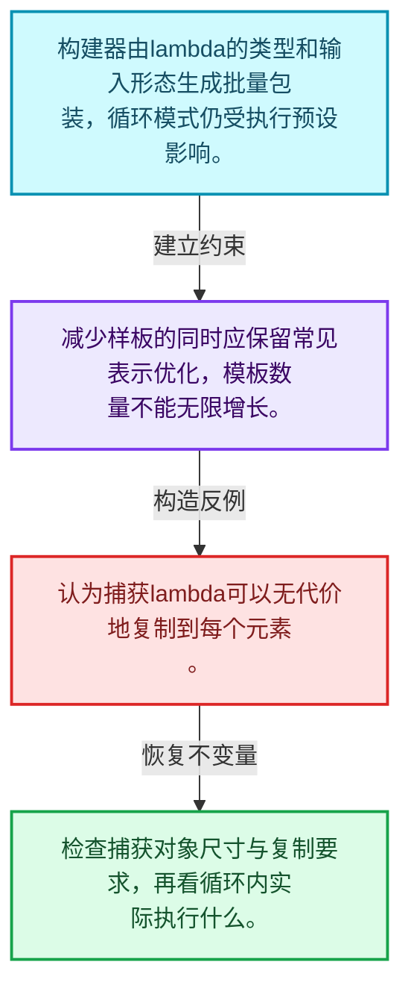
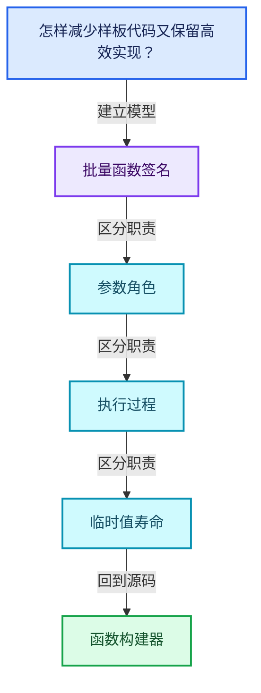
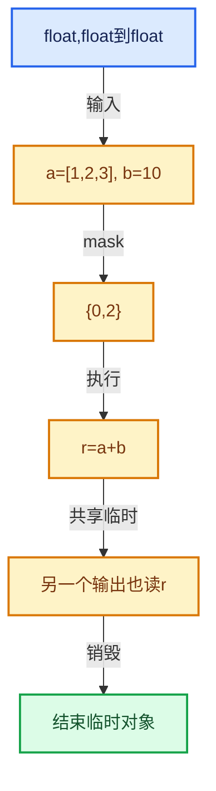

# 07-06 函数构建器

[方向导航](README.md) · [总目录](../README.md) · [覆盖索引](../%E6%BA%90%E7%A0%81%E7%89%88%E6%9C%AC%E4%B8%8E%E8%A6%86%E7%9B%96%E7%B4%A2%E5%BC%95.md)

> 阅读顺序：问题与数据模型 → 语法与类型 → 源码逐行 → 调用线索 → 历史与取舍 → 推演和练习。

- 基准 HEAD：`cbda6b96c26c0dee3c3b5cbb93960c4ac06a6b30`。
- 记录日期：2026-10-14。
- 教学示例状态：正文中的推演不是本机性能实测；已运行练习见验收报告。

## 一、从问题到设计

怎样减少样板代码又保留高效实现？

构建器把常见函数形态映射为批量接口，模板推导和执行预设共同影响生成代码。

本篇把语法、数据语义和系统取舍连接起来。把调用准备与元素循环分开，把值依赖与对象生存区间同时显式化。

### 本篇独立模型与设计推理

构建器由lambda的类型和输入形态生成批量包装，循环模式仍受执行预设影响。

设计取舍：减少样板的同时应保留常见表示优化，模板数量不能无限增长。

最小反例：认为捕获lambda可以无代价地复制到每个元素。

推导与处理：检查捕获对象尺寸与复制要求，再看循环内实际执行什么。



### 源码范围与相邻篇章

| 文件 | 本篇逐行范围 | 基准SHA-256 |
|---|---|---|
| [source/blender/functions/FN_multi_function_builder.hh](../../../../../source/blender/functions/FN_multi_function_builder.hh) | L1—L922 | `49d48048b137b84b3eac63599db98749750b5ff2ab8c1e0b89888687184cec97` |
| [source/blender/functions/intern/multi_function_builder.cc](../../../../../source/blender/functions/intern/multi_function_builder.cc) | L1—L137 | `77f6333ea80590c9526370b2cc0963e1cb119f02f0330737bf0f9f835e9515ae` |

同一主讲文件可能分多篇覆盖；超出本篇范围的符号通过覆盖索引定位。空行与纯注释保留在源码摘录中，逐行表解释有效语句与语法边界；许可证头统一保留。

前篇：[Context与临时资源](05-Context%E4%B8%8E%E4%B8%B4%E6%97%B6%E8%B5%84%E6%BA%90.md).

后篇：[Procedure指令与控制流](07-Procedure%E6%8C%87%E4%BB%A4%E4%B8%8E%E6%8E%A7%E5%88%B6%E6%B5%81.md).

## 二、类型、数据与阅读地图



这是概念依赖图，边表示阅读关系，不声称是运行时调用顺序。

### 直接编译依赖


箭头只表示头文件包含关系；完整调用线索见后面的符号定位表。

## 三、关键词、语法与类型角色

### 模板 template

模板把类型或常量作为生成实现的参数。读声明时先列出类型参数、非类型参数和默认值，再看使用者实际实例化了什么。模板声明本身不意味着每种T都支持其全部成员。

具体检查：把T替换为int、string、只能移动的类型，分别检查每个被调用操作是否成立。

### 依赖名称 typename

typename既可引入类型模板参数，也可告诉编译器某个依赖名称是类型。它不创建运行时对象；解析期确认语法类别与实例化期检查具体类型是不同阶段。

具体检查：区分typename T::value_type和T::size()，前者标记类型，后者是表达式。

### 常量求值 constexpr

constexpr声明允许相应实体参与常量求值，但constexpr函数仍可以在运行时执行。是否常量求值由调用场景和表达式合法性共同决定。

具体检查：比较constexpr变量初始化和从运行时输入调用同一函数。

### 只读限定 const

const约束当前访问路径可做的修改。const指针、指向const的指针、const视图对象、const元素是不同位置的限定；其他别名可能仍可修改原对象。

具体检查：分别写T* const、const T*与const T* const，并画出不可修改的层次。

### 移动转换 std::move

std::move把表达式转换为可供移动重载选择的值类别，实际资源转移发生在被选中的构造或赋值中。对const对象move可能仍调用复制，对视图move也不会获得底层数据所有权。

具体检查：记录移动构造调用次数，不用变量名或std::move的出现次数替代测量。

### 完美转发 std::forward

std::forward在转发引用模板中恢复调用者原来的值类别。它依赖推导出的模板实参；无条件move会改变左值调用者的语义。

具体检查：对同一接口分别传入左值、临时对象和const左值，记录实际重载。

### 异常边界 try与catch

try定义异常传播的局部边界。失败路径需要销毁已经成功构造的部分并释放相应存储；未构造的对象不能被析构。

具体检查：在第k次构造失败，列出已经存在的对象集合与待释放缓冲。

### 显式静态转换 static_cast

static_cast表达编译期允许的转换，不会自动验证运行时真实类型、指针寿命或索引边界。由void指针恢复T指针时，调用者仍须保证实际存储中确有合法T对象。

具体检查：标出转换前后的类型以及正确性依据来自哪里。

### 限定转换 const_cast

const_cast可以改变访问路径的限定，但不能让本来就是const的对象合法可写。常用于复用只读实现时，仍需检查底层对象是否实际可变。

具体检查：对非const对象的const引用与真正const对象分别分析修改是否合法。

### 运行时多态 virtual

虚调用根据实际动态类型选择实现；经基类指针销毁对象时通常需要相应虚析构契约。每元素虚调用和循环外一次分派有不同开销。

具体检查：找出虚接口的实现类和调用频率，再讨论是否值得去虚拟化。

### 覆写检查 override

override要求函数确实覆盖基类虚函数，可捕获参数类型和const限定不匹配。它不改变基类规定的生命周期或线程约束。

具体检查：故意改变一个参数或const，观察编译器如何拒绝误写的新函数。

### 判别联合 variant

variant在若干候选类型中保存一个活动值，通过判别信息选择操作。它能把不同表示集中在值类型中，但各分支的复制移动成本不同。

具体检查：列出活动分支及每种分支实际拥有或借用的数据。

### 对象表示 sizeof

sizeof给出对象表示大小，不是其引用的所有堆内存总量。sizeof视图很小并不说明底层数组很小。

具体检查：分别统计容器对象、容量字节和元素拥有的间接资源。

### 构造与new表达式

普通new可能分配并构造；placement new在给定地址构造，存储由其他机制提供。失败回滚应区分两类责任。

具体检查：追踪地址来自哪里、构造何时成功、由谁析构、由谁释放。

### 编译期分支 if constexpr

条件在实例化时决定被保留的分支，这常用于不同类型的合法操作选择。它与运行时if有不同的实例化检查规则。

具体检查：找出每个分支依赖哪些类型特征，再使用满足与不满足条件的类型。

### 受控访问 friend

friend授予指定函数或类访问非公开成员的权限，并不意味着继承，也不自动扩展到友元的派生类。

具体检查：解释执行器为何需要访问包装器的内部映射，同时检查边界是否仍清楚。

### 类型别名 using

类型别名为已有类型建立名字，不创建运行期对象。它常把模板内部使用的类型统一暴露给泛型调用者。

具体检查：展开别名直到基础类型，区分类型别名和变量声明。

### 枚举与状态模型 enum

枚举把有限状态命名；enum class避免许多隐式整数转换。状态机正确性还依赖允许的转移，不能只看有哪些枚举项。

具体检查：列出每个状态的进入条件和离开条件，检查终止状态是否仍可能被调度。

## 四、真实源码与逐行讲解

源码块保持原行内容，原始行号由小节标题及逐行表给出。表中的调用定位是静态阅读辅助；重载、模板实例化、宏展开和虚调用需结合完整声明，不能仅凭词法出现证明动态调用。

### FN_multi_function_builder.hh：L1—L50

<!-- source:source/blender/functions/FN_multi_function_builder.hh:1:50 -->

```cpp
/* SPDX-FileCopyrightText: 2023 Blender Authors
 *
 * SPDX-License-Identifier: GPL-2.0-or-later */

#pragma once

/** \file
 * \ingroup fn
 *
 * This file contains several utilities to create multi-functions with less redundant code.
 */

#include "FN_multi_function.hh"

namespace blender {

namespace fn::multi_function::build {

/**
 * These presets determine what code is generated for a #CustomMF. Different presets make different
 * trade-offs between run-time performance and compile-time/binary size.
 */
namespace exec_presets {

/** Method to execute a function in case devirtualization was not possible. */
enum class FallbackMode {
  /** Access all elements in virtual arrays through virtual function calls. */
  Simple,
  /** Process elements in chunks to reduce virtual function call overhead. */
  Materialized,
};

/**
 * The "naive" method for executing a #CustomMF. Every element is processed separately and input
 * values are retrieved from the virtual arrays one by one. This generates the least amount of
 * code, but is also the slowest method.
 */
struct Simple {
  static constexpr bool use_devirtualization = false;
  static constexpr FallbackMode fallback_mode = FallbackMode::Simple;
};

/**
 * This is an improvement over the #Simple method. It still generates a relatively small amount of
 * code, because the function is only instantiated once. It's generally faster than #Simple,
 * because inputs are retrieved from the virtual arrays in chunks, reducing virtual method call
 * overhead.
 */
struct Materialized {
  static constexpr bool use_devirtualization = false;
```

| 原始行 | 语义、约束与检查 |
|---|---|
| L5 | 防止同一头文件在一个翻译单元中重复展开；不控制多个源文件之间的链接或对象寿命。 |
| L13 | 引入编译依赖 "FN_multi_function.hh"；这是声明可见性关系，不表示运行时一定调用该文件的所有接口。 |
| L15 | 把后续声明放入 blender 命名空间，影响名称查找和符号归属，不创建运行时对象。 |
| L17 | 把后续声明放入 fn::multi_function::build 命名空间，影响名称查找和符号归属，不创建运行时对象。 |
| L23 | 把后续声明放入 exec_presets 命名空间，影响名称查找和符号归属，不创建运行时对象。 |
| L26 | 声明或定义类型 `enum class FallbackMode`。结合继承、访问权限和成员布局确认接口与拥有关系；前向声明本身没有完整对象布局。 |
| L28 | 本行是连续声明或表达式的一部分：`Simple,`。与本段前后行合读；逗号、括号和限定符决定它属于参数、初始化列表还是实际计算。 |
| L30 | 本行是连续声明或表达式的一部分：`Materialized,`。与本段前后行合读；逗号、括号和限定符决定它属于参数、初始化列表还是实际计算。 |
| L31 | 结束当前语法单元。局部自动对象在离开其作用域时按规则销毁；这不等于所有被引用的外部数据也被释放。 |
| L38 | 声明或定义类型 `struct Simple`。结合继承、访问权限和成员布局确认接口与拥有关系；前向声明本身没有完整对象布局。 |
| L39 | 把右侧 `false` 用于初始化或更新左侧 `static constexpr bool use_devirtualization`。声明初始化与已有对象赋值应按上下文区分；有资源的类型会调用相应特殊成员。 |
| L40 | 把右侧 `FallbackMode::Simple` 用于初始化或更新左侧 `static constexpr FallbackMode fallback_mode`。声明初始化与已有对象赋值应按上下文区分；有资源的类型会调用相应特殊成员。 |
| L41 | 结束当前语法单元。局部自动对象在离开其作用域时按规则销毁；这不等于所有被引用的外部数据也被释放。 |
| L49 | 声明或定义类型 `struct Materialized`。结合继承、访问权限和成员布局确认接口与拥有关系；前向声明本身没有完整对象布局。 |
| L50 | 把右侧 `false` 用于初始化或更新左侧 `static constexpr bool use_devirtualization`。声明初始化与已有对象赋值应按上下文区分；有资源的类型会调用相应特殊成员。 |

### FN_multi_function_builder.hh：L51—L94

<!-- source:source/blender/functions/FN_multi_function_builder.hh:51:94 -->

```cpp
  static constexpr FallbackMode fallback_mode = FallbackMode::Materialized;
};

/**
 * The most efficient preset, but also potentially generates a lot of code (exponential in the
 * number of inputs of the function). It generates separate optimized loops for all combinations of
 * inputs. This should be used for small functions of which all inputs are likely to be single
 * values or spans, and the number of inputs is relatively small.
 */
struct AllSpanOrSingle {
  static constexpr bool use_devirtualization = true;
  static constexpr FallbackMode fallback_mode = FallbackMode::Materialized;

  template<typename... ParamTags, typename... LoadedParams, size_t... I>
  auto create_devirtualizers(TypeSequence<ParamTags...> /*param_tags*/,
                             std::index_sequence<I...> /*indices*/,
                             const std::tuple<LoadedParams...> &loaded_params) const
  {
    return std::make_tuple([&]() {
      using ParamTag = ParamTags;
      using T = typename ParamTag::base_type;
      if constexpr (ParamTag::category == ParamCategory::SingleInput) {
        const GVArrayImpl &varray_impl = *std::get<I>(loaded_params);
        return GVArrayDevirtualizer<T, true, true>{varray_impl};
      }
      else if constexpr (ELEM(ParamTag::category,
                              ParamCategory::SingleOutput,
                              ParamCategory::SingleMutable))
      {
        T *ptr = std::get<I>(loaded_params);
        return BasicDevirtualizer<T *>{ptr};
      }
    }()...);
  }
};

/**
 * A slightly weaker variant of #AllSpanOrSingle. It generates less code, because it assumes that
 * some of the inputs are most likely single values. It should be used for small functions which
 * have too many inputs to make #AllSingleOrSpan a reasonable choice.
 */
template<size_t... Indices> struct SomeSpanOrSingle {
  static constexpr bool use_devirtualization = true;
  static constexpr FallbackMode fallback_mode = FallbackMode::Materialized;
```

| 原始行 | 语义、约束与检查 |
|---|---|
| L51 | 把右侧 `FallbackMode::Materialized` 用于初始化或更新左侧 `static constexpr FallbackMode fallback_mode`。声明初始化与已有对象赋值应按上下文区分；有资源的类型会调用相应特殊成员。 |
| L52 | 结束当前语法单元。局部自动对象在离开其作用域时按规则销毁；这不等于所有被引用的外部数据也被释放。 |
| L60 | 声明或定义类型 `struct AllSpanOrSingle`。结合继承、访问权限和成员布局确认接口与拥有关系；前向声明本身没有完整对象布局。 |
| L61 | 把右侧 `true` 用于初始化或更新左侧 `static constexpr bool use_devirtualization`。声明初始化与已有对象赋值应按上下文区分；有资源的类型会调用相应特殊成员。 |
| L62 | 把右侧 `FallbackMode::Materialized` 用于初始化或更新左侧 `static constexpr FallbackMode fallback_mode`。声明初始化与已有对象赋值应按上下文区分；有资源的类型会调用相应特殊成员。 |
| L64 | 声明模板参数 `template<typename... ParamTags, typename... LoadedParams, size_t... I>`。类型参数决定生成操作的类型，非类型参数可决定内嵌容量或编译期分支。 |
| L65 | 出现调用或函数声明 `create_devirtualizers`，对应表达式为 `auto create_devirtualizers(TypeSequence<ParamTags...> ,`。参数求值、返回类型与重载需结合前后完整语句；静态文本引用不能证明动态目标。 |
| L66 | 本行是连续声明或表达式的一部分：`std::index_sequence<I...> ,`。与本段前后行合读；逗号、括号和限定符决定它属于参数、初始化列表还是实际计算。 |
| L67 | 本行是连续声明或表达式的一部分：`const std::tuple<LoadedParams...> &loaded_params) const`。与本段前后行合读；逗号、括号和限定符决定它属于参数、初始化列表还是实际计算。 |
| L68 | 连接上一行的声明或控制结构与其语句块；后续行在这个作用域中执行或声明。 |
| L69 | 返回表达式 `std::make_tuple([&]() {`。 |
| L70 | 定义类型别名 `using ParamTag = ParamTags`，为模板接口或内部实现统一命名；本行不分配该类型对象。 |
| L71 | 定义类型别名 `using T = typename ParamTag::base_type`，为模板接口或内部实现统一命名；本行不分配该类型对象。 |
| L72 | 编译期条件分支 `if constexpr (ParamTag::category == ParamCategory::SingleInput)`。按实例化类型选择相应实现；被舍弃分支和运行期if具有不同检查规则，不能当作运行时输入验证。 |
| L73 | 把右侧 `*std::get<I>(loaded_params)` 用于初始化或更新左侧 `const GVArrayImpl &varray_impl`。声明初始化与已有对象赋值应按上下文区分；有资源的类型会调用相应特殊成员。 |
| L74 | 返回表达式 `GVArrayDevirtualizer<T, true, true>{varray_impl}`。结合函数声明检查返回值是否借用原存储，借用值不会自动延长其寿命。 |
| L75 | 结束当前语法单元。局部自动对象在离开其作用域时按规则销毁；这不等于所有被引用的外部数据也被释放。 |
| L76 | 出现调用或函数声明 `constexpr`，对应表达式为 `else if constexpr (ELEM(ParamTag::category,`。参数求值、返回类型与重载需结合前后完整语句；静态文本引用不能证明动态目标。 |
| L77 | 本行是连续声明或表达式的一部分：`ParamCategory::SingleOutput,`。与本段前后行合读；逗号、括号和限定符决定它属于参数、初始化列表还是实际计算。 |
| L78 | 本行是连续声明或表达式的一部分：`ParamCategory::SingleMutable))`。与本段前后行合读；逗号、括号和限定符决定它属于参数、初始化列表还是实际计算。 |
| L79 | 连接上一行的声明或控制结构与其语句块；后续行在这个作用域中执行或声明。 |
| L80 | 把右侧 `std::get<I>(loaded_params)` 用于初始化或更新左侧 `T *ptr`。声明初始化与已有对象赋值应按上下文区分；有资源的类型会调用相应特殊成员。 |
| L81 | 返回表达式 `BasicDevirtualizer<T *>{ptr}`。结合函数声明检查返回值是否借用原存储，借用值不会自动延长其寿命。 |
| L82 | 结束当前语法单元。局部自动对象在离开其作用域时按规则销毁；这不等于所有被引用的外部数据也被释放。 |
| L83 | 声明成员、局部对象或完成语句 `}()...)`。若为指针或引用，它本身不说明拥有；若为值对象，其构造析构由所在作用域或外层对象管理。 |
| L84 | 结束当前语法单元。局部自动对象在离开其作用域时按规则销毁；这不等于所有被引用的外部数据也被释放。 |
| L85 | 结束当前语法单元。局部自动对象在离开其作用域时按规则销毁；这不等于所有被引用的外部数据也被释放。 |
| L92 | 声明模板参数 `template<size_t... Indices> struct SomeSpanOrSingle {`。类型参数决定生成操作的类型，非类型参数可决定内嵌容量或编译期分支。 |
| L93 | 把右侧 `true` 用于初始化或更新左侧 `static constexpr bool use_devirtualization`。声明初始化与已有对象赋值应按上下文区分；有资源的类型会调用相应特殊成员。 |
| L94 | 把右侧 `FallbackMode::Materialized` 用于初始化或更新左侧 `static constexpr FallbackMode fallback_mode`。声明初始化与已有对象赋值应按上下文区分；有资源的类型会调用相应特殊成员。 |

### FN_multi_function_builder.hh：L95—L135

<!-- source:source/blender/functions/FN_multi_function_builder.hh:95:135 -->

```cpp

  template<typename... ParamTags, typename... LoadedParams, size_t... I>
  auto create_devirtualizers(TypeSequence<ParamTags...> /*param_tags*/,
                             std::index_sequence<I...> /*indices*/,
                             const std::tuple<LoadedParams...> &loaded_params) const
  {
    return std::make_tuple([&]() {
      using ParamTag = ParamTags;
      using T = typename ParamTag::base_type;

      if constexpr (ParamTag::category == ParamCategory::SingleInput) {
        constexpr bool UseSpan = ValueSequence<size_t, Indices...>::template contains<I>();
        const GVArrayImpl &varray_impl = *std::get<I>(loaded_params);
        return GVArrayDevirtualizer<T, true, UseSpan>{varray_impl};
      }
      else if constexpr (ELEM(ParamTag::category,
                              ParamCategory::SingleOutput,
                              ParamCategory::SingleMutable))
      {
        T *ptr = std::get<I>(loaded_params);
        return BasicDevirtualizer<T *>{ptr};
      }
    }()...);
  }
};

}  // namespace exec_presets

namespace detail {

/**
 * Executes #element_fn for all indices in the mask. The passed in #args contain the input as well
 * as output parameters. Usually types in #args are devirtualized (e.g. a `Span<int>` is passed in
 * instead of a `VArray<int>`).
 */
template<typename MaskT, typename... Args, typename ElementFn>
/* Perform additional optimizations on this loop because it is a very hot loop. For example, the
 * math node in geometry nodes is processed here. */
#if (defined(__GNUC__) && !defined(__clang__))
[[gnu::optimize("-funroll-loops")]] [[gnu::optimize("O3")]]
#endif
```

本段语义重点：

- 分支证据 `defined(__GNUC__) && !defined(__clang__))`：分别推演条件成立与不成立，核对相同出口处的状态。

| 原始行 | 语义、约束与检查 |
|---|---|
| L96 | 声明模板参数 `template<typename... ParamTags, typename... LoadedParams, size_t... I>`。类型参数决定生成操作的类型，非类型参数可决定内嵌容量或编译期分支。 |
| L97 | 出现调用或函数声明 `create_devirtualizers`，对应表达式为 `auto create_devirtualizers(TypeSequence<ParamTags...> ,`。参数求值、返回类型与重载需结合前后完整语句；静态文本引用不能证明动态目标。 |
| L98 | 本行是连续声明或表达式的一部分：`std::index_sequence<I...> ,`。与本段前后行合读；逗号、括号和限定符决定它属于参数、初始化列表还是实际计算。 |
| L99 | 本行是连续声明或表达式的一部分：`const std::tuple<LoadedParams...> &loaded_params) const`。与本段前后行合读；逗号、括号和限定符决定它属于参数、初始化列表还是实际计算。 |
| L100 | 连接上一行的声明或控制结构与其语句块；后续行在这个作用域中执行或声明。 |
| L101 | 返回表达式 `std::make_tuple([&]() {`。 |
| L102 | 定义类型别名 `using ParamTag = ParamTags`，为模板接口或内部实现统一命名；本行不分配该类型对象。 |
| L103 | 定义类型别名 `using T = typename ParamTag::base_type`，为模板接口或内部实现统一命名；本行不分配该类型对象。 |
| L105 | 编译期条件分支 `if constexpr (ParamTag::category == ParamCategory::SingleInput)`。按实例化类型选择相应实现；被舍弃分支和运行期if具有不同检查规则，不能当作运行时输入验证。 |
| L106 | 把右侧 `ValueSequence<size_t, Indices...>::template contains<I>()` 用于初始化或更新左侧 `constexpr bool UseSpan`。声明初始化与已有对象赋值应按上下文区分；有资源的类型会调用相应特殊成员。 |
| L107 | 把右侧 `*std::get<I>(loaded_params)` 用于初始化或更新左侧 `const GVArrayImpl &varray_impl`。声明初始化与已有对象赋值应按上下文区分；有资源的类型会调用相应特殊成员。 |
| L108 | 返回表达式 `GVArrayDevirtualizer<T, true, UseSpan>{varray_impl}`。结合函数声明检查返回值是否借用原存储，借用值不会自动延长其寿命。 |
| L109 | 结束当前语法单元。局部自动对象在离开其作用域时按规则销毁；这不等于所有被引用的外部数据也被释放。 |
| L110 | 出现调用或函数声明 `constexpr`，对应表达式为 `else if constexpr (ELEM(ParamTag::category,`。参数求值、返回类型与重载需结合前后完整语句；静态文本引用不能证明动态目标。 |
| L111 | 本行是连续声明或表达式的一部分：`ParamCategory::SingleOutput,`。与本段前后行合读；逗号、括号和限定符决定它属于参数、初始化列表还是实际计算。 |
| L112 | 本行是连续声明或表达式的一部分：`ParamCategory::SingleMutable))`。与本段前后行合读；逗号、括号和限定符决定它属于参数、初始化列表还是实际计算。 |
| L113 | 连接上一行的声明或控制结构与其语句块；后续行在这个作用域中执行或声明。 |
| L114 | 把右侧 `std::get<I>(loaded_params)` 用于初始化或更新左侧 `T *ptr`。声明初始化与已有对象赋值应按上下文区分；有资源的类型会调用相应特殊成员。 |
| L115 | 返回表达式 `BasicDevirtualizer<T *>{ptr}`。结合函数声明检查返回值是否借用原存储，借用值不会自动延长其寿命。 |
| L116 | 结束当前语法单元。局部自动对象在离开其作用域时按规则销毁；这不等于所有被引用的外部数据也被释放。 |
| L117 | 声明成员、局部对象或完成语句 `}()...)`。若为指针或引用，它本身不说明拥有；若为值对象，其构造析构由所在作用域或外层对象管理。 |
| L118 | 结束当前语法单元。局部自动对象在离开其作用域时按规则销毁；这不等于所有被引用的外部数据也被释放。 |
| L119 | 结束当前语法单元。局部自动对象在离开其作用域时按规则销毁；这不等于所有被引用的外部数据也被释放。 |
| L121 | 结束当前语法单元。局部自动对象在离开其作用域时按规则销毁；这不等于所有被引用的外部数据也被释放。 |
| L123 | 把后续声明放入 detail 命名空间，影响名称查找和符号归属，不创建运行时对象。 |
| L130 | 声明模板参数 `template<typename MaskT, typename... Args, typename ElementFn>`。类型参数决定生成操作的类型，非类型参数可决定内嵌容量或编译期分支。 |
| L133 | 预处理阶段处理 #if (defined(__GNUC__) && !defined(__clang__))。它决定哪些代码进入编译，不是运行时分支；阅读行为时必须结合实际构建宏。 |
| L134 | 出现调用或函数声明 `gnu::optimize`，对应表达式为 `[[gnu::optimize("-funroll-loops")]] [[gnu::optimize("O3")]]`。参数求值、返回类型与重载需结合前后完整语句；静态文本引用不能证明动态目标。 |
| L135 | 预处理阶段处理 #endif。它决定哪些代码进入编译，不是运行时分支；阅读行为时必须结合实际构建宏。 |

### FN_multi_function_builder.hh：L136—L184

<!-- source:source/blender/functions/FN_multi_function_builder.hh:136:184 -->

```cpp
inline void execute_array(const ElementFn &element_fn,
                          MaskT mask,
                          /* Use restrict to tell the compiler that pointer inputs do not alias
                           * each other. This is important for some compiler optimizations. */
                          Args &&__restrict... args)
{
  if constexpr (std::is_same_v<std::decay_t<MaskT>, IndexRange>) {
    /* Having this explicit loop is necessary for MSVC to be able to vectorize this. */
    const int64_t start = mask.start();
    const int64_t end = mask.one_after_last();
    for (int64_t i = start; i < end; i++) {
      element_fn(args[i]...);
    }
  }
  else {
    for (const int64_t i : mask) {
      element_fn(args[i]...);
    }
  }
}

enum class MaterializeArgMode {
  Unknown,
  Single,
  Span,
  Materialized,
};

template<typename ParamTag> struct MaterializeArgInfo {
  MaterializeArgMode mode = MaterializeArgMode::Unknown;
  const typename ParamTag::base_type *internal_span_data;
};

/**
 * Similar to #execute_array but is only used with arrays and does not need a mask.
 */
template<typename... ParamTags, typename ElementFn, typename... Chunks>
#if (defined(__GNUC__) && !defined(__clang__))
[[gnu::optimize("-funroll-loops")]] [[gnu::optimize("O3")]]
#endif
inline void execute_materialized_impl(TypeSequence<ParamTags...> /*param_tags*/,
                                      const ElementFn &element_fn,
                                      const int64_t size,
                                      Chunks &&__restrict... chunks)
{
  for (int64_t i = 0; i < size; i++) {
    element_fn(chunks[i]...);
  }
}
```

本段语义重点：

- 分支证据 `defined(__GNUC__) && !defined(__clang__))`：分别推演条件成立与不成立，核对相同出口处的状态。

| 原始行 | 语义、约束与检查 |
|---|---|
| L136 | 出现调用或函数声明 `execute_array`，对应表达式为 `inline void execute_array(const ElementFn &element_fn,`。参数求值、返回类型与重载需结合前后完整语句；静态文本引用不能证明动态目标。 |
| L137 | 本行是连续声明或表达式的一部分：`MaskT mask,`。与本段前后行合读；逗号、括号和限定符决定它属于参数、初始化列表还是实际计算。 |
| L140 | 本行是连续声明或表达式的一部分：`Args &&__restrict... args)`。与本段前后行合读；逗号、括号和限定符决定它属于参数、初始化列表还是实际计算。 |
| L141 | 连接上一行的声明或控制结构与其语句块；后续行在这个作用域中执行或声明。 |
| L142 | 编译期条件分支 `if constexpr (std::is_same_v<std::decay_t<MaskT>, IndexRange>)`。按实例化类型选择相应实现；被舍弃分支和运行期if具有不同检查规则，不能当作运行时输入验证。 |
| L144 | 把右侧 `mask.start()` 用于初始化或更新左侧 `const int64_t start`。声明初始化与已有对象赋值应按上下文区分；有资源的类型会调用相应特殊成员。 |
| L145 | 把右侧 `mask.one_after_last()` 用于初始化或更新左侧 `const int64_t end`。声明初始化与已有对象赋值应按上下文区分；有资源的类型会调用相应特殊成员。 |
| L146 | 按 `for (int64_t i = start; i < end; i++)` 指定的范围或条件重复执行。对照循环变量与真实元素编号；循环内调用成本乘以实际迭代次数。 |
| L147 | 出现调用或函数声明 `element_fn`，对应表达式为 `element_fn(args[i]...);`。参数求值、返回类型与重载需结合前后完整语句；静态文本引用不能证明动态目标。 |
| L148 | 结束当前语法单元。局部自动对象在离开其作用域时按规则销毁；这不等于所有被引用的外部数据也被释放。 |
| L149 | 结束当前语法单元。局部自动对象在离开其作用域时按规则销毁；这不等于所有被引用的外部数据也被释放。 |
| L150 | 处理前一条件不成立的互补路径。比较两条路径最后是否恢复同一不变量，以及是否产生不同的资源责任。 |
| L151 | 按 `for (const int64_t i : mask)` 指定的范围或条件重复执行。对照循环变量与真实元素编号；循环内调用成本乘以实际迭代次数。 |
| L152 | 出现调用或函数声明 `element_fn`，对应表达式为 `element_fn(args[i]...);`。参数求值、返回类型与重载需结合前后完整语句；静态文本引用不能证明动态目标。 |
| L153 | 结束当前语法单元。局部自动对象在离开其作用域时按规则销毁；这不等于所有被引用的外部数据也被释放。 |
| L154 | 结束当前语法单元。局部自动对象在离开其作用域时按规则销毁；这不等于所有被引用的外部数据也被释放。 |
| L155 | 结束当前语法单元。局部自动对象在离开其作用域时按规则销毁；这不等于所有被引用的外部数据也被释放。 |
| L157 | 声明或定义类型 `enum class MaterializeArgMode`。结合继承、访问权限和成员布局确认接口与拥有关系；前向声明本身没有完整对象布局。 |
| L158 | 本行是连续声明或表达式的一部分：`Unknown,`。与本段前后行合读；逗号、括号和限定符决定它属于参数、初始化列表还是实际计算。 |
| L159 | 本行是连续声明或表达式的一部分：`Single,`。与本段前后行合读；逗号、括号和限定符决定它属于参数、初始化列表还是实际计算。 |
| L160 | 本行是连续声明或表达式的一部分：`Span,`。与本段前后行合读；逗号、括号和限定符决定它属于参数、初始化列表还是实际计算。 |
| L161 | 本行是连续声明或表达式的一部分：`Materialized,`。与本段前后行合读；逗号、括号和限定符决定它属于参数、初始化列表还是实际计算。 |
| L162 | 结束当前语法单元。局部自动对象在离开其作用域时按规则销毁；这不等于所有被引用的外部数据也被释放。 |
| L164 | 声明模板参数 `template<typename ParamTag> struct MaterializeArgInfo {`。类型参数决定生成操作的类型，非类型参数可决定内嵌容量或编译期分支。 |
| L165 | 把右侧 `MaterializeArgMode::Unknown` 用于初始化或更新左侧 `MaterializeArgMode mode`。声明初始化与已有对象赋值应按上下文区分；有资源的类型会调用相应特殊成员。 |
| L166 | 声明成员、局部对象或完成语句 `const typename ParamTag::base_type *internal_span_data`。若为指针或引用，它本身不说明拥有；若为值对象，其构造析构由所在作用域或外层对象管理。 |
| L167 | 结束当前语法单元。局部自动对象在离开其作用域时按规则销毁；这不等于所有被引用的外部数据也被释放。 |
| L172 | 声明模板参数 `template<typename... ParamTags, typename ElementFn, typename... Chunks>`。类型参数决定生成操作的类型，非类型参数可决定内嵌容量或编译期分支。 |
| L173 | 预处理阶段处理 #if (defined(__GNUC__) && !defined(__clang__))。它决定哪些代码进入编译，不是运行时分支；阅读行为时必须结合实际构建宏。 |
| L174 | 出现调用或函数声明 `gnu::optimize`，对应表达式为 `[[gnu::optimize("-funroll-loops")]] [[gnu::optimize("O3")]]`。参数求值、返回类型与重载需结合前后完整语句；静态文本引用不能证明动态目标。 |
| L175 | 预处理阶段处理 #endif。它决定哪些代码进入编译，不是运行时分支；阅读行为时必须结合实际构建宏。 |
| L176 | 出现调用或函数声明 `execute_materialized_impl`，对应表达式为 `inline void execute_materialized_impl(TypeSequence<ParamTags...> ,`。参数求值、返回类型与重载需结合前后完整语句；静态文本引用不能证明动态目标。 |
| L177 | 本行是连续声明或表达式的一部分：`const ElementFn &element_fn,`。与本段前后行合读；逗号、括号和限定符决定它属于参数、初始化列表还是实际计算。 |
| L178 | 本行是连续声明或表达式的一部分：`const int64_t size,`。与本段前后行合读；逗号、括号和限定符决定它属于参数、初始化列表还是实际计算。 |
| L179 | 本行是连续声明或表达式的一部分：`Chunks &&__restrict... chunks)`。与本段前后行合读；逗号、括号和限定符决定它属于参数、初始化列表还是实际计算。 |
| L180 | 连接上一行的声明或控制结构与其语句块；后续行在这个作用域中执行或声明。 |
| L181 | 纯虚接口声明：`for (int64_t i = 0; i < size; i++) {`。等号零标记抽象接口，需要按继承约定提供覆写；不表示执行函数并把结果设为零。 |
| L182 | 出现调用或函数声明 `element_fn`，对应表达式为 `element_fn(chunks[i]...);`。参数求值、返回类型与重载需结合前后完整语句；静态文本引用不能证明动态目标。 |
| L183 | 结束当前语法单元。局部自动对象在离开其作用域时按规则销毁；这不等于所有被引用的外部数据也被释放。 |
| L184 | 结束当前语法单元。局部自动对象在离开其作用域时按规则销毁；这不等于所有被引用的外部数据也被释放。 |

### FN_multi_function_builder.hh：L185—L378

<!-- source:source/blender/functions/FN_multi_function_builder.hh:185:378 -->

```cpp

/**
 * Executes #element_fn for all indices in #mask. However, instead of processing every element
 * separately, processing happens in chunks. This allows retrieving from input virtual arrays in
 * chunks, which reduces virtual function call overhead.
 */
template<typename... ParamTags, size_t... I, typename ElementFn, typename... LoadedParams>
inline void execute_materialized(TypeSequence<ParamTags...> /*param_tags*/,
                                 std::index_sequence<I...> /*indices*/,
                                 const ElementFn &element_fn,
                                 const IndexMaskSegment mask,
                                 const std::tuple<LoadedParams...> &loaded_params)
{

  /* In theory, all elements could be processed in one chunk. However, that has the disadvantage
   * that large temporary arrays are needed. Using small chunks allows using small arrays, which
   * are reused multiple times, which improves cache efficiency. The chunk size also shouldn't be
   * too small, because then overhead of the outer loop over chunks becomes significant again. */
  static constexpr int64_t MaxChunkSize = 64;
  const int64_t mask_size = mask.size();
  const int64_t tmp_buffer_size = std::min(mask_size, MaxChunkSize);

  /* Local buffers that are used to temporarily store values for processing. */
  std::tuple<TypedBuffer<typename ParamTags::base_type, MaxChunkSize>...> temporary_buffers;

  /* Information about every parameter. */
  std::tuple<MaterializeArgInfo<ParamTags>...> args_info;

  (
      /* Setup information for all parameters. */
      [&] {
        /* Use `typedef` instead of `using` to work around a compiler bug. */
        using ParamTag = ParamTags;
        using T = typename ParamTag::base_type;
        [[maybe_unused]] MaterializeArgInfo<ParamTags> &arg_info = std::get<I>(args_info);
        if constexpr (ParamTag::category == ParamCategory::SingleInput) {
          const GVArrayImpl &varray_impl = *std::get<I>(loaded_params);
          const CommonVArrayInfo common_info = varray_impl.common_info();
          if (common_info.type == CommonVArrayInfo::Type::Single) {
            /* If an input #VArray is a single value, we have to fill the buffer with that value
             * only once. The same unchanged buffer can then be reused in every chunk. */
            const T &in_single = *static_cast<const T *>(common_info.data);
            T *tmp_buffer = std::get<I>(temporary_buffers).ptr();
            uninitialized_fill_n(tmp_buffer, tmp_buffer_size, in_single);
            arg_info.mode = MaterializeArgMode::Single;
          }
          else if (common_info.type == CommonVArrayInfo::Type::Span) {
            /* Remember the span so that it doesn't have to be retrieved in every iteration. */
            arg_info.internal_span_data = static_cast<const T *>(common_info.data);
          }
          else {
            arg_info.internal_span_data = nullptr;
          }
        }
      }(),
      ...);

  IndexMaskFromSegment index_mask_from_segment;
  const int64_t segment_offset = mask.offset();

  /* Outer loop over all chunks. */
  for (int64_t chunk_start = 0; chunk_start < mask_size; chunk_start += MaxChunkSize) {
    const int64_t chunk_end = std::min<int64_t>(chunk_start + MaxChunkSize, mask_size);
    const int64_t chunk_size = chunk_end - chunk_start;
    const IndexMaskSegment sliced_mask = mask.slice(chunk_start, chunk_size);
    const int64_t mask_start = sliced_mask[0];
    const bool sliced_mask_is_range = unique_sorted_indices::non_empty_is_range(
        sliced_mask.base_span());

    /* Move mutable data into temporary array. */
    if (!sliced_mask_is_range) {
      (
          [&] {
            /* Use `typedef` instead of `using` to work around a compiler bug. */
            using ParamTag = ParamTags;
            using T = typename ParamTag::base_type;
            if constexpr (ParamTag::category == ParamCategory::SingleMutable) {
              T *tmp_buffer = std::get<I>(temporary_buffers).ptr();
              T *param_buffer = std::get<I>(loaded_params);
              for (int64_t i = 0; i < chunk_size; i++) {
                new (tmp_buffer + i) T(std::move(param_buffer[sliced_mask[i]]));
              }
            }
          }(),
          ...);
    }

    const IndexMask *current_segment_mask = nullptr;

    execute_materialized_impl(
        TypeSequence<ParamTags...>(),
        element_fn,
        chunk_size,
        /* Prepare every parameter for this chunk. */
        [&] {
          using ParamTag = ParamTags;
          using T = typename ParamTag::base_type;
          [[maybe_unused]] MaterializeArgInfo<ParamTags> &arg_info = std::get<I>(args_info);
          T *tmp_buffer = std::get<I>(temporary_buffers);
          if constexpr (ParamTag::category == ParamCategory::SingleInput) {
            if (arg_info.mode == MaterializeArgMode::Single) {
              /* The single value has been filled into a buffer already reused for every chunk. */
              return const_cast<const T *>(tmp_buffer);
            }
            if (sliced_mask_is_range && arg_info.internal_span_data != nullptr) {
              /* In this case we can just use an existing span instead of "compressing" it into
               * a new temporary buffer. */
              arg_info.mode = MaterializeArgMode::Span;
              return arg_info.internal_span_data + mask_start;
            }
            const GVArrayImpl &varray_impl = *std::get<I>(loaded_params);
            if (current_segment_mask == nullptr) {
              current_segment_mask = &index_mask_from_segment.update(
                  {segment_offset, sliced_mask.base_span()});
            }
            /* As a fallback, do a virtual function call to retrieve all elements in the current
             * chunk. The elements are stored in a temporary buffer reused for every chunk. */
            varray_impl.materialize_compressed(*current_segment_mask, tmp_buffer, true);
            /* Remember that this parameter has been materialized, so that the values are
             * destructed properly when the chunk is done. */
            arg_info.mode = MaterializeArgMode::Materialized;
            return const_cast<const T *>(tmp_buffer);
          }
          else if constexpr (ELEM(ParamTag::category,
                                  ParamCategory::SingleOutput,
                                  ParamCategory::SingleMutable))
          {
            /* For outputs, just pass a pointer. This is important so that `__restrict` works. */
            if (sliced_mask_is_range) {
              /* Can write into the caller-provided buffer directly. */
              T *param_buffer = std::get<I>(loaded_params);
              return param_buffer + mask_start;
            }
            /* Use the temporary buffer. The values will have to be copied out of that
             * buffer into the caller-provided buffer afterwards. */
            return tmp_buffer;
          }
        }()...);

    /* Relocate outputs from temporary buffers to buffers provided by caller. */
    if (!sliced_mask_is_range) {
      (
          [&] {
            /* Use `typedef` instead of `using` to work around a compiler bug. */
            using ParamTag = ParamTags;
            using T = typename ParamTag::base_type;
            if constexpr (ELEM(ParamTag::category,
                               ParamCategory::SingleOutput,
                               ParamCategory::SingleMutable))
            {
              T *tmp_buffer = std::get<I>(temporary_buffers).ptr();
              T *param_buffer = std::get<I>(loaded_params);
              for (int64_t i = 0; i < chunk_size; i++) {
                new (param_buffer + sliced_mask[i]) T(std::move(tmp_buffer[i]));
                std::destroy_at(tmp_buffer + i);
              }
            }
          }(),
          ...);
    }

    (
        /* Destruct values that have been materialized before. */
        [&] {
          /* Use `typedef` instead of `using` to work around a compiler bug. */
          using ParamTag = ParamTags;
          using T = typename ParamTag::base_type;
          [[maybe_unused]] MaterializeArgInfo<ParamTags> &arg_info = std::get<I>(args_info);
          if constexpr (ParamTag::category == ParamCategory::SingleInput) {
            if (arg_info.mode == MaterializeArgMode::Materialized) {
              T *tmp_buffer = std::get<I>(temporary_buffers).ptr();
              destruct_n(tmp_buffer, chunk_size);
            }
          }
        }(),
        ...);
  }

  (
      /* Destruct buffers for single value inputs. */
      [&] {
        /* Use `typedef` instead of `using` to work around a compiler bug. */
        using ParamTag = ParamTags;
        using T = typename ParamTag::base_type;
        [[maybe_unused]] MaterializeArgInfo<ParamTags> &arg_info = std::get<I>(args_info);
        if constexpr (ParamTag::category == ParamCategory::SingleInput) {
          if (arg_info.mode == MaterializeArgMode::Single) {
            T *tmp_buffer = std::get<I>(temporary_buffers).ptr();
            destruct_n(tmp_buffer, tmp_buffer_size);
          }
        }
      }(),
      ...);
}
```

本段语义重点：

- `destruct_n`：对已构造的元素区间执行析构；计数必须对应真实存活对象，释放原始内存是另一操作。
- `std::min`：取较小值，常用于截断范围；还要检查负值、溢出和空范围。

| 原始行 | 语义、约束与检查 |
|---|---|
| L191 | 声明模板参数 `template<typename... ParamTags, size_t... I, typename ElementFn, typename... LoadedParams>`。类型参数决定生成操作的类型，非类型参数可决定内嵌容量或编译期分支。 |
| L192 | 出现调用或函数声明 `execute_materialized`，对应表达式为 `inline void execute_materialized(TypeSequence<ParamTags...> ,`。参数求值、返回类型与重载需结合前后完整语句；静态文本引用不能证明动态目标。 |
| L193 | 本行是连续声明或表达式的一部分：`std::index_sequence<I...> ,`。与本段前后行合读；逗号、括号和限定符决定它属于参数、初始化列表还是实际计算。 |
| L194 | 本行是连续声明或表达式的一部分：`const ElementFn &element_fn,`。与本段前后行合读；逗号、括号和限定符决定它属于参数、初始化列表还是实际计算。 |
| L195 | 本行是连续声明或表达式的一部分：`const IndexMaskSegment mask,`。与本段前后行合读；逗号、括号和限定符决定它属于参数、初始化列表还是实际计算。 |
| L196 | 本行是连续声明或表达式的一部分：`const std::tuple<LoadedParams...> &loaded_params)`。与本段前后行合读；逗号、括号和限定符决定它属于参数、初始化列表还是实际计算。 |
| L197 | 连接上一行的声明或控制结构与其语句块；后续行在这个作用域中执行或声明。 |
| L203 | 把右侧 `64` 用于初始化或更新左侧 `static constexpr int64_t MaxChunkSize`。声明初始化与已有对象赋值应按上下文区分；有资源的类型会调用相应特殊成员。 |
| L204 | 把右侧 `mask.size()` 用于初始化或更新左侧 `const int64_t mask_size`。声明初始化与已有对象赋值应按上下文区分；有资源的类型会调用相应特殊成员。 |
| L205 | 本行使用 `std::min`：取较小值，常用于截断范围；还要检查负值、溢出和空范围。 |
| L208 | 声明成员、局部对象或完成语句 `std::tuple<TypedBuffer<typename ParamTags::base_type, MaxChunkSize>...> temporary_buffers`。若为指针或引用，它本身不说明拥有；若为值对象，其构造析构由所在作用域或外层对象管理。 |
| L211 | 声明成员、局部对象或完成语句 `std::tuple<MaterializeArgInfo<ParamTags>...> args_info`。若为指针或引用，它本身不说明拥有；若为值对象，其构造析构由所在作用域或外层对象管理。 |
| L213 | 本行是连续声明或表达式的一部分：`(`。与本段前后行合读；逗号、括号和限定符决定它属于参数、初始化列表还是实际计算。 |
| L215 | 本行是连续声明或表达式的一部分：`[&] {`。与本段前后行合读；逗号、括号和限定符决定它属于参数、初始化列表还是实际计算。 |
| L217 | 定义类型别名 `using ParamTag = ParamTags`，为模板接口或内部实现统一命名；本行不分配该类型对象。 |
| L218 | 定义类型别名 `using T = typename ParamTag::base_type`，为模板接口或内部实现统一命名；本行不分配该类型对象。 |
| L219 | 把右侧 `std::get<I>(args_info)` 用于初始化或更新左侧 `[[maybe_unused]] MaterializeArgInfo<ParamTags> &arg_info`。声明初始化与已有对象赋值应按上下文区分；有资源的类型会调用相应特殊成员。 |
| L220 | 编译期条件分支 `if constexpr (ParamTag::category == ParamCategory::SingleInput)`。按实例化类型选择相应实现；被舍弃分支和运行期if具有不同检查规则，不能当作运行时输入验证。 |
| L221 | 把右侧 `*std::get<I>(loaded_params)` 用于初始化或更新左侧 `const GVArrayImpl &varray_impl`。声明初始化与已有对象赋值应按上下文区分；有资源的类型会调用相应特殊成员。 |
| L222 | 把右侧 `varray_impl.common_info()` 用于初始化或更新左侧 `const CommonVArrayInfo common_info`。声明初始化与已有对象赋值应按上下文区分；有资源的类型会调用相应特殊成员。 |
| L223 | 判断 `common_info.type == CommonVArrayInfo::Type::Single`，成立时进入本分支，否则继续后续路径。 |
| L226 | 把右侧 `*static_cast<const T *>(common_info.data)` 用于初始化或更新左侧 `const T &in_single`。声明初始化与已有对象赋值应按上下文区分；有资源的类型会调用相应特殊成员。 |
| L227 | 把右侧 `std::get<I>(temporary_buffers).ptr()` 用于初始化或更新左侧 `T *tmp_buffer`。声明初始化与已有对象赋值应按上下文区分；有资源的类型会调用相应特殊成员。 |
| L228 | 出现调用或函数声明 `uninitialized_fill_n`，对应表达式为 `uninitialized_fill_n(tmp_buffer, tmp_buffer_size, in_single);`。参数求值、返回类型与重载需结合前后完整语句；静态文本引用不能证明动态目标。 |
| L229 | 把右侧 `MaterializeArgMode::Single` 用于初始化或更新左侧 `arg_info.mode`。声明初始化与已有对象赋值应按上下文区分；有资源的类型会调用相应特殊成员。 |
| L230 | 结束当前语法单元。局部自动对象在离开其作用域时按规则销毁；这不等于所有被引用的外部数据也被释放。 |
| L231 | 判断 `common_info.type == CommonVArrayInfo::Type::Span`，成立时进入本分支，否则继续后续路径。 |
| L233 | 把右侧 `static_cast<const T *>(common_info.data)` 用于初始化或更新左侧 `arg_info.internal_span_data`。声明初始化与已有对象赋值应按上下文区分；有资源的类型会调用相应特殊成员。 |
| L234 | 结束当前语法单元。局部自动对象在离开其作用域时按规则销毁；这不等于所有被引用的外部数据也被释放。 |
| L235 | 处理前一条件不成立的互补路径。比较两条路径最后是否恢复同一不变量，以及是否产生不同的资源责任。 |
| L236 | 把右侧 `nullptr` 用于初始化或更新左侧 `arg_info.internal_span_data`。声明初始化与已有对象赋值应按上下文区分；有资源的类型会调用相应特殊成员。 |
| L237 | 结束当前语法单元。局部自动对象在离开其作用域时按规则销毁；这不等于所有被引用的外部数据也被释放。 |
| L238 | 结束当前语法单元。局部自动对象在离开其作用域时按规则销毁；这不等于所有被引用的外部数据也被释放。 |
| L239 | 本行是连续声明或表达式的一部分：`}(),`。与本段前后行合读；逗号、括号和限定符决定它属于参数、初始化列表还是实际计算。 |
| L240 | 声明成员、局部对象或完成语句 `...)`。若为指针或引用，它本身不说明拥有；若为值对象，其构造析构由所在作用域或外层对象管理。 |
| L242 | 声明成员、局部对象或完成语句 `IndexMaskFromSegment index_mask_from_segment`。若为指针或引用，它本身不说明拥有；若为值对象，其构造析构由所在作用域或外层对象管理。 |
| L243 | 把右侧 `mask.offset()` 用于初始化或更新左侧 `const int64_t segment_offset`。声明初始化与已有对象赋值应按上下文区分；有资源的类型会调用相应特殊成员。 |
| L246 | 纯虚接口声明：`for (int64_t chunk_start = 0; chunk_start < mask_size; chunk_start += MaxChunkSize) {`。等号零标记抽象接口，需要按继承约定提供覆写；不表示执行函数并把结果设为零。 |
| L247 | 本行使用 `std::min`：取较小值，常用于截断范围；还要检查负值、溢出和空范围。 |
| L248 | 把右侧 `chunk_end - chunk_start` 用于初始化或更新左侧 `const int64_t chunk_size`。声明初始化与已有对象赋值应按上下文区分；有资源的类型会调用相应特殊成员。 |
| L249 | 把右侧 `mask.slice(chunk_start, chunk_size)` 用于初始化或更新左侧 `const IndexMaskSegment sliced_mask`。声明初始化与已有对象赋值应按上下文区分；有资源的类型会调用相应特殊成员。 |
| L250 | 把右侧 `sliced_mask[0]` 用于初始化或更新左侧 `const int64_t mask_start`。声明初始化与已有对象赋值应按上下文区分；有资源的类型会调用相应特殊成员。 |
| L251 | 把右侧 `unique_sorted_indices::non_empty_is_range(` 用于初始化或更新左侧 `const bool sliced_mask_is_range`。声明初始化与已有对象赋值应按上下文区分；有资源的类型会调用相应特殊成员。 |
| L252 | 出现调用或函数声明 `base_span`，对应表达式为 `sliced_mask.base_span());`。参数求值、返回类型与重载需结合前后完整语句；静态文本引用不能证明动态目标。 |
| L255 | 判断 `!sliced_mask_is_range`，成立时进入本分支，否则继续后续路径。 |
| L256 | 本行是连续声明或表达式的一部分：`(`。与本段前后行合读；逗号、括号和限定符决定它属于参数、初始化列表还是实际计算。 |
| L257 | 本行是连续声明或表达式的一部分：`[&] {`。与本段前后行合读；逗号、括号和限定符决定它属于参数、初始化列表还是实际计算。 |
| L259 | 定义类型别名 `using ParamTag = ParamTags`，为模板接口或内部实现统一命名；本行不分配该类型对象。 |
| L260 | 定义类型别名 `using T = typename ParamTag::base_type`，为模板接口或内部实现统一命名；本行不分配该类型对象。 |
| L261 | 编译期条件分支 `if constexpr (ParamTag::category == ParamCategory::SingleMutable)`。按实例化类型选择相应实现；被舍弃分支和运行期if具有不同检查规则，不能当作运行时输入验证。 |
| L262 | 把右侧 `std::get<I>(temporary_buffers).ptr()` 用于初始化或更新左侧 `T *tmp_buffer`。声明初始化与已有对象赋值应按上下文区分；有资源的类型会调用相应特殊成员。 |
| L263 | 把右侧 `std::get<I>(loaded_params)` 用于初始化或更新左侧 `T *param_buffer`。声明初始化与已有对象赋值应按上下文区分；有资源的类型会调用相应特殊成员。 |
| L264 | 纯虚接口声明：`for (int64_t i = 0; i < chunk_size; i++) {`。等号零标记抽象接口，需要按继承约定提供覆写；不表示执行函数并把结果设为零。 |
| L265 | 出现调用或函数声明 `new`，对应表达式为 `new (tmp_buffer + i) T(std::move(param_buffer[sliced_mask[i]]));`。参数求值、返回类型与重载需结合前后完整语句；静态文本引用不能证明动态目标。 |
| L266 | 结束当前语法单元。局部自动对象在离开其作用域时按规则销毁；这不等于所有被引用的外部数据也被释放。 |
| L267 | 结束当前语法单元。局部自动对象在离开其作用域时按规则销毁；这不等于所有被引用的外部数据也被释放。 |
| L268 | 本行是连续声明或表达式的一部分：`}(),`。与本段前后行合读；逗号、括号和限定符决定它属于参数、初始化列表还是实际计算。 |
| L269 | 声明成员、局部对象或完成语句 `...)`。若为指针或引用，它本身不说明拥有；若为值对象，其构造析构由所在作用域或外层对象管理。 |
| L270 | 结束当前语法单元。局部自动对象在离开其作用域时按规则销毁；这不等于所有被引用的外部数据也被释放。 |
| L272 | 把右侧 `nullptr` 用于初始化或更新左侧 `const IndexMask *current_segment_mask`。声明初始化与已有对象赋值应按上下文区分；有资源的类型会调用相应特殊成员。 |
| L274 | 出现调用或函数声明 `execute_materialized_impl`，对应表达式为 `execute_materialized_impl(`。参数求值、返回类型与重载需结合前后完整语句；静态文本引用不能证明动态目标。 |
| L275 | 出现调用或函数声明 `TypeSequence`，对应表达式为 `TypeSequence<ParamTags...>(),`。参数求值、返回类型与重载需结合前后完整语句；静态文本引用不能证明动态目标。 |
| L276 | 本行是连续声明或表达式的一部分：`element_fn,`。与本段前后行合读；逗号、括号和限定符决定它属于参数、初始化列表还是实际计算。 |
| L277 | 本行是连续声明或表达式的一部分：`chunk_size,`。与本段前后行合读；逗号、括号和限定符决定它属于参数、初始化列表还是实际计算。 |
| L279 | 本行是连续声明或表达式的一部分：`[&] {`。与本段前后行合读；逗号、括号和限定符决定它属于参数、初始化列表还是实际计算。 |
| L280 | 定义类型别名 `using ParamTag = ParamTags`，为模板接口或内部实现统一命名；本行不分配该类型对象。 |
| L281 | 定义类型别名 `using T = typename ParamTag::base_type`，为模板接口或内部实现统一命名；本行不分配该类型对象。 |
| L282 | 把右侧 `std::get<I>(args_info)` 用于初始化或更新左侧 `[[maybe_unused]] MaterializeArgInfo<ParamTags> &arg_info`。声明初始化与已有对象赋值应按上下文区分；有资源的类型会调用相应特殊成员。 |
| L283 | 把右侧 `std::get<I>(temporary_buffers)` 用于初始化或更新左侧 `T *tmp_buffer`。声明初始化与已有对象赋值应按上下文区分；有资源的类型会调用相应特殊成员。 |
| L284 | 编译期条件分支 `if constexpr (ParamTag::category == ParamCategory::SingleInput)`。按实例化类型选择相应实现；被舍弃分支和运行期if具有不同检查规则，不能当作运行时输入验证。 |
| L285 | 判断 `arg_info.mode == MaterializeArgMode::Single`，成立时进入本分支，否则继续后续路径。 |
| L287 | 返回表达式 `const_cast<const T *>(tmp_buffer)`。 |
| L288 | 结束当前语法单元。局部自动对象在离开其作用域时按规则销毁；这不等于所有被引用的外部数据也被释放。 |
| L289 | 判断 `sliced_mask_is_range && arg_info.internal_span_data != nullptr`，成立时进入本分支，否则继续后续路径。这里区分空地址与可用地址，但非空本身仍不能证明对象存活。 |
| L292 | 把右侧 `MaterializeArgMode::Span` 用于初始化或更新左侧 `arg_info.mode`。声明初始化与已有对象赋值应按上下文区分；有资源的类型会调用相应特殊成员。 |
| L293 | 返回表达式 `arg_info.internal_span_data + mask_start`。 |
| L294 | 结束当前语法单元。局部自动对象在离开其作用域时按规则销毁；这不等于所有被引用的外部数据也被释放。 |
| L295 | 把右侧 `*std::get<I>(loaded_params)` 用于初始化或更新左侧 `const GVArrayImpl &varray_impl`。声明初始化与已有对象赋值应按上下文区分；有资源的类型会调用相应特殊成员。 |
| L296 | 判断 `current_segment_mask == nullptr`，成立时进入本分支，否则继续后续路径。这里区分空地址与可用地址，但非空本身仍不能证明对象存活。 |
| L297 | 把右侧 `&index_mask_from_segment.update(` 用于初始化或更新左侧 `current_segment_mask`。声明初始化与已有对象赋值应按上下文区分；有资源的类型会调用相应特殊成员。 |
| L298 | 出现调用或函数声明 `base_span`，对应表达式为 `{segment_offset, sliced_mask.base_span()});`。参数求值、返回类型与重载需结合前后完整语句；静态文本引用不能证明动态目标。 |
| L299 | 结束当前语法单元。局部自动对象在离开其作用域时按规则销毁；这不等于所有被引用的外部数据也被释放。 |
| L302 | 出现调用或函数声明 `materialize_compressed`，对应表达式为 `varray_impl.materialize_compressed(*current_segment_mask, tmp_buffer, true);`。参数求值、返回类型与重载需结合前后完整语句；静态文本引用不能证明动态目标。 |
| L305 | 把右侧 `MaterializeArgMode::Materialized` 用于初始化或更新左侧 `arg_info.mode`。声明初始化与已有对象赋值应按上下文区分；有资源的类型会调用相应特殊成员。 |
| L306 | 返回表达式 `const_cast<const T *>(tmp_buffer)`。 |
| L307 | 结束当前语法单元。局部自动对象在离开其作用域时按规则销毁；这不等于所有被引用的外部数据也被释放。 |
| L308 | 出现调用或函数声明 `constexpr`，对应表达式为 `else if constexpr (ELEM(ParamTag::category,`。参数求值、返回类型与重载需结合前后完整语句；静态文本引用不能证明动态目标。 |
| L309 | 本行是连续声明或表达式的一部分：`ParamCategory::SingleOutput,`。与本段前后行合读；逗号、括号和限定符决定它属于参数、初始化列表还是实际计算。 |
| L310 | 本行是连续声明或表达式的一部分：`ParamCategory::SingleMutable))`。与本段前后行合读；逗号、括号和限定符决定它属于参数、初始化列表还是实际计算。 |
| L311 | 连接上一行的声明或控制结构与其语句块；后续行在这个作用域中执行或声明。 |
| L313 | 判断 `sliced_mask_is_range`，成立时进入本分支，否则继续后续路径。 |
| L315 | 把右侧 `std::get<I>(loaded_params)` 用于初始化或更新左侧 `T *param_buffer`。声明初始化与已有对象赋值应按上下文区分；有资源的类型会调用相应特殊成员。 |
| L316 | 返回表达式 `param_buffer + mask_start`。结合函数声明检查返回值是否借用原存储，借用值不会自动延长其寿命。 |
| L317 | 结束当前语法单元。局部自动对象在离开其作用域时按规则销毁；这不等于所有被引用的外部数据也被释放。 |
| L320 | 返回表达式 `tmp_buffer`。 |
| L321 | 结束当前语法单元。局部自动对象在离开其作用域时按规则销毁；这不等于所有被引用的外部数据也被释放。 |
| L322 | 声明成员、局部对象或完成语句 `}()...)`。若为指针或引用，它本身不说明拥有；若为值对象，其构造析构由所在作用域或外层对象管理。 |
| L325 | 判断 `!sliced_mask_is_range`，成立时进入本分支，否则继续后续路径。 |
| L326 | 本行是连续声明或表达式的一部分：`(`。与本段前后行合读；逗号、括号和限定符决定它属于参数、初始化列表还是实际计算。 |
| L327 | 本行是连续声明或表达式的一部分：`[&] {`。与本段前后行合读；逗号、括号和限定符决定它属于参数、初始化列表还是实际计算。 |
| L329 | 定义类型别名 `using ParamTag = ParamTags`，为模板接口或内部实现统一命名；本行不分配该类型对象。 |
| L330 | 定义类型别名 `using T = typename ParamTag::base_type`，为模板接口或内部实现统一命名；本行不分配该类型对象。 |
| L331 | 编译期条件分支 `if constexpr (ELEM(ParamTag::category,`。按实例化类型选择相应实现；被舍弃分支和运行期if具有不同检查规则，不能当作运行时输入验证。 |
| L332 | 本行是连续声明或表达式的一部分：`ParamCategory::SingleOutput,`。与本段前后行合读；逗号、括号和限定符决定它属于参数、初始化列表还是实际计算。 |
| L333 | 本行是连续声明或表达式的一部分：`ParamCategory::SingleMutable))`。与本段前后行合读；逗号、括号和限定符决定它属于参数、初始化列表还是实际计算。 |
| L334 | 连接上一行的声明或控制结构与其语句块；后续行在这个作用域中执行或声明。 |
| L335 | 把右侧 `std::get<I>(temporary_buffers).ptr()` 用于初始化或更新左侧 `T *tmp_buffer`。声明初始化与已有对象赋值应按上下文区分；有资源的类型会调用相应特殊成员。 |
| L336 | 把右侧 `std::get<I>(loaded_params)` 用于初始化或更新左侧 `T *param_buffer`。声明初始化与已有对象赋值应按上下文区分；有资源的类型会调用相应特殊成员。 |
| L337 | 纯虚接口声明：`for (int64_t i = 0; i < chunk_size; i++) {`。等号零标记抽象接口，需要按继承约定提供覆写；不表示执行函数并把结果设为零。 |
| L338 | 出现调用或函数声明 `new`，对应表达式为 `new (param_buffer + sliced_mask[i]) T(std::move(tmp_buffer[i]));`。参数求值、返回类型与重载需结合前后完整语句；静态文本引用不能证明动态目标。 |
| L339 | 出现调用或函数声明 `std::destroy_at`，对应表达式为 `std::destroy_at(tmp_buffer + i);`。参数求值、返回类型与重载需结合前后完整语句；静态文本引用不能证明动态目标。 |
| L340 | 结束当前语法单元。局部自动对象在离开其作用域时按规则销毁；这不等于所有被引用的外部数据也被释放。 |
| L341 | 结束当前语法单元。局部自动对象在离开其作用域时按规则销毁；这不等于所有被引用的外部数据也被释放。 |
| L342 | 本行是连续声明或表达式的一部分：`}(),`。与本段前后行合读；逗号、括号和限定符决定它属于参数、初始化列表还是实际计算。 |
| L343 | 声明成员、局部对象或完成语句 `...)`。若为指针或引用，它本身不说明拥有；若为值对象，其构造析构由所在作用域或外层对象管理。 |
| L344 | 结束当前语法单元。局部自动对象在离开其作用域时按规则销毁；这不等于所有被引用的外部数据也被释放。 |
| L346 | 本行是连续声明或表达式的一部分：`(`。与本段前后行合读；逗号、括号和限定符决定它属于参数、初始化列表还是实际计算。 |
| L348 | 本行是连续声明或表达式的一部分：`[&] {`。与本段前后行合读；逗号、括号和限定符决定它属于参数、初始化列表还是实际计算。 |
| L350 | 定义类型别名 `using ParamTag = ParamTags`，为模板接口或内部实现统一命名；本行不分配该类型对象。 |
| L351 | 定义类型别名 `using T = typename ParamTag::base_type`，为模板接口或内部实现统一命名；本行不分配该类型对象。 |
| L352 | 把右侧 `std::get<I>(args_info)` 用于初始化或更新左侧 `[[maybe_unused]] MaterializeArgInfo<ParamTags> &arg_info`。声明初始化与已有对象赋值应按上下文区分；有资源的类型会调用相应特殊成员。 |
| L353 | 编译期条件分支 `if constexpr (ParamTag::category == ParamCategory::SingleInput)`。按实例化类型选择相应实现；被舍弃分支和运行期if具有不同检查规则，不能当作运行时输入验证。 |
| L354 | 判断 `arg_info.mode == MaterializeArgMode::Materialized`，成立时进入本分支，否则继续后续路径。 |
| L355 | 把右侧 `std::get<I>(temporary_buffers).ptr()` 用于初始化或更新左侧 `T *tmp_buffer`。声明初始化与已有对象赋值应按上下文区分；有资源的类型会调用相应特殊成员。 |
| L356 | 本行使用 `destruct_n`：对已构造的元素区间执行析构；计数必须对应真实存活对象，释放原始内存是另一操作。 |
| L357 | 结束当前语法单元。局部自动对象在离开其作用域时按规则销毁；这不等于所有被引用的外部数据也被释放。 |
| L358 | 结束当前语法单元。局部自动对象在离开其作用域时按规则销毁；这不等于所有被引用的外部数据也被释放。 |
| L359 | 本行是连续声明或表达式的一部分：`}(),`。与本段前后行合读；逗号、括号和限定符决定它属于参数、初始化列表还是实际计算。 |
| L360 | 声明成员、局部对象或完成语句 `...)`。若为指针或引用，它本身不说明拥有；若为值对象，其构造析构由所在作用域或外层对象管理。 |
| L361 | 结束当前语法单元。局部自动对象在离开其作用域时按规则销毁；这不等于所有被引用的外部数据也被释放。 |
| L363 | 本行是连续声明或表达式的一部分：`(`。与本段前后行合读；逗号、括号和限定符决定它属于参数、初始化列表还是实际计算。 |
| L365 | 本行是连续声明或表达式的一部分：`[&] {`。与本段前后行合读；逗号、括号和限定符决定它属于参数、初始化列表还是实际计算。 |
| L367 | 定义类型别名 `using ParamTag = ParamTags`，为模板接口或内部实现统一命名；本行不分配该类型对象。 |
| L368 | 定义类型别名 `using T = typename ParamTag::base_type`，为模板接口或内部实现统一命名；本行不分配该类型对象。 |
| L369 | 把右侧 `std::get<I>(args_info)` 用于初始化或更新左侧 `[[maybe_unused]] MaterializeArgInfo<ParamTags> &arg_info`。声明初始化与已有对象赋值应按上下文区分；有资源的类型会调用相应特殊成员。 |
| L370 | 编译期条件分支 `if constexpr (ParamTag::category == ParamCategory::SingleInput)`。按实例化类型选择相应实现；被舍弃分支和运行期if具有不同检查规则，不能当作运行时输入验证。 |
| L371 | 判断 `arg_info.mode == MaterializeArgMode::Single`，成立时进入本分支，否则继续后续路径。 |
| L372 | 把右侧 `std::get<I>(temporary_buffers).ptr()` 用于初始化或更新左侧 `T *tmp_buffer`。声明初始化与已有对象赋值应按上下文区分；有资源的类型会调用相应特殊成员。 |
| L373 | 本行使用 `destruct_n`：对已构造的元素区间执行析构；计数必须对应真实存活对象，释放原始内存是另一操作。 |
| L374 | 结束当前语法单元。局部自动对象在离开其作用域时按规则销毁；这不等于所有被引用的外部数据也被释放。 |
| L375 | 结束当前语法单元。局部自动对象在离开其作用域时按规则销毁；这不等于所有被引用的外部数据也被释放。 |
| L376 | 本行是连续声明或表达式的一部分：`}(),`。与本段前后行合读；逗号、括号和限定符决定它属于参数、初始化列表还是实际计算。 |
| L377 | 声明成员、局部对象或完成语句 `...)`。若为指针或引用，它本身不说明拥有；若为值对象，其构造析构由所在作用域或外层对象管理。 |
| L378 | 结束当前语法单元。局部自动对象在离开其作用域时按规则销毁；这不等于所有被引用的外部数据也被释放。 |

### FN_multi_function_builder.hh：L379—L470

<!-- source:source/blender/functions/FN_multi_function_builder.hh:379:470 -->

```cpp

template<typename ElementFn, typename ExecPreset, typename... ParamTags, size_t... I>
inline void execute_element_fn_as_multi_function(const ElementFn &element_fn,
                                                 const ExecPreset exec_preset,
                                                 const IndexMask &mask,
                                                 Params params,
                                                 TypeSequence<ParamTags...> /*param_tags*/,
                                                 std::index_sequence<I...> /*indices*/)
{

  /* Load parameters from #Params. */
  /* Contains `const GVArrayImpl *` for inputs and `T *` for outputs. */
  const auto loaded_params = std::make_tuple([&]() {
    /* Use `typedef` instead of `using` to work around a compiler bug. */
    using ParamTag = ParamTags;
    using T = typename ParamTag::base_type;

    if constexpr (ParamTag::category == ParamCategory::SingleInput) {
      return params.readonly_single_input(I).get_implementation();
    }
    else if constexpr (ParamTag::category == ParamCategory::SingleOutput) {
      return static_cast<T *>(params.uninitialized_single_output(I).data());
    }
    else if constexpr (ParamTag::category == ParamCategory::SingleMutable) {
      return static_cast<T *>(params.single_mutable(I).data());
    }
  }()...);

  /* Try execute devirtualized if enabled and the input types allow it. */
  bool executed_devirtualized = false;
  if constexpr (ExecPreset::use_devirtualization) {
    /* Get segments before devirtualization to avoid generating this code multiple times. */
    const Vector<std::variant<IndexRange, IndexMaskSegment>, 16> mask_segments =
        mask.to_spans_and_ranges<16>();

    const auto devirtualizers = exec_preset.create_devirtualizers(
        TypeSequence<ParamTags...>(), std::index_sequence<I...>(), loaded_params);
    executed_devirtualized = call_with_devirtualized_parameters(
        devirtualizers, [&](auto &&...args) {
          for (const std::variant<IndexRange, IndexMaskSegment> &segment : mask_segments) {
            if (std::holds_alternative<IndexRange>(segment)) {
              const auto segment_range = std::get<IndexRange>(segment);
              execute_array(element_fn, segment_range, std::forward<decltype(args)>(args)...);
            }
            else {
              const auto segment_indices = std::get<IndexMaskSegment>(segment);
              execute_array(element_fn, segment_indices, std::forward<decltype(args)>(args)...);
            }
          }
        });
  }
  else {
    UNUSED_VARS(exec_preset);
  }

  /* If devirtualized execution was disabled or not possible, use a fallback method which is
   * slower but always works. */
  if (!executed_devirtualized) {
    /* The materialized method is most common because it avoids most virtual function overhead but
     * still instantiates the function only once. */
    if constexpr (ExecPreset::fallback_mode == exec_presets::FallbackMode::Materialized) {
      mask.foreach_segment([&](const IndexMaskSegment segment) {
        execute_materialized(TypeSequence<ParamTags...>(),
                             std::index_sequence<I...>(),
                             element_fn,
                             segment,
                             loaded_params);
      });
    }
    else {
      /* This fallback is slower because it uses virtual method calls for every element. */
      mask.foreach_segment([&](const IndexMaskSegment segment) {
        execute_array(element_fn, segment, [&]() {
          /* Use `typedef` instead of `using` to work around a compiler bug. */
          using ParamTag = ParamTags;
          using T = typename ParamTag::base_type;
          if constexpr (ParamTag::category == ParamCategory::SingleInput) {
            const GVArrayImpl &varray_impl = *std::get<I>(loaded_params);
            return GVArray(&varray_impl).typed<T>();
          }
          else if constexpr (ELEM(ParamTag::category,
                                  ParamCategory::SingleOutput,
                                  ParamCategory::SingleMutable))
          {
            T *ptr = std::get<I>(loaded_params);
            return ptr;
          }
        }()...);
      });
    }
  }
}
```

本段语义重点：

- 分支证据 `std::holds_alternative<IndexRange>(segment))`：分别推演条件成立与不成立，核对相同出口处的状态。
- 分支证据 `!executed_devirtualized)`：分别推演条件成立与不成立，核对相同出口处的状态。

| 原始行 | 语义、约束与检查 |
|---|---|
| L380 | 声明模板参数 `template<typename ElementFn, typename ExecPreset, typename... ParamTags, size_t... I>`。类型参数决定生成操作的类型，非类型参数可决定内嵌容量或编译期分支。 |
| L381 | 出现调用或函数声明 `execute_element_fn_as_multi_function`，对应表达式为 `inline void execute_element_fn_as_multi_function(const ElementFn &element_fn,`。参数求值、返回类型与重载需结合前后完整语句；静态文本引用不能证明动态目标。 |
| L382 | 本行是连续声明或表达式的一部分：`const ExecPreset exec_preset,`。与本段前后行合读；逗号、括号和限定符决定它属于参数、初始化列表还是实际计算。 |
| L383 | 本行是连续声明或表达式的一部分：`const IndexMask &mask,`。与本段前后行合读；逗号、括号和限定符决定它属于参数、初始化列表还是实际计算。 |
| L384 | 本行是连续声明或表达式的一部分：`Params params,`。与本段前后行合读；逗号、括号和限定符决定它属于参数、初始化列表还是实际计算。 |
| L385 | 本行是连续声明或表达式的一部分：`TypeSequence<ParamTags...> ,`。与本段前后行合读；逗号、括号和限定符决定它属于参数、初始化列表还是实际计算。 |
| L386 | 本行是连续声明或表达式的一部分：`std::index_sequence<I...> )`。与本段前后行合读；逗号、括号和限定符决定它属于参数、初始化列表还是实际计算。 |
| L387 | 连接上一行的声明或控制结构与其语句块；后续行在这个作用域中执行或声明。 |
| L391 | 把右侧 `std::make_tuple([&]() {` 用于初始化或更新左侧 `const auto loaded_params`。声明初始化与已有对象赋值应按上下文区分；有资源的类型会调用相应特殊成员。 |
| L393 | 定义类型别名 `using ParamTag = ParamTags`，为模板接口或内部实现统一命名；本行不分配该类型对象。 |
| L394 | 定义类型别名 `using T = typename ParamTag::base_type`，为模板接口或内部实现统一命名；本行不分配该类型对象。 |
| L396 | 编译期条件分支 `if constexpr (ParamTag::category == ParamCategory::SingleInput)`。按实例化类型选择相应实现；被舍弃分支和运行期if具有不同检查规则，不能当作运行时输入验证。 |
| L397 | 返回表达式 `params.readonly_single_input(I).get_implementation()`。 |
| L398 | 结束当前语法单元。局部自动对象在离开其作用域时按规则销毁；这不等于所有被引用的外部数据也被释放。 |
| L399 | 出现调用或函数声明 `constexpr`，对应表达式为 `else if constexpr (ParamTag::category == ParamCategory::SingleOutput) {`。参数求值、返回类型与重载需结合前后完整语句；静态文本引用不能证明动态目标。 |
| L400 | 返回表达式 `static_cast<T *>(params.uninitialized_single_output(I).data())`。 |
| L401 | 结束当前语法单元。局部自动对象在离开其作用域时按规则销毁；这不等于所有被引用的外部数据也被释放。 |
| L402 | 出现调用或函数声明 `constexpr`，对应表达式为 `else if constexpr (ParamTag::category == ParamCategory::SingleMutable) {`。参数求值、返回类型与重载需结合前后完整语句；静态文本引用不能证明动态目标。 |
| L403 | 返回表达式 `static_cast<T *>(params.single_mutable(I).data())`。 |
| L404 | 结束当前语法单元。局部自动对象在离开其作用域时按规则销毁；这不等于所有被引用的外部数据也被释放。 |
| L405 | 声明成员、局部对象或完成语句 `}()...)`。若为指针或引用，它本身不说明拥有；若为值对象，其构造析构由所在作用域或外层对象管理。 |
| L408 | 把右侧 `false` 用于初始化或更新左侧 `bool executed_devirtualized`。声明初始化与已有对象赋值应按上下文区分；有资源的类型会调用相应特殊成员。 |
| L409 | 编译期条件分支 `if constexpr (ExecPreset::use_devirtualization)`。按实例化类型选择相应实现；被舍弃分支和运行期if具有不同检查规则，不能当作运行时输入验证。 |
| L411 | 把右侧 `` 用于初始化或更新左侧 `const Vector<std::variant<IndexRange, IndexMaskSegment>, 16> mask_segments`。声明初始化与已有对象赋值应按上下文区分；有资源的类型会调用相应特殊成员。 |
| L412 | 出现调用或函数声明 `to_spans_and_ranges`，对应表达式为 `mask.to_spans_and_ranges<16>();`。参数求值、返回类型与重载需结合前后完整语句；静态文本引用不能证明动态目标。 |
| L414 | 把右侧 `exec_preset.create_devirtualizers(` 用于初始化或更新左侧 `const auto devirtualizers`。声明初始化与已有对象赋值应按上下文区分；有资源的类型会调用相应特殊成员。 |
| L415 | 出现调用或函数声明 `TypeSequence`，对应表达式为 `TypeSequence<ParamTags...>(), std::index_sequence<I...>(), loaded_params);`。参数求值、返回类型与重载需结合前后完整语句；静态文本引用不能证明动态目标。 |
| L416 | 把右侧 `call_with_devirtualized_parameters(` 用于初始化或更新左侧 `executed_devirtualized`。声明初始化与已有对象赋值应按上下文区分；有资源的类型会调用相应特殊成员。 |
| L417 | 本行是连续声明或表达式的一部分：`devirtualizers, [&](auto &&...args) {`。与本段前后行合读；逗号、括号和限定符决定它属于参数、初始化列表还是实际计算。 |
| L418 | 按 `for (const std::variant<IndexRange, IndexMaskSegment> &segment : mask_segments)` 指定的范围或条件重复执行。对照循环变量与真实元素编号；循环内调用成本乘以实际迭代次数。 |
| L419 | 判断 `std::holds_alternative<IndexRange>(segment)`，成立时进入本分支，否则继续后续路径。 |
| L420 | 把右侧 `std::get<IndexRange>(segment)` 用于初始化或更新左侧 `const auto segment_range`。声明初始化与已有对象赋值应按上下文区分；有资源的类型会调用相应特殊成员。 |
| L421 | 出现调用或函数声明 `execute_array`，对应表达式为 `execute_array(element_fn, segment_range, std::forward<decltype(args)>(args)...);`。参数求值、返回类型与重载需结合前后完整语句；静态文本引用不能证明动态目标。 |
| L422 | 结束当前语法单元。局部自动对象在离开其作用域时按规则销毁；这不等于所有被引用的外部数据也被释放。 |
| L423 | 处理前一条件不成立的互补路径。比较两条路径最后是否恢复同一不变量，以及是否产生不同的资源责任。 |
| L424 | 把右侧 `std::get<IndexMaskSegment>(segment)` 用于初始化或更新左侧 `const auto segment_indices`。声明初始化与已有对象赋值应按上下文区分；有资源的类型会调用相应特殊成员。 |
| L425 | 出现调用或函数声明 `execute_array`，对应表达式为 `execute_array(element_fn, segment_indices, std::forward<decltype(args)>(args)...);`。参数求值、返回类型与重载需结合前后完整语句；静态文本引用不能证明动态目标。 |
| L426 | 结束当前语法单元。局部自动对象在离开其作用域时按规则销毁；这不等于所有被引用的外部数据也被释放。 |
| L427 | 结束当前语法单元。局部自动对象在离开其作用域时按规则销毁；这不等于所有被引用的外部数据也被释放。 |
| L428 | 结束当前语法单元。局部自动对象在离开其作用域时按规则销毁；这不等于所有被引用的外部数据也被释放。 |
| L429 | 结束当前语法单元。局部自动对象在离开其作用域时按规则销毁；这不等于所有被引用的外部数据也被释放。 |
| L430 | 处理前一条件不成立的互补路径。比较两条路径最后是否恢复同一不变量，以及是否产生不同的资源责任。 |
| L431 | 出现调用或函数声明 `UNUSED_VARS`，对应表达式为 `UNUSED_VARS(exec_preset);`。参数求值、返回类型与重载需结合前后完整语句；静态文本引用不能证明动态目标。 |
| L432 | 结束当前语法单元。局部自动对象在离开其作用域时按规则销毁；这不等于所有被引用的外部数据也被释放。 |
| L436 | 判断 `!executed_devirtualized`，成立时进入本分支，否则继续后续路径。 |
| L439 | 编译期条件分支 `if constexpr (ExecPreset::fallback_mode == exec_presets::FallbackMode::Materialized)`。按实例化类型选择相应实现；被舍弃分支和运行期if具有不同检查规则，不能当作运行时输入验证。 |
| L440 | 出现调用或函数声明 `foreach_segment`，对应表达式为 `mask.foreach_segment([&](const IndexMaskSegment segment) {`。参数求值、返回类型与重载需结合前后完整语句；静态文本引用不能证明动态目标。 |
| L441 | 出现调用或函数声明 `execute_materialized`，对应表达式为 `execute_materialized(TypeSequence<ParamTags...>(),`。参数求值、返回类型与重载需结合前后完整语句；静态文本引用不能证明动态目标。 |
| L442 | 出现调用或函数声明 `std::index_sequence`，对应表达式为 `std::index_sequence<I...>(),`。参数求值、返回类型与重载需结合前后完整语句；静态文本引用不能证明动态目标。 |
| L443 | 本行是连续声明或表达式的一部分：`element_fn,`。与本段前后行合读；逗号、括号和限定符决定它属于参数、初始化列表还是实际计算。 |
| L444 | 本行是连续声明或表达式的一部分：`segment,`。与本段前后行合读；逗号、括号和限定符决定它属于参数、初始化列表还是实际计算。 |
| L445 | 声明成员、局部对象或完成语句 `loaded_params)`。若为指针或引用，它本身不说明拥有；若为值对象，其构造析构由所在作用域或外层对象管理。 |
| L446 | 结束当前语法单元。局部自动对象在离开其作用域时按规则销毁；这不等于所有被引用的外部数据也被释放。 |
| L447 | 结束当前语法单元。局部自动对象在离开其作用域时按规则销毁；这不等于所有被引用的外部数据也被释放。 |
| L448 | 处理前一条件不成立的互补路径。比较两条路径最后是否恢复同一不变量，以及是否产生不同的资源责任。 |
| L450 | 出现调用或函数声明 `foreach_segment`，对应表达式为 `mask.foreach_segment([&](const IndexMaskSegment segment) {`。参数求值、返回类型与重载需结合前后完整语句；静态文本引用不能证明动态目标。 |
| L451 | 出现调用或函数声明 `execute_array`，对应表达式为 `execute_array(element_fn, segment, [&]() {`。参数求值、返回类型与重载需结合前后完整语句；静态文本引用不能证明动态目标。 |
| L453 | 定义类型别名 `using ParamTag = ParamTags`，为模板接口或内部实现统一命名；本行不分配该类型对象。 |
| L454 | 定义类型别名 `using T = typename ParamTag::base_type`，为模板接口或内部实现统一命名；本行不分配该类型对象。 |
| L455 | 编译期条件分支 `if constexpr (ParamTag::category == ParamCategory::SingleInput)`。按实例化类型选择相应实现；被舍弃分支和运行期if具有不同检查规则，不能当作运行时输入验证。 |
| L456 | 把右侧 `*std::get<I>(loaded_params)` 用于初始化或更新左侧 `const GVArrayImpl &varray_impl`。声明初始化与已有对象赋值应按上下文区分；有资源的类型会调用相应特殊成员。 |
| L457 | 返回表达式 `GVArray(&varray_impl).typed<T>()`。结合函数声明检查返回值是否借用原存储，借用值不会自动延长其寿命。 |
| L458 | 结束当前语法单元。局部自动对象在离开其作用域时按规则销毁；这不等于所有被引用的外部数据也被释放。 |
| L459 | 出现调用或函数声明 `constexpr`，对应表达式为 `else if constexpr (ELEM(ParamTag::category,`。参数求值、返回类型与重载需结合前后完整语句；静态文本引用不能证明动态目标。 |
| L460 | 本行是连续声明或表达式的一部分：`ParamCategory::SingleOutput,`。与本段前后行合读；逗号、括号和限定符决定它属于参数、初始化列表还是实际计算。 |
| L461 | 本行是连续声明或表达式的一部分：`ParamCategory::SingleMutable))`。与本段前后行合读；逗号、括号和限定符决定它属于参数、初始化列表还是实际计算。 |
| L462 | 连接上一行的声明或控制结构与其语句块；后续行在这个作用域中执行或声明。 |
| L463 | 把右侧 `std::get<I>(loaded_params)` 用于初始化或更新左侧 `T *ptr`。声明初始化与已有对象赋值应按上下文区分；有资源的类型会调用相应特殊成员。 |
| L464 | 返回表达式 `ptr`。结合函数声明检查返回值是否借用原存储，借用值不会自动延长其寿命。 |
| L465 | 结束当前语法单元。局部自动对象在离开其作用域时按规则销毁；这不等于所有被引用的外部数据也被释放。 |
| L466 | 声明成员、局部对象或完成语句 `}()...)`。若为指针或引用，它本身不说明拥有；若为值对象，其构造析构由所在作用域或外层对象管理。 |
| L467 | 结束当前语法单元。局部自动对象在离开其作用域时按规则销毁；这不等于所有被引用的外部数据也被释放。 |
| L468 | 结束当前语法单元。局部自动对象在离开其作用域时按规则销毁；这不等于所有被引用的外部数据也被释放。 |
| L469 | 结束当前语法单元。局部自动对象在离开其作用域时按规则销毁；这不等于所有被引用的外部数据也被释放。 |
| L470 | 结束当前语法单元。局部自动对象在离开其作用域时按规则销毁；这不等于所有被引用的外部数据也被释放。 |

### FN_multi_function_builder.hh：L471—L516

<!-- source:source/blender/functions/FN_multi_function_builder.hh:471:516 -->

```cpp

/**
 * `element_fn` is expected to return nothing and to have the following parameters:
 * - For single-inputs: const value or reference.
 * - For single-mutables: non-const reference.
 * - For single-outputs: non-const pointer.
 */
template<typename ElementFn, typename ExecPreset, typename... ParamTags>
inline auto build_multi_function_call_from_element_fn(ElementFn &&element_fn,
                                                      const ExecPreset exec_preset,
                                                      TypeSequence<ParamTags...> /*param_tags*/)
{
  return [element_fn = std::forward<ElementFn>(element_fn), exec_preset](const IndexMask &mask,
                                                                         Params params) {
    execute_element_fn_as_multi_function(element_fn,
                                         exec_preset,
                                         mask,
                                         params,
                                         TypeSequence<ParamTags...>(),
                                         std::make_index_sequence<sizeof...(ParamTags)>());
  };
}

/**
 * A multi function that just invokes the provided function in its #call method.
 */
template<typename CallFn, typename... ParamTags> class CustomMF : public MultiFunction {
 private:
  Signature signature_;
  CallFn call_fn_;

 public:
  CustomMF(const char *name, CallFn call_fn, TypeSequence<ParamTags...> /*param_tags*/)
      : call_fn_(std::move(call_fn))
  {
    SignatureBuilder builder{name, signature_};
    /* Loop over all parameter types and add an entry for each in the signature. */
    ([&] { builder.add(ParamTags(), ""); }(), ...);
    this->set_signature(&signature_);
  }

  void call(const IndexMask &mask, Params params, Context /*context*/) const override
  {
    call_fn_(mask, params);
  }
};
```

| 原始行 | 语义、约束与检查 |
|---|---|
| L478 | 声明模板参数 `template<typename ElementFn, typename ExecPreset, typename... ParamTags>`。类型参数决定生成操作的类型，非类型参数可决定内嵌容量或编译期分支。 |
| L479 | 出现调用或函数声明 `build_multi_function_call_from_element_fn`，对应表达式为 `inline auto build_multi_function_call_from_element_fn(ElementFn &&element_fn,`。参数求值、返回类型与重载需结合前后完整语句；静态文本引用不能证明动态目标。 |
| L480 | 本行是连续声明或表达式的一部分：`const ExecPreset exec_preset,`。与本段前后行合读；逗号、括号和限定符决定它属于参数、初始化列表还是实际计算。 |
| L481 | 本行是连续声明或表达式的一部分：`TypeSequence<ParamTags...> )`。与本段前后行合读；逗号、括号和限定符决定它属于参数、初始化列表还是实际计算。 |
| L482 | 连接上一行的声明或控制结构与其语句块；后续行在这个作用域中执行或声明。 |
| L483 | 返回表达式 `[element_fn = std::forward<ElementFn>(element_fn), exec_preset](const IndexMask &mask,`。 |
| L484 | 本行是连续声明或表达式的一部分：`Params params) {`。与本段前后行合读；逗号、括号和限定符决定它属于参数、初始化列表还是实际计算。 |
| L485 | 出现调用或函数声明 `execute_element_fn_as_multi_function`，对应表达式为 `execute_element_fn_as_multi_function(element_fn,`。参数求值、返回类型与重载需结合前后完整语句；静态文本引用不能证明动态目标。 |
| L486 | 本行是连续声明或表达式的一部分：`exec_preset,`。与本段前后行合读；逗号、括号和限定符决定它属于参数、初始化列表还是实际计算。 |
| L487 | 本行是连续声明或表达式的一部分：`mask,`。与本段前后行合读；逗号、括号和限定符决定它属于参数、初始化列表还是实际计算。 |
| L488 | 本行是连续声明或表达式的一部分：`params,`。与本段前后行合读；逗号、括号和限定符决定它属于参数、初始化列表还是实际计算。 |
| L489 | 出现调用或函数声明 `TypeSequence`，对应表达式为 `TypeSequence<ParamTags...>(),`。参数求值、返回类型与重载需结合前后完整语句；静态文本引用不能证明动态目标。 |
| L490 | 出现调用或函数声明 `std::make_index_sequence`，对应表达式为 `std::make_index_sequence<sizeof...(ParamTags)>());`。参数求值、返回类型与重载需结合前后完整语句；静态文本引用不能证明动态目标。 |
| L491 | 结束当前语法单元。局部自动对象在离开其作用域时按规则销毁；这不等于所有被引用的外部数据也被释放。 |
| L492 | 结束当前语法单元。局部自动对象在离开其作用域时按规则销毁；这不等于所有被引用的外部数据也被释放。 |
| L497 | 声明模板参数 `template<typename CallFn, typename... ParamTags> class CustomMF : public MultiFunction {`。类型参数决定生成操作的类型，非类型参数可决定内嵌容量或编译期分支。 |
| L498 | 切换成员访问权限为 private；它是编译期接口边界，不是线程同步或内存保护。 |
| L499 | 声明成员、局部对象或完成语句 `Signature signature_`。若为指针或引用，它本身不说明拥有；若为值对象，其构造析构由所在作用域或外层对象管理。 |
| L500 | 声明成员、局部对象或完成语句 `CallFn call_fn_`。若为指针或引用，它本身不说明拥有；若为值对象，其构造析构由所在作用域或外层对象管理。 |
| L502 | 切换成员访问权限为 public；它是编译期接口边界，不是线程同步或内存保护。 |
| L503 | 出现调用或函数声明 `CustomMF`，对应表达式为 `CustomMF(const char *name, CallFn call_fn, TypeSequence<ParamTags...> )`。参数求值、返回类型与重载需结合前后完整语句；静态文本引用不能证明动态目标。 |
| L504 | 出现调用或函数声明 `call_fn_`，对应表达式为 `: call_fn_(std::move(call_fn))`。参数求值、返回类型与重载需结合前后完整语句；静态文本引用不能证明动态目标。 |
| L505 | 连接上一行的声明或控制结构与其语句块；后续行在这个作用域中执行或声明。 |
| L506 | 声明成员、局部对象或完成语句 `SignatureBuilder builder{name, signature_}`。若为指针或引用，它本身不说明拥有；若为值对象，其构造析构由所在作用域或外层对象管理。 |
| L508 | 出现调用或函数声明 `add`，对应表达式为 `([&] { builder.add(ParamTags(), ""); }(), ...);`。参数求值、返回类型与重载需结合前后完整语句；静态文本引用不能证明动态目标。 |
| L509 | 出现调用或函数声明 `set_signature`，对应表达式为 `this->set_signature(&signature_);`。参数求值、返回类型与重载需结合前后完整语句；静态文本引用不能证明动态目标。 |
| L510 | 结束当前语法单元。局部自动对象在离开其作用域时按规则销毁；这不等于所有被引用的外部数据也被释放。 |
| L512 | 出现调用或函数声明 `call`，对应表达式为 `void call(const IndexMask &mask, Params params, Context ) const override`。参数求值、返回类型与重载需结合前后完整语句；静态文本引用不能证明动态目标。 |
| L513 | 连接上一行的声明或控制结构与其语句块；后续行在这个作用域中执行或声明。 |
| L514 | 出现调用或函数声明 `call_fn_`，对应表达式为 `call_fn_(mask, params);`。参数求值、返回类型与重载需结合前后完整语句；静态文本引用不能证明动态目标。 |
| L515 | 结束当前语法单元。局部自动对象在离开其作用域时按规则销毁；这不等于所有被引用的外部数据也被释放。 |
| L516 | 结束当前语法单元。局部自动对象在离开其作用域时按规则销毁；这不等于所有被引用的外部数据也被释放。 |

### FN_multi_function_builder.hh：L517—L562

<!-- source:source/blender/functions/FN_multi_function_builder.hh:517:562 -->

```cpp

template<typename Out, typename... In, typename ElementFn, typename ExecPreset>
inline auto build_multi_function_with_n_inputs_one_output(const char *name,
                                                          ElementFn &&element_fn,
                                                          const ExecPreset exec_preset,
                                                          TypeSequence<In...> /*in_types*/)
{
  constexpr auto param_tags = TypeSequence<ParamTag<ParamCategory::SingleInput, In>...,
                                           ParamTag<ParamCategory::SingleOutput, Out>>();
  auto call_fn = build_multi_function_call_from_element_fn(
      [element_fn = std::forward<ElementFn>(element_fn)](const In &...in, Out &out) {
        new (&out) Out(element_fn(in...));
      },
      exec_preset,
      param_tags);
  return CustomMF(name, std::move(call_fn), param_tags);
}

template<typename Out1, typename Out2, typename... In, typename ElementFn, typename ExecPreset>
inline auto build_multi_function_with_n_inputs_two_outputs(const char *name,
                                                           ElementFn &&element_fn,
                                                           const ExecPreset exec_preset,
                                                           TypeSequence<In...> /*in_types*/)
{
  constexpr auto param_tags = TypeSequence<ParamTag<ParamCategory::SingleInput, In>...,
                                           ParamTag<ParamCategory::SingleOutput, Out1>,
                                           ParamTag<ParamCategory::SingleOutput, Out2>>();
  auto call_fn = build_multi_function_call_from_element_fn(
      std::forward<ElementFn>(element_fn), exec_preset, param_tags);
  return CustomMF(name, call_fn, param_tags);
}

}  // namespace detail

/** Build multi-function with 1 single-input and 1 single-output parameter. */
template<typename In1,
         typename Out1,
         typename ElementFn,
         typename ExecPreset = exec_presets::Materialized>
inline auto SI1_SO(const char *name,
                   ElementFn &&element_fn,
                   const ExecPreset exec_preset = exec_presets::Materialized())
{
  return detail::build_multi_function_with_n_inputs_one_output<Out1>(
      name, std::forward<ElementFn>(element_fn), exec_preset, TypeSequence<In1>());
}
```

| 原始行 | 语义、约束与检查 |
|---|---|
| L518 | 声明模板参数 `template<typename Out, typename... In, typename ElementFn, typename ExecPreset>`。类型参数决定生成操作的类型，非类型参数可决定内嵌容量或编译期分支。 |
| L519 | 出现调用或函数声明 `build_multi_function_with_n_inputs_one_output`，对应表达式为 `inline auto build_multi_function_with_n_inputs_one_output(const char *name,`。参数求值、返回类型与重载需结合前后完整语句；静态文本引用不能证明动态目标。 |
| L520 | 本行是连续声明或表达式的一部分：`ElementFn &&element_fn,`。与本段前后行合读；逗号、括号和限定符决定它属于参数、初始化列表还是实际计算。 |
| L521 | 本行是连续声明或表达式的一部分：`const ExecPreset exec_preset,`。与本段前后行合读；逗号、括号和限定符决定它属于参数、初始化列表还是实际计算。 |
| L522 | 本行是连续声明或表达式的一部分：`TypeSequence<In...> )`。与本段前后行合读；逗号、括号和限定符决定它属于参数、初始化列表还是实际计算。 |
| L523 | 连接上一行的声明或控制结构与其语句块；后续行在这个作用域中执行或声明。 |
| L524 | 把右侧 `TypeSequence<ParamTag<ParamCategory::SingleInput, In>...,` 用于初始化或更新左侧 `constexpr auto param_tags`。声明初始化与已有对象赋值应按上下文区分；有资源的类型会调用相应特殊成员。 |
| L525 | 出现调用或函数声明 `ParamTag`，对应表达式为 `ParamTag<ParamCategory::SingleOutput, Out>>();`。参数求值、返回类型与重载需结合前后完整语句；静态文本引用不能证明动态目标。 |
| L526 | 把右侧 `build_multi_function_call_from_element_fn(` 用于初始化或更新左侧 `auto call_fn`。声明初始化与已有对象赋值应按上下文区分；有资源的类型会调用相应特殊成员。 |
| L527 | 把右侧 `std::forward<ElementFn>(element_fn)](const In &...in, Out &out) {` 用于初始化或更新左侧 `[element_fn`。声明初始化与已有对象赋值应按上下文区分；有资源的类型会调用相应特殊成员。 |
| L528 | 出现调用或函数声明 `new`，对应表达式为 `new (&out) Out(element_fn(in...));`。参数求值、返回类型与重载需结合前后完整语句；静态文本引用不能证明动态目标。 |
| L529 | 结束当前语法单元。局部自动对象在离开其作用域时按规则销毁；这不等于所有被引用的外部数据也被释放。 |
| L530 | 本行是连续声明或表达式的一部分：`exec_preset,`。与本段前后行合读；逗号、括号和限定符决定它属于参数、初始化列表还是实际计算。 |
| L531 | 声明成员、局部对象或完成语句 `param_tags)`。若为指针或引用，它本身不说明拥有；若为值对象，其构造析构由所在作用域或外层对象管理。 |
| L532 | 返回表达式 `CustomMF(name, std::move(call_fn), param_tags)`。 |
| L533 | 结束当前语法单元。局部自动对象在离开其作用域时按规则销毁；这不等于所有被引用的外部数据也被释放。 |
| L535 | 声明模板参数 `template<typename Out1, typename Out2, typename... In, typename ElementFn, typename ExecPreset>`。类型参数决定生成操作的类型，非类型参数可决定内嵌容量或编译期分支。 |
| L536 | 出现调用或函数声明 `build_multi_function_with_n_inputs_two_outputs`，对应表达式为 `inline auto build_multi_function_with_n_inputs_two_outputs(const char *name,`。参数求值、返回类型与重载需结合前后完整语句；静态文本引用不能证明动态目标。 |
| L537 | 本行是连续声明或表达式的一部分：`ElementFn &&element_fn,`。与本段前后行合读；逗号、括号和限定符决定它属于参数、初始化列表还是实际计算。 |
| L538 | 本行是连续声明或表达式的一部分：`const ExecPreset exec_preset,`。与本段前后行合读；逗号、括号和限定符决定它属于参数、初始化列表还是实际计算。 |
| L539 | 本行是连续声明或表达式的一部分：`TypeSequence<In...> )`。与本段前后行合读；逗号、括号和限定符决定它属于参数、初始化列表还是实际计算。 |
| L540 | 连接上一行的声明或控制结构与其语句块；后续行在这个作用域中执行或声明。 |
| L541 | 把右侧 `TypeSequence<ParamTag<ParamCategory::SingleInput, In>...,` 用于初始化或更新左侧 `constexpr auto param_tags`。声明初始化与已有对象赋值应按上下文区分；有资源的类型会调用相应特殊成员。 |
| L542 | 本行是连续声明或表达式的一部分：`ParamTag<ParamCategory::SingleOutput, Out1>,`。与本段前后行合读；逗号、括号和限定符决定它属于参数、初始化列表还是实际计算。 |
| L543 | 出现调用或函数声明 `ParamTag`，对应表达式为 `ParamTag<ParamCategory::SingleOutput, Out2>>();`。参数求值、返回类型与重载需结合前后完整语句；静态文本引用不能证明动态目标。 |
| L544 | 把右侧 `build_multi_function_call_from_element_fn(` 用于初始化或更新左侧 `auto call_fn`。声明初始化与已有对象赋值应按上下文区分；有资源的类型会调用相应特殊成员。 |
| L545 | 出现调用或函数声明 `std::forward`，对应表达式为 `std::forward<ElementFn>(element_fn), exec_preset, param_tags);`。参数求值、返回类型与重载需结合前后完整语句；静态文本引用不能证明动态目标。 |
| L546 | 返回表达式 `CustomMF(name, call_fn, param_tags)`。 |
| L547 | 结束当前语法单元。局部自动对象在离开其作用域时按规则销毁；这不等于所有被引用的外部数据也被释放。 |
| L549 | 结束当前语法单元。局部自动对象在离开其作用域时按规则销毁；这不等于所有被引用的外部数据也被释放。 |
| L552 | 声明模板参数 `template<typename In1,`。类型参数决定生成操作的类型，非类型参数可决定内嵌容量或编译期分支。 |
| L553 | 本行是连续声明或表达式的一部分：`typename Out1,`。与本段前后行合读；逗号、括号和限定符决定它属于参数、初始化列表还是实际计算。 |
| L554 | 本行是连续声明或表达式的一部分：`typename ElementFn,`。与本段前后行合读；逗号、括号和限定符决定它属于参数、初始化列表还是实际计算。 |
| L555 | 把右侧 `exec_presets::Materialized>` 用于初始化或更新左侧 `typename ExecPreset`。声明初始化与已有对象赋值应按上下文区分；有资源的类型会调用相应特殊成员。 |
| L556 | 出现调用或函数声明 `SI1_SO`，对应表达式为 `inline auto SI1_SO(const char *name,`。参数求值、返回类型与重载需结合前后完整语句；静态文本引用不能证明动态目标。 |
| L557 | 本行是连续声明或表达式的一部分：`ElementFn &&element_fn,`。与本段前后行合读；逗号、括号和限定符决定它属于参数、初始化列表还是实际计算。 |
| L558 | 把右侧 `exec_presets::Materialized())` 用于初始化或更新左侧 `const ExecPreset exec_preset`。声明初始化与已有对象赋值应按上下文区分；有资源的类型会调用相应特殊成员。 |
| L559 | 连接上一行的声明或控制结构与其语句块；后续行在这个作用域中执行或声明。 |
| L560 | 返回表达式 `detail::build_multi_function_with_n_inputs_one_output<Out1>(`。 |
| L561 | 出现调用或函数声明 `std::forward`，对应表达式为 `name, std::forward<ElementFn>(element_fn), exec_preset, TypeSequence<In1>());`。参数求值、返回类型与重载需结合前后完整语句；静态文本引用不能证明动态目标。 |
| L562 | 结束当前语法单元。局部自动对象在离开其作用域时按规则销毁；这不等于所有被引用的外部数据也被释放。 |

### FN_multi_function_builder.hh：L563—L607

<!-- source:source/blender/functions/FN_multi_function_builder.hh:563:607 -->

```cpp

/** Build multi-function with 2 single-input and 1 single-output parameter. */
template<typename In1,
         typename In2,
         typename Out1,
         typename ElementFn,
         typename ExecPreset = exec_presets::Materialized>
inline auto SI2_SO(const char *name,
                   ElementFn &&element_fn,
                   const ExecPreset exec_preset = exec_presets::Materialized())
{
  return detail::build_multi_function_with_n_inputs_one_output<Out1>(
      name, std::forward<ElementFn>(element_fn), exec_preset, TypeSequence<In1, In2>());
}

/** Build multi-function with 3 single-input and 1 single-output parameter. */
template<typename In1,
         typename In2,
         typename In3,
         typename Out1,
         typename ElementFn,
         typename ExecPreset = exec_presets::Materialized>
inline auto SI3_SO(const char *name,
                   ElementFn &&element_fn,
                   const ExecPreset exec_preset = exec_presets::Materialized())
{
  return detail::build_multi_function_with_n_inputs_one_output<Out1>(
      name, std::forward<ElementFn>(element_fn), exec_preset, TypeSequence<In1, In2, In3>());
}

/** Build multi-function with 4 single-input and 1 single-output parameter. */
template<typename In1,
         typename In2,
         typename In3,
         typename In4,
         typename Out1,
         typename ElementFn,
         typename ExecPreset = exec_presets::Materialized>
inline auto SI4_SO(const char *name,
                   ElementFn &&element_fn,
                   const ExecPreset exec_preset = exec_presets::Materialized())
{
  return detail::build_multi_function_with_n_inputs_one_output<Out1>(
      name, std::forward<ElementFn>(element_fn), exec_preset, TypeSequence<In1, In2, In3, In4>());
}
```

| 原始行 | 语义、约束与检查 |
|---|---|
| L565 | 声明模板参数 `template<typename In1,`。类型参数决定生成操作的类型，非类型参数可决定内嵌容量或编译期分支。 |
| L566 | 本行是连续声明或表达式的一部分：`typename In2,`。与本段前后行合读；逗号、括号和限定符决定它属于参数、初始化列表还是实际计算。 |
| L567 | 本行是连续声明或表达式的一部分：`typename Out1,`。与本段前后行合读；逗号、括号和限定符决定它属于参数、初始化列表还是实际计算。 |
| L568 | 本行是连续声明或表达式的一部分：`typename ElementFn,`。与本段前后行合读；逗号、括号和限定符决定它属于参数、初始化列表还是实际计算。 |
| L569 | 把右侧 `exec_presets::Materialized>` 用于初始化或更新左侧 `typename ExecPreset`。声明初始化与已有对象赋值应按上下文区分；有资源的类型会调用相应特殊成员。 |
| L570 | 出现调用或函数声明 `SI2_SO`，对应表达式为 `inline auto SI2_SO(const char *name,`。参数求值、返回类型与重载需结合前后完整语句；静态文本引用不能证明动态目标。 |
| L571 | 本行是连续声明或表达式的一部分：`ElementFn &&element_fn,`。与本段前后行合读；逗号、括号和限定符决定它属于参数、初始化列表还是实际计算。 |
| L572 | 把右侧 `exec_presets::Materialized())` 用于初始化或更新左侧 `const ExecPreset exec_preset`。声明初始化与已有对象赋值应按上下文区分；有资源的类型会调用相应特殊成员。 |
| L573 | 连接上一行的声明或控制结构与其语句块；后续行在这个作用域中执行或声明。 |
| L574 | 返回表达式 `detail::build_multi_function_with_n_inputs_one_output<Out1>(`。 |
| L575 | 出现调用或函数声明 `std::forward`，对应表达式为 `name, std::forward<ElementFn>(element_fn), exec_preset, TypeSequence<In1, In2>());`。参数求值、返回类型与重载需结合前后完整语句；静态文本引用不能证明动态目标。 |
| L576 | 结束当前语法单元。局部自动对象在离开其作用域时按规则销毁；这不等于所有被引用的外部数据也被释放。 |
| L579 | 声明模板参数 `template<typename In1,`。类型参数决定生成操作的类型，非类型参数可决定内嵌容量或编译期分支。 |
| L580 | 本行是连续声明或表达式的一部分：`typename In2,`。与本段前后行合读；逗号、括号和限定符决定它属于参数、初始化列表还是实际计算。 |
| L581 | 本行是连续声明或表达式的一部分：`typename In3,`。与本段前后行合读；逗号、括号和限定符决定它属于参数、初始化列表还是实际计算。 |
| L582 | 本行是连续声明或表达式的一部分：`typename Out1,`。与本段前后行合读；逗号、括号和限定符决定它属于参数、初始化列表还是实际计算。 |
| L583 | 本行是连续声明或表达式的一部分：`typename ElementFn,`。与本段前后行合读；逗号、括号和限定符决定它属于参数、初始化列表还是实际计算。 |
| L584 | 把右侧 `exec_presets::Materialized>` 用于初始化或更新左侧 `typename ExecPreset`。声明初始化与已有对象赋值应按上下文区分；有资源的类型会调用相应特殊成员。 |
| L585 | 出现调用或函数声明 `SI3_SO`，对应表达式为 `inline auto SI3_SO(const char *name,`。参数求值、返回类型与重载需结合前后完整语句；静态文本引用不能证明动态目标。 |
| L586 | 本行是连续声明或表达式的一部分：`ElementFn &&element_fn,`。与本段前后行合读；逗号、括号和限定符决定它属于参数、初始化列表还是实际计算。 |
| L587 | 把右侧 `exec_presets::Materialized())` 用于初始化或更新左侧 `const ExecPreset exec_preset`。声明初始化与已有对象赋值应按上下文区分；有资源的类型会调用相应特殊成员。 |
| L588 | 连接上一行的声明或控制结构与其语句块；后续行在这个作用域中执行或声明。 |
| L589 | 返回表达式 `detail::build_multi_function_with_n_inputs_one_output<Out1>(`。 |
| L590 | 出现调用或函数声明 `std::forward`，对应表达式为 `name, std::forward<ElementFn>(element_fn), exec_preset, TypeSequence<In1, In2, In3>());`。参数求值、返回类型与重载需结合前后完整语句；静态文本引用不能证明动态目标。 |
| L591 | 结束当前语法单元。局部自动对象在离开其作用域时按规则销毁；这不等于所有被引用的外部数据也被释放。 |
| L594 | 声明模板参数 `template<typename In1,`。类型参数决定生成操作的类型，非类型参数可决定内嵌容量或编译期分支。 |
| L595 | 本行是连续声明或表达式的一部分：`typename In2,`。与本段前后行合读；逗号、括号和限定符决定它属于参数、初始化列表还是实际计算。 |
| L596 | 本行是连续声明或表达式的一部分：`typename In3,`。与本段前后行合读；逗号、括号和限定符决定它属于参数、初始化列表还是实际计算。 |
| L597 | 本行是连续声明或表达式的一部分：`typename In4,`。与本段前后行合读；逗号、括号和限定符决定它属于参数、初始化列表还是实际计算。 |
| L598 | 本行是连续声明或表达式的一部分：`typename Out1,`。与本段前后行合读；逗号、括号和限定符决定它属于参数、初始化列表还是实际计算。 |
| L599 | 本行是连续声明或表达式的一部分：`typename ElementFn,`。与本段前后行合读；逗号、括号和限定符决定它属于参数、初始化列表还是实际计算。 |
| L600 | 把右侧 `exec_presets::Materialized>` 用于初始化或更新左侧 `typename ExecPreset`。声明初始化与已有对象赋值应按上下文区分；有资源的类型会调用相应特殊成员。 |
| L601 | 出现调用或函数声明 `SI4_SO`，对应表达式为 `inline auto SI4_SO(const char *name,`。参数求值、返回类型与重载需结合前后完整语句；静态文本引用不能证明动态目标。 |
| L602 | 本行是连续声明或表达式的一部分：`ElementFn &&element_fn,`。与本段前后行合读；逗号、括号和限定符决定它属于参数、初始化列表还是实际计算。 |
| L603 | 把右侧 `exec_presets::Materialized())` 用于初始化或更新左侧 `const ExecPreset exec_preset`。声明初始化与已有对象赋值应按上下文区分；有资源的类型会调用相应特殊成员。 |
| L604 | 连接上一行的声明或控制结构与其语句块；后续行在这个作用域中执行或声明。 |
| L605 | 返回表达式 `detail::build_multi_function_with_n_inputs_one_output<Out1>(`。 |
| L606 | 出现调用或函数声明 `std::forward`，对应表达式为 `name, std::forward<ElementFn>(element_fn), exec_preset, TypeSequence<In1, In2, In3, In4>());`。参数求值、返回类型与重载需结合前后完整语句；静态文本引用不能证明动态目标。 |
| L607 | 结束当前语法单元。局部自动对象在离开其作用域时按规则销毁；这不等于所有被引用的外部数据也被释放。 |

### FN_multi_function_builder.hh：L608—L648

<!-- source:source/blender/functions/FN_multi_function_builder.hh:608:648 -->

```cpp

/** Build multi-function with 5 single-input and 1 single-output parameter. */
template<typename In1,
         typename In2,
         typename In3,
         typename In4,
         typename In5,
         typename Out1,
         typename ElementFn,
         typename ExecPreset = exec_presets::Materialized>
inline auto SI5_SO(const char *name,
                   ElementFn &&element_fn,
                   const ExecPreset exec_preset = exec_presets::Materialized())
{
  return detail::build_multi_function_with_n_inputs_one_output<Out1>(
      name,
      std::forward<ElementFn>(element_fn),
      exec_preset,
      TypeSequence<In1, In2, In3, In4, In5>());
}

/** Build multi-function with 6 single-input and 1 single-output parameter. */
template<typename In1,
         typename In2,
         typename In3,
         typename In4,
         typename In5,
         typename In6,
         typename Out1,
         typename ElementFn,
         typename ExecPreset = exec_presets::Materialized>
inline auto SI6_SO(const char *name,
                   ElementFn &&element_fn,
                   const ExecPreset exec_preset = exec_presets::Materialized())
{
  return detail::build_multi_function_with_n_inputs_one_output<Out1>(
      name,
      std::forward<ElementFn>(element_fn),
      exec_preset,
      TypeSequence<In1, In2, In3, In4, In5, In6>());
}
```

| 原始行 | 语义、约束与检查 |
|---|---|
| L610 | 声明模板参数 `template<typename In1,`。类型参数决定生成操作的类型，非类型参数可决定内嵌容量或编译期分支。 |
| L611 | 本行是连续声明或表达式的一部分：`typename In2,`。与本段前后行合读；逗号、括号和限定符决定它属于参数、初始化列表还是实际计算。 |
| L612 | 本行是连续声明或表达式的一部分：`typename In3,`。与本段前后行合读；逗号、括号和限定符决定它属于参数、初始化列表还是实际计算。 |
| L613 | 本行是连续声明或表达式的一部分：`typename In4,`。与本段前后行合读；逗号、括号和限定符决定它属于参数、初始化列表还是实际计算。 |
| L614 | 本行是连续声明或表达式的一部分：`typename In5,`。与本段前后行合读；逗号、括号和限定符决定它属于参数、初始化列表还是实际计算。 |
| L615 | 本行是连续声明或表达式的一部分：`typename Out1,`。与本段前后行合读；逗号、括号和限定符决定它属于参数、初始化列表还是实际计算。 |
| L616 | 本行是连续声明或表达式的一部分：`typename ElementFn,`。与本段前后行合读；逗号、括号和限定符决定它属于参数、初始化列表还是实际计算。 |
| L617 | 把右侧 `exec_presets::Materialized>` 用于初始化或更新左侧 `typename ExecPreset`。声明初始化与已有对象赋值应按上下文区分；有资源的类型会调用相应特殊成员。 |
| L618 | 出现调用或函数声明 `SI5_SO`，对应表达式为 `inline auto SI5_SO(const char *name,`。参数求值、返回类型与重载需结合前后完整语句；静态文本引用不能证明动态目标。 |
| L619 | 本行是连续声明或表达式的一部分：`ElementFn &&element_fn,`。与本段前后行合读；逗号、括号和限定符决定它属于参数、初始化列表还是实际计算。 |
| L620 | 把右侧 `exec_presets::Materialized())` 用于初始化或更新左侧 `const ExecPreset exec_preset`。声明初始化与已有对象赋值应按上下文区分；有资源的类型会调用相应特殊成员。 |
| L621 | 连接上一行的声明或控制结构与其语句块；后续行在这个作用域中执行或声明。 |
| L622 | 返回表达式 `detail::build_multi_function_with_n_inputs_one_output<Out1>(`。 |
| L623 | 本行是连续声明或表达式的一部分：`name,`。与本段前后行合读；逗号、括号和限定符决定它属于参数、初始化列表还是实际计算。 |
| L624 | 出现调用或函数声明 `std::forward`，对应表达式为 `std::forward<ElementFn>(element_fn),`。参数求值、返回类型与重载需结合前后完整语句；静态文本引用不能证明动态目标。 |
| L625 | 本行是连续声明或表达式的一部分：`exec_preset,`。与本段前后行合读；逗号、括号和限定符决定它属于参数、初始化列表还是实际计算。 |
| L626 | 出现调用或函数声明 `TypeSequence`，对应表达式为 `TypeSequence<In1, In2, In3, In4, In5>());`。参数求值、返回类型与重载需结合前后完整语句；静态文本引用不能证明动态目标。 |
| L627 | 结束当前语法单元。局部自动对象在离开其作用域时按规则销毁；这不等于所有被引用的外部数据也被释放。 |
| L630 | 声明模板参数 `template<typename In1,`。类型参数决定生成操作的类型，非类型参数可决定内嵌容量或编译期分支。 |
| L631 | 本行是连续声明或表达式的一部分：`typename In2,`。与本段前后行合读；逗号、括号和限定符决定它属于参数、初始化列表还是实际计算。 |
| L632 | 本行是连续声明或表达式的一部分：`typename In3,`。与本段前后行合读；逗号、括号和限定符决定它属于参数、初始化列表还是实际计算。 |
| L633 | 本行是连续声明或表达式的一部分：`typename In4,`。与本段前后行合读；逗号、括号和限定符决定它属于参数、初始化列表还是实际计算。 |
| L634 | 本行是连续声明或表达式的一部分：`typename In5,`。与本段前后行合读；逗号、括号和限定符决定它属于参数、初始化列表还是实际计算。 |
| L635 | 本行是连续声明或表达式的一部分：`typename In6,`。与本段前后行合读；逗号、括号和限定符决定它属于参数、初始化列表还是实际计算。 |
| L636 | 本行是连续声明或表达式的一部分：`typename Out1,`。与本段前后行合读；逗号、括号和限定符决定它属于参数、初始化列表还是实际计算。 |
| L637 | 本行是连续声明或表达式的一部分：`typename ElementFn,`。与本段前后行合读；逗号、括号和限定符决定它属于参数、初始化列表还是实际计算。 |
| L638 | 把右侧 `exec_presets::Materialized>` 用于初始化或更新左侧 `typename ExecPreset`。声明初始化与已有对象赋值应按上下文区分；有资源的类型会调用相应特殊成员。 |
| L639 | 出现调用或函数声明 `SI6_SO`，对应表达式为 `inline auto SI6_SO(const char *name,`。参数求值、返回类型与重载需结合前后完整语句；静态文本引用不能证明动态目标。 |
| L640 | 本行是连续声明或表达式的一部分：`ElementFn &&element_fn,`。与本段前后行合读；逗号、括号和限定符决定它属于参数、初始化列表还是实际计算。 |
| L641 | 把右侧 `exec_presets::Materialized())` 用于初始化或更新左侧 `const ExecPreset exec_preset`。声明初始化与已有对象赋值应按上下文区分；有资源的类型会调用相应特殊成员。 |
| L642 | 连接上一行的声明或控制结构与其语句块；后续行在这个作用域中执行或声明。 |
| L643 | 返回表达式 `detail::build_multi_function_with_n_inputs_one_output<Out1>(`。 |
| L644 | 本行是连续声明或表达式的一部分：`name,`。与本段前后行合读；逗号、括号和限定符决定它属于参数、初始化列表还是实际计算。 |
| L645 | 出现调用或函数声明 `std::forward`，对应表达式为 `std::forward<ElementFn>(element_fn),`。参数求值、返回类型与重载需结合前后完整语句；静态文本引用不能证明动态目标。 |
| L646 | 本行是连续声明或表达式的一部分：`exec_preset,`。与本段前后行合读；逗号、括号和限定符决定它属于参数、初始化列表还是实际计算。 |
| L647 | 出现调用或函数声明 `TypeSequence`，对应表达式为 `TypeSequence<In1, In2, In3, In4, In5, In6>());`。参数求值、返回类型与重载需结合前后完整语句；静态文本引用不能证明动态目标。 |
| L648 | 结束当前语法单元。局部自动对象在离开其作用域时按规则销毁；这不等于所有被引用的外部数据也被释放。 |

### FN_multi_function_builder.hh：L649—L697

<!-- source:source/blender/functions/FN_multi_function_builder.hh:649:697 -->

```cpp

/** Build multi-function with 8 single-input and 1 single-output parameter. */
template<typename In1,
         typename In2,
         typename In3,
         typename In4,
         typename In5,
         typename In6,
         typename In7,
         typename In8,
         typename Out1,
         typename ElementFn,
         typename ExecPreset = exec_presets::Materialized>
inline auto SI8_SO(const char *name,
                   ElementFn &&element_fn,
                   const ExecPreset exec_preset = exec_presets::Materialized())
{
  return detail::build_multi_function_with_n_inputs_one_output<Out1>(
      name,
      std::forward<ElementFn>(element_fn),
      exec_preset,
      TypeSequence<In1, In2, In3, In4, In5, In6, In7, In8>());
}

/** Build multi-function with 1 single-mutable parameter. */
template<typename Mut1, typename ElementFn, typename ExecPreset = exec_presets::AllSpanOrSingle>
inline auto SM(const char *name,
               ElementFn &&element_fn,
               const ExecPreset exec_preset = exec_presets::AllSpanOrSingle())
{
  constexpr auto param_tags = TypeSequence<ParamTag<ParamCategory::SingleMutable, Mut1>>();
  auto call_fn = detail::build_multi_function_call_from_element_fn(
      std::forward<ElementFn>(element_fn), exec_preset, param_tags);
  return detail::CustomMF(name, call_fn, param_tags);
}

/** Build multi-function with 1 single-input and 2 single-output parameter. */
template<typename In1,
         typename Out1,
         typename Out2,
         typename ElementFn,
         typename ExecPreset = exec_presets::Materialized>
inline auto SI1_SO2(const char *name,
                    ElementFn &&element_fn,
                    const ExecPreset exec_preset = exec_presets::Materialized())
{
  return detail::build_multi_function_with_n_inputs_two_outputs<Out1, Out2>(
      name, std::forward<ElementFn>(element_fn), exec_preset, TypeSequence<In1>());
}
```

| 原始行 | 语义、约束与检查 |
|---|---|
| L651 | 声明模板参数 `template<typename In1,`。类型参数决定生成操作的类型，非类型参数可决定内嵌容量或编译期分支。 |
| L652 | 本行是连续声明或表达式的一部分：`typename In2,`。与本段前后行合读；逗号、括号和限定符决定它属于参数、初始化列表还是实际计算。 |
| L653 | 本行是连续声明或表达式的一部分：`typename In3,`。与本段前后行合读；逗号、括号和限定符决定它属于参数、初始化列表还是实际计算。 |
| L654 | 本行是连续声明或表达式的一部分：`typename In4,`。与本段前后行合读；逗号、括号和限定符决定它属于参数、初始化列表还是实际计算。 |
| L655 | 本行是连续声明或表达式的一部分：`typename In5,`。与本段前后行合读；逗号、括号和限定符决定它属于参数、初始化列表还是实际计算。 |
| L656 | 本行是连续声明或表达式的一部分：`typename In6,`。与本段前后行合读；逗号、括号和限定符决定它属于参数、初始化列表还是实际计算。 |
| L657 | 本行是连续声明或表达式的一部分：`typename In7,`。与本段前后行合读；逗号、括号和限定符决定它属于参数、初始化列表还是实际计算。 |
| L658 | 本行是连续声明或表达式的一部分：`typename In8,`。与本段前后行合读；逗号、括号和限定符决定它属于参数、初始化列表还是实际计算。 |
| L659 | 本行是连续声明或表达式的一部分：`typename Out1,`。与本段前后行合读；逗号、括号和限定符决定它属于参数、初始化列表还是实际计算。 |
| L660 | 本行是连续声明或表达式的一部分：`typename ElementFn,`。与本段前后行合读；逗号、括号和限定符决定它属于参数、初始化列表还是实际计算。 |
| L661 | 把右侧 `exec_presets::Materialized>` 用于初始化或更新左侧 `typename ExecPreset`。声明初始化与已有对象赋值应按上下文区分；有资源的类型会调用相应特殊成员。 |
| L662 | 出现调用或函数声明 `SI8_SO`，对应表达式为 `inline auto SI8_SO(const char *name,`。参数求值、返回类型与重载需结合前后完整语句；静态文本引用不能证明动态目标。 |
| L663 | 本行是连续声明或表达式的一部分：`ElementFn &&element_fn,`。与本段前后行合读；逗号、括号和限定符决定它属于参数、初始化列表还是实际计算。 |
| L664 | 把右侧 `exec_presets::Materialized())` 用于初始化或更新左侧 `const ExecPreset exec_preset`。声明初始化与已有对象赋值应按上下文区分；有资源的类型会调用相应特殊成员。 |
| L665 | 连接上一行的声明或控制结构与其语句块；后续行在这个作用域中执行或声明。 |
| L666 | 返回表达式 `detail::build_multi_function_with_n_inputs_one_output<Out1>(`。 |
| L667 | 本行是连续声明或表达式的一部分：`name,`。与本段前后行合读；逗号、括号和限定符决定它属于参数、初始化列表还是实际计算。 |
| L668 | 出现调用或函数声明 `std::forward`，对应表达式为 `std::forward<ElementFn>(element_fn),`。参数求值、返回类型与重载需结合前后完整语句；静态文本引用不能证明动态目标。 |
| L669 | 本行是连续声明或表达式的一部分：`exec_preset,`。与本段前后行合读；逗号、括号和限定符决定它属于参数、初始化列表还是实际计算。 |
| L670 | 出现调用或函数声明 `TypeSequence`，对应表达式为 `TypeSequence<In1, In2, In3, In4, In5, In6, In7, In8>());`。参数求值、返回类型与重载需结合前后完整语句；静态文本引用不能证明动态目标。 |
| L671 | 结束当前语法单元。局部自动对象在离开其作用域时按规则销毁；这不等于所有被引用的外部数据也被释放。 |
| L674 | 声明模板参数 `template<typename Mut1, typename ElementFn, typename ExecPreset = exec_presets::AllSpanOrSingle>`。类型参数决定生成操作的类型，非类型参数可决定内嵌容量或编译期分支。 |
| L675 | 出现调用或函数声明 `SM`，对应表达式为 `inline auto SM(const char *name,`。参数求值、返回类型与重载需结合前后完整语句；静态文本引用不能证明动态目标。 |
| L676 | 本行是连续声明或表达式的一部分：`ElementFn &&element_fn,`。与本段前后行合读；逗号、括号和限定符决定它属于参数、初始化列表还是实际计算。 |
| L677 | 把右侧 `exec_presets::AllSpanOrSingle())` 用于初始化或更新左侧 `const ExecPreset exec_preset`。声明初始化与已有对象赋值应按上下文区分；有资源的类型会调用相应特殊成员。 |
| L678 | 连接上一行的声明或控制结构与其语句块；后续行在这个作用域中执行或声明。 |
| L679 | 把右侧 `TypeSequence<ParamTag<ParamCategory::SingleMutable, Mut1>>()` 用于初始化或更新左侧 `constexpr auto param_tags`。声明初始化与已有对象赋值应按上下文区分；有资源的类型会调用相应特殊成员。 |
| L680 | 把右侧 `detail::build_multi_function_call_from_element_fn(` 用于初始化或更新左侧 `auto call_fn`。声明初始化与已有对象赋值应按上下文区分；有资源的类型会调用相应特殊成员。 |
| L681 | 出现调用或函数声明 `std::forward`，对应表达式为 `std::forward<ElementFn>(element_fn), exec_preset, param_tags);`。参数求值、返回类型与重载需结合前后完整语句；静态文本引用不能证明动态目标。 |
| L682 | 返回表达式 `detail::CustomMF(name, call_fn, param_tags)`。 |
| L683 | 结束当前语法单元。局部自动对象在离开其作用域时按规则销毁；这不等于所有被引用的外部数据也被释放。 |
| L686 | 声明模板参数 `template<typename In1,`。类型参数决定生成操作的类型，非类型参数可决定内嵌容量或编译期分支。 |
| L687 | 本行是连续声明或表达式的一部分：`typename Out1,`。与本段前后行合读；逗号、括号和限定符决定它属于参数、初始化列表还是实际计算。 |
| L688 | 本行是连续声明或表达式的一部分：`typename Out2,`。与本段前后行合读；逗号、括号和限定符决定它属于参数、初始化列表还是实际计算。 |
| L689 | 本行是连续声明或表达式的一部分：`typename ElementFn,`。与本段前后行合读；逗号、括号和限定符决定它属于参数、初始化列表还是实际计算。 |
| L690 | 把右侧 `exec_presets::Materialized>` 用于初始化或更新左侧 `typename ExecPreset`。声明初始化与已有对象赋值应按上下文区分；有资源的类型会调用相应特殊成员。 |
| L691 | 出现调用或函数声明 `SI1_SO2`，对应表达式为 `inline auto SI1_SO2(const char *name,`。参数求值、返回类型与重载需结合前后完整语句；静态文本引用不能证明动态目标。 |
| L692 | 本行是连续声明或表达式的一部分：`ElementFn &&element_fn,`。与本段前后行合读；逗号、括号和限定符决定它属于参数、初始化列表还是实际计算。 |
| L693 | 把右侧 `exec_presets::Materialized())` 用于初始化或更新左侧 `const ExecPreset exec_preset`。声明初始化与已有对象赋值应按上下文区分；有资源的类型会调用相应特殊成员。 |
| L694 | 连接上一行的声明或控制结构与其语句块；后续行在这个作用域中执行或声明。 |
| L695 | 返回表达式 `detail::build_multi_function_with_n_inputs_two_outputs<Out1, Out2>(`。 |
| L696 | 出现调用或函数声明 `std::forward`，对应表达式为 `name, std::forward<ElementFn>(element_fn), exec_preset, TypeSequence<In1>());`。参数求值、返回类型与重载需结合前后完整语句；静态文本引用不能证明动态目标。 |
| L697 | 结束当前语法单元。局部自动对象在离开其作用域时按规则销毁；这不等于所有被引用的外部数据也被释放。 |

### FN_multi_function_builder.hh：L698—L745

<!-- source:source/blender/functions/FN_multi_function_builder.hh:698:745 -->

```cpp

/** Build multi-function with 2 single-input and 2 single-output parameter. */
template<typename In1,
         typename In2,
         typename Out1,
         typename Out2,
         typename ElementFn,
         typename ExecPreset = exec_presets::Materialized>
inline auto SI2_SO2(const char *name,
                    ElementFn &&element_fn,
                    const ExecPreset exec_preset = exec_presets::Materialized())
{
  return detail::build_multi_function_with_n_inputs_two_outputs<Out1, Out2>(
      name, std::forward<ElementFn>(element_fn), exec_preset, TypeSequence<In1, In2>());
}

/** Build multi-function with 3 single-input and 2 single-output parameter. */
template<typename In1,
         typename In2,
         typename In3,
         typename Out1,
         typename Out2,
         typename ElementFn,
         typename ExecPreset = exec_presets::Materialized>
inline auto SI3_SO2(const char *name,
                    ElementFn &&element_fn,
                    const ExecPreset exec_preset = exec_presets::Materialized())
{
  return detail::build_multi_function_with_n_inputs_two_outputs<Out1, Out2>(
      name, std::forward<ElementFn>(element_fn), exec_preset, TypeSequence<In1, In2, In3>());
}

/** Build multi-function with 4 single-input and 2 single-output parameter. */
template<typename In1,
         typename In2,
         typename In3,
         typename In4,
         typename Out1,
         typename Out2,
         typename ElementFn,
         typename ExecPreset = exec_presets::Materialized>
inline auto SI4_SO2(const char *name,
                    ElementFn &&element_fn,
                    const ExecPreset exec_preset = exec_presets::Materialized())
{
  return detail::build_multi_function_with_n_inputs_two_outputs<Out1, Out2>(
      name, std::forward<ElementFn>(element_fn), exec_preset, TypeSequence<In1, In2, In3, In4>());
}
```

| 原始行 | 语义、约束与检查 |
|---|---|
| L700 | 声明模板参数 `template<typename In1,`。类型参数决定生成操作的类型，非类型参数可决定内嵌容量或编译期分支。 |
| L701 | 本行是连续声明或表达式的一部分：`typename In2,`。与本段前后行合读；逗号、括号和限定符决定它属于参数、初始化列表还是实际计算。 |
| L702 | 本行是连续声明或表达式的一部分：`typename Out1,`。与本段前后行合读；逗号、括号和限定符决定它属于参数、初始化列表还是实际计算。 |
| L703 | 本行是连续声明或表达式的一部分：`typename Out2,`。与本段前后行合读；逗号、括号和限定符决定它属于参数、初始化列表还是实际计算。 |
| L704 | 本行是连续声明或表达式的一部分：`typename ElementFn,`。与本段前后行合读；逗号、括号和限定符决定它属于参数、初始化列表还是实际计算。 |
| L705 | 把右侧 `exec_presets::Materialized>` 用于初始化或更新左侧 `typename ExecPreset`。声明初始化与已有对象赋值应按上下文区分；有资源的类型会调用相应特殊成员。 |
| L706 | 出现调用或函数声明 `SI2_SO2`，对应表达式为 `inline auto SI2_SO2(const char *name,`。参数求值、返回类型与重载需结合前后完整语句；静态文本引用不能证明动态目标。 |
| L707 | 本行是连续声明或表达式的一部分：`ElementFn &&element_fn,`。与本段前后行合读；逗号、括号和限定符决定它属于参数、初始化列表还是实际计算。 |
| L708 | 把右侧 `exec_presets::Materialized())` 用于初始化或更新左侧 `const ExecPreset exec_preset`。声明初始化与已有对象赋值应按上下文区分；有资源的类型会调用相应特殊成员。 |
| L709 | 连接上一行的声明或控制结构与其语句块；后续行在这个作用域中执行或声明。 |
| L710 | 返回表达式 `detail::build_multi_function_with_n_inputs_two_outputs<Out1, Out2>(`。 |
| L711 | 出现调用或函数声明 `std::forward`，对应表达式为 `name, std::forward<ElementFn>(element_fn), exec_preset, TypeSequence<In1, In2>());`。参数求值、返回类型与重载需结合前后完整语句；静态文本引用不能证明动态目标。 |
| L712 | 结束当前语法单元。局部自动对象在离开其作用域时按规则销毁；这不等于所有被引用的外部数据也被释放。 |
| L715 | 声明模板参数 `template<typename In1,`。类型参数决定生成操作的类型，非类型参数可决定内嵌容量或编译期分支。 |
| L716 | 本行是连续声明或表达式的一部分：`typename In2,`。与本段前后行合读；逗号、括号和限定符决定它属于参数、初始化列表还是实际计算。 |
| L717 | 本行是连续声明或表达式的一部分：`typename In3,`。与本段前后行合读；逗号、括号和限定符决定它属于参数、初始化列表还是实际计算。 |
| L718 | 本行是连续声明或表达式的一部分：`typename Out1,`。与本段前后行合读；逗号、括号和限定符决定它属于参数、初始化列表还是实际计算。 |
| L719 | 本行是连续声明或表达式的一部分：`typename Out2,`。与本段前后行合读；逗号、括号和限定符决定它属于参数、初始化列表还是实际计算。 |
| L720 | 本行是连续声明或表达式的一部分：`typename ElementFn,`。与本段前后行合读；逗号、括号和限定符决定它属于参数、初始化列表还是实际计算。 |
| L721 | 把右侧 `exec_presets::Materialized>` 用于初始化或更新左侧 `typename ExecPreset`。声明初始化与已有对象赋值应按上下文区分；有资源的类型会调用相应特殊成员。 |
| L722 | 出现调用或函数声明 `SI3_SO2`，对应表达式为 `inline auto SI3_SO2(const char *name,`。参数求值、返回类型与重载需结合前后完整语句；静态文本引用不能证明动态目标。 |
| L723 | 本行是连续声明或表达式的一部分：`ElementFn &&element_fn,`。与本段前后行合读；逗号、括号和限定符决定它属于参数、初始化列表还是实际计算。 |
| L724 | 把右侧 `exec_presets::Materialized())` 用于初始化或更新左侧 `const ExecPreset exec_preset`。声明初始化与已有对象赋值应按上下文区分；有资源的类型会调用相应特殊成员。 |
| L725 | 连接上一行的声明或控制结构与其语句块；后续行在这个作用域中执行或声明。 |
| L726 | 返回表达式 `detail::build_multi_function_with_n_inputs_two_outputs<Out1, Out2>(`。 |
| L727 | 出现调用或函数声明 `std::forward`，对应表达式为 `name, std::forward<ElementFn>(element_fn), exec_preset, TypeSequence<In1, In2, In3>());`。参数求值、返回类型与重载需结合前后完整语句；静态文本引用不能证明动态目标。 |
| L728 | 结束当前语法单元。局部自动对象在离开其作用域时按规则销毁；这不等于所有被引用的外部数据也被释放。 |
| L731 | 声明模板参数 `template<typename In1,`。类型参数决定生成操作的类型，非类型参数可决定内嵌容量或编译期分支。 |
| L732 | 本行是连续声明或表达式的一部分：`typename In2,`。与本段前后行合读；逗号、括号和限定符决定它属于参数、初始化列表还是实际计算。 |
| L733 | 本行是连续声明或表达式的一部分：`typename In3,`。与本段前后行合读；逗号、括号和限定符决定它属于参数、初始化列表还是实际计算。 |
| L734 | 本行是连续声明或表达式的一部分：`typename In4,`。与本段前后行合读；逗号、括号和限定符决定它属于参数、初始化列表还是实际计算。 |
| L735 | 本行是连续声明或表达式的一部分：`typename Out1,`。与本段前后行合读；逗号、括号和限定符决定它属于参数、初始化列表还是实际计算。 |
| L736 | 本行是连续声明或表达式的一部分：`typename Out2,`。与本段前后行合读；逗号、括号和限定符决定它属于参数、初始化列表还是实际计算。 |
| L737 | 本行是连续声明或表达式的一部分：`typename ElementFn,`。与本段前后行合读；逗号、括号和限定符决定它属于参数、初始化列表还是实际计算。 |
| L738 | 把右侧 `exec_presets::Materialized>` 用于初始化或更新左侧 `typename ExecPreset`。声明初始化与已有对象赋值应按上下文区分；有资源的类型会调用相应特殊成员。 |
| L739 | 出现调用或函数声明 `SI4_SO2`，对应表达式为 `inline auto SI4_SO2(const char *name,`。参数求值、返回类型与重载需结合前后完整语句；静态文本引用不能证明动态目标。 |
| L740 | 本行是连续声明或表达式的一部分：`ElementFn &&element_fn,`。与本段前后行合读；逗号、括号和限定符决定它属于参数、初始化列表还是实际计算。 |
| L741 | 把右侧 `exec_presets::Materialized())` 用于初始化或更新左侧 `const ExecPreset exec_preset`。声明初始化与已有对象赋值应按上下文区分；有资源的类型会调用相应特殊成员。 |
| L742 | 连接上一行的声明或控制结构与其语句块；后续行在这个作用域中执行或声明。 |
| L743 | 返回表达式 `detail::build_multi_function_with_n_inputs_two_outputs<Out1, Out2>(`。 |
| L744 | 出现调用或函数声明 `std::forward`，对应表达式为 `name, std::forward<ElementFn>(element_fn), exec_preset, TypeSequence<In1, In2, In3, In4>());`。参数求值、返回类型与重载需结合前后完整语句；静态文本引用不能证明动态目标。 |
| L745 | 结束当前语法单元。局部自动对象在离开其作用域时按规则销毁；这不等于所有被引用的外部数据也被释放。 |

### FN_multi_function_builder.hh：L746—L786

<!-- source:source/blender/functions/FN_multi_function_builder.hh:746:786 -->

```cpp

/** Build multi-function with 5 single-input and 2 single-output parameter. */
template<typename In1,
         typename In2,
         typename In3,
         typename In4,
         typename In5,
         typename Out1,
         typename Out2,
         typename ElementFn,
         typename ExecPreset = exec_presets::Materialized>
inline auto SI5_SO2(const char *name,
                    ElementFn &&element_fn,
                    const ExecPreset exec_preset = exec_presets::Materialized())
{
  return detail::build_multi_function_with_n_inputs_two_outputs<Out1, Out2>(
      name,
      std::forward<ElementFn>(element_fn),
      exec_preset,
      TypeSequence<In1, In2, In3, In4, In5>());
}

/** Build multi-function with 1 single-input and 3 single output parameter. */
template<typename In1,
         typename Out1,
         typename Out2,
         typename Out3,
         typename ElementFn,
         typename ExecPreset = exec_presets::Materialized>
inline auto SI1_SO3(const char *name,
                    ElementFn &&element_fn,
                    const ExecPreset exec_preset = exec_presets::Materialized())
{
  constexpr auto param_tags = TypeSequence<ParamTag<ParamCategory::SingleInput, In1>,
                                           ParamTag<ParamCategory::SingleOutput, Out1>,
                                           ParamTag<ParamCategory::SingleOutput, Out2>,
                                           ParamTag<ParamCategory::SingleOutput, Out3>>();
  auto call_fn = detail::build_multi_function_call_from_element_fn(
      std::forward<ElementFn>(element_fn), exec_preset, param_tags);
  return detail::CustomMF(name, call_fn, param_tags);
}
```

| 原始行 | 语义、约束与检查 |
|---|---|
| L748 | 声明模板参数 `template<typename In1,`。类型参数决定生成操作的类型，非类型参数可决定内嵌容量或编译期分支。 |
| L749 | 本行是连续声明或表达式的一部分：`typename In2,`。与本段前后行合读；逗号、括号和限定符决定它属于参数、初始化列表还是实际计算。 |
| L750 | 本行是连续声明或表达式的一部分：`typename In3,`。与本段前后行合读；逗号、括号和限定符决定它属于参数、初始化列表还是实际计算。 |
| L751 | 本行是连续声明或表达式的一部分：`typename In4,`。与本段前后行合读；逗号、括号和限定符决定它属于参数、初始化列表还是实际计算。 |
| L752 | 本行是连续声明或表达式的一部分：`typename In5,`。与本段前后行合读；逗号、括号和限定符决定它属于参数、初始化列表还是实际计算。 |
| L753 | 本行是连续声明或表达式的一部分：`typename Out1,`。与本段前后行合读；逗号、括号和限定符决定它属于参数、初始化列表还是实际计算。 |
| L754 | 本行是连续声明或表达式的一部分：`typename Out2,`。与本段前后行合读；逗号、括号和限定符决定它属于参数、初始化列表还是实际计算。 |
| L755 | 本行是连续声明或表达式的一部分：`typename ElementFn,`。与本段前后行合读；逗号、括号和限定符决定它属于参数、初始化列表还是实际计算。 |
| L756 | 把右侧 `exec_presets::Materialized>` 用于初始化或更新左侧 `typename ExecPreset`。声明初始化与已有对象赋值应按上下文区分；有资源的类型会调用相应特殊成员。 |
| L757 | 出现调用或函数声明 `SI5_SO2`，对应表达式为 `inline auto SI5_SO2(const char *name,`。参数求值、返回类型与重载需结合前后完整语句；静态文本引用不能证明动态目标。 |
| L758 | 本行是连续声明或表达式的一部分：`ElementFn &&element_fn,`。与本段前后行合读；逗号、括号和限定符决定它属于参数、初始化列表还是实际计算。 |
| L759 | 把右侧 `exec_presets::Materialized())` 用于初始化或更新左侧 `const ExecPreset exec_preset`。声明初始化与已有对象赋值应按上下文区分；有资源的类型会调用相应特殊成员。 |
| L760 | 连接上一行的声明或控制结构与其语句块；后续行在这个作用域中执行或声明。 |
| L761 | 返回表达式 `detail::build_multi_function_with_n_inputs_two_outputs<Out1, Out2>(`。 |
| L762 | 本行是连续声明或表达式的一部分：`name,`。与本段前后行合读；逗号、括号和限定符决定它属于参数、初始化列表还是实际计算。 |
| L763 | 出现调用或函数声明 `std::forward`，对应表达式为 `std::forward<ElementFn>(element_fn),`。参数求值、返回类型与重载需结合前后完整语句；静态文本引用不能证明动态目标。 |
| L764 | 本行是连续声明或表达式的一部分：`exec_preset,`。与本段前后行合读；逗号、括号和限定符决定它属于参数、初始化列表还是实际计算。 |
| L765 | 出现调用或函数声明 `TypeSequence`，对应表达式为 `TypeSequence<In1, In2, In3, In4, In5>());`。参数求值、返回类型与重载需结合前后完整语句；静态文本引用不能证明动态目标。 |
| L766 | 结束当前语法单元。局部自动对象在离开其作用域时按规则销毁；这不等于所有被引用的外部数据也被释放。 |
| L769 | 声明模板参数 `template<typename In1,`。类型参数决定生成操作的类型，非类型参数可决定内嵌容量或编译期分支。 |
| L770 | 本行是连续声明或表达式的一部分：`typename Out1,`。与本段前后行合读；逗号、括号和限定符决定它属于参数、初始化列表还是实际计算。 |
| L771 | 本行是连续声明或表达式的一部分：`typename Out2,`。与本段前后行合读；逗号、括号和限定符决定它属于参数、初始化列表还是实际计算。 |
| L772 | 本行是连续声明或表达式的一部分：`typename Out3,`。与本段前后行合读；逗号、括号和限定符决定它属于参数、初始化列表还是实际计算。 |
| L773 | 本行是连续声明或表达式的一部分：`typename ElementFn,`。与本段前后行合读；逗号、括号和限定符决定它属于参数、初始化列表还是实际计算。 |
| L774 | 把右侧 `exec_presets::Materialized>` 用于初始化或更新左侧 `typename ExecPreset`。声明初始化与已有对象赋值应按上下文区分；有资源的类型会调用相应特殊成员。 |
| L775 | 出现调用或函数声明 `SI1_SO3`，对应表达式为 `inline auto SI1_SO3(const char *name,`。参数求值、返回类型与重载需结合前后完整语句；静态文本引用不能证明动态目标。 |
| L776 | 本行是连续声明或表达式的一部分：`ElementFn &&element_fn,`。与本段前后行合读；逗号、括号和限定符决定它属于参数、初始化列表还是实际计算。 |
| L777 | 把右侧 `exec_presets::Materialized())` 用于初始化或更新左侧 `const ExecPreset exec_preset`。声明初始化与已有对象赋值应按上下文区分；有资源的类型会调用相应特殊成员。 |
| L778 | 连接上一行的声明或控制结构与其语句块；后续行在这个作用域中执行或声明。 |
| L779 | 把右侧 `TypeSequence<ParamTag<ParamCategory::SingleInput, In1>,` 用于初始化或更新左侧 `constexpr auto param_tags`。声明初始化与已有对象赋值应按上下文区分；有资源的类型会调用相应特殊成员。 |
| L780 | 本行是连续声明或表达式的一部分：`ParamTag<ParamCategory::SingleOutput, Out1>,`。与本段前后行合读；逗号、括号和限定符决定它属于参数、初始化列表还是实际计算。 |
| L781 | 本行是连续声明或表达式的一部分：`ParamTag<ParamCategory::SingleOutput, Out2>,`。与本段前后行合读；逗号、括号和限定符决定它属于参数、初始化列表还是实际计算。 |
| L782 | 出现调用或函数声明 `ParamTag`，对应表达式为 `ParamTag<ParamCategory::SingleOutput, Out3>>();`。参数求值、返回类型与重载需结合前后完整语句；静态文本引用不能证明动态目标。 |
| L783 | 把右侧 `detail::build_multi_function_call_from_element_fn(` 用于初始化或更新左侧 `auto call_fn`。声明初始化与已有对象赋值应按上下文区分；有资源的类型会调用相应特殊成员。 |
| L784 | 出现调用或函数声明 `std::forward`，对应表达式为 `std::forward<ElementFn>(element_fn), exec_preset, param_tags);`。参数求值、返回类型与重载需结合前后完整语句；静态文本引用不能证明动态目标。 |
| L785 | 返回表达式 `detail::CustomMF(name, call_fn, param_tags)`。 |
| L786 | 结束当前语法单元。局部自动对象在离开其作用域时按规则销毁；这不等于所有被引用的外部数据也被释放。 |

### FN_multi_function_builder.hh：L787—L834

<!-- source:source/blender/functions/FN_multi_function_builder.hh:787:834 -->

```cpp

/** Build multi-function with 1 single-input and 4 single output parameter. */
template<typename In1,
         typename Out1,
         typename Out2,
         typename Out3,
         typename Out4,
         typename ElementFn,
         typename ExecPreset = exec_presets::Materialized>
inline auto SI1_SO4(const char *name,
                    ElementFn &&element_fn,
                    const ExecPreset exec_preset = exec_presets::Materialized())
{
  constexpr auto param_tags = TypeSequence<ParamTag<ParamCategory::SingleInput, In1>,
                                           ParamTag<ParamCategory::SingleOutput, Out1>,
                                           ParamTag<ParamCategory::SingleOutput, Out2>,
                                           ParamTag<ParamCategory::SingleOutput, Out3>,
                                           ParamTag<ParamCategory::SingleOutput, Out4>>();
  auto call_fn = detail::build_multi_function_call_from_element_fn(
      std::forward<ElementFn>(element_fn), exec_preset, param_tags);
  return detail::CustomMF(name, call_fn, param_tags);
}

}  // namespace fn::multi_function::build

namespace fn::multi_function {

/**
 * A multi-function that outputs the same value every time. The value is not owned by an instance
 * of this function. If #make_value_copy is false, the caller is responsible for destructing and
 * freeing the value.
 */
class CustomMF_GenericConstant : public MultiFunction {
 public:
  /* For compatible hash with typed class. */
  static constexpr int8_t HASH_ID = 0;

 private:
  const CPPType &type_;
  const void *value_;
  Signature signature_;
  bool owns_value_;

  template<typename T> friend class CustomMF_Constant;

 public:
  CustomMF_GenericConstant(const CPPType &type, const void *value, bool make_value_copy);
  ~CustomMF_GenericConstant() override;
```

| 原始行 | 语义、约束与检查 |
|---|---|
| L789 | 声明模板参数 `template<typename In1,`。类型参数决定生成操作的类型，非类型参数可决定内嵌容量或编译期分支。 |
| L790 | 本行是连续声明或表达式的一部分：`typename Out1,`。与本段前后行合读；逗号、括号和限定符决定它属于参数、初始化列表还是实际计算。 |
| L791 | 本行是连续声明或表达式的一部分：`typename Out2,`。与本段前后行合读；逗号、括号和限定符决定它属于参数、初始化列表还是实际计算。 |
| L792 | 本行是连续声明或表达式的一部分：`typename Out3,`。与本段前后行合读；逗号、括号和限定符决定它属于参数、初始化列表还是实际计算。 |
| L793 | 本行是连续声明或表达式的一部分：`typename Out4,`。与本段前后行合读；逗号、括号和限定符决定它属于参数、初始化列表还是实际计算。 |
| L794 | 本行是连续声明或表达式的一部分：`typename ElementFn,`。与本段前后行合读；逗号、括号和限定符决定它属于参数、初始化列表还是实际计算。 |
| L795 | 把右侧 `exec_presets::Materialized>` 用于初始化或更新左侧 `typename ExecPreset`。声明初始化与已有对象赋值应按上下文区分；有资源的类型会调用相应特殊成员。 |
| L796 | 出现调用或函数声明 `SI1_SO4`，对应表达式为 `inline auto SI1_SO4(const char *name,`。参数求值、返回类型与重载需结合前后完整语句；静态文本引用不能证明动态目标。 |
| L797 | 本行是连续声明或表达式的一部分：`ElementFn &&element_fn,`。与本段前后行合读；逗号、括号和限定符决定它属于参数、初始化列表还是实际计算。 |
| L798 | 把右侧 `exec_presets::Materialized())` 用于初始化或更新左侧 `const ExecPreset exec_preset`。声明初始化与已有对象赋值应按上下文区分；有资源的类型会调用相应特殊成员。 |
| L799 | 连接上一行的声明或控制结构与其语句块；后续行在这个作用域中执行或声明。 |
| L800 | 把右侧 `TypeSequence<ParamTag<ParamCategory::SingleInput, In1>,` 用于初始化或更新左侧 `constexpr auto param_tags`。声明初始化与已有对象赋值应按上下文区分；有资源的类型会调用相应特殊成员。 |
| L801 | 本行是连续声明或表达式的一部分：`ParamTag<ParamCategory::SingleOutput, Out1>,`。与本段前后行合读；逗号、括号和限定符决定它属于参数、初始化列表还是实际计算。 |
| L802 | 本行是连续声明或表达式的一部分：`ParamTag<ParamCategory::SingleOutput, Out2>,`。与本段前后行合读；逗号、括号和限定符决定它属于参数、初始化列表还是实际计算。 |
| L803 | 本行是连续声明或表达式的一部分：`ParamTag<ParamCategory::SingleOutput, Out3>,`。与本段前后行合读；逗号、括号和限定符决定它属于参数、初始化列表还是实际计算。 |
| L804 | 出现调用或函数声明 `ParamTag`，对应表达式为 `ParamTag<ParamCategory::SingleOutput, Out4>>();`。参数求值、返回类型与重载需结合前后完整语句；静态文本引用不能证明动态目标。 |
| L805 | 把右侧 `detail::build_multi_function_call_from_element_fn(` 用于初始化或更新左侧 `auto call_fn`。声明初始化与已有对象赋值应按上下文区分；有资源的类型会调用相应特殊成员。 |
| L806 | 出现调用或函数声明 `std::forward`，对应表达式为 `std::forward<ElementFn>(element_fn), exec_preset, param_tags);`。参数求值、返回类型与重载需结合前后完整语句；静态文本引用不能证明动态目标。 |
| L807 | 返回表达式 `detail::CustomMF(name, call_fn, param_tags)`。 |
| L808 | 结束当前语法单元。局部自动对象在离开其作用域时按规则销毁；这不等于所有被引用的外部数据也被释放。 |
| L810 | 结束当前语法单元。局部自动对象在离开其作用域时按规则销毁；这不等于所有被引用的外部数据也被释放。 |
| L812 | 把后续声明放入 fn::multi_function 命名空间，影响名称查找和符号归属，不创建运行时对象。 |
| L819 | 声明或定义类型 `class CustomMF_GenericConstant : public MultiFunction`。结合继承、访问权限和成员布局确认接口与拥有关系；前向声明本身没有完整对象布局。 |
| L820 | 切换成员访问权限为 public；它是编译期接口边界，不是线程同步或内存保护。 |
| L822 | 把右侧 `0` 用于初始化或更新左侧 `static constexpr int8_t HASH_ID`。声明初始化与已有对象赋值应按上下文区分；有资源的类型会调用相应特殊成员。 |
| L824 | 切换成员访问权限为 private；它是编译期接口边界，不是线程同步或内存保护。 |
| L825 | 声明成员、局部对象或完成语句 `const CPPType &type_`。若为指针或引用，它本身不说明拥有；若为值对象，其构造析构由所在作用域或外层对象管理。 |
| L826 | 声明成员、局部对象或完成语句 `const void *value_`。若为指针或引用，它本身不说明拥有；若为值对象，其构造析构由所在作用域或外层对象管理。 |
| L827 | 声明成员、局部对象或完成语句 `Signature signature_`。若为指针或引用，它本身不说明拥有；若为值对象，其构造析构由所在作用域或外层对象管理。 |
| L828 | 声明成员、局部对象或完成语句 `bool owns_value_`。若为指针或引用，它本身不说明拥有；若为值对象，其构造析构由所在作用域或外层对象管理。 |
| L830 | 声明模板参数 `template<typename T> friend class CustomMF_Constant;`。类型参数决定生成操作的类型，非类型参数可决定内嵌容量或编译期分支。 |
| L832 | 切换成员访问权限为 public；它是编译期接口边界，不是线程同步或内存保护。 |
| L833 | 出现调用或函数声明 `CustomMF_GenericConstant`，对应表达式为 `CustomMF_GenericConstant(const CPPType &type, const void *value, bool make_value_copy);`。参数求值、返回类型与重载需结合前后完整语句；静态文本引用不能证明动态目标。 |
| L834 | 涉及析构接口或显式析构：`~CustomMF_GenericConstant() override;`。检查目标对象已成功构造，且资源不会在另一条清理路径再次销毁。 |

### FN_multi_function_builder.hh：L835—L881

<!-- source:source/blender/functions/FN_multi_function_builder.hh:835:881 -->

```cpp
  void call(const IndexMask &mask, Params params, Context context) const override;
  void hash_unique(UniqueHashBytes &hash) const override;
  bool equals(const MultiFunction &other) const override;
};

/**
 * A multi-function that outputs the same array every time. The array is not owned by in instance
 * of this function. The caller is responsible for destructing and freeing the values.
 */
class CustomMF_GenericConstantArray : public MultiFunction {
 private:
  GSpan array_;
  Signature signature_;

 public:
  CustomMF_GenericConstantArray(GSpan array);
  void call(const IndexMask &mask, Params params, Context context) const override;
};

/**
 * Generates a multi-function that outputs a constant value.
 */
template<typename T> class CustomMF_Constant : public MultiFunction {
 private:
  T value_;
  Signature signature_;

 public:
  template<typename U> CustomMF_Constant(U &&value) : value_(std::forward<U>(value))
  {
    SignatureBuilder builder{"Constant", signature_};
    builder.single_output<T>("Value");
    this->set_signature(&signature_);
  }

  void call(const IndexMask &mask, Params params, Context /*context*/) const override
  {
    MutableSpan<T> output = params.uninitialized_single_output<T>(0);
    mask.foreach_index_optimized<int64_t>([&](const int64_t i) { new (&output[i]) T(value_); });
  }

  void hash_unique(UniqueHashBytes &hash) const override
  {
    hash.add(&CustomMF_GenericConstant::HASH_ID);
    hash_unique_default(value_, hash);
    hash.add(&CPPType::get<T>());
  }
```

| 原始行 | 语义、约束与检查 |
|---|---|
| L835 | 声明接口 `void call(const IndexMask &mask, Params params, Context context) const override`，本行没有对应函数体；返回类型、参数限定和const/noexcept共同组成调用契约，实际行为需继续定位实现。 |
| L836 | 声明接口 `void hash_unique(UniqueHashBytes &hash) const override`，本行没有对应函数体；返回类型、参数限定和const/noexcept共同组成调用契约，实际行为需继续定位实现。 |
| L837 | 声明接口 `bool equals(const MultiFunction &other) const override`，本行没有对应函数体；返回类型、参数限定和const/noexcept共同组成调用契约，实际行为需继续定位实现。 |
| L838 | 结束当前语法单元。局部自动对象在离开其作用域时按规则销毁；这不等于所有被引用的外部数据也被释放。 |
| L844 | 声明或定义类型 `class CustomMF_GenericConstantArray : public MultiFunction`。结合继承、访问权限和成员布局确认接口与拥有关系；前向声明本身没有完整对象布局。 |
| L845 | 切换成员访问权限为 private；它是编译期接口边界，不是线程同步或内存保护。 |
| L846 | 声明成员、局部对象或完成语句 `GSpan array_`。若为指针或引用，它本身不说明拥有；若为值对象，其构造析构由所在作用域或外层对象管理。 |
| L847 | 声明成员、局部对象或完成语句 `Signature signature_`。若为指针或引用，它本身不说明拥有；若为值对象，其构造析构由所在作用域或外层对象管理。 |
| L849 | 切换成员访问权限为 public；它是编译期接口边界，不是线程同步或内存保护。 |
| L850 | 出现调用或函数声明 `CustomMF_GenericConstantArray`，对应表达式为 `CustomMF_GenericConstantArray(GSpan array);`。参数求值、返回类型与重载需结合前后完整语句；静态文本引用不能证明动态目标。 |
| L851 | 声明接口 `void call(const IndexMask &mask, Params params, Context context) const override`，本行没有对应函数体；返回类型、参数限定和const/noexcept共同组成调用契约，实际行为需继续定位实现。 |
| L852 | 结束当前语法单元。局部自动对象在离开其作用域时按规则销毁；这不等于所有被引用的外部数据也被释放。 |
| L857 | 声明模板参数 `template<typename T> class CustomMF_Constant : public MultiFunction {`。类型参数决定生成操作的类型，非类型参数可决定内嵌容量或编译期分支。 |
| L858 | 切换成员访问权限为 private；它是编译期接口边界，不是线程同步或内存保护。 |
| L859 | 声明成员、局部对象或完成语句 `T value_`。若为指针或引用，它本身不说明拥有；若为值对象，其构造析构由所在作用域或外层对象管理。 |
| L860 | 声明成员、局部对象或完成语句 `Signature signature_`。若为指针或引用，它本身不说明拥有；若为值对象，其构造析构由所在作用域或外层对象管理。 |
| L862 | 切换成员访问权限为 public；它是编译期接口边界，不是线程同步或内存保护。 |
| L863 | 声明模板参数 `template<typename U> CustomMF_Constant(U &&value) : value_(std::forward<U>(value))`。类型参数决定生成操作的类型，非类型参数可决定内嵌容量或编译期分支。 |
| L864 | 连接上一行的声明或控制结构与其语句块；后续行在这个作用域中执行或声明。 |
| L865 | 声明成员、局部对象或完成语句 `SignatureBuilder builder{"Constant", signature_}`。若为指针或引用，它本身不说明拥有；若为值对象，其构造析构由所在作用域或外层对象管理。 |
| L866 | 出现调用或函数声明 `single_output`，对应表达式为 `builder.single_output<T>("Value");`。参数求值、返回类型与重载需结合前后完整语句；静态文本引用不能证明动态目标。 |
| L867 | 出现调用或函数声明 `set_signature`，对应表达式为 `this->set_signature(&signature_);`。参数求值、返回类型与重载需结合前后完整语句；静态文本引用不能证明动态目标。 |
| L868 | 结束当前语法单元。局部自动对象在离开其作用域时按规则销毁；这不等于所有被引用的外部数据也被释放。 |
| L870 | 出现调用或函数声明 `call`，对应表达式为 `void call(const IndexMask &mask, Params params, Context ) const override`。参数求值、返回类型与重载需结合前后完整语句；静态文本引用不能证明动态目标。 |
| L871 | 连接上一行的声明或控制结构与其语句块；后续行在这个作用域中执行或声明。 |
| L872 | 把右侧 `params.uninitialized_single_output<T>(0)` 用于初始化或更新左侧 `MutableSpan<T> output`。声明初始化与已有对象赋值应按上下文区分；有资源的类型会调用相应特殊成员。 |
| L873 | 出现调用或函数声明 `foreach_index_optimized`，对应表达式为 `mask.foreach_index_optimized<int64_t>([&](const int64_t i) { new (&output[i]) T(value_); });`。参数求值、返回类型与重载需结合前后完整语句；静态文本引用不能证明动态目标。 |
| L874 | 结束当前语法单元。局部自动对象在离开其作用域时按规则销毁；这不等于所有被引用的外部数据也被释放。 |
| L876 | 出现调用或函数声明 `hash_unique`，对应表达式为 `void hash_unique(UniqueHashBytes &hash) const override`。参数求值、返回类型与重载需结合前后完整语句；静态文本引用不能证明动态目标。 |
| L877 | 连接上一行的声明或控制结构与其语句块；后续行在这个作用域中执行或声明。 |
| L878 | 出现调用或函数声明 `add`，对应表达式为 `hash.add(&CustomMF_GenericConstant::HASH_ID);`。参数求值、返回类型与重载需结合前后完整语句；静态文本引用不能证明动态目标。 |
| L879 | 出现调用或函数声明 `hash_unique_default`，对应表达式为 `hash_unique_default(value_, hash);`。参数求值、返回类型与重载需结合前后完整语句；静态文本引用不能证明动态目标。 |
| L880 | 出现调用或函数声明 `add`，对应表达式为 `hash.add(&CPPType::get<T>());`。参数求值、返回类型与重载需结合前后完整语句；静态文本引用不能证明动态目标。 |
| L881 | 结束当前语法单元。局部自动对象在离开其作用域时按规则销毁；这不等于所有被引用的外部数据也被释放。 |

### FN_multi_function_builder.hh：L882—L922

<!-- source:source/blender/functions/FN_multi_function_builder.hh:882:922 -->

```cpp

  bool equals(const MultiFunction &other) const override
  {
    const CustomMF_Constant *other1 = dynamic_cast<const CustomMF_Constant *>(&other);
    if (other1 != nullptr) {
      return value_ == other1->value_;
    }
    const CustomMF_GenericConstant *other2 = dynamic_cast<const CustomMF_GenericConstant *>(
        &other);
    if (other2 != nullptr) {
      const CPPType &type = CPPType::get<T>();
      if (type == other2->type_) {
        return type.is_equal_or_false(static_cast<const void *>(&value_), other2->value_);
      }
    }
    return false;
  }
};

class CustomMF_DefaultOutput : public MultiFunction {
 private:
  int output_amount_;
  Signature signature_;

 public:
  CustomMF_DefaultOutput(Span<DataType> input_types, Span<DataType> output_types);
  void call(const IndexMask &mask, Params params, Context context) const override;
};

class CustomMF_GenericCopy : public MultiFunction {
 private:
  Signature signature_;

 public:
  CustomMF_GenericCopy(DataType data_type);
  void call(const IndexMask &mask, Params params, Context context) const override;
};

}  // namespace fn::multi_function

}  // namespace blender
```

本段语义重点：

- 分支证据 `other1 != nullptr)`：分别推演条件成立与不成立，核对相同出口处的状态。
- 分支证据 `other2 != nullptr)`：分别推演条件成立与不成立，核对相同出口处的状态。

| 原始行 | 语义、约束与检查 |
|---|---|
| L883 | 出现调用或函数声明 `equals`，对应表达式为 `bool equals(const MultiFunction &other) const override`。参数求值、返回类型与重载需结合前后完整语句；静态文本引用不能证明动态目标。 |
| L884 | 连接上一行的声明或控制结构与其语句块；后续行在这个作用域中执行或声明。 |
| L885 | 把右侧 `dynamic_cast<const CustomMF_Constant *>(&other)` 用于初始化或更新左侧 `const CustomMF_Constant *other1`。声明初始化与已有对象赋值应按上下文区分；有资源的类型会调用相应特殊成员。 |
| L886 | 判断 `other1 != nullptr`，成立时进入本分支，否则继续后续路径。这里区分空地址与可用地址，但非空本身仍不能证明对象存活。 |
| L887 | 返回表达式 `value_ == other1->value_`。 |
| L888 | 结束当前语法单元。局部自动对象在离开其作用域时按规则销毁；这不等于所有被引用的外部数据也被释放。 |
| L889 | 把右侧 `dynamic_cast<const CustomMF_GenericConstant *>(` 用于初始化或更新左侧 `const CustomMF_GenericConstant *other2`。声明初始化与已有对象赋值应按上下文区分；有资源的类型会调用相应特殊成员。 |
| L890 | 声明成员、局部对象或完成语句 `&other)`。若为指针或引用，它本身不说明拥有；若为值对象，其构造析构由所在作用域或外层对象管理。 |
| L891 | 判断 `other2 != nullptr`，成立时进入本分支，否则继续后续路径。这里区分空地址与可用地址，但非空本身仍不能证明对象存活。 |
| L892 | 把右侧 `CPPType::get<T>()` 用于初始化或更新左侧 `const CPPType &type`。声明初始化与已有对象赋值应按上下文区分；有资源的类型会调用相应特殊成员。 |
| L893 | 判断 `type == other2->type_`，成立时进入本分支，否则继续后续路径。 |
| L894 | 返回表达式 `type.is_equal_or_false(static_cast<const void *>(&value_), other2->value_)`。 |
| L895 | 结束当前语法单元。局部自动对象在离开其作用域时按规则销毁；这不等于所有被引用的外部数据也被释放。 |
| L896 | 结束当前语法单元。局部自动对象在离开其作用域时按规则销毁；这不等于所有被引用的外部数据也被释放。 |
| L897 | 返回表达式 `false`。这是本路径的布尔结果，具体成功、存在或状态含义由函数接口规定。 |
| L898 | 结束当前语法单元。局部自动对象在离开其作用域时按规则销毁；这不等于所有被引用的外部数据也被释放。 |
| L899 | 结束当前语法单元。局部自动对象在离开其作用域时按规则销毁；这不等于所有被引用的外部数据也被释放。 |
| L901 | 声明或定义类型 `class CustomMF_DefaultOutput : public MultiFunction`。结合继承、访问权限和成员布局确认接口与拥有关系；前向声明本身没有完整对象布局。 |
| L902 | 切换成员访问权限为 private；它是编译期接口边界，不是线程同步或内存保护。 |
| L903 | 声明成员、局部对象或完成语句 `int output_amount_`。若为指针或引用，它本身不说明拥有；若为值对象，其构造析构由所在作用域或外层对象管理。 |
| L904 | 声明成员、局部对象或完成语句 `Signature signature_`。若为指针或引用，它本身不说明拥有；若为值对象，其构造析构由所在作用域或外层对象管理。 |
| L906 | 切换成员访问权限为 public；它是编译期接口边界，不是线程同步或内存保护。 |
| L907 | 出现调用或函数声明 `CustomMF_DefaultOutput`，对应表达式为 `CustomMF_DefaultOutput(Span<DataType> input_types, Span<DataType> output_types);`。参数求值、返回类型与重载需结合前后完整语句；静态文本引用不能证明动态目标。 |
| L908 | 声明接口 `void call(const IndexMask &mask, Params params, Context context) const override`，本行没有对应函数体；返回类型、参数限定和const/noexcept共同组成调用契约，实际行为需继续定位实现。 |
| L909 | 结束当前语法单元。局部自动对象在离开其作用域时按规则销毁；这不等于所有被引用的外部数据也被释放。 |
| L911 | 声明或定义类型 `class CustomMF_GenericCopy : public MultiFunction`。结合继承、访问权限和成员布局确认接口与拥有关系；前向声明本身没有完整对象布局。 |
| L912 | 切换成员访问权限为 private；它是编译期接口边界，不是线程同步或内存保护。 |
| L913 | 声明成员、局部对象或完成语句 `Signature signature_`。若为指针或引用，它本身不说明拥有；若为值对象，其构造析构由所在作用域或外层对象管理。 |
| L915 | 切换成员访问权限为 public；它是编译期接口边界，不是线程同步或内存保护。 |
| L916 | 出现调用或函数声明 `CustomMF_GenericCopy`，对应表达式为 `CustomMF_GenericCopy(DataType data_type);`。参数求值、返回类型与重载需结合前后完整语句；静态文本引用不能证明动态目标。 |
| L917 | 声明接口 `void call(const IndexMask &mask, Params params, Context context) const override`，本行没有对应函数体；返回类型、参数限定和const/noexcept共同组成调用契约，实际行为需继续定位实现。 |
| L918 | 结束当前语法单元。局部自动对象在离开其作用域时按规则销毁；这不等于所有被引用的外部数据也被释放。 |
| L920 | 结束当前语法单元。局部自动对象在离开其作用域时按规则销毁；这不等于所有被引用的外部数据也被释放。 |
| L922 | 结束当前语法单元。局部自动对象在离开其作用域时按规则销毁；这不等于所有被引用的外部数据也被释放。 |

### multi_function_builder.cc：L1—L51

<!-- source:source/blender/functions/intern/multi_function_builder.cc:1:51 -->

```cpp
/* SPDX-FileCopyrightText: 2023 Blender Authors
 *
 * SPDX-License-Identifier: GPL-2.0-or-later */

/** \file
 * \ingroup fn
 */

#include "FN_multi_function_builder.hh"

namespace blender::fn::multi_function {

CustomMF_GenericConstant::CustomMF_GenericConstant(const CPPType &type,
                                                   const void *value,
                                                   bool make_value_copy)
    : type_(type), owns_value_(make_value_copy)
{
  if (make_value_copy) {
    void *copied_value = MEM_new_uninitialized_aligned(type.size, type.alignment, __func__);
    type.copy_construct(value, copied_value);
    value = copied_value;
  }
  value_ = value;

  SignatureBuilder builder{"Constant", signature_};
  builder.single_output("Value", type);
  this->set_signature(&signature_);
}

CustomMF_GenericConstant::~CustomMF_GenericConstant()
{
  if (owns_value_) {
    signature_.params[0].type.data_type().single_type().destruct(const_cast<void *>(value_));
    MEM_delete_void(const_cast<void *>(value_));
  }
}

void CustomMF_GenericConstant::call(const IndexMask &mask,
                                    Params params,
                                    Context /*context*/) const
{
  GMutableSpan output = params.uninitialized_single_output(0);
  type_.fill_construct_indices(value_, output.data(), mask);
}

void CustomMF_GenericConstant::hash_unique(UniqueHashBytes &hash) const
{
  hash.add(&HASH_ID);
  type_.hash_unique(value_, hash);
  hash.add(&type_);
}
```

本段语义重点：

- 分支证据 `make_value_copy)`：分别推演条件成立与不成立，核对相同出口处的状态。
- 分支证据 `owns_value_)`：分别推演条件成立与不成立，核对相同出口处的状态。

| 原始行 | 语义、约束与检查 |
|---|---|
| L9 | 引入编译依赖 "FN_multi_function_builder.hh"；这是声明可见性关系，不表示运行时一定调用该文件的所有接口。 |
| L11 | 把后续声明放入 blender::fn::multi_function 命名空间，影响名称查找和符号归属，不创建运行时对象。 |
| L13 | 出现调用或函数声明 `CustomMF_GenericConstant::CustomMF_GenericConstant`，对应表达式为 `CustomMF_GenericConstant::CustomMF_GenericConstant(const CPPType &type,`。参数求值、返回类型与重载需结合前后完整语句；静态文本引用不能证明动态目标。 |
| L14 | 本行是连续声明或表达式的一部分：`const void *value,`。与本段前后行合读；逗号、括号和限定符决定它属于参数、初始化列表还是实际计算。 |
| L15 | 本行是连续声明或表达式的一部分：`bool make_value_copy)`。与本段前后行合读；逗号、括号和限定符决定它属于参数、初始化列表还是实际计算。 |
| L16 | 出现调用或函数声明 `type_`，对应表达式为 `: type_(type), owns_value_(make_value_copy)`。参数求值、返回类型与重载需结合前后完整语句；静态文本引用不能证明动态目标。 |
| L17 | 连接上一行的声明或控制结构与其语句块；后续行在这个作用域中执行或声明。 |
| L18 | 判断 `make_value_copy`，成立时进入本分支，否则继续后续路径。 |
| L19 | 把右侧 `MEM_new_uninitialized_aligned(type.size, type.alignment, __func__)` 用于初始化或更新左侧 `void *copied_value`。声明初始化与已有对象赋值应按上下文区分；有资源的类型会调用相应特殊成员。 |
| L20 | 出现调用或函数声明 `copy_construct`，对应表达式为 `type.copy_construct(value, copied_value);`。参数求值、返回类型与重载需结合前后完整语句；静态文本引用不能证明动态目标。 |
| L21 | 把右侧 `copied_value` 用于初始化或更新左侧 `value`。声明初始化与已有对象赋值应按上下文区分；有资源的类型会调用相应特殊成员。 |
| L22 | 结束当前语法单元。局部自动对象在离开其作用域时按规则销毁；这不等于所有被引用的外部数据也被释放。 |
| L23 | 把右侧 `value` 用于初始化或更新左侧 `value_`。声明初始化与已有对象赋值应按上下文区分；有资源的类型会调用相应特殊成员。 |
| L25 | 声明成员、局部对象或完成语句 `SignatureBuilder builder{"Constant", signature_}`。若为指针或引用，它本身不说明拥有；若为值对象，其构造析构由所在作用域或外层对象管理。 |
| L26 | 出现调用或函数声明 `single_output`，对应表达式为 `builder.single_output("Value", type);`。参数求值、返回类型与重载需结合前后完整语句；静态文本引用不能证明动态目标。 |
| L27 | 出现调用或函数声明 `set_signature`，对应表达式为 `this->set_signature(&signature_);`。参数求值、返回类型与重载需结合前后完整语句；静态文本引用不能证明动态目标。 |
| L28 | 结束当前语法单元。局部自动对象在离开其作用域时按规则销毁；这不等于所有被引用的外部数据也被释放。 |
| L30 | 涉及析构接口或显式析构：`CustomMF_GenericConstant::~CustomMF_GenericConstant()`。检查目标对象已成功构造，且资源不会在另一条清理路径再次销毁。 |
| L31 | 连接上一行的声明或控制结构与其语句块；后续行在这个作用域中执行或声明。 |
| L32 | 判断 `owns_value_`，成立时进入本分支，否则继续后续路径。 |
| L33 | 出现调用或函数声明 `data_type`，对应表达式为 `signature_.params[0].type.data_type().single_type().destruct(const_cast<void *>(value_));`。参数求值、返回类型与重载需结合前后完整语句；静态文本引用不能证明动态目标。 |
| L34 | 出现调用或函数声明 `MEM_delete_void`，对应表达式为 `MEM_delete_void(const_cast<void *>(value_));`。参数求值、返回类型与重载需结合前后完整语句；静态文本引用不能证明动态目标。 |
| L35 | 结束当前语法单元。局部自动对象在离开其作用域时按规则销毁；这不等于所有被引用的外部数据也被释放。 |
| L36 | 结束当前语法单元。局部自动对象在离开其作用域时按规则销毁；这不等于所有被引用的外部数据也被释放。 |
| L38 | 出现调用或函数声明 `CustomMF_GenericConstant::call`，对应表达式为 `void CustomMF_GenericConstant::call(const IndexMask &mask,`。参数求值、返回类型与重载需结合前后完整语句；静态文本引用不能证明动态目标。 |
| L39 | 本行是连续声明或表达式的一部分：`Params params,`。与本段前后行合读；逗号、括号和限定符决定它属于参数、初始化列表还是实际计算。 |
| L40 | 本行是连续声明或表达式的一部分：`Context ) const`。与本段前后行合读；逗号、括号和限定符决定它属于参数、初始化列表还是实际计算。 |
| L41 | 连接上一行的声明或控制结构与其语句块；后续行在这个作用域中执行或声明。 |
| L42 | 把右侧 `params.uninitialized_single_output(0)` 用于初始化或更新左侧 `GMutableSpan output`。声明初始化与已有对象赋值应按上下文区分；有资源的类型会调用相应特殊成员。 |
| L43 | 出现调用或函数声明 `fill_construct_indices`，对应表达式为 `type_.fill_construct_indices(value_, output.data(), mask);`。参数求值、返回类型与重载需结合前后完整语句；静态文本引用不能证明动态目标。 |
| L44 | 结束当前语法单元。局部自动对象在离开其作用域时按规则销毁；这不等于所有被引用的外部数据也被释放。 |
| L46 | 出现调用或函数声明 `CustomMF_GenericConstant::hash_unique`，对应表达式为 `void CustomMF_GenericConstant::hash_unique(UniqueHashBytes &hash) const`。参数求值、返回类型与重载需结合前后完整语句；静态文本引用不能证明动态目标。 |
| L47 | 连接上一行的声明或控制结构与其语句块；后续行在这个作用域中执行或声明。 |
| L48 | 出现调用或函数声明 `add`，对应表达式为 `hash.add(&HASH_ID);`。参数求值、返回类型与重载需结合前后完整语句；静态文本引用不能证明动态目标。 |
| L49 | 出现调用或函数声明 `hash_unique`，对应表达式为 `type_.hash_unique(value_, hash);`。参数求值、返回类型与重载需结合前后完整语句；静态文本引用不能证明动态目标。 |
| L50 | 出现调用或函数声明 `add`，对应表达式为 `hash.add(&type_);`。参数求值、返回类型与重载需结合前后完整语句；静态文本引用不能证明动态目标。 |
| L51 | 结束当前语法单元。局部自动对象在离开其作用域时按规则销毁；这不等于所有被引用的外部数据也被释放。 |

### multi_function_builder.cc：L52—L93

<!-- source:source/blender/functions/intern/multi_function_builder.cc:52:93 -->

```cpp

bool CustomMF_GenericConstant::equals(const MultiFunction &other) const
{
  const CustomMF_GenericConstant *_other = dynamic_cast<const CustomMF_GenericConstant *>(&other);
  if (_other == nullptr) {
    return false;
  }
  if (type_ != _other->type_) {
    return false;
  }
  return type_.is_equal(value_, _other->value_);
}

CustomMF_GenericConstantArray::CustomMF_GenericConstantArray(GSpan array) : array_(array)
{
  const CPPType &type = array.type();
  SignatureBuilder builder{"Constant Vector", signature_};
  builder.vector_output("Value", type);
  this->set_signature(&signature_);
}

void CustomMF_GenericConstantArray::call(const IndexMask &mask,
                                         Params params,
                                         Context /*context*/) const
{
  GVectorArray &vectors = params.vector_output(0);
  mask.foreach_index([&](const int64_t i) { vectors.extend(i, array_); });
}

CustomMF_DefaultOutput::CustomMF_DefaultOutput(Span<DataType> input_types,
                                               Span<DataType> output_types)
    : output_amount_(output_types.size())
{
  SignatureBuilder builder{"Default Output", signature_};
  for (DataType data_type : input_types) {
    builder.input("Input", data_type);
  }
  for (DataType data_type : output_types) {
    builder.output("Output", data_type);
  }
  this->set_signature(&signature_);
}
```

本段语义重点：

- 分支证据 `_other == nullptr)`：分别推演条件成立与不成立，核对相同出口处的状态。
- 分支证据 `type_ != _other->type_)`：分别推演条件成立与不成立，核对相同出口处的状态。

| 原始行 | 语义、约束与检查 |
|---|---|
| L53 | 出现调用或函数声明 `CustomMF_GenericConstant::equals`，对应表达式为 `bool CustomMF_GenericConstant::equals(const MultiFunction &other) const`。参数求值、返回类型与重载需结合前后完整语句；静态文本引用不能证明动态目标。 |
| L54 | 连接上一行的声明或控制结构与其语句块；后续行在这个作用域中执行或声明。 |
| L55 | 把右侧 `dynamic_cast<const CustomMF_GenericConstant *>(&other)` 用于初始化或更新左侧 `const CustomMF_GenericConstant *_other`。声明初始化与已有对象赋值应按上下文区分；有资源的类型会调用相应特殊成员。 |
| L56 | 判断 `_other == nullptr`，成立时进入本分支，否则继续后续路径。这里区分空地址与可用地址，但非空本身仍不能证明对象存活。 |
| L57 | 返回表达式 `false`。这是本路径的布尔结果，具体成功、存在或状态含义由函数接口规定。 |
| L58 | 结束当前语法单元。局部自动对象在离开其作用域时按规则销毁；这不等于所有被引用的外部数据也被释放。 |
| L59 | 判断 `type_ != _other->type_`，成立时进入本分支，否则继续后续路径。 |
| L60 | 返回表达式 `false`。这是本路径的布尔结果，具体成功、存在或状态含义由函数接口规定。 |
| L61 | 结束当前语法单元。局部自动对象在离开其作用域时按规则销毁；这不等于所有被引用的外部数据也被释放。 |
| L62 | 返回表达式 `type_.is_equal(value_, _other->value_)`。 |
| L63 | 结束当前语法单元。局部自动对象在离开其作用域时按规则销毁；这不等于所有被引用的外部数据也被释放。 |
| L65 | 出现调用或函数声明 `CustomMF_GenericConstantArray::CustomMF_GenericConstantArray`，对应表达式为 `CustomMF_GenericConstantArray::CustomMF_GenericConstantArray(GSpan array) : array_(array)`。参数求值、返回类型与重载需结合前后完整语句；静态文本引用不能证明动态目标。 |
| L66 | 连接上一行的声明或控制结构与其语句块；后续行在这个作用域中执行或声明。 |
| L67 | 把右侧 `array.type()` 用于初始化或更新左侧 `const CPPType &type`。声明初始化与已有对象赋值应按上下文区分；有资源的类型会调用相应特殊成员。 |
| L68 | 声明成员、局部对象或完成语句 `SignatureBuilder builder{"Constant Vector", signature_}`。若为指针或引用，它本身不说明拥有；若为值对象，其构造析构由所在作用域或外层对象管理。 |
| L69 | 出现调用或函数声明 `vector_output`，对应表达式为 `builder.vector_output("Value", type);`。参数求值、返回类型与重载需结合前后完整语句；静态文本引用不能证明动态目标。 |
| L70 | 出现调用或函数声明 `set_signature`，对应表达式为 `this->set_signature(&signature_);`。参数求值、返回类型与重载需结合前后完整语句；静态文本引用不能证明动态目标。 |
| L71 | 结束当前语法单元。局部自动对象在离开其作用域时按规则销毁；这不等于所有被引用的外部数据也被释放。 |
| L73 | 出现调用或函数声明 `CustomMF_GenericConstantArray::call`，对应表达式为 `void CustomMF_GenericConstantArray::call(const IndexMask &mask,`。参数求值、返回类型与重载需结合前后完整语句；静态文本引用不能证明动态目标。 |
| L74 | 本行是连续声明或表达式的一部分：`Params params,`。与本段前后行合读；逗号、括号和限定符决定它属于参数、初始化列表还是实际计算。 |
| L75 | 本行是连续声明或表达式的一部分：`Context ) const`。与本段前后行合读；逗号、括号和限定符决定它属于参数、初始化列表还是实际计算。 |
| L76 | 连接上一行的声明或控制结构与其语句块；后续行在这个作用域中执行或声明。 |
| L77 | 把右侧 `params.vector_output(0)` 用于初始化或更新左侧 `GVectorArray &vectors`。声明初始化与已有对象赋值应按上下文区分；有资源的类型会调用相应特殊成员。 |
| L78 | 出现调用或函数声明 `foreach_index`，对应表达式为 `mask.foreach_index([&](const int64_t i) { vectors.extend(i, array_); });`。参数求值、返回类型与重载需结合前后完整语句；静态文本引用不能证明动态目标。 |
| L79 | 结束当前语法单元。局部自动对象在离开其作用域时按规则销毁；这不等于所有被引用的外部数据也被释放。 |
| L81 | 出现调用或函数声明 `CustomMF_DefaultOutput::CustomMF_DefaultOutput`，对应表达式为 `CustomMF_DefaultOutput::CustomMF_DefaultOutput(Span<DataType> input_types,`。参数求值、返回类型与重载需结合前后完整语句；静态文本引用不能证明动态目标。 |
| L82 | 本行是连续声明或表达式的一部分：`Span<DataType> output_types)`。与本段前后行合读；逗号、括号和限定符决定它属于参数、初始化列表还是实际计算。 |
| L83 | 出现调用或函数声明 `output_amount_`，对应表达式为 `: output_amount_(output_types.size())`。参数求值、返回类型与重载需结合前后完整语句；静态文本引用不能证明动态目标。 |
| L84 | 连接上一行的声明或控制结构与其语句块；后续行在这个作用域中执行或声明。 |
| L85 | 声明成员、局部对象或完成语句 `SignatureBuilder builder{"Default Output", signature_}`。若为指针或引用，它本身不说明拥有；若为值对象，其构造析构由所在作用域或外层对象管理。 |
| L86 | 按 `for (DataType data_type : input_types)` 指定的范围或条件重复执行。对照循环变量与真实元素编号；循环内调用成本乘以实际迭代次数。 |
| L87 | 出现调用或函数声明 `input`，对应表达式为 `builder.input("Input", data_type);`。参数求值、返回类型与重载需结合前后完整语句；静态文本引用不能证明动态目标。 |
| L88 | 结束当前语法单元。局部自动对象在离开其作用域时按规则销毁；这不等于所有被引用的外部数据也被释放。 |
| L89 | 按 `for (DataType data_type : output_types)` 指定的范围或条件重复执行。对照循环变量与真实元素编号；循环内调用成本乘以实际迭代次数。 |
| L90 | 出现调用或函数声明 `output`，对应表达式为 `builder.output("Output", data_type);`。参数求值、返回类型与重载需结合前后完整语句；静态文本引用不能证明动态目标。 |
| L91 | 结束当前语法单元。局部自动对象在离开其作用域时按规则销毁；这不等于所有被引用的外部数据也被释放。 |
| L92 | 出现调用或函数声明 `set_signature`，对应表达式为 `this->set_signature(&signature_);`。参数求值、返回类型与重载需结合前后完整语句；静态文本引用不能证明动态目标。 |
| L93 | 结束当前语法单元。局部自动对象在离开其作用域时按规则销毁；这不等于所有被引用的外部数据也被释放。 |

### multi_function_builder.cc：L94—L137

<!-- source:source/blender/functions/intern/multi_function_builder.cc:94:137 -->

```cpp
void CustomMF_DefaultOutput::call(const IndexMask &mask, Params params, Context /*context*/) const
{
  for (int param_index : this->param_indices()) {
    ParamType param_type = this->param_type(param_index);
    if (!param_type.is_output()) {
      continue;
    }

    if (param_type.data_type().is_single()) {
      GMutableSpan span = params.uninitialized_single_output(param_index);
      const CPPType &type = span.type();
      type.fill_construct_indices(type.default_value(), span.data(), mask);
    }
  }
}

CustomMF_GenericCopy::CustomMF_GenericCopy(DataType data_type)
{
  SignatureBuilder builder{"Copy", signature_};
  builder.input("Input", data_type);
  builder.output("Output", data_type);
  this->set_signature(&signature_);
}

void CustomMF_GenericCopy::call(const IndexMask &mask, Params params, Context /*context*/) const
{
  const DataType data_type = this->param_type(0).data_type();
  switch (data_type.category()) {
    case DataType::Single: {
      const GVArray &inputs = params.readonly_single_input(0, "Input");
      GMutableSpan outputs = params.uninitialized_single_output(1, "Output");
      inputs.materialize_to_uninitialized(mask, outputs.data());
      break;
    }
    case DataType::Vector: {
      const GVVectorArray &inputs = params.readonly_vector_input(0, "Input");
      GVectorArray &outputs = params.vector_output(1, "Output");
      outputs.extend(mask, inputs);
      break;
    }
  }
}

}  // namespace blender::fn::multi_function
```

本段语义重点：

- 分支证据 `!param_type.is_output())`：分别推演条件成立与不成立，核对相同出口处的状态。
- 分支证据 `param_type.data_type().is_single())`：分别推演条件成立与不成立，核对相同出口处的状态。

| 原始行 | 语义、约束与检查 |
|---|---|
| L94 | 出现调用或函数声明 `CustomMF_DefaultOutput::call`，对应表达式为 `void CustomMF_DefaultOutput::call(const IndexMask &mask, Params params, Context ) const`。参数求值、返回类型与重载需结合前后完整语句；静态文本引用不能证明动态目标。 |
| L95 | 连接上一行的声明或控制结构与其语句块；后续行在这个作用域中执行或声明。 |
| L96 | 按 `for (int param_index : this->param_indices())` 指定的范围或条件重复执行。对照循环变量与真实元素编号；循环内调用成本乘以实际迭代次数。 |
| L97 | 把右侧 `this->param_type(param_index)` 用于初始化或更新左侧 `ParamType param_type`。声明初始化与已有对象赋值应按上下文区分；有资源的类型会调用相应特殊成员。 |
| L98 | 判断 `!param_type.is_output()`，成立时进入本分支，否则继续后续路径。 |
| L99 | 结束本轮循环并进入下一轮；核对本轮已经取得的资源是否由作用域或显式代码清理。 |
| L100 | 结束当前语法单元。局部自动对象在离开其作用域时按规则销毁；这不等于所有被引用的外部数据也被释放。 |
| L102 | 判断 `param_type.data_type().is_single()`，成立时进入本分支，否则继续后续路径。单值表示可以避免逐元素读取，仍须保留逻辑长度。 |
| L103 | 把右侧 `params.uninitialized_single_output(param_index)` 用于初始化或更新左侧 `GMutableSpan span`。声明初始化与已有对象赋值应按上下文区分；有资源的类型会调用相应特殊成员。 |
| L104 | 把右侧 `span.type()` 用于初始化或更新左侧 `const CPPType &type`。声明初始化与已有对象赋值应按上下文区分；有资源的类型会调用相应特殊成员。 |
| L105 | 出现调用或函数声明 `fill_construct_indices`，对应表达式为 `type.fill_construct_indices(type.default_value(), span.data(), mask);`。参数求值、返回类型与重载需结合前后完整语句；静态文本引用不能证明动态目标。 |
| L106 | 结束当前语法单元。局部自动对象在离开其作用域时按规则销毁；这不等于所有被引用的外部数据也被释放。 |
| L107 | 结束当前语法单元。局部自动对象在离开其作用域时按规则销毁；这不等于所有被引用的外部数据也被释放。 |
| L108 | 结束当前语法单元。局部自动对象在离开其作用域时按规则销毁；这不等于所有被引用的外部数据也被释放。 |
| L110 | 出现调用或函数声明 `CustomMF_GenericCopy::CustomMF_GenericCopy`，对应表达式为 `CustomMF_GenericCopy::CustomMF_GenericCopy(DataType data_type)`。参数求值、返回类型与重载需结合前后完整语句；静态文本引用不能证明动态目标。 |
| L111 | 连接上一行的声明或控制结构与其语句块；后续行在这个作用域中执行或声明。 |
| L112 | 声明成员、局部对象或完成语句 `SignatureBuilder builder{"Copy", signature_}`。若为指针或引用，它本身不说明拥有；若为值对象，其构造析构由所在作用域或外层对象管理。 |
| L113 | 出现调用或函数声明 `input`，对应表达式为 `builder.input("Input", data_type);`。参数求值、返回类型与重载需结合前后完整语句；静态文本引用不能证明动态目标。 |
| L114 | 出现调用或函数声明 `output`，对应表达式为 `builder.output("Output", data_type);`。参数求值、返回类型与重载需结合前后完整语句；静态文本引用不能证明动态目标。 |
| L115 | 出现调用或函数声明 `set_signature`，对应表达式为 `this->set_signature(&signature_);`。参数求值、返回类型与重载需结合前后完整语句；静态文本引用不能证明动态目标。 |
| L116 | 结束当前语法单元。局部自动对象在离开其作用域时按规则销毁；这不等于所有被引用的外部数据也被释放。 |
| L118 | 出现调用或函数声明 `CustomMF_GenericCopy::call`，对应表达式为 `void CustomMF_GenericCopy::call(const IndexMask &mask, Params params, Context ) const`。参数求值、返回类型与重载需结合前后完整语句；静态文本引用不能证明动态目标。 |
| L119 | 连接上一行的声明或控制结构与其语句块；后续行在这个作用域中执行或声明。 |
| L120 | 把右侧 `this->param_type(0).data_type()` 用于初始化或更新左侧 `const DataType data_type`。声明初始化与已有对象赋值应按上下文区分；有资源的类型会调用相应特殊成员。 |
| L121 | 按 switch (data_type.category()) 选择状态处理路径；每个case的break、return或贯穿行为决定下一步。 |
| L122 | 进入枚举或判别值对应分支 case DataType::Single: {；结合状态定义和后续更新判断允许的转移。 |
| L123 | 把右侧 `params.readonly_single_input(0, "Input")` 用于初始化或更新左侧 `const GVArray &inputs`。声明初始化与已有对象赋值应按上下文区分；有资源的类型会调用相应特殊成员。 |
| L124 | 把右侧 `params.uninitialized_single_output(1, "Output")` 用于初始化或更新左侧 `GMutableSpan outputs`。声明初始化与已有对象赋值应按上下文区分；有资源的类型会调用相应特殊成员。 |
| L125 | 出现调用或函数声明 `materialize_to_uninitialized`，对应表达式为 `inputs.materialize_to_uninitialized(mask, outputs.data());`。参数求值、返回类型与重载需结合前后完整语句；静态文本引用不能证明动态目标。 |
| L126 | 离开最近的循环或switch；不是离开整个函数，后续清理和提交代码可能仍会执行。 |
| L127 | 结束当前语法单元。局部自动对象在离开其作用域时按规则销毁；这不等于所有被引用的外部数据也被释放。 |
| L128 | 进入枚举或判别值对应分支 case DataType::Vector: {；结合状态定义和后续更新判断允许的转移。 |
| L129 | 把右侧 `params.readonly_vector_input(0, "Input")` 用于初始化或更新左侧 `const GVVectorArray &inputs`。声明初始化与已有对象赋值应按上下文区分；有资源的类型会调用相应特殊成员。 |
| L130 | 把右侧 `params.vector_output(1, "Output")` 用于初始化或更新左侧 `GVectorArray &outputs`。声明初始化与已有对象赋值应按上下文区分；有资源的类型会调用相应特殊成员。 |
| L131 | 出现调用或函数声明 `extend`，对应表达式为 `outputs.extend(mask, inputs);`。参数求值、返回类型与重载需结合前后完整语句；静态文本引用不能证明动态目标。 |
| L132 | 离开最近的循环或switch；不是离开整个函数，后续清理和提交代码可能仍会执行。 |
| L133 | 结束当前语法单元。局部自动对象在离开其作用域时按规则销毁；这不等于所有被引用的外部数据也被释放。 |
| L134 | 结束当前语法单元。局部自动对象在离开其作用域时按规则销毁；这不等于所有被引用的外部数据也被释放。 |
| L135 | 结束当前语法单元。局部自动对象在离开其作用域时按规则销毁；这不等于所有被引用的外部数据也被释放。 |
| L137 | 结束当前语法单元。局部自动对象在离开其作用域时按规则销毁；这不等于所有被引用的外部数据也被释放。 |

## 五、接口定位、调用线索与生命周期

### 本篇声明与实现入口

| 源码位置 | 实际声明片段 |
|---|---|
| [FN_multi_function_builder.hh:L26](../../../../../source/blender/functions/FN_multi_function_builder.hh#L26) | `enum class FallbackMode` |
| [FN_multi_function_builder.hh:L38](../../../../../source/blender/functions/FN_multi_function_builder.hh#L38) | `struct Simple` |
| [FN_multi_function_builder.hh:L49](../../../../../source/blender/functions/FN_multi_function_builder.hh#L49) | `struct Materialized` |
| [FN_multi_function_builder.hh:L60](../../../../../source/blender/functions/FN_multi_function_builder.hh#L60) | `struct AllSpanOrSingle` |
| [FN_multi_function_builder.hh:L65](../../../../../source/blender/functions/FN_multi_function_builder.hh#L65) | `auto create_devirtualizers(TypeSequence<ParamTags...> /*param_tags*/,` |
| [FN_multi_function_builder.hh:L76](../../../../../source/blender/functions/FN_multi_function_builder.hh#L76) | `else if constexpr (ELEM(ParamTag::category,` |
| [FN_multi_function_builder.hh:L92](../../../../../source/blender/functions/FN_multi_function_builder.hh#L92) | `template<size_t... Indices> struct SomeSpanOrSingle` |
| [FN_multi_function_builder.hh:L97](../../../../../source/blender/functions/FN_multi_function_builder.hh#L97) | `auto create_devirtualizers(TypeSequence<ParamTags...> /*param_tags*/,` |
| [FN_multi_function_builder.hh:L110](../../../../../source/blender/functions/FN_multi_function_builder.hh#L110) | `else if constexpr (ELEM(ParamTag::category,` |
| [FN_multi_function_builder.hh:L136](../../../../../source/blender/functions/FN_multi_function_builder.hh#L136) | `inline void execute_array(const ElementFn &element_fn,` |
| [FN_multi_function_builder.hh:L157](../../../../../source/blender/functions/FN_multi_function_builder.hh#L157) | `enum class MaterializeArgMode` |
| [FN_multi_function_builder.hh:L164](../../../../../source/blender/functions/FN_multi_function_builder.hh#L164) | `template<typename ParamTag> struct MaterializeArgInfo` |
| [FN_multi_function_builder.hh:L176](../../../../../source/blender/functions/FN_multi_function_builder.hh#L176) | `inline void execute_materialized_impl(TypeSequence<ParamTags...> /*param_tags*/,` |
| [FN_multi_function_builder.hh:L192](../../../../../source/blender/functions/FN_multi_function_builder.hh#L192) | `inline void execute_materialized(TypeSequence<ParamTags...> /*param_tags*/,` |
| [FN_multi_function_builder.hh:L231](../../../../../source/blender/functions/FN_multi_function_builder.hh#L231) | `else if (common_info.type == CommonVArrayInfo::Type::Span)` |
| [FN_multi_function_builder.hh:L308](../../../../../source/blender/functions/FN_multi_function_builder.hh#L308) | `else if constexpr (ELEM(ParamTag::category,` |
| [FN_multi_function_builder.hh:L381](../../../../../source/blender/functions/FN_multi_function_builder.hh#L381) | `inline void execute_element_fn_as_multi_function(const ElementFn &element_fn,` |
| [FN_multi_function_builder.hh:L399](../../../../../source/blender/functions/FN_multi_function_builder.hh#L399) | `else if constexpr (ParamTag::category == ParamCategory::SingleOutput)` |
| [FN_multi_function_builder.hh:L402](../../../../../source/blender/functions/FN_multi_function_builder.hh#L402) | `else if constexpr (ParamTag::category == ParamCategory::SingleMutable)` |
| [FN_multi_function_builder.hh:L431](../../../../../source/blender/functions/FN_multi_function_builder.hh#L431) | `UNUSED_VARS(exec_preset);` |
| [FN_multi_function_builder.hh:L459](../../../../../source/blender/functions/FN_multi_function_builder.hh#L459) | `else if constexpr (ELEM(ParamTag::category,` |
| [FN_multi_function_builder.hh:L479](../../../../../source/blender/functions/FN_multi_function_builder.hh#L479) | `inline auto build_multi_function_call_from_element_fn(ElementFn &&element_fn,` |
| [FN_multi_function_builder.hh:L497](../../../../../source/blender/functions/FN_multi_function_builder.hh#L497) | `template<typename CallFn, typename... ParamTags> class CustomMF : public MultiFunction` |
| [FN_multi_function_builder.hh:L503](../../../../../source/blender/functions/FN_multi_function_builder.hh#L503) | `CustomMF(const char *name, CallFn call_fn, TypeSequence<ParamTags...> /*param_tags*/)` |
| [FN_multi_function_builder.hh:L504](../../../../../source/blender/functions/FN_multi_function_builder.hh#L504) | `: call_fn_(std::move(call_fn))` |
| [FN_multi_function_builder.hh:L512](../../../../../source/blender/functions/FN_multi_function_builder.hh#L512) | `void call(const IndexMask &mask, Params params, Context /*context*/) const override` |
| [FN_multi_function_builder.hh:L519](../../../../../source/blender/functions/FN_multi_function_builder.hh#L519) | `inline auto build_multi_function_with_n_inputs_one_output(const char *name,` |
| [FN_multi_function_builder.hh:L536](../../../../../source/blender/functions/FN_multi_function_builder.hh#L536) | `inline auto build_multi_function_with_n_inputs_two_outputs(const char *name,` |
| [FN_multi_function_builder.hh:L556](../../../../../source/blender/functions/FN_multi_function_builder.hh#L556) | `inline auto SI1_SO(const char *name,` |
| [FN_multi_function_builder.hh:L570](../../../../../source/blender/functions/FN_multi_function_builder.hh#L570) | `inline auto SI2_SO(const char *name,` |
| [FN_multi_function_builder.hh:L585](../../../../../source/blender/functions/FN_multi_function_builder.hh#L585) | `inline auto SI3_SO(const char *name,` |
| [FN_multi_function_builder.hh:L601](../../../../../source/blender/functions/FN_multi_function_builder.hh#L601) | `inline auto SI4_SO(const char *name,` |
| [FN_multi_function_builder.hh:L618](../../../../../source/blender/functions/FN_multi_function_builder.hh#L618) | `inline auto SI5_SO(const char *name,` |
| [FN_multi_function_builder.hh:L639](../../../../../source/blender/functions/FN_multi_function_builder.hh#L639) | `inline auto SI6_SO(const char *name,` |
| [FN_multi_function_builder.hh:L662](../../../../../source/blender/functions/FN_multi_function_builder.hh#L662) | `inline auto SI8_SO(const char *name,` |
| [FN_multi_function_builder.hh:L675](../../../../../source/blender/functions/FN_multi_function_builder.hh#L675) | `inline auto SM(const char *name,` |
| [FN_multi_function_builder.hh:L691](../../../../../source/blender/functions/FN_multi_function_builder.hh#L691) | `inline auto SI1_SO2(const char *name,` |
| [FN_multi_function_builder.hh:L706](../../../../../source/blender/functions/FN_multi_function_builder.hh#L706) | `inline auto SI2_SO2(const char *name,` |
| [FN_multi_function_builder.hh:L722](../../../../../source/blender/functions/FN_multi_function_builder.hh#L722) | `inline auto SI3_SO2(const char *name,` |
| [FN_multi_function_builder.hh:L739](../../../../../source/blender/functions/FN_multi_function_builder.hh#L739) | `inline auto SI4_SO2(const char *name,` |
| [FN_multi_function_builder.hh:L757](../../../../../source/blender/functions/FN_multi_function_builder.hh#L757) | `inline auto SI5_SO2(const char *name,` |
| [FN_multi_function_builder.hh:L775](../../../../../source/blender/functions/FN_multi_function_builder.hh#L775) | `inline auto SI1_SO3(const char *name,` |
| [FN_multi_function_builder.hh:L796](../../../../../source/blender/functions/FN_multi_function_builder.hh#L796) | `inline auto SI1_SO4(const char *name,` |
| [FN_multi_function_builder.hh:L819](../../../../../source/blender/functions/FN_multi_function_builder.hh#L819) | `class CustomMF_GenericConstant : public MultiFunction` |
| [FN_multi_function_builder.hh:L833](../../../../../source/blender/functions/FN_multi_function_builder.hh#L833) | `CustomMF_GenericConstant(const CPPType &type, const void *value, bool make_value_copy);` |
| [FN_multi_function_builder.hh:L835](../../../../../source/blender/functions/FN_multi_function_builder.hh#L835) | `void call(const IndexMask &mask, Params params, Context context) const override;` |
| [FN_multi_function_builder.hh:L836](../../../../../source/blender/functions/FN_multi_function_builder.hh#L836) | `void hash_unique(UniqueHashBytes &hash) const override;` |
| [FN_multi_function_builder.hh:L837](../../../../../source/blender/functions/FN_multi_function_builder.hh#L837) | `bool equals(const MultiFunction &other) const override;` |
| [FN_multi_function_builder.hh:L844](../../../../../source/blender/functions/FN_multi_function_builder.hh#L844) | `class CustomMF_GenericConstantArray : public MultiFunction` |
| [FN_multi_function_builder.hh:L850](../../../../../source/blender/functions/FN_multi_function_builder.hh#L850) | `CustomMF_GenericConstantArray(GSpan array);` |
| [FN_multi_function_builder.hh:L851](../../../../../source/blender/functions/FN_multi_function_builder.hh#L851) | `void call(const IndexMask &mask, Params params, Context context) const override;` |
| [FN_multi_function_builder.hh:L857](../../../../../source/blender/functions/FN_multi_function_builder.hh#L857) | `template<typename T> class CustomMF_Constant : public MultiFunction` |
| [FN_multi_function_builder.hh:L863](../../../../../source/blender/functions/FN_multi_function_builder.hh#L863) | `template<typename U> CustomMF_Constant(U &&value) : value_(std::forward<U>(value))` |
| [FN_multi_function_builder.hh:L870](../../../../../source/blender/functions/FN_multi_function_builder.hh#L870) | `void call(const IndexMask &mask, Params params, Context /*context*/) const override` |
| [FN_multi_function_builder.hh:L876](../../../../../source/blender/functions/FN_multi_function_builder.hh#L876) | `void hash_unique(UniqueHashBytes &hash) const override` |
| [FN_multi_function_builder.hh:L883](../../../../../source/blender/functions/FN_multi_function_builder.hh#L883) | `bool equals(const MultiFunction &other) const override` |
| [FN_multi_function_builder.hh:L901](../../../../../source/blender/functions/FN_multi_function_builder.hh#L901) | `class CustomMF_DefaultOutput : public MultiFunction` |
| [FN_multi_function_builder.hh:L907](../../../../../source/blender/functions/FN_multi_function_builder.hh#L907) | `CustomMF_DefaultOutput(Span<DataType> input_types, Span<DataType> output_types);` |
| [FN_multi_function_builder.hh:L908](../../../../../source/blender/functions/FN_multi_function_builder.hh#L908) | `void call(const IndexMask &mask, Params params, Context context) const override;` |
| [FN_multi_function_builder.hh:L911](../../../../../source/blender/functions/FN_multi_function_builder.hh#L911) | `class CustomMF_GenericCopy : public MultiFunction` |
| [FN_multi_function_builder.hh:L916](../../../../../source/blender/functions/FN_multi_function_builder.hh#L916) | `CustomMF_GenericCopy(DataType data_type);` |
| [FN_multi_function_builder.hh:L917](../../../../../source/blender/functions/FN_multi_function_builder.hh#L917) | `void call(const IndexMask &mask, Params params, Context context) const override;` |
| [multi_function_builder.cc:L16](../../../../../source/blender/functions/intern/multi_function_builder.cc#L16) | `: type_(type), owns_value_(make_value_copy)` |
| [multi_function_builder.cc:L34](../../../../../source/blender/functions/intern/multi_function_builder.cc#L34) | `MEM_delete_void(const_cast<void *>(value_));` |
| [multi_function_builder.cc:L38](../../../../../source/blender/functions/intern/multi_function_builder.cc#L38) | `void CustomMF_GenericConstant::call(const IndexMask &mask,` |
| [multi_function_builder.cc:L46](../../../../../source/blender/functions/intern/multi_function_builder.cc#L46) | `void CustomMF_GenericConstant::hash_unique(UniqueHashBytes &hash) const` |
| [multi_function_builder.cc:L53](../../../../../source/blender/functions/intern/multi_function_builder.cc#L53) | `bool CustomMF_GenericConstant::equals(const MultiFunction &other) const` |
| [multi_function_builder.cc:L73](../../../../../source/blender/functions/intern/multi_function_builder.cc#L73) | `void CustomMF_GenericConstantArray::call(const IndexMask &mask,` |
| [multi_function_builder.cc:L83](../../../../../source/blender/functions/intern/multi_function_builder.cc#L83) | `: output_amount_(output_types.size())` |
| [multi_function_builder.cc:L94](../../../../../source/blender/functions/intern/multi_function_builder.cc#L94) | `void CustomMF_DefaultOutput::call(const IndexMask &mask, Params params, Context /*context*/) const` |
| [multi_function_builder.cc:L118](../../../../../source/blender/functions/intern/multi_function_builder.cc#L118) | `void CustomMF_GenericCopy::call(const IndexMask &mask, Params params, Context /*context*/) const` |

### 同名符号出现位置

以下表提供跨文件阅读入口，包含声明、调用或测试使用；没有经过完整C++名称解析，不把它命名为已证明的运行时调用图。

| 符号 | 位置 | 文本证据 |
|---|---|---|
| `constexpr` | [BKE_curves.hh:L846](../../../../../source/blender/blenkernel/BKE_curves.hh#L846) | `if constexpr (is_same_any_v<T, float, float2, float3>) {` |
| `constexpr` | [BLI_any.hh:L156](../../../../../source/blender/blenlib/BLI_any.hh#L156) | `if constexpr (is_inline_v<DecayT>) {` |
| `constexpr` | [BLI_any.hh:L244](../../../../../source/blender/blenlib/BLI_any.hh#L244) | `if constexpr (is_same_any_v<T>) {` |
| `UNUSED_VARS` | [mesh_mapping.cc:L955](../../../../../source/blender/blenkernel/intern/mesh_mapping.cc#L955) | `UNUSED_VARS(vert_positions);` |
| `UNUSED_VARS` | [BLI_task.hh:L145](../../../../../source/blender/blenlib/BLI_task.hh#L145) | `UNUSED_VARS(grain_size, reduction);` |
| `UNUSED_VARS` | [BLI_task.hh:L188](../../../../../source/blender/blenlib/BLI_task.hh#L188) | `UNUSED_VARS(grain_size, reduction);` |
| `call` | [BKE_geometry_fields.hh:L495](../../../../../source/blender/blenkernel/BKE_geometry_fields.hh#L495) | `void call(const IndexMask &mask, mf::Params params, mf::Context ) const override;` |
| `call` | [geometry_fields.cc:L736](../../../../../source/blender/blenkernel/intern/geometry_fields.cc#L736) | `void SampleIndexFunction::call(const IndexMask &mask,` |
| `call` | [FN_multi_function.hh:L57](../../../../../source/blender/functions/FN_multi_function.hh#L57) | `virtual void call(const IndexMask &mask, Params params, Context context) const = 0;` |
| `CustomMF_GenericConstant` | [multi_function_builder.cc:L13](../../../../../source/blender/functions/intern/multi_function_builder.cc#L13) | `CustomMF_GenericConstant::CustomMF_GenericConstant(const CPPType &type,` |
| `CustomMF_GenericConstant` | [multi_function_builder.cc:L30](../../../../../source/blender/functions/intern/multi_function_builder.cc#L30) | `CustomMF_GenericConstant::~CustomMF_GenericConstant()` |
| `hash_unique` | [BKE_geometry_fields.hh:L349](../../../../../source/blender/blenkernel/BKE_geometry_fields.hh#L349) | `void hash_unique(UniqueHashBytes &hash, fn::FieldHashDeep &deep_hash_cache) const override;` |
| `hash_unique` | [BKE_geometry_fields.hh:L381](../../../../../source/blender/blenkernel/BKE_geometry_fields.hh#L381) | `void hash_unique(UniqueHashBytes &hash, fn::FieldHashDeep &deep_hash_cache) const override;` |
| `hash_unique` | [BKE_geometry_fields.hh:L398](../../../../../source/blender/blenkernel/BKE_geometry_fields.hh#L398) | `void hash_unique(UniqueHashBytes &hash, fn::FieldHashDeep &deep_hash_cache) const override;` |
| `equals` | [FN_multi_function.hh:L60](../../../../../source/blender/functions/FN_multi_function.hh#L60) | `virtual bool equals(const MultiFunction &other) const;` |
| `equals` | [multi_function.cc:L23](../../../../../source/blender/functions/intern/multi_function.cc#L23) | `bool MultiFunction::equals(const MultiFunction &other) const` |
| `equals` | [multi_function_builder.cc:L53](../../../../../source/blender/functions/intern/multi_function_builder.cc#L53) | `bool CustomMF_GenericConstant::equals(const MultiFunction &other) const` |
| `CustomMF_GenericConstantArray` | [multi_function_builder.cc:L65](../../../../../source/blender/functions/intern/multi_function_builder.cc#L65) | `CustomMF_GenericConstantArray::CustomMF_GenericConstantArray(GSpan array) : array_(array)` |
| `CustomMF_DefaultOutput` | [multi_function_builder.cc:L81](../../../../../source/blender/functions/intern/multi_function_builder.cc#L81) | `CustomMF_DefaultOutput::CustomMF_DefaultOutput(Span<DataType> input_types,` |
| `CustomMF_GenericCopy` | [multi_function_builder.cc:L110](../../../../../source/blender/functions/intern/multi_function_builder.cc#L110) | `CustomMF_GenericCopy::CustomMF_GenericCopy(DataType data_type)` |
| `type_` | [geometry_fields.cc:L73](../../../../../source/blender/blenkernel/intern/geometry_fields.cc#L73) | `type_(other.type_),` |
| `type_` | [geometry_fields.cc:L85](../../../../../source/blender/blenkernel/intern/geometry_fields.cc#L85) | `type_(type),` |
| `type_` | [geometry_fields.cc:L99](../../../../../source/blender/blenkernel/intern/geometry_fields.cc#L99) | `: type_(component.type()), domain_(domain)` |
| `MEM_delete_void` | [BLI_allocator.hh:L62](../../../../../source/blender/blenlib/BLI_allocator.hh#L62) | `MEM_delete_void(ptr);` |
| `MEM_delete_void` | [BLI_allocator.hh:L92](../../../../../source/blender/blenlib/BLI_allocator.hh#L92) | `MEM_delete_void(ptr);` |
| `MEM_delete_void` | [generic_virtual_array.cc:L250](../../../../../source/blender/blenlib/intern/generic_virtual_array.cc#L250) | `MEM_delete_void(const_cast<void *>(value_));` |

### 生命周期推理图


这是审查生命周期的通用模型。具体类是否拥有数据由本篇成员、构造、析构和调用者一起证明；任何箭头都不自动代表shared_ptr。

## 六、把代码放进具体数据中推演

本方向的共同数值模型如下。本篇的专门检查是：从标量lambda构建批量平方函数，检查单值和数组输入。

| 步骤 | 数据或状态 | 为什么需要这一步 |
|---|---|---|
| 签名 | float,float到float | 输入输出序号与类型一致 |
| 输入 | a=[1,2,3], b=10 | b可保持单值表示 |
| mask | {0,2} | 只处理选中元素 |
| 执行 | r=a+b | 得到r0=11,r2=13 |
| 共享临时 | 另一个输出也读r | 最后使用前不能复用存储 |
| 销毁 | 结束临时对象 | 依据真实构造集合进行清理 |



图是教学推演模型；精确分支与状态更新以本篇摘录及调用契约为准。

### 本篇独立练习与参考思路

从标量lambda构建批量平方函数，检查单值和数组输入。

参考思路：构建器把常见函数形态映射为批量接口，模板推导和执行预设共同影响生成代码。

将输入、预期结果和资源责任分成三张清单。先用最直接的实现给出可核对的答案，再替换成对应源码使用的表示；比较结果不变的条件，而不是只比较接口名字。

验收依据：签名与参数类型一致；指令读取前变量已定义；存储复用发生在最后使用和析构之后。

## 七、复杂度、设计取舍与其他基础库

与std::function逐次调用和简单字节码解释器比较：批量接口可把动态分派放到循环外，Procedure额外表达变量寿命和控制流。

本篇的具体取舍：构建器把常见函数形态映射为批量接口，模板推导和执行预设共同影响生成代码。

| 观察维度 | 从源码取得证据的方法 | 本篇要避免的误判 |
|---|---|---|
| 时间 | 对循环次数、分派次数和重建频率分别计数 | 看到单次常数操作就断定整个操作序列是常数成本 |
| 内存 | 区分对象本体、容量存储、间接资源和共享控制块 | 用sizeof代替总内存 |
| 安全 | 沿构造、失败回滚、销毁与失效逐路径检查 | 把断言或非空指针当作完整安全证明 |
| 并发 | 逐字段确认锁、发布顺序和借用寿命 | 把引用计数线程安全等同数据读写线程安全 |

相关一手资料：

- [C++公开工作草案](https://eel.is/c++draft/)：持续更新的工作草案；语言与标准库语义以相应章节为准。
- [Blender依赖图设计](https://developer.blender.org/docs/features/core/depsgraph/)：包含历史设计背景，当前行为以本地源码为准。

资料用于核对契约和进一步阅读；这里没有声称外部库与Blender实现相同，也没有把上游性能数字当作本机实测。

## 八、历史提交与设计演化

### 2022-04-26 · Jacques Lucke

[Geometry Nodes: refactor array devirtualization](https://projects.blender.org/blender/blender/commit/ae94e36cfb2f3bc9a99b638782092d9c71d4b3c7)

完整哈希：`ae94e36cfb2f3bc9a99b638782092d9c71d4b3c7`。提交标题与作者日期来自本地Git对象。

提交说明原文（历史证据，不能直接作为当前API说明）：

```text
Geometry Nodes: refactor array devirtualization

Goals:
* Better high level control over where devirtualization occurs. There is always
  a trade-off between performance and compile-time/binary-size.
* Simplify using array devirtualization.
* Better performance for cases where devirtualization wasn't used before.

Many geometry nodes accept fields as inputs. Internally, that means that the
execution functions have to accept so called "virtual arrays" as inputs. Those
 can be e.g. actual arrays, just single values, or lazily computed arrays.
Due to these different possible virtual arrays implementations, access to
individual elements is slower than it would be if everything was just a normal
array (access does through a virtual function call). For more complex execution
functions, this overhead does not matter, but for small functions (like a simple
addition) it very much does. The virtual function call also prevents the compiler
from doing some optimizations (e.g. loop unrolling and inserting simd instructions).

The solution is to "devirtualize" the virtual arrays for small functions where the
overhead is measurable. Essentially, the function is generated many times with
different array types as input. Then there is a run-time dispatch that calls the
best implementation. We have been doing devirtualization in e.g. math nodes
for a long time already. This patch just generalizes the concept and makes it
easier to control. It also makes it easier to investigate the different trade-offs
when it comes to devirtualization.

Nodes that we've optimized using devirtualization before didn't get a speedup.
However, a couple of nodes are using devirtualization now, that didn't before.
Those got a 2-4x speedup in common cases.
* Map Range
* Random Value
* Switch
* Combine XYZ

Differential Revision: https://developer.blender.org/D14628
```

阅读任务：先根据说明复述旧问题，提出一个自己的修复方案，再对照diff。结合本篇重点“怎样减少样板代码又保留高效实现？”判断方案改变的是表示、接口、生命周期还是调度。

## 九、反例、测试入口与掌握标准

需要实际构造的反例：

- 空输入或没有结果需求：确认接口允许的空状态与不允许访问的操作。
- 边界位置和退化结构：把长度为1、末尾位置、重复值或深链代入真实分支。
- 生命周期结束或修改之后：检查保存的指针、引用、结果视图是否仍有效。
- 与本篇核心不变量相冲突的输入：从标量lambda构建批量平方函数，检查单值和数组输入。

### 可运行的教学参考程序

[reference_exercises.cc](../_tools/reference_exercises.cc)包含独立于Blender的C++20参考检查：视图、简化SmallVector、异常回滚、哈希碰撞与删除、偏移数组、拓扑映射、共享缓存、表达式、惰性分支、闭包和暴力最近邻。

参考程序有意省略生产实现的完整能力。例如SmallVector禁止复制移动容器，不支持只能移动的元素，并禁止append参数别名到自身元素；TinyMap固定8槽，不提供增长。程序通过不能替代Blender实现测试。实际运行结果、编译器与命令见验收报告。

掌握标准：离开源码解释“怎样减少样板代码又保留高效实现？”；独立完成上述练习；能指出一个会破坏批量函数签名相关约束的最小反例，并用具体代码行说明检查或修复应放在哪里。
