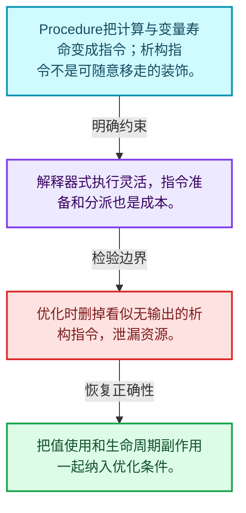
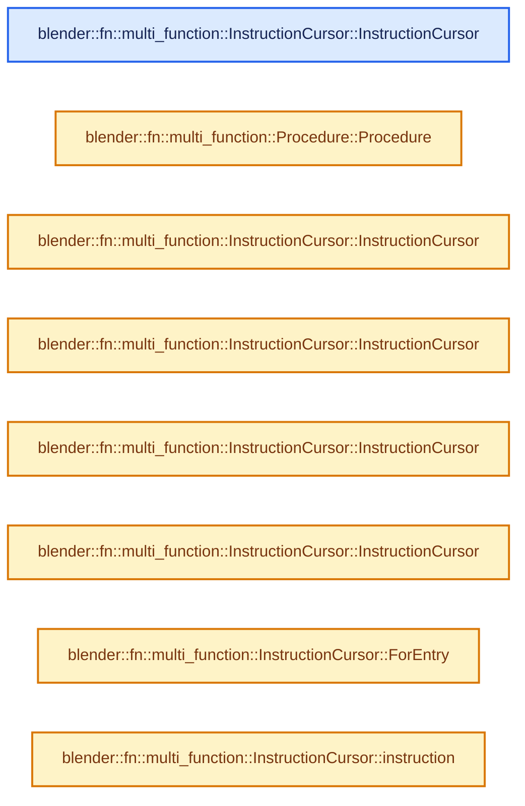
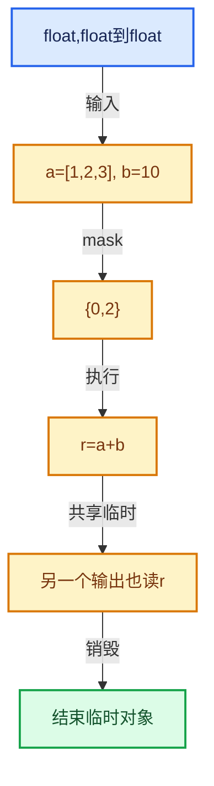

# 07-07 Procedure指令与控制流

[方向导航](README.md) · [总目录](../README.md) · [实现索引](../00-课程指南/02-源码与提交索引/符号依赖与实现索引.md)

## 从问题到实现

表达式怎样变成可执行指令？

变量表示值流，指令表示操作；分支和析构指令让执行顺序与对象寿命显式化。

**数据模型**

Procedure把计算与变量寿命变成指令；析构指令不是可随意移走的装饰。

**设计取舍**

解释器式执行灵活，指令准备和分派也是成本。

**最小反例**

优化时删掉看似无输出的析构指令，泄漏资源。

**推导**

把值使用和生命周期副作用一起纳入优化条件。

## 阅读地图与执行推演








图中的数值推演是本方向的教学模型；实际函数之间的调用边与概念分析边分别标注，不能把概念关系当作运行时调度顺序。

## 完整源码单元与就地讲解

中文讲解直接放在相关代码旁，复杂机制在代码下展开。原文折叠区保留基准行号；不需要在行号表和函数之间来回查找。类布局可分段展示，函数实现不按固定行数切开。

### 类型布局、声明与编译条件 · FN_multi_function_procedure.hh L1—L54

<a id="t-8824af706958"></a>

<a id="t-d8d7800991c7"></a>

<a id="t-f3e39e8e27e8"></a>

<a id="t-155c88c7f54b"></a>

<a id="t-d129fc2be04b"></a>

<a id="t-fa9a05945cd8"></a>

<a id="t-4c9f9e08e7a6"></a>

<a id="t-db1ca313564e"></a>

<a id="t-bd348816e89f"></a>

<a id="t-cd7ef5f2c370"></a>

`InstructionCursor`在这里声明的数据成员：

- `Type type_`
- `Instruction instruction_`
- `bool branch_output_`

<a id="t-22831e82eae2"></a>

<!-- annotated:fb864d32e25133 -->

```cpp
/* SPDX-FileCopyrightText: 2023 Blender Authors
 *
 * SPDX-License-Identifier: GPL-2.0-or-later */

#pragma once

/** \file
 * \ingroup fn
 */

#include "FN_multi_function.hh"

namespace blender::fn::multi_function {

class Variable;
class Instruction;
class CallInstruction;
class BranchInstruction;
class DestructInstruction;
class DummyInstruction;
class ReturnInstruction;
class Procedure;

/** Every instruction has exactly one of these types. */
enum class InstructionType {
  Call,
  Branch,
  Destruct,
  Dummy,
  Return,
};

/**
 * An #InstructionCursor points to a position in a multi-function procedure, where an instruction
 * can be inserted.
 */
class InstructionCursor {
 public:
  enum Type {
    None,
    Entry,
    Call,
    Destruct,
    Branch,
    Dummy,
  };

 private:
  Type type_ = None;
  Instruction *instruction_ = nullptr;
  /* Only used when it is a branch instruction. */
  bool branch_output_ = false;

 public:
```

<details>
<summary>核对原始源码：source/blender/functions/FN_multi_function_procedure.hh · L1—L54</summary>

<!-- original:fb864d32e25133:source/blender/functions/FN_multi_function_procedure.hh:1:54 -->

```cpp
/* SPDX-FileCopyrightText: 2023 Blender Authors
 *
 * SPDX-License-Identifier: GPL-2.0-or-later */

#pragma once

/** \file
 * \ingroup fn
 */

#include "FN_multi_function.hh"

namespace blender::fn::multi_function {

class Variable;
class Instruction;
class CallInstruction;
class BranchInstruction;
class DestructInstruction;
class DummyInstruction;
class ReturnInstruction;
class Procedure;

/** Every instruction has exactly one of these types. */
enum class InstructionType {
  Call,
  Branch,
  Destruct,
  Dummy,
  Return,
};

/**
 * An #InstructionCursor points to a position in a multi-function procedure, where an instruction
 * can be inserted.
 */
class InstructionCursor {
 public:
  enum Type {
    None,
    Entry,
    Call,
    Destruct,
    Branch,
    Dummy,
  };

 private:
  Type type_ = None;
  Instruction *instruction_ = nullptr;
  /* Only used when it is a branch instruction. */
  bool branch_output_ = false;

 public:
```

</details>

<a id="f-46d989e9084be759"></a>

### `blender::fn::multi_function::InstructionCursor::InstructionCursor`

实现位置：[source/blender/functions/FN_multi_function_procedure.hh](../../../../../source/blender/functions/FN_multi_function_procedure.hh) · L55—L55。

**教学注释版**

<!-- annotated:14a160dd9207ec -->

```cpp
  InstructionCursor() = default;
```

<details>
<summary>核对原始源码：source/blender/functions/FN_multi_function_procedure.hh · L55—L55</summary>

<!-- original:14a160dd9207ec:source/blender/functions/FN_multi_function_procedure.hh:55:55 -->

```cpp
  InstructionCursor() = default;
```

</details>

**继续追踪实现**

本实现没有需要继续展开的显式调用；检查返回表达式、对象转换和调用者前置条件。

### 类型布局、声明与编译条件 · FN_multi_function_procedure.hh L56—L254

<a id="t-e3b1f89818a2"></a>

`Variable`在这里声明的数据成员：

- `DataType data_type_`
- `Vector<Instruction *> users_`
- `std::string name_`
- `int index_in_graph_`
- `DataType data_type`
- `Span<Instruction *> users`
- `StringRefNull name`
- `void set_name`
- `int index_in_procedure`

<a id="t-65efed60e2ce"></a>

`Instruction`在这里声明的数据成员：

- `InstructionType type_`
- `Vector<InstructionCursor> prev_`
- `InstructionType type`
- `Span<InstructionCursor> prev`

<a id="t-64cc357bbe7d"></a>

`CallInstruction`在这里声明的数据成员：

- `MultiFunction fn_`
- `Instruction next_`
- `MutableSpan<Variable *> params_`
- `MultiFunction fn`
- `Instruction next`
- `Instruction next`
- `void set_next`
- `void set_param_variable`
- `void set_params`
- `Span<Variable *> params`
- `Span<const Variable *> params`

<a id="t-b281e0f908b4"></a>

`BranchInstruction`在这里声明的数据成员：

- `Variable condition_`
- `Instruction branch_true_`
- `Instruction branch_false_`
- `Variable condition`
- `Variable condition`
- `void set_condition`
- `Instruction branch_true`
- `Instruction branch_true`
- `void set_branch_true`
- `Instruction branch_false`
- `Instruction branch_false`
- `void set_branch_false`

<a id="t-25cc1fb82808"></a>

`DestructInstruction`在这里声明的数据成员：

- `Variable variable_`
- `Instruction next_`
- `Variable variable`
- `Variable variable`
- `void set_variable`
- `Instruction next`
- `Instruction next`
- `void set_next`

<a id="t-52d6163f99b8"></a>

`DummyInstruction`在这里声明的数据成员：

- `Instruction next_`
- `Instruction next`
- `Instruction next`
- `void set_next`

<a id="t-9193ee7d7b02"></a>

<a id="t-41ab185ea09d"></a>

`Parameter`在这里声明的数据成员：

- `ParamType::InterfaceType type`
- `Variable variable`

<a id="t-68abd3f626c1"></a>

`ConstParameter`在这里声明的数据成员：

- `ParamType::InterfaceType type`
- `Variable variable`

<a id="t-85ad71941adc"></a>

`Procedure`在这里声明的数据成员：

- `LinearAllocator<> allocator_`
- `Vector<CallInstruction *> call_instructions_`
- `Vector<BranchInstruction *> branch_instructions_`
- `Vector<DestructInstruction *> destruct_instructions_`
- `Vector<DummyInstruction *> dummy_instructions_`
- `Vector<ReturnInstruction *> return_instructions_`
- `Vector<Variable *> variables_`
- `Vector<Parameter> params_`
- `Vector<destruct_ptr<MultiFunction>> owned_functions_`
- `Instruction entry_`

<!-- annotated:faa0de84e0457e -->

```cpp
  InstructionCursor(CallInstruction &instruction);
  InstructionCursor(DestructInstruction &instruction);
  InstructionCursor(BranchInstruction &instruction, bool branch_output);
  InstructionCursor(DummyInstruction &instruction);

  static InstructionCursor ForEntry();

  Instruction *next(Procedure &procedure) const;
  void set_next(Procedure &procedure, Instruction *new_instruction) const;

  Instruction *instruction() const;

  Type type() const;

  friend bool operator==(const InstructionCursor &a, const InstructionCursor &b) = default;
};

/**
 * A variable is similar to a virtual register in other libraries. During evaluation, every is
 * either uninitialized or contains a value for every index (remember, a multi-function procedure
 * is always evaluated for many indices at the same time).
 */
class Variable : NonCopyable, NonMovable {
 private:
  DataType data_type_;
  Vector<Instruction *> users_;
  std::string name_;
  int index_in_graph_;

  friend Procedure;
  friend CallInstruction;
  friend BranchInstruction;
  friend DestructInstruction;

 public:
  DataType data_type() const;
  Span<Instruction *> users();

  StringRefNull name() const;
  void set_name(std::string name);

  int index_in_procedure() const;
};

/** Base class for all instruction types. */
class Instruction : NonCopyable, NonMovable {
 protected:
  InstructionType type_;
  Vector<InstructionCursor> prev_;

  friend Procedure;
  friend CallInstruction;
  friend BranchInstruction;
  friend DestructInstruction;
  friend DummyInstruction;
  friend ReturnInstruction;

 public:
  InstructionType type() const;

  /**
   * Other instructions that come before this instruction. There can be multiple previous
   * instructions when branching is used in the procedure.
   */
  Span<InstructionCursor> prev() const;
};

/**
 * References a multi-function that is evaluated when the instruction is executed. It also
 * references the variables whose data will be passed into the multi-function.
 */
class CallInstruction : public Instruction {
 private:
  const MultiFunction *fn_ = nullptr;
  Instruction *next_ = nullptr;
  MutableSpan<Variable *> params_;

  friend Procedure;

 public:
  const MultiFunction &fn() const;

  Instruction *next();
  const Instruction *next() const;
  void set_next(Instruction *instruction);

  void set_param_variable(int param_index, Variable *variable);
  void set_params(Span<Variable *> variables);

  Span<Variable *> params();
  Span<const Variable *> params() const;
};

/**
 * What makes a branch instruction special is that it has two successor instructions. One that will
 * be used when a condition variable was true, and one otherwise.
 */
class BranchInstruction : public Instruction {
 private:
  Variable *condition_ = nullptr;
  Instruction *branch_true_ = nullptr;
  Instruction *branch_false_ = nullptr;

  friend Procedure;

 public:
  Variable *condition();
  const Variable *condition() const;
  void set_condition(Variable *variable);

  Instruction *branch_true();
  const Instruction *branch_true() const;
  void set_branch_true(Instruction *instruction);

  Instruction *branch_false();
  const Instruction *branch_false() const;
  void set_branch_false(Instruction *instruction);
};

/**
 * A destruct instruction destructs a single variable. So the variable value will be uninitialized
 * after this instruction. All variables that are not output variables of the procedure, have to be
 * destructed before the procedure ends. Destructing early is generally a good thing, because it
 * might help with memory buffer reuse, which decreases memory-usage and increases performance.
 */
class DestructInstruction : public Instruction {
 private:
  Variable *variable_ = nullptr;
  Instruction *next_ = nullptr;

  friend Procedure;

 public:
  Variable *variable();
  const Variable *variable() const;
  void set_variable(Variable *variable);

  Instruction *next();
  const Instruction *next() const;
  void set_next(Instruction *instruction);
};

/**
 * This instruction does nothing, it just exists to building a procedure simpler in some cases.
 */
class DummyInstruction : public Instruction {
 private:
  Instruction *next_ = nullptr;

  friend Procedure;

 public:
  Instruction *next();
  const Instruction *next() const;
  void set_next(Instruction *instruction);
};

/**
 * This instruction ends the procedure.
 */
class ReturnInstruction : public Instruction {};

/**
 * Inputs and outputs of the entire procedure network.
 */
struct Parameter {
  ParamType::InterfaceType type;
  Variable *variable;
};

struct ConstParameter {
  ParamType::InterfaceType type;
  const Variable *variable;
};

/**
 * A multi-function procedure allows composing multi-functions in arbitrary ways. It consists of
 * variables and instructions that operate on those variables. Branching and looping within the
 * procedure is supported as well.
 *
 * Typically, a #Procedure should be constructed using a #ProcedureBuilder, which has many more
 * utility methods for common use cases.
 */
class Procedure : NonCopyable, NonMovable {
 private:
  LinearAllocator<> allocator_;
  Vector<CallInstruction *> call_instructions_;
  Vector<BranchInstruction *> branch_instructions_;
  Vector<DestructInstruction *> destruct_instructions_;
  Vector<DummyInstruction *> dummy_instructions_;
  Vector<ReturnInstruction *> return_instructions_;
  Vector<Variable *> variables_;
  Vector<Parameter> params_;
  Vector<destruct_ptr<MultiFunction>> owned_functions_;
  Instruction *entry_ = nullptr;

  friend class ProcedureDotExport;

 public:
```

<details>
<summary>核对原始源码：source/blender/functions/FN_multi_function_procedure.hh · L56—L254</summary>

<!-- original:faa0de84e0457e:source/blender/functions/FN_multi_function_procedure.hh:56:254 -->

```cpp
  InstructionCursor(CallInstruction &instruction);
  InstructionCursor(DestructInstruction &instruction);
  InstructionCursor(BranchInstruction &instruction, bool branch_output);
  InstructionCursor(DummyInstruction &instruction);

  static InstructionCursor ForEntry();

  Instruction *next(Procedure &procedure) const;
  void set_next(Procedure &procedure, Instruction *new_instruction) const;

  Instruction *instruction() const;

  Type type() const;

  friend bool operator==(const InstructionCursor &a, const InstructionCursor &b) = default;
};

/**
 * A variable is similar to a virtual register in other libraries. During evaluation, every is
 * either uninitialized or contains a value for every index (remember, a multi-function procedure
 * is always evaluated for many indices at the same time).
 */
class Variable : NonCopyable, NonMovable {
 private:
  DataType data_type_;
  Vector<Instruction *> users_;
  std::string name_;
  int index_in_graph_;

  friend Procedure;
  friend CallInstruction;
  friend BranchInstruction;
  friend DestructInstruction;

 public:
  DataType data_type() const;
  Span<Instruction *> users();

  StringRefNull name() const;
  void set_name(std::string name);

  int index_in_procedure() const;
};

/** Base class for all instruction types. */
class Instruction : NonCopyable, NonMovable {
 protected:
  InstructionType type_;
  Vector<InstructionCursor> prev_;

  friend Procedure;
  friend CallInstruction;
  friend BranchInstruction;
  friend DestructInstruction;
  friend DummyInstruction;
  friend ReturnInstruction;

 public:
  InstructionType type() const;

  /**
   * Other instructions that come before this instruction. There can be multiple previous
   * instructions when branching is used in the procedure.
   */
  Span<InstructionCursor> prev() const;
};

/**
 * References a multi-function that is evaluated when the instruction is executed. It also
 * references the variables whose data will be passed into the multi-function.
 */
class CallInstruction : public Instruction {
 private:
  const MultiFunction *fn_ = nullptr;
  Instruction *next_ = nullptr;
  MutableSpan<Variable *> params_;

  friend Procedure;

 public:
  const MultiFunction &fn() const;

  Instruction *next();
  const Instruction *next() const;
  void set_next(Instruction *instruction);

  void set_param_variable(int param_index, Variable *variable);
  void set_params(Span<Variable *> variables);

  Span<Variable *> params();
  Span<const Variable *> params() const;
};

/**
 * What makes a branch instruction special is that it has two successor instructions. One that will
 * be used when a condition variable was true, and one otherwise.
 */
class BranchInstruction : public Instruction {
 private:
  Variable *condition_ = nullptr;
  Instruction *branch_true_ = nullptr;
  Instruction *branch_false_ = nullptr;

  friend Procedure;

 public:
  Variable *condition();
  const Variable *condition() const;
  void set_condition(Variable *variable);

  Instruction *branch_true();
  const Instruction *branch_true() const;
  void set_branch_true(Instruction *instruction);

  Instruction *branch_false();
  const Instruction *branch_false() const;
  void set_branch_false(Instruction *instruction);
};

/**
 * A destruct instruction destructs a single variable. So the variable value will be uninitialized
 * after this instruction. All variables that are not output variables of the procedure, have to be
 * destructed before the procedure ends. Destructing early is generally a good thing, because it
 * might help with memory buffer reuse, which decreases memory-usage and increases performance.
 */
class DestructInstruction : public Instruction {
 private:
  Variable *variable_ = nullptr;
  Instruction *next_ = nullptr;

  friend Procedure;

 public:
  Variable *variable();
  const Variable *variable() const;
  void set_variable(Variable *variable);

  Instruction *next();
  const Instruction *next() const;
  void set_next(Instruction *instruction);
};

/**
 * This instruction does nothing, it just exists to building a procedure simpler in some cases.
 */
class DummyInstruction : public Instruction {
 private:
  Instruction *next_ = nullptr;

  friend Procedure;

 public:
  Instruction *next();
  const Instruction *next() const;
  void set_next(Instruction *instruction);
};

/**
 * This instruction ends the procedure.
 */
class ReturnInstruction : public Instruction {};

/**
 * Inputs and outputs of the entire procedure network.
 */
struct Parameter {
  ParamType::InterfaceType type;
  Variable *variable;
};

struct ConstParameter {
  ParamType::InterfaceType type;
  const Variable *variable;
};

/**
 * A multi-function procedure allows composing multi-functions in arbitrary ways. It consists of
 * variables and instructions that operate on those variables. Branching and looping within the
 * procedure is supported as well.
 *
 * Typically, a #Procedure should be constructed using a #ProcedureBuilder, which has many more
 * utility methods for common use cases.
 */
class Procedure : NonCopyable, NonMovable {
 private:
  LinearAllocator<> allocator_;
  Vector<CallInstruction *> call_instructions_;
  Vector<BranchInstruction *> branch_instructions_;
  Vector<DestructInstruction *> destruct_instructions_;
  Vector<DummyInstruction *> dummy_instructions_;
  Vector<ReturnInstruction *> return_instructions_;
  Vector<Variable *> variables_;
  Vector<Parameter> params_;
  Vector<destruct_ptr<MultiFunction>> owned_functions_;
  Instruction *entry_ = nullptr;

  friend class ProcedureDotExport;

 public:
```

</details>

<a id="f-f00b4b3d449e70ef"></a>

### `blender::fn::multi_function::Procedure::Procedure`

实现位置：[source/blender/functions/FN_multi_function_procedure.hh](../../../../../source/blender/functions/FN_multi_function_procedure.hh) · L255—L255。

**教学注释版**

<!-- annotated:ddf61ada6c6b19 -->

```cpp
  Procedure() = default;
```

<details>
<summary>核对原始源码：source/blender/functions/FN_multi_function_procedure.hh · L255—L255</summary>

<!-- original:ddf61ada6c6b19:source/blender/functions/FN_multi_function_procedure.hh:255:255 -->

```cpp
  Procedure() = default;
```

</details>

**继续追踪实现**

本实现没有需要继续展开的显式调用；检查返回表达式、对象转换和调用者前置条件。

### 类型布局、声明与编译条件 · FN_multi_function_procedure.hh L256—L302

<a id="t-1c5a524de7db"></a>

`InitState`在这里声明的数据成员：

- `bool can_be_initialized`
- `bool can_be_uninitialized`

<!-- annotated:dc7d4137be3fc7 -->

```cpp
  ~Procedure();

  Variable &new_variable(DataType data_type, std::string name = "");
  CallInstruction &new_call_instruction(const MultiFunction &fn);
  BranchInstruction &new_branch_instruction();
  DestructInstruction &new_destruct_instruction();
  DummyInstruction &new_dummy_instruction();
  ReturnInstruction &new_return_instruction();

  void add_parameter(ParamType::InterfaceType interface_type, Variable &variable);
  Span<ConstParameter> params() const;

  template<typename T, typename... Args> const MultiFunction &construct_function(Args &&...args);

  Instruction *entry();
  const Instruction *entry() const;
  void set_entry(Instruction &entry);

  Span<Variable *> variables();
  Span<const Variable *> variables() const;

  std::string to_dot() const;

  bool validate() const;

  void prepare_for_execution();

 private:
  bool validate_all_instruction_pointers_set() const;
  bool validate_all_params_provided() const;
  bool validate_same_variables_in_one_call() const;
  bool validate_parameters() const;
  bool validate_initialization() const;

  struct InitState {
    bool can_be_initialized = false;
    bool can_be_uninitialized = false;
  };

  InitState find_initialization_state_before_instruction(const Instruction &target_instruction,
                                                         const Variable &variable) const;
};

/* -------------------------------------------------------------------- */
/** \name #InstructionCursor Inline Methods
 * \{ */

```

<details>
<summary>核对原始源码：source/blender/functions/FN_multi_function_procedure.hh · L256—L302</summary>

<!-- original:dc7d4137be3fc7:source/blender/functions/FN_multi_function_procedure.hh:256:302 -->

```cpp
  ~Procedure();

  Variable &new_variable(DataType data_type, std::string name = "");
  CallInstruction &new_call_instruction(const MultiFunction &fn);
  BranchInstruction &new_branch_instruction();
  DestructInstruction &new_destruct_instruction();
  DummyInstruction &new_dummy_instruction();
  ReturnInstruction &new_return_instruction();

  void add_parameter(ParamType::InterfaceType interface_type, Variable &variable);
  Span<ConstParameter> params() const;

  template<typename T, typename... Args> const MultiFunction &construct_function(Args &&...args);

  Instruction *entry();
  const Instruction *entry() const;
  void set_entry(Instruction &entry);

  Span<Variable *> variables();
  Span<const Variable *> variables() const;

  std::string to_dot() const;

  bool validate() const;

  void prepare_for_execution();

 private:
  bool validate_all_instruction_pointers_set() const;
  bool validate_all_params_provided() const;
  bool validate_same_variables_in_one_call() const;
  bool validate_parameters() const;
  bool validate_initialization() const;

  struct InitState {
    bool can_be_initialized = false;
    bool can_be_uninitialized = false;
  };

  InitState find_initialization_state_before_instruction(const Instruction &target_instruction,
                                                         const Variable &variable) const;
};

/* -------------------------------------------------------------------- */
/** \name #InstructionCursor Inline Methods
 * \{ */

```

</details>

<a id="f-f7edb805b8d1c90d"></a>

### `blender::fn::multi_function::InstructionCursor::InstructionCursor`

实现位置：[source/blender/functions/FN_multi_function_procedure.hh](../../../../../source/blender/functions/FN_multi_function_procedure.hh) · L303—L306。

接口参数：

- `CallInstruction &instruction`

**教学注释版**

<!-- annotated:b33b048275c34a -->

```cpp
inline InstructionCursor::InstructionCursor(CallInstruction &instruction)
    : type_(Call), instruction_(&instruction)
{
}
```

<details>
<summary>核对原始源码：source/blender/functions/FN_multi_function_procedure.hh · L303—L306</summary>

<!-- original:b33b048275c34a:source/blender/functions/FN_multi_function_procedure.hh:303:306 -->

```cpp
inline InstructionCursor::InstructionCursor(CallInstruction &instruction)
    : type_(Call), instruction_(&instruction)
{
}
```

</details>

**继续追踪实现**

本实现没有需要继续展开的显式调用；检查返回表达式、对象转换和调用者前置条件。

<!-- annotated:f1f905039feba6 -->

```cpp

```

<details>
<summary>核对原始源码：source/blender/functions/FN_multi_function_procedure.hh · L307—L307</summary>

<!-- original:f1f905039feba6:source/blender/functions/FN_multi_function_procedure.hh:307:307 -->

```cpp

```

</details>

<a id="f-d4c872dcb0625f0b"></a>

### `blender::fn::multi_function::InstructionCursor::InstructionCursor`

实现位置：[source/blender/functions/FN_multi_function_procedure.hh](../../../../../source/blender/functions/FN_multi_function_procedure.hh) · L308—L311。

接口参数：

- `DestructInstruction &instruction`

**教学注释版**

<!-- annotated:b7202b8253f9a2 -->

```cpp
inline InstructionCursor::InstructionCursor(DestructInstruction &instruction)
    : type_(Destruct), instruction_(&instruction)
{
}
```

<details>
<summary>核对原始源码：source/blender/functions/FN_multi_function_procedure.hh · L308—L311</summary>

<!-- original:b7202b8253f9a2:source/blender/functions/FN_multi_function_procedure.hh:308:311 -->

```cpp
inline InstructionCursor::InstructionCursor(DestructInstruction &instruction)
    : type_(Destruct), instruction_(&instruction)
{
}
```

</details>

**继续追踪实现**

本实现没有需要继续展开的显式调用；检查返回表达式、对象转换和调用者前置条件。

<!-- annotated:c785e1e124cced -->

```cpp

```

<details>
<summary>核对原始源码：source/blender/functions/FN_multi_function_procedure.hh · L312—L312</summary>

<!-- original:c785e1e124cced:source/blender/functions/FN_multi_function_procedure.hh:312:312 -->

```cpp

```

</details>

<a id="f-02dbb4e6d6ad202a"></a>

### `blender::fn::multi_function::InstructionCursor::InstructionCursor`

实现位置：[source/blender/functions/FN_multi_function_procedure.hh](../../../../../source/blender/functions/FN_multi_function_procedure.hh) · L313—L316。

接口参数：

- `BranchInstruction &instruction`
- `bool branch_output`

**教学注释版**

<!-- annotated:67e5e1da4b385f -->

```cpp
inline InstructionCursor::InstructionCursor(BranchInstruction &instruction, bool branch_output)
    : type_(Branch), instruction_(&instruction), branch_output_(branch_output)
{
}
```

<details>
<summary>核对原始源码：source/blender/functions/FN_multi_function_procedure.hh · L313—L316</summary>

<!-- original:67e5e1da4b385f:source/blender/functions/FN_multi_function_procedure.hh:313:316 -->

```cpp
inline InstructionCursor::InstructionCursor(BranchInstruction &instruction, bool branch_output)
    : type_(Branch), instruction_(&instruction), branch_output_(branch_output)
{
}
```

</details>

**继续追踪实现**

本实现没有需要继续展开的显式调用；检查返回表达式、对象转换和调用者前置条件。

<!-- annotated:ce6090b6c3977e -->

```cpp

```

<details>
<summary>核对原始源码：source/blender/functions/FN_multi_function_procedure.hh · L317—L317</summary>

<!-- original:ce6090b6c3977e:source/blender/functions/FN_multi_function_procedure.hh:317:317 -->

```cpp

```

</details>

<a id="f-092357c1450ae931"></a>

### `blender::fn::multi_function::InstructionCursor::InstructionCursor`

实现位置：[source/blender/functions/FN_multi_function_procedure.hh](../../../../../source/blender/functions/FN_multi_function_procedure.hh) · L318—L321。

接口参数：

- `DummyInstruction &instruction`

**教学注释版**

<!-- annotated:6c2fefe23359a9 -->

```cpp
inline InstructionCursor::InstructionCursor(DummyInstruction &instruction)
    : type_(Dummy), instruction_(&instruction)
{
}
```

<details>
<summary>核对原始源码：source/blender/functions/FN_multi_function_procedure.hh · L318—L321</summary>

<!-- original:6c2fefe23359a9:source/blender/functions/FN_multi_function_procedure.hh:318:321 -->

```cpp
inline InstructionCursor::InstructionCursor(DummyInstruction &instruction)
    : type_(Dummy), instruction_(&instruction)
{
}
```

</details>

**继续追踪实现**

本实现没有需要继续展开的显式调用；检查返回表达式、对象转换和调用者前置条件。

<!-- annotated:99672ba62186db -->

```cpp

```

<details>
<summary>核对原始源码：source/blender/functions/FN_multi_function_procedure.hh · L322—L322</summary>

<!-- original:99672ba62186db:source/blender/functions/FN_multi_function_procedure.hh:322:322 -->

```cpp

```

</details>

<a id="f-5054dabb07986d8d"></a>

### `blender::fn::multi_function::InstructionCursor::ForEntry`

实现位置：[source/blender/functions/FN_multi_function_procedure.hh](../../../../../source/blender/functions/FN_multi_function_procedure.hh) · L323—L328。

**教学注释版**

<!-- annotated:b3fafed1375e62 -->

```cpp
inline InstructionCursor InstructionCursor::ForEntry()
{
  InstructionCursor cursor;
  cursor.type_ = Type::Entry;
  return cursor;
}
```

<details>
<summary>核对原始源码：source/blender/functions/FN_multi_function_procedure.hh · L323—L328</summary>

<!-- original:b3fafed1375e62:source/blender/functions/FN_multi_function_procedure.hh:323:328 -->

```cpp
inline InstructionCursor InstructionCursor::ForEntry()
{
  InstructionCursor cursor;
  cursor.type_ = Type::Entry;
  return cursor;
}
```

</details>

**沿实际写入检查状态**

- `cursor.type_ = Type::Entry;`

**结果出口**

- `return cursor;`

**继续追踪实现**

本实现没有需要继续展开的显式调用；检查返回表达式、对象转换和调用者前置条件。

<!-- annotated:e8b6d85c3f35b2 -->

```cpp

```

<details>
<summary>核对原始源码：source/blender/functions/FN_multi_function_procedure.hh · L329—L329</summary>

<!-- original:e8b6d85c3f35b2:source/blender/functions/FN_multi_function_procedure.hh:329:329 -->

```cpp

```

</details>

<a id="f-d4e9127f4d3672d7"></a>

### `blender::fn::multi_function::InstructionCursor::instruction`

实现位置：[source/blender/functions/FN_multi_function_procedure.hh](../../../../../source/blender/functions/FN_multi_function_procedure.hh) · L330—L335。

**教学注释版**

<!-- annotated:f906f2fefaa8da -->

```cpp
inline Instruction *InstructionCursor::instruction() const
{
  /* This isn't really const correct unfortunately, because to make it correct we'll need a const
   * version of #InstructionCursor. */
  return instruction_;
}
```

<details>
<summary>核对原始源码：source/blender/functions/FN_multi_function_procedure.hh · L330—L335</summary>

<!-- original:f906f2fefaa8da:source/blender/functions/FN_multi_function_procedure.hh:330:335 -->

```cpp
inline Instruction *InstructionCursor::instruction() const
{
  /* This isn't really const correct unfortunately, because to make it correct we'll need a const
   * version of #InstructionCursor. */
  return instruction_;
}
```

</details>

**结果出口**

- `return instruction_;`

**继续追踪实现**

本实现没有需要继续展开的显式调用；检查返回表达式、对象转换和调用者前置条件。

<!-- annotated:52be5469465502 -->

```cpp

```

<details>
<summary>核对原始源码：source/blender/functions/FN_multi_function_procedure.hh · L336—L336</summary>

<!-- original:52be5469465502:source/blender/functions/FN_multi_function_procedure.hh:336:336 -->

```cpp

```

</details>

<a id="f-76e4c230aa096835"></a>

### `blender::fn::multi_function::InstructionCursor::type`

实现位置：[source/blender/functions/FN_multi_function_procedure.hh](../../../../../source/blender/functions/FN_multi_function_procedure.hh) · L337—L340。

**教学注释版**

<!-- annotated:8eadb0bbbefa34 -->

```cpp
inline InstructionCursor::Type InstructionCursor::type() const
{
  return type_;
}
```

<details>
<summary>核对原始源码：source/blender/functions/FN_multi_function_procedure.hh · L337—L340</summary>

<!-- original:8eadb0bbbefa34:source/blender/functions/FN_multi_function_procedure.hh:337:340 -->

```cpp
inline InstructionCursor::Type InstructionCursor::type() const
{
  return type_;
}
```

</details>

**结果出口**

- `return type_;`

**继续追踪实现**

本实现没有需要继续展开的显式调用；检查返回表达式、对象转换和调用者前置条件。

### 类型布局、声明与编译条件 · FN_multi_function_procedure.hh L341—L347

<!-- annotated:8fed014fc0c7a5 -->

```cpp

/** \} */

/* -------------------------------------------------------------------- */
/** \name #Variable Inline Methods
 * \{ */

```

<details>
<summary>核对原始源码：source/blender/functions/FN_multi_function_procedure.hh · L341—L347</summary>

<!-- original:8fed014fc0c7a5:source/blender/functions/FN_multi_function_procedure.hh:341:347 -->

```cpp

/** \} */

/* -------------------------------------------------------------------- */
/** \name #Variable Inline Methods
 * \{ */

```

</details>

<a id="f-80356391ae1c000e"></a>

### `blender::fn::multi_function::Variable::data_type`

实现位置：[source/blender/functions/FN_multi_function_procedure.hh](../../../../../source/blender/functions/FN_multi_function_procedure.hh) · L348—L351。

**教学注释版**

<!-- annotated:c8d365d92cda2d -->

```cpp
inline DataType Variable::data_type() const
{
  return data_type_;
}
```

<details>
<summary>核对原始源码：source/blender/functions/FN_multi_function_procedure.hh · L348—L351</summary>

<!-- original:c8d365d92cda2d:source/blender/functions/FN_multi_function_procedure.hh:348:351 -->

```cpp
inline DataType Variable::data_type() const
{
  return data_type_;
}
```

</details>

**结果出口**

- `return data_type_;`

**继续追踪实现**

本实现没有需要继续展开的显式调用；检查返回表达式、对象转换和调用者前置条件。

<!-- annotated:069fc88ffd8412 -->

```cpp

```

<details>
<summary>核对原始源码：source/blender/functions/FN_multi_function_procedure.hh · L352—L352</summary>

<!-- original:069fc88ffd8412:source/blender/functions/FN_multi_function_procedure.hh:352:352 -->

```cpp

```

</details>

<a id="f-e6625fe8dfcde86e"></a>

### `blender::fn::multi_function::Variable::users`

实现位置：[source/blender/functions/FN_multi_function_procedure.hh](../../../../../source/blender/functions/FN_multi_function_procedure.hh) · L353—L356。

**教学注释版**

<!-- annotated:e89e1c7fc27f4d -->

```cpp
inline Span<Instruction *> Variable::users()
{
  return users_;
}
```

<details>
<summary>核对原始源码：source/blender/functions/FN_multi_function_procedure.hh · L353—L356</summary>

<!-- original:e89e1c7fc27f4d:source/blender/functions/FN_multi_function_procedure.hh:353:356 -->

```cpp
inline Span<Instruction *> Variable::users()
{
  return users_;
}
```

</details>

**结果出口**

- `return users_;`

**继续追踪实现**

本实现没有需要继续展开的显式调用；检查返回表达式、对象转换和调用者前置条件。

<!-- annotated:e1b7420c3d3f4d -->

```cpp

```

<details>
<summary>核对原始源码：source/blender/functions/FN_multi_function_procedure.hh · L357—L357</summary>

<!-- original:e1b7420c3d3f4d:source/blender/functions/FN_multi_function_procedure.hh:357:357 -->

```cpp

```

</details>

<a id="f-0e3a00340d24dd3f"></a>

### `blender::fn::multi_function::Variable::name`

实现位置：[source/blender/functions/FN_multi_function_procedure.hh](../../../../../source/blender/functions/FN_multi_function_procedure.hh) · L358—L361。

**教学注释版**

<!-- annotated:0aad6e25afa207 -->

```cpp
inline StringRefNull Variable::name() const
{
  return name_;
}
```

<details>
<summary>核对原始源码：source/blender/functions/FN_multi_function_procedure.hh · L358—L361</summary>

<!-- original:0aad6e25afa207:source/blender/functions/FN_multi_function_procedure.hh:358:361 -->

```cpp
inline StringRefNull Variable::name() const
{
  return name_;
}
```

</details>

**结果出口**

- `return name_;`

**继续追踪实现**

本实现没有需要继续展开的显式调用；检查返回表达式、对象转换和调用者前置条件。

<!-- annotated:1caeb606290b32 -->

```cpp

```

<details>
<summary>核对原始源码：source/blender/functions/FN_multi_function_procedure.hh · L362—L362</summary>

<!-- original:1caeb606290b32:source/blender/functions/FN_multi_function_procedure.hh:362:362 -->

```cpp

```

</details>

<a id="f-1ce9a9270d7eaf91"></a>

### `blender::fn::multi_function::Variable::index_in_procedure`

实现位置：[source/blender/functions/FN_multi_function_procedure.hh](../../../../../source/blender/functions/FN_multi_function_procedure.hh) · L363—L366。

**教学注释版**

<!-- annotated:c34194e1a0bbf4 -->

```cpp
inline int Variable::index_in_procedure() const
{
  return index_in_graph_;
}
```

<details>
<summary>核对原始源码：source/blender/functions/FN_multi_function_procedure.hh · L363—L366</summary>

<!-- original:c34194e1a0bbf4:source/blender/functions/FN_multi_function_procedure.hh:363:366 -->

```cpp
inline int Variable::index_in_procedure() const
{
  return index_in_graph_;
}
```

</details>

**结果出口**

- `return index_in_graph_;`

**继续追踪实现**

本实现没有需要继续展开的显式调用；检查返回表达式、对象转换和调用者前置条件。

### 类型布局、声明与编译条件 · FN_multi_function_procedure.hh L367—L373

<!-- annotated:5ddb624ec73bc3 -->

```cpp

/** \} */

/* -------------------------------------------------------------------- */
/** \name #Instruction Inline Methods
 * \{ */

```

<details>
<summary>核对原始源码：source/blender/functions/FN_multi_function_procedure.hh · L367—L373</summary>

<!-- original:5ddb624ec73bc3:source/blender/functions/FN_multi_function_procedure.hh:367:373 -->

```cpp

/** \} */

/* -------------------------------------------------------------------- */
/** \name #Instruction Inline Methods
 * \{ */

```

</details>

<a id="f-7627ff2a0b57ac1f"></a>

### `blender::fn::multi_function::Instruction::type`

实现位置：[source/blender/functions/FN_multi_function_procedure.hh](../../../../../source/blender/functions/FN_multi_function_procedure.hh) · L374—L377。

**教学注释版**

<!-- annotated:2333d6c893a597 -->

```cpp
inline InstructionType Instruction::type() const
{
  return type_;
}
```

<details>
<summary>核对原始源码：source/blender/functions/FN_multi_function_procedure.hh · L374—L377</summary>

<!-- original:2333d6c893a597:source/blender/functions/FN_multi_function_procedure.hh:374:377 -->

```cpp
inline InstructionType Instruction::type() const
{
  return type_;
}
```

</details>

**结果出口**

- `return type_;`

**继续追踪实现**

本实现没有需要继续展开的显式调用；检查返回表达式、对象转换和调用者前置条件。

<!-- annotated:fee376649ca2f9 -->

```cpp

```

<details>
<summary>核对原始源码：source/blender/functions/FN_multi_function_procedure.hh · L378—L378</summary>

<!-- original:fee376649ca2f9:source/blender/functions/FN_multi_function_procedure.hh:378:378 -->

```cpp

```

</details>

<a id="f-7054e50273301b5a"></a>

### `blender::fn::multi_function::Instruction::prev`

实现位置：[source/blender/functions/FN_multi_function_procedure.hh](../../../../../source/blender/functions/FN_multi_function_procedure.hh) · L379—L382。

**教学注释版**

<!-- annotated:5515056fc1b8e3 -->

```cpp
inline Span<InstructionCursor> Instruction::prev() const
{
  return prev_;
}
```

<details>
<summary>核对原始源码：source/blender/functions/FN_multi_function_procedure.hh · L379—L382</summary>

<!-- original:5515056fc1b8e3:source/blender/functions/FN_multi_function_procedure.hh:379:382 -->

```cpp
inline Span<InstructionCursor> Instruction::prev() const
{
  return prev_;
}
```

</details>

**结果出口**

- `return prev_;`

**继续追踪实现**

本实现没有需要继续展开的显式调用；检查返回表达式、对象转换和调用者前置条件。

### 类型布局、声明与编译条件 · FN_multi_function_procedure.hh L383—L389

<!-- annotated:ad619eaa86e31f -->

```cpp

/** \} */

/* -------------------------------------------------------------------- */
/** \name #CallInstruction Inline Methods
 * \{ */

```

<details>
<summary>核对原始源码：source/blender/functions/FN_multi_function_procedure.hh · L383—L389</summary>

<!-- original:ad619eaa86e31f:source/blender/functions/FN_multi_function_procedure.hh:383:389 -->

```cpp

/** \} */

/* -------------------------------------------------------------------- */
/** \name #CallInstruction Inline Methods
 * \{ */

```

</details>

<a id="f-572ebb7362882f77"></a>

### `blender::fn::multi_function::CallInstruction::fn`

实现位置：[source/blender/functions/FN_multi_function_procedure.hh](../../../../../source/blender/functions/FN_multi_function_procedure.hh) · L390—L393。

**教学注释版**

<!-- annotated:a394bdb4abd8d4 -->

```cpp
inline const MultiFunction &CallInstruction::fn() const
{
  return *fn_;
}
```

<details>
<summary>核对原始源码：source/blender/functions/FN_multi_function_procedure.hh · L390—L393</summary>

<!-- original:a394bdb4abd8d4:source/blender/functions/FN_multi_function_procedure.hh:390:393 -->

```cpp
inline const MultiFunction &CallInstruction::fn() const
{
  return *fn_;
}
```

</details>

**结果出口**

- `return *fn_;`

**继续追踪实现**

本实现没有需要继续展开的显式调用；检查返回表达式、对象转换和调用者前置条件。

<!-- annotated:4d7a07d5938de0 -->

```cpp

```

<details>
<summary>核对原始源码：source/blender/functions/FN_multi_function_procedure.hh · L394—L394</summary>

<!-- original:4d7a07d5938de0:source/blender/functions/FN_multi_function_procedure.hh:394:394 -->

```cpp

```

</details>

<a id="f-fbae951f837e1665"></a>

### `blender::fn::multi_function::CallInstruction::next`

实现位置：[source/blender/functions/FN_multi_function_procedure.hh](../../../../../source/blender/functions/FN_multi_function_procedure.hh) · L395—L398。

**教学注释版**

<!-- annotated:85e82404658eb0 -->

```cpp
inline Instruction *CallInstruction::next()
{
  return next_;
}
```

<details>
<summary>核对原始源码：source/blender/functions/FN_multi_function_procedure.hh · L395—L398</summary>

<!-- original:85e82404658eb0:source/blender/functions/FN_multi_function_procedure.hh:395:398 -->

```cpp
inline Instruction *CallInstruction::next()
{
  return next_;
}
```

</details>

**结果出口**

- `return next_;`

**继续追踪实现**

本实现没有需要继续展开的显式调用；检查返回表达式、对象转换和调用者前置条件。

<!-- annotated:e9b2513502aba0 -->

```cpp

```

<details>
<summary>核对原始源码：source/blender/functions/FN_multi_function_procedure.hh · L399—L399</summary>

<!-- original:e9b2513502aba0:source/blender/functions/FN_multi_function_procedure.hh:399:399 -->

```cpp

```

</details>

<a id="f-d1ed628812aad40a"></a>

### `blender::fn::multi_function::CallInstruction::next`

实现位置：[source/blender/functions/FN_multi_function_procedure.hh](../../../../../source/blender/functions/FN_multi_function_procedure.hh) · L400—L403。

**教学注释版**

<!-- annotated:5ae3849241b775 -->

```cpp
inline const Instruction *CallInstruction::next() const
{
  return next_;
}
```

<details>
<summary>核对原始源码：source/blender/functions/FN_multi_function_procedure.hh · L400—L403</summary>

<!-- original:5ae3849241b775:source/blender/functions/FN_multi_function_procedure.hh:400:403 -->

```cpp
inline const Instruction *CallInstruction::next() const
{
  return next_;
}
```

</details>

**结果出口**

- `return next_;`

**继续追踪实现**

本实现没有需要继续展开的显式调用；检查返回表达式、对象转换和调用者前置条件。

<!-- annotated:820e1b74380179 -->

```cpp

```

<details>
<summary>核对原始源码：source/blender/functions/FN_multi_function_procedure.hh · L404—L404</summary>

<!-- original:820e1b74380179:source/blender/functions/FN_multi_function_procedure.hh:404:404 -->

```cpp

```

</details>

<a id="f-4a9ea187cb82c472"></a>

### `blender::fn::multi_function::CallInstruction::params`

实现位置：[source/blender/functions/FN_multi_function_procedure.hh](../../../../../source/blender/functions/FN_multi_function_procedure.hh) · L405—L408。

**教学注释版**

<!-- annotated:cc051e79ced618 -->

```cpp
inline Span<Variable *> CallInstruction::params()
{
  return params_;
}
```

<details>
<summary>核对原始源码：source/blender/functions/FN_multi_function_procedure.hh · L405—L408</summary>

<!-- original:cc051e79ced618:source/blender/functions/FN_multi_function_procedure.hh:405:408 -->

```cpp
inline Span<Variable *> CallInstruction::params()
{
  return params_;
}
```

</details>

**结果出口**

- `return params_;`

**继续追踪实现**

本实现没有需要继续展开的显式调用；检查返回表达式、对象转换和调用者前置条件。

<!-- annotated:84277a8a7d2200 -->

```cpp

```

<details>
<summary>核对原始源码：source/blender/functions/FN_multi_function_procedure.hh · L409—L409</summary>

<!-- original:84277a8a7d2200:source/blender/functions/FN_multi_function_procedure.hh:409:409 -->

```cpp

```

</details>

<a id="f-a91b8ab686f96649"></a>

### `blender::fn::multi_function::CallInstruction::params`

实现位置：[source/blender/functions/FN_multi_function_procedure.hh](../../../../../source/blender/functions/FN_multi_function_procedure.hh) · L410—L413。

**教学注释版**

<!-- annotated:821d13a4c33de0 -->

```cpp
inline Span<const Variable *> CallInstruction::params() const
{
  return params_;
}
```

<details>
<summary>核对原始源码：source/blender/functions/FN_multi_function_procedure.hh · L410—L413</summary>

<!-- original:821d13a4c33de0:source/blender/functions/FN_multi_function_procedure.hh:410:413 -->

```cpp
inline Span<const Variable *> CallInstruction::params() const
{
  return params_;
}
```

</details>

**结果出口**

- `return params_;`

**继续追踪实现**

本实现没有需要继续展开的显式调用；检查返回表达式、对象转换和调用者前置条件。

### 类型布局、声明与编译条件 · FN_multi_function_procedure.hh L414—L420

<!-- annotated:06d6bf72264be2 -->

```cpp

/** \} */

/* -------------------------------------------------------------------- */
/** \name #BranchInstruction Inline Methods
 * \{ */

```

<details>
<summary>核对原始源码：source/blender/functions/FN_multi_function_procedure.hh · L414—L420</summary>

<!-- original:06d6bf72264be2:source/blender/functions/FN_multi_function_procedure.hh:414:420 -->

```cpp

/** \} */

/* -------------------------------------------------------------------- */
/** \name #BranchInstruction Inline Methods
 * \{ */

```

</details>

<a id="f-c95145698d6f8749"></a>

### `blender::fn::multi_function::BranchInstruction::condition`

实现位置：[source/blender/functions/FN_multi_function_procedure.hh](../../../../../source/blender/functions/FN_multi_function_procedure.hh) · L421—L424。

**教学注释版**

<!-- annotated:7a86541ceb72ec -->

```cpp
inline Variable *BranchInstruction::condition()
{
  return condition_;
}
```

<details>
<summary>核对原始源码：source/blender/functions/FN_multi_function_procedure.hh · L421—L424</summary>

<!-- original:7a86541ceb72ec:source/blender/functions/FN_multi_function_procedure.hh:421:424 -->

```cpp
inline Variable *BranchInstruction::condition()
{
  return condition_;
}
```

</details>

**结果出口**

- `return condition_;`

**继续追踪实现**

本实现没有需要继续展开的显式调用；检查返回表达式、对象转换和调用者前置条件。

<!-- annotated:7727f6ceebcbfb -->

```cpp

```

<details>
<summary>核对原始源码：source/blender/functions/FN_multi_function_procedure.hh · L425—L425</summary>

<!-- original:7727f6ceebcbfb:source/blender/functions/FN_multi_function_procedure.hh:425:425 -->

```cpp

```

</details>

<a id="f-3e3191e98a53bb9a"></a>

### `blender::fn::multi_function::BranchInstruction::condition`

实现位置：[source/blender/functions/FN_multi_function_procedure.hh](../../../../../source/blender/functions/FN_multi_function_procedure.hh) · L426—L429。

**教学注释版**

<!-- annotated:fb0f57053d38d2 -->

```cpp
inline const Variable *BranchInstruction::condition() const
{
  return condition_;
}
```

<details>
<summary>核对原始源码：source/blender/functions/FN_multi_function_procedure.hh · L426—L429</summary>

<!-- original:fb0f57053d38d2:source/blender/functions/FN_multi_function_procedure.hh:426:429 -->

```cpp
inline const Variable *BranchInstruction::condition() const
{
  return condition_;
}
```

</details>

**结果出口**

- `return condition_;`

**继续追踪实现**

本实现没有需要继续展开的显式调用；检查返回表达式、对象转换和调用者前置条件。

<!-- annotated:7b79d5287e295f -->

```cpp

```

<details>
<summary>核对原始源码：source/blender/functions/FN_multi_function_procedure.hh · L430—L430</summary>

<!-- original:7b79d5287e295f:source/blender/functions/FN_multi_function_procedure.hh:430:430 -->

```cpp

```

</details>

<a id="f-214bcef229090a6a"></a>

### `blender::fn::multi_function::BranchInstruction::branch_true`

实现位置：[source/blender/functions/FN_multi_function_procedure.hh](../../../../../source/blender/functions/FN_multi_function_procedure.hh) · L431—L434。

**教学注释版**

<!-- annotated:8f2a2f8d2beda3 -->

```cpp
inline Instruction *BranchInstruction::branch_true()
{
  return branch_true_;
}
```

<details>
<summary>核对原始源码：source/blender/functions/FN_multi_function_procedure.hh · L431—L434</summary>

<!-- original:8f2a2f8d2beda3:source/blender/functions/FN_multi_function_procedure.hh:431:434 -->

```cpp
inline Instruction *BranchInstruction::branch_true()
{
  return branch_true_;
}
```

</details>

**结果出口**

- `return branch_true_;`

**继续追踪实现**

本实现没有需要继续展开的显式调用；检查返回表达式、对象转换和调用者前置条件。

<!-- annotated:5f28296c5a3740 -->

```cpp

```

<details>
<summary>核对原始源码：source/blender/functions/FN_multi_function_procedure.hh · L435—L435</summary>

<!-- original:5f28296c5a3740:source/blender/functions/FN_multi_function_procedure.hh:435:435 -->

```cpp

```

</details>

<a id="f-ab726f068b20fae8"></a>

### `blender::fn::multi_function::BranchInstruction::branch_true`

实现位置：[source/blender/functions/FN_multi_function_procedure.hh](../../../../../source/blender/functions/FN_multi_function_procedure.hh) · L436—L439。

**教学注释版**

<!-- annotated:90b4753c36d2b8 -->

```cpp
inline const Instruction *BranchInstruction::branch_true() const
{
  return branch_true_;
}
```

<details>
<summary>核对原始源码：source/blender/functions/FN_multi_function_procedure.hh · L436—L439</summary>

<!-- original:90b4753c36d2b8:source/blender/functions/FN_multi_function_procedure.hh:436:439 -->

```cpp
inline const Instruction *BranchInstruction::branch_true() const
{
  return branch_true_;
}
```

</details>

**结果出口**

- `return branch_true_;`

**继续追踪实现**

本实现没有需要继续展开的显式调用；检查返回表达式、对象转换和调用者前置条件。

<!-- annotated:cbb3143cc248d5 -->

```cpp

```

<details>
<summary>核对原始源码：source/blender/functions/FN_multi_function_procedure.hh · L440—L440</summary>

<!-- original:cbb3143cc248d5:source/blender/functions/FN_multi_function_procedure.hh:440:440 -->

```cpp

```

</details>

<a id="f-5f559cc4a23b8ad8"></a>

### `blender::fn::multi_function::BranchInstruction::branch_false`

实现位置：[source/blender/functions/FN_multi_function_procedure.hh](../../../../../source/blender/functions/FN_multi_function_procedure.hh) · L441—L444。

**教学注释版**

<!-- annotated:e39c5cee4c4a51 -->

```cpp
inline Instruction *BranchInstruction::branch_false()
{
  return branch_false_;
}
```

<details>
<summary>核对原始源码：source/blender/functions/FN_multi_function_procedure.hh · L441—L444</summary>

<!-- original:e39c5cee4c4a51:source/blender/functions/FN_multi_function_procedure.hh:441:444 -->

```cpp
inline Instruction *BranchInstruction::branch_false()
{
  return branch_false_;
}
```

</details>

**结果出口**

- `return branch_false_;`

**继续追踪实现**

本实现没有需要继续展开的显式调用；检查返回表达式、对象转换和调用者前置条件。

<!-- annotated:7caaa7175e82a1 -->

```cpp

```

<details>
<summary>核对原始源码：source/blender/functions/FN_multi_function_procedure.hh · L445—L445</summary>

<!-- original:7caaa7175e82a1:source/blender/functions/FN_multi_function_procedure.hh:445:445 -->

```cpp

```

</details>

<a id="f-64488c0b7992ae49"></a>

### `blender::fn::multi_function::BranchInstruction::branch_false`

实现位置：[source/blender/functions/FN_multi_function_procedure.hh](../../../../../source/blender/functions/FN_multi_function_procedure.hh) · L446—L449。

**教学注释版**

<!-- annotated:ccfb2906f10849 -->

```cpp
inline const Instruction *BranchInstruction::branch_false() const
{
  return branch_false_;
}
```

<details>
<summary>核对原始源码：source/blender/functions/FN_multi_function_procedure.hh · L446—L449</summary>

<!-- original:ccfb2906f10849:source/blender/functions/FN_multi_function_procedure.hh:446:449 -->

```cpp
inline const Instruction *BranchInstruction::branch_false() const
{
  return branch_false_;
}
```

</details>

**结果出口**

- `return branch_false_;`

**继续追踪实现**

本实现没有需要继续展开的显式调用；检查返回表达式、对象转换和调用者前置条件。

### 类型布局、声明与编译条件 · FN_multi_function_procedure.hh L450—L456

<!-- annotated:d4696b43bb6840 -->

```cpp

/** \} */

/* -------------------------------------------------------------------- */
/** \name #DestructInstruction Inline Methods
 * \{ */

```

<details>
<summary>核对原始源码：source/blender/functions/FN_multi_function_procedure.hh · L450—L456</summary>

<!-- original:d4696b43bb6840:source/blender/functions/FN_multi_function_procedure.hh:450:456 -->

```cpp

/** \} */

/* -------------------------------------------------------------------- */
/** \name #DestructInstruction Inline Methods
 * \{ */

```

</details>

<a id="f-9a543d124703e5f7"></a>

### `blender::fn::multi_function::DestructInstruction::variable`

实现位置：[source/blender/functions/FN_multi_function_procedure.hh](../../../../../source/blender/functions/FN_multi_function_procedure.hh) · L457—L460。

**教学注释版**

<!-- annotated:79bfccd4632753 -->

```cpp
inline Variable *DestructInstruction::variable()
{
  return variable_;
}
```

<details>
<summary>核对原始源码：source/blender/functions/FN_multi_function_procedure.hh · L457—L460</summary>

<!-- original:79bfccd4632753:source/blender/functions/FN_multi_function_procedure.hh:457:460 -->

```cpp
inline Variable *DestructInstruction::variable()
{
  return variable_;
}
```

</details>

**结果出口**

- `return variable_;`

**继续追踪实现**

本实现没有需要继续展开的显式调用；检查返回表达式、对象转换和调用者前置条件。

<!-- annotated:754320347e7dfa -->

```cpp

```

<details>
<summary>核对原始源码：source/blender/functions/FN_multi_function_procedure.hh · L461—L461</summary>

<!-- original:754320347e7dfa:source/blender/functions/FN_multi_function_procedure.hh:461:461 -->

```cpp

```

</details>

<a id="f-a4656c3cfa7704c1"></a>

### `blender::fn::multi_function::DestructInstruction::variable`

实现位置：[source/blender/functions/FN_multi_function_procedure.hh](../../../../../source/blender/functions/FN_multi_function_procedure.hh) · L462—L465。

**教学注释版**

<!-- annotated:399b99f1c29f80 -->

```cpp
inline const Variable *DestructInstruction::variable() const
{
  return variable_;
}
```

<details>
<summary>核对原始源码：source/blender/functions/FN_multi_function_procedure.hh · L462—L465</summary>

<!-- original:399b99f1c29f80:source/blender/functions/FN_multi_function_procedure.hh:462:465 -->

```cpp
inline const Variable *DestructInstruction::variable() const
{
  return variable_;
}
```

</details>

**结果出口**

- `return variable_;`

**继续追踪实现**

本实现没有需要继续展开的显式调用；检查返回表达式、对象转换和调用者前置条件。

<!-- annotated:5954d1a884e681 -->

```cpp

```

<details>
<summary>核对原始源码：source/blender/functions/FN_multi_function_procedure.hh · L466—L466</summary>

<!-- original:5954d1a884e681:source/blender/functions/FN_multi_function_procedure.hh:466:466 -->

```cpp

```

</details>

<a id="f-5247a1ab6a5e8119"></a>

### `blender::fn::multi_function::DestructInstruction::next`

实现位置：[source/blender/functions/FN_multi_function_procedure.hh](../../../../../source/blender/functions/FN_multi_function_procedure.hh) · L467—L470。

**教学注释版**

<!-- annotated:8aed12f76b0754 -->

```cpp
inline Instruction *DestructInstruction::next()
{
  return next_;
}
```

<details>
<summary>核对原始源码：source/blender/functions/FN_multi_function_procedure.hh · L467—L470</summary>

<!-- original:8aed12f76b0754:source/blender/functions/FN_multi_function_procedure.hh:467:470 -->

```cpp
inline Instruction *DestructInstruction::next()
{
  return next_;
}
```

</details>

**结果出口**

- `return next_;`

**继续追踪实现**

本实现没有需要继续展开的显式调用；检查返回表达式、对象转换和调用者前置条件。

<!-- annotated:0794a02a9f76a2 -->

```cpp

```

<details>
<summary>核对原始源码：source/blender/functions/FN_multi_function_procedure.hh · L471—L471</summary>

<!-- original:0794a02a9f76a2:source/blender/functions/FN_multi_function_procedure.hh:471:471 -->

```cpp

```

</details>

<a id="f-145e184be00d486a"></a>

### `blender::fn::multi_function::DestructInstruction::next`

实现位置：[source/blender/functions/FN_multi_function_procedure.hh](../../../../../source/blender/functions/FN_multi_function_procedure.hh) · L472—L475。

**教学注释版**

<!-- annotated:aca69d5279e61d -->

```cpp
inline const Instruction *DestructInstruction::next() const
{
  return next_;
}
```

<details>
<summary>核对原始源码：source/blender/functions/FN_multi_function_procedure.hh · L472—L475</summary>

<!-- original:aca69d5279e61d:source/blender/functions/FN_multi_function_procedure.hh:472:475 -->

```cpp
inline const Instruction *DestructInstruction::next() const
{
  return next_;
}
```

</details>

**结果出口**

- `return next_;`

**继续追踪实现**

本实现没有需要继续展开的显式调用；检查返回表达式、对象转换和调用者前置条件。

### 类型布局、声明与编译条件 · FN_multi_function_procedure.hh L476—L482

<!-- annotated:ad03545f321ab6 -->

```cpp

/** \} */

/* -------------------------------------------------------------------- */
/** \name #DummyInstruction Inline Methods
 * \{ */

```

<details>
<summary>核对原始源码：source/blender/functions/FN_multi_function_procedure.hh · L476—L482</summary>

<!-- original:ad03545f321ab6:source/blender/functions/FN_multi_function_procedure.hh:476:482 -->

```cpp

/** \} */

/* -------------------------------------------------------------------- */
/** \name #DummyInstruction Inline Methods
 * \{ */

```

</details>

<a id="f-58111eede308b083"></a>

### `blender::fn::multi_function::DummyInstruction::next`

实现位置：[source/blender/functions/FN_multi_function_procedure.hh](../../../../../source/blender/functions/FN_multi_function_procedure.hh) · L483—L486。

**教学注释版**

<!-- annotated:4ee6e2f80ce9ed -->

```cpp
inline Instruction *DummyInstruction::next()
{
  return next_;
}
```

<details>
<summary>核对原始源码：source/blender/functions/FN_multi_function_procedure.hh · L483—L486</summary>

<!-- original:4ee6e2f80ce9ed:source/blender/functions/FN_multi_function_procedure.hh:483:486 -->

```cpp
inline Instruction *DummyInstruction::next()
{
  return next_;
}
```

</details>

**结果出口**

- `return next_;`

**继续追踪实现**

本实现没有需要继续展开的显式调用；检查返回表达式、对象转换和调用者前置条件。

<!-- annotated:0dbeae10a4b113 -->

```cpp

```

<details>
<summary>核对原始源码：source/blender/functions/FN_multi_function_procedure.hh · L487—L487</summary>

<!-- original:0dbeae10a4b113:source/blender/functions/FN_multi_function_procedure.hh:487:487 -->

```cpp

```

</details>

<a id="f-d8df726602a36843"></a>

### `blender::fn::multi_function::DummyInstruction::next`

实现位置：[source/blender/functions/FN_multi_function_procedure.hh](../../../../../source/blender/functions/FN_multi_function_procedure.hh) · L488—L491。

**教学注释版**

<!-- annotated:f0dcbab1fe1d94 -->

```cpp
inline const Instruction *DummyInstruction::next() const
{
  return next_;
}
```

<details>
<summary>核对原始源码：source/blender/functions/FN_multi_function_procedure.hh · L488—L491</summary>

<!-- original:f0dcbab1fe1d94:source/blender/functions/FN_multi_function_procedure.hh:488:491 -->

```cpp
inline const Instruction *DummyInstruction::next() const
{
  return next_;
}
```

</details>

**结果出口**

- `return next_;`

**继续追踪实现**

本实现没有需要继续展开的显式调用；检查返回表达式、对象转换和调用者前置条件。

### 类型布局、声明与编译条件 · FN_multi_function_procedure.hh L492—L498

<!-- annotated:12de9e0596bcfb -->

```cpp

/** \} */

/* -------------------------------------------------------------------- */
/** \name #Procedure Inline Methods
 * \{ */

```

<details>
<summary>核对原始源码：source/blender/functions/FN_multi_function_procedure.hh · L492—L498</summary>

<!-- original:12de9e0596bcfb:source/blender/functions/FN_multi_function_procedure.hh:492:498 -->

```cpp

/** \} */

/* -------------------------------------------------------------------- */
/** \name #Procedure Inline Methods
 * \{ */

```

</details>

<a id="f-0ba3927a219e6465"></a>

### `blender::fn::multi_function::Procedure::params`

实现位置：[source/blender/functions/FN_multi_function_procedure.hh](../../../../../source/blender/functions/FN_multi_function_procedure.hh) · L499—L503。

**教学注释版**

<!-- annotated:c6b7972e5f83c3 -->

```cpp
inline Span<ConstParameter> Procedure::params() const
{
  static_assert(sizeof(Parameter) == sizeof(ConstParameter));
  // [讲解] params_.as_span：构造对当前有效元素区间的借用视图。
  return params_.as_span().cast<ConstParameter>();
}
```

<details>
<summary>核对原始源码：source/blender/functions/FN_multi_function_procedure.hh · L499—L503</summary>

<!-- original:c6b7972e5f83c3:source/blender/functions/FN_multi_function_procedure.hh:499:503 -->

```cpp
inline Span<ConstParameter> Procedure::params() const
{
  static_assert(sizeof(Parameter) == sizeof(ConstParameter));
  return params_.as_span().cast<ConstParameter>();
}
```

</details>

**结果出口**

- `return params_.as_span().cast<ConstParameter>();`

**继续追踪实现**

- `params_.as_span().cast<ConstParameter>` → [调用协议](../00-课程指南/01-路线与规范/模板宏与动态分派协议.md)：接收对象类型依赖auto、返回值或模板实例；不按同名猜测目标。调用位置L502。
- `params_.as_span` → [blender::Vector::as_span · L390](../01-基础容器与现代CPP/10-Vector扩容与增长.md#f-e2eed03cefcdd2ff)。

<!-- annotated:f63dc84ba4a6a6 -->

```cpp

```

<details>
<summary>核对原始源码：source/blender/functions/FN_multi_function_procedure.hh · L504—L504</summary>

<!-- original:f63dc84ba4a6a6:source/blender/functions/FN_multi_function_procedure.hh:504:504 -->

```cpp

```

</details>

<a id="f-abdb843c4cc052b2"></a>

### `blender::fn::multi_function::Procedure::entry`

实现位置：[source/blender/functions/FN_multi_function_procedure.hh](../../../../../source/blender/functions/FN_multi_function_procedure.hh) · L505—L508。

**教学注释版**

<!-- annotated:5513999968a653 -->

```cpp
inline Instruction *Procedure::entry()
{
  return entry_;
}
```

<details>
<summary>核对原始源码：source/blender/functions/FN_multi_function_procedure.hh · L505—L508</summary>

<!-- original:5513999968a653:source/blender/functions/FN_multi_function_procedure.hh:505:508 -->

```cpp
inline Instruction *Procedure::entry()
{
  return entry_;
}
```

</details>

**结果出口**

- `return entry_;`

**继续追踪实现**

本实现没有需要继续展开的显式调用；检查返回表达式、对象转换和调用者前置条件。

<!-- annotated:cdfb78e2197a20 -->

```cpp

```

<details>
<summary>核对原始源码：source/blender/functions/FN_multi_function_procedure.hh · L509—L509</summary>

<!-- original:cdfb78e2197a20:source/blender/functions/FN_multi_function_procedure.hh:509:509 -->

```cpp

```

</details>

<a id="f-6b7fb1a71808de2e"></a>

### `blender::fn::multi_function::Procedure::entry`

实现位置：[source/blender/functions/FN_multi_function_procedure.hh](../../../../../source/blender/functions/FN_multi_function_procedure.hh) · L510—L513。

**教学注释版**

<!-- annotated:2a4aee6709b09c -->

```cpp
inline const Instruction *Procedure::entry() const
{
  return entry_;
}
```

<details>
<summary>核对原始源码：source/blender/functions/FN_multi_function_procedure.hh · L510—L513</summary>

<!-- original:2a4aee6709b09c:source/blender/functions/FN_multi_function_procedure.hh:510:513 -->

```cpp
inline const Instruction *Procedure::entry() const
{
  return entry_;
}
```

</details>

**结果出口**

- `return entry_;`

**继续追踪实现**

本实现没有需要继续展开的显式调用；检查返回表达式、对象转换和调用者前置条件。

<!-- annotated:dac60db2cf280b -->

```cpp

```

<details>
<summary>核对原始源码：source/blender/functions/FN_multi_function_procedure.hh · L514—L514</summary>

<!-- original:dac60db2cf280b:source/blender/functions/FN_multi_function_procedure.hh:514:514 -->

```cpp

```

</details>

<a id="f-6adc5e63a3866c37"></a>

### `blender::fn::multi_function::Procedure::variables`

实现位置：[source/blender/functions/FN_multi_function_procedure.hh](../../../../../source/blender/functions/FN_multi_function_procedure.hh) · L515—L518。

**教学注释版**

<!-- annotated:5f89b8f637aadb -->

```cpp
inline Span<Variable *> Procedure::variables()
{
  return variables_;
}
```

<details>
<summary>核对原始源码：source/blender/functions/FN_multi_function_procedure.hh · L515—L518</summary>

<!-- original:5f89b8f637aadb:source/blender/functions/FN_multi_function_procedure.hh:515:518 -->

```cpp
inline Span<Variable *> Procedure::variables()
{
  return variables_;
}
```

</details>

**结果出口**

- `return variables_;`

**继续追踪实现**

本实现没有需要继续展开的显式调用；检查返回表达式、对象转换和调用者前置条件。

<!-- annotated:7b4affdeb90e98 -->

```cpp

```

<details>
<summary>核对原始源码：source/blender/functions/FN_multi_function_procedure.hh · L519—L519</summary>

<!-- original:7b4affdeb90e98:source/blender/functions/FN_multi_function_procedure.hh:519:519 -->

```cpp

```

</details>

<a id="f-f61d930bbf9581fb"></a>

### `blender::fn::multi_function::Procedure::variables`

实现位置：[source/blender/functions/FN_multi_function_procedure.hh](../../../../../source/blender/functions/FN_multi_function_procedure.hh) · L520—L523。

**教学注释版**

<!-- annotated:ab48275be81eae -->

```cpp
inline Span<const Variable *> Procedure::variables() const
{
  return variables_;
}
```

<details>
<summary>核对原始源码：source/blender/functions/FN_multi_function_procedure.hh · L520—L523</summary>

<!-- original:ab48275be81eae:source/blender/functions/FN_multi_function_procedure.hh:520:523 -->

```cpp
inline Span<const Variable *> Procedure::variables() const
{
  return variables_;
}
```

</details>

**结果出口**

- `return variables_;`

**继续追踪实现**

本实现没有需要继续展开的显式调用；检查返回表达式、对象转换和调用者前置条件。

<!-- annotated:b52d952e7a4e3a -->

```cpp

```

<details>
<summary>核对原始源码：source/blender/functions/FN_multi_function_procedure.hh · L524—L524</summary>

<!-- original:b52d952e7a4e3a:source/blender/functions/FN_multi_function_procedure.hh:524:524 -->

```cpp

```

</details>

<a id="f-528d43f69faf4a3a"></a>

### `blender::fn::multi_function::Procedure::construct_function`

实现位置：[source/blender/functions/FN_multi_function_procedure.hh](../../../../../source/blender/functions/FN_multi_function_procedure.hh) · L525—L532。

**教学注释版**

<!-- annotated:b554612ec87b00 -->

```cpp
template<typename T, typename... Args>
inline const MultiFunction &Procedure::construct_function(Args &&...args)
{
  // [讲解] std::forward<Args>：在转发引用中恢复调用者传入的值类别；依赖推导类型，不能与无条件move互换。
  destruct_ptr<T> fn = allocator_.construct<T>(std::forward<Args>(args)...);
  const MultiFunction &fn_ref = *fn;
  // [讲解] owned_functions_.append：在尾部建立新元素，必要时先扩大存储。
  owned_functions_.append(std::move(fn));
  return fn_ref;
}
```

<details>
<summary>核对原始源码：source/blender/functions/FN_multi_function_procedure.hh · L525—L532</summary>

<!-- original:b554612ec87b00:source/blender/functions/FN_multi_function_procedure.hh:525:532 -->

```cpp
template<typename T, typename... Args>
inline const MultiFunction &Procedure::construct_function(Args &&...args)
{
  destruct_ptr<T> fn = allocator_.construct<T>(std::forward<Args>(args)...);
  const MultiFunction &fn_ref = *fn;
  owned_functions_.append(std::move(fn));
  return fn_ref;
}
```

</details>

**结果出口**

- `return fn_ref;`

**继续追踪实现**

- `allocator_.construct<T>` → [blender::LinearAllocator::construct · L135](../03-内存分配与运行时类型/02-LinearAllocator布局.md#f-437c16eedf07fa2a)。
- `std::forward<Args>` → [外部契约](https://eel.is/c++draft/utility.forward)：在转发引用中恢复调用者传入的值类别；依赖推导类型，不能与无条件move互换。
- `owned_functions_.append` → [blender::Vector::append · L498](../01-基础容器与现代CPP/11-Vector插入删除与重排.md#f-5bde268a69e443ec)；[blender::Vector::append · L502](../01-基础容器与现代CPP/11-Vector插入删除与重排.md#f-591e0b15e6308532)。同名重载需按实参类型选择。
- `std::move` → [外部契约](https://eel.is/c++draft/utility.forward)：把表达式转换成可供移动重载选择的值类别；不保证真的移动，不结束源对象寿命，对const值可能选择复制。

### 类型布局、声明与编译条件 · FN_multi_function_procedure.hh L533—L536

<!-- annotated:d2a59db80b7798 -->

```cpp

/** \} */

}  // namespace blender::fn::multi_function
```

<details>
<summary>核对原始源码：source/blender/functions/FN_multi_function_procedure.hh · L533—L536</summary>

<!-- original:d2a59db80b7798:source/blender/functions/FN_multi_function_procedure.hh:533:536 -->

```cpp

/** \} */

}  // namespace blender::fn::multi_function
```

</details>

### 类型布局、声明与编译条件 · multi_function_procedure.cc L1—L17

<!-- annotated:cc230221a2bab1 -->

```cpp
/* SPDX-FileCopyrightText: 2023 Blender Authors
 *
 * SPDX-License-Identifier: GPL-2.0-or-later */

/** \file
 * \ingroup fn
 */

#include "FN_multi_function_procedure.hh"

#include "BLI_dot_export.hh"
#include "BLI_stack.hh"

#include <sstream>

namespace blender::fn::multi_function {

```

<details>
<summary>核对原始源码：source/blender/functions/intern/multi_function_procedure.cc · L1—L17</summary>

<!-- original:cc230221a2bab1:source/blender/functions/intern/multi_function_procedure.cc:1:17 -->

```cpp
/* SPDX-FileCopyrightText: 2023 Blender Authors
 *
 * SPDX-License-Identifier: GPL-2.0-or-later */

/** \file
 * \ingroup fn
 */

#include "FN_multi_function_procedure.hh"

#include "BLI_dot_export.hh"
#include "BLI_stack.hh"

#include <sstream>

namespace blender::fn::multi_function {

```

</details>

<a id="f-36ec225368437022"></a>

### `blender::fn::multi_function::InstructionCursor::set_next`

实现位置：[source/blender/functions/intern/multi_function_procedure.cc](../../../../../source/blender/functions/intern/multi_function_procedure.cc) · L18—L51。

接口参数：

- `Procedure &procedure`
- `Instruction *new_instruction`

**教学注释版**

<!-- annotated:0fe838eeb0fb60 -->

```cpp
void InstructionCursor::set_next(Procedure &procedure, Instruction *new_instruction) const
{
  switch (type_) {
    case Type::None: {
      break;
    }
    case Type::Entry: {
      procedure.set_entry(*new_instruction);
      break;
    }
    case Type::Call: {
      static_cast<CallInstruction *>(instruction_)->set_next(new_instruction);
      break;
    }
    case Type::Branch: {
      BranchInstruction &branch_instruction = *static_cast<BranchInstruction *>(instruction_);
      if (branch_output_) {
        branch_instruction.set_branch_true(new_instruction);
      }
      else {
        branch_instruction.set_branch_false(new_instruction);
      }
      break;
    }
    case Type::Destruct: {
      static_cast<DestructInstruction *>(instruction_)->set_next(new_instruction);
      break;
    }
    case Type::Dummy: {
      static_cast<DummyInstruction *>(instruction_)->set_next(new_instruction);
      break;
    }
  }
}
```

<details>
<summary>核对原始源码：source/blender/functions/intern/multi_function_procedure.cc · L18—L51</summary>

<!-- original:0fe838eeb0fb60:source/blender/functions/intern/multi_function_procedure.cc:18:51 -->

```cpp
void InstructionCursor::set_next(Procedure &procedure, Instruction *new_instruction) const
{
  switch (type_) {
    case Type::None: {
      break;
    }
    case Type::Entry: {
      procedure.set_entry(*new_instruction);
      break;
    }
    case Type::Call: {
      static_cast<CallInstruction *>(instruction_)->set_next(new_instruction);
      break;
    }
    case Type::Branch: {
      BranchInstruction &branch_instruction = *static_cast<BranchInstruction *>(instruction_);
      if (branch_output_) {
        branch_instruction.set_branch_true(new_instruction);
      }
      else {
        branch_instruction.set_branch_false(new_instruction);
      }
      break;
    }
    case Type::Destruct: {
      static_cast<DestructInstruction *>(instruction_)->set_next(new_instruction);
      break;
    }
    case Type::Dummy: {
      static_cast<DummyInstruction *>(instruction_)->set_next(new_instruction);
      break;
    }
  }
}
```

</details>

**继续追踪实现**

- `procedure.set_entry` → [blender::fn::multi_function::Procedure::set_entry · L240](07-Procedure指令与控制流.md#f-4c51b8f1bb3fa082)。
- `static_cast<CallInstruction *>(instruction_)->set_next` → [调用协议](../00-课程指南/01-路线与规范/模板宏与动态分派协议.md)：接收对象类型依赖auto、返回值或模板实例；不按同名猜测目标。调用位置L29。
- `branch_instruction.set_branch_true` → [blender::fn::multi_function::BranchInstruction::set_branch_true · L127](07-Procedure指令与控制流.md#f-b66722975c9f59e7)。
- `branch_instruction.set_branch_false` → [blender::fn::multi_function::BranchInstruction::set_branch_false · L138](07-Procedure指令与控制流.md#f-df67650d43aa2a6c)。
- `static_cast<DestructInstruction *>(instruction_)->set_next` → [调用协议](../00-课程指南/01-路线与规范/模板宏与动态分派协议.md)：接收对象类型依赖auto、返回值或模板实例；不按同名猜测目标。调用位置L43。
- `static_cast<DummyInstruction *>(instruction_)->set_next` → [调用协议](../00-课程指南/01-路线与规范/模板宏与动态分派协议.md)：接收对象类型依赖auto、返回值或模板实例；不按同名猜测目标。调用位置L47。

<!-- annotated:aa6ca147a0494b -->

```cpp

```

<details>
<summary>核对原始源码：source/blender/functions/intern/multi_function_procedure.cc · L52—L52</summary>

<!-- original:aa6ca147a0494b:source/blender/functions/intern/multi_function_procedure.cc:52:52 -->

```cpp

```

</details>

<a id="f-53900f11751e5a12"></a>

### `blender::fn::multi_function::InstructionCursor::next`

实现位置：[source/blender/functions/intern/multi_function_procedure.cc](../../../../../source/blender/functions/intern/multi_function_procedure.cc) · L53—L75。

接口参数：

- `Procedure &procedure`

**教学注释版**

<!-- annotated:686931d3277af5 -->

```cpp
Instruction *InstructionCursor::next(Procedure &procedure) const
{
  switch (type_) {
    case Type::None:
      return nullptr;
    case Type::Entry:
      return procedure.entry();
    case Type::Call:
      return static_cast<CallInstruction *>(instruction_)->next();
    case Type::Branch: {
      BranchInstruction &branch_instruction = *static_cast<BranchInstruction *>(instruction_);
      if (branch_output_) {
        return branch_instruction.branch_true();
      }
      return branch_instruction.branch_false();
    }
    case Type::Destruct:
      return static_cast<DestructInstruction *>(instruction_)->next();
    case Type::Dummy:
      return static_cast<DummyInstruction *>(instruction_)->next();
  }
  return nullptr;
}
```

<details>
<summary>核对原始源码：source/blender/functions/intern/multi_function_procedure.cc · L53—L75</summary>

<!-- original:686931d3277af5:source/blender/functions/intern/multi_function_procedure.cc:53:75 -->

```cpp
Instruction *InstructionCursor::next(Procedure &procedure) const
{
  switch (type_) {
    case Type::None:
      return nullptr;
    case Type::Entry:
      return procedure.entry();
    case Type::Call:
      return static_cast<CallInstruction *>(instruction_)->next();
    case Type::Branch: {
      BranchInstruction &branch_instruction = *static_cast<BranchInstruction *>(instruction_);
      if (branch_output_) {
        return branch_instruction.branch_true();
      }
      return branch_instruction.branch_false();
    }
    case Type::Destruct:
      return static_cast<DestructInstruction *>(instruction_)->next();
    case Type::Dummy:
      return static_cast<DummyInstruction *>(instruction_)->next();
  }
  return nullptr;
}
```

</details>

**结果出口**

- `return nullptr;`
- `return procedure.entry();`
- `return static_cast<CallInstruction *>(instruction_)->next();`
- `return branch_instruction.branch_true();`
- `return branch_instruction.branch_false();`
- `return static_cast<DestructInstruction *>(instruction_)->next();`
- `return static_cast<DummyInstruction *>(instruction_)->next();`

**继续追踪实现**

- `procedure.entry` → [blender::fn::multi_function::Procedure::entry · L505](07-Procedure指令与控制流.md#f-abdb843c4cc052b2)；[blender::fn::multi_function::Procedure::entry · L510](07-Procedure指令与控制流.md#f-6b7fb1a71808de2e)。同名重载需按实参类型选择。
- `static_cast<CallInstruction *>(instruction_)->next` → [调用协议](../00-课程指南/01-路线与规范/模板宏与动态分派协议.md)：接收对象类型依赖auto、返回值或模板实例；不按同名猜测目标。调用位置L61。
- `branch_instruction.branch_true` → [blender::fn::multi_function::BranchInstruction::branch_true · L431](07-Procedure指令与控制流.md#f-214bcef229090a6a)；[blender::fn::multi_function::BranchInstruction::branch_true · L436](07-Procedure指令与控制流.md#f-ab726f068b20fae8)。同名重载需按实参类型选择。
- `branch_instruction.branch_false` → [blender::fn::multi_function::BranchInstruction::branch_false · L441](07-Procedure指令与控制流.md#f-5f559cc4a23b8ad8)；[blender::fn::multi_function::BranchInstruction::branch_false · L446](07-Procedure指令与控制流.md#f-64488c0b7992ae49)。同名重载需按实参类型选择。
- `static_cast<DestructInstruction *>(instruction_)->next` → [调用协议](../00-课程指南/01-路线与规范/模板宏与动态分派协议.md)：接收对象类型依赖auto、返回值或模板实例；不按同名猜测目标。调用位置L70。
- `static_cast<DummyInstruction *>(instruction_)->next` → [调用协议](../00-课程指南/01-路线与规范/模板宏与动态分派协议.md)：接收对象类型依赖auto、返回值或模板实例；不按同名猜测目标。调用位置L72。

<!-- annotated:2c934a90e86470 -->

```cpp

```

<details>
<summary>核对原始源码：source/blender/functions/intern/multi_function_procedure.cc · L76—L76</summary>

<!-- original:2c934a90e86470:source/blender/functions/intern/multi_function_procedure.cc:76:76 -->

```cpp

```

</details>

<a id="f-94f264b25a4b6fdb"></a>

### `blender::fn::multi_function::Variable::set_name`

实现位置：[source/blender/functions/intern/multi_function_procedure.cc](../../../../../source/blender/functions/intern/multi_function_procedure.cc) · L77—L80。

接口参数：

- `std::string name`

**教学注释版**

<!-- annotated:1be2efaa6535eb -->

```cpp
void Variable::set_name(std::string name)
{
  // [讲解] std::move：把表达式转换成可供移动重载选择的值类别；不保证真的移动，不结束源对象寿命，对const值可能选择复制。
  name_ = std::move(name);
}
```

<details>
<summary>核对原始源码：source/blender/functions/intern/multi_function_procedure.cc · L77—L80</summary>

<!-- original:1be2efaa6535eb:source/blender/functions/intern/multi_function_procedure.cc:77:80 -->

```cpp
void Variable::set_name(std::string name)
{
  name_ = std::move(name);
}
```

</details>

**沿实际写入检查状态**

- `name_ = std::move(name);`

**继续追踪实现**

- `std::move` → [外部契约](https://eel.is/c++draft/utility.forward)：把表达式转换成可供移动重载选择的值类别；不保证真的移动，不结束源对象寿命，对const值可能选择复制。

<!-- annotated:ae71a3eea31f4d -->

```cpp

```

<details>
<summary>核对原始源码：source/blender/functions/intern/multi_function_procedure.cc · L81—L81</summary>

<!-- original:ae71a3eea31f4d:source/blender/functions/intern/multi_function_procedure.cc:81:81 -->

```cpp

```

</details>

<a id="f-34d8e94ed3409f09"></a>

### `blender::fn::multi_function::CallInstruction::set_next`

实现位置：[source/blender/functions/intern/multi_function_procedure.cc](../../../../../source/blender/functions/intern/multi_function_procedure.cc) · L82—L91。

接口参数：

- `Instruction *instruction`

**教学注释版**

<!-- annotated:2c03e5ed4c7af3 -->

```cpp
void CallInstruction::set_next(Instruction *instruction)
{
  if (next_ != nullptr) {
    next_->prev_.remove_first_occurrence_and_reorder(*this);
  }
  if (instruction != nullptr) {
    instruction->prev_.append(*this);
  }
  next_ = instruction;
}
```

<details>
<summary>核对原始源码：source/blender/functions/intern/multi_function_procedure.cc · L82—L91</summary>

<!-- original:2c03e5ed4c7af3:source/blender/functions/intern/multi_function_procedure.cc:82:91 -->

```cpp
void CallInstruction::set_next(Instruction *instruction)
{
  if (next_ != nullptr) {
    next_->prev_.remove_first_occurrence_and_reorder(*this);
  }
  if (instruction != nullptr) {
    instruction->prev_.append(*this);
  }
  next_ = instruction;
}
```

</details>

**沿实际写入检查状态**

- `next_ = instruction;`

**继续追踪实现**

- `next_->prev_.remove_first_occurrence_and_reorder` → [调用协议](../00-课程指南/01-路线与规范/模板宏与动态分派协议.md)：接收对象类型依赖auto、返回值或模板实例；不按同名猜测目标。调用位置L85。
- `instruction->prev_.append` → [调用协议](../00-课程指南/01-路线与规范/模板宏与动态分派协议.md)：接收对象类型依赖auto、返回值或模板实例；不按同名猜测目标。调用位置L88。

<!-- annotated:292cb5069b3973 -->

```cpp

```

<details>
<summary>核对原始源码：source/blender/functions/intern/multi_function_procedure.cc · L92—L92</summary>

<!-- original:292cb5069b3973:source/blender/functions/intern/multi_function_procedure.cc:92:92 -->

```cpp

```

</details>

<a id="f-89bde933df565760"></a>

### `blender::fn::multi_function::CallInstruction::set_param_variable`

实现位置：[source/blender/functions/intern/multi_function_procedure.cc](../../../../../source/blender/functions/intern/multi_function_procedure.cc) · L93—L106。

接口参数：

- `int param_index`
- `Variable *variable`

**教学注释版**

<!-- annotated:09d2fbd0ac23b4 -->

```cpp
void CallInstruction::set_param_variable(int param_index, Variable *variable)
{
  if (params_[param_index] != nullptr) {
    params_[param_index]->users_.remove_first_occurrence_and_reorder(this);
  }
  if (variable != nullptr) {
#ifndef NDEBUG
    const ParamType param_type = fn_->param_type(param_index);
    BLI_assert(param_type.data_type() == variable->data_type());
#endif
    variable->users_.append(this);
  }
  params_[param_index] = variable;
}
```

<details>
<summary>核对原始源码：source/blender/functions/intern/multi_function_procedure.cc · L93—L106</summary>

<!-- original:09d2fbd0ac23b4:source/blender/functions/intern/multi_function_procedure.cc:93:106 -->

```cpp
void CallInstruction::set_param_variable(int param_index, Variable *variable)
{
  if (params_[param_index] != nullptr) {
    params_[param_index]->users_.remove_first_occurrence_and_reorder(this);
  }
  if (variable != nullptr) {
#ifndef NDEBUG
    const ParamType param_type = fn_->param_type(param_index);
    BLI_assert(param_type.data_type() == variable->data_type());
#endif
    variable->users_.append(this);
  }
  params_[param_index] = variable;
}
```

</details>

**沿实际写入检查状态**

- `params_[param_index] = variable;`

**继续追踪实现**

- `params_[param_index]->users_.remove_first_occurrence_and_reorder` → [调用协议](../00-课程指南/01-路线与规范/模板宏与动态分派协议.md)：接收对象类型依赖auto、返回值或模板实例；不按同名猜测目标。调用位置L96。
- `fn_->param_type` → [调用协议](../00-课程指南/01-路线与规范/模板宏与动态分派协议.md)：接收对象类型依赖auto、返回值或模板实例；不按同名猜测目标。调用位置L100。
- `BLI_assert` → [BLI_assert · L48](../90-实现依赖专题/01-BLI基础库/BLI_assert.hh.md#m-57a88495704d)；[BLI_assert · L63](../90-实现依赖专题/01-BLI基础库/BLI_assert.hh.md#m-d07050020cb5)。宏定义由构建条件选择。
- `param_type.data_type` → [blender::fn::multi_function::ParamType::data_type · L113](03-参数类型与角色.md#f-b29743877463338d)。
- `variable->data_type` → [blender::fn::multi_function::Variable::data_type · L348](07-Procedure指令与控制流.md#f-80356391ae1c000e)。
- `variable->users_.append` → [调用协议](../00-课程指南/01-路线与规范/模板宏与动态分派协议.md)：接收对象类型依赖auto、返回值或模板实例；不按同名猜测目标。调用位置L103。

<!-- annotated:38279e623e18dd -->

```cpp

```

<details>
<summary>核对原始源码：source/blender/functions/intern/multi_function_procedure.cc · L107—L107</summary>

<!-- original:38279e623e18dd:source/blender/functions/intern/multi_function_procedure.cc:107:107 -->

```cpp

```

</details>

<a id="f-919a8b42ee8a34c8"></a>

### `blender::fn::multi_function::CallInstruction::set_params`

实现位置：[source/blender/functions/intern/multi_function_procedure.cc](../../../../../source/blender/functions/intern/multi_function_procedure.cc) · L108—L114。

接口参数：

- `Span<Variable *> variables`

**教学注释版**

<!-- annotated:2879ce7ab81818 -->

```cpp
void CallInstruction::set_params(Span<Variable *> variables)
{
  // [讲解] variables.size：查询视图长度或生成对应有效索引区间。
  BLI_assert(variables.size() == params_.size());
  // [讲解] variables.index_range：查询视图长度或生成对应有效索引区间。
  for (const int i : variables.index_range()) {
    this->set_param_variable(i, variables[i]);
  }
}
```

<details>
<summary>核对原始源码：source/blender/functions/intern/multi_function_procedure.cc · L108—L114</summary>

<!-- original:2879ce7ab81818:source/blender/functions/intern/multi_function_procedure.cc:108:114 -->

```cpp
void CallInstruction::set_params(Span<Variable *> variables)
{
  BLI_assert(variables.size() == params_.size());
  for (const int i : variables.index_range()) {
    this->set_param_variable(i, variables[i]);
  }
}
```

</details>

**继续追踪实现**

- `BLI_assert` → [BLI_assert · L48](../90-实现依赖专题/01-BLI基础库/BLI_assert.hh.md#m-57a88495704d)；[BLI_assert · L63](../90-实现依赖专题/01-BLI基础库/BLI_assert.hh.md#m-d07050020cb5)。宏定义由构建条件选择。
- `variables.size` → [blender::Span::size · L256](../01-基础容器与现代CPP/05-Span只读连续视图.md#f-5f80fa006089c998)。
- `params_.size` → [调用协议](../00-课程指南/01-路线与规范/模板宏与动态分派协议.md)：接收对象类型依赖auto、返回值或模板实例；不按同名猜测目标。调用位置L110。
- `variables.index_range` → [blender::Span::index_range · L405](../01-基础容器与现代CPP/05-Span只读连续视图.md#f-caaa9b06e13e53e0)。
- `this->set_param_variable` → [blender::fn::multi_function::CallInstruction::set_param_variable · L93](07-Procedure指令与控制流.md#f-89bde933df565760)。

<!-- annotated:e363987905ea6b -->

```cpp

```

<details>
<summary>核对原始源码：source/blender/functions/intern/multi_function_procedure.cc · L115—L115</summary>

<!-- original:e363987905ea6b:source/blender/functions/intern/multi_function_procedure.cc:115:115 -->

```cpp

```

</details>

<a id="f-7ce39dd7f04480f4"></a>

### `blender::fn::multi_function::BranchInstruction::set_condition`

实现位置：[source/blender/functions/intern/multi_function_procedure.cc](../../../../../source/blender/functions/intern/multi_function_procedure.cc) · L116—L125。

接口参数：

- `Variable *variable`

**教学注释版**

<!-- annotated:6a33a1ce160287 -->

```cpp
void BranchInstruction::set_condition(Variable *variable)
{
  if (condition_ != nullptr) {
    condition_->users_.remove_first_occurrence_and_reorder(this);
  }
  if (variable != nullptr) {
    variable->users_.append(this);
  }
  condition_ = variable;
}
```

<details>
<summary>核对原始源码：source/blender/functions/intern/multi_function_procedure.cc · L116—L125</summary>

<!-- original:6a33a1ce160287:source/blender/functions/intern/multi_function_procedure.cc:116:125 -->

```cpp
void BranchInstruction::set_condition(Variable *variable)
{
  if (condition_ != nullptr) {
    condition_->users_.remove_first_occurrence_and_reorder(this);
  }
  if (variable != nullptr) {
    variable->users_.append(this);
  }
  condition_ = variable;
}
```

</details>

**沿实际写入检查状态**

- `condition_ = variable;`

**继续追踪实现**

- `condition_->users_.remove_first_occurrence_and_reorder` → [调用协议](../00-课程指南/01-路线与规范/模板宏与动态分派协议.md)：接收对象类型依赖auto、返回值或模板实例；不按同名猜测目标。调用位置L119。
- `variable->users_.append` → [调用协议](../00-课程指南/01-路线与规范/模板宏与动态分派协议.md)：接收对象类型依赖auto、返回值或模板实例；不按同名猜测目标。调用位置L122。

<!-- annotated:154c5671b758ff -->

```cpp

```

<details>
<summary>核对原始源码：source/blender/functions/intern/multi_function_procedure.cc · L126—L126</summary>

<!-- original:154c5671b758ff:source/blender/functions/intern/multi_function_procedure.cc:126:126 -->

```cpp

```

</details>

<a id="f-b66722975c9f59e7"></a>

### `blender::fn::multi_function::BranchInstruction::set_branch_true`

实现位置：[source/blender/functions/intern/multi_function_procedure.cc](../../../../../source/blender/functions/intern/multi_function_procedure.cc) · L127—L136。

接口参数：

- `Instruction *instruction`

**教学注释版**

<!-- annotated:f1625119935652 -->

```cpp
void BranchInstruction::set_branch_true(Instruction *instruction)
{
  if (branch_true_ != nullptr) {
    branch_true_->prev_.remove_first_occurrence_and_reorder({*this, true});
  }
  if (instruction != nullptr) {
    instruction->prev_.append({*this, true});
  }
  branch_true_ = instruction;
}
```

<details>
<summary>核对原始源码：source/blender/functions/intern/multi_function_procedure.cc · L127—L136</summary>

<!-- original:f1625119935652:source/blender/functions/intern/multi_function_procedure.cc:127:136 -->

```cpp
void BranchInstruction::set_branch_true(Instruction *instruction)
{
  if (branch_true_ != nullptr) {
    branch_true_->prev_.remove_first_occurrence_and_reorder({*this, true});
  }
  if (instruction != nullptr) {
    instruction->prev_.append({*this, true});
  }
  branch_true_ = instruction;
}
```

</details>

**沿实际写入检查状态**

- `branch_true_ = instruction;`

**继续追踪实现**

- `branch_true_->prev_.remove_first_occurrence_and_reorder` → [调用协议](../00-课程指南/01-路线与规范/模板宏与动态分派协议.md)：接收对象类型依赖auto、返回值或模板实例；不按同名猜测目标。调用位置L130。
- `instruction->prev_.append` → [调用协议](../00-课程指南/01-路线与规范/模板宏与动态分派协议.md)：接收对象类型依赖auto、返回值或模板实例；不按同名猜测目标。调用位置L133。

<!-- annotated:db7b2103628daa -->

```cpp

```

<details>
<summary>核对原始源码：source/blender/functions/intern/multi_function_procedure.cc · L137—L137</summary>

<!-- original:db7b2103628daa:source/blender/functions/intern/multi_function_procedure.cc:137:137 -->

```cpp

```

</details>

<a id="f-df67650d43aa2a6c"></a>

### `blender::fn::multi_function::BranchInstruction::set_branch_false`

实现位置：[source/blender/functions/intern/multi_function_procedure.cc](../../../../../source/blender/functions/intern/multi_function_procedure.cc) · L138—L147。

接口参数：

- `Instruction *instruction`

**教学注释版**

<!-- annotated:250a8efcbeb4ab -->

```cpp
void BranchInstruction::set_branch_false(Instruction *instruction)
{
  if (branch_false_ != nullptr) {
    branch_false_->prev_.remove_first_occurrence_and_reorder({*this, false});
  }
  if (instruction != nullptr) {
    instruction->prev_.append({*this, false});
  }
  branch_false_ = instruction;
}
```

<details>
<summary>核对原始源码：source/blender/functions/intern/multi_function_procedure.cc · L138—L147</summary>

<!-- original:250a8efcbeb4ab:source/blender/functions/intern/multi_function_procedure.cc:138:147 -->

```cpp
void BranchInstruction::set_branch_false(Instruction *instruction)
{
  if (branch_false_ != nullptr) {
    branch_false_->prev_.remove_first_occurrence_and_reorder({*this, false});
  }
  if (instruction != nullptr) {
    instruction->prev_.append({*this, false});
  }
  branch_false_ = instruction;
}
```

</details>

**沿实际写入检查状态**

- `branch_false_ = instruction;`

**继续追踪实现**

- `branch_false_->prev_.remove_first_occurrence_and_reorder` → [调用协议](../00-课程指南/01-路线与规范/模板宏与动态分派协议.md)：接收对象类型依赖auto、返回值或模板实例；不按同名猜测目标。调用位置L141。
- `instruction->prev_.append` → [调用协议](../00-课程指南/01-路线与规范/模板宏与动态分派协议.md)：接收对象类型依赖auto、返回值或模板实例；不按同名猜测目标。调用位置L144。

<!-- annotated:ece0c4d1ee3dd0 -->

```cpp

```

<details>
<summary>核对原始源码：source/blender/functions/intern/multi_function_procedure.cc · L148—L148</summary>

<!-- original:ece0c4d1ee3dd0:source/blender/functions/intern/multi_function_procedure.cc:148:148 -->

```cpp

```

</details>

<a id="f-17147ce4e430fa02"></a>

### `blender::fn::multi_function::DestructInstruction::set_variable`

实现位置：[source/blender/functions/intern/multi_function_procedure.cc](../../../../../source/blender/functions/intern/multi_function_procedure.cc) · L149—L158。

接口参数：

- `Variable *variable`

**教学注释版**

<!-- annotated:785e7f93a34cb7 -->

```cpp
void DestructInstruction::set_variable(Variable *variable)
{
  if (variable_ != nullptr) {
    variable_->users_.remove_first_occurrence_and_reorder(this);
  }
  if (variable != nullptr) {
    variable->users_.append(this);
  }
  variable_ = variable;
}
```

<details>
<summary>核对原始源码：source/blender/functions/intern/multi_function_procedure.cc · L149—L158</summary>

<!-- original:785e7f93a34cb7:source/blender/functions/intern/multi_function_procedure.cc:149:158 -->

```cpp
void DestructInstruction::set_variable(Variable *variable)
{
  if (variable_ != nullptr) {
    variable_->users_.remove_first_occurrence_and_reorder(this);
  }
  if (variable != nullptr) {
    variable->users_.append(this);
  }
  variable_ = variable;
}
```

</details>

**沿实际写入检查状态**

- `variable_ = variable;`

**继续追踪实现**

- `variable_->users_.remove_first_occurrence_and_reorder` → [调用协议](../00-课程指南/01-路线与规范/模板宏与动态分派协议.md)：接收对象类型依赖auto、返回值或模板实例；不按同名猜测目标。调用位置L152。
- `variable->users_.append` → [调用协议](../00-课程指南/01-路线与规范/模板宏与动态分派协议.md)：接收对象类型依赖auto、返回值或模板实例；不按同名猜测目标。调用位置L155。

<!-- annotated:5729ff63ca50e5 -->

```cpp

```

<details>
<summary>核对原始源码：source/blender/functions/intern/multi_function_procedure.cc · L159—L159</summary>

<!-- original:5729ff63ca50e5:source/blender/functions/intern/multi_function_procedure.cc:159:159 -->

```cpp

```

</details>

<a id="f-b14c2cd3343e3ff0"></a>

### `blender::fn::multi_function::DestructInstruction::set_next`

实现位置：[source/blender/functions/intern/multi_function_procedure.cc](../../../../../source/blender/functions/intern/multi_function_procedure.cc) · L160—L169。

接口参数：

- `Instruction *instruction`

**教学注释版**

<!-- annotated:e9c87d099dd5fb -->

```cpp
void DestructInstruction::set_next(Instruction *instruction)
{
  if (next_ != nullptr) {
    next_->prev_.remove_first_occurrence_and_reorder(*this);
  }
  if (instruction != nullptr) {
    instruction->prev_.append(*this);
  }
  next_ = instruction;
}
```

<details>
<summary>核对原始源码：source/blender/functions/intern/multi_function_procedure.cc · L160—L169</summary>

<!-- original:e9c87d099dd5fb:source/blender/functions/intern/multi_function_procedure.cc:160:169 -->

```cpp
void DestructInstruction::set_next(Instruction *instruction)
{
  if (next_ != nullptr) {
    next_->prev_.remove_first_occurrence_and_reorder(*this);
  }
  if (instruction != nullptr) {
    instruction->prev_.append(*this);
  }
  next_ = instruction;
}
```

</details>

**沿实际写入检查状态**

- `next_ = instruction;`

**继续追踪实现**

- `next_->prev_.remove_first_occurrence_and_reorder` → [调用协议](../00-课程指南/01-路线与规范/模板宏与动态分派协议.md)：接收对象类型依赖auto、返回值或模板实例；不按同名猜测目标。调用位置L163。
- `instruction->prev_.append` → [调用协议](../00-课程指南/01-路线与规范/模板宏与动态分派协议.md)：接收对象类型依赖auto、返回值或模板实例；不按同名猜测目标。调用位置L166。

<!-- annotated:6ddf061f851fd6 -->

```cpp

```

<details>
<summary>核对原始源码：source/blender/functions/intern/multi_function_procedure.cc · L170—L170</summary>

<!-- original:6ddf061f851fd6:source/blender/functions/intern/multi_function_procedure.cc:170:170 -->

```cpp

```

</details>

<a id="f-7d29e37892f72338"></a>

### `blender::fn::multi_function::DummyInstruction::set_next`

实现位置：[source/blender/functions/intern/multi_function_procedure.cc](../../../../../source/blender/functions/intern/multi_function_procedure.cc) · L171—L180。

接口参数：

- `Instruction *instruction`

**教学注释版**

<!-- annotated:df01f55004a4b3 -->

```cpp
void DummyInstruction::set_next(Instruction *instruction)
{
  if (next_ != nullptr) {
    next_->prev_.remove_first_occurrence_and_reorder(*this);
  }
  if (instruction != nullptr) {
    instruction->prev_.append(*this);
  }
  next_ = instruction;
}
```

<details>
<summary>核对原始源码：source/blender/functions/intern/multi_function_procedure.cc · L171—L180</summary>

<!-- original:df01f55004a4b3:source/blender/functions/intern/multi_function_procedure.cc:171:180 -->

```cpp
void DummyInstruction::set_next(Instruction *instruction)
{
  if (next_ != nullptr) {
    next_->prev_.remove_first_occurrence_and_reorder(*this);
  }
  if (instruction != nullptr) {
    instruction->prev_.append(*this);
  }
  next_ = instruction;
}
```

</details>

**沿实际写入检查状态**

- `next_ = instruction;`

**继续追踪实现**

- `next_->prev_.remove_first_occurrence_and_reorder` → [调用协议](../00-课程指南/01-路线与规范/模板宏与动态分派协议.md)：接收对象类型依赖auto、返回值或模板实例；不按同名猜测目标。调用位置L174。
- `instruction->prev_.append` → [调用协议](../00-课程指南/01-路线与规范/模板宏与动态分派协议.md)：接收对象类型依赖auto、返回值或模板实例；不按同名猜测目标。调用位置L177。

<!-- annotated:4300e303118d2b -->

```cpp

```

<details>
<summary>核对原始源码：source/blender/functions/intern/multi_function_procedure.cc · L181—L181</summary>

<!-- original:4300e303118d2b:source/blender/functions/intern/multi_function_procedure.cc:181:181 -->

```cpp

```

</details>

<a id="f-97792d1ab76460f6"></a>

### `blender::fn::multi_function::Procedure::new_variable`

实现位置：[source/blender/functions/intern/multi_function_procedure.cc](../../../../../source/blender/functions/intern/multi_function_procedure.cc) · L182—L190。

接口参数：

- `DataType data_type`
- `std::string name`

**教学注释版**

<!-- annotated:a865952b6c87f0 -->

```cpp
Variable &Procedure::new_variable(DataType data_type, std::string name)
{
  Variable &variable = *allocator_.construct<Variable>().release();
  // [讲解] std::move：把表达式转换成可供移动重载选择的值类别；不保证真的移动，不结束源对象寿命，对const值可能选择复制。
  variable.name_ = std::move(name);
  variable.data_type_ = data_type;
  variable.index_in_graph_ = variables_.size();
  variables_.append(&variable);
  return variable;
}
```

<details>
<summary>核对原始源码：source/blender/functions/intern/multi_function_procedure.cc · L182—L190</summary>

<!-- original:a865952b6c87f0:source/blender/functions/intern/multi_function_procedure.cc:182:190 -->

```cpp
Variable &Procedure::new_variable(DataType data_type, std::string name)
{
  Variable &variable = *allocator_.construct<Variable>().release();
  variable.name_ = std::move(name);
  variable.data_type_ = data_type;
  variable.index_in_graph_ = variables_.size();
  variables_.append(&variable);
  return variable;
}
```

</details>

**沿实际写入检查状态**

- `variable.name_ = std::move(name);`
- `variable.data_type_ = data_type;`
- `variable.index_in_graph_ = variables_.size();`

**结果出口**

- `return variable;`

**继续追踪实现**

- `allocator_.construct<Variable>().release` → [调用协议](../00-课程指南/01-路线与规范/模板宏与动态分派协议.md)：接收对象类型依赖auto、返回值或模板实例；不按同名猜测目标。调用位置L184。
- `allocator_.construct<Variable>` → [调用协议](../00-课程指南/01-路线与规范/模板宏与动态分派协议.md)：接收对象类型依赖auto、返回值或模板实例；不按同名猜测目标。调用位置L184。
- `std::move` → [外部契约](https://eel.is/c++draft/utility.forward)：把表达式转换成可供移动重载选择的值类别；不保证真的移动，不结束源对象寿命，对const值可能选择复制。
- `variables_.size` → [调用协议](../00-课程指南/01-路线与规范/模板宏与动态分派协议.md)：接收对象类型依赖auto、返回值或模板实例；不按同名猜测目标。调用位置L187。
- `variables_.append` → [调用协议](../00-课程指南/01-路线与规范/模板宏与动态分派协议.md)：接收对象类型依赖auto、返回值或模板实例；不按同名猜测目标。调用位置L188。

<!-- annotated:07813c9368f6a6 -->

```cpp

```

<details>
<summary>核对原始源码：source/blender/functions/intern/multi_function_procedure.cc · L191—L191</summary>

<!-- original:07813c9368f6a6:source/blender/functions/intern/multi_function_procedure.cc:191:191 -->

```cpp

```

</details>

<a id="f-f4ad5da2a3c137f7"></a>

### `blender::fn::multi_function::Procedure::new_call_instruction`

实现位置：[source/blender/functions/intern/multi_function_procedure.cc](../../../../../source/blender/functions/intern/multi_function_procedure.cc) · L192—L201。

接口参数：

- `const MultiFunction &fn`

**教学注释版**

<!-- annotated:876781cf58adf9 -->

```cpp
CallInstruction &Procedure::new_call_instruction(const MultiFunction &fn)
{
  CallInstruction &instruction = *allocator_.construct<CallInstruction>().release();
  instruction.type_ = InstructionType::Call;
  instruction.fn_ = &fn;
  instruction.params_ = allocator_.allocate_array<Variable *>(fn.param_amount());
  instruction.params_.fill(nullptr);
  call_instructions_.append(&instruction);
  return instruction;
}
```

<details>
<summary>核对原始源码：source/blender/functions/intern/multi_function_procedure.cc · L192—L201</summary>

<!-- original:876781cf58adf9:source/blender/functions/intern/multi_function_procedure.cc:192:201 -->

```cpp
CallInstruction &Procedure::new_call_instruction(const MultiFunction &fn)
{
  CallInstruction &instruction = *allocator_.construct<CallInstruction>().release();
  instruction.type_ = InstructionType::Call;
  instruction.fn_ = &fn;
  instruction.params_ = allocator_.allocate_array<Variable *>(fn.param_amount());
  instruction.params_.fill(nullptr);
  call_instructions_.append(&instruction);
  return instruction;
}
```

</details>

**沿实际写入检查状态**

- `instruction.type_ = InstructionType::Call;`
- `instruction.fn_ = &fn;`
- `instruction.params_ = allocator_.allocate_array<Variable *>(fn.param_amount());`

**结果出口**

- `return instruction;`

**继续追踪实现**

- `allocator_.construct<CallInstruction>().release` → [调用协议](../00-课程指南/01-路线与规范/模板宏与动态分派协议.md)：接收对象类型依赖auto、返回值或模板实例；不按同名猜测目标。调用位置L194。
- `allocator_.construct<CallInstruction>` → [调用协议](../00-课程指南/01-路线与规范/模板宏与动态分派协议.md)：接收对象类型依赖auto、返回值或模板实例；不按同名猜测目标。调用位置L194。
- `allocator_.allocate_array<Variable *>` → [调用协议](../00-课程指南/01-路线与规范/模板宏与动态分派协议.md)：接收对象类型依赖auto、返回值或模板实例；不按同名猜测目标。调用位置L197。
- `fn.param_amount` → [blender::fn::multi_function::MultiFunction::param_amount · L62](01-批量计算模型.md#f-dbc6d25e1e7ed8c8)。
- `instruction.params_.fill` → [调用协议](../00-课程指南/01-路线与规范/模板宏与动态分派协议.md)：接收对象类型依赖auto、返回值或模板实例；不按同名猜测目标。调用位置L198。
- `call_instructions_.append` → [调用协议](../00-课程指南/01-路线与规范/模板宏与动态分派协议.md)：接收对象类型依赖auto、返回值或模板实例；不按同名猜测目标。调用位置L199。

<!-- annotated:b383417c7f8529 -->

```cpp

```

<details>
<summary>核对原始源码：source/blender/functions/intern/multi_function_procedure.cc · L202—L202</summary>

<!-- original:b383417c7f8529:source/blender/functions/intern/multi_function_procedure.cc:202:202 -->

```cpp

```

</details>

<a id="f-274c35a9d9c82932"></a>

### `blender::fn::multi_function::Procedure::new_branch_instruction`

实现位置：[source/blender/functions/intern/multi_function_procedure.cc](../../../../../source/blender/functions/intern/multi_function_procedure.cc) · L203—L209。

**教学注释版**

<!-- annotated:b8e3b4ad094490 -->

```cpp
BranchInstruction &Procedure::new_branch_instruction()
{
  BranchInstruction &instruction = *allocator_.construct<BranchInstruction>().release();
  instruction.type_ = InstructionType::Branch;
  branch_instructions_.append(&instruction);
  return instruction;
}
```

<details>
<summary>核对原始源码：source/blender/functions/intern/multi_function_procedure.cc · L203—L209</summary>

<!-- original:b8e3b4ad094490:source/blender/functions/intern/multi_function_procedure.cc:203:209 -->

```cpp
BranchInstruction &Procedure::new_branch_instruction()
{
  BranchInstruction &instruction = *allocator_.construct<BranchInstruction>().release();
  instruction.type_ = InstructionType::Branch;
  branch_instructions_.append(&instruction);
  return instruction;
}
```

</details>

**沿实际写入检查状态**

- `instruction.type_ = InstructionType::Branch;`

**结果出口**

- `return instruction;`

**继续追踪实现**

- `allocator_.construct<BranchInstruction>().release` → [调用协议](../00-课程指南/01-路线与规范/模板宏与动态分派协议.md)：接收对象类型依赖auto、返回值或模板实例；不按同名猜测目标。调用位置L205。
- `allocator_.construct<BranchInstruction>` → [调用协议](../00-课程指南/01-路线与规范/模板宏与动态分派协议.md)：接收对象类型依赖auto、返回值或模板实例；不按同名猜测目标。调用位置L205。
- `branch_instructions_.append` → [调用协议](../00-课程指南/01-路线与规范/模板宏与动态分派协议.md)：接收对象类型依赖auto、返回值或模板实例；不按同名猜测目标。调用位置L207。

<!-- annotated:dfa82b15a9222b -->

```cpp

```

<details>
<summary>核对原始源码：source/blender/functions/intern/multi_function_procedure.cc · L210—L210</summary>

<!-- original:dfa82b15a9222b:source/blender/functions/intern/multi_function_procedure.cc:210:210 -->

```cpp

```

</details>

<a id="f-bde16a3623b7efb0"></a>

### `blender::fn::multi_function::Procedure::new_destruct_instruction`

实现位置：[source/blender/functions/intern/multi_function_procedure.cc](../../../../../source/blender/functions/intern/multi_function_procedure.cc) · L211—L217。

**教学注释版**

<!-- annotated:ff8af2b762bbe0 -->

```cpp
DestructInstruction &Procedure::new_destruct_instruction()
{
  DestructInstruction &instruction = *allocator_.construct<DestructInstruction>().release();
  instruction.type_ = InstructionType::Destruct;
  destruct_instructions_.append(&instruction);
  return instruction;
}
```

<details>
<summary>核对原始源码：source/blender/functions/intern/multi_function_procedure.cc · L211—L217</summary>

<!-- original:ff8af2b762bbe0:source/blender/functions/intern/multi_function_procedure.cc:211:217 -->

```cpp
DestructInstruction &Procedure::new_destruct_instruction()
{
  DestructInstruction &instruction = *allocator_.construct<DestructInstruction>().release();
  instruction.type_ = InstructionType::Destruct;
  destruct_instructions_.append(&instruction);
  return instruction;
}
```

</details>

**沿实际写入检查状态**

- `instruction.type_ = InstructionType::Destruct;`

**结果出口**

- `return instruction;`

**继续追踪实现**

- `allocator_.construct<DestructInstruction>().release` → [调用协议](../00-课程指南/01-路线与规范/模板宏与动态分派协议.md)：接收对象类型依赖auto、返回值或模板实例；不按同名猜测目标。调用位置L213。
- `allocator_.construct<DestructInstruction>` → [调用协议](../00-课程指南/01-路线与规范/模板宏与动态分派协议.md)：接收对象类型依赖auto、返回值或模板实例；不按同名猜测目标。调用位置L213。
- `destruct_instructions_.append` → [调用协议](../00-课程指南/01-路线与规范/模板宏与动态分派协议.md)：接收对象类型依赖auto、返回值或模板实例；不按同名猜测目标。调用位置L215。

<!-- annotated:ab0c067f01a6d1 -->

```cpp

```

<details>
<summary>核对原始源码：source/blender/functions/intern/multi_function_procedure.cc · L218—L218</summary>

<!-- original:ab0c067f01a6d1:source/blender/functions/intern/multi_function_procedure.cc:218:218 -->

```cpp

```

</details>

<a id="f-848c33d9763ea86e"></a>

### `blender::fn::multi_function::Procedure::new_dummy_instruction`

实现位置：[source/blender/functions/intern/multi_function_procedure.cc](../../../../../source/blender/functions/intern/multi_function_procedure.cc) · L219—L225。

**教学注释版**

<!-- annotated:43af2c6746f977 -->

```cpp
DummyInstruction &Procedure::new_dummy_instruction()
{
  DummyInstruction &instruction = *allocator_.construct<DummyInstruction>().release();
  instruction.type_ = InstructionType::Dummy;
  dummy_instructions_.append(&instruction);
  return instruction;
}
```

<details>
<summary>核对原始源码：source/blender/functions/intern/multi_function_procedure.cc · L219—L225</summary>

<!-- original:43af2c6746f977:source/blender/functions/intern/multi_function_procedure.cc:219:225 -->

```cpp
DummyInstruction &Procedure::new_dummy_instruction()
{
  DummyInstruction &instruction = *allocator_.construct<DummyInstruction>().release();
  instruction.type_ = InstructionType::Dummy;
  dummy_instructions_.append(&instruction);
  return instruction;
}
```

</details>

**沿实际写入检查状态**

- `instruction.type_ = InstructionType::Dummy;`

**结果出口**

- `return instruction;`

**继续追踪实现**

- `allocator_.construct<DummyInstruction>().release` → [调用协议](../00-课程指南/01-路线与规范/模板宏与动态分派协议.md)：接收对象类型依赖auto、返回值或模板实例；不按同名猜测目标。调用位置L221。
- `allocator_.construct<DummyInstruction>` → [调用协议](../00-课程指南/01-路线与规范/模板宏与动态分派协议.md)：接收对象类型依赖auto、返回值或模板实例；不按同名猜测目标。调用位置L221。
- `dummy_instructions_.append` → [调用协议](../00-课程指南/01-路线与规范/模板宏与动态分派协议.md)：接收对象类型依赖auto、返回值或模板实例；不按同名猜测目标。调用位置L223。

<!-- annotated:58d60a81a140fb -->

```cpp

```

<details>
<summary>核对原始源码：source/blender/functions/intern/multi_function_procedure.cc · L226—L226</summary>

<!-- original:58d60a81a140fb:source/blender/functions/intern/multi_function_procedure.cc:226:226 -->

```cpp

```

</details>

<a id="f-ceabadac8b932290"></a>

### `blender::fn::multi_function::Procedure::new_return_instruction`

实现位置：[source/blender/functions/intern/multi_function_procedure.cc](../../../../../source/blender/functions/intern/multi_function_procedure.cc) · L227—L233。

**教学注释版**

<!-- annotated:df73fff8b68227 -->

```cpp
ReturnInstruction &Procedure::new_return_instruction()
{
  ReturnInstruction &instruction = *allocator_.construct<ReturnInstruction>().release();
  instruction.type_ = InstructionType::Return;
  return_instructions_.append(&instruction);
  return instruction;
}
```

<details>
<summary>核对原始源码：source/blender/functions/intern/multi_function_procedure.cc · L227—L233</summary>

<!-- original:df73fff8b68227:source/blender/functions/intern/multi_function_procedure.cc:227:233 -->

```cpp
ReturnInstruction &Procedure::new_return_instruction()
{
  ReturnInstruction &instruction = *allocator_.construct<ReturnInstruction>().release();
  instruction.type_ = InstructionType::Return;
  return_instructions_.append(&instruction);
  return instruction;
}
```

</details>

**沿实际写入检查状态**

- `instruction.type_ = InstructionType::Return;`

**结果出口**

- `return instruction;`

**继续追踪实现**

- `allocator_.construct<ReturnInstruction>().release` → [调用协议](../00-课程指南/01-路线与规范/模板宏与动态分派协议.md)：接收对象类型依赖auto、返回值或模板实例；不按同名猜测目标。调用位置L229。
- `allocator_.construct<ReturnInstruction>` → [调用协议](../00-课程指南/01-路线与规范/模板宏与动态分派协议.md)：接收对象类型依赖auto、返回值或模板实例；不按同名猜测目标。调用位置L229。
- `return_instructions_.append` → [调用协议](../00-课程指南/01-路线与规范/模板宏与动态分派协议.md)：接收对象类型依赖auto、返回值或模板实例；不按同名猜测目标。调用位置L231。

<!-- annotated:48d11d29eaf776 -->

```cpp

```

<details>
<summary>核对原始源码：source/blender/functions/intern/multi_function_procedure.cc · L234—L234</summary>

<!-- original:48d11d29eaf776:source/blender/functions/intern/multi_function_procedure.cc:234:234 -->

```cpp

```

</details>

<a id="f-45d1ce9e49f129ba"></a>

### `blender::fn::multi_function::Procedure::add_parameter`

实现位置：[source/blender/functions/intern/multi_function_procedure.cc](../../../../../source/blender/functions/intern/multi_function_procedure.cc) · L235—L238。

接口参数：

- `ParamType::InterfaceType interface_type`
- `Variable &variable`

**教学注释版**

<!-- annotated:4239fe70582c83 -->

```cpp
void Procedure::add_parameter(ParamType::InterfaceType interface_type, Variable &variable)
{
  params_.append({interface_type, &variable});
}
```

<details>
<summary>核对原始源码：source/blender/functions/intern/multi_function_procedure.cc · L235—L238</summary>

<!-- original:4239fe70582c83:source/blender/functions/intern/multi_function_procedure.cc:235:238 -->

```cpp
void Procedure::add_parameter(ParamType::InterfaceType interface_type, Variable &variable)
{
  params_.append({interface_type, &variable});
}
```

</details>

**继续追踪实现**

- `params_.append` → [调用协议](../00-课程指南/01-路线与规范/模板宏与动态分派协议.md)：接收对象类型依赖auto、返回值或模板实例；不按同名猜测目标。调用位置L237。

<!-- annotated:d6453c68cd5527 -->

```cpp

```

<details>
<summary>核对原始源码：source/blender/functions/intern/multi_function_procedure.cc · L239—L239</summary>

<!-- original:d6453c68cd5527:source/blender/functions/intern/multi_function_procedure.cc:239:239 -->

```cpp

```

</details>

<a id="f-4c51b8f1bb3fa082"></a>

### `blender::fn::multi_function::Procedure::set_entry`

实现位置：[source/blender/functions/intern/multi_function_procedure.cc](../../../../../source/blender/functions/intern/multi_function_procedure.cc) · L240—L247。

接口参数：

- `Instruction &entry`

**教学注释版**

<!-- annotated:530fda9b08df5c -->

```cpp
void Procedure::set_entry(Instruction &entry)
{
  if (entry_ != nullptr) {
    entry_->prev_.remove_first_occurrence_and_reorder(InstructionCursor::ForEntry());
  }
  entry_ = &entry;
  entry_->prev_.append(InstructionCursor::ForEntry());
}
```

<details>
<summary>核对原始源码：source/blender/functions/intern/multi_function_procedure.cc · L240—L247</summary>

<!-- original:530fda9b08df5c:source/blender/functions/intern/multi_function_procedure.cc:240:247 -->

```cpp
void Procedure::set_entry(Instruction &entry)
{
  if (entry_ != nullptr) {
    entry_->prev_.remove_first_occurrence_and_reorder(InstructionCursor::ForEntry());
  }
  entry_ = &entry;
  entry_->prev_.append(InstructionCursor::ForEntry());
}
```

</details>

**沿实际写入检查状态**

- `entry_ = &entry;`

**继续追踪实现**

- `entry_->prev_.remove_first_occurrence_and_reorder` → [调用协议](../00-课程指南/01-路线与规范/模板宏与动态分派协议.md)：接收对象类型依赖auto、返回值或模板实例；不按同名猜测目标。调用位置L243。
- `InstructionCursor::ForEntry` → [blender::fn::multi_function::InstructionCursor::ForEntry · L323](07-Procedure指令与控制流.md#f-5054dabb07986d8d)。
- `entry_->prev_.append` → [调用协议](../00-课程指南/01-路线与规范/模板宏与动态分派协议.md)：接收对象类型依赖auto、返回值或模板实例；不按同名猜测目标。调用位置L246。

<!-- annotated:d4ffc422cbb25b -->

```cpp

```

<details>
<summary>核对原始源码：source/blender/functions/intern/multi_function_procedure.cc · L248—L248</summary>

<!-- original:d4ffc422cbb25b:source/blender/functions/intern/multi_function_procedure.cc:248:248 -->

```cpp

```

</details>

<a id="f-e929a8273762247f"></a>

### `blender::fn::multi_function::Procedure::~Procedure`

实现位置：[source/blender/functions/intern/multi_function_procedure.cc](../../../../../source/blender/functions/intern/multi_function_procedure.cc) · L249—L269。

**教学注释版**

<!-- annotated:4a6fac7285c028 -->

```cpp
Procedure::~Procedure()
{
  for (CallInstruction *instruction : call_instructions_) {
    instruction->~CallInstruction();
  }
  for (BranchInstruction *instruction : branch_instructions_) {
    instruction->~BranchInstruction();
  }
  for (DestructInstruction *instruction : destruct_instructions_) {
    instruction->~DestructInstruction();
  }
  for (DummyInstruction *instruction : dummy_instructions_) {
    instruction->~DummyInstruction();
  }
  for (ReturnInstruction *instruction : return_instructions_) {
    instruction->~ReturnInstruction();
  }
  for (Variable *variable : variables_) {
    variable->~Variable();
  }
}
```

<details>
<summary>核对原始源码：source/blender/functions/intern/multi_function_procedure.cc · L249—L269</summary>

<!-- original:4a6fac7285c028:source/blender/functions/intern/multi_function_procedure.cc:249:269 -->

```cpp
Procedure::~Procedure()
{
  for (CallInstruction *instruction : call_instructions_) {
    instruction->~CallInstruction();
  }
  for (BranchInstruction *instruction : branch_instructions_) {
    instruction->~BranchInstruction();
  }
  for (DestructInstruction *instruction : destruct_instructions_) {
    instruction->~DestructInstruction();
  }
  for (DummyInstruction *instruction : dummy_instructions_) {
    instruction->~DummyInstruction();
  }
  for (ReturnInstruction *instruction : return_instructions_) {
    instruction->~ReturnInstruction();
  }
  for (Variable *variable : variables_) {
    variable->~Variable();
  }
}
```

</details>

**继续追踪实现**

- `instruction->~CallInstruction` → [调用协议](../00-课程指南/01-路线与规范/模板宏与动态分派协议.md)：接收对象类型依赖auto、返回值或模板实例；不按同名猜测目标。调用位置L252。
- `instruction->~BranchInstruction` → [调用协议](../00-课程指南/01-路线与规范/模板宏与动态分派协议.md)：接收对象类型依赖auto、返回值或模板实例；不按同名猜测目标。调用位置L255。
- `instruction->~DestructInstruction` → [调用协议](../00-课程指南/01-路线与规范/模板宏与动态分派协议.md)：接收对象类型依赖auto、返回值或模板实例；不按同名猜测目标。调用位置L258。
- `instruction->~DummyInstruction` → [调用协议](../00-课程指南/01-路线与规范/模板宏与动态分派协议.md)：接收对象类型依赖auto、返回值或模板实例；不按同名猜测目标。调用位置L261。
- `instruction->~ReturnInstruction` → [调用协议](../00-课程指南/01-路线与规范/模板宏与动态分派协议.md)：接收对象类型依赖auto、返回值或模板实例；不按同名猜测目标。调用位置L264。
- `variable->~Variable` → [调用协议](../00-课程指南/01-路线与规范/模板宏与动态分派协议.md)：接收对象类型依赖auto、返回值或模板实例；不按同名猜测目标。调用位置L267。

<!-- annotated:c0a678c903145f -->

```cpp

```

<details>
<summary>核对原始源码：source/blender/functions/intern/multi_function_procedure.cc · L270—L270</summary>

<!-- original:c0a678c903145f:source/blender/functions/intern/multi_function_procedure.cc:270:270 -->

```cpp

```

</details>

<a id="f-28071fb0bda77d98"></a>

### `blender::fn::multi_function::Procedure::validate`

实现位置：[source/blender/functions/intern/multi_function_procedure.cc](../../../../../source/blender/functions/intern/multi_function_procedure.cc) · L271—L292。

**教学注释版**

<!-- annotated:8d7e23eeb9f04e -->

```cpp
bool Procedure::validate() const
{
  if (entry_ == nullptr) {
    return false;
  }
  if (!this->validate_all_instruction_pointers_set()) {
    return false;
  }
  if (!this->validate_all_params_provided()) {
    return false;
  }
  if (!this->validate_same_variables_in_one_call()) {
    return false;
  }
  if (!this->validate_parameters()) {
    return false;
  }
  if (!this->validate_initialization()) {
    return false;
  }
  return true;
}
```

<details>
<summary>核对原始源码：source/blender/functions/intern/multi_function_procedure.cc · L271—L292</summary>

<!-- original:8d7e23eeb9f04e:source/blender/functions/intern/multi_function_procedure.cc:271:292 -->

```cpp
bool Procedure::validate() const
{
  if (entry_ == nullptr) {
    return false;
  }
  if (!this->validate_all_instruction_pointers_set()) {
    return false;
  }
  if (!this->validate_all_params_provided()) {
    return false;
  }
  if (!this->validate_same_variables_in_one_call()) {
    return false;
  }
  if (!this->validate_parameters()) {
    return false;
  }
  if (!this->validate_initialization()) {
    return false;
  }
  return true;
}
```

</details>

**结果出口**

- `return false;`
- `return true;`

**继续追踪实现**

- `this->validate_all_instruction_pointers_set` → [blender::fn::multi_function::Procedure::validate_all_instruction_pointers_set · L301](07-Procedure指令与控制流.md#f-7d128b09bad7dc23)。
- `this->validate_all_params_provided` → [blender::fn::multi_function::Procedure::validate_all_params_provided · L329](07-Procedure指令与控制流.md#f-c4487da69a3c3b75)。
- `this->validate_same_variables_in_one_call` → [blender::fn::multi_function::Procedure::validate_same_variables_in_one_call · L358](07-Procedure指令与控制流.md#f-d61a2dfd28e678b4)。
- `this->validate_parameters` → [blender::fn::multi_function::Procedure::validate_parameters · L391](07-Procedure指令与控制流.md#f-52e0c2266de6fa5c)。
- `this->validate_initialization` → [blender::fn::multi_function::Procedure::validate_initialization · L403](07-Procedure指令与控制流.md#f-9030b5f6e6b26ac6)。

<!-- annotated:cbd5ccf943ea68 -->

```cpp

```

<details>
<summary>核对原始源码：source/blender/functions/intern/multi_function_procedure.cc · L293—L293</summary>

<!-- original:cbd5ccf943ea68:source/blender/functions/intern/multi_function_procedure.cc:293:293 -->

```cpp

```

</details>

<a id="f-111e586e7f33c366"></a>

### `blender::fn::multi_function::Procedure::prepare_for_execution`

实现位置：[source/blender/functions/intern/multi_function_procedure.cc](../../../../../source/blender/functions/intern/multi_function_procedure.cc) · L294—L299。

**教学注释版**

<!-- annotated:1889a210dd4856 -->

```cpp
void Procedure::prepare_for_execution()
{
  for (const CallInstruction *instruction : call_instructions_) {
    instruction->fn().prepare_for_execution();
  }
}
```

<details>
<summary>核对原始源码：source/blender/functions/intern/multi_function_procedure.cc · L294—L299</summary>

<!-- original:1889a210dd4856:source/blender/functions/intern/multi_function_procedure.cc:294:299 -->

```cpp
void Procedure::prepare_for_execution()
{
  for (const CallInstruction *instruction : call_instructions_) {
    instruction->fn().prepare_for_execution();
  }
}
```

</details>

**继续追踪实现**

- `instruction->fn().prepare_for_execution` → [调用协议](../00-课程指南/01-路线与规范/模板宏与动态分派协议.md)：接收对象类型依赖auto、返回值或模板实例；不按同名猜测目标。调用位置L297。
- `instruction->fn` → [调用协议](../00-课程指南/01-路线与规范/模板宏与动态分派协议.md)：接收对象类型依赖auto、返回值或模板实例；不按同名猜测目标。调用位置L297。

<!-- annotated:70437f9c42ea81 -->

```cpp

```

<details>
<summary>核对原始源码：source/blender/functions/intern/multi_function_procedure.cc · L300—L300</summary>

<!-- original:70437f9c42ea81:source/blender/functions/intern/multi_function_procedure.cc:300:300 -->

```cpp

```

</details>

<a id="f-7d128b09bad7dc23"></a>

### `blender::fn::multi_function::Procedure::validate_all_instruction_pointers_set`

实现位置：[source/blender/functions/intern/multi_function_procedure.cc](../../../../../source/blender/functions/intern/multi_function_procedure.cc) · L301—L327。

**教学注释版**

<!-- annotated:e381736ba558fd -->

```cpp
bool Procedure::validate_all_instruction_pointers_set() const
{
  for (const CallInstruction *instruction : call_instructions_) {
    if (instruction->next_ == nullptr) {
      return false;
    }
  }
  for (const DestructInstruction *instruction : destruct_instructions_) {
    if (instruction->next_ == nullptr) {
      return false;
    }
  }
  for (const BranchInstruction *instruction : branch_instructions_) {
    if (instruction->branch_true_ == nullptr) {
      return false;
    }
    if (instruction->branch_false_ == nullptr) {
      return false;
    }
  }
  for (const DummyInstruction *instruction : dummy_instructions_) {
    if (instruction->next_ == nullptr) {
      return false;
    }
  }
  return true;
}
```

<details>
<summary>核对原始源码：source/blender/functions/intern/multi_function_procedure.cc · L301—L327</summary>

<!-- original:e381736ba558fd:source/blender/functions/intern/multi_function_procedure.cc:301:327 -->

```cpp
bool Procedure::validate_all_instruction_pointers_set() const
{
  for (const CallInstruction *instruction : call_instructions_) {
    if (instruction->next_ == nullptr) {
      return false;
    }
  }
  for (const DestructInstruction *instruction : destruct_instructions_) {
    if (instruction->next_ == nullptr) {
      return false;
    }
  }
  for (const BranchInstruction *instruction : branch_instructions_) {
    if (instruction->branch_true_ == nullptr) {
      return false;
    }
    if (instruction->branch_false_ == nullptr) {
      return false;
    }
  }
  for (const DummyInstruction *instruction : dummy_instructions_) {
    if (instruction->next_ == nullptr) {
      return false;
    }
  }
  return true;
}
```

</details>

**结果出口**

- `return false;`
- `return true;`

**继续追踪实现**

本实现没有需要继续展开的显式调用；检查返回表达式、对象转换和调用者前置条件。

<!-- annotated:b4a9991b9a843a -->

```cpp

```

<details>
<summary>核对原始源码：source/blender/functions/intern/multi_function_procedure.cc · L328—L328</summary>

<!-- original:b4a9991b9a843a:source/blender/functions/intern/multi_function_procedure.cc:328:328 -->

```cpp

```

</details>

<a id="f-c4487da69a3c3b75"></a>

### `blender::fn::multi_function::Procedure::validate_all_params_provided`

实现位置：[source/blender/functions/intern/multi_function_procedure.cc](../../../../../source/blender/functions/intern/multi_function_procedure.cc) · L329—L356。

**教学注释版**

<!-- annotated:7c6405209fc1d8 -->

```cpp
bool Procedure::validate_all_params_provided() const
{
  for (const CallInstruction *instruction : call_instructions_) {
    const MultiFunction &fn = instruction->fn();
    for (const int param_index : fn.param_indices()) {
      const ParamType param_type = fn.param_type(param_index);
      if (param_type.category() == ParamCategory::SingleOutput) {
        /* Single outputs are optional. */
        continue;
      }
      const Variable *variable = instruction->params_[param_index];
      if (variable == nullptr) {
        return false;
      }
    }
  }
  for (const BranchInstruction *instruction : branch_instructions_) {
    if (instruction->condition_ == nullptr) {
      return false;
    }
  }
  for (const DestructInstruction *instruction : destruct_instructions_) {
    if (instruction->variable_ == nullptr) {
      return false;
    }
  }
  return true;
}
```

<details>
<summary>核对原始源码：source/blender/functions/intern/multi_function_procedure.cc · L329—L356</summary>

<!-- original:7c6405209fc1d8:source/blender/functions/intern/multi_function_procedure.cc:329:356 -->

```cpp
bool Procedure::validate_all_params_provided() const
{
  for (const CallInstruction *instruction : call_instructions_) {
    const MultiFunction &fn = instruction->fn();
    for (const int param_index : fn.param_indices()) {
      const ParamType param_type = fn.param_type(param_index);
      if (param_type.category() == ParamCategory::SingleOutput) {
        /* Single outputs are optional. */
        continue;
      }
      const Variable *variable = instruction->params_[param_index];
      if (variable == nullptr) {
        return false;
      }
    }
  }
  for (const BranchInstruction *instruction : branch_instructions_) {
    if (instruction->condition_ == nullptr) {
      return false;
    }
  }
  for (const DestructInstruction *instruction : destruct_instructions_) {
    if (instruction->variable_ == nullptr) {
      return false;
    }
  }
  return true;
}
```

</details>

**结果出口**

- `return false;`
- `return true;`

**继续追踪实现**

- `instruction->fn` → [调用协议](../00-课程指南/01-路线与规范/模板宏与动态分派协议.md)：接收对象类型依赖auto、返回值或模板实例；不按同名猜测目标。调用位置L332。
- `fn.param_indices` → [blender::fn::multi_function::MultiFunction::param_indices · L67](01-批量计算模型.md#f-e06e9cd4be7e3ea1)。
- `fn.param_type` → [blender::fn::multi_function::MultiFunction::param_type · L72](01-批量计算模型.md#f-b713a5aeabff53fa)。
- `param_type.category` → [blender::fn::multi_function::ParamType::category · L123](03-参数类型与角色.md#f-3b4b7b7786763245)。

<!-- annotated:4df5c312664d99 -->

```cpp

```

<details>
<summary>核对原始源码：source/blender/functions/intern/multi_function_procedure.cc · L357—L357</summary>

<!-- original:4df5c312664d99:source/blender/functions/intern/multi_function_procedure.cc:357:357 -->

```cpp

```

</details>

<a id="f-d61a2dfd28e678b4"></a>

### `blender::fn::multi_function::Procedure::validate_same_variables_in_one_call`

实现位置：[source/blender/functions/intern/multi_function_procedure.cc](../../../../../source/blender/functions/intern/multi_function_procedure.cc) · L358—L389。

**教学注释版**

<!-- annotated:e73621e68840ed -->

```cpp
bool Procedure::validate_same_variables_in_one_call() const
{
  for (const CallInstruction *instruction : call_instructions_) {
    const MultiFunction &fn = *instruction->fn_;
    for (const int param_index : fn.param_indices()) {
      const ParamType param_type = fn.param_type(param_index);
      const Variable *variable = instruction->params_[param_index];
      if (variable == nullptr) {
        continue;
      }
      for (const int other_param_index : fn.param_indices()) {
        if (other_param_index == param_index) {
          continue;
        }
        const Variable *other_variable = instruction->params_[other_param_index];
        if (other_variable != variable) {
          continue;
        }
        if (ELEM(param_type.interface_type(), ParamType::Mutable, ParamType::Output)) {
          /* When a variable is used as mutable or output parameter, it can only be used once. */
          return false;
        }
        const ParamType other_param_type = fn.param_type(other_param_index);
        /* A variable is allowed to be used as input more than once. */
        if (other_param_type.interface_type() != ParamType::Input) {
          return false;
        }
      }
    }
  }
  return true;
}
```

<details>
<summary>核对原始源码：source/blender/functions/intern/multi_function_procedure.cc · L358—L389</summary>

<!-- original:e73621e68840ed:source/blender/functions/intern/multi_function_procedure.cc:358:389 -->

```cpp
bool Procedure::validate_same_variables_in_one_call() const
{
  for (const CallInstruction *instruction : call_instructions_) {
    const MultiFunction &fn = *instruction->fn_;
    for (const int param_index : fn.param_indices()) {
      const ParamType param_type = fn.param_type(param_index);
      const Variable *variable = instruction->params_[param_index];
      if (variable == nullptr) {
        continue;
      }
      for (const int other_param_index : fn.param_indices()) {
        if (other_param_index == param_index) {
          continue;
        }
        const Variable *other_variable = instruction->params_[other_param_index];
        if (other_variable != variable) {
          continue;
        }
        if (ELEM(param_type.interface_type(), ParamType::Mutable, ParamType::Output)) {
          /* When a variable is used as mutable or output parameter, it can only be used once. */
          return false;
        }
        const ParamType other_param_type = fn.param_type(other_param_index);
        /* A variable is allowed to be used as input more than once. */
        if (other_param_type.interface_type() != ParamType::Input) {
          return false;
        }
      }
    }
  }
  return true;
}
```

</details>

**结果出口**

- `return false;`
- `return true;`

**继续追踪实现**

- `fn.param_indices` → [blender::fn::multi_function::MultiFunction::param_indices · L67](01-批量计算模型.md#f-e06e9cd4be7e3ea1)。
- `fn.param_type` → [blender::fn::multi_function::MultiFunction::param_type · L72](01-批量计算模型.md#f-b713a5aeabff53fa)。
- `ELEM` → [ELEM · L88](../90-实现依赖专题/07-Intern运行时与平台/ghost/intern/GHOST_utildefines.hh.md#m-d28724a15928)；[ELEM · L135](../90-实现依赖专题/01-BLI基础库/BLI_utildefines.hh.md#m-d6572de7cae0)。宏定义由构建条件选择。
- `param_type.interface_type` → [blender::fn::multi_function::ParamType::interface_type · L118](03-参数类型与角色.md#f-a506dc82cef792f5)。
- `other_param_type.interface_type` → [blender::fn::multi_function::ParamType::interface_type · L118](03-参数类型与角色.md#f-a506dc82cef792f5)。

<!-- annotated:bfda8367b0ff10 -->

```cpp

```

<details>
<summary>核对原始源码：source/blender/functions/intern/multi_function_procedure.cc · L390—L390</summary>

<!-- original:bfda8367b0ff10:source/blender/functions/intern/multi_function_procedure.cc:390:390 -->

```cpp

```

</details>

<a id="f-52e0c2266de6fa5c"></a>

### `blender::fn::multi_function::Procedure::validate_parameters`

实现位置：[source/blender/functions/intern/multi_function_procedure.cc](../../../../../source/blender/functions/intern/multi_function_procedure.cc) · L391—L401。

**教学注释版**

<!-- annotated:cb5f078a99dfc7 -->

```cpp
bool Procedure::validate_parameters() const
{
  Set<const Variable *> variables;
  for (const Parameter &param : params_) {
    /* One variable cannot be used as multiple parameters. */
    // [讲解] variables.add：按哈希与相等关系加入键或键值。
    if (!variables.add(param.variable)) {
      return false;
    }
  }
  return true;
}
```

<details>
<summary>核对原始源码：source/blender/functions/intern/multi_function_procedure.cc · L391—L401</summary>

<!-- original:cb5f078a99dfc7:source/blender/functions/intern/multi_function_procedure.cc:391:401 -->

```cpp
bool Procedure::validate_parameters() const
{
  Set<const Variable *> variables;
  for (const Parameter &param : params_) {
    /* One variable cannot be used as multiple parameters. */
    if (!variables.add(param.variable)) {
      return false;
    }
  }
  return true;
}
```

</details>

**结果出口**

- `return false;`
- `return true;`

**继续追踪实现**

- `variables.add` → [blender::Set::add · L248](../02-哈希表与关联数据结构/08-Set与集合语义.md#f-c7498809c2327fba)；[blender::Set::add · L252](../02-哈希表与关联数据结构/08-Set与集合语义.md#f-e3ac8d1c52c03c2b)。同名重载需按实参类型选择。

<!-- annotated:db79b62c02b418 -->

```cpp

```

<details>
<summary>核对原始源码：source/blender/functions/intern/multi_function_procedure.cc · L402—L402</summary>

<!-- original:db79b62c02b418:source/blender/functions/intern/multi_function_procedure.cc:402:402 -->

```cpp

```

</details>

<a id="f-9030b5f6e6b26ac6"></a>

### `blender::fn::multi_function::Procedure::validate_initialization`

实现位置：[source/blender/functions/intern/multi_function_procedure.cc](../../../../../source/blender/functions/intern/multi_function_procedure.cc) · L403—L473。

**教学注释版**

<!-- annotated:2cc94c7314cd50 -->

```cpp
bool Procedure::validate_initialization() const
{
  /* TODO: Issue warning when it maybe wrongly initialized. */
  for (const DestructInstruction *instruction : destruct_instructions_) {
    const Variable &variable = *instruction->variable_;
    const InitState state = this->find_initialization_state_before_instruction(*instruction,
                                                                               variable);
    if (!state.can_be_initialized) {
      return false;
    }
  }
  for (const BranchInstruction *instruction : branch_instructions_) {
    const Variable &variable = *instruction->condition_;
    const InitState state = this->find_initialization_state_before_instruction(*instruction,
                                                                               variable);
    if (!state.can_be_initialized) {
      return false;
    }
  }
  for (const CallInstruction *instruction : call_instructions_) {
    const MultiFunction &fn = *instruction->fn_;
    for (const int param_index : fn.param_indices()) {
      const ParamType param_type = fn.param_type(param_index);
      /* If the parameter was an unneeded output, it could be null. */
      if (!instruction->params_[param_index]) {
        continue;
      }
      const Variable &variable = *instruction->params_[param_index];
      const InitState state = this->find_initialization_state_before_instruction(*instruction,
                                                                                 variable);
      switch (param_type.interface_type()) {
        case ParamType::Input:
        case ParamType::Mutable: {
          if (!state.can_be_initialized) {
            return false;
          }
          break;
        }
        case ParamType::Output: {
          if (!state.can_be_uninitialized) {
            return false;
          }
          break;
        }
      }
    }
  }
  Set<const Variable *> variables_that_should_be_initialized_on_return;
  for (const Parameter &param : params_) {
    if (ELEM(param.type, ParamType::Mutable, ParamType::Output)) {
      // [讲解] variables_that_should_be_initialized_on_return.add_new：按哈希与相等关系加入键或键值。
      variables_that_should_be_initialized_on_return.add_new(param.variable);
    }
  }
  for (const ReturnInstruction *instruction : return_instructions_) {
    for (const Variable *variable : variables_) {
      const InitState init_state = this->find_initialization_state_before_instruction(*instruction,
                                                                                      *variable);
      // [讲解] variables_that_should_be_initialized_on_return.contains：查询活项数量或键是否存在。
      if (variables_that_should_be_initialized_on_return.contains(variable)) {
        if (!init_state.can_be_initialized) {
          return false;
        }
      }
      else {
        if (!init_state.can_be_uninitialized) {
          return false;
        }
      }
    }
  }
  return true;
}
```

<details>
<summary>核对原始源码：source/blender/functions/intern/multi_function_procedure.cc · L403—L473</summary>

<!-- original:2cc94c7314cd50:source/blender/functions/intern/multi_function_procedure.cc:403:473 -->

```cpp
bool Procedure::validate_initialization() const
{
  /* TODO: Issue warning when it maybe wrongly initialized. */
  for (const DestructInstruction *instruction : destruct_instructions_) {
    const Variable &variable = *instruction->variable_;
    const InitState state = this->find_initialization_state_before_instruction(*instruction,
                                                                               variable);
    if (!state.can_be_initialized) {
      return false;
    }
  }
  for (const BranchInstruction *instruction : branch_instructions_) {
    const Variable &variable = *instruction->condition_;
    const InitState state = this->find_initialization_state_before_instruction(*instruction,
                                                                               variable);
    if (!state.can_be_initialized) {
      return false;
    }
  }
  for (const CallInstruction *instruction : call_instructions_) {
    const MultiFunction &fn = *instruction->fn_;
    for (const int param_index : fn.param_indices()) {
      const ParamType param_type = fn.param_type(param_index);
      /* If the parameter was an unneeded output, it could be null. */
      if (!instruction->params_[param_index]) {
        continue;
      }
      const Variable &variable = *instruction->params_[param_index];
      const InitState state = this->find_initialization_state_before_instruction(*instruction,
                                                                                 variable);
      switch (param_type.interface_type()) {
        case ParamType::Input:
        case ParamType::Mutable: {
          if (!state.can_be_initialized) {
            return false;
          }
          break;
        }
        case ParamType::Output: {
          if (!state.can_be_uninitialized) {
            return false;
          }
          break;
        }
      }
    }
  }
  Set<const Variable *> variables_that_should_be_initialized_on_return;
  for (const Parameter &param : params_) {
    if (ELEM(param.type, ParamType::Mutable, ParamType::Output)) {
      variables_that_should_be_initialized_on_return.add_new(param.variable);
    }
  }
  for (const ReturnInstruction *instruction : return_instructions_) {
    for (const Variable *variable : variables_) {
      const InitState init_state = this->find_initialization_state_before_instruction(*instruction,
                                                                                      *variable);
      if (variables_that_should_be_initialized_on_return.contains(variable)) {
        if (!init_state.can_be_initialized) {
          return false;
        }
      }
      else {
        if (!init_state.can_be_uninitialized) {
          return false;
        }
      }
    }
  }
  return true;
}
```

</details>

**结果出口**

- `return false;`
- `return true;`

**继续追踪实现**

- `this->find_initialization_state_before_instruction` → [blender::fn::multi_function::Procedure::find_initialization_state_before_instruction · L475](07-Procedure指令与控制流.md#f-8f36d6775fef87e4)。
- `fn.param_indices` → [blender::fn::multi_function::MultiFunction::param_indices · L67](01-批量计算模型.md#f-e06e9cd4be7e3ea1)。
- `fn.param_type` → [blender::fn::multi_function::MultiFunction::param_type · L72](01-批量计算模型.md#f-b713a5aeabff53fa)。
- `param_type.interface_type` → [blender::fn::multi_function::ParamType::interface_type · L118](03-参数类型与角色.md#f-a506dc82cef792f5)。
- `ELEM` → [ELEM · L88](../90-实现依赖专题/07-Intern运行时与平台/ghost/intern/GHOST_utildefines.hh.md#m-d28724a15928)；[ELEM · L135](../90-实现依赖专题/01-BLI基础库/BLI_utildefines.hh.md#m-d6572de7cae0)。宏定义由构建条件选择。
- `variables_that_should_be_initialized_on_return.add_new` → [blender::Set::add_new · L233](../02-哈希表与关联数据结构/08-Set与集合语义.md#f-12f4dd65a3abaaac)；[blender::Set::add_new · L237](../02-哈希表与关联数据结构/08-Set与集合语义.md#f-9c46c167cdd9bb73)。同名重载需按实参类型选择。
- `variables_that_should_be_initialized_on_return.contains` → [blender::Set::contains · L310](../02-哈希表与关联数据结构/08-Set与集合语义.md#f-af7099799494350e)。

<!-- annotated:e7e16ab74f0a29 -->

```cpp

```

<details>
<summary>核对原始源码：source/blender/functions/intern/multi_function_procedure.cc · L474—L474</summary>

<!-- original:e7e16ab74f0a29:source/blender/functions/intern/multi_function_procedure.cc:474:474 -->

```cpp

```

</details>

<a id="f-8f36d6775fef87e4"></a>

### `blender::fn::multi_function::Procedure::find_initialization_state_before_instruction`

实现位置：[source/blender/functions/intern/multi_function_procedure.cc](../../../../../source/blender/functions/intern/multi_function_procedure.cc) · L475—L564。

接口参数：

- `const Instruction &target_instruction`
- `const Variable &target_variable`

**教学注释版**

<!-- annotated:dade3fa283e1b5 -->

```cpp
Procedure::InitState Procedure::find_initialization_state_before_instruction(
    const Instruction &target_instruction, const Variable &target_variable) const
{
  InitState state;

  auto check_entry_instruction = [&]() {
    bool caller_initialized_variable = false;
    for (const Parameter &param : params_) {
      if (param.variable == &target_variable) {
        if (ELEM(param.type, ParamType::Input, ParamType::Mutable)) {
          caller_initialized_variable = true;
          break;
        }
      }
    }
    if (caller_initialized_variable) {
      state.can_be_initialized = true;
    }
    else {
      state.can_be_uninitialized = true;
    }
  };

  if (&target_instruction == entry_) {
    check_entry_instruction();
  }

  Set<const Instruction *> checked_instructions;
  Stack<const Instruction *> instructions_to_check;
  for (const InstructionCursor &cursor : target_instruction.prev_) {
    if (cursor.instruction() != nullptr) {
      instructions_to_check.push(cursor.instruction());
    }
  }

  while (!instructions_to_check.is_empty()) {
    const Instruction &instruction = *instructions_to_check.pop();
    // [讲解] checked_instructions.add：按哈希与相等关系加入键或键值。
    if (!checked_instructions.add(&instruction)) {
      /* Skip if the instruction has been checked already. */
      continue;
    }
    bool state_modified = false;
    switch (instruction.type_) {
      case InstructionType::Call: {
        const CallInstruction &call_instruction = static_cast<const CallInstruction &>(
            instruction);
        const MultiFunction &fn = *call_instruction.fn_;
        for (const int param_index : fn.param_indices()) {
          if (call_instruction.params_[param_index] == &target_variable) {
            const ParamType param_type = fn.param_type(param_index);
            if (param_type.interface_type() == ParamType::Output) {
              state.can_be_initialized = true;
              state_modified = true;
              break;
            }
          }
        }
        break;
      }
      case InstructionType::Destruct: {
        const DestructInstruction &destruct_instruction = static_cast<const DestructInstruction &>(
            instruction);
        if (destruct_instruction.variable_ == &target_variable) {
          state.can_be_uninitialized = true;
          state_modified = true;
        }
        break;
      }
      case InstructionType::Branch:
      case InstructionType::Dummy:
      case InstructionType::Return: {
        /* These instruction types don't change the initialization state of variables. */
        break;
      }
    }

    if (!state_modified) {
      if (&instruction == entry_) {
        check_entry_instruction();
      }
      for (const InstructionCursor &cursor : instruction.prev_) {
        if (cursor.instruction() != nullptr) {
          instructions_to_check.push(cursor.instruction());
        }
      }
    }
  }

  return state;
}
```

<details>
<summary>核对原始源码：source/blender/functions/intern/multi_function_procedure.cc · L475—L564</summary>

<!-- original:dade3fa283e1b5:source/blender/functions/intern/multi_function_procedure.cc:475:564 -->

```cpp
Procedure::InitState Procedure::find_initialization_state_before_instruction(
    const Instruction &target_instruction, const Variable &target_variable) const
{
  InitState state;

  auto check_entry_instruction = [&]() {
    bool caller_initialized_variable = false;
    for (const Parameter &param : params_) {
      if (param.variable == &target_variable) {
        if (ELEM(param.type, ParamType::Input, ParamType::Mutable)) {
          caller_initialized_variable = true;
          break;
        }
      }
    }
    if (caller_initialized_variable) {
      state.can_be_initialized = true;
    }
    else {
      state.can_be_uninitialized = true;
    }
  };

  if (&target_instruction == entry_) {
    check_entry_instruction();
  }

  Set<const Instruction *> checked_instructions;
  Stack<const Instruction *> instructions_to_check;
  for (const InstructionCursor &cursor : target_instruction.prev_) {
    if (cursor.instruction() != nullptr) {
      instructions_to_check.push(cursor.instruction());
    }
  }

  while (!instructions_to_check.is_empty()) {
    const Instruction &instruction = *instructions_to_check.pop();
    if (!checked_instructions.add(&instruction)) {
      /* Skip if the instruction has been checked already. */
      continue;
    }
    bool state_modified = false;
    switch (instruction.type_) {
      case InstructionType::Call: {
        const CallInstruction &call_instruction = static_cast<const CallInstruction &>(
            instruction);
        const MultiFunction &fn = *call_instruction.fn_;
        for (const int param_index : fn.param_indices()) {
          if (call_instruction.params_[param_index] == &target_variable) {
            const ParamType param_type = fn.param_type(param_index);
            if (param_type.interface_type() == ParamType::Output) {
              state.can_be_initialized = true;
              state_modified = true;
              break;
            }
          }
        }
        break;
      }
      case InstructionType::Destruct: {
        const DestructInstruction &destruct_instruction = static_cast<const DestructInstruction &>(
            instruction);
        if (destruct_instruction.variable_ == &target_variable) {
          state.can_be_uninitialized = true;
          state_modified = true;
        }
        break;
      }
      case InstructionType::Branch:
      case InstructionType::Dummy:
      case InstructionType::Return: {
        /* These instruction types don't change the initialization state of variables. */
        break;
      }
    }

    if (!state_modified) {
      if (&instruction == entry_) {
        check_entry_instruction();
      }
      for (const InstructionCursor &cursor : instruction.prev_) {
        if (cursor.instruction() != nullptr) {
          instructions_to_check.push(cursor.instruction());
        }
      }
    }
  }

  return state;
}
```

</details>

**沿实际写入检查状态**

- `caller_initialized_variable = true;`
- `state.can_be_initialized = true;`
- `state.can_be_uninitialized = true;`
- `state_modified = true;`

**结果出口**

- `return state;`

**继续追踪实现**

- `ELEM` → [ELEM · L88](../90-实现依赖专题/07-Intern运行时与平台/ghost/intern/GHOST_utildefines.hh.md#m-d28724a15928)；[ELEM · L135](../90-实现依赖专题/01-BLI基础库/BLI_utildefines.hh.md#m-d6572de7cae0)。宏定义由构建条件选择。
- `check_entry_instruction` → [调用协议](../00-课程指南/01-路线与规范/模板宏与动态分派协议.md)：局部可调用对象，须结合其初始化与捕获环境。调用位置L499。
- `cursor.instruction` → [调用协议](../00-课程指南/01-路线与规范/模板宏与动态分派协议.md)：接收对象类型依赖auto、返回值或模板实例；不按同名猜测目标。调用位置L505。
- `instructions_to_check.push` → [blender::Stack::push · L215](../01-基础容器与现代CPP/13-Stack与栈接口.md#f-4e2f52822df4658e)；[blender::Stack::push · L219](../01-基础容器与现代CPP/13-Stack与栈接口.md#f-6eb0d6a78e38b4e8)。同名重载需按实参类型选择。
- `instructions_to_check.is_empty` → [blender::Stack::is_empty · L310](../01-基础容器与现代CPP/13-Stack与栈接口.md#f-0dbc636232316093)。
- `instructions_to_check.pop` → [blender::Stack::pop · L244](../01-基础容器与现代CPP/13-Stack与栈接口.md#f-6ef6c36a2a0aa986)。
- `checked_instructions.add` → [blender::Set::add · L248](../02-哈希表与关联数据结构/08-Set与集合语义.md#f-c7498809c2327fba)；[blender::Set::add · L252](../02-哈希表与关联数据结构/08-Set与集合语义.md#f-e3ac8d1c52c03c2b)。同名重载需按实参类型选择。
- `fn.param_indices` → [blender::fn::multi_function::MultiFunction::param_indices · L67](01-批量计算模型.md#f-e06e9cd4be7e3ea1)。
- `fn.param_type` → [blender::fn::multi_function::MultiFunction::param_type · L72](01-批量计算模型.md#f-b713a5aeabff53fa)。
- `param_type.interface_type` → [blender::fn::multi_function::ParamType::interface_type · L118](03-参数类型与角色.md#f-a506dc82cef792f5)。

### 类型布局、声明与编译条件 · multi_function_procedure.cc L565—L573

<a id="t-17fac9d8c3ca"></a>

`ProcedureDotExport`在这里声明的数据成员：

- `Procedure procedure_`
- `dot_export::DirectedGraph digraph_`
- `Map<const Instruction *, dot_export::Node *> dot_nodes_by_begin_`
- `Map<const Instruction *, dot_export::Node *> dot_nodes_by_end_`

<!-- annotated:2dbe0815d9fb5f -->

```cpp

class ProcedureDotExport {
 private:
  const Procedure &procedure_;
  dot_export::DirectedGraph digraph_;
  Map<const Instruction *, dot_export::Node *> dot_nodes_by_begin_;
  Map<const Instruction *, dot_export::Node *> dot_nodes_by_end_;

 public:
```

<details>
<summary>核对原始源码：source/blender/functions/intern/multi_function_procedure.cc · L565—L573</summary>

<!-- original:2dbe0815d9fb5f:source/blender/functions/intern/multi_function_procedure.cc:565:573 -->

```cpp

class ProcedureDotExport {
 private:
  const Procedure &procedure_;
  dot_export::DirectedGraph digraph_;
  Map<const Instruction *, dot_export::Node *> dot_nodes_by_begin_;
  Map<const Instruction *, dot_export::Node *> dot_nodes_by_end_;

 public:
```

</details>

<a id="f-ebbdd17e00deacbd"></a>

### `blender::fn::multi_function::ProcedureDotExport::ProcedureDotExport`

实现位置：[source/blender/functions/intern/multi_function_procedure.cc](../../../../../source/blender/functions/intern/multi_function_procedure.cc) · L574—L574。

接口参数：

- `const Procedure &procedure`

**教学注释版**

<!-- annotated:053b289c215759 -->

```cpp
  ProcedureDotExport(const Procedure &procedure) : procedure_(procedure) {}
```

<details>
<summary>核对原始源码：source/blender/functions/intern/multi_function_procedure.cc · L574—L574</summary>

<!-- original:053b289c215759:source/blender/functions/intern/multi_function_procedure.cc:574:574 -->

```cpp
  ProcedureDotExport(const Procedure &procedure) : procedure_(procedure) {}
```

</details>

**继续追踪实现**

本实现没有需要继续展开的显式调用；检查返回表达式、对象转换和调用者前置条件。

<!-- annotated:84d302a0704744 -->

```cpp

```

<details>
<summary>核对原始源码：source/blender/functions/intern/multi_function_procedure.cc · L575—L575</summary>

<!-- original:84d302a0704744:source/blender/functions/intern/multi_function_procedure.cc:575:575 -->

```cpp

```

</details>

<a id="f-2f5bec5ca2b3ae71"></a>

### `blender::fn::multi_function::ProcedureDotExport::generate`

实现位置：[source/blender/functions/intern/multi_function_procedure.cc](../../../../../source/blender/functions/intern/multi_function_procedure.cc) · L576—L581。

**教学注释版**

<!-- annotated:10238bb3bcf6fd -->

```cpp
  std::string generate()
  {
    this->create_nodes();
    this->create_edges();
    return digraph_.to_dot_string();
  }
```

<details>
<summary>核对原始源码：source/blender/functions/intern/multi_function_procedure.cc · L576—L581</summary>

<!-- original:10238bb3bcf6fd:source/blender/functions/intern/multi_function_procedure.cc:576:581 -->

```cpp
  std::string generate()
  {
    this->create_nodes();
    this->create_edges();
    return digraph_.to_dot_string();
  }
```

</details>

**结果出口**

- `return digraph_.to_dot_string();`

**继续追踪实现**

- `this->create_nodes` → [blender::fn::multi_function::ProcedureDotExport::create_nodes · L583](07-Procedure指令与控制流.md#f-fb61c3abc4a02384)。
- `this->create_edges` → [blender::fn::multi_function::ProcedureDotExport::create_edges · L641](07-Procedure指令与控制流.md#f-91f98f112e97e98f)。
- `digraph_.to_dot_string` → [blender::dot_export::DirectedGraph::to_dot_string · L136](../90-实现依赖专题/01-BLI基础库/intern/dot_export.cc.md#f-e1fb2394550cdd6f)。

<!-- annotated:46c4ba03852931 -->

```cpp

```

<details>
<summary>核对原始源码：source/blender/functions/intern/multi_function_procedure.cc · L582—L582</summary>

<!-- original:46c4ba03852931:source/blender/functions/intern/multi_function_procedure.cc:582:582 -->

```cpp

```

</details>

<a id="f-fb61c3abc4a02384"></a>

### `blender::fn::multi_function::ProcedureDotExport::create_nodes`

实现位置：[source/blender/functions/intern/multi_function_procedure.cc](../../../../../source/blender/functions/intern/multi_function_procedure.cc) · L583—L639。

**教学注释版**

<!-- annotated:f31d0165cd76d7 -->

```cpp
  void create_nodes()
  {
    Vector<const Instruction *> all_instructions;
    auto add_instructions = [&](auto instructions) {
      // [讲解] all_instructions.extend：将一段来源元素加入尾部。
      all_instructions.extend(instructions.begin(), instructions.end());
    };
    add_instructions(procedure_.call_instructions_);
    add_instructions(procedure_.branch_instructions_);
    add_instructions(procedure_.destruct_instructions_);
    add_instructions(procedure_.dummy_instructions_);
    add_instructions(procedure_.return_instructions_);

    Set<const Instruction *> handled_instructions;

    for (const Instruction *representative : all_instructions) {
      // [讲解] handled_instructions.contains：查询活项数量或键是否存在。
      if (handled_instructions.contains(representative)) {
        continue;
      }
      Vector<const Instruction *> block_instructions = this->get_instructions_in_block(
          *representative);
      std::stringstream ss;
      ss << "<";

      for (const Instruction *current : block_instructions) {
        // [讲解] handled_instructions.add_new：按哈希与相等关系加入键或键值。
        handled_instructions.add_new(current);
        switch (current->type()) {
          case InstructionType::Call: {
            this->instruction_to_string(*static_cast<const CallInstruction *>(current), ss);
            break;
          }
          case InstructionType::Destruct: {
            this->instruction_to_string(*static_cast<const DestructInstruction *>(current), ss);
            break;
          }
          case InstructionType::Dummy: {
            this->instruction_to_string(*static_cast<const DummyInstruction *>(current), ss);
            break;
          }
          case InstructionType::Return: {
            this->instruction_to_string(*static_cast<const ReturnInstruction *>(current), ss);
            break;
          }
          case InstructionType::Branch: {
            this->instruction_to_string(*static_cast<const BranchInstruction *>(current), ss);
            break;
          }
        }
        ss << R"(<br align="left" />)";
      }
      ss << ">";

      dot_export::Node &dot_node = digraph_.new_node(ss.str());
      dot_node.set_shape(dot_export::Attr_shape::Rectangle);
      // [讲解] block_instructions.first：访问有效范围首端或末端元素。
      dot_nodes_by_begin_.add_new(block_instructions.first(), &dot_node);
      // [讲解] block_instructions.last：访问有效范围首端或末端元素。
      dot_nodes_by_end_.add_new(block_instructions.last(), &dot_node);
    }
  }
```

<details>
<summary>核对原始源码：source/blender/functions/intern/multi_function_procedure.cc · L583—L639</summary>

<!-- original:f31d0165cd76d7:source/blender/functions/intern/multi_function_procedure.cc:583:639 -->

```cpp
  void create_nodes()
  {
    Vector<const Instruction *> all_instructions;
    auto add_instructions = [&](auto instructions) {
      all_instructions.extend(instructions.begin(), instructions.end());
    };
    add_instructions(procedure_.call_instructions_);
    add_instructions(procedure_.branch_instructions_);
    add_instructions(procedure_.destruct_instructions_);
    add_instructions(procedure_.dummy_instructions_);
    add_instructions(procedure_.return_instructions_);

    Set<const Instruction *> handled_instructions;

    for (const Instruction *representative : all_instructions) {
      if (handled_instructions.contains(representative)) {
        continue;
      }
      Vector<const Instruction *> block_instructions = this->get_instructions_in_block(
          *representative);
      std::stringstream ss;
      ss << "<";

      for (const Instruction *current : block_instructions) {
        handled_instructions.add_new(current);
        switch (current->type()) {
          case InstructionType::Call: {
            this->instruction_to_string(*static_cast<const CallInstruction *>(current), ss);
            break;
          }
          case InstructionType::Destruct: {
            this->instruction_to_string(*static_cast<const DestructInstruction *>(current), ss);
            break;
          }
          case InstructionType::Dummy: {
            this->instruction_to_string(*static_cast<const DummyInstruction *>(current), ss);
            break;
          }
          case InstructionType::Return: {
            this->instruction_to_string(*static_cast<const ReturnInstruction *>(current), ss);
            break;
          }
          case InstructionType::Branch: {
            this->instruction_to_string(*static_cast<const BranchInstruction *>(current), ss);
            break;
          }
        }
        ss << R"(<br align="left" />)";
      }
      ss << ">";

      dot_export::Node &dot_node = digraph_.new_node(ss.str());
      dot_node.set_shape(dot_export::Attr_shape::Rectangle);
      dot_nodes_by_begin_.add_new(block_instructions.first(), &dot_node);
      dot_nodes_by_end_.add_new(block_instructions.last(), &dot_node);
    }
  }
```

</details>

**继续追踪实现**

- `all_instructions.extend` → [blender::Vector::extend · L595](../01-基础容器与现代CPP/11-Vector插入删除与重排.md#f-fe6fcb7d09beded9)；[blender::Vector::extend · L599](../01-基础容器与现代CPP/11-Vector插入删除与重排.md#f-40095c219019e2f9)；[blender::Vector::extend · L613](../01-基础容器与现代CPP/11-Vector插入删除与重排.md#f-4d2e556cd7412fe4)；[blender::Vector::extend · L650](../01-基础容器与现代CPP/11-Vector插入删除与重排.md#f-ae44ad8b3f05b082)。同名重载需按实参类型选择。
- `instructions.begin` → [调用协议](../00-课程指南/01-路线与规范/模板宏与动态分派协议.md)：接收对象类型依赖auto、返回值或模板实例；不按同名猜测目标。调用位置L587。
- `instructions.end` → [调用协议](../00-课程指南/01-路线与规范/模板宏与动态分派协议.md)：接收对象类型依赖auto、返回值或模板实例；不按同名猜测目标。调用位置L587。
- `add_instructions` → [调用协议](../00-课程指南/01-路线与规范/模板宏与动态分派协议.md)：局部可调用对象，须结合其初始化与捕获环境。调用位置L589。
- `handled_instructions.contains` → [blender::Set::contains · L310](../02-哈希表与关联数据结构/08-Set与集合语义.md#f-af7099799494350e)。
- `this->get_instructions_in_block` → [blender::fn::multi_function::ProcedureDotExport::get_instructions_in_block · L756](07-Procedure指令与控制流.md#f-8caaf806865a68d3)。
- `handled_instructions.add_new` → [blender::Set::add_new · L233](../02-哈希表与关联数据结构/08-Set与集合语义.md#f-12f4dd65a3abaaac)；[blender::Set::add_new · L237](../02-哈希表与关联数据结构/08-Set与集合语义.md#f-9c46c167cdd9bb73)。同名重载需按实参类型选择。
- `current->type` → [调用协议](../00-课程指南/01-路线与规范/模板宏与动态分派协议.md)：接收对象类型依赖auto、返回值或模板实例；不按同名猜测目标。调用位置L608。
- `this->instruction_to_string` → [blender::fn::multi_function::ProcedureDotExport::instruction_to_string · L786](07-Procedure指令与控制流.md#f-82374f1ccceebcb0)；[blender::fn::multi_function::ProcedureDotExport::instruction_to_string · L816](07-Procedure指令与控制流.md#f-0bf125010add0b1d)；[blender::fn::multi_function::ProcedureDotExport::instruction_to_string · L822](07-Procedure指令与控制流.md#f-b9346307e244054e)；[blender::fn::multi_function::ProcedureDotExport::instruction_to_string · L827](07-Procedure指令与控制流.md#f-3c43ff60987f79dd)；[blender::fn::multi_function::ProcedureDotExport::instruction_to_string · L846](07-Procedure指令与控制流.md#f-62a2a2c6ca2d9501)。同名重载需按实参类型选择。
- `digraph_.new_node` → [blender::dot_export::Graph::new_node · L21](../90-实现依赖专题/01-BLI基础库/intern/dot_export.cc.md#f-c18eecae7679bda3)。
- `ss.str` → [外部契约](https://eel.is/c++draft/)：这个边界按实际表达式及所属类型核对参数、返回值、寿命与失败行为。这里提供接口入口，不声称已解释该第三方版本的内部实现。
- `dot_node.set_shape` → [blender::dot_export::Node::set_shape · L135](../90-实现依赖专题/01-BLI基础库/BLI_dot_export.hh.md#f-d0136e44b0967099)。
- `dot_nodes_by_begin_.add_new` → [blender::Map::add_new · L265](../02-哈希表与关联数据结构/02-Map总体布局.md#f-521ff0865e8229d0)；[blender::Map::add_new · L269](../02-哈希表与关联数据结构/02-Map总体布局.md#f-d89cee0e3d2848a0)；[blender::Map::add_new · L273](../02-哈希表与关联数据结构/02-Map总体布局.md#f-c13142c32e703ebd)；[blender::Map::add_new · L277](../02-哈希表与关联数据结构/04-Map查找与键访问.md#f-da1e537f229db040)。同名重载需按实参类型选择。
- `block_instructions.first` → [blender::Vector::first · L766](../01-基础容器与现代CPP/11-Vector插入删除与重排.md#f-2dacb3f08535697d)；[blender::Vector::first · L771](../01-基础容器与现代CPP/11-Vector插入删除与重排.md#f-1d394fd9ab82bf04)。同名重载需按实参类型选择。
- `dot_nodes_by_end_.add_new` → [blender::Map::add_new · L265](../02-哈希表与关联数据结构/02-Map总体布局.md#f-521ff0865e8229d0)；[blender::Map::add_new · L269](../02-哈希表与关联数据结构/02-Map总体布局.md#f-d89cee0e3d2848a0)；[blender::Map::add_new · L273](../02-哈希表与关联数据结构/02-Map总体布局.md#f-c13142c32e703ebd)；[blender::Map::add_new · L277](../02-哈希表与关联数据结构/04-Map查找与键访问.md#f-da1e537f229db040)。同名重载需按实参类型选择。
- `block_instructions.last` → [blender::Vector::last · L749](../01-基础容器与现代CPP/11-Vector插入删除与重排.md#f-d32e1fd895e766b4)；[blender::Vector::last · L755](../01-基础容器与现代CPP/11-Vector插入删除与重排.md#f-66b262993c080d9d)。同名重载需按实参类型选择。

<!-- annotated:d885d6fa545999 -->

```cpp

```

<details>
<summary>核对原始源码：source/blender/functions/intern/multi_function_procedure.cc · L640—L640</summary>

<!-- original:d885d6fa545999:source/blender/functions/intern/multi_function_procedure.cc:640:640 -->

```cpp

```

</details>

<a id="f-91f98f112e97e98f"></a>

### `blender::fn::multi_function::ProcedureDotExport::create_edges`

实现位置：[source/blender/functions/intern/multi_function_procedure.cc](../../../../../source/blender/functions/intern/multi_function_procedure.cc) · L641—L693。

**教学注释版**

<!-- annotated:e93fbcde78c91b -->

```cpp
  void create_edges()
  {
    auto create_edge = [&](dot_export::Node &from_node,
                           const Instruction *to_instruction) -> dot_export::DirectedEdge & {
      if (to_instruction == nullptr) {
        dot_export::Node &to_node = digraph_.new_node("missing");
        to_node.set_shape(dot_export::Attr_shape::Diamond);
        return digraph_.new_edge(from_node, to_node);
      }
      // [讲解] dot_nodes_by_begin_.lookup：按键查找对应项。
      dot_export::Node &to_node = *dot_nodes_by_begin_.lookup(to_instruction);
      return digraph_.new_edge(from_node, to_node);
    };

    for (auto item : dot_nodes_by_end_.items()) {
      const Instruction &from_instruction = *item.key;
      dot_export::Node &from_node = *item.value;
      switch (from_instruction.type()) {
        case InstructionType::Call: {
          const Instruction *to_instruction =
              static_cast<const CallInstruction &>(from_instruction).next();
          create_edge(from_node, to_instruction);
          break;
        }
        case InstructionType::Destruct: {
          const Instruction *to_instruction =
              static_cast<const DestructInstruction &>(from_instruction).next();
          create_edge(from_node, to_instruction);
          break;
        }
        case InstructionType::Dummy: {
          const Instruction *to_instruction =
              static_cast<const DummyInstruction &>(from_instruction).next();
          create_edge(from_node, to_instruction);
          break;
        }
        case InstructionType::Return: {
          break;
        }
        case InstructionType::Branch: {
          const BranchInstruction &branch_instruction = static_cast<const BranchInstruction &>(
              from_instruction);
          const Instruction *to_true_instruction = branch_instruction.branch_true();
          const Instruction *to_false_instruction = branch_instruction.branch_false();
          create_edge(from_node, to_true_instruction).attributes.set("color", "#118811");
          create_edge(from_node, to_false_instruction).attributes.set("color", "#881111");
          break;
        }
      }
    }

    dot_export::Node &entry_node = this->create_entry_node();
    create_edge(entry_node, procedure_.entry());
  }
```

<details>
<summary>核对原始源码：source/blender/functions/intern/multi_function_procedure.cc · L641—L693</summary>

<!-- original:e93fbcde78c91b:source/blender/functions/intern/multi_function_procedure.cc:641:693 -->

```cpp
  void create_edges()
  {
    auto create_edge = [&](dot_export::Node &from_node,
                           const Instruction *to_instruction) -> dot_export::DirectedEdge & {
      if (to_instruction == nullptr) {
        dot_export::Node &to_node = digraph_.new_node("missing");
        to_node.set_shape(dot_export::Attr_shape::Diamond);
        return digraph_.new_edge(from_node, to_node);
      }
      dot_export::Node &to_node = *dot_nodes_by_begin_.lookup(to_instruction);
      return digraph_.new_edge(from_node, to_node);
    };

    for (auto item : dot_nodes_by_end_.items()) {
      const Instruction &from_instruction = *item.key;
      dot_export::Node &from_node = *item.value;
      switch (from_instruction.type()) {
        case InstructionType::Call: {
          const Instruction *to_instruction =
              static_cast<const CallInstruction &>(from_instruction).next();
          create_edge(from_node, to_instruction);
          break;
        }
        case InstructionType::Destruct: {
          const Instruction *to_instruction =
              static_cast<const DestructInstruction &>(from_instruction).next();
          create_edge(from_node, to_instruction);
          break;
        }
        case InstructionType::Dummy: {
          const Instruction *to_instruction =
              static_cast<const DummyInstruction &>(from_instruction).next();
          create_edge(from_node, to_instruction);
          break;
        }
        case InstructionType::Return: {
          break;
        }
        case InstructionType::Branch: {
          const BranchInstruction &branch_instruction = static_cast<const BranchInstruction &>(
              from_instruction);
          const Instruction *to_true_instruction = branch_instruction.branch_true();
          const Instruction *to_false_instruction = branch_instruction.branch_false();
          create_edge(from_node, to_true_instruction).attributes.set("color", "#118811");
          create_edge(from_node, to_false_instruction).attributes.set("color", "#881111");
          break;
        }
      }
    }

    dot_export::Node &entry_node = this->create_entry_node();
    create_edge(entry_node, procedure_.entry());
  }
```

</details>

**结果出口**

- `return digraph_.new_edge(from_node, to_node);`

**继续追踪实现**

- `digraph_.new_node` → [blender::dot_export::Graph::new_node · L21](../90-实现依赖专题/01-BLI基础库/intern/dot_export.cc.md#f-c18eecae7679bda3)。
- `to_node.set_shape` → [blender::dot_export::Node::set_shape · L135](../90-实现依赖专题/01-BLI基础库/BLI_dot_export.hh.md#f-d0136e44b0967099)。
- `digraph_.new_edge` → [blender::dot_export::DirectedGraph::new_edge · L46](../90-实现依赖专题/01-BLI基础库/intern/dot_export.cc.md#f-b81e911705f8c06e)。
- `dot_nodes_by_begin_.lookup` → [blender::Map::lookup · L545](../02-哈希表与关联数据结构/04-Map查找与键访问.md#f-f25ef95f1454656d)；[blender::Map::lookup · L549](../02-哈希表与关联数据结构/04-Map查找与键访问.md#f-742f9454fa7ea4b9)。同名重载需按实参类型选择。
- `dot_nodes_by_end_.items` → [blender::Map::items · L902](../02-哈希表与关联数据结构/06-删除墓碑与值销毁.md#f-9ef4f6f70cba8f81)；[blender::Map::items · L913](../02-哈希表与关联数据结构/06-删除墓碑与值销毁.md#f-0a69f4e73db8973e)；[blender::Map::items · L926](../02-哈希表与关联数据结构/06-删除墓碑与值销毁.md#f-092add737130dcfb)；[blender::Map::items · L927](../02-哈希表与关联数据结构/06-删除墓碑与值销毁.md#f-4bfc999f60cdede4)。同名重载需按实参类型选择。
- `from_instruction.type` → [blender::fn::multi_function::Instruction::type · L374](07-Procedure指令与控制流.md#f-7627ff2a0b57ac1f)。
- `static_cast<const CallInstruction &>(from_instruction).next` → [调用协议](../00-课程指南/01-路线与规范/模板宏与动态分派协议.md)：接收对象类型依赖auto、返回值或模板实例；不按同名猜测目标。调用位置L660。
- `create_edge` → [调用协议](../00-课程指南/01-路线与规范/模板宏与动态分派协议.md)：局部可调用对象，须结合其初始化与捕获环境。调用位置L661。
- `static_cast<const DestructInstruction &>(from_instruction).next` → [调用协议](../00-课程指南/01-路线与规范/模板宏与动态分派协议.md)：接收对象类型依赖auto、返回值或模板实例；不按同名猜测目标。调用位置L666。
- `static_cast<const DummyInstruction &>(from_instruction).next` → [调用协议](../00-课程指南/01-路线与规范/模板宏与动态分派协议.md)：接收对象类型依赖auto、返回值或模板实例；不按同名猜测目标。调用位置L672。
- `branch_instruction.branch_true` → [blender::fn::multi_function::BranchInstruction::branch_true · L431](07-Procedure指令与控制流.md#f-214bcef229090a6a)；[blender::fn::multi_function::BranchInstruction::branch_true · L436](07-Procedure指令与控制流.md#f-ab726f068b20fae8)。同名重载需按实参类型选择。
- `branch_instruction.branch_false` → [blender::fn::multi_function::BranchInstruction::branch_false · L441](07-Procedure指令与控制流.md#f-5f559cc4a23b8ad8)；[blender::fn::multi_function::BranchInstruction::branch_false · L446](07-Procedure指令与控制流.md#f-64488c0b7992ae49)。同名重载需按实参类型选择。
- `create_edge(from_node, to_true_instruction).attributes.set` → [调用协议](../00-课程指南/01-路线与规范/模板宏与动态分派协议.md)：接收对象类型依赖auto、返回值或模板实例；不按同名猜测目标。调用位置L684。
- `create_edge(from_node, to_false_instruction).attributes.set` → [调用协议](../00-课程指南/01-路线与规范/模板宏与动态分派协议.md)：接收对象类型依赖auto、返回值或模板实例；不按同名猜测目标。调用位置L685。
- `this->create_entry_node` → [blender::fn::multi_function::ProcedureDotExport::create_entry_node · L852](07-Procedure指令与控制流.md#f-f2a0dcbe949cd10d)。
- `procedure_.entry` → [blender::fn::multi_function::Procedure::entry · L505](07-Procedure指令与控制流.md#f-abdb843c4cc052b2)；[blender::fn::multi_function::Procedure::entry · L510](07-Procedure指令与控制流.md#f-6b7fb1a71808de2e)。同名重载需按实参类型选择。

<!-- annotated:6b916da535a997 -->

```cpp

```

<details>
<summary>核对原始源码：source/blender/functions/intern/multi_function_procedure.cc · L694—L694</summary>

<!-- original:6b916da535a997:source/blender/functions/intern/multi_function_procedure.cc:694:694 -->

```cpp

```

</details>

<a id="f-0ceafc1bbca83c9e"></a>

### `blender::fn::multi_function::ProcedureDotExport::has_to_be_block_begin`

实现位置：[source/blender/functions/intern/multi_function_procedure.cc](../../../../../source/blender/functions/intern/multi_function_procedure.cc) · L695—L707。

接口参数：

- `const Instruction &instruction`

**教学注释版**

<!-- annotated:1d0cd41978e4dc -->

```cpp
  bool has_to_be_block_begin(const Instruction &instruction)
  {
    if (instruction.prev().size() != 1) {
      return true;
    }
    if (ELEM(instruction.prev()[0].type(),
             InstructionCursor::Type::Branch,
             InstructionCursor::Type::Entry))
    {
      return true;
    }
    return false;
  }
```

<details>
<summary>核对原始源码：source/blender/functions/intern/multi_function_procedure.cc · L695—L707</summary>

<!-- original:1d0cd41978e4dc:source/blender/functions/intern/multi_function_procedure.cc:695:707 -->

```cpp
  bool has_to_be_block_begin(const Instruction &instruction)
  {
    if (instruction.prev().size() != 1) {
      return true;
    }
    if (ELEM(instruction.prev()[0].type(),
             InstructionCursor::Type::Branch,
             InstructionCursor::Type::Entry))
    {
      return true;
    }
    return false;
  }
```

</details>

**结果出口**

- `return true;`
- `return false;`

**继续追踪实现**

- `instruction.prev().size` → [调用协议](../00-课程指南/01-路线与规范/模板宏与动态分派协议.md)：接收对象类型依赖auto、返回值或模板实例；不按同名猜测目标。调用位置L697。
- `instruction.prev` → [blender::fn::multi_function::Instruction::prev · L379](07-Procedure指令与控制流.md#f-7054e50273301b5a)。
- `ELEM` → [ELEM · L88](../90-实现依赖专题/07-Intern运行时与平台/ghost/intern/GHOST_utildefines.hh.md#m-d28724a15928)；[ELEM · L135](../90-实现依赖专题/01-BLI基础库/BLI_utildefines.hh.md#m-d6572de7cae0)。宏定义由构建条件选择。
- `instruction.prev()[0].type` → [调用协议](../00-课程指南/01-路线与规范/模板宏与动态分派协议.md)：接收对象类型依赖auto、返回值或模板实例；不按同名猜测目标。调用位置L700。

<!-- annotated:bbca773a8d32ad -->

```cpp

```

<details>
<summary>核对原始源码：source/blender/functions/intern/multi_function_procedure.cc · L708—L708</summary>

<!-- original:bbca773a8d32ad:source/blender/functions/intern/multi_function_procedure.cc:708:708 -->

```cpp

```

</details>

<a id="f-755192609edeb165"></a>

### `blender::fn::multi_function::ProcedureDotExport::get_first_instruction_in_block`

实现位置：[source/blender/functions/intern/multi_function_procedure.cc](../../../../../source/blender/functions/intern/multi_function_procedure.cc) · L709—L720。

接口参数：

- `const Instruction &representative`

**教学注释版**

<!-- annotated:29d02a237efcff -->

```cpp
  const Instruction &get_first_instruction_in_block(const Instruction &representative)
  {
    const Instruction *current = &representative;
    while (!this->has_to_be_block_begin(*current)) {
      current = current->prev()[0].instruction();
      if (current == &representative) {
        /* There is a loop without entry or exit, just break it up here. */
        break;
      }
    }
    return *current;
  }
```

<details>
<summary>核对原始源码：source/blender/functions/intern/multi_function_procedure.cc · L709—L720</summary>

<!-- original:29d02a237efcff:source/blender/functions/intern/multi_function_procedure.cc:709:720 -->

```cpp
  const Instruction &get_first_instruction_in_block(const Instruction &representative)
  {
    const Instruction *current = &representative;
    while (!this->has_to_be_block_begin(*current)) {
      current = current->prev()[0].instruction();
      if (current == &representative) {
        /* There is a loop without entry or exit, just break it up here. */
        break;
      }
    }
    return *current;
  }
```

</details>

**沿实际写入检查状态**

- `current = current->prev()[0].instruction();`

**结果出口**

- `return *current;`

**继续追踪实现**

- `this->has_to_be_block_begin` → [blender::fn::multi_function::ProcedureDotExport::has_to_be_block_begin · L695](07-Procedure指令与控制流.md#f-0ceafc1bbca83c9e)。
- `current->prev()[0].instruction` → [调用协议](../00-课程指南/01-路线与规范/模板宏与动态分派协议.md)：接收对象类型依赖auto、返回值或模板实例；不按同名猜测目标。调用位置L713。
- `current->prev` → [blender::fn::multi_function::Instruction::prev · L379](07-Procedure指令与控制流.md#f-7054e50273301b5a)。

<!-- annotated:52baef7f6561ab -->

```cpp

```

<details>
<summary>核对原始源码：source/blender/functions/intern/multi_function_procedure.cc · L721—L721</summary>

<!-- original:52baef7f6561ab:source/blender/functions/intern/multi_function_procedure.cc:721:721 -->

```cpp

```

</details>

<a id="f-031c04dcdc4b6f0e"></a>

### `blender::fn::multi_function::ProcedureDotExport::get_next_instruction_in_block`

实现位置：[source/blender/functions/intern/multi_function_procedure.cc](../../../../../source/blender/functions/intern/multi_function_procedure.cc) · L722—L754。

接口参数：

- `const Instruction &instruction`
- `const Instruction &block_begin`

**教学注释版**

<!-- annotated:2f4a5fd2d4497d -->

```cpp
  const Instruction *get_next_instruction_in_block(const Instruction &instruction,
                                                   const Instruction &block_begin)
  {
    const Instruction *next = nullptr;
    switch (instruction.type()) {
      case InstructionType::Call: {
        next = static_cast<const CallInstruction &>(instruction).next();
        break;
      }
      case InstructionType::Destruct: {
        next = static_cast<const DestructInstruction &>(instruction).next();
        break;
      }
      case InstructionType::Dummy: {
        next = static_cast<const DummyInstruction &>(instruction).next();
        break;
      }
      case InstructionType::Return:
      case InstructionType::Branch: {
        break;
      }
    }
    if (next == nullptr) {
      return nullptr;
    }
    if (next == &block_begin) {
      return nullptr;
    }
    if (this->has_to_be_block_begin(*next)) {
      return nullptr;
    }
    return next;
  }
```

<details>
<summary>核对原始源码：source/blender/functions/intern/multi_function_procedure.cc · L722—L754</summary>

<!-- original:2f4a5fd2d4497d:source/blender/functions/intern/multi_function_procedure.cc:722:754 -->

```cpp
  const Instruction *get_next_instruction_in_block(const Instruction &instruction,
                                                   const Instruction &block_begin)
  {
    const Instruction *next = nullptr;
    switch (instruction.type()) {
      case InstructionType::Call: {
        next = static_cast<const CallInstruction &>(instruction).next();
        break;
      }
      case InstructionType::Destruct: {
        next = static_cast<const DestructInstruction &>(instruction).next();
        break;
      }
      case InstructionType::Dummy: {
        next = static_cast<const DummyInstruction &>(instruction).next();
        break;
      }
      case InstructionType::Return:
      case InstructionType::Branch: {
        break;
      }
    }
    if (next == nullptr) {
      return nullptr;
    }
    if (next == &block_begin) {
      return nullptr;
    }
    if (this->has_to_be_block_begin(*next)) {
      return nullptr;
    }
    return next;
  }
```

</details>

**沿实际写入检查状态**

- `next = static_cast<const CallInstruction &>(instruction).next();`
- `next = static_cast<const DestructInstruction &>(instruction).next();`
- `next = static_cast<const DummyInstruction &>(instruction).next();`

**结果出口**

- `return nullptr;`
- `return next;`

**继续追踪实现**

- `instruction.type` → [blender::fn::multi_function::Instruction::type · L374](07-Procedure指令与控制流.md#f-7627ff2a0b57ac1f)。
- `static_cast<const CallInstruction &>(instruction).next` → [调用协议](../00-课程指南/01-路线与规范/模板宏与动态分派协议.md)：接收对象类型依赖auto、返回值或模板实例；不按同名猜测目标。调用位置L728。
- `static_cast<const DestructInstruction &>(instruction).next` → [调用协议](../00-课程指南/01-路线与规范/模板宏与动态分派协议.md)：接收对象类型依赖auto、返回值或模板实例；不按同名猜测目标。调用位置L732。
- `static_cast<const DummyInstruction &>(instruction).next` → [调用协议](../00-课程指南/01-路线与规范/模板宏与动态分派协议.md)：接收对象类型依赖auto、返回值或模板实例；不按同名猜测目标。调用位置L736。
- `this->has_to_be_block_begin` → [blender::fn::multi_function::ProcedureDotExport::has_to_be_block_begin · L695](07-Procedure指令与控制流.md#f-0ceafc1bbca83c9e)。

<!-- annotated:b65e7fad083ef9 -->

```cpp

```

<details>
<summary>核对原始源码：source/blender/functions/intern/multi_function_procedure.cc · L755—L755</summary>

<!-- original:b65e7fad083ef9:source/blender/functions/intern/multi_function_procedure.cc:755:755 -->

```cpp

```

</details>

<a id="f-8caaf806865a68d3"></a>

### `blender::fn::multi_function::ProcedureDotExport::get_instructions_in_block`

实现位置：[source/blender/functions/intern/multi_function_procedure.cc](../../../../../source/blender/functions/intern/multi_function_procedure.cc) · L756—L766。

接口参数：

- `const Instruction &representative`

**教学注释版**

<!-- annotated:0cd51761d6eee0 -->

```cpp
  Vector<const Instruction *> get_instructions_in_block(const Instruction &representative)
  {
    Vector<const Instruction *> instructions;
    const Instruction &begin = this->get_first_instruction_in_block(representative);
    for (const Instruction *current = &begin; current != nullptr;
         current = this->get_next_instruction_in_block(*current, begin))
    {
      // [讲解] instructions.append：在尾部建立新元素，必要时先扩大存储。
      instructions.append(current);
    }
    return instructions;
  }
```

<details>
<summary>核对原始源码：source/blender/functions/intern/multi_function_procedure.cc · L756—L766</summary>

<!-- original:0cd51761d6eee0:source/blender/functions/intern/multi_function_procedure.cc:756:766 -->

```cpp
  Vector<const Instruction *> get_instructions_in_block(const Instruction &representative)
  {
    Vector<const Instruction *> instructions;
    const Instruction &begin = this->get_first_instruction_in_block(representative);
    for (const Instruction *current = &begin; current != nullptr;
         current = this->get_next_instruction_in_block(*current, begin))
    {
      instructions.append(current);
    }
    return instructions;
  }
```

</details>

**沿实际写入检查状态**

- `current = this->get_next_instruction_in_block(*current, begin))`

**结果出口**

- `return instructions;`

**继续追踪实现**

- `this->get_first_instruction_in_block` → [blender::fn::multi_function::ProcedureDotExport::get_first_instruction_in_block · L709](07-Procedure指令与控制流.md#f-755192609edeb165)。
- `this->get_next_instruction_in_block` → [blender::fn::multi_function::ProcedureDotExport::get_next_instruction_in_block · L722](07-Procedure指令与控制流.md#f-031c04dcdc4b6f0e)。
- `instructions.append` → [blender::Vector::append · L498](../01-基础容器与现代CPP/11-Vector插入删除与重排.md#f-5bde268a69e443ec)；[blender::Vector::append · L502](../01-基础容器与现代CPP/11-Vector插入删除与重排.md#f-591e0b15e6308532)。同名重载需按实参类型选择。

<!-- annotated:aaf68d4334f74f -->

```cpp

```

<details>
<summary>核对原始源码：source/blender/functions/intern/multi_function_procedure.cc · L767—L767</summary>

<!-- original:aaf68d4334f74f:source/blender/functions/intern/multi_function_procedure.cc:767:767 -->

```cpp

```

</details>

<a id="f-247eba694d41e13b"></a>

### `blender::fn::multi_function::ProcedureDotExport::variable_to_string`

实现位置：[source/blender/functions/intern/multi_function_procedure.cc](../../../../../source/blender/functions/intern/multi_function_procedure.cc) · L768—L779。

接口参数：

- `const Variable *variable`
- `std::stringstream &ss`

**教学注释版**

<!-- annotated:2cc77bb9327d1a -->

```cpp
  void variable_to_string(const Variable *variable, std::stringstream &ss)
  {
    if (variable == nullptr) {
      ss << "null";
    }
    else {
      ss << "$" << variable->index_in_procedure();
      if (!variable->name().is_empty()) {
        ss << "(" << variable->name() << ")";
      }
    }
  }
```

<details>
<summary>核对原始源码：source/blender/functions/intern/multi_function_procedure.cc · L768—L779</summary>

<!-- original:2cc77bb9327d1a:source/blender/functions/intern/multi_function_procedure.cc:768:779 -->

```cpp
  void variable_to_string(const Variable *variable, std::stringstream &ss)
  {
    if (variable == nullptr) {
      ss << "null";
    }
    else {
      ss << "$" << variable->index_in_procedure();
      if (!variable->name().is_empty()) {
        ss << "(" << variable->name() << ")";
      }
    }
  }
```

</details>

**继续追踪实现**

- `variable->index_in_procedure` → [blender::fn::multi_function::Variable::index_in_procedure · L363](07-Procedure指令与控制流.md#f-1ce9a9270d7eaf91)。
- `variable->name().is_empty` → [调用协议](../00-课程指南/01-路线与规范/模板宏与动态分派协议.md)：接收对象类型依赖auto、返回值或模板实例；不按同名猜测目标。调用位置L775。
- `variable->name` → [blender::fn::multi_function::Variable::name · L358](07-Procedure指令与控制流.md#f-0e3a00340d24dd3f)。

<!-- annotated:97ae6f857520f6 -->

```cpp

```

<details>
<summary>核对原始源码：source/blender/functions/intern/multi_function_procedure.cc · L780—L780</summary>

<!-- original:97ae6f857520f6:source/blender/functions/intern/multi_function_procedure.cc:780:780 -->

```cpp

```

</details>

<a id="f-1aec7dca5f810b73"></a>

### `blender::fn::multi_function::ProcedureDotExport::instruction_name_format`

实现位置：[source/blender/functions/intern/multi_function_procedure.cc](../../../../../source/blender/functions/intern/multi_function_procedure.cc) · L781—L784。

接口参数：

- `StringRef name`
- `std::stringstream &ss`

**教学注释版**

<!-- annotated:4fe24425139c2f -->

```cpp
  void instruction_name_format(StringRef name, std::stringstream &ss)
  {
    ss << name;
  }
```

<details>
<summary>核对原始源码：source/blender/functions/intern/multi_function_procedure.cc · L781—L784</summary>

<!-- original:4fe24425139c2f:source/blender/functions/intern/multi_function_procedure.cc:781:784 -->

```cpp
  void instruction_name_format(StringRef name, std::stringstream &ss)
  {
    ss << name;
  }
```

</details>

**继续追踪实现**

本实现没有需要继续展开的显式调用；检查返回表达式、对象转换和调用者前置条件。

<!-- annotated:f2b512dbf8be11 -->

```cpp

```

<details>
<summary>核对原始源码：source/blender/functions/intern/multi_function_procedure.cc · L785—L785</summary>

<!-- original:f2b512dbf8be11:source/blender/functions/intern/multi_function_procedure.cc:785:785 -->

```cpp

```

</details>

<a id="f-82374f1ccceebcb0"></a>

### `blender::fn::multi_function::ProcedureDotExport::instruction_to_string`

实现位置：[source/blender/functions/intern/multi_function_procedure.cc](../../../../../source/blender/functions/intern/multi_function_procedure.cc) · L786—L814。

接口参数：

- `const CallInstruction &instruction`
- `std::stringstream &ss`

**教学注释版**

<!-- annotated:f051cc788b0551 -->

```cpp
  void instruction_to_string(const CallInstruction &instruction, std::stringstream &ss)
  {
    const MultiFunction &fn = instruction.fn();
    this->instruction_name_format(fn.debug_name() + ": ", ss);
    for (const int param_index : fn.param_indices()) {
      const ParamType param_type = fn.param_type(param_index);
      const Variable *variable = instruction.params()[param_index];
      ss << R"(<font color="grey30">)";
      switch (param_type.interface_type()) {
        case ParamType::Input: {
          ss << "in";
          break;
        }
        case ParamType::Mutable: {
          ss << "mut";
          break;
        }
        case ParamType::Output: {
          ss << "out";
          break;
        }
      }
      ss << " </font> ";
      variable_to_string(variable, ss);
      if (param_index < fn.param_amount() - 1) {
        ss << ", ";
      }
    }
  }
```

<details>
<summary>核对原始源码：source/blender/functions/intern/multi_function_procedure.cc · L786—L814</summary>

<!-- original:f051cc788b0551:source/blender/functions/intern/multi_function_procedure.cc:786:814 -->

```cpp
  void instruction_to_string(const CallInstruction &instruction, std::stringstream &ss)
  {
    const MultiFunction &fn = instruction.fn();
    this->instruction_name_format(fn.debug_name() + ": ", ss);
    for (const int param_index : fn.param_indices()) {
      const ParamType param_type = fn.param_type(param_index);
      const Variable *variable = instruction.params()[param_index];
      ss << R"(<font color="grey30">)";
      switch (param_type.interface_type()) {
        case ParamType::Input: {
          ss << "in";
          break;
        }
        case ParamType::Mutable: {
          ss << "mut";
          break;
        }
        case ParamType::Output: {
          ss << "out";
          break;
        }
      }
      ss << " </font> ";
      variable_to_string(variable, ss);
      if (param_index < fn.param_amount() - 1) {
        ss << ", ";
      }
    }
  }
```

</details>

**继续追踪实现**

- `instruction.fn` → [blender::fn::multi_function::CallInstruction::fn · L390](07-Procedure指令与控制流.md#f-572ebb7362882f77)。
- `this->instruction_name_format` → [blender::fn::multi_function::ProcedureDotExport::instruction_name_format · L781](07-Procedure指令与控制流.md#f-1aec7dca5f810b73)。
- `fn.debug_name` → [blender::fn::multi_function::MultiFunction::debug_name · L177](01-批量计算模型.md#f-20c77270a8ed3f75)。
- `fn.param_indices` → [blender::fn::multi_function::MultiFunction::param_indices · L67](01-批量计算模型.md#f-e06e9cd4be7e3ea1)。
- `fn.param_type` → [blender::fn::multi_function::MultiFunction::param_type · L72](01-批量计算模型.md#f-b713a5aeabff53fa)。
- `instruction.params` → [blender::fn::multi_function::CallInstruction::params · L405](07-Procedure指令与控制流.md#f-4a9ea187cb82c472)；[blender::fn::multi_function::CallInstruction::params · L410](07-Procedure指令与控制流.md#f-a91b8ab686f96649)。同名重载需按实参类型选择。
- `param_type.interface_type` → [blender::fn::multi_function::ParamType::interface_type · L118](03-参数类型与角色.md#f-a506dc82cef792f5)。
- `variable_to_string` → [blender::fn::multi_function::ProcedureDotExport::variable_to_string · L768](07-Procedure指令与控制流.md#f-247eba694d41e13b)。
- `fn.param_amount` → [blender::fn::multi_function::MultiFunction::param_amount · L62](01-批量计算模型.md#f-dbc6d25e1e7ed8c8)。

<!-- annotated:11c3d1cead9a1c -->

```cpp

```

<details>
<summary>核对原始源码：source/blender/functions/intern/multi_function_procedure.cc · L815—L815</summary>

<!-- original:11c3d1cead9a1c:source/blender/functions/intern/multi_function_procedure.cc:815:815 -->

```cpp

```

</details>

<a id="f-0bf125010add0b1d"></a>

### `blender::fn::multi_function::ProcedureDotExport::instruction_to_string`

实现位置：[source/blender/functions/intern/multi_function_procedure.cc](../../../../../source/blender/functions/intern/multi_function_procedure.cc) · L816—L820。

接口参数：

- `const DestructInstruction &instruction`
- `std::stringstream &ss`

**教学注释版**

<!-- annotated:707630282ff42b -->

```cpp
  void instruction_to_string(const DestructInstruction &instruction, std::stringstream &ss)
  {
    instruction_name_format("Destruct ", ss);
    variable_to_string(instruction.variable(), ss);
  }
```

<details>
<summary>核对原始源码：source/blender/functions/intern/multi_function_procedure.cc · L816—L820</summary>

<!-- original:707630282ff42b:source/blender/functions/intern/multi_function_procedure.cc:816:820 -->

```cpp
  void instruction_to_string(const DestructInstruction &instruction, std::stringstream &ss)
  {
    instruction_name_format("Destruct ", ss);
    variable_to_string(instruction.variable(), ss);
  }
```

</details>

**继续追踪实现**

- `instruction_name_format` → [blender::fn::multi_function::ProcedureDotExport::instruction_name_format · L781](07-Procedure指令与控制流.md#f-1aec7dca5f810b73)。
- `variable_to_string` → [blender::fn::multi_function::ProcedureDotExport::variable_to_string · L768](07-Procedure指令与控制流.md#f-247eba694d41e13b)。
- `instruction.variable` → [blender::fn::multi_function::DestructInstruction::variable · L457](07-Procedure指令与控制流.md#f-9a543d124703e5f7)；[blender::fn::multi_function::DestructInstruction::variable · L462](07-Procedure指令与控制流.md#f-a4656c3cfa7704c1)。同名重载需按实参类型选择。

<!-- annotated:53c3c68951cb2d -->

```cpp

```

<details>
<summary>核对原始源码：source/blender/functions/intern/multi_function_procedure.cc · L821—L821</summary>

<!-- original:53c3c68951cb2d:source/blender/functions/intern/multi_function_procedure.cc:821:821 -->

```cpp

```

</details>

<a id="f-b9346307e244054e"></a>

### `blender::fn::multi_function::ProcedureDotExport::instruction_to_string`

实现位置：[source/blender/functions/intern/multi_function_procedure.cc](../../../../../source/blender/functions/intern/multi_function_procedure.cc) · L822—L825。

接口参数：

- `const DummyInstruction &`
- `std::stringstream &ss`

**教学注释版**

<!-- annotated:729ea7680edd1e -->

```cpp
  void instruction_to_string(const DummyInstruction & /*instruction*/, std::stringstream &ss)
  {
    instruction_name_format("Dummy ", ss);
  }
```

<details>
<summary>核对原始源码：source/blender/functions/intern/multi_function_procedure.cc · L822—L825</summary>

<!-- original:729ea7680edd1e:source/blender/functions/intern/multi_function_procedure.cc:822:825 -->

```cpp
  void instruction_to_string(const DummyInstruction & /*instruction*/, std::stringstream &ss)
  {
    instruction_name_format("Dummy ", ss);
  }
```

</details>

**继续追踪实现**

- `instruction_name_format` → [blender::fn::multi_function::ProcedureDotExport::instruction_name_format · L781](07-Procedure指令与控制流.md#f-1aec7dca5f810b73)。

<!-- annotated:cee4c8b2ceddff -->

```cpp

```

<details>
<summary>核对原始源码：source/blender/functions/intern/multi_function_procedure.cc · L826—L826</summary>

<!-- original:cee4c8b2ceddff:source/blender/functions/intern/multi_function_procedure.cc:826:826 -->

```cpp

```

</details>

<a id="f-3c43ff60987f79dd"></a>

### `blender::fn::multi_function::ProcedureDotExport::instruction_to_string`

实现位置：[source/blender/functions/intern/multi_function_procedure.cc](../../../../../source/blender/functions/intern/multi_function_procedure.cc) · L827—L844。

接口参数：

- `const ReturnInstruction &`
- `std::stringstream &ss`

**教学注释版**

<!-- annotated:4c2a2d61f98ff5 -->

```cpp
  void instruction_to_string(const ReturnInstruction & /*instruction*/, std::stringstream &ss)
  {
    instruction_name_format("Return ", ss);

    Vector<ConstParameter> outgoing_parameters;
    for (const ConstParameter &param : procedure_.params()) {
      if (ELEM(param.type, ParamType::Mutable, ParamType::Output)) {
        // [讲解] outgoing_parameters.append：在尾部建立新元素，必要时先扩大存储。
        outgoing_parameters.append(param);
      }
    }
    for (const int param_index : outgoing_parameters.index_range()) {
      const ConstParameter &param = outgoing_parameters[param_index];
      variable_to_string(param.variable, ss);
      // [讲解] outgoing_parameters.size：用end_减begin_得到活元素数量。
      if (param_index < outgoing_parameters.size() - 1) {
        ss << ", ";
      }
    }
  }
```

<details>
<summary>核对原始源码：source/blender/functions/intern/multi_function_procedure.cc · L827—L844</summary>

<!-- original:4c2a2d61f98ff5:source/blender/functions/intern/multi_function_procedure.cc:827:844 -->

```cpp
  void instruction_to_string(const ReturnInstruction & /*instruction*/, std::stringstream &ss)
  {
    instruction_name_format("Return ", ss);

    Vector<ConstParameter> outgoing_parameters;
    for (const ConstParameter &param : procedure_.params()) {
      if (ELEM(param.type, ParamType::Mutable, ParamType::Output)) {
        outgoing_parameters.append(param);
      }
    }
    for (const int param_index : outgoing_parameters.index_range()) {
      const ConstParameter &param = outgoing_parameters[param_index];
      variable_to_string(param.variable, ss);
      if (param_index < outgoing_parameters.size() - 1) {
        ss << ", ";
      }
    }
  }
```

</details>

**继续追踪实现**

- `instruction_name_format` → [blender::fn::multi_function::ProcedureDotExport::instruction_name_format · L781](07-Procedure指令与控制流.md#f-1aec7dca5f810b73)。
- `procedure_.params` → [blender::fn::multi_function::Procedure::params · L499](07-Procedure指令与控制流.md#f-0ba3927a219e6465)。
- `ELEM` → [ELEM · L88](../90-实现依赖专题/07-Intern运行时与平台/ghost/intern/GHOST_utildefines.hh.md#m-d28724a15928)；[ELEM · L135](../90-实现依赖专题/01-BLI基础库/BLI_utildefines.hh.md#m-d6572de7cae0)。宏定义由构建条件选择。
- `outgoing_parameters.append` → [blender::Vector::append · L498](../01-基础容器与现代CPP/11-Vector插入删除与重排.md#f-5bde268a69e443ec)；[blender::Vector::append · L502](../01-基础容器与现代CPP/11-Vector插入删除与重排.md#f-591e0b15e6308532)。同名重载需按实参类型选择。
- `outgoing_parameters.index_range` → [blender::Vector::index_range · L1026](../01-基础容器与现代CPP/12-Vector异常安全与边界.md#f-ac29cf36ef185ab9)。
- `variable_to_string` → [blender::fn::multi_function::ProcedureDotExport::variable_to_string · L768](07-Procedure指令与控制流.md#f-247eba694d41e13b)。
- `outgoing_parameters.size` → [blender::Vector::size · L780](../01-基础容器与现代CPP/11-Vector插入删除与重排.md#f-714773731767349c)。

<!-- annotated:44d25d910ab3a3 -->

```cpp

```

<details>
<summary>核对原始源码：source/blender/functions/intern/multi_function_procedure.cc · L845—L845</summary>

<!-- original:44d25d910ab3a3:source/blender/functions/intern/multi_function_procedure.cc:845:845 -->

```cpp

```

</details>

<a id="f-62a2a2c6ca2d9501"></a>

### `blender::fn::multi_function::ProcedureDotExport::instruction_to_string`

实现位置：[source/blender/functions/intern/multi_function_procedure.cc](../../../../../source/blender/functions/intern/multi_function_procedure.cc) · L846—L850。

接口参数：

- `const BranchInstruction &instruction`
- `std::stringstream &ss`

**教学注释版**

<!-- annotated:fa99f67aae2b23 -->

```cpp
  void instruction_to_string(const BranchInstruction &instruction, std::stringstream &ss)
  {
    instruction_name_format("Branch ", ss);
    variable_to_string(instruction.condition(), ss);
  }
```

<details>
<summary>核对原始源码：source/blender/functions/intern/multi_function_procedure.cc · L846—L850</summary>

<!-- original:fa99f67aae2b23:source/blender/functions/intern/multi_function_procedure.cc:846:850 -->

```cpp
  void instruction_to_string(const BranchInstruction &instruction, std::stringstream &ss)
  {
    instruction_name_format("Branch ", ss);
    variable_to_string(instruction.condition(), ss);
  }
```

</details>

**继续追踪实现**

- `instruction_name_format` → [blender::fn::multi_function::ProcedureDotExport::instruction_name_format · L781](07-Procedure指令与控制流.md#f-1aec7dca5f810b73)。
- `variable_to_string` → [blender::fn::multi_function::ProcedureDotExport::variable_to_string · L768](07-Procedure指令与控制流.md#f-247eba694d41e13b)。
- `instruction.condition` → [blender::fn::multi_function::BranchInstruction::condition · L421](07-Procedure指令与控制流.md#f-c95145698d6f8749)；[blender::fn::multi_function::BranchInstruction::condition · L426](07-Procedure指令与控制流.md#f-3e3191e98a53bb9a)。同名重载需按实参类型选择。

<!-- annotated:0185770db254e4 -->

```cpp

```

<details>
<summary>核对原始源码：source/blender/functions/intern/multi_function_procedure.cc · L851—L851</summary>

<!-- original:0185770db254e4:source/blender/functions/intern/multi_function_procedure.cc:851:851 -->

```cpp

```

</details>

<a id="f-f2a0dcbe949cd10d"></a>

### `blender::fn::multi_function::ProcedureDotExport::create_entry_node`

实现位置：[source/blender/functions/intern/multi_function_procedure.cc](../../../../../source/blender/functions/intern/multi_function_procedure.cc) · L852—L873。

**教学注释版**

<!-- annotated:c65801ca6a9327 -->

```cpp
  dot_export::Node &create_entry_node()
  {
    std::stringstream ss;
    ss << "Entry: ";
    Vector<ConstParameter> incoming_parameters;
    for (const ConstParameter &param : procedure_.params()) {
      if (ELEM(param.type, ParamType::Input, ParamType::Mutable)) {
        // [讲解] incoming_parameters.append：在尾部建立新元素，必要时先扩大存储。
        incoming_parameters.append(param);
      }
    }
    for (const int param_index : incoming_parameters.index_range()) {
      const ConstParameter &param = incoming_parameters[param_index];
      variable_to_string(param.variable, ss);
      // [讲解] incoming_parameters.size：用end_减begin_得到活元素数量。
      if (param_index < incoming_parameters.size() - 1) {
        ss << ", ";
      }
    }

    dot_export::Node &node = digraph_.new_node(ss.str());
    node.set_shape(dot_export::Attr_shape::Ellipse);
    return node;
  }
```

<details>
<summary>核对原始源码：source/blender/functions/intern/multi_function_procedure.cc · L852—L873</summary>

<!-- original:c65801ca6a9327:source/blender/functions/intern/multi_function_procedure.cc:852:873 -->

```cpp
  dot_export::Node &create_entry_node()
  {
    std::stringstream ss;
    ss << "Entry: ";
    Vector<ConstParameter> incoming_parameters;
    for (const ConstParameter &param : procedure_.params()) {
      if (ELEM(param.type, ParamType::Input, ParamType::Mutable)) {
        incoming_parameters.append(param);
      }
    }
    for (const int param_index : incoming_parameters.index_range()) {
      const ConstParameter &param = incoming_parameters[param_index];
      variable_to_string(param.variable, ss);
      if (param_index < incoming_parameters.size() - 1) {
        ss << ", ";
      }
    }

    dot_export::Node &node = digraph_.new_node(ss.str());
    node.set_shape(dot_export::Attr_shape::Ellipse);
    return node;
  }
```

</details>

**结果出口**

- `return node;`

**继续追踪实现**

- `procedure_.params` → [blender::fn::multi_function::Procedure::params · L499](07-Procedure指令与控制流.md#f-0ba3927a219e6465)。
- `ELEM` → [ELEM · L88](../90-实现依赖专题/07-Intern运行时与平台/ghost/intern/GHOST_utildefines.hh.md#m-d28724a15928)；[ELEM · L135](../90-实现依赖专题/01-BLI基础库/BLI_utildefines.hh.md#m-d6572de7cae0)。宏定义由构建条件选择。
- `incoming_parameters.append` → [blender::Vector::append · L498](../01-基础容器与现代CPP/11-Vector插入删除与重排.md#f-5bde268a69e443ec)；[blender::Vector::append · L502](../01-基础容器与现代CPP/11-Vector插入删除与重排.md#f-591e0b15e6308532)。同名重载需按实参类型选择。
- `incoming_parameters.index_range` → [blender::Vector::index_range · L1026](../01-基础容器与现代CPP/12-Vector异常安全与边界.md#f-ac29cf36ef185ab9)。
- `variable_to_string` → [blender::fn::multi_function::ProcedureDotExport::variable_to_string · L768](07-Procedure指令与控制流.md#f-247eba694d41e13b)。
- `incoming_parameters.size` → [blender::Vector::size · L780](../01-基础容器与现代CPP/11-Vector插入删除与重排.md#f-714773731767349c)。
- `digraph_.new_node` → [blender::dot_export::Graph::new_node · L21](../90-实现依赖专题/01-BLI基础库/intern/dot_export.cc.md#f-c18eecae7679bda3)。
- `ss.str` → [外部契约](https://eel.is/c++draft/)：这个边界按实际表达式及所属类型核对参数、返回值、寿命与失败行为。这里提供接口入口，不声称已解释该第三方版本的内部实现。
- `node.set_shape` → [blender::dot_export::Node::set_shape · L135](../90-实现依赖专题/01-BLI基础库/BLI_dot_export.hh.md#f-d0136e44b0967099)。

### 类型布局、声明与编译条件 · multi_function_procedure.cc L874—L875

<!-- annotated:83ae980ae30b1a -->

```cpp
};

```

<details>
<summary>核对原始源码：source/blender/functions/intern/multi_function_procedure.cc · L874—L875</summary>

<!-- original:83ae980ae30b1a:source/blender/functions/intern/multi_function_procedure.cc:874:875 -->

```cpp
};

```

</details>

<a id="f-59a2cfab7a76f9b3"></a>

### `blender::fn::multi_function::Procedure::to_dot`

实现位置：[source/blender/functions/intern/multi_function_procedure.cc](../../../../../source/blender/functions/intern/multi_function_procedure.cc) · L876—L880。

**教学注释版**

<!-- annotated:b95a5b0d10d74c -->

```cpp
std::string Procedure::to_dot() const
{
  ProcedureDotExport dot_export{*this};
  return dot_export.generate();
}
```

<details>
<summary>核对原始源码：source/blender/functions/intern/multi_function_procedure.cc · L876—L880</summary>

<!-- original:b95a5b0d10d74c:source/blender/functions/intern/multi_function_procedure.cc:876:880 -->

```cpp
std::string Procedure::to_dot() const
{
  ProcedureDotExport dot_export{*this};
  return dot_export.generate();
}
```

</details>

**结果出口**

- `return dot_export.generate();`

**继续追踪实现**

- `dot_export.generate` → [blender::fn::multi_function::ProcedureDotExport::generate · L576](07-Procedure指令与控制流.md#f-2f5bec5ca2b3ae71)。

### 类型布局、声明与编译条件 · multi_function_procedure.cc L881—L882

<!-- annotated:8e2abf13dfb1d4 -->

```cpp

}  // namespace blender::fn::multi_function
```

<details>
<summary>核对原始源码：source/blender/functions/intern/multi_function_procedure.cc · L881—L882</summary>

<!-- original:8e2abf13dfb1d4:source/blender/functions/intern/multi_function_procedure.cc:881:882 -->

```cpp

}  // namespace blender::fn::multi_function
```

</details>

## 语法与相关类型

### 模板 template

模板把类型或常量作为生成实现的参数。读声明时先列出类型参数、非类型参数和默认值，再看使用者实际实例化了什么。模板声明本身不意味着每种T都支持其全部成员。

把T替换为int、string、只能移动的类型，分别检查每个被调用操作是否成立。

### 依赖名称 typename

typename既可引入类型模板参数，也可告诉编译器某个依赖名称是类型。它不创建运行时对象；解析期确认语法类别与实例化期检查具体类型是不同阶段。

区分typename T::value_type和T::size()，前者标记类型，后者是表达式。

### 只读限定 const

const约束当前访问路径可做的修改。const指针、指向const的指针、const视图对象、const元素是不同位置的限定；其他别名可能仍可修改原对象。

分别写T* const、const T*与const T* const，并画出不可修改的层次。

### 移动转换 std::move

std::move把表达式转换为可供移动重载选择的值类别，实际资源转移发生在被选中的构造或赋值中。对const对象move可能仍调用复制，对视图move也不会获得底层数据所有权。

记录移动构造调用次数，不用变量名或std::move的出现次数替代测量。

### 完美转发 std::forward

std::forward在转发引用模板中恢复调用者原来的值类别。它依赖推导出的模板实参；无条件move会改变左值调用者的语义。

对同一接口分别传入左值、临时对象和const左值，记录实际重载。

### 异常边界 try与catch

try定义异常传播的局部边界。失败路径需要销毁已经成功构造的部分并释放相应存储；未构造的对象不能被析构。

在第k次构造失败，列出已经存在的对象集合与待释放缓冲。

### 显式静态转换 static_cast

static_cast表达编译期允许的转换，不会自动验证运行时真实类型、指针寿命或索引边界。由void指针恢复T指针时，调用者仍须保证实际存储中确有合法T对象。

标出转换前后的类型以及正确性依据来自哪里。

### 运行时多态 virtual

虚调用根据实际动态类型选择实现；经基类指针销毁对象时通常需要相应虚析构契约。每元素虚调用和循环外一次分派有不同开销。

找出虚接口的实现类和调用频率，再讨论是否值得去虚拟化。

### 对象表示 sizeof

sizeof给出对象表示大小，不是其引用的所有堆内存总量。sizeof视图很小并不说明底层数组很小。

分别统计容器对象、容量字节和元素拥有的间接资源。

### 内部断言 assert

断言表达开发者预期成立的内部契约，发布构建可能关闭。它不能替代对不可信输入的完整错误处理，也不保证后续操作被运行时保护。

对每条断言构造违反条件的输入，区分调用者错误与应向用户报告的错误。

### 受控访问 friend

friend授予指定函数或类访问非公开成员的权限，并不意味着继承，也不自动扩展到友元的派生类。

解释执行器为何需要访问包装器的内部映射，同时检查边界是否仍清楚。

### 类型别名 using

类型别名为已有类型建立名字，不创建运行期对象。它常把模板内部使用的类型统一暴露给泛型调用者。

展开别名直到基础类型，区分类型别名和变量声明。

### 枚举与状态模型 enum

枚举把有限状态命名；enum class避免许多隐式整数转换。状态机正确性还依赖允许的转移，不能只看有哪些枚举项。

列出每个状态的进入条件和离开条件，检查终止状态是否仍可能被调度。

## 实现练习与验证

手写常量、乘法、加法的指令序列并标出最后使用点。

参考推理：把值使用和生命周期副作用一起纳入优化条件。

签名与参数类型一致；指令读取前变量已定义；存储复用发生在最后使用和析构之后。

## 历史、跨库比较与证据

与std::function逐次调用和简单字节码解释器比较：批量接口可把动态分派放到循环外，Procedure额外表达变量寿命和控制流。

[历史提交索引](../00-课程指南/02-源码与提交索引/历史提交与设计演化索引.md) · [源码基准](../00-课程指南/02-源码与提交索引/源码版本与覆盖索引.md) · [验收报告](../00-课程指南/03-验收报告/验收报告.md)
