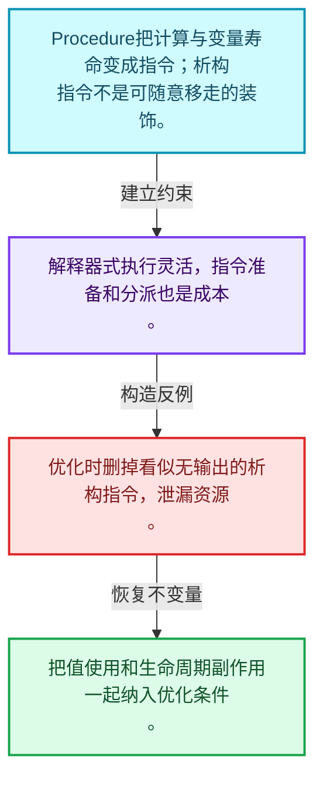
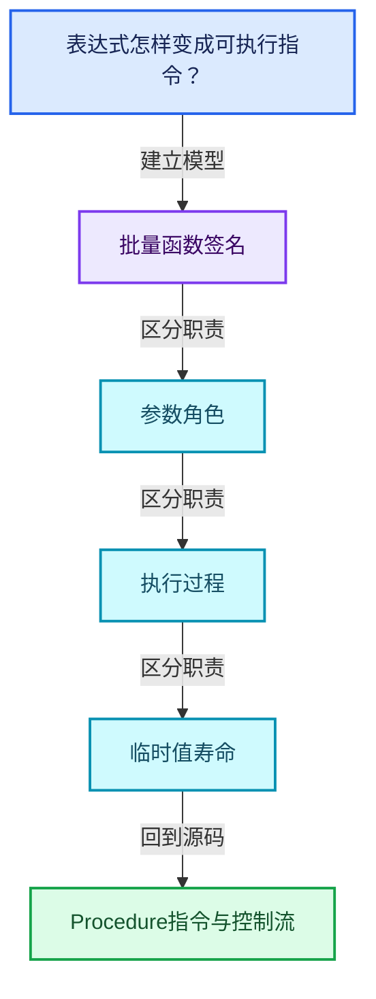
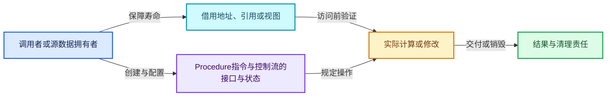
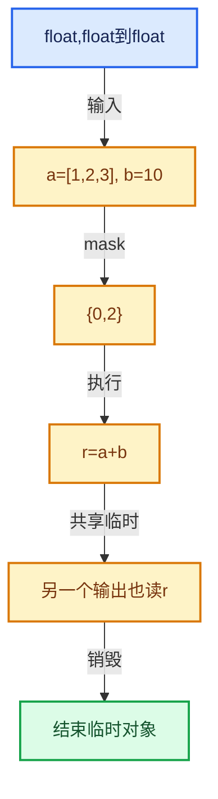

# 07-07 Procedure指令与控制流

[方向导航](README.md) · [总目录](../README.md) · [覆盖索引](../%E6%BA%90%E7%A0%81%E7%89%88%E6%9C%AC%E4%B8%8E%E8%A6%86%E7%9B%96%E7%B4%A2%E5%BC%95.md)

> 阅读顺序：问题与数据模型 → 语法与类型 → 源码逐行 → 调用线索 → 历史与取舍 → 推演和练习。

- 基准 HEAD：`cbda6b96c26c0dee3c3b5cbb93960c4ac06a6b30`。
- 记录日期：2026-10-14。
- 教学示例状态：正文中的推演不是本机性能实测；已运行练习见验收报告。

## 一、从问题到设计

表达式怎样变成可执行指令？

变量表示值流，指令表示操作；分支和析构指令让执行顺序与对象寿命显式化。

本篇把语法、数据语义和系统取舍连接起来。把调用准备与元素循环分开，把值依赖与对象生存区间同时显式化。

### 本篇独立模型与设计推理

Procedure把计算与变量寿命变成指令；析构指令不是可随意移走的装饰。

设计取舍：解释器式执行灵活，指令准备和分派也是成本。

最小反例：优化时删掉看似无输出的析构指令，泄漏资源。

推导与处理：把值使用和生命周期副作用一起纳入优化条件。



### 源码范围与相邻篇章

| 文件 | 本篇逐行范围 | 基准SHA-256 |
|---|---|---|
| [source/blender/functions/FN_multi_function_procedure.hh](../../../../../source/blender/functions/FN_multi_function_procedure.hh) | L1—L536 | `19df168c04c5694f14f84c0c067288a7d6d7b292945b7b23e6a1cfdd25f35ebc` |
| [source/blender/functions/intern/multi_function_procedure.cc](../../../../../source/blender/functions/intern/multi_function_procedure.cc) | L1—L882 | `a042934783f3bd874022a8918f574bd7600a3af04cc2fd83c315b80f75e37704` |

同一主讲文件可能分多篇覆盖；超出本篇范围的符号通过覆盖索引定位。空行与纯注释保留在源码摘录中，逐行表解释有效语句与语法边界；许可证头统一保留。

前篇：[函数构建器](06-%E5%87%BD%E6%95%B0%E6%9E%84%E5%BB%BA%E5%99%A8.md).

后篇：[ProcedureBuilder](08-ProcedureBuilder.md).

## 二、类型、数据与阅读地图



这是概念依赖图，边表示阅读关系，不声称是运行时调用顺序。

### 直接编译依赖


箭头只表示头文件包含关系；完整调用线索见后面的符号定位表。

## 三、关键词、语法与类型角色

### 模板 template

模板把类型或常量作为生成实现的参数。读声明时先列出类型参数、非类型参数和默认值，再看使用者实际实例化了什么。模板声明本身不意味着每种T都支持其全部成员。

具体检查：把T替换为int、string、只能移动的类型，分别检查每个被调用操作是否成立。

### 依赖名称 typename

typename既可引入类型模板参数，也可告诉编译器某个依赖名称是类型。它不创建运行时对象；解析期确认语法类别与实例化期检查具体类型是不同阶段。

具体检查：区分typename T::value_type和T::size()，前者标记类型，后者是表达式。

### 只读限定 const

const约束当前访问路径可做的修改。const指针、指向const的指针、const视图对象、const元素是不同位置的限定；其他别名可能仍可修改原对象。

具体检查：分别写T* const、const T*与const T* const，并画出不可修改的层次。

### 移动转换 std::move

std::move把表达式转换为可供移动重载选择的值类别，实际资源转移发生在被选中的构造或赋值中。对const对象move可能仍调用复制，对视图move也不会获得底层数据所有权。

具体检查：记录移动构造调用次数，不用变量名或std::move的出现次数替代测量。

### 完美转发 std::forward

std::forward在转发引用模板中恢复调用者原来的值类别。它依赖推导出的模板实参；无条件move会改变左值调用者的语义。

具体检查：对同一接口分别传入左值、临时对象和const左值，记录实际重载。

### 异常边界 try与catch

try定义异常传播的局部边界。失败路径需要销毁已经成功构造的部分并释放相应存储；未构造的对象不能被析构。

具体检查：在第k次构造失败，列出已经存在的对象集合与待释放缓冲。

### 显式静态转换 static_cast

static_cast表达编译期允许的转换，不会自动验证运行时真实类型、指针寿命或索引边界。由void指针恢复T指针时，调用者仍须保证实际存储中确有合法T对象。

具体检查：标出转换前后的类型以及正确性依据来自哪里。

### 运行时多态 virtual

虚调用根据实际动态类型选择实现；经基类指针销毁对象时通常需要相应虚析构契约。每元素虚调用和循环外一次分派有不同开销。

具体检查：找出虚接口的实现类和调用频率，再讨论是否值得去虚拟化。

### 对象表示 sizeof

sizeof给出对象表示大小，不是其引用的所有堆内存总量。sizeof视图很小并不说明底层数组很小。

具体检查：分别统计容器对象、容量字节和元素拥有的间接资源。

### 内部断言 assert

断言表达开发者预期成立的内部契约，发布构建可能关闭。它不能替代对不可信输入的完整错误处理，也不保证后续操作被运行时保护。

具体检查：对每条断言构造违反条件的输入，区分调用者错误与应向用户报告的错误。

### 受控访问 friend

friend授予指定函数或类访问非公开成员的权限，并不意味着继承，也不自动扩展到友元的派生类。

具体检查：解释执行器为何需要访问包装器的内部映射，同时检查边界是否仍清楚。

### 类型别名 using

类型别名为已有类型建立名字，不创建运行期对象。它常把模板内部使用的类型统一暴露给泛型调用者。

具体检查：展开别名直到基础类型，区分类型别名和变量声明。

### 枚举与状态模型 enum

枚举把有限状态命名；enum class避免许多隐式整数转换。状态机正确性还依赖允许的转移，不能只看有哪些枚举项。

具体检查：列出每个状态的进入条件和离开条件，检查终止状态是否仍可能被调度。

## 四、真实源码与逐行讲解

源码块保持原行内容，原始行号由小节标题及逐行表给出。表中的调用定位是静态阅读辅助；重载、模板实例化、宏展开和虚调用需结合完整声明，不能仅凭词法出现证明动态调用。

### FN_multi_function_procedure.hh：L1—L48

<!-- source:source/blender/functions/FN_multi_function_procedure.hh:1:48 -->

```cpp
/* SPDX-FileCopyrightText: 2023 Blender Authors
 *
 * SPDX-License-Identifier: GPL-2.0-or-later */

#pragma once

/** \file
 * \ingroup fn
 */

#include "FN_multi_function.hh"

namespace blender::fn::multi_function {

class Variable;
class Instruction;
class CallInstruction;
class BranchInstruction;
class DestructInstruction;
class DummyInstruction;
class ReturnInstruction;
class Procedure;

/** Every instruction has exactly one of these types. */
enum class InstructionType {
  Call,
  Branch,
  Destruct,
  Dummy,
  Return,
};

/**
 * An #InstructionCursor points to a position in a multi-function procedure, where an instruction
 * can be inserted.
 */
class InstructionCursor {
 public:
  enum Type {
    None,
    Entry,
    Call,
    Destruct,
    Branch,
    Dummy,
  };

 private:
```

| 原始行 | 语义、约束与检查 |
|---|---|
| L5 | 防止同一头文件在一个翻译单元中重复展开；不控制多个源文件之间的链接或对象寿命。 |
| L11 | 引入编译依赖 "FN_multi_function.hh"；这是声明可见性关系，不表示运行时一定调用该文件的所有接口。 |
| L13 | 把后续声明放入 blender::fn::multi_function 命名空间，影响名称查找和符号归属，不创建运行时对象。 |
| L15 | 声明或定义类型 `class Variable`。结合继承、访问权限和成员布局确认接口与拥有关系；前向声明本身没有完整对象布局。 |
| L16 | 声明或定义类型 `class Instruction`。结合继承、访问权限和成员布局确认接口与拥有关系；前向声明本身没有完整对象布局。 |
| L17 | 声明或定义类型 `class CallInstruction`。结合继承、访问权限和成员布局确认接口与拥有关系；前向声明本身没有完整对象布局。 |
| L18 | 声明或定义类型 `class BranchInstruction`。结合继承、访问权限和成员布局确认接口与拥有关系；前向声明本身没有完整对象布局。 |
| L19 | 声明或定义类型 `class DestructInstruction`。结合继承、访问权限和成员布局确认接口与拥有关系；前向声明本身没有完整对象布局。 |
| L20 | 声明或定义类型 `class DummyInstruction`。结合继承、访问权限和成员布局确认接口与拥有关系；前向声明本身没有完整对象布局。 |
| L21 | 声明或定义类型 `class ReturnInstruction`。结合继承、访问权限和成员布局确认接口与拥有关系；前向声明本身没有完整对象布局。 |
| L22 | 声明或定义类型 `class Procedure`。结合继承、访问权限和成员布局确认接口与拥有关系；前向声明本身没有完整对象布局。 |
| L25 | 声明或定义类型 `enum class InstructionType`。结合继承、访问权限和成员布局确认接口与拥有关系；前向声明本身没有完整对象布局。 |
| L26 | 本行是连续声明或表达式的一部分：`Call,`。与本段前后行合读；逗号、括号和限定符决定它属于参数、初始化列表还是实际计算。 |
| L27 | 本行是连续声明或表达式的一部分：`Branch,`。与本段前后行合读；逗号、括号和限定符决定它属于参数、初始化列表还是实际计算。 |
| L28 | 本行是连续声明或表达式的一部分：`Destruct,`。与本段前后行合读；逗号、括号和限定符决定它属于参数、初始化列表还是实际计算。 |
| L29 | 本行是连续声明或表达式的一部分：`Dummy,`。与本段前后行合读；逗号、括号和限定符决定它属于参数、初始化列表还是实际计算。 |
| L30 | 本行是连续声明或表达式的一部分：`Return,`。与本段前后行合读；逗号、括号和限定符决定它属于参数、初始化列表还是实际计算。 |
| L31 | 结束当前语法单元。局部自动对象在离开其作用域时按规则销毁；这不等于所有被引用的外部数据也被释放。 |
| L37 | 声明或定义类型 `class InstructionCursor`。结合继承、访问权限和成员布局确认接口与拥有关系；前向声明本身没有完整对象布局。 |
| L38 | 切换成员访问权限为 public；它是编译期接口边界，不是线程同步或内存保护。 |
| L39 | 声明或定义类型 `enum Type`。结合继承、访问权限和成员布局确认接口与拥有关系；前向声明本身没有完整对象布局。 |
| L40 | 本行是连续声明或表达式的一部分：`None,`。与本段前后行合读；逗号、括号和限定符决定它属于参数、初始化列表还是实际计算。 |
| L41 | 本行是连续声明或表达式的一部分：`Entry,`。与本段前后行合读；逗号、括号和限定符决定它属于参数、初始化列表还是实际计算。 |
| L42 | 本行是连续声明或表达式的一部分：`Call,`。与本段前后行合读；逗号、括号和限定符决定它属于参数、初始化列表还是实际计算。 |
| L43 | 本行是连续声明或表达式的一部分：`Destruct,`。与本段前后行合读；逗号、括号和限定符决定它属于参数、初始化列表还是实际计算。 |
| L44 | 本行是连续声明或表达式的一部分：`Branch,`。与本段前后行合读；逗号、括号和限定符决定它属于参数、初始化列表还是实际计算。 |
| L45 | 本行是连续声明或表达式的一部分：`Dummy,`。与本段前后行合读；逗号、括号和限定符决定它属于参数、初始化列表还是实际计算。 |
| L46 | 结束当前语法单元。局部自动对象在离开其作用域时按规则销毁；这不等于所有被引用的外部数据也被释放。 |
| L48 | 切换成员访问权限为 private；它是编译期接口边界，不是线程同步或内存保护。 |

### FN_multi_function_procedure.hh：L49—L95

<!-- source:source/blender/functions/FN_multi_function_procedure.hh:49:95 -->

```cpp
  Type type_ = None;
  Instruction *instruction_ = nullptr;
  /* Only used when it is a branch instruction. */
  bool branch_output_ = false;

 public:
  InstructionCursor() = default;
  InstructionCursor(CallInstruction &instruction);
  InstructionCursor(DestructInstruction &instruction);
  InstructionCursor(BranchInstruction &instruction, bool branch_output);
  InstructionCursor(DummyInstruction &instruction);

  static InstructionCursor ForEntry();

  Instruction *next(Procedure &procedure) const;
  void set_next(Procedure &procedure, Instruction *new_instruction) const;

  Instruction *instruction() const;

  Type type() const;

  friend bool operator==(const InstructionCursor &a, const InstructionCursor &b) = default;
};

/**
 * A variable is similar to a virtual register in other libraries. During evaluation, every is
 * either uninitialized or contains a value for every index (remember, a multi-function procedure
 * is always evaluated for many indices at the same time).
 */
class Variable : NonCopyable, NonMovable {
 private:
  DataType data_type_;
  Vector<Instruction *> users_;
  std::string name_;
  int index_in_graph_;

  friend Procedure;
  friend CallInstruction;
  friend BranchInstruction;
  friend DestructInstruction;

 public:
  DataType data_type() const;
  Span<Instruction *> users();

  StringRefNull name() const;
  void set_name(std::string name);
```

| 原始行 | 语义、约束与检查 |
|---|---|
| L49 | 把右侧 `None` 用于初始化或更新左侧 `Type type_`。声明初始化与已有对象赋值应按上下文区分；有资源的类型会调用相应特殊成员。 |
| L50 | 把右侧 `nullptr` 用于初始化或更新左侧 `Instruction *instruction_`。声明初始化与已有对象赋值应按上下文区分；有资源的类型会调用相应特殊成员。 |
| L52 | 把右侧 `false` 用于初始化或更新左侧 `bool branch_output_`。声明初始化与已有对象赋值应按上下文区分；有资源的类型会调用相应特殊成员。 |
| L54 | 切换成员访问权限为 public；它是编译期接口边界，不是线程同步或内存保护。 |
| L55 | 显式采用编译器生成的特殊成员行为：`InstructionCursor() = default;`。成员和基类的性质决定该操作是否可用、是否被删除及异常约定，不表示运行时给对象赋值为default。 |
| L56 | 出现调用或函数声明 `InstructionCursor`，对应表达式为 `InstructionCursor(CallInstruction &instruction);`。参数求值、返回类型与重载需结合前后完整语句；静态文本引用不能证明动态目标。 |
| L57 | 出现调用或函数声明 `InstructionCursor`，对应表达式为 `InstructionCursor(DestructInstruction &instruction);`。参数求值、返回类型与重载需结合前后完整语句；静态文本引用不能证明动态目标。 |
| L58 | 出现调用或函数声明 `InstructionCursor`，对应表达式为 `InstructionCursor(BranchInstruction &instruction, bool branch_output);`。参数求值、返回类型与重载需结合前后完整语句；静态文本引用不能证明动态目标。 |
| L59 | 出现调用或函数声明 `InstructionCursor`，对应表达式为 `InstructionCursor(DummyInstruction &instruction);`。参数求值、返回类型与重载需结合前后完整语句；静态文本引用不能证明动态目标。 |
| L61 | 声明接口 `static InstructionCursor ForEntry()`，本行没有对应函数体；返回类型、参数限定和const/noexcept共同组成调用契约，实际行为需继续定位实现。 |
| L63 | 声明接口 `Instruction *next(Procedure &procedure) const`，本行没有对应函数体；返回类型、参数限定和const/noexcept共同组成调用契约，实际行为需继续定位实现。 |
| L64 | 声明接口 `void set_next(Procedure &procedure, Instruction *new_instruction) const`，本行没有对应函数体；返回类型、参数限定和const/noexcept共同组成调用契约，实际行为需继续定位实现。 |
| L66 | 声明接口 `Instruction *instruction() const`，本行没有对应函数体；返回类型、参数限定和const/noexcept共同组成调用契约，实际行为需继续定位实现。 |
| L68 | 声明接口 `Type type() const`，本行没有对应函数体；返回类型、参数限定和const/noexcept共同组成调用契约，实际行为需继续定位实现。 |
| L70 | 显式采用编译器生成的特殊成员行为：`friend bool operator==(const InstructionCursor &a, const InstructionCursor &b) = default;`。成员和基类的性质决定该操作是否可用、是否被删除及异常约定，不表示运行时给对象赋值为default。 |
| L71 | 结束当前语法单元。局部自动对象在离开其作用域时按规则销毁；这不等于所有被引用的外部数据也被释放。 |
| L78 | 声明或定义类型 `class Variable : NonCopyable, NonMovable`。结合继承、访问权限和成员布局确认接口与拥有关系；前向声明本身没有完整对象布局。 |
| L79 | 切换成员访问权限为 private；它是编译期接口边界，不是线程同步或内存保护。 |
| L80 | 声明成员、局部对象或完成语句 `DataType data_type_`。若为指针或引用，它本身不说明拥有；若为值对象，其构造析构由所在作用域或外层对象管理。 |
| L81 | 声明成员、局部对象或完成语句 `Vector<Instruction *> users_`。若为指针或引用，它本身不说明拥有；若为值对象，其构造析构由所在作用域或外层对象管理。 |
| L82 | 声明成员、局部对象或完成语句 `std::string name_`。若为指针或引用，它本身不说明拥有；若为值对象，其构造析构由所在作用域或外层对象管理。 |
| L83 | 声明成员、局部对象或完成语句 `int index_in_graph_`。若为指针或引用，它本身不说明拥有；若为值对象，其构造析构由所在作用域或外层对象管理。 |
| L85 | 声明成员、局部对象或完成语句 `friend Procedure`。若为指针或引用，它本身不说明拥有；若为值对象，其构造析构由所在作用域或外层对象管理。 |
| L86 | 声明成员、局部对象或完成语句 `friend CallInstruction`。若为指针或引用，它本身不说明拥有；若为值对象，其构造析构由所在作用域或外层对象管理。 |
| L87 | 声明成员、局部对象或完成语句 `friend BranchInstruction`。若为指针或引用，它本身不说明拥有；若为值对象，其构造析构由所在作用域或外层对象管理。 |
| L88 | 声明成员、局部对象或完成语句 `friend DestructInstruction`。若为指针或引用，它本身不说明拥有；若为值对象，其构造析构由所在作用域或外层对象管理。 |
| L90 | 切换成员访问权限为 public；它是编译期接口边界，不是线程同步或内存保护。 |
| L91 | 声明接口 `DataType data_type() const`，本行没有对应函数体；返回类型、参数限定和const/noexcept共同组成调用契约，实际行为需继续定位实现。 |
| L92 | 出现调用或函数声明 `users`，对应表达式为 `Span<Instruction *> users();`。参数求值、返回类型与重载需结合前后完整语句；静态文本引用不能证明动态目标。 |
| L94 | 声明接口 `StringRefNull name() const`，本行没有对应函数体；返回类型、参数限定和const/noexcept共同组成调用契约，实际行为需继续定位实现。 |
| L95 | 声明接口 `void set_name(std::string name)`，本行没有对应函数体；返回类型、参数限定和const/noexcept共同组成调用契约，实际行为需继续定位实现。 |

### FN_multi_function_procedure.hh：L96—L143

<!-- source:source/blender/functions/FN_multi_function_procedure.hh:96:143 -->

```cpp

  int index_in_procedure() const;
};

/** Base class for all instruction types. */
class Instruction : NonCopyable, NonMovable {
 protected:
  InstructionType type_;
  Vector<InstructionCursor> prev_;

  friend Procedure;
  friend CallInstruction;
  friend BranchInstruction;
  friend DestructInstruction;
  friend DummyInstruction;
  friend ReturnInstruction;

 public:
  InstructionType type() const;

  /**
   * Other instructions that come before this instruction. There can be multiple previous
   * instructions when branching is used in the procedure.
   */
  Span<InstructionCursor> prev() const;
};

/**
 * References a multi-function that is evaluated when the instruction is executed. It also
 * references the variables whose data will be passed into the multi-function.
 */
class CallInstruction : public Instruction {
 private:
  const MultiFunction *fn_ = nullptr;
  Instruction *next_ = nullptr;
  MutableSpan<Variable *> params_;

  friend Procedure;

 public:
  const MultiFunction &fn() const;

  Instruction *next();
  const Instruction *next() const;
  void set_next(Instruction *instruction);

  void set_param_variable(int param_index, Variable *variable);
  void set_params(Span<Variable *> variables);
```

| 原始行 | 语义、约束与检查 |
|---|---|
| L97 | 声明接口 `int index_in_procedure() const`，本行没有对应函数体；返回类型、参数限定和const/noexcept共同组成调用契约，实际行为需继续定位实现。 |
| L98 | 结束当前语法单元。局部自动对象在离开其作用域时按规则销毁；这不等于所有被引用的外部数据也被释放。 |
| L101 | 声明或定义类型 `class Instruction : NonCopyable, NonMovable`。结合继承、访问权限和成员布局确认接口与拥有关系；前向声明本身没有完整对象布局。 |
| L102 | 切换成员访问权限为 protected；它是编译期接口边界，不是线程同步或内存保护。 |
| L103 | 声明成员、局部对象或完成语句 `InstructionType type_`。若为指针或引用，它本身不说明拥有；若为值对象，其构造析构由所在作用域或外层对象管理。 |
| L104 | 声明成员、局部对象或完成语句 `Vector<InstructionCursor> prev_`。若为指针或引用，它本身不说明拥有；若为值对象，其构造析构由所在作用域或外层对象管理。 |
| L106 | 声明成员、局部对象或完成语句 `friend Procedure`。若为指针或引用，它本身不说明拥有；若为值对象，其构造析构由所在作用域或外层对象管理。 |
| L107 | 声明成员、局部对象或完成语句 `friend CallInstruction`。若为指针或引用，它本身不说明拥有；若为值对象，其构造析构由所在作用域或外层对象管理。 |
| L108 | 声明成员、局部对象或完成语句 `friend BranchInstruction`。若为指针或引用，它本身不说明拥有；若为值对象，其构造析构由所在作用域或外层对象管理。 |
| L109 | 声明成员、局部对象或完成语句 `friend DestructInstruction`。若为指针或引用，它本身不说明拥有；若为值对象，其构造析构由所在作用域或外层对象管理。 |
| L110 | 声明成员、局部对象或完成语句 `friend DummyInstruction`。若为指针或引用，它本身不说明拥有；若为值对象，其构造析构由所在作用域或外层对象管理。 |
| L111 | 声明成员、局部对象或完成语句 `friend ReturnInstruction`。若为指针或引用，它本身不说明拥有；若为值对象，其构造析构由所在作用域或外层对象管理。 |
| L113 | 切换成员访问权限为 public；它是编译期接口边界，不是线程同步或内存保护。 |
| L114 | 声明接口 `InstructionType type() const`，本行没有对应函数体；返回类型、参数限定和const/noexcept共同组成调用契约，实际行为需继续定位实现。 |
| L120 | 声明接口 `Span<InstructionCursor> prev() const`，本行没有对应函数体；返回类型、参数限定和const/noexcept共同组成调用契约，实际行为需继续定位实现。 |
| L121 | 结束当前语法单元。局部自动对象在离开其作用域时按规则销毁；这不等于所有被引用的外部数据也被释放。 |
| L127 | 声明或定义类型 `class CallInstruction : public Instruction`。结合继承、访问权限和成员布局确认接口与拥有关系；前向声明本身没有完整对象布局。 |
| L128 | 切换成员访问权限为 private；它是编译期接口边界，不是线程同步或内存保护。 |
| L129 | 把右侧 `nullptr` 用于初始化或更新左侧 `const MultiFunction *fn_`。声明初始化与已有对象赋值应按上下文区分；有资源的类型会调用相应特殊成员。 |
| L130 | 把右侧 `nullptr` 用于初始化或更新左侧 `Instruction *next_`。声明初始化与已有对象赋值应按上下文区分；有资源的类型会调用相应特殊成员。 |
| L131 | 声明成员、局部对象或完成语句 `MutableSpan<Variable *> params_`。若为指针或引用，它本身不说明拥有；若为值对象，其构造析构由所在作用域或外层对象管理。 |
| L133 | 声明成员、局部对象或完成语句 `friend Procedure`。若为指针或引用，它本身不说明拥有；若为值对象，其构造析构由所在作用域或外层对象管理。 |
| L135 | 切换成员访问权限为 public；它是编译期接口边界，不是线程同步或内存保护。 |
| L136 | 声明接口 `const MultiFunction &fn() const`，本行没有对应函数体；返回类型、参数限定和const/noexcept共同组成调用契约，实际行为需继续定位实现。 |
| L138 | 出现调用或函数声明 `next`，对应表达式为 `Instruction *next();`。参数求值、返回类型与重载需结合前后完整语句；静态文本引用不能证明动态目标。 |
| L139 | 声明接口 `const Instruction *next() const`，本行没有对应函数体；返回类型、参数限定和const/noexcept共同组成调用契约，实际行为需继续定位实现。 |
| L140 | 声明接口 `void set_next(Instruction *instruction)`，本行没有对应函数体；返回类型、参数限定和const/noexcept共同组成调用契约，实际行为需继续定位实现。 |
| L142 | 声明接口 `void set_param_variable(int param_index, Variable *variable)`，本行没有对应函数体；返回类型、参数限定和const/noexcept共同组成调用契约，实际行为需继续定位实现。 |
| L143 | 声明接口 `void set_params(Span<Variable *> variables)`，本行没有对应函数体；返回类型、参数限定和const/noexcept共同组成调用契约，实际行为需继续定位实现。 |

### FN_multi_function_procedure.hh：L144—L191

<!-- source:source/blender/functions/FN_multi_function_procedure.hh:144:191 -->

```cpp

  Span<Variable *> params();
  Span<const Variable *> params() const;
};

/**
 * What makes a branch instruction special is that it has two successor instructions. One that will
 * be used when a condition variable was true, and one otherwise.
 */
class BranchInstruction : public Instruction {
 private:
  Variable *condition_ = nullptr;
  Instruction *branch_true_ = nullptr;
  Instruction *branch_false_ = nullptr;

  friend Procedure;

 public:
  Variable *condition();
  const Variable *condition() const;
  void set_condition(Variable *variable);

  Instruction *branch_true();
  const Instruction *branch_true() const;
  void set_branch_true(Instruction *instruction);

  Instruction *branch_false();
  const Instruction *branch_false() const;
  void set_branch_false(Instruction *instruction);
};

/**
 * A destruct instruction destructs a single variable. So the variable value will be uninitialized
 * after this instruction. All variables that are not output variables of the procedure, have to be
 * destructed before the procedure ends. Destructing early is generally a good thing, because it
 * might help with memory buffer reuse, which decreases memory-usage and increases performance.
 */
class DestructInstruction : public Instruction {
 private:
  Variable *variable_ = nullptr;
  Instruction *next_ = nullptr;

  friend Procedure;

 public:
  Variable *variable();
  const Variable *variable() const;
  void set_variable(Variable *variable);
```

| 原始行 | 语义、约束与检查 |
|---|---|
| L145 | 出现调用或函数声明 `params`，对应表达式为 `Span<Variable *> params();`。参数求值、返回类型与重载需结合前后完整语句；静态文本引用不能证明动态目标。 |
| L146 | 声明接口 `Span<const Variable *> params() const`，本行没有对应函数体；返回类型、参数限定和const/noexcept共同组成调用契约，实际行为需继续定位实现。 |
| L147 | 结束当前语法单元。局部自动对象在离开其作用域时按规则销毁；这不等于所有被引用的外部数据也被释放。 |
| L153 | 声明或定义类型 `class BranchInstruction : public Instruction`。结合继承、访问权限和成员布局确认接口与拥有关系；前向声明本身没有完整对象布局。 |
| L154 | 切换成员访问权限为 private；它是编译期接口边界，不是线程同步或内存保护。 |
| L155 | 把右侧 `nullptr` 用于初始化或更新左侧 `Variable *condition_`。声明初始化与已有对象赋值应按上下文区分；有资源的类型会调用相应特殊成员。 |
| L156 | 把右侧 `nullptr` 用于初始化或更新左侧 `Instruction *branch_true_`。声明初始化与已有对象赋值应按上下文区分；有资源的类型会调用相应特殊成员。 |
| L157 | 把右侧 `nullptr` 用于初始化或更新左侧 `Instruction *branch_false_`。声明初始化与已有对象赋值应按上下文区分；有资源的类型会调用相应特殊成员。 |
| L159 | 声明成员、局部对象或完成语句 `friend Procedure`。若为指针或引用，它本身不说明拥有；若为值对象，其构造析构由所在作用域或外层对象管理。 |
| L161 | 切换成员访问权限为 public；它是编译期接口边界，不是线程同步或内存保护。 |
| L162 | 出现调用或函数声明 `condition`，对应表达式为 `Variable *condition();`。参数求值、返回类型与重载需结合前后完整语句；静态文本引用不能证明动态目标。 |
| L163 | 声明接口 `const Variable *condition() const`，本行没有对应函数体；返回类型、参数限定和const/noexcept共同组成调用契约，实际行为需继续定位实现。 |
| L164 | 声明接口 `void set_condition(Variable *variable)`，本行没有对应函数体；返回类型、参数限定和const/noexcept共同组成调用契约，实际行为需继续定位实现。 |
| L166 | 出现调用或函数声明 `branch_true`，对应表达式为 `Instruction *branch_true();`。参数求值、返回类型与重载需结合前后完整语句；静态文本引用不能证明动态目标。 |
| L167 | 声明接口 `const Instruction *branch_true() const`，本行没有对应函数体；返回类型、参数限定和const/noexcept共同组成调用契约，实际行为需继续定位实现。 |
| L168 | 声明接口 `void set_branch_true(Instruction *instruction)`，本行没有对应函数体；返回类型、参数限定和const/noexcept共同组成调用契约，实际行为需继续定位实现。 |
| L170 | 出现调用或函数声明 `branch_false`，对应表达式为 `Instruction *branch_false();`。参数求值、返回类型与重载需结合前后完整语句；静态文本引用不能证明动态目标。 |
| L171 | 声明接口 `const Instruction *branch_false() const`，本行没有对应函数体；返回类型、参数限定和const/noexcept共同组成调用契约，实际行为需继续定位实现。 |
| L172 | 声明接口 `void set_branch_false(Instruction *instruction)`，本行没有对应函数体；返回类型、参数限定和const/noexcept共同组成调用契约，实际行为需继续定位实现。 |
| L173 | 结束当前语法单元。局部自动对象在离开其作用域时按规则销毁；这不等于所有被引用的外部数据也被释放。 |
| L181 | 声明或定义类型 `class DestructInstruction : public Instruction`。结合继承、访问权限和成员布局确认接口与拥有关系；前向声明本身没有完整对象布局。 |
| L182 | 切换成员访问权限为 private；它是编译期接口边界，不是线程同步或内存保护。 |
| L183 | 把右侧 `nullptr` 用于初始化或更新左侧 `Variable *variable_`。声明初始化与已有对象赋值应按上下文区分；有资源的类型会调用相应特殊成员。 |
| L184 | 把右侧 `nullptr` 用于初始化或更新左侧 `Instruction *next_`。声明初始化与已有对象赋值应按上下文区分；有资源的类型会调用相应特殊成员。 |
| L186 | 声明成员、局部对象或完成语句 `friend Procedure`。若为指针或引用，它本身不说明拥有；若为值对象，其构造析构由所在作用域或外层对象管理。 |
| L188 | 切换成员访问权限为 public；它是编译期接口边界，不是线程同步或内存保护。 |
| L189 | 出现调用或函数声明 `variable`，对应表达式为 `Variable *variable();`。参数求值、返回类型与重载需结合前后完整语句；静态文本引用不能证明动态目标。 |
| L190 | 声明接口 `const Variable *variable() const`，本行没有对应函数体；返回类型、参数限定和const/noexcept共同组成调用契约，实际行为需继续定位实现。 |
| L191 | 声明接口 `void set_variable(Variable *variable)`，本行没有对应函数体；返回类型、参数限定和const/noexcept共同组成调用契约，实际行为需继续定位实现。 |

### FN_multi_function_procedure.hh：L192—L240

<!-- source:source/blender/functions/FN_multi_function_procedure.hh:192:240 -->

```cpp

  Instruction *next();
  const Instruction *next() const;
  void set_next(Instruction *instruction);
};

/**
 * This instruction does nothing, it just exists to building a procedure simpler in some cases.
 */
class DummyInstruction : public Instruction {
 private:
  Instruction *next_ = nullptr;

  friend Procedure;

 public:
  Instruction *next();
  const Instruction *next() const;
  void set_next(Instruction *instruction);
};

/**
 * This instruction ends the procedure.
 */
class ReturnInstruction : public Instruction {};

/**
 * Inputs and outputs of the entire procedure network.
 */
struct Parameter {
  ParamType::InterfaceType type;
  Variable *variable;
};

struct ConstParameter {
  ParamType::InterfaceType type;
  const Variable *variable;
};

/**
 * A multi-function procedure allows composing multi-functions in arbitrary ways. It consists of
 * variables and instructions that operate on those variables. Branching and looping within the
 * procedure is supported as well.
 *
 * Typically, a #Procedure should be constructed using a #ProcedureBuilder, which has many more
 * utility methods for common use cases.
 */
class Procedure : NonCopyable, NonMovable {
 private:
```

| 原始行 | 语义、约束与检查 |
|---|---|
| L193 | 出现调用或函数声明 `next`，对应表达式为 `Instruction *next();`。参数求值、返回类型与重载需结合前后完整语句；静态文本引用不能证明动态目标。 |
| L194 | 声明接口 `const Instruction *next() const`，本行没有对应函数体；返回类型、参数限定和const/noexcept共同组成调用契约，实际行为需继续定位实现。 |
| L195 | 声明接口 `void set_next(Instruction *instruction)`，本行没有对应函数体；返回类型、参数限定和const/noexcept共同组成调用契约，实际行为需继续定位实现。 |
| L196 | 结束当前语法单元。局部自动对象在离开其作用域时按规则销毁；这不等于所有被引用的外部数据也被释放。 |
| L201 | 声明或定义类型 `class DummyInstruction : public Instruction`。结合继承、访问权限和成员布局确认接口与拥有关系；前向声明本身没有完整对象布局。 |
| L202 | 切换成员访问权限为 private；它是编译期接口边界，不是线程同步或内存保护。 |
| L203 | 把右侧 `nullptr` 用于初始化或更新左侧 `Instruction *next_`。声明初始化与已有对象赋值应按上下文区分；有资源的类型会调用相应特殊成员。 |
| L205 | 声明成员、局部对象或完成语句 `friend Procedure`。若为指针或引用，它本身不说明拥有；若为值对象，其构造析构由所在作用域或外层对象管理。 |
| L207 | 切换成员访问权限为 public；它是编译期接口边界，不是线程同步或内存保护。 |
| L208 | 出现调用或函数声明 `next`，对应表达式为 `Instruction *next();`。参数求值、返回类型与重载需结合前后完整语句；静态文本引用不能证明动态目标。 |
| L209 | 声明接口 `const Instruction *next() const`，本行没有对应函数体；返回类型、参数限定和const/noexcept共同组成调用契约，实际行为需继续定位实现。 |
| L210 | 声明接口 `void set_next(Instruction *instruction)`，本行没有对应函数体；返回类型、参数限定和const/noexcept共同组成调用契约，实际行为需继续定位实现。 |
| L211 | 结束当前语法单元。局部自动对象在离开其作用域时按规则销毁；这不等于所有被引用的外部数据也被释放。 |
| L216 | 声明或定义类型 `class ReturnInstruction : public Instruction {}`。结合继承、访问权限和成员布局确认接口与拥有关系；前向声明本身没有完整对象布局。 |
| L221 | 声明或定义类型 `struct Parameter`。结合继承、访问权限和成员布局确认接口与拥有关系；前向声明本身没有完整对象布局。 |
| L222 | 声明成员、局部对象或完成语句 `ParamType::InterfaceType type`。若为指针或引用，它本身不说明拥有；若为值对象，其构造析构由所在作用域或外层对象管理。 |
| L223 | 声明成员、局部对象或完成语句 `Variable *variable`。若为指针或引用，它本身不说明拥有；若为值对象，其构造析构由所在作用域或外层对象管理。 |
| L224 | 结束当前语法单元。局部自动对象在离开其作用域时按规则销毁；这不等于所有被引用的外部数据也被释放。 |
| L226 | 声明或定义类型 `struct ConstParameter`。结合继承、访问权限和成员布局确认接口与拥有关系；前向声明本身没有完整对象布局。 |
| L227 | 声明成员、局部对象或完成语句 `ParamType::InterfaceType type`。若为指针或引用，它本身不说明拥有；若为值对象，其构造析构由所在作用域或外层对象管理。 |
| L228 | 声明成员、局部对象或完成语句 `const Variable *variable`。若为指针或引用，它本身不说明拥有；若为值对象，其构造析构由所在作用域或外层对象管理。 |
| L229 | 结束当前语法单元。局部自动对象在离开其作用域时按规则销毁；这不等于所有被引用的外部数据也被释放。 |
| L239 | 声明或定义类型 `class Procedure : NonCopyable, NonMovable`。结合继承、访问权限和成员布局确认接口与拥有关系；前向声明本身没有完整对象布局。 |
| L240 | 切换成员访问权限为 private；它是编译期接口边界，不是线程同步或内存保护。 |

### FN_multi_function_procedure.hh：L241—L288

<!-- source:source/blender/functions/FN_multi_function_procedure.hh:241:288 -->

```cpp
  LinearAllocator<> allocator_;
  Vector<CallInstruction *> call_instructions_;
  Vector<BranchInstruction *> branch_instructions_;
  Vector<DestructInstruction *> destruct_instructions_;
  Vector<DummyInstruction *> dummy_instructions_;
  Vector<ReturnInstruction *> return_instructions_;
  Vector<Variable *> variables_;
  Vector<Parameter> params_;
  Vector<destruct_ptr<MultiFunction>> owned_functions_;
  Instruction *entry_ = nullptr;

  friend class ProcedureDotExport;

 public:
  Procedure() = default;
  ~Procedure();

  Variable &new_variable(DataType data_type, std::string name = "");
  CallInstruction &new_call_instruction(const MultiFunction &fn);
  BranchInstruction &new_branch_instruction();
  DestructInstruction &new_destruct_instruction();
  DummyInstruction &new_dummy_instruction();
  ReturnInstruction &new_return_instruction();

  void add_parameter(ParamType::InterfaceType interface_type, Variable &variable);
  Span<ConstParameter> params() const;

  template<typename T, typename... Args> const MultiFunction &construct_function(Args &&...args);

  Instruction *entry();
  const Instruction *entry() const;
  void set_entry(Instruction &entry);

  Span<Variable *> variables();
  Span<const Variable *> variables() const;

  std::string to_dot() const;

  bool validate() const;

  void prepare_for_execution();

 private:
  bool validate_all_instruction_pointers_set() const;
  bool validate_all_params_provided() const;
  bool validate_same_variables_in_one_call() const;
  bool validate_parameters() const;
  bool validate_initialization() const;
```

本段语义重点：

- `allocator_`：提供存储的分配策略对象，释放必须与分配策略匹配。

| 原始行 | 语义、约束与检查 |
|---|---|
| L241 | 本行涉及 `allocator_`：提供存储的分配策略对象，释放必须与分配策略匹配。按此语义解读 `LinearAllocator<> allocator_`，不要把地址、数量或状态混用。 |
| L242 | 声明成员、局部对象或完成语句 `Vector<CallInstruction *> call_instructions_`。若为指针或引用，它本身不说明拥有；若为值对象，其构造析构由所在作用域或外层对象管理。 |
| L243 | 声明成员、局部对象或完成语句 `Vector<BranchInstruction *> branch_instructions_`。若为指针或引用，它本身不说明拥有；若为值对象，其构造析构由所在作用域或外层对象管理。 |
| L244 | 声明成员、局部对象或完成语句 `Vector<DestructInstruction *> destruct_instructions_`。若为指针或引用，它本身不说明拥有；若为值对象，其构造析构由所在作用域或外层对象管理。 |
| L245 | 声明成员、局部对象或完成语句 `Vector<DummyInstruction *> dummy_instructions_`。若为指针或引用，它本身不说明拥有；若为值对象，其构造析构由所在作用域或外层对象管理。 |
| L246 | 声明成员、局部对象或完成语句 `Vector<ReturnInstruction *> return_instructions_`。若为指针或引用，它本身不说明拥有；若为值对象，其构造析构由所在作用域或外层对象管理。 |
| L247 | 声明成员、局部对象或完成语句 `Vector<Variable *> variables_`。若为指针或引用，它本身不说明拥有；若为值对象，其构造析构由所在作用域或外层对象管理。 |
| L248 | 声明成员、局部对象或完成语句 `Vector<Parameter> params_`。若为指针或引用，它本身不说明拥有；若为值对象，其构造析构由所在作用域或外层对象管理。 |
| L249 | 声明成员、局部对象或完成语句 `Vector<destruct_ptr<MultiFunction>> owned_functions_`。若为指针或引用，它本身不说明拥有；若为值对象，其构造析构由所在作用域或外层对象管理。 |
| L250 | 把右侧 `nullptr` 用于初始化或更新左侧 `Instruction *entry_`。声明初始化与已有对象赋值应按上下文区分；有资源的类型会调用相应特殊成员。 |
| L252 | 声明成员、局部对象或完成语句 `friend class ProcedureDotExport`。若为指针或引用，它本身不说明拥有；若为值对象，其构造析构由所在作用域或外层对象管理。 |
| L254 | 切换成员访问权限为 public；它是编译期接口边界，不是线程同步或内存保护。 |
| L255 | 显式采用编译器生成的特殊成员行为：`Procedure() = default;`。成员和基类的性质决定该操作是否可用、是否被删除及异常约定，不表示运行时给对象赋值为default。 |
| L256 | 涉及析构接口或显式析构：`~Procedure();`。检查目标对象已成功构造，且资源不会在另一条清理路径再次销毁。 |
| L258 | 把右侧 `"")` 用于初始化或更新左侧 `Variable &new_variable(DataType data_type, std::string name`。声明初始化与已有对象赋值应按上下文区分；有资源的类型会调用相应特殊成员。 |
| L259 | 出现调用或函数声明 `new_call_instruction`，对应表达式为 `CallInstruction &new_call_instruction(const MultiFunction &fn);`。参数求值、返回类型与重载需结合前后完整语句；静态文本引用不能证明动态目标。 |
| L260 | 出现调用或函数声明 `new_branch_instruction`，对应表达式为 `BranchInstruction &new_branch_instruction();`。参数求值、返回类型与重载需结合前后完整语句；静态文本引用不能证明动态目标。 |
| L261 | 出现调用或函数声明 `new_destruct_instruction`，对应表达式为 `DestructInstruction &new_destruct_instruction();`。参数求值、返回类型与重载需结合前后完整语句；静态文本引用不能证明动态目标。 |
| L262 | 出现调用或函数声明 `new_dummy_instruction`，对应表达式为 `DummyInstruction &new_dummy_instruction();`。参数求值、返回类型与重载需结合前后完整语句；静态文本引用不能证明动态目标。 |
| L263 | 出现调用或函数声明 `new_return_instruction`，对应表达式为 `ReturnInstruction &new_return_instruction();`。参数求值、返回类型与重载需结合前后完整语句；静态文本引用不能证明动态目标。 |
| L265 | 声明接口 `void add_parameter(ParamType::InterfaceType interface_type, Variable &variable)`，本行没有对应函数体；返回类型、参数限定和const/noexcept共同组成调用契约，实际行为需继续定位实现。 |
| L266 | 声明接口 `Span<ConstParameter> params() const`，本行没有对应函数体；返回类型、参数限定和const/noexcept共同组成调用契约，实际行为需继续定位实现。 |
| L268 | 声明模板参数 `template<typename T, typename... Args> const MultiFunction &construct_function(Args &&...args);`。类型参数决定生成操作的类型，非类型参数可决定内嵌容量或编译期分支。 |
| L270 | 出现调用或函数声明 `entry`，对应表达式为 `Instruction *entry();`。参数求值、返回类型与重载需结合前后完整语句；静态文本引用不能证明动态目标。 |
| L271 | 声明接口 `const Instruction *entry() const`，本行没有对应函数体；返回类型、参数限定和const/noexcept共同组成调用契约，实际行为需继续定位实现。 |
| L272 | 声明接口 `void set_entry(Instruction &entry)`，本行没有对应函数体；返回类型、参数限定和const/noexcept共同组成调用契约，实际行为需继续定位实现。 |
| L274 | 出现调用或函数声明 `variables`，对应表达式为 `Span<Variable *> variables();`。参数求值、返回类型与重载需结合前后完整语句；静态文本引用不能证明动态目标。 |
| L275 | 声明接口 `Span<const Variable *> variables() const`，本行没有对应函数体；返回类型、参数限定和const/noexcept共同组成调用契约，实际行为需继续定位实现。 |
| L277 | 声明接口 `std::string to_dot() const`，本行没有对应函数体；返回类型、参数限定和const/noexcept共同组成调用契约，实际行为需继续定位实现。 |
| L279 | 声明接口 `bool validate() const`，本行没有对应函数体；返回类型、参数限定和const/noexcept共同组成调用契约，实际行为需继续定位实现。 |
| L281 | 声明接口 `void prepare_for_execution()`，本行没有对应函数体；返回类型、参数限定和const/noexcept共同组成调用契约，实际行为需继续定位实现。 |
| L283 | 切换成员访问权限为 private；它是编译期接口边界，不是线程同步或内存保护。 |
| L284 | 声明接口 `bool validate_all_instruction_pointers_set() const`，本行没有对应函数体；返回类型、参数限定和const/noexcept共同组成调用契约，实际行为需继续定位实现。 |
| L285 | 声明接口 `bool validate_all_params_provided() const`，本行没有对应函数体；返回类型、参数限定和const/noexcept共同组成调用契约，实际行为需继续定位实现。 |
| L286 | 声明接口 `bool validate_same_variables_in_one_call() const`，本行没有对应函数体；返回类型、参数限定和const/noexcept共同组成调用契约，实际行为需继续定位实现。 |
| L287 | 声明接口 `bool validate_parameters() const`，本行没有对应函数体；返回类型、参数限定和const/noexcept共同组成调用契约，实际行为需继续定位实现。 |
| L288 | 声明接口 `bool validate_initialization() const`，本行没有对应函数体；返回类型、参数限定和const/noexcept共同组成调用契约，实际行为需继续定位实现。 |

### FN_multi_function_procedure.hh：L289—L335

<!-- source:source/blender/functions/FN_multi_function_procedure.hh:289:335 -->

```cpp

  struct InitState {
    bool can_be_initialized = false;
    bool can_be_uninitialized = false;
  };

  InitState find_initialization_state_before_instruction(const Instruction &target_instruction,
                                                         const Variable &variable) const;
};

/* -------------------------------------------------------------------- */
/** \name #InstructionCursor Inline Methods
 * \{ */

inline InstructionCursor::InstructionCursor(CallInstruction &instruction)
    : type_(Call), instruction_(&instruction)
{
}

inline InstructionCursor::InstructionCursor(DestructInstruction &instruction)
    : type_(Destruct), instruction_(&instruction)
{
}

inline InstructionCursor::InstructionCursor(BranchInstruction &instruction, bool branch_output)
    : type_(Branch), instruction_(&instruction), branch_output_(branch_output)
{
}

inline InstructionCursor::InstructionCursor(DummyInstruction &instruction)
    : type_(Dummy), instruction_(&instruction)
{
}

inline InstructionCursor InstructionCursor::ForEntry()
{
  InstructionCursor cursor;
  cursor.type_ = Type::Entry;
  return cursor;
}

inline Instruction *InstructionCursor::instruction() const
{
  /* This isn't really const correct unfortunately, because to make it correct we'll need a const
   * version of #InstructionCursor. */
  return instruction_;
}
```

| 原始行 | 语义、约束与检查 |
|---|---|
| L290 | 声明或定义类型 `struct InitState`。结合继承、访问权限和成员布局确认接口与拥有关系；前向声明本身没有完整对象布局。 |
| L291 | 把右侧 `false` 用于初始化或更新左侧 `bool can_be_initialized`。声明初始化与已有对象赋值应按上下文区分；有资源的类型会调用相应特殊成员。 |
| L292 | 把右侧 `false` 用于初始化或更新左侧 `bool can_be_uninitialized`。声明初始化与已有对象赋值应按上下文区分；有资源的类型会调用相应特殊成员。 |
| L293 | 结束当前语法单元。局部自动对象在离开其作用域时按规则销毁；这不等于所有被引用的外部数据也被释放。 |
| L295 | 出现调用或函数声明 `find_initialization_state_before_instruction`，对应表达式为 `InitState find_initialization_state_before_instruction(const Instruction &target_instruction,`。参数求值、返回类型与重载需结合前后完整语句；静态文本引用不能证明动态目标。 |
| L296 | 声明成员、局部对象或完成语句 `const Variable &variable) const`。若为指针或引用，它本身不说明拥有；若为值对象，其构造析构由所在作用域或外层对象管理。 |
| L297 | 结束当前语法单元。局部自动对象在离开其作用域时按规则销毁；这不等于所有被引用的外部数据也被释放。 |
| L303 | 出现调用或函数声明 `InstructionCursor::InstructionCursor`，对应表达式为 `inline InstructionCursor::InstructionCursor(CallInstruction &instruction)`。参数求值、返回类型与重载需结合前后完整语句；静态文本引用不能证明动态目标。 |
| L304 | 出现调用或函数声明 `type_`，对应表达式为 `: type_(Call), instruction_(&instruction)`。参数求值、返回类型与重载需结合前后完整语句；静态文本引用不能证明动态目标。 |
| L305 | 连接上一行的声明或控制结构与其语句块；后续行在这个作用域中执行或声明。 |
| L306 | 结束当前语法单元。局部自动对象在离开其作用域时按规则销毁；这不等于所有被引用的外部数据也被释放。 |
| L308 | 出现调用或函数声明 `InstructionCursor::InstructionCursor`，对应表达式为 `inline InstructionCursor::InstructionCursor(DestructInstruction &instruction)`。参数求值、返回类型与重载需结合前后完整语句；静态文本引用不能证明动态目标。 |
| L309 | 出现调用或函数声明 `type_`，对应表达式为 `: type_(Destruct), instruction_(&instruction)`。参数求值、返回类型与重载需结合前后完整语句；静态文本引用不能证明动态目标。 |
| L310 | 连接上一行的声明或控制结构与其语句块；后续行在这个作用域中执行或声明。 |
| L311 | 结束当前语法单元。局部自动对象在离开其作用域时按规则销毁；这不等于所有被引用的外部数据也被释放。 |
| L313 | 出现调用或函数声明 `InstructionCursor::InstructionCursor`，对应表达式为 `inline InstructionCursor::InstructionCursor(BranchInstruction &instruction, bool branch_output)`。参数求值、返回类型与重载需结合前后完整语句；静态文本引用不能证明动态目标。 |
| L314 | 出现调用或函数声明 `type_`，对应表达式为 `: type_(Branch), instruction_(&instruction), branch_output_(branch_output)`。参数求值、返回类型与重载需结合前后完整语句；静态文本引用不能证明动态目标。 |
| L315 | 连接上一行的声明或控制结构与其语句块；后续行在这个作用域中执行或声明。 |
| L316 | 结束当前语法单元。局部自动对象在离开其作用域时按规则销毁；这不等于所有被引用的外部数据也被释放。 |
| L318 | 出现调用或函数声明 `InstructionCursor::InstructionCursor`，对应表达式为 `inline InstructionCursor::InstructionCursor(DummyInstruction &instruction)`。参数求值、返回类型与重载需结合前后完整语句；静态文本引用不能证明动态目标。 |
| L319 | 出现调用或函数声明 `type_`，对应表达式为 `: type_(Dummy), instruction_(&instruction)`。参数求值、返回类型与重载需结合前后完整语句；静态文本引用不能证明动态目标。 |
| L320 | 连接上一行的声明或控制结构与其语句块；后续行在这个作用域中执行或声明。 |
| L321 | 结束当前语法单元。局部自动对象在离开其作用域时按规则销毁；这不等于所有被引用的外部数据也被释放。 |
| L323 | 出现调用或函数声明 `InstructionCursor::ForEntry`，对应表达式为 `inline InstructionCursor InstructionCursor::ForEntry()`。参数求值、返回类型与重载需结合前后完整语句；静态文本引用不能证明动态目标。 |
| L324 | 连接上一行的声明或控制结构与其语句块；后续行在这个作用域中执行或声明。 |
| L325 | 声明成员、局部对象或完成语句 `InstructionCursor cursor`。若为指针或引用，它本身不说明拥有；若为值对象，其构造析构由所在作用域或外层对象管理。 |
| L326 | 把右侧 `Type::Entry` 用于初始化或更新左侧 `cursor.type_`。声明初始化与已有对象赋值应按上下文区分；有资源的类型会调用相应特殊成员。 |
| L327 | 返回表达式 `cursor`。 |
| L328 | 结束当前语法单元。局部自动对象在离开其作用域时按规则销毁；这不等于所有被引用的外部数据也被释放。 |
| L330 | 出现调用或函数声明 `InstructionCursor::instruction`，对应表达式为 `inline Instruction *InstructionCursor::instruction() const`。参数求值、返回类型与重载需结合前后完整语句；静态文本引用不能证明动态目标。 |
| L331 | 连接上一行的声明或控制结构与其语句块；后续行在这个作用域中执行或声明。 |
| L334 | 返回表达式 `instruction_`。 |
| L335 | 结束当前语法单元。局部自动对象在离开其作用域时按规则销毁；这不等于所有被引用的外部数据也被释放。 |

### FN_multi_function_procedure.hh：L336—L382

<!-- source:source/blender/functions/FN_multi_function_procedure.hh:336:382 -->

```cpp

inline InstructionCursor::Type InstructionCursor::type() const
{
  return type_;
}

/** \} */

/* -------------------------------------------------------------------- */
/** \name #Variable Inline Methods
 * \{ */

inline DataType Variable::data_type() const
{
  return data_type_;
}

inline Span<Instruction *> Variable::users()
{
  return users_;
}

inline StringRefNull Variable::name() const
{
  return name_;
}

inline int Variable::index_in_procedure() const
{
  return index_in_graph_;
}

/** \} */

/* -------------------------------------------------------------------- */
/** \name #Instruction Inline Methods
 * \{ */

inline InstructionType Instruction::type() const
{
  return type_;
}

inline Span<InstructionCursor> Instruction::prev() const
{
  return prev_;
}
```

| 原始行 | 语义、约束与检查 |
|---|---|
| L337 | 出现调用或函数声明 `InstructionCursor::type`，对应表达式为 `inline InstructionCursor::Type InstructionCursor::type() const`。参数求值、返回类型与重载需结合前后完整语句；静态文本引用不能证明动态目标。 |
| L338 | 连接上一行的声明或控制结构与其语句块；后续行在这个作用域中执行或声明。 |
| L339 | 返回表达式 `type_`。 |
| L340 | 结束当前语法单元。局部自动对象在离开其作用域时按规则销毁；这不等于所有被引用的外部数据也被释放。 |
| L348 | 出现调用或函数声明 `Variable::data_type`，对应表达式为 `inline DataType Variable::data_type() const`。参数求值、返回类型与重载需结合前后完整语句；静态文本引用不能证明动态目标。 |
| L349 | 连接上一行的声明或控制结构与其语句块；后续行在这个作用域中执行或声明。 |
| L350 | 返回表达式 `data_type_`。 |
| L351 | 结束当前语法单元。局部自动对象在离开其作用域时按规则销毁；这不等于所有被引用的外部数据也被释放。 |
| L353 | 出现调用或函数声明 `Variable::users`，对应表达式为 `inline Span<Instruction *> Variable::users()`。参数求值、返回类型与重载需结合前后完整语句；静态文本引用不能证明动态目标。 |
| L354 | 连接上一行的声明或控制结构与其语句块；后续行在这个作用域中执行或声明。 |
| L355 | 返回表达式 `users_`。 |
| L356 | 结束当前语法单元。局部自动对象在离开其作用域时按规则销毁；这不等于所有被引用的外部数据也被释放。 |
| L358 | 出现调用或函数声明 `Variable::name`，对应表达式为 `inline StringRefNull Variable::name() const`。参数求值、返回类型与重载需结合前后完整语句；静态文本引用不能证明动态目标。 |
| L359 | 连接上一行的声明或控制结构与其语句块；后续行在这个作用域中执行或声明。 |
| L360 | 返回表达式 `name_`。 |
| L361 | 结束当前语法单元。局部自动对象在离开其作用域时按规则销毁；这不等于所有被引用的外部数据也被释放。 |
| L363 | 出现调用或函数声明 `Variable::index_in_procedure`，对应表达式为 `inline int Variable::index_in_procedure() const`。参数求值、返回类型与重载需结合前后完整语句；静态文本引用不能证明动态目标。 |
| L364 | 连接上一行的声明或控制结构与其语句块；后续行在这个作用域中执行或声明。 |
| L365 | 返回表达式 `index_in_graph_`。 |
| L366 | 结束当前语法单元。局部自动对象在离开其作用域时按规则销毁；这不等于所有被引用的外部数据也被释放。 |
| L374 | 出现调用或函数声明 `Instruction::type`，对应表达式为 `inline InstructionType Instruction::type() const`。参数求值、返回类型与重载需结合前后完整语句；静态文本引用不能证明动态目标。 |
| L375 | 连接上一行的声明或控制结构与其语句块；后续行在这个作用域中执行或声明。 |
| L376 | 返回表达式 `type_`。 |
| L377 | 结束当前语法单元。局部自动对象在离开其作用域时按规则销毁；这不等于所有被引用的外部数据也被释放。 |
| L379 | 出现调用或函数声明 `Instruction::prev`，对应表达式为 `inline Span<InstructionCursor> Instruction::prev() const`。参数求值、返回类型与重载需结合前后完整语句；静态文本引用不能证明动态目标。 |
| L380 | 连接上一行的声明或控制结构与其语句块；后续行在这个作用域中执行或声明。 |
| L381 | 返回表达式 `prev_`。 |
| L382 | 结束当前语法单元。局部自动对象在离开其作用域时按规则销毁；这不等于所有被引用的外部数据也被释放。 |

### FN_multi_function_procedure.hh：L383—L429

<!-- source:source/blender/functions/FN_multi_function_procedure.hh:383:429 -->

```cpp

/** \} */

/* -------------------------------------------------------------------- */
/** \name #CallInstruction Inline Methods
 * \{ */

inline const MultiFunction &CallInstruction::fn() const
{
  return *fn_;
}

inline Instruction *CallInstruction::next()
{
  return next_;
}

inline const Instruction *CallInstruction::next() const
{
  return next_;
}

inline Span<Variable *> CallInstruction::params()
{
  return params_;
}

inline Span<const Variable *> CallInstruction::params() const
{
  return params_;
}

/** \} */

/* -------------------------------------------------------------------- */
/** \name #BranchInstruction Inline Methods
 * \{ */

inline Variable *BranchInstruction::condition()
{
  return condition_;
}

inline const Variable *BranchInstruction::condition() const
{
  return condition_;
}
```

| 原始行 | 语义、约束与检查 |
|---|---|
| L390 | 出现调用或函数声明 `CallInstruction::fn`，对应表达式为 `inline const MultiFunction &CallInstruction::fn() const`。参数求值、返回类型与重载需结合前后完整语句；静态文本引用不能证明动态目标。 |
| L391 | 连接上一行的声明或控制结构与其语句块；后续行在这个作用域中执行或声明。 |
| L392 | 返回表达式 `*fn_`。 |
| L393 | 结束当前语法单元。局部自动对象在离开其作用域时按规则销毁；这不等于所有被引用的外部数据也被释放。 |
| L395 | 出现调用或函数声明 `CallInstruction::next`，对应表达式为 `inline Instruction *CallInstruction::next()`。参数求值、返回类型与重载需结合前后完整语句；静态文本引用不能证明动态目标。 |
| L396 | 连接上一行的声明或控制结构与其语句块；后续行在这个作用域中执行或声明。 |
| L397 | 返回表达式 `next_`。 |
| L398 | 结束当前语法单元。局部自动对象在离开其作用域时按规则销毁；这不等于所有被引用的外部数据也被释放。 |
| L400 | 出现调用或函数声明 `CallInstruction::next`，对应表达式为 `inline const Instruction *CallInstruction::next() const`。参数求值、返回类型与重载需结合前后完整语句；静态文本引用不能证明动态目标。 |
| L401 | 连接上一行的声明或控制结构与其语句块；后续行在这个作用域中执行或声明。 |
| L402 | 返回表达式 `next_`。 |
| L403 | 结束当前语法单元。局部自动对象在离开其作用域时按规则销毁；这不等于所有被引用的外部数据也被释放。 |
| L405 | 出现调用或函数声明 `CallInstruction::params`，对应表达式为 `inline Span<Variable *> CallInstruction::params()`。参数求值、返回类型与重载需结合前后完整语句；静态文本引用不能证明动态目标。 |
| L406 | 连接上一行的声明或控制结构与其语句块；后续行在这个作用域中执行或声明。 |
| L407 | 返回表达式 `params_`。 |
| L408 | 结束当前语法单元。局部自动对象在离开其作用域时按规则销毁；这不等于所有被引用的外部数据也被释放。 |
| L410 | 出现调用或函数声明 `CallInstruction::params`，对应表达式为 `inline Span<const Variable *> CallInstruction::params() const`。参数求值、返回类型与重载需结合前后完整语句；静态文本引用不能证明动态目标。 |
| L411 | 连接上一行的声明或控制结构与其语句块；后续行在这个作用域中执行或声明。 |
| L412 | 返回表达式 `params_`。 |
| L413 | 结束当前语法单元。局部自动对象在离开其作用域时按规则销毁；这不等于所有被引用的外部数据也被释放。 |
| L421 | 出现调用或函数声明 `BranchInstruction::condition`，对应表达式为 `inline Variable *BranchInstruction::condition()`。参数求值、返回类型与重载需结合前后完整语句；静态文本引用不能证明动态目标。 |
| L422 | 连接上一行的声明或控制结构与其语句块；后续行在这个作用域中执行或声明。 |
| L423 | 返回表达式 `condition_`。 |
| L424 | 结束当前语法单元。局部自动对象在离开其作用域时按规则销毁；这不等于所有被引用的外部数据也被释放。 |
| L426 | 出现调用或函数声明 `BranchInstruction::condition`，对应表达式为 `inline const Variable *BranchInstruction::condition() const`。参数求值、返回类型与重载需结合前后完整语句；静态文本引用不能证明动态目标。 |
| L427 | 连接上一行的声明或控制结构与其语句块；后续行在这个作用域中执行或声明。 |
| L428 | 返回表达式 `condition_`。 |
| L429 | 结束当前语法单元。局部自动对象在离开其作用域时按规则销毁；这不等于所有被引用的外部数据也被释放。 |

### FN_multi_function_procedure.hh：L430—L475

<!-- source:source/blender/functions/FN_multi_function_procedure.hh:430:475 -->

```cpp

inline Instruction *BranchInstruction::branch_true()
{
  return branch_true_;
}

inline const Instruction *BranchInstruction::branch_true() const
{
  return branch_true_;
}

inline Instruction *BranchInstruction::branch_false()
{
  return branch_false_;
}

inline const Instruction *BranchInstruction::branch_false() const
{
  return branch_false_;
}

/** \} */

/* -------------------------------------------------------------------- */
/** \name #DestructInstruction Inline Methods
 * \{ */

inline Variable *DestructInstruction::variable()
{
  return variable_;
}

inline const Variable *DestructInstruction::variable() const
{
  return variable_;
}

inline Instruction *DestructInstruction::next()
{
  return next_;
}

inline const Instruction *DestructInstruction::next() const
{
  return next_;
}
```

| 原始行 | 语义、约束与检查 |
|---|---|
| L431 | 出现调用或函数声明 `BranchInstruction::branch_true`，对应表达式为 `inline Instruction *BranchInstruction::branch_true()`。参数求值、返回类型与重载需结合前后完整语句；静态文本引用不能证明动态目标。 |
| L432 | 连接上一行的声明或控制结构与其语句块；后续行在这个作用域中执行或声明。 |
| L433 | 返回表达式 `branch_true_`。 |
| L434 | 结束当前语法单元。局部自动对象在离开其作用域时按规则销毁；这不等于所有被引用的外部数据也被释放。 |
| L436 | 出现调用或函数声明 `BranchInstruction::branch_true`，对应表达式为 `inline const Instruction *BranchInstruction::branch_true() const`。参数求值、返回类型与重载需结合前后完整语句；静态文本引用不能证明动态目标。 |
| L437 | 连接上一行的声明或控制结构与其语句块；后续行在这个作用域中执行或声明。 |
| L438 | 返回表达式 `branch_true_`。 |
| L439 | 结束当前语法单元。局部自动对象在离开其作用域时按规则销毁；这不等于所有被引用的外部数据也被释放。 |
| L441 | 出现调用或函数声明 `BranchInstruction::branch_false`，对应表达式为 `inline Instruction *BranchInstruction::branch_false()`。参数求值、返回类型与重载需结合前后完整语句；静态文本引用不能证明动态目标。 |
| L442 | 连接上一行的声明或控制结构与其语句块；后续行在这个作用域中执行或声明。 |
| L443 | 返回表达式 `branch_false_`。 |
| L444 | 结束当前语法单元。局部自动对象在离开其作用域时按规则销毁；这不等于所有被引用的外部数据也被释放。 |
| L446 | 出现调用或函数声明 `BranchInstruction::branch_false`，对应表达式为 `inline const Instruction *BranchInstruction::branch_false() const`。参数求值、返回类型与重载需结合前后完整语句；静态文本引用不能证明动态目标。 |
| L447 | 连接上一行的声明或控制结构与其语句块；后续行在这个作用域中执行或声明。 |
| L448 | 返回表达式 `branch_false_`。 |
| L449 | 结束当前语法单元。局部自动对象在离开其作用域时按规则销毁；这不等于所有被引用的外部数据也被释放。 |
| L457 | 出现调用或函数声明 `DestructInstruction::variable`，对应表达式为 `inline Variable *DestructInstruction::variable()`。参数求值、返回类型与重载需结合前后完整语句；静态文本引用不能证明动态目标。 |
| L458 | 连接上一行的声明或控制结构与其语句块；后续行在这个作用域中执行或声明。 |
| L459 | 返回表达式 `variable_`。 |
| L460 | 结束当前语法单元。局部自动对象在离开其作用域时按规则销毁；这不等于所有被引用的外部数据也被释放。 |
| L462 | 出现调用或函数声明 `DestructInstruction::variable`，对应表达式为 `inline const Variable *DestructInstruction::variable() const`。参数求值、返回类型与重载需结合前后完整语句；静态文本引用不能证明动态目标。 |
| L463 | 连接上一行的声明或控制结构与其语句块；后续行在这个作用域中执行或声明。 |
| L464 | 返回表达式 `variable_`。 |
| L465 | 结束当前语法单元。局部自动对象在离开其作用域时按规则销毁；这不等于所有被引用的外部数据也被释放。 |
| L467 | 出现调用或函数声明 `DestructInstruction::next`，对应表达式为 `inline Instruction *DestructInstruction::next()`。参数求值、返回类型与重载需结合前后完整语句；静态文本引用不能证明动态目标。 |
| L468 | 连接上一行的声明或控制结构与其语句块；后续行在这个作用域中执行或声明。 |
| L469 | 返回表达式 `next_`。 |
| L470 | 结束当前语法单元。局部自动对象在离开其作用域时按规则销毁；这不等于所有被引用的外部数据也被释放。 |
| L472 | 出现调用或函数声明 `DestructInstruction::next`，对应表达式为 `inline const Instruction *DestructInstruction::next() const`。参数求值、返回类型与重载需结合前后完整语句；静态文本引用不能证明动态目标。 |
| L473 | 连接上一行的声明或控制结构与其语句块；后续行在这个作用域中执行或声明。 |
| L474 | 返回表达式 `next_`。 |
| L475 | 结束当前语法单元。局部自动对象在离开其作用域时按规则销毁；这不等于所有被引用的外部数据也被释放。 |

### FN_multi_function_procedure.hh：L476—L536

<!-- source:source/blender/functions/FN_multi_function_procedure.hh:476:536 -->

```cpp

/** \} */

/* -------------------------------------------------------------------- */
/** \name #DummyInstruction Inline Methods
 * \{ */

inline Instruction *DummyInstruction::next()
{
  return next_;
}

inline const Instruction *DummyInstruction::next() const
{
  return next_;
}

/** \} */

/* -------------------------------------------------------------------- */
/** \name #Procedure Inline Methods
 * \{ */

inline Span<ConstParameter> Procedure::params() const
{
  static_assert(sizeof(Parameter) == sizeof(ConstParameter));
  return params_.as_span().cast<ConstParameter>();
}

inline Instruction *Procedure::entry()
{
  return entry_;
}

inline const Instruction *Procedure::entry() const
{
  return entry_;
}

inline Span<Variable *> Procedure::variables()
{
  return variables_;
}

inline Span<const Variable *> Procedure::variables() const
{
  return variables_;
}

template<typename T, typename... Args>
inline const MultiFunction &Procedure::construct_function(Args &&...args)
{
  destruct_ptr<T> fn = allocator_.construct<T>(std::forward<Args>(args)...);
  const MultiFunction &fn_ref = *fn;
  owned_functions_.append(std::move(fn));
  return fn_ref;
}

/** \} */

}  // namespace blender::fn::multi_function
```

本段语义重点：

- `allocator_`：提供存储的分配策略对象，释放必须与分配策略匹配。

| 原始行 | 语义、约束与检查 |
|---|---|
| L483 | 出现调用或函数声明 `DummyInstruction::next`，对应表达式为 `inline Instruction *DummyInstruction::next()`。参数求值、返回类型与重载需结合前后完整语句；静态文本引用不能证明动态目标。 |
| L484 | 连接上一行的声明或控制结构与其语句块；后续行在这个作用域中执行或声明。 |
| L485 | 返回表达式 `next_`。 |
| L486 | 结束当前语法单元。局部自动对象在离开其作用域时按规则销毁；这不等于所有被引用的外部数据也被释放。 |
| L488 | 出现调用或函数声明 `DummyInstruction::next`，对应表达式为 `inline const Instruction *DummyInstruction::next() const`。参数求值、返回类型与重载需结合前后完整语句；静态文本引用不能证明动态目标。 |
| L489 | 连接上一行的声明或控制结构与其语句块；后续行在这个作用域中执行或声明。 |
| L490 | 返回表达式 `next_`。 |
| L491 | 结束当前语法单元。局部自动对象在离开其作用域时按规则销毁；这不等于所有被引用的外部数据也被释放。 |
| L499 | 出现调用或函数声明 `Procedure::params`，对应表达式为 `inline Span<ConstParameter> Procedure::params() const`。参数求值、返回类型与重载需结合前后完整语句；静态文本引用不能证明动态目标。 |
| L500 | 连接上一行的声明或控制结构与其语句块；后续行在这个作用域中执行或声明。 |
| L501 | 在编译期检查 `static_assert(sizeof(Parameter) == sizeof(ConstParameter));`；条件失败导致编译错误，不存在运行时错误恢复路径。 |
| L502 | 返回表达式 `params_.as_span().cast<ConstParameter>()`。 |
| L503 | 结束当前语法单元。局部自动对象在离开其作用域时按规则销毁；这不等于所有被引用的外部数据也被释放。 |
| L505 | 出现调用或函数声明 `Procedure::entry`，对应表达式为 `inline Instruction *Procedure::entry()`。参数求值、返回类型与重载需结合前后完整语句；静态文本引用不能证明动态目标。 |
| L506 | 连接上一行的声明或控制结构与其语句块；后续行在这个作用域中执行或声明。 |
| L507 | 返回表达式 `entry_`。 |
| L508 | 结束当前语法单元。局部自动对象在离开其作用域时按规则销毁；这不等于所有被引用的外部数据也被释放。 |
| L510 | 出现调用或函数声明 `Procedure::entry`，对应表达式为 `inline const Instruction *Procedure::entry() const`。参数求值、返回类型与重载需结合前后完整语句；静态文本引用不能证明动态目标。 |
| L511 | 连接上一行的声明或控制结构与其语句块；后续行在这个作用域中执行或声明。 |
| L512 | 返回表达式 `entry_`。 |
| L513 | 结束当前语法单元。局部自动对象在离开其作用域时按规则销毁；这不等于所有被引用的外部数据也被释放。 |
| L515 | 出现调用或函数声明 `Procedure::variables`，对应表达式为 `inline Span<Variable *> Procedure::variables()`。参数求值、返回类型与重载需结合前后完整语句；静态文本引用不能证明动态目标。 |
| L516 | 连接上一行的声明或控制结构与其语句块；后续行在这个作用域中执行或声明。 |
| L517 | 返回表达式 `variables_`。 |
| L518 | 结束当前语法单元。局部自动对象在离开其作用域时按规则销毁；这不等于所有被引用的外部数据也被释放。 |
| L520 | 出现调用或函数声明 `Procedure::variables`，对应表达式为 `inline Span<const Variable *> Procedure::variables() const`。参数求值、返回类型与重载需结合前后完整语句；静态文本引用不能证明动态目标。 |
| L521 | 连接上一行的声明或控制结构与其语句块；后续行在这个作用域中执行或声明。 |
| L522 | 返回表达式 `variables_`。 |
| L523 | 结束当前语法单元。局部自动对象在离开其作用域时按规则销毁；这不等于所有被引用的外部数据也被释放。 |
| L525 | 声明模板参数 `template<typename T, typename... Args>`。类型参数决定生成操作的类型，非类型参数可决定内嵌容量或编译期分支。 |
| L526 | 出现调用或函数声明 `Procedure::construct_function`，对应表达式为 `inline const MultiFunction &Procedure::construct_function(Args &&...args)`。参数求值、返回类型与重载需结合前后完整语句；静态文本引用不能证明动态目标。 |
| L527 | 连接上一行的声明或控制结构与其语句块；后续行在这个作用域中执行或声明。 |
| L528 | 建立或更新 `allocator_`：提供存储的分配策略对象，释放必须与分配策略匹配。本行的具体值关系为 `destruct_ptr<T> fn = allocator_.construct<T>(std::forward<Args>(args)...)`；对照更新前后相应范围或状态是否一致。 |
| L529 | 把右侧 `*fn` 用于初始化或更新左侧 `const MultiFunction &fn_ref`。声明初始化与已有对象赋值应按上下文区分；有资源的类型会调用相应特殊成员。 |
| L530 | 出现调用或函数声明 `append`，对应表达式为 `owned_functions_.append(std::move(fn));`。参数求值、返回类型与重载需结合前后完整语句；静态文本引用不能证明动态目标。 |
| L531 | 返回表达式 `fn_ref`。 |
| L532 | 结束当前语法单元。局部自动对象在离开其作用域时按规则销毁；这不等于所有被引用的外部数据也被释放。 |
| L536 | 结束当前语法单元。局部自动对象在离开其作用域时按规则销毁；这不等于所有被引用的外部数据也被释放。 |

### multi_function_procedure.cc：L1—L51

<!-- source:source/blender/functions/intern/multi_function_procedure.cc:1:51 -->

```cpp
/* SPDX-FileCopyrightText: 2023 Blender Authors
 *
 * SPDX-License-Identifier: GPL-2.0-or-later */

/** \file
 * \ingroup fn
 */

#include "FN_multi_function_procedure.hh"

#include "BLI_dot_export.hh"
#include "BLI_stack.hh"

#include <sstream>

namespace blender::fn::multi_function {

void InstructionCursor::set_next(Procedure &procedure, Instruction *new_instruction) const
{
  switch (type_) {
    case Type::None: {
      break;
    }
    case Type::Entry: {
      procedure.set_entry(*new_instruction);
      break;
    }
    case Type::Call: {
      static_cast<CallInstruction *>(instruction_)->set_next(new_instruction);
      break;
    }
    case Type::Branch: {
      BranchInstruction &branch_instruction = *static_cast<BranchInstruction *>(instruction_);
      if (branch_output_) {
        branch_instruction.set_branch_true(new_instruction);
      }
      else {
        branch_instruction.set_branch_false(new_instruction);
      }
      break;
    }
    case Type::Destruct: {
      static_cast<DestructInstruction *>(instruction_)->set_next(new_instruction);
      break;
    }
    case Type::Dummy: {
      static_cast<DummyInstruction *>(instruction_)->set_next(new_instruction);
      break;
    }
  }
}
```

本段语义重点：

- 分支证据 `branch_output_)`：分别推演条件成立与不成立，核对相同出口处的状态。

| 原始行 | 语义、约束与检查 |
|---|---|
| L9 | 引入编译依赖 "FN_multi_function_procedure.hh"；这是声明可见性关系，不表示运行时一定调用该文件的所有接口。 |
| L11 | 引入编译依赖 "BLI_dot_export.hh"；这是声明可见性关系，不表示运行时一定调用该文件的所有接口。 |
| L12 | 引入编译依赖 "BLI_stack.hh"；这是声明可见性关系，不表示运行时一定调用该文件的所有接口。 |
| L14 | 引入编译依赖 <sstream>；这是声明可见性关系，不表示运行时一定调用该文件的所有接口。 |
| L16 | 把后续声明放入 blender::fn::multi_function 命名空间，影响名称查找和符号归属，不创建运行时对象。 |
| L18 | 出现调用或函数声明 `InstructionCursor::set_next`，对应表达式为 `void InstructionCursor::set_next(Procedure &procedure, Instruction *new_instruction) const`。参数求值、返回类型与重载需结合前后完整语句；静态文本引用不能证明动态目标。 |
| L19 | 连接上一行的声明或控制结构与其语句块；后续行在这个作用域中执行或声明。 |
| L20 | 按 switch (type_) 选择状态处理路径；每个case的break、return或贯穿行为决定下一步。 |
| L21 | 进入枚举或判别值对应分支 case Type::None: {；结合状态定义和后续更新判断允许的转移。 |
| L22 | 离开最近的循环或switch；不是离开整个函数，后续清理和提交代码可能仍会执行。 |
| L23 | 结束当前语法单元。局部自动对象在离开其作用域时按规则销毁；这不等于所有被引用的外部数据也被释放。 |
| L24 | 进入枚举或判别值对应分支 case Type::Entry: {；结合状态定义和后续更新判断允许的转移。 |
| L25 | 出现调用或函数声明 `set_entry`，对应表达式为 `procedure.set_entry(*new_instruction);`。参数求值、返回类型与重载需结合前后完整语句；静态文本引用不能证明动态目标。 |
| L26 | 离开最近的循环或switch；不是离开整个函数，后续清理和提交代码可能仍会执行。 |
| L27 | 结束当前语法单元。局部自动对象在离开其作用域时按规则销毁；这不等于所有被引用的外部数据也被释放。 |
| L28 | 进入枚举或判别值对应分支 case Type::Call: {；结合状态定义和后续更新判断允许的转移。 |
| L29 | 出现调用或函数声明 `static_cast`，对应表达式为 `static_cast<CallInstruction *>(instruction_)->set_next(new_instruction);`。参数求值、返回类型与重载需结合前后完整语句；静态文本引用不能证明动态目标。 |
| L30 | 离开最近的循环或switch；不是离开整个函数，后续清理和提交代码可能仍会执行。 |
| L31 | 结束当前语法单元。局部自动对象在离开其作用域时按规则销毁；这不等于所有被引用的外部数据也被释放。 |
| L32 | 进入枚举或判别值对应分支 case Type::Branch: {；结合状态定义和后续更新判断允许的转移。 |
| L33 | 把右侧 `*static_cast<BranchInstruction *>(instruction_)` 用于初始化或更新左侧 `BranchInstruction &branch_instruction`。声明初始化与已有对象赋值应按上下文区分；有资源的类型会调用相应特殊成员。 |
| L34 | 判断 `branch_output_`，成立时进入本分支，否则继续后续路径。 |
| L35 | 出现调用或函数声明 `set_branch_true`，对应表达式为 `branch_instruction.set_branch_true(new_instruction);`。参数求值、返回类型与重载需结合前后完整语句；静态文本引用不能证明动态目标。 |
| L36 | 结束当前语法单元。局部自动对象在离开其作用域时按规则销毁；这不等于所有被引用的外部数据也被释放。 |
| L37 | 处理前一条件不成立的互补路径。比较两条路径最后是否恢复同一不变量，以及是否产生不同的资源责任。 |
| L38 | 出现调用或函数声明 `set_branch_false`，对应表达式为 `branch_instruction.set_branch_false(new_instruction);`。参数求值、返回类型与重载需结合前后完整语句；静态文本引用不能证明动态目标。 |
| L39 | 结束当前语法单元。局部自动对象在离开其作用域时按规则销毁；这不等于所有被引用的外部数据也被释放。 |
| L40 | 离开最近的循环或switch；不是离开整个函数，后续清理和提交代码可能仍会执行。 |
| L41 | 结束当前语法单元。局部自动对象在离开其作用域时按规则销毁；这不等于所有被引用的外部数据也被释放。 |
| L42 | 进入枚举或判别值对应分支 case Type::Destruct: {；结合状态定义和后续更新判断允许的转移。 |
| L43 | 出现调用或函数声明 `static_cast`，对应表达式为 `static_cast<DestructInstruction *>(instruction_)->set_next(new_instruction);`。参数求值、返回类型与重载需结合前后完整语句；静态文本引用不能证明动态目标。 |
| L44 | 离开最近的循环或switch；不是离开整个函数，后续清理和提交代码可能仍会执行。 |
| L45 | 结束当前语法单元。局部自动对象在离开其作用域时按规则销毁；这不等于所有被引用的外部数据也被释放。 |
| L46 | 进入枚举或判别值对应分支 case Type::Dummy: {；结合状态定义和后续更新判断允许的转移。 |
| L47 | 出现调用或函数声明 `static_cast`，对应表达式为 `static_cast<DummyInstruction *>(instruction_)->set_next(new_instruction);`。参数求值、返回类型与重载需结合前后完整语句；静态文本引用不能证明动态目标。 |
| L48 | 离开最近的循环或switch；不是离开整个函数，后续清理和提交代码可能仍会执行。 |
| L49 | 结束当前语法单元。局部自动对象在离开其作用域时按规则销毁；这不等于所有被引用的外部数据也被释放。 |
| L50 | 结束当前语法单元。局部自动对象在离开其作用域时按规则销毁；这不等于所有被引用的外部数据也被释放。 |
| L51 | 结束当前语法单元。局部自动对象在离开其作用域时按规则销毁；这不等于所有被引用的外部数据也被释放。 |

### multi_function_procedure.cc：L52—L106

<!-- source:source/blender/functions/intern/multi_function_procedure.cc:52:106 -->

```cpp

Instruction *InstructionCursor::next(Procedure &procedure) const
{
  switch (type_) {
    case Type::None:
      return nullptr;
    case Type::Entry:
      return procedure.entry();
    case Type::Call:
      return static_cast<CallInstruction *>(instruction_)->next();
    case Type::Branch: {
      BranchInstruction &branch_instruction = *static_cast<BranchInstruction *>(instruction_);
      if (branch_output_) {
        return branch_instruction.branch_true();
      }
      return branch_instruction.branch_false();
    }
    case Type::Destruct:
      return static_cast<DestructInstruction *>(instruction_)->next();
    case Type::Dummy:
      return static_cast<DummyInstruction *>(instruction_)->next();
  }
  return nullptr;
}

void Variable::set_name(std::string name)
{
  name_ = std::move(name);
}

void CallInstruction::set_next(Instruction *instruction)
{
  if (next_ != nullptr) {
    next_->prev_.remove_first_occurrence_and_reorder(*this);
  }
  if (instruction != nullptr) {
    instruction->prev_.append(*this);
  }
  next_ = instruction;
}

void CallInstruction::set_param_variable(int param_index, Variable *variable)
{
  if (params_[param_index] != nullptr) {
    params_[param_index]->users_.remove_first_occurrence_and_reorder(this);
  }
  if (variable != nullptr) {
#ifndef NDEBUG
    const ParamType param_type = fn_->param_type(param_index);
    BLI_assert(param_type.data_type() == variable->data_type());
#endif
    variable->users_.append(this);
  }
  params_[param_index] = variable;
}
```

本段语义重点：

- 分支证据 `branch_output_)`：分别推演条件成立与不成立，核对相同出口处的状态。
- 分支证据 `next_ != nullptr)`：分别推演条件成立与不成立，核对相同出口处的状态。

| 原始行 | 语义、约束与检查 |
|---|---|
| L53 | 出现调用或函数声明 `InstructionCursor::next`，对应表达式为 `Instruction *InstructionCursor::next(Procedure &procedure) const`。参数求值、返回类型与重载需结合前后完整语句；静态文本引用不能证明动态目标。 |
| L54 | 连接上一行的声明或控制结构与其语句块；后续行在这个作用域中执行或声明。 |
| L55 | 按 switch (type_) 选择状态处理路径；每个case的break、return或贯穿行为决定下一步。 |
| L56 | 进入枚举或判别值对应分支 case Type::None:；结合状态定义和后续更新判断允许的转移。 |
| L57 | 返回表达式 `nullptr`。 |
| L58 | 进入枚举或判别值对应分支 case Type::Entry:；结合状态定义和后续更新判断允许的转移。 |
| L59 | 返回表达式 `procedure.entry()`。 |
| L60 | 进入枚举或判别值对应分支 case Type::Call:；结合状态定义和后续更新判断允许的转移。 |
| L61 | 返回表达式 `static_cast<CallInstruction *>(instruction_)->next()`。 |
| L62 | 进入枚举或判别值对应分支 case Type::Branch: {；结合状态定义和后续更新判断允许的转移。 |
| L63 | 把右侧 `*static_cast<BranchInstruction *>(instruction_)` 用于初始化或更新左侧 `BranchInstruction &branch_instruction`。声明初始化与已有对象赋值应按上下文区分；有资源的类型会调用相应特殊成员。 |
| L64 | 判断 `branch_output_`，成立时进入本分支，否则继续后续路径。 |
| L65 | 返回表达式 `branch_instruction.branch_true()`。 |
| L66 | 结束当前语法单元。局部自动对象在离开其作用域时按规则销毁；这不等于所有被引用的外部数据也被释放。 |
| L67 | 返回表达式 `branch_instruction.branch_false()`。 |
| L68 | 结束当前语法单元。局部自动对象在离开其作用域时按规则销毁；这不等于所有被引用的外部数据也被释放。 |
| L69 | 进入枚举或判别值对应分支 case Type::Destruct:；结合状态定义和后续更新判断允许的转移。 |
| L70 | 返回表达式 `static_cast<DestructInstruction *>(instruction_)->next()`。 |
| L71 | 进入枚举或判别值对应分支 case Type::Dummy:；结合状态定义和后续更新判断允许的转移。 |
| L72 | 返回表达式 `static_cast<DummyInstruction *>(instruction_)->next()`。 |
| L73 | 结束当前语法单元。局部自动对象在离开其作用域时按规则销毁；这不等于所有被引用的外部数据也被释放。 |
| L74 | 返回表达式 `nullptr`。 |
| L75 | 结束当前语法单元。局部自动对象在离开其作用域时按规则销毁；这不等于所有被引用的外部数据也被释放。 |
| L77 | 出现调用或函数声明 `Variable::set_name`，对应表达式为 `void Variable::set_name(std::string name)`。参数求值、返回类型与重载需结合前后完整语句；静态文本引用不能证明动态目标。 |
| L78 | 连接上一行的声明或控制结构与其语句块；后续行在这个作用域中执行或声明。 |
| L79 | 把右侧 `std::move(name)` 用于初始化或更新左侧 `name_`。声明初始化与已有对象赋值应按上下文区分；有资源的类型会调用相应特殊成员。 |
| L80 | 结束当前语法单元。局部自动对象在离开其作用域时按规则销毁；这不等于所有被引用的外部数据也被释放。 |
| L82 | 出现调用或函数声明 `CallInstruction::set_next`，对应表达式为 `void CallInstruction::set_next(Instruction *instruction)`。参数求值、返回类型与重载需结合前后完整语句；静态文本引用不能证明动态目标。 |
| L83 | 连接上一行的声明或控制结构与其语句块；后续行在这个作用域中执行或声明。 |
| L84 | 判断 `next_ != nullptr`，成立时进入本分支，否则继续后续路径。这里区分空地址与可用地址，但非空本身仍不能证明对象存活。 |
| L85 | 出现调用或函数声明 `remove_first_occurrence_and_reorder`，对应表达式为 `next_->prev_.remove_first_occurrence_and_reorder(*this);`。参数求值、返回类型与重载需结合前后完整语句；静态文本引用不能证明动态目标。 |
| L86 | 结束当前语法单元。局部自动对象在离开其作用域时按规则销毁；这不等于所有被引用的外部数据也被释放。 |
| L87 | 判断 `instruction != nullptr`，成立时进入本分支，否则继续后续路径。这里区分空地址与可用地址，但非空本身仍不能证明对象存活。 |
| L88 | 出现调用或函数声明 `append`，对应表达式为 `instruction->prev_.append(*this);`。参数求值、返回类型与重载需结合前后完整语句；静态文本引用不能证明动态目标。 |
| L89 | 结束当前语法单元。局部自动对象在离开其作用域时按规则销毁；这不等于所有被引用的外部数据也被释放。 |
| L90 | 把右侧 `instruction` 用于初始化或更新左侧 `next_`。声明初始化与已有对象赋值应按上下文区分；有资源的类型会调用相应特殊成员。 |
| L91 | 结束当前语法单元。局部自动对象在离开其作用域时按规则销毁；这不等于所有被引用的外部数据也被释放。 |
| L93 | 出现调用或函数声明 `CallInstruction::set_param_variable`，对应表达式为 `void CallInstruction::set_param_variable(int param_index, Variable *variable)`。参数求值、返回类型与重载需结合前后完整语句；静态文本引用不能证明动态目标。 |
| L94 | 连接上一行的声明或控制结构与其语句块；后续行在这个作用域中执行或声明。 |
| L95 | 判断 `params_[param_index] != nullptr`，成立时进入本分支，否则继续后续路径。这里区分空地址与可用地址，但非空本身仍不能证明对象存活。 |
| L96 | 出现调用或函数声明 `remove_first_occurrence_and_reorder`，对应表达式为 `params_[param_index]->users_.remove_first_occurrence_and_reorder(this);`。参数求值、返回类型与重载需结合前后完整语句；静态文本引用不能证明动态目标。 |
| L97 | 结束当前语法单元。局部自动对象在离开其作用域时按规则销毁；这不等于所有被引用的外部数据也被释放。 |
| L98 | 判断 `variable != nullptr`，成立时进入本分支，否则继续后续路径。这里区分空地址与可用地址，但非空本身仍不能证明对象存活。 |
| L99 | 预处理阶段处理 #ifndef NDEBUG。它决定哪些代码进入编译，不是运行时分支；阅读行为时必须结合实际构建宏。 |
| L100 | 把右侧 `fn_->param_type(param_index)` 用于初始化或更新左侧 `const ParamType param_type`。声明初始化与已有对象赋值应按上下文区分；有资源的类型会调用相应特殊成员。 |
| L101 | 断言约束 `BLI_assert(param_type.data_type() == variable->data_type());`。条件是后续访问的内部前置条件；发布构建可能不执行，不能把断言当作输入修复。 |
| L102 | 预处理阶段处理 #endif。它决定哪些代码进入编译，不是运行时分支；阅读行为时必须结合实际构建宏。 |
| L103 | 出现调用或函数声明 `append`，对应表达式为 `variable->users_.append(this);`。参数求值、返回类型与重载需结合前后完整语句；静态文本引用不能证明动态目标。 |
| L104 | 结束当前语法单元。局部自动对象在离开其作用域时按规则销毁；这不等于所有被引用的外部数据也被释放。 |
| L105 | 把右侧 `variable` 用于初始化或更新左侧 `params_[param_index]`。声明初始化与已有对象赋值应按上下文区分；有资源的类型会调用相应特殊成员。 |
| L106 | 结束当前语法单元。局部自动对象在离开其作用域时按规则销毁；这不等于所有被引用的外部数据也被释放。 |

### multi_function_procedure.cc：L107—L158

<!-- source:source/blender/functions/intern/multi_function_procedure.cc:107:158 -->

```cpp

void CallInstruction::set_params(Span<Variable *> variables)
{
  BLI_assert(variables.size() == params_.size());
  for (const int i : variables.index_range()) {
    this->set_param_variable(i, variables[i]);
  }
}

void BranchInstruction::set_condition(Variable *variable)
{
  if (condition_ != nullptr) {
    condition_->users_.remove_first_occurrence_and_reorder(this);
  }
  if (variable != nullptr) {
    variable->users_.append(this);
  }
  condition_ = variable;
}

void BranchInstruction::set_branch_true(Instruction *instruction)
{
  if (branch_true_ != nullptr) {
    branch_true_->prev_.remove_first_occurrence_and_reorder({*this, true});
  }
  if (instruction != nullptr) {
    instruction->prev_.append({*this, true});
  }
  branch_true_ = instruction;
}

void BranchInstruction::set_branch_false(Instruction *instruction)
{
  if (branch_false_ != nullptr) {
    branch_false_->prev_.remove_first_occurrence_and_reorder({*this, false});
  }
  if (instruction != nullptr) {
    instruction->prev_.append({*this, false});
  }
  branch_false_ = instruction;
}

void DestructInstruction::set_variable(Variable *variable)
{
  if (variable_ != nullptr) {
    variable_->users_.remove_first_occurrence_and_reorder(this);
  }
  if (variable != nullptr) {
    variable->users_.append(this);
  }
  variable_ = variable;
}
```

本段语义重点：

- 分支证据 `condition_ != nullptr)`：分别推演条件成立与不成立，核对相同出口处的状态。
- 分支证据 `variable != nullptr)`：分别推演条件成立与不成立，核对相同出口处的状态。

| 原始行 | 语义、约束与检查 |
|---|---|
| L108 | 出现调用或函数声明 `CallInstruction::set_params`，对应表达式为 `void CallInstruction::set_params(Span<Variable *> variables)`。参数求值、返回类型与重载需结合前后完整语句；静态文本引用不能证明动态目标。 |
| L109 | 连接上一行的声明或控制结构与其语句块；后续行在这个作用域中执行或声明。 |
| L110 | 断言约束 `BLI_assert(variables.size() == params_.size());`。条件是后续访问的内部前置条件；发布构建可能不执行，不能把断言当作输入修复。 |
| L111 | 按 `for (const int i : variables.index_range())` 指定的范围或条件重复执行。对照循环变量与真实元素编号；循环内调用成本乘以实际迭代次数。 |
| L112 | 出现调用或函数声明 `set_param_variable`，对应表达式为 `this->set_param_variable(i, variables[i]);`。参数求值、返回类型与重载需结合前后完整语句；静态文本引用不能证明动态目标。 |
| L113 | 结束当前语法单元。局部自动对象在离开其作用域时按规则销毁；这不等于所有被引用的外部数据也被释放。 |
| L114 | 结束当前语法单元。局部自动对象在离开其作用域时按规则销毁；这不等于所有被引用的外部数据也被释放。 |
| L116 | 出现调用或函数声明 `BranchInstruction::set_condition`，对应表达式为 `void BranchInstruction::set_condition(Variable *variable)`。参数求值、返回类型与重载需结合前后完整语句；静态文本引用不能证明动态目标。 |
| L117 | 连接上一行的声明或控制结构与其语句块；后续行在这个作用域中执行或声明。 |
| L118 | 判断 `condition_ != nullptr`，成立时进入本分支，否则继续后续路径。这里区分空地址与可用地址，但非空本身仍不能证明对象存活。 |
| L119 | 出现调用或函数声明 `remove_first_occurrence_and_reorder`，对应表达式为 `condition_->users_.remove_first_occurrence_and_reorder(this);`。参数求值、返回类型与重载需结合前后完整语句；静态文本引用不能证明动态目标。 |
| L120 | 结束当前语法单元。局部自动对象在离开其作用域时按规则销毁；这不等于所有被引用的外部数据也被释放。 |
| L121 | 判断 `variable != nullptr`，成立时进入本分支，否则继续后续路径。这里区分空地址与可用地址，但非空本身仍不能证明对象存活。 |
| L122 | 出现调用或函数声明 `append`，对应表达式为 `variable->users_.append(this);`。参数求值、返回类型与重载需结合前后完整语句；静态文本引用不能证明动态目标。 |
| L123 | 结束当前语法单元。局部自动对象在离开其作用域时按规则销毁；这不等于所有被引用的外部数据也被释放。 |
| L124 | 把右侧 `variable` 用于初始化或更新左侧 `condition_`。声明初始化与已有对象赋值应按上下文区分；有资源的类型会调用相应特殊成员。 |
| L125 | 结束当前语法单元。局部自动对象在离开其作用域时按规则销毁；这不等于所有被引用的外部数据也被释放。 |
| L127 | 出现调用或函数声明 `BranchInstruction::set_branch_true`，对应表达式为 `void BranchInstruction::set_branch_true(Instruction *instruction)`。参数求值、返回类型与重载需结合前后完整语句；静态文本引用不能证明动态目标。 |
| L128 | 连接上一行的声明或控制结构与其语句块；后续行在这个作用域中执行或声明。 |
| L129 | 判断 `branch_true_ != nullptr`，成立时进入本分支，否则继续后续路径。这里区分空地址与可用地址，但非空本身仍不能证明对象存活。 |
| L130 | 出现调用或函数声明 `remove_first_occurrence_and_reorder`，对应表达式为 `branch_true_->prev_.remove_first_occurrence_and_reorder({*this, true});`。参数求值、返回类型与重载需结合前后完整语句；静态文本引用不能证明动态目标。 |
| L131 | 结束当前语法单元。局部自动对象在离开其作用域时按规则销毁；这不等于所有被引用的外部数据也被释放。 |
| L132 | 判断 `instruction != nullptr`，成立时进入本分支，否则继续后续路径。这里区分空地址与可用地址，但非空本身仍不能证明对象存活。 |
| L133 | 出现调用或函数声明 `append`，对应表达式为 `instruction->prev_.append({*this, true});`。参数求值、返回类型与重载需结合前后完整语句；静态文本引用不能证明动态目标。 |
| L134 | 结束当前语法单元。局部自动对象在离开其作用域时按规则销毁；这不等于所有被引用的外部数据也被释放。 |
| L135 | 把右侧 `instruction` 用于初始化或更新左侧 `branch_true_`。声明初始化与已有对象赋值应按上下文区分；有资源的类型会调用相应特殊成员。 |
| L136 | 结束当前语法单元。局部自动对象在离开其作用域时按规则销毁；这不等于所有被引用的外部数据也被释放。 |
| L138 | 出现调用或函数声明 `BranchInstruction::set_branch_false`，对应表达式为 `void BranchInstruction::set_branch_false(Instruction *instruction)`。参数求值、返回类型与重载需结合前后完整语句；静态文本引用不能证明动态目标。 |
| L139 | 连接上一行的声明或控制结构与其语句块；后续行在这个作用域中执行或声明。 |
| L140 | 判断 `branch_false_ != nullptr`，成立时进入本分支，否则继续后续路径。这里区分空地址与可用地址，但非空本身仍不能证明对象存活。 |
| L141 | 出现调用或函数声明 `remove_first_occurrence_and_reorder`，对应表达式为 `branch_false_->prev_.remove_first_occurrence_and_reorder({*this, false});`。参数求值、返回类型与重载需结合前后完整语句；静态文本引用不能证明动态目标。 |
| L142 | 结束当前语法单元。局部自动对象在离开其作用域时按规则销毁；这不等于所有被引用的外部数据也被释放。 |
| L143 | 判断 `instruction != nullptr`，成立时进入本分支，否则继续后续路径。这里区分空地址与可用地址，但非空本身仍不能证明对象存活。 |
| L144 | 出现调用或函数声明 `append`，对应表达式为 `instruction->prev_.append({*this, false});`。参数求值、返回类型与重载需结合前后完整语句；静态文本引用不能证明动态目标。 |
| L145 | 结束当前语法单元。局部自动对象在离开其作用域时按规则销毁；这不等于所有被引用的外部数据也被释放。 |
| L146 | 把右侧 `instruction` 用于初始化或更新左侧 `branch_false_`。声明初始化与已有对象赋值应按上下文区分；有资源的类型会调用相应特殊成员。 |
| L147 | 结束当前语法单元。局部自动对象在离开其作用域时按规则销毁；这不等于所有被引用的外部数据也被释放。 |
| L149 | 出现调用或函数声明 `DestructInstruction::set_variable`，对应表达式为 `void DestructInstruction::set_variable(Variable *variable)`。参数求值、返回类型与重载需结合前后完整语句；静态文本引用不能证明动态目标。 |
| L150 | 连接上一行的声明或控制结构与其语句块；后续行在这个作用域中执行或声明。 |
| L151 | 判断 `variable_ != nullptr`，成立时进入本分支，否则继续后续路径。这里区分空地址与可用地址，但非空本身仍不能证明对象存活。 |
| L152 | 出现调用或函数声明 `remove_first_occurrence_and_reorder`，对应表达式为 `variable_->users_.remove_first_occurrence_and_reorder(this);`。参数求值、返回类型与重载需结合前后完整语句；静态文本引用不能证明动态目标。 |
| L153 | 结束当前语法单元。局部自动对象在离开其作用域时按规则销毁；这不等于所有被引用的外部数据也被释放。 |
| L154 | 判断 `variable != nullptr`，成立时进入本分支，否则继续后续路径。这里区分空地址与可用地址，但非空本身仍不能证明对象存活。 |
| L155 | 出现调用或函数声明 `append`，对应表达式为 `variable->users_.append(this);`。参数求值、返回类型与重载需结合前后完整语句；静态文本引用不能证明动态目标。 |
| L156 | 结束当前语法单元。局部自动对象在离开其作用域时按规则销毁；这不等于所有被引用的外部数据也被释放。 |
| L157 | 把右侧 `variable` 用于初始化或更新左侧 `variable_`。声明初始化与已有对象赋值应按上下文区分；有资源的类型会调用相应特殊成员。 |
| L158 | 结束当前语法单元。局部自动对象在离开其作用域时按规则销毁；这不等于所有被引用的外部数据也被释放。 |

### multi_function_procedure.cc：L159—L209

<!-- source:source/blender/functions/intern/multi_function_procedure.cc:159:209 -->

```cpp

void DestructInstruction::set_next(Instruction *instruction)
{
  if (next_ != nullptr) {
    next_->prev_.remove_first_occurrence_and_reorder(*this);
  }
  if (instruction != nullptr) {
    instruction->prev_.append(*this);
  }
  next_ = instruction;
}

void DummyInstruction::set_next(Instruction *instruction)
{
  if (next_ != nullptr) {
    next_->prev_.remove_first_occurrence_and_reorder(*this);
  }
  if (instruction != nullptr) {
    instruction->prev_.append(*this);
  }
  next_ = instruction;
}

Variable &Procedure::new_variable(DataType data_type, std::string name)
{
  Variable &variable = *allocator_.construct<Variable>().release();
  variable.name_ = std::move(name);
  variable.data_type_ = data_type;
  variable.index_in_graph_ = variables_.size();
  variables_.append(&variable);
  return variable;
}

CallInstruction &Procedure::new_call_instruction(const MultiFunction &fn)
{
  CallInstruction &instruction = *allocator_.construct<CallInstruction>().release();
  instruction.type_ = InstructionType::Call;
  instruction.fn_ = &fn;
  instruction.params_ = allocator_.allocate_array<Variable *>(fn.param_amount());
  instruction.params_.fill(nullptr);
  call_instructions_.append(&instruction);
  return instruction;
}

BranchInstruction &Procedure::new_branch_instruction()
{
  BranchInstruction &instruction = *allocator_.construct<BranchInstruction>().release();
  instruction.type_ = InstructionType::Branch;
  branch_instructions_.append(&instruction);
  return instruction;
}
```

本段语义重点：

- `allocator_`：提供存储的分配策略对象，释放必须与分配策略匹配。

| 原始行 | 语义、约束与检查 |
|---|---|
| L160 | 出现调用或函数声明 `DestructInstruction::set_next`，对应表达式为 `void DestructInstruction::set_next(Instruction *instruction)`。参数求值、返回类型与重载需结合前后完整语句；静态文本引用不能证明动态目标。 |
| L161 | 连接上一行的声明或控制结构与其语句块；后续行在这个作用域中执行或声明。 |
| L162 | 判断 `next_ != nullptr`，成立时进入本分支，否则继续后续路径。这里区分空地址与可用地址，但非空本身仍不能证明对象存活。 |
| L163 | 出现调用或函数声明 `remove_first_occurrence_and_reorder`，对应表达式为 `next_->prev_.remove_first_occurrence_and_reorder(*this);`。参数求值、返回类型与重载需结合前后完整语句；静态文本引用不能证明动态目标。 |
| L164 | 结束当前语法单元。局部自动对象在离开其作用域时按规则销毁；这不等于所有被引用的外部数据也被释放。 |
| L165 | 判断 `instruction != nullptr`，成立时进入本分支，否则继续后续路径。这里区分空地址与可用地址，但非空本身仍不能证明对象存活。 |
| L166 | 出现调用或函数声明 `append`，对应表达式为 `instruction->prev_.append(*this);`。参数求值、返回类型与重载需结合前后完整语句；静态文本引用不能证明动态目标。 |
| L167 | 结束当前语法单元。局部自动对象在离开其作用域时按规则销毁；这不等于所有被引用的外部数据也被释放。 |
| L168 | 把右侧 `instruction` 用于初始化或更新左侧 `next_`。声明初始化与已有对象赋值应按上下文区分；有资源的类型会调用相应特殊成员。 |
| L169 | 结束当前语法单元。局部自动对象在离开其作用域时按规则销毁；这不等于所有被引用的外部数据也被释放。 |
| L171 | 出现调用或函数声明 `DummyInstruction::set_next`，对应表达式为 `void DummyInstruction::set_next(Instruction *instruction)`。参数求值、返回类型与重载需结合前后完整语句；静态文本引用不能证明动态目标。 |
| L172 | 连接上一行的声明或控制结构与其语句块；后续行在这个作用域中执行或声明。 |
| L173 | 判断 `next_ != nullptr`，成立时进入本分支，否则继续后续路径。这里区分空地址与可用地址，但非空本身仍不能证明对象存活。 |
| L174 | 出现调用或函数声明 `remove_first_occurrence_and_reorder`，对应表达式为 `next_->prev_.remove_first_occurrence_and_reorder(*this);`。参数求值、返回类型与重载需结合前后完整语句；静态文本引用不能证明动态目标。 |
| L175 | 结束当前语法单元。局部自动对象在离开其作用域时按规则销毁；这不等于所有被引用的外部数据也被释放。 |
| L176 | 判断 `instruction != nullptr`，成立时进入本分支，否则继续后续路径。这里区分空地址与可用地址，但非空本身仍不能证明对象存活。 |
| L177 | 出现调用或函数声明 `append`，对应表达式为 `instruction->prev_.append(*this);`。参数求值、返回类型与重载需结合前后完整语句；静态文本引用不能证明动态目标。 |
| L178 | 结束当前语法单元。局部自动对象在离开其作用域时按规则销毁；这不等于所有被引用的外部数据也被释放。 |
| L179 | 把右侧 `instruction` 用于初始化或更新左侧 `next_`。声明初始化与已有对象赋值应按上下文区分；有资源的类型会调用相应特殊成员。 |
| L180 | 结束当前语法单元。局部自动对象在离开其作用域时按规则销毁；这不等于所有被引用的外部数据也被释放。 |
| L182 | 出现调用或函数声明 `Procedure::new_variable`，对应表达式为 `Variable &Procedure::new_variable(DataType data_type, std::string name)`。参数求值、返回类型与重载需结合前后完整语句；静态文本引用不能证明动态目标。 |
| L183 | 连接上一行的声明或控制结构与其语句块；后续行在这个作用域中执行或声明。 |
| L184 | 建立或更新 `allocator_`：提供存储的分配策略对象，释放必须与分配策略匹配。本行的具体值关系为 `Variable &variable = *allocator_.construct<Variable>().release()`；对照更新前后相应范围或状态是否一致。 |
| L185 | 把右侧 `std::move(name)` 用于初始化或更新左侧 `variable.name_`。声明初始化与已有对象赋值应按上下文区分；有资源的类型会调用相应特殊成员。 |
| L186 | 把右侧 `data_type` 用于初始化或更新左侧 `variable.data_type_`。声明初始化与已有对象赋值应按上下文区分；有资源的类型会调用相应特殊成员。 |
| L187 | 把右侧 `variables_.size()` 用于初始化或更新左侧 `variable.index_in_graph_`。声明初始化与已有对象赋值应按上下文区分；有资源的类型会调用相应特殊成员。 |
| L188 | 出现调用或函数声明 `append`，对应表达式为 `variables_.append(&variable);`。参数求值、返回类型与重载需结合前后完整语句；静态文本引用不能证明动态目标。 |
| L189 | 返回表达式 `variable`。结合函数声明检查返回值是否借用原存储，借用值不会自动延长其寿命。 |
| L190 | 结束当前语法单元。局部自动对象在离开其作用域时按规则销毁；这不等于所有被引用的外部数据也被释放。 |
| L192 | 出现调用或函数声明 `Procedure::new_call_instruction`，对应表达式为 `CallInstruction &Procedure::new_call_instruction(const MultiFunction &fn)`。参数求值、返回类型与重载需结合前后完整语句；静态文本引用不能证明动态目标。 |
| L193 | 连接上一行的声明或控制结构与其语句块；后续行在这个作用域中执行或声明。 |
| L194 | 建立或更新 `allocator_`：提供存储的分配策略对象，释放必须与分配策略匹配。本行的具体值关系为 `CallInstruction &instruction = *allocator_.construct<CallInstruction>().release()`；对照更新前后相应范围或状态是否一致。 |
| L195 | 把右侧 `InstructionType::Call` 用于初始化或更新左侧 `instruction.type_`。声明初始化与已有对象赋值应按上下文区分；有资源的类型会调用相应特殊成员。 |
| L196 | 把右侧 `&fn` 用于初始化或更新左侧 `instruction.fn_`。声明初始化与已有对象赋值应按上下文区分；有资源的类型会调用相应特殊成员。 |
| L197 | 建立或更新 `allocator_`：提供存储的分配策略对象，释放必须与分配策略匹配。本行的具体值关系为 `instruction.params_ = allocator_.allocate_array<Variable *>(fn.param_amount())`；对照更新前后相应范围或状态是否一致。 |
| L198 | 出现调用或函数声明 `fill`，对应表达式为 `instruction.params_.fill(nullptr);`。参数求值、返回类型与重载需结合前后完整语句；静态文本引用不能证明动态目标。 |
| L199 | 出现调用或函数声明 `append`，对应表达式为 `call_instructions_.append(&instruction);`。参数求值、返回类型与重载需结合前后完整语句；静态文本引用不能证明动态目标。 |
| L200 | 返回表达式 `instruction`。结合函数声明检查返回值是否借用原存储，借用值不会自动延长其寿命。 |
| L201 | 结束当前语法单元。局部自动对象在离开其作用域时按规则销毁；这不等于所有被引用的外部数据也被释放。 |
| L203 | 出现调用或函数声明 `Procedure::new_branch_instruction`，对应表达式为 `BranchInstruction &Procedure::new_branch_instruction()`。参数求值、返回类型与重载需结合前后完整语句；静态文本引用不能证明动态目标。 |
| L204 | 连接上一行的声明或控制结构与其语句块；后续行在这个作用域中执行或声明。 |
| L205 | 建立或更新 `allocator_`：提供存储的分配策略对象，释放必须与分配策略匹配。本行的具体值关系为 `BranchInstruction &instruction = *allocator_.construct<BranchInstruction>().release()`；对照更新前后相应范围或状态是否一致。 |
| L206 | 把右侧 `InstructionType::Branch` 用于初始化或更新左侧 `instruction.type_`。声明初始化与已有对象赋值应按上下文区分；有资源的类型会调用相应特殊成员。 |
| L207 | 出现调用或函数声明 `append`，对应表达式为 `branch_instructions_.append(&instruction);`。参数求值、返回类型与重载需结合前后完整语句；静态文本引用不能证明动态目标。 |
| L208 | 返回表达式 `instruction`。结合函数声明检查返回值是否借用原存储，借用值不会自动延长其寿命。 |
| L209 | 结束当前语法单元。局部自动对象在离开其作用域时按规则销毁；这不等于所有被引用的外部数据也被释放。 |

### multi_function_procedure.cc：L210—L247

<!-- source:source/blender/functions/intern/multi_function_procedure.cc:210:247 -->

```cpp

DestructInstruction &Procedure::new_destruct_instruction()
{
  DestructInstruction &instruction = *allocator_.construct<DestructInstruction>().release();
  instruction.type_ = InstructionType::Destruct;
  destruct_instructions_.append(&instruction);
  return instruction;
}

DummyInstruction &Procedure::new_dummy_instruction()
{
  DummyInstruction &instruction = *allocator_.construct<DummyInstruction>().release();
  instruction.type_ = InstructionType::Dummy;
  dummy_instructions_.append(&instruction);
  return instruction;
}

ReturnInstruction &Procedure::new_return_instruction()
{
  ReturnInstruction &instruction = *allocator_.construct<ReturnInstruction>().release();
  instruction.type_ = InstructionType::Return;
  return_instructions_.append(&instruction);
  return instruction;
}

void Procedure::add_parameter(ParamType::InterfaceType interface_type, Variable &variable)
{
  params_.append({interface_type, &variable});
}

void Procedure::set_entry(Instruction &entry)
{
  if (entry_ != nullptr) {
    entry_->prev_.remove_first_occurrence_and_reorder(InstructionCursor::ForEntry());
  }
  entry_ = &entry;
  entry_->prev_.append(InstructionCursor::ForEntry());
}
```

本段语义重点：

- `allocator_`：提供存储的分配策略对象，释放必须与分配策略匹配。

| 原始行 | 语义、约束与检查 |
|---|---|
| L211 | 出现调用或函数声明 `Procedure::new_destruct_instruction`，对应表达式为 `DestructInstruction &Procedure::new_destruct_instruction()`。参数求值、返回类型与重载需结合前后完整语句；静态文本引用不能证明动态目标。 |
| L212 | 连接上一行的声明或控制结构与其语句块；后续行在这个作用域中执行或声明。 |
| L213 | 建立或更新 `allocator_`：提供存储的分配策略对象，释放必须与分配策略匹配。本行的具体值关系为 `DestructInstruction &instruction = *allocator_.construct<DestructInstruction>().release()`；对照更新前后相应范围或状态是否一致。 |
| L214 | 把右侧 `InstructionType::Destruct` 用于初始化或更新左侧 `instruction.type_`。声明初始化与已有对象赋值应按上下文区分；有资源的类型会调用相应特殊成员。 |
| L215 | 出现调用或函数声明 `append`，对应表达式为 `destruct_instructions_.append(&instruction);`。参数求值、返回类型与重载需结合前后完整语句；静态文本引用不能证明动态目标。 |
| L216 | 返回表达式 `instruction`。结合函数声明检查返回值是否借用原存储，借用值不会自动延长其寿命。 |
| L217 | 结束当前语法单元。局部自动对象在离开其作用域时按规则销毁；这不等于所有被引用的外部数据也被释放。 |
| L219 | 出现调用或函数声明 `Procedure::new_dummy_instruction`，对应表达式为 `DummyInstruction &Procedure::new_dummy_instruction()`。参数求值、返回类型与重载需结合前后完整语句；静态文本引用不能证明动态目标。 |
| L220 | 连接上一行的声明或控制结构与其语句块；后续行在这个作用域中执行或声明。 |
| L221 | 建立或更新 `allocator_`：提供存储的分配策略对象，释放必须与分配策略匹配。本行的具体值关系为 `DummyInstruction &instruction = *allocator_.construct<DummyInstruction>().release()`；对照更新前后相应范围或状态是否一致。 |
| L222 | 把右侧 `InstructionType::Dummy` 用于初始化或更新左侧 `instruction.type_`。声明初始化与已有对象赋值应按上下文区分；有资源的类型会调用相应特殊成员。 |
| L223 | 出现调用或函数声明 `append`，对应表达式为 `dummy_instructions_.append(&instruction);`。参数求值、返回类型与重载需结合前后完整语句；静态文本引用不能证明动态目标。 |
| L224 | 返回表达式 `instruction`。结合函数声明检查返回值是否借用原存储，借用值不会自动延长其寿命。 |
| L225 | 结束当前语法单元。局部自动对象在离开其作用域时按规则销毁；这不等于所有被引用的外部数据也被释放。 |
| L227 | 出现调用或函数声明 `Procedure::new_return_instruction`，对应表达式为 `ReturnInstruction &Procedure::new_return_instruction()`。参数求值、返回类型与重载需结合前后完整语句；静态文本引用不能证明动态目标。 |
| L228 | 连接上一行的声明或控制结构与其语句块；后续行在这个作用域中执行或声明。 |
| L229 | 建立或更新 `allocator_`：提供存储的分配策略对象，释放必须与分配策略匹配。本行的具体值关系为 `ReturnInstruction &instruction = *allocator_.construct<ReturnInstruction>().release()`；对照更新前后相应范围或状态是否一致。 |
| L230 | 把右侧 `InstructionType::Return` 用于初始化或更新左侧 `instruction.type_`。声明初始化与已有对象赋值应按上下文区分；有资源的类型会调用相应特殊成员。 |
| L231 | 返回表达式 `_instructions_.append(&instruction)`。 |
| L232 | 返回表达式 `instruction`。结合函数声明检查返回值是否借用原存储，借用值不会自动延长其寿命。 |
| L233 | 结束当前语法单元。局部自动对象在离开其作用域时按规则销毁；这不等于所有被引用的外部数据也被释放。 |
| L235 | 出现调用或函数声明 `Procedure::add_parameter`，对应表达式为 `void Procedure::add_parameter(ParamType::InterfaceType interface_type, Variable &variable)`。参数求值、返回类型与重载需结合前后完整语句；静态文本引用不能证明动态目标。 |
| L236 | 连接上一行的声明或控制结构与其语句块；后续行在这个作用域中执行或声明。 |
| L237 | 出现调用或函数声明 `append`，对应表达式为 `params_.append({interface_type, &variable});`。参数求值、返回类型与重载需结合前后完整语句；静态文本引用不能证明动态目标。 |
| L238 | 结束当前语法单元。局部自动对象在离开其作用域时按规则销毁；这不等于所有被引用的外部数据也被释放。 |
| L240 | 出现调用或函数声明 `Procedure::set_entry`，对应表达式为 `void Procedure::set_entry(Instruction &entry)`。参数求值、返回类型与重载需结合前后完整语句；静态文本引用不能证明动态目标。 |
| L241 | 连接上一行的声明或控制结构与其语句块；后续行在这个作用域中执行或声明。 |
| L242 | 判断 `entry_ != nullptr`，成立时进入本分支，否则继续后续路径。这里区分空地址与可用地址，但非空本身仍不能证明对象存活。 |
| L243 | 出现调用或函数声明 `remove_first_occurrence_and_reorder`，对应表达式为 `entry_->prev_.remove_first_occurrence_and_reorder(InstructionCursor::ForEntry());`。参数求值、返回类型与重载需结合前后完整语句；静态文本引用不能证明动态目标。 |
| L244 | 结束当前语法单元。局部自动对象在离开其作用域时按规则销毁；这不等于所有被引用的外部数据也被释放。 |
| L245 | 把右侧 `&entry` 用于初始化或更新左侧 `entry_`。声明初始化与已有对象赋值应按上下文区分；有资源的类型会调用相应特殊成员。 |
| L246 | 出现调用或函数声明 `append`，对应表达式为 `entry_->prev_.append(InstructionCursor::ForEntry());`。参数求值、返回类型与重载需结合前后完整语句；静态文本引用不能证明动态目标。 |
| L247 | 结束当前语法单元。局部自动对象在离开其作用域时按规则销毁；这不等于所有被引用的外部数据也被释放。 |

### multi_function_procedure.cc：L248—L292

<!-- source:source/blender/functions/intern/multi_function_procedure.cc:248:292 -->

```cpp

Procedure::~Procedure()
{
  for (CallInstruction *instruction : call_instructions_) {
    instruction->~CallInstruction();
  }
  for (BranchInstruction *instruction : branch_instructions_) {
    instruction->~BranchInstruction();
  }
  for (DestructInstruction *instruction : destruct_instructions_) {
    instruction->~DestructInstruction();
  }
  for (DummyInstruction *instruction : dummy_instructions_) {
    instruction->~DummyInstruction();
  }
  for (ReturnInstruction *instruction : return_instructions_) {
    instruction->~ReturnInstruction();
  }
  for (Variable *variable : variables_) {
    variable->~Variable();
  }
}

bool Procedure::validate() const
{
  if (entry_ == nullptr) {
    return false;
  }
  if (!this->validate_all_instruction_pointers_set()) {
    return false;
  }
  if (!this->validate_all_params_provided()) {
    return false;
  }
  if (!this->validate_same_variables_in_one_call()) {
    return false;
  }
  if (!this->validate_parameters()) {
    return false;
  }
  if (!this->validate_initialization()) {
    return false;
  }
  return true;
}
```

本段语义重点：

- 分支证据 `entry_ == nullptr)`：分别推演条件成立与不成立，核对相同出口处的状态。
- 分支证据 `!this->validate_all_instruction_pointers_set())`：分别推演条件成立与不成立，核对相同出口处的状态。

| 原始行 | 语义、约束与检查 |
|---|---|
| L249 | 涉及析构接口或显式析构：`Procedure::~Procedure()`。检查目标对象已成功构造，且资源不会在另一条清理路径再次销毁。 |
| L250 | 连接上一行的声明或控制结构与其语句块；后续行在这个作用域中执行或声明。 |
| L251 | 按 `for (CallInstruction *instruction : call_instructions_)` 指定的范围或条件重复执行。对照循环变量与真实元素编号；循环内调用成本乘以实际迭代次数。 |
| L252 | 涉及析构接口或显式析构：`instruction->~CallInstruction();`。检查目标对象已成功构造，且资源不会在另一条清理路径再次销毁。 |
| L253 | 结束当前语法单元。局部自动对象在离开其作用域时按规则销毁；这不等于所有被引用的外部数据也被释放。 |
| L254 | 按 `for (BranchInstruction *instruction : branch_instructions_)` 指定的范围或条件重复执行。对照循环变量与真实元素编号；循环内调用成本乘以实际迭代次数。 |
| L255 | 涉及析构接口或显式析构：`instruction->~BranchInstruction();`。检查目标对象已成功构造，且资源不会在另一条清理路径再次销毁。 |
| L256 | 结束当前语法单元。局部自动对象在离开其作用域时按规则销毁；这不等于所有被引用的外部数据也被释放。 |
| L257 | 按 `for (DestructInstruction *instruction : destruct_instructions_)` 指定的范围或条件重复执行。对照循环变量与真实元素编号；循环内调用成本乘以实际迭代次数。 |
| L258 | 涉及析构接口或显式析构：`instruction->~DestructInstruction();`。检查目标对象已成功构造，且资源不会在另一条清理路径再次销毁。 |
| L259 | 结束当前语法单元。局部自动对象在离开其作用域时按规则销毁；这不等于所有被引用的外部数据也被释放。 |
| L260 | 按 `for (DummyInstruction *instruction : dummy_instructions_)` 指定的范围或条件重复执行。对照循环变量与真实元素编号；循环内调用成本乘以实际迭代次数。 |
| L261 | 涉及析构接口或显式析构：`instruction->~DummyInstruction();`。检查目标对象已成功构造，且资源不会在另一条清理路径再次销毁。 |
| L262 | 结束当前语法单元。局部自动对象在离开其作用域时按规则销毁；这不等于所有被引用的外部数据也被释放。 |
| L263 | 按 `for (ReturnInstruction *instruction : return_instructions_)` 指定的范围或条件重复执行。对照循环变量与真实元素编号；循环内调用成本乘以实际迭代次数。 |
| L264 | 涉及析构接口或显式析构：`instruction->~ReturnInstruction();`。检查目标对象已成功构造，且资源不会在另一条清理路径再次销毁。 |
| L265 | 结束当前语法单元。局部自动对象在离开其作用域时按规则销毁；这不等于所有被引用的外部数据也被释放。 |
| L266 | 按 `for (Variable *variable : variables_)` 指定的范围或条件重复执行。对照循环变量与真实元素编号；循环内调用成本乘以实际迭代次数。 |
| L267 | 涉及析构接口或显式析构：`variable->~Variable();`。检查目标对象已成功构造，且资源不会在另一条清理路径再次销毁。 |
| L268 | 结束当前语法单元。局部自动对象在离开其作用域时按规则销毁；这不等于所有被引用的外部数据也被释放。 |
| L269 | 结束当前语法单元。局部自动对象在离开其作用域时按规则销毁；这不等于所有被引用的外部数据也被释放。 |
| L271 | 出现调用或函数声明 `Procedure::validate`，对应表达式为 `bool Procedure::validate() const`。参数求值、返回类型与重载需结合前后完整语句；静态文本引用不能证明动态目标。 |
| L272 | 连接上一行的声明或控制结构与其语句块；后续行在这个作用域中执行或声明。 |
| L273 | 判断 `entry_ == nullptr`，成立时进入本分支，否则继续后续路径。这里区分空地址与可用地址，但非空本身仍不能证明对象存活。 |
| L274 | 返回表达式 `false`。这是本路径的布尔结果，具体成功、存在或状态含义由函数接口规定。 |
| L275 | 结束当前语法单元。局部自动对象在离开其作用域时按规则销毁；这不等于所有被引用的外部数据也被释放。 |
| L276 | 判断 `!this->validate_all_instruction_pointers_set()`，成立时进入本分支，否则继续后续路径。 |
| L277 | 返回表达式 `false`。这是本路径的布尔结果，具体成功、存在或状态含义由函数接口规定。 |
| L278 | 结束当前语法单元。局部自动对象在离开其作用域时按规则销毁；这不等于所有被引用的外部数据也被释放。 |
| L279 | 判断 `!this->validate_all_params_provided()`，成立时进入本分支，否则继续后续路径。 |
| L280 | 返回表达式 `false`。这是本路径的布尔结果，具体成功、存在或状态含义由函数接口规定。 |
| L281 | 结束当前语法单元。局部自动对象在离开其作用域时按规则销毁；这不等于所有被引用的外部数据也被释放。 |
| L282 | 判断 `!this->validate_same_variables_in_one_call()`，成立时进入本分支，否则继续后续路径。 |
| L283 | 返回表达式 `false`。这是本路径的布尔结果，具体成功、存在或状态含义由函数接口规定。 |
| L284 | 结束当前语法单元。局部自动对象在离开其作用域时按规则销毁；这不等于所有被引用的外部数据也被释放。 |
| L285 | 判断 `!this->validate_parameters()`，成立时进入本分支，否则继续后续路径。 |
| L286 | 返回表达式 `false`。这是本路径的布尔结果，具体成功、存在或状态含义由函数接口规定。 |
| L287 | 结束当前语法单元。局部自动对象在离开其作用域时按规则销毁；这不等于所有被引用的外部数据也被释放。 |
| L288 | 判断 `!this->validate_initialization()`，成立时进入本分支，否则继续后续路径。 |
| L289 | 返回表达式 `false`。这是本路径的布尔结果，具体成功、存在或状态含义由函数接口规定。 |
| L290 | 结束当前语法单元。局部自动对象在离开其作用域时按规则销毁；这不等于所有被引用的外部数据也被释放。 |
| L291 | 返回表达式 `true`。这是本路径的布尔结果，具体成功、存在或状态含义由函数接口规定。 |
| L292 | 结束当前语法单元。局部自动对象在离开其作用域时按规则销毁；这不等于所有被引用的外部数据也被释放。 |

### multi_function_procedure.cc：L293—L327

<!-- source:source/blender/functions/intern/multi_function_procedure.cc:293:327 -->

```cpp

void Procedure::prepare_for_execution()
{
  for (const CallInstruction *instruction : call_instructions_) {
    instruction->fn().prepare_for_execution();
  }
}

bool Procedure::validate_all_instruction_pointers_set() const
{
  for (const CallInstruction *instruction : call_instructions_) {
    if (instruction->next_ == nullptr) {
      return false;
    }
  }
  for (const DestructInstruction *instruction : destruct_instructions_) {
    if (instruction->next_ == nullptr) {
      return false;
    }
  }
  for (const BranchInstruction *instruction : branch_instructions_) {
    if (instruction->branch_true_ == nullptr) {
      return false;
    }
    if (instruction->branch_false_ == nullptr) {
      return false;
    }
  }
  for (const DummyInstruction *instruction : dummy_instructions_) {
    if (instruction->next_ == nullptr) {
      return false;
    }
  }
  return true;
}
```

本段语义重点：

- 分支证据 `instruction->next_ == nullptr)`：分别推演条件成立与不成立，核对相同出口处的状态。
- 分支证据 `instruction->next_ == nullptr)`：分别推演条件成立与不成立，核对相同出口处的状态。

| 原始行 | 语义、约束与检查 |
|---|---|
| L294 | 出现调用或函数声明 `Procedure::prepare_for_execution`，对应表达式为 `void Procedure::prepare_for_execution()`。参数求值、返回类型与重载需结合前后完整语句；静态文本引用不能证明动态目标。 |
| L295 | 连接上一行的声明或控制结构与其语句块；后续行在这个作用域中执行或声明。 |
| L296 | 按 `for (const CallInstruction *instruction : call_instructions_)` 指定的范围或条件重复执行。对照循环变量与真实元素编号；循环内调用成本乘以实际迭代次数。 |
| L297 | 出现调用或函数声明 `fn`，对应表达式为 `instruction->fn().prepare_for_execution();`。参数求值、返回类型与重载需结合前后完整语句；静态文本引用不能证明动态目标。 |
| L298 | 结束当前语法单元。局部自动对象在离开其作用域时按规则销毁；这不等于所有被引用的外部数据也被释放。 |
| L299 | 结束当前语法单元。局部自动对象在离开其作用域时按规则销毁；这不等于所有被引用的外部数据也被释放。 |
| L301 | 出现调用或函数声明 `Procedure::validate_all_instruction_pointers_set`，对应表达式为 `bool Procedure::validate_all_instruction_pointers_set() const`。参数求值、返回类型与重载需结合前后完整语句；静态文本引用不能证明动态目标。 |
| L302 | 连接上一行的声明或控制结构与其语句块；后续行在这个作用域中执行或声明。 |
| L303 | 按 `for (const CallInstruction *instruction : call_instructions_)` 指定的范围或条件重复执行。对照循环变量与真实元素编号；循环内调用成本乘以实际迭代次数。 |
| L304 | 判断 `instruction->next_ == nullptr`，成立时进入本分支，否则继续后续路径。这里区分空地址与可用地址，但非空本身仍不能证明对象存活。 |
| L305 | 返回表达式 `false`。这是本路径的布尔结果，具体成功、存在或状态含义由函数接口规定。 |
| L306 | 结束当前语法单元。局部自动对象在离开其作用域时按规则销毁；这不等于所有被引用的外部数据也被释放。 |
| L307 | 结束当前语法单元。局部自动对象在离开其作用域时按规则销毁；这不等于所有被引用的外部数据也被释放。 |
| L308 | 按 `for (const DestructInstruction *instruction : destruct_instructions_)` 指定的范围或条件重复执行。对照循环变量与真实元素编号；循环内调用成本乘以实际迭代次数。 |
| L309 | 判断 `instruction->next_ == nullptr`，成立时进入本分支，否则继续后续路径。这里区分空地址与可用地址，但非空本身仍不能证明对象存活。 |
| L310 | 返回表达式 `false`。这是本路径的布尔结果，具体成功、存在或状态含义由函数接口规定。 |
| L311 | 结束当前语法单元。局部自动对象在离开其作用域时按规则销毁；这不等于所有被引用的外部数据也被释放。 |
| L312 | 结束当前语法单元。局部自动对象在离开其作用域时按规则销毁；这不等于所有被引用的外部数据也被释放。 |
| L313 | 按 `for (const BranchInstruction *instruction : branch_instructions_)` 指定的范围或条件重复执行。对照循环变量与真实元素编号；循环内调用成本乘以实际迭代次数。 |
| L314 | 判断 `instruction->branch_true_ == nullptr`，成立时进入本分支，否则继续后续路径。这里区分空地址与可用地址，但非空本身仍不能证明对象存活。 |
| L315 | 返回表达式 `false`。这是本路径的布尔结果，具体成功、存在或状态含义由函数接口规定。 |
| L316 | 结束当前语法单元。局部自动对象在离开其作用域时按规则销毁；这不等于所有被引用的外部数据也被释放。 |
| L317 | 判断 `instruction->branch_false_ == nullptr`，成立时进入本分支，否则继续后续路径。这里区分空地址与可用地址，但非空本身仍不能证明对象存活。 |
| L318 | 返回表达式 `false`。这是本路径的布尔结果，具体成功、存在或状态含义由函数接口规定。 |
| L319 | 结束当前语法单元。局部自动对象在离开其作用域时按规则销毁；这不等于所有被引用的外部数据也被释放。 |
| L320 | 结束当前语法单元。局部自动对象在离开其作用域时按规则销毁；这不等于所有被引用的外部数据也被释放。 |
| L321 | 按 `for (const DummyInstruction *instruction : dummy_instructions_)` 指定的范围或条件重复执行。对照循环变量与真实元素编号；循环内调用成本乘以实际迭代次数。 |
| L322 | 判断 `instruction->next_ == nullptr`，成立时进入本分支，否则继续后续路径。这里区分空地址与可用地址，但非空本身仍不能证明对象存活。 |
| L323 | 返回表达式 `false`。这是本路径的布尔结果，具体成功、存在或状态含义由函数接口规定。 |
| L324 | 结束当前语法单元。局部自动对象在离开其作用域时按规则销毁；这不等于所有被引用的外部数据也被释放。 |
| L325 | 结束当前语法单元。局部自动对象在离开其作用域时按规则销毁；这不等于所有被引用的外部数据也被释放。 |
| L326 | 返回表达式 `true`。这是本路径的布尔结果，具体成功、存在或状态含义由函数接口规定。 |
| L327 | 结束当前语法单元。局部自动对象在离开其作用域时按规则销毁；这不等于所有被引用的外部数据也被释放。 |

### multi_function_procedure.cc：L328—L389

<!-- source:source/blender/functions/intern/multi_function_procedure.cc:328:389 -->

```cpp

bool Procedure::validate_all_params_provided() const
{
  for (const CallInstruction *instruction : call_instructions_) {
    const MultiFunction &fn = instruction->fn();
    for (const int param_index : fn.param_indices()) {
      const ParamType param_type = fn.param_type(param_index);
      if (param_type.category() == ParamCategory::SingleOutput) {
        /* Single outputs are optional. */
        continue;
      }
      const Variable *variable = instruction->params_[param_index];
      if (variable == nullptr) {
        return false;
      }
    }
  }
  for (const BranchInstruction *instruction : branch_instructions_) {
    if (instruction->condition_ == nullptr) {
      return false;
    }
  }
  for (const DestructInstruction *instruction : destruct_instructions_) {
    if (instruction->variable_ == nullptr) {
      return false;
    }
  }
  return true;
}

bool Procedure::validate_same_variables_in_one_call() const
{
  for (const CallInstruction *instruction : call_instructions_) {
    const MultiFunction &fn = *instruction->fn_;
    for (const int param_index : fn.param_indices()) {
      const ParamType param_type = fn.param_type(param_index);
      const Variable *variable = instruction->params_[param_index];
      if (variable == nullptr) {
        continue;
      }
      for (const int other_param_index : fn.param_indices()) {
        if (other_param_index == param_index) {
          continue;
        }
        const Variable *other_variable = instruction->params_[other_param_index];
        if (other_variable != variable) {
          continue;
        }
        if (ELEM(param_type.interface_type(), ParamType::Mutable, ParamType::Output)) {
          /* When a variable is used as mutable or output parameter, it can only be used once. */
          return false;
        }
        const ParamType other_param_type = fn.param_type(other_param_index);
        /* A variable is allowed to be used as input more than once. */
        if (other_param_type.interface_type() != ParamType::Input) {
          return false;
        }
      }
    }
  }
  return true;
}
```

本段语义重点：

- 分支证据 `param_type.category() == ParamCategory::SingleOutput)`：分别推演条件成立与不成立，核对相同出口处的状态。
- 分支证据 `variable == nullptr)`：分别推演条件成立与不成立，核对相同出口处的状态。

| 原始行 | 语义、约束与检查 |
|---|---|
| L329 | 出现调用或函数声明 `Procedure::validate_all_params_provided`，对应表达式为 `bool Procedure::validate_all_params_provided() const`。参数求值、返回类型与重载需结合前后完整语句；静态文本引用不能证明动态目标。 |
| L330 | 连接上一行的声明或控制结构与其语句块；后续行在这个作用域中执行或声明。 |
| L331 | 按 `for (const CallInstruction *instruction : call_instructions_)` 指定的范围或条件重复执行。对照循环变量与真实元素编号；循环内调用成本乘以实际迭代次数。 |
| L332 | 把右侧 `instruction->fn()` 用于初始化或更新左侧 `const MultiFunction &fn`。声明初始化与已有对象赋值应按上下文区分；有资源的类型会调用相应特殊成员。 |
| L333 | 按 `for (const int param_index : fn.param_indices())` 指定的范围或条件重复执行。对照循环变量与真实元素编号；循环内调用成本乘以实际迭代次数。 |
| L334 | 把右侧 `fn.param_type(param_index)` 用于初始化或更新左侧 `const ParamType param_type`。声明初始化与已有对象赋值应按上下文区分；有资源的类型会调用相应特殊成员。 |
| L335 | 判断 `param_type.category() == ParamCategory::SingleOutput`，成立时进入本分支，否则继续后续路径。 |
| L337 | 结束本轮循环并进入下一轮；核对本轮已经取得的资源是否由作用域或显式代码清理。 |
| L338 | 结束当前语法单元。局部自动对象在离开其作用域时按规则销毁；这不等于所有被引用的外部数据也被释放。 |
| L339 | 把右侧 `instruction->params_[param_index]` 用于初始化或更新左侧 `const Variable *variable`。声明初始化与已有对象赋值应按上下文区分；有资源的类型会调用相应特殊成员。 |
| L340 | 判断 `variable == nullptr`，成立时进入本分支，否则继续后续路径。这里区分空地址与可用地址，但非空本身仍不能证明对象存活。 |
| L341 | 返回表达式 `false`。这是本路径的布尔结果，具体成功、存在或状态含义由函数接口规定。 |
| L342 | 结束当前语法单元。局部自动对象在离开其作用域时按规则销毁；这不等于所有被引用的外部数据也被释放。 |
| L343 | 结束当前语法单元。局部自动对象在离开其作用域时按规则销毁；这不等于所有被引用的外部数据也被释放。 |
| L344 | 结束当前语法单元。局部自动对象在离开其作用域时按规则销毁；这不等于所有被引用的外部数据也被释放。 |
| L345 | 按 `for (const BranchInstruction *instruction : branch_instructions_)` 指定的范围或条件重复执行。对照循环变量与真实元素编号；循环内调用成本乘以实际迭代次数。 |
| L346 | 判断 `instruction->condition_ == nullptr`，成立时进入本分支，否则继续后续路径。这里区分空地址与可用地址，但非空本身仍不能证明对象存活。 |
| L347 | 返回表达式 `false`。这是本路径的布尔结果，具体成功、存在或状态含义由函数接口规定。 |
| L348 | 结束当前语法单元。局部自动对象在离开其作用域时按规则销毁；这不等于所有被引用的外部数据也被释放。 |
| L349 | 结束当前语法单元。局部自动对象在离开其作用域时按规则销毁；这不等于所有被引用的外部数据也被释放。 |
| L350 | 按 `for (const DestructInstruction *instruction : destruct_instructions_)` 指定的范围或条件重复执行。对照循环变量与真实元素编号；循环内调用成本乘以实际迭代次数。 |
| L351 | 判断 `instruction->variable_ == nullptr`，成立时进入本分支，否则继续后续路径。这里区分空地址与可用地址，但非空本身仍不能证明对象存活。 |
| L352 | 返回表达式 `false`。这是本路径的布尔结果，具体成功、存在或状态含义由函数接口规定。 |
| L353 | 结束当前语法单元。局部自动对象在离开其作用域时按规则销毁；这不等于所有被引用的外部数据也被释放。 |
| L354 | 结束当前语法单元。局部自动对象在离开其作用域时按规则销毁；这不等于所有被引用的外部数据也被释放。 |
| L355 | 返回表达式 `true`。这是本路径的布尔结果，具体成功、存在或状态含义由函数接口规定。 |
| L356 | 结束当前语法单元。局部自动对象在离开其作用域时按规则销毁；这不等于所有被引用的外部数据也被释放。 |
| L358 | 出现调用或函数声明 `Procedure::validate_same_variables_in_one_call`，对应表达式为 `bool Procedure::validate_same_variables_in_one_call() const`。参数求值、返回类型与重载需结合前后完整语句；静态文本引用不能证明动态目标。 |
| L359 | 连接上一行的声明或控制结构与其语句块；后续行在这个作用域中执行或声明。 |
| L360 | 按 `for (const CallInstruction *instruction : call_instructions_)` 指定的范围或条件重复执行。对照循环变量与真实元素编号；循环内调用成本乘以实际迭代次数。 |
| L361 | 把右侧 `*instruction->fn_` 用于初始化或更新左侧 `const MultiFunction &fn`。声明初始化与已有对象赋值应按上下文区分；有资源的类型会调用相应特殊成员。 |
| L362 | 按 `for (const int param_index : fn.param_indices())` 指定的范围或条件重复执行。对照循环变量与真实元素编号；循环内调用成本乘以实际迭代次数。 |
| L363 | 把右侧 `fn.param_type(param_index)` 用于初始化或更新左侧 `const ParamType param_type`。声明初始化与已有对象赋值应按上下文区分；有资源的类型会调用相应特殊成员。 |
| L364 | 把右侧 `instruction->params_[param_index]` 用于初始化或更新左侧 `const Variable *variable`。声明初始化与已有对象赋值应按上下文区分；有资源的类型会调用相应特殊成员。 |
| L365 | 判断 `variable == nullptr`，成立时进入本分支，否则继续后续路径。这里区分空地址与可用地址，但非空本身仍不能证明对象存活。 |
| L366 | 结束本轮循环并进入下一轮；核对本轮已经取得的资源是否由作用域或显式代码清理。 |
| L367 | 结束当前语法单元。局部自动对象在离开其作用域时按规则销毁；这不等于所有被引用的外部数据也被释放。 |
| L368 | 按 `for (const int other_param_index : fn.param_indices())` 指定的范围或条件重复执行。对照循环变量与真实元素编号；循环内调用成本乘以实际迭代次数。 |
| L369 | 判断 `other_param_index == param_index`，成立时进入本分支，否则继续后续路径。 |
| L370 | 结束本轮循环并进入下一轮；核对本轮已经取得的资源是否由作用域或显式代码清理。 |
| L371 | 结束当前语法单元。局部自动对象在离开其作用域时按规则销毁；这不等于所有被引用的外部数据也被释放。 |
| L372 | 把右侧 `instruction->params_[other_param_index]` 用于初始化或更新左侧 `const Variable *other_variable`。声明初始化与已有对象赋值应按上下文区分；有资源的类型会调用相应特殊成员。 |
| L373 | 判断 `other_variable != variable`，成立时进入本分支，否则继续后续路径。 |
| L374 | 结束本轮循环并进入下一轮；核对本轮已经取得的资源是否由作用域或显式代码清理。 |
| L375 | 结束当前语法单元。局部自动对象在离开其作用域时按规则销毁；这不等于所有被引用的外部数据也被释放。 |
| L376 | 判断 `ELEM(param_type.interface_type(), ParamType::Mutable, ParamType::Output)`，成立时进入本分支，否则继续后续路径。 |
| L378 | 返回表达式 `false`。这是本路径的布尔结果，具体成功、存在或状态含义由函数接口规定。 |
| L379 | 结束当前语法单元。局部自动对象在离开其作用域时按规则销毁；这不等于所有被引用的外部数据也被释放。 |
| L380 | 把右侧 `fn.param_type(other_param_index)` 用于初始化或更新左侧 `const ParamType other_param_type`。声明初始化与已有对象赋值应按上下文区分；有资源的类型会调用相应特殊成员。 |
| L382 | 判断 `other_param_type.interface_type() != ParamType::Input`，成立时进入本分支，否则继续后续路径。 |
| L383 | 返回表达式 `false`。这是本路径的布尔结果，具体成功、存在或状态含义由函数接口规定。 |
| L384 | 结束当前语法单元。局部自动对象在离开其作用域时按规则销毁；这不等于所有被引用的外部数据也被释放。 |
| L385 | 结束当前语法单元。局部自动对象在离开其作用域时按规则销毁；这不等于所有被引用的外部数据也被释放。 |
| L386 | 结束当前语法单元。局部自动对象在离开其作用域时按规则销毁；这不等于所有被引用的外部数据也被释放。 |
| L387 | 结束当前语法单元。局部自动对象在离开其作用域时按规则销毁；这不等于所有被引用的外部数据也被释放。 |
| L388 | 返回表达式 `true`。这是本路径的布尔结果，具体成功、存在或状态含义由函数接口规定。 |
| L389 | 结束当前语法单元。局部自动对象在离开其作用域时按规则销毁；这不等于所有被引用的外部数据也被释放。 |

### multi_function_procedure.cc：L390—L473

<!-- source:source/blender/functions/intern/multi_function_procedure.cc:390:473 -->

```cpp

bool Procedure::validate_parameters() const
{
  Set<const Variable *> variables;
  for (const Parameter &param : params_) {
    /* One variable cannot be used as multiple parameters. */
    if (!variables.add(param.variable)) {
      return false;
    }
  }
  return true;
}

bool Procedure::validate_initialization() const
{
  /* TODO: Issue warning when it maybe wrongly initialized. */
  for (const DestructInstruction *instruction : destruct_instructions_) {
    const Variable &variable = *instruction->variable_;
    const InitState state = this->find_initialization_state_before_instruction(*instruction,
                                                                               variable);
    if (!state.can_be_initialized) {
      return false;
    }
  }
  for (const BranchInstruction *instruction : branch_instructions_) {
    const Variable &variable = *instruction->condition_;
    const InitState state = this->find_initialization_state_before_instruction(*instruction,
                                                                               variable);
    if (!state.can_be_initialized) {
      return false;
    }
  }
  for (const CallInstruction *instruction : call_instructions_) {
    const MultiFunction &fn = *instruction->fn_;
    for (const int param_index : fn.param_indices()) {
      const ParamType param_type = fn.param_type(param_index);
      /* If the parameter was an unneeded output, it could be null. */
      if (!instruction->params_[param_index]) {
        continue;
      }
      const Variable &variable = *instruction->params_[param_index];
      const InitState state = this->find_initialization_state_before_instruction(*instruction,
                                                                                 variable);
      switch (param_type.interface_type()) {
        case ParamType::Input:
        case ParamType::Mutable: {
          if (!state.can_be_initialized) {
            return false;
          }
          break;
        }
        case ParamType::Output: {
          if (!state.can_be_uninitialized) {
            return false;
          }
          break;
        }
      }
    }
  }
  Set<const Variable *> variables_that_should_be_initialized_on_return;
  for (const Parameter &param : params_) {
    if (ELEM(param.type, ParamType::Mutable, ParamType::Output)) {
      variables_that_should_be_initialized_on_return.add_new(param.variable);
    }
  }
  for (const ReturnInstruction *instruction : return_instructions_) {
    for (const Variable *variable : variables_) {
      const InitState init_state = this->find_initialization_state_before_instruction(*instruction,
                                                                                      *variable);
      if (variables_that_should_be_initialized_on_return.contains(variable)) {
        if (!init_state.can_be_initialized) {
          return false;
        }
      }
      else {
        if (!init_state.can_be_uninitialized) {
          return false;
        }
      }
    }
  }
  return true;
}
```

本段语义重点：

- 分支证据 `!variables.add(param.variable))`：分别推演条件成立与不成立，核对相同出口处的状态。
- 分支证据 `!state.can_be_initialized)`：分别推演条件成立与不成立，核对相同出口处的状态。

| 原始行 | 语义、约束与检查 |
|---|---|
| L391 | 出现调用或函数声明 `Procedure::validate_parameters`，对应表达式为 `bool Procedure::validate_parameters() const`。参数求值、返回类型与重载需结合前后完整语句；静态文本引用不能证明动态目标。 |
| L392 | 连接上一行的声明或控制结构与其语句块；后续行在这个作用域中执行或声明。 |
| L393 | 声明成员、局部对象或完成语句 `Set<const Variable *> variables`。若为指针或引用，它本身不说明拥有；若为值对象，其构造析构由所在作用域或外层对象管理。 |
| L394 | 按 `for (const Parameter &param : params_)` 指定的范围或条件重复执行。对照循环变量与真实元素编号；循环内调用成本乘以实际迭代次数。 |
| L396 | 判断 `!variables.add(param.variable)`，成立时进入本分支，否则继续后续路径。 |
| L397 | 返回表达式 `false`。这是本路径的布尔结果，具体成功、存在或状态含义由函数接口规定。 |
| L398 | 结束当前语法单元。局部自动对象在离开其作用域时按规则销毁；这不等于所有被引用的外部数据也被释放。 |
| L399 | 结束当前语法单元。局部自动对象在离开其作用域时按规则销毁；这不等于所有被引用的外部数据也被释放。 |
| L400 | 返回表达式 `true`。这是本路径的布尔结果，具体成功、存在或状态含义由函数接口规定。 |
| L401 | 结束当前语法单元。局部自动对象在离开其作用域时按规则销毁；这不等于所有被引用的外部数据也被释放。 |
| L403 | 出现调用或函数声明 `Procedure::validate_initialization`，对应表达式为 `bool Procedure::validate_initialization() const`。参数求值、返回类型与重载需结合前后完整语句；静态文本引用不能证明动态目标。 |
| L404 | 连接上一行的声明或控制结构与其语句块；后续行在这个作用域中执行或声明。 |
| L406 | 按 `for (const DestructInstruction *instruction : destruct_instructions_)` 指定的范围或条件重复执行。对照循环变量与真实元素编号；循环内调用成本乘以实际迭代次数。 |
| L407 | 把右侧 `*instruction->variable_` 用于初始化或更新左侧 `const Variable &variable`。声明初始化与已有对象赋值应按上下文区分；有资源的类型会调用相应特殊成员。 |
| L408 | 把右侧 `this->find_initialization_state_before_instruction(*instruction,` 用于初始化或更新左侧 `const InitState state`。声明初始化与已有对象赋值应按上下文区分；有资源的类型会调用相应特殊成员。 |
| L409 | 声明成员、局部对象或完成语句 `variable)`。若为指针或引用，它本身不说明拥有；若为值对象，其构造析构由所在作用域或外层对象管理。 |
| L410 | 判断 `!state.can_be_initialized`，成立时进入本分支，否则继续后续路径。 |
| L411 | 返回表达式 `false`。这是本路径的布尔结果，具体成功、存在或状态含义由函数接口规定。 |
| L412 | 结束当前语法单元。局部自动对象在离开其作用域时按规则销毁；这不等于所有被引用的外部数据也被释放。 |
| L413 | 结束当前语法单元。局部自动对象在离开其作用域时按规则销毁；这不等于所有被引用的外部数据也被释放。 |
| L414 | 按 `for (const BranchInstruction *instruction : branch_instructions_)` 指定的范围或条件重复执行。对照循环变量与真实元素编号；循环内调用成本乘以实际迭代次数。 |
| L415 | 把右侧 `*instruction->condition_` 用于初始化或更新左侧 `const Variable &variable`。声明初始化与已有对象赋值应按上下文区分；有资源的类型会调用相应特殊成员。 |
| L416 | 把右侧 `this->find_initialization_state_before_instruction(*instruction,` 用于初始化或更新左侧 `const InitState state`。声明初始化与已有对象赋值应按上下文区分；有资源的类型会调用相应特殊成员。 |
| L417 | 声明成员、局部对象或完成语句 `variable)`。若为指针或引用，它本身不说明拥有；若为值对象，其构造析构由所在作用域或外层对象管理。 |
| L418 | 判断 `!state.can_be_initialized`，成立时进入本分支，否则继续后续路径。 |
| L419 | 返回表达式 `false`。这是本路径的布尔结果，具体成功、存在或状态含义由函数接口规定。 |
| L420 | 结束当前语法单元。局部自动对象在离开其作用域时按规则销毁；这不等于所有被引用的外部数据也被释放。 |
| L421 | 结束当前语法单元。局部自动对象在离开其作用域时按规则销毁；这不等于所有被引用的外部数据也被释放。 |
| L422 | 按 `for (const CallInstruction *instruction : call_instructions_)` 指定的范围或条件重复执行。对照循环变量与真实元素编号；循环内调用成本乘以实际迭代次数。 |
| L423 | 把右侧 `*instruction->fn_` 用于初始化或更新左侧 `const MultiFunction &fn`。声明初始化与已有对象赋值应按上下文区分；有资源的类型会调用相应特殊成员。 |
| L424 | 按 `for (const int param_index : fn.param_indices())` 指定的范围或条件重复执行。对照循环变量与真实元素编号；循环内调用成本乘以实际迭代次数。 |
| L425 | 把右侧 `fn.param_type(param_index)` 用于初始化或更新左侧 `const ParamType param_type`。声明初始化与已有对象赋值应按上下文区分；有资源的类型会调用相应特殊成员。 |
| L427 | 判断 `!instruction->params_[param_index]`，成立时进入本分支，否则继续后续路径。 |
| L428 | 结束本轮循环并进入下一轮；核对本轮已经取得的资源是否由作用域或显式代码清理。 |
| L429 | 结束当前语法单元。局部自动对象在离开其作用域时按规则销毁；这不等于所有被引用的外部数据也被释放。 |
| L430 | 把右侧 `*instruction->params_[param_index]` 用于初始化或更新左侧 `const Variable &variable`。声明初始化与已有对象赋值应按上下文区分；有资源的类型会调用相应特殊成员。 |
| L431 | 把右侧 `this->find_initialization_state_before_instruction(*instruction,` 用于初始化或更新左侧 `const InitState state`。声明初始化与已有对象赋值应按上下文区分；有资源的类型会调用相应特殊成员。 |
| L432 | 声明成员、局部对象或完成语句 `variable)`。若为指针或引用，它本身不说明拥有；若为值对象，其构造析构由所在作用域或外层对象管理。 |
| L433 | 按 switch (param_type.interface_type()) 选择状态处理路径；每个case的break、return或贯穿行为决定下一步。 |
| L434 | 进入枚举或判别值对应分支 case ParamType::Input:；结合状态定义和后续更新判断允许的转移。 |
| L435 | 进入枚举或判别值对应分支 case ParamType::Mutable: {；结合状态定义和后续更新判断允许的转移。 |
| L436 | 判断 `!state.can_be_initialized`，成立时进入本分支，否则继续后续路径。 |
| L437 | 返回表达式 `false`。这是本路径的布尔结果，具体成功、存在或状态含义由函数接口规定。 |
| L438 | 结束当前语法单元。局部自动对象在离开其作用域时按规则销毁；这不等于所有被引用的外部数据也被释放。 |
| L439 | 离开最近的循环或switch；不是离开整个函数，后续清理和提交代码可能仍会执行。 |
| L440 | 结束当前语法单元。局部自动对象在离开其作用域时按规则销毁；这不等于所有被引用的外部数据也被释放。 |
| L441 | 进入枚举或判别值对应分支 case ParamType::Output: {；结合状态定义和后续更新判断允许的转移。 |
| L442 | 判断 `!state.can_be_uninitialized`，成立时进入本分支，否则继续后续路径。 |
| L443 | 返回表达式 `false`。这是本路径的布尔结果，具体成功、存在或状态含义由函数接口规定。 |
| L444 | 结束当前语法单元。局部自动对象在离开其作用域时按规则销毁；这不等于所有被引用的外部数据也被释放。 |
| L445 | 离开最近的循环或switch；不是离开整个函数，后续清理和提交代码可能仍会执行。 |
| L446 | 结束当前语法单元。局部自动对象在离开其作用域时按规则销毁；这不等于所有被引用的外部数据也被释放。 |
| L447 | 结束当前语法单元。局部自动对象在离开其作用域时按规则销毁；这不等于所有被引用的外部数据也被释放。 |
| L448 | 结束当前语法单元。局部自动对象在离开其作用域时按规则销毁；这不等于所有被引用的外部数据也被释放。 |
| L449 | 结束当前语法单元。局部自动对象在离开其作用域时按规则销毁；这不等于所有被引用的外部数据也被释放。 |
| L450 | 声明成员、局部对象或完成语句 `Set<const Variable *> variables_that_should_be_initialized_on_return`。若为指针或引用，它本身不说明拥有；若为值对象，其构造析构由所在作用域或外层对象管理。 |
| L451 | 按 `for (const Parameter &param : params_)` 指定的范围或条件重复执行。对照循环变量与真实元素编号；循环内调用成本乘以实际迭代次数。 |
| L452 | 判断 `ELEM(param.type, ParamType::Mutable, ParamType::Output)`，成立时进入本分支，否则继续后续路径。 |
| L453 | 出现调用或函数声明 `add_new`，对应表达式为 `variables_that_should_be_initialized_on_return.add_new(param.variable);`。参数求值、返回类型与重载需结合前后完整语句；静态文本引用不能证明动态目标。 |
| L454 | 结束当前语法单元。局部自动对象在离开其作用域时按规则销毁；这不等于所有被引用的外部数据也被释放。 |
| L455 | 结束当前语法单元。局部自动对象在离开其作用域时按规则销毁；这不等于所有被引用的外部数据也被释放。 |
| L456 | 按 `for (const ReturnInstruction *instruction : return_instructions_)` 指定的范围或条件重复执行。对照循环变量与真实元素编号；循环内调用成本乘以实际迭代次数。 |
| L457 | 按 `for (const Variable *variable : variables_)` 指定的范围或条件重复执行。对照循环变量与真实元素编号；循环内调用成本乘以实际迭代次数。 |
| L458 | 把右侧 `this->find_initialization_state_before_instruction(*instruction,` 用于初始化或更新左侧 `const InitState init_state`。声明初始化与已有对象赋值应按上下文区分；有资源的类型会调用相应特殊成员。 |
| L459 | 声明成员、局部对象或完成语句 `*variable)`。若为指针或引用，它本身不说明拥有；若为值对象，其构造析构由所在作用域或外层对象管理。 |
| L460 | 判断 `variables_that_should_be_initialized_on_return.contains(variable)`，成立时进入本分支，否则继续后续路径。 |
| L461 | 判断 `!init_state.can_be_initialized`，成立时进入本分支，否则继续后续路径。 |
| L462 | 返回表达式 `false`。这是本路径的布尔结果，具体成功、存在或状态含义由函数接口规定。 |
| L463 | 结束当前语法单元。局部自动对象在离开其作用域时按规则销毁；这不等于所有被引用的外部数据也被释放。 |
| L464 | 结束当前语法单元。局部自动对象在离开其作用域时按规则销毁；这不等于所有被引用的外部数据也被释放。 |
| L465 | 处理前一条件不成立的互补路径。比较两条路径最后是否恢复同一不变量，以及是否产生不同的资源责任。 |
| L466 | 判断 `!init_state.can_be_uninitialized`，成立时进入本分支，否则继续后续路径。 |
| L467 | 返回表达式 `false`。这是本路径的布尔结果，具体成功、存在或状态含义由函数接口规定。 |
| L468 | 结束当前语法单元。局部自动对象在离开其作用域时按规则销毁；这不等于所有被引用的外部数据也被释放。 |
| L469 | 结束当前语法单元。局部自动对象在离开其作用域时按规则销毁；这不等于所有被引用的外部数据也被释放。 |
| L470 | 结束当前语法单元。局部自动对象在离开其作用域时按规则销毁；这不等于所有被引用的外部数据也被释放。 |
| L471 | 结束当前语法单元。局部自动对象在离开其作用域时按规则销毁；这不等于所有被引用的外部数据也被释放。 |
| L472 | 返回表达式 `true`。这是本路径的布尔结果，具体成功、存在或状态含义由函数接口规定。 |
| L473 | 结束当前语法单元。局部自动对象在离开其作用域时按规则销毁；这不等于所有被引用的外部数据也被释放。 |

### multi_function_procedure.cc：L474—L564

<!-- source:source/blender/functions/intern/multi_function_procedure.cc:474:564 -->

```cpp

Procedure::InitState Procedure::find_initialization_state_before_instruction(
    const Instruction &target_instruction, const Variable &target_variable) const
{
  InitState state;

  auto check_entry_instruction = [&]() {
    bool caller_initialized_variable = false;
    for (const Parameter &param : params_) {
      if (param.variable == &target_variable) {
        if (ELEM(param.type, ParamType::Input, ParamType::Mutable)) {
          caller_initialized_variable = true;
          break;
        }
      }
    }
    if (caller_initialized_variable) {
      state.can_be_initialized = true;
    }
    else {
      state.can_be_uninitialized = true;
    }
  };

  if (&target_instruction == entry_) {
    check_entry_instruction();
  }

  Set<const Instruction *> checked_instructions;
  Stack<const Instruction *> instructions_to_check;
  for (const InstructionCursor &cursor : target_instruction.prev_) {
    if (cursor.instruction() != nullptr) {
      instructions_to_check.push(cursor.instruction());
    }
  }

  while (!instructions_to_check.is_empty()) {
    const Instruction &instruction = *instructions_to_check.pop();
    if (!checked_instructions.add(&instruction)) {
      /* Skip if the instruction has been checked already. */
      continue;
    }
    bool state_modified = false;
    switch (instruction.type_) {
      case InstructionType::Call: {
        const CallInstruction &call_instruction = static_cast<const CallInstruction &>(
            instruction);
        const MultiFunction &fn = *call_instruction.fn_;
        for (const int param_index : fn.param_indices()) {
          if (call_instruction.params_[param_index] == &target_variable) {
            const ParamType param_type = fn.param_type(param_index);
            if (param_type.interface_type() == ParamType::Output) {
              state.can_be_initialized = true;
              state_modified = true;
              break;
            }
          }
        }
        break;
      }
      case InstructionType::Destruct: {
        const DestructInstruction &destruct_instruction = static_cast<const DestructInstruction &>(
            instruction);
        if (destruct_instruction.variable_ == &target_variable) {
          state.can_be_uninitialized = true;
          state_modified = true;
        }
        break;
      }
      case InstructionType::Branch:
      case InstructionType::Dummy:
      case InstructionType::Return: {
        /* These instruction types don't change the initialization state of variables. */
        break;
      }
    }

    if (!state_modified) {
      if (&instruction == entry_) {
        check_entry_instruction();
      }
      for (const InstructionCursor &cursor : instruction.prev_) {
        if (cursor.instruction() != nullptr) {
          instructions_to_check.push(cursor.instruction());
        }
      }
    }
  }

  return state;
}
```

本段语义重点：

- 分支证据 `param.variable == &target_variable)`：分别推演条件成立与不成立，核对相同出口处的状态。
- 分支证据 `ELEM(param.type, ParamType::Input, ParamType::Mutable))`：分别推演条件成立与不成立，核对相同出口处的状态。

| 原始行 | 语义、约束与检查 |
|---|---|
| L475 | 出现调用或函数声明 `Procedure::find_initialization_state_before_instruction`，对应表达式为 `Procedure::InitState Procedure::find_initialization_state_before_instruction(`。参数求值、返回类型与重载需结合前后完整语句；静态文本引用不能证明动态目标。 |
| L476 | 本行是连续声明或表达式的一部分：`const Instruction &target_instruction, const Variable &target_variable) const`。与本段前后行合读；逗号、括号和限定符决定它属于参数、初始化列表还是实际计算。 |
| L477 | 连接上一行的声明或控制结构与其语句块；后续行在这个作用域中执行或声明。 |
| L478 | 声明成员、局部对象或完成语句 `InitState state`。若为指针或引用，它本身不说明拥有；若为值对象，其构造析构由所在作用域或外层对象管理。 |
| L480 | 把右侧 `[&]() {` 用于初始化或更新左侧 `auto check_entry_instruction`。声明初始化与已有对象赋值应按上下文区分；有资源的类型会调用相应特殊成员。 |
| L481 | 把右侧 `false` 用于初始化或更新左侧 `bool caller_initialized_variable`。声明初始化与已有对象赋值应按上下文区分；有资源的类型会调用相应特殊成员。 |
| L482 | 按 `for (const Parameter &param : params_)` 指定的范围或条件重复执行。对照循环变量与真实元素编号；循环内调用成本乘以实际迭代次数。 |
| L483 | 判断 `param.variable == &target_variable`，成立时进入本分支，否则继续后续路径。 |
| L484 | 判断 `ELEM(param.type, ParamType::Input, ParamType::Mutable)`，成立时进入本分支，否则继续后续路径。 |
| L485 | 把右侧 `true` 用于初始化或更新左侧 `caller_initialized_variable`。声明初始化与已有对象赋值应按上下文区分；有资源的类型会调用相应特殊成员。 |
| L486 | 离开最近的循环或switch；不是离开整个函数，后续清理和提交代码可能仍会执行。 |
| L487 | 结束当前语法单元。局部自动对象在离开其作用域时按规则销毁；这不等于所有被引用的外部数据也被释放。 |
| L488 | 结束当前语法单元。局部自动对象在离开其作用域时按规则销毁；这不等于所有被引用的外部数据也被释放。 |
| L489 | 结束当前语法单元。局部自动对象在离开其作用域时按规则销毁；这不等于所有被引用的外部数据也被释放。 |
| L490 | 判断 `caller_initialized_variable`，成立时进入本分支，否则继续后续路径。 |
| L491 | 把右侧 `true` 用于初始化或更新左侧 `state.can_be_initialized`。声明初始化与已有对象赋值应按上下文区分；有资源的类型会调用相应特殊成员。 |
| L492 | 结束当前语法单元。局部自动对象在离开其作用域时按规则销毁；这不等于所有被引用的外部数据也被释放。 |
| L493 | 处理前一条件不成立的互补路径。比较两条路径最后是否恢复同一不变量，以及是否产生不同的资源责任。 |
| L494 | 把右侧 `true` 用于初始化或更新左侧 `state.can_be_uninitialized`。声明初始化与已有对象赋值应按上下文区分；有资源的类型会调用相应特殊成员。 |
| L495 | 结束当前语法单元。局部自动对象在离开其作用域时按规则销毁；这不等于所有被引用的外部数据也被释放。 |
| L496 | 结束当前语法单元。局部自动对象在离开其作用域时按规则销毁；这不等于所有被引用的外部数据也被释放。 |
| L498 | 判断 `&target_instruction == entry_`，成立时进入本分支，否则继续后续路径。 |
| L499 | 出现调用或函数声明 `check_entry_instruction`，对应表达式为 `check_entry_instruction();`。参数求值、返回类型与重载需结合前后完整语句；静态文本引用不能证明动态目标。 |
| L500 | 结束当前语法单元。局部自动对象在离开其作用域时按规则销毁；这不等于所有被引用的外部数据也被释放。 |
| L502 | 声明成员、局部对象或完成语句 `Set<const Instruction *> checked_instructions`。若为指针或引用，它本身不说明拥有；若为值对象，其构造析构由所在作用域或外层对象管理。 |
| L503 | 声明成员、局部对象或完成语句 `Stack<const Instruction *> instructions_to_check`。若为指针或引用，它本身不说明拥有；若为值对象，其构造析构由所在作用域或外层对象管理。 |
| L504 | 按 `for (const InstructionCursor &cursor : target_instruction.prev_)` 指定的范围或条件重复执行。对照循环变量与真实元素编号；循环内调用成本乘以实际迭代次数。 |
| L505 | 判断 `cursor.instruction() != nullptr`，成立时进入本分支，否则继续后续路径。这里区分空地址与可用地址，但非空本身仍不能证明对象存活。 |
| L506 | 出现调用或函数声明 `push`，对应表达式为 `instructions_to_check.push(cursor.instruction());`。参数求值、返回类型与重载需结合前后完整语句；静态文本引用不能证明动态目标。 |
| L507 | 结束当前语法单元。局部自动对象在离开其作用域时按规则销毁；这不等于所有被引用的外部数据也被释放。 |
| L508 | 结束当前语法单元。局部自动对象在离开其作用域时按规则销毁；这不等于所有被引用的外部数据也被释放。 |
| L510 | 按 `while (!instructions_to_check.is_empty())` 指定的范围或条件重复执行。对照循环变量与真实元素编号；循环内调用成本乘以实际迭代次数。 |
| L511 | 把右侧 `*instructions_to_check.pop()` 用于初始化或更新左侧 `const Instruction &instruction`。声明初始化与已有对象赋值应按上下文区分；有资源的类型会调用相应特殊成员。 |
| L512 | 判断 `!checked_instructions.add(&instruction)`，成立时进入本分支，否则继续后续路径。 |
| L514 | 结束本轮循环并进入下一轮；核对本轮已经取得的资源是否由作用域或显式代码清理。 |
| L515 | 结束当前语法单元。局部自动对象在离开其作用域时按规则销毁；这不等于所有被引用的外部数据也被释放。 |
| L516 | 把右侧 `false` 用于初始化或更新左侧 `bool state_modified`。声明初始化与已有对象赋值应按上下文区分；有资源的类型会调用相应特殊成员。 |
| L517 | 按 switch (instruction.type_) 选择状态处理路径；每个case的break、return或贯穿行为决定下一步。 |
| L518 | 进入枚举或判别值对应分支 case InstructionType::Call: {；结合状态定义和后续更新判断允许的转移。 |
| L519 | 把右侧 `static_cast<const CallInstruction &>(` 用于初始化或更新左侧 `const CallInstruction &call_instruction`。声明初始化与已有对象赋值应按上下文区分；有资源的类型会调用相应特殊成员。 |
| L520 | 声明成员、局部对象或完成语句 `instruction)`。若为指针或引用，它本身不说明拥有；若为值对象，其构造析构由所在作用域或外层对象管理。 |
| L521 | 把右侧 `*call_instruction.fn_` 用于初始化或更新左侧 `const MultiFunction &fn`。声明初始化与已有对象赋值应按上下文区分；有资源的类型会调用相应特殊成员。 |
| L522 | 按 `for (const int param_index : fn.param_indices())` 指定的范围或条件重复执行。对照循环变量与真实元素编号；循环内调用成本乘以实际迭代次数。 |
| L523 | 判断 `call_instruction.params_[param_index] == &target_variable`，成立时进入本分支，否则继续后续路径。 |
| L524 | 把右侧 `fn.param_type(param_index)` 用于初始化或更新左侧 `const ParamType param_type`。声明初始化与已有对象赋值应按上下文区分；有资源的类型会调用相应特殊成员。 |
| L525 | 判断 `param_type.interface_type() == ParamType::Output`，成立时进入本分支，否则继续后续路径。 |
| L526 | 把右侧 `true` 用于初始化或更新左侧 `state.can_be_initialized`。声明初始化与已有对象赋值应按上下文区分；有资源的类型会调用相应特殊成员。 |
| L527 | 把右侧 `true` 用于初始化或更新左侧 `state_modified`。声明初始化与已有对象赋值应按上下文区分；有资源的类型会调用相应特殊成员。 |
| L528 | 离开最近的循环或switch；不是离开整个函数，后续清理和提交代码可能仍会执行。 |
| L529 | 结束当前语法单元。局部自动对象在离开其作用域时按规则销毁；这不等于所有被引用的外部数据也被释放。 |
| L530 | 结束当前语法单元。局部自动对象在离开其作用域时按规则销毁；这不等于所有被引用的外部数据也被释放。 |
| L531 | 结束当前语法单元。局部自动对象在离开其作用域时按规则销毁；这不等于所有被引用的外部数据也被释放。 |
| L532 | 离开最近的循环或switch；不是离开整个函数，后续清理和提交代码可能仍会执行。 |
| L533 | 结束当前语法单元。局部自动对象在离开其作用域时按规则销毁；这不等于所有被引用的外部数据也被释放。 |
| L534 | 进入枚举或判别值对应分支 case InstructionType::Destruct: {；结合状态定义和后续更新判断允许的转移。 |
| L535 | 把右侧 `static_cast<const DestructInstruction &>(` 用于初始化或更新左侧 `const DestructInstruction &destruct_instruction`。声明初始化与已有对象赋值应按上下文区分；有资源的类型会调用相应特殊成员。 |
| L536 | 声明成员、局部对象或完成语句 `instruction)`。若为指针或引用，它本身不说明拥有；若为值对象，其构造析构由所在作用域或外层对象管理。 |
| L537 | 判断 `destruct_instruction.variable_ == &target_variable`，成立时进入本分支，否则继续后续路径。 |
| L538 | 把右侧 `true` 用于初始化或更新左侧 `state.can_be_uninitialized`。声明初始化与已有对象赋值应按上下文区分；有资源的类型会调用相应特殊成员。 |
| L539 | 把右侧 `true` 用于初始化或更新左侧 `state_modified`。声明初始化与已有对象赋值应按上下文区分；有资源的类型会调用相应特殊成员。 |
| L540 | 结束当前语法单元。局部自动对象在离开其作用域时按规则销毁；这不等于所有被引用的外部数据也被释放。 |
| L541 | 离开最近的循环或switch；不是离开整个函数，后续清理和提交代码可能仍会执行。 |
| L542 | 结束当前语法单元。局部自动对象在离开其作用域时按规则销毁；这不等于所有被引用的外部数据也被释放。 |
| L543 | 进入枚举或判别值对应分支 case InstructionType::Branch:；结合状态定义和后续更新判断允许的转移。 |
| L544 | 进入枚举或判别值对应分支 case InstructionType::Dummy:；结合状态定义和后续更新判断允许的转移。 |
| L545 | 进入枚举或判别值对应分支 case InstructionType::Return: {；结合状态定义和后续更新判断允许的转移。 |
| L547 | 离开最近的循环或switch；不是离开整个函数，后续清理和提交代码可能仍会执行。 |
| L548 | 结束当前语法单元。局部自动对象在离开其作用域时按规则销毁；这不等于所有被引用的外部数据也被释放。 |
| L549 | 结束当前语法单元。局部自动对象在离开其作用域时按规则销毁；这不等于所有被引用的外部数据也被释放。 |
| L551 | 判断 `!state_modified`，成立时进入本分支，否则继续后续路径。 |
| L552 | 判断 `&instruction == entry_`，成立时进入本分支，否则继续后续路径。 |
| L553 | 出现调用或函数声明 `check_entry_instruction`，对应表达式为 `check_entry_instruction();`。参数求值、返回类型与重载需结合前后完整语句；静态文本引用不能证明动态目标。 |
| L554 | 结束当前语法单元。局部自动对象在离开其作用域时按规则销毁；这不等于所有被引用的外部数据也被释放。 |
| L555 | 按 `for (const InstructionCursor &cursor : instruction.prev_)` 指定的范围或条件重复执行。对照循环变量与真实元素编号；循环内调用成本乘以实际迭代次数。 |
| L556 | 判断 `cursor.instruction() != nullptr`，成立时进入本分支，否则继续后续路径。这里区分空地址与可用地址，但非空本身仍不能证明对象存活。 |
| L557 | 出现调用或函数声明 `push`，对应表达式为 `instructions_to_check.push(cursor.instruction());`。参数求值、返回类型与重载需结合前后完整语句；静态文本引用不能证明动态目标。 |
| L558 | 结束当前语法单元。局部自动对象在离开其作用域时按规则销毁；这不等于所有被引用的外部数据也被释放。 |
| L559 | 结束当前语法单元。局部自动对象在离开其作用域时按规则销毁；这不等于所有被引用的外部数据也被释放。 |
| L560 | 结束当前语法单元。局部自动对象在离开其作用域时按规则销毁；这不等于所有被引用的外部数据也被释放。 |
| L561 | 结束当前语法单元。局部自动对象在离开其作用域时按规则销毁；这不等于所有被引用的外部数据也被释放。 |
| L563 | 返回表达式 `state`。 |
| L564 | 结束当前语法单元。局部自动对象在离开其作用域时按规则销毁；这不等于所有被引用的外部数据也被释放。 |

### multi_function_procedure.cc：L565—L639

<!-- source:source/blender/functions/intern/multi_function_procedure.cc:565:639 -->

```cpp

class ProcedureDotExport {
 private:
  const Procedure &procedure_;
  dot_export::DirectedGraph digraph_;
  Map<const Instruction *, dot_export::Node *> dot_nodes_by_begin_;
  Map<const Instruction *, dot_export::Node *> dot_nodes_by_end_;

 public:
  ProcedureDotExport(const Procedure &procedure) : procedure_(procedure) {}

  std::string generate()
  {
    this->create_nodes();
    this->create_edges();
    return digraph_.to_dot_string();
  }

  void create_nodes()
  {
    Vector<const Instruction *> all_instructions;
    auto add_instructions = [&](auto instructions) {
      all_instructions.extend(instructions.begin(), instructions.end());
    };
    add_instructions(procedure_.call_instructions_);
    add_instructions(procedure_.branch_instructions_);
    add_instructions(procedure_.destruct_instructions_);
    add_instructions(procedure_.dummy_instructions_);
    add_instructions(procedure_.return_instructions_);

    Set<const Instruction *> handled_instructions;

    for (const Instruction *representative : all_instructions) {
      if (handled_instructions.contains(representative)) {
        continue;
      }
      Vector<const Instruction *> block_instructions = this->get_instructions_in_block(
          *representative);
      std::stringstream ss;
      ss << "<";

      for (const Instruction *current : block_instructions) {
        handled_instructions.add_new(current);
        switch (current->type()) {
          case InstructionType::Call: {
            this->instruction_to_string(*static_cast<const CallInstruction *>(current), ss);
            break;
          }
          case InstructionType::Destruct: {
            this->instruction_to_string(*static_cast<const DestructInstruction *>(current), ss);
            break;
          }
          case InstructionType::Dummy: {
            this->instruction_to_string(*static_cast<const DummyInstruction *>(current), ss);
            break;
          }
          case InstructionType::Return: {
            this->instruction_to_string(*static_cast<const ReturnInstruction *>(current), ss);
            break;
          }
          case InstructionType::Branch: {
            this->instruction_to_string(*static_cast<const BranchInstruction *>(current), ss);
            break;
          }
        }
        ss << R"(<br align="left" />)";
      }
      ss << ">";

      dot_export::Node &dot_node = digraph_.new_node(ss.str());
      dot_node.set_shape(dot_export::Attr_shape::Rectangle);
      dot_nodes_by_begin_.add_new(block_instructions.first(), &dot_node);
      dot_nodes_by_end_.add_new(block_instructions.last(), &dot_node);
    }
  }
```

本段语义重点：

- 分支证据 `handled_instructions.contains(representative))`：分别推演条件成立与不成立，核对相同出口处的状态。

| 原始行 | 语义、约束与检查 |
|---|---|
| L566 | 声明或定义类型 `class ProcedureDotExport`。结合继承、访问权限和成员布局确认接口与拥有关系；前向声明本身没有完整对象布局。 |
| L567 | 切换成员访问权限为 private；它是编译期接口边界，不是线程同步或内存保护。 |
| L568 | 声明成员、局部对象或完成语句 `const Procedure &procedure_`。若为指针或引用，它本身不说明拥有；若为值对象，其构造析构由所在作用域或外层对象管理。 |
| L569 | 声明成员、局部对象或完成语句 `dot_export::DirectedGraph digraph_`。若为指针或引用，它本身不说明拥有；若为值对象，其构造析构由所在作用域或外层对象管理。 |
| L570 | 声明成员、局部对象或完成语句 `Map<const Instruction *, dot_export::Node *> dot_nodes_by_begin_`。若为指针或引用，它本身不说明拥有；若为值对象，其构造析构由所在作用域或外层对象管理。 |
| L571 | 声明成员、局部对象或完成语句 `Map<const Instruction *, dot_export::Node *> dot_nodes_by_end_`。若为指针或引用，它本身不说明拥有；若为值对象，其构造析构由所在作用域或外层对象管理。 |
| L573 | 切换成员访问权限为 public；它是编译期接口边界，不是线程同步或内存保护。 |
| L574 | 出现调用或函数声明 `ProcedureDotExport`，对应表达式为 `ProcedureDotExport(const Procedure &procedure) : procedure_(procedure) {}`。参数求值、返回类型与重载需结合前后完整语句；静态文本引用不能证明动态目标。 |
| L576 | 出现调用或函数声明 `generate`，对应表达式为 `std::string generate()`。参数求值、返回类型与重载需结合前后完整语句；静态文本引用不能证明动态目标。 |
| L577 | 连接上一行的声明或控制结构与其语句块；后续行在这个作用域中执行或声明。 |
| L578 | 出现调用或函数声明 `create_nodes`，对应表达式为 `this->create_nodes();`。参数求值、返回类型与重载需结合前后完整语句；静态文本引用不能证明动态目标。 |
| L579 | 出现调用或函数声明 `create_edges`，对应表达式为 `this->create_edges();`。参数求值、返回类型与重载需结合前后完整语句；静态文本引用不能证明动态目标。 |
| L580 | 返回表达式 `digraph_.to_dot_string()`。 |
| L581 | 结束当前语法单元。局部自动对象在离开其作用域时按规则销毁；这不等于所有被引用的外部数据也被释放。 |
| L583 | 出现调用或函数声明 `create_nodes`，对应表达式为 `void create_nodes()`。参数求值、返回类型与重载需结合前后完整语句；静态文本引用不能证明动态目标。 |
| L584 | 连接上一行的声明或控制结构与其语句块；后续行在这个作用域中执行或声明。 |
| L585 | 声明成员、局部对象或完成语句 `Vector<const Instruction *> all_instructions`。若为指针或引用，它本身不说明拥有；若为值对象，其构造析构由所在作用域或外层对象管理。 |
| L586 | 把右侧 `[&](auto instructions) {` 用于初始化或更新左侧 `auto add_instructions`。声明初始化与已有对象赋值应按上下文区分；有资源的类型会调用相应特殊成员。 |
| L587 | 出现调用或函数声明 `extend`，对应表达式为 `all_instructions.extend(instructions.begin(), instructions.end());`。参数求值、返回类型与重载需结合前后完整语句；静态文本引用不能证明动态目标。 |
| L588 | 结束当前语法单元。局部自动对象在离开其作用域时按规则销毁；这不等于所有被引用的外部数据也被释放。 |
| L589 | 出现调用或函数声明 `add_instructions`，对应表达式为 `add_instructions(procedure_.call_instructions_);`。参数求值、返回类型与重载需结合前后完整语句；静态文本引用不能证明动态目标。 |
| L590 | 出现调用或函数声明 `add_instructions`，对应表达式为 `add_instructions(procedure_.branch_instructions_);`。参数求值、返回类型与重载需结合前后完整语句；静态文本引用不能证明动态目标。 |
| L591 | 出现调用或函数声明 `add_instructions`，对应表达式为 `add_instructions(procedure_.destruct_instructions_);`。参数求值、返回类型与重载需结合前后完整语句；静态文本引用不能证明动态目标。 |
| L592 | 出现调用或函数声明 `add_instructions`，对应表达式为 `add_instructions(procedure_.dummy_instructions_);`。参数求值、返回类型与重载需结合前后完整语句；静态文本引用不能证明动态目标。 |
| L593 | 出现调用或函数声明 `add_instructions`，对应表达式为 `add_instructions(procedure_.return_instructions_);`。参数求值、返回类型与重载需结合前后完整语句；静态文本引用不能证明动态目标。 |
| L595 | 声明成员、局部对象或完成语句 `Set<const Instruction *> handled_instructions`。若为指针或引用，它本身不说明拥有；若为值对象，其构造析构由所在作用域或外层对象管理。 |
| L597 | 按 `for (const Instruction *representative : all_instructions)` 指定的范围或条件重复执行。对照循环变量与真实元素编号；循环内调用成本乘以实际迭代次数。 |
| L598 | 判断 `handled_instructions.contains(representative)`，成立时进入本分支，否则继续后续路径。 |
| L599 | 结束本轮循环并进入下一轮；核对本轮已经取得的资源是否由作用域或显式代码清理。 |
| L600 | 结束当前语法单元。局部自动对象在离开其作用域时按规则销毁；这不等于所有被引用的外部数据也被释放。 |
| L601 | 把右侧 `this->get_instructions_in_block(` 用于初始化或更新左侧 `Vector<const Instruction *> block_instructions`。声明初始化与已有对象赋值应按上下文区分；有资源的类型会调用相应特殊成员。 |
| L602 | 声明成员、局部对象或完成语句 `*representative)`。若为指针或引用，它本身不说明拥有；若为值对象，其构造析构由所在作用域或外层对象管理。 |
| L603 | 声明成员、局部对象或完成语句 `std::stringstream ss`。若为指针或引用，它本身不说明拥有；若为值对象，其构造析构由所在作用域或外层对象管理。 |
| L604 | 声明成员、局部对象或完成语句 `ss << "<"`。若为指针或引用，它本身不说明拥有；若为值对象，其构造析构由所在作用域或外层对象管理。 |
| L606 | 按 `for (const Instruction *current : block_instructions)` 指定的范围或条件重复执行。对照循环变量与真实元素编号；循环内调用成本乘以实际迭代次数。 |
| L607 | 出现调用或函数声明 `add_new`，对应表达式为 `handled_instructions.add_new(current);`。参数求值、返回类型与重载需结合前后完整语句；静态文本引用不能证明动态目标。 |
| L608 | 按 switch (current->type()) 选择状态处理路径；每个case的break、return或贯穿行为决定下一步。 |
| L609 | 进入枚举或判别值对应分支 case InstructionType::Call: {；结合状态定义和后续更新判断允许的转移。 |
| L610 | 出现调用或函数声明 `instruction_to_string`，对应表达式为 `this->instruction_to_string(*static_cast<const CallInstruction *>(current), ss);`。参数求值、返回类型与重载需结合前后完整语句；静态文本引用不能证明动态目标。 |
| L611 | 离开最近的循环或switch；不是离开整个函数，后续清理和提交代码可能仍会执行。 |
| L612 | 结束当前语法单元。局部自动对象在离开其作用域时按规则销毁；这不等于所有被引用的外部数据也被释放。 |
| L613 | 进入枚举或判别值对应分支 case InstructionType::Destruct: {；结合状态定义和后续更新判断允许的转移。 |
| L614 | 出现调用或函数声明 `instruction_to_string`，对应表达式为 `this->instruction_to_string(*static_cast<const DestructInstruction *>(current), ss);`。参数求值、返回类型与重载需结合前后完整语句；静态文本引用不能证明动态目标。 |
| L615 | 离开最近的循环或switch；不是离开整个函数，后续清理和提交代码可能仍会执行。 |
| L616 | 结束当前语法单元。局部自动对象在离开其作用域时按规则销毁；这不等于所有被引用的外部数据也被释放。 |
| L617 | 进入枚举或判别值对应分支 case InstructionType::Dummy: {；结合状态定义和后续更新判断允许的转移。 |
| L618 | 出现调用或函数声明 `instruction_to_string`，对应表达式为 `this->instruction_to_string(*static_cast<const DummyInstruction *>(current), ss);`。参数求值、返回类型与重载需结合前后完整语句；静态文本引用不能证明动态目标。 |
| L619 | 离开最近的循环或switch；不是离开整个函数，后续清理和提交代码可能仍会执行。 |
| L620 | 结束当前语法单元。局部自动对象在离开其作用域时按规则销毁；这不等于所有被引用的外部数据也被释放。 |
| L621 | 进入枚举或判别值对应分支 case InstructionType::Return: {；结合状态定义和后续更新判断允许的转移。 |
| L622 | 出现调用或函数声明 `instruction_to_string`，对应表达式为 `this->instruction_to_string(*static_cast<const ReturnInstruction *>(current), ss);`。参数求值、返回类型与重载需结合前后完整语句；静态文本引用不能证明动态目标。 |
| L623 | 离开最近的循环或switch；不是离开整个函数，后续清理和提交代码可能仍会执行。 |
| L624 | 结束当前语法单元。局部自动对象在离开其作用域时按规则销毁；这不等于所有被引用的外部数据也被释放。 |
| L625 | 进入枚举或判别值对应分支 case InstructionType::Branch: {；结合状态定义和后续更新判断允许的转移。 |
| L626 | 出现调用或函数声明 `instruction_to_string`，对应表达式为 `this->instruction_to_string(*static_cast<const BranchInstruction *>(current), ss);`。参数求值、返回类型与重载需结合前后完整语句；静态文本引用不能证明动态目标。 |
| L627 | 离开最近的循环或switch；不是离开整个函数，后续清理和提交代码可能仍会执行。 |
| L628 | 结束当前语法单元。局部自动对象在离开其作用域时按规则销毁；这不等于所有被引用的外部数据也被释放。 |
| L629 | 结束当前语法单元。局部自动对象在离开其作用域时按规则销毁；这不等于所有被引用的外部数据也被释放。 |
| L630 | 把右侧 `"left" />)"` 用于初始化或更新左侧 `ss << R"(<br align`。声明初始化与已有对象赋值应按上下文区分；有资源的类型会调用相应特殊成员。 |
| L631 | 结束当前语法单元。局部自动对象在离开其作用域时按规则销毁；这不等于所有被引用的外部数据也被释放。 |
| L632 | 声明成员、局部对象或完成语句 `ss << ">"`。若为指针或引用，它本身不说明拥有；若为值对象，其构造析构由所在作用域或外层对象管理。 |
| L634 | 把右侧 `digraph_.new_node(ss.str())` 用于初始化或更新左侧 `dot_export::Node &dot_node`。声明初始化与已有对象赋值应按上下文区分；有资源的类型会调用相应特殊成员。 |
| L635 | 出现调用或函数声明 `set_shape`，对应表达式为 `dot_node.set_shape(dot_export::Attr_shape::Rectangle);`。参数求值、返回类型与重载需结合前后完整语句；静态文本引用不能证明动态目标。 |
| L636 | 出现调用或函数声明 `add_new`，对应表达式为 `dot_nodes_by_begin_.add_new(block_instructions.first(), &dot_node);`。参数求值、返回类型与重载需结合前后完整语句；静态文本引用不能证明动态目标。 |
| L637 | 出现调用或函数声明 `add_new`，对应表达式为 `dot_nodes_by_end_.add_new(block_instructions.last(), &dot_node);`。参数求值、返回类型与重载需结合前后完整语句；静态文本引用不能证明动态目标。 |
| L638 | 结束当前语法单元。局部自动对象在离开其作用域时按规则销毁；这不等于所有被引用的外部数据也被释放。 |
| L639 | 结束当前语法单元。局部自动对象在离开其作用域时按规则销毁；这不等于所有被引用的外部数据也被释放。 |

### multi_function_procedure.cc：L640—L693

<!-- source:source/blender/functions/intern/multi_function_procedure.cc:640:693 -->

```cpp

  void create_edges()
  {
    auto create_edge = [&](dot_export::Node &from_node,
                           const Instruction *to_instruction) -> dot_export::DirectedEdge & {
      if (to_instruction == nullptr) {
        dot_export::Node &to_node = digraph_.new_node("missing");
        to_node.set_shape(dot_export::Attr_shape::Diamond);
        return digraph_.new_edge(from_node, to_node);
      }
      dot_export::Node &to_node = *dot_nodes_by_begin_.lookup(to_instruction);
      return digraph_.new_edge(from_node, to_node);
    };

    for (auto item : dot_nodes_by_end_.items()) {
      const Instruction &from_instruction = *item.key;
      dot_export::Node &from_node = *item.value;
      switch (from_instruction.type()) {
        case InstructionType::Call: {
          const Instruction *to_instruction =
              static_cast<const CallInstruction &>(from_instruction).next();
          create_edge(from_node, to_instruction);
          break;
        }
        case InstructionType::Destruct: {
          const Instruction *to_instruction =
              static_cast<const DestructInstruction &>(from_instruction).next();
          create_edge(from_node, to_instruction);
          break;
        }
        case InstructionType::Dummy: {
          const Instruction *to_instruction =
              static_cast<const DummyInstruction &>(from_instruction).next();
          create_edge(from_node, to_instruction);
          break;
        }
        case InstructionType::Return: {
          break;
        }
        case InstructionType::Branch: {
          const BranchInstruction &branch_instruction = static_cast<const BranchInstruction &>(
              from_instruction);
          const Instruction *to_true_instruction = branch_instruction.branch_true();
          const Instruction *to_false_instruction = branch_instruction.branch_false();
          create_edge(from_node, to_true_instruction).attributes.set("color", "#118811");
          create_edge(from_node, to_false_instruction).attributes.set("color", "#881111");
          break;
        }
      }
    }

    dot_export::Node &entry_node = this->create_entry_node();
    create_edge(entry_node, procedure_.entry());
  }
```

本段语义重点：

- 分支证据 `to_instruction == nullptr)`：分别推演条件成立与不成立，核对相同出口处的状态。

| 原始行 | 语义、约束与检查 |
|---|---|
| L641 | 出现调用或函数声明 `create_edges`，对应表达式为 `void create_edges()`。参数求值、返回类型与重载需结合前后完整语句；静态文本引用不能证明动态目标。 |
| L642 | 连接上一行的声明或控制结构与其语句块；后续行在这个作用域中执行或声明。 |
| L643 | 把右侧 `[&](dot_export::Node &from_node,` 用于初始化或更新左侧 `auto create_edge`。声明初始化与已有对象赋值应按上下文区分；有资源的类型会调用相应特殊成员。 |
| L644 | 本行是连续声明或表达式的一部分：`const Instruction *to_instruction) -> dot_export::DirectedEdge & {`。与本段前后行合读；逗号、括号和限定符决定它属于参数、初始化列表还是实际计算。 |
| L645 | 判断 `to_instruction == nullptr`，成立时进入本分支，否则继续后续路径。这里区分空地址与可用地址，但非空本身仍不能证明对象存活。 |
| L646 | 把右侧 `digraph_.new_node("missing")` 用于初始化或更新左侧 `dot_export::Node &to_node`。声明初始化与已有对象赋值应按上下文区分；有资源的类型会调用相应特殊成员。 |
| L647 | 出现调用或函数声明 `set_shape`，对应表达式为 `to_node.set_shape(dot_export::Attr_shape::Diamond);`。参数求值、返回类型与重载需结合前后完整语句；静态文本引用不能证明动态目标。 |
| L648 | 返回表达式 `digraph_.new_edge(from_node, to_node)`。 |
| L649 | 结束当前语法单元。局部自动对象在离开其作用域时按规则销毁；这不等于所有被引用的外部数据也被释放。 |
| L650 | 把右侧 `*dot_nodes_by_begin_.lookup(to_instruction)` 用于初始化或更新左侧 `dot_export::Node &to_node`。声明初始化与已有对象赋值应按上下文区分；有资源的类型会调用相应特殊成员。 |
| L651 | 返回表达式 `digraph_.new_edge(from_node, to_node)`。结合函数声明检查返回值是否借用原存储，借用值不会自动延长其寿命。 |
| L652 | 结束当前语法单元。局部自动对象在离开其作用域时按规则销毁；这不等于所有被引用的外部数据也被释放。 |
| L654 | 按 `for (auto item : dot_nodes_by_end_.items())` 指定的范围或条件重复执行。对照循环变量与真实元素编号；循环内调用成本乘以实际迭代次数。 |
| L655 | 把右侧 `*item.key` 用于初始化或更新左侧 `const Instruction &from_instruction`。声明初始化与已有对象赋值应按上下文区分；有资源的类型会调用相应特殊成员。 |
| L656 | 把右侧 `*item.value` 用于初始化或更新左侧 `dot_export::Node &from_node`。声明初始化与已有对象赋值应按上下文区分；有资源的类型会调用相应特殊成员。 |
| L657 | 按 switch (from_instruction.type()) 选择状态处理路径；每个case的break、return或贯穿行为决定下一步。 |
| L658 | 进入枚举或判别值对应分支 case InstructionType::Call: {；结合状态定义和后续更新判断允许的转移。 |
| L659 | 把右侧 `` 用于初始化或更新左侧 `const Instruction *to_instruction`。声明初始化与已有对象赋值应按上下文区分；有资源的类型会调用相应特殊成员。 |
| L660 | 出现调用或函数声明 `static_cast`，对应表达式为 `static_cast<const CallInstruction &>(from_instruction).next();`。参数求值、返回类型与重载需结合前后完整语句；静态文本引用不能证明动态目标。 |
| L661 | 出现调用或函数声明 `create_edge`，对应表达式为 `create_edge(from_node, to_instruction);`。参数求值、返回类型与重载需结合前后完整语句；静态文本引用不能证明动态目标。 |
| L662 | 离开最近的循环或switch；不是离开整个函数，后续清理和提交代码可能仍会执行。 |
| L663 | 结束当前语法单元。局部自动对象在离开其作用域时按规则销毁；这不等于所有被引用的外部数据也被释放。 |
| L664 | 进入枚举或判别值对应分支 case InstructionType::Destruct: {；结合状态定义和后续更新判断允许的转移。 |
| L665 | 把右侧 `` 用于初始化或更新左侧 `const Instruction *to_instruction`。声明初始化与已有对象赋值应按上下文区分；有资源的类型会调用相应特殊成员。 |
| L666 | 出现调用或函数声明 `static_cast`，对应表达式为 `static_cast<const DestructInstruction &>(from_instruction).next();`。参数求值、返回类型与重载需结合前后完整语句；静态文本引用不能证明动态目标。 |
| L667 | 出现调用或函数声明 `create_edge`，对应表达式为 `create_edge(from_node, to_instruction);`。参数求值、返回类型与重载需结合前后完整语句；静态文本引用不能证明动态目标。 |
| L668 | 离开最近的循环或switch；不是离开整个函数，后续清理和提交代码可能仍会执行。 |
| L669 | 结束当前语法单元。局部自动对象在离开其作用域时按规则销毁；这不等于所有被引用的外部数据也被释放。 |
| L670 | 进入枚举或判别值对应分支 case InstructionType::Dummy: {；结合状态定义和后续更新判断允许的转移。 |
| L671 | 把右侧 `` 用于初始化或更新左侧 `const Instruction *to_instruction`。声明初始化与已有对象赋值应按上下文区分；有资源的类型会调用相应特殊成员。 |
| L672 | 出现调用或函数声明 `static_cast`，对应表达式为 `static_cast<const DummyInstruction &>(from_instruction).next();`。参数求值、返回类型与重载需结合前后完整语句；静态文本引用不能证明动态目标。 |
| L673 | 出现调用或函数声明 `create_edge`，对应表达式为 `create_edge(from_node, to_instruction);`。参数求值、返回类型与重载需结合前后完整语句；静态文本引用不能证明动态目标。 |
| L674 | 离开最近的循环或switch；不是离开整个函数，后续清理和提交代码可能仍会执行。 |
| L675 | 结束当前语法单元。局部自动对象在离开其作用域时按规则销毁；这不等于所有被引用的外部数据也被释放。 |
| L676 | 进入枚举或判别值对应分支 case InstructionType::Return: {；结合状态定义和后续更新判断允许的转移。 |
| L677 | 离开最近的循环或switch；不是离开整个函数，后续清理和提交代码可能仍会执行。 |
| L678 | 结束当前语法单元。局部自动对象在离开其作用域时按规则销毁；这不等于所有被引用的外部数据也被释放。 |
| L679 | 进入枚举或判别值对应分支 case InstructionType::Branch: {；结合状态定义和后续更新判断允许的转移。 |
| L680 | 把右侧 `static_cast<const BranchInstruction &>(` 用于初始化或更新左侧 `const BranchInstruction &branch_instruction`。声明初始化与已有对象赋值应按上下文区分；有资源的类型会调用相应特殊成员。 |
| L681 | 声明成员、局部对象或完成语句 `from_instruction)`。若为指针或引用，它本身不说明拥有；若为值对象，其构造析构由所在作用域或外层对象管理。 |
| L682 | 把右侧 `branch_instruction.branch_true()` 用于初始化或更新左侧 `const Instruction *to_true_instruction`。声明初始化与已有对象赋值应按上下文区分；有资源的类型会调用相应特殊成员。 |
| L683 | 把右侧 `branch_instruction.branch_false()` 用于初始化或更新左侧 `const Instruction *to_false_instruction`。声明初始化与已有对象赋值应按上下文区分；有资源的类型会调用相应特殊成员。 |
| L684 | 出现调用或函数声明 `create_edge`，对应表达式为 `create_edge(from_node, to_true_instruction).attributes.set("color", "#118811");`。参数求值、返回类型与重载需结合前后完整语句；静态文本引用不能证明动态目标。 |
| L685 | 出现调用或函数声明 `create_edge`，对应表达式为 `create_edge(from_node, to_false_instruction).attributes.set("color", "#881111");`。参数求值、返回类型与重载需结合前后完整语句；静态文本引用不能证明动态目标。 |
| L686 | 离开最近的循环或switch；不是离开整个函数，后续清理和提交代码可能仍会执行。 |
| L687 | 结束当前语法单元。局部自动对象在离开其作用域时按规则销毁；这不等于所有被引用的外部数据也被释放。 |
| L688 | 结束当前语法单元。局部自动对象在离开其作用域时按规则销毁；这不等于所有被引用的外部数据也被释放。 |
| L689 | 结束当前语法单元。局部自动对象在离开其作用域时按规则销毁；这不等于所有被引用的外部数据也被释放。 |
| L691 | 把右侧 `this->create_entry_node()` 用于初始化或更新左侧 `dot_export::Node &entry_node`。声明初始化与已有对象赋值应按上下文区分；有资源的类型会调用相应特殊成员。 |
| L692 | 出现调用或函数声明 `create_edge`，对应表达式为 `create_edge(entry_node, procedure_.entry());`。参数求值、返回类型与重载需结合前后完整语句；静态文本引用不能证明动态目标。 |
| L693 | 结束当前语法单元。局部自动对象在离开其作用域时按规则销毁；这不等于所有被引用的外部数据也被释放。 |

### multi_function_procedure.cc：L694—L754

<!-- source:source/blender/functions/intern/multi_function_procedure.cc:694:754 -->

```cpp

  bool has_to_be_block_begin(const Instruction &instruction)
  {
    if (instruction.prev().size() != 1) {
      return true;
    }
    if (ELEM(instruction.prev()[0].type(),
             InstructionCursor::Type::Branch,
             InstructionCursor::Type::Entry))
    {
      return true;
    }
    return false;
  }

  const Instruction &get_first_instruction_in_block(const Instruction &representative)
  {
    const Instruction *current = &representative;
    while (!this->has_to_be_block_begin(*current)) {
      current = current->prev()[0].instruction();
      if (current == &representative) {
        /* There is a loop without entry or exit, just break it up here. */
        break;
      }
    }
    return *current;
  }

  const Instruction *get_next_instruction_in_block(const Instruction &instruction,
                                                   const Instruction &block_begin)
  {
    const Instruction *next = nullptr;
    switch (instruction.type()) {
      case InstructionType::Call: {
        next = static_cast<const CallInstruction &>(instruction).next();
        break;
      }
      case InstructionType::Destruct: {
        next = static_cast<const DestructInstruction &>(instruction).next();
        break;
      }
      case InstructionType::Dummy: {
        next = static_cast<const DummyInstruction &>(instruction).next();
        break;
      }
      case InstructionType::Return:
      case InstructionType::Branch: {
        break;
      }
    }
    if (next == nullptr) {
      return nullptr;
    }
    if (next == &block_begin) {
      return nullptr;
    }
    if (this->has_to_be_block_begin(*next)) {
      return nullptr;
    }
    return next;
  }
```

本段语义重点：

- 分支证据 `instruction.prev().size() != 1)`：分别推演条件成立与不成立，核对相同出口处的状态。
- 分支证据 `ELEM(instruction.prev()[0].type(),`：分别推演条件成立与不成立，核对相同出口处的状态。

| 原始行 | 语义、约束与检查 |
|---|---|
| L695 | 出现调用或函数声明 `has_to_be_block_begin`，对应表达式为 `bool has_to_be_block_begin(const Instruction &instruction)`。参数求值、返回类型与重载需结合前后完整语句；静态文本引用不能证明动态目标。 |
| L696 | 连接上一行的声明或控制结构与其语句块；后续行在这个作用域中执行或声明。 |
| L697 | 判断 `instruction.prev().size() != 1`，成立时进入本分支，否则继续后续路径。该边界影响可访问元素或可用容量，两者要按各变量的定义区分。 |
| L698 | 返回表达式 `true`。这是本路径的布尔结果，具体成功、存在或状态含义由函数接口规定。 |
| L699 | 结束当前语法单元。局部自动对象在离开其作用域时按规则销毁；这不等于所有被引用的外部数据也被释放。 |
| L700 | 判断 `ELEM(instruction.prev()[0].type(`，成立时进入本分支，否则继续后续路径。 |
| L701 | 本行是连续声明或表达式的一部分：`InstructionCursor::Type::Branch,`。与本段前后行合读；逗号、括号和限定符决定它属于参数、初始化列表还是实际计算。 |
| L702 | 本行是连续声明或表达式的一部分：`InstructionCursor::Type::Entry))`。与本段前后行合读；逗号、括号和限定符决定它属于参数、初始化列表还是实际计算。 |
| L703 | 连接上一行的声明或控制结构与其语句块；后续行在这个作用域中执行或声明。 |
| L704 | 返回表达式 `true`。这是本路径的布尔结果，具体成功、存在或状态含义由函数接口规定。 |
| L705 | 结束当前语法单元。局部自动对象在离开其作用域时按规则销毁；这不等于所有被引用的外部数据也被释放。 |
| L706 | 返回表达式 `false`。这是本路径的布尔结果，具体成功、存在或状态含义由函数接口规定。 |
| L707 | 结束当前语法单元。局部自动对象在离开其作用域时按规则销毁；这不等于所有被引用的外部数据也被释放。 |
| L709 | 出现调用或函数声明 `get_first_instruction_in_block`，对应表达式为 `const Instruction &get_first_instruction_in_block(const Instruction &representative)`。参数求值、返回类型与重载需结合前后完整语句；静态文本引用不能证明动态目标。 |
| L710 | 连接上一行的声明或控制结构与其语句块；后续行在这个作用域中执行或声明。 |
| L711 | 把右侧 `&representative` 用于初始化或更新左侧 `const Instruction *current`。声明初始化与已有对象赋值应按上下文区分；有资源的类型会调用相应特殊成员。 |
| L712 | 按 `while (!this->has_to_be_block_begin(*current))` 指定的范围或条件重复执行。对照循环变量与真实元素编号；循环内调用成本乘以实际迭代次数。 |
| L713 | 把右侧 `current->prev()[0].instruction()` 用于初始化或更新左侧 `current`。声明初始化与已有对象赋值应按上下文区分；有资源的类型会调用相应特殊成员。 |
| L714 | 判断 `current == &representative`，成立时进入本分支，否则继续后续路径。 |
| L716 | 离开最近的循环或switch；不是离开整个函数，后续清理和提交代码可能仍会执行。 |
| L717 | 结束当前语法单元。局部自动对象在离开其作用域时按规则销毁；这不等于所有被引用的外部数据也被释放。 |
| L718 | 结束当前语法单元。局部自动对象在离开其作用域时按规则销毁；这不等于所有被引用的外部数据也被释放。 |
| L719 | 返回表达式 `*current`。 |
| L720 | 结束当前语法单元。局部自动对象在离开其作用域时按规则销毁；这不等于所有被引用的外部数据也被释放。 |
| L722 | 出现调用或函数声明 `get_next_instruction_in_block`，对应表达式为 `const Instruction *get_next_instruction_in_block(const Instruction &instruction,`。参数求值、返回类型与重载需结合前后完整语句；静态文本引用不能证明动态目标。 |
| L723 | 本行是连续声明或表达式的一部分：`const Instruction &block_begin)`。与本段前后行合读；逗号、括号和限定符决定它属于参数、初始化列表还是实际计算。 |
| L724 | 连接上一行的声明或控制结构与其语句块；后续行在这个作用域中执行或声明。 |
| L725 | 把右侧 `nullptr` 用于初始化或更新左侧 `const Instruction *next`。声明初始化与已有对象赋值应按上下文区分；有资源的类型会调用相应特殊成员。 |
| L726 | 按 switch (instruction.type()) 选择状态处理路径；每个case的break、return或贯穿行为决定下一步。 |
| L727 | 进入枚举或判别值对应分支 case InstructionType::Call: {；结合状态定义和后续更新判断允许的转移。 |
| L728 | 把右侧 `static_cast<const CallInstruction &>(instruction).next()` 用于初始化或更新左侧 `next`。声明初始化与已有对象赋值应按上下文区分；有资源的类型会调用相应特殊成员。 |
| L729 | 离开最近的循环或switch；不是离开整个函数，后续清理和提交代码可能仍会执行。 |
| L730 | 结束当前语法单元。局部自动对象在离开其作用域时按规则销毁；这不等于所有被引用的外部数据也被释放。 |
| L731 | 进入枚举或判别值对应分支 case InstructionType::Destruct: {；结合状态定义和后续更新判断允许的转移。 |
| L732 | 把右侧 `static_cast<const DestructInstruction &>(instruction).next()` 用于初始化或更新左侧 `next`。声明初始化与已有对象赋值应按上下文区分；有资源的类型会调用相应特殊成员。 |
| L733 | 离开最近的循环或switch；不是离开整个函数，后续清理和提交代码可能仍会执行。 |
| L734 | 结束当前语法单元。局部自动对象在离开其作用域时按规则销毁；这不等于所有被引用的外部数据也被释放。 |
| L735 | 进入枚举或判别值对应分支 case InstructionType::Dummy: {；结合状态定义和后续更新判断允许的转移。 |
| L736 | 把右侧 `static_cast<const DummyInstruction &>(instruction).next()` 用于初始化或更新左侧 `next`。声明初始化与已有对象赋值应按上下文区分；有资源的类型会调用相应特殊成员。 |
| L737 | 离开最近的循环或switch；不是离开整个函数，后续清理和提交代码可能仍会执行。 |
| L738 | 结束当前语法单元。局部自动对象在离开其作用域时按规则销毁；这不等于所有被引用的外部数据也被释放。 |
| L739 | 进入枚举或判别值对应分支 case InstructionType::Return:；结合状态定义和后续更新判断允许的转移。 |
| L740 | 进入枚举或判别值对应分支 case InstructionType::Branch: {；结合状态定义和后续更新判断允许的转移。 |
| L741 | 离开最近的循环或switch；不是离开整个函数，后续清理和提交代码可能仍会执行。 |
| L742 | 结束当前语法单元。局部自动对象在离开其作用域时按规则销毁；这不等于所有被引用的外部数据也被释放。 |
| L743 | 结束当前语法单元。局部自动对象在离开其作用域时按规则销毁；这不等于所有被引用的外部数据也被释放。 |
| L744 | 判断 `next == nullptr`，成立时进入本分支，否则继续后续路径。这里区分空地址与可用地址，但非空本身仍不能证明对象存活。 |
| L745 | 返回表达式 `nullptr`。 |
| L746 | 结束当前语法单元。局部自动对象在离开其作用域时按规则销毁；这不等于所有被引用的外部数据也被释放。 |
| L747 | 判断 `next == &block_begin`，成立时进入本分支，否则继续后续路径。 |
| L748 | 返回表达式 `nullptr`。结合函数声明检查返回值是否借用原存储，借用值不会自动延长其寿命。 |
| L749 | 结束当前语法单元。局部自动对象在离开其作用域时按规则销毁；这不等于所有被引用的外部数据也被释放。 |
| L750 | 判断 `this->has_to_be_block_begin(*next)`，成立时进入本分支，否则继续后续路径。 |
| L751 | 返回表达式 `nullptr`。结合函数声明检查返回值是否借用原存储，借用值不会自动延长其寿命。 |
| L752 | 结束当前语法单元。局部自动对象在离开其作用域时按规则销毁；这不等于所有被引用的外部数据也被释放。 |
| L753 | 返回表达式 `next`。 |
| L754 | 结束当前语法单元。局部自动对象在离开其作用域时按规则销毁；这不等于所有被引用的外部数据也被释放。 |

### multi_function_procedure.cc：L755—L814

<!-- source:source/blender/functions/intern/multi_function_procedure.cc:755:814 -->

```cpp

  Vector<const Instruction *> get_instructions_in_block(const Instruction &representative)
  {
    Vector<const Instruction *> instructions;
    const Instruction &begin = this->get_first_instruction_in_block(representative);
    for (const Instruction *current = &begin; current != nullptr;
         current = this->get_next_instruction_in_block(*current, begin))
    {
      instructions.append(current);
    }
    return instructions;
  }

  void variable_to_string(const Variable *variable, std::stringstream &ss)
  {
    if (variable == nullptr) {
      ss << "null";
    }
    else {
      ss << "$" << variable->index_in_procedure();
      if (!variable->name().is_empty()) {
        ss << "(" << variable->name() << ")";
      }
    }
  }

  void instruction_name_format(StringRef name, std::stringstream &ss)
  {
    ss << name;
  }

  void instruction_to_string(const CallInstruction &instruction, std::stringstream &ss)
  {
    const MultiFunction &fn = instruction.fn();
    this->instruction_name_format(fn.debug_name() + ": ", ss);
    for (const int param_index : fn.param_indices()) {
      const ParamType param_type = fn.param_type(param_index);
      const Variable *variable = instruction.params()[param_index];
      ss << R"(<font color="grey30">)";
      switch (param_type.interface_type()) {
        case ParamType::Input: {
          ss << "in";
          break;
        }
        case ParamType::Mutable: {
          ss << "mut";
          break;
        }
        case ParamType::Output: {
          ss << "out";
          break;
        }
      }
      ss << " </font> ";
      variable_to_string(variable, ss);
      if (param_index < fn.param_amount() - 1) {
        ss << ", ";
      }
    }
  }
```

本段语义重点：

- 分支证据 `variable == nullptr)`：分别推演条件成立与不成立，核对相同出口处的状态。
- 分支证据 `!variable->name().is_empty())`：分别推演条件成立与不成立，核对相同出口处的状态。

| 原始行 | 语义、约束与检查 |
|---|---|
| L756 | 出现调用或函数声明 `get_instructions_in_block`，对应表达式为 `Vector<const Instruction *> get_instructions_in_block(const Instruction &representative)`。参数求值、返回类型与重载需结合前后完整语句；静态文本引用不能证明动态目标。 |
| L757 | 连接上一行的声明或控制结构与其语句块；后续行在这个作用域中执行或声明。 |
| L758 | 声明成员、局部对象或完成语句 `Vector<const Instruction *> instructions`。若为指针或引用，它本身不说明拥有；若为值对象，其构造析构由所在作用域或外层对象管理。 |
| L759 | 把右侧 `this->get_first_instruction_in_block(representative)` 用于初始化或更新左侧 `const Instruction &begin`。声明初始化与已有对象赋值应按上下文区分；有资源的类型会调用相应特殊成员。 |
| L760 | 按 `for (const Instruction *current = &begin; current != nullptr;` 指定的范围或条件重复执行。对照循环变量与真实元素编号；循环内调用成本乘以实际迭代次数。 |
| L761 | 把右侧 `this->get_next_instruction_in_block(*current, begin))` 用于初始化或更新左侧 `current`。声明初始化与已有对象赋值应按上下文区分；有资源的类型会调用相应特殊成员。 |
| L762 | 连接上一行的声明或控制结构与其语句块；后续行在这个作用域中执行或声明。 |
| L763 | 出现调用或函数声明 `append`，对应表达式为 `instructions.append(current);`。参数求值、返回类型与重载需结合前后完整语句；静态文本引用不能证明动态目标。 |
| L764 | 结束当前语法单元。局部自动对象在离开其作用域时按规则销毁；这不等于所有被引用的外部数据也被释放。 |
| L765 | 返回表达式 `instructions`。 |
| L766 | 结束当前语法单元。局部自动对象在离开其作用域时按规则销毁；这不等于所有被引用的外部数据也被释放。 |
| L768 | 出现调用或函数声明 `variable_to_string`，对应表达式为 `void variable_to_string(const Variable *variable, std::stringstream &ss)`。参数求值、返回类型与重载需结合前后完整语句；静态文本引用不能证明动态目标。 |
| L769 | 连接上一行的声明或控制结构与其语句块；后续行在这个作用域中执行或声明。 |
| L770 | 判断 `variable == nullptr`，成立时进入本分支，否则继续后续路径。这里区分空地址与可用地址，但非空本身仍不能证明对象存活。 |
| L771 | 声明成员、局部对象或完成语句 `ss << "null"`。若为指针或引用，它本身不说明拥有；若为值对象，其构造析构由所在作用域或外层对象管理。 |
| L772 | 结束当前语法单元。局部自动对象在离开其作用域时按规则销毁；这不等于所有被引用的外部数据也被释放。 |
| L773 | 处理前一条件不成立的互补路径。比较两条路径最后是否恢复同一不变量，以及是否产生不同的资源责任。 |
| L774 | 出现调用或函数声明 `index_in_procedure`，对应表达式为 `ss << "$" << variable->index_in_procedure();`。参数求值、返回类型与重载需结合前后完整语句；静态文本引用不能证明动态目标。 |
| L775 | 判断 `!variable->name().is_empty()`，成立时进入本分支，否则继续后续路径。 |
| L776 | 出现调用或函数声明 `name`，对应表达式为 `ss << "(" << variable->name() << ")";`。参数求值、返回类型与重载需结合前后完整语句；静态文本引用不能证明动态目标。 |
| L777 | 结束当前语法单元。局部自动对象在离开其作用域时按规则销毁；这不等于所有被引用的外部数据也被释放。 |
| L778 | 结束当前语法单元。局部自动对象在离开其作用域时按规则销毁；这不等于所有被引用的外部数据也被释放。 |
| L779 | 结束当前语法单元。局部自动对象在离开其作用域时按规则销毁；这不等于所有被引用的外部数据也被释放。 |
| L781 | 出现调用或函数声明 `instruction_name_format`，对应表达式为 `void instruction_name_format(StringRef name, std::stringstream &ss)`。参数求值、返回类型与重载需结合前后完整语句；静态文本引用不能证明动态目标。 |
| L782 | 连接上一行的声明或控制结构与其语句块；后续行在这个作用域中执行或声明。 |
| L783 | 声明成员、局部对象或完成语句 `ss << name`。若为指针或引用，它本身不说明拥有；若为值对象，其构造析构由所在作用域或外层对象管理。 |
| L784 | 结束当前语法单元。局部自动对象在离开其作用域时按规则销毁；这不等于所有被引用的外部数据也被释放。 |
| L786 | 出现调用或函数声明 `instruction_to_string`，对应表达式为 `void instruction_to_string(const CallInstruction &instruction, std::stringstream &ss)`。参数求值、返回类型与重载需结合前后完整语句；静态文本引用不能证明动态目标。 |
| L787 | 连接上一行的声明或控制结构与其语句块；后续行在这个作用域中执行或声明。 |
| L788 | 把右侧 `instruction.fn()` 用于初始化或更新左侧 `const MultiFunction &fn`。声明初始化与已有对象赋值应按上下文区分；有资源的类型会调用相应特殊成员。 |
| L789 | 出现调用或函数声明 `instruction_name_format`，对应表达式为 `this->instruction_name_format(fn.debug_name() + ": ", ss);`。参数求值、返回类型与重载需结合前后完整语句；静态文本引用不能证明动态目标。 |
| L790 | 按 `for (const int param_index : fn.param_indices())` 指定的范围或条件重复执行。对照循环变量与真实元素编号；循环内调用成本乘以实际迭代次数。 |
| L791 | 把右侧 `fn.param_type(param_index)` 用于初始化或更新左侧 `const ParamType param_type`。声明初始化与已有对象赋值应按上下文区分；有资源的类型会调用相应特殊成员。 |
| L792 | 把右侧 `instruction.params()[param_index]` 用于初始化或更新左侧 `const Variable *variable`。声明初始化与已有对象赋值应按上下文区分；有资源的类型会调用相应特殊成员。 |
| L793 | 把右侧 `"grey30">)"` 用于初始化或更新左侧 `ss << R"(<font color`。声明初始化与已有对象赋值应按上下文区分；有资源的类型会调用相应特殊成员。 |
| L794 | 按 switch (param_type.interface_type()) 选择状态处理路径；每个case的break、return或贯穿行为决定下一步。 |
| L795 | 进入枚举或判别值对应分支 case ParamType::Input: {；结合状态定义和后续更新判断允许的转移。 |
| L796 | 声明成员、局部对象或完成语句 `ss << "in"`。若为指针或引用，它本身不说明拥有；若为值对象，其构造析构由所在作用域或外层对象管理。 |
| L797 | 离开最近的循环或switch；不是离开整个函数，后续清理和提交代码可能仍会执行。 |
| L798 | 结束当前语法单元。局部自动对象在离开其作用域时按规则销毁；这不等于所有被引用的外部数据也被释放。 |
| L799 | 进入枚举或判别值对应分支 case ParamType::Mutable: {；结合状态定义和后续更新判断允许的转移。 |
| L800 | 声明成员、局部对象或完成语句 `ss << "mut"`。若为指针或引用，它本身不说明拥有；若为值对象，其构造析构由所在作用域或外层对象管理。 |
| L801 | 离开最近的循环或switch；不是离开整个函数，后续清理和提交代码可能仍会执行。 |
| L802 | 结束当前语法单元。局部自动对象在离开其作用域时按规则销毁；这不等于所有被引用的外部数据也被释放。 |
| L803 | 进入枚举或判别值对应分支 case ParamType::Output: {；结合状态定义和后续更新判断允许的转移。 |
| L804 | 声明成员、局部对象或完成语句 `ss << "out"`。若为指针或引用，它本身不说明拥有；若为值对象，其构造析构由所在作用域或外层对象管理。 |
| L805 | 离开最近的循环或switch；不是离开整个函数，后续清理和提交代码可能仍会执行。 |
| L806 | 结束当前语法单元。局部自动对象在离开其作用域时按规则销毁；这不等于所有被引用的外部数据也被释放。 |
| L807 | 结束当前语法单元。局部自动对象在离开其作用域时按规则销毁；这不等于所有被引用的外部数据也被释放。 |
| L808 | 声明成员、局部对象或完成语句 `ss << " </font> "`。若为指针或引用，它本身不说明拥有；若为值对象，其构造析构由所在作用域或外层对象管理。 |
| L809 | 出现调用或函数声明 `variable_to_string`，对应表达式为 `variable_to_string(variable, ss);`。参数求值、返回类型与重载需结合前后完整语句；静态文本引用不能证明动态目标。 |
| L810 | 判断 `param_index < fn.param_amount() - 1`，成立时进入本分支，否则继续后续路径。 |
| L811 | 声明成员、局部对象或完成语句 `ss << ", "`。若为指针或引用，它本身不说明拥有；若为值对象，其构造析构由所在作用域或外层对象管理。 |
| L812 | 结束当前语法单元。局部自动对象在离开其作用域时按规则销毁；这不等于所有被引用的外部数据也被释放。 |
| L813 | 结束当前语法单元。局部自动对象在离开其作用域时按规则销毁；这不等于所有被引用的外部数据也被释放。 |
| L814 | 结束当前语法单元。局部自动对象在离开其作用域时按规则销毁；这不等于所有被引用的外部数据也被释放。 |

### multi_function_procedure.cc：L815—L873

<!-- source:source/blender/functions/intern/multi_function_procedure.cc:815:873 -->

```cpp

  void instruction_to_string(const DestructInstruction &instruction, std::stringstream &ss)
  {
    instruction_name_format("Destruct ", ss);
    variable_to_string(instruction.variable(), ss);
  }

  void instruction_to_string(const DummyInstruction & /*instruction*/, std::stringstream &ss)
  {
    instruction_name_format("Dummy ", ss);
  }

  void instruction_to_string(const ReturnInstruction & /*instruction*/, std::stringstream &ss)
  {
    instruction_name_format("Return ", ss);

    Vector<ConstParameter> outgoing_parameters;
    for (const ConstParameter &param : procedure_.params()) {
      if (ELEM(param.type, ParamType::Mutable, ParamType::Output)) {
        outgoing_parameters.append(param);
      }
    }
    for (const int param_index : outgoing_parameters.index_range()) {
      const ConstParameter &param = outgoing_parameters[param_index];
      variable_to_string(param.variable, ss);
      if (param_index < outgoing_parameters.size() - 1) {
        ss << ", ";
      }
    }
  }

  void instruction_to_string(const BranchInstruction &instruction, std::stringstream &ss)
  {
    instruction_name_format("Branch ", ss);
    variable_to_string(instruction.condition(), ss);
  }

  dot_export::Node &create_entry_node()
  {
    std::stringstream ss;
    ss << "Entry: ";
    Vector<ConstParameter> incoming_parameters;
    for (const ConstParameter &param : procedure_.params()) {
      if (ELEM(param.type, ParamType::Input, ParamType::Mutable)) {
        incoming_parameters.append(param);
      }
    }
    for (const int param_index : incoming_parameters.index_range()) {
      const ConstParameter &param = incoming_parameters[param_index];
      variable_to_string(param.variable, ss);
      if (param_index < incoming_parameters.size() - 1) {
        ss << ", ";
      }
    }

    dot_export::Node &node = digraph_.new_node(ss.str());
    node.set_shape(dot_export::Attr_shape::Ellipse);
    return node;
  }
```

本段语义重点：

- 分支证据 `ELEM(param.type, ParamType::Mutable, ParamType::Output))`：分别推演条件成立与不成立，核对相同出口处的状态。
- 分支证据 `param_index < outgoing_parameters.size() - 1)`：分别推演条件成立与不成立，核对相同出口处的状态。

| 原始行 | 语义、约束与检查 |
|---|---|
| L816 | 出现调用或函数声明 `instruction_to_string`，对应表达式为 `void instruction_to_string(const DestructInstruction &instruction, std::stringstream &ss)`。参数求值、返回类型与重载需结合前后完整语句；静态文本引用不能证明动态目标。 |
| L817 | 连接上一行的声明或控制结构与其语句块；后续行在这个作用域中执行或声明。 |
| L818 | 出现调用或函数声明 `instruction_name_format`，对应表达式为 `instruction_name_format("Destruct ", ss);`。参数求值、返回类型与重载需结合前后完整语句；静态文本引用不能证明动态目标。 |
| L819 | 出现调用或函数声明 `variable_to_string`，对应表达式为 `variable_to_string(instruction.variable(), ss);`。参数求值、返回类型与重载需结合前后完整语句；静态文本引用不能证明动态目标。 |
| L820 | 结束当前语法单元。局部自动对象在离开其作用域时按规则销毁；这不等于所有被引用的外部数据也被释放。 |
| L822 | 出现调用或函数声明 `instruction_to_string`，对应表达式为 `void instruction_to_string(const DummyInstruction & , std::stringstream &ss)`。参数求值、返回类型与重载需结合前后完整语句；静态文本引用不能证明动态目标。 |
| L823 | 连接上一行的声明或控制结构与其语句块；后续行在这个作用域中执行或声明。 |
| L824 | 出现调用或函数声明 `instruction_name_format`，对应表达式为 `instruction_name_format("Dummy ", ss);`。参数求值、返回类型与重载需结合前后完整语句；静态文本引用不能证明动态目标。 |
| L825 | 结束当前语法单元。局部自动对象在离开其作用域时按规则销毁；这不等于所有被引用的外部数据也被释放。 |
| L827 | 出现调用或函数声明 `instruction_to_string`，对应表达式为 `void instruction_to_string(const ReturnInstruction & , std::stringstream &ss)`。参数求值、返回类型与重载需结合前后完整语句；静态文本引用不能证明动态目标。 |
| L828 | 连接上一行的声明或控制结构与其语句块；后续行在这个作用域中执行或声明。 |
| L829 | 出现调用或函数声明 `instruction_name_format`，对应表达式为 `instruction_name_format("Return ", ss);`。参数求值、返回类型与重载需结合前后完整语句；静态文本引用不能证明动态目标。 |
| L831 | 声明成员、局部对象或完成语句 `Vector<ConstParameter> outgoing_parameters`。若为指针或引用，它本身不说明拥有；若为值对象，其构造析构由所在作用域或外层对象管理。 |
| L832 | 按 `for (const ConstParameter &param : procedure_.params())` 指定的范围或条件重复执行。对照循环变量与真实元素编号；循环内调用成本乘以实际迭代次数。 |
| L833 | 判断 `ELEM(param.type, ParamType::Mutable, ParamType::Output)`，成立时进入本分支，否则继续后续路径。 |
| L834 | 出现调用或函数声明 `append`，对应表达式为 `outgoing_parameters.append(param);`。参数求值、返回类型与重载需结合前后完整语句；静态文本引用不能证明动态目标。 |
| L835 | 结束当前语法单元。局部自动对象在离开其作用域时按规则销毁；这不等于所有被引用的外部数据也被释放。 |
| L836 | 结束当前语法单元。局部自动对象在离开其作用域时按规则销毁；这不等于所有被引用的外部数据也被释放。 |
| L837 | 按 `for (const int param_index : outgoing_parameters.index_range())` 指定的范围或条件重复执行。对照循环变量与真实元素编号；循环内调用成本乘以实际迭代次数。 |
| L838 | 把右侧 `outgoing_parameters[param_index]` 用于初始化或更新左侧 `const ConstParameter &param`。声明初始化与已有对象赋值应按上下文区分；有资源的类型会调用相应特殊成员。 |
| L839 | 出现调用或函数声明 `variable_to_string`，对应表达式为 `variable_to_string(param.variable, ss);`。参数求值、返回类型与重载需结合前后完整语句；静态文本引用不能证明动态目标。 |
| L840 | 判断 `param_index < outgoing_parameters.size() - 1`，成立时进入本分支，否则继续后续路径。该边界影响可访问元素或可用容量，两者要按各变量的定义区分。 |
| L841 | 声明成员、局部对象或完成语句 `ss << ", "`。若为指针或引用，它本身不说明拥有；若为值对象，其构造析构由所在作用域或外层对象管理。 |
| L842 | 结束当前语法单元。局部自动对象在离开其作用域时按规则销毁；这不等于所有被引用的外部数据也被释放。 |
| L843 | 结束当前语法单元。局部自动对象在离开其作用域时按规则销毁；这不等于所有被引用的外部数据也被释放。 |
| L844 | 结束当前语法单元。局部自动对象在离开其作用域时按规则销毁；这不等于所有被引用的外部数据也被释放。 |
| L846 | 出现调用或函数声明 `instruction_to_string`，对应表达式为 `void instruction_to_string(const BranchInstruction &instruction, std::stringstream &ss)`。参数求值、返回类型与重载需结合前后完整语句；静态文本引用不能证明动态目标。 |
| L847 | 连接上一行的声明或控制结构与其语句块；后续行在这个作用域中执行或声明。 |
| L848 | 出现调用或函数声明 `instruction_name_format`，对应表达式为 `instruction_name_format("Branch ", ss);`。参数求值、返回类型与重载需结合前后完整语句；静态文本引用不能证明动态目标。 |
| L849 | 出现调用或函数声明 `variable_to_string`，对应表达式为 `variable_to_string(instruction.condition(), ss);`。参数求值、返回类型与重载需结合前后完整语句；静态文本引用不能证明动态目标。 |
| L850 | 结束当前语法单元。局部自动对象在离开其作用域时按规则销毁；这不等于所有被引用的外部数据也被释放。 |
| L852 | 出现调用或函数声明 `create_entry_node`，对应表达式为 `dot_export::Node &create_entry_node()`。参数求值、返回类型与重载需结合前后完整语句；静态文本引用不能证明动态目标。 |
| L853 | 连接上一行的声明或控制结构与其语句块；后续行在这个作用域中执行或声明。 |
| L854 | 声明成员、局部对象或完成语句 `std::stringstream ss`。若为指针或引用，它本身不说明拥有；若为值对象，其构造析构由所在作用域或外层对象管理。 |
| L855 | 声明成员、局部对象或完成语句 `ss << "Entry: "`。若为指针或引用，它本身不说明拥有；若为值对象，其构造析构由所在作用域或外层对象管理。 |
| L856 | 声明成员、局部对象或完成语句 `Vector<ConstParameter> incoming_parameters`。若为指针或引用，它本身不说明拥有；若为值对象，其构造析构由所在作用域或外层对象管理。 |
| L857 | 按 `for (const ConstParameter &param : procedure_.params())` 指定的范围或条件重复执行。对照循环变量与真实元素编号；循环内调用成本乘以实际迭代次数。 |
| L858 | 判断 `ELEM(param.type, ParamType::Input, ParamType::Mutable)`，成立时进入本分支，否则继续后续路径。 |
| L859 | 出现调用或函数声明 `append`，对应表达式为 `incoming_parameters.append(param);`。参数求值、返回类型与重载需结合前后完整语句；静态文本引用不能证明动态目标。 |
| L860 | 结束当前语法单元。局部自动对象在离开其作用域时按规则销毁；这不等于所有被引用的外部数据也被释放。 |
| L861 | 结束当前语法单元。局部自动对象在离开其作用域时按规则销毁；这不等于所有被引用的外部数据也被释放。 |
| L862 | 按 `for (const int param_index : incoming_parameters.index_range())` 指定的范围或条件重复执行。对照循环变量与真实元素编号；循环内调用成本乘以实际迭代次数。 |
| L863 | 把右侧 `incoming_parameters[param_index]` 用于初始化或更新左侧 `const ConstParameter &param`。声明初始化与已有对象赋值应按上下文区分；有资源的类型会调用相应特殊成员。 |
| L864 | 出现调用或函数声明 `variable_to_string`，对应表达式为 `variable_to_string(param.variable, ss);`。参数求值、返回类型与重载需结合前后完整语句；静态文本引用不能证明动态目标。 |
| L865 | 判断 `param_index < incoming_parameters.size() - 1`，成立时进入本分支，否则继续后续路径。该边界影响可访问元素或可用容量，两者要按各变量的定义区分。 |
| L866 | 声明成员、局部对象或完成语句 `ss << ", "`。若为指针或引用，它本身不说明拥有；若为值对象，其构造析构由所在作用域或外层对象管理。 |
| L867 | 结束当前语法单元。局部自动对象在离开其作用域时按规则销毁；这不等于所有被引用的外部数据也被释放。 |
| L868 | 结束当前语法单元。局部自动对象在离开其作用域时按规则销毁；这不等于所有被引用的外部数据也被释放。 |
| L870 | 把右侧 `digraph_.new_node(ss.str())` 用于初始化或更新左侧 `dot_export::Node &node`。声明初始化与已有对象赋值应按上下文区分；有资源的类型会调用相应特殊成员。 |
| L871 | 出现调用或函数声明 `set_shape`，对应表达式为 `node.set_shape(dot_export::Attr_shape::Ellipse);`。参数求值、返回类型与重载需结合前后完整语句；静态文本引用不能证明动态目标。 |
| L872 | 返回表达式 `node`。 |
| L873 | 结束当前语法单元。局部自动对象在离开其作用域时按规则销毁；这不等于所有被引用的外部数据也被释放。 |

### multi_function_procedure.cc：L874—L882

<!-- source:source/blender/functions/intern/multi_function_procedure.cc:874:882 -->

```cpp
};

std::string Procedure::to_dot() const
{
  ProcedureDotExport dot_export{*this};
  return dot_export.generate();
}

}  // namespace blender::fn::multi_function
```

| 原始行 | 语义、约束与检查 |
|---|---|
| L874 | 结束当前语法单元。局部自动对象在离开其作用域时按规则销毁；这不等于所有被引用的外部数据也被释放。 |
| L876 | 出现调用或函数声明 `Procedure::to_dot`，对应表达式为 `std::string Procedure::to_dot() const`。参数求值、返回类型与重载需结合前后完整语句；静态文本引用不能证明动态目标。 |
| L877 | 连接上一行的声明或控制结构与其语句块；后续行在这个作用域中执行或声明。 |
| L878 | 声明成员、局部对象或完成语句 `ProcedureDotExport dot_export{*this}`。若为指针或引用，它本身不说明拥有；若为值对象，其构造析构由所在作用域或外层对象管理。 |
| L879 | 返回表达式 `dot_export.generate()`。结合函数声明检查返回值是否借用原存储，借用值不会自动延长其寿命。 |
| L880 | 结束当前语法单元。局部自动对象在离开其作用域时按规则销毁；这不等于所有被引用的外部数据也被释放。 |
| L882 | 结束当前语法单元。局部自动对象在离开其作用域时按规则销毁；这不等于所有被引用的外部数据也被释放。 |

## 五、接口定位、调用线索与生命周期

### 本篇声明与实现入口

| 源码位置 | 实际声明片段 |
|---|---|
| [FN_multi_function_procedure.hh:L15](../../../../../source/blender/functions/FN_multi_function_procedure.hh#L15) | `class Variable;` |
| [FN_multi_function_procedure.hh:L16](../../../../../source/blender/functions/FN_multi_function_procedure.hh#L16) | `class Instruction;` |
| [FN_multi_function_procedure.hh:L17](../../../../../source/blender/functions/FN_multi_function_procedure.hh#L17) | `class CallInstruction;` |
| [FN_multi_function_procedure.hh:L18](../../../../../source/blender/functions/FN_multi_function_procedure.hh#L18) | `class BranchInstruction;` |
| [FN_multi_function_procedure.hh:L19](../../../../../source/blender/functions/FN_multi_function_procedure.hh#L19) | `class DestructInstruction;` |
| [FN_multi_function_procedure.hh:L20](../../../../../source/blender/functions/FN_multi_function_procedure.hh#L20) | `class DummyInstruction;` |
| [FN_multi_function_procedure.hh:L21](../../../../../source/blender/functions/FN_multi_function_procedure.hh#L21) | `class ReturnInstruction;` |
| [FN_multi_function_procedure.hh:L22](../../../../../source/blender/functions/FN_multi_function_procedure.hh#L22) | `class Procedure;` |
| [FN_multi_function_procedure.hh:L25](../../../../../source/blender/functions/FN_multi_function_procedure.hh#L25) | `enum class InstructionType` |
| [FN_multi_function_procedure.hh:L37](../../../../../source/blender/functions/FN_multi_function_procedure.hh#L37) | `class InstructionCursor` |
| [FN_multi_function_procedure.hh:L55](../../../../../source/blender/functions/FN_multi_function_procedure.hh#L55) | `InstructionCursor() = default;` |
| [FN_multi_function_procedure.hh:L56](../../../../../source/blender/functions/FN_multi_function_procedure.hh#L56) | `InstructionCursor(CallInstruction &instruction);` |
| [FN_multi_function_procedure.hh:L57](../../../../../source/blender/functions/FN_multi_function_procedure.hh#L57) | `InstructionCursor(DestructInstruction &instruction);` |
| [FN_multi_function_procedure.hh:L58](../../../../../source/blender/functions/FN_multi_function_procedure.hh#L58) | `InstructionCursor(BranchInstruction &instruction, bool branch_output);` |
| [FN_multi_function_procedure.hh:L59](../../../../../source/blender/functions/FN_multi_function_procedure.hh#L59) | `InstructionCursor(DummyInstruction &instruction);` |
| [FN_multi_function_procedure.hh:L61](../../../../../source/blender/functions/FN_multi_function_procedure.hh#L61) | `static InstructionCursor ForEntry();` |
| [FN_multi_function_procedure.hh:L63](../../../../../source/blender/functions/FN_multi_function_procedure.hh#L63) | `Instruction *next(Procedure &procedure) const;` |
| [FN_multi_function_procedure.hh:L64](../../../../../source/blender/functions/FN_multi_function_procedure.hh#L64) | `void set_next(Procedure &procedure, Instruction *new_instruction) const;` |
| [FN_multi_function_procedure.hh:L66](../../../../../source/blender/functions/FN_multi_function_procedure.hh#L66) | `Instruction *instruction() const;` |
| [FN_multi_function_procedure.hh:L68](../../../../../source/blender/functions/FN_multi_function_procedure.hh#L68) | `Type type() const;` |
| [FN_multi_function_procedure.hh:L78](../../../../../source/blender/functions/FN_multi_function_procedure.hh#L78) | `class Variable : NonCopyable, NonMovable` |
| [FN_multi_function_procedure.hh:L91](../../../../../source/blender/functions/FN_multi_function_procedure.hh#L91) | `DataType data_type() const;` |
| [FN_multi_function_procedure.hh:L92](../../../../../source/blender/functions/FN_multi_function_procedure.hh#L92) | `Span<Instruction *> users();` |
| [FN_multi_function_procedure.hh:L94](../../../../../source/blender/functions/FN_multi_function_procedure.hh#L94) | `StringRefNull name() const;` |
| [FN_multi_function_procedure.hh:L95](../../../../../source/blender/functions/FN_multi_function_procedure.hh#L95) | `void set_name(std::string name);` |
| [FN_multi_function_procedure.hh:L97](../../../../../source/blender/functions/FN_multi_function_procedure.hh#L97) | `int index_in_procedure() const;` |
| [FN_multi_function_procedure.hh:L101](../../../../../source/blender/functions/FN_multi_function_procedure.hh#L101) | `class Instruction : NonCopyable, NonMovable` |
| [FN_multi_function_procedure.hh:L114](../../../../../source/blender/functions/FN_multi_function_procedure.hh#L114) | `InstructionType type() const;` |
| [FN_multi_function_procedure.hh:L120](../../../../../source/blender/functions/FN_multi_function_procedure.hh#L120) | `Span<InstructionCursor> prev() const;` |
| [FN_multi_function_procedure.hh:L127](../../../../../source/blender/functions/FN_multi_function_procedure.hh#L127) | `class CallInstruction : public Instruction` |
| [FN_multi_function_procedure.hh:L136](../../../../../source/blender/functions/FN_multi_function_procedure.hh#L136) | `const MultiFunction &fn() const;` |
| [FN_multi_function_procedure.hh:L138](../../../../../source/blender/functions/FN_multi_function_procedure.hh#L138) | `Instruction *next();` |
| [FN_multi_function_procedure.hh:L139](../../../../../source/blender/functions/FN_multi_function_procedure.hh#L139) | `const Instruction *next() const;` |
| [FN_multi_function_procedure.hh:L140](../../../../../source/blender/functions/FN_multi_function_procedure.hh#L140) | `void set_next(Instruction *instruction);` |
| [FN_multi_function_procedure.hh:L142](../../../../../source/blender/functions/FN_multi_function_procedure.hh#L142) | `void set_param_variable(int param_index, Variable *variable);` |
| [FN_multi_function_procedure.hh:L143](../../../../../source/blender/functions/FN_multi_function_procedure.hh#L143) | `void set_params(Span<Variable *> variables);` |
| [FN_multi_function_procedure.hh:L145](../../../../../source/blender/functions/FN_multi_function_procedure.hh#L145) | `Span<Variable *> params();` |
| [FN_multi_function_procedure.hh:L146](../../../../../source/blender/functions/FN_multi_function_procedure.hh#L146) | `Span<const Variable *> params() const;` |
| [FN_multi_function_procedure.hh:L153](../../../../../source/blender/functions/FN_multi_function_procedure.hh#L153) | `class BranchInstruction : public Instruction` |
| [FN_multi_function_procedure.hh:L162](../../../../../source/blender/functions/FN_multi_function_procedure.hh#L162) | `Variable *condition();` |
| [FN_multi_function_procedure.hh:L163](../../../../../source/blender/functions/FN_multi_function_procedure.hh#L163) | `const Variable *condition() const;` |
| [FN_multi_function_procedure.hh:L164](../../../../../source/blender/functions/FN_multi_function_procedure.hh#L164) | `void set_condition(Variable *variable);` |
| [FN_multi_function_procedure.hh:L166](../../../../../source/blender/functions/FN_multi_function_procedure.hh#L166) | `Instruction *branch_true();` |
| [FN_multi_function_procedure.hh:L167](../../../../../source/blender/functions/FN_multi_function_procedure.hh#L167) | `const Instruction *branch_true() const;` |
| [FN_multi_function_procedure.hh:L168](../../../../../source/blender/functions/FN_multi_function_procedure.hh#L168) | `void set_branch_true(Instruction *instruction);` |
| [FN_multi_function_procedure.hh:L170](../../../../../source/blender/functions/FN_multi_function_procedure.hh#L170) | `Instruction *branch_false();` |
| [FN_multi_function_procedure.hh:L171](../../../../../source/blender/functions/FN_multi_function_procedure.hh#L171) | `const Instruction *branch_false() const;` |
| [FN_multi_function_procedure.hh:L172](../../../../../source/blender/functions/FN_multi_function_procedure.hh#L172) | `void set_branch_false(Instruction *instruction);` |
| [FN_multi_function_procedure.hh:L181](../../../../../source/blender/functions/FN_multi_function_procedure.hh#L181) | `class DestructInstruction : public Instruction` |
| [FN_multi_function_procedure.hh:L189](../../../../../source/blender/functions/FN_multi_function_procedure.hh#L189) | `Variable *variable();` |
| [FN_multi_function_procedure.hh:L190](../../../../../source/blender/functions/FN_multi_function_procedure.hh#L190) | `const Variable *variable() const;` |
| [FN_multi_function_procedure.hh:L191](../../../../../source/blender/functions/FN_multi_function_procedure.hh#L191) | `void set_variable(Variable *variable);` |
| [FN_multi_function_procedure.hh:L193](../../../../../source/blender/functions/FN_multi_function_procedure.hh#L193) | `Instruction *next();` |
| [FN_multi_function_procedure.hh:L194](../../../../../source/blender/functions/FN_multi_function_procedure.hh#L194) | `const Instruction *next() const;` |
| [FN_multi_function_procedure.hh:L195](../../../../../source/blender/functions/FN_multi_function_procedure.hh#L195) | `void set_next(Instruction *instruction);` |
| [FN_multi_function_procedure.hh:L201](../../../../../source/blender/functions/FN_multi_function_procedure.hh#L201) | `class DummyInstruction : public Instruction` |
| [FN_multi_function_procedure.hh:L208](../../../../../source/blender/functions/FN_multi_function_procedure.hh#L208) | `Instruction *next();` |
| [FN_multi_function_procedure.hh:L209](../../../../../source/blender/functions/FN_multi_function_procedure.hh#L209) | `const Instruction *next() const;` |
| [FN_multi_function_procedure.hh:L210](../../../../../source/blender/functions/FN_multi_function_procedure.hh#L210) | `void set_next(Instruction *instruction);` |
| [FN_multi_function_procedure.hh:L216](../../../../../source/blender/functions/FN_multi_function_procedure.hh#L216) | `class ReturnInstruction : public Instruction {};` |
| [FN_multi_function_procedure.hh:L221](../../../../../source/blender/functions/FN_multi_function_procedure.hh#L221) | `struct Parameter` |
| [FN_multi_function_procedure.hh:L226](../../../../../source/blender/functions/FN_multi_function_procedure.hh#L226) | `struct ConstParameter` |
| [FN_multi_function_procedure.hh:L239](../../../../../source/blender/functions/FN_multi_function_procedure.hh#L239) | `class Procedure : NonCopyable, NonMovable` |
| [FN_multi_function_procedure.hh:L255](../../../../../source/blender/functions/FN_multi_function_procedure.hh#L255) | `Procedure() = default;` |
| [FN_multi_function_procedure.hh:L258](../../../../../source/blender/functions/FN_multi_function_procedure.hh#L258) | `Variable &new_variable(DataType data_type, std::string name = "");` |
| [FN_multi_function_procedure.hh:L259](../../../../../source/blender/functions/FN_multi_function_procedure.hh#L259) | `CallInstruction &new_call_instruction(const MultiFunction &fn);` |
| [FN_multi_function_procedure.hh:L260](../../../../../source/blender/functions/FN_multi_function_procedure.hh#L260) | `BranchInstruction &new_branch_instruction();` |
| [FN_multi_function_procedure.hh:L261](../../../../../source/blender/functions/FN_multi_function_procedure.hh#L261) | `DestructInstruction &new_destruct_instruction();` |
| [FN_multi_function_procedure.hh:L262](../../../../../source/blender/functions/FN_multi_function_procedure.hh#L262) | `DummyInstruction &new_dummy_instruction();` |
| [FN_multi_function_procedure.hh:L263](../../../../../source/blender/functions/FN_multi_function_procedure.hh#L263) | `ReturnInstruction &new_return_instruction();` |
| [FN_multi_function_procedure.hh:L265](../../../../../source/blender/functions/FN_multi_function_procedure.hh#L265) | `void add_parameter(ParamType::InterfaceType interface_type, Variable &variable);` |
| [FN_multi_function_procedure.hh:L266](../../../../../source/blender/functions/FN_multi_function_procedure.hh#L266) | `Span<ConstParameter> params() const;` |
| [FN_multi_function_procedure.hh:L270](../../../../../source/blender/functions/FN_multi_function_procedure.hh#L270) | `Instruction *entry();` |
| [FN_multi_function_procedure.hh:L271](../../../../../source/blender/functions/FN_multi_function_procedure.hh#L271) | `const Instruction *entry() const;` |
| [FN_multi_function_procedure.hh:L272](../../../../../source/blender/functions/FN_multi_function_procedure.hh#L272) | `void set_entry(Instruction &entry);` |
| [FN_multi_function_procedure.hh:L274](../../../../../source/blender/functions/FN_multi_function_procedure.hh#L274) | `Span<Variable *> variables();` |
| [FN_multi_function_procedure.hh:L275](../../../../../source/blender/functions/FN_multi_function_procedure.hh#L275) | `Span<const Variable *> variables() const;` |
| [FN_multi_function_procedure.hh:L277](../../../../../source/blender/functions/FN_multi_function_procedure.hh#L277) | `std::string to_dot() const;` |
| [FN_multi_function_procedure.hh:L279](../../../../../source/blender/functions/FN_multi_function_procedure.hh#L279) | `bool validate() const;` |
| [FN_multi_function_procedure.hh:L281](../../../../../source/blender/functions/FN_multi_function_procedure.hh#L281) | `void prepare_for_execution();` |
| [FN_multi_function_procedure.hh:L284](../../../../../source/blender/functions/FN_multi_function_procedure.hh#L284) | `bool validate_all_instruction_pointers_set() const;` |
| [FN_multi_function_procedure.hh:L285](../../../../../source/blender/functions/FN_multi_function_procedure.hh#L285) | `bool validate_all_params_provided() const;` |
| [FN_multi_function_procedure.hh:L286](../../../../../source/blender/functions/FN_multi_function_procedure.hh#L286) | `bool validate_same_variables_in_one_call() const;` |
| [FN_multi_function_procedure.hh:L287](../../../../../source/blender/functions/FN_multi_function_procedure.hh#L287) | `bool validate_parameters() const;` |
| [FN_multi_function_procedure.hh:L288](../../../../../source/blender/functions/FN_multi_function_procedure.hh#L288) | `bool validate_initialization() const;` |
| [FN_multi_function_procedure.hh:L290](../../../../../source/blender/functions/FN_multi_function_procedure.hh#L290) | `struct InitState` |
| [FN_multi_function_procedure.hh:L295](../../../../../source/blender/functions/FN_multi_function_procedure.hh#L295) | `InitState find_initialization_state_before_instruction(const Instruction &target_instruction,` |
| [FN_multi_function_procedure.hh:L303](../../../../../source/blender/functions/FN_multi_function_procedure.hh#L303) | `inline InstructionCursor::InstructionCursor(CallInstruction &instruction)` |
| [FN_multi_function_procedure.hh:L304](../../../../../source/blender/functions/FN_multi_function_procedure.hh#L304) | `: type_(Call), instruction_(&instruction)` |
| [FN_multi_function_procedure.hh:L308](../../../../../source/blender/functions/FN_multi_function_procedure.hh#L308) | `inline InstructionCursor::InstructionCursor(DestructInstruction &instruction)` |
| [FN_multi_function_procedure.hh:L309](../../../../../source/blender/functions/FN_multi_function_procedure.hh#L309) | `: type_(Destruct), instruction_(&instruction)` |
| [FN_multi_function_procedure.hh:L313](../../../../../source/blender/functions/FN_multi_function_procedure.hh#L313) | `inline InstructionCursor::InstructionCursor(BranchInstruction &instruction, bool branch_output)` |
| [FN_multi_function_procedure.hh:L314](../../../../../source/blender/functions/FN_multi_function_procedure.hh#L314) | `: type_(Branch), instruction_(&instruction), branch_output_(branch_output)` |
| [FN_multi_function_procedure.hh:L318](../../../../../source/blender/functions/FN_multi_function_procedure.hh#L318) | `inline InstructionCursor::InstructionCursor(DummyInstruction &instruction)` |
| [FN_multi_function_procedure.hh:L319](../../../../../source/blender/functions/FN_multi_function_procedure.hh#L319) | `: type_(Dummy), instruction_(&instruction)` |
| [FN_multi_function_procedure.hh:L323](../../../../../source/blender/functions/FN_multi_function_procedure.hh#L323) | `inline InstructionCursor InstructionCursor::ForEntry()` |
| [FN_multi_function_procedure.hh:L330](../../../../../source/blender/functions/FN_multi_function_procedure.hh#L330) | `inline Instruction *InstructionCursor::instruction() const` |
| [FN_multi_function_procedure.hh:L337](../../../../../source/blender/functions/FN_multi_function_procedure.hh#L337) | `inline InstructionCursor::Type InstructionCursor::type() const` |
| [FN_multi_function_procedure.hh:L348](../../../../../source/blender/functions/FN_multi_function_procedure.hh#L348) | `inline DataType Variable::data_type() const` |
| [FN_multi_function_procedure.hh:L353](../../../../../source/blender/functions/FN_multi_function_procedure.hh#L353) | `inline Span<Instruction *> Variable::users()` |
| [FN_multi_function_procedure.hh:L358](../../../../../source/blender/functions/FN_multi_function_procedure.hh#L358) | `inline StringRefNull Variable::name() const` |
| [FN_multi_function_procedure.hh:L363](../../../../../source/blender/functions/FN_multi_function_procedure.hh#L363) | `inline int Variable::index_in_procedure() const` |
| [FN_multi_function_procedure.hh:L374](../../../../../source/blender/functions/FN_multi_function_procedure.hh#L374) | `inline InstructionType Instruction::type() const` |
| [FN_multi_function_procedure.hh:L379](../../../../../source/blender/functions/FN_multi_function_procedure.hh#L379) | `inline Span<InstructionCursor> Instruction::prev() const` |
| [FN_multi_function_procedure.hh:L390](../../../../../source/blender/functions/FN_multi_function_procedure.hh#L390) | `inline const MultiFunction &CallInstruction::fn() const` |
| [FN_multi_function_procedure.hh:L395](../../../../../source/blender/functions/FN_multi_function_procedure.hh#L395) | `inline Instruction *CallInstruction::next()` |
| [FN_multi_function_procedure.hh:L400](../../../../../source/blender/functions/FN_multi_function_procedure.hh#L400) | `inline const Instruction *CallInstruction::next() const` |
| [FN_multi_function_procedure.hh:L405](../../../../../source/blender/functions/FN_multi_function_procedure.hh#L405) | `inline Span<Variable *> CallInstruction::params()` |
| [FN_multi_function_procedure.hh:L410](../../../../../source/blender/functions/FN_multi_function_procedure.hh#L410) | `inline Span<const Variable *> CallInstruction::params() const` |
| [FN_multi_function_procedure.hh:L421](../../../../../source/blender/functions/FN_multi_function_procedure.hh#L421) | `inline Variable *BranchInstruction::condition()` |
| [FN_multi_function_procedure.hh:L426](../../../../../source/blender/functions/FN_multi_function_procedure.hh#L426) | `inline const Variable *BranchInstruction::condition() const` |
| [FN_multi_function_procedure.hh:L431](../../../../../source/blender/functions/FN_multi_function_procedure.hh#L431) | `inline Instruction *BranchInstruction::branch_true()` |
| [FN_multi_function_procedure.hh:L436](../../../../../source/blender/functions/FN_multi_function_procedure.hh#L436) | `inline const Instruction *BranchInstruction::branch_true() const` |
| [FN_multi_function_procedure.hh:L441](../../../../../source/blender/functions/FN_multi_function_procedure.hh#L441) | `inline Instruction *BranchInstruction::branch_false()` |
| [FN_multi_function_procedure.hh:L446](../../../../../source/blender/functions/FN_multi_function_procedure.hh#L446) | `inline const Instruction *BranchInstruction::branch_false() const` |
| [FN_multi_function_procedure.hh:L457](../../../../../source/blender/functions/FN_multi_function_procedure.hh#L457) | `inline Variable *DestructInstruction::variable()` |
| [FN_multi_function_procedure.hh:L462](../../../../../source/blender/functions/FN_multi_function_procedure.hh#L462) | `inline const Variable *DestructInstruction::variable() const` |
| [FN_multi_function_procedure.hh:L467](../../../../../source/blender/functions/FN_multi_function_procedure.hh#L467) | `inline Instruction *DestructInstruction::next()` |
| [FN_multi_function_procedure.hh:L472](../../../../../source/blender/functions/FN_multi_function_procedure.hh#L472) | `inline const Instruction *DestructInstruction::next() const` |
| [FN_multi_function_procedure.hh:L483](../../../../../source/blender/functions/FN_multi_function_procedure.hh#L483) | `inline Instruction *DummyInstruction::next()` |
| [FN_multi_function_procedure.hh:L488](../../../../../source/blender/functions/FN_multi_function_procedure.hh#L488) | `inline const Instruction *DummyInstruction::next() const` |
| [FN_multi_function_procedure.hh:L499](../../../../../source/blender/functions/FN_multi_function_procedure.hh#L499) | `inline Span<ConstParameter> Procedure::params() const` |
| [FN_multi_function_procedure.hh:L505](../../../../../source/blender/functions/FN_multi_function_procedure.hh#L505) | `inline Instruction *Procedure::entry()` |
| [FN_multi_function_procedure.hh:L510](../../../../../source/blender/functions/FN_multi_function_procedure.hh#L510) | `inline const Instruction *Procedure::entry() const` |
| [FN_multi_function_procedure.hh:L515](../../../../../source/blender/functions/FN_multi_function_procedure.hh#L515) | `inline Span<Variable *> Procedure::variables()` |
| [FN_multi_function_procedure.hh:L520](../../../../../source/blender/functions/FN_multi_function_procedure.hh#L520) | `inline Span<const Variable *> Procedure::variables() const` |
| [FN_multi_function_procedure.hh:L526](../../../../../source/blender/functions/FN_multi_function_procedure.hh#L526) | `inline const MultiFunction &Procedure::construct_function(Args &&...args)` |
| [multi_function_procedure.cc:L18](../../../../../source/blender/functions/intern/multi_function_procedure.cc#L18) | `void InstructionCursor::set_next(Procedure &procedure, Instruction *new_instruction) const` |
| [multi_function_procedure.cc:L53](../../../../../source/blender/functions/intern/multi_function_procedure.cc#L53) | `Instruction *InstructionCursor::next(Procedure &procedure) const` |
| [multi_function_procedure.cc:L77](../../../../../source/blender/functions/intern/multi_function_procedure.cc#L77) | `void Variable::set_name(std::string name)` |
| [multi_function_procedure.cc:L82](../../../../../source/blender/functions/intern/multi_function_procedure.cc#L82) | `void CallInstruction::set_next(Instruction *instruction)` |
| [multi_function_procedure.cc:L93](../../../../../source/blender/functions/intern/multi_function_procedure.cc#L93) | `void CallInstruction::set_param_variable(int param_index, Variable *variable)` |
| [multi_function_procedure.cc:L108](../../../../../source/blender/functions/intern/multi_function_procedure.cc#L108) | `void CallInstruction::set_params(Span<Variable *> variables)` |
| [multi_function_procedure.cc:L116](../../../../../source/blender/functions/intern/multi_function_procedure.cc#L116) | `void BranchInstruction::set_condition(Variable *variable)` |
| [multi_function_procedure.cc:L127](../../../../../source/blender/functions/intern/multi_function_procedure.cc#L127) | `void BranchInstruction::set_branch_true(Instruction *instruction)` |
| [multi_function_procedure.cc:L138](../../../../../source/blender/functions/intern/multi_function_procedure.cc#L138) | `void BranchInstruction::set_branch_false(Instruction *instruction)` |
| [multi_function_procedure.cc:L149](../../../../../source/blender/functions/intern/multi_function_procedure.cc#L149) | `void DestructInstruction::set_variable(Variable *variable)` |
| [multi_function_procedure.cc:L160](../../../../../source/blender/functions/intern/multi_function_procedure.cc#L160) | `void DestructInstruction::set_next(Instruction *instruction)` |
| [multi_function_procedure.cc:L171](../../../../../source/blender/functions/intern/multi_function_procedure.cc#L171) | `void DummyInstruction::set_next(Instruction *instruction)` |
| [multi_function_procedure.cc:L182](../../../../../source/blender/functions/intern/multi_function_procedure.cc#L182) | `Variable &Procedure::new_variable(DataType data_type, std::string name)` |
| [multi_function_procedure.cc:L192](../../../../../source/blender/functions/intern/multi_function_procedure.cc#L192) | `CallInstruction &Procedure::new_call_instruction(const MultiFunction &fn)` |
| [multi_function_procedure.cc:L203](../../../../../source/blender/functions/intern/multi_function_procedure.cc#L203) | `BranchInstruction &Procedure::new_branch_instruction()` |
| [multi_function_procedure.cc:L211](../../../../../source/blender/functions/intern/multi_function_procedure.cc#L211) | `DestructInstruction &Procedure::new_destruct_instruction()` |
| [multi_function_procedure.cc:L219](../../../../../source/blender/functions/intern/multi_function_procedure.cc#L219) | `DummyInstruction &Procedure::new_dummy_instruction()` |
| [multi_function_procedure.cc:L227](../../../../../source/blender/functions/intern/multi_function_procedure.cc#L227) | `ReturnInstruction &Procedure::new_return_instruction()` |
| [multi_function_procedure.cc:L235](../../../../../source/blender/functions/intern/multi_function_procedure.cc#L235) | `void Procedure::add_parameter(ParamType::InterfaceType interface_type, Variable &variable)` |
| [multi_function_procedure.cc:L240](../../../../../source/blender/functions/intern/multi_function_procedure.cc#L240) | `void Procedure::set_entry(Instruction &entry)` |
| [multi_function_procedure.cc:L271](../../../../../source/blender/functions/intern/multi_function_procedure.cc#L271) | `bool Procedure::validate() const` |
| [multi_function_procedure.cc:L294](../../../../../source/blender/functions/intern/multi_function_procedure.cc#L294) | `void Procedure::prepare_for_execution()` |
| [multi_function_procedure.cc:L301](../../../../../source/blender/functions/intern/multi_function_procedure.cc#L301) | `bool Procedure::validate_all_instruction_pointers_set() const` |
| [multi_function_procedure.cc:L329](../../../../../source/blender/functions/intern/multi_function_procedure.cc#L329) | `bool Procedure::validate_all_params_provided() const` |
| [multi_function_procedure.cc:L358](../../../../../source/blender/functions/intern/multi_function_procedure.cc#L358) | `bool Procedure::validate_same_variables_in_one_call() const` |
| [multi_function_procedure.cc:L391](../../../../../source/blender/functions/intern/multi_function_procedure.cc#L391) | `bool Procedure::validate_parameters() const` |
| [multi_function_procedure.cc:L403](../../../../../source/blender/functions/intern/multi_function_procedure.cc#L403) | `bool Procedure::validate_initialization() const` |
| [multi_function_procedure.cc:L475](../../../../../source/blender/functions/intern/multi_function_procedure.cc#L475) | `Procedure::InitState Procedure::find_initialization_state_before_instruction(` |
| [multi_function_procedure.cc:L566](../../../../../source/blender/functions/intern/multi_function_procedure.cc#L566) | `class ProcedureDotExport` |
| [multi_function_procedure.cc:L574](../../../../../source/blender/functions/intern/multi_function_procedure.cc#L574) | `ProcedureDotExport(const Procedure &procedure) : procedure_(procedure) {}` |
| [multi_function_procedure.cc:L576](../../../../../source/blender/functions/intern/multi_function_procedure.cc#L576) | `std::string generate()` |
| [multi_function_procedure.cc:L583](../../../../../source/blender/functions/intern/multi_function_procedure.cc#L583) | `void create_nodes()` |
| [multi_function_procedure.cc:L641](../../../../../source/blender/functions/intern/multi_function_procedure.cc#L641) | `void create_edges()` |
| [multi_function_procedure.cc:L695](../../../../../source/blender/functions/intern/multi_function_procedure.cc#L695) | `bool has_to_be_block_begin(const Instruction &instruction)` |
| [multi_function_procedure.cc:L709](../../../../../source/blender/functions/intern/multi_function_procedure.cc#L709) | `const Instruction &get_first_instruction_in_block(const Instruction &representative)` |
| [multi_function_procedure.cc:L722](../../../../../source/blender/functions/intern/multi_function_procedure.cc#L722) | `const Instruction *get_next_instruction_in_block(const Instruction &instruction,` |
| [multi_function_procedure.cc:L756](../../../../../source/blender/functions/intern/multi_function_procedure.cc#L756) | `Vector<const Instruction *> get_instructions_in_block(const Instruction &representative)` |
| [multi_function_procedure.cc:L768](../../../../../source/blender/functions/intern/multi_function_procedure.cc#L768) | `void variable_to_string(const Variable *variable, std::stringstream &ss)` |
| [multi_function_procedure.cc:L781](../../../../../source/blender/functions/intern/multi_function_procedure.cc#L781) | `void instruction_name_format(StringRef name, std::stringstream &ss)` |
| [multi_function_procedure.cc:L786](../../../../../source/blender/functions/intern/multi_function_procedure.cc#L786) | `void instruction_to_string(const CallInstruction &instruction, std::stringstream &ss)` |
| [multi_function_procedure.cc:L816](../../../../../source/blender/functions/intern/multi_function_procedure.cc#L816) | `void instruction_to_string(const DestructInstruction &instruction, std::stringstream &ss)` |
| [multi_function_procedure.cc:L822](../../../../../source/blender/functions/intern/multi_function_procedure.cc#L822) | `void instruction_to_string(const DummyInstruction & /*instruction*/, std::stringstream &ss)` |
| [multi_function_procedure.cc:L827](../../../../../source/blender/functions/intern/multi_function_procedure.cc#L827) | `void instruction_to_string(const ReturnInstruction & /*instruction*/, std::stringstream &ss)` |
| [multi_function_procedure.cc:L846](../../../../../source/blender/functions/intern/multi_function_procedure.cc#L846) | `void instruction_to_string(const BranchInstruction &instruction, std::stringstream &ss)` |
| [multi_function_procedure.cc:L852](../../../../../source/blender/functions/intern/multi_function_procedure.cc#L852) | `dot_export::Node &create_entry_node()` |
| [multi_function_procedure.cc:L876](../../../../../source/blender/functions/intern/multi_function_procedure.cc#L876) | `std::string Procedure::to_dot() const` |

### 同名符号出现位置

以下表提供跨文件阅读入口，包含声明、调用或测试使用；没有经过完整C++名称解析，不把它命名为已证明的运行时调用图。

| 符号 | 位置 | 文本证据 |
|---|---|---|
| `ForEntry` | [FN_multi_function_procedure_builder.hh:L30](../../../../../source/blender/functions/FN_multi_function_procedure_builder.hh#L30) | `InstructionCursor initial_cursor = InstructionCursor::ForEntry());` |
| `ForEntry` | [multi_function_procedure.cc:L243](../../../../../source/blender/functions/intern/multi_function_procedure.cc#L243) | `entry_->prev_.remove_first_occurrence_and_reorder(InstructionCursor::ForEntry());` |
| `ForEntry` | [multi_function_procedure.cc:L246](../../../../../source/blender/functions/intern/multi_function_procedure.cc#L246) | `entry_->prev_.append(InstructionCursor::ForEntry());` |
| `next` | [multi_function_procedure.cc:L53](../../../../../source/blender/functions/intern/multi_function_procedure.cc#L53) | `Instruction *InstructionCursor::next(Procedure &procedure) const` |
| `next` | [multi_function_procedure.cc:L61](../../../../../source/blender/functions/intern/multi_function_procedure.cc#L61) | `return static_cast<CallInstruction *>(instruction_)->next();` |
| `next` | [multi_function_procedure.cc:L70](../../../../../source/blender/functions/intern/multi_function_procedure.cc#L70) | `return static_cast<DestructInstruction *>(instruction_)->next();` |
| `set_next` | [FN_multi_function_procedure_builder.hh:L186](../../../../../source/blender/functions/FN_multi_function_procedure_builder.hh#L186) | `cursor.set_next(*procedure_, instruction);` |
| `set_next` | [multi_function_procedure.cc:L18](../../../../../source/blender/functions/intern/multi_function_procedure.cc#L18) | `void InstructionCursor::set_next(Procedure &procedure, Instruction *new_instruction) const` |
| `set_next` | [multi_function_procedure.cc:L29](../../../../../source/blender/functions/intern/multi_function_procedure.cc#L29) | `static_cast<CallInstruction *>(instruction_)->set_next(new_instruction);` |
| `instruction` | [multi_function_procedure.cc:L505](../../../../../source/blender/functions/intern/multi_function_procedure.cc#L505) | `if (cursor.instruction() != nullptr) {` |
| `instruction` | [multi_function_procedure.cc:L506](../../../../../source/blender/functions/intern/multi_function_procedure.cc#L506) | `instructions_to_check.push(cursor.instruction());` |
| `instruction` | [multi_function_procedure.cc:L556](../../../../../source/blender/functions/intern/multi_function_procedure.cc#L556) | `if (cursor.instruction() != nullptr) {` |
| `type` | [BKE_attribute.hh:L82](../../../../../source/blender/blenkernel/BKE_attribute.hh#L82) | `AttributeInit(const Type type) : type(type) {}` |
| `type` | [BKE_attribute.hh:L735](../../../../../source/blender/blenkernel/BKE_attribute.hh#L735) | `if (!attribute.varray.type().is<T>()) {` |
| `type` | [BKE_geometry_fields.hh:L193](../../../../../source/blender/blenkernel/BKE_geometry_fields.hh#L193) | `GeometryComponent::Type type() const` |
| `data_type` | [BKE_attribute.hh:L409](../../../../../source/blender/blenkernel/BKE_attribute.hh#L409) | `: name(name), domain(domain), data_type(data_type), get_fn_(get_fn)` |
| `data_type` | [BKE_attribute_storage.hh:L100](../../../../../source/blender/blenkernel/BKE_attribute_storage.hh#L100) | `AttrType data_type() const;` |
| `data_type` | [BKE_attribute_storage.hh:L291](../../../../../source/blender/blenkernel/BKE_attribute_storage.hh#L291) | `inline AttrType Attribute::data_type() const` |
| `name` | [BKE_attribute.hh:L409](../../../../../source/blender/blenkernel/BKE_attribute.hh#L409) | `: name(name), domain(domain), data_type(data_type), get_fn_(get_fn)` |
| `name` | [BKE_attribute_storage.hh:L91](../../../../../source/blender/blenkernel/BKE_attribute_storage.hh#L91) | `StringRefNull name() const;` |
| `name` | [BKE_attribute_storage.hh:L129](../../../../../source/blender/blenkernel/BKE_attribute_storage.hh#L129) | `return value->name();` |
| `set_name` | [BKE_geometry_set.hh:L460](../../../../../source/blender/blenkernel/BKE_geometry_set.hh#L460) | `void set_name(std::string name);` |
| `set_name` | [geometry_set.cc:L805](../../../../../source/blender/blenkernel/intern/geometry_set.cc#L805) | `void GeometrySet::set_name(std::string name)` |
| `set_name` | [multi_function_procedure.cc:L77](../../../../../source/blender/functions/intern/multi_function_procedure.cc#L77) | `void Variable::set_name(std::string name)` |
| `index_in_procedure` | [multi_function_procedure.cc:L774](../../../../../source/blender/functions/intern/multi_function_procedure.cc#L774) | `ss << "$" << variable->index_in_procedure();` |
| `index_in_procedure` | [multi_function_procedure_executor.cc:L870](../../../../../source/blender/functions/intern/multi_function_procedure_executor.cc#L870) | `const int variable_i = variable->index_in_procedure();` |
| `index_in_procedure` | [multi_function_procedure_executor.cc:L967](../../../../../source/blender/functions/intern/multi_function_procedure_executor.cc#L967) | `const int variable_i = variable.index_in_procedure();` |
| `prev` | [multi_function_procedure.cc:L697](../../../../../source/blender/functions/intern/multi_function_procedure.cc#L697) | `if (instruction.prev().size() != 1) {` |
| `prev` | [multi_function_procedure.cc:L700](../../../../../source/blender/functions/intern/multi_function_procedure.cc#L700) | `if (ELEM(instruction.prev()[0].type(),` |
| `prev` | [multi_function_procedure.cc:L713](../../../../../source/blender/functions/intern/multi_function_procedure.cc#L713) | `current = current->prev()[0].instruction();` |

### 生命周期推理图



这是审查生命周期的通用模型。具体类是否拥有数据由本篇成员、构造、析构和调用者一起证明；任何箭头都不自动代表shared_ptr。

## 六、把代码放进具体数据中推演

本方向的共同数值模型如下。本篇的专门检查是：手写常量、乘法、加法的指令序列并标出最后使用点。

| 步骤 | 数据或状态 | 为什么需要这一步 |
|---|---|---|
| 签名 | float,float到float | 输入输出序号与类型一致 |
| 输入 | a=[1,2,3], b=10 | b可保持单值表示 |
| mask | {0,2} | 只处理选中元素 |
| 执行 | r=a+b | 得到r0=11,r2=13 |
| 共享临时 | 另一个输出也读r | 最后使用前不能复用存储 |
| 销毁 | 结束临时对象 | 依据真实构造集合进行清理 |



图是教学推演模型；精确分支与状态更新以本篇摘录及调用契约为准。

### 本篇独立练习与参考思路

手写常量、乘法、加法的指令序列并标出最后使用点。

参考思路：变量表示值流，指令表示操作；分支和析构指令让执行顺序与对象寿命显式化。

将输入、预期结果和资源责任分成三张清单。先用最直接的实现给出可核对的答案，再替换成对应源码使用的表示；比较结果不变的条件，而不是只比较接口名字。

验收依据：签名与参数类型一致；指令读取前变量已定义；存储复用发生在最后使用和析构之后。

## 七、复杂度、设计取舍与其他基础库

与std::function逐次调用和简单字节码解释器比较：批量接口可把动态分派放到循环外，Procedure额外表达变量寿命和控制流。

本篇的具体取舍：变量表示值流，指令表示操作；分支和析构指令让执行顺序与对象寿命显式化。

| 观察维度 | 从源码取得证据的方法 | 本篇要避免的误判 |
|---|---|---|
| 时间 | 对循环次数、分派次数和重建频率分别计数 | 看到单次常数操作就断定整个操作序列是常数成本 |
| 内存 | 区分对象本体、容量存储、间接资源和共享控制块 | 用sizeof代替总内存 |
| 安全 | 沿构造、失败回滚、销毁与失效逐路径检查 | 把断言或非空指针当作完整安全证明 |
| 并发 | 逐字段确认锁、发布顺序和借用寿命 | 把引用计数线程安全等同数据读写线程安全 |

相关一手资料：

- [C++公开工作草案](https://eel.is/c++draft/)：持续更新的工作草案；语言与标准库语义以相应章节为准。
- [Blender依赖图设计](https://developer.blender.org/docs/features/core/depsgraph/)：包含历史设计背景，当前行为以本地源码为准。

资料用于核对契约和进一步阅读；这里没有声称外部库与Blender实现相同，也没有把上游性能数字当作本机实测。

## 八、历史提交与设计演化

### 2022-04-26 · Jacques Lucke

[Geometry Nodes: refactor array devirtualization](https://projects.blender.org/blender/blender/commit/ae94e36cfb2f3bc9a99b638782092d9c71d4b3c7)

完整哈希：`ae94e36cfb2f3bc9a99b638782092d9c71d4b3c7`。提交标题与作者日期来自本地Git对象。

提交说明原文（历史证据，不能直接作为当前API说明）：

```text
Geometry Nodes: refactor array devirtualization

Goals:
* Better high level control over where devirtualization occurs. There is always
  a trade-off between performance and compile-time/binary-size.
* Simplify using array devirtualization.
* Better performance for cases where devirtualization wasn't used before.

Many geometry nodes accept fields as inputs. Internally, that means that the
execution functions have to accept so called "virtual arrays" as inputs. Those
 can be e.g. actual arrays, just single values, or lazily computed arrays.
Due to these different possible virtual arrays implementations, access to
individual elements is slower than it would be if everything was just a normal
array (access does through a virtual function call). For more complex execution
functions, this overhead does not matter, but for small functions (like a simple
addition) it very much does. The virtual function call also prevents the compiler
from doing some optimizations (e.g. loop unrolling and inserting simd instructions).

The solution is to "devirtualize" the virtual arrays for small functions where the
overhead is measurable. Essentially, the function is generated many times with
different array types as input. Then there is a run-time dispatch that calls the
best implementation. We have been doing devirtualization in e.g. math nodes
for a long time already. This patch just generalizes the concept and makes it
easier to control. It also makes it easier to investigate the different trade-offs
when it comes to devirtualization.

Nodes that we've optimized using devirtualization before didn't get a speedup.
However, a couple of nodes are using devirtualization now, that didn't before.
Those got a 2-4x speedup in common cases.
* Map Range
* Random Value
* Switch
* Combine XYZ

Differential Revision: https://developer.blender.org/D14628
```

阅读任务：先根据说明复述旧问题，提出一个自己的修复方案，再对照diff。结合本篇重点“表达式怎样变成可执行指令？”判断方案改变的是表示、接口、生命周期还是调度。

## 九、反例、测试入口与掌握标准

仓库测试入口：

- [FN_multi_function_procedure_test.cc](../../../../../source/blender/functions/tests/FN_multi_function_procedure_test.cc)：阅读输入、断言与覆盖边界；本篇不把“存在测试”写成“本轮已运行”。

需要实际构造的反例：

- 空输入或没有结果需求：确认接口允许的空状态与不允许访问的操作。
- 边界位置和退化结构：把长度为1、末尾位置、重复值或深链代入真实分支。
- 生命周期结束或修改之后：检查保存的指针、引用、结果视图是否仍有效。
- 与本篇核心不变量相冲突的输入：手写常量、乘法、加法的指令序列并标出最后使用点。

### 可运行的教学参考程序

[reference_exercises.cc](../_tools/reference_exercises.cc)包含独立于Blender的C++20参考检查：视图、简化SmallVector、异常回滚、哈希碰撞与删除、偏移数组、拓扑映射、共享缓存、表达式、惰性分支、闭包和暴力最近邻。

参考程序有意省略生产实现的完整能力。例如SmallVector禁止复制移动容器，不支持只能移动的元素，并禁止append参数别名到自身元素；TinyMap固定8槽，不提供增长。程序通过不能替代Blender实现测试。实际运行结果、编译器与命令见验收报告。

掌握标准：离开源码解释“表达式怎样变成可执行指令？”；独立完成上述练习；能指出一个会破坏批量函数签名相关约束的最小反例，并用具体代码行说明检查或修复应放在哪里。
