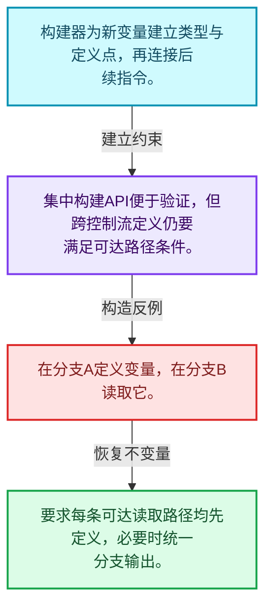
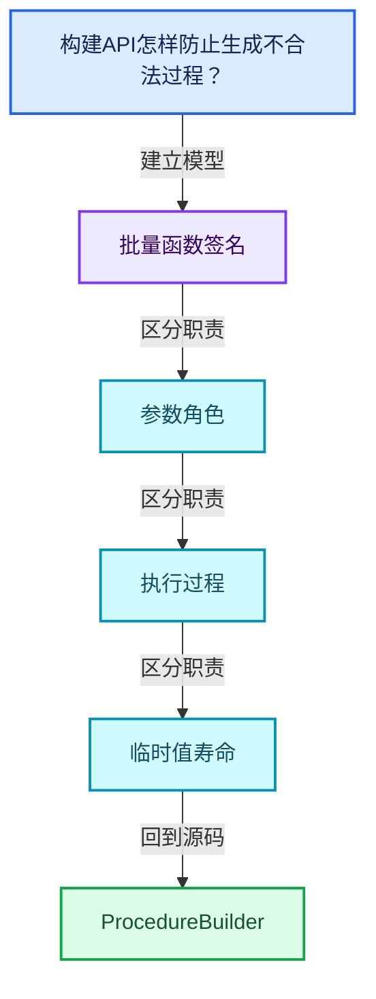
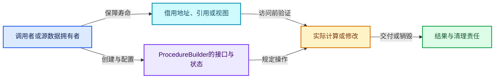
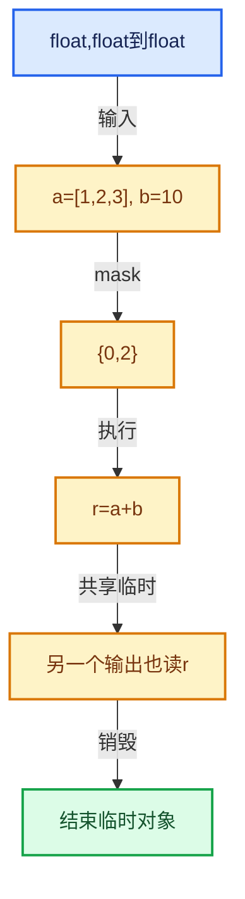

# 07-08 ProcedureBuilder

[方向导航](README.md) · [总目录](../README.md) · [覆盖索引](../%E6%BA%90%E7%A0%81%E7%89%88%E6%9C%AC%E4%B8%8E%E8%A6%86%E7%9B%96%E7%B4%A2%E5%BC%95.md)

> 阅读顺序：问题与数据模型 → 语法与类型 → 源码逐行 → 调用线索 → 历史与取舍 → 推演和练习。

- 基准 HEAD：`cbda6b96c26c0dee3c3b5cbb93960c4ac06a6b30`。
- 记录日期：2026-10-14。
- 教学示例状态：正文中的推演不是本机性能实测；已运行练习见验收报告。

## 一、从问题到设计

构建API怎样防止生成不合法过程？

构建期检查与执行期检查各有职责，变量定义和类型必须在控制流上有效。

本篇把语法、数据语义和系统取舍连接起来。把调用准备与元素循环分开，把值依赖与对象生存区间同时显式化。

### 本篇独立模型与设计推理

构建器为新变量建立类型与定义点，再连接后续指令。

设计取舍：集中构建API便于验证，但跨控制流定义仍要满足可达路径条件。

最小反例：在分支A定义变量，在分支B读取它。

推导与处理：要求每条可达读取路径均先定义，必要时统一分支输出。



### 源码范围与相邻篇章

| 文件 | 本篇逐行范围 | 基准SHA-256 |
|---|---|---|
| [source/blender/functions/FN_multi_function_procedure_builder.hh](../../../../../source/blender/functions/FN_multi_function_procedure_builder.hh) | L1—L190 | `8ef48ea06a306ac343d409c669ea69af91c8536d410a3a4e3975341dd64358d7` |
| [source/blender/functions/intern/multi_function_procedure_builder.cc](../../../../../source/blender/functions/intern/multi_function_procedure_builder.cc) | L1—L123 | `9875a07601cefa59e93a19edc7edb50f966d0c482c47d0f0444c47a1d69902ac` |

同一主讲文件可能分多篇覆盖；超出本篇范围的符号通过覆盖索引定位。空行与纯注释保留在源码摘录中，逐行表解释有效语句与语法边界；许可证头统一保留。

前篇：[Procedure指令与控制流](07-Procedure%E6%8C%87%E4%BB%A4%E4%B8%8E%E6%8E%A7%E5%88%B6%E6%B5%81.md).

后篇：[执行器与内存复用](09-%E6%89%A7%E8%A1%8C%E5%99%A8%E4%B8%8E%E5%86%85%E5%AD%98%E5%A4%8D%E7%94%A8.md).

## 二、类型、数据与阅读地图



这是概念依赖图，边表示阅读关系，不声称是运行时调用顺序。

### 直接编译依赖


箭头只表示头文件包含关系；完整调用线索见后面的符号定位表。

## 三、关键词、语法与类型角色

### 模板 template

模板把类型或常量作为生成实现的参数。读声明时先列出类型参数、非类型参数和默认值，再看使用者实际实例化了什么。模板声明本身不意味着每种T都支持其全部成员。

具体检查：把T替换为int、string、只能移动的类型，分别检查每个被调用操作是否成立。

### 依赖名称 typename

typename既可引入类型模板参数，也可告诉编译器某个依赖名称是类型。它不创建运行时对象；解析期确认语法类别与实例化期检查具体类型是不同阶段。

具体检查：区分typename T::value_type和T::size()，前者标记类型，后者是表达式。

### 只读限定 const

const约束当前访问路径可做的修改。const指针、指向const的指针、const视图对象、const元素是不同位置的限定；其他别名可能仍可修改原对象。

具体检查：分别写T* const、const T*与const T* const，并画出不可修改的层次。

### 移动转换 std::move

std::move把表达式转换为可供移动重载选择的值类别，实际资源转移发生在被选中的构造或赋值中。对const对象move可能仍调用复制，对视图move也不会获得底层数据所有权。

具体检查：记录移动构造调用次数，不用变量名或std::move的出现次数替代测量。

### 异常边界 try与catch

try定义异常传播的局部边界。失败路径需要销毁已经成功构造的部分并释放相应存储；未构造的对象不能被析构。

具体检查：在第k次构造失败，列出已经存在的对象集合与待释放缓冲。

### 内部断言 assert

断言表达开发者预期成立的内部契约，发布构建可能关闭。它不能替代对不可信输入的完整错误处理，也不保证后续操作被运行时保护。

具体检查：对每条断言构造违反条件的输入，区分调用者错误与应向用户报告的错误。

## 四、真实源码与逐行讲解

源码块保持原行内容，原始行号由小节标题及逐行表给出。表中的调用定位是静态阅读辅助；重载、模板实例化、宏展开和虚调用需结合完整声明，不能仅凭词法出现证明动态调用。

### FN_multi_function_procedure_builder.hh：L1—L47

<!-- source:source/blender/functions/FN_multi_function_procedure_builder.hh:1:47 -->

```cpp
/* SPDX-FileCopyrightText: 2023 Blender Authors
 *
 * SPDX-License-Identifier: GPL-2.0-or-later */

#pragma once

/** \file
 * \ingroup fn
 */

#include "FN_multi_function_procedure.hh"

namespace blender::fn::multi_function {

/**
 * Utility class to build a #Procedure.
 */
class ProcedureBuilder {
 private:
  /** Procedure that is being build. */
  Procedure *procedure_ = nullptr;
  /** Cursors where the next instruction should be inserted. */
  Vector<InstructionCursor> cursors_;

 public:
  struct Branch;
  struct Loop;

  ProcedureBuilder(Procedure &procedure,
                   InstructionCursor initial_cursor = InstructionCursor::ForEntry());

  ProcedureBuilder(Span<ProcedureBuilder *> builders);

  ProcedureBuilder(Branch &branch);

  void set_cursor(const InstructionCursor &cursor);
  void set_cursor(Span<InstructionCursor> cursors);
  void set_cursor(Span<ProcedureBuilder *> builders);
  void set_cursor_after_branch(Branch &branch);
  void set_cursor_after_loop(Loop &loop);

  void add_destruct(Variable &variable);
  void add_destruct(Span<Variable *> variables);

  ReturnInstruction &add_return();

  Branch add_branch(Variable &condition);
```

| 原始行 | 语义、约束与检查 |
|---|---|
| L5 | 防止同一头文件在一个翻译单元中重复展开；不控制多个源文件之间的链接或对象寿命。 |
| L11 | 引入编译依赖 "FN_multi_function_procedure.hh"；这是声明可见性关系，不表示运行时一定调用该文件的所有接口。 |
| L13 | 把后续声明放入 blender::fn::multi_function 命名空间，影响名称查找和符号归属，不创建运行时对象。 |
| L18 | 声明或定义类型 `class ProcedureBuilder`。结合继承、访问权限和成员布局确认接口与拥有关系；前向声明本身没有完整对象布局。 |
| L19 | 切换成员访问权限为 private；它是编译期接口边界，不是线程同步或内存保护。 |
| L21 | 把右侧 `nullptr` 用于初始化或更新左侧 `Procedure *procedure_`。声明初始化与已有对象赋值应按上下文区分；有资源的类型会调用相应特殊成员。 |
| L23 | 声明成员、局部对象或完成语句 `Vector<InstructionCursor> cursors_`。若为指针或引用，它本身不说明拥有；若为值对象，其构造析构由所在作用域或外层对象管理。 |
| L25 | 切换成员访问权限为 public；它是编译期接口边界，不是线程同步或内存保护。 |
| L26 | 声明或定义类型 `struct Branch`。结合继承、访问权限和成员布局确认接口与拥有关系；前向声明本身没有完整对象布局。 |
| L27 | 声明或定义类型 `struct Loop`。结合继承、访问权限和成员布局确认接口与拥有关系；前向声明本身没有完整对象布局。 |
| L29 | 出现调用或函数声明 `ProcedureBuilder`，对应表达式为 `ProcedureBuilder(Procedure &procedure,`。参数求值、返回类型与重载需结合前后完整语句；静态文本引用不能证明动态目标。 |
| L30 | 把右侧 `InstructionCursor::ForEntry())` 用于初始化或更新左侧 `InstructionCursor initial_cursor`。声明初始化与已有对象赋值应按上下文区分；有资源的类型会调用相应特殊成员。 |
| L32 | 出现调用或函数声明 `ProcedureBuilder`，对应表达式为 `ProcedureBuilder(Span<ProcedureBuilder *> builders);`。参数求值、返回类型与重载需结合前后完整语句；静态文本引用不能证明动态目标。 |
| L34 | 出现调用或函数声明 `ProcedureBuilder`，对应表达式为 `ProcedureBuilder(Branch &branch);`。参数求值、返回类型与重载需结合前后完整语句；静态文本引用不能证明动态目标。 |
| L36 | 声明接口 `void set_cursor(const InstructionCursor &cursor)`，本行没有对应函数体；返回类型、参数限定和const/noexcept共同组成调用契约，实际行为需继续定位实现。 |
| L37 | 声明接口 `void set_cursor(Span<InstructionCursor> cursors)`，本行没有对应函数体；返回类型、参数限定和const/noexcept共同组成调用契约，实际行为需继续定位实现。 |
| L38 | 声明接口 `void set_cursor(Span<ProcedureBuilder *> builders)`，本行没有对应函数体；返回类型、参数限定和const/noexcept共同组成调用契约，实际行为需继续定位实现。 |
| L39 | 声明接口 `void set_cursor_after_branch(Branch &branch)`，本行没有对应函数体；返回类型、参数限定和const/noexcept共同组成调用契约，实际行为需继续定位实现。 |
| L40 | 声明接口 `void set_cursor_after_loop(Loop &loop)`，本行没有对应函数体；返回类型、参数限定和const/noexcept共同组成调用契约，实际行为需继续定位实现。 |
| L42 | 声明接口 `void add_destruct(Variable &variable)`，本行没有对应函数体；返回类型、参数限定和const/noexcept共同组成调用契约，实际行为需继续定位实现。 |
| L43 | 声明接口 `void add_destruct(Span<Variable *> variables)`，本行没有对应函数体；返回类型、参数限定和const/noexcept共同组成调用契约，实际行为需继续定位实现。 |
| L45 | 出现调用或函数声明 `add_return`，对应表达式为 `ReturnInstruction &add_return();`。参数求值、返回类型与重载需结合前后完整语句；静态文本引用不能证明动态目标。 |
| L47 | 出现调用或函数声明 `add_branch`，对应表达式为 `Branch add_branch(Variable &condition);`。参数求值、返回类型与重载需结合前后完整语句；静态文本引用不能证明动态目标。 |

### FN_multi_function_procedure_builder.hh：L48—L95

<!-- source:source/blender/functions/FN_multi_function_procedure_builder.hh:48:95 -->

```cpp

  Loop add_loop();
  void add_loop_continue(Loop &loop);
  void add_loop_break(Loop &loop);

  CallInstruction &add_call_with_no_variables(const MultiFunction &fn);
  CallInstruction &add_call_with_all_variables(const MultiFunction &fn,
                                               Span<Variable *> param_variables);

  Vector<Variable *> add_call(const MultiFunction &fn,
                              Span<Variable *> input_and_mutable_variables = {});

  template<int OutputN>
  std::array<Variable *, OutputN> add_call(const MultiFunction &fn,
                                           Span<Variable *> input_and_mutable_variables = {});

  void add_parameter(ParamType::InterfaceType interface_type, Variable &variable);
  Variable &add_parameter(ParamType param_type, std::string name = "");

  Variable &add_input_parameter(DataType data_type, std::string name = "");
  template<typename T> Variable &add_single_input_parameter(std::string name = "");
  template<typename T> Variable &add_single_mutable_parameter(std::string name = "");

  void add_output_parameter(Variable &variable);

 private:
  void link_to_cursors(Instruction *instruction);
};

struct ProcedureBuilder::Branch {
  ProcedureBuilder branch_true;
  ProcedureBuilder branch_false;
};

struct ProcedureBuilder::Loop {
  Instruction *begin = nullptr;
  DummyInstruction *end = nullptr;
};

/* --------------------------------------------------------------------
 * ProcedureBuilder inline methods.
 */

inline ProcedureBuilder::ProcedureBuilder(Branch &branch)
    : ProcedureBuilder(*branch.branch_true.procedure_)
{
  this->set_cursor_after_branch(branch);
}
```

| 原始行 | 语义、约束与检查 |
|---|---|
| L49 | 出现调用或函数声明 `add_loop`，对应表达式为 `Loop add_loop();`。参数求值、返回类型与重载需结合前后完整语句；静态文本引用不能证明动态目标。 |
| L50 | 声明接口 `void add_loop_continue(Loop &loop)`，本行没有对应函数体；返回类型、参数限定和const/noexcept共同组成调用契约，实际行为需继续定位实现。 |
| L51 | 声明接口 `void add_loop_break(Loop &loop)`，本行没有对应函数体；返回类型、参数限定和const/noexcept共同组成调用契约，实际行为需继续定位实现。 |
| L53 | 出现调用或函数声明 `add_call_with_no_variables`，对应表达式为 `CallInstruction &add_call_with_no_variables(const MultiFunction &fn);`。参数求值、返回类型与重载需结合前后完整语句；静态文本引用不能证明动态目标。 |
| L54 | 出现调用或函数声明 `add_call_with_all_variables`，对应表达式为 `CallInstruction &add_call_with_all_variables(const MultiFunction &fn,`。参数求值、返回类型与重载需结合前后完整语句；静态文本引用不能证明动态目标。 |
| L55 | 声明成员、局部对象或完成语句 `Span<Variable *> param_variables)`。若为指针或引用，它本身不说明拥有；若为值对象，其构造析构由所在作用域或外层对象管理。 |
| L57 | 出现调用或函数声明 `add_call`，对应表达式为 `Vector<Variable *> add_call(const MultiFunction &fn,`。参数求值、返回类型与重载需结合前后完整语句；静态文本引用不能证明动态目标。 |
| L58 | 把右侧 `{})` 用于初始化或更新左侧 `Span<Variable *> input_and_mutable_variables`。声明初始化与已有对象赋值应按上下文区分；有资源的类型会调用相应特殊成员。 |
| L60 | 声明模板参数 `template<int OutputN>`。类型参数决定生成操作的类型，非类型参数可决定内嵌容量或编译期分支。 |
| L61 | 出现调用或函数声明 `add_call`，对应表达式为 `std::array<Variable *, OutputN> add_call(const MultiFunction &fn,`。参数求值、返回类型与重载需结合前后完整语句；静态文本引用不能证明动态目标。 |
| L62 | 把右侧 `{})` 用于初始化或更新左侧 `Span<Variable *> input_and_mutable_variables`。声明初始化与已有对象赋值应按上下文区分；有资源的类型会调用相应特殊成员。 |
| L64 | 声明接口 `void add_parameter(ParamType::InterfaceType interface_type, Variable &variable)`，本行没有对应函数体；返回类型、参数限定和const/noexcept共同组成调用契约，实际行为需继续定位实现。 |
| L65 | 把右侧 `"")` 用于初始化或更新左侧 `Variable &add_parameter(ParamType param_type, std::string name`。声明初始化与已有对象赋值应按上下文区分；有资源的类型会调用相应特殊成员。 |
| L67 | 把右侧 `"")` 用于初始化或更新左侧 `Variable &add_input_parameter(DataType data_type, std::string name`。声明初始化与已有对象赋值应按上下文区分；有资源的类型会调用相应特殊成员。 |
| L68 | 声明模板参数 `template<typename T> Variable &add_single_input_parameter(std::string name = "");`。类型参数决定生成操作的类型，非类型参数可决定内嵌容量或编译期分支。 |
| L69 | 声明模板参数 `template<typename T> Variable &add_single_mutable_parameter(std::string name = "");`。类型参数决定生成操作的类型，非类型参数可决定内嵌容量或编译期分支。 |
| L71 | 声明接口 `void add_output_parameter(Variable &variable)`，本行没有对应函数体；返回类型、参数限定和const/noexcept共同组成调用契约，实际行为需继续定位实现。 |
| L73 | 切换成员访问权限为 private；它是编译期接口边界，不是线程同步或内存保护。 |
| L74 | 声明接口 `void link_to_cursors(Instruction *instruction)`，本行没有对应函数体；返回类型、参数限定和const/noexcept共同组成调用契约，实际行为需继续定位实现。 |
| L75 | 结束当前语法单元。局部自动对象在离开其作用域时按规则销毁；这不等于所有被引用的外部数据也被释放。 |
| L77 | 声明或定义类型 `struct ProcedureBuilder::Branch`。结合继承、访问权限和成员布局确认接口与拥有关系；前向声明本身没有完整对象布局。 |
| L78 | 声明成员、局部对象或完成语句 `ProcedureBuilder branch_true`。若为指针或引用，它本身不说明拥有；若为值对象，其构造析构由所在作用域或外层对象管理。 |
| L79 | 声明成员、局部对象或完成语句 `ProcedureBuilder branch_false`。若为指针或引用，它本身不说明拥有；若为值对象，其构造析构由所在作用域或外层对象管理。 |
| L80 | 结束当前语法单元。局部自动对象在离开其作用域时按规则销毁；这不等于所有被引用的外部数据也被释放。 |
| L82 | 声明或定义类型 `struct ProcedureBuilder::Loop`。结合继承、访问权限和成员布局确认接口与拥有关系；前向声明本身没有完整对象布局。 |
| L83 | 把右侧 `nullptr` 用于初始化或更新左侧 `Instruction *begin`。声明初始化与已有对象赋值应按上下文区分；有资源的类型会调用相应特殊成员。 |
| L84 | 把右侧 `nullptr` 用于初始化或更新左侧 `DummyInstruction *end`。声明初始化与已有对象赋值应按上下文区分；有资源的类型会调用相应特殊成员。 |
| L85 | 结束当前语法单元。局部自动对象在离开其作用域时按规则销毁；这不等于所有被引用的外部数据也被释放。 |
| L91 | 出现调用或函数声明 `ProcedureBuilder::ProcedureBuilder`，对应表达式为 `inline ProcedureBuilder::ProcedureBuilder(Branch &branch)`。参数求值、返回类型与重载需结合前后完整语句；静态文本引用不能证明动态目标。 |
| L92 | 出现调用或函数声明 `ProcedureBuilder`，对应表达式为 `: ProcedureBuilder(*branch.branch_true.procedure_)`。参数求值、返回类型与重载需结合前后完整语句；静态文本引用不能证明动态目标。 |
| L93 | 连接上一行的声明或控制结构与其语句块；后续行在这个作用域中执行或声明。 |
| L94 | 出现调用或函数声明 `set_cursor_after_branch`，对应表达式为 `this->set_cursor_after_branch(branch);`。参数求值、返回类型与重载需结合前后完整语句；静态文本引用不能证明动态目标。 |
| L95 | 结束当前语法单元。局部自动对象在离开其作用域时按规则销毁；这不等于所有被引用的外部数据也被释放。 |

### FN_multi_function_procedure_builder.hh：L96—L146

<!-- source:source/blender/functions/FN_multi_function_procedure_builder.hh:96:146 -->

```cpp

inline ProcedureBuilder::ProcedureBuilder(Procedure &procedure, InstructionCursor initial_cursor)
    : procedure_(&procedure), cursors_({initial_cursor})
{
}

inline ProcedureBuilder::ProcedureBuilder(Span<ProcedureBuilder *> builders)
    : ProcedureBuilder(*builders[0]->procedure_)
{
  this->set_cursor(builders);
}

inline void ProcedureBuilder::set_cursor(const InstructionCursor &cursor)
{
  cursors_ = {cursor};
}

inline void ProcedureBuilder::set_cursor(Span<InstructionCursor> cursors)
{
  cursors_ = cursors;
}

inline void ProcedureBuilder::set_cursor_after_branch(Branch &branch)
{
  this->set_cursor({&branch.branch_false, &branch.branch_true});
}

inline void ProcedureBuilder::set_cursor_after_loop(Loop &loop)
{
  this->set_cursor(InstructionCursor{*loop.end});
}

inline void ProcedureBuilder::set_cursor(Span<ProcedureBuilder *> builders)
{
  cursors_.clear();
  for (ProcedureBuilder *builder : builders) {
    cursors_.extend(builder->cursors_);
  }
}

template<int OutputN>
inline std::array<Variable *, OutputN> ProcedureBuilder::add_call(
    const MultiFunction &fn, Span<Variable *> input_and_mutable_variables)
{
  Vector<Variable *> output_variables = this->add_call(fn, input_and_mutable_variables);
  BLI_assert(output_variables.size() == OutputN);

  std::array<Variable *, OutputN> output_array;
  initialized_copy_n(output_variables.data(), OutputN, output_array.data());
  return output_array;
}
```

| 原始行 | 语义、约束与检查 |
|---|---|
| L97 | 出现调用或函数声明 `ProcedureBuilder::ProcedureBuilder`，对应表达式为 `inline ProcedureBuilder::ProcedureBuilder(Procedure &procedure, InstructionCursor initial_cursor)`。参数求值、返回类型与重载需结合前后完整语句；静态文本引用不能证明动态目标。 |
| L98 | 出现调用或函数声明 `procedure_`，对应表达式为 `: procedure_(&procedure), cursors_({initial_cursor})`。参数求值、返回类型与重载需结合前后完整语句；静态文本引用不能证明动态目标。 |
| L99 | 连接上一行的声明或控制结构与其语句块；后续行在这个作用域中执行或声明。 |
| L100 | 结束当前语法单元。局部自动对象在离开其作用域时按规则销毁；这不等于所有被引用的外部数据也被释放。 |
| L102 | 出现调用或函数声明 `ProcedureBuilder::ProcedureBuilder`，对应表达式为 `inline ProcedureBuilder::ProcedureBuilder(Span<ProcedureBuilder *> builders)`。参数求值、返回类型与重载需结合前后完整语句；静态文本引用不能证明动态目标。 |
| L103 | 出现调用或函数声明 `ProcedureBuilder`，对应表达式为 `: ProcedureBuilder(*builders[0]->procedure_)`。参数求值、返回类型与重载需结合前后完整语句；静态文本引用不能证明动态目标。 |
| L104 | 连接上一行的声明或控制结构与其语句块；后续行在这个作用域中执行或声明。 |
| L105 | 出现调用或函数声明 `set_cursor`，对应表达式为 `this->set_cursor(builders);`。参数求值、返回类型与重载需结合前后完整语句；静态文本引用不能证明动态目标。 |
| L106 | 结束当前语法单元。局部自动对象在离开其作用域时按规则销毁；这不等于所有被引用的外部数据也被释放。 |
| L108 | 出现调用或函数声明 `ProcedureBuilder::set_cursor`，对应表达式为 `inline void ProcedureBuilder::set_cursor(const InstructionCursor &cursor)`。参数求值、返回类型与重载需结合前后完整语句；静态文本引用不能证明动态目标。 |
| L109 | 连接上一行的声明或控制结构与其语句块；后续行在这个作用域中执行或声明。 |
| L110 | 把右侧 `{cursor}` 用于初始化或更新左侧 `cursors_`。声明初始化与已有对象赋值应按上下文区分；有资源的类型会调用相应特殊成员。 |
| L111 | 结束当前语法单元。局部自动对象在离开其作用域时按规则销毁；这不等于所有被引用的外部数据也被释放。 |
| L113 | 出现调用或函数声明 `ProcedureBuilder::set_cursor`，对应表达式为 `inline void ProcedureBuilder::set_cursor(Span<InstructionCursor> cursors)`。参数求值、返回类型与重载需结合前后完整语句；静态文本引用不能证明动态目标。 |
| L114 | 连接上一行的声明或控制结构与其语句块；后续行在这个作用域中执行或声明。 |
| L115 | 把右侧 `cursors` 用于初始化或更新左侧 `cursors_`。声明初始化与已有对象赋值应按上下文区分；有资源的类型会调用相应特殊成员。 |
| L116 | 结束当前语法单元。局部自动对象在离开其作用域时按规则销毁；这不等于所有被引用的外部数据也被释放。 |
| L118 | 出现调用或函数声明 `ProcedureBuilder::set_cursor_after_branch`，对应表达式为 `inline void ProcedureBuilder::set_cursor_after_branch(Branch &branch)`。参数求值、返回类型与重载需结合前后完整语句；静态文本引用不能证明动态目标。 |
| L119 | 连接上一行的声明或控制结构与其语句块；后续行在这个作用域中执行或声明。 |
| L120 | 出现调用或函数声明 `set_cursor`，对应表达式为 `this->set_cursor({&branch.branch_false, &branch.branch_true});`。参数求值、返回类型与重载需结合前后完整语句；静态文本引用不能证明动态目标。 |
| L121 | 结束当前语法单元。局部自动对象在离开其作用域时按规则销毁；这不等于所有被引用的外部数据也被释放。 |
| L123 | 出现调用或函数声明 `ProcedureBuilder::set_cursor_after_loop`，对应表达式为 `inline void ProcedureBuilder::set_cursor_after_loop(Loop &loop)`。参数求值、返回类型与重载需结合前后完整语句；静态文本引用不能证明动态目标。 |
| L124 | 连接上一行的声明或控制结构与其语句块；后续行在这个作用域中执行或声明。 |
| L125 | 出现调用或函数声明 `set_cursor`，对应表达式为 `this->set_cursor(InstructionCursor{*loop.end});`。参数求值、返回类型与重载需结合前后完整语句；静态文本引用不能证明动态目标。 |
| L126 | 结束当前语法单元。局部自动对象在离开其作用域时按规则销毁；这不等于所有被引用的外部数据也被释放。 |
| L128 | 出现调用或函数声明 `ProcedureBuilder::set_cursor`，对应表达式为 `inline void ProcedureBuilder::set_cursor(Span<ProcedureBuilder *> builders)`。参数求值、返回类型与重载需结合前后完整语句；静态文本引用不能证明动态目标。 |
| L129 | 连接上一行的声明或控制结构与其语句块；后续行在这个作用域中执行或声明。 |
| L130 | 出现调用或函数声明 `clear`，对应表达式为 `cursors_.clear();`。参数求值、返回类型与重载需结合前后完整语句；静态文本引用不能证明动态目标。 |
| L131 | 按 `for (ProcedureBuilder *builder : builders)` 指定的范围或条件重复执行。对照循环变量与真实元素编号；循环内调用成本乘以实际迭代次数。 |
| L132 | 出现调用或函数声明 `extend`，对应表达式为 `cursors_.extend(builder->cursors_);`。参数求值、返回类型与重载需结合前后完整语句；静态文本引用不能证明动态目标。 |
| L133 | 结束当前语法单元。局部自动对象在离开其作用域时按规则销毁；这不等于所有被引用的外部数据也被释放。 |
| L134 | 结束当前语法单元。局部自动对象在离开其作用域时按规则销毁；这不等于所有被引用的外部数据也被释放。 |
| L136 | 声明模板参数 `template<int OutputN>`。类型参数决定生成操作的类型，非类型参数可决定内嵌容量或编译期分支。 |
| L137 | 出现调用或函数声明 `ProcedureBuilder::add_call`，对应表达式为 `inline std::array<Variable *, OutputN> ProcedureBuilder::add_call(`。参数求值、返回类型与重载需结合前后完整语句；静态文本引用不能证明动态目标。 |
| L138 | 本行是连续声明或表达式的一部分：`const MultiFunction &fn, Span<Variable *> input_and_mutable_variables)`。与本段前后行合读；逗号、括号和限定符决定它属于参数、初始化列表还是实际计算。 |
| L139 | 连接上一行的声明或控制结构与其语句块；后续行在这个作用域中执行或声明。 |
| L140 | 把右侧 `this->add_call(fn, input_and_mutable_variables)` 用于初始化或更新左侧 `Vector<Variable *> output_variables`。声明初始化与已有对象赋值应按上下文区分；有资源的类型会调用相应特殊成员。 |
| L141 | 断言约束 `BLI_assert(output_variables.size() == OutputN);`。条件是后续访问的内部前置条件；发布构建可能不执行，不能把断言当作输入修复。 |
| L143 | 声明成员、局部对象或完成语句 `std::array<Variable *, OutputN> output_array`。若为指针或引用，它本身不说明拥有；若为值对象，其构造析构由所在作用域或外层对象管理。 |
| L144 | 出现调用或函数声明 `initialized_copy_n`，对应表达式为 `initialized_copy_n(output_variables.data(), OutputN, output_array.data());`。参数求值、返回类型与重载需结合前后完整语句；静态文本引用不能证明动态目标。 |
| L145 | 返回表达式 `output_array`。 |
| L146 | 结束当前语法单元。局部自动对象在离开其作用域时按规则销毁；这不等于所有被引用的外部数据也被释放。 |

### FN_multi_function_procedure_builder.hh：L147—L190

<!-- source:source/blender/functions/FN_multi_function_procedure_builder.hh:147:190 -->

```cpp

inline void ProcedureBuilder::add_parameter(ParamType::InterfaceType interface_type,
                                            Variable &variable)
{
  procedure_->add_parameter(interface_type, variable);
}

inline Variable &ProcedureBuilder::add_parameter(ParamType param_type, std::string name)
{
  Variable &variable = procedure_->new_variable(param_type.data_type(), std::move(name));
  this->add_parameter(param_type.interface_type(), variable);
  return variable;
}

inline Variable &ProcedureBuilder::add_input_parameter(DataType data_type, std::string name)
{
  return this->add_parameter(ParamType(ParamType::Input, data_type), std::move(name));
}

template<typename T>
inline Variable &ProcedureBuilder::add_single_input_parameter(std::string name)
{
  return this->add_parameter(ParamType::ForSingleInput(CPPType::get<T>()), std::move(name));
}

template<typename T>
inline Variable &ProcedureBuilder::add_single_mutable_parameter(std::string name)
{
  return this->add_parameter(ParamType::ForMutableSingle(CPPType::get<T>()), std::move(name));
}

inline void ProcedureBuilder::add_output_parameter(Variable &variable)
{
  this->add_parameter(ParamType::Output, variable);
}

inline void ProcedureBuilder::link_to_cursors(Instruction *instruction)
{
  for (InstructionCursor &cursor : cursors_) {
    cursor.set_next(*procedure_, instruction);
  }
}

}  // namespace blender::fn::multi_function
```

| 原始行 | 语义、约束与检查 |
|---|---|
| L148 | 出现调用或函数声明 `ProcedureBuilder::add_parameter`，对应表达式为 `inline void ProcedureBuilder::add_parameter(ParamType::InterfaceType interface_type,`。参数求值、返回类型与重载需结合前后完整语句；静态文本引用不能证明动态目标。 |
| L149 | 本行是连续声明或表达式的一部分：`Variable &variable)`。与本段前后行合读；逗号、括号和限定符决定它属于参数、初始化列表还是实际计算。 |
| L150 | 连接上一行的声明或控制结构与其语句块；后续行在这个作用域中执行或声明。 |
| L151 | 出现调用或函数声明 `add_parameter`，对应表达式为 `procedure_->add_parameter(interface_type, variable);`。参数求值、返回类型与重载需结合前后完整语句；静态文本引用不能证明动态目标。 |
| L152 | 结束当前语法单元。局部自动对象在离开其作用域时按规则销毁；这不等于所有被引用的外部数据也被释放。 |
| L154 | 出现调用或函数声明 `ProcedureBuilder::add_parameter`，对应表达式为 `inline Variable &ProcedureBuilder::add_parameter(ParamType param_type, std::string name)`。参数求值、返回类型与重载需结合前后完整语句；静态文本引用不能证明动态目标。 |
| L155 | 连接上一行的声明或控制结构与其语句块；后续行在这个作用域中执行或声明。 |
| L156 | 把右侧 `procedure_->new_variable(param_type.data_type(), std::move(name))` 用于初始化或更新左侧 `Variable &variable`。声明初始化与已有对象赋值应按上下文区分；有资源的类型会调用相应特殊成员。 |
| L157 | 出现调用或函数声明 `add_parameter`，对应表达式为 `this->add_parameter(param_type.interface_type(), variable);`。参数求值、返回类型与重载需结合前后完整语句；静态文本引用不能证明动态目标。 |
| L158 | 返回表达式 `variable`。 |
| L159 | 结束当前语法单元。局部自动对象在离开其作用域时按规则销毁；这不等于所有被引用的外部数据也被释放。 |
| L161 | 出现调用或函数声明 `ProcedureBuilder::add_input_parameter`，对应表达式为 `inline Variable &ProcedureBuilder::add_input_parameter(DataType data_type, std::string name)`。参数求值、返回类型与重载需结合前后完整语句；静态文本引用不能证明动态目标。 |
| L162 | 连接上一行的声明或控制结构与其语句块；后续行在这个作用域中执行或声明。 |
| L163 | 返回表达式 `this->add_parameter(ParamType(ParamType::Input, data_type), std::move(name))`。 |
| L164 | 结束当前语法单元。局部自动对象在离开其作用域时按规则销毁；这不等于所有被引用的外部数据也被释放。 |
| L166 | 声明模板参数 `template<typename T>`。类型参数决定生成操作的类型，非类型参数可决定内嵌容量或编译期分支。 |
| L167 | 出现调用或函数声明 `ProcedureBuilder::add_single_input_parameter`，对应表达式为 `inline Variable &ProcedureBuilder::add_single_input_parameter(std::string name)`。参数求值、返回类型与重载需结合前后完整语句；静态文本引用不能证明动态目标。 |
| L168 | 连接上一行的声明或控制结构与其语句块；后续行在这个作用域中执行或声明。 |
| L169 | 返回表达式 `this->add_parameter(ParamType::ForSingleInput(CPPType::get<T>()), std::move(name))`。 |
| L170 | 结束当前语法单元。局部自动对象在离开其作用域时按规则销毁；这不等于所有被引用的外部数据也被释放。 |
| L172 | 声明模板参数 `template<typename T>`。类型参数决定生成操作的类型，非类型参数可决定内嵌容量或编译期分支。 |
| L173 | 出现调用或函数声明 `ProcedureBuilder::add_single_mutable_parameter`，对应表达式为 `inline Variable &ProcedureBuilder::add_single_mutable_parameter(std::string name)`。参数求值、返回类型与重载需结合前后完整语句；静态文本引用不能证明动态目标。 |
| L174 | 连接上一行的声明或控制结构与其语句块；后续行在这个作用域中执行或声明。 |
| L175 | 返回表达式 `this->add_parameter(ParamType::ForMutableSingle(CPPType::get<T>()), std::move(name))`。 |
| L176 | 结束当前语法单元。局部自动对象在离开其作用域时按规则销毁；这不等于所有被引用的外部数据也被释放。 |
| L178 | 出现调用或函数声明 `ProcedureBuilder::add_output_parameter`，对应表达式为 `inline void ProcedureBuilder::add_output_parameter(Variable &variable)`。参数求值、返回类型与重载需结合前后完整语句；静态文本引用不能证明动态目标。 |
| L179 | 连接上一行的声明或控制结构与其语句块；后续行在这个作用域中执行或声明。 |
| L180 | 出现调用或函数声明 `add_parameter`，对应表达式为 `this->add_parameter(ParamType::Output, variable);`。参数求值、返回类型与重载需结合前后完整语句；静态文本引用不能证明动态目标。 |
| L181 | 结束当前语法单元。局部自动对象在离开其作用域时按规则销毁；这不等于所有被引用的外部数据也被释放。 |
| L183 | 出现调用或函数声明 `ProcedureBuilder::link_to_cursors`，对应表达式为 `inline void ProcedureBuilder::link_to_cursors(Instruction *instruction)`。参数求值、返回类型与重载需结合前后完整语句；静态文本引用不能证明动态目标。 |
| L184 | 连接上一行的声明或控制结构与其语句块；后续行在这个作用域中执行或声明。 |
| L185 | 按 `for (InstructionCursor &cursor : cursors_)` 指定的范围或条件重复执行。对照循环变量与真实元素编号；循环内调用成本乘以实际迭代次数。 |
| L186 | 出现调用或函数声明 `set_next`，对应表达式为 `cursor.set_next(*procedure_, instruction);`。参数求值、返回类型与重载需结合前后完整语句；静态文本引用不能证明动态目标。 |
| L187 | 结束当前语法单元。局部自动对象在离开其作用域时按规则销毁；这不等于所有被引用的外部数据也被释放。 |
| L188 | 结束当前语法单元。局部自动对象在离开其作用域时按规则销毁；这不等于所有被引用的外部数据也被释放。 |
| L190 | 结束当前语法单元。局部自动对象在离开其作用域时按规则销毁；这不等于所有被引用的外部数据也被释放。 |

### multi_function_procedure_builder.cc：L1—L50

<!-- source:source/blender/functions/intern/multi_function_procedure_builder.cc:1:50 -->

```cpp
/* SPDX-FileCopyrightText: 2023 Blender Authors
 *
 * SPDX-License-Identifier: GPL-2.0-or-later */

/** \file
 * \ingroup fn
 */

#include "FN_multi_function_procedure_builder.hh"

namespace blender::fn::multi_function {

void ProcedureBuilder::add_destruct(Variable &variable)
{
  DestructInstruction &instruction = procedure_->new_destruct_instruction();
  instruction.set_variable(&variable);
  this->link_to_cursors(&instruction);
  cursors_ = {InstructionCursor{instruction}};
}

void ProcedureBuilder::add_destruct(Span<Variable *> variables)
{
  for (Variable *variable : variables) {
    this->add_destruct(*variable);
  }
}

ReturnInstruction &ProcedureBuilder::add_return()
{
  ReturnInstruction &instruction = procedure_->new_return_instruction();
  this->link_to_cursors(&instruction);
  cursors_ = {};
  return instruction;
}

CallInstruction &ProcedureBuilder::add_call_with_no_variables(const MultiFunction &fn)
{
  CallInstruction &instruction = procedure_->new_call_instruction(fn);
  this->link_to_cursors(&instruction);
  cursors_ = {InstructionCursor{instruction}};
  return instruction;
}

CallInstruction &ProcedureBuilder::add_call_with_all_variables(const MultiFunction &fn,
                                                               Span<Variable *> param_variables)
{
  CallInstruction &instruction = this->add_call_with_no_variables(fn);
  instruction.set_params(param_variables);
  return instruction;
}
```

| 原始行 | 语义、约束与检查 |
|---|---|
| L9 | 引入编译依赖 "FN_multi_function_procedure_builder.hh"；这是声明可见性关系，不表示运行时一定调用该文件的所有接口。 |
| L11 | 把后续声明放入 blender::fn::multi_function 命名空间，影响名称查找和符号归属，不创建运行时对象。 |
| L13 | 出现调用或函数声明 `ProcedureBuilder::add_destruct`，对应表达式为 `void ProcedureBuilder::add_destruct(Variable &variable)`。参数求值、返回类型与重载需结合前后完整语句；静态文本引用不能证明动态目标。 |
| L14 | 连接上一行的声明或控制结构与其语句块；后续行在这个作用域中执行或声明。 |
| L15 | 把右侧 `procedure_->new_destruct_instruction()` 用于初始化或更新左侧 `DestructInstruction &instruction`。声明初始化与已有对象赋值应按上下文区分；有资源的类型会调用相应特殊成员。 |
| L16 | 出现调用或函数声明 `set_variable`，对应表达式为 `instruction.set_variable(&variable);`。参数求值、返回类型与重载需结合前后完整语句；静态文本引用不能证明动态目标。 |
| L17 | 出现调用或函数声明 `link_to_cursors`，对应表达式为 `this->link_to_cursors(&instruction);`。参数求值、返回类型与重载需结合前后完整语句；静态文本引用不能证明动态目标。 |
| L18 | 把右侧 `{InstructionCursor{instruction}}` 用于初始化或更新左侧 `cursors_`。声明初始化与已有对象赋值应按上下文区分；有资源的类型会调用相应特殊成员。 |
| L19 | 结束当前语法单元。局部自动对象在离开其作用域时按规则销毁；这不等于所有被引用的外部数据也被释放。 |
| L21 | 出现调用或函数声明 `ProcedureBuilder::add_destruct`，对应表达式为 `void ProcedureBuilder::add_destruct(Span<Variable *> variables)`。参数求值、返回类型与重载需结合前后完整语句；静态文本引用不能证明动态目标。 |
| L22 | 连接上一行的声明或控制结构与其语句块；后续行在这个作用域中执行或声明。 |
| L23 | 按 `for (Variable *variable : variables)` 指定的范围或条件重复执行。对照循环变量与真实元素编号；循环内调用成本乘以实际迭代次数。 |
| L24 | 出现调用或函数声明 `add_destruct`，对应表达式为 `this->add_destruct(*variable);`。参数求值、返回类型与重载需结合前后完整语句；静态文本引用不能证明动态目标。 |
| L25 | 结束当前语法单元。局部自动对象在离开其作用域时按规则销毁；这不等于所有被引用的外部数据也被释放。 |
| L26 | 结束当前语法单元。局部自动对象在离开其作用域时按规则销毁；这不等于所有被引用的外部数据也被释放。 |
| L28 | 出现调用或函数声明 `ProcedureBuilder::add_return`，对应表达式为 `ReturnInstruction &ProcedureBuilder::add_return()`。参数求值、返回类型与重载需结合前后完整语句；静态文本引用不能证明动态目标。 |
| L29 | 连接上一行的声明或控制结构与其语句块；后续行在这个作用域中执行或声明。 |
| L30 | 把右侧 `procedure_->new_return_instruction()` 用于初始化或更新左侧 `ReturnInstruction &instruction`。声明初始化与已有对象赋值应按上下文区分；有资源的类型会调用相应特殊成员。 |
| L31 | 出现调用或函数声明 `link_to_cursors`，对应表达式为 `this->link_to_cursors(&instruction);`。参数求值、返回类型与重载需结合前后完整语句；静态文本引用不能证明动态目标。 |
| L32 | 把右侧 `{}` 用于初始化或更新左侧 `cursors_`。声明初始化与已有对象赋值应按上下文区分；有资源的类型会调用相应特殊成员。 |
| L33 | 返回表达式 `instruction`。 |
| L34 | 结束当前语法单元。局部自动对象在离开其作用域时按规则销毁；这不等于所有被引用的外部数据也被释放。 |
| L36 | 出现调用或函数声明 `ProcedureBuilder::add_call_with_no_variables`，对应表达式为 `CallInstruction &ProcedureBuilder::add_call_with_no_variables(const MultiFunction &fn)`。参数求值、返回类型与重载需结合前后完整语句；静态文本引用不能证明动态目标。 |
| L37 | 连接上一行的声明或控制结构与其语句块；后续行在这个作用域中执行或声明。 |
| L38 | 把右侧 `procedure_->new_call_instruction(fn)` 用于初始化或更新左侧 `CallInstruction &instruction`。声明初始化与已有对象赋值应按上下文区分；有资源的类型会调用相应特殊成员。 |
| L39 | 出现调用或函数声明 `link_to_cursors`，对应表达式为 `this->link_to_cursors(&instruction);`。参数求值、返回类型与重载需结合前后完整语句；静态文本引用不能证明动态目标。 |
| L40 | 把右侧 `{InstructionCursor{instruction}}` 用于初始化或更新左侧 `cursors_`。声明初始化与已有对象赋值应按上下文区分；有资源的类型会调用相应特殊成员。 |
| L41 | 返回表达式 `instruction`。 |
| L42 | 结束当前语法单元。局部自动对象在离开其作用域时按规则销毁；这不等于所有被引用的外部数据也被释放。 |
| L44 | 出现调用或函数声明 `ProcedureBuilder::add_call_with_all_variables`，对应表达式为 `CallInstruction &ProcedureBuilder::add_call_with_all_variables(const MultiFunction &fn,`。参数求值、返回类型与重载需结合前后完整语句；静态文本引用不能证明动态目标。 |
| L45 | 本行是连续声明或表达式的一部分：`Span<Variable *> param_variables)`。与本段前后行合读；逗号、括号和限定符决定它属于参数、初始化列表还是实际计算。 |
| L46 | 连接上一行的声明或控制结构与其语句块；后续行在这个作用域中执行或声明。 |
| L47 | 把右侧 `this->add_call_with_no_variables(fn)` 用于初始化或更新左侧 `CallInstruction &instruction`。声明初始化与已有对象赋值应按上下文区分；有资源的类型会调用相应特殊成员。 |
| L48 | 出现调用或函数声明 `set_params`，对应表达式为 `instruction.set_params(param_variables);`。参数求值、返回类型与重载需结合前后完整语句；静态文本引用不能证明动态目标。 |
| L49 | 返回表达式 `instruction`。 |
| L50 | 结束当前语法单元。局部自动对象在离开其作用域时按规则销毁；这不等于所有被引用的外部数据也被释放。 |

### multi_function_procedure_builder.cc：L51—L93

<!-- source:source/blender/functions/intern/multi_function_procedure_builder.cc:51:93 -->

```cpp

Vector<Variable *> ProcedureBuilder::add_call(const MultiFunction &fn,
                                              Span<Variable *> input_and_mutable_variables)
{
  Vector<Variable *> output_variables;
  CallInstruction &instruction = this->add_call_with_no_variables(fn);
  for (const int param_index : fn.param_indices()) {
    const ParamType param_type = fn.param_type(param_index);
    switch (param_type.interface_type()) {
      case ParamType::Input:
      case ParamType::Mutable: {
        Variable *variable = input_and_mutable_variables.first();
        instruction.set_param_variable(param_index, variable);
        input_and_mutable_variables = input_and_mutable_variables.drop_front(1);
        break;
      }
      case ParamType::Output: {
        Variable &variable = procedure_->new_variable(param_type.data_type(),
                                                      fn.param_name(param_index));
        instruction.set_param_variable(param_index, &variable);
        output_variables.append(&variable);
        break;
      }
    }
  }
  /* All passed in variables should have been dropped in the loop above. */
  BLI_assert(input_and_mutable_variables.is_empty());
  return output_variables;
}

ProcedureBuilder::Branch ProcedureBuilder::add_branch(Variable &condition)
{
  BranchInstruction &instruction = procedure_->new_branch_instruction();
  instruction.set_condition(&condition);
  this->link_to_cursors(&instruction);
  /* Clear cursors because this builder ends here. */
  cursors_.clear();

  Branch branch{*procedure_, *procedure_};
  branch.branch_true.set_cursor(InstructionCursor{instruction, true});
  branch.branch_false.set_cursor(InstructionCursor{instruction, false});
  return branch;
}
```

| 原始行 | 语义、约束与检查 |
|---|---|
| L52 | 出现调用或函数声明 `ProcedureBuilder::add_call`，对应表达式为 `Vector<Variable *> ProcedureBuilder::add_call(const MultiFunction &fn,`。参数求值、返回类型与重载需结合前后完整语句；静态文本引用不能证明动态目标。 |
| L53 | 本行是连续声明或表达式的一部分：`Span<Variable *> input_and_mutable_variables)`。与本段前后行合读；逗号、括号和限定符决定它属于参数、初始化列表还是实际计算。 |
| L54 | 连接上一行的声明或控制结构与其语句块；后续行在这个作用域中执行或声明。 |
| L55 | 声明成员、局部对象或完成语句 `Vector<Variable *> output_variables`。若为指针或引用，它本身不说明拥有；若为值对象，其构造析构由所在作用域或外层对象管理。 |
| L56 | 把右侧 `this->add_call_with_no_variables(fn)` 用于初始化或更新左侧 `CallInstruction &instruction`。声明初始化与已有对象赋值应按上下文区分；有资源的类型会调用相应特殊成员。 |
| L57 | 按 `for (const int param_index : fn.param_indices())` 指定的范围或条件重复执行。对照循环变量与真实元素编号；循环内调用成本乘以实际迭代次数。 |
| L58 | 把右侧 `fn.param_type(param_index)` 用于初始化或更新左侧 `const ParamType param_type`。声明初始化与已有对象赋值应按上下文区分；有资源的类型会调用相应特殊成员。 |
| L59 | 按 switch (param_type.interface_type()) 选择状态处理路径；每个case的break、return或贯穿行为决定下一步。 |
| L60 | 进入枚举或判别值对应分支 case ParamType::Input:；结合状态定义和后续更新判断允许的转移。 |
| L61 | 进入枚举或判别值对应分支 case ParamType::Mutable: {；结合状态定义和后续更新判断允许的转移。 |
| L62 | 把右侧 `input_and_mutable_variables.first()` 用于初始化或更新左侧 `Variable *variable`。声明初始化与已有对象赋值应按上下文区分；有资源的类型会调用相应特殊成员。 |
| L63 | 出现调用或函数声明 `set_param_variable`，对应表达式为 `instruction.set_param_variable(param_index, variable);`。参数求值、返回类型与重载需结合前后完整语句；静态文本引用不能证明动态目标。 |
| L64 | 把右侧 `input_and_mutable_variables.drop_front(1)` 用于初始化或更新左侧 `input_and_mutable_variables`。声明初始化与已有对象赋值应按上下文区分；有资源的类型会调用相应特殊成员。 |
| L65 | 离开最近的循环或switch；不是离开整个函数，后续清理和提交代码可能仍会执行。 |
| L66 | 结束当前语法单元。局部自动对象在离开其作用域时按规则销毁；这不等于所有被引用的外部数据也被释放。 |
| L67 | 进入枚举或判别值对应分支 case ParamType::Output: {；结合状态定义和后续更新判断允许的转移。 |
| L68 | 把右侧 `procedure_->new_variable(param_type.data_type(),` 用于初始化或更新左侧 `Variable &variable`。声明初始化与已有对象赋值应按上下文区分；有资源的类型会调用相应特殊成员。 |
| L69 | 出现调用或函数声明 `param_name`，对应表达式为 `fn.param_name(param_index));`。参数求值、返回类型与重载需结合前后完整语句；静态文本引用不能证明动态目标。 |
| L70 | 出现调用或函数声明 `set_param_variable`，对应表达式为 `instruction.set_param_variable(param_index, &variable);`。参数求值、返回类型与重载需结合前后完整语句；静态文本引用不能证明动态目标。 |
| L71 | 出现调用或函数声明 `append`，对应表达式为 `output_variables.append(&variable);`。参数求值、返回类型与重载需结合前后完整语句；静态文本引用不能证明动态目标。 |
| L72 | 离开最近的循环或switch；不是离开整个函数，后续清理和提交代码可能仍会执行。 |
| L73 | 结束当前语法单元。局部自动对象在离开其作用域时按规则销毁；这不等于所有被引用的外部数据也被释放。 |
| L74 | 结束当前语法单元。局部自动对象在离开其作用域时按规则销毁；这不等于所有被引用的外部数据也被释放。 |
| L75 | 结束当前语法单元。局部自动对象在离开其作用域时按规则销毁；这不等于所有被引用的外部数据也被释放。 |
| L77 | 断言约束 `BLI_assert(input_and_mutable_variables.is_empty());`。条件是后续访问的内部前置条件；发布构建可能不执行，不能把断言当作输入修复。 |
| L78 | 返回表达式 `output_variables`。 |
| L79 | 结束当前语法单元。局部自动对象在离开其作用域时按规则销毁；这不等于所有被引用的外部数据也被释放。 |
| L81 | 出现调用或函数声明 `ProcedureBuilder::add_branch`，对应表达式为 `ProcedureBuilder::Branch ProcedureBuilder::add_branch(Variable &condition)`。参数求值、返回类型与重载需结合前后完整语句；静态文本引用不能证明动态目标。 |
| L82 | 连接上一行的声明或控制结构与其语句块；后续行在这个作用域中执行或声明。 |
| L83 | 把右侧 `procedure_->new_branch_instruction()` 用于初始化或更新左侧 `BranchInstruction &instruction`。声明初始化与已有对象赋值应按上下文区分；有资源的类型会调用相应特殊成员。 |
| L84 | 出现调用或函数声明 `set_condition`，对应表达式为 `instruction.set_condition(&condition);`。参数求值、返回类型与重载需结合前后完整语句；静态文本引用不能证明动态目标。 |
| L85 | 出现调用或函数声明 `link_to_cursors`，对应表达式为 `this->link_to_cursors(&instruction);`。参数求值、返回类型与重载需结合前后完整语句；静态文本引用不能证明动态目标。 |
| L87 | 出现调用或函数声明 `clear`，对应表达式为 `cursors_.clear();`。参数求值、返回类型与重载需结合前后完整语句；静态文本引用不能证明动态目标。 |
| L89 | 声明成员、局部对象或完成语句 `Branch branch{*procedure_, *procedure_}`。若为指针或引用，它本身不说明拥有；若为值对象，其构造析构由所在作用域或外层对象管理。 |
| L90 | 出现调用或函数声明 `set_cursor`，对应表达式为 `branch.branch_true.set_cursor(InstructionCursor{instruction, true});`。参数求值、返回类型与重载需结合前后完整语句；静态文本引用不能证明动态目标。 |
| L91 | 出现调用或函数声明 `set_cursor`，对应表达式为 `branch.branch_false.set_cursor(InstructionCursor{instruction, false});`。参数求值、返回类型与重载需结合前后完整语句；静态文本引用不能证明动态目标。 |
| L92 | 返回表达式 `branch`。 |
| L93 | 结束当前语法单元。局部自动对象在离开其作用域时按规则销毁；这不等于所有被引用的外部数据也被释放。 |

### multi_function_procedure_builder.cc：L94—L123

<!-- source:source/blender/functions/intern/multi_function_procedure_builder.cc:94:123 -->

```cpp

ProcedureBuilder::Loop ProcedureBuilder::add_loop()
{
  DummyInstruction &loop_begin = procedure_->new_dummy_instruction();
  DummyInstruction &loop_end = procedure_->new_dummy_instruction();
  this->link_to_cursors(&loop_begin);
  cursors_ = {InstructionCursor{loop_begin}};

  Loop loop;
  loop.begin = &loop_begin;
  loop.end = &loop_end;

  return loop;
}

void ProcedureBuilder::add_loop_continue(Loop &loop)
{
  this->link_to_cursors(loop.begin);
  /* Clear cursors because this builder ends here. */
  cursors_.clear();
}

void ProcedureBuilder::add_loop_break(Loop &loop)
{
  this->link_to_cursors(loop.end);
  /* Clear cursors because this builder ends here. */
  cursors_.clear();
}

}  // namespace blender::fn::multi_function
```

| 原始行 | 语义、约束与检查 |
|---|---|
| L95 | 出现调用或函数声明 `ProcedureBuilder::add_loop`，对应表达式为 `ProcedureBuilder::Loop ProcedureBuilder::add_loop()`。参数求值、返回类型与重载需结合前后完整语句；静态文本引用不能证明动态目标。 |
| L96 | 连接上一行的声明或控制结构与其语句块；后续行在这个作用域中执行或声明。 |
| L97 | 把右侧 `procedure_->new_dummy_instruction()` 用于初始化或更新左侧 `DummyInstruction &loop_begin`。声明初始化与已有对象赋值应按上下文区分；有资源的类型会调用相应特殊成员。 |
| L98 | 把右侧 `procedure_->new_dummy_instruction()` 用于初始化或更新左侧 `DummyInstruction &loop_end`。声明初始化与已有对象赋值应按上下文区分；有资源的类型会调用相应特殊成员。 |
| L99 | 出现调用或函数声明 `link_to_cursors`，对应表达式为 `this->link_to_cursors(&loop_begin);`。参数求值、返回类型与重载需结合前后完整语句；静态文本引用不能证明动态目标。 |
| L100 | 把右侧 `{InstructionCursor{loop_begin}}` 用于初始化或更新左侧 `cursors_`。声明初始化与已有对象赋值应按上下文区分；有资源的类型会调用相应特殊成员。 |
| L102 | 声明成员、局部对象或完成语句 `Loop loop`。若为指针或引用，它本身不说明拥有；若为值对象，其构造析构由所在作用域或外层对象管理。 |
| L103 | 把右侧 `&loop_begin` 用于初始化或更新左侧 `loop.begin`。声明初始化与已有对象赋值应按上下文区分；有资源的类型会调用相应特殊成员。 |
| L104 | 把右侧 `&loop_end` 用于初始化或更新左侧 `loop.end`。声明初始化与已有对象赋值应按上下文区分；有资源的类型会调用相应特殊成员。 |
| L106 | 返回表达式 `loop`。 |
| L107 | 结束当前语法单元。局部自动对象在离开其作用域时按规则销毁；这不等于所有被引用的外部数据也被释放。 |
| L109 | 出现调用或函数声明 `ProcedureBuilder::add_loop_continue`，对应表达式为 `void ProcedureBuilder::add_loop_continue(Loop &loop)`。参数求值、返回类型与重载需结合前后完整语句；静态文本引用不能证明动态目标。 |
| L110 | 连接上一行的声明或控制结构与其语句块；后续行在这个作用域中执行或声明。 |
| L111 | 出现调用或函数声明 `link_to_cursors`，对应表达式为 `this->link_to_cursors(loop.begin);`。参数求值、返回类型与重载需结合前后完整语句；静态文本引用不能证明动态目标。 |
| L113 | 出现调用或函数声明 `clear`，对应表达式为 `cursors_.clear();`。参数求值、返回类型与重载需结合前后完整语句；静态文本引用不能证明动态目标。 |
| L114 | 结束当前语法单元。局部自动对象在离开其作用域时按规则销毁；这不等于所有被引用的外部数据也被释放。 |
| L116 | 出现调用或函数声明 `ProcedureBuilder::add_loop_break`，对应表达式为 `void ProcedureBuilder::add_loop_break(Loop &loop)`。参数求值、返回类型与重载需结合前后完整语句；静态文本引用不能证明动态目标。 |
| L117 | 连接上一行的声明或控制结构与其语句块；后续行在这个作用域中执行或声明。 |
| L118 | 出现调用或函数声明 `link_to_cursors`，对应表达式为 `this->link_to_cursors(loop.end);`。参数求值、返回类型与重载需结合前后完整语句；静态文本引用不能证明动态目标。 |
| L120 | 出现调用或函数声明 `clear`，对应表达式为 `cursors_.clear();`。参数求值、返回类型与重载需结合前后完整语句；静态文本引用不能证明动态目标。 |
| L121 | 结束当前语法单元。局部自动对象在离开其作用域时按规则销毁；这不等于所有被引用的外部数据也被释放。 |
| L123 | 结束当前语法单元。局部自动对象在离开其作用域时按规则销毁；这不等于所有被引用的外部数据也被释放。 |

## 五、接口定位、调用线索与生命周期

### 本篇声明与实现入口

| 源码位置 | 实际声明片段 |
|---|---|
| [FN_multi_function_procedure_builder.hh:L18](../../../../../source/blender/functions/FN_multi_function_procedure_builder.hh#L18) | `class ProcedureBuilder` |
| [FN_multi_function_procedure_builder.hh:L26](../../../../../source/blender/functions/FN_multi_function_procedure_builder.hh#L26) | `struct Branch;` |
| [FN_multi_function_procedure_builder.hh:L27](../../../../../source/blender/functions/FN_multi_function_procedure_builder.hh#L27) | `struct Loop;` |
| [FN_multi_function_procedure_builder.hh:L29](../../../../../source/blender/functions/FN_multi_function_procedure_builder.hh#L29) | `ProcedureBuilder(Procedure &procedure,` |
| [FN_multi_function_procedure_builder.hh:L32](../../../../../source/blender/functions/FN_multi_function_procedure_builder.hh#L32) | `ProcedureBuilder(Span<ProcedureBuilder *> builders);` |
| [FN_multi_function_procedure_builder.hh:L34](../../../../../source/blender/functions/FN_multi_function_procedure_builder.hh#L34) | `ProcedureBuilder(Branch &branch);` |
| [FN_multi_function_procedure_builder.hh:L36](../../../../../source/blender/functions/FN_multi_function_procedure_builder.hh#L36) | `void set_cursor(const InstructionCursor &cursor);` |
| [FN_multi_function_procedure_builder.hh:L37](../../../../../source/blender/functions/FN_multi_function_procedure_builder.hh#L37) | `void set_cursor(Span<InstructionCursor> cursors);` |
| [FN_multi_function_procedure_builder.hh:L38](../../../../../source/blender/functions/FN_multi_function_procedure_builder.hh#L38) | `void set_cursor(Span<ProcedureBuilder *> builders);` |
| [FN_multi_function_procedure_builder.hh:L39](../../../../../source/blender/functions/FN_multi_function_procedure_builder.hh#L39) | `void set_cursor_after_branch(Branch &branch);` |
| [FN_multi_function_procedure_builder.hh:L40](../../../../../source/blender/functions/FN_multi_function_procedure_builder.hh#L40) | `void set_cursor_after_loop(Loop &loop);` |
| [FN_multi_function_procedure_builder.hh:L42](../../../../../source/blender/functions/FN_multi_function_procedure_builder.hh#L42) | `void add_destruct(Variable &variable);` |
| [FN_multi_function_procedure_builder.hh:L43](../../../../../source/blender/functions/FN_multi_function_procedure_builder.hh#L43) | `void add_destruct(Span<Variable *> variables);` |
| [FN_multi_function_procedure_builder.hh:L45](../../../../../source/blender/functions/FN_multi_function_procedure_builder.hh#L45) | `ReturnInstruction &add_return();` |
| [FN_multi_function_procedure_builder.hh:L47](../../../../../source/blender/functions/FN_multi_function_procedure_builder.hh#L47) | `Branch add_branch(Variable &condition);` |
| [FN_multi_function_procedure_builder.hh:L49](../../../../../source/blender/functions/FN_multi_function_procedure_builder.hh#L49) | `Loop add_loop();` |
| [FN_multi_function_procedure_builder.hh:L50](../../../../../source/blender/functions/FN_multi_function_procedure_builder.hh#L50) | `void add_loop_continue(Loop &loop);` |
| [FN_multi_function_procedure_builder.hh:L51](../../../../../source/blender/functions/FN_multi_function_procedure_builder.hh#L51) | `void add_loop_break(Loop &loop);` |
| [FN_multi_function_procedure_builder.hh:L53](../../../../../source/blender/functions/FN_multi_function_procedure_builder.hh#L53) | `CallInstruction &add_call_with_no_variables(const MultiFunction &fn);` |
| [FN_multi_function_procedure_builder.hh:L54](../../../../../source/blender/functions/FN_multi_function_procedure_builder.hh#L54) | `CallInstruction &add_call_with_all_variables(const MultiFunction &fn,` |
| [FN_multi_function_procedure_builder.hh:L57](../../../../../source/blender/functions/FN_multi_function_procedure_builder.hh#L57) | `Vector<Variable *> add_call(const MultiFunction &fn,` |
| [FN_multi_function_procedure_builder.hh:L64](../../../../../source/blender/functions/FN_multi_function_procedure_builder.hh#L64) | `void add_parameter(ParamType::InterfaceType interface_type, Variable &variable);` |
| [FN_multi_function_procedure_builder.hh:L65](../../../../../source/blender/functions/FN_multi_function_procedure_builder.hh#L65) | `Variable &add_parameter(ParamType param_type, std::string name = "");` |
| [FN_multi_function_procedure_builder.hh:L67](../../../../../source/blender/functions/FN_multi_function_procedure_builder.hh#L67) | `Variable &add_input_parameter(DataType data_type, std::string name = "");` |
| [FN_multi_function_procedure_builder.hh:L68](../../../../../source/blender/functions/FN_multi_function_procedure_builder.hh#L68) | `template<typename T> Variable &add_single_input_parameter(std::string name = "");` |
| [FN_multi_function_procedure_builder.hh:L69](../../../../../source/blender/functions/FN_multi_function_procedure_builder.hh#L69) | `template<typename T> Variable &add_single_mutable_parameter(std::string name = "");` |
| [FN_multi_function_procedure_builder.hh:L71](../../../../../source/blender/functions/FN_multi_function_procedure_builder.hh#L71) | `void add_output_parameter(Variable &variable);` |
| [FN_multi_function_procedure_builder.hh:L74](../../../../../source/blender/functions/FN_multi_function_procedure_builder.hh#L74) | `void link_to_cursors(Instruction *instruction);` |
| [FN_multi_function_procedure_builder.hh:L77](../../../../../source/blender/functions/FN_multi_function_procedure_builder.hh#L77) | `struct ProcedureBuilder::Branch` |
| [FN_multi_function_procedure_builder.hh:L82](../../../../../source/blender/functions/FN_multi_function_procedure_builder.hh#L82) | `struct ProcedureBuilder::Loop` |
| [FN_multi_function_procedure_builder.hh:L91](../../../../../source/blender/functions/FN_multi_function_procedure_builder.hh#L91) | `inline ProcedureBuilder::ProcedureBuilder(Branch &branch)` |
| [FN_multi_function_procedure_builder.hh:L92](../../../../../source/blender/functions/FN_multi_function_procedure_builder.hh#L92) | `: ProcedureBuilder(*branch.branch_true.procedure_)` |
| [FN_multi_function_procedure_builder.hh:L97](../../../../../source/blender/functions/FN_multi_function_procedure_builder.hh#L97) | `inline ProcedureBuilder::ProcedureBuilder(Procedure &procedure, InstructionCursor initial_cursor)` |
| [FN_multi_function_procedure_builder.hh:L98](../../../../../source/blender/functions/FN_multi_function_procedure_builder.hh#L98) | `: procedure_(&procedure), cursors_({initial_cursor})` |
| [FN_multi_function_procedure_builder.hh:L102](../../../../../source/blender/functions/FN_multi_function_procedure_builder.hh#L102) | `inline ProcedureBuilder::ProcedureBuilder(Span<ProcedureBuilder *> builders)` |
| [FN_multi_function_procedure_builder.hh:L103](../../../../../source/blender/functions/FN_multi_function_procedure_builder.hh#L103) | `: ProcedureBuilder(*builders[0]->procedure_)` |
| [FN_multi_function_procedure_builder.hh:L108](../../../../../source/blender/functions/FN_multi_function_procedure_builder.hh#L108) | `inline void ProcedureBuilder::set_cursor(const InstructionCursor &cursor)` |
| [FN_multi_function_procedure_builder.hh:L113](../../../../../source/blender/functions/FN_multi_function_procedure_builder.hh#L113) | `inline void ProcedureBuilder::set_cursor(Span<InstructionCursor> cursors)` |
| [FN_multi_function_procedure_builder.hh:L118](../../../../../source/blender/functions/FN_multi_function_procedure_builder.hh#L118) | `inline void ProcedureBuilder::set_cursor_after_branch(Branch &branch)` |
| [FN_multi_function_procedure_builder.hh:L123](../../../../../source/blender/functions/FN_multi_function_procedure_builder.hh#L123) | `inline void ProcedureBuilder::set_cursor_after_loop(Loop &loop)` |
| [FN_multi_function_procedure_builder.hh:L128](../../../../../source/blender/functions/FN_multi_function_procedure_builder.hh#L128) | `inline void ProcedureBuilder::set_cursor(Span<ProcedureBuilder *> builders)` |
| [FN_multi_function_procedure_builder.hh:L148](../../../../../source/blender/functions/FN_multi_function_procedure_builder.hh#L148) | `inline void ProcedureBuilder::add_parameter(ParamType::InterfaceType interface_type,` |
| [FN_multi_function_procedure_builder.hh:L154](../../../../../source/blender/functions/FN_multi_function_procedure_builder.hh#L154) | `inline Variable &ProcedureBuilder::add_parameter(ParamType param_type, std::string name)` |
| [FN_multi_function_procedure_builder.hh:L161](../../../../../source/blender/functions/FN_multi_function_procedure_builder.hh#L161) | `inline Variable &ProcedureBuilder::add_input_parameter(DataType data_type, std::string name)` |
| [FN_multi_function_procedure_builder.hh:L167](../../../../../source/blender/functions/FN_multi_function_procedure_builder.hh#L167) | `inline Variable &ProcedureBuilder::add_single_input_parameter(std::string name)` |
| [FN_multi_function_procedure_builder.hh:L173](../../../../../source/blender/functions/FN_multi_function_procedure_builder.hh#L173) | `inline Variable &ProcedureBuilder::add_single_mutable_parameter(std::string name)` |
| [FN_multi_function_procedure_builder.hh:L178](../../../../../source/blender/functions/FN_multi_function_procedure_builder.hh#L178) | `inline void ProcedureBuilder::add_output_parameter(Variable &variable)` |
| [FN_multi_function_procedure_builder.hh:L183](../../../../../source/blender/functions/FN_multi_function_procedure_builder.hh#L183) | `inline void ProcedureBuilder::link_to_cursors(Instruction *instruction)` |
| [multi_function_procedure_builder.cc:L13](../../../../../source/blender/functions/intern/multi_function_procedure_builder.cc#L13) | `void ProcedureBuilder::add_destruct(Variable &variable)` |
| [multi_function_procedure_builder.cc:L21](../../../../../source/blender/functions/intern/multi_function_procedure_builder.cc#L21) | `void ProcedureBuilder::add_destruct(Span<Variable *> variables)` |
| [multi_function_procedure_builder.cc:L28](../../../../../source/blender/functions/intern/multi_function_procedure_builder.cc#L28) | `ReturnInstruction &ProcedureBuilder::add_return()` |
| [multi_function_procedure_builder.cc:L36](../../../../../source/blender/functions/intern/multi_function_procedure_builder.cc#L36) | `CallInstruction &ProcedureBuilder::add_call_with_no_variables(const MultiFunction &fn)` |
| [multi_function_procedure_builder.cc:L44](../../../../../source/blender/functions/intern/multi_function_procedure_builder.cc#L44) | `CallInstruction &ProcedureBuilder::add_call_with_all_variables(const MultiFunction &fn,` |
| [multi_function_procedure_builder.cc:L52](../../../../../source/blender/functions/intern/multi_function_procedure_builder.cc#L52) | `Vector<Variable *> ProcedureBuilder::add_call(const MultiFunction &fn,` |
| [multi_function_procedure_builder.cc:L81](../../../../../source/blender/functions/intern/multi_function_procedure_builder.cc#L81) | `ProcedureBuilder::Branch ProcedureBuilder::add_branch(Variable &condition)` |
| [multi_function_procedure_builder.cc:L95](../../../../../source/blender/functions/intern/multi_function_procedure_builder.cc#L95) | `ProcedureBuilder::Loop ProcedureBuilder::add_loop()` |
| [multi_function_procedure_builder.cc:L109](../../../../../source/blender/functions/intern/multi_function_procedure_builder.cc#L109) | `void ProcedureBuilder::add_loop_continue(Loop &loop)` |
| [multi_function_procedure_builder.cc:L116](../../../../../source/blender/functions/intern/multi_function_procedure_builder.cc#L116) | `void ProcedureBuilder::add_loop_break(Loop &loop)` |

### 同名符号出现位置

以下表提供跨文件阅读入口，包含声明、调用或测试使用；没有经过完整C++名称解析，不把它命名为已证明的运行时调用图。

| 符号 | 位置 | 文本证据 |
|---|---|---|
| `set_cursor` | [multi_function_procedure_builder.cc:L90](../../../../../source/blender/functions/intern/multi_function_procedure_builder.cc#L90) | `branch.branch_true.set_cursor(InstructionCursor{instruction, true});` |
| `set_cursor` | [multi_function_procedure_builder.cc:L91](../../../../../source/blender/functions/intern/multi_function_procedure_builder.cc#L91) | `branch.branch_false.set_cursor(InstructionCursor{instruction, false});` |
| `add_destruct` | [field_evaluation.cc:L286](../../../../../source/blender/functions/intern/field_evaluation.cc#L286) | `builder.add_destruct(*variable);` |
| `add_destruct` | [multi_function_procedure_builder.cc:L13](../../../../../source/blender/functions/intern/multi_function_procedure_builder.cc#L13) | `void ProcedureBuilder::add_destruct(Variable &variable)` |
| `add_destruct` | [multi_function_procedure_builder.cc:L21](../../../../../source/blender/functions/intern/multi_function_procedure_builder.cc#L21) | `void ProcedureBuilder::add_destruct(Span<Variable *> variables)` |
| `add_return` | [field_evaluation.cc:L290](../../../../../source/blender/functions/intern/field_evaluation.cc#L290) | `mf::ReturnInstruction &return_instr = builder.add_return();` |
| `add_return` | [multi_function_procedure_builder.cc:L28](../../../../../source/blender/functions/intern/multi_function_procedure_builder.cc#L28) | `ReturnInstruction &ProcedureBuilder::add_return()` |
| `add_branch` | [multi_function_procedure_builder.cc:L81](../../../../../source/blender/functions/intern/multi_function_procedure_builder.cc#L81) | `ProcedureBuilder::Branch ProcedureBuilder::add_branch(Variable &condition)` |
| `add_loop` | [multi_function_procedure_builder.cc:L95](../../../../../source/blender/functions/intern/multi_function_procedure_builder.cc#L95) | `ProcedureBuilder::Loop ProcedureBuilder::add_loop()` |
| `add_loop_continue` | [multi_function_procedure_builder.cc:L109](../../../../../source/blender/functions/intern/multi_function_procedure_builder.cc#L109) | `void ProcedureBuilder::add_loop_continue(Loop &loop)` |
| `add_loop_break` | [multi_function_procedure_builder.cc:L116](../../../../../source/blender/functions/intern/multi_function_procedure_builder.cc#L116) | `void ProcedureBuilder::add_loop_break(Loop &loop)` |
| `add_call_with_no_variables` | [multi_function_procedure_builder.cc:L36](../../../../../source/blender/functions/intern/multi_function_procedure_builder.cc#L36) | `CallInstruction &ProcedureBuilder::add_call_with_no_variables(const MultiFunction &fn)` |
| `add_call_with_no_variables` | [multi_function_procedure_builder.cc:L47](../../../../../source/blender/functions/intern/multi_function_procedure_builder.cc#L47) | `CallInstruction &instruction = this->add_call_with_no_variables(fn);` |
| `add_call_with_no_variables` | [multi_function_procedure_builder.cc:L56](../../../../../source/blender/functions/intern/multi_function_procedure_builder.cc#L56) | `CallInstruction &instruction = this->add_call_with_no_variables(fn);` |
| `add_call_with_all_variables` | [field_evaluation.cc:L250](../../../../../source/blender/functions/intern/field_evaluation.cc#L250) | `builder.add_call_with_all_variables(multi_function, variables);` |
| `add_call_with_all_variables` | [multi_function_procedure_builder.cc:L44](../../../../../source/blender/functions/intern/multi_function_procedure_builder.cc#L44) | `CallInstruction &ProcedureBuilder::add_call_with_all_variables(const MultiFunction &fn,` |
| `add_call` | [multi_function_procedure_builder.cc:L52](../../../../../source/blender/functions/intern/multi_function_procedure_builder.cc#L52) | `Vector<Variable *> ProcedureBuilder::add_call(const MultiFunction &fn,` |
| `add_parameter` | [FN_multi_function_procedure.hh:L265](../../../../../source/blender/functions/FN_multi_function_procedure.hh#L265) | `void add_parameter(ParamType::InterfaceType interface_type, Variable &variable);` |
| `add_parameter` | [multi_function_procedure.cc:L235](../../../../../source/blender/functions/intern/multi_function_procedure.cc#L235) | `void Procedure::add_parameter(ParamType::InterfaceType interface_type, Variable &variable)` |
| `add_input_parameter` | [field_evaluation.cc:L169](../../../../../source/blender/functions/intern/field_evaluation.cc#L169) | `mf::Variable &variable = builder.add_input_parameter(` |
| `add_output_parameter` | [field_evaluation.cc:L281](../../../../../source/blender/functions/intern/field_evaluation.cc#L281) | `builder.add_output_parameter(*variable);` |
| `link_to_cursors` | [multi_function_procedure_builder.cc:L17](../../../../../source/blender/functions/intern/multi_function_procedure_builder.cc#L17) | `this->link_to_cursors(&instruction);` |
| `link_to_cursors` | [multi_function_procedure_builder.cc:L31](../../../../../source/blender/functions/intern/multi_function_procedure_builder.cc#L31) | `this->link_to_cursors(&instruction);` |
| `link_to_cursors` | [multi_function_procedure_builder.cc:L39](../../../../../source/blender/functions/intern/multi_function_procedure_builder.cc#L39) | `this->link_to_cursors(&instruction);` |
| `procedure_` | [multi_function_procedure.cc:L574](../../../../../source/blender/functions/intern/multi_function_procedure.cc#L574) | `ProcedureDotExport(const Procedure &procedure) : procedure_(procedure) {}` |
| `procedure_` | [multi_function_procedure_executor.cc:L15](../../../../../source/blender/functions/intern/multi_function_procedure_executor.cc#L15) | `ProcedureExecutor::ProcedureExecutor(const Procedure &procedure) : procedure_(procedure)` |
| `procedure_` | [multi_function_procedure_executor.cc:L831](../../../../../source/blender/functions/intern/multi_function_procedure_executor.cc#L831) | `procedure_(procedure),` |

### 生命周期推理图



这是审查生命周期的通用模型。具体类是否拥有数据由本篇成员、构造、析构和调用者一起证明；任何箭头都不自动代表shared_ptr。

## 六、把代码放进具体数据中推演

本方向的共同数值模型如下。本篇的专门检查是：构造共享中间结果的两个输出，避免重复生成同一计算。

| 步骤 | 数据或状态 | 为什么需要这一步 |
|---|---|---|
| 签名 | float,float到float | 输入输出序号与类型一致 |
| 输入 | a=[1,2,3], b=10 | b可保持单值表示 |
| mask | {0,2} | 只处理选中元素 |
| 执行 | r=a+b | 得到r0=11,r2=13 |
| 共享临时 | 另一个输出也读r | 最后使用前不能复用存储 |
| 销毁 | 结束临时对象 | 依据真实构造集合进行清理 |



图是教学推演模型；精确分支与状态更新以本篇摘录及调用契约为准。

### 本篇独立练习与参考思路

构造共享中间结果的两个输出，避免重复生成同一计算。

参考思路：构建期检查与执行期检查各有职责，变量定义和类型必须在控制流上有效。

将输入、预期结果和资源责任分成三张清单。先用最直接的实现给出可核对的答案，再替换成对应源码使用的表示；比较结果不变的条件，而不是只比较接口名字。

验收依据：签名与参数类型一致；指令读取前变量已定义；存储复用发生在最后使用和析构之后。

## 七、复杂度、设计取舍与其他基础库

与std::function逐次调用和简单字节码解释器比较：批量接口可把动态分派放到循环外，Procedure额外表达变量寿命和控制流。

本篇的具体取舍：构建期检查与执行期检查各有职责，变量定义和类型必须在控制流上有效。

| 观察维度 | 从源码取得证据的方法 | 本篇要避免的误判 |
|---|---|---|
| 时间 | 对循环次数、分派次数和重建频率分别计数 | 看到单次常数操作就断定整个操作序列是常数成本 |
| 内存 | 区分对象本体、容量存储、间接资源和共享控制块 | 用sizeof代替总内存 |
| 安全 | 沿构造、失败回滚、销毁与失效逐路径检查 | 把断言或非空指针当作完整安全证明 |
| 并发 | 逐字段确认锁、发布顺序和借用寿命 | 把引用计数线程安全等同数据读写线程安全 |

相关一手资料：

- [C++公开工作草案](https://eel.is/c++draft/)：持续更新的工作草案；语言与标准库语义以相应章节为准。
- [Blender依赖图设计](https://developer.blender.org/docs/features/core/depsgraph/)：包含历史设计背景，当前行为以本地源码为准。

资料用于核对契约和进一步阅读；这里没有声称外部库与Blender实现相同，也没有把上游性能数字当作本机实测。

## 八、历史提交与设计演化

本篇主要讲当前接口或辅助实现，方向导航给出相关架构演化提交；没有把不涉及本篇文件的提交硬写成该实现的引入证据。

## 九、反例、测试入口与掌握标准

需要实际构造的反例：

- 空输入或没有结果需求：确认接口允许的空状态与不允许访问的操作。
- 边界位置和退化结构：把长度为1、末尾位置、重复值或深链代入真实分支。
- 生命周期结束或修改之后：检查保存的指针、引用、结果视图是否仍有效。
- 与本篇核心不变量相冲突的输入：构造共享中间结果的两个输出，避免重复生成同一计算。

### 可运行的教学参考程序

[reference_exercises.cc](../_tools/reference_exercises.cc)包含独立于Blender的C++20参考检查：视图、简化SmallVector、异常回滚、哈希碰撞与删除、偏移数组、拓扑映射、共享缓存、表达式、惰性分支、闭包和暴力最近邻。

参考程序有意省略生产实现的完整能力。例如SmallVector禁止复制移动容器，不支持只能移动的元素，并禁止append参数别名到自身元素；TinyMap固定8槽，不提供增长。程序通过不能替代Blender实现测试。实际运行结果、编译器与命令见验收报告。

掌握标准：离开源码解释“构建API怎样防止生成不合法过程？”；独立完成上述练习；能指出一个会破坏批量函数签名相关约束的最小反例，并用具体代码行说明检查或修复应放在哪里。
